# 089 练习

快速机器解析：语音为单模型转写，未进行独立交叉校对或人工复核；画面每秒采样并按变化选帧，短时文字和标记可能遗漏。截图时间约有 1 秒误差。图片有损压缩；遇到疑点请按时间查看 Google Drive 原视频。

## 00:00:00–00:00:30

Hello everyone, welcome to Capsule Academy. This is Liu. Today we're going to learn new concept in English Book Two, Lesson Eighty Nine Practices. 注意，进行如下练习唯一的前提就是文章必须跟读至熟读成诵，否则请勿开始。 Hope you gonna enjoy. 第一题 comprehension，练习咱们口语听力的能力。我问，您答来了。 What will people do anything for

### 画面 00:00:00

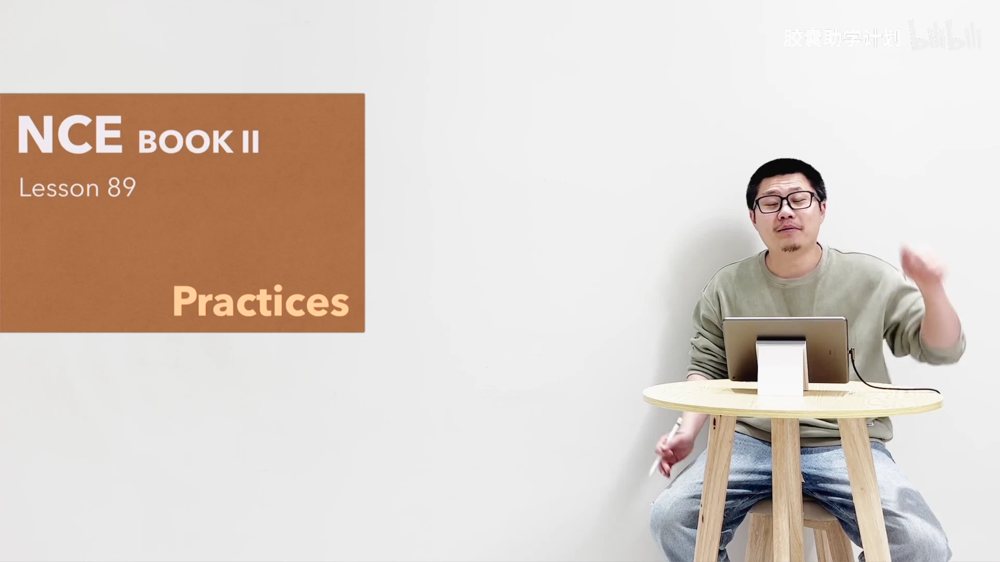

文字识别：NCE / BOOKII / Lesson 89 / Practices

### 画面 00:00:02

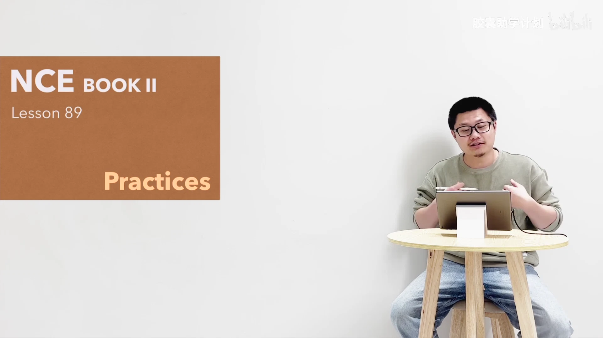

文字识别：NCE / BOOKII / Lesson 89 / Practices

### 画面 00:00:05

文字识别：NCE / BOOK"I / Lesson 89 / Practices

### 画面 00:00:08

文字识别：进行如下练习唯一前提 / 文章跟读至熟读成诵 / 否则请勿开始

### 画面 00:00:16

文字识别：Bibi / 胶囊助学计划 / •

### 画面 00:00:20

文字识别：助字计划陽 / 胶囊助学计划

### 画面 00:00:22

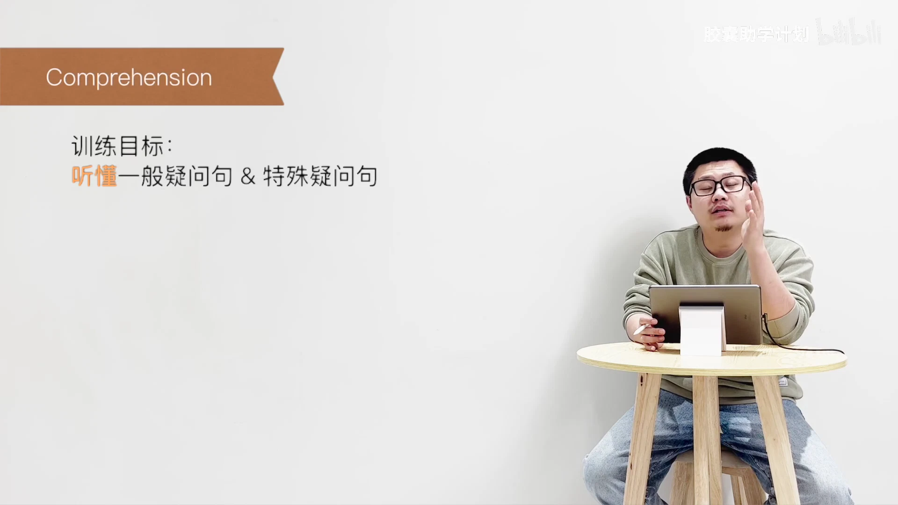

文字识别：Comprehension / 训练目标： / 听懂一般疑问句＆特殊疑问句

### 画面 00:00:26

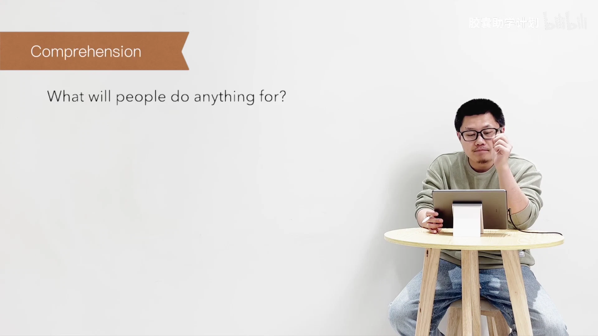

文字识别：Comprehension / What will people do anything for?

## 00:00:30–00:01:00

for a free show? Do they care if it's a bad one? No, they don't care. Did the news get around about a comedy show at our local cinema? Yes, it did. Who was it presented by? By the P and U Birdseed Company. We all rushed to see it, didn't we?

### 画面 00:00:39

文字识别：Comprehension / Did news get round about a comedy show at / our local cinema?

### 画面 00:00:52

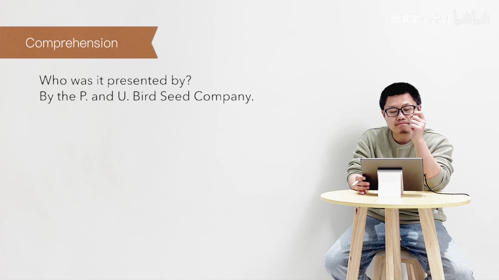

文字识别：Comprehension / Who was it presented by? / By the P. and U. Bird Seed Company.

## 00:01:00–00:01:30

Yes, we did. How long did we have to queue to get in? For hours. How many people were present? Several hundred. What was the show like? Very dull. It wasn't very good, was it? No, it wasn't.

### 画面 00:01:00

文字识别：Comprehension / We all rushed to see it, didn't we? / Yes, we did.

### 画面 00:01:13

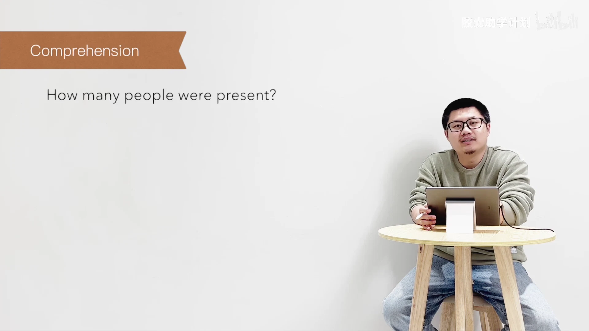

文字识别：Comprehension / How many people were present?

### 画面 00:01:15

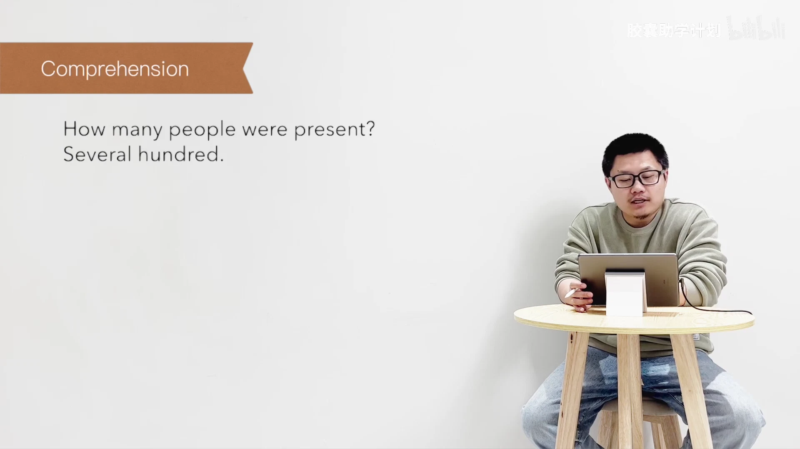

文字识别：Comprehension / How many people were present? / Several hundred.

### 画面 00:01:17

文字识别：助字计划 / Comprehension

### 画面 00:01:27

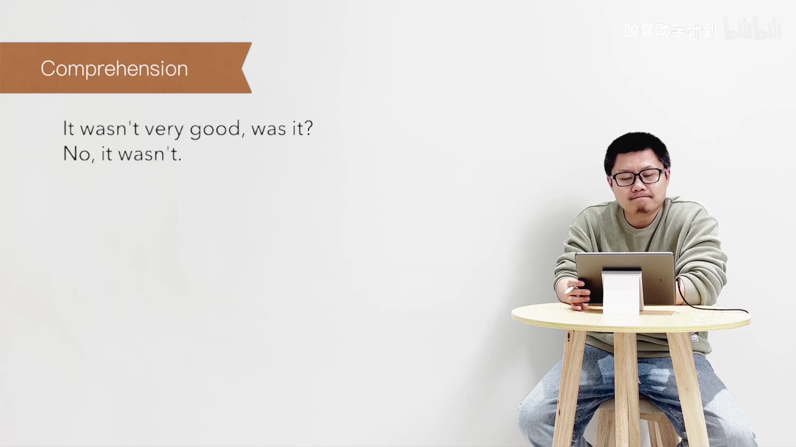

文字识别：Comprehension / It wasn't very good, was it? / No, it wasn't.

## 00:01:30–00:02:00

Did some people fail to get in? Yes, they did. Why needn't they have felt disappointed? Many of the artists who should have come did not appear. Who spoke at the beginning of the program? The advertiser. Was he nervous? Yes,

### 画面 00:01:41

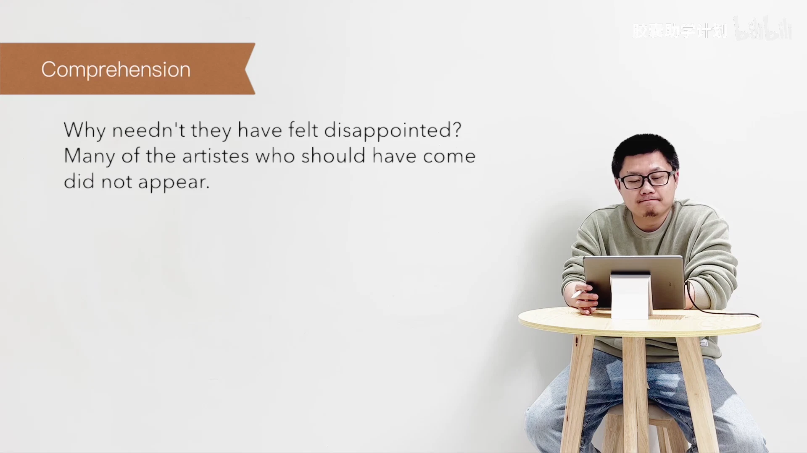

文字识别：Comprehension / Why needn't they have felt disappointed? / Many of the artistes who should have come / did not appear.

### 画面 00:01:49

文字识别：Comprehension

## 00:02:00–00:02:30

he was. 四句型 asking questions. 啊，我们看第一题叫 ask me if people like to see a free show. do提前 what What do people like to see? 答案叫 free show, 对吧？呃, the P and U Bird C Company presented a comedy show. Presented肯定是 did提前，对吧？ Did提前 What kind? 我说过了，你要补充 what kind of，所以是它肯定是对 a comedy提问的，对吧？所以 What kind of

### 画面 00:02:01

文字识别：Asking questions / 训练目标： / 会说一般疑问句＆特殊疑问句 / Accuracy / Fluency

### 画面 00:02:04

文字识别：Asking questions / T: Ask me if people like to see a free show.

### 画面 00:02:07

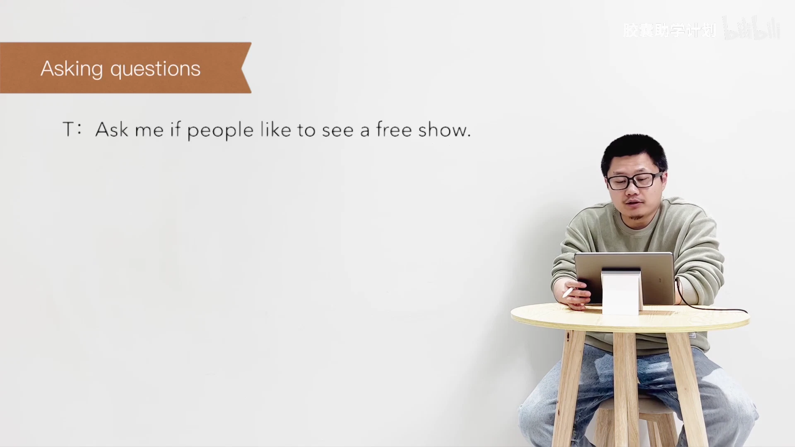

文字识别：Asking questions / T: Ask me if people like to see a free show.

### 画面 00:02:09

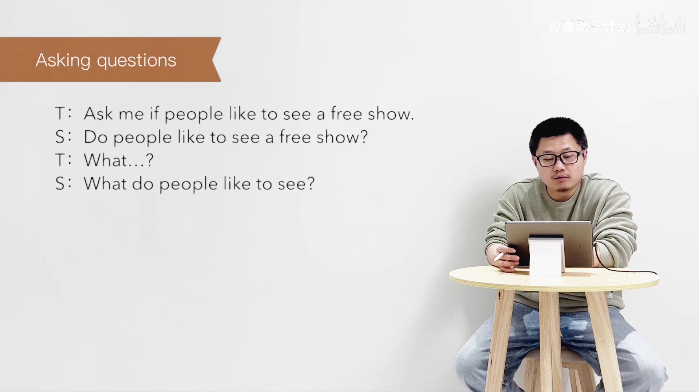

文字识别：Asking questions / T: Ask me if people like to see a free show. / S: Do people like to see a free show? / T: What...? / S: What do people like to see?

### 画面 00:02:12

文字识别：Asking questions

### 画面 00:02:14

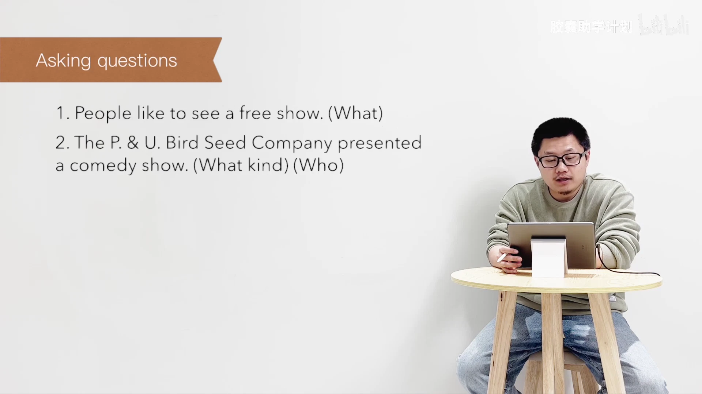

文字识别：Asking questions / 1. People like to see a free show. (What) / 2.The P. & U. Bird Seed Company presented / a comedy show. (What kind) (Who)

### 画面 00:02:28

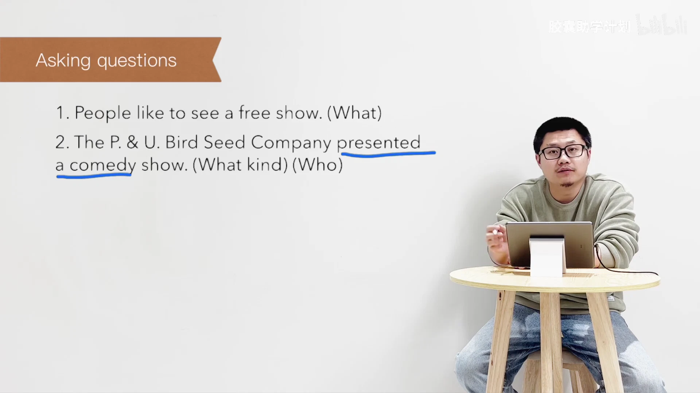

文字识别：Asking questions / 1. People like to see a free show. (What) / 2.The P. & U. Bird Seed Company presented / a comedy show.(What kind) (Who)

## 00:02:30–00:03:00

show did blah blah blah presented? 公那 blah blah 是公司的名字，Who 直接替代公司名字就行了啊？就 Who presented a competition? It was presented at a cinema. 一般过去时被动 was 提前 Where 对 at a cinema 提问。 News got around did 提前 What 对主语提问。 We all rushed to see did 提前 What 对 it 提问。 We had to queue to get

### 画面 00:02:47

文字识别：Asking questions / 1. People like to see a free show. (What) / 2.The P. & U. Bird Seed Company presented / a comedy show. (What kind) (Who) / 3. It was presented at a cinema. (Where) / 4.The news got round. (What)

### 画面 00:02:56

文字识别：Asking questions

## 00:03:00–00:03:30

in. Did提前Why? Why did you have to queue?啊，目的答案是to get in. We queued for hours. Did提前动词换原形。How long对for hours提问，互对主语提问。Several hundred people were present.呃，were提前How many对several hundred提问就行了。How many people?啊，The show was very dull. Was提前What was the show like?对吧？哎，这类What点点like就

### 画面 00:03:09

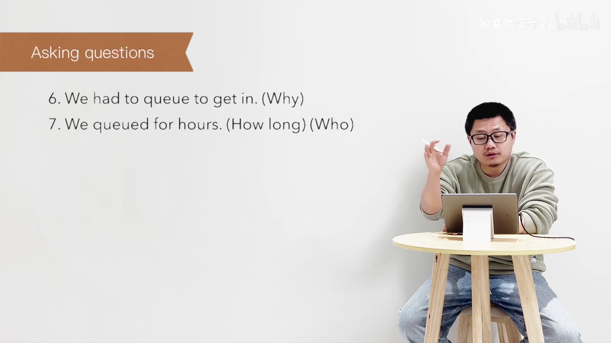

文字识别：Asking questions / 6. We had to queue to get in.(Why) / 7. We queued for hours.(How long) (Who)

### 画面 00:03:22

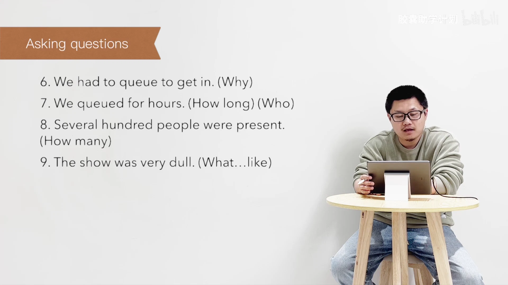

文字识别：Asking questions / 6. We had to queue to get in. (Why) / 7. We queued for hours. (How long) (Who) / 8. Several hundred people were present. / (How many) / 9. The show was very dull.(What..like)

## 00:03:30–00:04:00

就类似于咱们新一五十一课就学过那个What's the weather like? The advertisers stood awkwardly before the microphone.那stood did提前对吧？How对awkwardly提问？Where对before the microphone提问？Tell the story，记着练。Summary writing重点，两篇文章重点看连词啊。这是第一篇，这第二篇。Topic for discussion，咱们一起来看一下。第一个，Describe an

### 画面 00:03:34

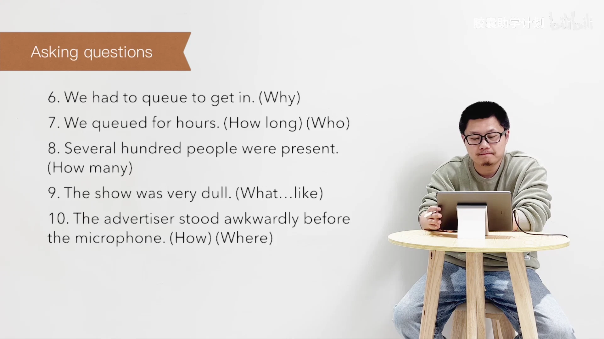

文字识别：Asking questions / 6. We had to queue to get in. (Why) / 7. We queued for hours. (How long) (Who) / 8. Several hundred people were present. / (How many) / 9. The show was very dull.(What...like) / 10. The advertiser stood awkwardly before / the microphone.(How) (Where)

### 画面 00:03:45

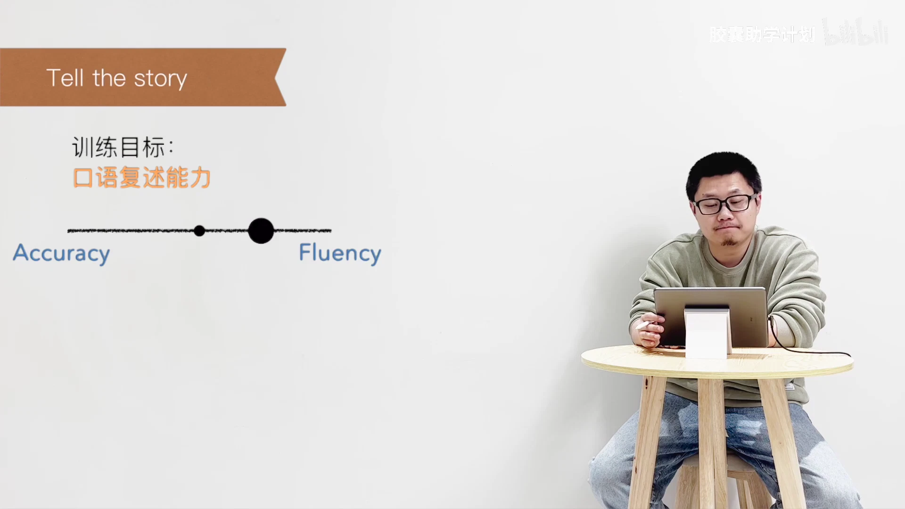

文字识别：Tell the story / 训练目标： / 口语复述能力 / Accuracy / Fluency

### 画面 00:03:48

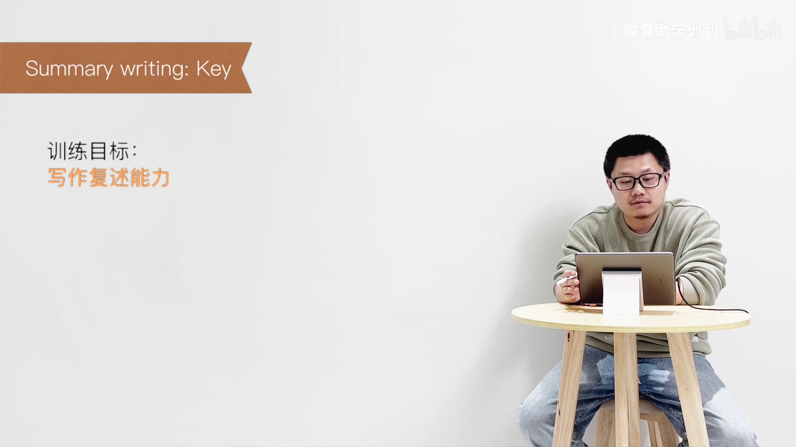

文字识别：Summary writing: Key / 训练目标： / 写作复述能力

### 画面 00:03:52

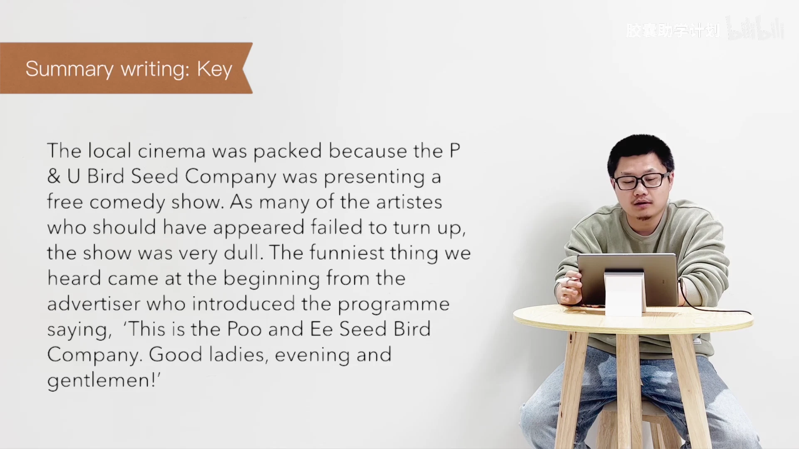

文字识别：助字计划 / Summary writing: Key / The local cinema was packed because the P / & U Bird Seed Company was presenting a / free comedy show. As many of the artistes / who should have appeared failed to turn up, / the show was very dull. The funniest thing we / heard came at the beginning from the / advertiser who introduced the programme / saying, 'This is the Poo and Ee Seed Bird / Company. Good ladies, evening and / gentlemen!'

### 画面 00:03:54

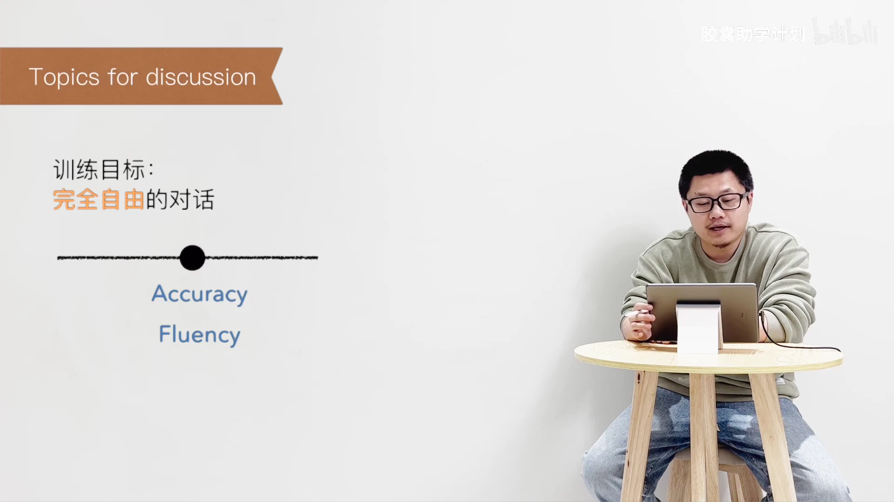

文字识别：Topics for discussion / 训练目标： / 完全自由的对话 / Accuracy / Fluency

### 画面 00:03:56

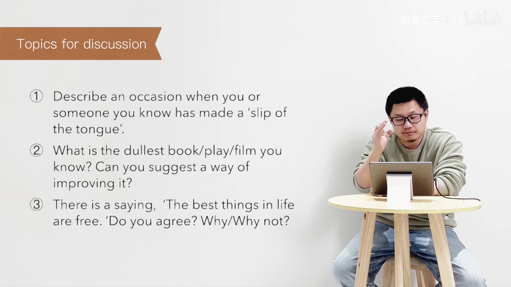

文字识别：Topics for discussion / Describe an occasion when you or / someone you know has made a 'slip of / the tongue'. / What is the dullest book/play/film you / know? Can you suggest a way of / improving it? / There is a saying, 'The best things in life / are free.'Do you agree? Why/Why not?

## 00:04:00–00:04:30

occasion when you or someone you know who made a slip of the tongue.啊，描述一个你或者你知道的人口误了的事儿。啊，What is the dullest book, play, film you know? Can you suggest the way of improving it?啊，你知道最无趣的书、话剧或者电影是什么吗？呃，能不能想个办法去提提这个改变一下，让它变得更有趣呢？There is a saying, the best thing in world in life, afraid. Do you agree? Why? Why not?说有这么一个说法，

### 画面 00:04:26

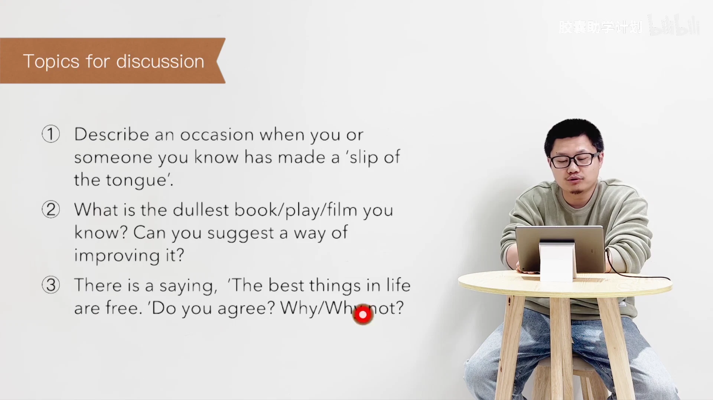

文字识别：Topics for discussion / Describe an occasion when you or / someone you know has made a 'slip of / the tongue'. / What is the dullest book/play/film you / know? Can you suggest a way of / improving it? / There is a saying, 'The best things in life / are free.'Do you agree? Why/Whonot?

## 00:04:30–00:05:00

saying就是这么个说法啊。说生命当中最好的事情是免费的，你同不同意？同意？为啥同意？不同意？为啥不同意？讲作业，Asmith先写再朗读，只要写错，写完对答。Tell the story，口语复述。置顶留言找重复间隔的学习材料。那以上呢就是本期视频的全部内容了。如果各位喜欢我们的课程呢，欢迎各位关注订阅，一键三连，分享给那些需要的朋友，来帮助我们快速成长。See

### 画面 00:04:38

文字识别：毫助字计划一

### 画面 00:04:40

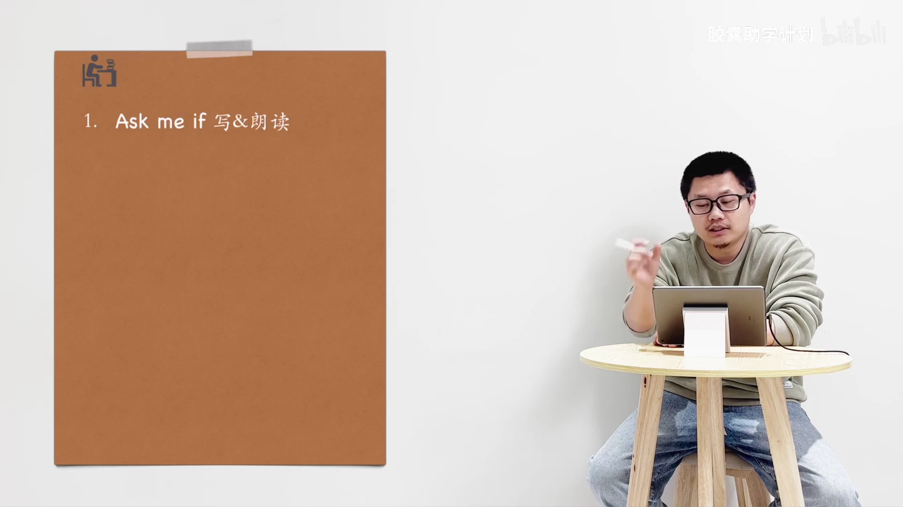

文字识别：助学计划園明 / 1.Ask me if写&朗读

### 画面 00:04:42

文字识别：延字计划 / 1.Ask me if写&朗读 / 2.摘要写作写&答案

### 画面 00:04:44

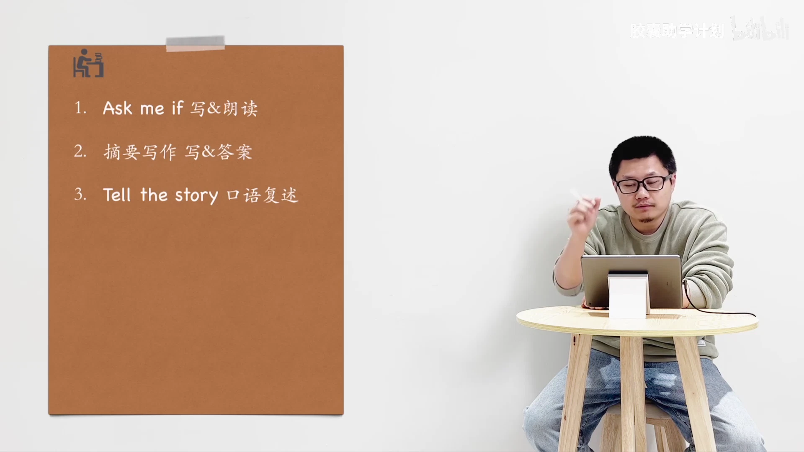

文字识别：1.Ask me if写&朗读 / 摘要写作写&答案 / 3.Tell the story 口语复述

### 画面 00:04:46

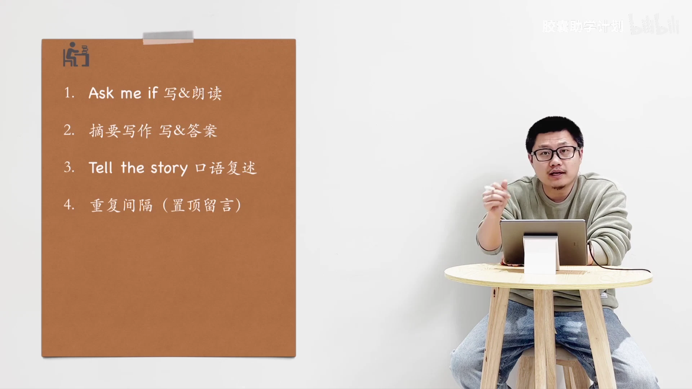

文字识别：1.Ask me if写&朗读 / 摘要写作写&答案 / 3.Tell the story 口语复述 / 4.重复间隔（置顶留言）

### 画面 00:04:48

文字识别：臺助学计划一洲

### 画面 00:04:50

文字识别：奏助字计划调 / ￥

### 画面 00:04:54

文字识别：毫助字计划一

### 画面 00:04:58

文字识别：毫助字计划一

## 00:05:00–00:05:13

you next time.

### 画面 00:05:00

文字识别：臺助学计划一

### 画面 00:05:02

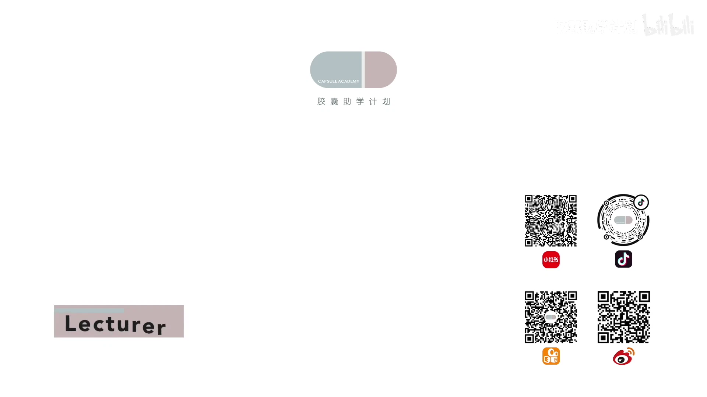

文字识别：CAPSULEACADEMY / 胶囊助学计划 / 小红书 / Lecturer / OE

### 画面 00:05:04

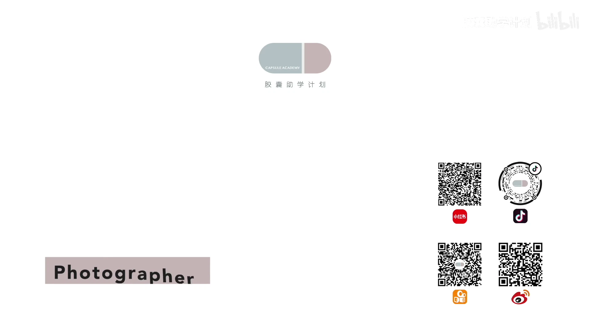

文字识别：勐学針划 / CAPSULEACADEMY / 胶囊助学计划 / 小红书 / □ / Photographer / OE

### 画面 00:05:07

文字识别：CAPSULEACADEMY / 胶囊助学计划 / 『 / 小红书 / Editor / Berlin / OE

### 画面 00:05:10

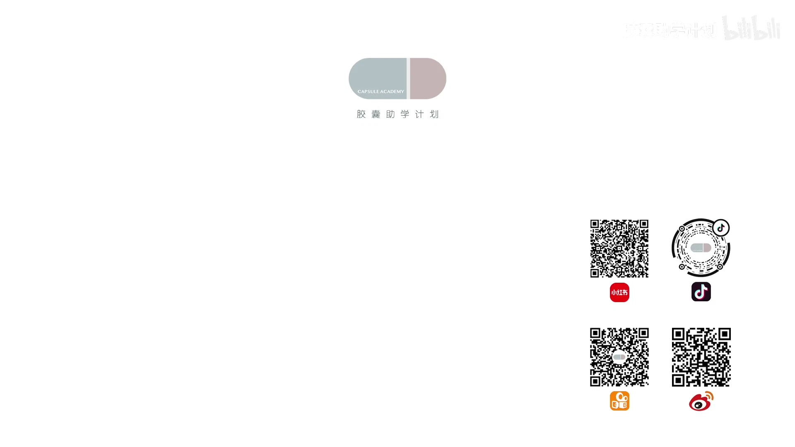

文字识别：CAPSULEACADEMY / 胶囊助学计划 / 『 / 小红书

### 画面 00:05:12

文字识别：bilibili / 胶囊助学计划

### 画面 00:05:13

文字识别：bilibili / 胶囊助学计划

