# 090 单词

快速机器解析：语音为单模型转写，未进行独立交叉校对或人工复核；画面每秒采样并按变化选帧，短时文字和标记可能遗漏。截图时间约有 1 秒误差。图片有损压缩；遇到疑点请按时间查看 Google Drive 原视频。

## 00:00:00–00:00:30

Hello everyone, welcome to Capsule Academy. This is Leo. Today we're going to learn the concept English book two lesson ninety words.老习惯进入正式课程之前，咱先看几个问题啊。那首先，如何表达下个半死？接下来呢啊，或者说吓得都丧失理智了啊。接下来第二个呢，如何表达各式各样的？那带着这两个问题，Hope you gonna enjoy.好，我们先看第一个单词

### 画面 00:00:00

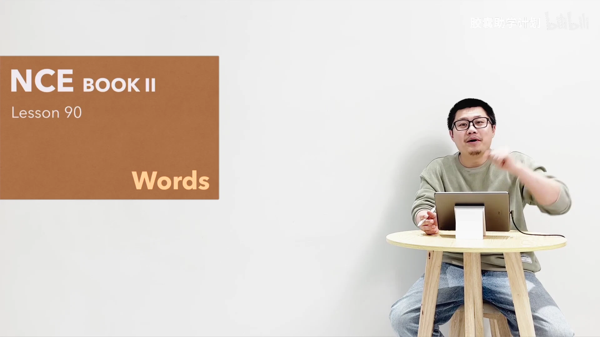

文字识别：NCE / BOOK"I / Lesson 90 / Words

### 画面 00:00:02

文字识别：NCE / BOOKII / Lesson 90 / Words

### 画面 00:00:07

文字识别：NCE / BOOKⅡI / Lesson 90 / Words

### 画面 00:00:11

文字识别：助字计划 / 可表达“吓个半死”？

### 画面 00:00:13

文字识别：①如何表达“吓个半死”？

### 画面 00:00:15

文字识别：①如何表达“吓个半死”? / 如何表达“各种各样”?

### 画面 00:00:20

文字识别：①如何表达“吓个半死”？ / 如何表达“各种各样”?

### 画面 00:00:24

文字识别：胶囊助学计划il出

### 画面 00:00:27

文字识别：胶囊助学计划册训 / 胶囊助学计划

### 画面 00:00:29

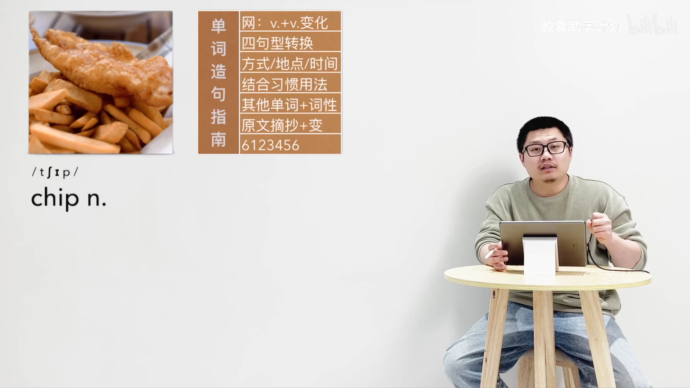

文字识别：单词造句指南 / 网：v.+v.变化 / 四句型转换 / 方式/地点/时间 / 结合习惯用法 / 其他单词+词性 / 原文摘抄+变 / 6123456 / /t∫Ip/ / chip n.

## 00:00:30–00:01:00

叫 chip 啊，那其实跟它最常用的连到一起的就是 fish and chips 啊，这是英国啊体系之下，为什么我叫体系之下？因为至少新西兰啊曾经是英国殖民地嘛，新西兰也这样，呃，很常见的本地的小吃就这一个叫 fish and chips 啊，叫做呃炸鱼和炸薯条，对吧？炸鱼和炸薯条，它就是放到一起去吃的啊。OK，那我

### 画面 00:00:32

文字识别：单词造句指南 / 网：v.+v.变化 / 四句型转换 / 方式/地点/时间 / 结合习惯用法 / 其他单词+词性 / 原文摘抄+变 / 6123456 / /t∫Ip/ / chip n. / fish and chips

### 画面 00:00:35

文字识别：单词造句指南 / 网：v.+v.变化 / 四句型转换 / 方式/地点/时间 / 结合习惯用法 / 其他单词+词性 / 原文摘抄+变 / 6123456 / /t∫Ip/ / chip n. / fish and chips

### 画面 00:00:37

文字识别：单词造句指南 / 网：v.+v.变化 / 四句型转换 / 方式/地点/时间 / 结合习惯用法 / 其他单词+词性 / 原文摘抄+变 / 6123456 / /t∫Ip/ / chip n. / fish and chips

### 画面 00:00:40

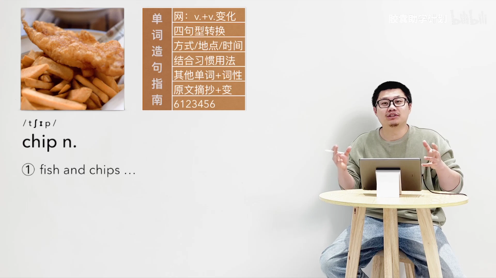

文字识别：单词造句指南 / 网：v.+v.变化 / 四句型转换 / 方式/地点/时间 / 结合习惯用法 / 其他单词+词性 / 原文摘抄+变 / 6123456 / /t∫Ip/ / chip n. / fish and chips

### 画面 00:00:59

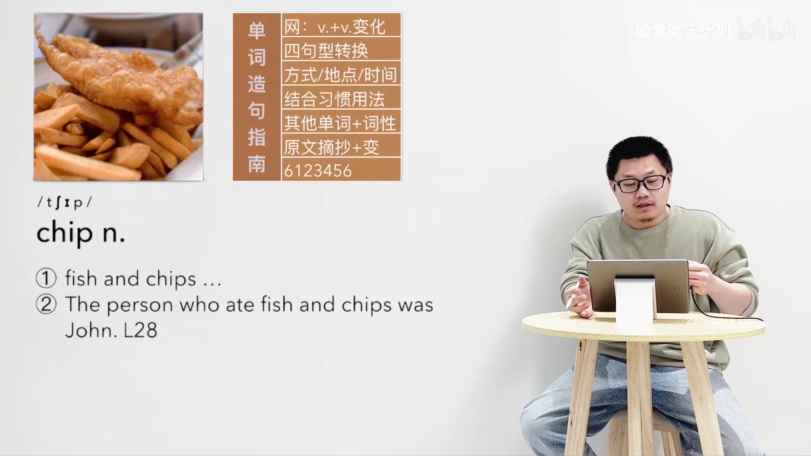

文字识别：单词造句指南 / 网：v.+v.变化 / 四句型转换 / 方式/地点/时间 / 结合习惯用法 / 其他单词+词性 / 原文摘抄+变 / 6123456 / /tSIp/ / chip n. / fish and chips /  . / The person who ate fish and chips was / John.L28

## 00:01:00–00:01:30

们造个句子吧。比如说，the person who ate fish and chips was John.哎，加了一个定语从句，吃这个玩意儿的人是John. Continue, Mom, can we have our fish and chips outside?我们能外面吃吗？Okay,那注意这里的have指的是吃，对吧？好吧，能动词。Next one,说we've ran out of fish and chips.哎，我们怎么样耗尽了？什么叫耗尽了？就没了啊。We don't have，其实就是这么个意思。Okay，再读

### 画面 00:01:01

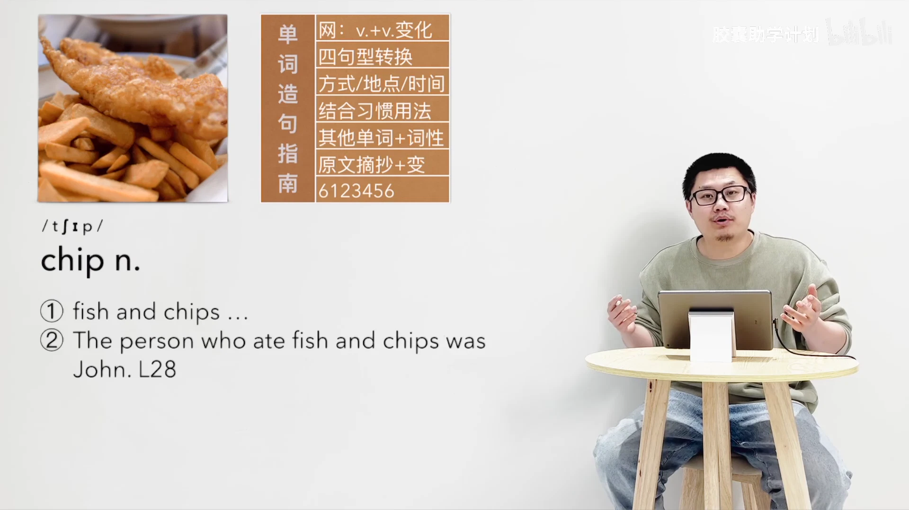

文字识别：单词造句指南 / 网：v.+v.变化 / 四句型转换 / 方式/地点/时间 / 结合习惯用法 / 其他单词+词性 / 原文摘抄+变 / 6123456 / /tSIp/ / chip n. / fish and chips ... / The person who ate fish and chips was / John.L28

### 画面 00:01:03

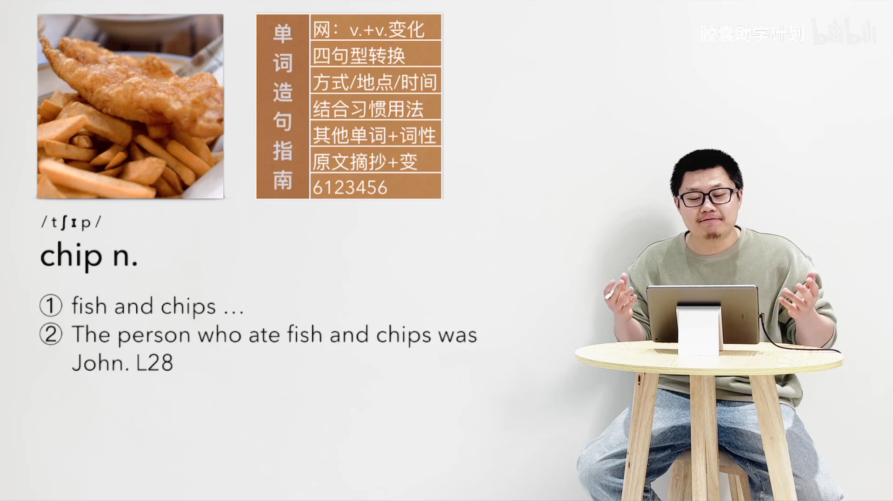

文字识别：单词造句指南 / 网：v.+v.变化 / 四句型转换 / 方式/地点/时间 / 结合习惯用法 / 其他单词+词性 / 原文摘抄+变 / 6123456 / /t∫Ip/ / chip n. / fish and chips ... / The person who ate fish and chips was / John.L28

### 画面 00:01:05

文字识别：单词造句指南 / 网：v.+v.变化 / 四句型转换 / 方式/地点/时间 / 结合习惯用法 / 其他单词+词性 / 原文摘抄+变 / 6123456 / /tSIp/ / chip n. / fish and chips ... / The person who ate fish and chips was / John.L28

### 画面 00:01:08

文字识别：单词造句指南 / 网：v.+v.变化 / 四句型转换 / 方式/地点/时间 / 结合习惯用法 / 其他单词+词性 / 原文摘抄+变 / 6123456 / /t∫Ip/ / chip n. / fish and chips ... / The person who ate fish and chips was / John.L28

### 画面 00:01:10

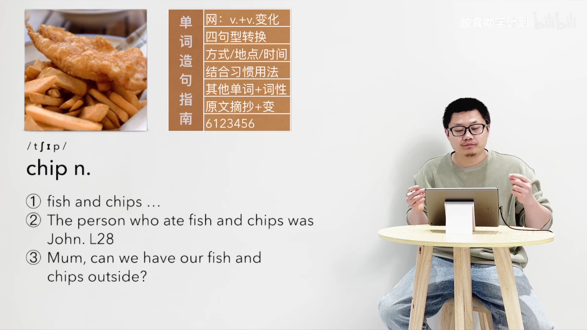

文字识别：单词造句指南 / 网：v.+v.变化 / 四句型转换 / 方式/地点/时间 / 结合习惯用法 / 其他单词+词性 / 原文摘抄+变 / 6123456 / /tSIp/ / chip n. / fish and chips ... / 1 / The person who ate fish and chips was / John.L28 / Mum, can we have our fish and / chips outside?

### 画面 00:01:15

文字识别：单词造句指南 / 网：v.+v.变化 / 四句型转换 / 方式/地点/时间 / 结合习惯用法 / 其他单词+词性 / 原文摘抄+变 / 6123456 / /tSIp/ / chip n. / fish and chips ... / 1 / The person' who ate fish and chips was / John.L28 / Mum, can we have our fish and / chips outside?

### 画面 00:01:20

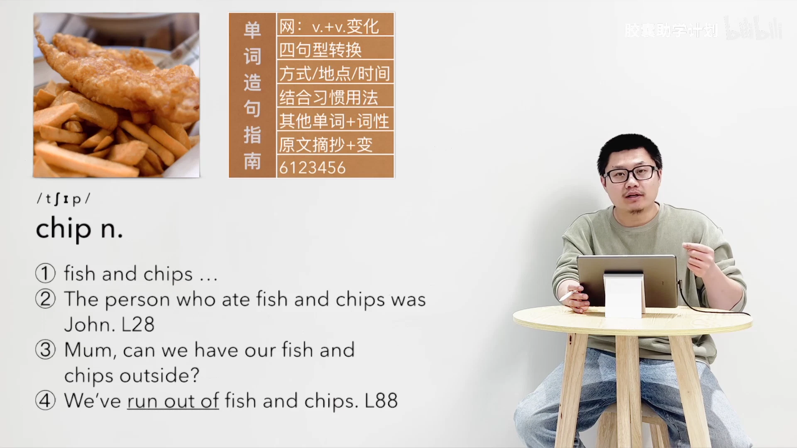

文字识别：单词造句指南 / 网：v.+v.变化 / 四句型转换 / 方式/地点/时间 / 结合习惯用法 / 其他单词+词性 / 原文摘抄+变 / 6123456 / /tSip/ / chip n. / ① fish and chips ... / The person who ate fish and chips was / John.L28 / Mum, can we have our fish and / chips outside? /  We've run out of fish and chips. L88

## 00:01:30–00:02:00

遍这个单词 chip 啊，薯片儿、薯条啊。Next one，下一个单词 overfish。 overfish 这个单词其实你不要把它当做一个生词，你把它呃两个生词，两个我们会的单词凑到一块儿去了。Over 有过度的意思，当然 over 这个单词的含义特别多，其中一个含义叫过度。Fish 叫鱼，也有捕鱼的意思。Overfish 就是过度捕捞了，对吧？那我们看一个句子，原文给的叫做 Oceans have

### 画面 00:01:32

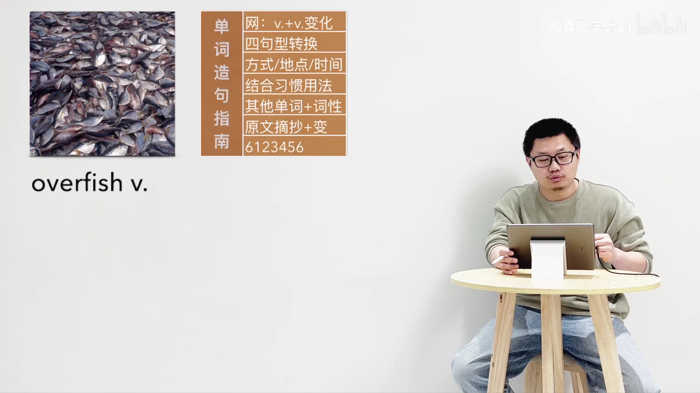

文字识别：单词造句指南 / 网：v.+v.变化 / 四句型转换 / 方式/地点/时间 / 结合习惯用法 / 其他单词+词性 / 原文摘抄+变 / 6123456 / overfish v.

### 画面 00:01:35

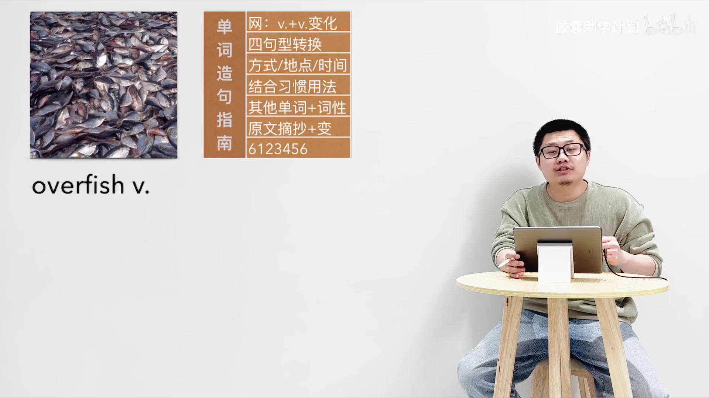

文字识别：单词造句指南 / 网：v.+v.变化 / 四句型转换 / 方式/地点/时间 / 结合习惯用法 / 其他单词+词性 / 原文摘抄+变 / 6123456 / overfish v.

### 画面 00:01:38

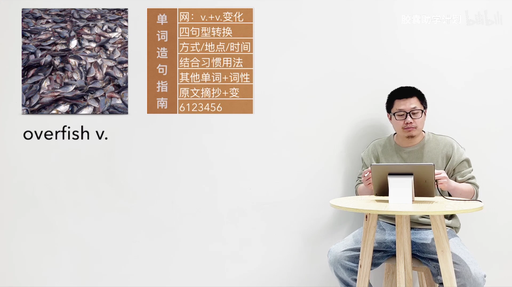

文字识别：单词造句指南 / 网：v.+v.变化 / 四句型转换 / 方式/地点/时间 / 结合习惯用法 / 其他单词+词性 / 原文摘抄+变 / 6123456 / overfish v.

### 画面 00:01:40

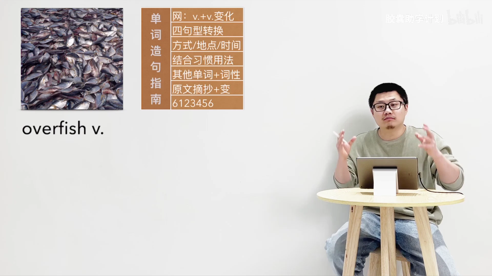

文字识别：单词造句指南 / 网：v.+v.变化 / 四句型转换 / 方式/地点/时间 / 结合习惯用法 / 其他单词+词性 / 原文摘抄+变 / 6123456 / overfish v.

### 画面 00:01:42

文字识别：单词造句指南 / 网：v.+v.变化 / 四句型转换 / 方式/地点/时间 / 结合习惯用法 / 其他单词+词性 / 原文摘抄+变 / 6123456 / overfish v.

### 画面 00:01:56

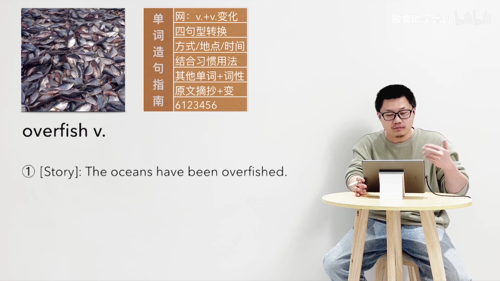

文字识别：单词造句指南 / 网：v.+v.变化 / 四句型转换 / 方式/地点/时间 / 结合习惯用法 / 其他单词+词性 / 原文摘抄+变 / 6123456 / overfish v. / ① [Story]: The oceans have been overfished.

## 00:02:00–00:02:30

have been overfished，说海洋已经被过度捕捞了。注意现在完成时的被动。复习，那拿它做四句型转换，对吧？Next one，说Lyle feels disappointed for the overfished lake，对吧？本来比如说我想去某湖啊，实际上我是想去看什么东西的，但是呢，我到那之后发现什么鱼都没有，我就感觉到叫做 feels disappointed，因为什么？因为他们把这个湖里的鱼都给打捞完了，

### 画面 00:02:00

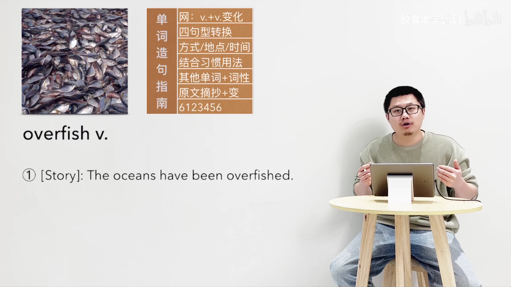

文字识别：单词造句指南 / 网：v.+v.变化 / 四句型转换 / 方式/地点/时间 / 结合习惯用法 / 其他单词+词性 / 原文摘抄+变 / 6123456 / overfish v. / ① [Story]: The oceans have been overfished.

### 画面 00:02:05

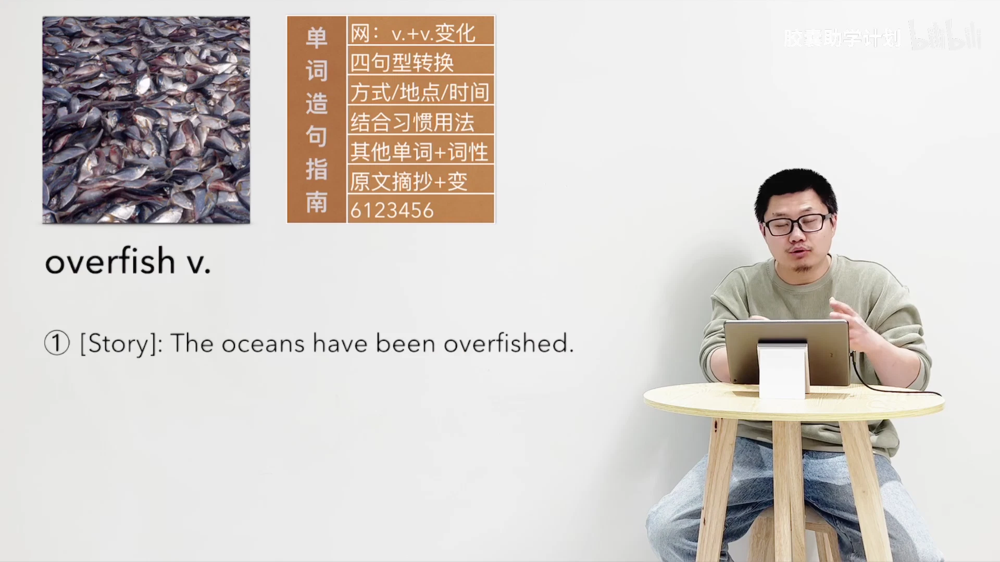

文字识别：单词造句指南 / 网：v.+v.变化 / 四句型转换 / 方式/地点/时间 / 结合习惯用法 / 其他单词+词性 / 原文摘抄+变 / 6123456 / overfish v. / ① [Story]: The oceans have been overfished.

### 画面 00:02:09

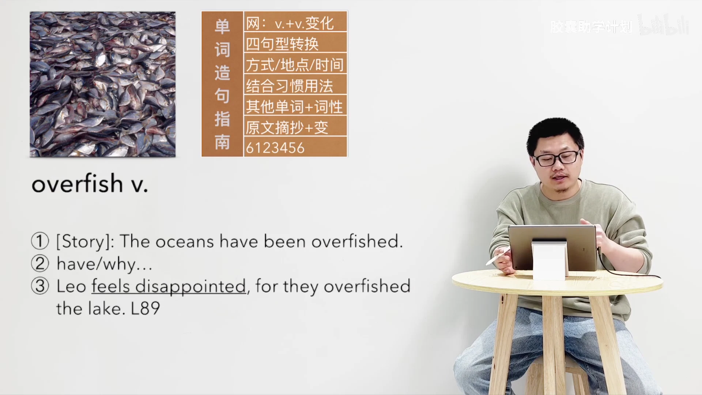

文字识别：单词造句指南 / 网：v.+v.变化 / 四句型转换 / 方式/地点/时间 / 结合习惯用法 / 其他单词+词性 / 原文摘抄+变 / 6123456 / overfish v. / ① [Story]: The oceans have been overfished. / ② have/why... / ③ Leo feels disappointed, for they overfished / the lake. L89

### 画面 00:02:12

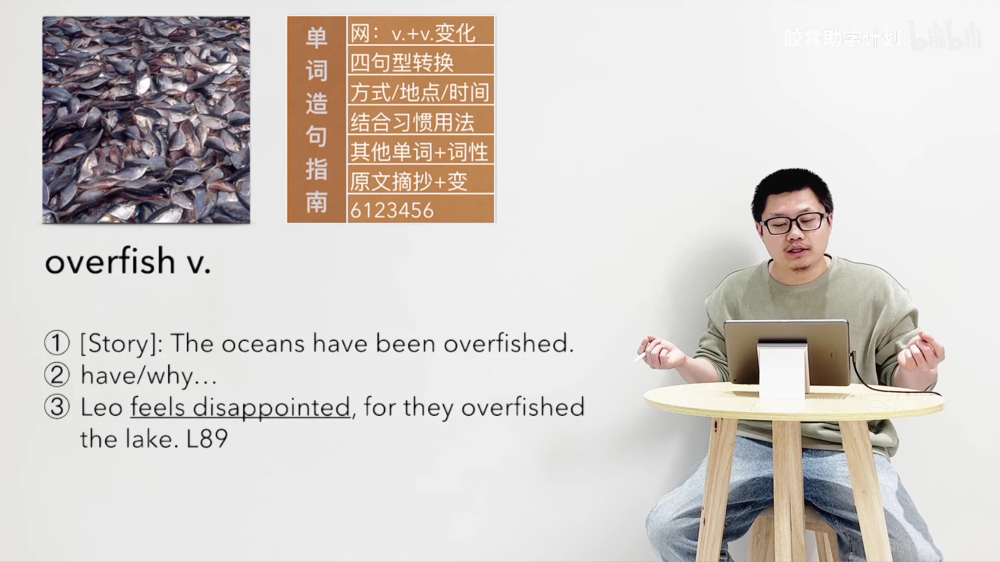

文字识别：单词造句指南 / 网：v.+v.变化 / 四句型转换 / 方式/地点/时间 / 结合习惯用法 / 其他单词+词性 / 原文摘抄+变 / 6123456 / overfish v. / ① [Story]: The oceans have been overfished. / ② have/why... / ③ Leo feels disappointed, for they overfished / the lake. L89

### 画面 00:02:15

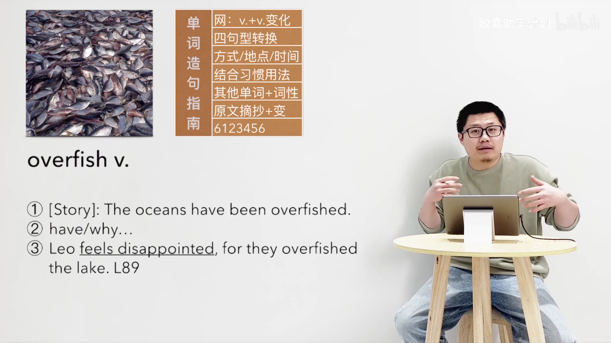

文字识别：单词造句指南 / 网：v.+v.变化 / 四句型转换 / 方式/地点/时间 / 结合习惯用法 / 其他单词+词性 / 原文摘抄+变 / 6123456 / overfish v. / ① [Story]: The oceans have been overfished. / ② have/why... / ) Leo feels disappointed, for they overfished / the lake. L89

### 画面 00:02:20

文字识别：单词造句指南 / 网：v.+v.变化 / 四句型转换 / 方式/地点/时间 / 结合习惯用法 / 其他单词+词性 / 原文摘抄+变 / 6123456 / overfish v. / ① [Story]: The oceans have been overfished. / ② have/why... / ) Leo feels disappointed, for they overfished / the lake. L89

## 00:02:30–00:03:00

对吧？过度捕捞了。Next one,说Lyle confirmed that the villagers overfished the lake.哎，我确定了，不是别人，就是这帮哎村民，对吧？就是住在这个湖旁边的这些村民，他们把这个湖给过度捕捞了。Overfished, very good.啊，当然这里还有一个somebody confirmed that某人证实证明，对吧？哎，确认啊。Next one，下一个单词giant连起来giant,

### 画面 00:02:31

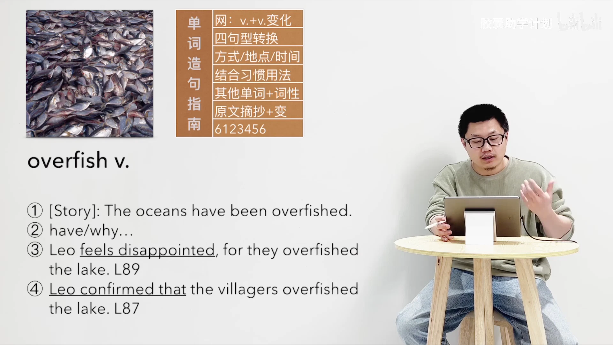

文字识别：单词造句指南 / 网：v.+v.变化 / 四句型转换 / 方式/地点/时间 / 结合习惯用法 / 其他单词+词性 / 原文摘抄+变 / 6123456 / overfish v. / ① [Story]: The oceans have been overfished. / ② have/why... / ③ Leo feels disappointed, for they overfished / the lake. L89 / Leo confirmed that the villagers overfished / the lake. L87

### 画面 00:02:41

文字识别：单词造句指南 / 网：v.+v.变化 / 四句型转换 / 方式/地点/时间 / 结合习惯用法 / 其他单词+词性 / 原文摘抄+变 / 6123456 / overfish v. / ① [Story]: The oceans have been overfished. / ② have/why... / ③ Leo feels disappointed, for they overfished / the lake. L89 / Leo confirmed that the villagers overfished / the lake. L87

### 画面 00:02:47

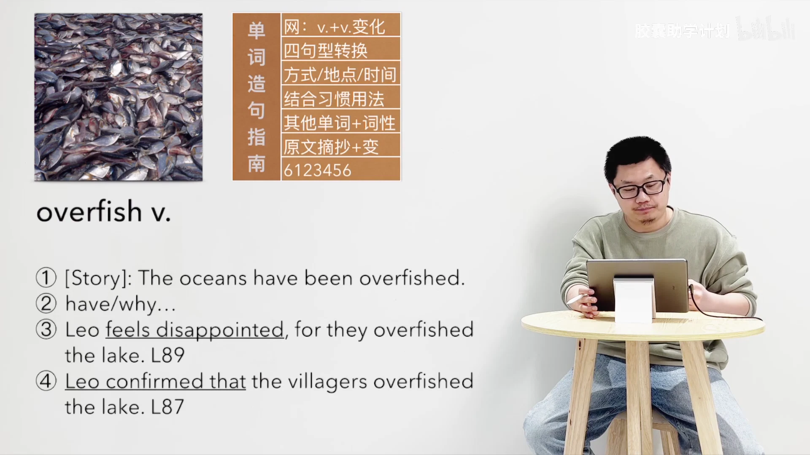

文字识别：单词造句指南 / 网：v.+v.变化 / 四句型转换 / 方式/地点/时间 / 结合习惯用法 / 其他单词+词性 / 原文摘抄+变 / 6123456 / overfish v. / ① [Story]: The oceans have been overfished. / ② have/why... / ③ Leo feels disappointed, for they overfished / the lake. L89 / Leo confirmed that the villagers overfished / the lake. L87

### 画面 00:02:51

文字识别：单词造句指南 / 网：v.+v.变化 / 四句型转换 / 方式/地点/时间 / 结合习惯用法 / 其他单词+词性 / 原文摘抄+变 / 6123456 / overfish v. / ① [Story]: The oceans have been overfished. / ② have/why... / ③ Leo feels disappointed, for they overfished / the lake. L89 / Leo confirmed that the villagers overfished / the lake. L87

### 画面 00:02:54

文字识别：单词造句指南 / 网：v.+v.变化 / 囊助字计划一 / 四句型转换 / 方式/地点/时间 / 结合习惯用法 / 其他单词+词性 / 原文摘抄+变 / 6123456 / /'dzal.ant/ / giant adj.

### 画面 00:02:56

文字识别：单词造句指南 / 网：v.+v.变化 / 妻助学计划 / 四句型转换 / 方式/地点/时间 / 结合习惯用法 / 其他单词+词性 / 原文摘抄+变 / 6123456 / /'dzal.ant/ / giant adj.

## 00:03:00–00:03:30

giant giant fish giant 巨大的形容词造句，我得找名词，我直接给你一个叫 fish。有了这个形容词加名词短语了之后不够，我还得找动词，对吧？怎么办呢？The fisher claimed to have caught a giant fish. 哎，声称抓到了一个大鱼。Next one, they carried the giant fish to the village fair. 哎，把它拉到了村里边的

### 画面 00:03:00

文字识别：单词造句指南 / 网：v.+v.变化 / 卖助字计划 / 四句型转换 / 方式/地点/时间 / 结合习惯用法 / 其他单词+词性 / 原文摘抄+变 / 6123456 / /'d3al.ant/ / giant adj.

### 画面 00:03:07

文字识别：单词造句指南 / 网：v.+v.变化 / 四句型转换 / 方式/地点/时间 / 结合习惯用法 / 其他单词+词性 / 原文摘抄+变 / 6123456 / /'d3al.ant/ / giant adj. / ① giant fish

### 画面 00:03:10

文字识别：单词造句指南 / 网：v.+v.变化 / 喜助字计划 / 四句型转换 / 方式/地点/时间 / 结合习惯用法 / 其他单词+词性 / 原文摘抄+变 / 6123456 / /'dzal.ant/ / giant adj. / ① giant fish

### 画面 00:03:14

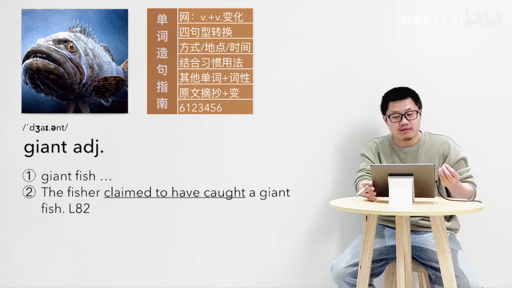

文字识别：单词造句指南 / 网：v.+v.变化 / 四句型转换 / 方式/地点/时间 / 结合习惯用法 / 其他单词+词性 / 原文摘抄+变 / 6123456 / /'d3al.ant/ / giant adj. / ① / giant fish / The fisher claimed to have caught a giant / fish. L82

### 画面 00:03:16

文字识别：单词造句指南 / 网：v.+v.变化 / 四句型转换 / 方式/地点/时间 / 结合习惯用法 / 其他单词+词性 / 原文摘抄+变 / 6123456 / /'d3al.ant/ / giant adj. / giant fish / The fisher claimed to have caught a giant / fish. L82

### 画面 00:03:20

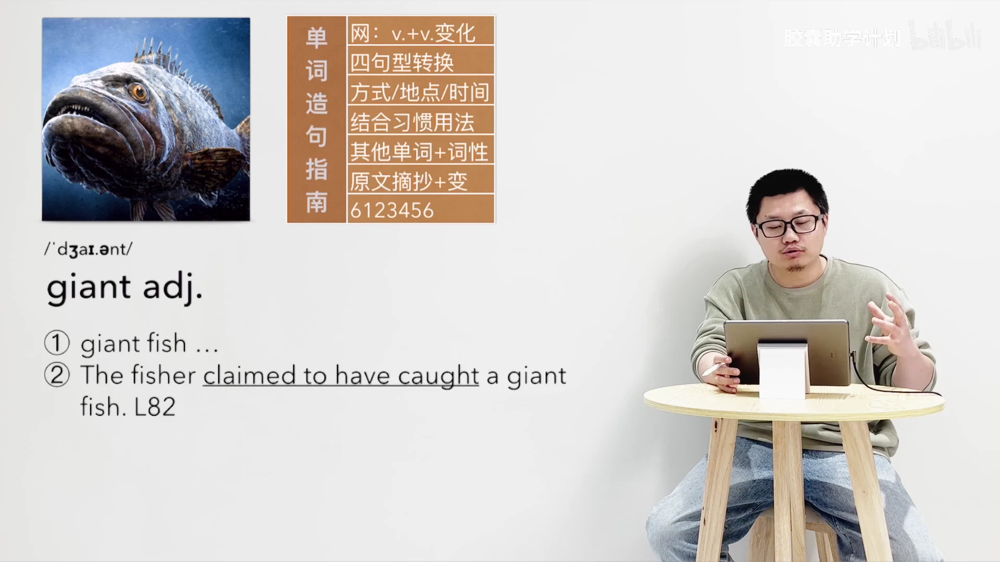

文字识别：单词造句指南 / 网：v.+v.变化 / 字计划 / 四句型转换 / 方式/地点/时间 / 结合习惯用法 / 其他单词+词性 / 原文摘抄+变 / 6123456 / /'d3al.ant/ / giant adj. / 1 / giant fish / The fisher claimed to have caught a giant / fish. L82

### 画面 00:03:23

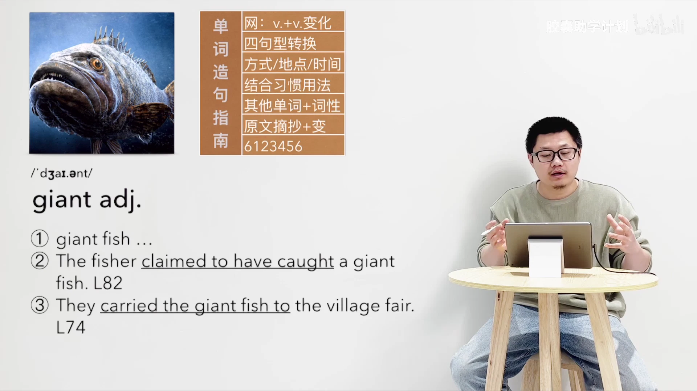

文字识别：单词造句指南 / 网：v.+v.变化 / 四句型转换 / 方式/地点/时间 / 结合习惯用法 / 其他单词+词性 / 原文摘抄+变 / 6123456 / /'dzal.ant/ / giant adj. / ① giant fish / The fisher claimed to have caught a giant / fish. L82 / They carried the giant fish to the village fair. / L74

### 画面 00:03:25

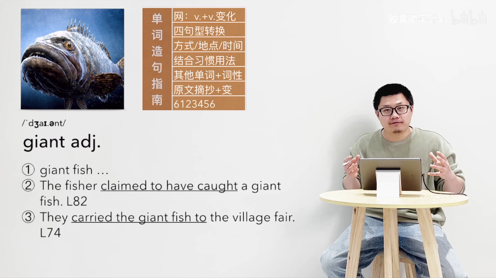

文字识别：单词造句指南 / 网：v.+v.变化 / 四句型转换 / 方式/地点/时间 / 结合习惯用法 / 其他单词+词性 / 原文摘抄+变 / 6123456 / /'d3al.ant/ / giant adj. / ① giant fish / The fisher claimed to have caught a giant / fish. L82 / They carried the giant fish to the village fair. / L74

## 00:03:30–00:04:00

集市上，也许是卖，也许是展览。Next one说，Where did you get this giant fish？说你从哪儿得到的这条巨大的鱼啊？对吧？Where did you get this giant fish？好，再读一遍，giant巨大的。Next one动词叫terrified，terrified就哎呦吓一跳，使害怕，使某人变得很害怕或者很惊恐啊，叫做terrified。那你看我们造一个句子，比如说

### 画面 00:03:31

文字识别：单词造句指南 / 网：v.+v.变化 / 学计划 / 四句型转换 / 方式/地点/时间 / 结合习惯用法 / 其他单词+词性 / 原文摘抄+变 / 6123456 / /'d3al.ant/ / giant adj. / ① giant fish / The fisher claimed to have caught a giant / fish. L82 / They carried the giant fish to the village fair. / L74 / ) Where did you get this giant fish?

### 画面 00:03:35

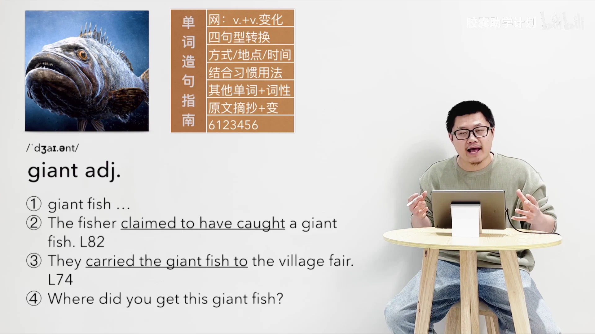

文字识别：单词造句指南 / 网：v.+v.变化 / 四句型转换 / 方式/地点/时间 / 结合习惯用法 / 其他单词+词性 / 原文摘抄+变 / 6123456 / /'dzal.ant/ / giant adj. / ① giant fish / The fisher claimed to have caught a giant / fish. L82 / They carried the giant fish to the village fair. / L74 /  Where did you get this giant fish?

### 画面 00:03:45

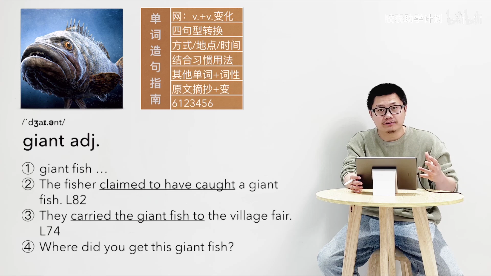

文字识别：单词造句指南 / 网：v.+v.变化 / 四句型转换 / 方式/地点/时间 / 结合习惯用法 / 其他单词+词性 / 原文摘抄+变 / 6123456 / /'d3al.ant/ / giant adj. / ① giant fish / The fisher claimed to have caught a giant / fish. L82 / They carried the giant fish to the village fair. / L74 / ) Where did you get this giant fish?

### 画面 00:03:47

文字识别：单词造句指南 / 网：v.+v.变化 / 囊助字计划 / 四句型转换 / 方式/地点/时间 / 结合习惯用法 / 其他单词+词性 / 原文摘抄+变 / 6123456 / /'terafai/ / terrify v.

### 画面 00:03:50

文字识别：单词造句指南 / 网：v.+v.变化 / 喜助字计划 / 四句型转换 / 方式/地点/时间 / 结合习惯用法 / 其他单词+词性 / 原文摘抄+变 / 6123456 / /'terafar/ / terrify v.

### 画面 00:03:56

文字识别：单词造句指南 / 网：v.+v.变化 / 建助字计划園 / 四句型转换 / 方式/地点/时间 / 结合习惯用法 / 其他单词+词性 / 原文摘抄+变 / 6123456 / /'terafar/ / terrify v.

### 画面 00:03:58

文字识别：单词造句指南 / 网：v.+v.变化 / 四句型转换 / 方式/地点/时间 / 结合习惯用法 / 其他单词+词性 / 原文摘抄+变 / 6123456 / /'terafar/ / terrify v. / ① The giant fish in the kitchen terrified me a / great deal. L79

## 00:04:00–00:04:30

the giant fish in the kitchen. 你看，注意我们后边还来了一个小的介词引导的短语，叫 in the kitchen. 啊，在哪儿的鱼呢？首先， giant 形容词放前面，表示大，巨大。后边呢， in the kitchen 呢放在后面，表示的是某个地点，对吧？哎，就在这个厨房里边那条巨大的鱼啊， terrified me a great deal. 哎，吓了我一大跳。 a great deal 就是类似于 very much，对吧？吓了我一大

### 画面 00:04:01

文字识别：单词造句指南 / 网：v.+v.变化 / 四句型转换 / 方式/地点/时间 / 结合习惯用法 / 其他单词+词性 / 原文摘抄+变 / 6123456 / /'terafar/ / terrify v. / ① The giant fish in the kitchen terrified me a / great deal. L79

### 画面 00:04:05

文字识别：单词造句指南 / 网：v.+v.变化 / 奏助字计划 / 四句型转换 / 方式/地点/时间 / 结合习惯用法 / 其他单词+词性 / 原文摘抄+变 / 6123456 / /'terafar/ / terrify v. / ① The giant fish n the kitchenterrified me a / great deal. L79

### 画面 00:04:08

文字识别：单词造句指南 / 网：v.+v.变化 / 妻助字计划 / 四句型转换 / 方式/地点/时间 / 结合习惯用法 / 其他单词+词性 / 原文摘抄+变 / 6123456 / /'terafar/ / terrify v. / ① The giant fish n the kitchenterrified me a / great deal. L79

### 画面 00:04:12

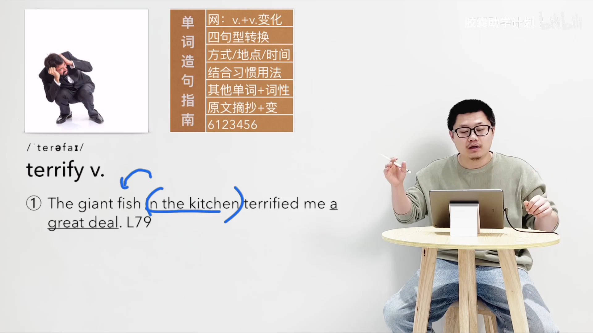

文字识别：单词造句指南 / 网：v.+v.变化 / 臺助学计划 / 四句型转换 / 方式/地点/时间 / 结合习惯用法 / 其他单词+词性 / 原文摘抄+变 / 6123456 / /'terafar/ / terrify v. / ① The giant fish n the kitchenterrified me a / great deal. L79

### 画面 00:04:15

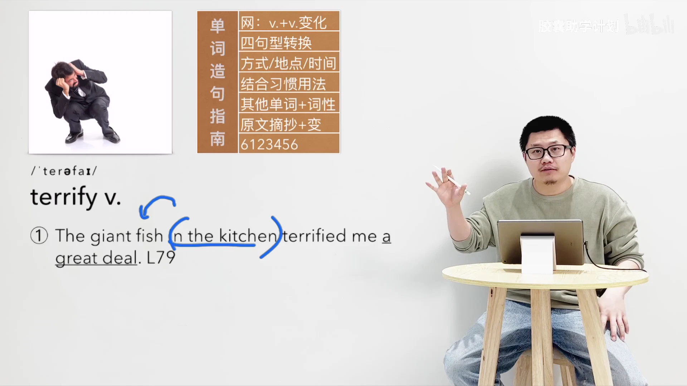

文字识别：单词造句指南 / 网：v.+v.变化 / 四句型转换 / 方式/地点/时间 / 结合习惯用法 / 其他单词+词性 / 原文摘抄+变 / 6123456 / /'terafar/ / terrify v. / ① The giant fish n the kitchenterrified me a / great deal. L79

### 画面 00:04:24

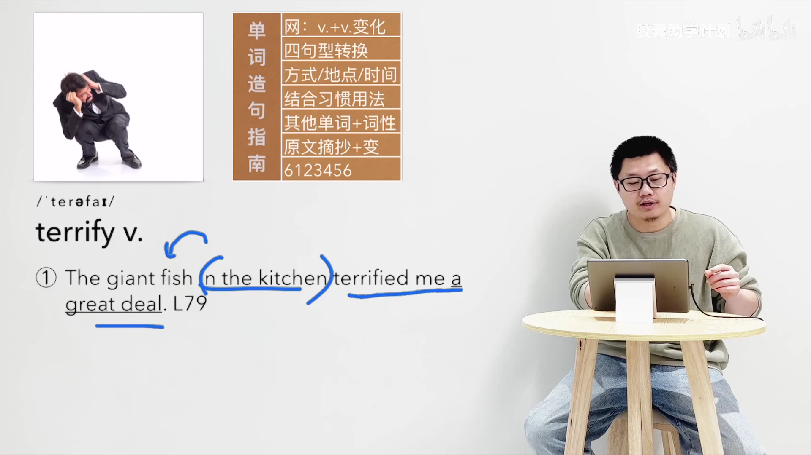

文字识别：单词造句指南 / 网：v.+v.变化 / 囊助字计划 / 四句型转换 / 方式/地点/时间 / 结合习惯用法 / 其他单词+词性 / 原文摘抄+变 / 6123456 / /'terafar/ / terrify v. / ① The giant fish n the kitchenterrified me a / great deal. L79

## 00:04:30–00:05:00

跳。Next one,哎，我们直接给大家了一个句型，我希望你自己去把后边补上，叫做I was so terrified that说我是如此的害怕恐惧以至于。Next one说Grace was too terrified to reply，过于的害怕了而没有办法去进行一个回复。这个结构我印象当中新二其实我们没有细讲，这是新一一百零三课的一个结构，我在这简单说一下。过这

### 画面 00:04:30

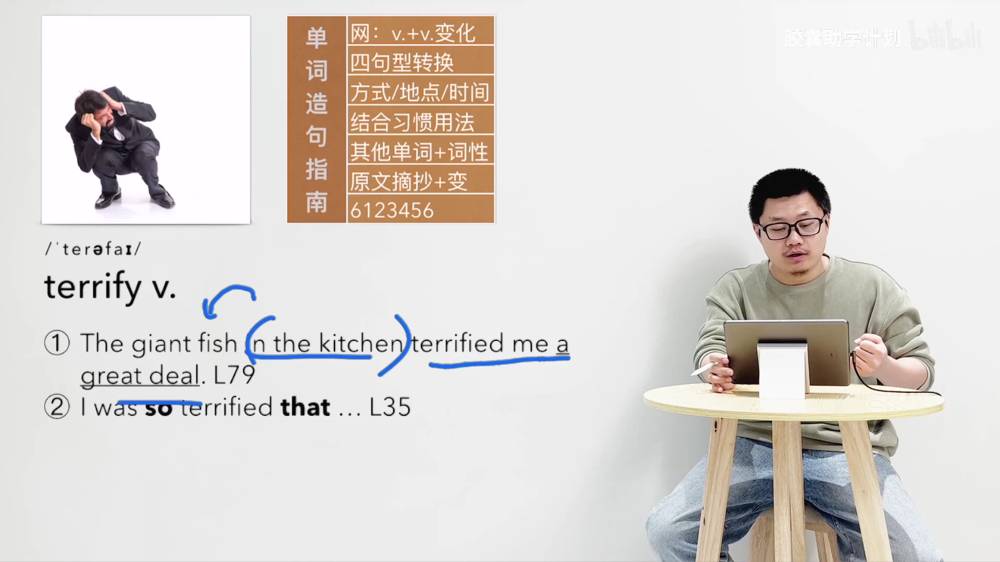

文字识别：单词造句指南 / 网：v.+v.变化 / 四句型转换 / 方式/地点/时间 / 结合习惯用法 / 其他单词+词性 / 原文摘抄+变 / 6123456 / /'terafar/ / terrify v. / ① The giant fish n the kitchenterrified me a / great deal. L79 / I was so terrified that ... L35

### 画面 00:04:32

文字识别：单词造句指南 / 网：v.+v.变化 / 字计划 / 四句型转换 / 方式/地点/时间 / 结合习惯用法 / 其他单词+词性 / 原文摘抄+变 / 6123456 / /'terafai/ / terrify v. / ① The giant fish n the kitchenterrified me a / great deal. L79 / I was so terrified that .. L35

### 画面 00:04:34

文字识别：单词造句指南 / 网：v.+v.变化 / 四句型转换 / 方式/地点/时间 / 结合习惯用法 / 其他单词+词性 / 原文摘抄+变 / 6123456 / /'terafai/ / terrify v. / ① The giant fish in the kitchen terrified me a / great deal. L79 / I was so terrified that ... L35

### 画面 00:04:36

文字识别：单词造句指南 / 网：v.+v.变化 / 四句型转换 / 方式/地点/时间 / 结合习惯用法 / 其他单词+词性 / 原文摘抄+变 / 6123456 / /'terafar/ / terrify v. / ① The giant fish in the kitchen terrified me a / great deal. L79 / I was so terrified that ... L35

### 画面 00:04:40

文字识别：单词造句指南 / 网：v.+v.变化 / 四句型转换 / 方式/地点/时间 / 结合习惯用法 / 其他单词+词性 / 原文摘抄+变 / 6123456 / /'terafar/ / terrify v. / ① The giant fish in the kitchen terrified me a / great deal. L79 /  I was so terrified that ... L35

### 画面 00:04:43

文字识别：单词造句指南 / 网：v.+v.变化 / 四句型转换 / 方式/地点/时间 / 结合习惯用法 / 其他单词+词性 / 原文摘抄+变 / 6123456 / /'terafar/ / terrify v. / ① The giant fish in the kitchen terrified me a / great deal. L79 / I was so terrified that ... L35 / Grace was too terrifiea to reply.

### 画面 00:04:45

文字识别：单词造句指南 / 网：v.+v.变化 / 四句型转换 / 方式/地点/时间 / 结合习惯用法 / 其他单词+词性 / 原文摘抄+变 / 6123456 / /'terafai/ / terrify v. / ① The giant fish in the kitchen terrified me a / great deal. L79 / I was so terrified that ... L35 / Grace was too terrifiea to reply.

### 画面 00:04:52

文字识别：单词造句指南 / 网：v.+v.变化 / 四句型转换 / 方式/地点/时间 / 结合习惯用法 / 其他单词+词性 / 原文摘抄+变 / 6123456 / /'terafai/ / terrify v. / ① The giant fish in the kitchen terrified me a / great deal. L79 / I was so terrified that ... L35 / Grace was too terrified to reply.

## 00:05:00–00:05:30

这个太啊，它呃这个 too 啊，它是翻译成太啊，我们汉语当中那个啊这个太啊太太啊夫人这个太啊过于怎么怎么样了，太好了，这个太，汉语当中这个太可以指好，可以指坏，对吧？啊，比如这事儿你干太过了，这个态度不好。如果说哎这太漂亮了，这个就是好，对吧？那但是英文当中这个 too 啊，太往往指的是否定的含义，负面感情色彩。比如

### 画面 00:05:00

文字识别：单词造句指南 / 网：v.+v.变化 / 四句型转换 / 方式/地点/时间 / 结合习惯用法 / 其他单词+词性 / 原文摘抄+变 / 6123456 / /'terafar/ / terrify v. / ① The giant fish in the kitchen terrified me a / great deal. L79 / I was so terrifed that ... L35 / Grace wastoo terrified to reply.

### 画面 00:05:05

文字识别：单词造句指南 / 网：v.+v.变化 / 四句型转换 / 方式/地点/时间 / 结合习惯用法 / 其他单词+词性 / 原文摘抄+变 / 6123456 / /'terafai/ / terrify v. / ① The giant fish in the kitchen terrified me a / great deal. L79 / I was so terrifed that ... L35 / Grace wastoo terrified to reply.

### 画面 00:05:25

文字识别：单词造句指南 / 网：v.+v.变化 / 字计划 / 四句型转换 / 方式/地点/时间 / 结合习惯用法 / 其他单词+词性 / 原文摘抄+变 / 6123456 / /'terafai/ / terrify v. / ① The giant fish in the kitchen terrified me a / great deal. L79 / I was so terrif that ... L35 / Grace wastoerrifiedto reply.

## 00:05:30–00:06:00

说 Lail was too terrified.人都会害怕，对吧？但是他过于的害怕了，以至于他连回复都不敢回复了，导致的事情，比如说他去面试，别人给他发了一封邮件，他过于害怕了，连回邮件都没回，直接就没去面试，这肯定不好嘛，对吧？所以这个 too 点点 too do something 这个结构呢，表示的是过于怎么怎么样，而不敢怎么怎么样了，对吧？OK，好，比如说她太漂亮，以至于没人

### 画面 00:05:30

文字识别：单词造句指南 / 网：v.+v.变化 / 四句型转换 / 方式/地点/时间 / 结合习惯用法 / 其他单词+词性 / 原文摘抄+变 / 6123456 / /'terafai/ / terrify v. / ① The giant fish in the kitchen terrified me a / great deal. L79 / I was so terrid that ... L35 / Grace wastoerrified to reply.

### 画面 00:05:35

文字识别：单词造句指南 / 网：v.+v.变化 / 毫助学计划 / 四句型转换 / 方式/地点/时间 / 结合习惯用法 / 其他单词+词性 / 原文摘抄+变 / 6123456 / /'terafar/ / terrify v. / ① The giant fish in the kitchen terrified me a / great deal. L79 / I was so terrixd / d that ... L35 / Grace wastoerrified to reply.

### 画面 00:05:39

文字识别：单词造句指南 / 网：v.+v.变化 / 学计划 / 四句型转换 / 方式/地点/时间 / 结合习惯用法 / 其他单词+词性 / 原文摘抄+变 / 6123456 / /'terafai/ / terrify v. / ① The giant fish in the kitchen terrified me a / great deal. L79 / I was so terrid that ... 35 / Grace wastoerrified to reply.

### 画面 00:05:47

文字识别：单词造句指南 / 网：v.+v.变化 / 学计划 / 四句型转换 / 方式/地点/时间 / 结合习惯用法 / 其他单词+词性 / 原文摘抄+变 / 6123456 / /'terafai/ / terrify v. / ① The giant fish in the kitchen terrified me a / great deal. L79 / I was so terridthat ... L35 / Grace wastoerrified to reply.

### 画面 00:05:49

文字识别：单词造句指南 / 网：v.+v.变化 / 子计划 / 四句型转换 / 方式/地点/时间 / 结合习惯用法 / 其他单词+词性 / 原文摘抄+变 / 6123456 / /'terafar/ / terrify v. / ① The giant fish in the kitchen terrified me a / great deal. L79 / I was so terrixd / d that ... L35 / toerrified to reply. / Grace Was

### 画面 00:05:52

文字识别：单词造句指南 / 网：v.+v.变化 / 子计划 / 四句型转换 / 方式/地点/时间 / 结合习惯用法 / 其他单词+词性 / 原文摘抄+变 / 6123456 / /'terafai/ / terrify v. / ① The giant fish in the kitchen terrified me a / great deal. L79 / I was so terrifd that ... L35 / Grace Was / toerrifiedto reply.

### 画面 00:05:55

文字识别：单词造句指南 / 网：v.+v.变化 / 四句型转换 / 方式/地点/时间 / 结合习惯用法 / 其他单词+词性 / 原文摘抄+变 / 6123456 / /'terafai/ / terrify v. / ① The giant fish in the kitchen terrified me a / great deal. L79 / I was so terxid that ... L35 / stoferrified to reply. / Grace Was

## 00:06:00–00:06:30

敢追。这个就在英文当中就是 too. Okay. 好，再读一遍这个单词 terrified. terrified. Very good. 呃，四句型转换咱们就不多说了啊。然后咱们再来一个叫做 he had a lot of patience. 刚学的，很有耐心. and try not to terrify the little bird. 尝试不要吓到这个小鸟. Okay. 好，那注意力集中，咱看一个电影片段. I mean, I love my father, but I was terrified of him. I

### 画面 00:06:08

文字识别：单词造句指南 / 网：v.+v.变化 / 四句型转换 / 方式/地点/时间 / 结合习惯用法 / 其他单词+词性 / 原文摘抄+变 / 6123456 / /'terafai/ / terrify v. / ① The giant fish in the kitchen terrified me a / great deal. L79 / I was so terrirx / that ... L35 / Grace wastoerrified to reply. / was/why/who...

### 画面 00:06:10

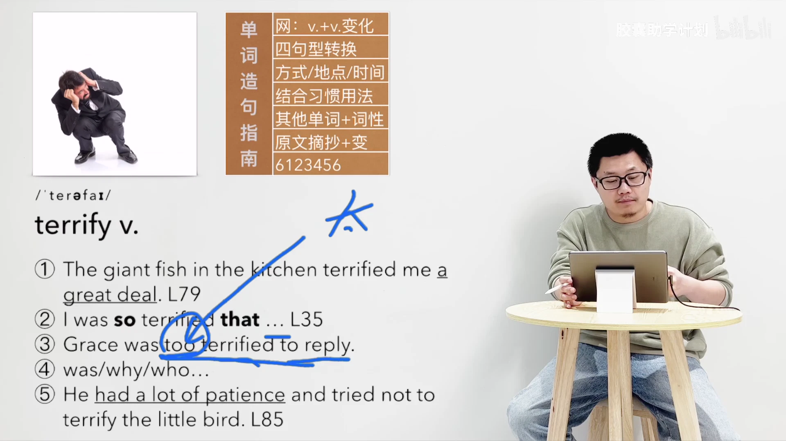

文字识别：单词造句指南 / 网：v.+v.变化 / 四句型转换 / 方式/地点/时间 / 结合习惯用法 / 其他单词+词性 / 原文摘抄+变 / 6123456 / /'terafar/ / terrify v. / ① The giant fish in the kitchen terrified me a / great deal. L79 / I was so terrifx / X that ... L35 / Grace wastoerrified to reply. / was/why/who... / He had a lot of patience and tried not to / terrify the little bird. L85

### 画面 00:06:20

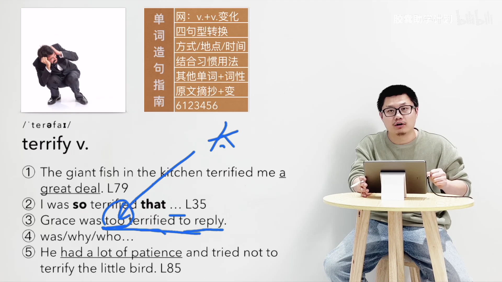

文字识别：单词造句指南 / 网：v.+v.变化 / 四句型转换 / 方式/地点/时间 / 结合习惯用法 / 其他单词+词性 / 原文摘抄+变 / 6123456 / /'terafar/ / terrify v. / ① The giant fish in the kitchen terrified me a / great deal. L79 / I was so terifthat ... L35 / Grace wastoerrified to reply. / was/why/who... / He had a lot of patience and tried not to / terrify the little bird. L85

### 画面 00:06:22

文字识别：I mean, I loved my father, / but I was terrified of him. / Frailty / (2001)

### 画面 00:06:28

文字识别：I mean, I loved my father, / but I was terrified of him. / Frailty / (2001)

## 00:06:30–00:07:00

was terrified of him. Okay. Next one,下一个单词 diver, diver, diver呢就潜水员啊. Dive是动词，做这件事儿的人加er，对吧？当然这儿不用加er，这儿直接加了个r啊，叫做 diver. Okay，潜水员，一个人跟 captain 没什么太大区别。潜水员 captain，啥都可以做。那我们造个句子，比如说 as a diver, I'm aware of the danger. You don't have to mention that to me every day. 啊，你不用每天就跟

### 画面 00:06:33

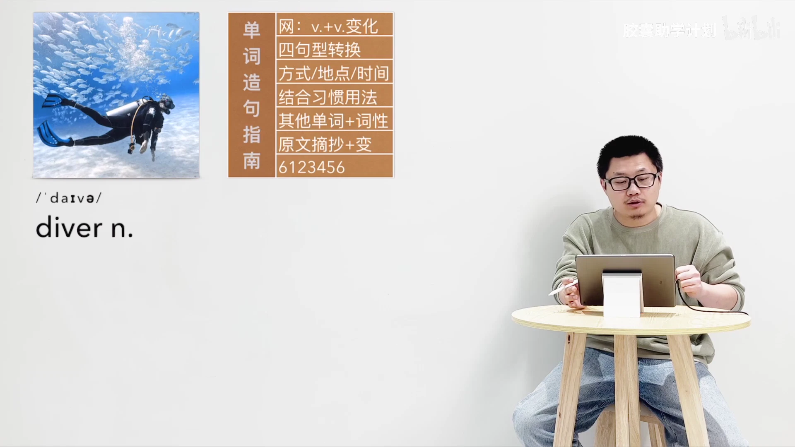

文字识别：单词造句指南 / 网：v.+v.变化 / 奏助字计划医 / 四句型转换 / 方式/地点/时间 / 结合习惯用法 / 其他单词+词性 / 原文摘抄+变 / 6123456 / /'daiva/ / diver n.

### 画面 00:06:35

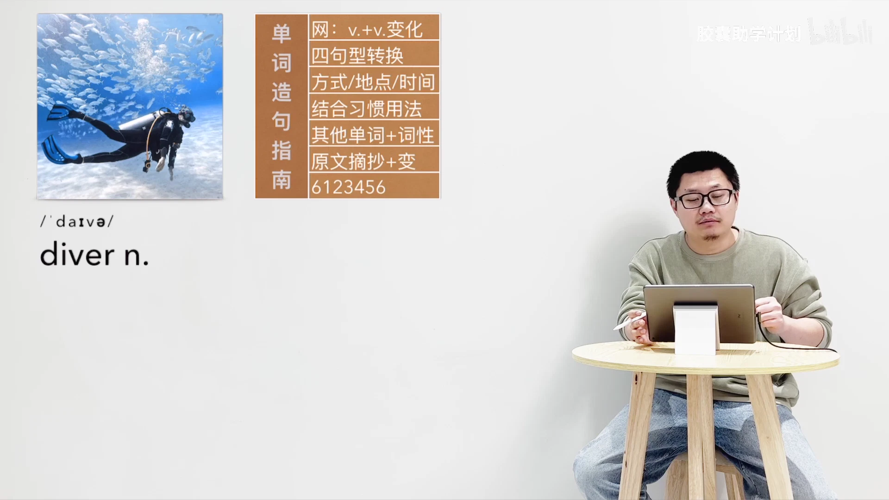

文字识别：单词造句指南 / 网：v.+v.变化 / 臺助字计划 / 四句型转换 / 方式/地点/时间 / 结合习惯用法 / 其他单词+词性 / 原文摘抄+变 / 6123456 / /'daiva/ / diver n.

### 画面 00:06:40

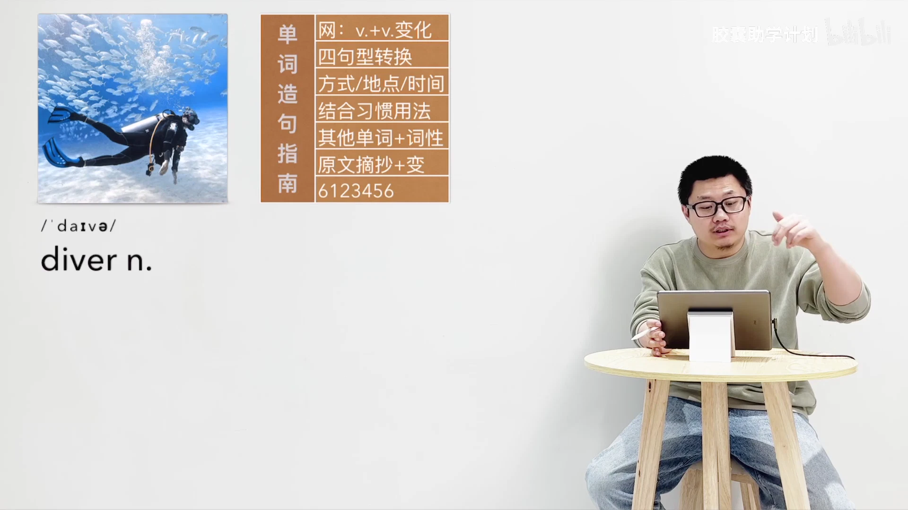

文字识别：单词造句指南 / 网：v.+v.变化 / 奏助字计划 / 四句型转换 / 方式/地点/时间 / 结合习惯用法 / 其他单词+词性 / 原文摘抄+变 / 6123456 / /'daiva/ / diver n.

### 画面 00:06:52

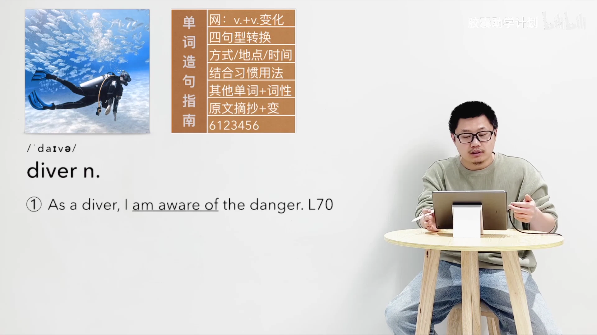

文字识别：单词造句指南 / 网：v.+v.变化 / 学计划 / 四句型转换 / 方式/地点/时间 / 结合习惯用法 / 其他单词+词性 / 原文摘抄+变 / 6123456 / /'daiva/ / diver n. / ① As a diver, I am aware of the danger. L70

### 画面 00:06:54

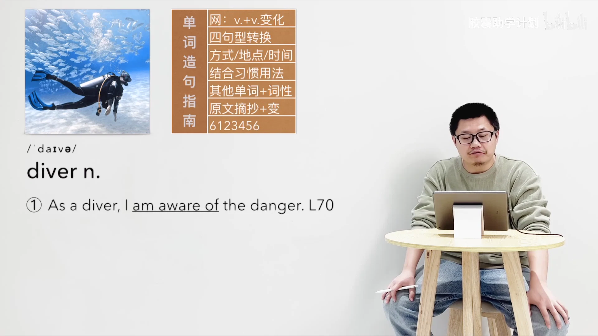

文字识别：单词造句指南 / 网：v.+v.变化 / 四句型转换 / 方式/地点/时间 / 结合习惯用法 / 其他单词+词性 / 原文摘抄+变 / 6123456 / /'daiva/ / diver n. / ① As a diver, I am aware of the danger. L70

### 画面 00:06:56

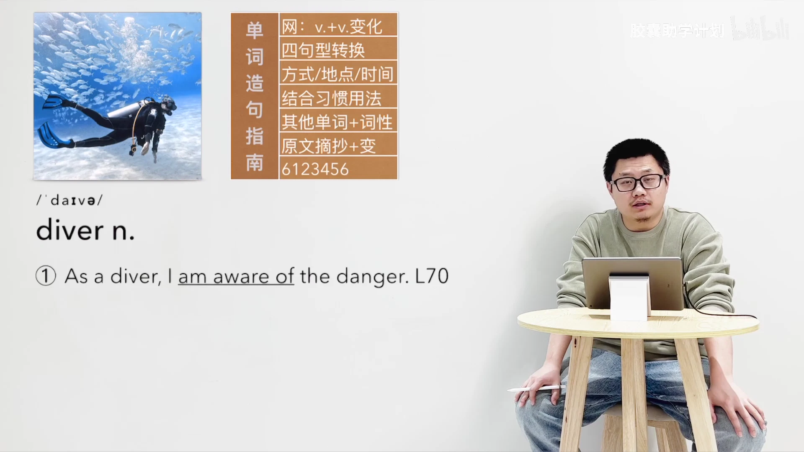

文字识别：单词造句指南 / 网：v.+v.变化 / 四句型转换 / 方式/地点/时间 / 结合习惯用法 / 其他单词+词性 / 原文摘抄+变 / 6123456 / /'daiva/ / diver n. / ① As a diver, I am aware of the danger. L70

### 画面 00:06:58

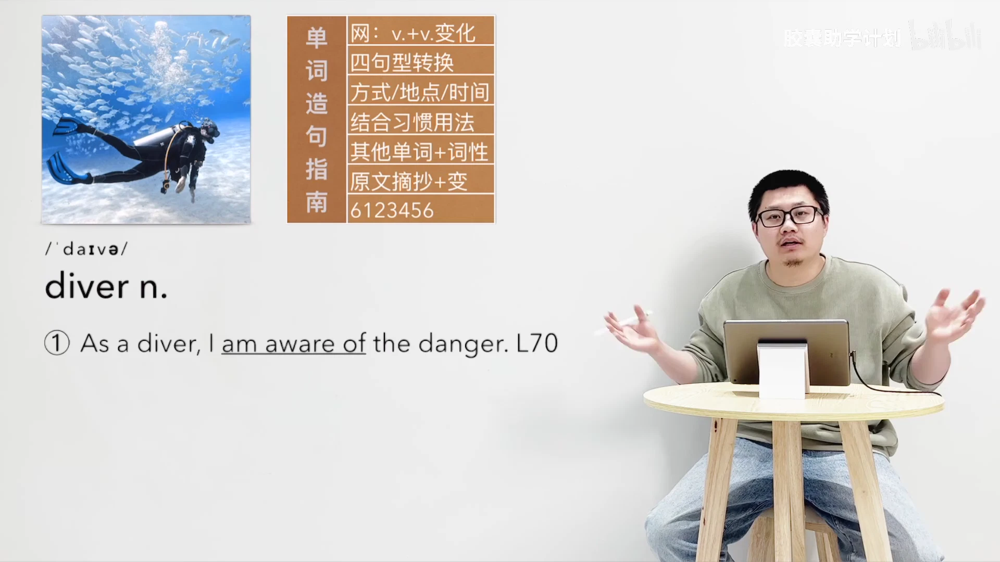

文字识别：单词造句指南 / 网：v.+v.变化 / 四句型转换 / 方式/地点/时间 / 结合习惯用法 / 其他单词+词性 / 原文摘抄+变 / 6123456 / /'daiva/ / diver n. / ① As a diver, I am aware of the danger. L70

## 00:07:00–00:07:30

every day about this. As a diver, I know what kind of danger he is in, right? Be aware of, ah, clear, understand, similar to I know. Next one repeated after me. Say, everybody was relieved to hear that all the divers were safe. Everyone heard the news and breathed a sigh of relief. What news? All the divers were safe. Next one. The diver knocked the fisher to the ground. The two guys got into a fight, right? The diver, right? The diver, right? The diver, right? The diver, right? The diver, right? The diver, right? The diver, right? The diver, right? The diver, right? The diver, right? The diver, right? The diver, right? The diver, right?

### 画面 00:07:01

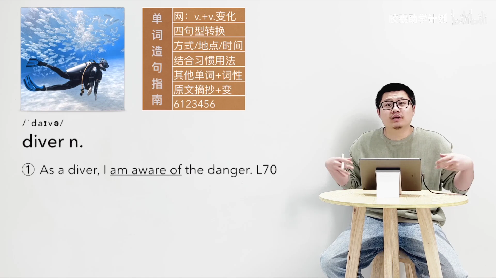

文字识别：单词造句指南 / 网：v.+v.变化 / 四句型转换 / 方式/地点/时间 / 结合习惯用法 / 其他单词+词性 / 原文摘抄+变 / 6123456 / /'daiva/ / diver n. / ① As a diver, I am aware of the danger. L70

### 画面 00:07:06

文字识别：单词造句指南 / 网：v.+v.变化 / 四句型转换 / 方式/地点/时间 / 结合习惯用法 / 其他单词+词性 / 原文摘抄+变 / 6123456 / /'daiva/ / diver n. / ① As a diver, I am aware of the danger. L70 / Everybody was relieved to hear that all the / divers were safe. L84

### 画面 00:07:08

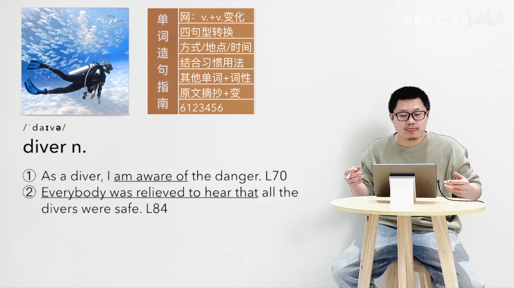

文字识别：单词造句指南 / 网：v.+v.变化 / 四句型转换 / 方式/地点/时间 / 结合习惯用法 / 其他单词+词性 / 原文摘抄+变 / 6123456 / /'daiva/ / diver n. / ① As a diver, I am aware of the danger. L70 / Everybody was relieved to hear that all the / divers were safe. L84

### 画面 00:07:10

文字识别：单词造句指南 / 网：v.+v.变化 / 四句型转换 / 方式/地点/时间 / 结合习惯用法 / 其他单词+词性 / 原文摘抄+变 / 6123456 / /'daiva/ / diver n. / ① As a diver, I am aware of the danger. L70 / Everybody was relieved to hear that all the / divers were safe. L84

### 画面 00:07:15

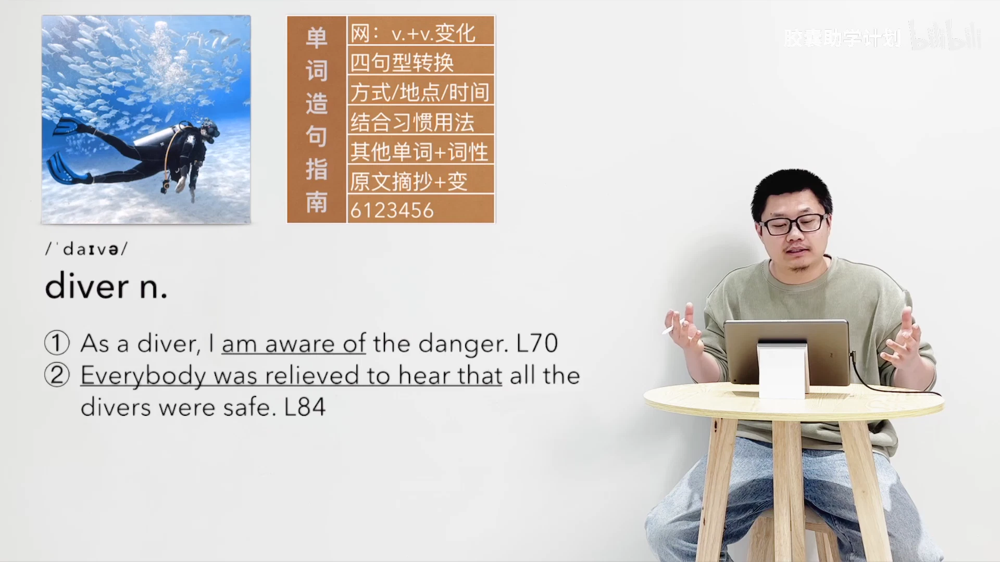

文字识别：单词造句指南 / 网：v.+v.变化 / 四句型转换 / 方式/地点/时间 / 结合习惯用法 / 其他单词+词性 / 原文摘抄+变 / 6123456 / /'daiva/ / diver n. / ① As a diver, I am aware of the danger. L70 / Everybody was relieved to hear that all the / divers were safe. L84

### 画面 00:07:18

文字识别：单词造句指南 / 网：v.+v.变化 / 四句型转换 / 方式/地点/时间 / 结合习惯用法 / 其他单词+词性 / 原文摘抄+变 / 6123456 / /'daiva/ / diver n. / ① As a diver, I am aware of the danger. L70 / Everybody was relieved to hear that all the / divers Were safe. L84

### 画面 00:07:20

文字识别：单词造句指南 / 网：v.+v.变化 / 四句型转换 / 方式/地点/时间 / 结合习惯用法 / 其他单词+词性 / 原文摘抄+变 / 6123456 / /'daiva/ / diver n. / ① As a diver, I am aware of the danger. L70 / Everybody was relieved to hear that all the / divers were safe. L84

### 画面 00:07:22

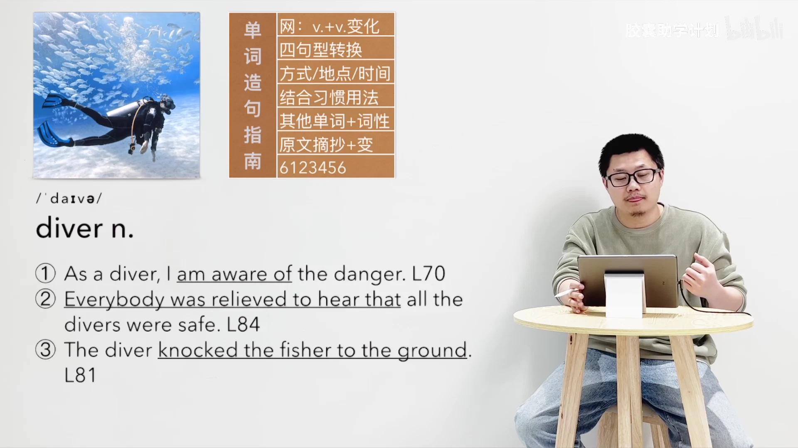

文字识别：单词造句指南 / 网：v.+v.变化 / 四句型转换 / 方式/地点/时间 / 结合习惯用法 / 其他单词+词性 / 原文摘抄+变 / 6123456 / /'daiva/ / diver n. / ① As a diver, I am aware of the danger. L70 / ) Everybody was relieved to hear that all the / divers were safe. L84 / The diver knocked the fisher to the ground. / L81

### 画面 00:07:25

文字识别：单词造句指南 / 网：v.+v.变化 / 四句型转换 / 方式/地点/时间 / 结合习惯用法 / 其他单词+词性 / 原文摘抄+变 / 6123456 / /'daiva/ / diver n. / ① As a diver, I am aware of the danger. L70 / ) Everybody was relieved to hear that all the / divers were safe. L84 / The diver knocked the fisher to the ground. / L81

## 00:07:30–00:08:00

潜着，水突然间被这个渔夫给钓上去了，是吧？鱼钩钩上了，是吧？然后呢，上来两个人发生了口角，然后 diver 做了一件事，叫 knock the fisher to the ground。咱们之前学的叫做一拳把他撂倒在地啊，干翻在地，对吧？Okay, knock the fisher to the ground。再读一遍这个单词 diver。下面，呃，两个单词合在一起去记，或者你单独可以先记一个前面的叫 oil，叫原油石油，对吧？

### 画面 00:07:35

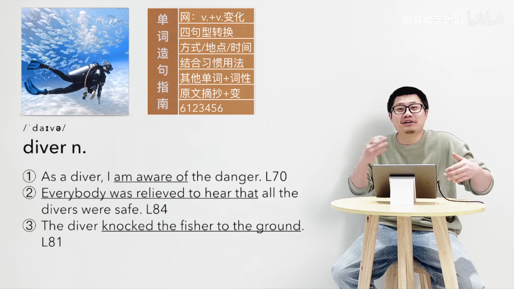

文字识别：单词造句指南 / 网：v.+v.变化 / 四句型转换 / 方式/地点/时间 / 结合习惯用法 / 其他单词+词性 / 原文摘抄+变 / 6123456 / /'daiva/ / diver n. / ① As a diver, I am aware of the danger. L70 / ) Everybody was relieved to hear that all the / divers were safe. L84 / The diver knocked the fisher to the ground. / L81

### 画面 00:07:42

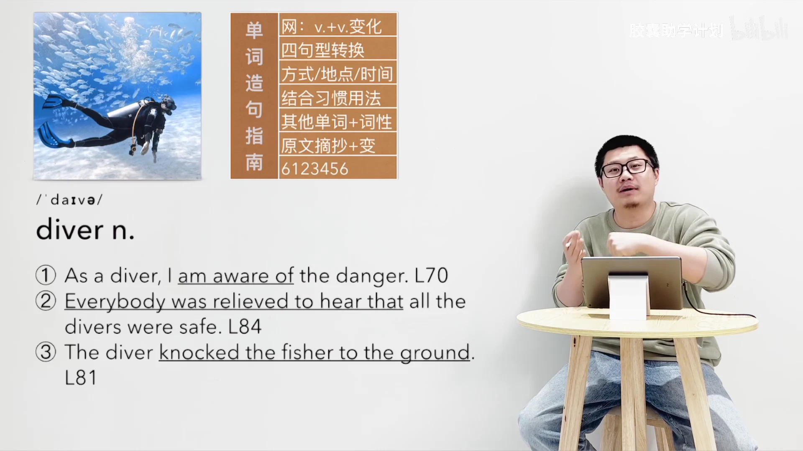

文字识别：单词造句指南 / 网：v.+v.变化 / 四句型转换 / 方式/地点/时间 / 结合习惯用法 / 其他单词+词性 / 原文摘抄+变 / 6123456 / /'daiva/ / diver n. / ① As a diver, I am aware of the danger. L70 / ) Everybody was relieved to hear that all the / divers were safe. L84 / The diver knocked the fisher to the ground. / L81

### 画面 00:07:45

文字识别：单词造句指南 / 网：v.+v.变化 / 四句型转换 / 方式/地点/时间 / 结合习惯用法 / 其他单词+词性 / 原文摘抄+变 / 6123456 / /'daiva/ / diver n. / ① As a diver, I am aware of the danger. L70 / ) Everybody was relieved to hear that all the / divers were safe. L84 / The diver knocked the fisher to the ground. / L81

### 画面 00:07:50

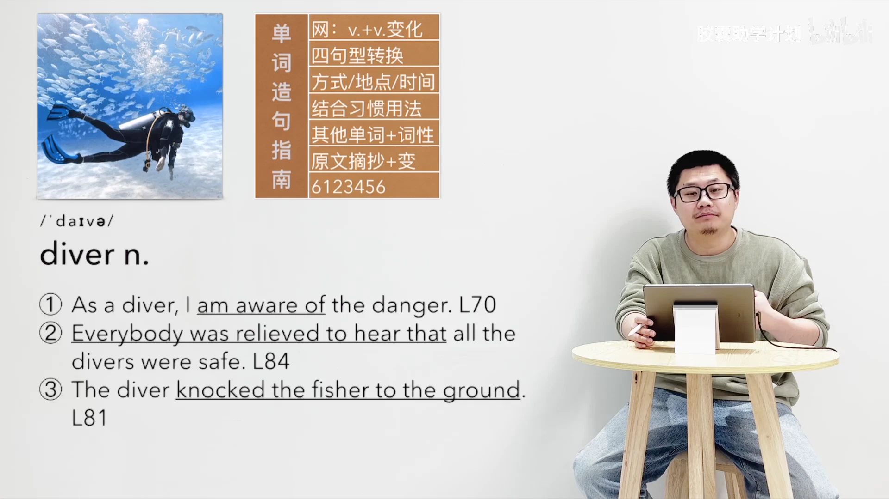

文字识别：单词造句指南 / 网：v.+v.变化 / 四句型转换 / 方式/地点/时间 / 结合习惯用法 / 其他单词+词性 / 原文摘抄+变 / 6123456 / /'daiva/ / diver n. / ① As a diver, I am aware of the danger. L70 / Everybody was relieved to hear that all the / divers were safe. L84 / The diver knocked the fisher to the ground. / L81

### 画面 00:07:52

文字识别：单词造句指南 / 网：v.+v.变化 / 嘉助子计划 / 四句型转换 / 方式/地点/时间 / 结合习惯用法 / 其他单词+词性 / 原文摘抄+变 / 6123456 / /o1l/ /rig/ / oil rig

### 画面 00:07:56

文字识别：单词造句指南 / 网：v.+v.变化 / 辜助子讨划 / 四句型转换 / 方式/地点/时间 / 结合习惯用法 / 其他单词+词性 / 原文摘抄+变 / 6123456 / /o1l/ /rig/ / oilrig

## 00:08:00–00:08:30

那 oil rig 就是我们这种海上的钻井平台，叫 oil rig 啊。本课单独出现了一次。那 oil rig 实际上你想，呃，六一二三四五六当中，我们现在想去造句，要观察这个点，那就是一三五对吧？啊，还有很多同学不停的在有，至少有一一部，有一点点很少一部分同学在问六一二三四五六到底是个啥？你第一课语法认真学完了之后不就知道了吗？对吧？你去看一下第一课语法嘛。到学到这课了还

### 画面 00:08:00

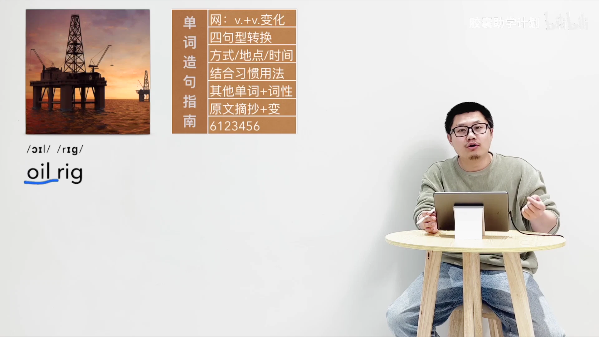

文字识别：单词造句指南 / 网：v.+v.变化 / 四句型转换 / 方式/地点/时间 / 结合习惯用法 / 其他单词+词性 / 原文摘抄+变 / 6123456 / /oil/ /rig/ / oil rig

### 画面 00:08:03

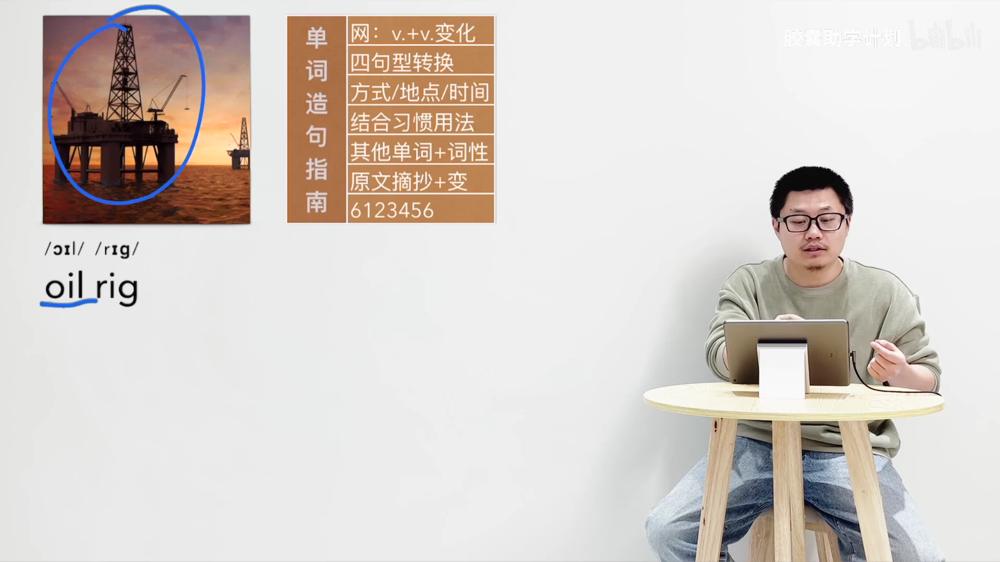

文字识别：单词造句指南 / 网：v.+v.变化 / 臺助字计划 / 四句型转换 / 方式/地点/时间 / 结合习惯用法 / 其他单词+词性 / 原文摘抄+变 / 6123456 / /oil/ /rig/ / oil rig

### 画面 00:08:05

文字识别：单词造句指南 / 网：v.+v.变化 / 喜助字计划 / 四句型转换 / 方式/地点/时间 / 结合习惯用法 / 其他单词+词性 / 原文摘抄+变 / 6123456 / /o1l/ /rig/ / oil rig

### 画面 00:08:07

文字识别：单词造句指南 / 网：v.+v.变化 / 四句型转换 / 方式/地点/时间 / 结合习惯用法 / 其他单词+词性 / 原文摘抄+变 / 6123456 / /oxl/ /rig/ / oil rig / ① You should have accepted / the work on the oil rig. L65

### 画面 00:08:09

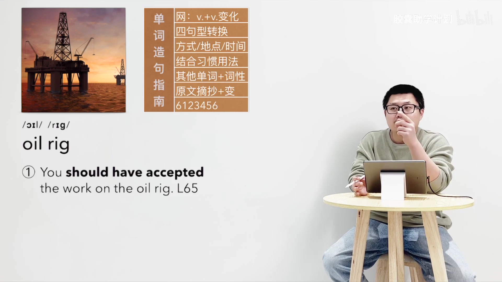

文字识别：单词造句指南 / 网：v.+v.变化 / 四句型转换 / 方式/地点/时间 / 结合习惯用法 / 其他单词+词性 / 原文摘抄+变 / 6123456 / /o1l/ /rig/ / oil rig / ① You should have accepted / the work on the oil rig. L65

### 画面 00:08:11

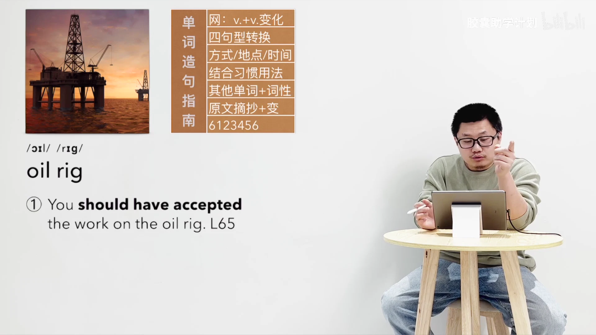

文字识别：单词造句指南 / 网：v.+v.变化 / 辜助字计划 / 四句型转换 / 方式/地点/时间 / 结合习惯用法 / 其他单词+词性 / 原文摘抄+变 / 6123456 / /oxl/ /rig/ / oil rig / ① You should have accepted / the work on the oil rig. L65

### 画面 00:08:13

文字识别：单词造句指南 / 网：v.+v.变化 / 妻助学计划 / 四句型转换 / 方式/地点/时间 / 结合习惯用法 / 其他单词+词性 / 原文摘抄+变 / 6123456 / /oxl/ /rig/ / oil rig / ① You should have accepted / the work on the oil rig. L65

### 画面 00:08:16

文字识别：单词造句指南 / 网：v.+v.变化 / 四句型转换 / 方式/地点/时间 / 结合习惯用法 / 其他单词+词性 / 原文摘抄+变 / 6123456 / /o1l/ /rig/ / oil rig / ① You should have accepted / the work on the oil rig. L65

### 画面 00:08:21

文字识别：单词造句指南 / 网：v.+v.变化 / 四句型转换 / 方式/地点/时间 / 结合习惯用法 / 其他单词+词性 / 原文摘抄+变 / 6123456 / /o1l/ /rig/ / oil rig / ① You should have accepted / the work on the oil rig. L65

### 画面 00:08:25

文字识别：单词造句指南 / 网：v.+v.变化 / 学计划 / 四句型转换 / 方式/地点/时间 / 结合习惯用法 / 其他单词+词性 / 原文摘抄+变 / 6123456 / /o1l/ /rig/ / oil rig / ① You should have accepted / the work on the oil rig. L65

## 00:08:30–00:09:00

不知道，也是够神奇了啊！说 you should have accepted the work on the oil rig. 那你看这里说你本应该接受这个在 oil rig 上的工作，对吧？在这个钻井平海上钻井平台上的工作，多好，肥差啊，给的钱多啊，等等等等。所以 if you find a work on the oil rig, we wouldn't meet each other. 注意，你看啊，if find wouldn't meet 四十克虚拟语气。如果你在那儿工作了，咱就遇不到彼

### 画面 00:08:40

文字识别：单词造句指南 / 网：v.+v.变化 / 四句型转换 / 方式/地点/时间 / 结合习惯用法 / 其他单词+词性 / 原文摘抄+变 / 6123456 / /o1l/ /rig/ / oil rig / ① You should have accepted / the work on the oil rig. L65

### 画面 00:08:45

文字识别：单词造句指南 / 网：v.+v.变化 / 子计划 / 四句型转换 / 方式/地点/时间 / 结合习惯用法 / 其他单词+词性 / 原文摘抄+变 / 6123456 / /o1l/ /rig/ / oil rig / ① You should have accepted / the work on the oil rig. L65 / If you found a work on the oil rig, we / wouldn't meet each other. L40

### 画面 00:08:48

文字识别：单词造句指南 / 网：v.+v.变化 / 四句型转换 / 方式/地点/时间 / 结合习惯用法 / 其他单词+词性 / 原文摘抄+变 / 6123456 / /o1l/ /rig/ / oil rig / ① You should have accepted / the work on the oil rig. L65 / If you found a work on the oil rig, we / wouldn't meet each other. L40

### 画面 00:08:50

文字识别：单词造句指南 / 网：v.+v.变化 / 四句型转换 / 方式/地点/时间 / 结合习惯用法 / 其他单词+词性 / 原文摘抄+变 / 6123456 / /o1l/ /rig/ / oil rig / ① You should have accepted / the work on the oil rig. L65 / If you found a work on the oil rig, we / wouldn't meet each other. L40

### 画面 00:08:55

文字识别：单词造句指南 / 网：v.+v.变化 / 学计划 / 四句型转换 / 方式/地点/时间 / 结合习惯用法 / 其他单词+词性 / 原文摘抄+变 / 6123456 / /o1l/ /rig/ / oil rig / ① You should have accepted / the work on the oil rig. L65 / If you found a work on the oil rig, we / wouldn't meet each other. L40

### 画面 00:08:57

文字识别：单词造句指南 / 网：v.+v.变化 / 四句型转换 / 方式/地点/时间 / 结合习惯用法 / 其他单词+词性 / 原文摘抄+变 / 6123456 / /o1l/ /rig/ / oil rig / ① You should have accepted / the work on the oil rig. L65 / If you found a work on the oil rig, we / wouldn't meet each other. L40

## 00:09:00–00:09:30

此了，就没有接下来这一段佳话了，对吧？Okay, next one. It is said that he jumped off the oil rig last month.哎呀，据说呀，公司咱公司那个谁谁谁，对吧？从这个钻井平台上跳下去了。上个月啊，有这么个人，反正说跳下去了啊。It is said that.据注意，据说没有什么啊，根据啊，传传瞎话也可以用。It is said that，对吧？Next one，

### 画面 00:09:00

文字识别：单词造句指南 / 网：v.+v.变化 / 四句型转换 / 方式/地点/时间 / 结合习惯用法 / 其他单词+词性 / 原文摘抄+变 / 6123456 / /o1l/ /rig/ / oil rig / ① You should have accepted / the work on the oil rig. L65 / If you found a work on the oil rig, we / wouldn't meet each other. L40

### 画面 00:09:03

文字识别：单词造句指南 / 网：v.+v.变化 / 字计划 / 四句型转换 / 方式/地点/时间 / 结合习惯用法 / 其他单词+词性 / 原文摘抄+变 / 6123456 / /o1l/ /rig/ / oil rig / ① You should have accepted / the work on the oil rig. L65 / If you found a work on the oil rig, we / wouldn't meet each other. L40 / It is said that he jumped off the oil rig last / month.L58

### 画面 00:09:05

文字识别：单词造句指南 / 网：v.+v.变化 / 学计划 / 四句型转换 / 方式/地点/时间 / 结合习惯用法 / 其他单词+词性 / 原文摘抄+变 / 6123456 / /o1l/ /rig/ / oil rig / ① You should have accepted / the work on the oil rig. L65 / If you found a work on the oil rig, we / wouldn't meet each other. L40 / It is said that he jumped off the oil rig last / month.L58

### 画面 00:09:13

文字识别：单词造句指南 / 网：v.+v.变化 / 学计划 / 四句型转换 / 方式/地点/时间 / 结合习惯用法 / 其他单词+词性 / 原文摘抄+变 / 6123456 / /o1l/ /rig/ / oil rig / ① You should have accepted / the work on the oil rig. L65 / If you found a work on the oil rig, we / wouldn't meet each other. L40 / Itis said that he jumped off the oil rig last / month.L58

### 画面 00:09:15

文字识别：单词造句指南 / 网：v.+v.变化 / 四句型转换 / 方式/地点/时间 / 结合习惯用法 / 其他单词+词性 / 原文摘抄+变 / 6123456 / /o1l/ /rig/ / oil rig / ① You should have accepted / the work on the oil rig. L65 / If you found a work on the oil rig, we / wouldn't meet each other. L40 / It is said that he jumped off the oil rig last / month.L58

### 画面 00:09:24

文字识别：单词造句指南 / 网：v.+v.变化 / 学计划 / 四句型转换 / 方式/地点/时间 / 结合习惯用法 / 其他单词+词性 / 原文摘抄+变 / 6123456 / /o1l/ /rig/ / oil rig / ① You should have accepted / the work on the oil rig. L65 / If you found a work on the oil rig, we / wouldn't meet each other. L40 / It is said that he jumped off the oil rig last / month.L58

### 画面 00:09:29

文字识别：单词造句指南 / 网：v.+v.变化 / 辜助字计划 / 四句型转换 / 方式/地点/时间 / 结合习惯用法 / 其他单词+词性 / 原文摘抄+变 / 6123456 / /wIt/ / wit

## 00:09:30–00:10:00

下一个单词, weight, weight啊，理智啊，理智尚存的那个理智啊。那它这个地方呢，就可以经常用到的一个小的短语叫 be scared or be frightened out of somebody's weight。所以这里面有两个点，第一个是 scared, frightened，怎么翻译？就是吓，被吓着了啊。然后 out of somebody's weight 就从某人的理智当中吓出来了啊，就吓得丧失理智了，就突然吓一跳，丧失理智了，都是吧？

### 画面 00:09:31

文字识别：单词造句指南 / 网：v.+v.变化 / 囊助学计划 / 四句型转换 / 方式/地点/时间 / 结合习惯用法 / 其他单词+词性 / 原文摘抄+变 / 6123456 / /wIt/ / wit

### 画面 00:09:36

文字识别：单词造句指南 / 网：v.+v.变化 / 四句型转换 / 方式/地点/时间 / 结合习惯用法 / 其他单词+词性 / 原文摘抄+变 / 6123456 / /wIt/ / wit / ① be scared/frightened out of sb's wits ...

### 画面 00:09:40

文字识别：单词造句指南 / 网：v.+v.变化 / 建助字计划 / 四句型转换 / 方式/地点/时间 / 结合习惯用法 / 其他单词+词性 / 原文摘抄+变 / 6123456 / /wIt/ / wit / ① be scared/frightened out of sb's wits ...

### 画面 00:09:59

文字识别：单词造句指南 / 网：v.+v.变化 / 四句型转换 / 方式/地点/时间 / 结合习惯用法 / 其他单词+词性 / 原文摘抄+变 / 6123456 / /wit/ / wit / ① be scared/frightened out of sb's wits ... / ② I'd be scared out of my wits if I were you. / L40

## 00:10:00–00:10:30

比如说，I'd be scared out of my wits if I were you.如果我是你的话，那我都得吓得丧失理智了。大晚上，对吧？突然间遇到几个歹徒，你还能那么就镇定自若，对吧？哎，然后口若悬河的把他们给怎么样？哎，轰走了，这个忽悠走了啊啊！当然，口若悬河不能这么用啊。然后，I'd be scared out of my wits if I were you.如果我是你，我就怎么怎么样了？虚拟语气。Next one is

### 画面 00:10:03

文字识别：单词造句指南 / 网：v.+v.变化 / 四句型转换 / 方式/地点/时间 / 结合习惯用法 / 其他单词+词性 / 原文摘抄+变 / 6123456 / /wIt/ / wit / ① be scared/frightened out of sb's wits ... /  I'd be scared out of my wits if I were you. / L40

### 画面 00:10:06

文字识别：单词造句指南 / 网：v.+v.变化 / 辜助学计划 / 四句型转换 / 方式/地点/时间 / 结合习惯用法 / 其他单词+词性 / 原文摘抄+变 / 6123456 / /wIt/ / wit / ① be scared/frightened out of sb's wits ... / ② I'd be scared out of my wits if I were you. / L40

### 画面 00:10:17

文字识别：单词造句指南 / 网：v.+v.变化 / 四句型转换 / 方式/地点/时间 / 结合习惯用法 / 其他单词+词性 / 原文摘抄+变 / 6123456 / /wIt/ / wit / ① be scared/frightened out of sb's wits ... /  I'd be scared out of my wits if I were you. / L40

### 画面 00:10:21

文字识别：单词造句指南 / 网：v.+v.变化 / 学计划 / 四句型转换 / 方式/地点/时间 / 结合习惯用法 / 其他单词+词性 / 原文摘抄+变 / 6123456 / /wIt/ / wit / ① be scared/frightened out of sb's wits ... / ② I'd be scared out of my wits if I were you. / L40

### 画面 00:10:27

文字识别：单词造句指南 / 网：v.+v.变化 / 囊助字计划 / 四句型转换 / 方式/地点/时间 / 结合习惯用法 / 其他单词+词性 / 原文摘抄+变 / 6123456 / /wIt/ / wit / ① be scared/frightened out of sb's wits ... /  I'd be scared out of my wits if I were you. / L40

### 画面 00:10:29

文字识别：单词造句指南 / 网：v.+v.变化 / 四句型转换 / 方式/地点/时间 / 结合习惯用法 / 其他单词+词性 / 原文摘抄+变 / 6123456 / /wIt/ / wit / ① be scared/frightened out of sb's wits ... / ② I'd be scared out of my wits if I were you. / L40 / If I had seen a ghost at your age, I would / have been scared out of my wits. Beetlejuice / (1988) L64

## 00:10:30–00:11:00

if I had seen a ghost at your age, I would have been scared out of my wits.说如果我呀在你这个年龄看到个鬼，那我得把自己吓得丧失理智了. Would have been.啊，这是电影当中的一个片段，对吧？那他用到的也是六十四克的虚拟语气啊. Okay,好.呃，注意力集中，咱听听这个电影片段啊. All right, I was frightened out of my wits most of the time, but I knew I had to do it.

### 画面 00:10:32

文字识别：单词造句指南 / 网：v.+v.变化 / 四句型转换 / 方式/地点/时间 / 结合习惯用法 / 其他单词+词性 / 原文摘抄+变 / 6123456 / /wIt/ / wit / ① be scared/frightened out of sb's wits ... / ② I'd be scared out of my wits if I were you. / L40 / If I had seen a ghost at your age, I would / have been scared out of my wits. Beetlejuice / (1988) L64

### 画面 00:10:38

文字识别：单词造句指南 / 网：v.+v.变化 / 四句型转换 / 方式/地点/时间 / 结合习惯用法 / 其他单词+词性 / 原文摘抄+变 / 6123456 / /wIt/ / wit / ① be scared/frightened out of sb's wits ... / ② I'd be scared out of my wits if I were you. / L40 / If I had seen a ghost at your age, I would / have been scared out of my wits. Beetlejuice / (1988) L64

### 画面 00:10:45

文字识别：单词造句指南 / 网：v.+v.变化 / 四句型转换 / 方式/地点/时间 / 结合习惯用法 / 其他单词+词性 / 原文摘抄+变 / 6123456 / /wIt/ / wit / ① be scared/frightened out of sb's wits ... / ② I'd be scared out of my wits if I were you. / L40 / If I had seen a ghost at your age, I would / have been scared out of my wits. Beetlejuice / (1988) L64

### 画面 00:10:50

文字识别：Alright, I was frightened out of my wits / most of the time but I knew I had to do it. / Red Joan / (2018)

### 画面 00:10:53

文字识别：Alright, I was frightened out of my wits / most of the time but I knew I had to do it. / Red Joan / (2018)

### 画面 00:10:55

文字识别：Alright, I was frightened out of my wits / most of the time but I knew I had to do it. / Red Joan / (2018)

### 画面 00:10:57

文字识别：Alright, I was frightened out of my wits / most of the time but I knew I had to do it. / Red Joan / (2018)

### 画面 00:10:59

文字识别：Alright, I was frightened out of my wits / most of the time but I knew I had to do it. / Red Joan / (2018)

## 00:11:00–00:11:30

good. 没什么可说的。下一个单词 cage，啊，鸟笼子、猫笼子、各种各样的笼子、狗笼子，对吧？哎，笼子 cage， very good。那读一下，说 There is a beautiful bird in the cage。新概念一册二十五课的句型，太简单了。 Next one， the beautiful bird in the cage was bought by my grandfather。这句话也不难啊。首先 was bought 一般过去时被动，其次 in the cage 后置做定语，修饰这个 bird，对吧？

### 画面 00:11:01

文字识别：单词造句指南 / 网：v.+v.变化 / 囊助学计划 / 四句型转换 / 方式/地点/时间 / 结合习惯用法 / 其他单词+词性 / 原文摘抄+变 / 6123456 / /keid3/ / cage n.

### 画面 00:11:05

文字识别：单词造句指南 / 网：v.+v.变化 / 囊助字计划 / 四句型转换 / 方式/地点/时间 / 结合习惯用法 / 其他单词+词性 / 原文摘抄+变 / 6123456 / /keid3/ / cage n.

### 画面 00:11:11

文字识别：单词造句指南 / 网：v.+v.变化 / 囊助字计划 / 四句型转换 / 方式/地点/时间 / 结合习惯用法 / 其他单词+词性 / 原文摘抄+变 / 6123456 / /keid3/ / cage n. /  There is a beautiful bird in the cage.

### 画面 00:11:16

文字识别：单词造句指南 / 网：v.+v.变化 / 喜助学计划 / 四句型转换 / 方式/地点/时间 / 结合习惯用法 / 其他单词+词性 / 原文摘抄+变 / 6123456 / /keid3/ / cage n. / ① There is a beautiful bird in the cage. / The beautiful bird in the cage was bought / by my grandfather. L10

### 画面 00:11:20

文字识别：单词造句指南 / 网：v.+v.变化 / 囊助学计划 / 四句型转换 / 方式/地点/时间 / 结合习惯用法 / 其他单词+词性 / 原文摘抄+变 / 6123456 / /keid3/ / cage n. / ① There is a beautiful bird in the cage. / The beautiful bird in the cage was bought / by my grandfather. L10

## 00:11:30–00:12:00

Next one, repeat after me. The kid noticed with dismay that the birds were not in the cage. 好了，你看，注意啊，其实，在这个地方， something was not in a were not in the cage，很容易理解，对吧？这个是一个一般过去时的呃主动，然后我们结合了一个之前学过的习惯用法，对吧？结合了之前学过的习惯用法，叫 notice with dismay that，啊，这个很沮丧的意识到，这鸟怎么就不

### 画面 00:11:30

文字识别：单词造句指南 / 网：v.+v.变化 / 子计划 / 四句型转换 / 方式/地点/时间 / 结合习惯用法 / 其他单词+词性 / 原文摘抄+变 / 6123456 / /keid3/ / cage n. / ① There is a beautiful bird in the cage. / The beautiful bird in the cage was bought / by my grandfather. L10 / The kid noticed with dismay that the birds / were not in the cage. L86

### 画面 00:11:33

文字识别：单词造句指南 / 网：v.+v.变化 / 子计划 / 四句型转换 / 方式/地点/时间 / 结合习惯用法 / 其他单词+词性 / 原文摘抄+变 / 6123456 / /keid3/ / cage n. / ① There is a beautiful bird in the cage. / The beautiful bird in the cage was bought / by my grandfather. L10 / The kid noticed with dismay that the birds / were not in the cage. L86

### 画面 00:11:36

文字识别：单词造句指南 / 网：v.+v.变化 / 字计划 / 四句型转换 / 方式/地点/时间 / 结合习惯用法 / 其他单词+词性 / 原文摘抄+变 / 6123456 / /keid3/ / cage n. / ① There is a beautiful bird in the cage. / The beautiful bird in the cage was bought / by my grandfather. L10 / The kid noticed with dismay that the birds / were not in the cage. L86

### 画面 00:11:51

文字识别：单词造句指南 / 网：v.+v.变化 / 奏助学计划 / 四句型转换 / 方式/地点/时间 / 结合习惯用法 / 其他单词+词性 / 原文摘抄+变 / 6123456 / /keid3/ / cage n. / ① There is a beautiful bird in the cage. / The beautiful bird in the cage was bought / by my grandfather. L10 / The kid noticed with dismay that the birds / were not in the cage. L86

### 画面 00:11:54

文字识别：单词造句指南 / 网：v.+v.变化 / 子计划 / 四句型转换 / 方式/地点/时间 / 结合习惯用法 / 其他单词+词性 / 原文摘抄+变 / 6123456 / /keid3/ / cage n. / ① There is a beautiful bird in the cage. / The beautiful bird in the cage was bought / by my grandfather. L10 / The kid noticed with dismay that the birds / were not in the cage. L86

### 画面 00:11:56

文字识别：单词造句指南 / 网：v.+v.变化 / 计划 / 四句型转换 / 方式/地点/时间 / 结合习惯用法 / 其他单词+词性 / 原文摘抄+变 / 6123456 / /keid3/ / cage n. / ① There is a beautiful bird in the cage. / The beautiful bird in the cage was bought / by my grandfather. L10 / The kid noticed with dismay that the birds / were not in the cage. L86

## 00:12:00–00:12:30

在笼子里跑了呢？OK，再读一遍这个单词，cage。下一个单词跟我一起读一下，叫shark，shark，鲨鱼啊。其实shark我们不用单独造句了，但我随便造了几个，就当复习了。您张嘴跟我读一遍就结束了啊。来，When he finally saw a real shark, he felt disappointed.啊，首先注意shark是名词，你肯定找动词嘛，对吧？哎，找各种各样的其他的单词，结合

### 画面 00:12:00

文字识别：单词造句指南 / 网：v.+v.变化 / 子计划 / 四句型转换 / 方式/地点/时间 / 结合习惯用法 / 其他单词+词性 / 原文摘抄+变 / 6123456 / /keid3/ / cage n. / ① There is a beautiful bird in the cage. / The beautiful bird in the cage was bought / by my grandfather. L10 / The kid noticed with dismay that the birds / were not in the cage. L86

### 画面 00:12:03

文字识别：单词造句指南 / 网：v.+v.变化 / 计划 / 四句型转换 / 方式/地点/时间 / 结合习惯用法 / 其他单词+词性 / 原文摘抄+变 / 6123456 / /keid3/ / cage n. / ① There is a beautiful bird in the cage. / The beautiful bird in the cage was bought / by my grandfather. L10 / The kid noticed with dismay that the birds / were not in the cage. L86

### 画面 00:12:05

文字识别：单词造句指南 / 网：v.+v.变化 / 妻助学计划 / 四句型转换 / 方式/地点/时间 / 结合习惯用法 / 其他单词+词性 / 原文摘抄+变 / 6123456 / /∫a:k/ / shark n.

### 画面 00:12:10

文字识别：单词造句指南 / 网：v.+v.变化 / 妻助学计划 / 四句型转换 / 方式/地点/时间 / 结合习惯用法 / 其他单词+词性 / 原文摘抄+变 / 6123456 / / ∫a:k/ / shark n.

### 画面 00:12:12

文字识别：单词造句指南 / 网：v.+v.变化 / 四句型转换 / 方式/地点/时间 / 结合习惯用法 / 其他单词+词性 / 原文摘抄+变 / 6123456 / / ∫a:k/ / shark n. / ① When he finally saw a real shark, he felt / disappointed. L89

### 画面 00:12:15

文字识别：单词造句指南 / 网：v.+v.变化 / 四句型转换 / 方式/地点/时间 / 结合习惯用法 / 其他单词+词性 / 原文摘抄+变 / 6123456 / / ∫a:k/ / shark n. / ① When he finally saw a real shark, he felt / disappointed. L89

### 画面 00:12:20

文字识别：单词造句指南 / 网：v.+v.变化 / 四句型转换 / 方式/地点/时间 / 结合习惯用法 / 其他单词+词性 / 原文摘抄+变 / 6123456 / / ∫a:k/ / shark n. / ① When he finally saw a real shark, he felt / disappointed. L89

### 画面 00:12:25

文字识别：单词造句指南 / 网：v.+v.变化 / 四句型转换 / 方式/地点/时间 / 结合习惯用法 / 其他单词+词性 / 原文摘抄+变 / 6123456 / / ∫a:k1 / shark n. / ① When he finally / sawa real shark, he felt / disappointed. L89

### 画面 00:12:29

文字识别：单词造句指南 / 网：v.+v.变化 / 奏助字计划 / 四句型转换 / 方式/地点/时间 / 结合习惯用法 / 其他单词+词性 / 原文摘抄+变 / 6123456 / /∫a:k1 / shark n. / ① When he finally / sawa real shark, he felt / disappointed. L89

## 00:12:30–00:13:00

其他的词性啊，去跟这个事儿放到一起造句。Next one, he devoted his life to studying all sorts of sharks.啊，他花了一生的时间，对吧？决定啊，致力于研究各种各样的鲨鱼。Next one, he noticed that the shark was swimming towards him.说他注意到说这个鲸鱼啊怎么样呢？说正在游冲着他啊，这个鲨鱼啊正在冲着他游过来。OK，再读一遍这个单

### 画面 00:12:31

文字识别：单词造句指南 / 网：v.+v.变化 / 奏助字计划 / 四句型转换 / 方式/地点/时间 / 结合习惯用法 / 其他单词+词性 / 原文摘抄+变 / 6123456 / / ∫a:k1 / shark n. / ① When he finally / sawa real shark, he felt / disappointed. L89

### 画面 00:12:33

文字识别：单词造句指南 / 网：v.+v.变化 / 四句型转换 / 方式/地点/时间 / 结合习惯用法 / 其他单词+词性 / 原文摘抄+变 / 6123456 / / ∫a:k1 / shark n. / ① When he finally / sawa real shark, he felt / disappointed. L89 / He devoted his life to studying all sorts of / sharks. L85

### 画面 00:12:35

文字识别：单词造句指南 / 网：v.+v.变化 / 四句型转换 / 方式/地点/时间 / 结合习惯用法 / 其他单词+词性 / 原文摘抄+变 / 6123456 / / ∫a:k/ / shark n. / ① When he finally / sawa real shark, he felt / disappointed. L89 / He devoted his life to studying all sorts of / sharks. L85

### 画面 00:12:40

文字识别：单词造句指南 / 网：v.+v.变化 / 四句型转换 / 方式/地点/时间 / 结合习惯用法 / 其他单词+词性 / 原文摘抄+变 / 6123456 / / ∫a:k/ / shark n. / ① When he finally / sawa real shark, he felt / disappointed. L89 / He devoted his life to studying all sorts of / sharks. L85

### 画面 00:12:46

文字识别：单词造句指南 / 网：v.+v.变化 / 四句型转换 / 方式/地点/时间 / 结合习惯用法 / 其他单词+词性 / 原文摘抄+变 / 6123456 / / ∫a:k/ / shark n. / ① When he finally / sawa real shark, he felt / disappointed. L89 / He devoted his life to studying all sorts of / sharks. L85 / He noticed that the shark was swimming / towards him. L67

### 画面 00:12:50

文字识别：单词造句指南 / 网：v.+v.变化 / 四句型转换 / 方式/地点/时间 / 结合习惯用法 / 其他单词+词性 / 原文摘抄+变 / 6123456 / 1 ∫a:k/ / shark n. / ① When he finally / sawa real shark, he felt / disappointed. L89 / He devoted his life to studying all sorts of / sharks. L85 / He noticed that the shark was swimming / towards him. L67

### 画面 00:12:52

文字识别：单词造句指南 / 网：v.+v.变化 / 四句型转换 / 方式/地点/时间 / 结合习惯用法 / 其他单词+词性 / 原文摘抄+变 / 6123456 / / ∫a:k/ / shark n. / ① When he finally / sawa real shark, he felt / disappointed. L89 / He devoted his life to studying all sorts of / sharks. L85 / He noticed that the shark was swimming / towards him. L67

### 画面 00:12:55

文字识别：单词造句指南 / 网：v.+v.变化 / 四句型转换 / 方式/地点/时间 / 结合习惯用法 / 其他单词+词性 / 原文摘抄+变 / 6123456 / / ∫a:k/ / shark n. / ① When he finally / sawa real shark, he felt / disappointed.L89 / He devoted his life to studying all sorts of / sharks. L85 / He noticed that the shark was swimming / towards him. L67

## 00:13:00–00:13:30

词，shark. Next one，下一个单词啊，whale。whale这是鲸鱼，刚才那个是鲨鱼，现在这个是鲸鱼啊，这个要大的多了。Next one，说They saw the whale jumping out of the water yesterday afternoon. 依旧是whale跟刚才shark造句思路没有什么区别，你还得是找动词，然后接下来就是结合你的什么各种习惯用法呀，之前学过的语法呀，往里去用就好了。Next one，

### 画面 00:13:00

文字识别：单词造句指南 / 网：v.+v.变化 / 四句型转换 / 方式/地点/时间 / 结合习惯用法 / 其他单词+词性 / 原文摘抄+变 / 6123456 / / ∫a:k/ / shark n. / ① When he finally / sawa real shark, he felt / disappointed. L89 / He devoted his life to studying all sorts of / sharks. L85 / He noticed that the shark was swimming / towards him. L67

### 画面 00:13:02

文字识别：单词造句指南 / 网：v.+v.变化 / 霆助学计划 / 四句型转换 / 方式/地点/时间 / 结合习惯用法 / 其他单词+词性 / 原文摘抄+变 / 6123456 / /w ei l / / whale n.

### 画面 00:13:05

文字识别：单词造句指南 / 网：v.+v.变化 / 辜助字计划 / 四句型转换 / 方式/地点/时间 / 结合习惯用法 / 其他单词+词性 / 原文摘抄+变 / 6123456 / / w ei l / / whale n.

### 画面 00:13:10

文字识别：单词造句指南 / 网：v.+v.变化 / 四句型转换 / 方式/地点/时间 / 结合习惯用法 / 其他单词+词性 / 原文摘抄+变 / 6123456 / / w e i l / / whale n. / ) They saw the whale jumping out of the / water yesterday afternoon. L35

### 画面 00:13:12

文字识别：单词造句指南 / 网：v.+v.变化 / 四句型转换 / 方式/地点/时间 / 结合习惯用法 / 其他单词+词性 / 原文摘抄+变 / 6123456 / / w e i l / / whale n. /  They saw the whale jumping out of the / water yesterday afternoon. L35

### 画面 00:13:15

文字识别：单词造句指南 / 网：v.+v.变化 / 臺助字计划 / 四句型转换 / 方式/地点/时间 / 结合习惯用法 / 其他单词+词性 / 原文摘抄+变 / 6123456 / / w ei l / / whale n. / ) They saw the whale jumping out of the / water yesterday afternoon. L35

### 画面 00:13:20

文字识别：单词造句指南 / 网：v.+v.变化 / 四句型转换 / 方式/地点/时间 / 结合习惯用法 / 其他单词+词性 / 原文摘抄+变 / 6123456 / /w ei l / / whale n. / ) They saw the whale jumping out of the / water yesterday afternoon. L35

### 画面 00:13:25

文字识别：单词造句指南 / 网：v.+v.变化 / 四句型转换 / 方式/地点/时间 / 结合习惯用法 / 其他单词+词性 / 原文摘抄+变 / 6123456 / /w ei l / / whale n. /  They saw the whale jumping out of the / water yesterday afternoon. L35

### 画面 00:13:29

文字识别：单词造句指南 / 网：v.+v.变化 / 四句型转换 / 方式/地点/时间 / 结合习惯用法 / 其他单词+词性 / 原文摘抄+变 / 6123456 / / w ei l / / whale n. / ① They saw the whale jumping out of the / water yesterday afternoon. L35 / What sort of whale did you see yesterday? / L63

## 00:13:30–00:14:00

what sort of whale did you see yesterday?你昨天看到是什么类型的一个鲸鱼啊? Next one, the authorities had the whale killed.怎么样呢？说这个当局啊啊，比如说这个呃，当局怎么样呢？六十六课咱们学的，哎，这个复习的不够多啊，在这儿赶紧复习一下，叫做have something done，找人让别人把这个鲸鱼给弄死了，对吧？哎，have

### 画面 00:13:37

文字识别：单词造句指南 / 网：v.+v.变化 / 学计划 / 四句型转换 / 方式/地点/时间 / 结合习惯用法 / 其他单词+词性 / 原文摘抄+变 / 6123456 / / wei l / / whale n. / ① They saw the whale jumping out of the / Water yesterday afternoon. L35 / What sort of whale did you see yesterday? / L63 / The authorities had the whale killed. L66

### 画面 00:13:40

文字识别：单词造句指南 / 网：v.+v.变化 / 子计划 / 四句型转换 / 方式/地点/时间 / 结合习惯用法 / 其他单词+词性 / 原文摘抄+变 / 6123456 / / wei l / / whale n. / ① They saw the whale jumping out of the / Water yesterday afternoon. L35 / What sort of whale did you see yesterday? / L63 / The authorities had the whale killed. L66

### 画面 00:13:45

文字识别：单词造句指南 / 网：v.+v.变化 / 四句型转换 / 方式/地点/时间 / 结合习惯用法 / 其他单词+词性 / 原文摘抄+变 / 6123456 / /wei l / / whale n. / ① They saw the whale jumping out of the / Water yesterday afternoon. L35 / What sort of whale did you see yesterday? / L63 / The authorities had the whale killed. L66

### 画面 00:13:48

文字识别：单词造句指南 / 网：v.+v.变化 / 四句型转换 / 方式/地点/时间 / 结合习惯用法 / 其他单词+词性 / 原文摘抄+变 / 6123456 / / we i l / / whale n. / ① They saw the whale jumping out of the / water yesterday afternoon. L35 / What sort of whale did you see yesterday? / L63 / The authoritieshad the whale killed. L66

### 画面 00:13:50

文字识别：单词造句指南 / 网：v.+v.变化 / 学计划 / 四句型转换 / 方式/地点/时间 / 结合习惯用法 / 其他单词+词性 / 原文摘抄+变 / 6123456 / / w ei l / / whale n. / ① They saw the whale jumping out of the / Water yesterday afternoon. L35 / What sort of whale did you see yesterday? / L63 / The authoritieshad the whale killed./L66

### 画面 00:13:52

文字识别：单词造句指南 / 网：v.+v.变化 / 四句型转换 / 方式/地点/时间 / 结合习惯用法 / 其他单词+词性 / 原文摘抄+变 / 6123456 / I w ei l / / whale n. / ① They saw the whale jumping out of the / water yesterday afternoon. L35 / What sort of whale did you see yesterday? / L63 / The authoritieshad the whale killed./L66

### 画面 00:13:54

文字识别：单词造句指南 / 网：v.+v.变化 / 学计划 / 四句型转换 / 方式/地点/时间 / 结合习惯用法 / 其他单词+词性 / 原文摘抄+变 / 6123456 / /wei l / / whale n. / ① They saw the whale jumping out of the / water yesterday afternoon. L35 / What sort of whale did you see yesterday? / L63 / The authoritieshad the whale killed./L66

### 画面 00:13:56

文字识别：单词造句指南 / 网：v.+v.变化 / 学计划 / 四句型转换 / 方式/地点/时间 / 结合习惯用法 / 其他单词+词性 / 原文摘抄+变 / 6123456 / /wei l / / whale n. / ① They saw the whale jumping out of the / water yesterday afternoon. L35 / What sort of whale did you see yesterday? / L63 / The authoritieshad the whale killed./L66

### 画面 00:13:59

文字识别：单词造句指南 / 网：v.+v.变化 / 计划 / 四句型转换 / 方式/地点/时间 / 结合习惯用法 / 其他单词+词性 / 原文摘抄+变 / 6123456 / / w ei l / / whale n. / ① They saw the whale jumping out of the / water yesterday afternoon. L35 / What sort of whale did you see yesterday? / L63 / The authoritieshad the whale killed./L66

## 00:14:00–00:14:30

something done. There you go. 接下来下一个单词 variety. Variety 就是种类、品类。A variety of 就是各种各样的。说 He was fired for a variety of reasons. 说他被开开除了，因为什么呢？A variety of reasons. A variety of 就是各种各样的。Variety 叫种类嘛，品类。A variety of 就是各

### 画面 00:14:03

文字识别：单词造句指南 / 网：v.+v.变化 / 四句型转换 / 方式/地点/时间 / 结合习惯用法 / 其他单词+词性 / 原文摘抄+变 / 6123456 / /va'raiati/ / variety n.

### 画面 00:14:05

文字识别：单词造句指南 / 网：v.+v.变化 / 四句型转换 / 方式/地点/时间 / 结合习惯用法 / 其他单词+词性 / 原文摘抄+变 / 6123456 / /va'raiati/ / variety n.

### 画面 00:14:09

文字识别：单词造句指南 / 网：v.+v.变化 / 四句型转换 / 方式/地点/时间 / 结合习惯用法 / 其他单词+词性 / 原文摘抄+变 / 6123456 / /va'raiati/ / variety n. / ① a variety of

### 画面 00:14:14

文字识别：单词造句指南 / 网：v.+v.变化 / 四句型转换 / 方式/地点/时间 / 结合习惯用法 / 其他单词+词性 / 原文摘抄+变 / 6123456 / /va'raiati/ / variety n. / ① a variety of / ) He was fired for a variety of reasons.

### 画面 00:14:17

文字识别：单词造句指南 / 网：v.+v.变化 / 四句型转换 / 方式/地点/时间 / 结合习惯用法 / 其他单词+词性 / 原文摘抄+变 / 6123456 / /va'raiati/ / variety n. / a variety of /  He was fired)for a variety of reasons.

### 画面 00:14:20

文字识别：单词造句指南 / 网：v.+v.变化 / 四句型转换 / 方式/地点/时间 / 结合习惯用法 / 其他单词+词性 / 原文摘抄+变 / 6123456 / /va'raiati/ / variety n. / a variety of /  He yas firedfor a variety of reasons.

### 画面 00:14:22

文字识别：单词造句指南 / 网：v.+v.变化 / 四句型转换 / 方式/地点/时间 / 结合习惯用法 / 其他单词+词性 / 原文摘抄+变 / 6123456 / /va'raiati/ / variety n. / ) a variety of / 1 /  He yas fired for a variety of reasons.

## 00:14:30–00:15:00

种各样的 reasons原因啊，一系列的原因可以这样去理解。你比如说，咱们再来一个叫This thing can be used in a variety of ways，说这个东西呀可以被使用来以很多种不同的方式，对吧？哎，你可以拿它做很多种不同的事情，是吧？来两个啊，就当筷子吃饭用了，对吧？就这个意思啊。好，Next one说We'll need to discuss a variety of matters tonight。

### 画面 00:14:32

文字识别：单词造句指南 / 网：v.+v.变化 / 四句型转换 / 方式/地点/时间 / 结合习惯用法 / 其他单词+词性 / 原文摘抄+变 / 6123456 / /va'raiati/ / variety n. /  a variety of / 1 /  He yas fired for a variety of reasons.

### 画面 00:14:34

文字识别：单词造句指南 / 网：v.+v.变化 / 四句型转换 / 方式/地点/时间 / 结合习惯用法 / 其他单词+词性 / 原文摘抄+变 / 6123456 / /va'raiati/ / variety n. / ) a variety of / 1 /  He yas fired for a variety of reasons.

### 画面 00:14:37

文字识别：单词造句指南 / 网：v.+v.变化 / 四句型转换 / 方式/地点/时间 / 结合习惯用法 / 其他单词+词性 / 原文摘抄+变 / 6123456 / /va'raiati/ / variety n. / 1 / a variety of / He yas firedfor a variety of reasons. / This thing can be used in a variety of ways. / L21

### 画面 00:14:39

文字识别：单词造句指南 / 网：v.+v.变化 / 四句型转换 / 方式/地点/时间 / 结合习惯用法 / 其他单词+词性 / 原文摘抄+变 / 6123456 / /va'ralati/ / variety n. / ① a variety of /  He yas firedfor a variety of reasons. / This thing can be used in a variety of ways. / L21

### 画面 00:14:44

文字识别：单词造句指南 / 网：v.+v.变化 / 四句型转换 / 方式/地点/时间 / 结合习惯用法 / 其他单词+词性 / 原文摘抄+变 / 6123456 / /va'raiati/ / variety n. / ① a variety of / He yas firedfor a variety of reasons. / This thing can be used in a variety of ways. / L21

### 画面 00:14:49

文字识别：单词造句指南 / 网：v.+v.变化 / 四句型转换 / 方式/地点/时间 / 结合习惯用法 / 其他单词+词性 / 原文摘抄+变 / 6123456 / /va'raiati/ / variety n. / ① a variety of / He yas firedfor a variety of reasons. / This thing can be used in a variety of ways. / L21

### 画面 00:14:54

文字识别：单词造句指南 / 网：v.+v.变化 / 四句型转换 / 方式/地点/时间 / 结合习惯用法 / 其他单词+词性 / 原文摘抄+变 / 6123456 / /va'raiati/ / variety n. / ① a variety of / ) He yas firedfor a variety of reasons. / This thing can be used in a variety of ways. / L21 / We'll need to discuss a variety of matters / tonight.

### 画面 00:14:56

文字识别：单词造句指南 / 网：v.+v.变化 / 四句型转换 / 方式/地点/时间 / 结合习惯用法 / 其他单词+词性 / 原文摘抄+变 / 6123456 / /va'raiati/ / variety n. / ① a variety of / ) He yas firedfor a variety of reasons. / This thing can be used in a variety of ways. / L21 / We'll need to discuss a variety of matters / tonight.

### 画面 00:14:58

文字识别：单词造句指南 / 网：v.+v.变化 / 四句型转换 / 方式/地点/时间 / 结合习惯用法 / 其他单词+词性 / 原文摘抄+变 / 6123456 / /va'raiati/ / variety n. / ① a variety of / ) He yas firedfor a variety of reasons. / This thing can be used in a variety of ways. / L21 / We'll need to discuss a variety of matters / tonight.

## 00:15:00–00:15:30

说我们需要，其实这里的关键点是 discuss matters，对吧？叫讨论事情，只不过前面加了一个 a variety of，啊，各种各样的事情。今天晚上我们有好几个事情要讨论一下。OK， variety. Next one，这个就不讲了啊。这两个就是吃的，一个叫 cod，一个叫 skate。啊，要么你吃过，要么你去，比如说像后边这个 skate，啊，这个鳐鱼，你应该在水族馆

### 画面 00:15:00

文字识别：单词造句指南 / 网：v.+v.变化 / 四句型转换 / 方式/地点/时间 / 结合习惯用法 / 其他单词+词性 / 原文摘抄+变 / 6123456 / /va'raiati/ / variety n. / ① a variety of / ) He yas firedfor a variety of reasons. / This thing can be used in a variety of ways. / L21 / We'll need to discuss a variety of matters / tonight.

### 画面 00:15:04

文字识别：单词造句指南 / 网：v.+v.变化 / 四句型转换 / 方式/地点/时间 / 结合习惯用法 / 其他单词+词性 / 原文摘抄+变 / 6123456 / /va'raiati/ / variety n. / ① a variety of / ) He yas firedfor a variety of reasons. / This thing can be used in a variety of ways. / L21 / We'll need to discuss a variety of matters / tonight.

### 画面 00:15:10

文字识别：单词造句指南 / 网：v.+v.变化 / 四句型转换 / 方式/地点/时间 / 结合习惯用法 / 其他单词+词性 / 原文摘抄+变 / 6123456 / /va'raiati/ / variety n. / ① a variety of / ) He yas firedfor a variety of reasons. / This thing can be used in a variety of ways. / L21 / We'll need to discuss a variety of matters / tonight.

### 画面 00:15:15

文字识别：单词造句指南 / 网：v.+v.变化 / 四句型转换 / 方式/地点/时间 / 结合习惯用法 / 其他单词+词性 / 原文摘抄+变 / 6123456 / /kpd/ / /skeit/ / cod n. skate n.

### 画面 00:15:19

文字识别：单词造句指南 / 网：v.+v.变化 / 四句型转换 / 方式/地点/时间 / 结合习惯用法 / 其他单词+词性 / 原文摘抄+变 / 6123456 / /kpd/ / /skeit/ / cod n. skate n.

### 画面 00:15:21

文字识别：单词造句指南 / 网：v.+v.变化 / 四句型转换 / 方式/地点/时间 / 结合习惯用法 / 其他单词+词性 / 原文摘抄+变 / 6123456 / /kpd/ / /skeit/ / cod n. skate n.

### 画面 00:15:24

文字识别：单词造句指南 / 网：v.+v.变化 / 四句型转换 / 方式/地点/时间 / 结合习惯用法 / 其他单词+词性 / 原文摘抄+变 / 6123456 / /kpd/ / /skeit/ / cod n. skate n. / 鳕鱼 xue

### 画面 00:15:27

文字识别：单词造句指南 / 网：v.+v.变化 / 学计划 / 四句型转换 / 方式/地点/时间 / 结合习惯用法 / 其他单词+词性 / 原文摘抄+变 / 6123456 / /kpd/ / /skeit/ / cod n. skate n. / 鳕鱼 xue / 鳐鱼 yao

## 00:15:30–00:16:00

当中见过很多啊！我印象当中，我在上海水族馆还摸过，是吧？所以这个就没什么可说的了。这个造句，呃，第一我不需要你们造了，是吧？哎，你要非要自己想去造一下，找动词就完了啊。OK， next one，下一个单词 factor， factor， factor 呢？我们管它叫做要素啊，也类似于各种各样的要素，比如说 a variety of factors 就是各种各样的因素、要素啊。比如说 it depends

### 画面 00:15:31

文字识别：单词造句指南 / 网：v.+v.变化 / 四句型转换 / 方式/地点/时间 / 结合习惯用法 / 其他单词+词性 / 原文摘抄+变 / 6123456 / /kod/ / /skeit/ / cod n. skate n. / 鳕鱼xue / 鳐鱼 yao

### 画面 00:15:33

文字识别：单词造句指南 / 网：v.+v.变化 / 四句型转换 / 方式/地点/时间 / 结合习惯用法 / 其他单词+词性 / 原文摘抄+变 / 6123456 / /kpd/ / /skeit/ / cod n. skate n. / 鳕鱼xue / 鳐鱼 yao

### 画面 00:15:35

文字识别：单词造句指南 / 网：v.+v.变化 / 四句型转换 / 方式/地点/时间 / 结合习惯用法 / 其他单词+词性 / 原文摘抄+变 / 6123456 / /kpd/ / /skeit/ / cod n. skate n. / 鳕鱼 xue / 鳐鱼 yao

### 画面 00:15:40

文字识别：单词造句指南 / 网：v.+v.变化 / 四句型转换 / 方式/地点/时间 / 结合习惯用法 / 其他单词+词性 / 原文摘抄+变 / 6123456 / /kpd/ / /skeit/ / cod n. skate n. / 鳕鱼 xue / 鳐鱼 yao

### 画面 00:15:44

文字识别：单词造句指南 / 网：v.+v.变化 / 囊助字计划 / 四句型转换 / 方式/地点/时间 / 结合习惯用法 / Q / 其他单词+词性 / 原文摘抄+变 / 6123456 / / 'fækta/ / factor n.

### 画面 00:15:49

文字识别：单词造句指南 / 网：v.+v.变化 / 喜助字计划 / M / 四句型转换 / 方式/地点/时间 / 结合习惯用法 / Q / 其他单词+词性 / 原文摘抄+变 / 6123456 / / 'fækta/ / factor n.

### 画面 00:15:53

文字识别：单词造句指南 / 网：v.+v.变化 / 囊助字计划 / 四句型转换 / 方式/地点/时间 / 结合习惯用法 / Q / 其他单词+词性 / 原文摘抄+变 / 6123456 / / 'fækta/ / factor n. /  a variety of factors ...

### 画面 00:15:55

文字识别：单词造句指南 / 网：v.+v.变化 / 辜助子计划 / 四句型转换 / 方式/地点/时间 / 结合习惯用法 / 其他单词+词性 / 原文摘抄+变 / 6123456 / / 'fækta/ / factor n. / ) a variety of factors ... / 1

## 00:16:00–00:16:30

on a variety of factors. 比如说，总有同学问我们说，哎呀，新二什么时候更新完？哎，我们就可以这样一个回答，我说这个很难说，它取决于有好多的因素和要素在里边，对吧？哎，比如说这个录制的时间呢，剪辑的时间呢，这个都是完不能完全可控的，对吧？包括有没有别的事情需要优先做呀？ It depends on a variety of factors. Next one, before long, 刚学 soon, 对吧？

### 画面 00:16:00

文字识别：单词造句指南 / 网：v.+v.变化 / 喜助学计划 / 四句型转换 / 方式/地点/时间 / 结合习惯用法 / Q / 其他单词+词性 / 原文摘抄+变 / 6123456 / / 'fækta/ / factor n. / ① a variety of factors / ② It depends on a variety of factors.

### 画面 00:16:03

文字识别：单词造句指南 / 网：v.+v.变化 / 喜助字计划 / 四句型转换 / 方式/地点/时间 / 结合习惯用法 / 其他单词+词性 / 原文摘抄+变 / 6123456 / / 'fækta/ / factor n. / ① a variety of factors / ② It depends on a variety of factors.

### 画面 00:16:09

文字识别：单词造句指南 / 网：v.+v.变化 / 囊助学计划 / 四句型转换 / 方式/地点/时间 / 结合习惯用法 / 其他单词+词性 / 原文摘抄+变 / 6123456 / / 'fækta/ / factor n. / ① a variety of factors / ② It depends on a variety of factors.

### 画面 00:16:14

文字识别：单词造句指南 / 网：v.+v.变化 / M / 四句型转换 / 方式/地点/时间 / 结合习惯用法 / Q / 其他单词+词性 / 原文摘抄+变 / 6123456 / / 'fækta/ / factor n. / ① a variety of factors /  It depends on a variety of factors.

### 画面 00:16:21

文字识别：单词造句指南 / 网：v.+v.变化 / 子计划 / 四句型转换 / 方式/地点/时间 / 结合习惯用法 / Q / 其他单词+词性 / 原文摘抄+变 / 6123456 / / 'fækta/ / factor n. / ① a variety of factors / ② It depends on a variety of factors.

### 画面 00:16:25

文字识别：单词造句指南 / 网：v.+v.变化 / 四句型转换 / 方式/地点/时间 / 结合习惯用法 / 其他单词+词性 / 原文摘抄+变 / 6123456 / /'fækta/ / factor n. / ① a variety of factors ... / 2 /  It depends on a variety of factors. / Before long, they noticed a variety of / factors that can destroy the whole building. / L86

### 画面 00:16:29

文字识别：单词造句指南 / 网：v.+v.变化 / 学计划 / M / 四句型转换 / 方式/地点/时间 / 结合习惯用法 / 其他单词+词性 / 原文摘抄+变 / 6123456 / / 'fækta/ / factor n. / ① a variety of factors ….. / 2 /  It depends on a variety of factors. / Before long, they noticed a variety of / factors that can destroy the whole building. / L86

## 00:16:30–00:17:00

They notice a variety of factors that can destroy the whole building.说没用多久，他们就注意到了一系列的因素要素，怎么样的？这些因素要素会怎么样的？将呃，是可以摧毁整栋建筑物的。就这个楼盖的有bug，是吧？就这么去理解。Next one, crew, crew.这个单词能用的用法特别的多。我们先说它最最容易理解、最常用的，或者它最本

### 画面 00:16:41

文字识别：单词造句指南 / 网：v.+v.变化 / M / 四句型转换 / 方式/地点/时间 / 结合习惯用法 / 其他单词+词性 / 原文摘抄+变 / 6123456 / / 'fækta/ / factor n. / ① a variety of factors ... / ② /  It depends on a variety of factors. / Before long, they noticed a variety of / factors that can destroy the whole building. / L86

### 画面 00:16:44

文字识别：单词造句指南 / 网：v.+v.变化 / 学计划 / M / 四句型转换 / 方式/地点/时间 / 结合习惯用法 / 其他单词+词性 / 原文摘抄+变 / 6123456 / / 'fækta/ / factor n. / ① a variety of factors ….. / ② /  It depends on a variety of factors. / Before long, they noticed a variety of / factorsthat can destroy the whole building. / L86

### 画面 00:16:49

文字识别：单词造句指南 / 网：v.+v.变化 / 奏助学计划 / 四句型转换 / 方式/地点/时间 / SILVER / 结合习惯用法 / 其他单词+词性 / 原文摘抄+变 / 6123456 / /kru:/ / crew n.

### 画面 00:16:54

文字识别：单词造句指南 / 网：v.+v.变化 / 卖助字计划 / 四句型转换 / 方式/地点/时间 / SILVER / 结合习惯用法 / 其他单词+词性 / 原文摘抄+变 / 6123456 / /kru:/ / crew n.

### 画面 00:16:57

文字识别：单词造句指南 / 网：v.+v.变化 / 卖助学计划 / 四句型转换 / 方式/地点/时间 / SILVER / 结合习惯用法 / 其他单词+词性 / 原文摘抄+变 / 6123456 / /kru:/ / crew n.

## 00:17:00–00:17:30

身的意思，就是一个船上的所有工作人员。比如说，如果你看过《泰坦尼克号》这个电影，那个上面所有的这些什么端盘子、洗碗这些服务员，对吧？啊，领航的等等等等，这些人整体上叫做一个crew啊，整全部工作人员。这个单词的意思是，当然呢，它还可以跟别的啊行业啊，呃，这个联系起来。比如说，一个酒店当中所有工作人员也可以用crew啊，包

### 画面 00:17:14

文字识别：单词造句指南 / 网：v.+v.变化 / 囊助学计划 / 四句型转换 / 方式/地点/时间 / SILVER / 结合习惯用法 / 其他单词+词性 / 原文摘抄+变 / 6123456 / /kru:/ / crew n.

### 画面 00:17:19

文字识别：单词造句指南 / 网：v.+v.变化 / 妻助学计划 / 四句型转换 / 方式/地点/时间 / SILVER / 结合习惯用法 / 其他单词+词性 / 原文摘抄+变 / 6123456 / /kru:/ / crew n.

### 画面 00:17:27

文字识别：单词造句指南 / 网：v.+v.变化 / 辜助字计划 / 四句型转换 / 方式/地点/时间 / SILVER / 结合习惯用法 / 其他单词+词性 / 原文摘抄+变 / 6123456 / /kru:/ / crew n.

### 画面 00:17:29

文字识别：单词造句指南 / 网：v.+v.变化 / 四句型转换 / 方式/地点/时间 / SILVER / 结合习惯用法 / 其他单词+词性 / 原文摘抄+变 / 6123456 / / kru:/ / crew n. / ① When the fire and police crews arrived on / the scene, the couple were already dead. / L75

## 00:17:30–00:18:00

括呢，比如说你说 police 和 fire 啊，fire police 啊，不叫 fire police，叫 firefighter，对吧？我们管它叫做救火员和警察，也可以用 crew 啊，全体这些工作人员，对吧？比如说 when the fire and police crews，那加上这 crew 怎么去理解呢？其实就是你大概当中给你提供的一个信息，就是不是来了一个人，来了一队就可以了啊，不是说这个派出所或者这个公安局所有人都出

### 画面 00:17:34

文字识别：单词造句指南 / 网：v.+v.变化 / 四句型转换 / 方式/地点/时间 / SILVER / 结合习惯用法 / 其他单词+词性 / 原文摘抄+变 / 6123456 / /kru:/ / crew n. / ① When the fire and police crews arrived on / the scene, the couple were already dead. / L75

### 画面 00:17:37

文字识别：单词造句指南 / 网：v.+v.变化 / 四句型转换 / 方式/地点/时间 / SILVER / 结合习惯用法 / 其他单词+词性 / 原文摘抄+变 / 6123456 / /kru:/ / crew n. /  When the fire and police crews arrived on / 1 / the scene, the couple were already dead. / L75

### 画面 00:17:39

文字识别：单词造句指南 / 网：v.+v.变化 / 四句型转换 / 方式/地点/时间 / SILVER / 结合习惯用法 / 其他单词+词性 / 原文摘抄+变 / 6123456 / /kru:/ / crew n. / ① When the fire and police crews arrived on / the scene, the couple were already dead. / L75

### 画面 00:17:47

文字识别：单词造句指南 / 网：v.+v.变化 / 四句型转换 / 方式/地点/时间 / SILVER / 结合习惯用法 / 其他单词+词性 / 原文摘抄+变 / 6123456 / /kru:/ / crew n. / ① When the fire and police crews arrived on / the scene, the couple were already dead. / L75

### 画面 00:17:52

文字识别：单词造句指南 / 网：v.+v.变化 / 子计划 / 四句型转换 / 方式/地点/时间 / SILVER / 结合习惯用法 / 其他单词+词性 / 原文摘抄+变 / 6123456 / /kru:/ / crew n. / ① When the fire and police crew3 arrived on / the scene, the couple were already dead. / L75

### 画面 00:17:54

文字识别：单词造句指南 / 网：v.+v.变化 / 四句型转换 / 方式/地点/时间 / SILVER / 结合习惯用法 / 其他单词+词性 / 原文摘抄+变 / 6123456 / /kru:/ / crew n. / ① When the fire and police crewa arrived on / the scene, the couple were already dead. / L75

## 00:18:00–00:18:30

动了，没一个留下来，对吧？扫地大妈都跟着来了，不是这个意思啊。So when the fire and police crews arrive on the scene,当救火和警察，对吧？这两个这两个团队的人到达现场的时候，the couple were already dead.说这对夫妇已经怎么样死了。Next one, two fire crews managed to put out the fire.说有这么两个fire crews什么的，有两个两队

### 画面 00:18:03

文字识别：单词造句指南 / 网：v.+v.变化 / 奏助学计划 / 四句型转换 / 方式/地点/时间 / SILVER / 结合习惯用法 / 其他单词+词性 / 原文摘抄+变 / 6123456 / /kru:/ / crew n. / ① When the fire and police crew3 arrived on / the scene, the couple were already dead. / L75

### 画面 00:18:05

文字识别：单词造句指南 / 网：v.+v.变化 / 妻助学计划園 / 四句型转换 / 方式/地点/时间 / SILVER / 结合习惯用法 / 其他单词+词性 / 原文摘抄+变 / 6123456 / /kru:/ / crew n. / ① When the fire and police crews arrived on / the scene, the couple were already dead. / L75

### 画面 00:18:07

文字识别：单词造句指南 / 网：v.+v.变化 / 四句型转换 / 方式/地点/时间 / SILVER / 结合习惯用法 / 其他单词+词性 / 原文摘抄+变 / 6123456 / /kru:/ / crew n. / ① When the fire and police crewa arrived on / the scene, the couple were already dead. / L75

### 画面 00:18:09

文字识别：单词造句指南 / 网：v.+v.变化 / 聖助字计划陽 / 四句型转换 / 方式/地点/时间 / SILVER / 结合习惯用法 / 其他单词+词性 / 原文摘抄+变 / 6123456 / /kru:/ / crew n. / ① When the fire and police crew3 arrived on / the scene, the couple were already dead. / L75

### 画面 00:18:14

文字识别：单词造句指南 / 网：v.+v.变化 / 喜助字计划 / 四句型转换 / 方式/地点/时间 / SILVER / 结合习惯用法 / 其他单词+词性 / 原文摘抄+变 / 6123456 / /kru:/ / crew n. / ① When the fire and police crews arrived on / the scene, the couple were already dead. / L75

### 画面 00:18:18

文字识别：单词造句指南 / 网：v.+v.变化 / 四句型转换 / 方式/地点/时间 / SILVER / 结合习惯用法 / 其他单词+词性 / 原文摘抄+变 / 6123456 / /krui/ / crew n. / ① When the fire and police crew arrived on / the scene, the couple were already dead. / L75 / Two fire crews managed to put out the fire. / L27 L67

### 画面 00:18:20

文字识别：单词造句指南 / 网：v.+v.变化 / 四句型转换 / 方式/地点/时间 / SILVER / 结合习惯用法 / 其他单词+词性 / 原文摘抄+变 / 6123456 / /kru:/ / crew n. / ① When the fire and police crew arrived on / the scene, the couple were already dead. / L75 / Two fire crews managed to put out the fire. / L27 L67

### 画面 00:18:24

文字识别：单词造句指南 / 网：v.+v.变化 / 字计划 / 四句型转换 / 方式/地点/时间 / SILVER / 结合习惯用法 / 其他单词+词性 / 原文摘抄+变 / 6123456 / /kru:/ / crew n. / ① When the fire and police crew3 arrived on / the scene, the couple were already dead. / L75 / Two fire crews managed to put out the fire. / 7 L67

## 00:18:30–00:19:00

fire crews，其实就是 firefighters，但不是两个 firefighters，是两队 firefighters。好理解吧？Managed to put out the fire，成功的怎么样扑灭了这场大火？Next one， the whole crews felt disappointed by this tonight。哎，整个全体工作人员都因为这件事儿，昨天晚上感觉到 felt disappointed，感觉到很沮丧，对吧？再读一遍这个单词 crew。

### 画面 00:18:43

文字识别：单词造句指南 / 网：v.+v.变化 / 四句型转换 / 方式/地点/时间 / SILVER / 结合习惯用法 / 其他单词+词性 / 原文摘抄+变 / 6123456 / / kru:/ / crew n. / ① When the fire and police crews arrived on / the scene, the couple were already dead. / L75 / Two fire crews managed to put out the fire. / L27 L67 / The whole crews felt disappointed by this / last night. L89

## 00:19:00–00:19:30

Okay. 那 recap 除了本课单词以外， expression 也很重要。咱们造句啊，老习惯，单词造句。然后呢，反复听一下电影片段。呃，置顶留言你去找这些重复间隔的学习材料。那以上呢就是本期视频的全部内容了。如果各位喜欢我们的课程呢，欢迎各位关注、订阅、一键三连，分享给那些需要的朋友，来帮助我们快速成长。 See you next time.

### 画面 00:19:00

文字识别：Recap / Words / be scared/frightened out of sb's wits / Expression / a variety of

### 画面 00:19:02

文字识别：Recap / Words / be scared/frightened out of sb's wits / Expression / a variety of

### 画面 00:19:04

文字识别：Recap / Words / be scared/frightened out of sb's wits / Expression / a variety of

### 画面 00:19:06

文字识别：1. / 单词造句/对话 / 【单词造句指南】 / 每个5句

### 画面 00:19:08

文字识别：单词造句/对话 / 1. / 【单词造句指南】 / 每个5句 / 反复听电影片段，直到能 / 听出关键短语/句子

### 画面 00:19:10

文字识别：单词造句/对话 / 【单词造句指南】 / 每个5句 / 2.反复听电影片段，直到能 / 听出关键短语/句子 / 3.重复间隔（置顶留言）

### 画面 00:19:14

文字识别：建助学计划一州 / 👍

### 画面 00:19:18

文字识别：庭助学计划 / 🌟 / B

### 画面 00:19:21

文字识别：霆助学计划 / ￥ / 不

### 画面 00:19:27

### 画面 00:19:29

文字识别：臺珈字計切 / CAPSULEACADEMY / 胶囊助学计划 / 小红书 / Lecturer / □ / Leo / OE

## 00:19:30–00:19:40

### 画面 00:19:32

文字识别：CAPSULEACADEMY / 胶囊助学计划 / 小红书 / OE

### 画面 00:19:35

文字识别：聖助字計划 / CAPSULEACADEMY / 胶囊助学计划 / 小红书 / Creator / □ / Leo & Berlin / OE

### 画面 00:19:37

文字识别：Bilbili / 胶囊助学计划 / CAPSULEACADEMY / 胶囊助学计划 / 小红书 / 品 / OE

### 画面 00:19:39

文字识别：bilbili / 胶囊助学计划

