# 090 语法

快速机器解析：语音为单模型转写，未进行独立交叉校对或人工复核；画面每秒采样并按变化选帧，短时文字和标记可能遗漏。截图时间约有 1 秒误差。图片有损压缩；遇到疑点请按时间查看 Google Drive 原视频。

## 00:00:00–00:00:30

Hello everyone, welcome to Capsule Academy. This is Leo. Today we're going to learn the new concept English book two lesson ninety grammar. Hope you gonna enjoy it.呃，我们学的很快很快啊，还有六七课，我们整个二册就要学完了。所以呢，我们也进入了第二第四单元的第十八课，对吧？每个单元就二十四课，我们已经进入了尾声了。第四单元第十呃十八课，我们就要复习

### 画面 00:00:00

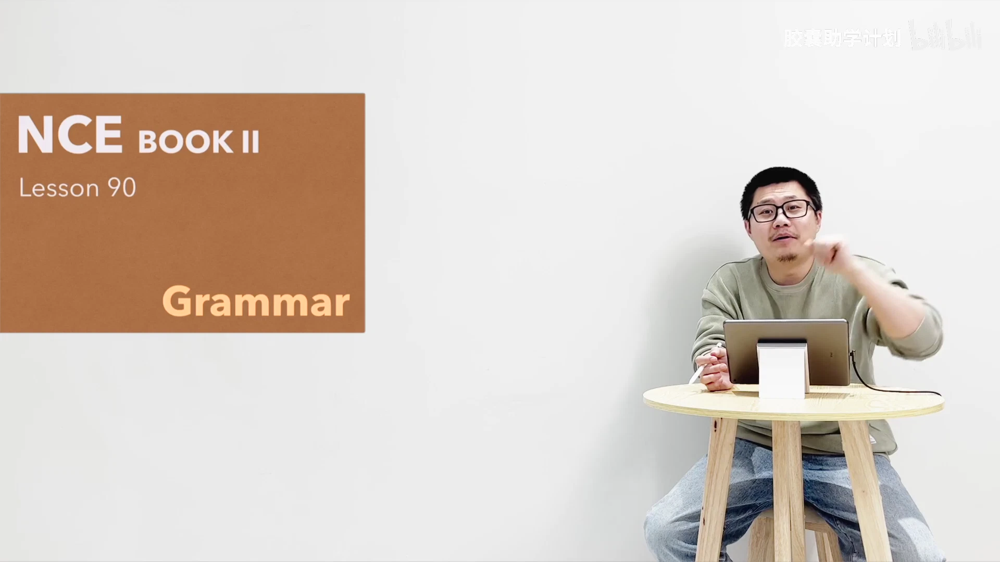

文字识别：NCE / BOOKⅡI / Lesson 90 / Grammar

### 画面 00:00:02

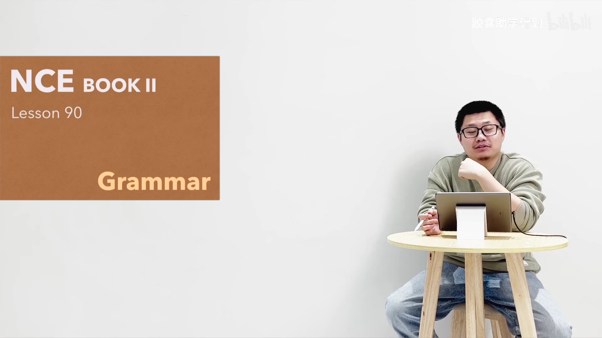

文字识别：NCE / BOOKⅡI / Lesson 90 / Grammar

### 画面 00:00:04

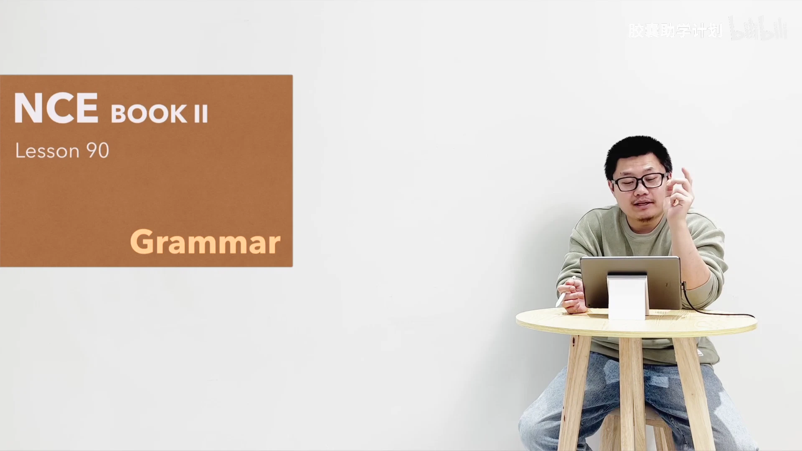

文字识别：NCE / BOOKII / Lesson 90 / Grammar

### 画面 00:00:08

文字识别：bibi / 胶囊助学计划 / • / •

### 画面 00:00:12

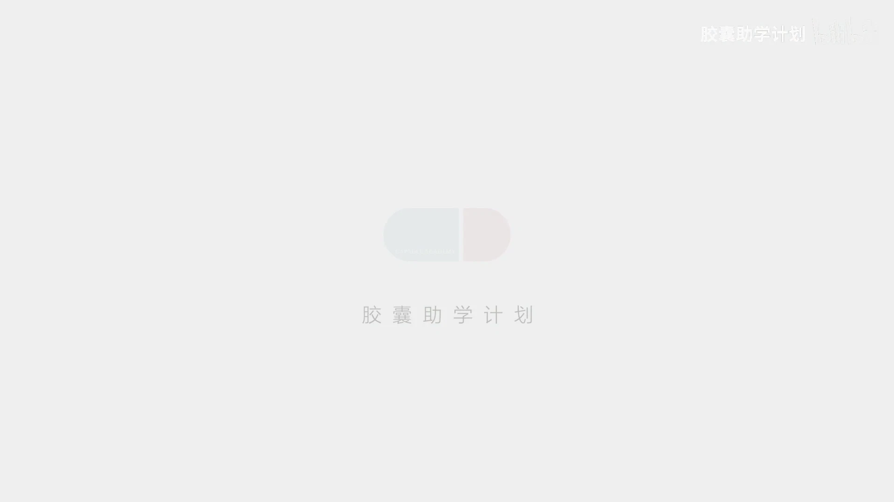

文字识别：校囊助学计划 / 胶囊助学计划

### 画面 00:00:14

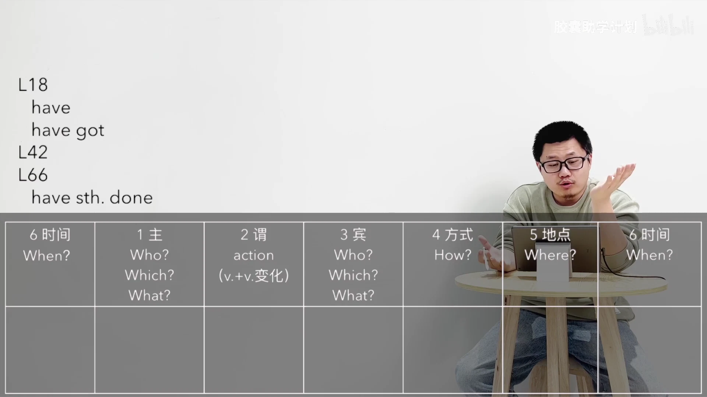

文字识别：喜助字计划 / L18 / have / have got / L42 / L66 / have sth. done / 6时间 / 1主 / 2谓 / 3宾 / 4方式 / 5地点 / 6时间 / When? / Who? / action / Who? / How? / Where? / When? / Which? / (v.+v.变化) / Which? / What? / What?

## 00:00:30–00:01:00

十八、四十二、六十六。呃，他们的语法其实并不多。首先，十八的语法我们在整个新一基本上全学过，在本十八课第一单元第十八课基本上就是复习一下。比如说，have最基本的意思叫有，have got也有有的意思。然后呢，have还有各种万能动词的用法，这个相信各位是非常耳熟能详的了，我不用再一一详细介绍了。四十二课没有具体的语法点，是一个略学的课程。呃，六十六

### 画面 00:00:44

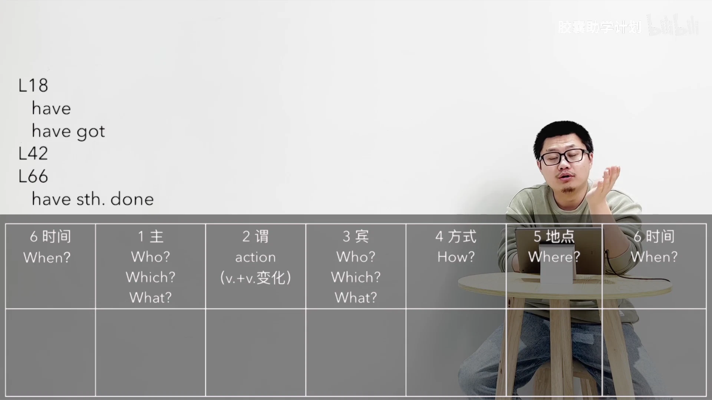

文字识别：囊助字计划 / L18 / have / have got / L42 / L66 / have sth. done / 6时间 / 1主 / 2谓 / 3宾 / 4方式 / 5地点 / 6时间 / When? / Who? / action / Who? / How? / Where? / When? / Which? / (v.+v.变化) / Which? / What? / What?

## 00:01:00–00:01:30

课呢，倒是有一个语法叫 have something done，也不是特别的难。比如说，哎呀，我这个头最近有点长了，哎，我找人给我剪一下，have someone cut，对吧？Have my hair cut，是吧？Have something done，啊，have my hair cut，是吧？哎，找别人帮我把头发剪一下，这个是谁不重要，所以他在这句子当中都没有出现啊。六十六课兰卡斯特轰炸机那一课 Lancaster bomber，我印象当中，对吧？OK，那本课呢，老习惯

### 画面 00:01:06

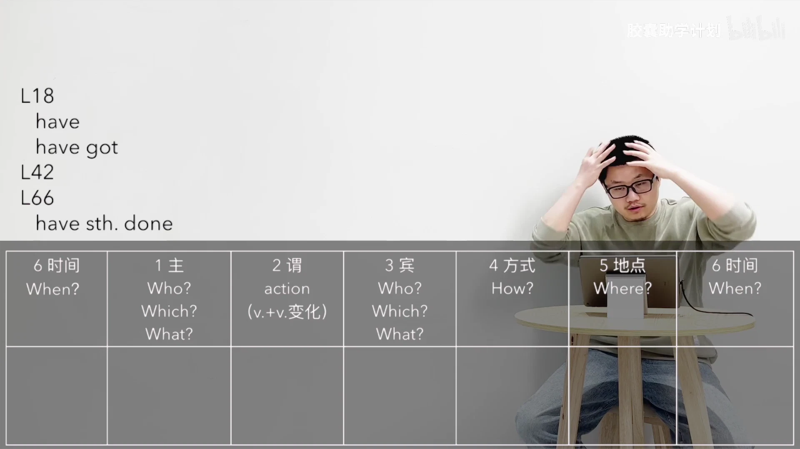

文字识别：霆助字计划 / L18 / have / have got / L42 / L66 / have sth. done / 6时间 / 1主 / 2谓 / 3宾 / 4方式 / 5地点 / 6时间 / When? / Who? / action / Who? / How? / Where? / When? / Which? / (v.+v.变化) / Which? / What? / What?

### 画面 00:01:09

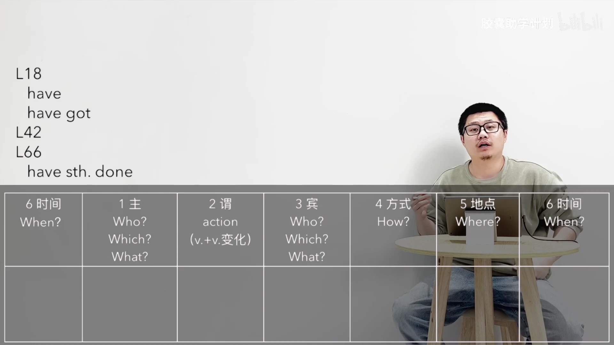

文字识别：囊助字计划 / L18 / have / have got / L42 / L66 / have sth. done / 6时间 / 1主 / 2谓 / 3宾 / 4方式 / 5地点 / 6时间 / When? / Who? / action / Who? / How? / Where? / When? / Which? / (v.+v.变化) / Which? / What? / What?

### 画面 00:01:15

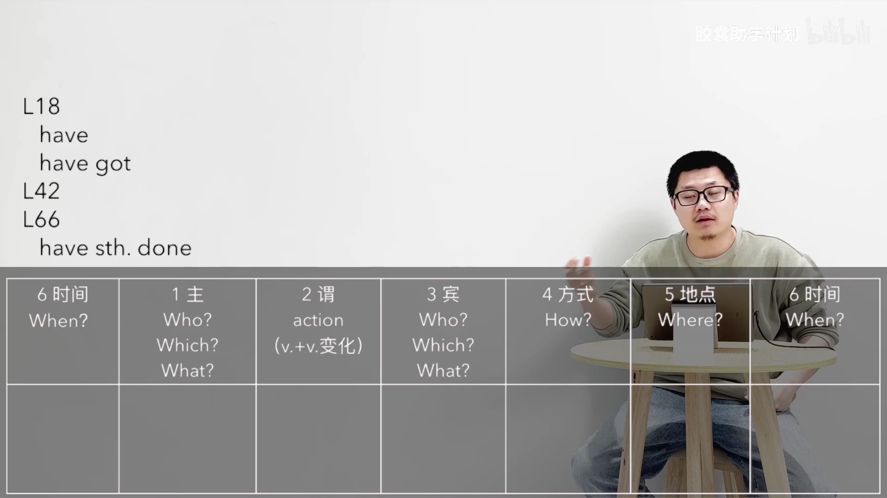

文字识别：囊助学计划 / L18 / have / have got / L42 / L66 / have sth. done / 6时间 / 1主 / 2谓 / 3宾 / 4方式 / 5地点 / 6时间 / When? / Who? / action / Who? / How? / Where? / When? / Which? / (v.+v.变化) / Which? / What? / What?

### 画面 00:01:29

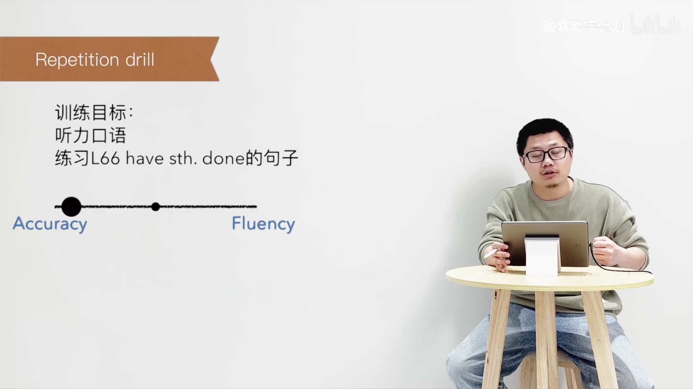

文字识别：Repetition drill / 训练目标： / 听力口语 / 练习L66 have sth.done的句子 / Accuracy / Fluency

## 00:01:30–00:02:00

以练代讲，就在这儿基本上我就是像刚才那样简单絮叨一遍，不会再仔仔细细讲一遍。您需要就回到六十六课啊，回到具体的哪一课去看就行了，我都给您标清楚啊。我们上来 repetition 只有先练 have something done。比如说 I'm watching my car, are you watching it yourself? I'm having mine washed。你看，说我正在洗我的车，说你 washing it yourself 是什么意思？就是你自己在洗这车，听见了吧？哎，就是说白

### 画面 00:01:39

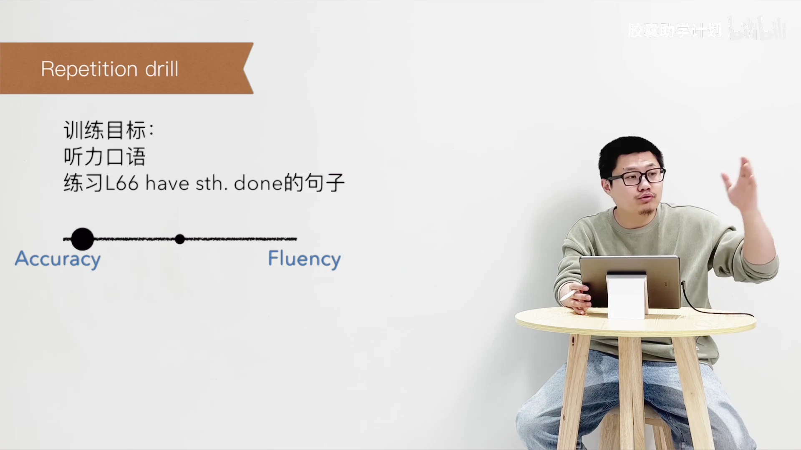

文字识别：Repetition drill / 训练目标： / 听力口语 / 练习L66 have sth.done的句子 / Accuracy / Fluency

### 画面 00:01:45

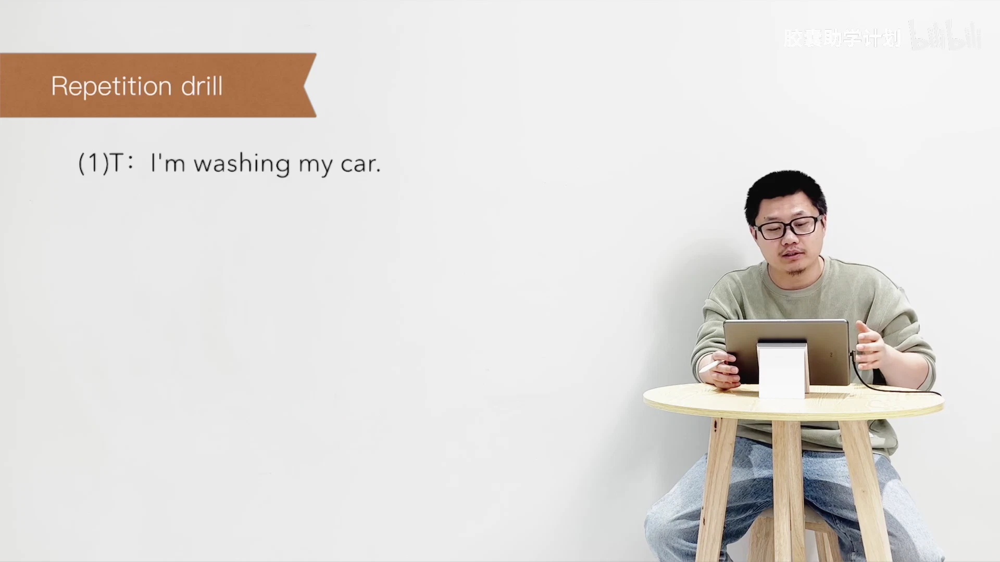

文字识别：Repetition drill / (1)T: I'm washing my car.

### 画面 00:01:54

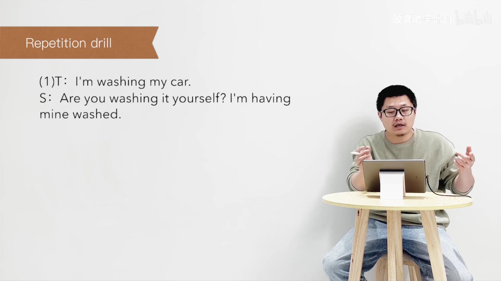

文字识别：Repetition drill / (1)T: I'm washing my car. / S: Are you washing it yourself? I'm having / mine washed.

## 00:02:00–00:02:30

了，我们呃，英英英汉都会存在这样的问题。当我说我去洗车的时候，比如说我现在去，我去洗个车，这个完全取决于你个人的习惯或者别人对你掌握的信息，因为它至少可以有两个意思：，一个是我真的去楼下拿个桶，拿个盆自己去洗；，另外一个就是花点钱去外边让别人给洗，对吧？那你看他说的是 Are you washing it yourself？这个就是自己你在洗嘛？那 I'm having my wash 叫做我正在让别人

### 画面 00:02:01

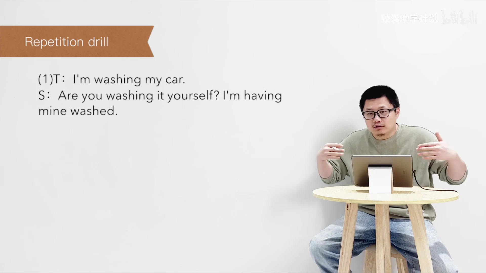

文字识别：Repetition drill / (1)T: I'm washing my car. / S: Are you washing it yourself? I'm having / mine washed.

### 画面 00:02:03

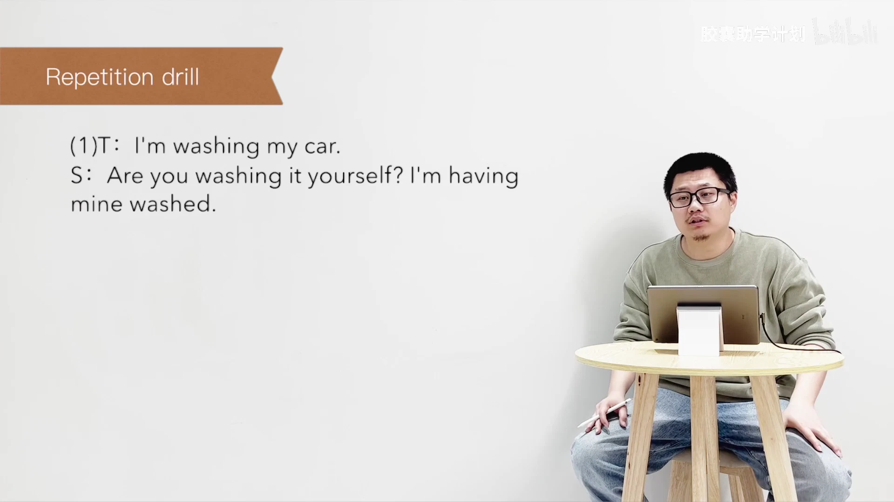

文字识别：Repetition drill / (1)T: I'm washing my car. / S: Are you washing it yourself? I'm having / mine washed.

### 画面 00:02:06

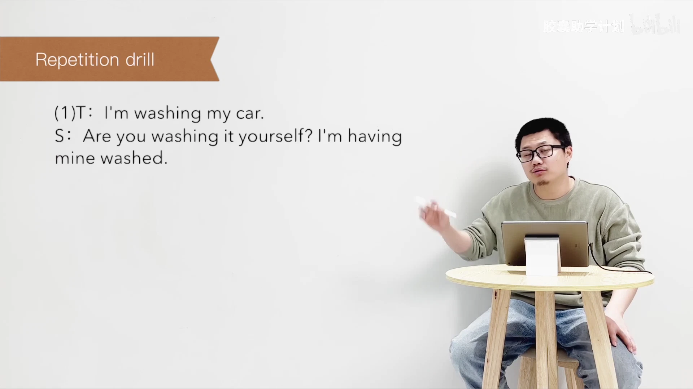

文字识别：Repetition drill / (1)T: I'm washing my car. / S: Are you washing it yourself? I'm having / mine washed.

### 画面 00:02:08

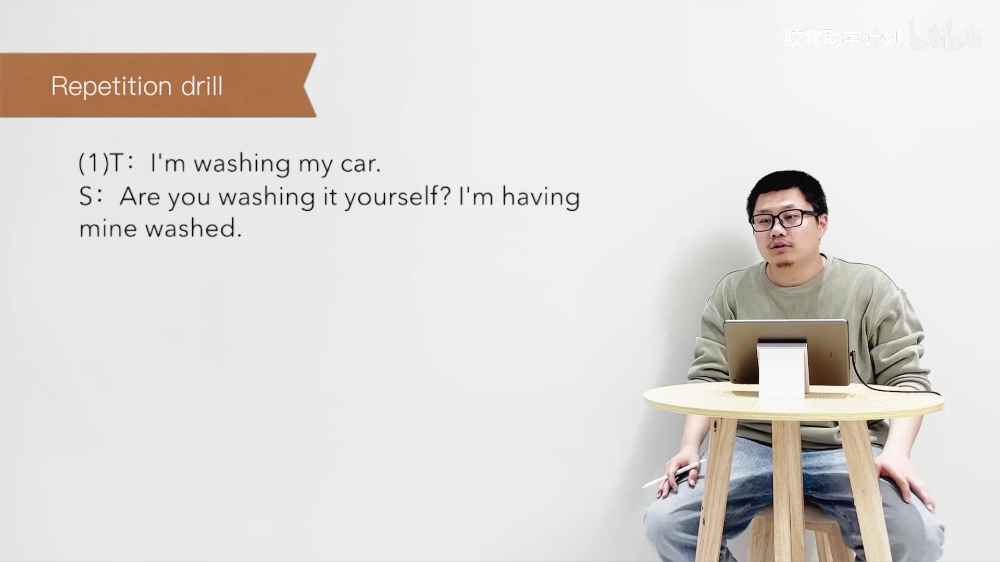

文字识别：Repetition drill / (1)T: I'm washing my car. / S: Are you washing it yourself? I'm having / mine washed.

### 画面 00:02:10

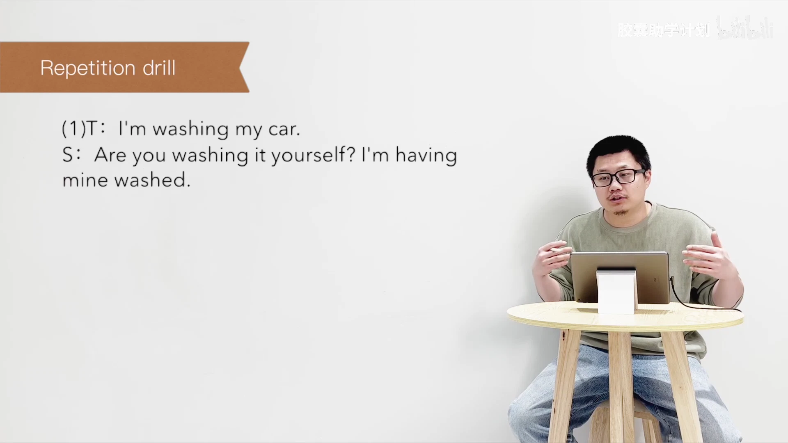

文字识别：Repetition drill / (1)T: I'm washing my car. / S: Are you washing it yourself? I'm having / mine washed.

## 00:02:30–00:03:00

给我洗，对吧？Have something done.那这个have还是可以加时态的。这是第一个。第二个，He'll clean his suit. Will he clean it himself? Himself? I'll have mine cleaned,是吧？哎，他是要自己去清洗吗？哎，我是打算找别人给我弄一下。哎，送干洗店，对吧？送干洗店就是让别人给清洗一下，叫have mine cleaned.当然了，这地方还有一个很小的知识点，顺手复习一下，就是这个mine。

### 画面 00:02:34

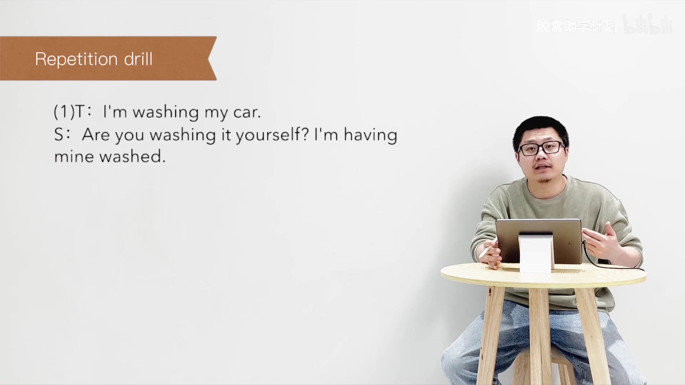

文字识别：Repetition drill / (1)T: I'm washing my car. / S: Are you washing it yourself? I'm having / mine washed.

### 画面 00:02:36

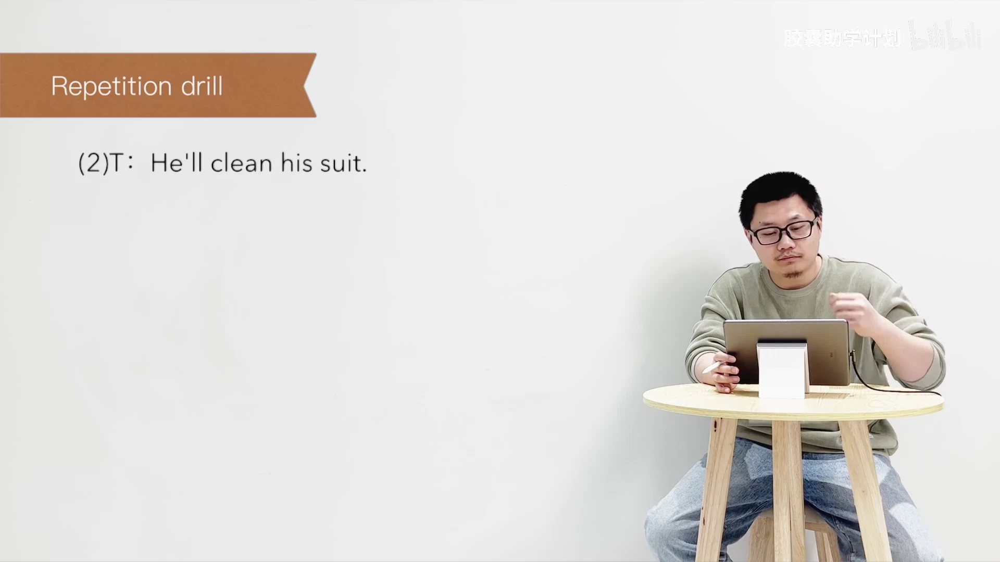

文字识别：助字计划 / Repetition drill / (2)T: He'll clean his suit.

### 画面 00:02:38

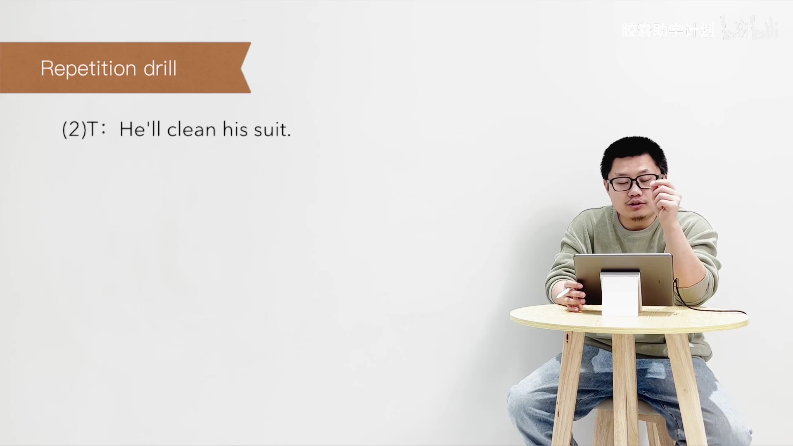

文字识别：Repetition drill / (2)T: He'll clean his suit.

### 画面 00:02:40

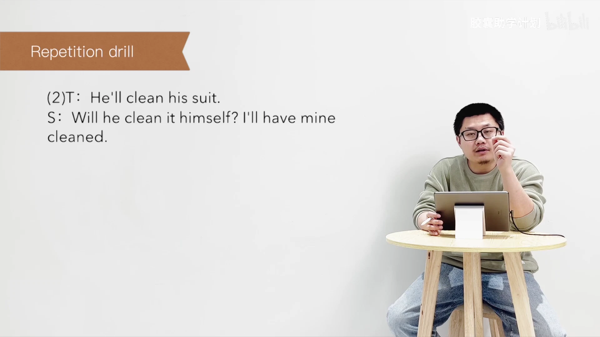

文字识别：Repetition drill / (2)T: He'll clean his suit. / S: Will he clean it himself? I'll have mine / cleaned.

## 00:03:00–00:03:30

哎等于什么来着？等于my加suit或者加一个名词，对吧？好，接下来白哥说了，张嘴跟我读。I must iron my shirt. Must you iron it yourself? I must have my ironed. I'm building a garage. Are you building it yourself? I'm having mine built.

### 画面 00:03:03

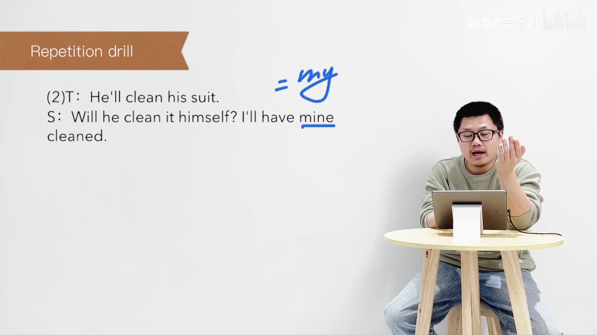

文字识别：Repetition drill / my / (2)T: He'll clean his suit. / S: Will he clean it himself? l'll have mine / cleaned.

### 画面 00:03:08

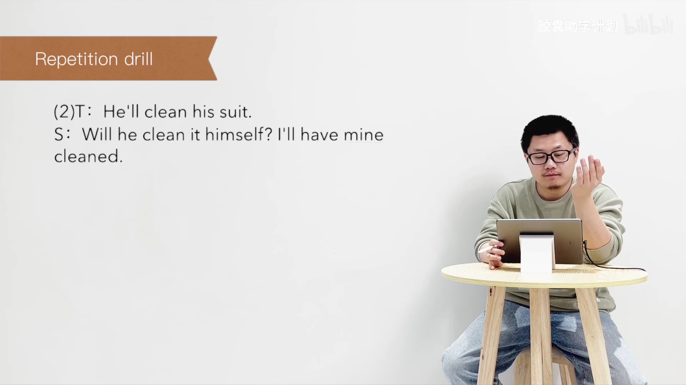

文字识别：Repetition drill / (2)T: He'll clean his suit. / S: Will he clean it himself? l'll have mine / cleaned.

### 画面 00:03:10

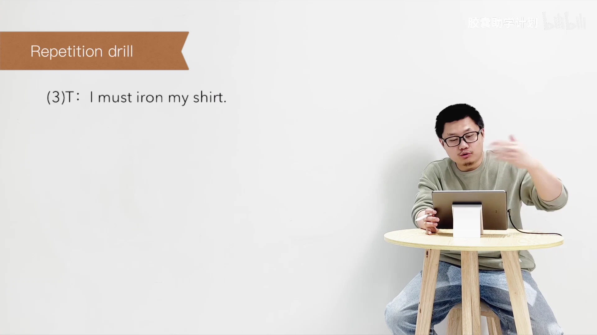

文字识别：Repetition drill / (3)T: I must iron my shirt.

### 画面 00:03:13

文字识别：Repetition drill / (3)T: I must iron my shirt.

### 画面 00:03:15

文字识别：Repetition drill / (3)T: I must iron my shirt. / S: Must you iron it yourself? I must have / mine ironed.

### 画面 00:03:21

文字识别：Repetition drill / 4T: I'm building a garage.

### 画面 00:03:25

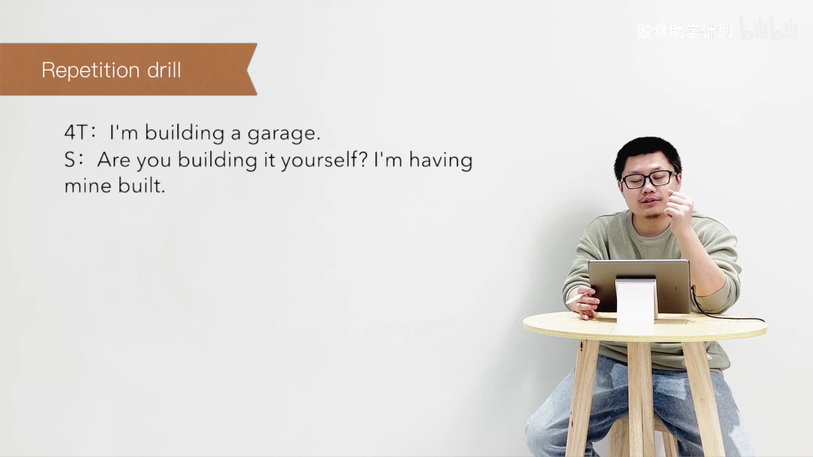

文字识别：Repetition drill / 4T: I'm building a garage. / S: Are you building it yourself? I'm having / mine built.

### 画面 00:03:29

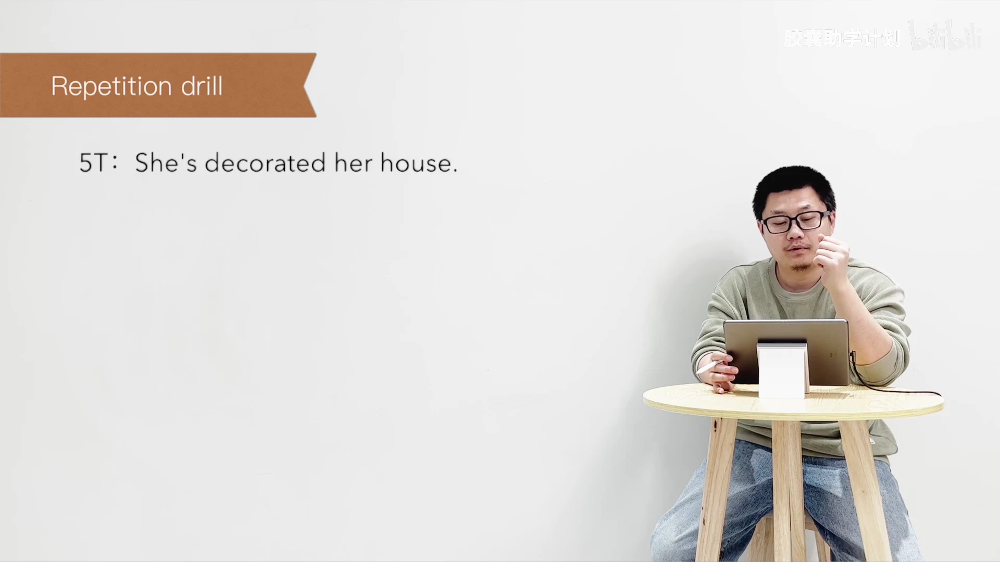

文字识别：臺助学计划 / Repetition drill / 5T: She's decorated her house.

## 00:03:30–00:04:00

She's decorated her house. Has she decorated it herself? I've had mine decorated. I'll install this new television set. Will you install it yourself? I'll have mine installed. He must repair his radio. Must he repair

### 画面 00:03:46

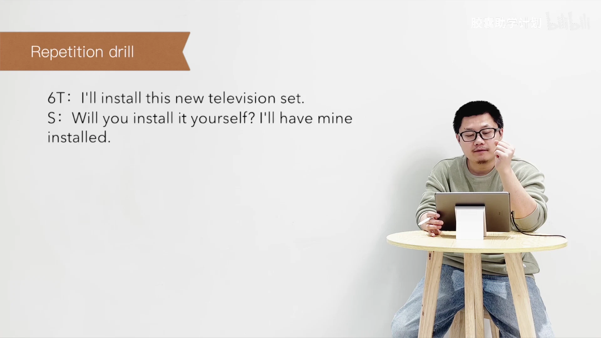

文字识别：Repetition drill / 6T: I'll install this new television set. / S: Will you install it yourself? I'll have mine / installed.

### 画面 00:03:54

文字识别：喜助字计划 / Repetition drill / 7T: He must repair his radio.

### 画面 00:03:58

文字识别：Repetition drill / 7T: He must repair his radio. / S: Must he repair it himself? I must have / mine repaired.

## 00:04:00–00:04:30

it himself? I must have mine repaired. He's mended his car. Has he mended it himself? I've had mine mended. He's published his book. Has he published it himself? I've had mine published. Pattern drill,

### 画面 00:04:06

文字识别：Repetition drill / 8T: He's mended his car.

### 画面 00:04:22

文字识别：Repetition drill / 9T: He's published his book. / S: Has he published it himself? I've had / mine published.

### 画面 00:04:28

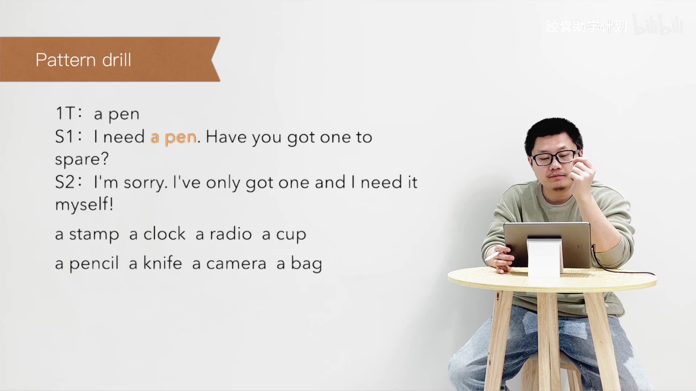

文字识别：Pattern drill / 1T:apen / S1: I need a pen. Have you got one to / spare? / S2: I'm sorry.I've only got one and I need it / myself! / a stamp a clock a radio a cup / a pencil a knife a camera a bag

## 00:04:30–00:05:00

啊，老习惯是吧？咱们往里去带练的就还是之前那些内容啊。呃，我们先看第一个，我们看一下他要练什么。说 I need a pen，我需要一个笔。Have you got十八克？Have got对吧？有没有是吧？Have you got one to spare？你没有可以借我一个的，哎，分享一下的。I'm sorry，I've only got one。我只有一个。Have got表有对吧？我只有一个。And I needed myself，我自己需要。所以这里边I C S二基本

### 画面 00:04:32

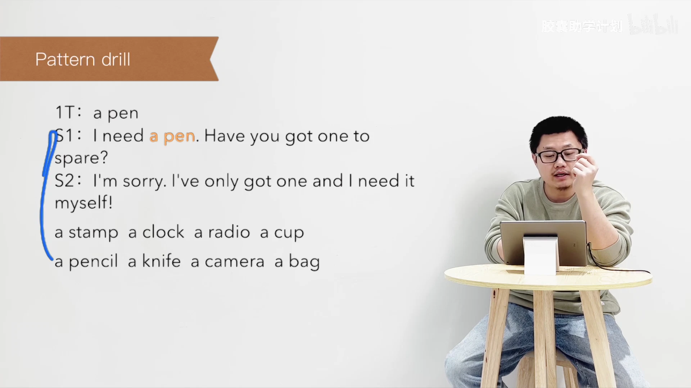

文字识别：Pattern drill / 1T:apen / pp1: I need a pen. Have you got one to / spare? / S2: I'm sorry.I've only got one and I need it / myself! / a stamp a clock aradio a cup / a pencil a knife a camera a bag

### 画面 00:04:34

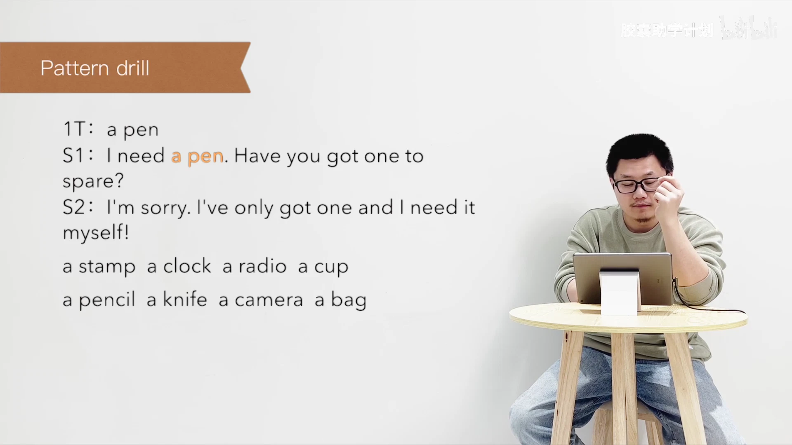

文字识别：Pattern drill / 1T:apen / S1: I need a pen. Have you got one to / spare? / S2: I'm sorry.I've only got one and I need it / myself! / a stamp a clock aradio a cup / a pencil a knife a camera a bag

## 00:05:00–00:05:30

上其实就是练have got的肯定句和一般疑问句，对吧？记得往里去带啊，这个很简单。Next one, so would you like bread or toast for tea?你需要面包还是要吐司啊？喝茶。说I'll have toast if I may.说如果可以的话，我想要，我想吃这个，呃，吐司，对吧？有点像have的万能动词啊，往里面去带，是吧？Next one, I feel

### 画面 00:05:01

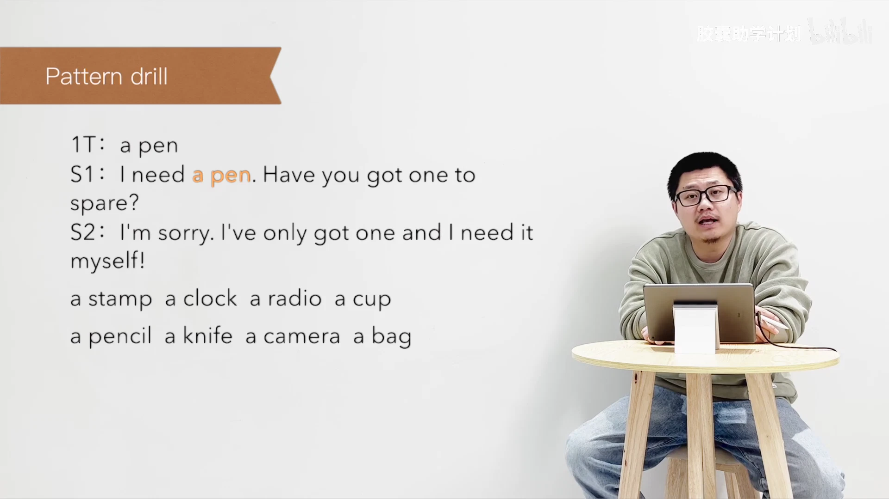

文字识别：Pattern drill / 1T:apen / S1: Ineed a pen. Have you got one to / spare? / S2: I'm sorry.I've only got one and I need it / myself! / a stamp a clock a radio a cup / a pencil a knife a camera a bag

### 画面 00:05:06

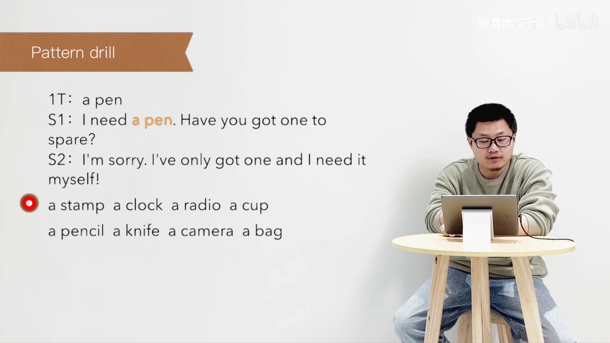

文字识别：Pattern drill / 1T:a pen / S1: Ineed a pen. Have you got one to / spare? / S2: I'm sorry.I've only got one and I need it / myself! / a stamp a clock a radio a cup / a pencil a knife a camera a bag

### 画面 00:05:09

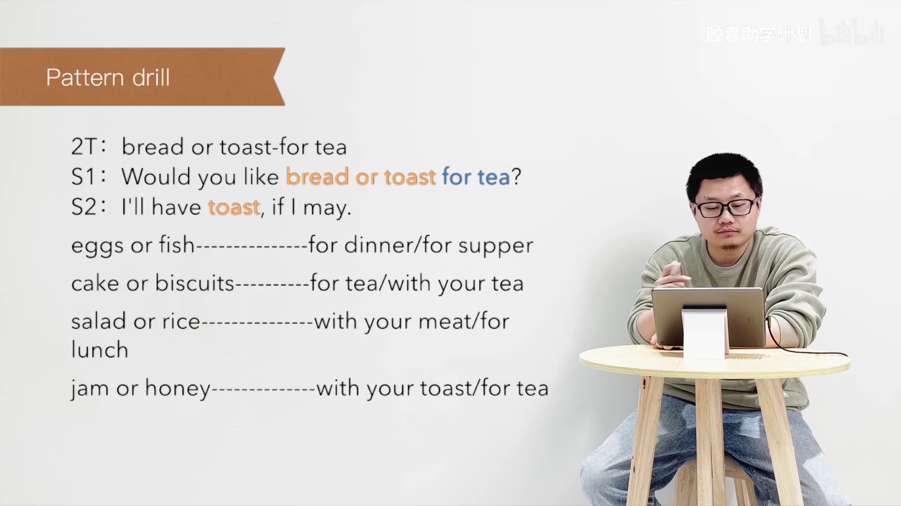

文字识别：Pattern drill / 2T: bread or toast-for tea / S1: Would you like bread or toast for tea? / S2: I'll have toast, if I may. / -fordinner/for supper / eggs or fish--- / cakeorbiscuit--fort-a/withyourtea / salad or rice----- / --with your meat/for / lunch / jam orhoney----withyourtoast/fortea

### 画面 00:05:28

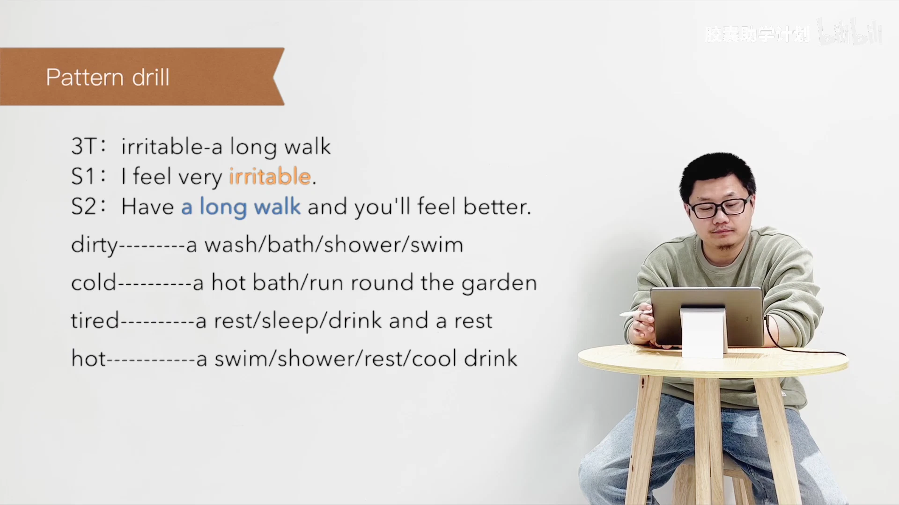

文字识别：Pattern drill / 3T:irritable-a long walk / S1: Ifeel very irritable. / S2: Have a long walk and you'll feel better. / dirt--a wash/bath/shower/swim / cold---a hot bath/runround the garden / tired---rest/sleep/drinkand arest / hot--------a swim/shower/rest/cool drink

## 00:05:30–00:06:00

very irritable. 我感觉到被激怒了. Have a long walk and you will feel better. Have the万能动词，刚才吃喝，这就是娱乐嘛，对吧？这新一下都讲过。哎，走个长路啊，就出去慢走一下，走远点，然后你会感觉好很多的，对吧？运动调节心情啊。呃，第四个说 that cup is cracked. I'll have to have it mended. 就这杯啊，碎了。我 have to 我将不

### 画面 00:05:50

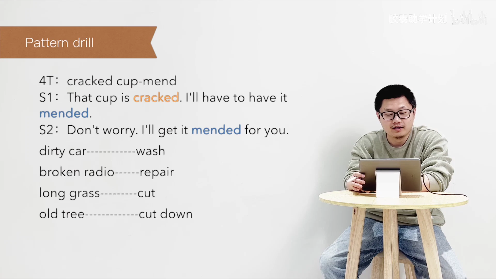

文字识别：Pattern drill / 4T:cracked cup-mend / S1: That cup is cracked. I'll have to have it / mended. / S2: Don't worry.I'll get it mended for you. / dirty car-- / -----Wash / broken radio----repair / long.ras----.cut / old tree--------cutdown

## 00:06:00–00:06:30

### 画面 00:06:16

文字识别：Recap / 喜助学计划 / L18 / have / Patterns / have got / L42 / Grammar / L66 / have sth. done

### 画面 00:06:18

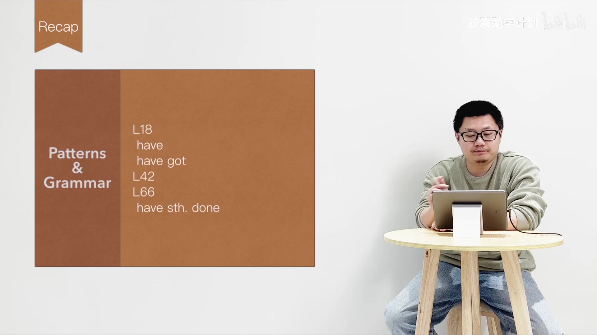

文字识别：Recap / 素助字计划 / L18 / have / Patterns / have got / L42 / Grammar / L66 / have sth. done

### 画面 00:06:20

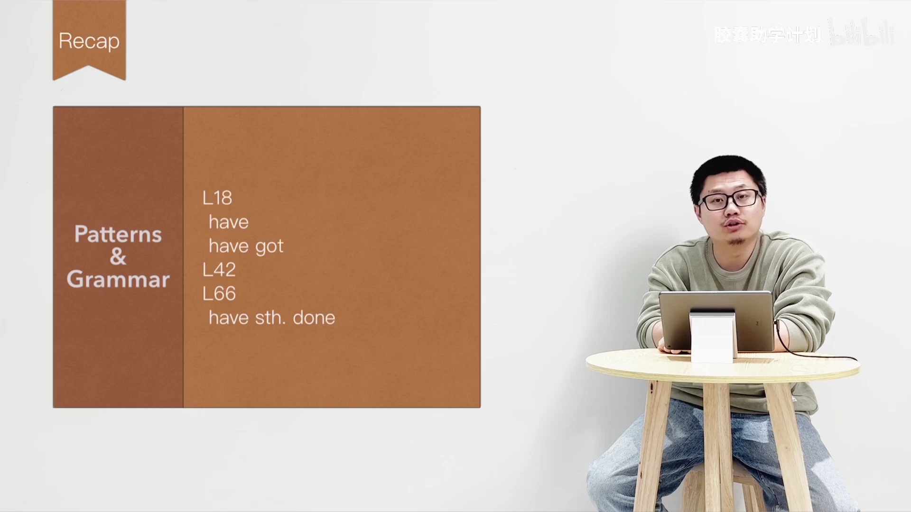

文字识别：Recap / L18 / have / Patterns / have got / ＆ / L42 / Grammar / L66 / have sth. done

### 画面 00:06:22

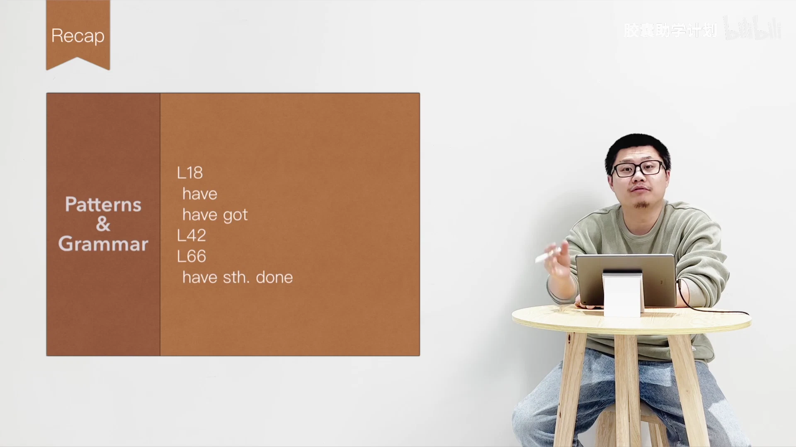

文字识别：Recap / L18 / have / Patterns / have got / ＆ / L42 / Grammar / L66 / have sth. done

### 画面 00:06:24

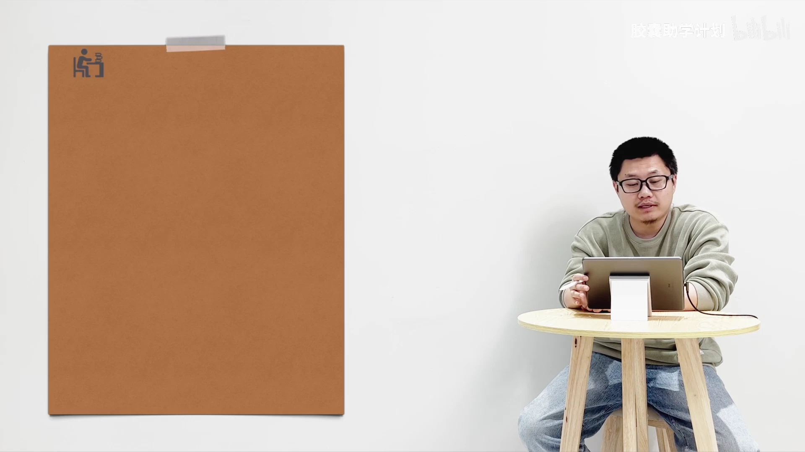

文字识别：助学计划

### 画面 00:06:26

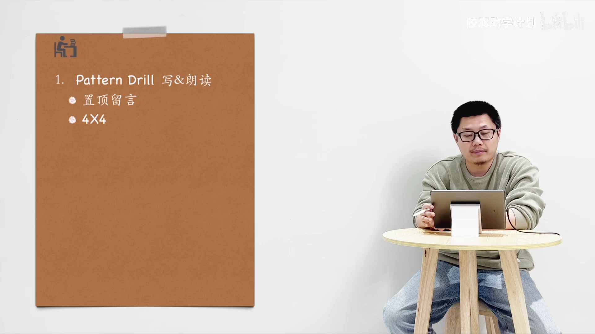

文字识别：Pattern Drill 写&朗读 / 1.f / 置顶留言 / 4×4

### 画面 00:06:28

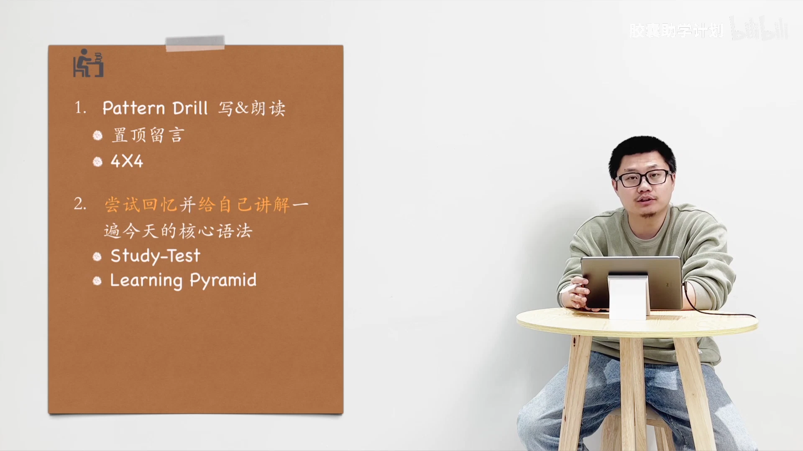

文字识别：Pattern Drill写&朗读 / 1. / 置顶留言 / 4×4 / 尝试回忆并给自己讲解一 / 遍今天的核心语法 / Study-Test / Learning Pyramid

## 00:06:30–00:07:00

地方还是重点强调一下红皮书初级的和中级的关于have啊，have got呀，have something done呐，能写的都给他写了，是吧？甚至你可以直接关于呃搜那个index，当时教过各位在开篇视频当中找索引，把所有的这些呃跟have相关的都给他写一写，对吧？基本上应该是都学完了。OK，那以上就是本期视频的全部内容了。如果各位喜欢我们的课程呢，欢迎各位关注、订

### 画面 00:06:30

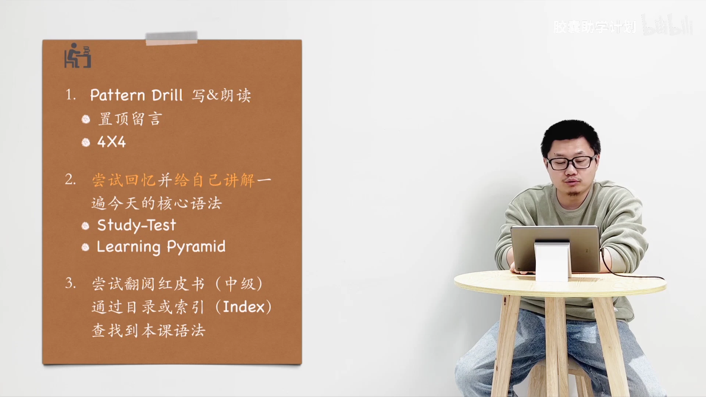

文字识别：Pattern Drill写&朗读 / 置顶留言 / 4×4 / 尝试回忆并给自己讲解一 / 遍今天的核心语法 / Study-Test / Learning Pyramid / 尝试翻阅红皮书（中级） / 通过目录或索引(Index) / 查找到本课语法

### 画面 00:06:35

文字识别：Pattern Drill写&朗读 / 置顶留言 / 4×4 / 尝试回忆并给自己讲解一 / 遍今天的核心语法 / Study-Test / Learning Pyramid / 尝试翻阅红皮书（中级） / 通过目录或索引(Index) / 查找到本课语法

### 画面 00:06:40

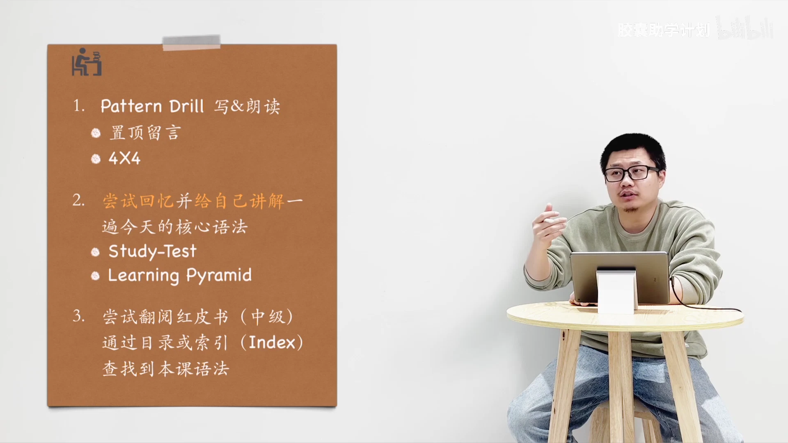

文字识别：Pattern Drill 写&朗读 / 1. / 置顶留言 / 4×4 / 尝试回忆并给自己讲解一 / 遍今天的核心语法 / Study-Test / Learning Pyramid / 尝试翻阅红皮书（中级） / 通过目录或索引(Index) / 查找到本课语法

### 画面 00:06:45

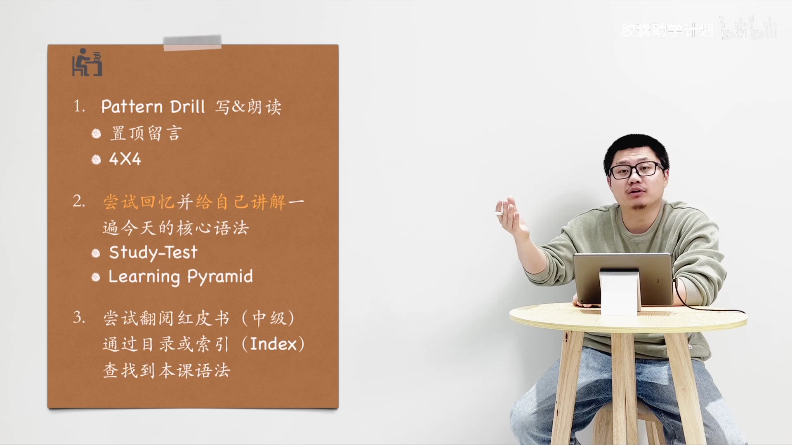

文字识别：Pattern Drill写&朗读 / 置顶留言 / 4×4 / 尝试回忆并给自己讲解一 / 遍今天的核心语法 / Study-Test / Learning Pyramid / 尝试翻阅红皮书（中级） / 通过目录或索引(Index) / 查找到本课语法

### 画面 00:06:50

文字识别：Pattern Drill 写&朗读 / 1.f / 置顶留言 / 4×4 / 尝试回忆并给自己讲解一 / 遍今天的核心语法 / Study-Test / Learning Pyramid / 尝试翻阅红皮书（中级） / 通过目录或索引(Index) / 查找到本课语法

### 画面 00:06:54

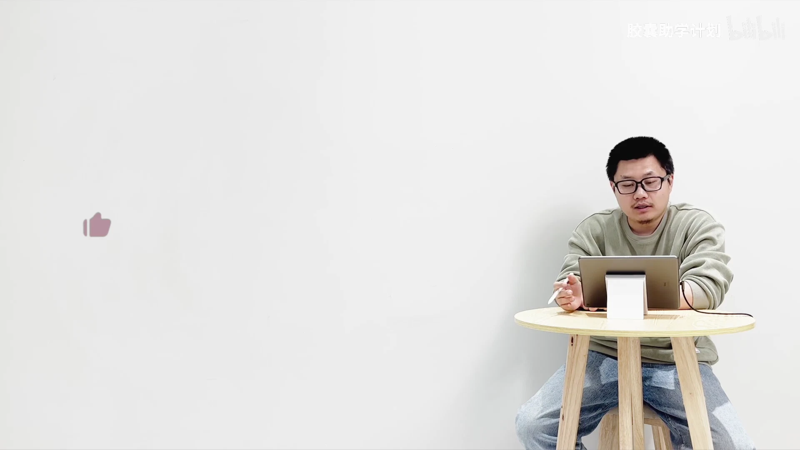

文字识别：袁助字计划一

## 00:07:00–00:07:19

阅、一键三连，分享给那些需要的朋友，来帮助我们快速成长。See you next time.

### 画面 00:07:01

文字识别：臺助学计划一

### 画面 00:07:06

### 画面 00:07:08

文字识别：運動字計切 / CAPSULEACADEMY / 胶囊助学计划 / 『 / 小红书 / Lecturer / Leo

### 画面 00:07:11

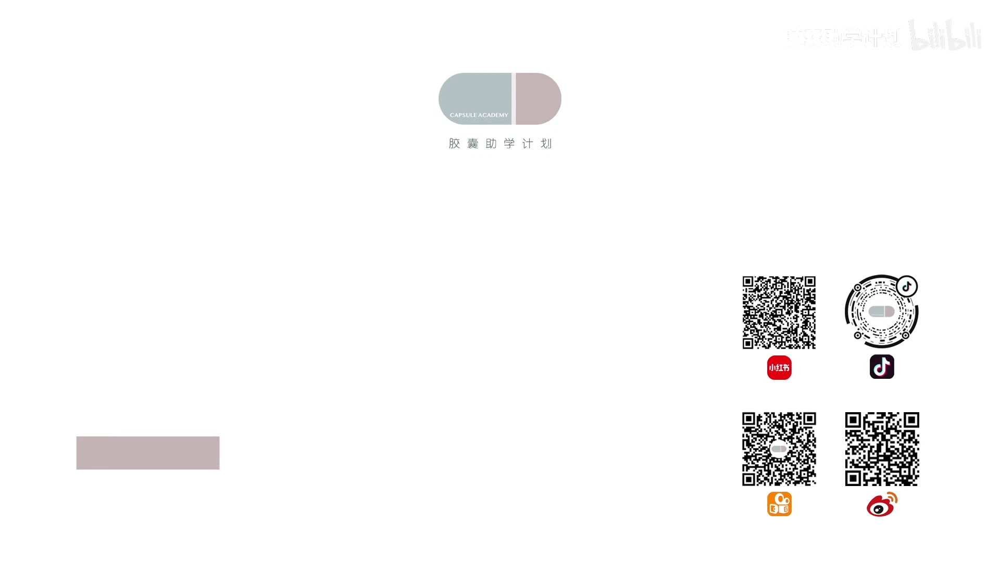

文字识别：CAPSULEACADEMY / 胶囊助学计划 / 小红书 / OE

### 画面 00:07:14

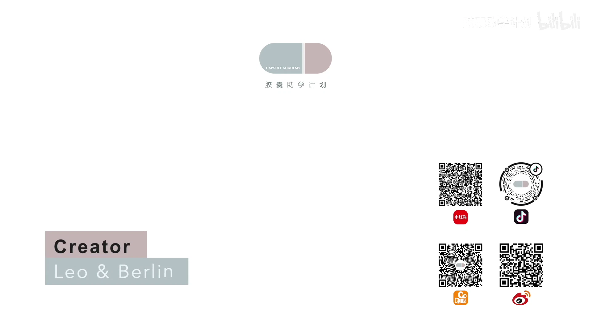

文字识别：聖珈字計划 / CAPSULEACADEMY / 胶囊助学计划 / 小红书 / Creator / □ / Leo & Berlin / OE

### 画面 00:07:16

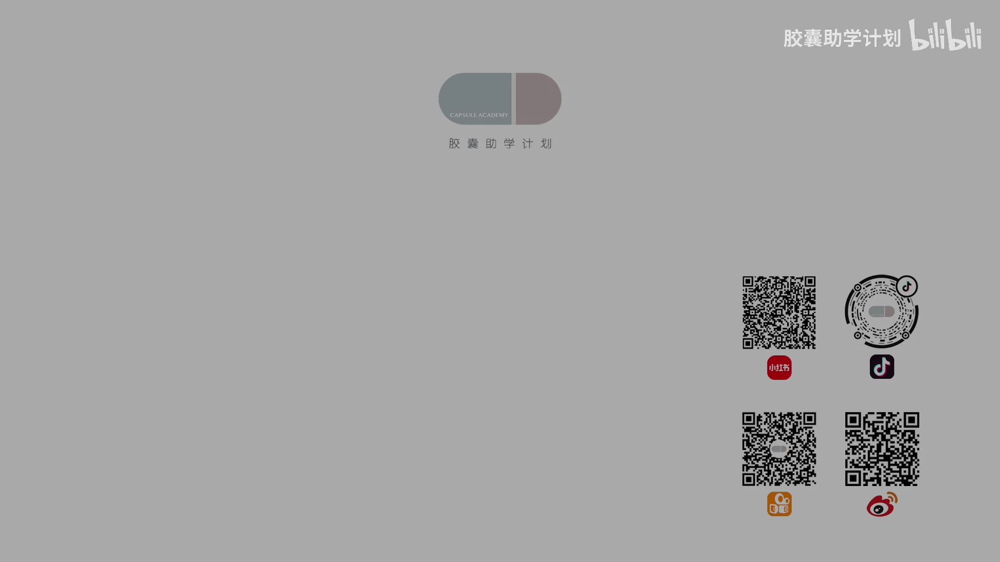

文字识别：bilbili / 胶囊助学计划 / CAPSULEACADEMY / 胶囊助学计划 / 小红书 / OE

### 画面 00:07:18

文字识别：bilibili / 胶囊助学计划

