# 090 文章

快速机器解析：语音为单模型转写，未进行独立交叉校对或人工复核；画面每秒采样并按变化选帧，短时文字和标记可能遗漏。截图时间约有 1 秒误差。图片有损压缩；遇到疑点请按时间查看 Google Drive 原视频。

## 00:00:00–00:00:30

Hello, everyone. Welcome to Capsule Academy. This is Leo. Today, we're going to learn New Concept English Book Two Lesson Ninety Story. Hope you can enjoy.呃，我们看一下文章的标题，叫 What's for supper？晚饭吃啥？单看不知道文章想说啥。然后说 What kind of fish are they？ Are they？呃，它是什么类型？它们是什么类型的鱼？啊，难道说的是晚饭吃什么鱼的故事吗？

### 画面 00:00:00

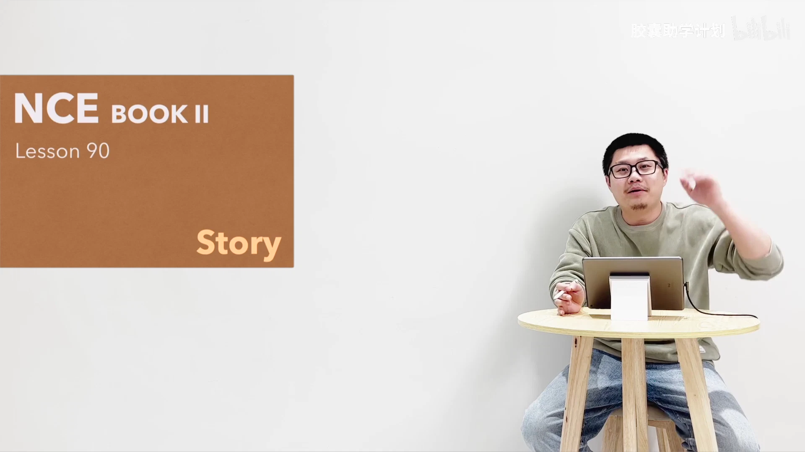

文字识别：NCE / BOOKI"I / Lesson 90 / Story

### 画面 00:00:02

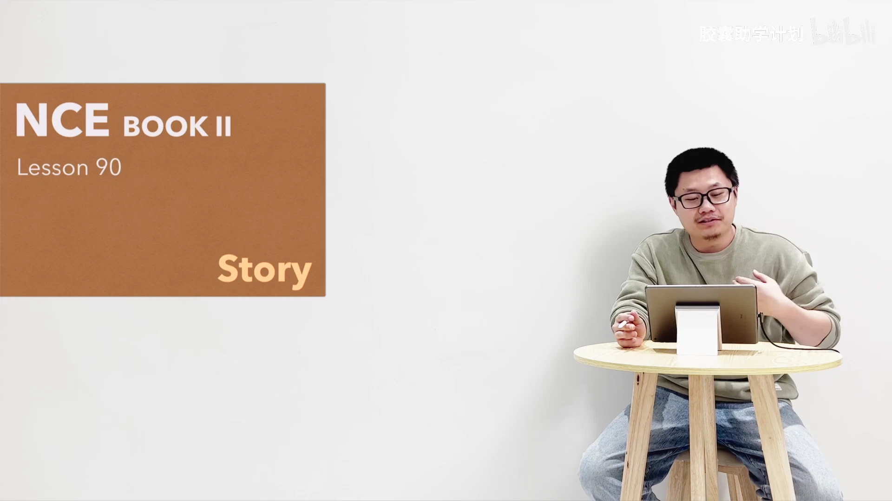

文字识别：NCE / BOOKⅡI / Lesson 90 / Story

### 画面 00:00:05

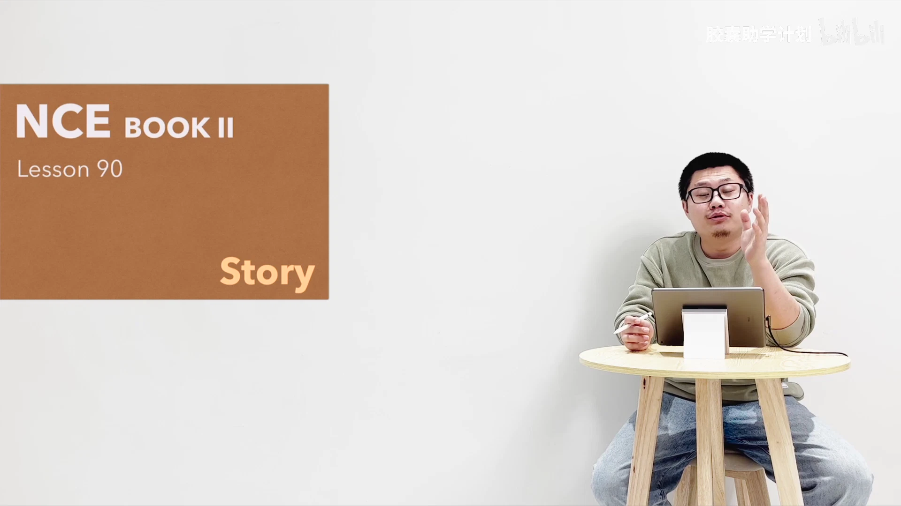

文字识别：辜助学计划 / NCE / BOOKⅡI / Lesson 90 / Story

### 画面 00:00:08

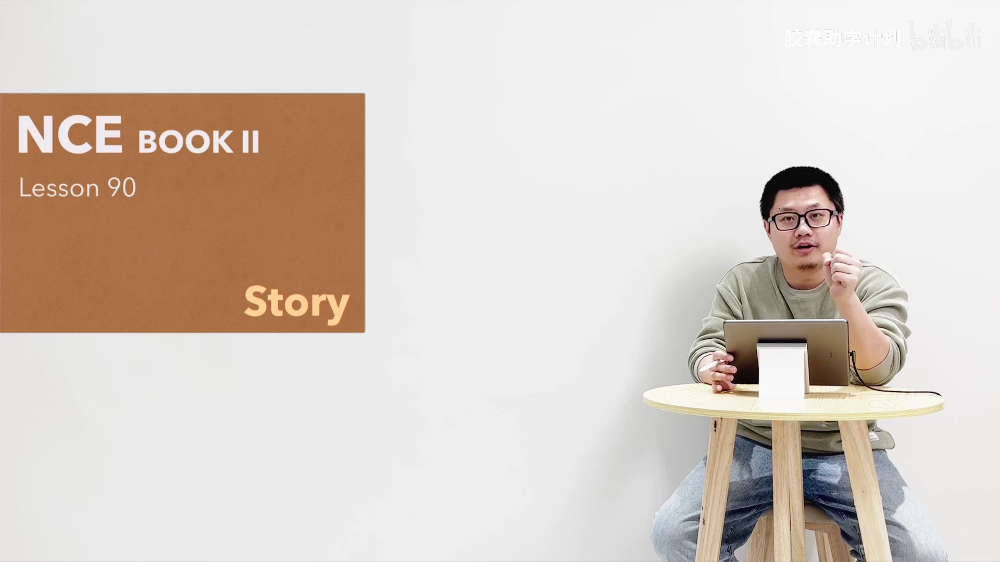

文字识别：NCE / BOOKⅡI / Lesson 90 / Story

### 画面 00:00:10

文字识别：胶囊助学计划bil

### 画面 00:00:13

### 画面 00:00:15

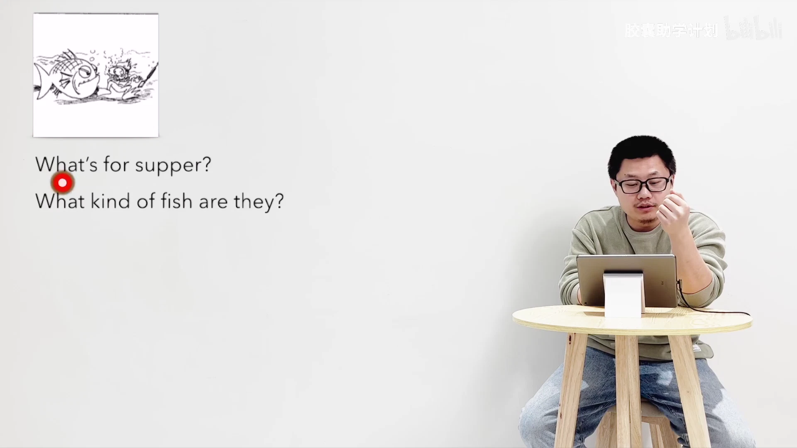

文字识别：What's for supper? / What kind of fish are they?

## 00:00:30–00:01:00

进入文章上来，Fish and chips has always been a favorite dish in Britain, but as the oceans have been overfished, fish has become more and more expensive. 哇，这句话看上去还挺长，一个 but 一个逗号，基本上这个句子就简单了。为什么？我跟各位之前分享过啊，再回顾一下，长难句拆解的最基本逻辑就是把它

### 画面 00:00:30

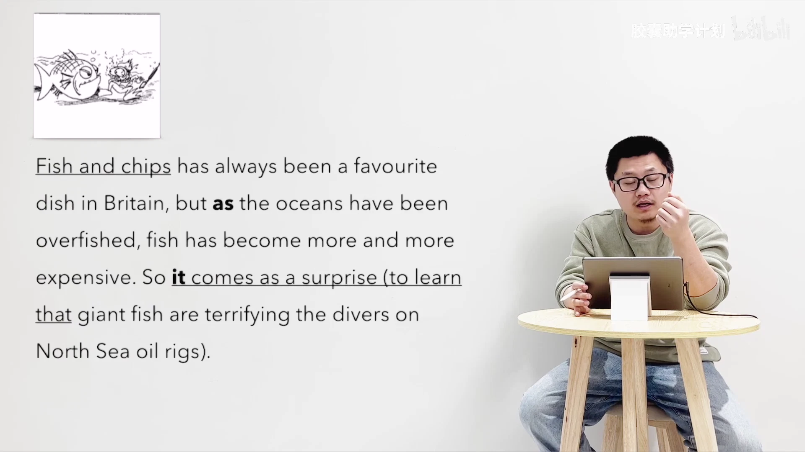

文字识别：Fish and chips has always been a favourite / dish in Britain, but as the oceans have been / overfished, fish has become more and more / expensive. So it comes as a surprise (to learn / that giant fish are terrifying the divers on / North Sea oil rigs).

### 画面 00:00:32

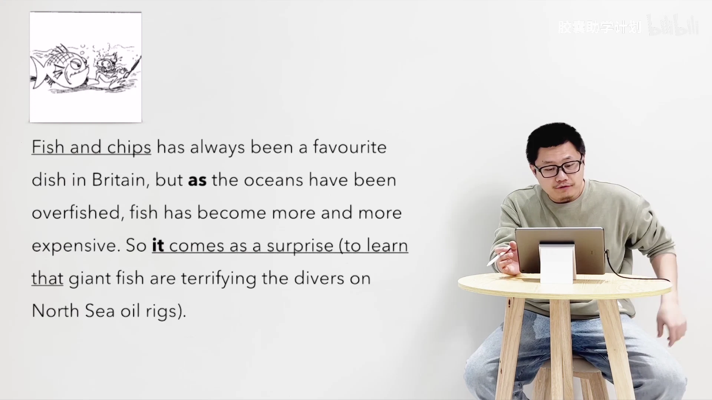

文字识别：Fish and chips has always been a favourite / dish in Britain, but as the oceans have been / overfished, fish has become more and more / expensive. So it comes as a surprise (to learn / that giant fish are terrifying the divers on / North Sea oil rigs).

### 画面 00:00:34

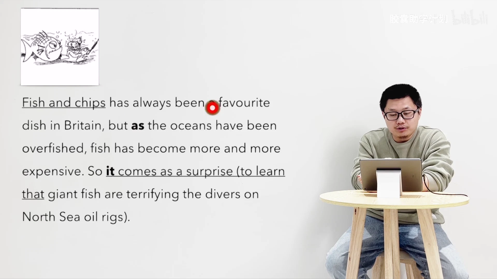

文字识别：Fish and chips has always been / .favourite / dish in Britain, but as the oceans have been / overfished, fish has become more and more / expensive. So it comes as a surprise (to learn / that giant fish are terrifying the divers on / North Sea oil rigs).

### 画面 00:00:51

文字识别：Fish and chips has always been a favourite / dish in Britain, / as the oceans have been / out / overfished,fish has become more and more / expensive. So it comes as a surprise (to learn / that giant fish are terrifying the divers on / North Sea oil rigs).

### 画面 00:00:54

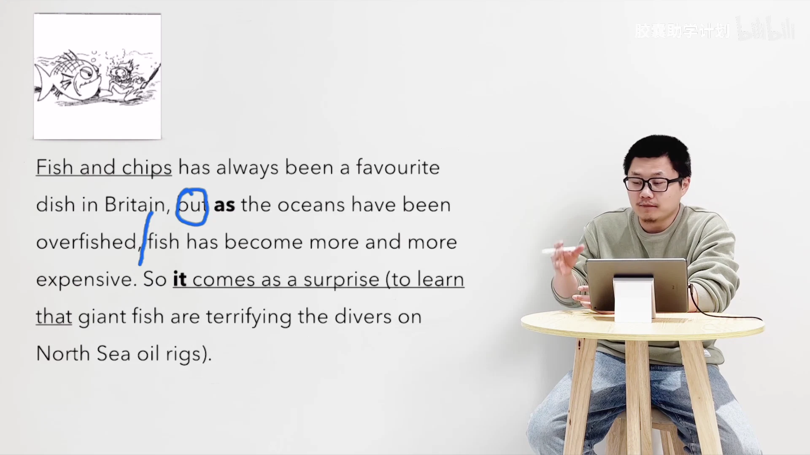

文字识别：Fish and chips has always been a favourite / dish in Britain, / as the oceans have been / oui / overfished,fish has become more and more / expensive. So it comes as a surprise (to learn / that giant fish are terrifying the divers on / North Sea oil rigs).

## 00:01:00–00:01:30

变成 n 个短句，然后尝试从这 n 个短句当中获取信息。这更符合，呃，我理解当中我们中国人的思维方式。等你这种拆分见多了之后，比如说你拆到一定水平，比如像现在我去看它的时候，其实我是不进行拆分了。哎，我反正基本从第一个单词读到最后一个单词，这句话大概啥意思我就懂了。除非太复杂、太困难啊，像那种东西，其实翻译成汉语你也得读好几遍啊。所以大部分情况下，训

### 画面 00:01:24

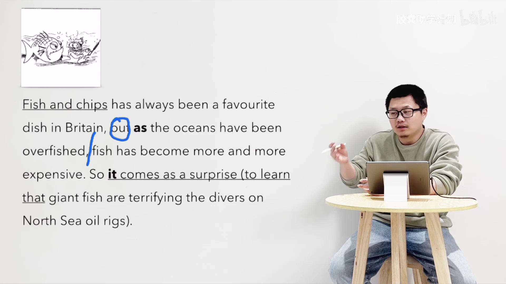

文字识别：Fish and chips has always been a favourite / dish in Britain, / as the oceans have been / overfished,fish has become more and more / expensive. So it comes as a surprise (to learn / that giant fish are terrifying the divers on / North Sea oil rigs).

## 00:01:30–00:02:00

练到最后的结果就是一口气儿看完就完事儿。那我们现在还是需要拆分啊。Fish and chips，刚才我们说了炸鱼薯条啊，has always been a favorite dish in Britain。说一直注意现在完成时，has always been一直都是啊，就是从过去持续到现在一直都是，一直都是什么呢？呃，favorite dish一个特别受人喜欢的一个菜是吧？你说它是菜吗？反正就是炸一下，我吃过是吧？就是炸一下啊，在国外啊没

### 画面 00:01:54

文字识别：Fish and chips has always been a favourite / dish in Britain, / as the oceans have been / ou / overfished,fish has become more and more / expensive. So it comes as a surprise (to learn / that giant fish are terrifying the divers on / North Sea oil rigs).

## 00:02:00–00:02:30

什么特殊的，至少在我的感觉当中，没有什么特别难的，是吧？我感觉还没有西红柿鸡蛋费劲的啊。In Britain，叫在大英帝国，是吧？在大不列颠啊，其实就是英国。然后这个地方有两个点，一个刚才我说的 have always been，啊，现在完成时从过去持续到现在。第二个是这儿为什么用 has？它明明这是 fish and chips，至少俩东西嘛，就是这是一个菜名啊，菜名一个嘛，对吧？所以 has always been。这是第一句话。第二句话，But

### 画面 00:02:24

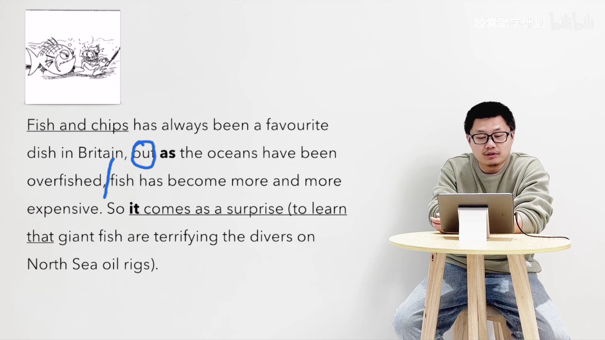

文字识别：Fish and chips has always been a favourite / dish in Britain, / as the oceans have been / ou / overfished,fish has become more and more / expensive. So it comes as a surprise (to learn / that giant fish are terrifying the divers on / North Sea oil rigs).

## 00:02:30–00:03:00

as说，但是呢，哎，the oceans have been overfished. As我原来说过，当看的时候，我们不太好判断它是随着啊，是这个随着当还是这个因为的意思，对吧？因为的意思，呃，还是要看后边两句话才能搞清楚。那我们先看说的oceans have been overfished，现在完成时被动，海洋已经被过度捕捞了。第二个说鱼啊变得越来越贵，

### 画面 00:02:36

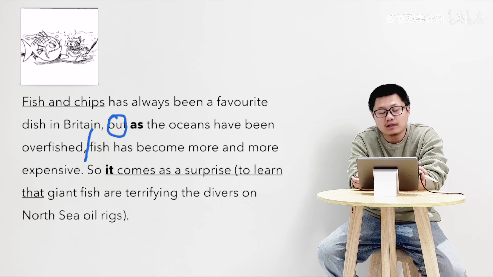

文字识别：Fish and chips has always been a favourite / dish in Britain, / as the oceans have been / out / overfished,fish has become more and more / expensive. So it comes as a surprise (to learn / that giant fish are terrifying the divers on / North Sea oil rigs).

### 画面 00:02:40

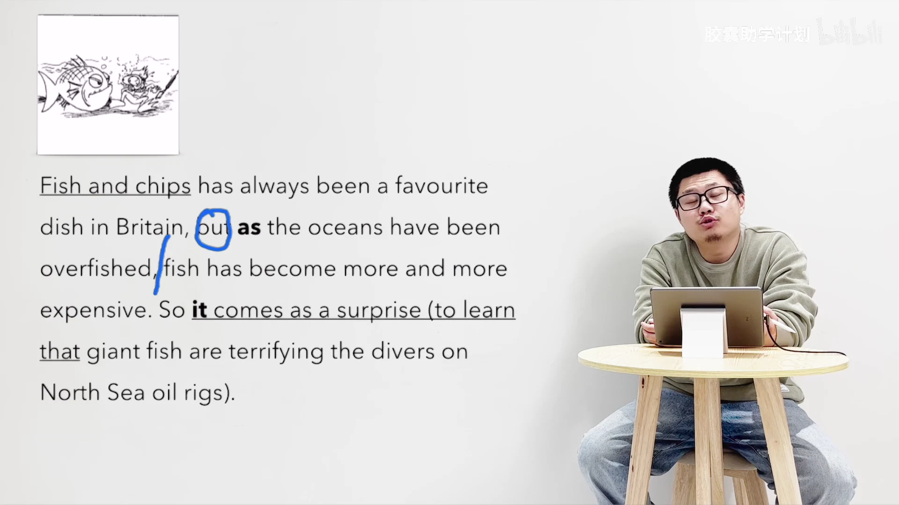

文字识别：Fish and chips has always been a favourite / dish in Britain, / as the oceans have been / out / overfished,fish has become more and more / expensive. So it comes as a surprise (to learn / that giant fish are terrifying the divers on / North Sea oil rigs).

### 画面 00:02:47

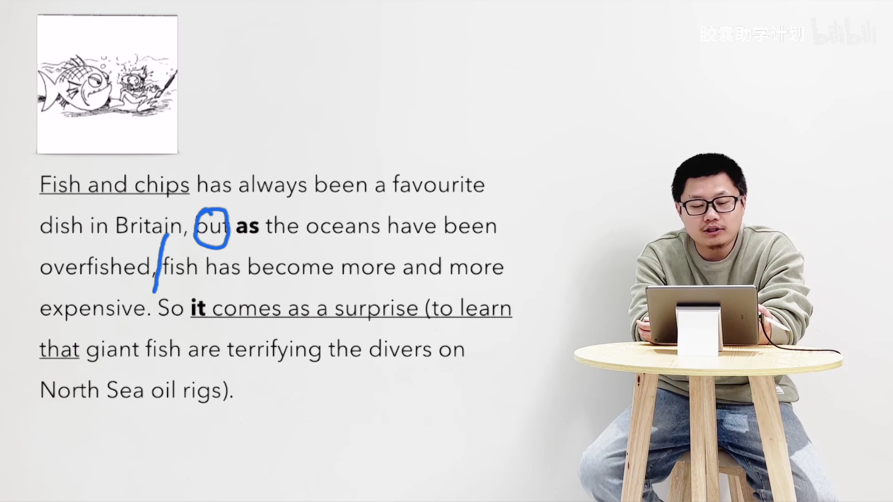

文字识别：Fish and chips has always been a favourite / dish in Britain, / as the oceans have been / Du / overfished,fish has become more and more / expensive. So it comes as a surprise (to learn / that giant fish are terrifying the divers on / North Sea oil rigs).

## 00:03:00–00:03:30

所以这个 as 就很有意思。从我个人自己的感受当中，我觉得翻译成问或 because 好像都行。我给您翻译一下啊，说随着这个海洋被过度捕捞，鱼在变得越来越贵；或者当海洋被过度捕捞的时候，这个鱼就变得越来越贵了；或者说因为海洋被过度捕捞，鱼变得越来越贵了。所以，在而且我实际上参考过一些什么参考译文啊，包括当年备课的时候看过一些其他老师的理解

### 画面 00:03:02

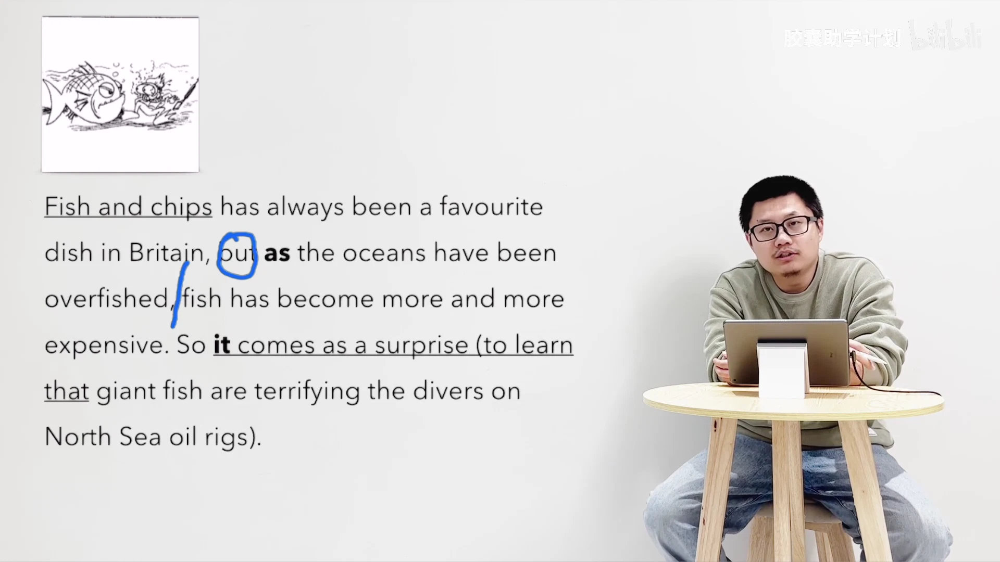

文字识别：Fish and chips has always been a favourite / dish in Britain, / as the oceans have been / but / overfished,fish has become more and more / expensive. So it comes as a surprise (to learn / that giant fish are terrifying the divers on / North Sea oil rigs).

### 画面 00:03:07

文字识别：Fish and chips has always been a favourite / dish in Britain, / as the oceans have been / ou / overfished, fish has become more and more / expensive. So it comes as a surprise (to learn / that giant fish are terrifying the divers on / North Sea oil rigs).

## 00:03:30–00:04:00

去探讨过，结果就是都行，是吧？所以我觉得问和 because 放在这儿问题都不大。当然，如果您有您别的异议呢，我们可以再讨论，是吧？但是我现在就告诉你，我的理解是认为都 OK 啊。所以这其实也从呃另一个角度，像我们说了一件事情，就是一定要清楚，老师说的不一定是百分之百都对的，对吧？比如说我在这儿说是我说是问，但你非得觉得是 because，那也许你也许也是对

### 画面 00:03:37

文字识别：Fish and chips has always been a favourite / dish in Britain, / as the oceans have been / out / overfished,fish has become more and more / expensive. So it comes as a surprise (to learn / that giant fish are terrifying the divers on / North Sea oil rigs).

### 画面 00:03:42

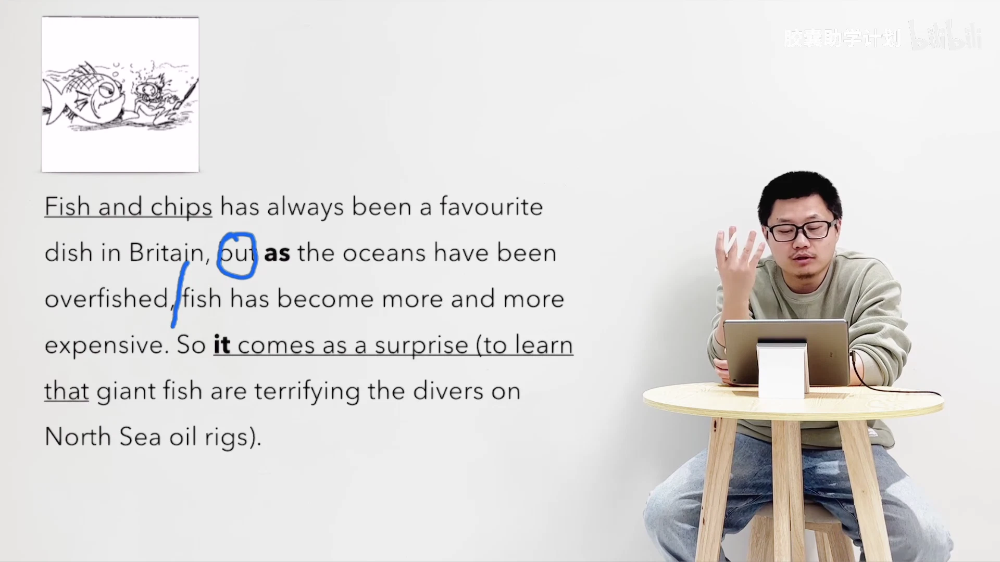

文字识别：Fish and chips has always been a favourite / dish in Britain, / as the oceans have been / out / overfished,fish has become more and more / expensive. So it comes as a surprise (to learn / that giant fish are terrifying the divers on / North Sea oil rigs).

### 画面 00:03:47

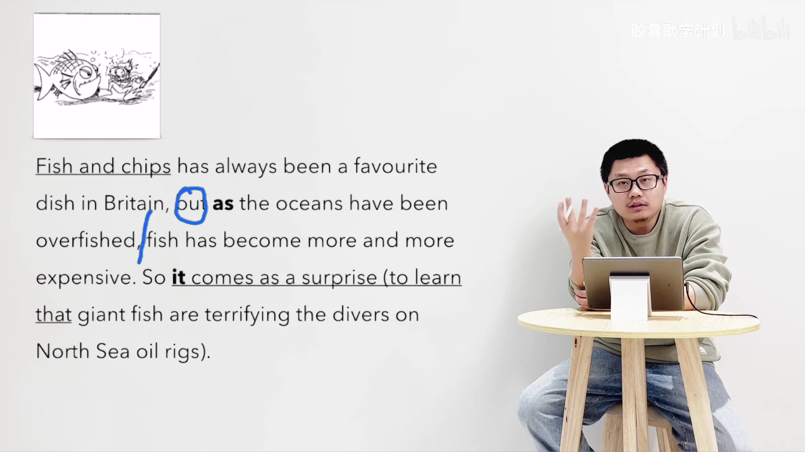

文字识别：Fish and chips has always been a favourite / dish in Britain, / as the oceans have been / Du / overfished, fish has become more and more / expensive. So it comes as a surprise (to learn / that giant fish are terrifying the divers on / North Sea oil rigs).

### 画面 00:03:50

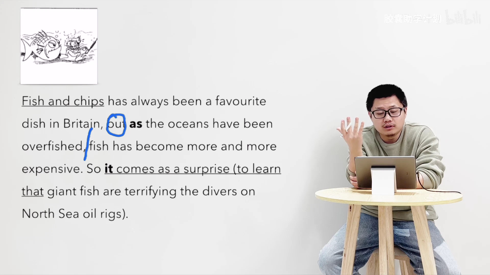

文字识别：Fish and chips has always been a favourite / dish in Britain, / as the oceans have been / Du / overfished,fish has become more and more / expensive. So it comes as a surprise (to learn / that giant fish are terrifying the divers on / North Sea oil rigs).

## 00:04:00–00:04:30

的，听明白了吧？就是我们实际上是，呃，它毕竟是这种语言类的，偏向于人文社科，对吧？我们所谓叫文无第一，武无第二，对吧？就这个地方，它还是呃有探讨的可能性的，有这个探讨的空间的，而不是说老师说的就就是真理了，就不能再被改变了，对吧？OK，呃，那这个我觉得第一句话就解释清楚了，就很舒服啊。接下来，so it comes as a surprise to learn that giant fish

### 画面 00:04:20

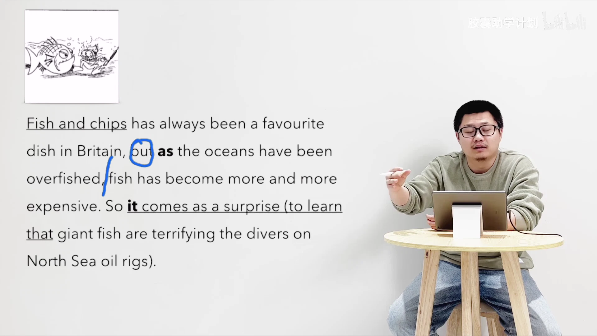

文字识别：Fish and chips has always been a favourite / dish in Britain, / as the oceans have been / overfished, fish has become more and more / expensive. So it comes as a surprise (to learn / that giant fish are terrifying the divers on / North Sea oil rigs).

## 00:04:30–00:05:00

are terrifying the divers on North Sea oil rigs. 呼长一句话，但其实这里边的关键点就是前面这块，后边无所谓。后边无所谓，咱们先看后边吧。叫 giant fish are terrifying the divers on North Sea oil rigs. 大鱼正在哎，最近一直在恐吓着这些 divers. Divers 是什么？就是这些潜水员吧。On North Sea 在北海 oil rigs 那些钻井平台有很多嘛，钻

### 画面 00:04:34

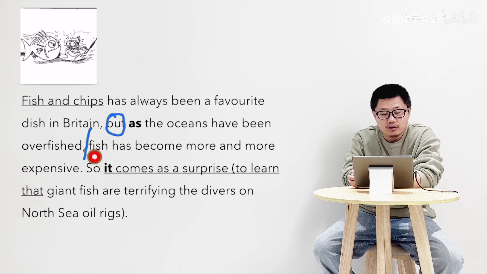

文字识别：Fish and chips has always been a favourite / dish in Britain, / as the oceans have been / out / overfished,fish has become more and more / expensive. So it comes as a surprise (to learn / that giant fish are terrifying the divers on / North Sea oil rigs).

### 画面 00:04:40

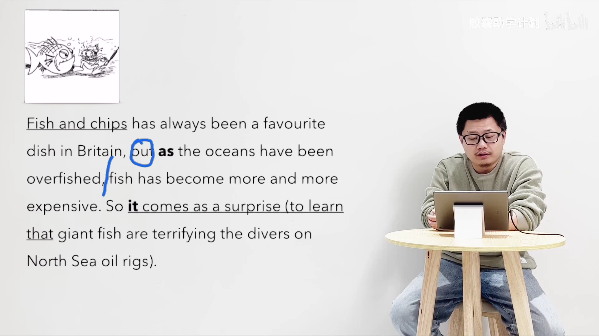

文字识别：Fish and chips has always been a favourite / dish in Britain, / as the oceans have been / out / overfished,fish has become more and more / expensive. So it comes as a surprise (to learn / that giant fish are terrifying the divers on / North Sea oil rigs).

### 画面 00:04:59

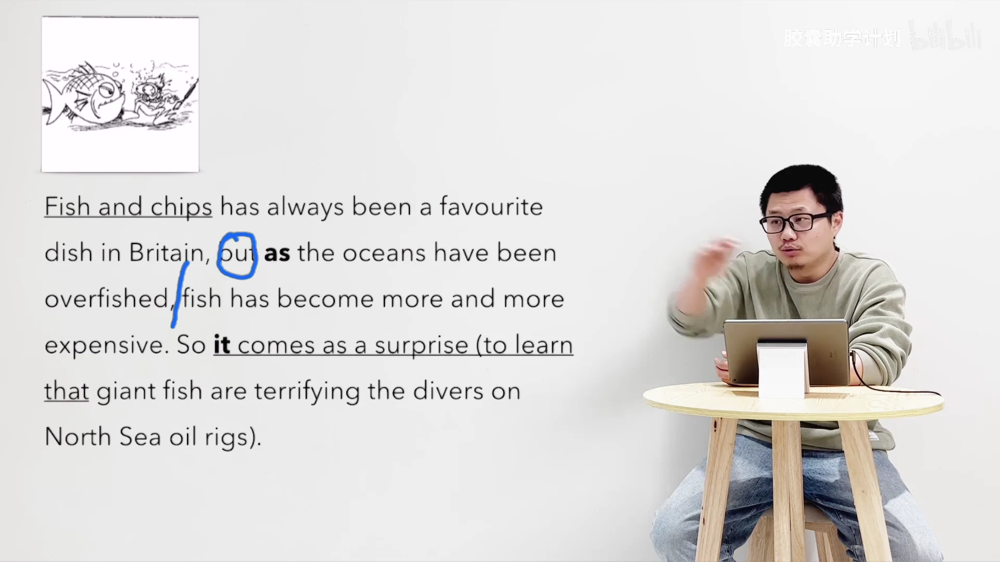

文字识别：Fish and chips has always been a favourite / dish in Britain, / as the oceans have been / out / overfished,fish has become more and more / expensive. So it comes as a surprise (to learn / that giant fish are terrifying the divers on / North Sea oil rigs).

## 00:05:00–00:05:30

钻井平台，比如有十个，但是这个十个钻井平台，哎，都发生了类似的事儿，就是这个非常大的鱼吓到了那些 divers 潜水员。好，我们不知道为什么潜水员会在 oil rigs，但是它给我们提供了这样一个信信息，对吧？主语是 giant fish，然后下的是谁呢？下的是 divers。地点呢是 on North Sea 北海的 oil rigs，对吧？哎，钻井平台上，钻井平台这个地方。然后这个地方呢，实际上 are terrifying。这个地方又是我

### 画面 00:05:01

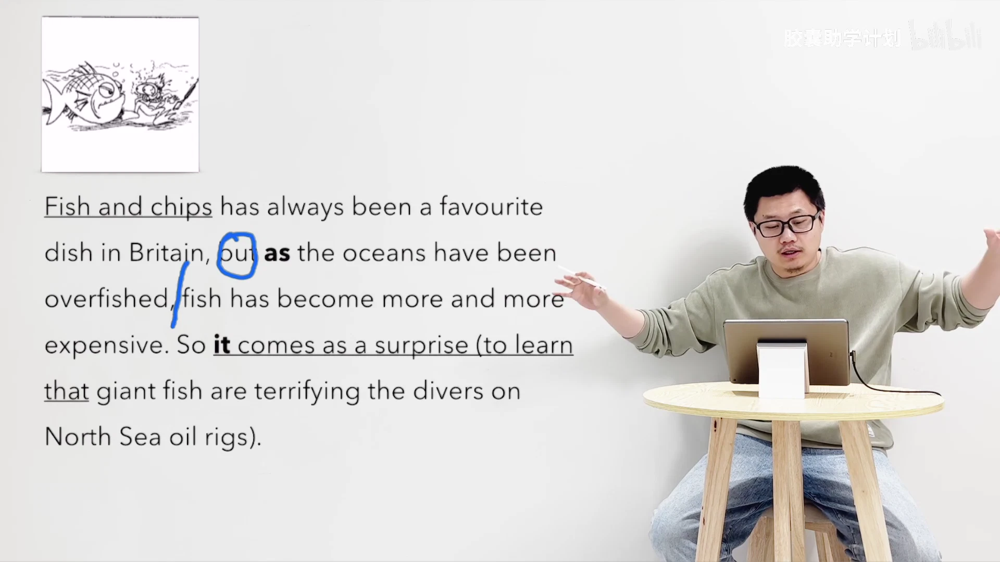

文字识别：Fish and chips has always been a favourite / dish in Britain, / as the oceans have been / ou / overfished, fish has become more and more / expensive. So it comes as a surprise (to learn / that giant fish are terrifying the divers on / North Sea oil rigs).

### 画面 00:05:04

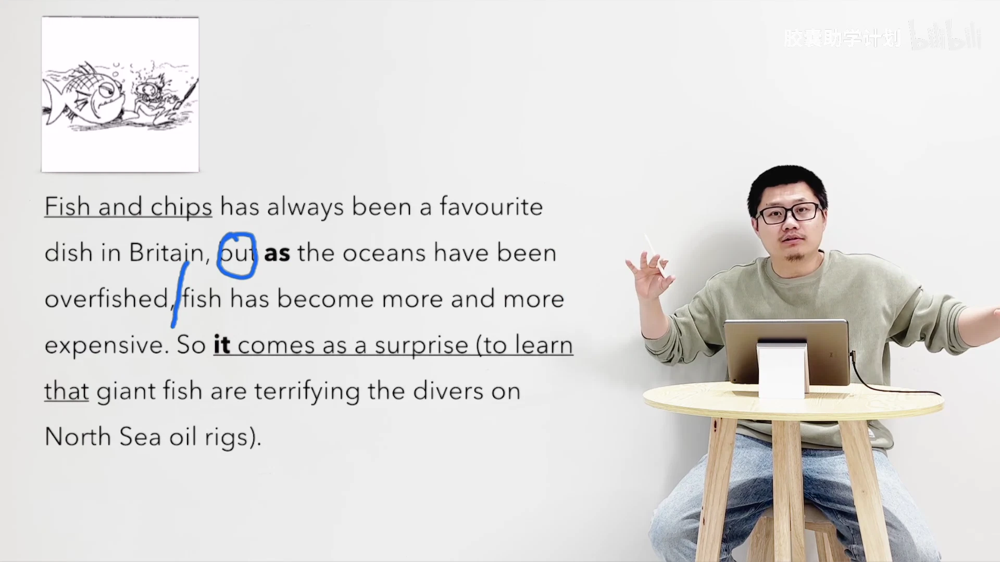

文字识别：Fish and chips has always been a favourite / dish in Britain, / as the oceans have been / Du / overfished,fish has become more and more / expensive. So it comes as a surprise (to learn / that giant fish are terrifying the divers on / North Sea oil rigs).

### 画面 00:05:08

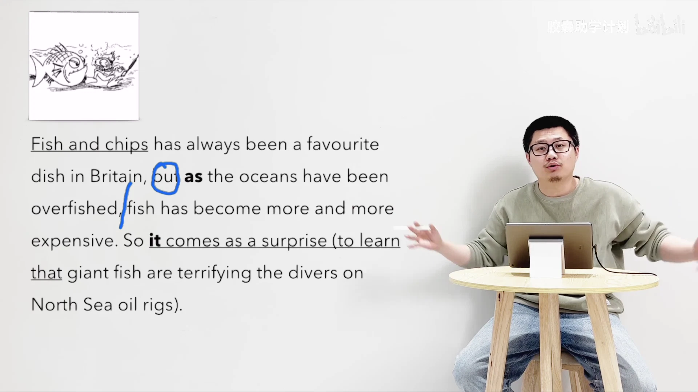

文字识别：Fish and chips has always been a favourite / dish in Britain, / as the oceans have been / Du / overfished,fish has become more and more / expensive. So it comes as a surprise (to learn / that giant fish are terrifying the divers on / North Sea oil rigs).

### 画面 00:05:14

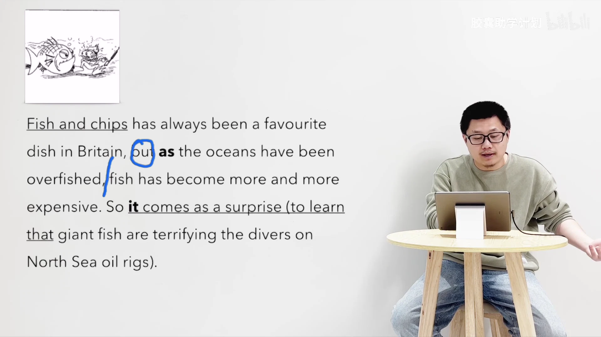

文字识别：Fish and chips has always been a favourite / dish in Britain, / as the oceans have been / ou / overfished,fish has become more and more / expensive. So it comes as a surprise (to learn / that giant fish are terrifying the divers on / North Sea oil rigs).

### 画面 00:05:29

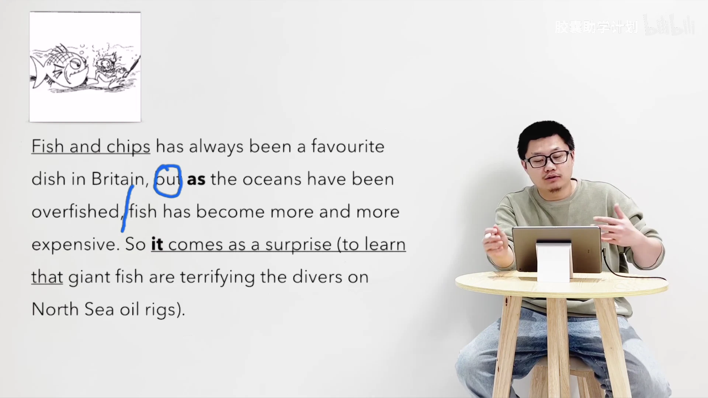

文字识别：Fish and chips has always been a favourite / dish in Britain, / as the oceans have been / ou' / overfished,fish has become more and more / expensive. So it comes as a surprise (to learn / that giant fish are terrifying the divers on / North Sea oil rigs).

## 00:05:30–00:06:00

自己的感觉啊。如果我们把它真的翻译成现在进行时，是有一点怪的。现在进行时就是我写这篇文章的时候，它正在下，对吧？那你怎么知道？好像是没法知道的。但是现在进行时在第二课的时候，我们说过一个用法。如果其实后边我再给你加上叫 these days，如果你当那课学的特别好，我觉得你现在可能立刻就懂了我想说啥了。比如说，我现在就可以说说 I'm reading understanding business these days.

### 画面 00:05:31

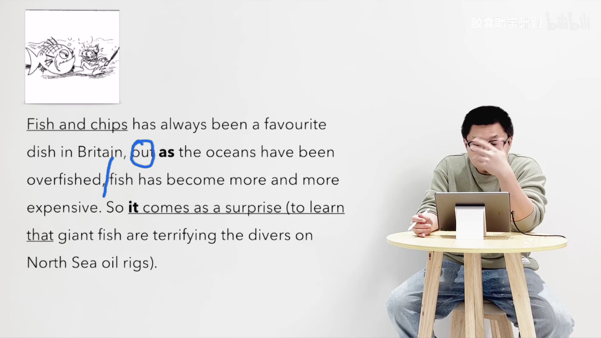

文字识别：Fish and chips has always been a favourite / dish in Britain, / as the oceans have been / out / overfished,fish has become more and more / expensive. So it comes as a surprise (to learn / that giant fish are terrifying the divers on / North Sea oil rigs).

### 画面 00:05:33

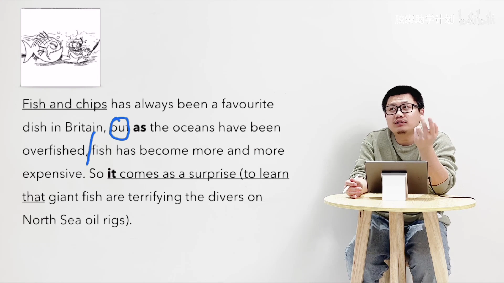

文字识别：Fish and chips has always been a favourite / dish in Britain, / as the oceans have been / Du / overfished,fish has become more and more / expensive. So it comes as a surprise (to learn / that giant fish are terrifying the divers on / North Sea oil rigs).

### 画面 00:05:35

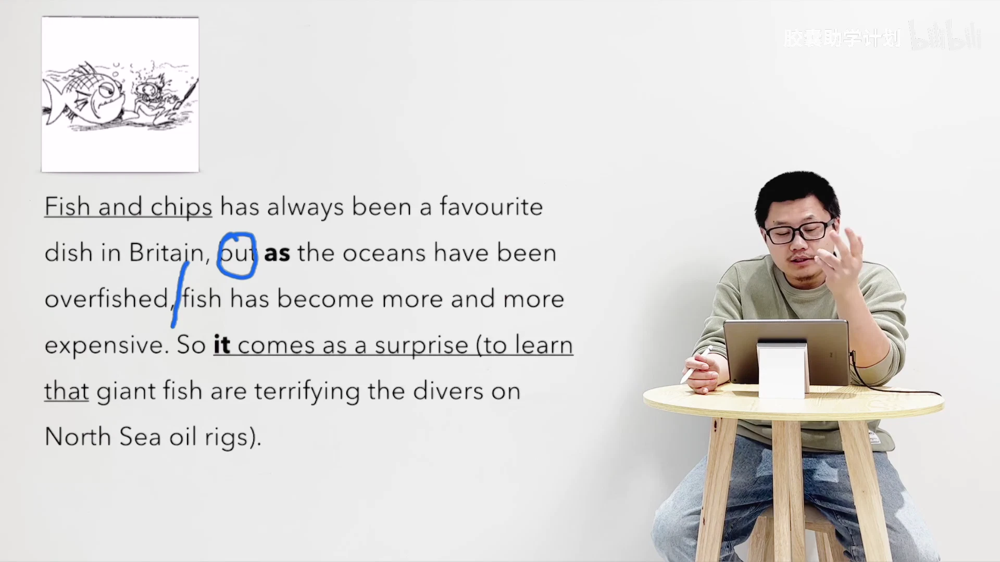

文字识别：Fish and chips has always been a favourite / dish in Britain, / as the oceans have been / out / overfished,fish has become more and more / expensive. So it comes as a surprise (to learn / that giant fish are terrifying the divers on / North Sea oil rigs).

### 画面 00:05:55

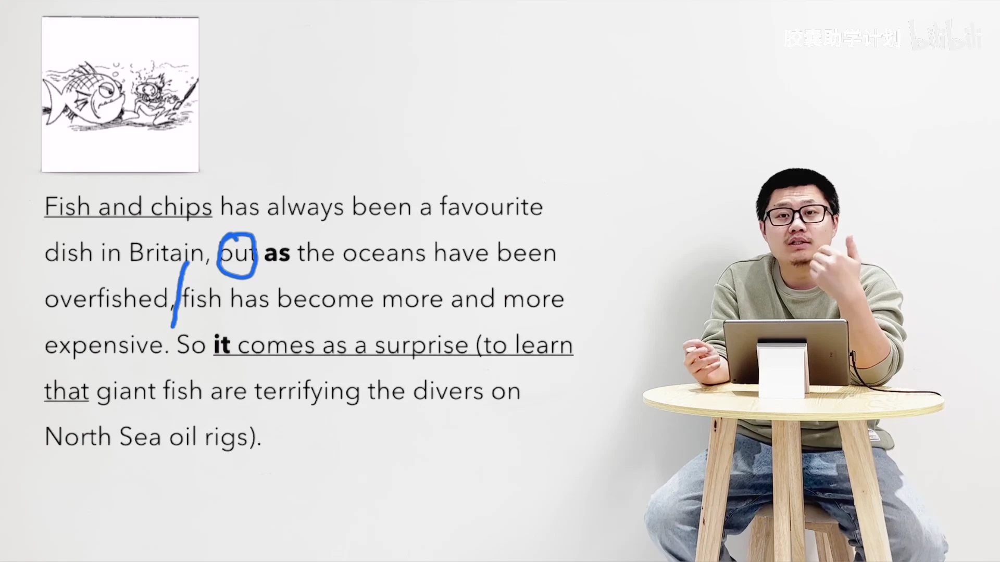

文字识别：Fish and chips has always been a favourite / dish in Britain, / as the oceans have been / out / overfished,fish has become more and more / expensive. So it comes as a surprise (to learn / that giant fish are terrifying the divers on / North Sea oil rigs).

## 00:06:00–00:06:30

我现在造了一句话，说我最近正在读，哎，某本书啊，Understanding business这本书，对吧？好，然后你会注意到一件事情，是我现在正在给你上课，我也没有在读那本书啊啊！但是我后边加了一个 these days，告诉你的事情是什么？就是 be doing 有一个用法，你仔细回顾一下啊，表示的是近期在做某件事情。但是说这句话的时候，我可以没有正在做这件事儿。所以这句话翻译成汉语就是近期我正在读一本书，

### 画面 00:06:01

文字识别：Fish and chips has always been a favourite / dish in Britain, / as the oceans have been / Du / overfished,fish has become more and more / expensive. So it comes as a surprise (to learn / that giant fish are terrifying the divers on / North Sea oil rigs).

### 画面 00:06:09

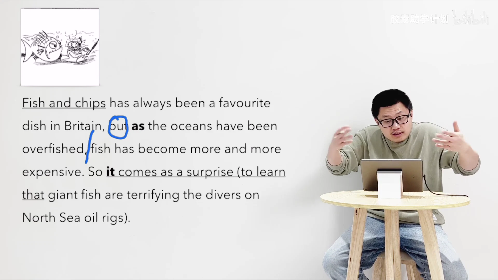

文字识别：Fish and chips has always been a favourite / dish in Britain, / as the oceans have been / Du / overfished,fish has become more and more / expensive. So it comes as a surprise (to learn / that giant fish are terrifying the divers on / North Sea oil rigs).

### 画面 00:06:13

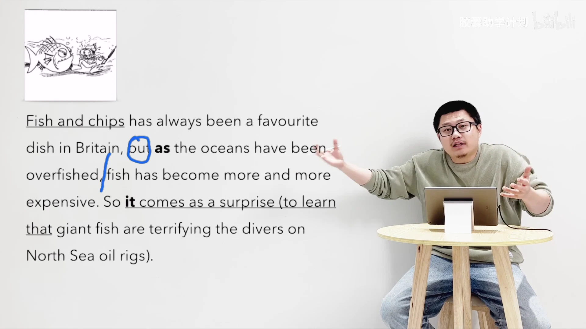

文字识别：Fish and chips has always been a favourite / dish in Britain, / as the oceans have been / Du / overfished,fish has become more and more / expensive. So it comes as a surprise (to learn / that giant fish are terrifying the divers on / North Sea oil rigs).

### 画面 00:06:16

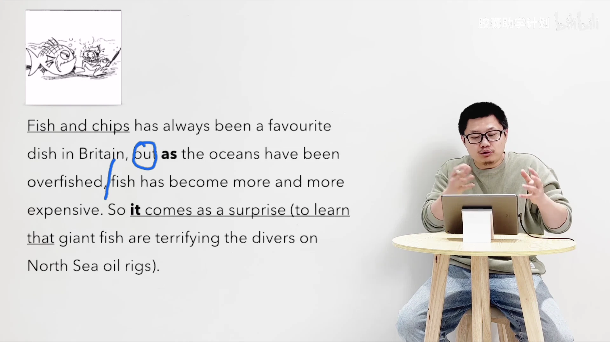

文字识别：Fish and chips has always been a favourite / dish in Britain, / as the oceans have been / out / overfished,fish has become more and more / expensive. So it comes as a surprise (to learn / that giant fish are terrifying the divers on / North Sea oil rigs).

## 00:06:30–00:07:00

他用的就是be doing，所以在这里呢，我觉得你要给真给他硬给他翻译成正在做某事儿是不太好的，就好比他那个感觉就是好比是我写这篇文章的时候，我想表达我写这篇文章的时候，一些大鱼正在下，那肯定不是这个意思，他肯定想表达的是，至少我从我的语感上来说，我偏向于认为他表达的是我写这篇文章的时候呢，最近近期总有大鱼去骚扰这些啊，就吓到这些潜水员，

### 画面 00:06:34

文字识别：Fish and chips has always been a favourite / dish in Britain, / as the oceans have been / Du / overfished,fish has become more and more / expensive. So it comes as a surprise (to learn / that giant fish are terrifying the divers on / North Sea oil rigs).

### 画面 00:06:36

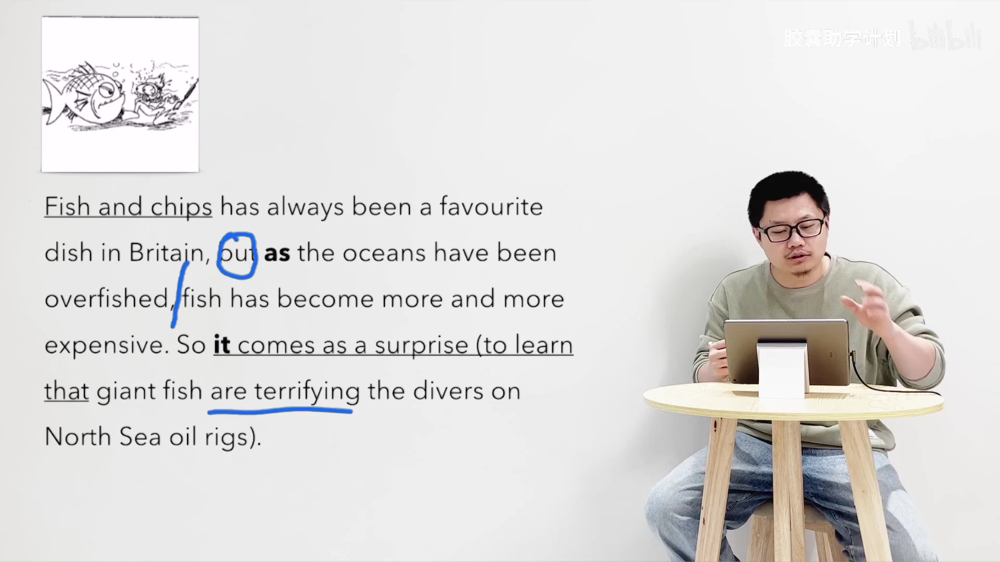

文字识别：Fish and chips has always been a favourite / dish in Britain, / as the oceans have been / out / overfished,fish has become more and more / expensive. So it comes as a surprise (to learn / that giant fish are terrifying the divers on / North Sea oil rigs).

### 画面 00:06:38

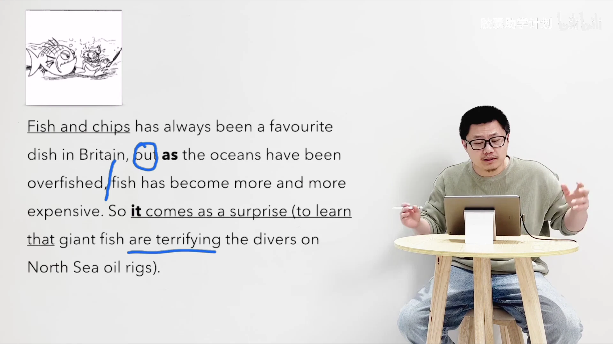

文字识别：Fish and chips has always been a favourite / dish in Britain, / as the oceans have been / out / overfished,fish has become more and more / expensive. So it comes as a surprise (to learn / that giant fish are terrifying the divers on / North Sea oil rigs).

### 画面 00:06:41

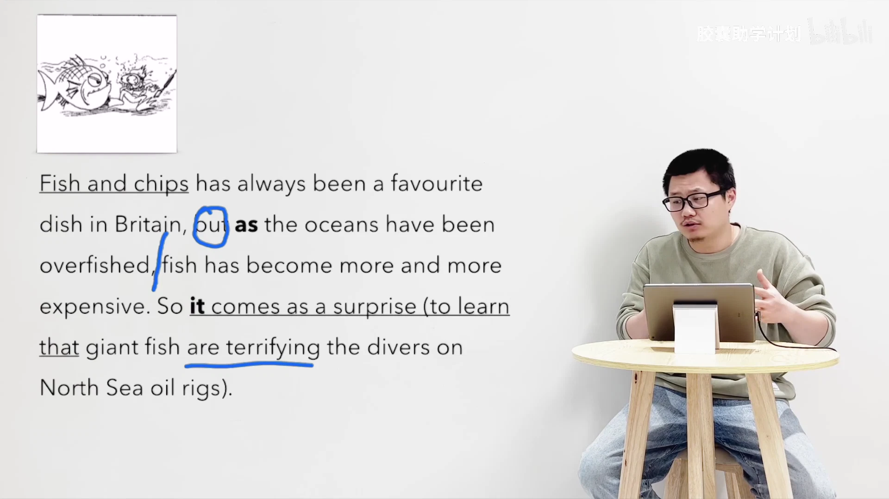

文字识别：Fish and chips has always been a favourite / dish in Britain, / as the oceans have been / but / overfished,fish has become more and more / expensive. So it comes as a surprise (to learn / that giant fish are terrifying the divers on / North Sea oil rigs).

### 画面 00:06:56

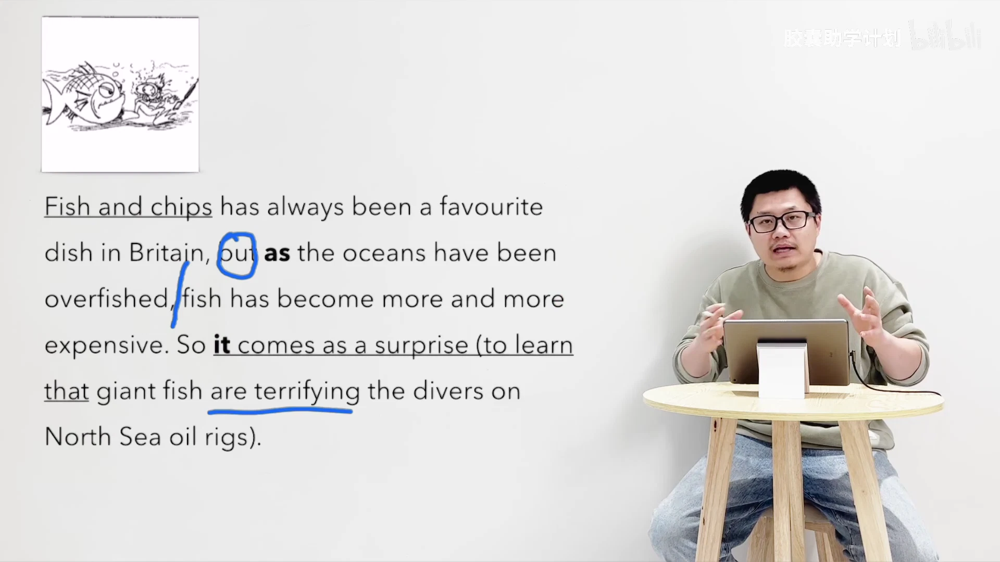

文字识别：Fish and chips has always been a favourite / dish in Britain, / as the oceans have been / Du / overfished,fish has become more and more / expensive. So it comes as a surprise (to learn / that giant fish are terrifying the divers on / North Sea oil rigs).

## 00:07:00–00:07:30

对吧？所以它是一个表近期，但是写这句话或说这句话的时候，这个事儿可以没有正在发生。这是咱们第二课学过的，我希望您还记得。当然，我们那个语法专项这个视频当中也有这个讲解，你也可以去看一下啊。Continuing，后边这句话说完了之后，我们看前面叫 It comes as a surprise，一个一个翻译叫它来了，哎呃，就像一个什么样的，就是作为一个呃惊喜啊惊吓

### 画面 00:07:06

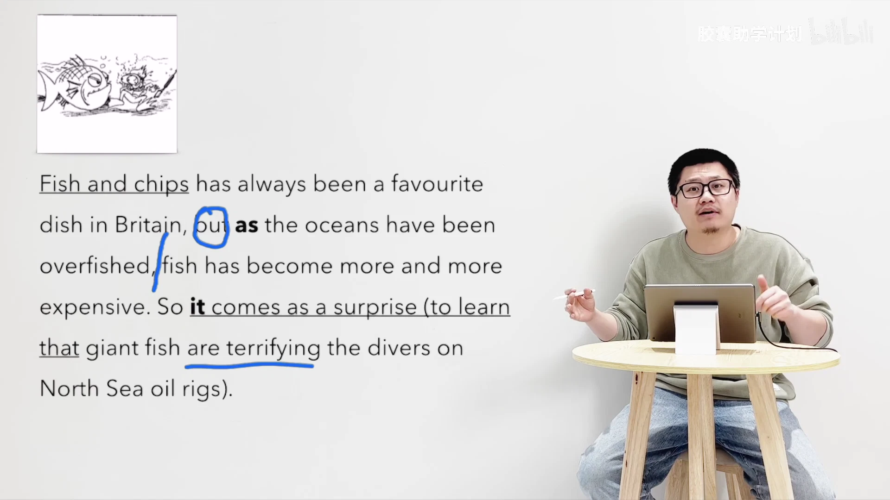

文字识别：Fish and chips has always been a favourite / dish in Britain, / as the oceans have been / out / overfished,fish has become more and more / expensive. So it comes as a surprise (to learn / that giant fish are terrifying the divers on / North Sea oil rigs).

### 画面 00:07:10

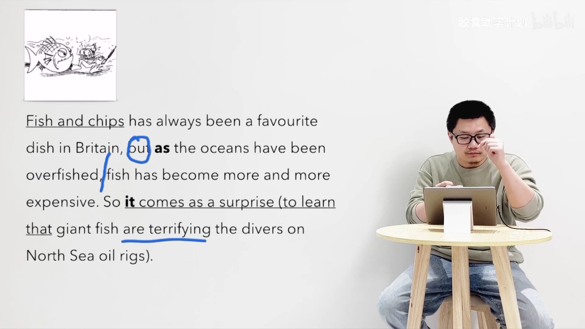

文字识别：Fish and chips has always been a favourite / dish in Britain, / as the oceans have been / Du / overfished,fish has become more and more / expensive. So it comes as a surprise (to learn / that giant fish are terrifying the divers on / North Sea oil rigs).

### 画面 00:07:13

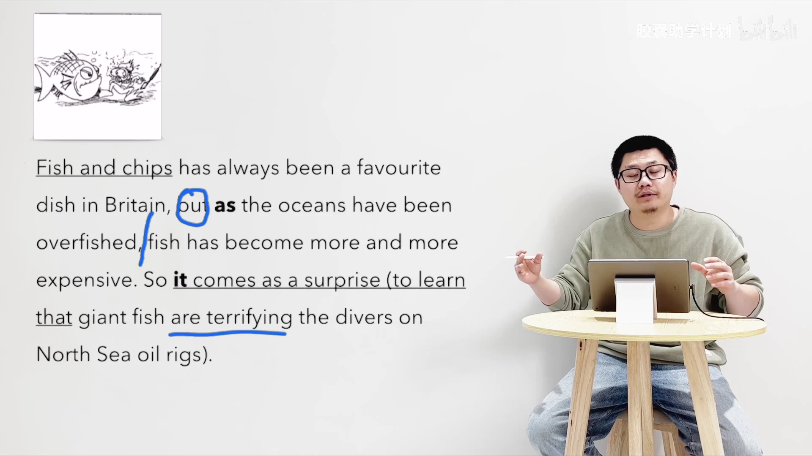

文字识别：Fish and chips has always been a favourite / dish in Britain, / as the oceans have been / ou / overfished,fish has become more and more / expensive. So it comes as a surprise (to learn / that giant fish are terrifying the divers on / North Sea oil rigs).

### 画面 00:07:17

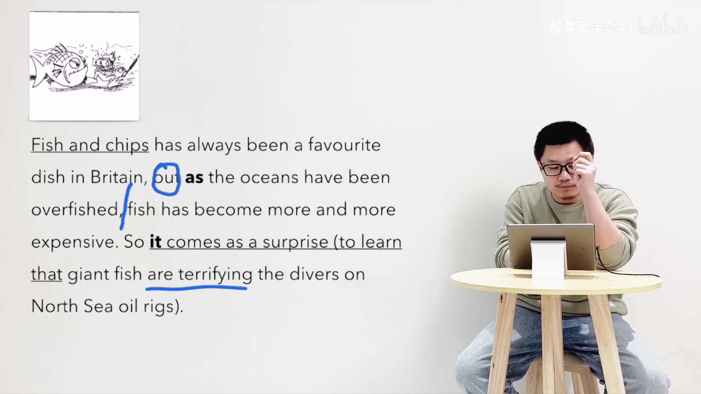

文字识别：Fish and chips has always been a favourite / dish in Britain, / as the oceans have been / out / overfished,fish has become more and more / expensive. So it comes as a surprise (to learn / that giant fish are terrifying the divers on / North Sea oil rigs).

## 00:07:30–00:08:00

啊，或者说这个这个很惊讶的事情，去意识到某件事儿，所以这句话其实是这样的，叫做 it comes as a surprise，叫它呀来来的就像一个惊惊喜一样，就是字面翻译啊，现在不对啊，我先给你字面着吧着吧。那于是你自然会问一个，就是谁哎来的和一个惊惊喜惊讶的事儿一样，其实就是后边这件事儿叫做 to learn，一直到结尾叫做意识到大于近期正在

### 画面 00:07:47

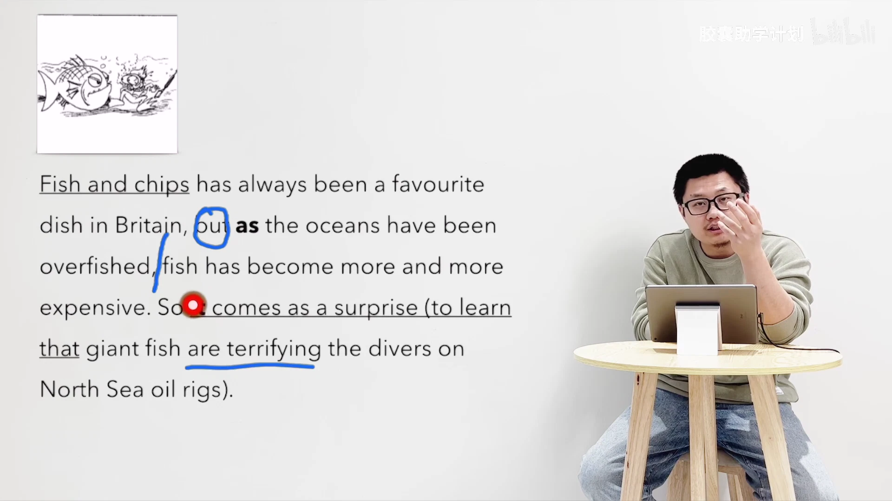

文字识别：Fish and chips has always been a favourite / dish in Britain, / as the oceans have been / out / overfished,fish has become more and more / expensive. Soo comes as a surprise (to learn / that giant fish are terrifying the divers on / North Sea oil rigs).

## 00:08:00–00:08:30

在哎，这个 North Oil Rigs 这个地方恐吓呃恐这个使这些呃潜水员害怕，对吧？吓他们一大跳，这个事儿变得很惊喜，很惊讶。为什么呢？因为说了嘛，Ocean have been overfished，鱼都已经快被捕捞完了，鱼越来越贵，都没鱼了，怎么会突然间来这么多大鱼呢？对吧？所以说，It comes as a surprise。所以这个地方的 It 其实本质上和整个 to

### 画面 00:08:15

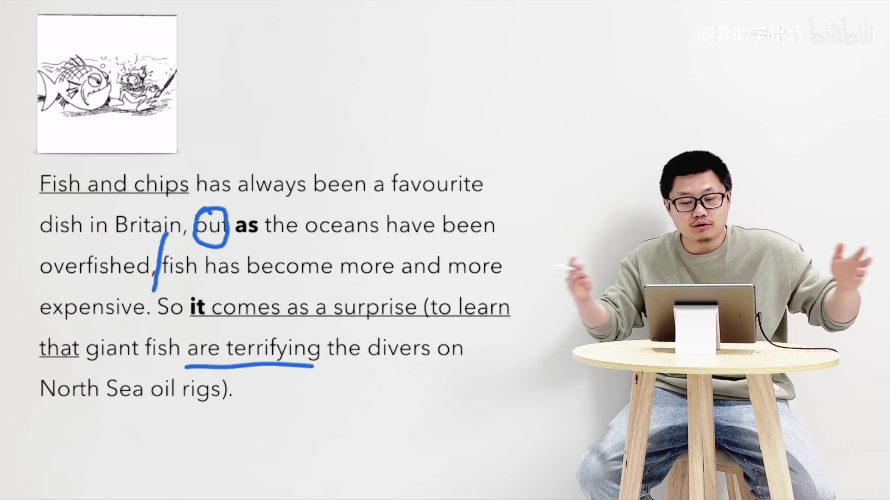

文字识别：Fish and chips has always been a favourite / dish in Britain, / as the oceans have been / overfished,fish has become more and more / expensive. So it comes as a surprise (to learn / that giant fish are terrifying the divers on / North Sea oil rigs).

### 画面 00:08:17

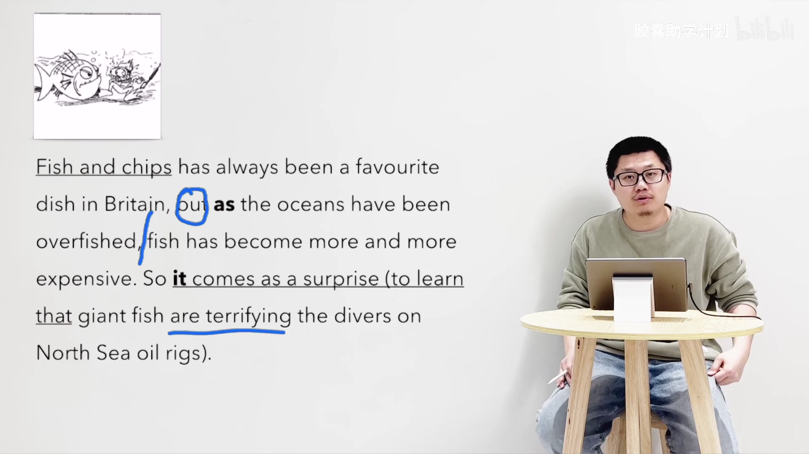

文字识别：Fish and chips has always been a favourite / dish in Britain, / as the oceans have been / but / overfished,fish has become more and more / expensive. So it comes as a surprise (to learn / that giant fish are terrifying the divers on / North Sea oil rigs).

### 画面 00:08:19

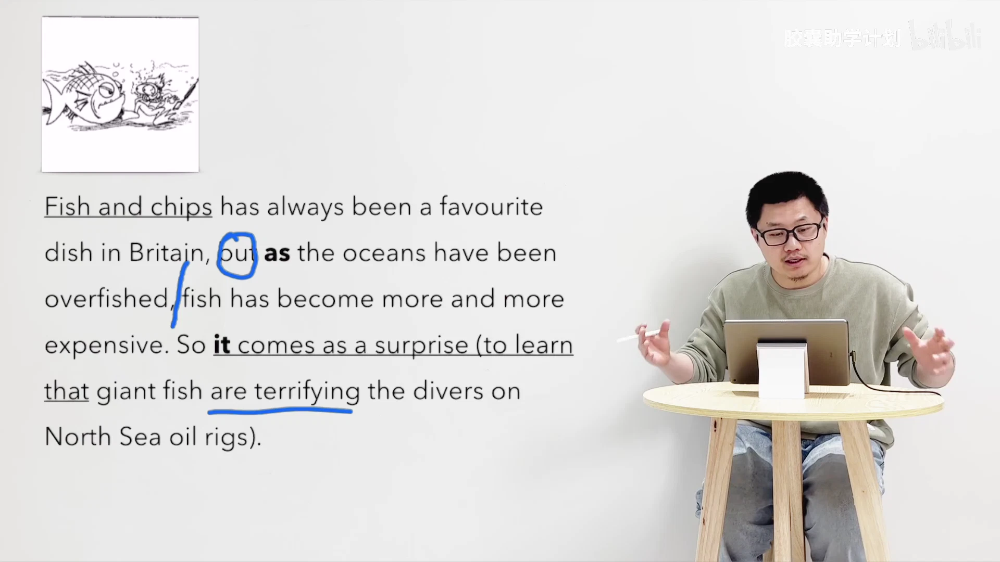

文字识别：Fish and chips has always been a favourite / dish in Britain, / as the oceans have been / Du / overfished,fish has become more and more / expensive. So it comes as a surprise (to learn / that giant fish are terrifying the divers on / North Sea oil rigs).

### 画面 00:08:21

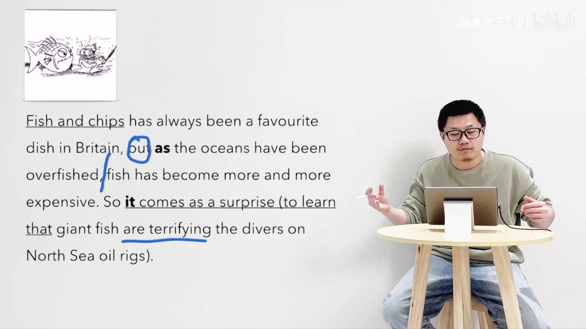

文字识别：Fish and chips has always been a favourite / dish in Britain, / as the oceans have been / but / overfished,fish has become more and more / expensive. So it comes as a surprise (to learn / that giant fish are terrifying the divers on / North Sea oil rigs).

### 画面 00:08:25

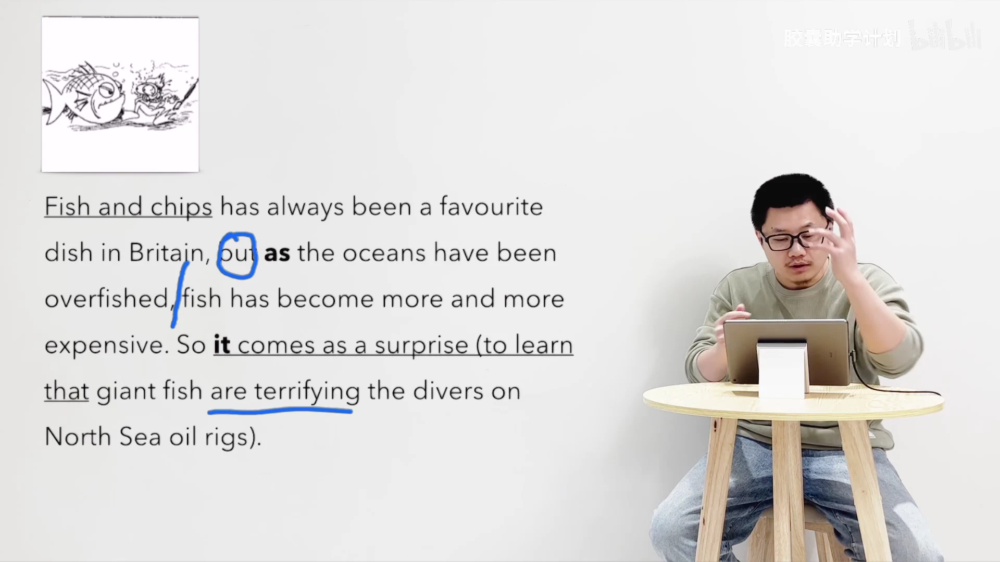

文字识别：Fish and chips has always been a favourite / dish in Britain, / as the oceans have been / out / overfished,fish has become more and more / expensive. So it comes as a surprise (to learn / that giant fish are terrifying the divers on / North Sea oil rigs).

### 画面 00:08:29

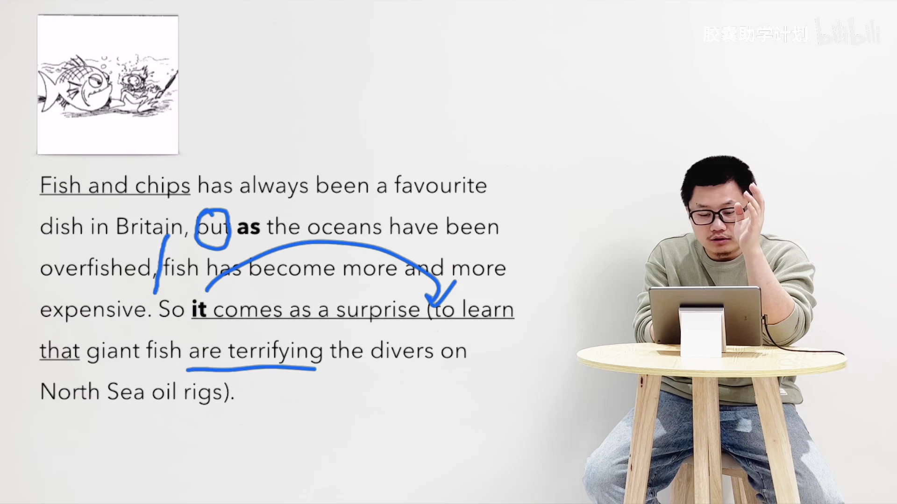

文字识别：Fish and chips has always been a favourite / dish in Britain, / as the oceans have been / out / overfished,fish has become more and more / expensive. So it comes as a surprise Yo learn / that giant fish are terrifying the divers on / North Sea oil rigs).

## 00:08:30–00:09:00

to learn一直到 rakes 是一码事儿，也就是说这儿其实合起来 to do 引导的一个结构，其实做了一个定呃做了一个主语，对啊，就是，但是呢，我们这么去理解，对于很多同学，因为我注意到，第一是我从小我从小英语算好的，学到大，老师这么讲，我都有点懵，就不理解。后来我意识到一件事，其实你不需要去理解，对于你来说，你需要真的记住的就是这个东西，叫 it comes as a surprise to learn that 加一句话，

### 画面 00:08:31

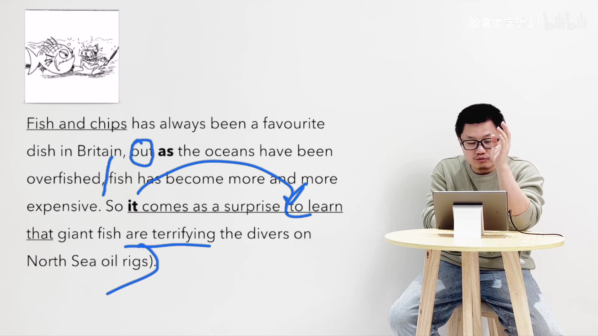

文字识别：Fish and chips has always been a favourite / dish in Britain, / as the oceans have been / but / overfished,fish has become more and more / expensive. So it comes as a surprise / Yo learn / that giant fish are terrifying the divers on / North Sea oil rigs).

### 画面 00:08:37

文字识别：Fish and chips has always been a favourite / dish in Britain, / as the oceans have been / out / overfished fishhas become more and more / expensive. So it comes as a surpriseYo learn / that giant fish are terrifying the divers on / North Sea oil rigs).

### 画面 00:08:42

文字识别：Fish and chips has always been a favourite / dish in Britain, / as the oceans have been / out / overfished,fish has become more and more / expensive. So it comes as a surprise (to learn / that giant fish are terrifying the divers on / North Sea oil rigs).

### 画面 00:08:44

文字识别：Fish and chips has always been a favourite / dish in Britain, but as the oceans have been / overfished, fish has become more and more / expensive. So it comes as a surprise (to learn / that giant fish are terrifying the divers on / North Sea oil rigs).

### 画面 00:08:54

文字识别：Fish and chips has always been a favourite / dish in Britain, but as the oceans have been / overfished, fish has become more and more / expensive. So it comes as a surprise (to learn / that giant fish are terrifying the divers on / North Sea oil rigs).

## 00:09:00–00:09:30

因为对于大多数学员来说，我去使用高难语法，习惯用反话。我在使用的时候，我只需要说，我想表达说，哎呀，知道这件事儿还挺惊讶的。这一句话拿英文怎么说就够了？叫做 It comes as a surprise to learn that. 然后后边我们造他十句二十句话。以后张嘴你想说任何一句话，说任何一个事儿，说知道这事儿还还挺惊讶的。说哎呀，知道说这个这个，他嫁到上澳大利亚去了，或者他娶了一个新西兰的

### 画面 00:09:02

文字识别：Fish and chips has always been a favourite / dish in Britain, but as the oceans have been / overfished, fish has become more and more / expensive. So it comes as a surprise (to learn / that giant fish are terrifying the divers on / North Sea oil rigs).

### 画面 00:09:15

文字识别：Fish and chips has always been a favourite / dish in Britain, but as the oceans have been / overfished, fish has become more and more / expensive. So it comes as a surprise (to learn / that giant fish are terrifying the divers on / North Sea oil rigs).

### 画面 00:09:18

文字识别：Fish and chips has always been a favourite / dish in Britain, but as the oceans have been / overfished, fish has become more and more / expensive. So it comes as a surprise (to learn / that giant fish are terrifying the divers on / North Sea oil rigs).

## 00:09:30–00:10:00

媳妇儿，这事儿还挺惊讶的，是吧？呃，这个村头的老李，是吧？好，所以你可以就说 it comes as a surprise to learn that。村头老李娶了一个新西兰媳妇儿，还挺惊讶的，让人感觉，听明白了吧？所以我们最后要练熟的就是 it comes as a surprise to learn that。所以我们直接把它当习惯用法拉出来就完了啊。接下来，all your rigs have to be repaired frequently and diverse。看这个逗号，

### 画面 00:09:39

文字识别：Fish and chips has always been a favourite / dish in Britain, but as the oceans have been / overfished, fish has become more and more / expensive. So it comes as a surprise (to learn / that giant fish are terrifying the divers on / North Sea oil rigs).

### 画面 00:09:42

文字识别：Fish and chips has always been a favourite / dish in Britain, but as the oceans have been / overfished, fish has become more and more / expensive. So it comes as a surprise (to learn / that giant fish are terrifying the divers on / North Sea oil rigs).

### 画面 00:09:46

文字识别：Fish and chips has always been a favourite / dish in Britain, but as the oceans have been / overfished, fish has become more and more / expensive. So it comes as a surprise (to learn / that giant fish are terrifying the divers on / North Sea oil rigs).

### 画面 00:09:49

文字识别：Fish and chips has always been a favourite / dish in Britain, but as the oceans have been / overfished, fish has become more and more / expensive. So it comes as a surprise (to learn / that giant fish are terrifying the divers on / North Sea oil rigs).

### 画面 00:09:51

文字识别：Oil rigs have to be repaired frequently and / divers, who often have to work in darkness a / hundred feet under water, have been / frightened out of their wits by giant fish / bumping into them as they work. Now they /  [6had special cages made / to protect / have' / them from these monsters.

### 画面 00:09:53

文字识别：Oil rigs have to be repaired frequently and / divers, who often have to work in darkness a / hundred feet under water, have been / frightened out of their wits by giant fish / bumping into them as they work. Now they / have L6had special cages made / to protect / them from these monsters.

### 画面 00:09:56

文字识别：Oil rigs have to be repaired frequently and / divers, who often have to work in darkness a / hundred feet under water, have been / frightened out of their wits by giant fish / bumping into them as they work. Now they / have L6had special cages made / to protect / them from these monsters.

## 00:10:00–00:10:30

注意，Who have who often have to work in darkness a hundred feet under water have been frightened out of their wits by giant fish bumping into them as they work.啊，这个我一口气读完都有点费劲，真长，是吧？这基本上这一句话都恨不得赶上一段了。但是还是刚才我说的那句话，甭担心，你基本上只要学会几个事儿，就是该断句断句，那该断句断

### 画面 00:10:15

文字识别：Oil rigs have to be repaired frequently and / divers, who often have to work in darkness a / hundred feet under water, have been / frightened out of their wits by giant fish / bumping into them as they work. Now they / have L6had special cages made / to protect / them from these monsters.

### 画面 00:10:24

文字识别：Oil rigs have to be repaired frequently and / divers, who often have to work in darkness a / hundred feet under water, have been / frightened out of their wits by giant fish / bumping into them as they work. Now they / have L6had special cages made / to protect / them from these monsters.

## 00:10:30–00:11:00

句，其实就差不多了。怎么断句的标准是什么呢？我们一边看一边学。Oil rigs这些钻井 have to be repaired frequently，说必须要被修理。Have to be done，这十七课咱就学过了，二十一课也学，二十一课学过了，不多说了啊。说必须要被修理，frequently 很频繁的需要被修理。然后，其实

### 画面 00:10:31

文字识别：Oil rigs have to be repaired frequently and / divers, who often have to work in darkness a / hundred feet under water,have been / frightened out of their wits by giant fish / bumping into them as they work. Now they / have [6had special cages made / to protect / them from these monsters.

## 00:11:00–00:11:30

从然后这个地方，其实从然后这个地方应该有一个小的断句，后边叫做 diverse，啊，我换一个颜色的笔， diverse，后边紧跟了一个，你看这儿有一个逗号，后边有一个 who，非限定性定语从句，咱先不管它，直接把它抹掉，直接把它抹掉啊，然后说 diverse 怎么样了呢？ Have been frightened out of their wits by giant fish，这

### 画面 00:11:01

文字识别：Oil rigs have to be repaired frequently and / divers, who often have to work in darkness a / hundred feet under water,have been / frightened out of their wits by giant fish / bumping into them as they work. Now they / have L6had special cages made / to protect / them from these monsters.

### 画面 00:11:17

文字识别：Oil rigs have to be repaired frequently/and / diverswho / darknessa / hundred feet under water,/have been / frightened out of their wits by giant fish / bumping into them as they work. Now they / have l66had special cages made / to protect / them from these monsters.

### 画面 00:11:19

文字识别：Oil rigs have to be repaired frequently/and / diverswhoo / larknessa / bundred feet under water,have been / frightened out of their wits by giant fish / bumping into them as they work. Now they / have l6had special cages made / to protect / them from these monsters.

### 画面 00:11:26

文字识别：Oil rigs have to be repaired frequently/and / diverswhoo / Harknessa / hundred feet under water,have been / frightened out of their wits by giant fish / bumping into them as they work. Now they /  [6had special cages made / to protect / have / them from these monsters.

### 画面 00:11:28

文字识别：Oil rigs have to be repaired frequently/and / diverswhoo / larknessa / hundred feet under water,have been / frightened out of their wits by giant fish / bumping into them as they work. Now they /  [6had special cages made / to protect / have / them from these monsters.

## 00:11:30–00:12:00

is a sentence called saying that these divers have been scared to the point of losing their minds, scared to the point of being confused. In Northeastern Chinese, right? They're scared to the point of being confused, scared by these huge fish. This is the second sentence information. The first sentence, drilling needs to be repaired often. The second sentence, divers, divers, divers. You see, they need to be repaired. This sea drilling, of course, requires divers to dive down to repair it, right? So, divers are reasonable. Divers are often, ah, already scared to the point

### 画面 00:11:44

文字识别：Oil rigs have to be repaired frequently/and / diverswhoo / arknessa / hundred feet under water,have been / frightened out of their wits by giant fish / bumping into them as they work. Now they /  L6had special cages made / to protect / have / them from these monsters.

### 画面 00:11:50

文字识别：Oil rigs have to be repaired frequently/and / diverswho oft / larknessa / hundred feet under water,have been / frightened out of their wits by giant fish / bumping into them as they work. Now they / have l66had special cages made / to protect / them from these monsters.

## 00:12:00–00:12:30

啊，就就已经被吓的就丧失理智了啊，被这些鱼就其实就是吓了一大跳啊，经常被吓了一大跳，被这些巨大的鱼。好，然后呢，咱们现在再回到这个非限定性定语从句，这个非限定性定语从句提供的是补充信息的作用，它补充的是 divers，就是 they 对吧？说 they often have to work in darkness a hundred feet under water，说他们经常不得不必须工作在黑暗当中 a hundred

### 画面 00:12:10

文字识别：Oil rigs have to be repaired frequently/and / divers who often have to work in darkness a / hundred feet under water,/have been / frightened out of their wits by giant fish / bumping into them as they work. Now they / have L6had special cages made / to protect / them from these monsters.

## 00:12:30–00:13:00

feet，哎，一百英尺 under water，在水下合理。然后后边给了个 bumping into them， bumping into them 这个地方，其实如果你语法足够好，我甚至可以不用加斜线，但你忘了我就加一个斜线。斜线提醒你什么呢？就是 by giant fish 这个地方后边为什么出来了个 bumping into them？二十八、二十九、三十，分词做定语后置了，对吧？分词短语做定语后置了，后置到这个 fish 后边去了。如果

### 画面 00:12:40

文字识别：Oil rigs have to be repaired frequently/and / divers who often have to work in darkness a / hundred feet under water,have been / frightened out of their wits by giant fish / bumping into them as they work. Now they / have [6had special cages made / to protect / them from these monsters.

## 00:13:00–00:13:30

到这个地方，我现在已经讲到这儿了，您还不会，你听我的，一定要回二八二九三十，认真再看一遍那个课，对吧？那 bumping into 的这个 bump 就是撞啊啊，撞到他们什么样？被一些巨大的鱼什么样的鱼呢？首先是巨大的，哎，这是第一个表示 giant 鱼的特点。第二个鱼的特点就是哪些鱼呢？叫做 bumping into 的鱼啊，他们看到的其实没

### 画面 00:13:02

文字识别：Oil rigs have to be repaired frequently/and / divers who often have to work in darkness a / hundred feet under water,have been / frightened out of their wits by giant fish / bumping into them as they work. Now they / have L6had special cages made / to protect / them from these monsters.

### 画面 00:13:08

文字识别：Oil rigs have to be repaired frequently/and / divers who often have to work in darkness a / hundred feet under water,have been / frightened out of their wits by giant fish / bumping into them as they work. Now they / have l66had special cages made / to protect / them from these monsters.

### 画面 00:13:22

文字识别：Oil rigs have to be repaired frequently/and / divers who often have to work in darkness a / hundred feet under water, have been / frightened out of their wits by glant fish / bumping into them as they work. Now they / have L66had special cages made / to protect / them from these monsters.

### 画面 00:13:24

文字识别：Oil rigs have to be repaired frequently/and / divers who often have to work in darkness a / hundred feet under water, have been / frightened out of their wits by glant fish / bumping into them as they work. Now they / have / L66 / *had special cages made / to protect / them from these monsters.

### 画面 00:13:26

文字识别：Oil rigs have to be repaired frequently/and / divers / often have to work in darkness / hurdred feet under water,have been / rightened out of their wits by glant fish / bumping into them as they work. Now they / have / L66 / 6had special cages made / to protect / them from these monsters.

## 00:13:30–00:14:00

有，就是鱼突然间撞他们一下，他们吓一跳，对吧？所以这是一个现在分词短语后置做定语。二八二九三十咱们学的，最后这句话很简单，叫 as they work 啊，当他们工作的时候。所以很长的这句话，我们现在都给它拆掉啊，我们现在不需要这些东西，我们从头到尾看一遍，我们能提供了提取哪些信息？第一个信息是钻井平台必须被频繁的修理。

### 画面 00:13:45

文字识别：Oil rigs have to be repaired frequently/and / divers / often have to work in darkness / hurdred feet under water,have been / rightened out of their wits by glant fis / bumping into them as they work. Now they / have / L66 / *had special cages made / to protect / them from these monsters.

### 画面 00:13:47

文字识别：Oil rigs have to be repaired frequently/and / divers who often have to work in darkness a / hundred feet under water,have been / frightened out of their wits by giant fish / bumping into them as they work. Now they / have l66had special cages made / to protect / them from these monsters.

### 画面 00:13:49

文字识别：Oil rigs have to be repaired frequently and / divers, who often have to work in darkness a / hundred feet under water, have been / frightened out of their wits by giant fish / bumping into them as they work. Now they / have L6had special cages made / to protect / them from these monsters.

### 画面 00:13:52

文字识别：Oil rigs have to be repaired frequently and / divers, who often have to work in darkness a / hundred feet under water, have been / frightened out of their wits by giant fish / bumping into them as they work. Now they / have L6had special cages made / to protect / them from these monsters.

### 画面 00:13:55

文字识别：Oil rigs have to be repaired frequently and / divers, who often have to work in darkness a / hundred feet under water, have been / frightened out of their wits by giant fish / bumping into them as they work. Now they / have L6had special cages made / to protect / them from these monsters.

## 00:14:00–00:14:30

第一个信息，第二个信息是， divers这些潜水员呢，说经常必须在黑暗当中，在水下数百一百英尺的地方工作。这是第二个信息。第三个信息呢，就是潜水员呢，呃，经常就被吓得丧失理智了，吓蒙圈了，被这些巨大的鱼。这是第三个信息。第四个信息是呢，那些鱼呢会经常撞到他们。第五个信息呢，就是当他们工作的时候，所以这么长的一句话就被我

### 画面 00:14:01

文字识别：Oil rigs have to be repaired frequently and / diyers, who often have to work in darkness a / hundred feet under water, have been / frightened out of their wits by giant fish / bumping into them as they work. Now they / have L6had special cages made / to protect / them from these monsters.

## 00:14:30–00:15:00

们拆成了一二三四五。当然，你可以变成一二三，这个是因人而异的，怎么去拆，对吧？ Continue. Now, now they have had special cages made to protect them from these monsters.这句话就很简单了，说现在他们怎么样了呢？Have had，现在完成时后边的其实是have something done。六十六课咱们学的，说他们现在找人去制作了一些特殊的笼子，目的是为了

### 画面 00:14:31

文字识别：Oil rigs have to be repaired frequently and / divers, who often have to work in darkness a / hundred feet under water, have been / frightened out of their wits by giant fish / bumping into them as they work. Now they / have L6had special cages made / to protect / them from these monsters.

### 画面 00:14:46

文字识别：Oil rigs have to be repaired frequently and / divers, who often have to work in darkness a / hundred feet under water, have been / frightened out of their wits by giant fish / bumping into them as they work. Now they / have L6had special cages made / to protect / them from these monsters.

## 00:15:00–00:15:30

保护他们，他们指的肯定就是 divers 这些潜水员免于免受说，哎呃呃，这个防护这是什么呢？这些 monsters 就这些怪物，这些鱼过于的大，以至于就直接叫怪物了。 Okay，所以这个句话没有什么可说的啊，讲完了，continue. The fish are not sharks or killer whales, but favorite eating varieties like cod and skate, which grow to unnatural

### 画面 00:15:13

文字识别：Oil rigs have to be repaired frequently and / divers, who often have to work in darkness a / hundred feet under water, have been / frightened out of their wits by giant fish / bumping into them as they work. Now they / have L6had special cages made / to protect / them from these monsters.

### 画面 00:15:19

文字识别：The fish are not sharks or killer whales, but / favourite eating varieties like cod and skate / (which grow to unnatural sizes, sometimes / as much as twelve feet in length). Three / factors have / L88 / 'caused these fish to grow so / large: the warm water round the hot oil / pipes under the sea;

## 00:15:30–00:16:00

sizes, sometimes as much as twelve feet in length.这句话乍一看还是很长，咱注意力还是得集中啊。我给各位先标一标。哎，像这些单词一标，其实句子又拆开了。那这些鱼并不是鲨鱼或者杀人鲸。这句话很简单吧？哎，but而是啊，而是什么呢？Favorite eating varieties就

### 画面 00:15:36

文字识别：The fish are not sharks or killer whales, but / favourite eating varieties like cod and skate / (which grow to unnatural sizes, sometimes / as much as twelve feet in length). Three / factors have / L88 / caused these fish to grow so / large: the warm water round the hot oil / pipes under the sea;

### 画面 00:15:39

文字识别：The fish are not sharks or killer whales, but / favourite eating varieties like cod and skate / (which grow to unnatural sizes, sometimes / as much as twelve feet in length). Three / factors have / L88 / caused these fish to grow so / large: the warm water round the hot oil / pipes under the sea;

### 画面 00:15:44

文字识别：The fish are not sharks or killer whales, / but / favourite eating varieties like cod and skate / Whicl / grow to unnatural sizes, sometimes / as much as twelve feet in length). Three / factors have / L88 / caused these fish to grow so / large: the warm water round the hot oil / pipes under the sea;

## 00:16:00–00:16:30

非常招人喜欢的哎吃的那种品种，非常招人喜欢的能吃的那些品种。这个like不是喜欢是像，像什么呢？像鳕鱼和鱿鱼，像这两种鱼啊。鳕鱼大家应该都吃过是吧？各种汉堡不有鳕鱼的嘛？鱿鱼可能不一定吃过，啊，非常受人喜欢吃的这些品种，像鳕鱼啊鱿鱼。然后后边跟了一个定语从句嘛，定语从句嘛，which一直到in length对吧？那这个which

### 画面 00:16:14

文字识别：The fish are not sharks or killer whales, / but / favourite eating varieties like cod and skate / Whic) / grow to unnatural sizes, sometimes / as much as twelve feet in length). Three / factors have / L88 / caused these fish to grow so / large: the warm water round the hot oil / pipes under the sea;

## 00:16:30–00:17:00

指的就是 cold and skate，就是鳕鱼和鳐鱼。呃，咱用 they 直接替代了啊。They grow to unnatural sizes，说他们长到了一些甚至不太自然的大小。什么叫不太自然？首先 natural 就是自然的、正常状态的，unnatural 就是不正常的、不自然的状态。呃，这个尺寸大小什么意思？比如说我们一般认为鳕鱼长这么大就 OK 了，这鳕鱼长了这么大，那长了这么大，这么大是吧？

### 画面 00:16:44

文字识别：The fish are not sharks or killer whales, / but / favourite eating varieties like cod and skate / (which grow to unnatural sizes, sometimes / as much as twelve feet in length). Three / factors have / L88 / caused these fish to grow so / large: the warm water round the hot oil / pipes under the sea;

### 画面 00:16:46

文字识别：The fish are not sharks or killer whales, / but / favourite eating varieties like cod and skate / (which grow to unnatural sizes, sometimes / as much as twelve feet in length). Three / factors have / L88 / caused these fish to grow so / large: the warm water round the hot oil / pipes under the sea;

### 画面 00:16:50

文字识别：The fish are not sharks or killer whales, / but / favourite eating varieties like cod and skate / (which grow to unnatural sizes, sometimes / as much as twelve feet in length). Three / factors have / L88 / caused these fish to grow so / large: the warm water round the hot oil / pipes under the sea;

### 画面 00:16:53

文字识别：The fish are not sharks or killer whales, / but / favourite eating varieties like cod and skate / (which grow to unnatural sizes, sometimes / as much as twelve feet in length). Three / factors have / L88 / caused these fish to grow so / large: the warm water round the hot oil / pipes under the sea;

### 画面 00:16:56

文字识别：The fish are not sharks or killer whales, / but / favourite eating varieties like cod and skate / (which grow to unnatural sizes, sometimes / as much as twelve feet in length). Three / factors have / L88 / caused these fish to grow so / large: the warm water round the hot oil / pipes under the sea;

### 画面 00:16:58

文字识别：The fish are not sharks or killer whales, / but / favourite eating varieties like cod and skate / (which grow to unnatural sizes, sometimes / as much as twelve feet in length). Three / factors have / L88 / caused these fish to grow so / large: the warm water round the hot oil / pipes under the sea;

## 00:17:00–00:17:30

那你你不叫 unnatural 了嘛，对吧？哎，你比如说人的手一般也就是这么大，对吧？然后我的手长得这么大，是吧？这么大一个手，是 unnatural 嘛，对吧？ OK，啊，脑袋这么大，这么大，啊， unnatural， OK， unnatural sizes 就是一些不正常的大小，他们长到这些鱼长到不正常的，有的时候 as much as 同样的大，像什么呢？像比如说十二英尺这么大，对吧？大到十二英尺，所以以后

### 画面 00:17:00

文字识别：The fish are not sharks or killer whales, / but / favourite eating varieties like cod and skate / (which grow to unnatural sizes, sometimes / as much as twelve feet in length). Three / factors have / L88 / 'caused these fish to grow so / large: the warm water round the hot oil / pipes under the sea;

### 画面 00:17:03

文字识别：The fish are not sharks or killer whales, / but / favourite eating varieties like cod and skate / (which grow to unnatural sizes, sometimes / as much as twelve feet in length). Three / factors have / L88 / 'caused these fish to grow so / large: the warm water round the hot oil / pipes under the sea;

### 画面 00:17:06

文字识别：The fish are not sharks or killer whales, / but / favourite eating varieties like cod and skate / (which grow to unnatural sizes, sometimes / as much as twelve feet in length). Three / factors have / L88 / caused these fish to grow so / large: the warm water round the hot oil / pipes under the sea;

### 画面 00:17:08

文字识别：The fish are not sharks or killer whales, / but / favourite eating varieties like cod and skate / (which grow to unnatural sizes, sometimes / as much as twelve feet in length). Three / factors have / L88 / caused these fish to grow so / large: the warm water round the hot oil / pipes under the sea;

### 画面 00:17:10

文字识别：The fish are not sharks or killer whales, / but / favourite eating varieties like cod and skate / (which grow to unnatural sizes, sometimes / as much as twelve feet in length). Three / factors have / L88 / caused these fish to grow so / large: the warm water round the hot oil / pipes under the sea;

### 画面 00:17:12

文字识别：The fish are not sharks or killer whales, / but / favourite eating varieties like cod and skate / (which grow to unnatural sizes, sometimes / as much as twelve feet in length). Three / factors have / L88 / 'caused these fish to grow so / large: the warm water round the hot oil / pipes under the sea;

### 画面 00:17:14

文字识别：The fish are not sharks or killer whales, / but / favourite eating varieties like cod and skate / (which grow to unnatural sizes, sometimes / as much as twelve feet in length). Three / factors have / L88 / caused these fish to grow so / large: the warm water round the hot oil / pipes under the sea;

### 画面 00:17:21

文字识别：The fish are not sharks or killer whales, / but / favourite eating varieties like cod and skate / (which grow to unnatural sizes, sometimes / s much as twelve feet in length). Three / factors have / L88 / caused these fish to grow so / large: the warm water round the hot oil / pipes under the sea;

## 00:17:30–00:18:00

见到 as ma as much as 大多的时候，你直接给它翻译成，比如说快达、重达、长达、高达，能哎能理解吧？OK啊，这个 twelve feet，那这不就是长达吗？然后后边还给另一个 in length，在长度上，对吧？好，那这句话就结束了。接下来说 three factors have caused these fish to grow so large，说有三

### 画面 00:17:43

文字识别：The fish are not sharks or killer whales, / but / favourite eating varieties like cod and skate / (which grow to unnatural sizes, sometimes / as much as welve feet in length). Three / factors have / L88 / caused these fish to grow so / large: the warm water round the hot oil / pipes under the sea;

### 画面 00:17:47

文字识别：The fish are not sharks or killer whales, / but / favourite eating varieties like cod and skate / (which grow to unnatural sizes, sometimes / as much as / welve teesin length). Three / factors have / L88 / caused these fish to grow so / large: the warm water round the hot oil / pipes under the sea;

### 画面 00:17:51

文字识别：The fish are not sharks or killer whales, / but / favourite eating varieties like cod and skate / (which grow to unnatural sizes, sometimes / as much as / welve teesin length). Three / factors have / L88 / caused these fish to grow so / large: the warm water round the hot oil / pipes under the sea;

### 画面 00:17:53

文字识别：The fish are not sharks or killer whales, / but / favourite eating varieties like cod and skate / (which grow to unnatural sizes, sometimes / as much as / welve teesin length). Three / factors have / L88 / caused these fish to grow so / large: the warm water round the hot oil / pipes under the sea;

## 00:18:00–00:18:30

个要素因素已经哎刚学的八十八课导致这些鱼长得如此的大。我们接下来看一下哪三个要素。第一个，the warm water around the hot oil pipes under the sea。说这个很温暖的水在什么附近呢？在这些很热的输油管道附近。Under the sea，在水下啊，水下呢有输油管道，输油管道呢很热，然后它带着它旁边的水都是温暖的。这是第一个原

### 画面 00:18:23

文字识别：The fish are not sharks or killer whales, / but / favourite eating varieties like cod and skate / (which grow to unnatural sizes, sometimes / as much as / welve teesin length). Three / factors have / L88 / caused these fish to grow so / large: the warm water round the hot oil / pipes under the sea;

### 画面 00:18:29

文字识别：the plentiful supply of food (thrown / overboard by the crews on the rigs); the total / absence of fishing boats around the oil rigs. / As a result, the fish just eat and eat and grow / and grow in the lovely warm water. Who eats / who?

## 00:18:30–00:19:00

因。第二个叫 plentiful supply of food thrown overboard by the crews on the rakes。说足够多的食物供给 supply of food 啊，就是食物供给啊 plentiful 就足够多的食物供给。什么样的食物呢？thrown overboard by the crews on the rakes。注意这个 thrown，thrown 是 threw 这个单词的什么过去分词对吧？thrown thrown thrown，呃 thrown，扔被扔

### 画面 00:18:59

文字识别：the plentiful supply of food (thrown / overboard by the crews on the rigs); the total / absence of fishing boats around the oil rigs. / As a result, the fish just eat and eat and grow / and grow in the lovely warm water. Who eats / who?

## 00:19:00–00:19:30

扔二八二九三十又回到这个地方了，对吧？过去分词做定语后置了。被扔下这个甲板的被哪些人呢？被工作人员，什么工作人员呢？On the oil rigs，在这个钻井平台上工作的这些工作人员，被他们扔下甲板的这些食物的供给足够的多。第二个原因，第三个原因，A total absence of fishing boats

### 画面 00:19:29

文字识别：the plentiful supply of food (thrown / overboard by the crews on the rigs); the total / absence of fishing boats around the oil rigs. / As a result, the fish just eat and eat and grow / and grow in the lovely warm water. Who eats / who?

## 00:19:30–00:20:00

around the oil rigs. Total, you先不管它叫 the absence of，就是什么什么的缺失。Total就是完全的缺失。什么完全的缺失呢？Fishing boats，就是渔船完全就消失了，就没有啊，完全缺失了。Around the oil rigs叫做在这个钻井附近，完全就没有渔船。三个原因，对吧？第一个温水，第二足够多的食物，第三个没有渔船。简单说一下。As a result，

### 画面 00:19:43

文字识别：the plentiful supply of food (thrown / overboard by the crews on the rigs); the total / absence of fishing boats around the oil rigs. / As a result, the fish just eat and eat and grow / and grow in the lovely warm water. Who eats / who?

### 画面 00:19:45

文字识别：the plentiful supply of food (thrown / overboard by the crews on the rigs); the total / absence of fishing boats around the oil rigs. / As a result, the fish just eat and eat and grow / and grow in the lovely warm water. Who eats / who?

### 画面 00:19:47

文字识别：the plentiful supply of food (thrown / overboard by the crews on the rigs); the total / absence of fishing boats around the oil rigs. / As a result, the fish just eat and eat and grow / and grow in the lovely warm water. Who eats / who?

### 画面 00:19:49

文字识别：the plentiful supply of food (thrown / overboard by the crews on the rigs); the total / absence of fishing boats around the oil rigs. / As a result, the fish just eat and eat and grow / and grow in the lovely warm water. Who eats / who?

### 画面 00:19:52

文字识别：the plentiful supply of food (thrown / overboard by the crews on the rigs); the total / absence of fishing boats around the oil rigs. / As a result, the fish just eat and eat and grow / and grow in the lovely warm water. Who eats / who?

### 画面 00:19:58

文字识别：the plentiful supply of food (thrown / overboard by the crews on the rigs); the total / absence of fishing boats around the oil rigs. / As a result, the fish just eat and eat and grow / and grow in the lovely warm water. Who eats / who?

## 00:20:00–00:20:30

本课习惯用法，结果，结果是什么呢？The fish just eat and eat and grow and grow in the lovely warm water.说结果是这些鱼啊，就吃啊吃，长啊长，那跟汉语一模一样。In the lovely warm water，在这个非常非常好的，哎，这个温暖的水当中，哎，Who is who？谁吃谁呀？到底对吧？就你太大了，谁吃谁？OK，接下来习惯用法造

### 画面 00:20:28

文字识别：习惯用法造句 / it comes as a surprise to learn that / protect a. from b. / in length. / the total absence of / as a result..

## 00:20:30–00:21:00

句啊，我们挨个说。第一个，It comes as a surprise to Linda.刚才我说了，叫得知某个信息让人很惊讶。哎，对于您来说，你完全可以不去分析这个、这个、这个什么to do结构啊啊，谁是什么真正主语啊，谁是什么形式主语啊啊，什么你不用管这些，这个语法懂就懂，不懂就不懂。哎，你说我刚才提一句，你已经懂了，好，祝贺您。呃，我提完了，你没懂，那您就像当年的我一样，听了

### 画面 00:20:30

文字识别：习惯用法造句 / it comes as a surprise to learn that / protect a. from b. / in length. / the total absence of / as a result..

### 画面 00:20:32

文字识别：网：v.+v.变化 / 习惯用法造句指南 / 喜助字计划 / 四句型转换 / 方式/地点/时间 / 其他习惯用法 / 其他单词+词性 / 原文摘抄+变 / 6123456 / it comes as a surprise to learn that + 句子

### 画面 00:20:34

文字识别：网：v.+v.变化 / 习惯用法造句指南 / 臺助字计划 / 四句型转换 / 方式/地点/时间 / 其他习惯用法 / 其他单词+词性 / 原文摘抄+变 / 6123456 / it comes as a surprise to learn that + 句子

### 画面 00:20:39

文字识别：网：v.+v.变化 / 习惯用法造句指南 / 妻助学计划 / 四句型转换 / 方式/地点/时间 / 其他习惯用法 / 其他单词+词性 / 原文摘抄+变 / 6123456 / it comes as a surprise to learn that + 句子

### 画面 00:20:41

文字识别：网：v.+v.变化 / 习惯用法造句指南 / 妻助学计划 / 四句型转换 / 方式/地点/时间 / 其他习惯用法 / 其他单词+词性 / 原文摘抄+变 / 6123456 / it comes as a surprise to learn that + 句子

### 画面 00:20:43

文字识别：网：v.+v.变化 / 习惯用法造句指 / 妻助字计划 / 四句型转换 / 方式/地点/时间 / 其他习惯用法 / 其他单词+词性 / 原文摘抄+变 / 6123456 / it comes as a surpriseto learn that +句子

### 画面 00:20:45

文字识别：网：v.+v.变化 / 习惯用法造句指 / 喜助学计划 / 四句型转换 / 方式/地点/时间 / 其他习惯用法 / 其他单词+词性 / 原文摘抄+变 / 6123456 / it / omes as a surpriseto learn that +句子

### 画面 00:20:47

文字识别：网：v.+v.变化 / 习惯用法造句指 / 壺助学计划園 / 四句型转换 / 方式/地点/时间 / 其他习惯用法 / 其他单词+词性 / 原文摘抄+变 / 6123456 / it / jomes as a surpriseto learn that +句子

### 画面 00:20:49

文字识别：网：v.+v.变化 / 习惯用法造句指處 / 達助学计划園 / 四句型转换 / 方式/地点/时间 / 其他习惯用法 / 其他单词+词性 / 原文摘抄+变 / 6123456 / it / omes as a surpriseto learn that +句子

### 画面 00:20:54

文字识别：网：v.+v.变化 / 习惯用法造句指 / 囊助学计划園 / 四句型转换 / 方式/地点/时间 / 其他习惯用法 / 其他单词+词性 / 原文摘抄+变 / 6123456 / it / omes as a surpriseto learn that +句子

### 画面 00:20:57

文字识别：网：v.+v.变化 / 习惯用法造句指慶 / 囊助学计划！ / 四句型转换 / 方式/地点/时间 / 其他习惯用法 / 其他单词+词性 / 原文摘抄+变 / 6123456 / it / omes as a surpriseto learn that +句子

### 画面 00:20:59

文字识别：网：v.+v.变化 / 习惯用法造句指處 / 囊助字计划 / 四句型转换 / 方式/地点/时间 / 其他习惯用法 / 其他单词+词性 / 原文摘抄+变 / 6123456 / it / jomes as a surpriseto learn that +句子

## 00:21:00–00:21:30

一头雾水。没事儿，我们我发现了一个逻辑，就是啥呢？对于各位来说，那个知识并不是最重要的，最重要的是 it comes as a surprise to learn that. 咔，我先给你放这儿。后边我造一句话。 He burst out laughing when he heard the news. 呃，他听到这个事儿啊，听到这个消息，他就乐了。这个事儿，哎，知道这件事儿，我感觉还挺惊讶的。这个事儿，我以为他会很悲伤，没想到他就爆笑了。

### 画面 00:21:01

文字识别：网：v.+v.变化 / 习惯用法造句指广 / 妻助学计划陽州 / 四句型转换 / 方式/地点/时间 / 其他习惯用法 / 其他单词+词性 / 原文摘抄+变 / 6123456 / it / fomes as a surpriseto learn that +句子

### 画面 00:21:03

文字识别：网：v.+v.变化 / 习惯用法造句指南 / 霆助学计划 / 四句型转换 / 方式/地点/时间 / 其他习惯用法 / 其他单词+词性 / 原文摘抄+变 / 6123456 / it comes as a surprise to learn that + 句子

### 画面 00:21:05

文字识别：网：v.+v.变化 / 习惯用法造句指南 / 四句型转换 / 方式/地点/时间 / 其他习惯用法 / 其他单词+词性 / 原文摘抄+变 / 6123456 / it comes as a surprise to learn that + 句子 /  It comes as a surprise to learn that he burst / out laughing when he heard the news. L89

### 画面 00:21:07

文字识别：网：v.+v.变化 / 习惯用法造句指南 / 四句型转换 / 方式/地点/时间 / 其他习惯用法 / 其他单词+词性 / 原文摘抄+变 / 6123456 / it comes as a surprise to learn that + 句子 /  It comes as a surprise to learn that he burst / out laughing when he heard the news. L89

### 画面 00:21:09

文字识别：网：v.+v.变化 / 习惯用法造句指南 / 囊助学计划 / 四句型转换 / 方式/地点/时间 / 其他习惯用法 / 其他单词+词性 / 原文摘抄+变 / 6123456 / it comes as a surprise to learn that + 句子 /  It comes as a surprise to learn that he burst / out laughing when he heard the news. L89

### 画面 00:21:11

文字识别：网：v.+v.变化 / 习惯用法造句指南 / 四句型转换 / 方式/地点/时间 / 其他习惯用法 / 其他单词+词性 / 原文摘抄+变 / 6123456 / it comes as a surprise to learn that + 句子 / It comes as a surprise to learn thathe burst / out laughing when he heard the news. L89

### 画面 00:21:13

文字识别：网：v.+v.变化 / 习惯用法造句指南 / 四句型转换 / 方式/地点/时间 / 其他习惯用法 / 其他单词+词性 / 原文摘抄+变 / 6123456 / it comes as a surprise to learn that + 句子 / It comes as a surprise to learn that / he burst / out laughing when he heard the news.L89

### 画面 00:21:15

文字识别：网：v.+v.变化 / 习惯用法造句指南 / 学计物 / 四句型转换 / 方式/地点/时间 / 其他习惯用法 / 其他单词+词性 / 原文摘抄+变 / 6123456 / it comes as a surprise to learn that + 句子 / It comes as a surprise to learn that / he burst / out laughing when he heard the news. L89

### 画面 00:21:17

文字识别：网：v.+v.变化 / 习惯用法造句指南 / 四句型转换 / 方式/地点/时间 / 其他习惯用法 / 其他单词+词性 / 原文摘抄+变 / 6123456 / it comes as a surprise to learn that + 句子 / It comes as a surprise to learn that he burst / out laughing when he heard the news. L89

### 画面 00:21:19

文字识别：网：v.+v.变化 / 习惯用法造句指南 / 四句型转换 / 方式/地点/时间 / 其他习惯用法 / 其他单词+词性 / 原文摘抄+变 / 6123456 / it comes as a surprise to learn that + 句子 / It comes as a surprise to learn that / he burst / out laughing when he heard the news. L89

### 画面 00:21:21

文字识别：网：v.+v.变化 / 习惯用法造句指南 / 四句型转换 / 方式/地点/时间 / 其他习惯用法 / 其他单词+词性 / 原文摘抄+变 / 6123456 / it comes as a surprise to learn that + 句子 / It comes as a surprise to learn that / he burst / out laughing when he heard the news. L89

### 画面 00:21:24

文字识别：网：v.+v.变化 / 习惯用法造句指南 / 四句型转换 / 方式/地点/时间 / 其他习惯用法 / 其他单词+词性 / 原文摘抄+变 / 6123456 / it comes as a surprise to learn that + 句子 / It comes as a surprise to learn that / he burst / out laughing when he heard the news. L89

### 画面 00:21:28

文字识别：网：v.+v.变化 / 习惯用法造句指南 / 四句型转换 / 方式/地点/时间 / 其他习惯用法 / 其他单词+词性 / 原文摘抄+变 / 6123456 / it comes as a surprise to learn that + 句子 / It comes as a surprise to learn that / he burst / out laughing when he heard the news. L89

## 00:21:30–00:22:00

第二个，it comes as a surprise to learn that they've kept in touch with each other for ten years。说他们彼此保持联系十年了这件事儿，让我知道之后呢，我感觉到还挺惊讶的。没想到啊，他们能保持联系这么长时间。最后一个，it comes as a surprise to learn that an elephant is holding up the queue。所以一个大象正在干嘛？holding up the queue啊，正在阻碍着这个排队，对吧？

### 画面 00:21:30

文字识别：网：v.+v.变化 / 习惯用法造句指南 / 四句型转换 / 方式/地点/时间 / 其他习惯用法 / 其他单词+词性 / 原文摘抄+变 / 6123456 / it comes as a surprise to learn that + 句子 / It comes as a surprise to learn that / he burst / out laughing when he heard the news. L89 /  It comes as a surprise to Tearn that they've / kept in touch with each other for ten years. L88

### 画面 00:21:32

文字识别：网：v.+v.变化 / 习惯用法造句指南 / 四句型转换 / 方式/地点/时间 / 其他习惯用法 / 其他单词+词性 / 原文摘抄+变 / 6123456 / it comes as a surprise to learn that + 句子 / It comes as a surprise to learn thathe burst / out laughing when he heard the news.L89 /  It comes as a surprise to learn that they've / kept in touch with each other for ten years. L88

### 画面 00:21:34

文字识别：网：v.+v.变化 / 习惯用法造句指南 / 四句型转换 / 方式/地点/时间 / 其他习惯用法 / 其他单词+词性 / 原文摘抄+变 / 6123456 / it comes as a surprise to learn that + 句子 / It comes as a surprise to learn thatne burst / out laughing when he heard the news.L89 /  It comes as a surprise to learn that they've / kept in touch with each other for ten years. L88

### 画面 00:21:39

文字识别：网：v.+v.变化 / 习惯用法造句指南 / 四句型转换 / 方式/地点/时间 / 其他习惯用法 / 其他单词+词性 / 原文摘抄+变 / 6123456 / it comes as a surprise to learn that + 句子 / It comes as a surprise to learn thatne burst / out laughing when he heard the news.L89 /  It comes as a surprise to learn that they've / kept in touch with each other for ten years. L88

### 画面 00:21:41

文字识别：网：v.+v.变化 / 习惯用法造句指南 / 四句型转换 / 方式/地点/时间 / 其他习惯用法 / 其他单词+词性 / 原文摘抄+变 / 6123456 / it comes as a surprise to learn that + 句子 / It comes as a surprise to learn thatne burst / out laughing when he heard the news.L89 /  It comes as a surprise to learn that they've / kept in touch with each other for ten years. L88

### 画面 00:21:43

文字识别：网：v.+v.变化 / 习惯用法造句指南 / 四句型转换 / 方式/地点/时间 / 其他习惯用法 / 其他单词+词性 / 原文摘抄+变 / 6123456 / it comes as a surprise to learn that + 句子 / It comes as a surprise to learn thathe burst / out laughing when he heard the news.L89 /  It comes as a surprise to learn that they've / kept in touch with each other for ten years. L88

### 画面 00:21:45

文字识别：网：v.+v.变化 / 习惯用法造句指南 / 四句型转换 / 方式/地点/时间 / 其他习惯用法 / 其他单词+词性 / 原文摘抄+变 / 6123456 / it comes as a surprise to learn that + 句子 / It comes as a surprise to learn thatne burst / out laughing when he heard the news.L89 /  It comes as a surprise to learn that they've / kept in touch with each other for ten years. L88

### 画面 00:21:47

文字识别：网：v.+v.变化 / 习惯 / 四句型转换 / 用 / 方式/地点/时间 / 法 / 造 / 其他习惯用法 / 旭句指南 / 其他单词+词性 / 原文摘抄+变 / 6123456 / it comes as a surprise to learn that + 句子 / It comes as a surprise to learn thatne burst / out laughing when he heard the news.L89 /  It comes as a surprise to learn that they've / kept in touch with each other for ten years. L88 /  It comes as a surprise to learn that an / elephant is holding up the queue. L89

### 画面 00:21:49

文字识别：网：v.+v.变化 / 习惯 / 秦助字计划 / 四句型转换 / 用 / 方式/地点/时间 / 法 / 其他习惯用法 / 造 / 旭句指南 / 其他单词+词性 / 原文摘抄+变 / 6123456 / it comes as a surprise to learn that + 句子 / It comes as a surprise to learn thathe burst / out laughing when he heard the news.L89 /  It comes as a surprise to learn that they've / kept in touch with each other for ten years. L88 /  It comes as a surprise to learn that an / elephant is holding up the queue. L89

### 画面 00:21:51

文字识别：网：v.+v.变化 / 习惯 / 四句型转换 / 用 / 方式/地点/时间 / 法 / 其他习惯用法 / 造 / 旭句指南 / 其他单词+词性 / 原文摘抄+变 / 6123456 / it comes as a surprise to learn that + 句子 / It comes as a surprise to learn thatne burst / out laughing when he heard the news.L89 /  It comes as a surprise to learn that they've / kept in touch with each other for ten years. L88 /  It comes as a surprise to learn that an / elephant is holding up the queue. L89

### 画面 00:21:54

文字识别：网：v.+v.变化 / 习惯 / 毫助学计划 / 四句型转换 / 用 / 方式/地点/时间 / 法 / 造 / 其他习惯用法 / 旭句指南 / 其他单词+词性 / 原文摘抄+变 / 6123456 / it comes as a surprise to learn that + 句子 / It comes as a surprise to learn thatne burst / out laughing when he heard the news.L89 /  It comes as a surprise to learn that they've / kept in touch with each other for ten years. L88 /  It comes as a surprise to learn that an / elephant is holding up the queue. L89

### 画面 00:21:56

文字识别：网：v.+v.变化 / 习惯 / [助学计划 / 四句型转换 / 用 / 方式/地点/时间 / 法 / 其他习惯用法 / 造 / 旭句指南 / 其他单词+词性 / 原文摘抄+变 / 6123456 / it comes as a surprise to learn that + 句子 / It comes as a surprise to learn thatne burst / out laughing when he heard the news.L89 /  It comes as a surprise to learn that they've / kept in touch with each other for ten years. L88 /  It comes as a surprise to learn that an / elephant is holding up the queue. L89

### 画面 00:21:59

文字识别：网：v.+v.变化 / 习惯 / 助学计划 / 四句型转换 / 用 / 方式/地点/时间 / 法 / 其他习惯用法 / 造 / 旭句指南 / 其他单词+词性 / 原文摘抄+变 / 6123456 / it comes as a surprise to learn that + 句子 / It comes as a surprise to learn thatne burst / out laughing when he heard the news.L89 /  It comes as a surprise to learn that they've / kept in touch with each other for ten years. L88 /  It comes as a surprise to learn that an / elephant is holding up the queue. L89

## 00:22:00–00:22:30

哎，正在阻碍着这个队队伍啊。那 come as a surprise to learn that 就是哎，知道这个事儿还很惊讶，因为一般马路上没有嘛。 Jumble 那一刻六十五，回想一下啊。好，那注意力集中，咱听个电影片段。 Geez, you know this might come as a surprise, and I'm sorry, but she's not thinking about you. Okay, 下一个叫 protect A from B 啊，就从保护 A 免于 B 的伤害啊，

### 画面 00:22:04

文字识别：网：v.+v.变化 / 习惯 / 四句型转换 / 用 / 方式/地点/时间 / 法 / 造 / 其他习惯用法 / 旭句指南 / 其他单词+词性 / 原文摘抄+变 / 6123456 / it comes as a surprise to learn that + 句子 / It comes as a surprise to learn thatne burst / out laughing when he heard the news.L89 /  It comes as a surprise to learn that they've / kept in touch with each other for ten years. L88 /  It comes as a surprise to learn that an / elephant is holding up the queue. L89

### 画面 00:22:09

文字识别：网：v.+v.变化 / 习惯 / 星助字计划 / 四句型转换 / 用 / 方式/地点/时间 / 法 / 其他习惯用法 / 造 / 旭句指南 / 其他单词+词性 / 原文摘抄+变 / 6123456 / it comes as a surprise to learn that + 句子 / It comes as a surprise to learn thatne burst / out laughing when he heard the news.L89 /  It comes as a surprise to learn that they've / kept in touch with each other for ten years. L88 /  It comes as a surprise to learn that an / elephant is holding up the queue. L89

### 画面 00:22:12

文字识别：Jeez! This might come as a surprise, / but she's not thinking about you. / Flashbacks of a Fool / (2008)

### 画面 00:22:17

文字识别：Jeez! This might come as a surprise, / but she's not thinking about you. / Flashbacks of a Fool / (2008)

### 画面 00:22:19

文字识别：Jeez! This might come as a surprise, / but she's not thinking about you. / Flashbacks of a Fool / (2008)

### 画面 00:22:21

文字识别：Jeez! This might come as a surprise, / but she's not thinking about you. / Flashbacks of a Fool / (2008)

### 画面 00:22:23

文字识别：网：v.+v.变化 / 习惯用法造句指南 / 壺助字计划 / 四句型转换 / 方式/地点/时间 / 其他习惯用法 / 其他单词+词性 / 原文摘抄+变 / 6123456 / protect a. from b.

### 画面 00:22:25

文字识别：网：v.+v.变化 / 习惯用法造句指南 / 囊助学计划 / 四句型转换 / 方式/地点/时间 / 其他习惯用法 / 其他单词+词性 / 原文摘抄+变 / 6123456 / protect a. from b.

### 画面 00:22:27

文字识别：网：v.+v.变化 / 习惯用法造句指南 / 囊助学计划 / 四句型转换 / 方式/地点/时间 / 其他习惯用法 / 其他单词+词性 / 原文摘抄+变 / 6123456 / protect a. from b.

### 画面 00:22:29

文字识别：网：v.+v.变化 / 习惯用法造句指南 / 囊助字计划 / 四句型转换 / 方式/地点/时间 / 其他习惯用法 / 其他单词+词性 / 原文摘抄+变 / 6123456 / protect a.from b.

## 00:22:30–00:23:00

大概是这样感觉。那我看这句话叫"I need to protect you from yourself"，我这个是英文当中经常用到的，但是听上去乍一听有点拗口，叫什么？我必须要保护你不受你自己的伤害，就什么意思呢？我给你举个例子就行了，比如说电影片段啊，比如说两个朋友，两个兄弟对吧？A和B，咱们假他，比如说A总喝酒，总喝酒，然后呢，B把他的酒给藏起来了，A就问B

### 画面 00:22:31

文字识别：网：v.+v.变化 / 习惯用法造句指南 / 辜助学计划 / 四句型转换 / 方式/地点/时间 / 其他习惯用法 / 其他单词+词性 / 原文摘抄+变 / 6123456 / protect a. from b. /  I need to protect you from yourself.

### 画面 00:22:34

文字识别：网：v.+v.变化 / 习惯用法造句指南 / 四句型转换 / 方式/地点/时间 / 其他习惯用法 / 其他单词+词性 / 原文摘抄+变 / 6123456 / protect a.from b. / I need to protect you from yourself.

### 画面 00:22:39

文字识别：网：v.+v.变化 / 习惯用法造句指南 / 辜助字计划 / 四句型转换 / 方式/地点/时间 / 其他习惯用法 / 其他单词+词性 / 原文摘抄+变 / 6123456 / protect a.from b. /  I need to protect you from yourself.

### 画面 00:22:43

文字识别：网：v.+v.变化 / 习惯用法造句指南 / 喜助字计划 / 四句型转换 / 方式/地点/时间 / 其他习惯用法 / 其他单词+词性 / 原文摘抄+变 / 6123456 / protect a.from b. / I need to protect you from yourself.

### 画面 00:22:45

文字识别：网：v.+v.变化 / 习惯用法造句指南 / 囊助字计划 / 四句型转换 / 方式/地点/时间 / 其他习惯用法 / 其他单词+词性 / 原文摘抄+变 / 6123456 / protect a.from b. / I need to protect you from yourself.

### 画面 00:22:49

文字识别：网：v.+v.变化 / 习惯用法造句指南 / 四句型转换 / 方式/地点/时间 / 其他习惯用法 / 其他单词+词性 / 原文摘抄+变 / 6123456 / protect a. from b. / I need to protect you from yourself.

### 画面 00:22:52

文字识别：网：v.+v.变化 / 习惯用法造句指南 / 子计划 / 四句型转换 / 方式/地点/时间 / 其他习惯用法 / 其他单词+词性 / 原文摘抄+变 / 6123456 / protect a. from b. / I need to protect you from yourself.

### 画面 00:22:54

文字识别：网：v.+v.变化 / 习惯用法造句指南 / 四句型转换 / 方式/地点/时间 / 其他习惯用法 / 其他单词+词性 / 原文摘抄+变 / 6123456 / protect a. from b. / I need to protect you from yourself.

### 画面 00:22:59

文字识别：网：v.+v.变化 / 习惯用法造句指南 / 四句型转换 / 方式/地点/时间 / 其他习惯用法 / 其他单词+词性 / 原文摘抄+变 / 6123456 / protect a. from b. /  I need to protect you from yourself.

## 00:23:00–00:23:30

对吧？说你怎么把我酒藏起来了？I need to protect you from yourself.啊，你呀，时不时的就会伤害你自己。我需要保证你不伤害你自己。Protect you，保护你，免于受你自己的伤害。啊，Next one，比如说An umbrella will protect you from the rain。这就很容易理解了，对吧？一个雨伞会保护你，不被雨浇。Next one，说I would protect you from anyone who try to hurt you。这个实际上是一个电影片段，

### 画面 00:23:03

文字识别：网：v.+v.变化 / 习惯用法造句指南 / 辜助子计划 / 四句型转换 / 方式/地点/时间 / 其他习惯用法 / 其他单词+词性 / 原文摘抄+变 / 6123456 / protect a.from b. / I need to protect you from yourself.

### 画面 00:23:05

文字识别：网：v.+v.变化 / 习惯用法造句指南 / 四句型转换 / 方式/地点/时间 / 其他习惯用法 / 其他单词+词性 / 原文摘抄+变 / 6123456 / protect a.from b. / I need to protect you from yourself.

### 画面 00:23:09

文字识别：网：v.+v.变化 / 习惯用法造句指南 / 学计划 / 四句型转换 / 方式/地点/时间 / 其他习惯用法 / 其他单词+词性 / 原文摘抄+变 / 6123456 / protect a. from b. /  I need to protect you from yourself.

### 画面 00:23:14

文字识别：网：v.+v.变化 / 习惯用法造句指南 / 学计划 / 四句型转换 / 方式/地点/时间 / 其他习惯用法 / 其他单词+词性 / 原文摘抄+变 / 6123456 / protect a. from b. / I need to protect you from yourself. /  An umbrella will protect you from the rain.

### 画面 00:23:16

文字识别：网：v.+v.变化 / 习惯用法造句指南 / 计切 / 四句型转换 / 方式/地点/时间 / 其他习惯用法 / 其他单词+词性 / 原文摘抄+变 / 6123456 / protect a. from b. / I need to protect you from yourself. /  An umbrella will protect you from the rain.

### 画面 00:23:19

文字识别：网：v.+v.变化 / 习惯用法造句指南 / 辜助字计划 / 四句型转换 / 方式/地点/时间 / 其他习惯用法 / 其他单词+词性 / 原文摘抄+变 / 6123456 / protect a. from b. / I need to protect you from yourself. /  An umbrella will protect you from the rain.

### 画面 00:23:24

文字识别：网：v.+v.变化 / 习惯用法造句指南 / 四句型转换 / 方式/地点/时间 / 其他习惯用法 / 其他单词+词性 / 原文摘抄+变 / 6123456 / protect a.from b. / I need to protect you from yourself. /  An umbrella will protect you from the rain. /  I would protect you from / anyone who tried to hurt you. Bugsy (1991) L28

### 画面 00:23:29

文字识别：网：v.+v.变化 / 习惯用法造句指南 / 四句型转换 / 方式/地点/时间 / 其他习惯用法 / 其他单词+词性 / 原文摘抄+变 / 6123456 / protect a. from b. / I need to protect you from yourself. /  An umbrella will protect you from the rain. /  I would protect you from / anyone who tried to hurt you. Bugsy (1991) L28

## 00:23:30–00:24:00

但实际上也用到了二十八课咱学的定语从句。说我将保护你免于什么呢？任何想要尝试伤害你的人，我会保护你的啊。Okay, protect A from B. In length,在长度上，这个很容易，我们随便造几个句子。Repeat after me. The river is three hundred miles in length. Next one. The movie is nearly two hours in length. The whale is

### 画面 00:23:32

文字识别：网：v.+v.变化 / 习惯用法造句指南 / 四句型转换 / 方式/地点/时间 / 其他习惯用法 / 其他单词+词性 / 原文摘抄+变 / 6123456 / protect a. from b. / I need to protect you from yourself. /  An umbrella will protect you from the rain. /  I would protect you from / anyone who tried to hurt you. Bugsy(1991) L28

### 画面 00:23:34

文字识别：网：v.+v.变化 / 习惯用法造句指南 / 学计划 / 四句型转换 / 方式/地点/时间 / 其他习惯用法 / 其他单词+词性 / 原文摘抄+变 / 6123456 / protect a.from b. / I need to protect you from yourself. /  An umbrella will protect you from the rain. / ■I would protect you from / anyone who tried to hurt you. Bugsy (1991) L28

### 画面 00:23:37

文字识别：网：v.+v.变化 / 习惯用法造句指南 / 四句型转换 / 方式/地点/时间 / 其他习惯用法 / 其他单词+词性 / 原文摘抄+变 / 6123456 / protect a. from b. / I need to protect you from yourself. /  An umbrella will protect you from the rain. / I would protect you from / anyone who tried to hurt you. Bugsy (1991) L28

### 画面 00:23:39

文字识别：网：v.+v.变化 / 习惯用法造句指南 / 四句型转换 / 方式/地点/时间 / 其他习惯用法 / 其他单词+词性 / 原文摘抄+变 / 6123456 / protect a. from b. / I need to protect you from yourself. /  An umbrella will protect you from the rain. /  I would protect you from / anyone who tried to hurt you. Bugsy(1991) L28

### 画面 00:23:43

文字识别：网：v.+v.变化 / 习惯用法造句指南 / 囊助学计划陽 / 四句型转换 / 方式/地点/时间 / 其他习惯用法 / 其他单词+词性 / 原文摘抄+变 / 6123456 / in length...

### 画面 00:23:45

文字识别：网：v.+v.变化 / 习惯用法造句指南 / 辜助学计划 / 四句型转换 / 方式/地点/时间 / 其他习惯用法 / 其他单词+词性 / 原文摘抄+变 / 6123456 / in length... /  The river is 300 miles in length.

### 画面 00:23:47

文字识别：网：v.+v.变化 / 习惯用法造句指南 / 喜助学计划 / 四句型转换 / 方式/地点/时间 / 其他习惯用法 / 其他单词+词性 / 原文摘抄+变 / 6123456 / in length... /  The river is 300 miles in length.

### 画面 00:23:49

文字识别：网：v.+v.变化 / 习惯用法造句指南 / 囊助学计划 / 四句型转换 / 方式/地点/时间 / 其他习惯用法 / 其他单词+词性 / 原文摘抄+变 / 6123456 / in length... /  The river is 300 miles in length.

### 画面 00:23:51

文字识别：网：v.+v.变化 / 习惯用法造句指南 / 囊助学计划 / 四句型转换 / 方式/地点/时间 / 其他习惯用法 / 其他单词+词性 / 原文摘抄+变 / 6123456 / in length... /  The river is 300 miles in length.

### 画面 00:23:54

文字识别：网：v.+v.变化 / 习惯用法造句指南 / 四句型转换 / 方式/地点/时间 / 其他习惯用法 / 其他单词+词性 / 原文摘抄+变 / 6123456 / in length... /  The river is 300 miles in length. /  The movie is nearly two hours in length.

### 画面 00:23:57

文字识别：网：v.+v.变化 / 习惯用法造句指南 / 学计划 / 四句型转换 / 方式/地点/时间 / 其他习惯用法 / 其他单词+词性 / 原文摘抄+变 / 6123456 / in length... /  The river is 300 miles in length. /  The movie is nearly two hours in length.

### 画面 00:23:59

文字识别：网：v.+v.变化 / 习惯用法造句指南 / 学计划 / 四句型转换 / 方式/地点/时间 / 其他习惯用法 / 其他单词+词性 / 原文摘抄+变 / 6123456 / in length... /  The river is 300 miles in length. /  The movie is nearly two hours in length. /  The whale is said to be over ten meters in / length. L58

## 00:24:00–00:24:30

said to be over ten meters in length. 好，这里 is said to do 五十八课被诅咒的树那一课咱学的，对吧？据说啊，然后当然这里的 over 超过。 Next one, 呃，原文给的是 the total absence of。那咱说的 absence of 也可以啊，完全缺失和缺失嘛。比如说 a major

### 画面 00:24:01

文字识别：网：v.+v.变化 / 习惯用法造句指南 / 四句型转换 / 方式/地点/时间 / 其他习惯用法 / 其他单词+词性 / 原文摘抄+变 / 6123456 / in length... /  The river is 300 miles in length. /  The movie is nearly two hours in length. /  The whale is said to be over ten meters in / length. L58

### 画面 00:24:04

文字识别：网：v.+v.变化 / 习惯用法造句指南 / 四句型转换 / 方式/地点/时间 / 其他习惯用法 / 其他单词+词性 / 原文摘抄+变 / 6123456 / in length... /  The river is 300 miles in length. /  The movie is nearly two hours in length. /  The whale is said to be over ten meters in / length. L58

### 画面 00:24:14

文字识别：网：v.+v.变化 / 习惯用法造句指南 / 四句型转换 / 方式/地点/时间 / 其他习惯用法 / 其他单词+词性 / 原文摘抄+变 / 6123456 / in length... /  The river is 300 miles in length. /  The movie is nearly two hours in length. /  The whale is said to be over ten meters in / length. L58

### 画面 00:24:16

文字识别：网：v.+v.变化 / 习惯用法造句指南 / 辜助学计划 / 四句型转换 / 方式/地点/时间 / 其他习惯用法 / 其他单词+词性 / 原文摘抄+变 / 6123456 / the (total) absence of .

### 画面 00:24:18

文字识别：网：v.+v.变化 / 习惯用法造句指南 / 辜助字计划 / 四句型转换 / 方式/地点/时间 / 其他习惯用法 / 其他单词+词性 / 原文摘抄+变 / 6123456 / the (total) absence of .

### 画面 00:24:20

文字识别：网：v.+v.变化 / 习惯用法造句指南 / 囊助学计划 / 四句型转换 / 方式/地点/时间 / 其他习惯用法 / 其他单词+词性 / 原文摘抄+变 / 6123456 / the (total) absence of ..

### 画面 00:24:23

文字识别：网：v.+v.变化 / 习惯用法造句指南 / 囊助学计划園 / 四句型转换 / 方式/地点/时间 / 其他习惯用法 / 其他单词+词性 / 原文摘抄+变 / 6123456 / the (total) absence of ..

### 画面 00:24:25

文字识别：网：v.+v.变化 / 习惯用法造句指南 / 妻助学计划 / 四句型转换 / 方式/地点/时间 / 其他习惯用法 / 其他单词+词性 / 原文摘抄+变 / 6123456 / the (total) absence of .

### 画面 00:24:27

文字识别：网：v.+v.变化 / 习惯用法造句指南 / 辜助字计划 / 四句型转换 / 方式/地点/时间 / 其他习惯用法 / 其他单词+词性 / 原文摘抄+变 / 6123456 / the (total) absence of . /  A major problem is the absence of water.

### 画面 00:24:29

文字识别：网：v.+v.变化 / 习惯用法造句指南 / 四句型转换 / 方式/地点/时间 / 其他习惯用法 / 其他单词+词性 / 原文摘抄+变 / 6123456 / the (total) absence of .. /  A major problem is the absence of water.

## 00:24:30–00:25:00

problem is the absence of water. 哎，比如这个地方一个最主要的重要的问题是啥呢？就没水，缺水。 Next one, in the absence of any evidence, the police had to let him go. 在缺少证据，absence of就缺少嘛，对吧？没有，在缺少证据的状况下呢，警察不得不当时让他走了。Had to表过去，就是咱们十七课学的。

### 画面 00:24:34

文字识别：网：v.+v.变化 / 习惯用法造句指南 / 学计划 / 四句型转换 / 方式/地点/时间 / 其他习惯用法 / 其他单词+词性 / 原文摘抄+变 / 6123456 / the (total) absence of .. /  A major problem is the absence of water.

### 画面 00:24:38

文字识别：网：v.+v.变化 / 习惯用法造句指南 / 四句型转换 / 方式/地点/时间 / 其他习惯用法 / 其他单词+词性 / 原文摘抄+变 / 6123456 / the (total) absence of .. /  A major problem is the absence of water. /  In the absence of any evidence, the police / had to let him go.

### 画面 00:24:40

文字识别：网：v.+v.变化 / 习惯用法造句指南 / 四句型转换 / 方式/地点/时间 / 其他习惯用法 / 其他单词+词性 / 原文摘抄+变 / 6123456 / the (total) absence of .. /  A major problem is the absence of water. /  In the absence of any evidence, the police / had to let him go.

### 画面 00:24:44

文字识别：网：v.+v.变化 / 习惯用法造句指南 / 学计划 / 四句型转换 / 方式/地点/时间 / 其他习惯用法 / 其他单词+词性 / 原文摘抄+变 / 6123456 / the (total) absence of .. /  A major problem is the absence of water. /  In the absence of any evidence, the police / had to let him go.

### 画面 00:24:49

文字识别：网：v.+v.变化 / 习惯用法造句指南 / 四句型转换 / 方式/地点/时间 / 其他习惯用法 / 其他单词+词性 / 原文摘抄+变 / 6123456 / the (total) absence of .. /  A major problem is the absence of water. /  In the absence of any evidence, the police / had to let him go.

### 画面 00:24:51

文字识别：网：v.+v.变化 / 习惯用法造句指南 / 喜助学计划 / 四句型转换 / 方式/地点/时间 / 其他习惯用法 / 其他单词+词性 / 原文摘抄+变 / 6123456 / the (total) absence of .. /  A major problem is the absence of water. /  In the absence of any evidence, the police / had to let him go.

### 画面 00:24:53

文字识别：网：v.+v.变化 / 习惯用法造句指南 / 四句型转换 / 方式/地点/时间 / 其他习惯用法 / 其他单词+词性 / 原文摘抄+变 / 6123456 / the (total) absence of .. /  A major problem is the absence of water. /  In the absence of any evidence, the police / had to let him go.

### 画面 00:24:55

文字识别：网：v.+v.变化 / 习惯用法造句指南 / 学计划 / 四句型转换 / 方式/地点/时间 / 其他习惯用法 / 其他单词+词性 / 原文摘抄+变 / 6123456 / the (total) absence of .. /  A major problem is the absence of water. /  In the absence of any evidence, the police / had to let him go.

### 画面 00:24:57

文字识别：网：v.+v.变化 / 习惯 / 四句型转换 / 伙用法造句指南 / 方式/地点/时间 / 其他习惯用法 / 其他单词+词性 / 原文摘抄+变 / 6123456 / the (total) absence of ... /  A major problem is the absence of water. /  In the absence of any evidence, the police / had to let him go. /  In the absence of my mother, I will take / charge of my little brother. L79

### 画面 00:24:59

文字识别：网：v.+v.变化 / 习惯用法造句指南 / 四句型转换 / 方式/地点/时间 / 其他习惯用法 / 其他单词+词性 / 原文摘抄+变 / 6123456 / the (total) absence of ... /  A major problem is the absence of water. /  In the absence of any evidence, the police / had to let him go. /  In the absence of my mother, I will take / charge of my little brother. L79

## 00:25:00–00:25:30

Next one, so in the absence of my mother, I will take charge of my little brother. So in the absence of my mother, I will take charge of my little brother. So在怎么样呢？在我母亲缺失的状态之下，或者不在的时候，你可以这样理解。那我就必须要照顾好、负责好我的小小兄弟，是吧？我弟弟，你可以这样去理解。My little brother,啊，我的小弟弟. Next one,那注意力集中，听这样片段. Come, Mr. Robert. In the absence of your brother,

### 画面 00:25:02

文字识别：网：v.+v.变化 / 习惯用法造句指南 / 四句型转换 / 方式/地点/时间 / 其他习惯用法 / 其他单词+词性 / 原文摘抄+变 / 6123456 / the (total) absence of ... /  A major problem is the absence of water. /  In the absence of any evidence, the police / had to let him go. /  In the absence of my mother, I will take / charge of my little brother. L79

### 画面 00:25:04

文字识别：网：v.+v.变化 / 习惯用法造句指南 / 量助学计划 / 四句型转换 / 方式/地点/时间 / 其他习惯用法 / 其他单词+词性 / 原文摘抄+变 / 6123456 / the (total) absence of ... /  A major problem is the absence of water. /  In the absence of any evidence, the police / had to let him go. /  In the absence of my mother, I will take / charge of my little brother. L79

### 画面 00:25:09

文字识别：网：v.+v.变化 / 习惯用法造句指南 / 四句型转换 / 方式/地点/时间 / 其他习惯用法 / 其他单词+词性 / 原文摘抄+变 / 6123456 / the (total) absence of ... /  A major problem is the absence of water. /  In the absence of any evidence, the police / had to let him go. /  In the absence of my mother, I will take / charge of my little brother. L79

### 画面 00:25:12

文字识别：网：v.+v.变化 / 习惯用法造句指南 / 建助学计划 / 四句型转换 / 方式/地点/时间 / 其他习惯用法 / 其他单词+词性 / 原文摘抄+变 / 6123456 / the (total) absence of ... /  A major problem is the absence of water. /  In the absence of any evidence, the police / had to let him go. /  In the absence of my mother, I will take / charge of my little brother. L79

### 画面 00:25:14

文字识别：网：v.+v.变化 / 习惯用法造句指南 / 四句型转换 / 方式/地点/时间 / 其他习惯用法 / 其他单词+词性 / 原文摘抄+变 / 6123456 / the (total) absence of ... /  A major problem is the absence of water. /  In the absence of any evidence, the police / had to let him go. /  In the absence of my mother, I will take / charge of my little brother. L79

### 画面 00:25:19

文字识别：网：v.+v.变化 / 习惯用法造句指南 / 学计划 / 四句型转换 / 方式/地点/时间 / 其他习惯用法 / 其他单词+词性 / 原文摘抄+变 / 6123456 / the (total) absence of ... /  A major problem is the absence of water. /  In the absence of any evidence, the police / had to let him go. /  In the absence of my mother, I will take / charge of my little brother. L79

### 画面 00:25:23

文字识别：Come, Mr. Robert. In the absence of / your brother. you must dance with our lovely / Miss Dashwood here. / Sense and Sensibility / (1995)

### 画面 00:25:27

文字识别：Come, Mr. Robert. In the absence of / your brother. you must dance with our lovely / Miss Dashwood here. / Sense and Sensibility / (1995)

### 画面 00:25:29

文字识别：Come, Mr. Robert. In the absence of / your brother. you must dance with our lovely / Miss Dashwood here. / Sense and Sensibility / (1995)

## 00:25:30–00:26:00

you must dance with our lovely Miss Dashwood here. Okay. 下一个 as a result 作为结果，对吧？结果说结果是 Will as a result will have to leave tomorrow morning. 明天早晨就要走。结果。那 as a result he carried the bed to the roof of his house. 他携带着这个床去了他房间的啊，这这个房子的屋顶。

### 画面 00:25:31

文字识别：Come, Mr. Robert. In the absence of / your brother. you must dance with our lovely / Miss Dashwood here. / Sense and Sensibility / (1995)

### 画面 00:25:33

文字识别：Come, Mr. Robert. In the absence of / your brother. you must dance with our lovely / Miss Dashwood here. / Sense and Sensibility / (1995)

### 画面 00:25:35

文字识别：网：v.+v.变化 / 习惯用法造句指南 / 妻助学计划 / 四句型转换 / 方式/地点/时间 / 其他习惯用法 / 其他单词+词性 / 原文摘抄+变 / 6123456 / as a result...

### 画面 00:25:37

文字识别：网：v.+v.变化 / 习惯用法造句指南 / 妻助学计划圆调 / 四句型转换 / 方式/地点/时间 / 其他习惯用法 / 其他单词+词性 / 原文摘抄+变 / 6123456 / as a result...

### 画面 00:25:39

文字识别：网：v.+v.变化 / 习惯用法造句指南 / 四句型转换 / 方式/地点/时间 / 其他习惯用法 / 其他单词+词性 / 原文摘抄+变 / 6123456 / as a result... /  As a result, he'll have to leave tomorrow / morning.

### 画面 00:25:41

文字识别：网：v.+v.变化 / 习惯用法造句指南 / 妻助字计划 / 四句型转换 / 方式/地点/时间 / 其他习惯用法 / 其他单词+词性 / 原文摘抄+变 / 6123456 / as a result... /  As a result, he'll have to leave tomorrow / morning.

### 画面 00:25:44

文字识别：网：v.+v.变化 / 习惯用法造句指南 / 四句型转换 / 方式/地点/时间 / 其他习惯用法 / 其他单词+词性 / 原文摘抄+变 / 6123456 / as a result... /  As a result, he'll have to leave tomorrow / morning.

### 画面 00:25:47

文字识别：网：v.+v.变化 / 习惯用法造句指南 / 字计划 / 四句型转换 / 方式/地点/时间 / 其他习惯用法 / 其他单词+词性 / 原文摘抄+变 / 6123456 / as a result... /  As a result, he'll have to leave tomorrow / morning. / As a result, he carried the bed to the roof / of his house. L74

### 画面 00:25:49

文字识别：网：v.+v.变化 / 习惯用法造句指南 / 四句型转换 / 方式/地点/时间 / 其他习惯用法 / 其他单词+词性 / 原文摘抄+变 / 6123456 / as a result... /  As a result, he'll have to leave tomorrow / morning. / As a result, he carried the bed to the roof / of his house. L74

### 画面 00:25:54

文字识别：网：v.+v.变化 / 习惯用法造句指南 / 四句型转换 / 方式/地点/时间 / 其他习惯用法 / 其他单词+词性 / 原文摘抄+变 / 6123456 / as a result... /  As a result, he'll have to leave tomorrow / morning. /  As a result, he carried the bed to the roof / of his house. L74

### 画面 00:25:59

文字识别：网：v.+v.变化 / 习惯用法造句指南 / 学计划 / 四句型转换 / 方式/地点/时间 / 其他习惯用法 / 其他单词+词性 / 原文摘抄+变 / 6123456 / as a result... /  As a result, he'll have to leave tomorrow / morning. /  As a result, he carried the bed to the roof / of his house. L74

## 00:26:00–00:26:30

四十七课嘛，是吧？说 as a result he took charge of the company。作为结果的是什么呢？结果是他掌控了这个公司，对吧？OK。那 recap 本课习惯用法非常重要，咱们造句啊。第一个习惯用法造句，文章熟读成诵，然后置顶留言呢，可以找到重复间隔的学习材料。那以上就是本期视频的全部内容了。如果各位喜

### 画面 00:26:01

文字识别：网：v.+v.变化 / 习惯用法造句指南 / 四句型转换 / 方式/地点/时间 / 其他习惯用法 / 其他单词+词性 / 原文摘抄+变 / 6123456 / as a result... /  As a result, he'll have to leave tomorrow / morning. /  As a result, he carried the bed to the roof / of his house. L74 /  As a result, he took charge of the / company. L79

### 画面 00:26:03

文字识别：网：v.+v.变化 / 习惯用法造句指南 / 臺助学计划 / 四句型转换 / 方式/地点/时间 / 其他习惯用法 / 其他单词+词性 / 原文摘抄+变 / 6123456 / as a result... /  As a result, he'll have to leave tomorrow / morning. /  As a result, he carried the bed to the roof / of his house. L74 /  As a result, he took charge of the / company. L79

### 画面 00:26:05

文字识别：网：v.+v.变化 / 习惯用法造句指南 / 妻助学计划 / 四句型转换 / 方式/地点/时间 / 其他习惯用法 / 其他单词+词性 / 原文摘抄+变 / 6123456 / as a result... /  As a result, he'll have to leave tomorrow / morning. / As a result, he carried the bed to the roof / of his house. L74 /  As a result, he took charge of the / company. L79

### 画面 00:26:07

文字识别：网：v.+v.变化 / 习惯用法造句指南 / 囊助字计划 / 四句型转换 / 方式/地点/时间 / 其他习惯用法 / 其他单词+词性 / 原文摘抄+变 / 6123456 / as a result... /  As a result, he'll have to leave tomorrow / morning. / As a result, he carried the bed to the roof / of his house. L74 /  As a result, he took charge of the / company. L79

### 画面 00:26:09

文字识别：网：v.+v.变化 / 习惯用法造句指南 / 囊助学计划 / 四句型转换 / 方式/地点/时间 / 其他习惯用法 / 其他单词+词性 / 原文摘抄+变 / 6123456 / as a result... /  As a result, he'll have to leave tomorrow / morning. /  As a result, he carried the bed to the roof / of his house. L74 /  As a result, he took charge of the / company. L79

### 画面 00:26:11

文字识别：Recap / it comes as a surprise to learn that / protect a. from b. / Expression / in length... / as a result.. / the total absence of

### 画面 00:26:13

文字识别：Recap / it comes as a surprise to learn that / protect a.from b. / Expression / in length. / as a result.. / he total absence of

### 画面 00:26:15

文字识别：助学计划園

### 画面 00:26:17

文字识别：习惯用法造句/对话 / 1. / 【习惯用法造句指南】 / 每个5句 / 文章跟读至熟读成诵 / 内化单词+语法+习惯用法 / 听力+口语+写作练习

### 画面 00:26:19

文字识别：1. / 习惯用法造句/对话 / 【习惯用法造句指南】 / 每个5句 / 文章跟读至熟读成诵 / 内化单词+语法+习惯用法 / 听力+口语+写作练习

### 画面 00:26:21

文字识别：习惯用法造句/对话 / 1. / 【习惯用法造句指南】 / 每个5句 / 文章跟读至熟读成诵 / 内化单词+语法+习惯用法 / 听力+口语+写作练习 / 3. / 重复间隔（置顶留言）

### 画面 00:26:24

文字识别：习惯用法造句/对话 / 1. / 【习惯用法造句指南】 / 每个5句 / 文章跟读至熟读成诵 / 内化单词+语法+习惯用法 / 听力+口语+写作练习 / 重复间隔（置顶留言） / 3.

### 画面 00:26:26

文字识别：臺助字计划一 / ￥ / 不

### 画面 00:26:29

文字识别：囊助学计划一州 / 餐 / 不

## 00:26:30–00:26:52

欢我们的课程呢，欢迎各位关注、订阅、一键三连、分享给那些需要的朋友，来帮助我们快速成长。See you next time.

### 画面 00:26:36

文字识别：袁助学计划一调

### 画面 00:26:38

文字识别：泰助学计划一州

### 画面 00:26:40

文字识别：臺動洲字計划 / CAPSULEACADEMY / 胶囊助学计划 / 小红书 / Lecturer / OE

### 画面 00:26:42

文字识别：洲学計物 / CAPSULEACADEMY / 胶囊助学计划 / 小红书 / Photoaranl / OE

### 画面 00:26:45

文字识别：臺聖珈学計划 / CAPSULEACADEMY / 胶囊助学计划 / 『 / 小红书 / Editor / Berlin / OE

### 画面 00:26:48

文字识别：CAPSULEACADEMY / 胶囊助学计划 / 小红书

### 画面 00:26:50

文字识别：bilibili / 胶囊助学计划

### 画面 00:26:51

文字识别：bilibili / 胶囊助学计划

