# 090 练习

快速机器解析：语音为单模型转写，未进行独立交叉校对或人工复核；画面每秒采样并按变化选帧，短时文字和标记可能遗漏。截图时间约有 1 秒误差。图片有损压缩；遇到疑点请按时间查看 Google Drive 原视频。

## 00:00:00–00:00:30

Hello, everyone. Welcome to Capsule Academy. This is Liu. Today, we are going to learn New Concept English Book Two Lesson Ninety Practices. 注意进行如下练习，唯一的前提就是文章跟读至熟读成诵，否则请勿开始。 Hope you guys enjoyed. 第一题 comprehension，咱们要听懂一般疑问句和特殊疑问句，对吧？我问您答啊。第一题，What

### 画面 00:00:00

文字识别：NCE / BOOK"I / Lesson 90 / Practices

### 画面 00:00:02

文字识别：NCE / BOOKII / Lesson 90 / Practices

### 画面 00:00:05

文字识别：NCE / BOOKII / Lesson 90 / Practices

### 画面 00:00:08

文字识别：进行如下练习唯一前提 / 文章跟读至熟读成诵 / 否则请勿开始

### 画面 00:00:17

文字识别：Jbitb / 胶囊助学计划 / •

### 画面 00:00:21

### 画面 00:00:23

文字识别：Comprehension / 训练目标： / 听懂一般疑问句＆特殊疑问句

### 画面 00:00:26

文字识别：助字计划 / Comprehension / 9

## 00:00:30–00:01:00

has always been a favorite dish in Britain, fish and chips. Next one, why has fish become more and more expensive? Because the oceans have been overfished. What's terrifying the divers, giant fish. Is this a surprise? Yes, it is.

### 画面 00:00:33

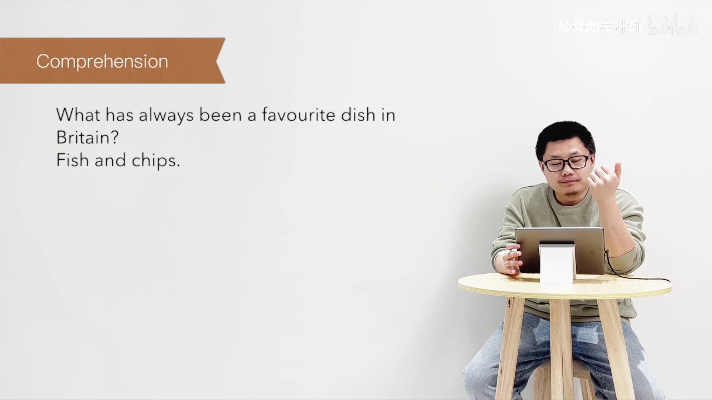

文字识别：Comprehension / What has always been a favourite dish in / Britain? / Fish and chips.

### 画面 00:00:36

文字识别：Comprehension / Why has fish become more and more / expensive?

### 画面 00:00:55

文字识别：Comprehension / Is this a surprise?

### 画面 00:00:57

文字识别：Comprehension / Is this a surprise? / Yes, it is.

## 00:01:00–00:01:30

What do divers do on oil rigs? Carry out repairs. 我直接就说 they repair the oil rigs 就可以. Where do they often work? A hundred feet underwater. What do they use to protect them? A special cages. A special cage or special cages. Are the fish killer whales? No, they aren't.

### 画面 00:01:00

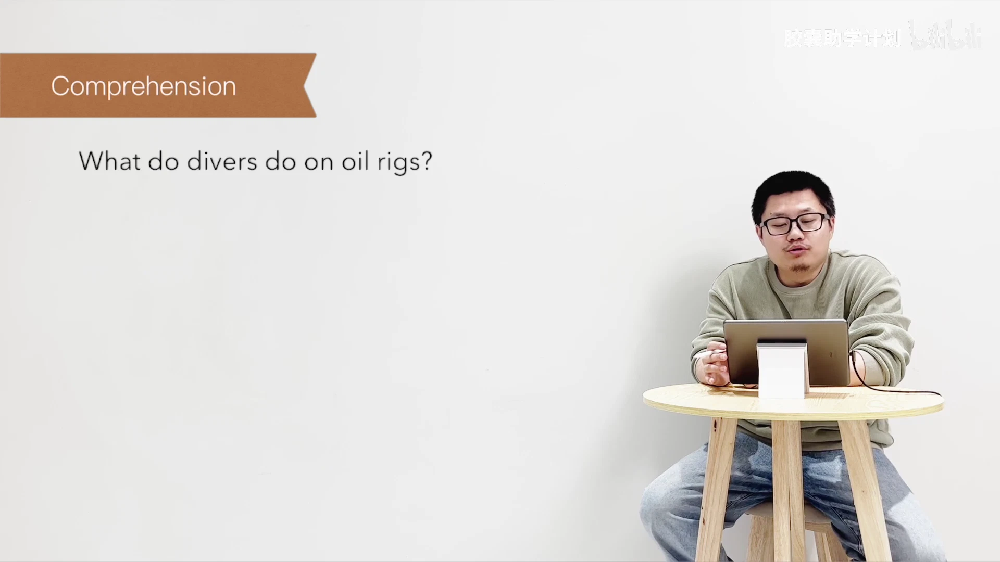

文字识别：Comprehension / What do divers do on oil rigs?

### 画面 00:01:04

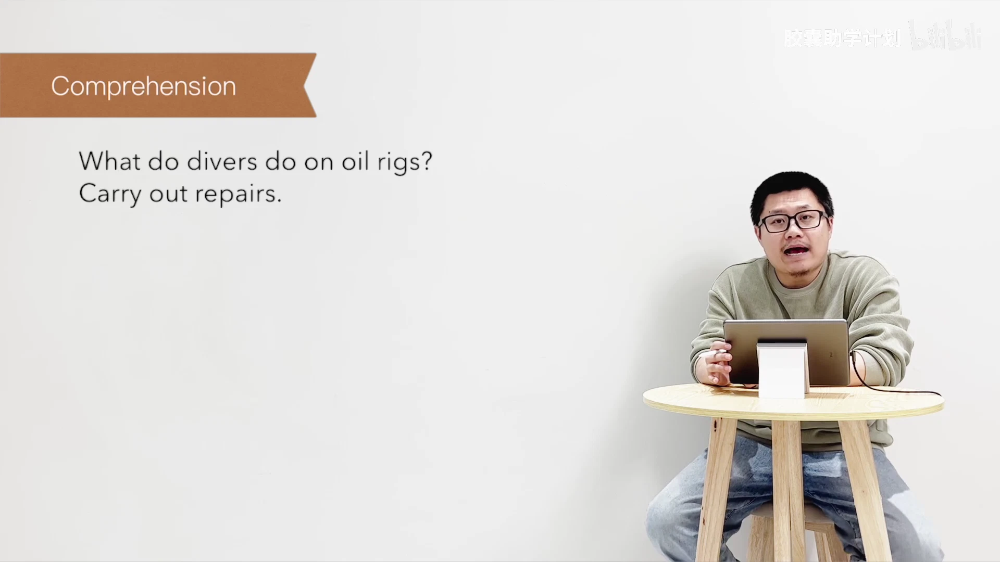

文字识别：Comprehension / What do divers do on oil rigs? / Carry out repairs.

### 画面 00:01:09

文字识别：Comprehension / Where do they often work?

## 00:01:30–00:02:00

What type of fish are they? Favorite eating varieties. How big are the fish? Sometimes as much as twelve feet long. Is the water around the oil pipes warm or cold? Warm. Is there plenty of food? Yes, there is. 四句型转换, asking

### 画面 00:01:38

文字识别：Comprehension / How big are the fish? / Sometimes as much as twelve feet long.

### 画面 00:01:44

文字识别：Comprehension / Is the water round the oil pipes warm or / cold?

### 画面 00:01:57

文字识别：Asking questions / 训练目标： / 会说一般疑问句＆特殊疑问句 / Accuracy / Fluency

## 00:02:00–00:02:30

questions 啊呃例子呃 ask me fish and chips has always been a favorite dish in Britain. 现在完成时 has 提前 what 对主语提问直接替代对吧？呃 where 对 in Britain 提问嘛？第二个 fish has become more expensive has 提前 why 句话 divers have to repair oil rigs do 提前对吧？Who 对主语提问 what 对 oil rigs 提问

### 画面 00:02:01

文字识别：Asking questions / T: Ask me if fish and chips has always been / a favourite dish in Britain.

### 画面 00:02:09

文字识别：Asking questions / T: Ask me if fish and chips has always been / a favourite dish in Britain. / S: Has fish and chips always been a / favourite dish in Britain? / T: What...?

### 画面 00:02:14

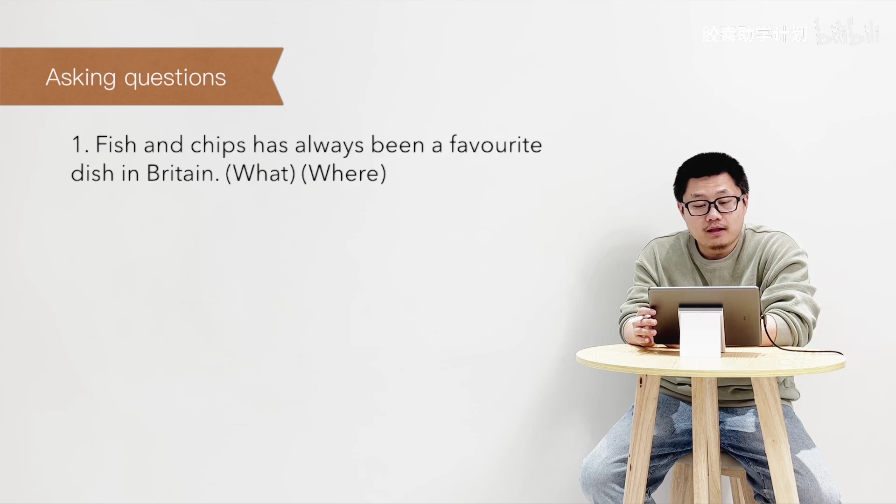

文字识别：Asking questions / 1. Fish and chips has always been a favourite / dish in Britain.(What) (Where)

### 画面 00:02:22

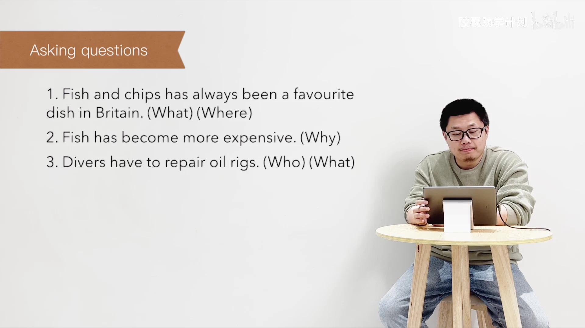

文字识别：Asking questions / 1. Fish and chips has always been a favourite / dish in Britain. (What) (Where) / 2. Fish has become more expensive.(Why) / 3. Divers have to repair oil rigs. (Who) (What)

## 00:02:30–00:03:00

They often have to work in darknesses. Often have to have to见到do提前对吧？Where肯定是对in darkness提问。Giant fish often bump into them.你看这句话直接就把我们原文那个bumping into them变成了一句话对吧？原来是一个分词，现在变成了一个谓语动词。Often bump into them.这个你可以呃what那就肯定对giant fish提问呗对吧？They

### 画面 00:02:40

文字识别：Asking questions / 1. Fish and chips has always been a favourite / dish in Britain. (What) (Where) / 2. Fish has become more expensive.(Why) / 3. Divers have to repair oil rigs. (Who) (What) / 4.They often have to work in darkness. / (Where) / 5. Giant fish often bump into them.(What)

### 画面 00:02:46

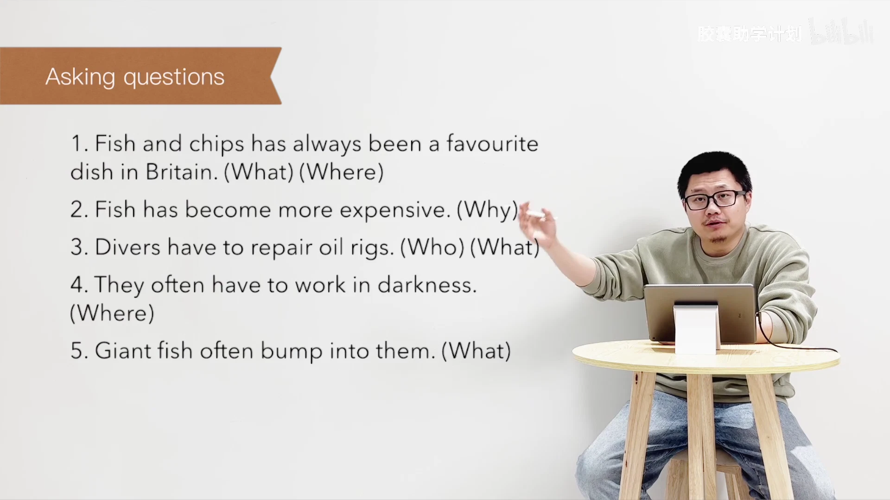

文字识别：Asking questions / 1. Fish and chips has always been a favourite / dish in Britain. (What) (Where) / 2. Fish has become more expensive.(Why) / 3. Divers have to repair oil rigs. (Who) (What) / 4.They often have to work in darkness. / (Where) / 5. Giant fish often bump into them.(What)

### 画面 00:02:50

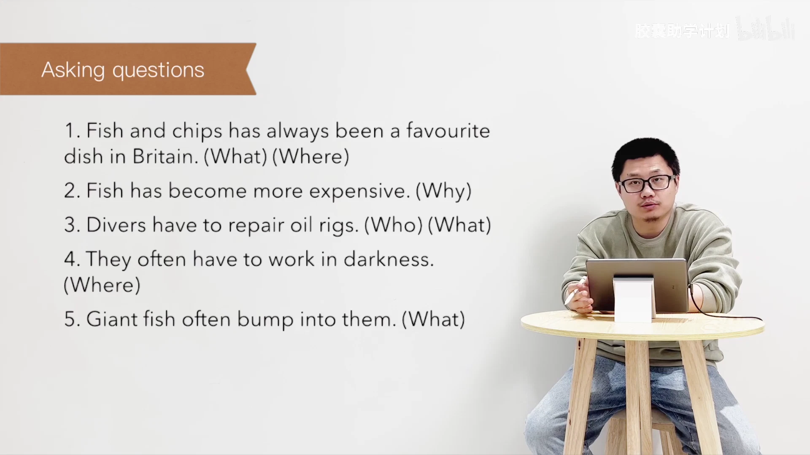

文字识别：Asking questions / 1. Fish and chips has always been a favourite / dish in Britain. (What) (Where) / 2. Fish has become more expensive.(Why) / 3. Divers have to repair oil rigs. (Who) (What) / 4.They often have to work in darkness. / (Where) / 5. Giant fish often bump into them.(What)

### 画面 00:02:58

文字识别：助学计划 / Asking questions

## 00:03:00–00:03:30

have special cages to protect them.你注意啊，就他们有特殊的性质去保护他们，就都提前吧。What do they have?对吧？你可以理解为，你可以用What do they have to protect them? What do special cages, Steven?前后都留着。The fish are eating varieties.二提前。那What kind of fish are they?嗯，are are are they就可以了啊。They grow to unnatural sizes.那How large?肯定是对 unnatural sizes, Steven嘛，

### 画面 00:03:15

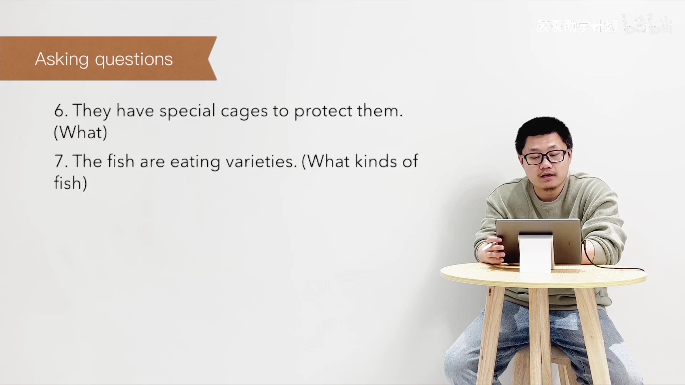

文字识别：Asking questions / 6. They have special cages to protect them. / (What) / 7. The fish are eating varieties. (What kinds of / fish)

### 画面 00:03:29

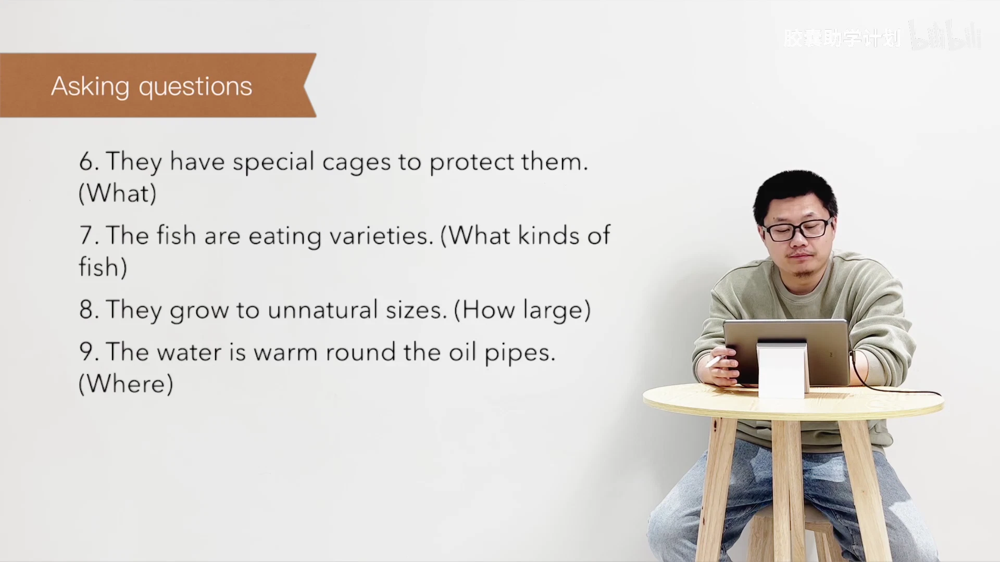

文字识别：Asking questions / 6. They have special cages to protect them. / (What) / 7. The fish are eating varieties. (What kinds of / fish) / 8. They grow to unnatural sizes.(How large) / 9. The water is warm round the oil pipes. / (Where)

## 00:03:30–00:04:00

对吧？呃，The water is warm round the oil pipes is提前where对round the oil pipes提问。Food is supplied by the crews is提前what啊what is supplied by the crews对吧？对food提问。呃，Tell the story口语复述嘛。那fluency accuracy咱们练更多的是偏fluency的。这个看着这些单词去进行复述。Summary writing两个事儿，一共两

### 画面 00:03:47

文字识别：Tell the story / 训练目标： / 口语复述能力 / Accuracy / Fluency

### 画面 00:03:54

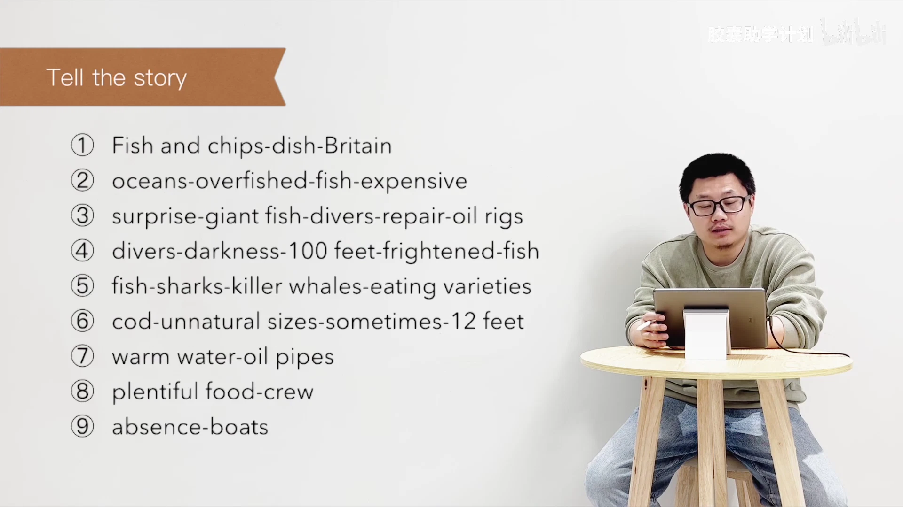

文字识别：Tell the story / Fish and chips-dish-Britain / oceans-overfished-fish-expensive / surprise-giant fish-divers-repair-oil rigs / divers-darkness-100 feet-frightened-fish / fish-sharks-killer whales-eating varieties / cod-unnatural sizes-sometimes-12 feet / warm water-oil pipes / plentiful food-crew / absence-boats / 9

### 画面 00:03:57

文字识别：Summary writing: Key / 训练目标： / 写作复述能力

## 00:04:00–00:04:30

篇文章，重点看连词。第一篇文章，第二篇文章。Okay, topic for discussion.老习惯，这是我们其实到最后所有练习，所有练习练到最后，英语学习，不管是在写作还是口语当中，我们最希望能完成的一件事。第一个，What is your favorite dish? How is it prepared?最喜欢什么菜？怎么准备？怎么做？Tell us what you think life is like on an oil rig.

### 画面 00:04:00

文字识别：Summary writing: Key / 训练目标： / 写作复述能力

### 画面 00:04:02

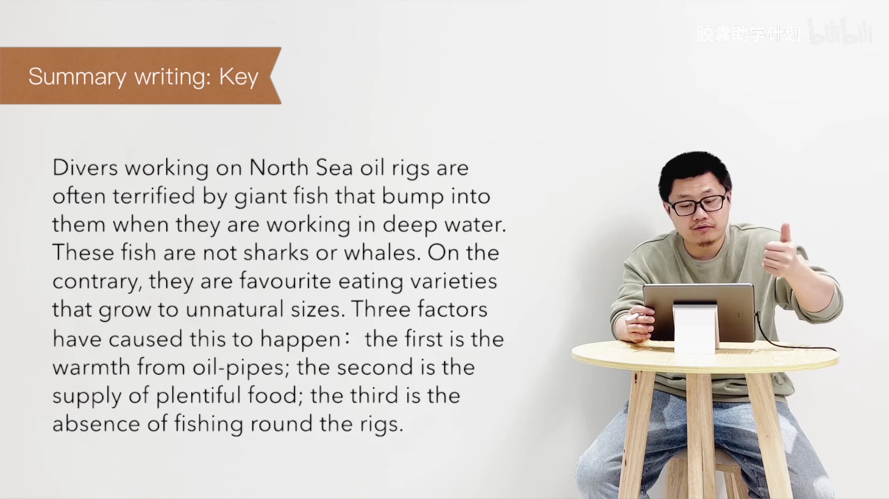

文字识别：Summary writing: Key / Divers working on North Sea oil rigs are / often terrified by giant fish that bump into / them when they are working in deep water. / These fish are not sharks or whales. On the / contrary, they are favourite eating varieties / that grow to unnatural sizes. Three factors / have caused this to happen: the first is the / warmth from oil-pipes; the second is the / supply of plentiful food; the third is the / absence of fishing round the rigs.

### 画面 00:04:04

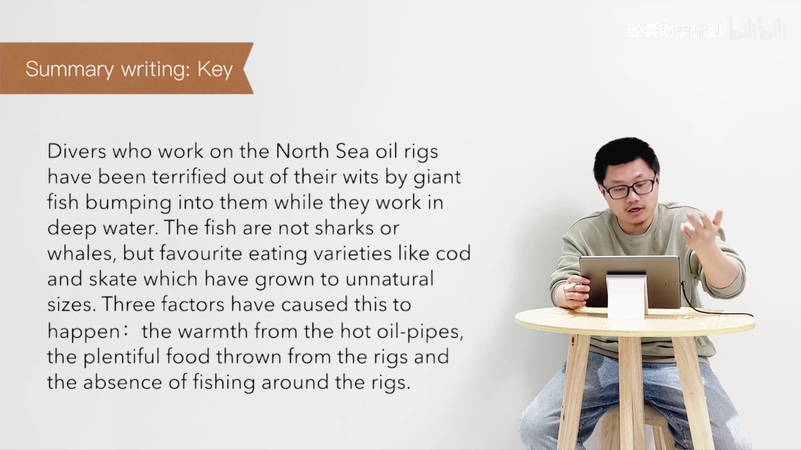

文字识别：助字计划 / Summary writing: Key / Divers who work on the North Sea oil rigs / have been terrified out of their wits by giant / fish bumping into them while they work in / deep water. The fish are not sharks or / whales, but favourite eating varieties like cod / and skate which have grown to unnatural / sizes. Three factors have caused this to / happen: the warmth from the hot oil-pipes, / the plentiful food thrown from the rigs and / the absence of fishing around the rigs.

### 画面 00:04:07

文字识别：Topics for discussion / 训练目标： / 完全自由的对话 / Accuracy / Fluency

### 画面 00:04:09

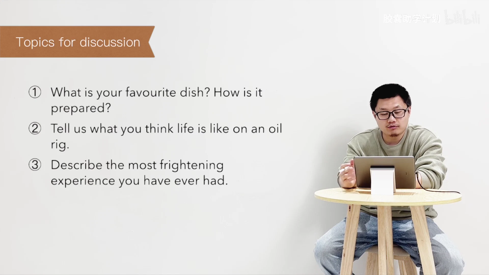

文字识别：Topics for discussion / What is your favourite dish? How is it / prepared? / Tell us what you think life is like on an oil / rig. / Describe the most frightening / experience you have ever had.

### 画面 00:04:11

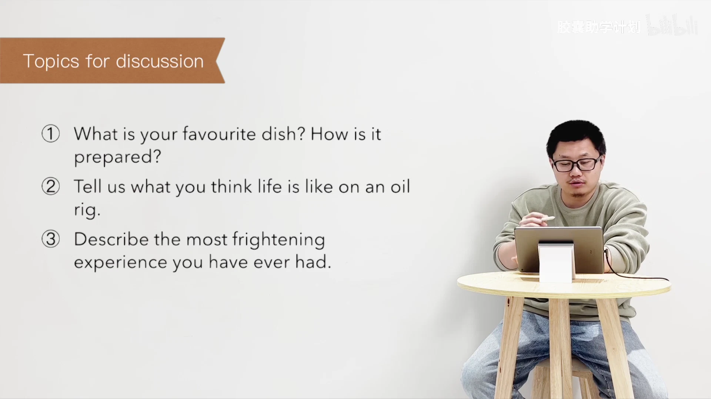

文字识别：Topics for discussion / What is your favourite dish? How is it / prepared? / Tell us what you think life is like on an oil / rig. / Describe the most frightening / experience you have ever had.

### 画面 00:04:13

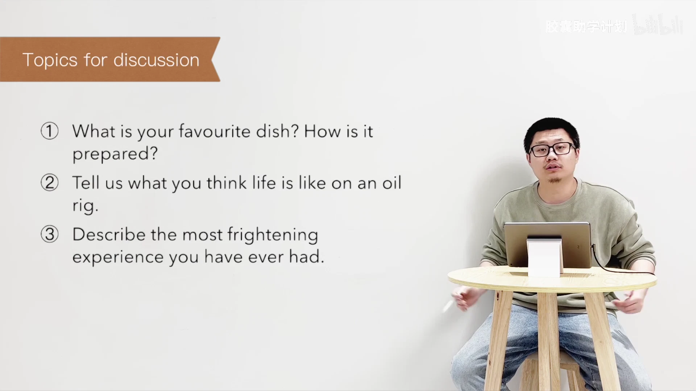

文字识别：Topics for discussion / What is your favourite dish? How is it / prepared? / Tell us what you think life is like on an oil / rig. / Describe the most frightening / experience you have ever had.

## 00:04:30–00:05:00

You give us say say. You feel that in drilling platform life will be what kind? The third one is describe the most frightening experience you ever you have ever had. Give us describe the most frightening experience you ever you have ever had. Give us describe the most frightening experience you ever you have ever had. Give us describe the most frightening experience you ever you have ever had. Give us describe the most frightening experience you ever you have ever had. Give us describe the most frightening experience you ever you have ever had. Give us describe the most frightening experience you ever you have ever had. Give us describe the most frightening experience you ever you have ever had. Give us describe the most frightening experience you ever you have ever

### 画面 00:04:43

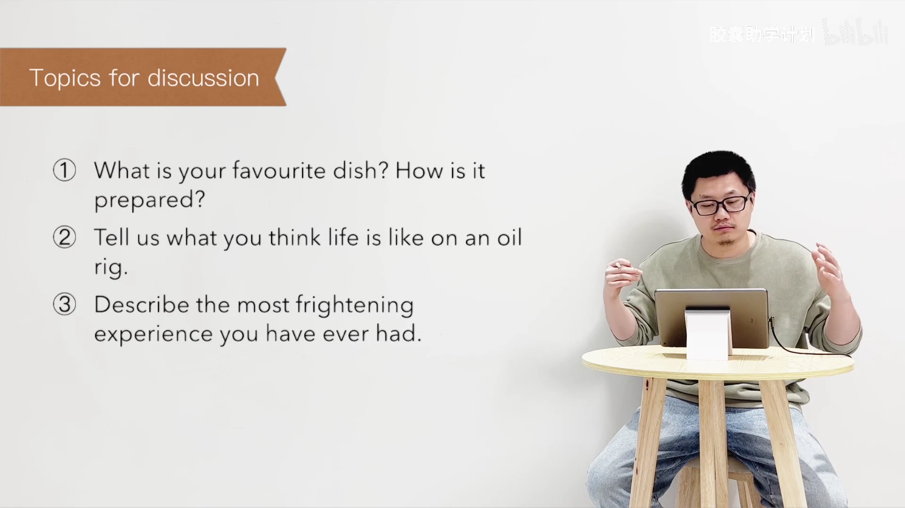

文字识别：Topics for discussion / What is your favourite dish? How is it / prepared? / Tell us what you think life is like on an oil / rig. / Describe the most frightening / experience you have ever had.

### 画面 00:04:46

文字识别：Topics for discussion / What is your favourite dish? How is it / prepared? / Tell us what you think life is like on an oil / rig. / Describe the most frightening / experience you have ever had.

### 画面 00:04:48

文字识别：毫助学计划一

### 画面 00:04:50

文字识别：1.Ask me if写&朗读

### 画面 00:04:52

文字识别：延字计划 / 1.Ask me if写&朗读 / 2.摘要写作写&答案

### 画面 00:04:54

文字识别：1.Ask me if写&朗读 / 摘要写作写&答案 / 3.Tell the story 口语复述

### 画面 00:04:56

文字识别：辜助字计划 / 1.Ask me if写&朗读 / 摘要写作写&答案 / 3.Tell the story 口语复述 / .重复间隔（置顶留言）

### 画面 00:04:59

文字识别：袁助学计划一州

## 00:05:00–00:05:24

就是本期视频的全部内容了。如果各位喜欢我们的课程呢，欢迎各位关注、订阅、一键三连，分享给那些需要的朋友，来帮助我们快速成长。See you next time.

### 画面 00:05:01

文字识别：助字计划長照

### 画面 00:05:03

文字识别：建助字计划一调 / 不

### 画面 00:05:06

文字识别：建助学计划一

### 画面 00:05:08

文字识别：凝助学计划一调

### 画面 00:05:10

文字识别：達助学计划

### 画面 00:05:12

### 画面 00:05:14

文字识别：CAPSULEACADEMY / 胶囊助学计划 / 小红书 / Lecturer / Leo / OE

### 画面 00:05:17

文字识别：CAPSULEACADEMY / 胶囊助学计划 / 『 / 小红书 / Editor / OE

### 画面 00:05:20

文字识别：CAPSULEACADEMY / 胶囊助学计划 / 小红书 / Creator / □ / Leo & Berlin

### 画面 00:05:22

文字识别：bilibili / 胶囊助学计划 / 胶囊助学计划 / 小红书 / OE

### 画面 00:05:24

文字识别：bilibili / 胶囊助学计划

