# 091 单词

快速机器解析：语音为单模型转写，未进行独立交叉校对或人工复核；画面每秒采样并按变化选帧，短时文字和标记可能遗漏。截图时间约有 1 秒误差。图片有损压缩；遇到疑点请按时间查看 Google Drive 原视频。

## 00:00:00–00:00:30

Hello, everyone. Welcome to the Capsule Academy. This is Leo. Today, we're going to learn new concept in English book two, lesson ninety one words. 老习惯进入正式课程之前，咱们先看几个小的问题。首先，如何表达监视某人？接下来，如何表达记录？OK，那带着这两个问题，我们开始。我们先看第一个单词，跟我一起读一下，叫 balloon。 OK，

### 画面 00:00:00

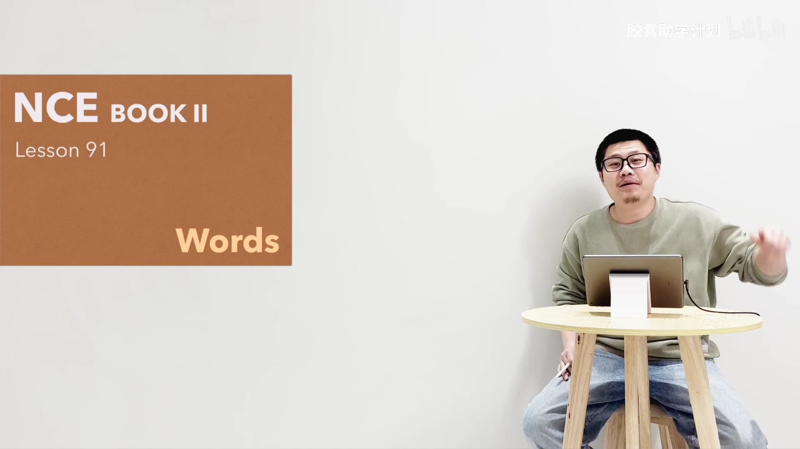

文字识别：NCE / BOOK"I / Lesson 91 / Words

### 画面 00:00:02

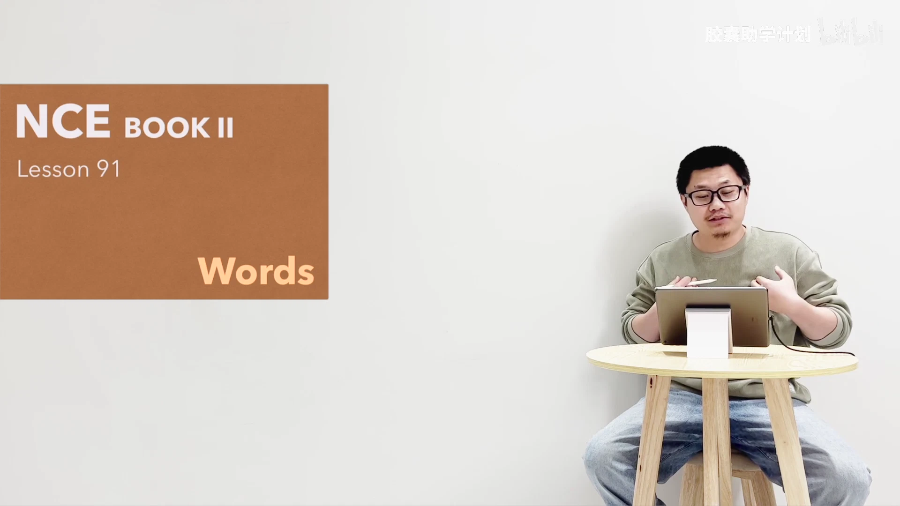

文字识别：NCE / BOOKⅡI / Lesson 91 / Words

### 画面 00:00:04

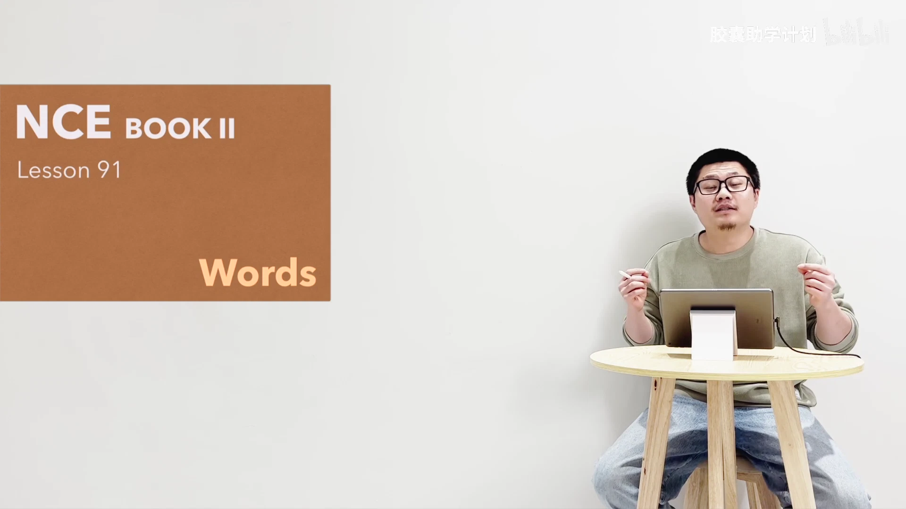

文字识别：NCE / BOOKⅡI / Lesson 91 / Words

### 画面 00:00:09

文字识别：虞助学计划一

### 画面 00:00:11

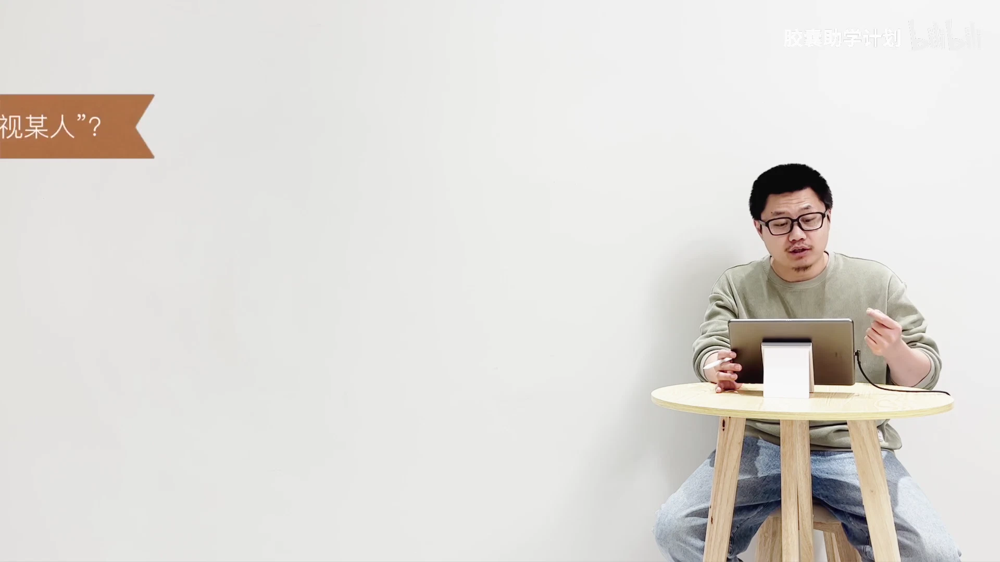

文字识别：复助学计划洲 / 视某人”？

### 画面 00:00:13

文字识别：①如何表达“监视某人”？

### 画面 00:00:15

文字识别：① 如何表达“监视某人”？ / 达“记录”?

### 画面 00:00:17

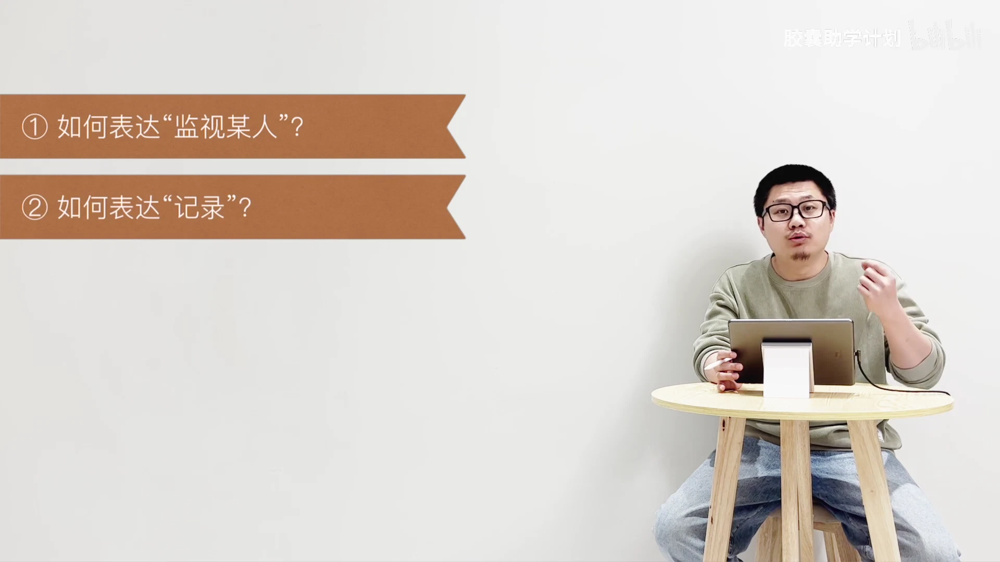

文字识别：①如何表达“监视某人”？ / 如何表达“记录”？

### 画面 00:00:21

文字识别：J bitbi / 胶囊助学计划 / •

### 画面 00:00:25

文字识别：囊助学计划 / 胶囊助学计划

### 画面 00:00:27

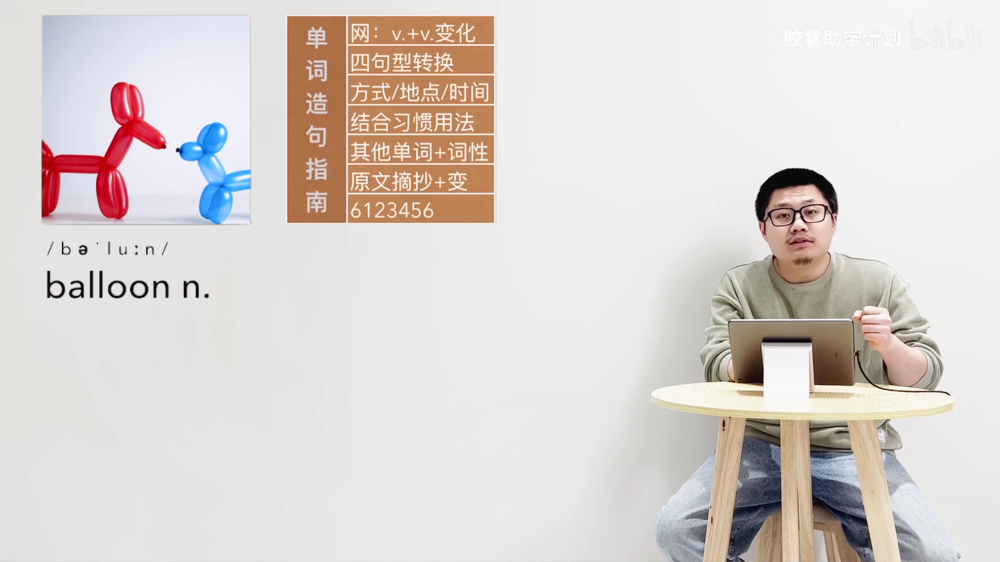

文字识别：单词造句指南 / 网：v.+v.变化 / 四句型转换 / 方式/地点/时间 / 结合习惯用法 / 其他单词+词性 / 原文摘抄+变 / 6123456 / /ba'luin/ / balloon n.

## 00:00:30–00:01:00

OK，叫做气球，对吧？ OK，那想拿它去造句，你想，其实它因为是一个名词，你在这个地方肯定是要找动词，或者是结合其他习惯用法。这个习惯用法最好还是呃包含动词的，当然不包含动词也也可以啊，但前提是这个句子当中肯定得找个动词。跟我一起读一下这句话。As a result, his father bought her a total of

### 画面 00:00:31

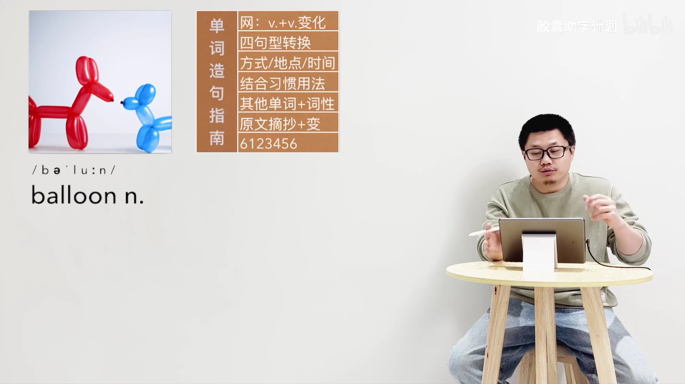

文字识别：单词造句指南 / 网：v.+v.变化 / 辜助字计划圖 / 四句型转换 / 方式/地点/时间 / 结合习惯用法 / 其他单词+词性 / 原文摘抄+变 / 6123456 / /ba'luin/ / balloon n.

### 画面 00:00:33

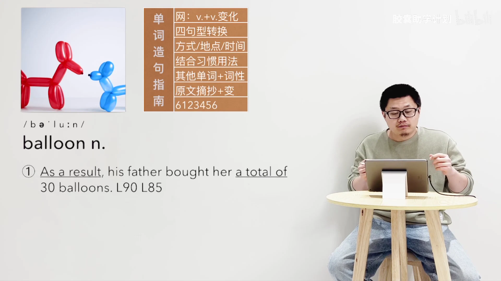

文字识别：单词造句指南 / 网：v.+v.变化 / 四句型转换 / 方式/地点/时间 / 结合习惯用法 / 其他单词+词性 / 原文摘抄+变 / 6123456 / /ba'luin / / balloon n. /  As a result, his father bought her a total of / 30 balloons. L90 L85

### 画面 00:00:36

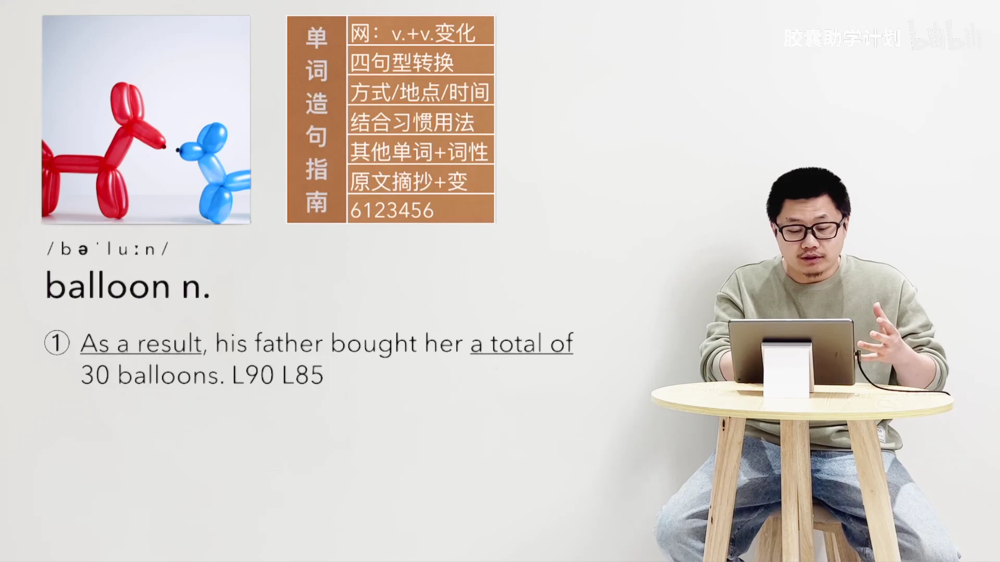

文字识别：单词造句指南 / 网：v.+v.变化 / 喜助学计划 / 四句型转换 / 方式/地点/时间 / 结合习惯用法 / 其他单词+词性 / 原文摘抄+变 / 6123456 / /ba'luin/ / balloon n. / D As a result, his father bought her a total of / 1 / 30 balloons. L90 L85

### 画面 00:00:39

文字识别：单词造句指南 / 网：v.+v.变化 / 四句型转换 / 方式/地点/时间 / 结合习惯用法 / 其他单词+词性 / 原文摘抄+变 / 6123456 / / ba'luin/ / balloon n. / ) As a result, his father bought her a total of / 30 balloons. L90 L85

### 画面 00:00:42

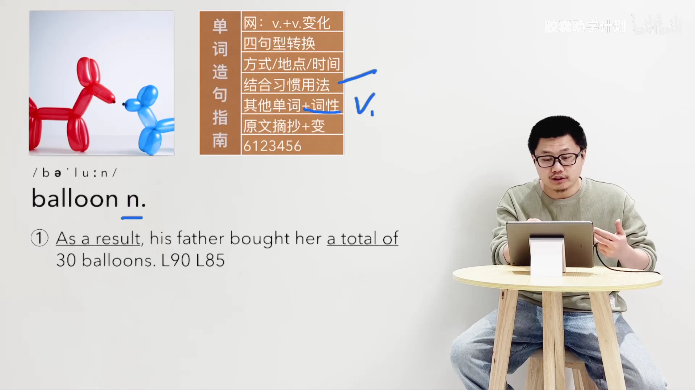

文字识别：单词造句指南 / 网：v.+v.变化 / 四句型转换 / 方式/地点/时间 / 结合习惯用法 / 其他单词+词性 / 原文摘抄+变 / 6123456 / /ba'luin/ / balloon n. / ) As a result, his father bought her a total of / 30 balloons. L90 L85

### 画面 00:00:47

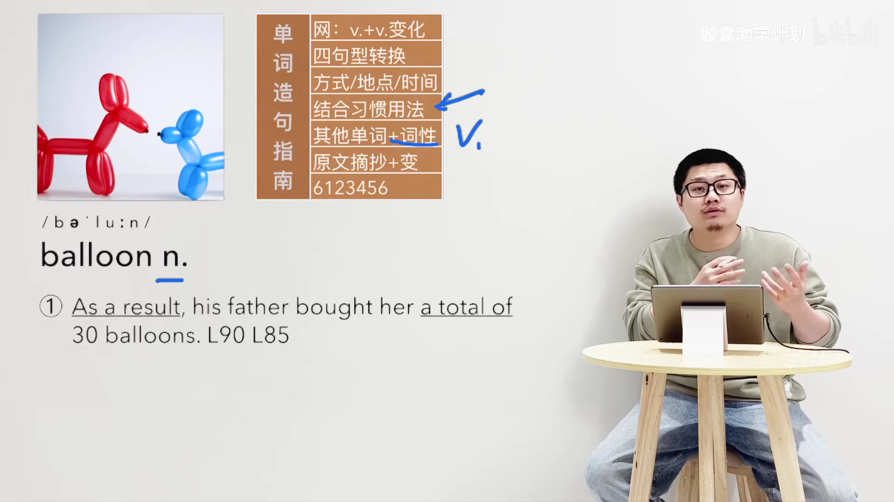

文字识别：单词造句指南 / 网：v.+v.变化 / 妻助学计划 / 四句型转换 / 方式/地点/时间 / 结合习惯用法 / 其他单词+词性 / V / 原文摘抄+变 / 6123456 / /ba'luin/ / balloon n. /  As a result, his father bought her a total of / 1 / 30 balloons. L90 L85

### 画面 00:00:59

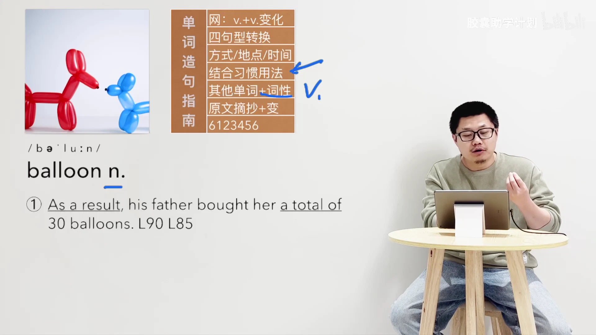

文字识别：单词造句指南 / 网：v.+v.变化 / 喜助字计划 / 四句型转换 / 方式/地点/时间 / 结合习惯用法 / 其他单词+词性 / V / 原文摘抄+变 / 6123456 / / ba'luin / / balloon n. / ) As a result, his father bought her a total of / 30 balloons. L90 L85

## 00:01:00–00:01:30

thirty balloons. Okay, next one. The children expressed their gratitude to the man. 好了，首先表达了他们的感激对于这个男人，哪个男人呢？英语从句 who sent the balloons. Okay, very good. Next one. It is known that Lyle sent these balloons to the children. 哎，我把这些气球送给的这些孩子。那 it is known that. 你比如说 it is

### 画面 00:01:02

文字识别：单词造句指南 / 网：v.+v.变化 / 四句型转换 / 方式/地点/时间 / 结合习惯用法 / 其他单词+词性 / 原文摘抄+变 / 6123456 / / ba'luin / / balloon n. / ① As a result, his father bought her a total of / 30 balloons. L90 L85 / The children expressed their gratitude to / the man who sent the balloons. L84

### 画面 00:01:06

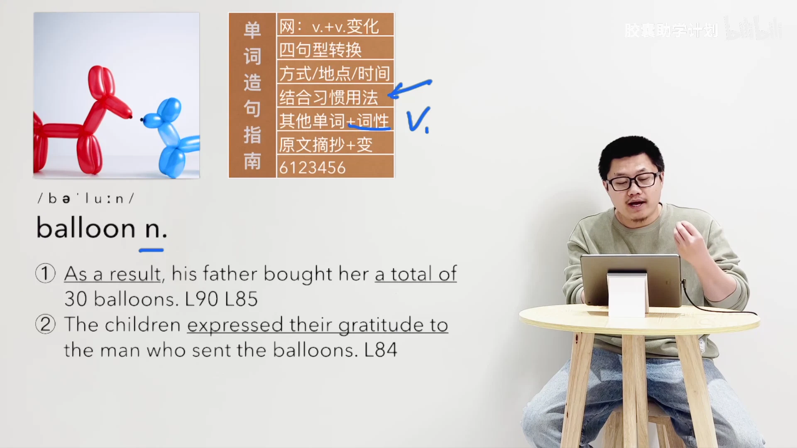

文字识别：单词造句指南 / 网：v.+v.变化 / 四句型转换 / 方式/地点/时间 / 结合习惯用法 / 其他单词+词性 / 原文摘抄+变 / 6123456 / / ba'luin / / balloon n. / ① As a result, his father bought her a total of / 30 balloons. L90 L85 / The children expressed their gratitude to / the man who sent the balloons. L84

### 画面 00:01:16

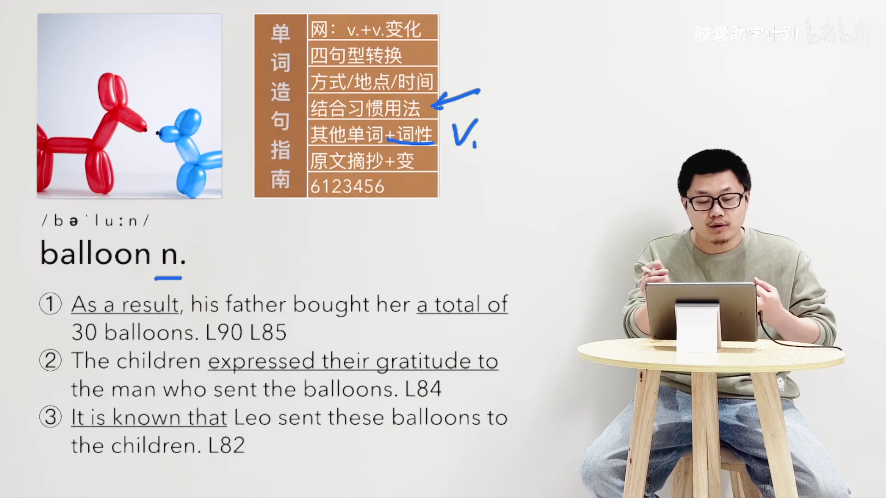

文字识别：单词造句指南 / 网：v.+v.变化 / 四句型转换 / 方式/地点/时间 / 结合习惯用法 / 其他单词+词性 / 原文摘抄+变 / 6123456 / /ba'luin/ / balloon n. / ① As a result, his father bought her a total of / 30 balloons. L90 L85 / The children expressed their gratitude to / the man who sent the balloons. L84 / It is known that Leo sent these balloons to / the children. L82

### 画面 00:01:20

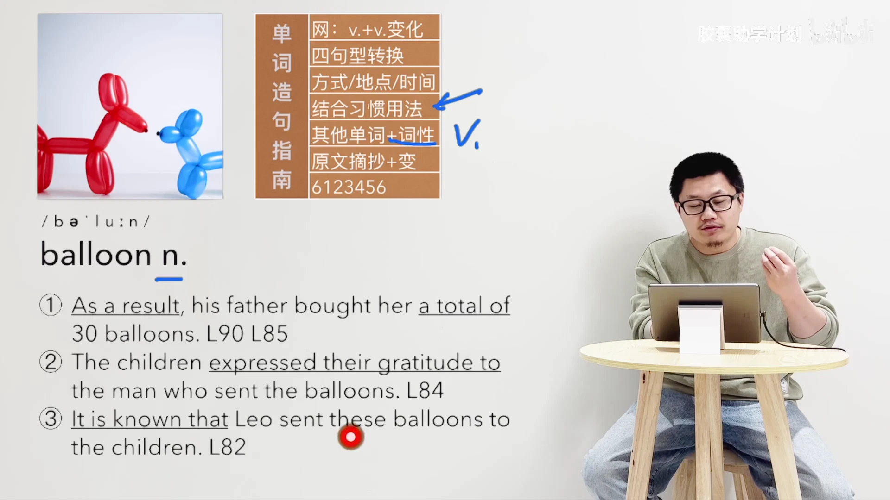

文字识别：单词造句指南 / 网：v.+v.变化 / 计划 / 四句型转换 / 方式/地点/时间 / 结合习惯用法 / 其他单词+词性 / 原文摘抄+变 / 6123456 / /ba'luin/ / balloon n. / ① As a result, his father bought her a total of / 30 balloons. L90 L85 / The children expressed their gratitude to / the man who sent the balloons. L84 / It is known that Leo sent these balloons to / the children. L82

### 画面 00:01:24

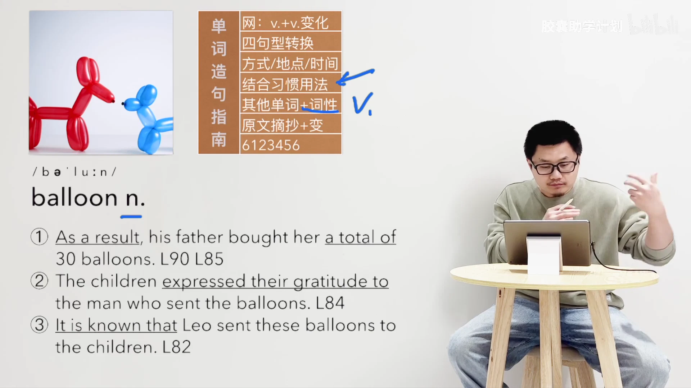

文字识别：单词造句指南 / 网：v.+v.变化 / 学计划 / 四句型转换 / 方式/地点/时间 / 结合习惯用法 / 其他单词+词性 / 原文摘抄+变 / 6123456 / /ba'luin/ / balloon n. / ① As a result, his father bought her a total of / 30 balloons. L90 L85 / The children expressed their gratitude to / the man who sent the balloons. L84 / It is known that Leo sent these balloons to / the children. L82

### 画面 00:01:27

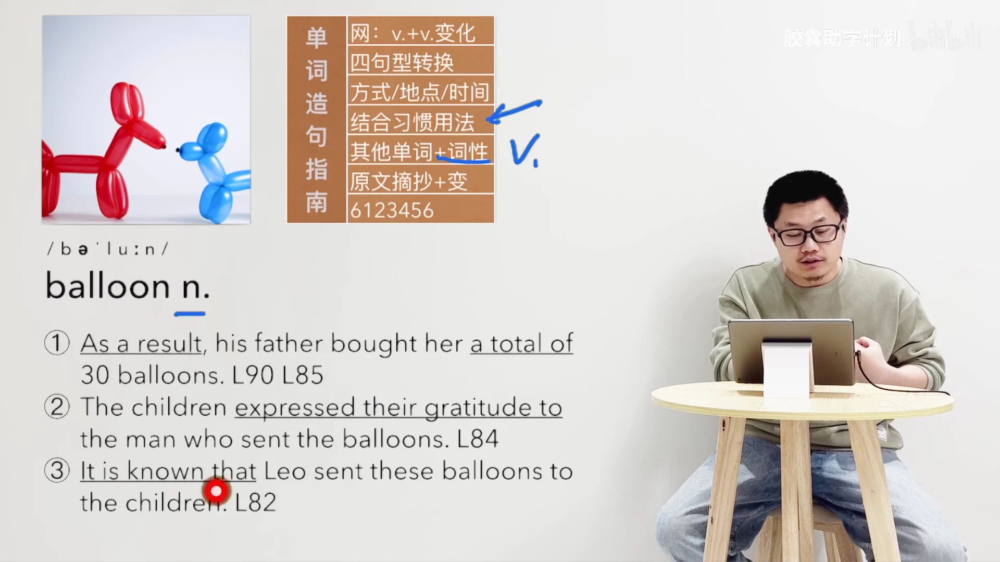

文字识别：单词造句指南 / 网：v.+v.变化 / 四句型转换 / 方式/地点/时间 / 结合习惯用法 / 其他单词+词性 / 原文摘抄+变 / 6123456 / /ba'luin/ / balloon n. / ① As a result, his father bought her a total of / 30 balloons. L90 L85 / The children expressed their gratitude to / the man who sent the balloons. L84 / It is known that Leo sent these balloons to / the childreR. L82

## 00:01:30–00:02:00

now known that就是现在知道了, it is known that就是这个事儿是被人们知道了,对吧? Okay,也就换一句话来说就是人们知道啊, people know. Next one,下一个单词 royal, royal. Okay,那本文当中出现了一个很长的呃短语吧,你可以理解为叫做 Royal Air Force Station,皇家空军站,是吧? Okay,那当然了你也可以说 Royal Palace,皇宫,对不对?

### 画面 00:01:34

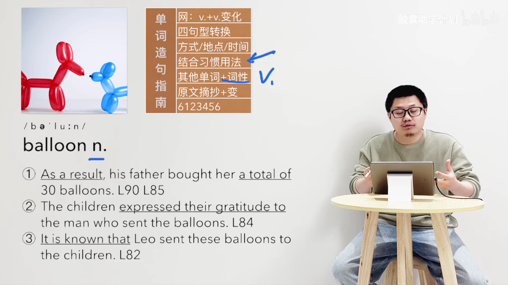

文字识别：单词造句指南 / 网：v.+v.变化 / 正学计划 / 四句型转换 / 方式/地点/时间 / 结合习惯用法 / 其他单词+词性 / 原文摘抄+变 / 6123456 / /ba'luin/ / balloon n. / ① As a result, his father bought her a total of / 30 balloons. L90 L85 / The children expressed their gratitude to / the man who sent the balloons. L84 / It is known that Leo sent these balloons to / the children. L82

### 画面 00:01:39

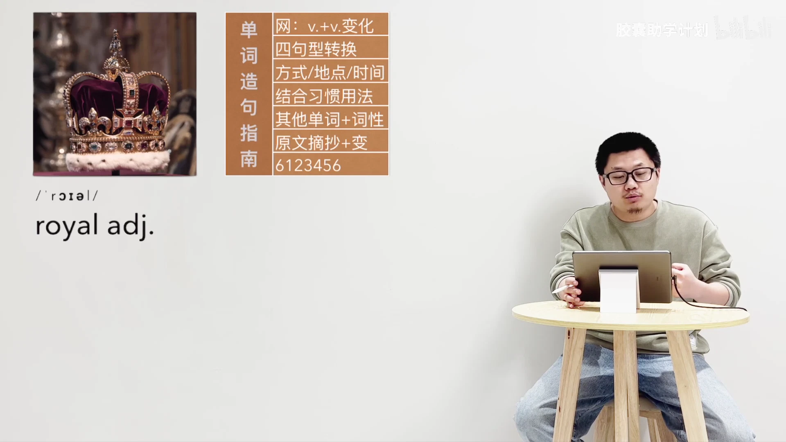

文字识别：单词造句指南 / 网：v.+v.变化 / 喜助学计划 / 四句型转换 / 方式/地点/时间 / 结合习惯用法 / 其他单词+词性 / 原文摘抄+变 / 6123456 / /'roial/ / royal adj.

### 画面 00:01:46

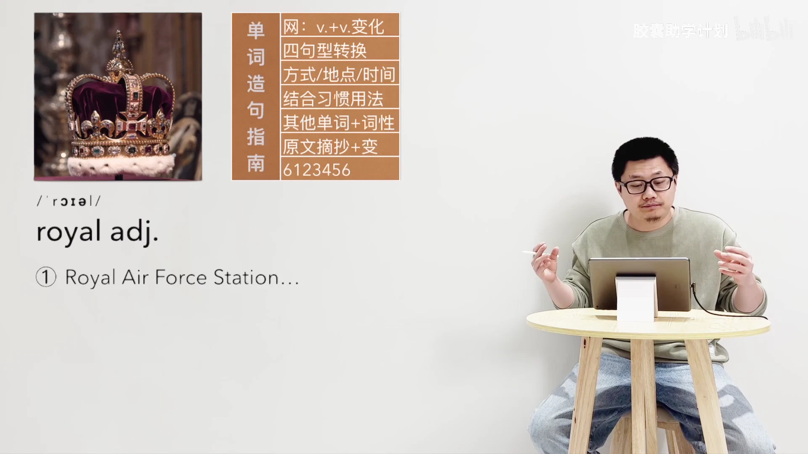

文字识别：单词造句指南 / 网：v.+v.变化 / 臺助字计划 / 四句型转换 / 方式/地点/时间 / 结合习惯用法 / 其他单词+词性 / 原文摘抄+变 / 6123456 / /'roial/ / royal adj. / ① Royal Air Force Station..

### 画面 00:01:58

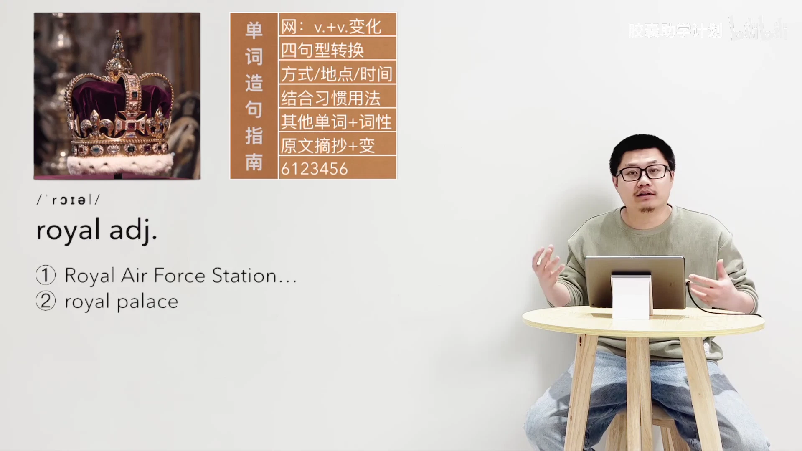

文字识别：单词造句指南 / 网：v.+v.变化 / 四句型转换 / 方式/地点/时间 / 结合习惯用法 / 其他单词+词性 / 原文摘抄+变 / 6123456 / /'roial/ / royal adj. / ① Royal Air Force Station.. / ② royal palace

## 00:02:00–00:02:30

好，比如说我们造一个句子叫做 It comes as a surprise to learn that. 记不记得？我讲这个语法的时候，我说我们完全可以不用说，非得去理解后面这是个什么语法成分，对吧？它实际上是真正主语，哎，这不是真正主语，怎么怎么着？不用，你只需要把前面 It comes as a surprise to learn that 给我把它牢牢记住。怎么记住它？多造句子，多读自己造的句子。哎，它的含义就是知道某件事情，感觉还挺惊讶的。什么事儿呢？The

### 画面 00:02:00

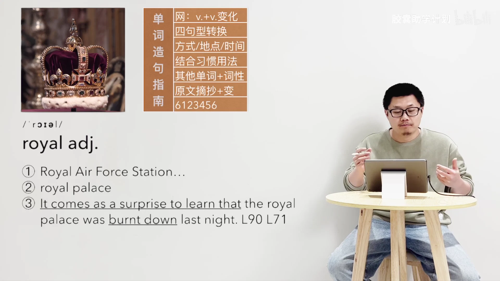

文字识别：单词造句指南 / 网：v.+v.变化 / 四句型转换 / 方式/地点/时间 / 结合习惯用法 / 其他单词+词性 / 原文摘抄+变 / 6123456 / /'roial/ / royal adj. / ① Royal Air Force Station... / ② royal palace / It comes as a surprise to learn that the royal / palace was burnt down last night. L90 L71

### 画面 00:02:06

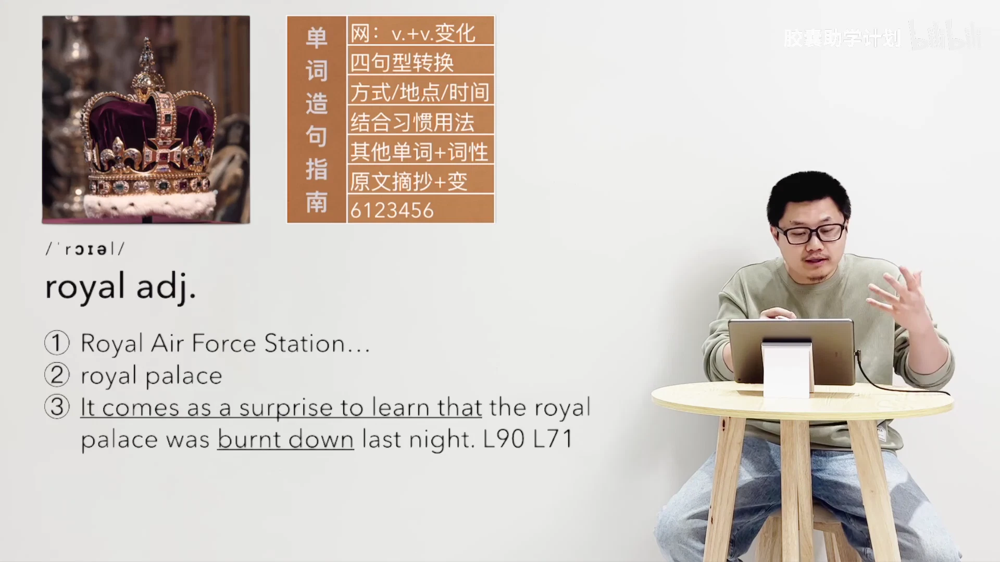

文字识别：单词造句指南 / 网：v.+v.变化 / 四句型转换 / 方式/地点/时间 / 结合习惯用法 / 其他单词+词性 / 原文摘抄+变 / 6123456 / /'roral/ / royal adj. / ① Royal Air Force Station.. / ② royal palace / It comes as a surprise to learn that the royal / palace was burnt down last night. L90 L71

### 画面 00:02:12

文字识别：单词造句指南 / 网：v.+v.变化 / 四句型转换 / 方式/地点/时间 / 结合习惯用法 / 其他单词+词性 / 原文摘抄+变 / 6123456 / /'roial/ / royal adj. / ① Royal Air Force Station.. / ② royal palace / It comes as a surprise to learn that the royal / palace was burnt down last night. L90 L71

### 画面 00:02:23

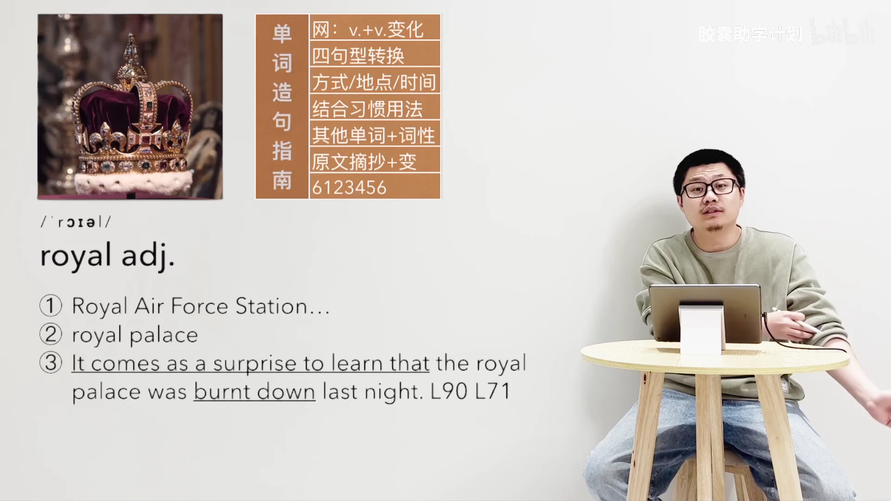

文字识别：单词造句指南 / 网：v.+v.变化 / 四句型转换 / 方式/地点/时间 / 结合习惯用法 / 其他单词+词性 / 原文摘抄+变 / 6123456 / /'roral/ / royal adj. / ① Royal Air Force Station... / ② royal palace / It comes as a surprise to learn that the royal / palace was burnt down last night. L90 L71

### 画面 00:02:27

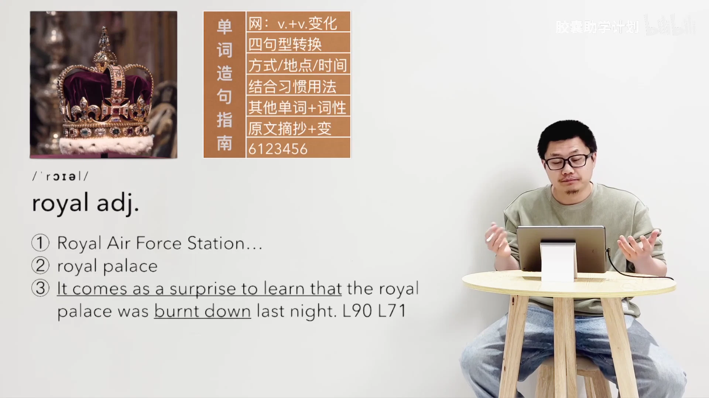

文字识别：单词造句指南 / 网：v.+v.变化 / 学计划 / 四句型转换 / 方式/地点/时间 / 结合习惯用法 / 其他单词+词性 / 原文摘抄+变 / 6123456 / /'roral/ / royal adj. / ① Royal Air Force Station... / ② royal palace / It comes as a surprise to learn that the royal / palace was burnt down last night. L90 L71

## 00:02:30–00:03:00

royal palace was burned down last night.哎，这个皇宫昨天晚上被焚毁了。Next one,说When they saw their kids' royal palace, they all burst out laughing.说当他们看到他们孩子的这个皇宫的时候，全笑崩了，是吧？就笑屁了，呃，就是一下就呃爆发出来的笑声，是吧？哈哈狂笑，burst out laughing.我加了一个royal palace，加了一个引号啊。好，next one

### 画面 00:02:30

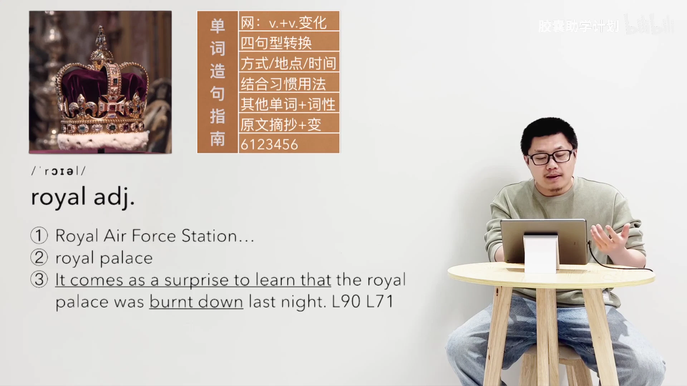

文字识别：单词造句指南 / 网：v.+v.变化 / 四句型转换 / 方式/地点/时间 / 结合习惯用法 / 其他单词+词性 / 原文摘抄+变 / 6123456 / /'roial/ / royal adj. / ① Royal Air Force Station.. / ② royal palace / It comes as a surprise to learn that the royal / palace was burnt down last night. L90 L71

### 画面 00:02:33

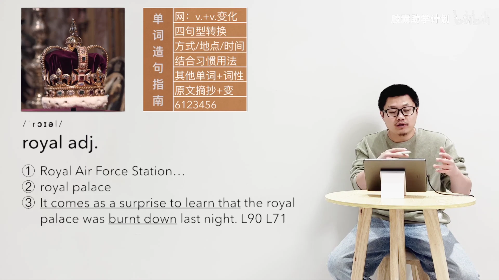

文字识别：单词造句指南 / 网：v.+v.变化 / 四句型转换 / 方式/地点/时间 / 结合习惯用法 / 其他单词+词性 / 原文摘抄+变 / 6123456 / /'roial/ / royal adj. / ① Royal Air Force Station.. / ② royal palace / It comes as a surprise to learn that the royal / palace was burnt down last night. L90 L71

### 画面 00:02:36

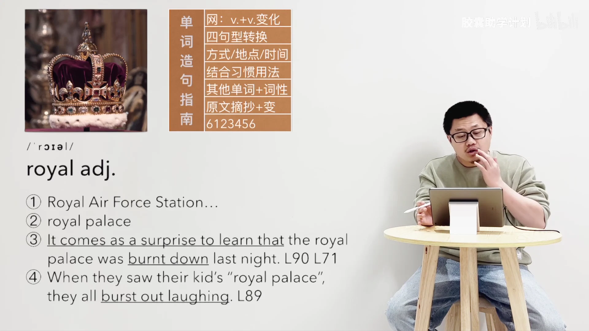

文字识别：单词造句指南 / 网：v.+v.变化 / 四句型转换 / 方式/地点/时间 / 结合习惯用法 / 其他单词+词性 / 原文摘抄+变 / 6123456 / /'roial/ / royal adj. / ① Royal Air Force Station... / ② royal palace /  It comes as a surprise to learn that the royal / 3 / palace was burnt down last night. L90 L71 / When they saw their kid's "royal palace', / they all burst out laughing. L89

### 画面 00:02:47

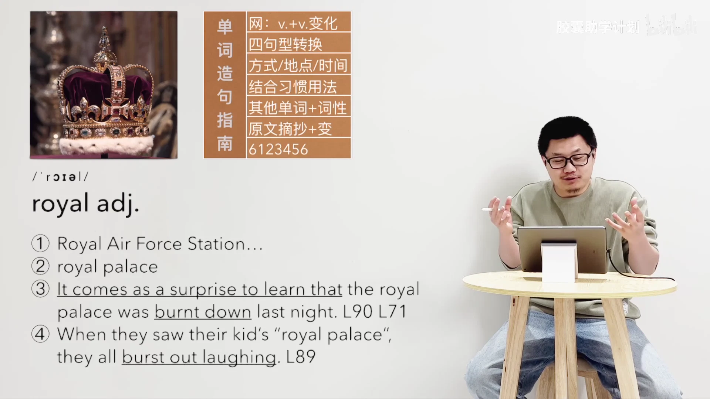

文字识别：单词造句指南 / 网：v.+v.变化 / 四句型转换 / 方式/地点/时间 / 结合习惯用法 / 其他单词+词性 / 原文摘抄+变 / 6123456 / /'roral/ / royal adj. / ① Royal Air Force Station... / ② royal palace / Ilt comes as a surprise to learn that the royal / 3 / palace was burnt down last night. L90 L71 / When they saw their kid's "royal palace', / they all burst out laughing. L89

### 画面 00:02:51

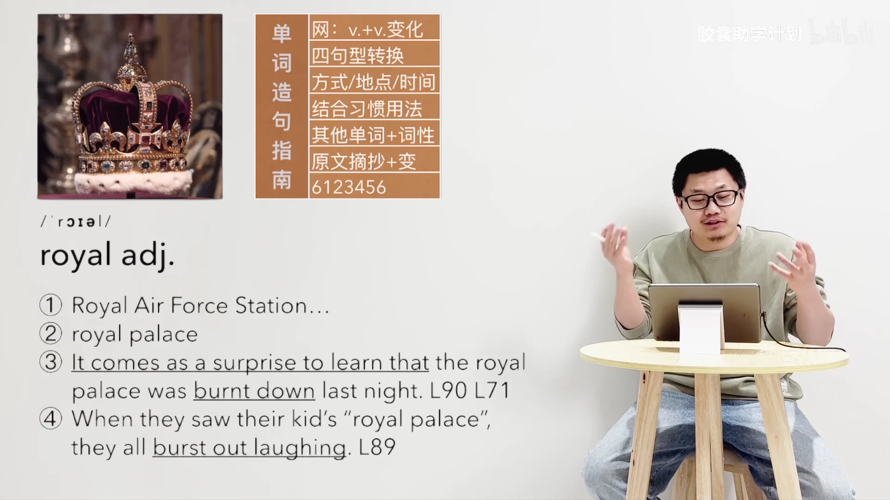

文字识别：单词造句指南 / 网：v.+v.变化 / 四句型转换 / 方式/地点/时间 / 结合习惯用法 / 其他单词+词性 / 原文摘抄+变 / 6123456 / /'roral/ / royal adj. / ① Royal Air Force Station... / ② royal palace /  It comes as a surprise to learn that the royal / 3 / palace was burnt down last night. L90 L71 /  When they saw their kid's "royal palace', / they all burst out laughing. L89

### 画面 00:02:59

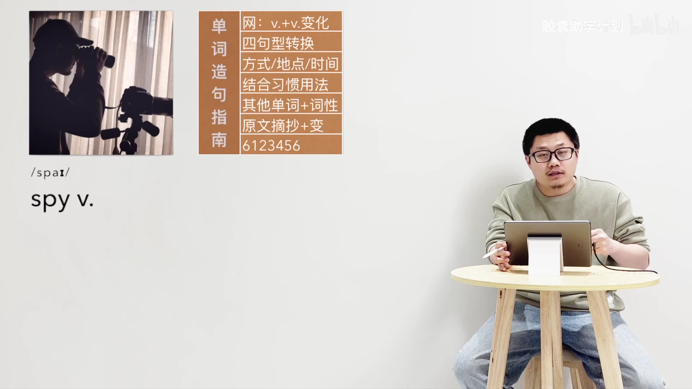

文字识别：单词造句指南 / 网：v.+v.变化 / 囊助学计划 / 四句型转换 / 方式/地点/时间 / 结合习惯用法 / 其他单词+词性 / 原文摘抄+变 / 6123456 / /spal/ / spy v.

## 00:03:00–00:03:30

下一个单词，着换，spy， spy，那 spy 的意思是什么？就是这个监视啊，监控啊，spy。那我们可以说 spy on somebody or something，监视某事或某物或某人，对吧？比如说，He changed into all black clothes and spy on Lucy，对吧？哎，他穿换上了某套衣服，然后监视某人。Next one， so he has spy on that

### 画面 00:03:09

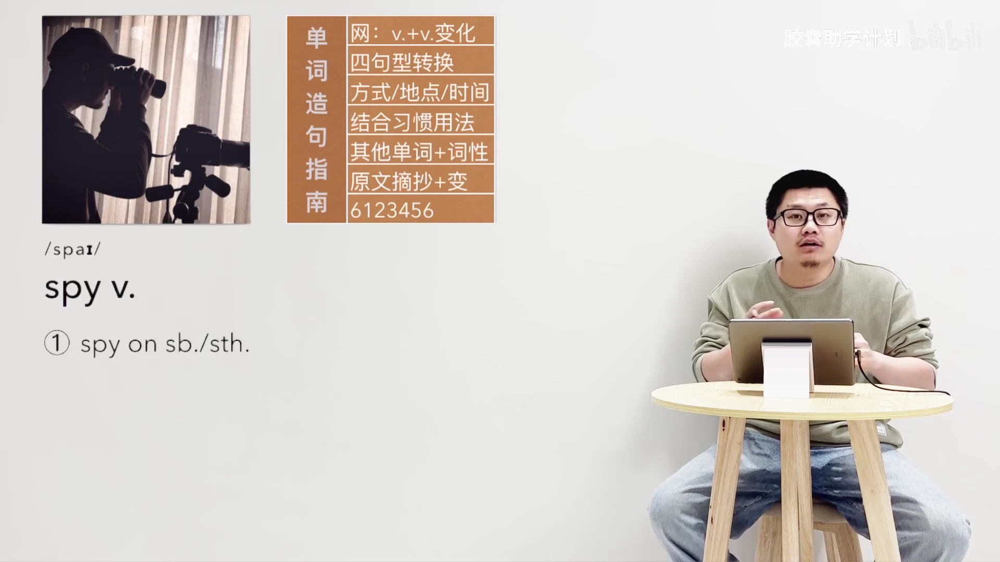

文字识别：单词造句指南 / 网：v.+v.变化 / 喜助字计划情 / 四句型转换 / 方式/地点/时间 / 结合习惯用法 / 其他单词+词性 / 原文摘抄+变 / 6123456 / /spar/ / spy v. / spy on sb./sth.

### 画面 00:03:13

文字识别：单词造句指南 / 网：v.+v.变化 / 囊助字计划 / 四句型转换 / 方式/地点/时间 / 结合习惯用法 / 其他单词+词性 / 原文摘抄+变 / 6123456 / /spal/ / spy v. / spy on sb./sth.

### 画面 00:03:15

文字识别：单词造句指南 / 网：v.+v.变化 / 臺助字计划 / 四句型转换 / 方式/地点/时间 / 结合习惯用法 / 其他单词+词性 / 原文摘抄+变 / 6123456 / /spal/ / spy v. / spy on sb./sth. / He changed into all black clothes and spied / on Lucy. L81

### 画面 00:03:25

文字识别：单词造句指南 / 网：v.+v.变化 / 四句型转换 / 方式/地点/时间 / 结合习惯用法 / 其他单词+词性 / 原文摘抄+变 / 6123456 / /spal/ / spy v. / spy on sb./sth. / He changed into all black clothes and spied / on Lucy. L81

## 00:03:30–00:04:00

man for two weeks. He has been spying on that man for two weeks. He has been spying on that man for two weeks. He has been spying on that man for two weeks. He has been spying on that man for two weeks. He has been spying on that man for two weeks. He has been spying on that man for two weeks. He has been spying on that man for two weeks. He has been spying on that man for two weeks. He has been spying on that man for two weeks. He has been spying on that man for two weeks. He has been spying on that man for two weeks. He has been spying on that man for two weeks. He has been spying on that man for two weeks. He has been spying on that

### 画面 00:03:34

文字识别：单词造句指南 / 网：v.+v.变化 / 四句型转换 / 方式/地点/时间 / 结合习惯用法 / 其他单词+词性 / 原文摘抄+变 / 6123456 / /spal/ / spy v. / ① spy on sb./sth. / ② He changed into all black clothes and spied / on Lucy. L81 / ③ He has spied on that man for two weeks. / ④ I need to spy on her, and we're running out / of food. Please go and get some. L88

### 画面 00:03:43

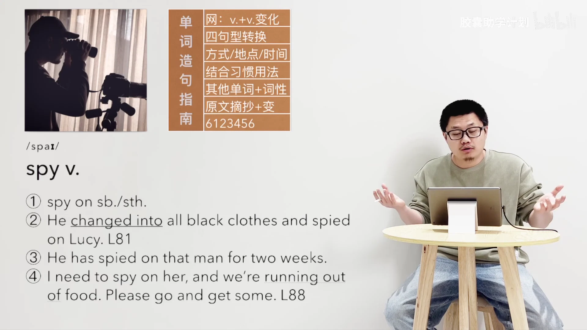

文字识别：单词造句指南 / 网：v.+v.变化 / 四句型转换 / 方式/地点/时间 / 结合习惯用法 / 其他单词+词性 / 原文摘抄+变 / 6123456 / /spal/ / spy v. / ① spy on sb./sth. / ② He changed into all black clothes and spied / on Lucy. L81 / ③ He has spied on that man for two weeks. / ④ I need to spy on her, and we're running out / of food. Please go and get some. L88

### 画面 00:03:46

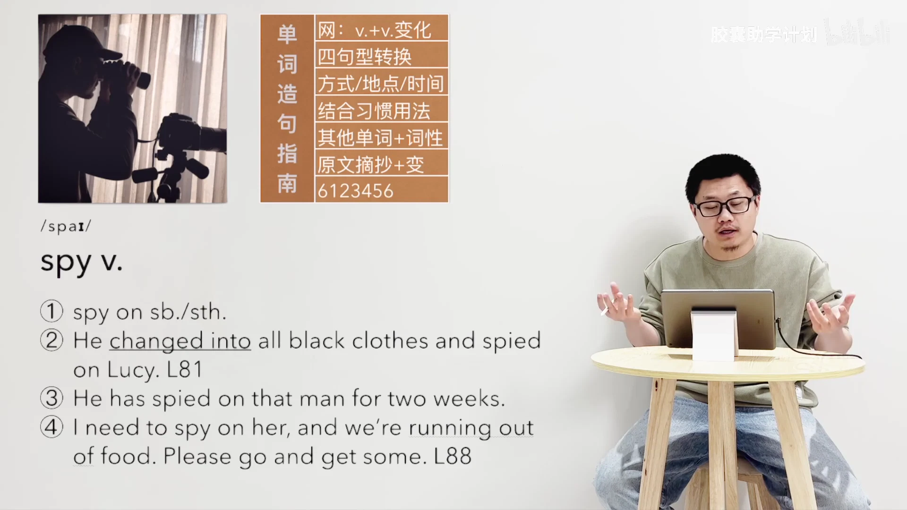

文字识别：单词造句指南 / 网：v.+v.变化 / 四句型转换 / 方式/地点/时间 / 结合习惯用法 / 其他单词+词性 / 原文摘抄+变 / 6123456 / /spal/ / spy v. / ① spy on sb./sth. / ② He changed into all black clothes and spied / on Lucy. L81 / ③ He has spied on that man for two weeks. / 3） / ④ I need to spy on her, and we're running out / of food. Please go and get some. L88

### 画面 00:03:51

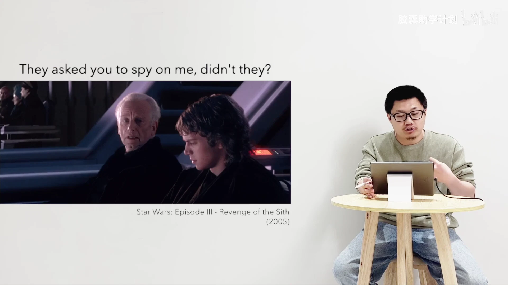

文字识别：They asked you to spy on me, didn't they? / Star Wars: Episode Ill- Revenge of the Sith / (2005)

## 00:04:00–00:04:30

求你监视我，对吧？Next one，下一个单词 track，track，track 有轨迹的意思啊。那 keep track of 是什么意思呢？就是保持什么什么的轨迹，是什么意思呢？就是追踪或者记录啊，都可以。你要由上下文去决定怎么翻译啊。比如说 how do you keep track of time？你如何记录时间，或者如何知道几钟几分几点了啊？If you don't wear a watch，如果你不戴

### 画面 00:04:02

文字识别：单词造句指南 / 网：v.+v.变化 / 囊助学计划 / 四句型转换 / 方式/地点/时间 / 结合习惯用法 / 其他单词+词性 / ?1 / 原文摘抄+变 / 6123456 / / tr æe k / / track n.

### 画面 00:04:05

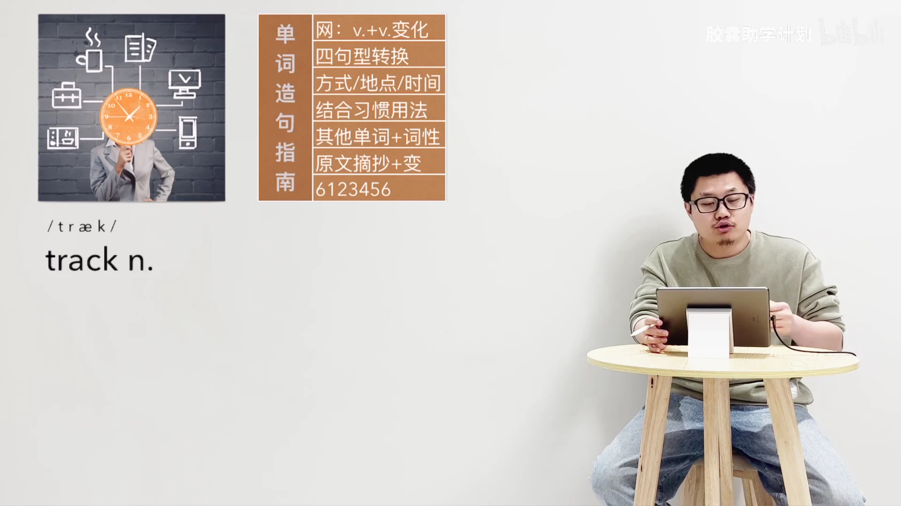

文字识别：单词造句指南 / 网：v.+v.变化 / 囊助学计划陽 / 四句型转换 / 方式/地点/时间 / 结合习惯用法 / 其他单词+词性 / ?1 / 原文摘抄+变 / 6123456 / / tr æe k / / track n.

### 画面 00:04:17

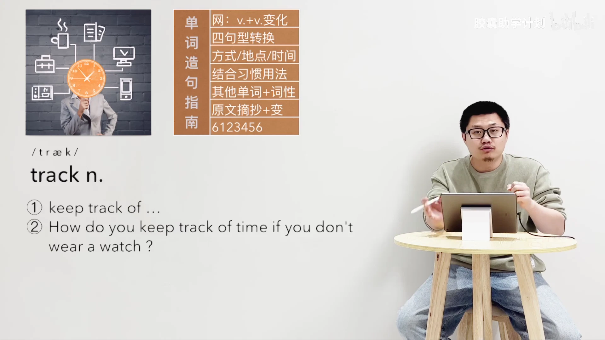

文字识别：单词造句指南 / 网：v.+v.变化 / 妻助学计划 / 四句型转换 / 方式/地点/时间 / 结合习惯用法 / 其他单词+词性 / 原文摘抄+变 / 6123456 / / træe k 1 / track n. / ① keep track of / How do you keep track of time if you don't / Wear a watch ?

## 00:04:30–00:05:00

a watch, how do you know what time it is? Next one. As a doctor, Brooks has to keep track of the latest developments in medicine. 你看说作为一个医生，Brooks怎么样？必须要 keep track of the latest developments in medicine. 那 keep track of 是什么意思？就是保持跟踪，对吧？哎，追踪什么呢？The latest developments in medicine 叫做最新

### 画面 00:04:33

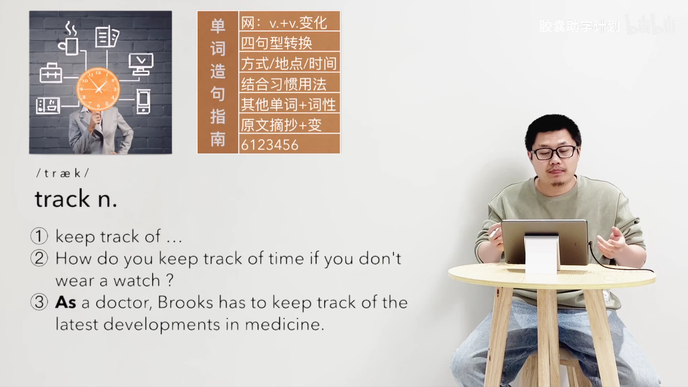

文字识别：单词造句指南 / 网：v.+v.变化 / 妻助字计划陽 / 四句型转换 / 方式/地点/时间 / 结合习惯用法 / 其他单词+词性 / 原文摘抄+变 / 6123456 / /træek/ / track n. / ① keep track of / ) How do you keep track of time if you don't / Wear a watch? / As a doctor, Brooks has to keep track of the / latest developments in medicine.

## 00:05:00–00:05:30

的发展在医药当中。Okay, next one. So I can keep track of things without using a computer.说我可以怎么样追踪跟踪事情而不去使用电脑？那什么叫跟踪追踪？就是记录，我能记下这些事情，而不需要干嘛？哎呃，使用一台电脑。那像上一句话当中，你说什么叫跟踪追踪最新的研究成果？就是随

### 画面 00:05:03

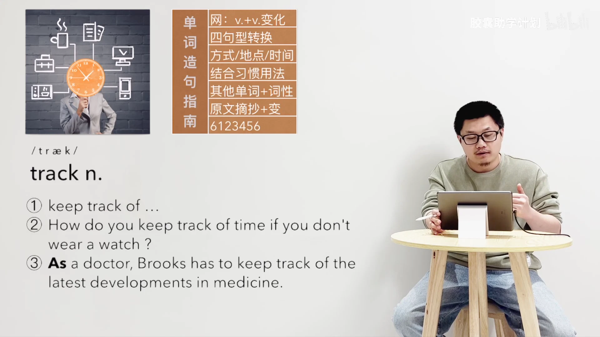

文字识别：单词造句指南 / 网：v.+v.变化 / 四句型转换 / 方式/地点/时间 / 结合习惯用法 / 其他单词+词性 / 原文摘抄+变 / 6123456 / /træe k/ / track n. / ① keep track of / ) How do you keep track of time if you don't / Wear a watch? / As a doctor, Brooks has to keep track of the / latest developments in medicine.

### 画面 00:05:05

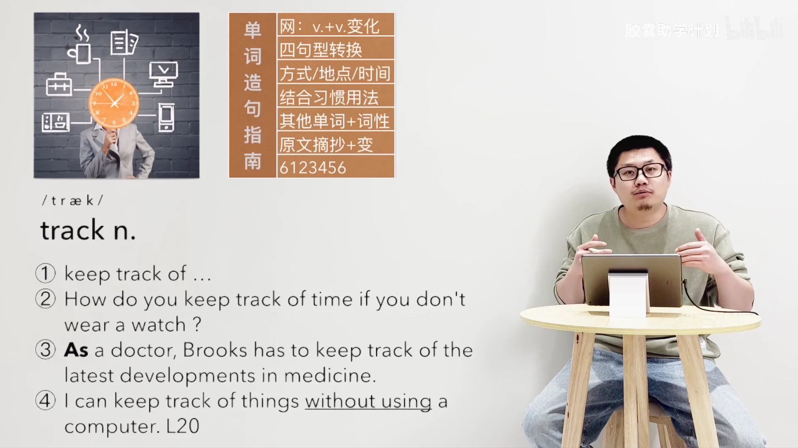

文字识别：单词造句指南 / 网：v.+v.变化 / 妻助学计划陽 / 四句型转换 / 方式/地点/时间 / 结合习惯用法 / 其他单词+词性 / ?1 / 原文摘抄+变 / 6123456 / / tr æe k / / track n. / ① keep track of / ② How do you keep track of time if you don't / Wear a watch ? / As a doctor, Brooks has to keep track of the / latest developments in medicine. / ④ I can keep track of things without using a / computer. L20

### 画面 00:05:15

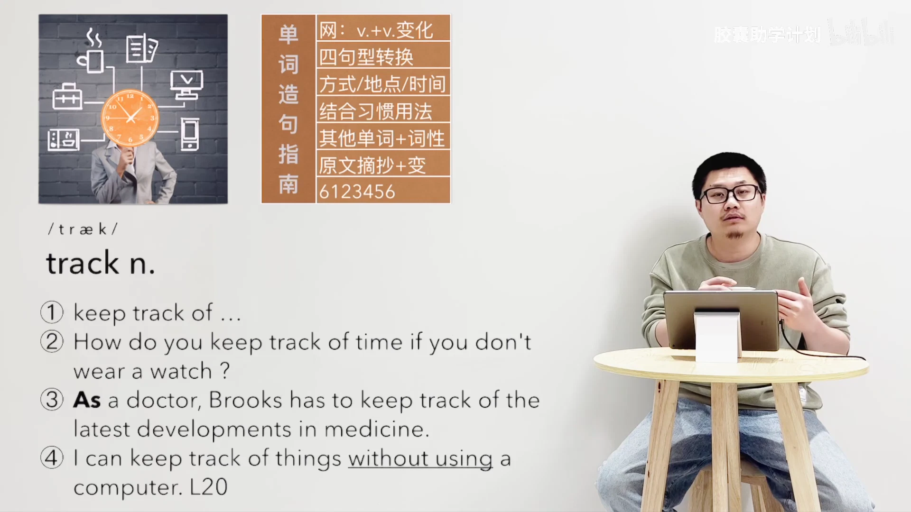

文字识别：单词造句指南 / 网：v.+v.变化 / 囊助字计划園 / 四句型转换 / 方式/地点/时间 / 结合习惯用法 / 其他单词+词性 / 21 / 原文摘抄+变 / 6123456 / / træe k / / track n. / ① keep track of / ② How do you keep track of time if you don't / Wear a watch? / As a doctor, Brooks has to keep track of the / latest developments in medicine. / ④ I can keep track of things without using a / computer. L20

### 画面 00:05:20

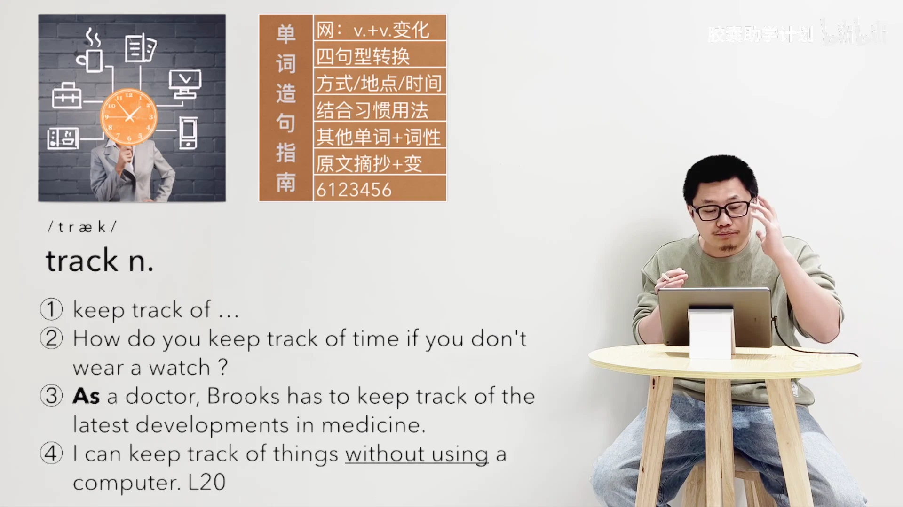

文字识别：单词造句指南 / 网：v.+v.变化 / 妻助学计划優 / 四句型转换 / 方式/地点/时间 / 结合习惯用法 / 其他单词+词性 / 原文摘抄+变 / 6123456 / / træe k / / track n. / ① keep track of / ② How do you keep track of time if you don't / wear a watch? / As a doctor, Brooks has to keep track of the / latest developments in medicine. / ④ I can keep track of things without using a / computer. L20

## 00:05:30–00:06:00

时啊跟着它出来我就看出来我就看对吧？呃，那咱们注意力集中看一下这句话。I just want to keep track of our progress, all right? 哎，我想记录一下我们的这个成果，对吧？我们逐渐进步的这个过程啊，我们进行的这个呃这个进展啊，我们的进展，对吧？Next one, binoculars. Binoculars. 注意这个单词本身是个复数，是吧？Binoculars，望远镜有两个，就跟我们这眼镜一样，两

### 画面 00:05:35

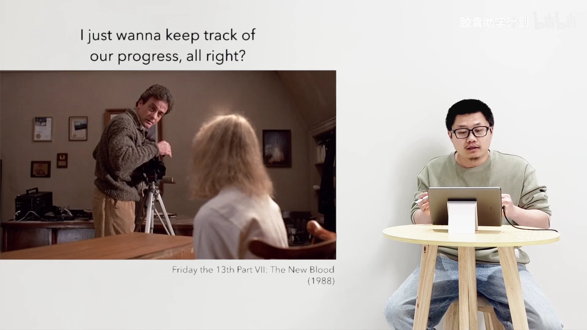

文字识别：I just wanna keep track of / our progress, allright? / Friday the 13th Part Vll: The New Blood / (1988)

### 画面 00:05:39

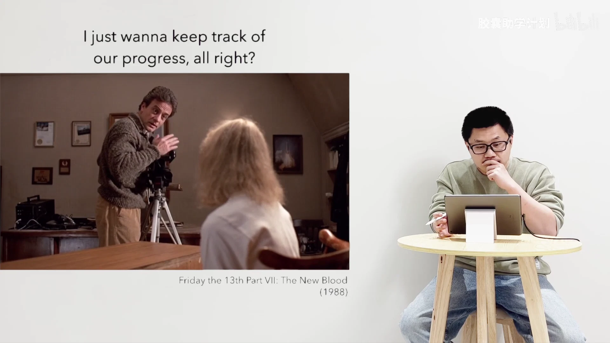

文字识别：I just wanna keep track of / our progress, allright? / Friday the 13th Part Vll: The New Blood / (1988)

### 画面 00:05:42

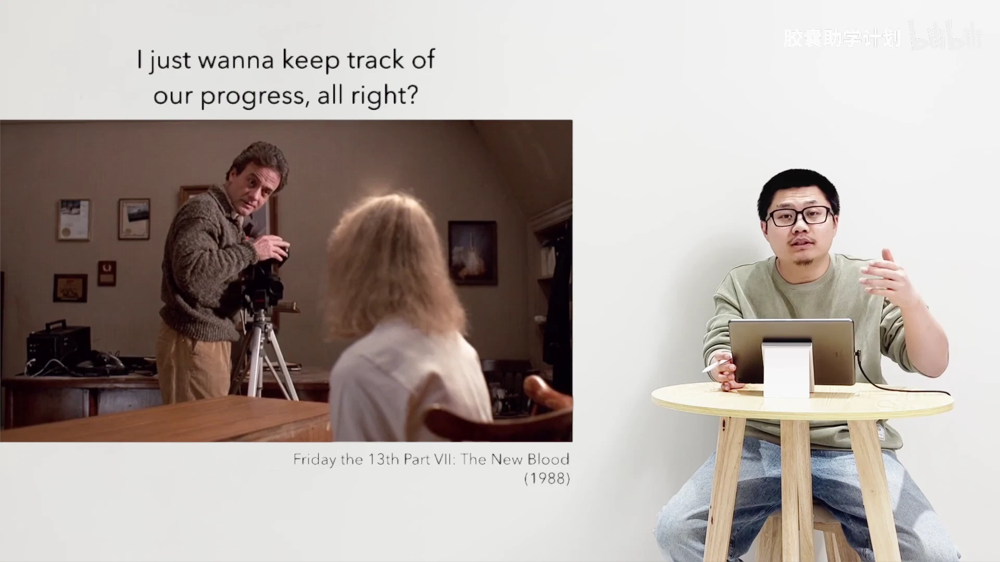

文字识别：I just wanna keep track of / our progress, allright? / Friday the 13th Part Vll: The New Blood / (1988)

### 画面 00:05:51

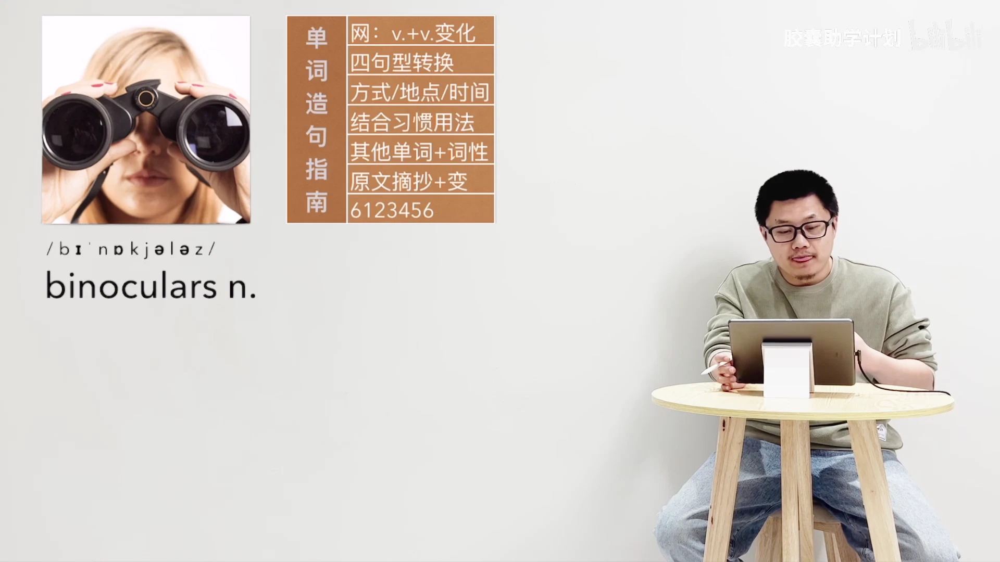

文字识别：单词造句指南 / 网：v.+v.变化 / 囊助学计划陽 / 四句型转换 / 方式/地点/时间 / 结合习惯用法 / 其他单词+词性 / 原文摘抄+变 / 6123456 / /bl'nрkjalaz/ / binoculars n.

### 画面 00:05:55

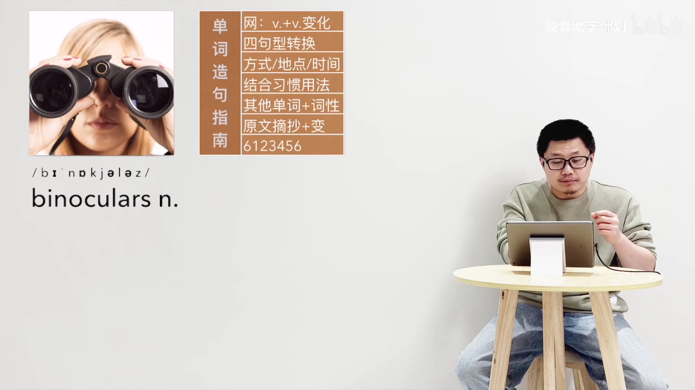

文字识别：单词造句指南 / 网：v.+v.变化 / 妻助字计划 / 四句型转换 / 方式/地点/时间 / 结合习惯用法 / 其他单词+词性 / 原文摘抄+变 / 6123456 / /bl'npkjalaz/ / binoculars n.

## 00:06:00–00:06:30

个镜片儿啊，两个镜片儿啊，那 binoculars 有两个镜片儿。造个句子， Armed with my binoculars，五十五课咱们学了， somebody be armed with something。 We went to see a football game。啊，其实到新三当中，我们很快前几课就我又学到 armed with something， armed with a torch，啊， the weaker 怎么怎么样？好，那说 Armed with my binoculars， we went to see a football game。哎，装备着我这个 binoculars，我们去看了一个足球比赛。 Next one，

### 画面 00:06:02

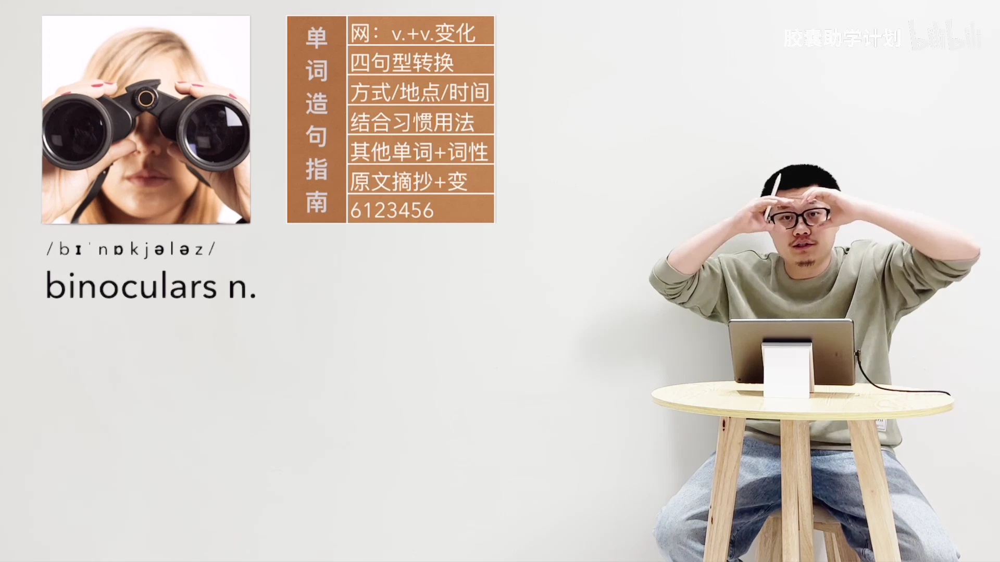

文字识别：单词造句指南 / 网：v.+v.变化 / 妻助字计划陽 / 四句型转换 / 方式/地点/时间 / 结合习惯用法 / 其他单词+词性 / 原文摘抄+变 / 6123456 / /bi'npkjalaz/ / binoculars n.

### 画面 00:06:04

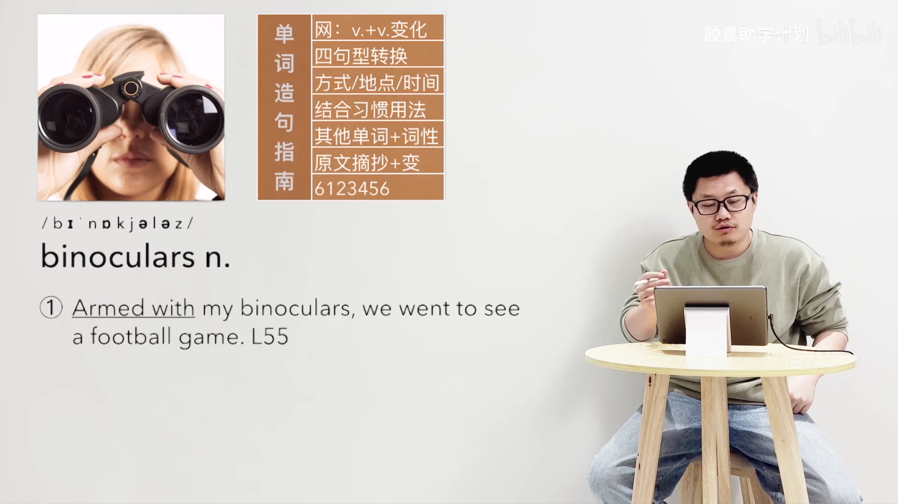

文字识别：单词造句指南 / 网：v.+v.变化 / 四句型转换 / 方式/地点/时间 / 结合习惯用法 / 其他单词+词性 / 原文摘抄+变 / 6123456 / /bi'npkjalaz/ / binoculars n. / ① Armed with my binoculars, we went to see / a football game. L55

### 画面 00:06:06

文字识别：单词造句指南 / 网：v.+v.变化 / 学计划 / 四句型转换 / 方式/地点/时间 / 结合习惯用法 / 其他单词+词性 / 原文摘抄+变 / 6123456 / /bi'npkjalaz/ / binoculars n. / ① Armed with my binoculars, we went to see / a football game. L55

### 画面 00:06:10

文字识别：单词造句指南 / 网：v.+v.变化 / 四句型转换 / 方式/地点/时间 / 结合习惯用法 / 其他单词+词性 / 原文摘抄+变 / 6123456 / /binpkjalaz/ / binoculars n. / ① Armed with my binoculars, we went to see / a football game. L55

### 画面 00:06:20

文字识别：单词造句指南 / 网：v.+v.变化 / 学计划 / 四句型转换 / 方式/地点/时间 / 结合习惯用法 / 其他单词+词性 / 原文摘抄+变 / 6123456 / /bi^npkjalaz/ / binoculars n. / ① Armed with my binoculars, we went to see / a football game. L55

### 画面 00:06:25

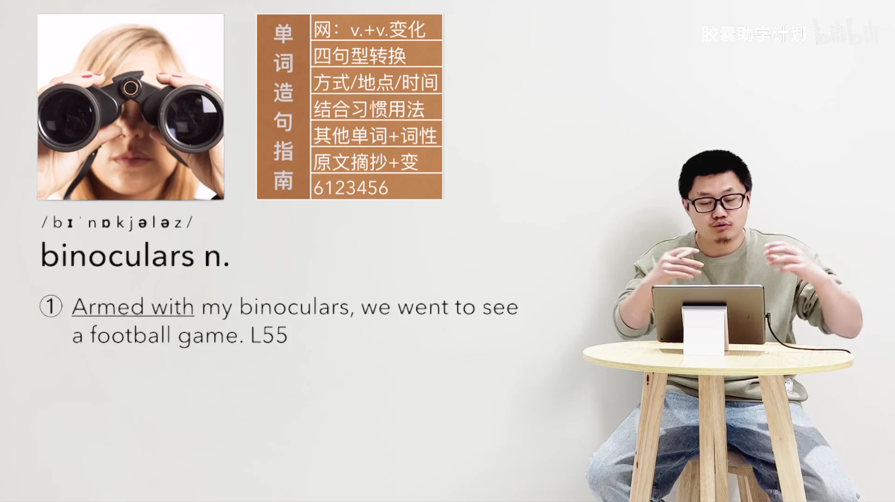

文字识别：单词造句指南 / 网：v.+v.变化 / 四句型转换 / 方式/地点/时间 / 结合习惯用法 / 其他单词+词性 / 原文摘抄+变 / 6123456 / /bi'npkjalaz / / binoculars n. / ① Armed with my binoculars, we went to see / a football game. L55

### 画面 00:06:29

文字识别：单词造句指南 / 网：v.+v.变化 / 四句型转换 / 方式/地点/时间 / 结合习惯用法 / 其他单词+词性 / 原文摘抄+变 / 6123456 / /bi^npkjalaz/ / binoculars n. / ① Armed with my binoculars, we went to see / a football game. L55 / The things that he saw through his / binoculars were top secrets.

## 00:06:30–00:07:00

The things that he saw through his binoculars were top secrets.怎么样呢？来，直接来个定语从句。他通过他望远镜看到的那些事情是机密，top secrets啊。一个文件上面大概一个大章，top secrets啊，绝佳的，就是非呃非常重要的机密，是吧？下一句话说，Why do you carry your binoculars

### 画面 00:06:35

文字识别：单词造句指南 / 网：v.+v.变化 / 四句型转换 / 方式/地点/时间 / 结合习惯用法 / 其他单词+词性 / 原文摘抄+变 / 6123456 / /bi'npkjalaz/ / binoculars n. / ① Armed with my binoculars, we went to see / a football game. L55 / The things that he saw through his / binoculars were top secrets.

### 画面 00:06:39

文字识别：单词造句指南 / 网：v.+v.变化 / 四句型转换 / 方式/地点/时间 / 结合习惯用法 / 其他单词+词性 / 原文摘抄+变 / 6123456 / /bi'npkjalaz/ / binoculars n. / ① Armed with my binoculars, we went to see / a football game. L55 / The thingsthat he saw through his / binocularswere top secrets.

### 画面 00:06:47

文字识别：单词造句指南 / 网：v.+v.变化 / 四句型转换 / 方式/地点/时间 / 结合习惯用法 / 其他单词+词性 / 原文摘抄+变 / 6123456 / /bi'npkjalaz/ / binoculars n. / ① Armed with my binoculars, we went to see / a football game. L55 / The thingsthat he saw through his / binocularswere top secrets.

### 画面 00:06:49

文字识别：单词造句指南 / 网：v.+v.变化 / 四句型转换 / 方式/地点/时间 / 结合习惯用法 / 其他单词+词性 / 原文摘抄+变 / 6123456 / /bi'npkjalaz/ / binoculars n. / ① Armed with my binoculars, we went to see / a football game. L55 / The thingsthat he saw through his / binocularswere top secrets.

### 画面 00:06:51

文字识别：单词造句指南 / 网：v.+v.变化 / 四句型转换 / 方式/地点/时间 / 结合习惯用法 / 其他单词+词性 / 原文摘抄+变 / 6123456 / /bi^npkjalaz/ / binoculars n. / ① Armed with my binoculars, we went to see / a football game. L55 / The thingsthat he saw through his / binocularswere top secrets.

### 画面 00:06:55

文字识别：单词造句指南 / 网：v.+v.变化 / 四句型转换 / 方式/地点/时间 / 结合习惯用法 / 其他单词+词性 / 原文摘抄+变 / 6123456 / /bi^npkjalaz/ / binoculars n. / ① Armed with my binoculars, we went to see / a football game. L55 / ) The things(that he saw through his / binocularswere top secrets. / ③ Why do you carry your binoculars to a / comedy show? L89

## 00:07:00–00:07:30

a comedy show. 我说为什么你要带着你的这个望远镜去一个看这个喜剧呢？啊，comedy show，之前咱们八十九课学的 binoculars，再读一遍这个单词。哦，本课生词非常非常的少啊，学起来比较的轻松。习惯用法呢，一共就是有两个，咱们单词造句的时候记得格外关照一下这两个兄弟啊。然后呢，电影片段是咱们老习惯，知识点旁边找重复间隔的学习材料。

### 画面 00:07:07

文字识别：单词造句指南 / 网：v.+v.变化 / 四句型转换 / 方式/地点/时间 / 结合习惯用法 / 其他单词+词性 / 原文摘抄+变 / 6123456 / /bi'npkjalaz/ / binoculars n. / ① Armed with my binoculars, we went to see / a football game. L55 / ) The things(that he saw through his / binocularswere top secrets. / ③ Why do you carry your binoculars to a / comedy show? L89

### 画面 00:07:14

文字识别：Recap / 喜助字计划 / Words / spy on sb./sth. / Expression / keep track of

### 画面 00:07:16

文字识别：Recap / Words / spy on sb./sth. / Expression / keep track of

### 画面 00:07:18

文字识别：Recap / Words / spy on sb./sth. / Expression / keep track of

### 画面 00:07:20

文字识别：Recap / 臺助字计划 / Words / spy on sb./sth. / Expression / keep track of

### 画面 00:07:22

文字识别：1. / 单词造句/对话 / 【单词造句指南】 / 每个5句

### 画面 00:07:24

文字识别：单词造句/对话 / 1. / 【单词造句指南】 / 每个5句 / 2.反复听电影片段，直到能 / 听出关键短语/句子

### 画面 00:07:26

文字识别：单词造句/对话 / 【单词造句指南】 / 每个5句 / 2.反复听电影片段，直到能 / 听出关键短语/句子 / 3.重复间隔（置顶留言）

## 00:07:30–00:07:55

那以上呢就是本期视频的全部内容了。如果各位喜欢我们的课程呢，欢迎各位关注、订阅、一键三连，分享给那些需要的朋友，来帮助我们快速成长。See you next time.

### 画面 00:07:30

文字识别：袁助字计划 / 👍 / Wi

### 画面 00:07:33

文字识别：袁助学计划 / 不

### 画面 00:07:38

文字识别：虞助字计划一

### 画面 00:07:43

文字识别：聖動字計想、

### 画面 00:07:45

文字识别：臺動字計划 / CAPSULEACADEMY / 胶囊助学计划 / 『 / 小红书 / Lecturer / Leo / OE

### 画面 00:07:47

文字识别：CAPSULEACADEMY / 胶囊助学计划 / 小红书 / Photographer / □ / Berlin / OE

### 画面 00:07:49

文字识别：CAPSULEACADEMY / 胶囊助学计划 / 『 / 小红书 / Editor / Berlin / OE

### 画面 00:07:52

文字识别：CAPSULEACADEMY / 胶囊助学计划 / 小红书

### 画面 00:07:54

文字识别：bilibili / 胶囊助学计划

### 画面 00:07:55

文字识别：bilibili / 胶囊助学计划

