# 091 语法

快速机器解析：语音为单模型转写，未进行独立交叉校对或人工复核；画面每秒采样并按变化选帧，短时文字和标记可能遗漏。截图时间约有 1 秒误差。图片有损压缩；遇到疑点请按时间查看 Google Drive 原视频。

## 00:00:00–00:00:30

Hello everyone, welcome to Capsule Cabin. This is Leo. Today we're going to learn the concept in English for two lesson ninety one grammar. Hope you can enjoy.好，本课实际上到了我们第四单元的第十九课啊，很快了。我们学了第四单元第十九课呢，那我们就要回顾，分别回顾一下第一单元、第二单元、第三单元，还是在这儿只是简单一带而过。十九课咱们学了 may 和 might，它实际上要和

### 画面 00:00:00

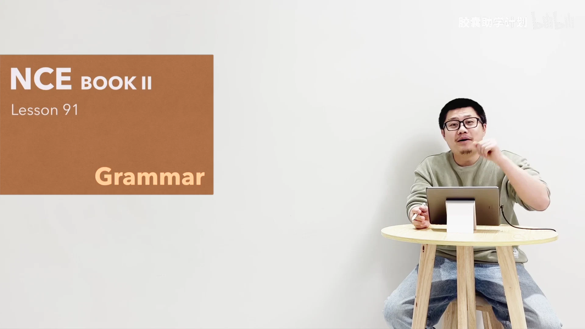

文字识别：NCE / BOOKⅡI / Lesson 91 / Grammar

### 画面 00:00:02

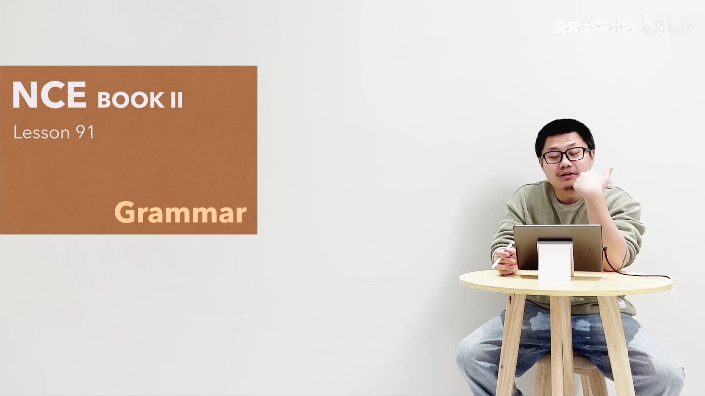

文字识别：NCE / BOOKⅡI / Lesson 91 / Grammar

### 画面 00:00:04

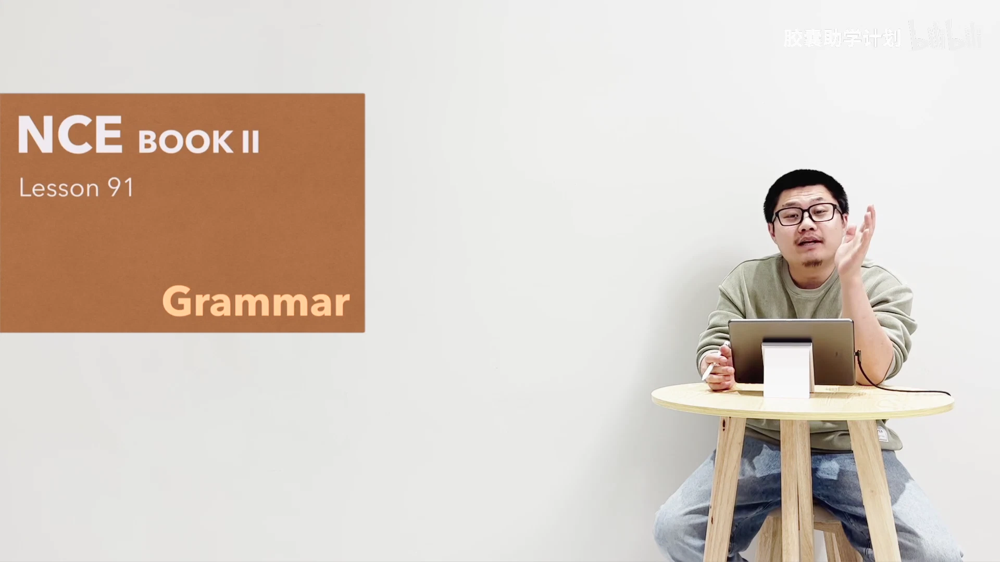

文字识别：NCE / BOOKⅡI / Lesson 91 / Grammar

### 画面 00:00:07

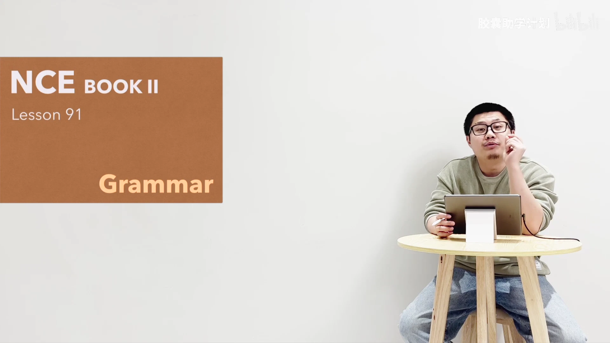

文字识别：NCE / BOOK"I / Lesson 91 / Grammar

### 画面 00:00:09

文字识别：胶囊助学计划 bil

### 画面 00:00:12

文字识别：胶囊助学计划 / 胶囊助学计划

### 画面 00:00:14

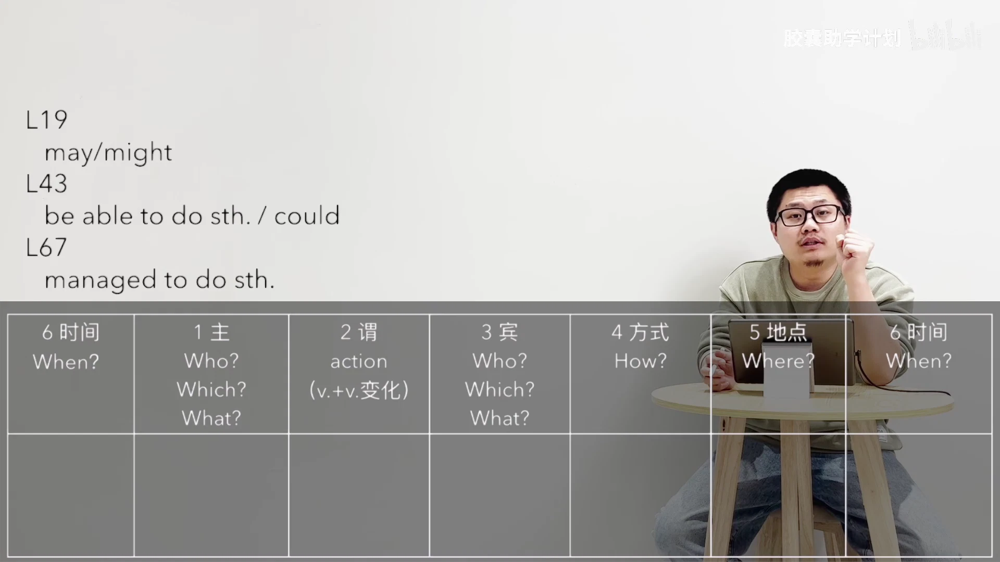

文字识别：囊助学计划 / L19 / may/might / L43 / be able to do sth./ could / L67 / managed to do sth. / 6时间 / 1主 / 2谓 / 3宾 / 4方式 / 5地点 / 6时间 / When? / Who? / action / Who? / How? / Where? / When? / Which? / (v.+v.变化) / Which? / What? / What?

## 00:00:30–00:01:00

十七课连着一起去学，效果是比较好的。十九课咱们学may和might的时候呢，实际上不仅学了它自己本身的含义，更重要的是学习了它表推测的那些能力，对吧？哎，它是一个呃确信度不高的一个推测，当然它可以肯定也可以否定，这取决于有没有not，对吧？好，呃，这是最重要的。四十三课呢，咱们学了最重要的一个结构叫be

### 画面 00:00:31

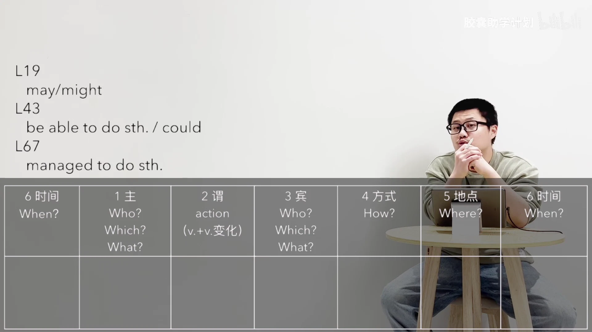

文字识别：喜助子计划 / L19 / may/might / L43 / be able to do sth./ could / L67 / managed to do sth. / 6时间 / 1主 / 2谓 / 3宾 / 4方式 / 5地点 / 6时间 / When? / Who? / action / Who? / How? / Where? / When? / Which? / (v.+v.变化) / Which? / What? / What?

### 画面 00:00:35

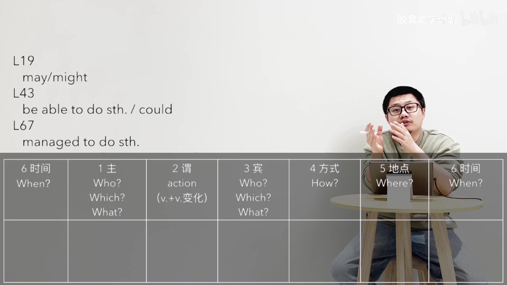

文字识别：囊助字计划 / L19 / may/might / L43 / be able to do sth./ could / L67 / managed to do sth. / 6时间 / 1主 / 2谓 / 3宾 / 4方式 / 5地点 / 6时间 / When? / Who? / action / Who? / How? / Where? / When? / Which? / (v.+v.变化) / Which? / What? / What?

## 00:01:00–00:01:30

able to do something, be able to do something有各种各样的时态，里边有一个特殊的地方叫做 was were able to do something，而 was were able to do something我们当时跟 could是做了一点小的对比的，was were able to do something有一个特殊的用法，实际上呢又和六十七课的 manage to do something是连起来的，表示成功的完成了某件事情，这个红皮书初级中级没写的一定要去写一下，对吧？成功的完成了某件事情，OK，

### 画面 00:01:05

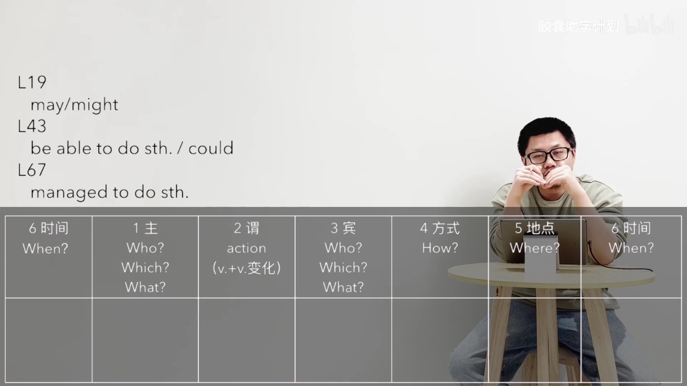

文字识别：囊助字计划 / L19 / may/might / L43 / be able to do sth./ could / L67 / managed to do sth. / 6时间 / 1主 / 2谓 / 3宾 / 4方式 / 5地点 / 6时间 / When? / Who? / action / Who? / How? / Where? / When? / Which? / (v.+v.变化) / Which? / What? / What?

## 00:01:30–00:02:00

那 manage to do something 是咱六十七课学的，我们在这不多说了。老习惯，以练代讲啊。第一个，Repeat after me. She didn't swim across the river. No, but she could have if she wanted to. Next one. I don't believe it. Well, she was able to swim across the river last week. 注意，你看这里的 be able

### 画面 00:01:34

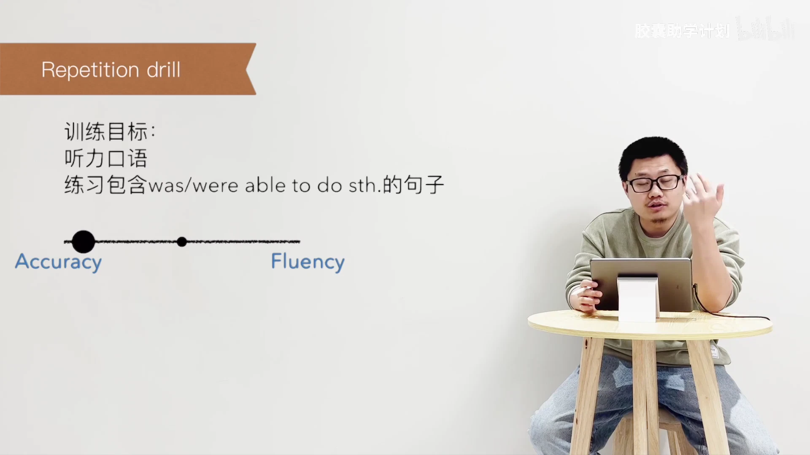

文字识别：Repetition drill / 训练目标： / 听力口语 / 练习包含was/were able to do sth.的句子 / Accuracy / Fluency

### 画面 00:01:36

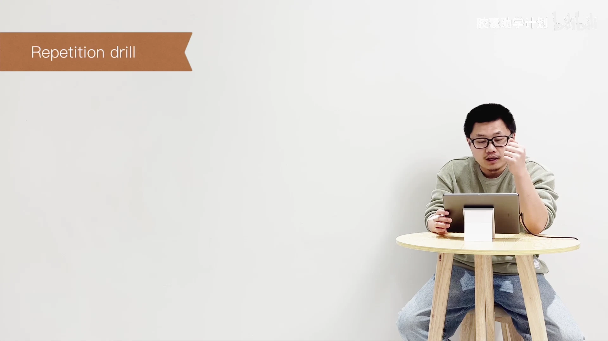

文字识别：臺助学计划 / Repetition drill

### 画面 00:01:38

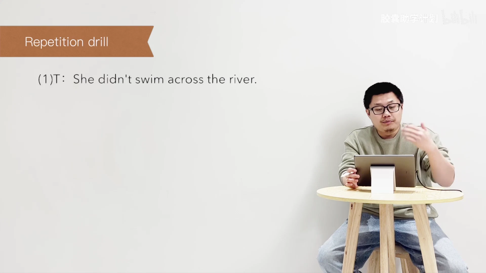

文字识别：Repetition drill / (1)T: She didn't swim across the river.

### 画面 00:01:40

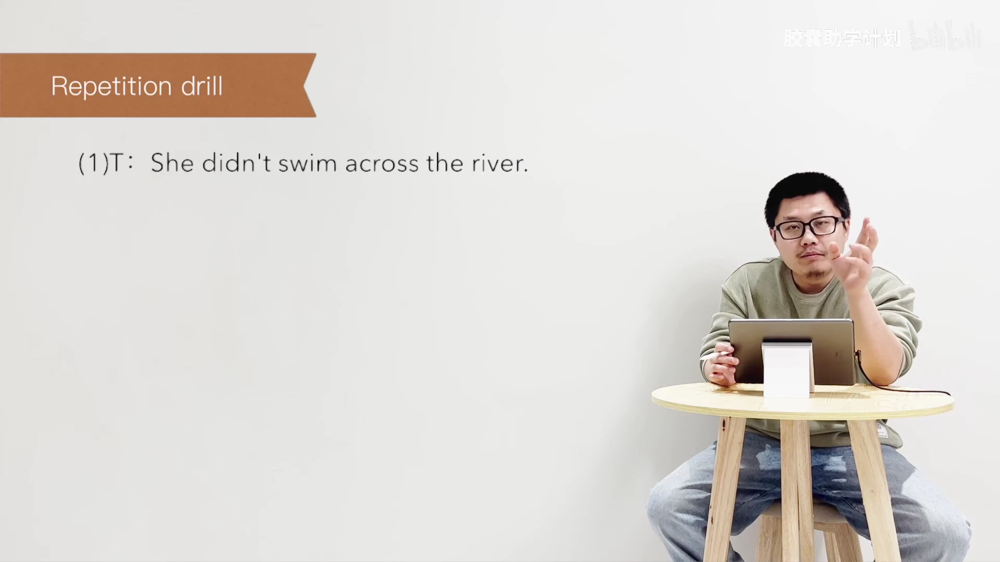

文字识别：喜助字计划 / Repetition drill / (1)T: She didn't swim across the river.

### 画面 00:01:44

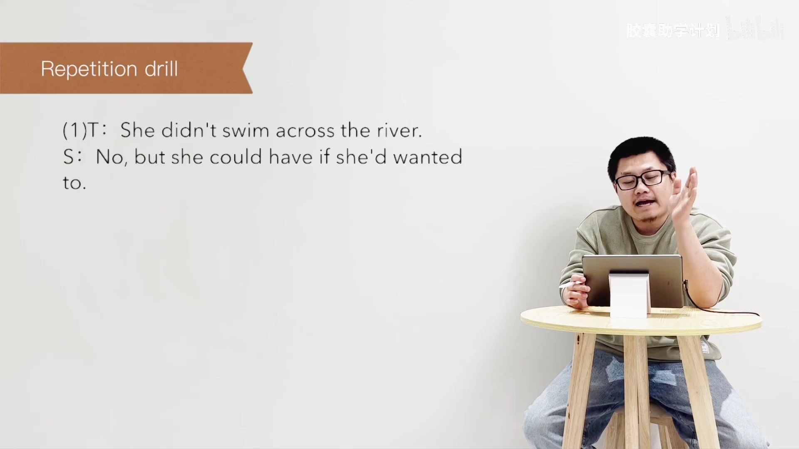

文字识别：Repetition drill / (1)T: She didn't swim across the river. / S: No, but she could have if she'd wanted / to.

### 画面 00:01:57

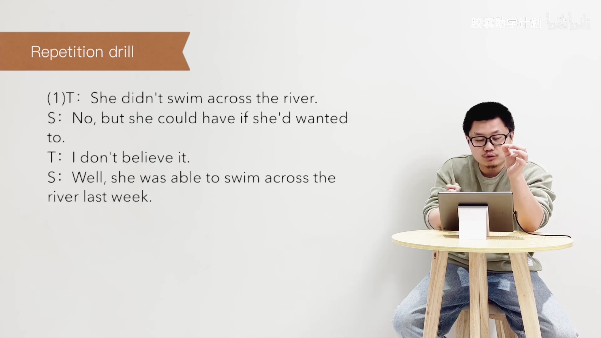

文字识别：Repetition drill / (1)T: She didn't swim across the river. / S: No, but she could have if she'd wanted / to. / T: I don't believe it. / S: Well, she was able to swim across the / river last week.

## 00:02:00–00:02:30

to do，其实就 I was able to do，完全可以换成 manage to do。说 She managed to swim across the river last week。可以啊。第二个，You didn't climb the mountain。 No， but I could have if I wanted to。 I don't believe it。 Well， I was able to climb the mountain last week。我上周就成功的爬到山顶上去了，对吧？剩下的挨个读了啊，不挨个解释了。 It didn't long land on that airfield。

### 画面 00:02:09

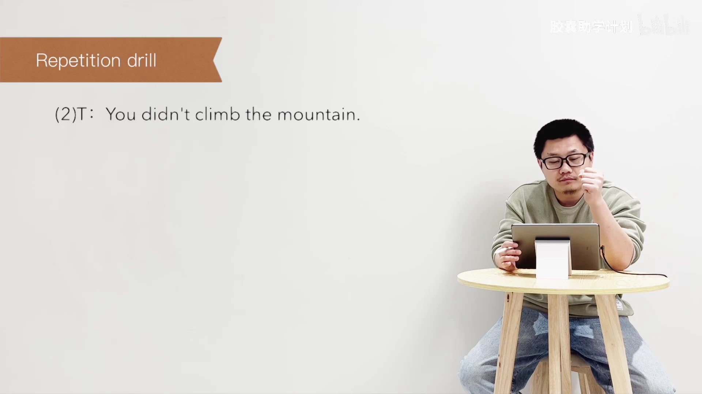

文字识别：Repetition drill / (2)T: You didn't climb the mountain.

### 画面 00:02:12

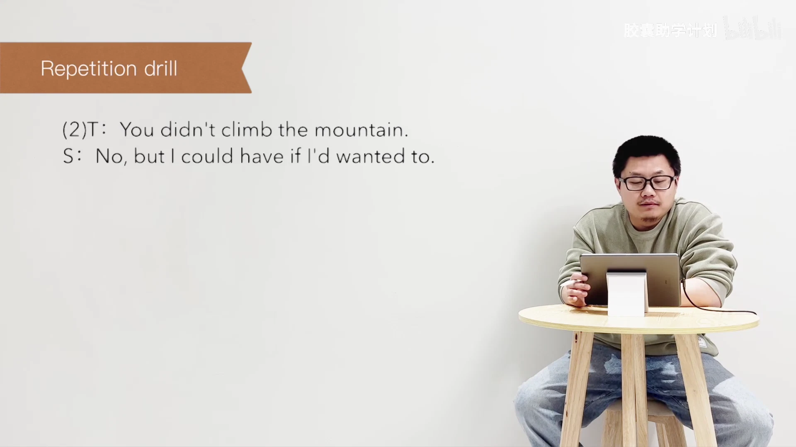

文字识别：Repetition drill / (2)T: You didn't climb the mountain. / S: No, but I could have if lI'd wanted to.

### 画面 00:02:15

文字识别：Repetition drill / (2)T: You didn't climb the mountain. / S: No, but I could have if lI'd wanted to. / T: I don't believe it.

### 画面 00:02:21

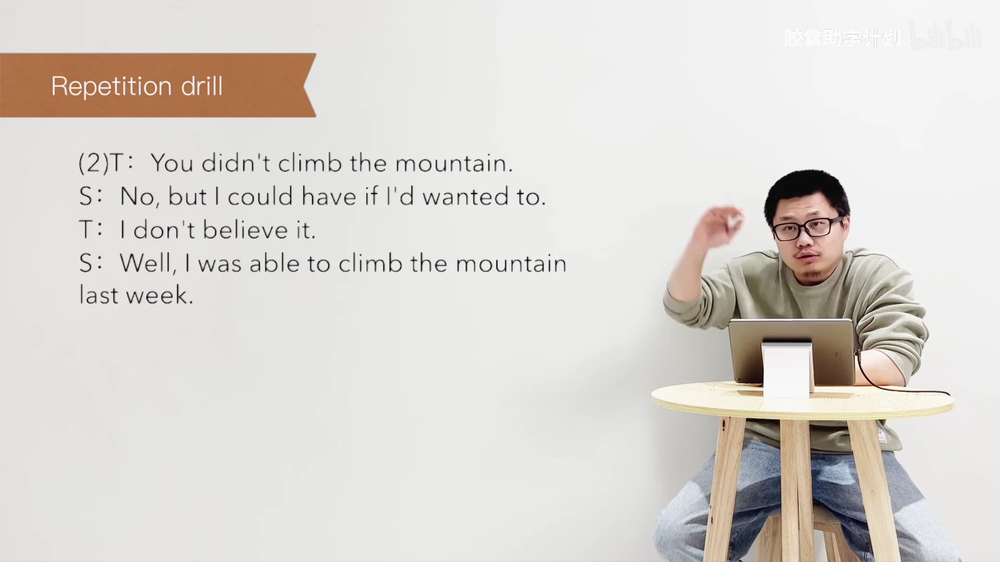

文字识别：Repetition drill / (2)T: You didn't climb the mountain. / S: No, butI could have if l'd wanted to. / T: I don't believe it. / S: Well, I was able to climb the mountain / last week.

### 画面 00:02:24

文字识别：庭助学计划 / Repetition drill

## 00:02:30–00:03:00

No, but he could have if he wanted to. I don't believe it. Well, he was able to land on that airfield last week. You didn't catch any fish. No, but I could have if I wanted to. I don't believe it. Well, I was able to catch some fish last week. They didn't win. No,

### 画面 00:02:34

文字识别：Repetition drill / (3)T: He didn't land on that airfield. / S: No, but he could have if he'd wanted to. / T: I don't believe it.

### 画面 00:02:41

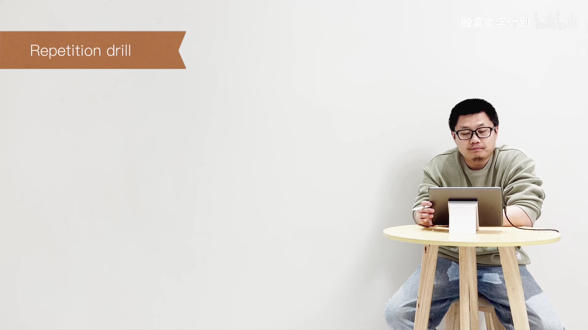

文字识别：臺助字计划 / Repetition drill

### 画面 00:02:50

文字识别：Repetition drill / 4T: You didn't catch any fish. / S: No, butI could have if I'd wanted to. / T: I don't believe it. / S: Well, I was able to catch some fish last / week.

### 画面 00:02:56

文字识别：臺動学计划 / Repetition drill / 5T: They didn't win.

## 00:03:00–00:03:30

but they could have if they wanted to. I don't believe it. Well, they were able to win last week. He didn't escape from the camp. No, but he could have if he wanted to. I don't believe it. Well, he was able to escape from the camp last week. You didn't stop smoking. No, but I

### 画面 00:03:05

文字识别：Repetition drill / 5T: They didn't win. / S: No, but they could have if they'd wanted / to. / T: I don't believe it. / S: Well, they were able to win last week.

### 画面 00:03:09

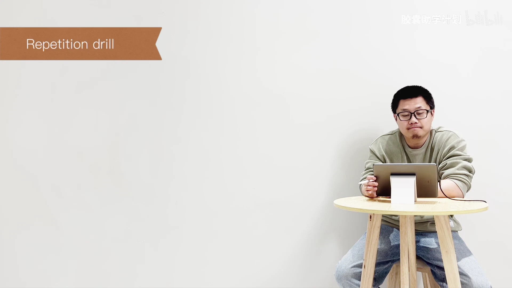

文字识别：毫助字计划 / Repetition drill

### 画面 00:03:17

文字识别：Repetition drill / 6T: He didn't escape from the camp. / S: No, but he could have if he'd wanted to. / T: I don't believe it.

### 画面 00:03:25

文字识别：Repetition drill / 7T: You didn't stop smoking.

## 00:03:30–00:04:00

could have if I wanted to. I don't believe it. Well, I was able to stop smoking last week. She didn't persuade him. No, but she could have if she wanted to. I don't believe it. Well, she was able to persuade him last week. Pedantry，老习惯是吧？这个地方出现的，咱们都多少练一下，纯复习

### 画面 00:03:33

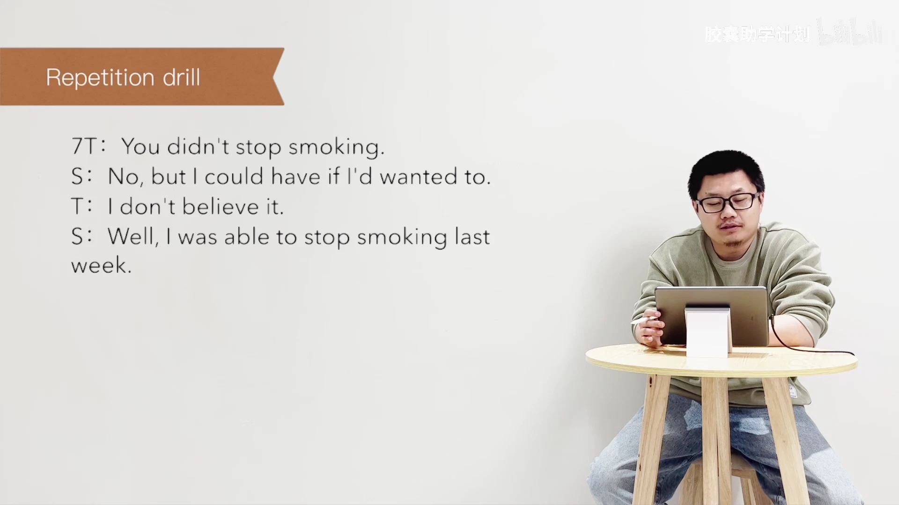

文字识别：Repetition drill / 7T: You didn't stop smoking. / S: No, butI could have if lI'd wanted to. / T: I don't believe it. / S: Well I was able to stop smoking last / week.

### 画面 00:03:39

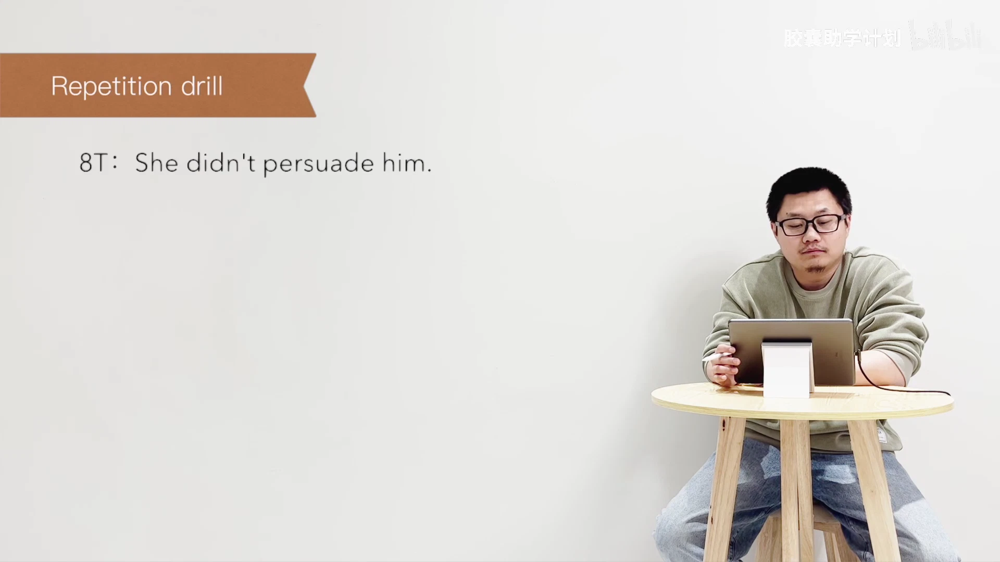

文字识别：喜助字计划医 / Repetition drill / 8T: She didn't persuade him.

### 画面 00:03:48

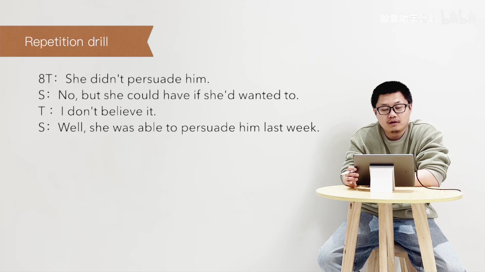

文字识别：Repetition drill / 8T: She didn't persuade him. / S: No, but she could have if she'd wanted to. / T: I don't believe it. / S: Well, she was able to persuade him last week.

### 画面 00:03:53

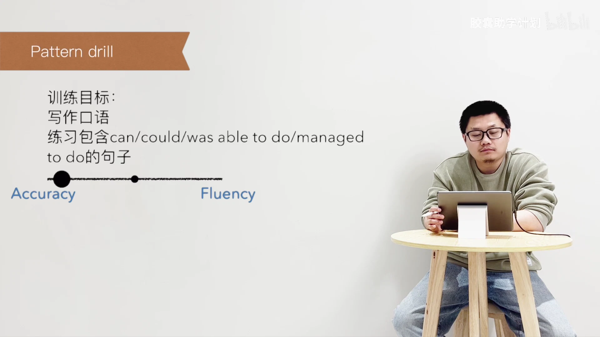

文字识别：Pattern drill / 训练目标： / 写作口语 / 练习包含can/could/was able to do/managed / to do的句子 / Accuracy / Fluency

### 画面 00:03:57

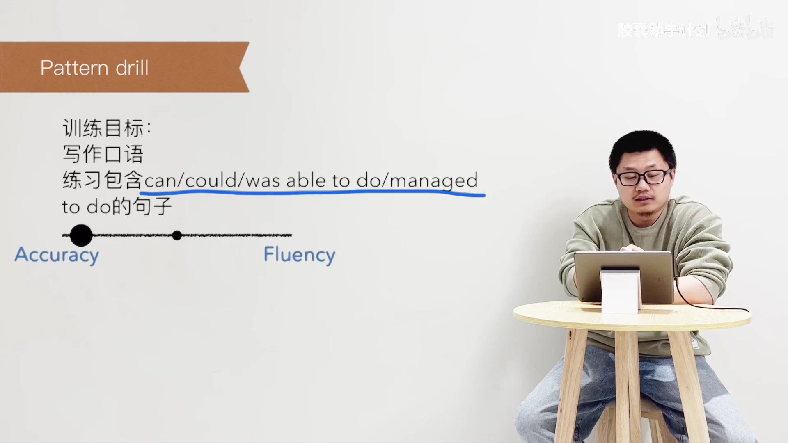

文字识别：Pattern drill / 训练目标： / 写作口语 / 练习包含can/could/was able to do/managed / to do的句子 / Accuracy / Fluency

### 画面 00:03:59

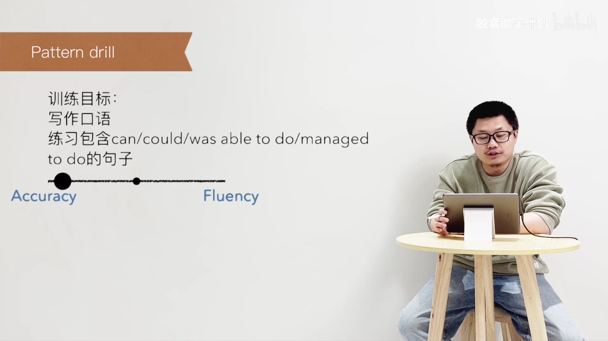

文字识别：Pattern drill / 训练目标： / 写作口语 / 练习包含can/could/was able to do/managed / to do的句子 / Accuracy / Fluency

## 00:04:00–00:04:30

啊！如果您特别熟了，包括红笔书写的特别好了，这是不写是没有问题的。但是还是要看一下，万一你有哪个不会，还是要写一下啊。第一个说 Where shall I put these towels？啊， towels，说这个我应该把这些毛巾放在哪？ You can put them in the cupboard. 你可以把它们放在哪？这是 can 最简单的用法。换一句话来说，新一四十三课咱们就学过的用法，对吧？这是第一个。第二个是 Can you go and see Mary？是，你能去

### 画面 00:04:01

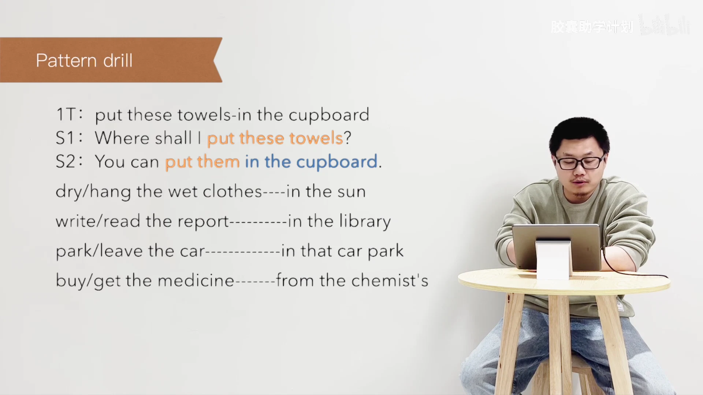

文字识别：Pattern drill / 1T: put these towels-in the cupboard / S1: Where shalll put these towels? / S2: You can put them in the cupboard. / dry/hang the wet clothes---in the sun / write/read therepor--in heibrary / park/leave the car--- / -in that car park / buy/get the medicine---from the chemist's

### 画面 00:04:03

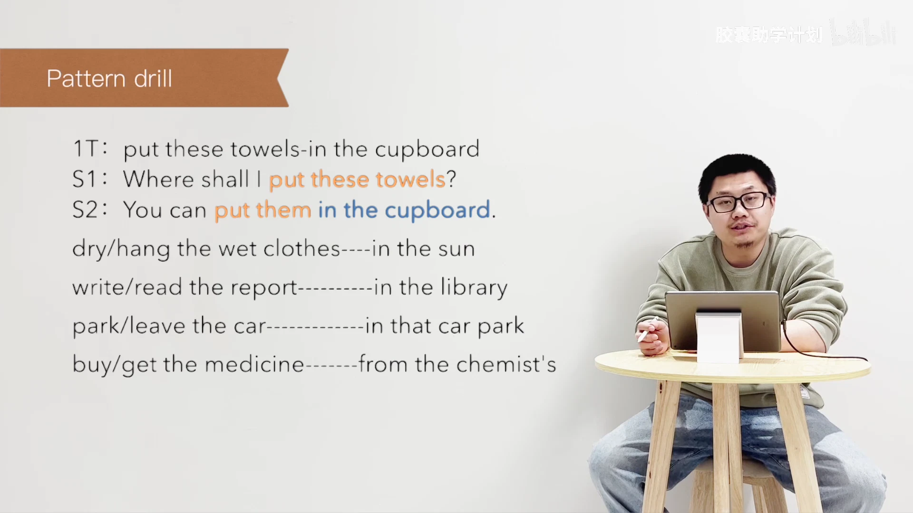

文字识别：Pattern drill / 1T: put these towels-in the cupboard / S1: Where shalll put these towels? / S2: You can put them in the cupboard. / dry/hang the wet clothes---in the sun / write/read thereport--in the library / park/leave the car-- / --in that car park / buy/get the medicine----from the chemist's

### 画面 00:04:05

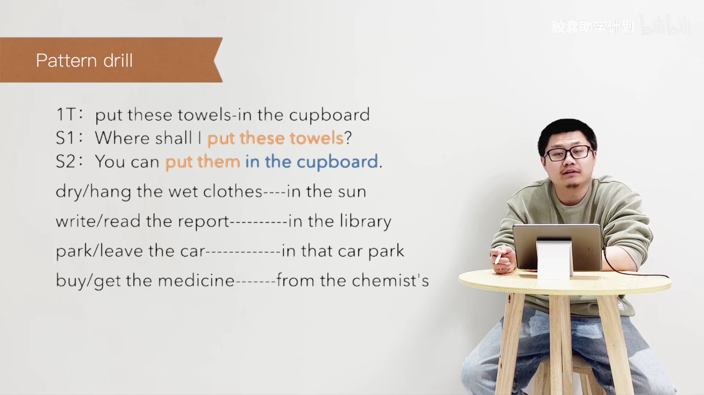

文字识别：Pattern drill / 1T: put these towels-in the cupboard / S1: Where shall l put these towels? / S2: You can put them in the cupboard. / dry/hang the wet clothes---in the sun / write/read thereport--in the library / park/leave the car---- / -in that car park / buy/get the medicine----from the chemist's

### 画面 00:04:26

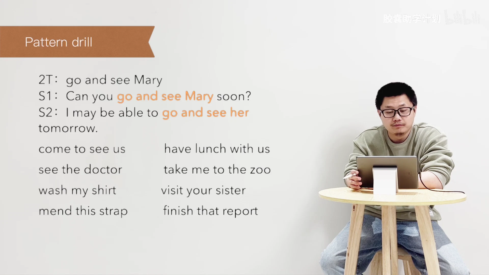

文字识别：Pattern drill / 2T: go and see Mary / S1: Can you go and see Mary soon? / S2: I may be able to go and see her / tomorrow. / have lunch with us / come to see us / see the doctor / take me to the zoo / wash my shirt / visit your sister / mend this strap / finish that report

## 00:04:30–00:05:00

快点看看她吗？I may be able to go and see her tomorrow.这地方其实是两个语法，十九课的may可能表推测，第二个是四十二课啊，咱们刚说的啊，四十三课be able to do，对吧？连起来了，我可能能去看她明天。第三个，Why didn't you jump over the stream?为什么不从小溪上跳过去呢？I couldn't jump over it. It was too wide.我当时没办法跳过去，因为

### 画面 00:04:49

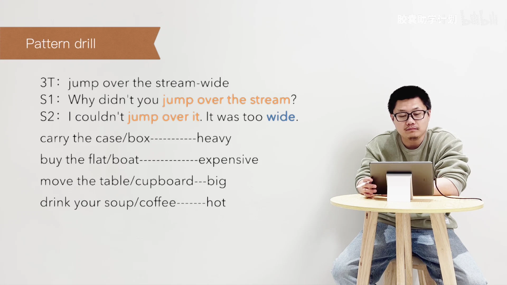

文字识别：Pattern drill / 3T: jump over the stream-wide / S1: Why didn't you jump over the stream? / S2: I couldn't jump over it. It was too wide. / carryt-as/bo---eavy / buy the flat/boat- / -----expensive / move the table/cupboard--big / drink your soup/coffee---hot

## 00:05:00–00:05:30

怎么样太宽了。能不能啊？就 was able to couldn't 表过去都可以。但是 couldn't 怎么样来着？和 was or able to 有什么区别来着？四十三课咱们当时认真学了，您还记得吗？不会，还是那句话，第四单元是复习，一定要回去再看一下，好吧？好，然后看完之后回来，重点写一下这道题啊。第四个说 the door was locked，我在那门被锁上了，是吗？Yes， but I managed to open it

### 画面 00:05:19

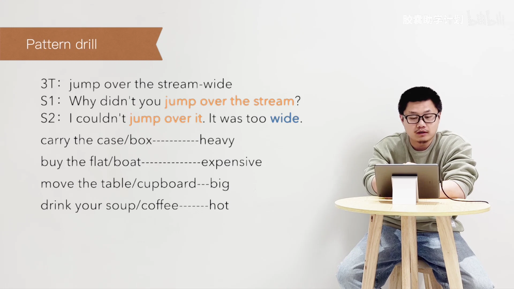

文字识别：Pattern drill / 3T: jump over the stream-wide / S1:Why C /  didn't you jump over the stream? / S2: I couldn't jump over it. It was too wide. / carry--ase-/bo---eavy / buy the flat/boat- / -----expensive / move the table/cupboard---big / drink your soup/coffee---hot

### 画面 00:05:23

文字识别：Pattern drill / 4T: the door was locked---open / S1: The door was locked, wasn't it? / S2: Yes, but I managed to open it in the end. / he refused to agree---- / ----persuade/convince / the horseranaway---catch/stop / the box was very heavy--move/lift / the river was very wide---swim/get across

## 00:05:30–00:06:00

in the end.但是我最终 in the end 第一课习惯用法六十七个还是成功设法的打开了它，对吧？哎，往里面去带啊。嗯，那 recap 就是这些点，还是那句话啊，不熟了就回去看一下。呃，pattern drills 四乘四尝试回忆讲解，重点是红皮书初级加中级，咱们能写的都给他写了，当然是这关于这课的就行，好吧？好，第三册咱们还要再看它啊。那以上

### 画面 00:05:31

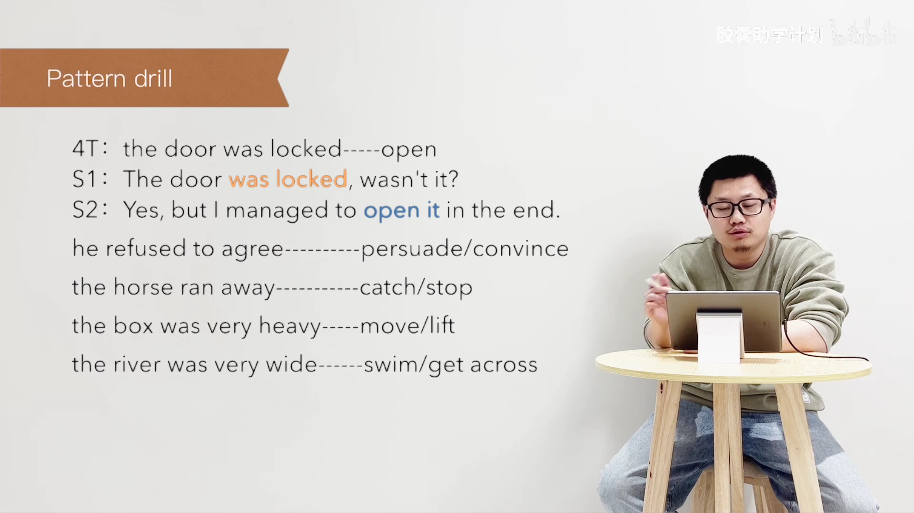

文字识别：Pattern drill / 4T: the door was locked---open / S1: The door was locked, wasn't it? / S2: Yes, but I managed to open it in the end. / he refused to agree-- / ----persuade/convince / the horseranaway---catch/stop / the box was very heavy--move/lift / the river was very wide---swim/get across

### 画面 00:05:40

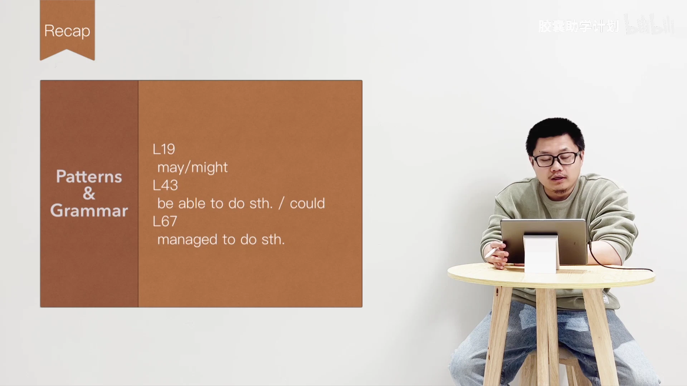

文字识别：Recap / 葬助学计划 / L19 / may/might / Patterns / L43 / ＆ / be able to do sth./ could / Grammar / L67 / managed to do sth.

### 画面 00:05:42

文字识别：Recap / L19 / may/might / Patterns / L43 / ＆ / be able to do sth./ could / Grammar / L67 / managed to do sth.

### 画面 00:05:44

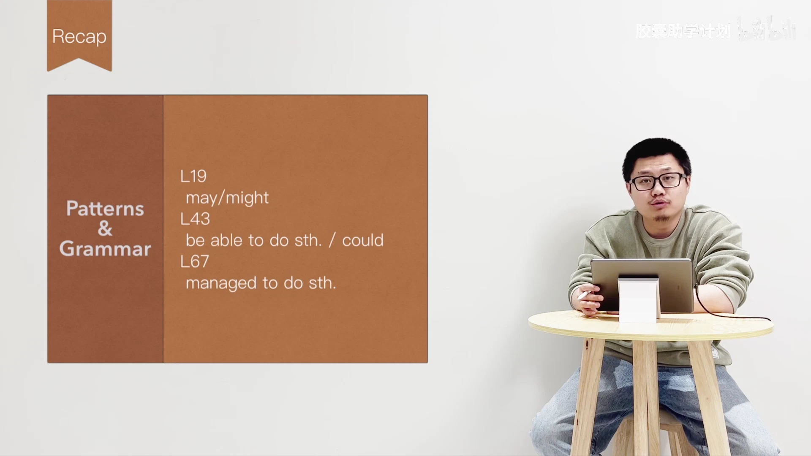

文字识别：Recap / 泰助学计划 / L19 / may/might / Patterns / L43 / ＆ / be able to do sth./ could / Grammar / L67 / managed to do sth.

### 画面 00:05:46

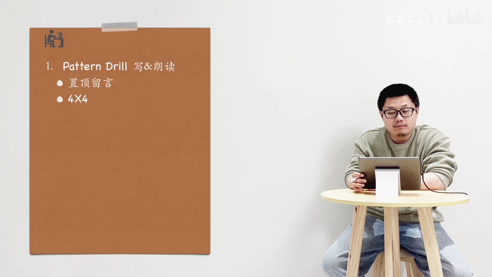

文字识别：豪助学计划 / 1.f / Pattern Drill 写&朗读 / 置顶留言 / 4×4

### 画面 00:05:48

文字识别：1. f / Pattern Drill写&朗读 / 置顶留言 / 4×4 / 尝试回忆并给自己讲解一 / 遍今天的核心语法 / Study-Test / Learning Pyramid / 尝试翻阅红皮书（中级） / 通过目录或索引(Index) / 查找到本课语法

### 画面 00:05:50

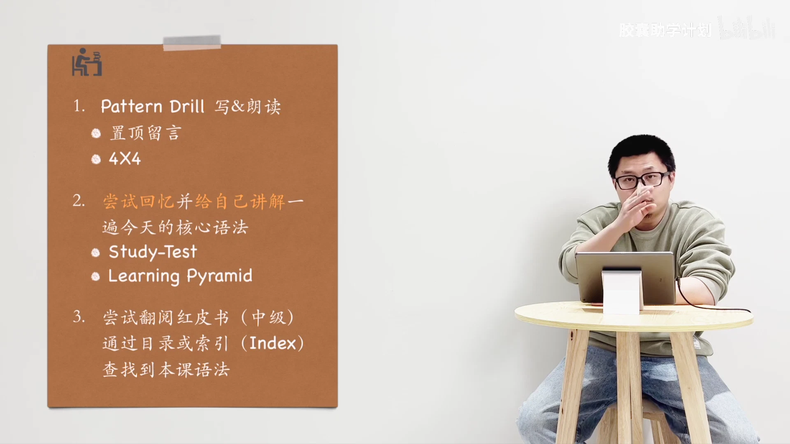

文字识别：1.Pattern Drill 写&朗读 / 置顶留言 / 4×4 / 尝试回忆并给自己讲解一 / 遍今天的核心语法 / Study-Test / Learning Pyramid / 尝试翻阅红皮书（中级） / 通过目录或索引(Index) / 查找到本课语法

### 画面 00:05:52

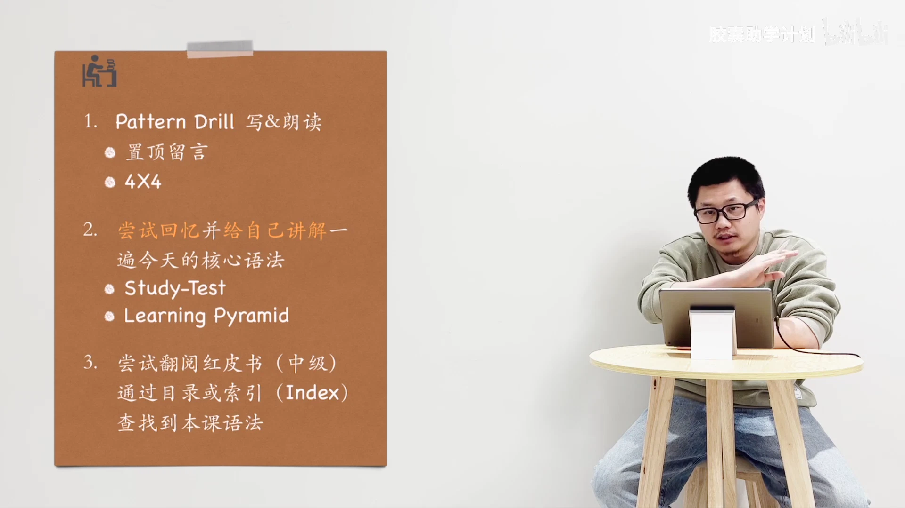

文字识别：1. f / Pattern Drill 写&朗读 / 置顶留言 / 4×4 / 尝试回忆并给自己讲解一 / 遍今天的核心语法 / Study-Test / Learning Pyramid / 尝试翻阅红皮书（中级） / 通过目录或索引(Index) / 查找到本课语法

### 画面 00:05:55

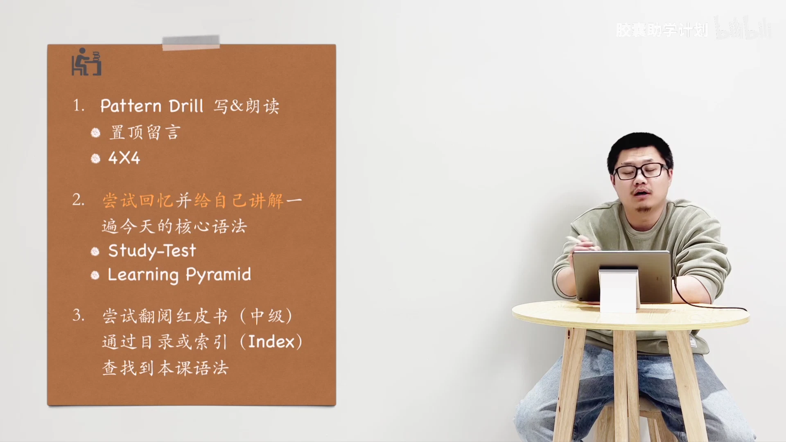

文字识别：Pattern Drill 写&朗读 / 1.↑ / 置顶留言 / 4×4 / 尝试回忆并给自己讲解一 / 遍今天的核心语法 / Study-Test / Learning Pyramid / 尝试翻阅红皮书（中级） / 通过目录或索引(Index) / 查找到本课语法

### 画面 00:05:59

文字识别：袁助学计划一

## 00:06:00–00:06:24

就是本期视频的全部内容了。如果各位喜欢我们的课程呢，欢迎各位关注、订阅、一键三连，分享给那些需要的朋友，来帮助我们快速成长。See you next time.

### 画面 00:06:01

文字识别：囊助学计划

### 画面 00:06:03

文字识别：袁助学计划一 / 不

### 画面 00:06:08

文字识别：袁助学计划一

### 画面 00:06:11

文字识别：助学计划

### 画面 00:06:13

文字识别：臺動字計划 / CAPSULEACADEMY / 胶囊助学计划 / 『 / 小红书 / Lecturer / Leo / OE

### 画面 00:06:15

文字识别：動字計 / CAPSULEACADEMY / 胶囊助学计划 / 小红书 / Photographer / Berlin / OE

### 画面 00:06:18

文字识别：CAPSULEACADEMY / 胶囊助学计划 / 『 / 小红书 / Editor / Berlin / OE

### 画面 00:06:20

文字识别：CAPSULEACADEMY / 胶囊助学计划 / 小红书 / Creator / □ / Leo & Berlin / OE

### 画面 00:06:22

文字识别：bilibili / 胶囊助学计划

### 画面 00:06:23

文字识别：bilibili / 胶囊助学计划

