# 091 文章

快速机器解析：语音为单模型转写，未进行独立交叉校对或人工复核；画面每秒采样并按变化选帧，短时文字和标记可能遗漏。截图时间约有 1 秒误差。图片有损压缩；遇到疑点请按时间查看 Google Drive 原视频。

## 00:00:00–00:00:30

Hello everyone, welcome to Capsule Academy. This is Leo. Today we're going to learn new concept English Book Two Lesson Ninety One Story. Hope you gonna enjoy. We,们先看文章标题叫 Three Men and Basket. 如果你不看图，只看 basket，你其实有点怪。 basket 叫篮子，三个男人在一个篮子里边，就不太懂什么意思。它其实就是热气球，上面是那热气球，底下是热气球成人的那个篮子啊，

### 画面 00:00:00

文字识别：NCE / BOOKⅡI / Lesson 91 / Story

### 画面 00:00:02

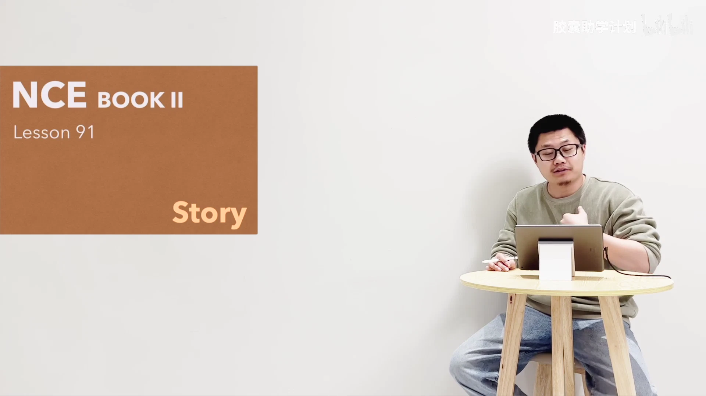

文字识别：秦助字计划 / NCE / BOOKII / Lesson 91 / Story

### 画面 00:00:04

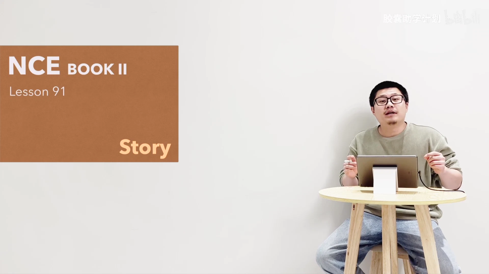

文字识别：秦助字计划 / NCE / BOOKII / Lesson 91 / Story

### 画面 00:00:07

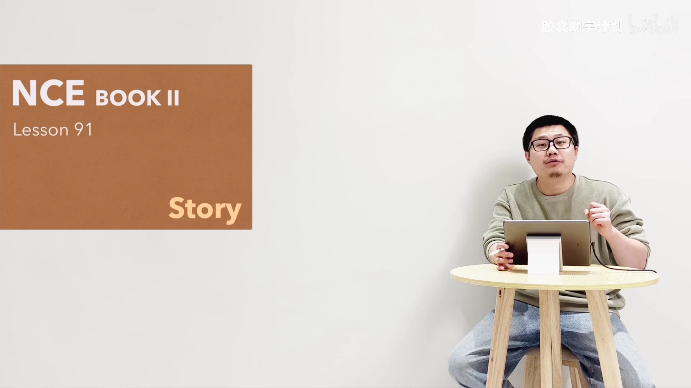

文字识别：辜助子计划 / NCE / BOOKII / Lesson 91 / Story

### 画面 00:00:09

文字识别：bibii / 胶囊助学计划 / • / •

### 画面 00:00:12

文字识别：胶囊助学计划明出 / 胶囊助学计划

### 画面 00:00:14

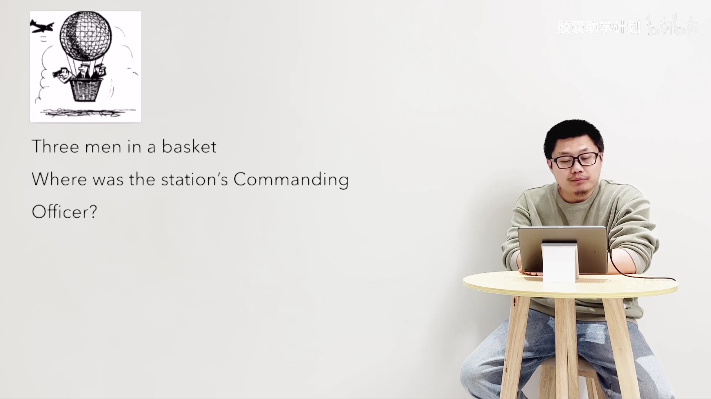

文字识别：Three men in a basket / Where was the station's Commanding / Officer?

## 00:00:30–00:01:00

它是这个意思啊。问的问题是 Where was the station's commanding officer? 这个这个这个站啊，什么站呢？就是那个 Royal Air Force Station 啊，皇家空军站的那个 commanding officer CO 啊缩写，就是这个指挥官在哪啊？那我们看文章吧。A pilot noticed a balloon which seemed to be making for a Royal Air Force Station nearby.

### 画面 00:00:44

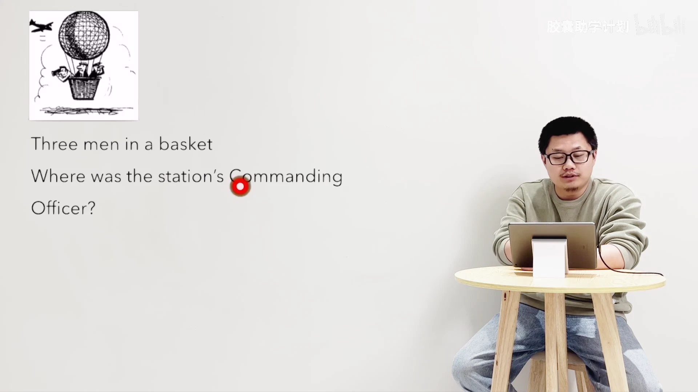

文字识别：臺助字计划 / Three men in a basket / Where was the station's / ommanding / Officer?

### 画面 00:00:49

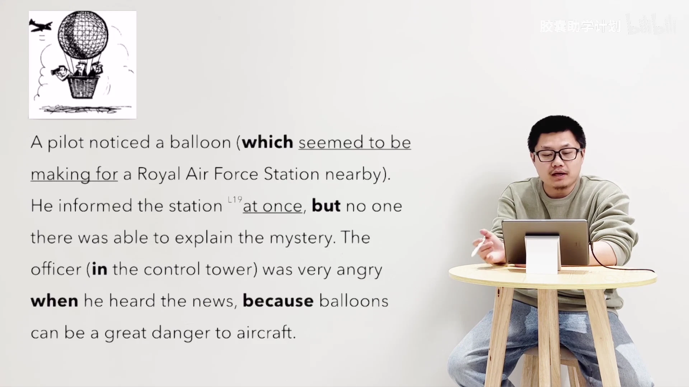

文字识别：A pilot noticed a balloon (which seemed to be / making for a Royal Air Force Station nearby). / He informed the station 'at once, but no one / there was able to explain the mystery. The / officer (in the control tower) was very angry / when he heard the news, because balloons / can be a great danger to aircraft.

## 00:01:00–00:01:30

很简单，基本上有 which，前后句子一拆已经清楚了。A pilot noticed balloon.啊，简单的，一二三，是吧？一个飞行员注意到了一个气球。Which，指的就是这个气球，就是 it，对吧？这个气球怎么样呢？Seem to be making for.好了，这地方有两个习惯用法，我们本课都要造句。第一个叫，其实它的原型叫 seem to do，似乎是啊，但是这里用的是 seem to be

### 画面 00:01:19

文字识别：A pilot noticed a balloon/which seemed to be / making for a Royal Air Force Station nearby). / He informed the station "'at once, but no one / there was able to explain the mystery. The / officer (in the control tower) was very angry / when he heard the news, because balloons / can be a great danger to aircraft.

## 00:01:30–00:02:00

doing，似乎是正在做某事儿，是 seem to do 的一个变体啊，呃也不难，似乎是正在做，似乎是正在干什么呢？呃，这个这个 balloon 就是这个气球，似乎是正在热气球正在干什么呢？ Make for 一个习惯用法， make for 如果是热气球，那就是飞向；如果是人，就是走向。听见了吧？如果汽车就是开向，反正就是朝向某个地方过去了啊，其实就是类似于 go，呃 to 啊 go to 对吧？类似的，

### 画面 00:01:47

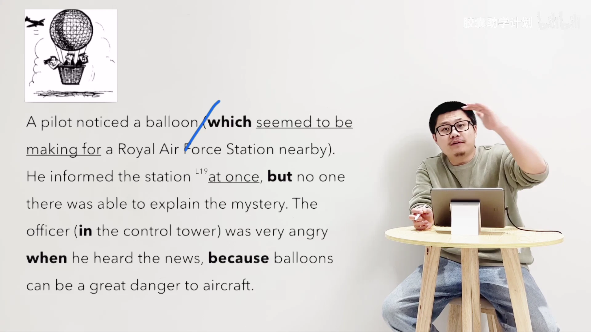

文字识别：A pilot noticed a balloon/which seemed to be / making for a Royal Air Force Station nearby). / He informed the station '"'at once, but no one / there was able to explain the mystery. The / officer (in the control tower) was very angry / when he heard the news, because balloons / can be a great danger to aircraft.

### 画面 00:01:49

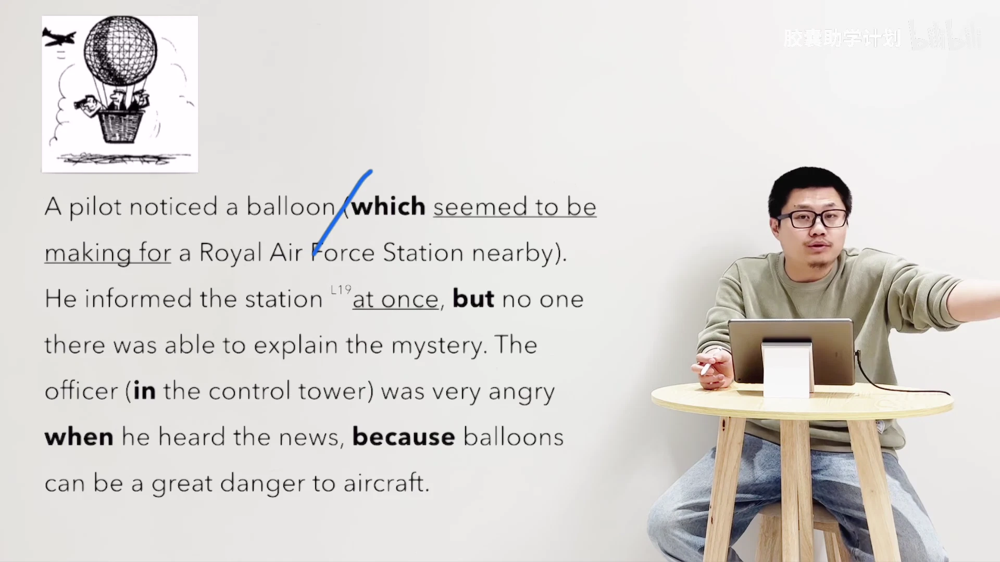

文字识别：A pilot noticed a balloon/which seemed to be / making for a Royal Air Force Station nearby). / He informed the station ['at once, but no one / there was able to explain the mystery. The / officer (in the control tower) was very angry / when he heard the news, because balloons / can be a great danger to aircraft.

### 画面 00:01:53

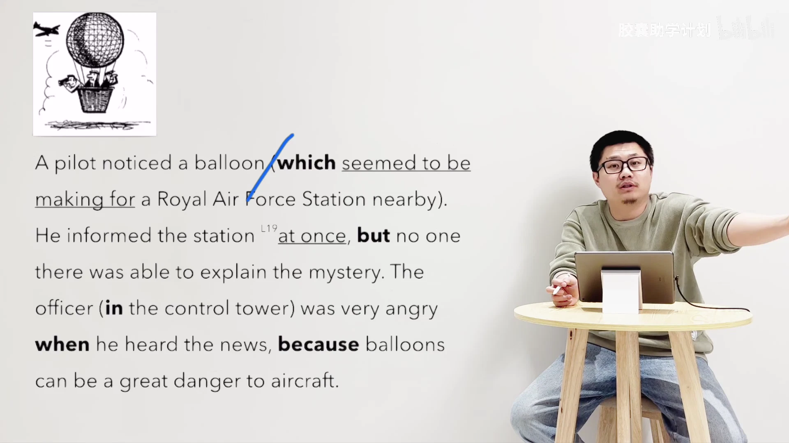

文字识别：A pilot noticed a balloon/which seemed to be / making for a Royal Air Force Station nearby). / He informed the station ['at once, but no one / there was able to explain the mystery. The / officer (in the control tower) was very angry / when he heard the news, because balloons / can be a great danger to aircraft.

### 画面 00:01:56

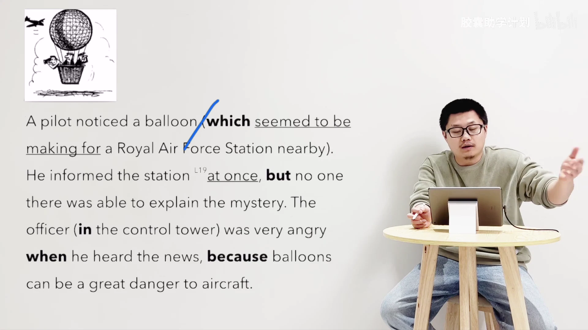

文字识别：A pilot noticed a balloon/which seemed to be / making for a Royal Air Force Station nearby). / He informed the station "'at once, but no one / there was able to explain the mystery. The / officer (in the control tower) was very angry / when he heard the news, because balloons / can be a great danger to aircraft.

## 00:02:00–00:02:30

is which seemed to be making for.哎，似乎是正在朝哪儿飞呢？一个皇家空军基地附近飞，对吧？He informed the station at once, but no one there was able to explain the mystery.他通知了这个呃空军站，立刻at once，立刻马上啊。但是呢，没有人在那里，那里没有人怎么样呢？Was able to

### 画面 00:02:00

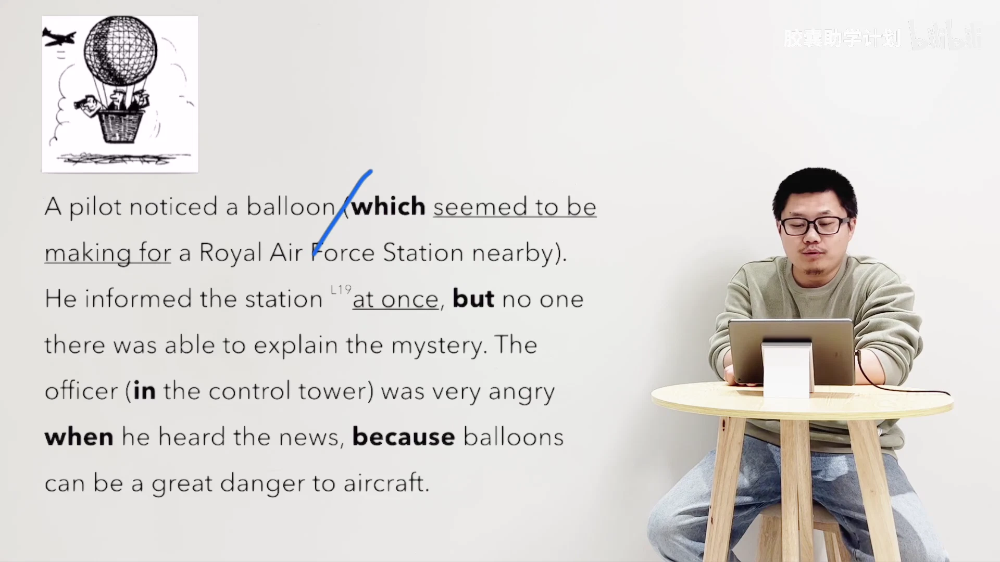

文字识别：A pilot noticed a balloon/which seemed to be / making for a Royal Air Korce Station nearby). / He informed the station '"at once, but no one / there was able to explain the mystery. The / officer (in the control tower) was very angry / when he heard the news, because balloons / can be a great danger to aircraft.

## 00:02:30–00:03:00

能explain the mystery,解释这个什么呢？啊，这个谜题或者说这个疑惑，没有人能解释清楚。The officer in the control tower was very angry when he heard the news because balloons can be a great danger to aircraft.这句话看着挺长，一个because，一个问句子，瞬间就被拆成了小短句。第一句话叫做 officer in the control tower was very angry。

### 画面 00:02:30

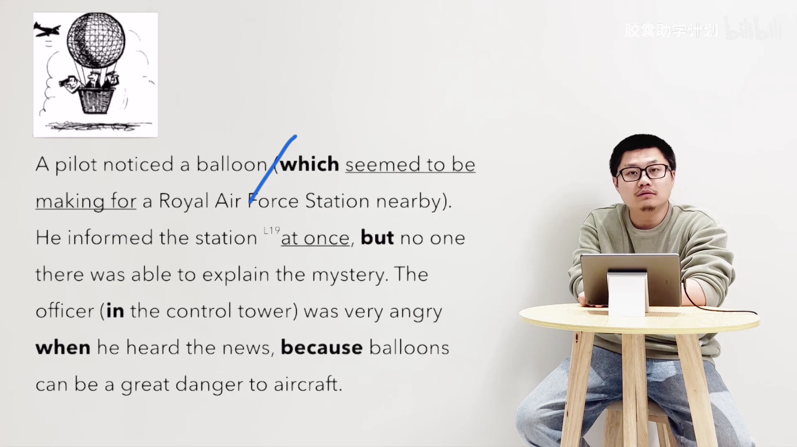

文字识别：A pilot noticed a balloon/which seemed to be / making for a Royal Air #orce Station nearby). / He informed the station "'at once, but no one / there was able to explain the mystery. The / officer (in the control tower) was very angry / when he heard the news, because balloons / can be a great danger to aircraft.

### 画面 00:02:52

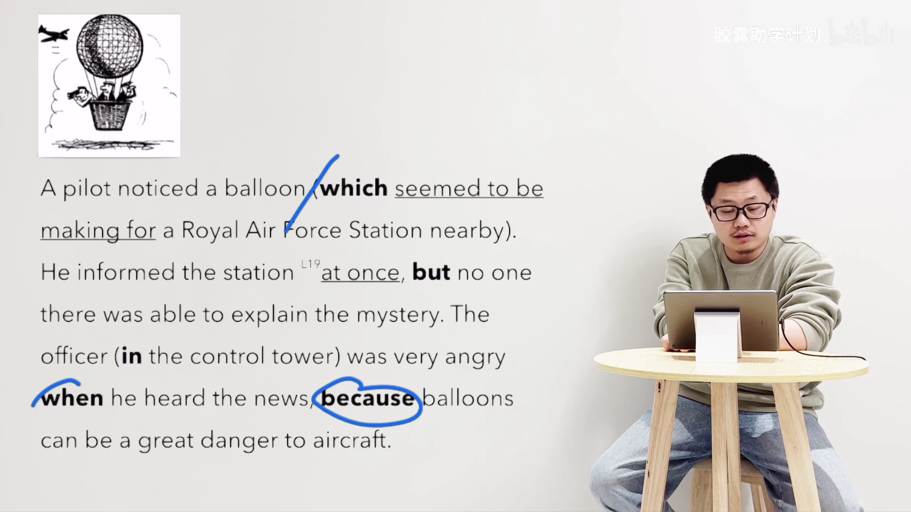

文字识别：A pilot noticed a balloon/which seemed to be / making for a Royal Air Force Station nearby). / He informed the station "'at once, but no one / there was able to explain the mystery. The / officer (in the control tower) was very angry / when he heard the newsbecauseballoons / can be a great danger to aircraft.

### 画面 00:02:57

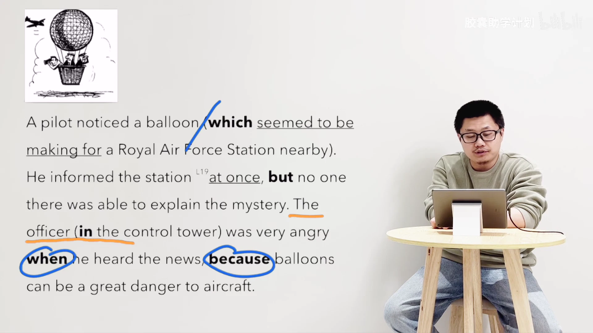

文字识别：A pilot noticed a balloon/which seemed to be / making for a Royal Air Force Station nearby). / He informed the station [1'at once, but no one / there was able to explain the mystery. The / officer (lin the control tower) was very angry / whenhe heard the news becauseballoons / can be a great danger to aircraft.

### 画面 00:02:59

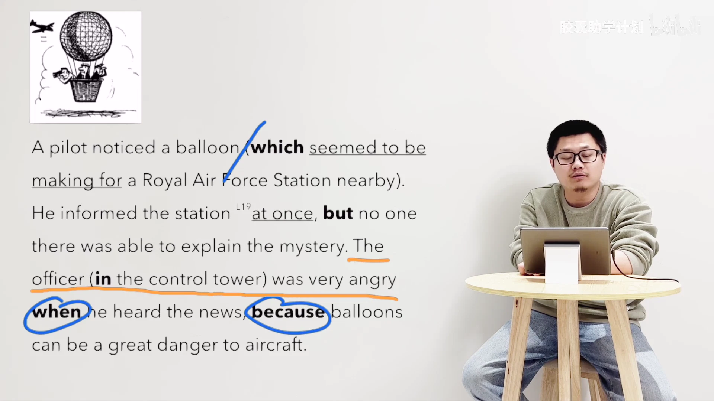

文字识别：A pilot noticed a balloon/which seemed to be / making for a Royal Air Force Station nearby). / He informed the station [1'at once, but no one / there was able to explain the mystery. The / officer (in the control tower) was very angry / whenhe heard the news because balloons / can be a great danger to aircraft.

## 00:03:00–00:03:30

那你注意 in the control tower这个地方实际上是介词引导短语后置修饰 officer，什么样的长官呢？呃，基地当中长官多了，对吧？啊，什么长官呢？In the control tower，在控制塔当中的那个长官 was very angry，非常生气。When he heard the news，当第二句话，当他听到消息的时候，第三句话，because因为 balloons可以是一个巨大的

### 画面 00:03:29

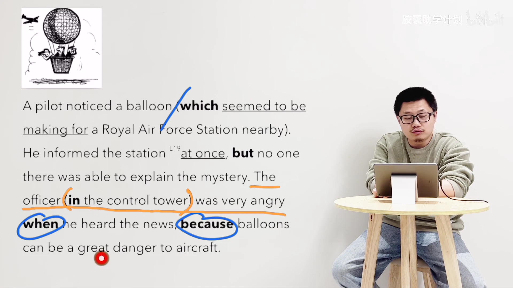

文字识别：A pilot noticed a balloon/which seemed to be / making for a Royal Air #orce Station nearby). / He informed the station [1'at once, but no one / there was able to explain the mystery. The / officer (in the control tower) / was very angry / whenne heard the news becauseballoons / can be a great danger to aircraft.

## 00:03:30–00:04:00

威胁对于 aircraft，其实就是 airplane，就是 plane，就是对于这些战斗机来说，可能是一个巨大的威胁。过去了，下一句。 He said that someone might be spying on the station, and the pilot was ordered to keep track of the strange object. 还是你要做，要要该断句断句，因为这个 that，因为这个前面啊主谓就俩单词，太简单了，咱就不把宾语从句单独拉出来了。

### 画面 00:03:34

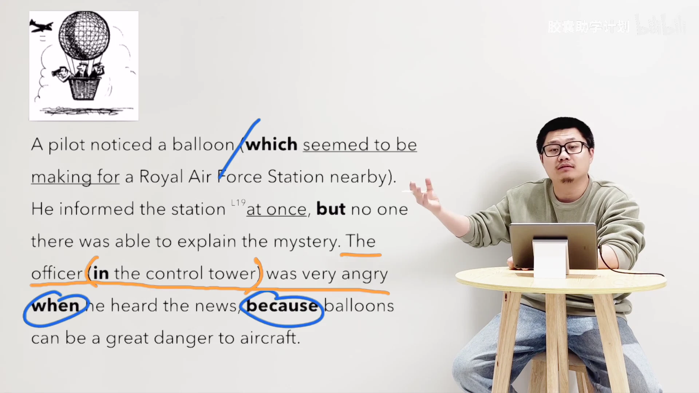

文字识别：A pilot noticed a balloon/which seemed to be / making for a Royal Air Force Station nearby). / He informed the station [1'at once, but no one / there was able to explain the mystery. The / officer (in the control tower) / was very angry / whenne heard the news because balloons / can be a great danger to aircraft.

### 画面 00:03:40

文字识别：He said that someone 1"might be spying on /  43was ordered to / the station and the pilot / keep track of the strange object. The pilot / L67 / 'managed to circle the balloon for some / time. He could make out three men in a / basket under it and one of them was / holding a pair of binoculars.

## 00:04:00–00:04:30

咱这个 and 看他一眼，其实就差不多了。为什么呢？看啊，他说说某个人也许正在做某事儿，might be doing 十九课表推测表某人也许正在做某件事儿，be doing 对吧？其实它分很多，我在这顺便说一句，你自己感受一下。如果是 am is are doing 是现在正在做，was were doing 是过去正在做，will be doing 是将来正在做，must be doing 是表推测一定

### 画面 00:04:10

文字识别：He said that someone [1?might be spying on / t 43was ordered to / the station / ana / )the pilot / keep track of the strange object. The pilot / L67 / 'managed to circle the balloon for some / time. He could make out three men in a / basket under it and one of them was / holding a pair of binoculars.

### 画面 00:04:17

文字识别：He said that someone [1?might be spying on / t 43was ordered to / the station / ana / )the pilot / keep track of the strange object. The pilot / L67 / 'managed to circle the balloon for some / time. He could make out three men in a / basket under it and one of them was / holding a pair of binoculars.

### 画面 00:04:20

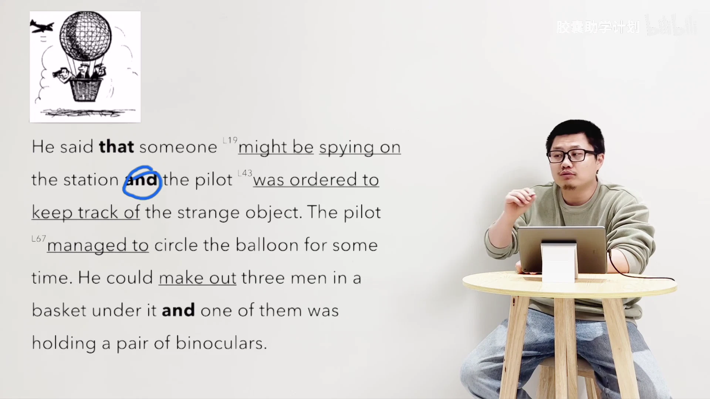

文字识别：He said that someone 1?might be spying on / t 43was ordered to / the station / ana / )the pilot / keep track of the strange object. The pilot / L67 / 'managed to circle the balloon for some / time. He could make out three men in a / basket under it and one of them was / holding a pair of binoculars.

## 00:04:30–00:05:00

正在做；can't be doing是表推测，一定没有正在做；maybe doing或might be doing表示的是也许正在做。那你也可以是might not be doing，就是也许没有正在做，对吧？其实都是十九课那些东西啊。说也许正在干嘛呢？Spying on the station，也许正在监视哎这个基地，对吧？那这个spy on讲单词部分我们说过，不多说了。你看第一句话就结束了，第二句话and开

### 画面 00:04:42

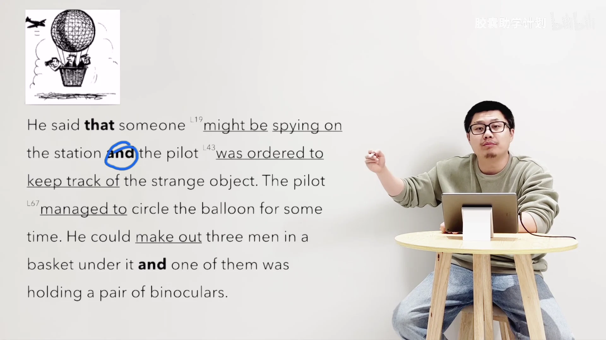

文字识别：He said that someone 1?might be spying on / t 43was ordered to / the station / ana / )the pilot / keep track of the strange object. The pilot / L67 / 'managed to circle the balloon for some / time. He could make out three men in a / basket under it and one of them was / holding a pair of binoculars.

### 画面 00:04:44

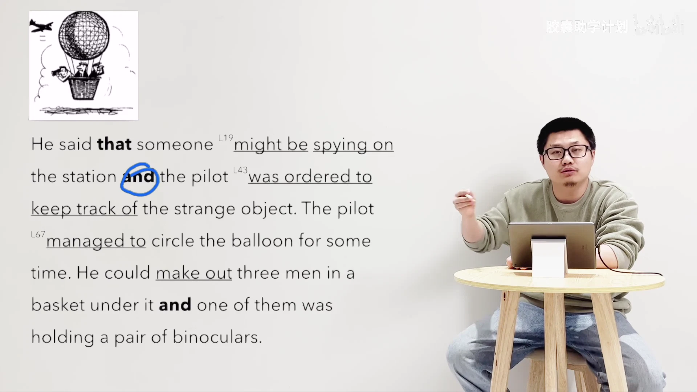

文字识别：He said that someone [1?might be spying on / t 43was ordered to / the station / ana / Dthe pilot' / keep track of the strange object. The pilot / L67 / 'managed to circle the balloon for some / time. He could make out three men in a / basket under it and one of them was / holding a pair of binoculars.

### 画面 00:04:46

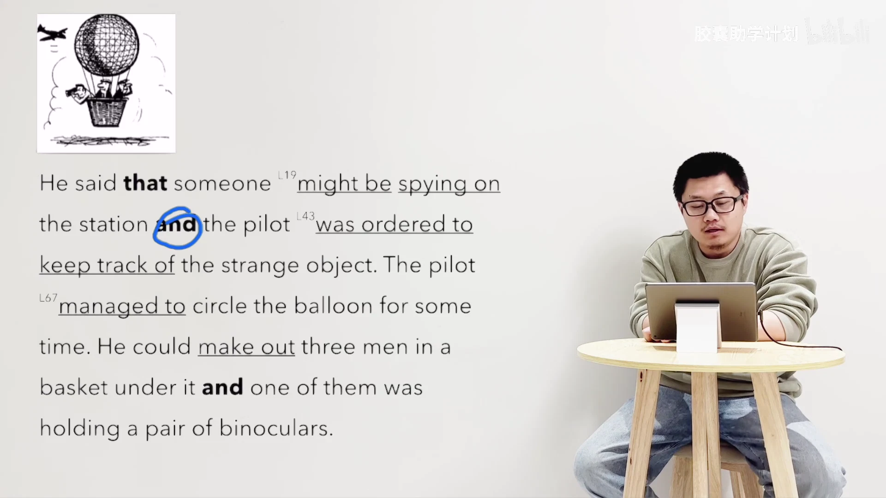

文字识别：He said that someone 1?might be spying on / t 43was ordered to / the station / ana / )the pilot / keep track of the strange object. The pilot / L67 / 'managed to circle the balloon for some / time. He could make out three men in a / basket under it and one of them was / holding a pair of binoculars.

### 画面 00:04:50

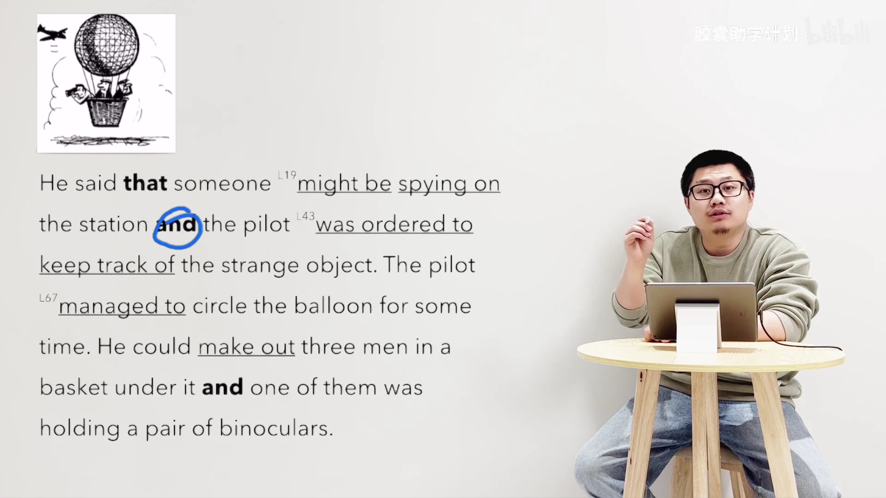

文字识别：He said that someone [1?might be spying on / Dthe pilot 43was ordered to / the station / ana / keep track of the strange object. The pilot / L67 / 'managed to circle the balloon for some / time. He could make out three men in a / basket under it and one of them was / holding a pair of binoculars.

## 00:05:00–00:05:30

始。The pilot was ordered to四十三课咱们学的南极南北极探险那课，对吧？Somebody be ordered to do something，或者order somebody to do something，对吧？被命令去做某件事情。说这个飞行员被命令干嘛呢？Keep track of the strange object。在这就是追踪嘛，你就去记录它的航行，追踪它，追踪什么呢？这个奇怪的物体，就是这个热气球啊，因为他们不知道它是啥嘛，所以用的是一个strange

### 画面 00:05:20

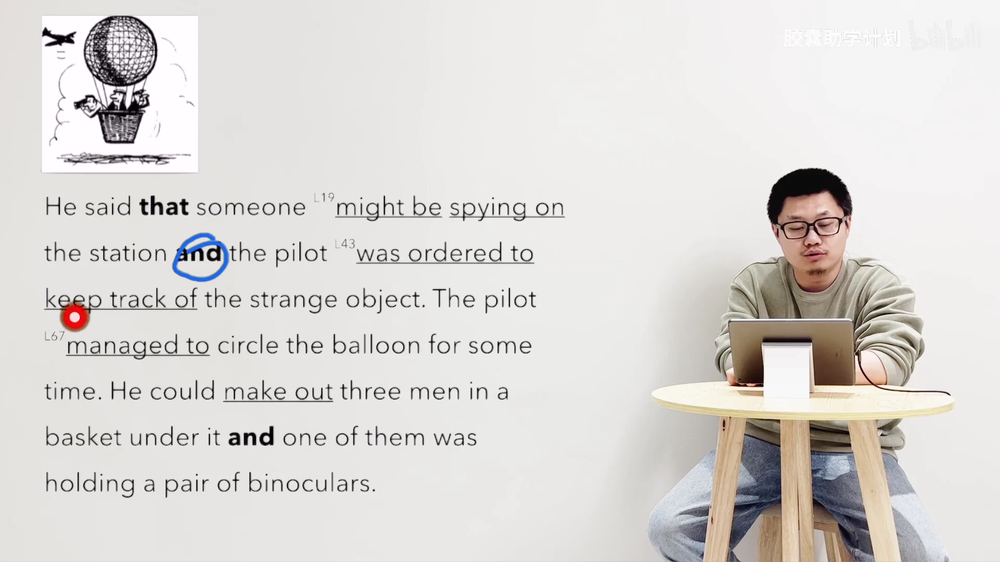

文字识别：He said that someone 1'might be spying on / t 43was ordered to / the station / ana / )the pilot / keep track of the strange object. The pilot / L67 / 'managed to circle the balloon for some / time. He could make out three men in a / basket under it and one of them was / holding a pair of binoculars.

### 画面 00:05:28

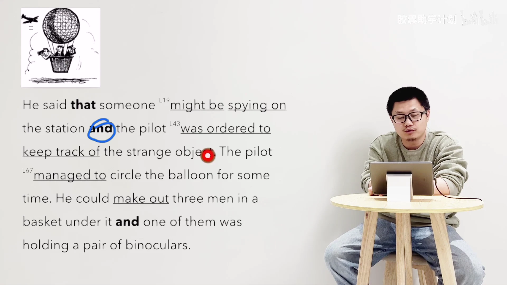

文字识别：He said that someone 1'might be spying on / t 43was ordered to / the station / )the pilot' / ana / keep track of the strange objeo / The pilot / L67 / 'managed to circle the balloon for some / time. He could make out three men in a / basket under it and one of them was / holding a pair of binoculars.

## 00:05:30–00:06:00

The pilot managed to circle the balloon for some time. This is a very simple sentence. It says that the pilot managed to circle the balloon for some time. This is a very simple sentence. It says that the pilot managed to circle the balloon for some time. This is a very simple sentence. It says that the pilot managed to circle the balloon for some time. This is a very simple sentence. It says that the pilot managed to circle the balloon for some time.

### 画面 00:05:30

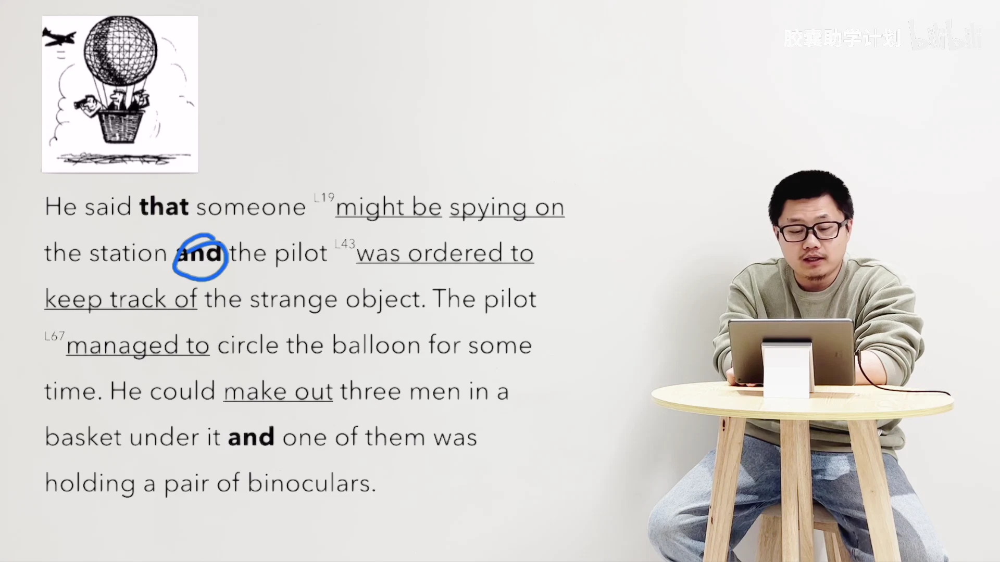

文字识别：He said that someone 1'might be spying on / t 43was ordered to / the station / ana / )the pilot / keep track of the strange object. The pilot / L67 / 'managed to circle the balloon for some / time. He could make out three men in a / basket under it and one of them was / holding a pair of binoculars.

### 画面 00:05:58

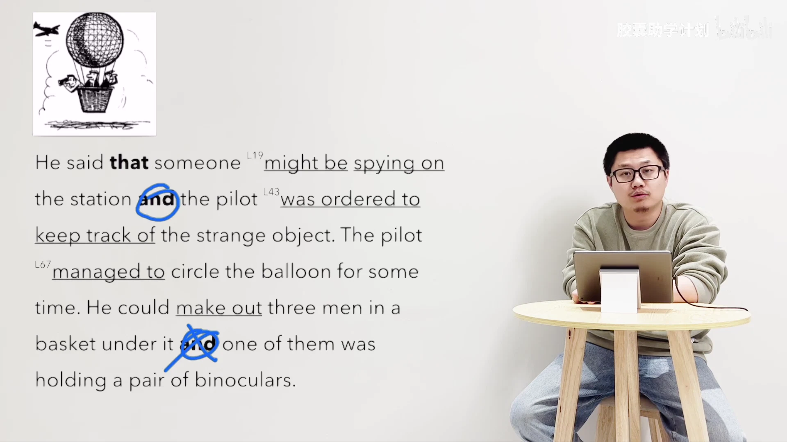

文字识别：He said that someone 1'might be spying on / t 43was ordered to / the station / ana / )the pilot / keep track of the strange object. The pilot / L67 / 'managed to circle the balloon for some / time. He could make out three men in a / basket under it, / one of them was / holding a pair of binoculars.

## 00:06:00–00:06:30

啊，不是画叉，应该是画一个斜线。告诉你要断句，说他能这个make out啊，make out其实意思还挺多的。它可以指，比如说口语当中其实特别常用的一句话，反而指的是男女之间亲热、搂搂抱抱啊、亲亲吻吻的这个make out。但是在这儿呢，明显不是。口语当中很常用的是刚才我说的那个意思，你不凡也可以去查一下。当然，那个不是我们今天讲的重点啊。想起来随口说一句，那这里的make out是什么呢？就是

### 画面 00:06:00

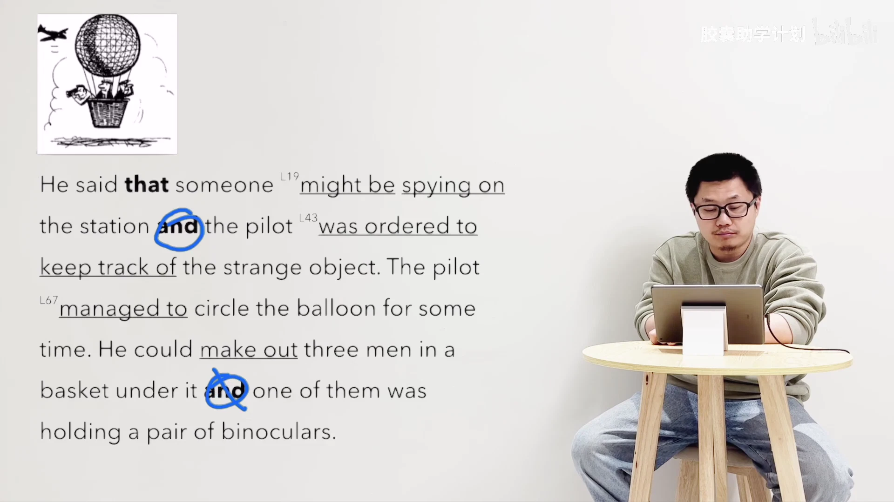

文字识别：He said that someone '"might be spying on / t 4was ordered to / the station / ana / )the pilot / keep track of the strange object. The pilot / L67 / 'managed to circle the balloon for some / time. He could make out three men in a / basket under it / one of them was / holding a pair of binoculars.

### 画面 00:06:02

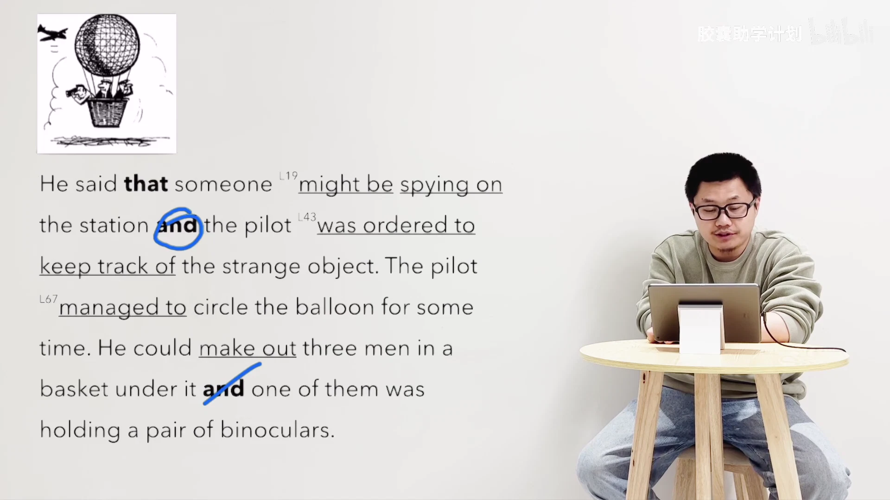

文字识别：He said that someone [1?might be spying on / t 43was ordered to / the station / ana / )the pilot / keep track of the strange object. The pilot / L67 / 'managed to circle the balloon for some / time. He could make out three men in a / basket under it ard one of them was / holding a pair of binoculars.

### 画面 00:06:06

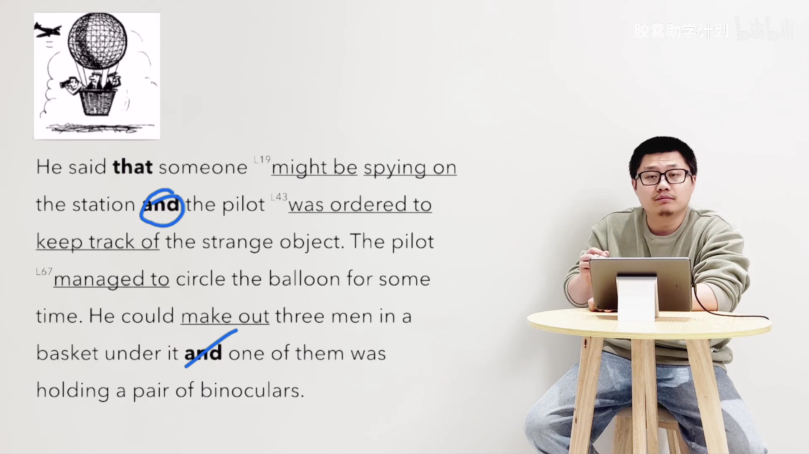

文字识别：He said that someone [1?might be spying on / the pilot 4was ordered to / the station / ana / keep track of the strange object. The pilot / L67 / 'managed to circle the balloon for some / time. He could make out three men in a / basket under it ard one of them was / holding a pair of binoculars.

## 00:06:30–00:07:00

辨别出、看出。其实这地方你完全可以，我们换的话，如果让我们写，它可以完全写成 he could see，他能看到，明白了吧？啊，或者 tell，辨别出 tell the difference，那个 tell，对吧？讲述区别。它可以辨别看到说三个男的在一个呃篮子里边 under it，这个 it 指的是这个 balloon，啊，这个气球。你注意，它不是那个小气球，咱小孩玩的那个氢气球，它指的是那个、

### 画面 00:06:36

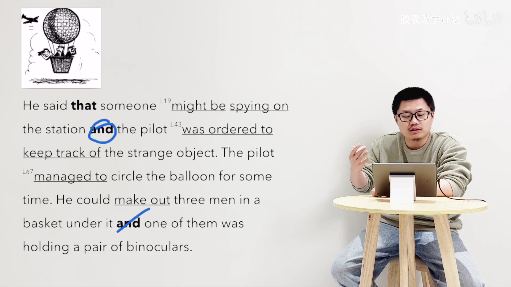

文字识别：He said that someone 1'might be spying on / t 43was ordered to / the station / ana / )the pilot' / keep track of the strange object. The pilot / L67 / 'managed to circle the balloon for some / time. He could make out three men in a / basket under it ard one of them was / holding a pair of binoculars.

### 画面 00:06:56

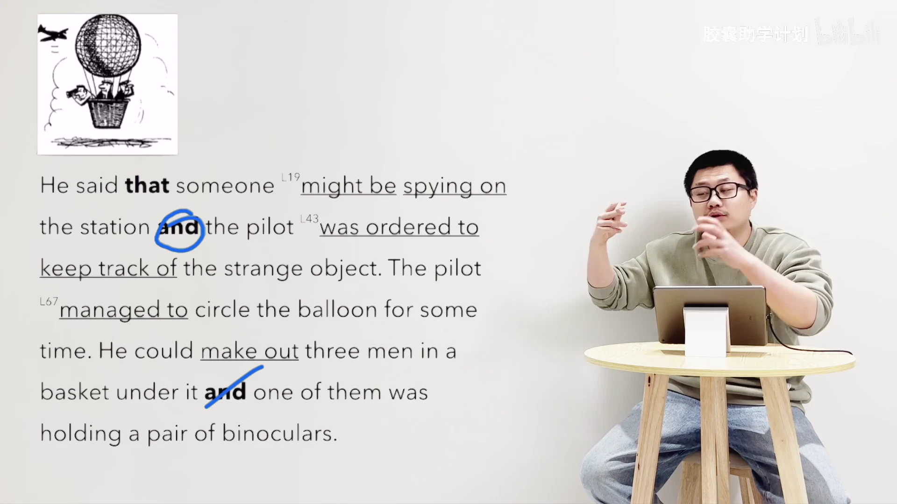

文字识别：He said that someone 1'might be spying on / t 4was ordered to / the station / ana / )the pilot' / keep track of the strange object. The pilot / L67 / 'managed to circle the balloon for some / time. He could make out three men in a / basket under it ard one of them was / holding a pair of binoculars.

### 画面 00:06:59

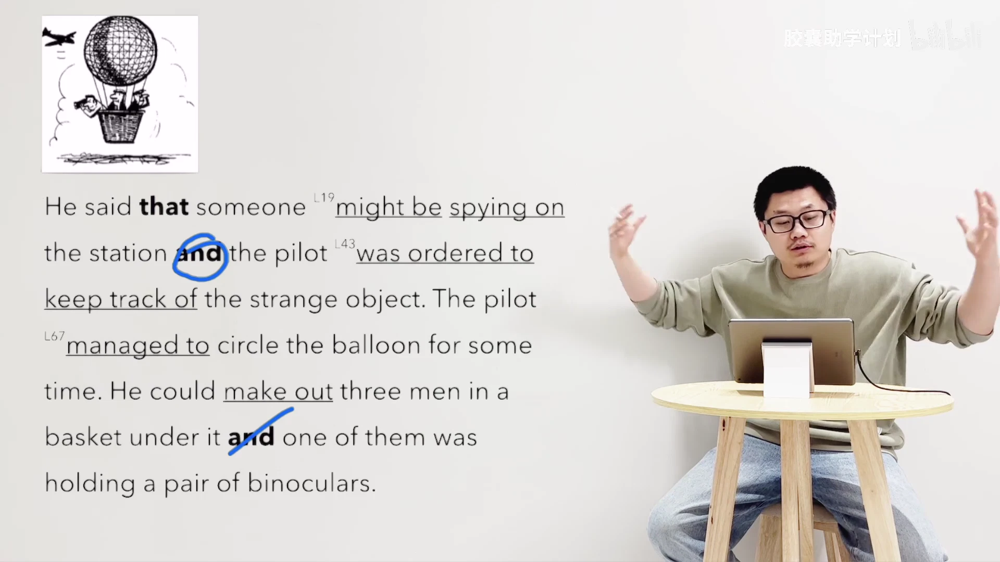

文字识别：He said that someone [1"might be spying on / the pilot 43was ordered to / the station / ana / keep track of the strange object. The pilot / L67 / 'managed to circle the balloon for some / time. He could make out three men in a / basket under it ard one of them was / holding a pair of binoculars.

## 00:07:00–00:07:30

那个、那个大的那个啊热气球，在这个热气球里也有个篮子，篮子里边有三个男的，他看到了这个。然后呢，one of them有这么他们当中有一个人 was holding a pair of binoculars，哎，正在怎么样呢？正在 hold hold 就是拿着嘛，正在拿着一副望远镜，a pair of glasses， a pair of binoculars， binoculars 很容易理解啊，正在拿着一副望远镜，图里边的这个人嘛。

### 画面 00:07:01

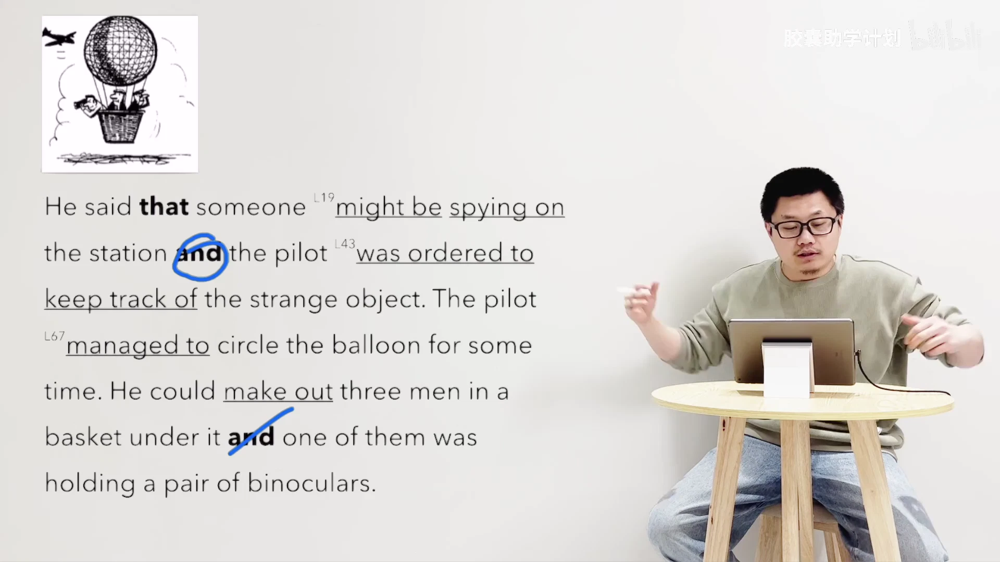

文字识别：He said that someone 1?might be spying on / the pilot 43was ordered to / the station / ana / keep track of the strange object. The pilot / L67 / 'managed to circle the balloon for some / time. He could make out three men in a / basket under it ard one of them was / holding a pair of binoculars.

### 画面 00:07:03

文字识别：He said that someone 1'might be spying on / t 43was ordered to / the station / ana / )the pilot / keep track of the strange object. The pilot / L67 / 'managed to circle the balloon for some / time. He could make out three men in a / basket under it ard one of them was / holding a pair of binoculars.

### 画面 00:07:06

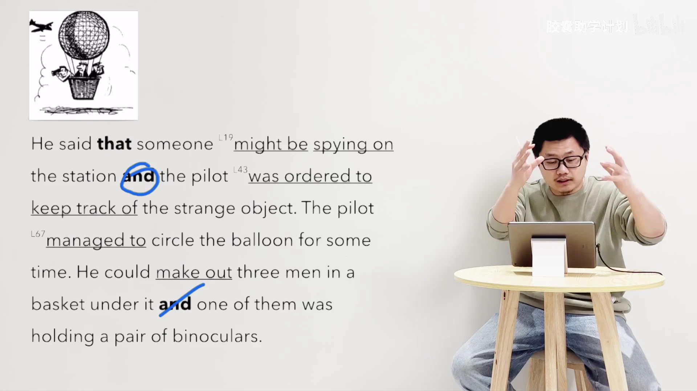

文字识别：He said that someone [1"might be spying on / t 43was ordered to / the station / ana / )the pilot / keep track of the strange object. The pilot / L67 / 'managed to circle the balloon for some / time. He could make out three men in a / basket under it ard one of them was / holding a pair of binoculars.

### 画面 00:07:08

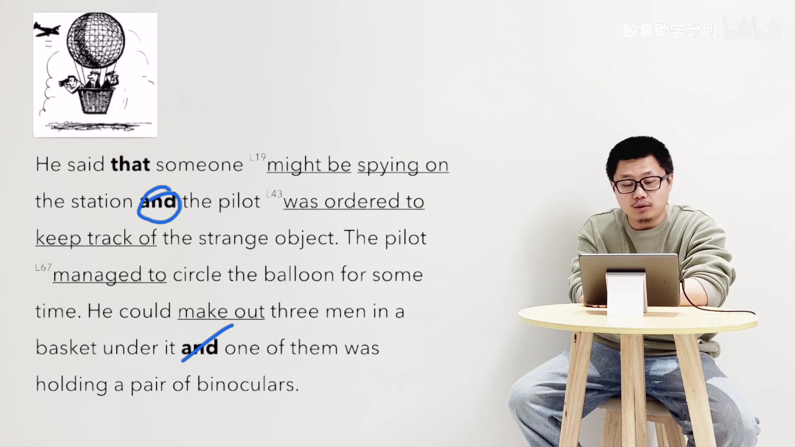

文字识别：He said that someone 1'might be spying on / t 43was ordered to / the station / ana / )the pilot / keep track of the strange object. The pilot / L67 / 'managed to circle the balloon for some / time. He could make out three men in a / basket under it ard one of them was / holding a pair of binoculars.

### 画面 00:07:10

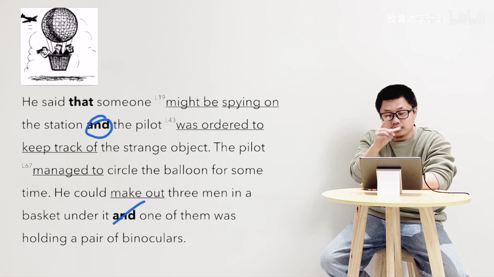

文字识别：He said that someone 1?might be spying on / t 43was ordered to / the station / ana / )the pilot / keep track of the strange object. The pilot / L67 / 'managed to circle the balloon for some / time. He could make out three men in a / basket under it ard one of them was / holding a pair of binoculars.

### 画面 00:07:15

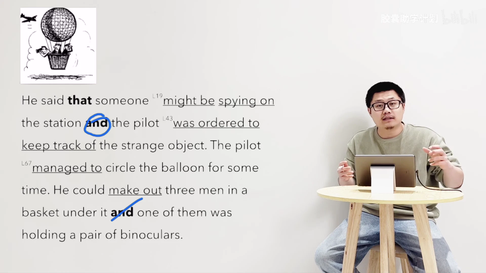

文字识别：He said that someone 1?might be spying on / t 4was ordered to / the station / ana / the pilot' / keep track of the strange object. The pilot / L67 / 'managed to circle the balloon for some / time. He could make out three men in a / basket under it ard one of them was / holding a pair of binoculars.

### 画面 00:07:26

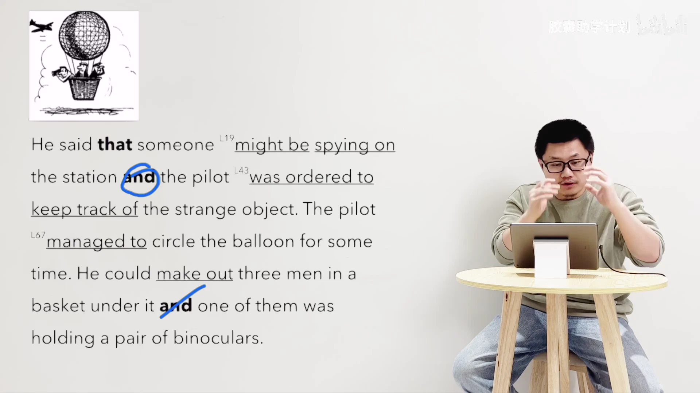

文字识别：He said that someone 1'might be spying on / t 4was ordered to / the station / ana / )the pilot / keep track of the strange object. The pilot / L67 / 'managed to circle the balloon for some / time. He could make out three men in a / basket under it ard one of them was / holding a pair of binoculars.

### 画面 00:07:29

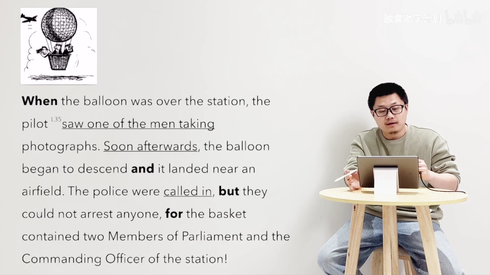

文字识别：When the balloon was over the station, the / pilot / L35 / 'saw one of the men taking / photographs. Soon afterwards, the balloon / began to descend and it landed near an / airfield. The police were called in, but they / could not arrest anyone, for the basket / contained two Members of Parliament and the / Commanding Officer of the station!

## 00:07:30–00:08:00

When the balloon was over the station, the pilot saw one of the men taking photographs. 好，其实这地方的一个问和这儿的一个逗号就帮您断句了。第一句话叫做，当这个热气球在这个呃这个 station，在这个空军站上方的时候呢， the pilot，飞行员 saw one of the men taking photographs. saw somebody doing something. 三十五课咱学了，当时

### 画面 00:07:40

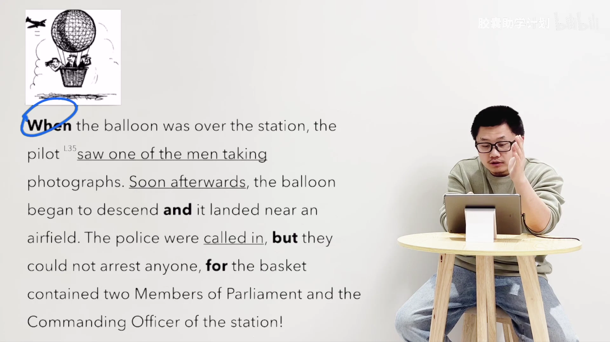

文字识别：Wben the balloon was over the station, the / Pilot L35s / 5saw one of the men taking / photographs. Soon afterwards, the balloon / began to descend and it landed near an / airfield. The police were called in, but they / could not arrest anyone, for the basket / contained two Members of Parliament and the / Commanding Officer of the station!

## 00:08:00–00:08:30

还学了一个 see somebody do something，还记得区别吗？一个是全程，一个是正在进行。看到了其中一个人正在 taking photographs，正在拍照片儿啊，这个空军基地，你在空军基地上面拍照片儿就很危险了嘛，可能会泄露一些什么机密啊。然后他说 soon afterwards the balloon began to descend and it landed near an airfield，说很快啊，soon afterwards，很快啊，the balloon

### 画面 00:08:10

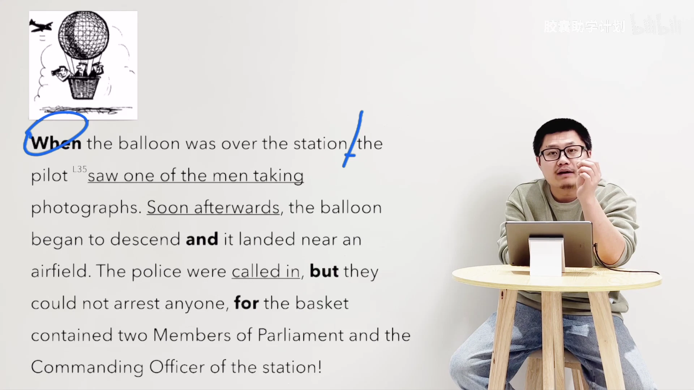

文字识别：When the balloon was over the station/the / pilot L35s / saw one of the men taking / photographs. Soon afterwards, the balloon / began to descend and it landed near an / airfield. The police were called in, but they / could not arrest anyone, for the basket / contained two Members of Parliament and the / Commanding Officer of the station!

## 00:08:30–00:09:00

began to descend.说这个热气球开始begin to do something，很简单的一个习惯用法，我都没标。Descent下降啊，这是一个超纲的词，你可以单独记它，但是出现频率也蛮高的啊。Descent，然后呢，就是帮你断句的句，断连词嘛。看到它应该都很亲切。It landed near an airfield.说这个热气球啊，降落在landed，降落在这个airfield，

### 画面 00:08:37

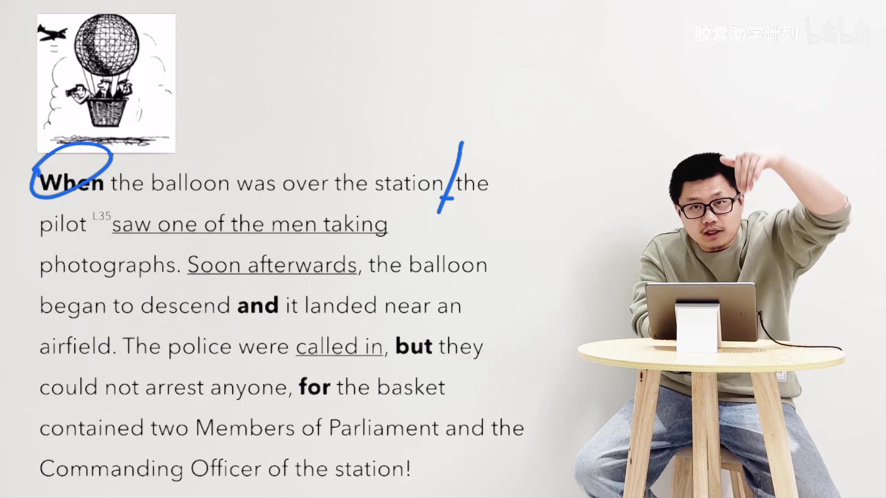

文字识别：Wben the balloon was over the station/the / Pilot L35s / 'saw one of the men taking / photographs. Soon afterwards, the balloon / began to descend and it landed near an / airfield. The police were called in, but they / could not arrest anyone, for the basket / contained two Members of Parliament and the / Commanding Officer of the station!

### 画面 00:08:44

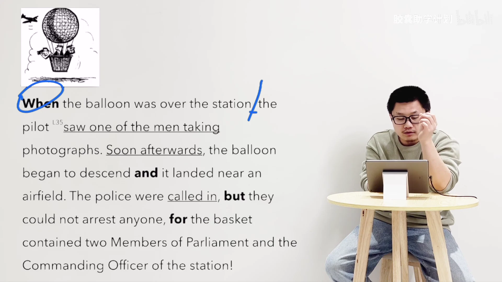

文字识别：Wben the balloon was over the station/the / pilot L35s / 'saw one of the men taking / photographs. Soon afterwards, the balloon / began to descend and it landed near an / airfield. The police were called in, but they / could not arrest anyone, for the basket / contained two Members of Parliament and the / Commanding Officer of the station!

## 00:09:00–00:09:30

Chinese-English teaching recording. Transcribe the exact words in their original spoken languages. Never translate. Preserve repetitions, questions and examples.

### 画面 00:09:14

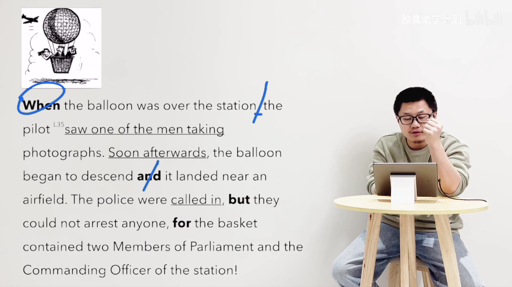

文字识别：Wben the balloon was over the station/the / Pilot L35s / 5saw one of the men taking / photographs. Soon afterwards, the balloon / began to descend ayd it landed near an / airfield. The police were called in, but they / could not arrest anyone, for the basket / contained two Members of Parliament and the / Commanding Officer of the station!

### 画面 00:09:20

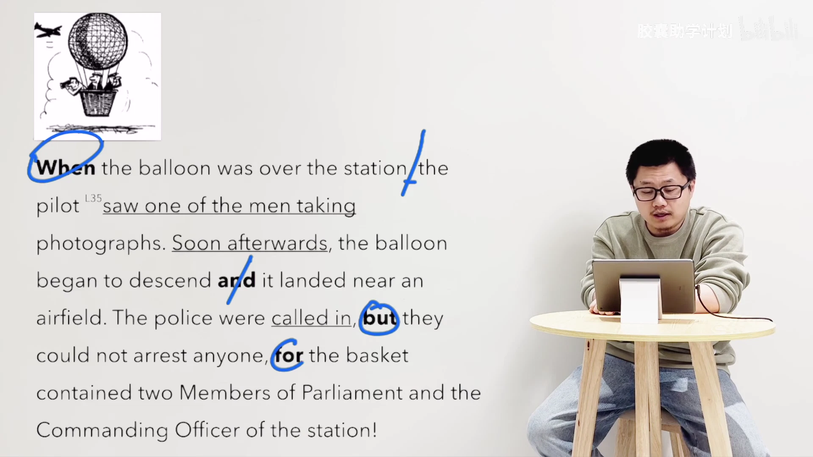

文字识别：When the balloon was over the station/the / pilot L35s / 5saw one of the men taking / photographs. Soon afterwards, the balloon / began to descend ayd it landed near an / airfield. The police were called in, / but / they / could not arrest anyone, / for the basket / contained two Members of Parliament and the / Commanding Officer of the station!

### 画面 00:09:28

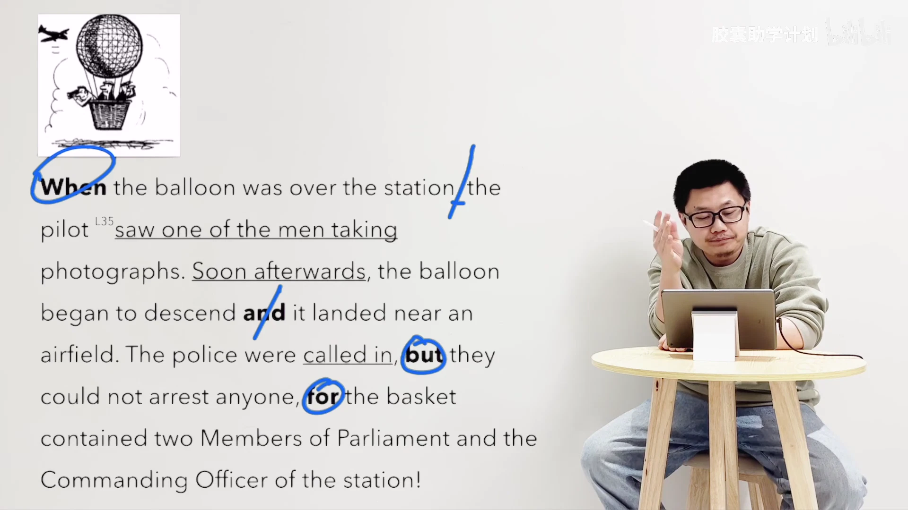

文字识别：Wben the balloon was over the station/the / pilot 35s / 5saw one of the men taking / photographs. Soon afterwards, the balloon / began to descend ayd it landed near an / airfield. The police were called in, / but / they / could not arrest anyone, / the basket / for / contained two Members of Parliament and the / Commanding Officer of the station!

## 00:09:30–00:10:00

被 call in，呃，医生可以被 call in，呃，fireman，你比如说，呃，FBI可以被 call in，就是被紧急召唤了，被召唤了啊，呃，往往处理的是一种特别困难、特别麻烦的场景啊。保安可以被 call in，明白了吧？说这个警察呀被 call in了，被召唤了，但是呢， they could not arrest anyone，但是他们又不能逮捕任何人，could not 表示过去，能不能，对吧？你不能用

### 画面 00:09:39

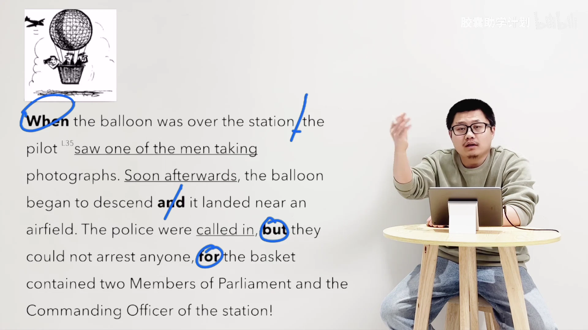

文字识别：Wben the balloon was over the station/the / pilot 135s / 'saw one of the men taking / photographs. Soon afterwards, the balloon / began to descend ayd it landed near an / airfield. The police were called in, / but / they / could not arrest anyone, / the basket / for / contained two Members of Parliament and the / Commanding Officer of the station!

## 00:10:00–00:10:30

could，为什么这事儿发生在过去嘛？你用 wasn't able to 也可以，因为 the basket contained，因为这个篮子里边啊 contained 包含了，就是呃这个这个载了或者说那个载具的那个载是吧？载了什么呢？ Two members of parliaments，说两个议会的成员，国会成员，然后以及 the commanding officer of the station，乌龙了吧？以及整个这个空军

### 画面 00:10:09

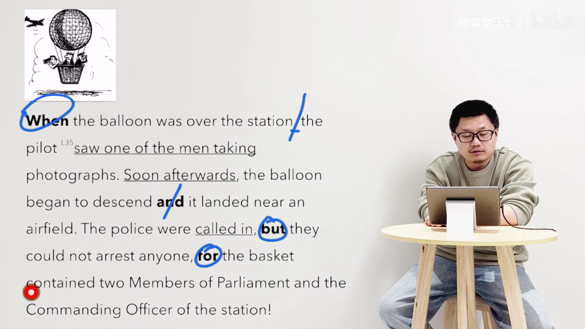

文字识别：Wben the balloon was over the station/the / pilot [35s / 'saw one of the men taking / photographs. Soon afterwards, the balloon / began to descend ayd it landed near an / airfield. The police were called in, / but / they / could not arrest anyone, / the basket / for / contained two Members of Parliament and the / Commanding Officer of the station!

## 00:10:30–00:11:00

基地的什么呢？Commanding officer，指挥官啊，总指挥官。对，最后一个说，as the commanding officer explained later，说as单看不到啥意思，没事，我们先往后翻译。说这个commanding officer explained later，说这个指挥官呢，稍后解释到，说one half of the station did not know what the other half was doing。说这个空军站的一半不知道这个空军站的另一半正在做什么。

### 画面 00:10:35

文字识别：As the Commanding Officer explained later, / one half of the station did not know what / the other half was doing!

## 00:11:00–00:11:30

Did not know后边连了一个连词，特殊疑问词啊，这个叫特殊疑问句引导的宾语从句。新概念一册、新概念二册咱都学过，对吧？那这个as怎么翻译呢？你翻译成问和because就不太对了，是吧？这儿我又让各位要复习了。反正翻译就是正如怎么怎么样啊，可以这样翻译没有任何问题。如果您忘了七十七课木乃伊那课，回去直接看语法文章什么都不用看，直接看语法就可以了啊。正像

### 画面 00:11:05

文字识别：As the Commanding Officer explained later, / one half of the station did not know what / the other half was doing!

### 画面 00:11:12

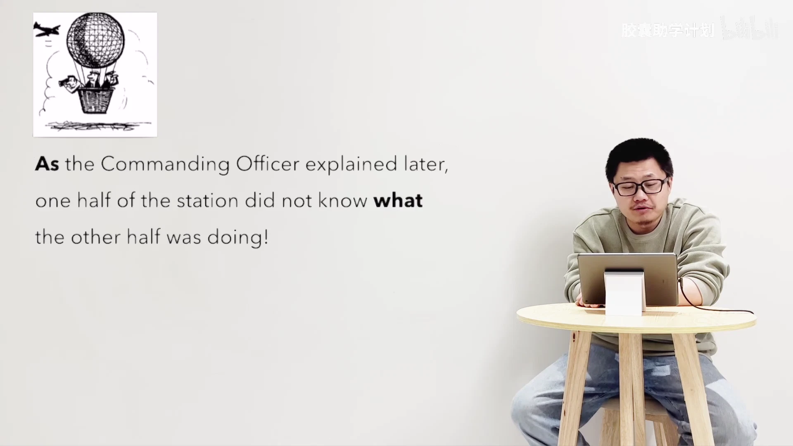

文字识别：As the Commanding Officer explained later, / one half of the station did not know what / the other half was doing!

### 画面 00:11:14

文字识别：As the Commanding Officer explained later, / one half of the station did not know what / the other half was doing!

## 00:11:30–00:12:00

他稍后解释的那样，对吧？基地的一半不知道基地另一半正在干啥，联系的不够好。那接下来习惯的话造句，咱老习惯啊。第一个 seem to be doing 似乎是正在做某事儿，跟我来读。 The brakes don't seem to be working。哎，我买辆车，然后呢，它这个刹车呀，似乎是没有在工作。啊，我正开着开着，感觉它好像突然不在工作了。 They seem to be telling a story right now。哎，

### 画面 00:11:37

文字识别：习惯用法造句 / seem to be doing / make for sw. / make out / soon afterwards / be called in

### 画面 00:11:39

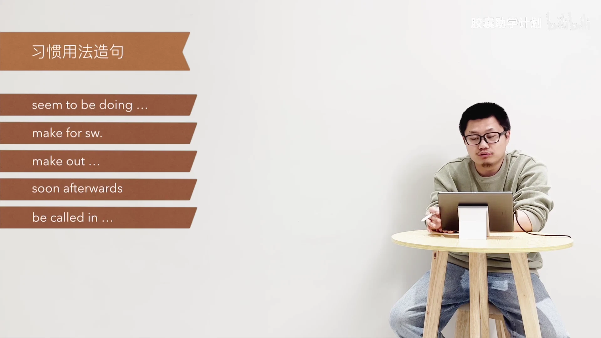

文字识别：习惯用法造句 / seem to be doing / make for sw. / make out / soon afterwards / be called in

### 画面 00:11:41

文字识别：网：v.+v.变化 / 习惯用法造句指南 / 囊助学计划園 / 四句型转换 / 方式/地点/时间 / 其他习惯用法 / 其他单词+词性 / 原文摘抄+变 / 6123456 / seem to be doing

### 画面 00:11:44

文字识别：网：v.+v.变化 / 习惯用法造句指南 / 妻助学计划 / 四句型转换 / 方式/地点/时间 / 其他习惯用法 / 其他单词+词性 / 原文摘抄+变 / 6123456 / seem to be doing /  The brakes don't seem to be working.

### 画面 00:11:46

文字识别：网：v.+v.变化 / 习惯用法造句指南 / 妻助字计划は / 四句型转换 / 方式/地点/时间 / 其他习惯用法 / 其他单词+词性 / 原文摘抄+变 / 6123456 / seem to be doing /  The brakes don't seem to be working.

### 画面 00:11:48

文字识别：网：v.+v.变化 / 习惯用法造句指南 / 妻助字计划 / 四句型转换 / 方式/地点/时间 / 其他习惯用法 / 其他单词+词性 / 原文摘抄+变 / 6123456 / seem to be doing /  The brakes don't seem to be working.

### 画面 00:11:51

文字识别：网：v.+v.变化 / 习惯用法造句指南 / 臺助学计划 / 四句型转换 / 方式/地点/时间 / 其他习惯用法 / 其他单词+词性 / 原文摘抄+变 / 6123456 / seem to be doing /  The brakes don't seem to be working.

### 画面 00:11:56

文字识别：网：v.+v.变化 / 习惯用法造句指南 / 妻助字计划 / 四句型转换 / 方式/地点/时间 / 其他习惯用法 / 其他单词+词性 / 原文摘抄+变 / 6123456 / seem to be doing /  The brakes don't seem to be working. /  They seem to be telling a story right now. / L27

### 画面 00:11:59

文字识别：网：v.+v.变化 / 习惯用法造句指南 / 喜助字计划 / 四句型转换 / 方式/地点/时间 / 其他习惯用法 / 其他单词+词性 / 原文摘抄+变 / 6123456 / seem to be doing /  The brakes don't seem to be working. /  They seem to be telling a story right now. / L27

## 00:12:00–00:12:30

他们似乎是正在现在正在讲一个故事。再来，You seem to be taking a risk.你似乎是正在冒险呢，对吧？Okay, 四十四课 take a risk, seem to be doing啊。那注意力集中，咱们看一下这电影片段。Whatever this illness, the drugs seem to be doing their work. Okay.接下来呢，make for somewhere。刚才我说了嘛，如果是飞机，那就是飞过去；如果车就是开过去，人就是走过去或跑过去，对吧？

### 画面 00:12:01

文字识别：网：v.+v.变化 / 习惯用法造句指南 / 囊助学计划陽 / 四句型转换 / 方式/地点/时间 / 其他习惯用法 / 其他单词+词性 / 原文摘抄+变 / 6123456 / seem to be doing /  The brakes don't seem to be working. /  They seem to be telling a story right now. / L27

### 画面 00:12:05

文字识别：网：v.+v.变化 / 习惯用法造句指南 / 囊助学计划陽 / 四句型转换 / 方式/地点/时间 / 其他习惯用法 / 其他单词+词性 / 原文摘抄+变 / 6123456 / seem to be doing /  The brakes don't seem to be working. /  They seem to be telling a story right now. / L27 /  You seem to be taking a risk. L44

### 画面 00:12:10

文字识别：网：v.+v.变化 / 习惯用法造句指南 / 妻助学计划 / 四句型转换 / 方式/地点/时间 / 其他习惯用法 / 其他单词+词性 / 原文摘抄+变 / 6123456 / seem to be doing /  The brakes don't seem to be working. /  They seem to be telling a story right now. / L27 /  You seem to be taking a risk. L44

### 画面 00:12:12

文字识别：Whatever this illness, the drugs seem to be / doing their work. / The Edge of the Garden / (2011)

### 画面 00:12:17

文字识别：Whatever this illness, the drugs seem to be / doing their work. / The Edge of the Garden / (2011)

### 画面 00:12:19

文字识别：Whatever this illness, the drugs seem to be / doing their work. / The Edge of the Garden / (2011)

### 画面 00:12:21

文字识别：网：v.+v.变化 / 习惯用法造句指南 / 囊助学计划 / 四句型转换 / 方式/地点/时间 / 其他习惯用法 / 其他单词+词性 / 原文摘抄+变 / 6123456 / make for sw.

### 画面 00:12:23

文字识别：网：v.+v.变化 / 习惯用法造句指南 / 囊助学计划陽 / 四句型转换 / 方式/地点/时间 / 其他习惯用法 / 其他单词+词性 / 原文摘抄+变 / 6123456 / make for sw.

### 画面 00:12:25

文字识别：网：v.+v.变化 / 习惯用法造句指南 / 囊助字计划 / 四句型转换 / 方式/地点/时间 / 其他习惯用法 / 其他单词+词性 / 原文摘抄+变 / 6123456 / make for sw.

## 00:12:30–00:13:00

比如说，it's getting late, we better go and make for home.什么意思呢？晚了，我们最好走吧。应该那一测还背那儿九十五课，咱学的，希望你还记得。Make for home就是回家，go home没区别，听见了吧？Okay, next one，你不能翻译成飞回家，是吧？We should have made for the bank of the river.说我们本应该去这个河边溜达溜达的。Next one, he was able

### 画面 00:12:30

文字识别：网：v.+v.变化 / 习惯用法造句指南 / 奏助学计划 / 四句型转换 / 方式/地点/时间 / 其他习惯用法 / 其他单词+词性 / 原文摘抄+变 / 6123456 / make for sw. /  It's getting late. We'd better go and make / for home.

### 画面 00:12:41

文字识别：网：v.+v.变化 / 习惯用法造句指南 / 囊助字计划 / 四句型转换 / 方式/地点/时间 / 其他习惯用法 / 其他单词+词性 / 原文摘抄+变 / 6123456 / make for sw. /  It's getting late. We'd better go and make / for home.

### 画面 00:12:45

文字识别：网：v.+v.变化 / 习惯用法造句指南 / 妻助学计划 / 四句型转换 / 方式/地点/时间 / 其他习惯用法 / 其他单词+词性 / 原文摘抄+变 / 6123456 / make for sw. /  It's getting late. We'd better go and make / for home.

### 画面 00:12:47

文字识别：网：v.+v.变化 / 习惯用法造句指南 / 妻助学计划 / 四句型转换 / 方式/地点/时间 / 其他习惯用法 / 其他单词+词性 / 原文摘抄+变 / 6123456 / make for sw. /  It's getting late. We'd better go and make / for home. /  We should have made for the bank of the / river. L65

### 画面 00:12:50

文字识别：网：v.+v.变化 / 习惯用法造句指南 / 四句型转换 / 方式/地点/时间 / 其他习惯用法 / 其他单词+词性 / 原文摘抄+变 / 6123456 / make for sw. /  It's getting late. We'd better go and make / for home. / e should have made for the bank of the / river. L65

### 画面 00:12:55

文字识别：网：v.+v.变化 / 习惯用法造句指南 / 喜助字计划 / 四句型转换 / 方式/地点/时间 / 其他习惯用法 / 其他单词+词性 / 原文摘抄+变 / 6123456 / make for sw. /  It's getting late. We'd better go and make / for home. /  We should have made for the bank of the / river. L65

## 00:13:00–00:13:30

to make for the car in the end. 说他能怎么样 make for the car，走到车旁边 in the end 最后啊，最后还是成功的走到了这个车旁边啊。嗯，注意力集中，就这么几个单词，您都认 woods 森林啊。 You must make for the woods. Hey, must make for the woods. Next one, make out. 刚才我说了 make out 在口语当中有很常见的意思，那本课咱们 make

### 画面 00:13:05

文字识别：网：v.+v.变化 / 习惯用法造句指南 / 霆助学计划 / 四句型转换 / 方式/地点/时间 / 其他习惯用法 / 其他单词+词性 / 原文摘抄+变 / 6123456 / make for sw. /  It's getting late. We'd better go and make / for home. /  We should have made for the bank of the / river. L65 /  He was able to make for the car in the / end.L43

### 画面 00:13:10

文字识别：网：v.+v.变化 / 习惯用法造句指南 / 妻助学计划 / 四句型转换 / 方式/地点/时间 / 其他习惯用法 / 其他单词+词性 / 原文摘抄+变 / 6123456 / make for sw. /  It's getting late. We'd better go and make / for home. /  We should have made for the bank of the / river. L65 /  He was able to make for the car in the / end.L43

### 画面 00:13:12

文字识别：You must make for the woods. / The Chronicles of Narnia: Prince Caspian / (2008)

### 画面 00:13:14

文字识别：You must make for the woods. / The Chronicles of Narnia: Prince Caspian / (2008)

### 画面 00:13:18

文字识别：You must make for the woods. / The Chronicles of Narnia: Prince Caspian / (2008)

### 画面 00:13:20

文字识别：You must make for the woods. / The Chronicles of Narnia: Prince Caspian / (2008)

### 画面 00:13:23

文字识别：网：v.+v.变化 / 习惯用法造句指南 / 囊助字计划 / 四句型转换 / 方式/地点/时间 / 其他习惯用法 / 其他单词+词性 / 原文摘抄+变 / 6123456 / make out

### 画面 00:13:25

文字识别：网：v.+v.变化 / 习惯用法造句指南 / 妻助字计划 / 四句型转换 / 方式/地点/时间 / 其他习惯用法 / 其他单词+词性 / 原文摘抄+变 / 6123456 / make out

### 画面 00:13:27

文字识别：网：v.+v.变化 / 习惯用法造句指南 / 四句型转换 / 方式/地点/时间 / 其他习惯用法 / 其他单词+词性 / 原文摘抄+变 / 6123456 / make out /  I can read most of this, but I can't make out the / last part. Can you?

## 00:13:30–00:14:00

out 就是看出辨别出。那跟我读一下这个句子，说 I can read most of this, but I can't make out the last part. Last part 最后一部分，每个部分单词都是咱学过。Can you 你能吗？ Next one, I can't make out your writing. If we turn it up, we may be able to make out what they are saying. 如果咱们把这声调大点，也许咱们就能分辨出他们正在说

### 画面 00:13:30

文字识别：网：v.+v.变化 / 习惯用法造句指南 / 四句型转换 / 方式/地点/时间 / 其他习惯用法 / 其他单词+词性 / 原文摘抄+变 / 6123456 / make out /  I can read most of this, but I can't make out the / last part. Can you?

### 画面 00:13:35

文字识别：网：v.+v.变化 / 习惯用法造句指南 / 四句型转换 / 方式/地点/时间 / 其他习惯用法 / 其他单词+词性 / 原文摘抄+变 / 6123456 / make out / I can read most of this, but I can't make out the / last part. Can you?

### 画面 00:13:41

文字识别：网：v.+v.变化 / 习惯用法造句指南 / 四句型转换 / 方式/地点/时间 / 其他习惯用法 / 其他单词+词性 / 原文摘抄+变 / 6123456 / make out / I can read most of this, but I can't make out the / Iast part. Can you?

### 画面 00:13:45

文字识别：网：v.+v.变化 / 习惯用法造句指南 / 四句型转换 / 方式/地点/时间 / 其他习惯用法 / 其他单词+词性 / 原文摘抄+变 / 6123456 / make out / | can read most of this, but I can't make out the / Iast part. Can you? / I can't make out your writing.

### 画面 00:13:53

文字识别：网：v.+v.变化 / 习惯用法造句指南 / 四句型转换 / 方式/地点/时间 / 其他习惯用法 / 其他单词+词性 / 原文摘抄+变 / 6123456 / make out / I can read most of this, but I can't make out the / last part. Can you? / I can't make out your writing. /  If we turn it up, / we may be able to make out what they're saying.

### 画面 00:13:55

文字识别：网：v.+v.变化 / 习惯用法造句指南 / 喜助字计划 / 四句型转换 / 方式/地点/时间 / 其他习惯用法 / 其他单词+词性 / 原文摘抄+变 / 6123456 / make out / I can read most of this, but I can't make out the / last part. Can you? / I can't make out your writing. /  If we turn it up, / we may be able to make out what they're saying.

## 00:14:00–00:14:30

什么了。比如说，你正在 spy on somebody，监听，对吧？ Next one, soon afterwards, 哎，很快，很快啊。说 she had her supper and went out soon afterwards. 在那之后，很快，在那之后，怎么样呢？说她吃完饭，然后很快在那之后就怎么样，出去了，很快就出去了。 Next one, soon afterwards, he moved to London. 在那之后，很快他就怎么样了，搬去伦敦了。

### 画面 00:14:01

文字识别：网：v.+v.变化 / 习惯用法造句指南 / 四句型转换 / 方式/地点/时间 / 其他习惯用法 / 其他单词+词性 / 原文摘抄+变 / 6123456 / make out / I can read most of this, but I can't make out the / last part. Can you? / I can't make out your writing. /  If we turn it up, / we may be able to make out what they're saying.

### 画面 00:14:05

文字识别：网：v.+v.变化 / 习惯用法造句指南 / 囊助字计划園 / 四句型转换 / 方式/地点/时间 / 其他习惯用法 / 其他单词+词性 / 原文摘抄+变 / 6123456 / soon afterwards

### 画面 00:14:10

文字识别：网：v.+v.变化 / 习惯用法造句指南 / 囊助学计划陽 / 四句型转换 / 方式/地点/时间 / 其他习惯用法 / 其他单词+词性 / 原文摘抄+变 / 6123456 / soon afterwards

### 画面 00:14:13

文字识别：网：v.+v.变化 / 习惯用法造句指南 / 囊助学计划 / 四句型转换 / 方式/地点/时间 / 其他习惯用法 / 其他单词+词性 / 原文摘抄+变 / 6123456 / soon afterwards / ■She / her supper and went out soon / afterwards.

### 画面 00:14:15

文字识别：网：v.+v.变化 / 习惯用法造句指南 / 四句型转换 / 方式/地点/时间 / 其他习惯用法 / 其他单词+词性 / 原文摘抄+变 / 6123456 / soon afterwards /  She had her supper and went out soon / afterwards.

### 画面 00:14:20

文字识别：网：v.+v.变化 / 习惯用法造句指南 / 妻助学计划 / 四句型转换 / 方式/地点/时间 / 其他习惯用法 / 其他单词+词性 / 原文摘抄+变 / 6123456 / soon afterwards /  She had her supper and went out soon / afterwards.

### 画面 00:14:25

文字识别：网：v.+v.变化 / 习惯用法造句指南 / 妻助学计划 / 四句型转换 / 方式/地点/时间 / 其他习惯用法 / 其他单词+词性 / 原文摘抄+变 / 6123456 / soon afterwards /  She had her supper and went out soon / afterwards. /  Soon afterwards, he moved to London. L6

## 00:14:30–00:15:00

四句型转换都是很好的句子啊。比如说 When did he move to London? 啊 Why did he move to London soon afterwards? 张嘴就要来，这个我们一定要练。最后一个 Soon afterwards, they removed the gate from the front yard. 啊说最终啊，在那之后很快怎么样了？他把这个大门从前前院还是给卸走了啊。五十九课 Be called in. 我刚

### 画面 00:14:31

文字识别：网：v.+v.变化 / 习惯用法造句指南 / 臺助学计划 / 四句型转换 / 方式/地点/时间 / 其他习惯用法 / 其他单词+词性 / 原文摘抄+变 / 6123456 / soon afterwards /  She had her supper and went out soon / afterwards. /  Soon afterwards, he moved to London. L6 /  Soon afterwards, they removed the gate / from the front yard. L59

### 画面 00:14:35

文字识别：网：v.+v.变化 / 习惯用法造句指南 / 奏助学计划 / 四句型转换 / 方式/地点/时间 / 其他习惯用法 / 其他单词+词性 / 原文摘抄+变 / 6123456 / soon afterwards /  She had her supper and went out soon / afterwards. /  Soon afterwards, he moved to London. L6 /  Soon afterwards, they removed the gate / from the front yard. L59

### 画面 00:14:43

文字识别：网：v.+v.变化 / 习惯用法造句指南 / 妻助学计划 / 四句型转换 / 方式/地点/时间 / 其他习惯用法 / 其他单词+词性 / 原文摘抄+变 / 6123456 / soon afterwards /  She had her supper and went out soon / afterwards. /  Soon afterwards, he moved to London. L6 /  Soon afterwards, they removed the gate / from the front yard. L59

### 画面 00:14:45

文字识别：网：v.+v.变化 / 习惯用法造句指南 / 妻助学计划 / 四句型转换 / 方式/地点/时间 / 其他习惯用法 / 其他单词+词性 / 原文摘抄+变 / 6123456 / soon afterwards /  She had her supper and went out soon / afterwards. /  Soon afterwards, he moved to London. L6 /  Soon afterwards, they removed the gate / from the front yard. L59

### 画面 00:14:50

文字识别：网：v.+v.变化 / 习惯用法造句指南 / 襄助学计划 / 四句型转换 / 方式/地点/时间 / 其他习惯用法 / 其他单词+词性 / 原文摘抄+变 / 6123456 / soon afterwards /  She had her supper and went out soon / afterwards. /  Soon afterwards, he moved to London. L6 /  Soon afterwards, they removed the gate / from the front yard. L59

### 画面 00:14:55

文字识别：网：v.+v.变化 / 习惯用法造句指南 / 妻助学计划 / 四句型转换 / 方式/地点/时间 / 其他习惯用法 / 其他单词+词性 / 原文摘抄+变 / 6123456 / soon afterwards /  She had her supper and went out soon / afterwards. /  Soon afterwards, he moved to London. L6 /  Soon afterwards, they removed the gate / from the front yard. L59

### 画面 00:14:57

文字识别：网：v.+v.变化 / to ask someone to come to help in / 习惯用法造句指南 / 妻助学计划 / 四句型转换 / a difficult situation: / 方式/地点/时间 / 其他习惯用法 / 其他单词+词性 / 原文摘抄+变 / 6123456 / be called in ...

## 00:15:00–00:15:30

在呃文章部分说了，我说可以被 called in 的有很多，保安呐、医生啊、兽医啊，对吧？反正就是紧急的要求别人帮你处理一个事儿。比如说，呃，被就是他，但但是你不能纯由汉语这么去决定。刚才我说的那些是最保险的啊。然后他说的是 to ask someone to come to help in a difficult situation，说寻求某人的帮助，在一个特别困难的这个场景之下，对吧？

### 画面 00:15:00

文字识别：习惯用法造句指南 / 网：v.+v.变化 / to ask someone to come to help in / 交囊助学计划一 / 四句型转换 / a difficult situation: / 方式/地点/时间 / 其他习惯用法 / 其他单词+词性 / 原文摘抄+变 / 6123456 / be called in ...

### 画面 00:15:02

文字识别：习惯用法造句指南 / 网：v.+v.变化 / to ask someone to come to help in / 交妻助学计划一園 / 四句型转换 / a difficult situation: / 方式/地点/时间 / 其他习惯用法 / 其他单词+词性 / 原文摘抄+变 / 6123456 / be called in ...

### 画面 00:15:05

文字识别：网：v.+v.变化 / to ask someone to come to help in / 习惯用法造句指南 / 囊助学计划傳園 / 四句型转换 / a difficult situation: / 方式/地点/时间 / 其他习惯用法 / 其他单词+词性 / 原文摘抄+变 / 6123456 / be called in ...

### 画面 00:15:10

文字识别：习惯用法造句指南 / 网：v.+v.变化 / to ask someone to come to help in / 交妻助学计划ト渊 / 四句型转换 / a difficult situation: / 方式/地点/时间 / 其他习惯用法 / 其他单词+词性 / 原文摘抄+变 / 6123456 / be called in ...

### 画面 00:15:21

文字识别：网：v.+v.变化 / to ask someone to come to help in / 习惯用法造句指南 / 妻助学计划 / 四句型转换 / a difficult situation: / 方式/地点/时间 / 其他习惯用法 / 其他单词+词性 / 原文摘抄+变 / 6123456 / be called in ...

### 画面 00:15:25

文字识别：网：v.+v.变化 / to ask someone to come to help in / 囊助学计划一 / 习惯用法造句指南 / 四句型转换 / a difficult situation: / 方式/地点/时间 / 其他习惯用法 / 其他单词+词性 / 原文摘抄+变 / 6123456 / be called in ...

## 00:15:30–00:16:00

recording. Transcribe the exact words in their original spoken languages. Never translate. Preserve repetitions, questions and examples.

### 画面 00:15:32

文字识别：网：v.+v.变化 / to ask someone to come to help in / 习惯用法造句指南 / 菱助学计划園園 / 四句型转换 / a difficult situation: / 方式/地点/时间 / 其他习惯用法 / 其他单词+词性 / 原文摘抄+变 / 6123456 / be called in ... / All detectives were called in to help.

### 画面 00:15:34

文字识别：网：v.+v.变化 / to ask someone to come to help in / 习惯用法造句指南 / 奏助字计划關 / 四句型转换 / a difficult situation: / 方式/地点/时间 / 其他习惯用法 / 其他单词+词性 / 原文摘抄+变 / 6123456 / be called in ... / All detectives were called in to help.

### 画面 00:15:36

文字识别：网：v.+v.变化 / to ask someone to come to help in / 习惯用法造句指南 / 交囊助学计划一園 / 四句型转换 / a difficult situation: / 方式/地点/时间 / 其他习惯用法 / 其他单词+词性 / 原文摘抄+变 / 6123456 / be called in ... / All detectives were called in to help.

### 画面 00:15:40

文字识别：网：v.+v.变化 / to ask someone to come to help in / 习惯用法造句指南 / 妻助学计划 / 四句型转换 / a difficult situation: / 方式/地点/时间 / 其他习惯用法 / 其他单词+词性 / 原文摘抄+变 / 6123456 / be called in ... / All detectives were called in to help. /  The FBI has been called in to investigate.

### 画面 00:15:44

文字识别：网：v.+v.变化 / to ask someone to come to help in / 习惯用法造句指南 / 妻助学计划 / 四句型转换 / a difficult situation: / 方式/地点/时间 / 其他习惯用法 / 其他单词+词性 / 原文摘抄+变 / 6123456 / be called in ... / All detectives were called in to help. /  The FBI has been called in to investigate.

### 画面 00:15:47

文字识别：网：v.+v.变化 / to ask someone to come to help in / 习惯用法造句指南 / 妻助学计划陽 / 四句型转换 / a difficult situation: / 方式/地点/时间 / 其他习惯用法 / 其他单词+词性 / 原文摘抄+变 / 6123456 / be called in ... / All detectives were called in to help. /  The FBI has been called in to investigate.

### 画面 00:15:50

文字识别：网：v.+v.变化 / to ask someone to come to help in / 习惯用法造句指南 / 妻助学计划 / 四句型转换 / a difficult situation: / 方式/地点/时间 / 其他习惯用法 / 其他单词+词性 / 原文摘抄+变 / 6123456 / be called in ... / All detectives were called in to help. /  The FBI has been called in to investigate.

### 画面 00:15:52

文字识别：网：v.+v.变化 / to ask someone to come to help in / 习惯用法造句指南 / 妻助字计划 / 四句型转换 / a difficult situation: / 方式/地点/时间 / 其他习惯用法 / 其他单词+词性 / 原文摘抄+变 / 6123456 / be called in ... / All detectives were called in to help. /  The FBI has been called in to investigate. /  As the police could not keep order in the / city, the military were called in to help. L13

### 画面 00:15:55

文字识别：网：v.+v.变化 / to ask someone to come to help in / 习惯用法造句指南 / 妻助学计划 / 四句型转换 / a difficult situation: / 方式/地点/时间 / 其他习惯用法 / 其他单词+词性 / 原文摘抄+变 / 6123456 / be called in ... / All detectives were called in to help. /  The FBI has been called in to investigate. /  As the police could not keep order in the / city, the military were called in to help. L13

## 00:16:00–00:16:30

城市的怎么样稳定了啊？你像美国对吧？这个 Black Matter、Black Lives Matter 的时候对吧？这个国民警卫队啊，就是他们的 military，类似于 military 的一个组织，不就被 were called in to help 对吧？被召唤来去帮忙了，做的是什么事呢？叫在 in a difficult situation 被召唤来对吧？好，那 recap 本课习惯用法这么多，咱们

### 画面 00:16:00

文字识别：网：v.+v.变化 / to ask someone to come to help in / 习惯用法造句指南 / 妻助学计划 / 四句型转换 / a difficult situation: / 方式/地点/时间 / 其他习惯用法 / 其他单词+词性 / 原文摘抄+变 / 6123456 / be called in ... / All detectives were called in to help. /  The FBI has been called in to investigate. /  As the police could not keep order in the / city, the military were called in to help. L13

### 画面 00:16:10

文字识别：网：v.+v.变化 / to ask someone to come to help in / 习惯用法造句指南 / 妻助学计划 / 四句型转换 / a difficult situation: / 方式/地点/时间 / 其他习惯用法 / 其他单词+词性 / 原文摘抄+变 / 6123456 / be called in ... / All detectives were called in to help. /  The FBI has been called in to investigate. /  As the police could not keep order in the / city, the military were called in to help. L13

### 画面 00:16:19

文字识别：网：v.+v.变化 / to ask someone to come to help in / 习惯用法造句指南 / 嚢助学计划 / 四句型转换 / a difficult situation: / 方式/地点/时间 / 其他习惯用法 / 其他单词+词性 / 原文摘抄+变 / 6123456 / be called in ... / All detectives were called in to help. /  The FBI has been called in to investigate. /  As the police could not keep order in the / city, the military were called in to help. L13

### 画面 00:16:23

文字识别：网：v.+v.变化 / to ask someone to come to help in / 习惯用法造句指南 / 妻助学计划 / 四句型转换 / a difficult situation: / 方式/地点/时间 / 其他习惯用法 / 其他单词+词性 / 原文摘抄+变 / 6123456 / be called in ... / All detectives were called in to help. /  The FBI has been called in to investigate. /  As the police could not keep order in the / city, the military were called in to help. L13

### 画面 00:16:25

文字识别：Recap / seem to be doing / make for sw. / Expression / make out / be called in / soon afterwards

### 画面 00:16:27

文字识别：Recap / seem to be doing / make for / sw. / Expression / make out / be called in / soon afterwards

### 画面 00:16:29

文字识别：囊助学计划 / 1. / 习惯用法造句/对话 / 【习惯用法造句指南】 / 每个5句

## 00:16:30–00:17:00

造句对吧？这些是将来听说读写都用得到的习惯用法啊，都很常用。文章呢，咱们跟读、熟读成诵，然后置顶留言找重复间隔的学习材料。那以上呢就是本期视频的全部内容了。如果各位喜欢我们的课程呢，欢迎各位关注、订阅、一键三连，分享给那些需要的朋友，来帮助我们快速成长。See you next time.

### 画面 00:16:31

文字识别：囊助学计划圆 / 1. / 习惯用法造句/对话 / 【习惯用法造句指南】 / 每个5句

### 画面 00:16:35

文字识别：习惯用法造句/对话 / 1. / 【习惯用法造句指南】 / 每个5句 / 文章跟读至熟读成诵 / 内化单词+语法+习惯用法 / 听力+口语+写作练习

### 画面 00:16:37

文字识别：嘉助学计划 / 1. / 习惯用法造句/对话 / 【习惯用法造句指南】 / 每个5句 / 文章跟读至熟读成诵 / 内化单词+语法+习惯用法 / 听力+口语+写作练习 / 3. / 重复间隔（置顶留言）

### 画面 00:16:40

文字识别：臺助学计划 / 1. / 习惯用法造句/对话 / 【习惯用法造句指南】 / 每个5句 / 文章跟读至熟读成诵 / 内化单词+语法+习惯用法 / 听力+口语+写作练习 / 3. / 重复间隔（置顶留言）

### 画面 00:16:42

文字识别：妻助学计划

### 画面 00:16:45

文字识别：妻助学计划一 / 不

### 画面 00:16:47

文字识别：囊助学计划调 / 餐

### 画面 00:16:50

文字识别：囊助学计划

### 画面 00:16:53

文字识别：妻助学计划

### 画面 00:16:55

文字识别：助字计划一调

### 画面 00:16:57

文字识别：CAPSULEACADEMY / 胶囊助学计划 / 小红书 / Lecturer / Leo / OE

### 画面 00:16:59

文字识别：CAPSULEACADEMY / 胶囊助学计划 / 小红书 / Photographer / Berlin / OE

## 00:17:00–00:17:08

### 画面 00:17:01

文字识别：CAPSULEACADEMY / 胶囊助学计划 / 小红书 / Fditor / □ / Berlin / OE

### 画面 00:17:04

文字识别：聖助字計划 / CAPSULEACADEMY / 胶囊助学计划 / 『 / 小红书 / Creator / □ / Leo & Berlin / OE

### 画面 00:17:06

文字识别：bilbili / 胶囊助学计划

### 画面 00:17:07

文字识别：bilbili / 胶囊助学计划

