# 091 练习

快速机器解析：语音为单模型转写，未进行独立交叉校对或人工复核；画面每秒采样并按变化选帧，短时文字和标记可能遗漏。截图时间约有 1 秒误差。图片有损压缩；遇到疑点请按时间查看 Google Drive 原视频。

## 00:00:00–00:00:30

Hello everyone, welcome to Capsule Academy. This is Will. Today we're going to learn the concept English Book Two Lesson Ninety One Practices. 注意进行如下练习，唯一的前提就是文章要跟读至熟读成诵，否则请勿开始。 Hope you can enjoy. 第一题 Comprehension，我问您答。好，第一题 Who noticed the balloon? A pilot.

### 画面 00:00:00

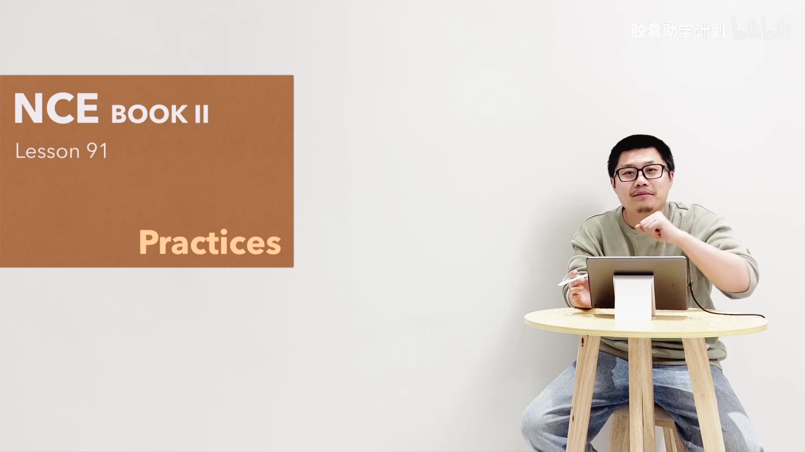

文字识别：NCE / BOOKⅡI / Lesson 91 / Practices

### 画面 00:00:02

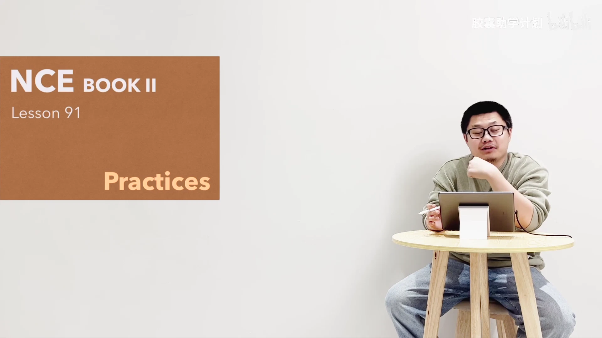

文字识别：NCE / BOOKⅡI / Lesson 91 / Practices

### 画面 00:00:04

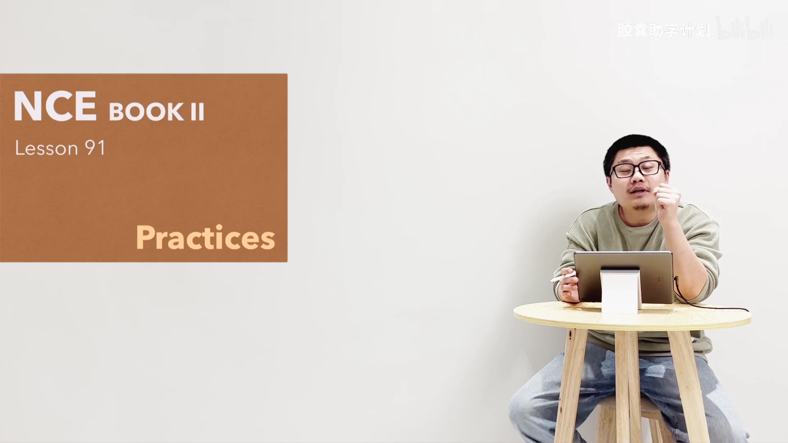

文字识别：NCE / BOOKⅡI / Lesson 91 / Practices

### 画面 00:00:08

文字识别：囊助学计划 / 进行如下练习唯一前提 / 文章跟读至熟读成诵 / 否则请勿开始

### 画面 00:00:16

文字识别：J bitbi / 胶囊助学计划 / • / •

### 画面 00:00:19

文字识别：胶囊助学计划Ll鼎 / 胶囊助学计划

### 画面 00:00:21

文字识别：Comprehension / 训练目标： / 听懂一般疑问句＆特殊疑问句

### 画面 00:00:24

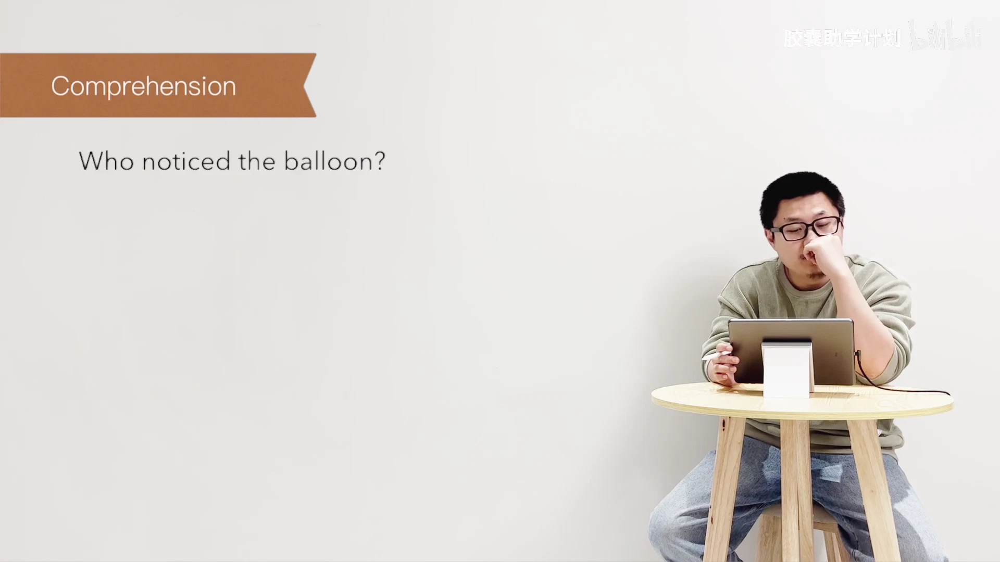

文字识别：Comprehension / Who noticed the balloon?

## 00:00:30–00:01:00

where did it seem to be making for? A Royal Air Force station. Did the pilot inform the station at once? Yes, he did. Could anyone explain the mystery? No, they couldn't. Who was very angry at the news? The officer at the control tower. Why

### 画面 00:00:54

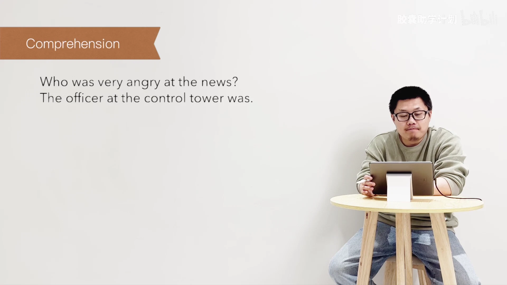

文字识别：Comprehension / Who was very angry at the news? / The officer at the control tower was.

## 00:01:00–00:01:30

was he so angry? Because balloons can be a great danger to aircraft. What might someone be doing? Spying on the station. What was the pilot ordered to do? To keep track of the balloon. How long did he circle the balloon? For some time.

### 画面 00:01:01

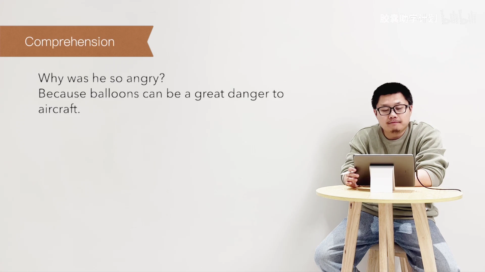

文字识别：Comprehension / Why was he so angry? / Because balloons can be a great danger to / aircraft.

### 画面 00:01:08

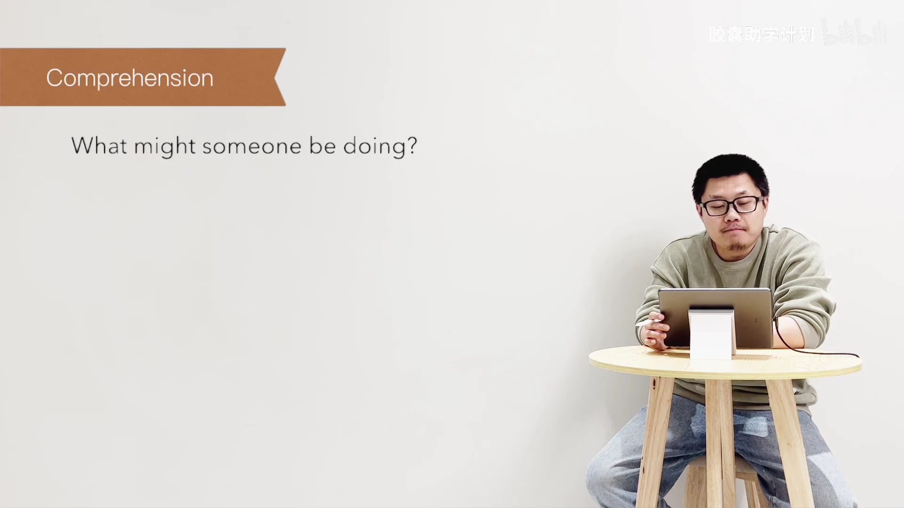

文字识别：臺助学计划 / Comprehension / What might someone be doing?

## 00:01:30–00:02:00

Where was the basket? Under the balloon. How many men were there in the basket? Three. What was one of them holding? A pair of binoculars. What did the pilot see one of the men

### 画面 00:01:38

文字识别：臺助学计划 / Comprehension

## 00:02:00–00:02:30

do that, taking photographs. 四句型转换啊，第一个例子, pilot noticed a balloon. did 提前, what 对 a balloon 提问, who 对主语提问呗，直接提掉啊，不用变一般疑问句, who noticed a balloon? 没有问题。第二个, there was a Royal Air Force station nearby. there be 句型 was 提前, where 对 nearby 提问, what 对 a Royal

### 画面 00:02:02

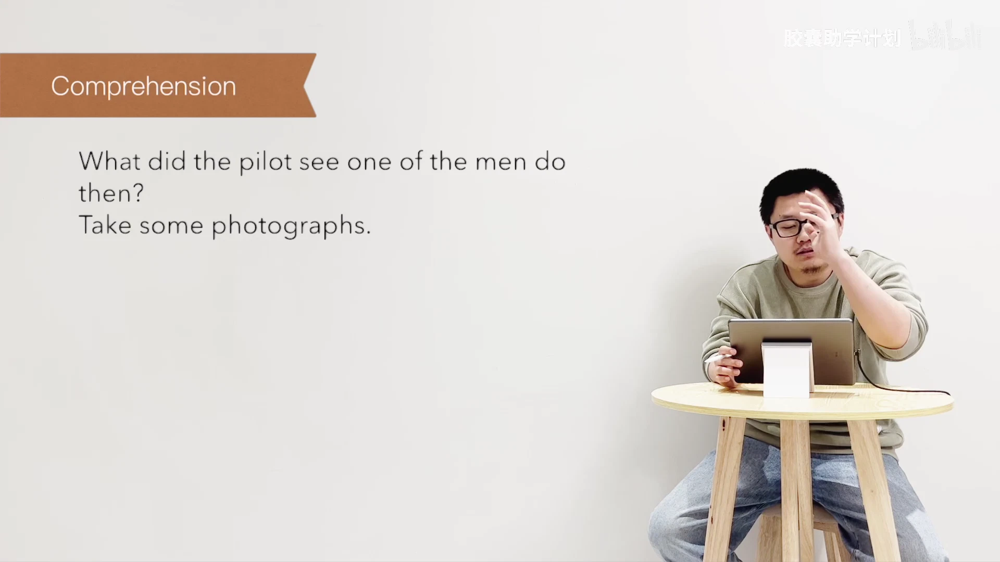

文字识别：Comprehension / What did the pilot see one of the men do / then? / Take some photographs.

### 画面 00:02:05

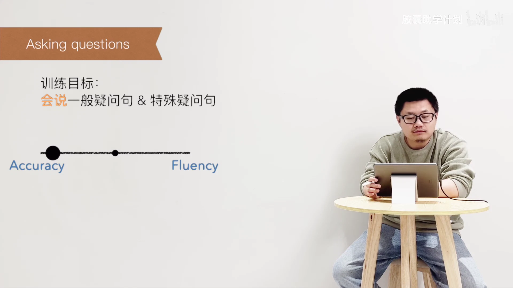

文字识别：泰助学计划 / Asking questions / 训练目标： / 会说一般疑问句＆特殊疑问句 / Accuracy / Fluency

### 画面 00:02:07

文字识别：喜助学计划 / Asking questions

### 画面 00:02:09

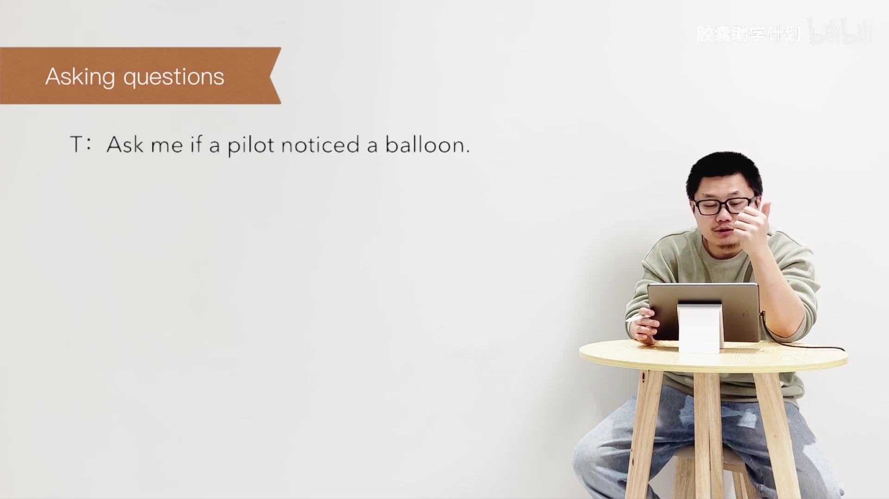

文字识别：Asking questions / T: Ask me if a pilot noticed a balloon.

### 画面 00:02:11

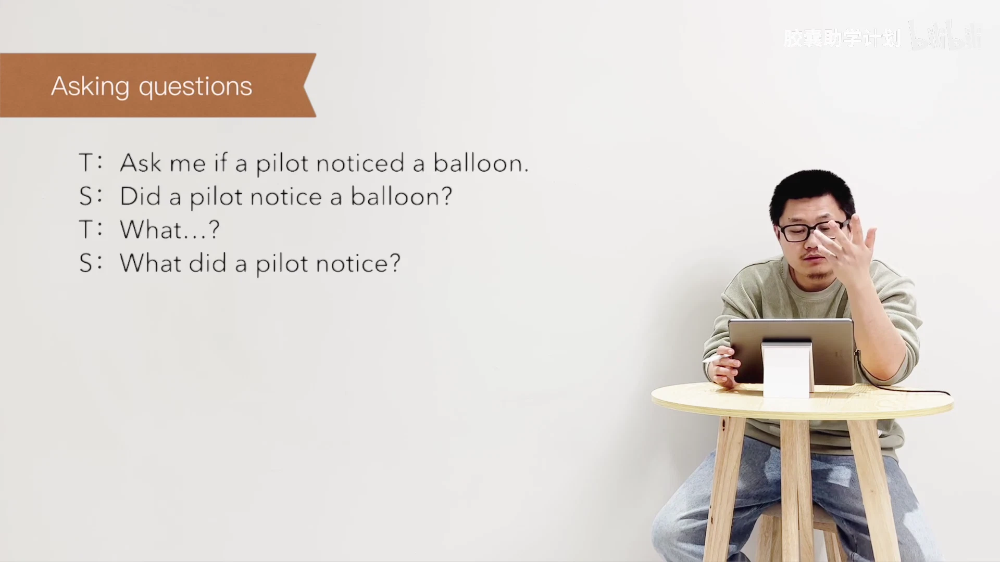

文字识别：Asking questions / T: Ask me if a pilot noticed a balloon. / S: Did a pilot notice a balloon? / T: What...? / S: What did a pilot notice?

### 画面 00:02:13

文字识别：臺助学计划 / Asking questions

### 画面 00:02:20

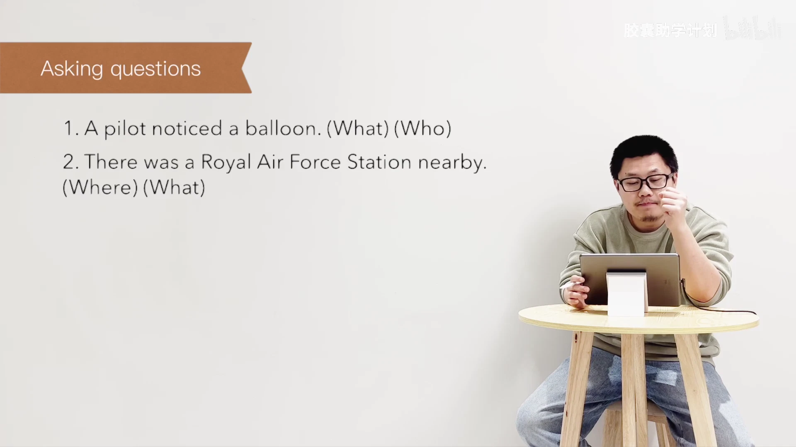

文字识别：Asking questions / 1.A pilot noticed a balloon.(What) (Who) / 2. There Was a Royal Air Force Station nearby. / (Where)(What)

## 00:02:30–00:03:00

Royal Air Force station? The balloon was making for it.过去进行时 was提前 What对 the balloon提问? The pilot informed the station. Did提前 Who对 the pilot提问? The officer in the control tower heard the news. Heard did提前 What对 the news提问? Who对主语提问？但是 who呢？你可以对整个主语。所谓整个主语是 the officer in the control tower提问

### 画面 00:02:34

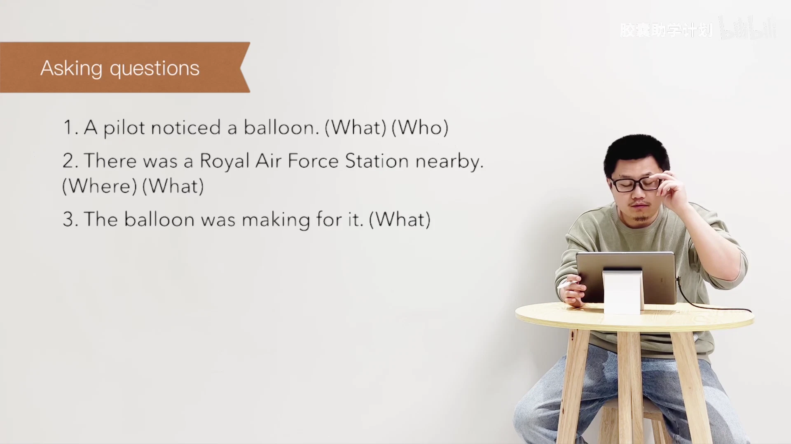

文字识别：Asking questions / 1.A pilot noticed a balloon. (What) (Who) / 2. There was a Royal Air Force Station nearby. / (Where)(What) / 3. The balloon was making for it. (What)

### 画面 00:02:44

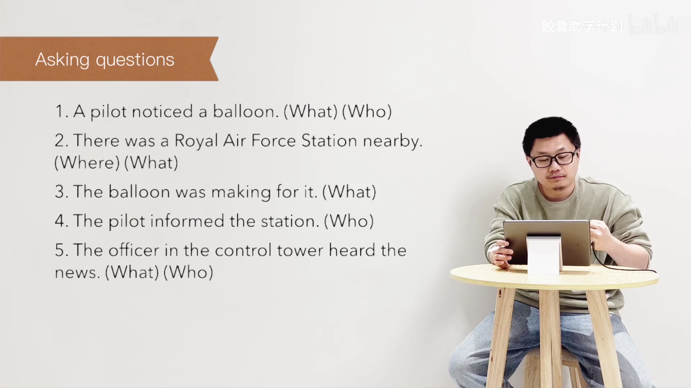

文字识别：Asking questions / 1.A pilot noticed a balloon. (What) (Who) / 2. There was a Royal Air Force Station nearby. / (Where)(What) / 3. The balloon was making for it.(What) / 4. The pilot informed the station.(Who) / 5. The officer in the control tower heard the / news.(What) (Who)

## 00:03:00–00:03:30

啊。第六个，He was angry at the news was提前 why整句话。The balloons a balloons can be a danger to aircraft can提前 what对主语提问。A pilot was ordered to keep track of the object was提前 what点点do其实就是what uh was the pilot ordered to do啊呃who对主语提问。There were three men in the basket there be句型 were提前

### 画面 00:03:00

文字识别：臺助学计划區 / Asking questions

### 画面 00:03:06

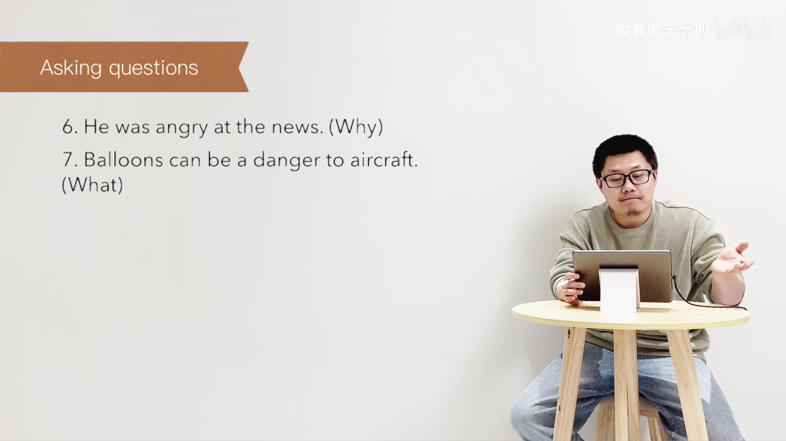

文字识别：Asking questions / 6. He was angry at the news. (Why) / 7. Balloons can be a danger to aircraft. / (What)

### 画面 00:03:12

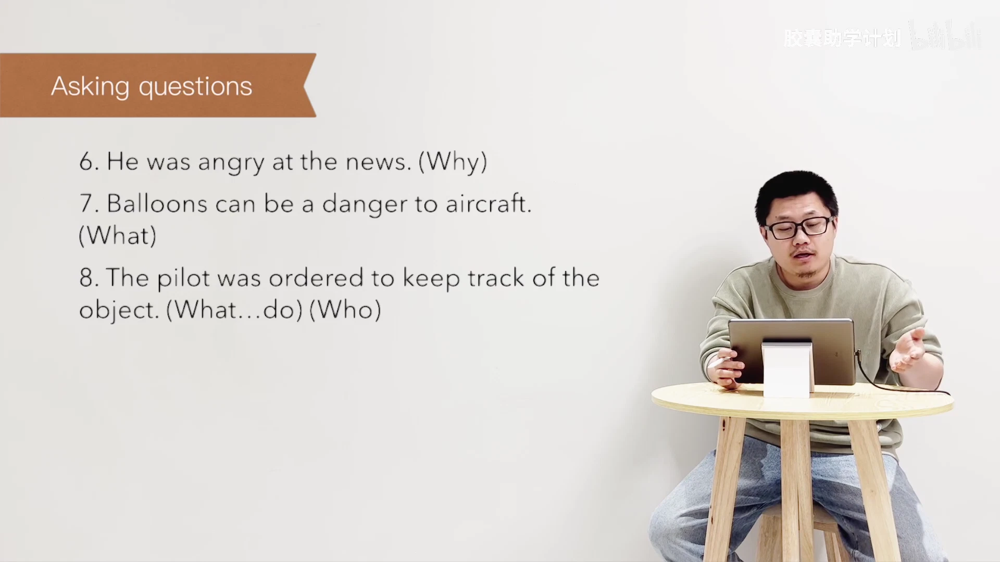

文字识别：Asking questions / 6. He was angry at the news. (Why) / 7. Balloons can be a danger to aircraft. / (What) / 8. The pilot was ordered to keep track of the / object. (What...do)(Who)

## 00:03:30–00:04:00

how many对 three提问你得是 how many men were there in the basket 答案啊 where对应的 basket提问没什么说的了 tell the story fluency啊这个第一单元做过很多的示范了这个您自己处理就行了然后 summary writing 两篇文章重点看连词啊这是第一篇这第二篇 topic for discussion 我们看一下他问的是什么第一个 was it likely that someone was spying from

### 画面 00:03:30

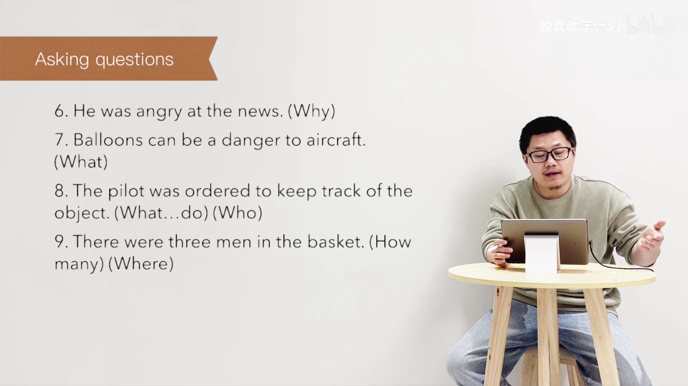

文字识别：Asking questions / 6. He was angry at the news. (Why) / 7. Balloons can be a danger to aircraft. / (What) / 8. The pilot was ordered to keep track of the / object. (What...do)(Who) / 9. There were three men in the basket.(How / many)(Where)

### 画面 00:03:37

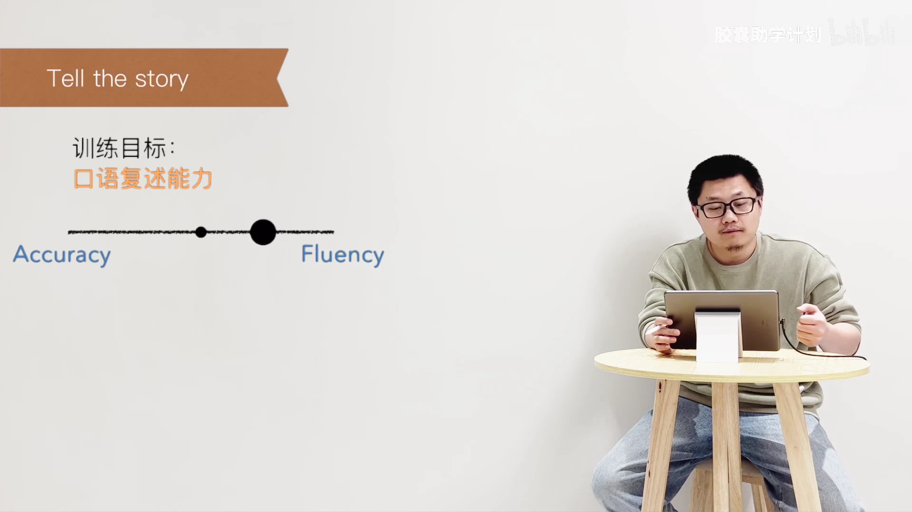

文字识别：囊助学计划 / Tell the story / 训练目标： / 口语复述能力 / Accuracy / Fluency

### 画面 00:03:42

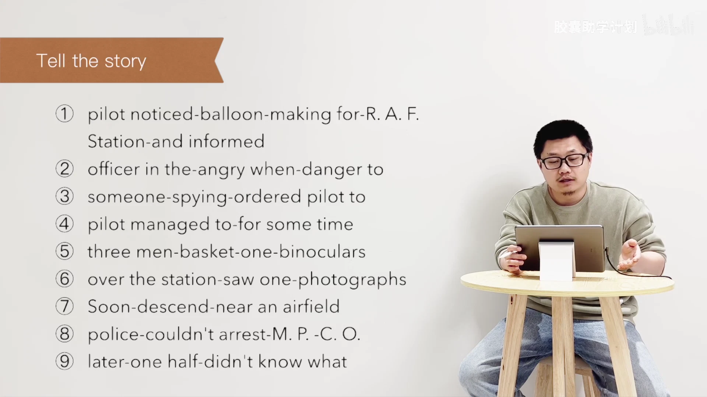

文字识别：助字计划 / Tell the story / 1 / pilot noticed-balloon-making for-R. A. F. / Station-and informed / officer in the-angry when-danger to / someone-spying-ordered pilot to / pilot managed to-for some time / three men-basket-one-binoculars / ⑥ over the station-saw one-photographs /  Soon-descend-near an airfield / ③ police-couldn't arrest-M. P.-C. O. / 8 / 9 /  later-one half-didn't know what

### 画面 00:03:45

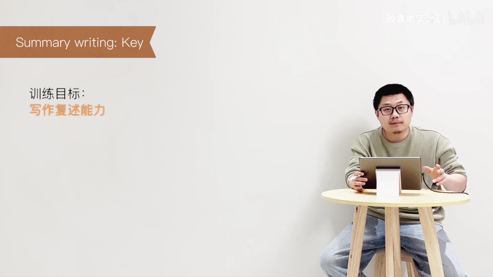

文字识别：喜助学计划 / Summary writing: Key / 训练目标： / 写作复述能力

### 画面 00:03:47

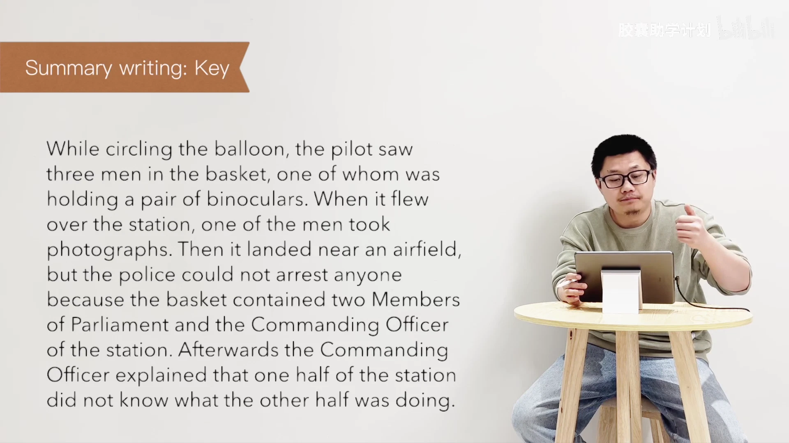

文字识别：袁助学计划 / Summary writing: Key / While circling the balloon, the pilot saw / three men in the basket, one of whom was / holding a pair of binoculars. When it flew / over the station, one of the men took / photographs. Then it landed near an airfield, / but the police could not arrest anyone / because the basket contained two Members / of Parliament and the Commanding Officer / of the station. Afterwards the Commanding / Officer explained that one half of the station / did not know what the other half was doing.

### 画面 00:03:51

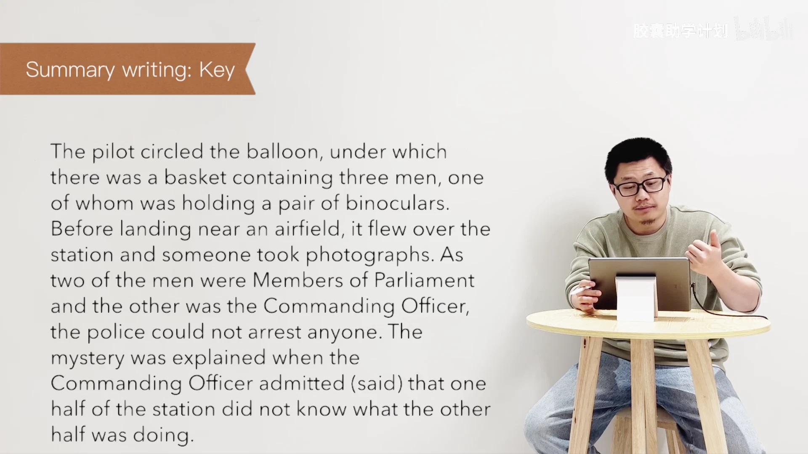

文字识别：复助学计划 / Summary writing: Key / The pilot circled the balloon, under which / there was a basket containing three men, one / of whom was holding a pair of binoculars. / Before landing near an airfield, it flew over the / station and someone took photographs. As / two of the men were Members of Parliament / and the other was the Commanding Officer, / the police could not arrest anyone. The / mystery was explained when the / Commanding Officer admitted (said) that one / half of the station did not know what the other / half was doing.

### 画面 00:03:53

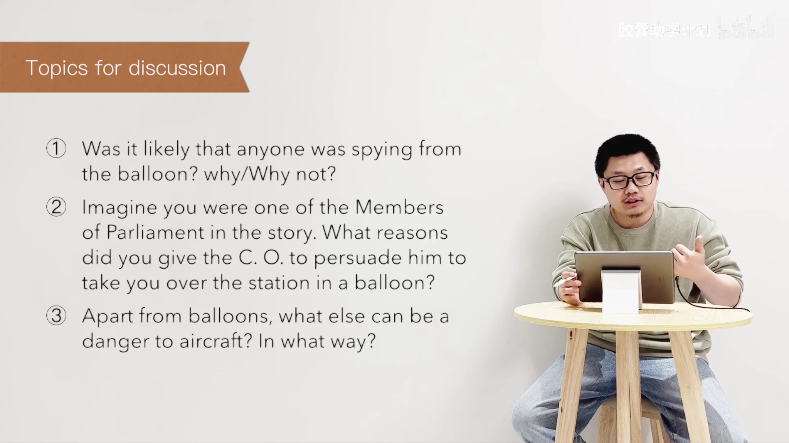

文字识别：助字计划 / Topics for discussion / Was it likely that anyone was spying from / the balloon? why/Why not? / Imagine you were one of the Members / of Parliament in the story. What reasons / did you give the C. O. to persuade him to / take you over the station in a balloon? / Apart from balloons, what else can be a / danger to aircraft? In what way?

## 00:04:00–00:04:30

the balloon. Why not?有没有可能说有人在这个气球里边正在做监视啊？第二个说，Imagine you were one of the members of parliament in the story. What reasons did you give the CEO to persuade him to take you over the station in the balloon？假想你就是这个国会议员，这这两个国会议员成员，这故事里边国会议员的其中之一啊，一个人说，你给了这个 commanding officer 这个指挥官什么样的一个理由，

### 画面 00:04:18

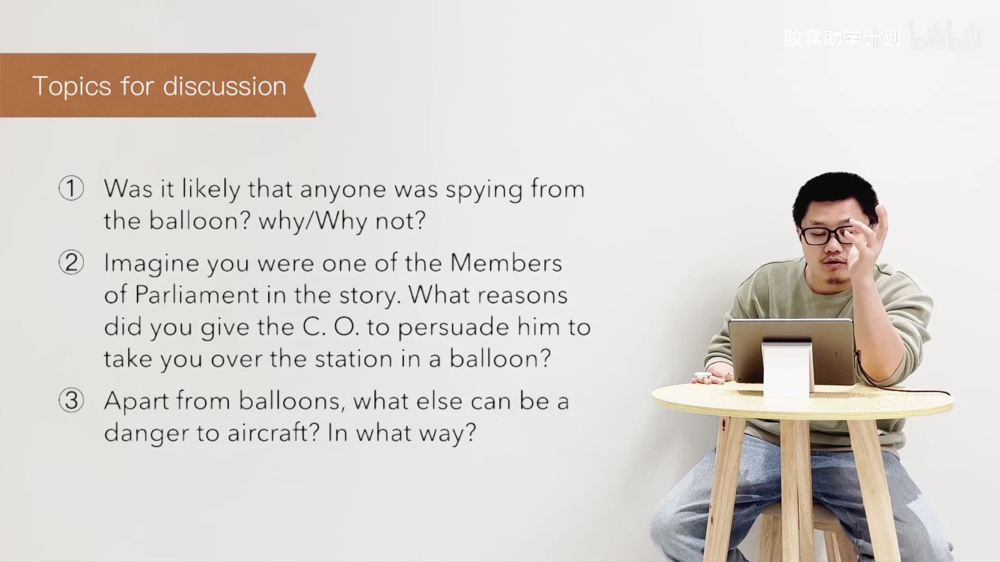

文字识别：助学计划 / Topics for discussion / Was it likely that anyone was spying from / the balloon? why/Why not? / Imagine you were one of the Members / 2 / of Parliament in the story. What reasons / did you give the C. O. to persuade him to / take you over the station in a balloon? / Apart from balloons, what else can be a / danger to aircraft? In what way?

### 画面 00:04:27

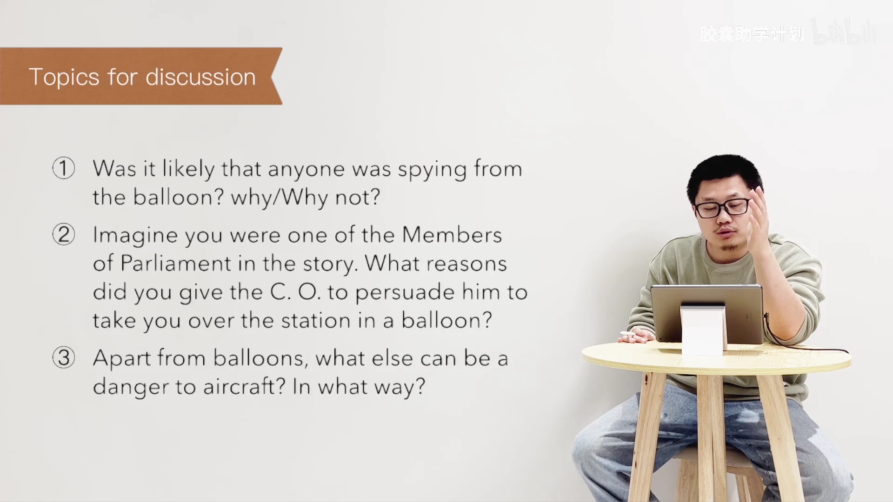

文字识别：助学计划 / Topics for discussion / Was it likely that anyone was spying from / the balloon? why/Why not? / Imagine you were one of the Members / of Parliament in the story. What reasons / did you give the C. O. to persuade him to / take you over the station in a balloon? / Apart from balloons, what else can be a / danger to aircraft? In what way?

### 画面 00:04:29

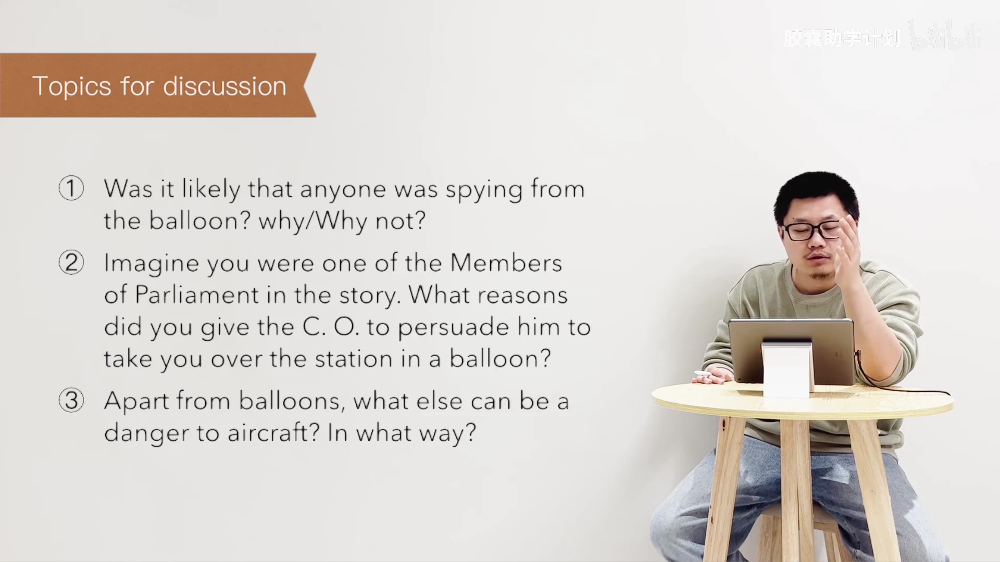

文字识别：助学计划 / Topics for discussion / Was it likely that anyone was spying from / the balloon? why/Why not? / Imagine you were one of the Members / of Parliament in the story. What reasons / did you give the C. O. to persuade him to / take you over the station in a balloon? / Apart from balloons, what else can be a / danger to aircraft? In what way?

## 00:04:30–00:05:00

劝说他带你，对吧？在这个热气球里边看一看这个 station，啊，就是出于什么样的原因嘛？第三个说 apart from balloons， what else can be a danger to aircraft？说除了气球以外，啊，这个热气球还有什么对于这些，哎，飞机来说可能是危有危险？最简单鸟嘛，对吧？那 in what way 就是以什么方式啊？家庭作业 ask me 写完朗读，摘要写作两篇，重点看连词 tell the story，重点是口语复述，然

### 画面 00:04:50

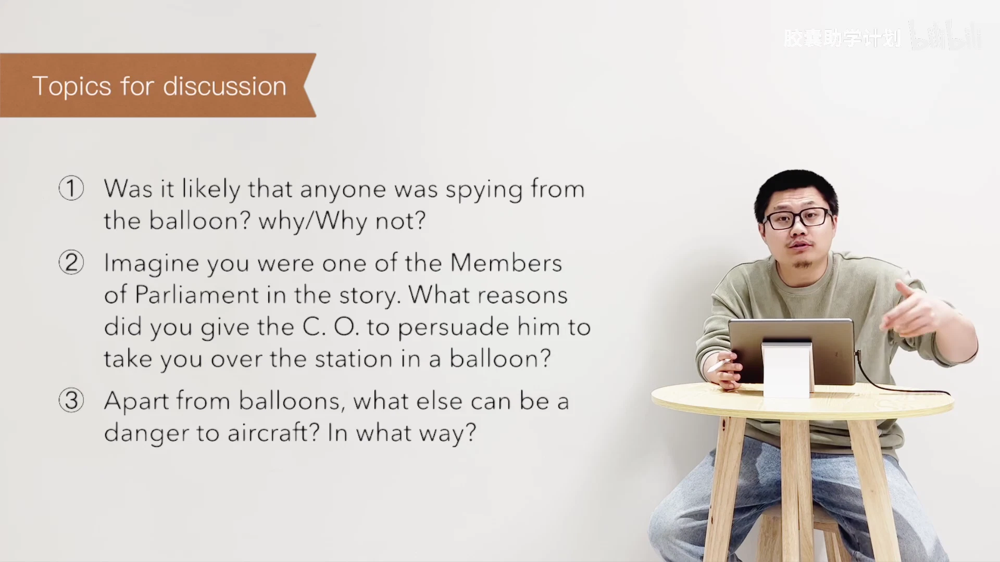

文字识别：助字计划 / Topics for discussion / Was it likely that anyone was spying from / the balloon? why/Why not? / Imagine you were one of the Members / of Parliament in the story. What reasons / did you give the C. O. to persuade him to / take you over the station in a balloon? / Apart from balloons, what else can be a / danger to aircraft? In what way?

### 画面 00:04:52

文字识别：妻助学计划一调 / 1. / Ask me if写&朗读

### 画面 00:04:54

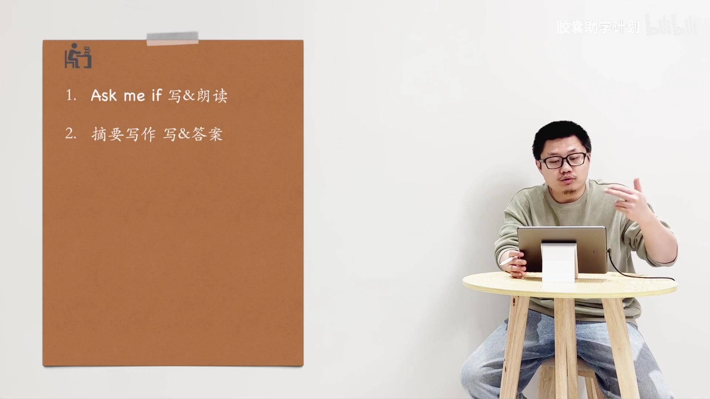

文字识别：妻助字计划国旧 / 1.Ask me if写&朗读 / 2. / 摘要写作写&答案

### 画面 00:04:56

文字识别：囊助学计划一 / 1.Ask me if写&朗读 / 摘要写作写&答案 / 3.Tell the story 口语复述

### 画面 00:04:59

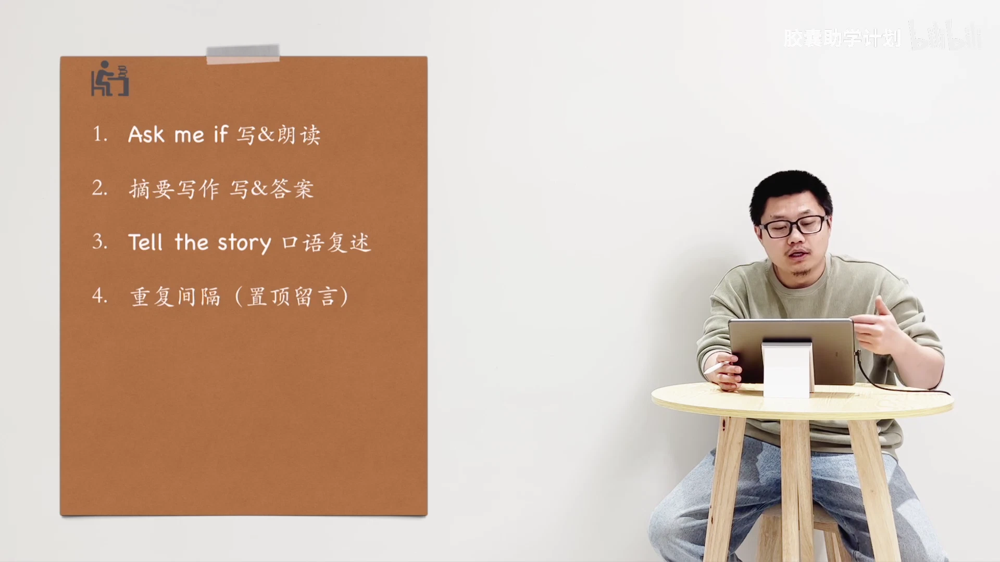

文字识别：妻助字计划 / 1.Ask me if写&朗读 / 摘要写作写&答案 / 3.Tell the story 口语复述 / 4. / .重复间隔（置顶留言）

## 00:05:00–00:05:28

后置顶留言可以找到我们重复间隔的学习材料。那以上就是本期视频的全部内容了。如果各位喜欢我们的课程呢，欢迎各位关注、订阅、一键三连，分享给那些需要的朋友，来帮助我们快速成长。See you next time.

### 画面 00:05:01

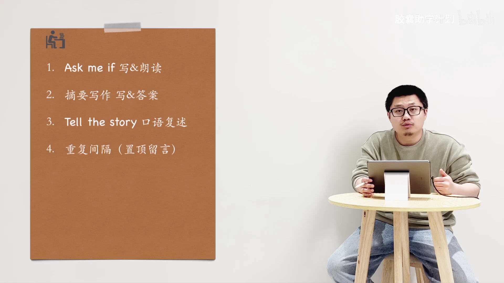

文字识别：妻助字计划傳 / 1.Ask me if写&朗读 / 摘要写作写&答案 / 3.Tell the story 口语复述 / ·重复间隔（置顶留言）

### 画面 00:05:03

文字识别：奏助学计划 / 不

### 画面 00:05:06

文字识别：囊助学计划關 / 🌟

### 画面 00:05:08

文字识别：囊助学计划一 / 不

### 画面 00:05:11

文字识别：囊助学计划一

### 画面 00:05:13

文字识别：妻助学计划

### 画面 00:05:15

文字识别：助字计划一

### 画面 00:05:17

文字识别：臺動字計划 / CAPSULEACADEMY / 胶囊助学计划 / 『 / 小红书 / Lecturer / Leo

### 画面 00:05:20

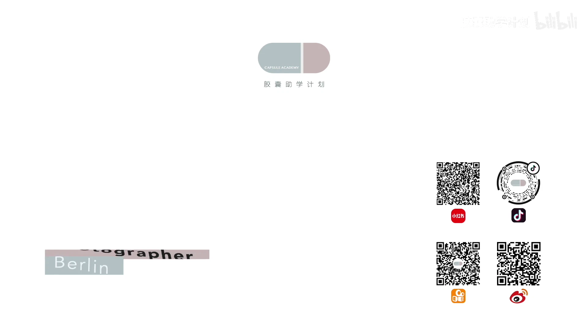

文字识别：CAPSULEACADEMY / 胶囊助学计划 / 『 / 小红书 / grapher / Berlin

### 画面 00:05:23

文字识别：CAPSULEACADEMY / 胶囊助学计划 / 『 / 小红书 / Creator / □ / Leo & Berlin / OE

### 画面 00:05:26

文字识别：bilbili / 胶囊助学计划

### 画面 00:05:27

文字识别：bilbili / 胶囊助学计划

