# 092 单词 语法

快速机器解析：语音为单模型转写，未进行独立交叉校对或人工复核；画面每秒采样并按变化选帧，短时文字和标记可能遗漏。截图时间约有 1 秒误差。图片有损压缩；遇到疑点请按时间查看 Google Drive 原视频。

## 00:00:00–00:00:30

Hello everyone, welcome to Capsule Academy. This is Liu. Today we're going to learn New Concept English Book Two, Lesson Ninety Two Words and Grammar. Old习惯，进入正式课程之前呢，咱们看几个问题啊。首先，如何表达熟睡啊？第二，如何表达你在讽刺我吗？第三，最后一个问题，如何表达说别用那种口气语气和我说话？带着这三个问题，Hope you gonna enjoy it.

### 画面 00:00:00

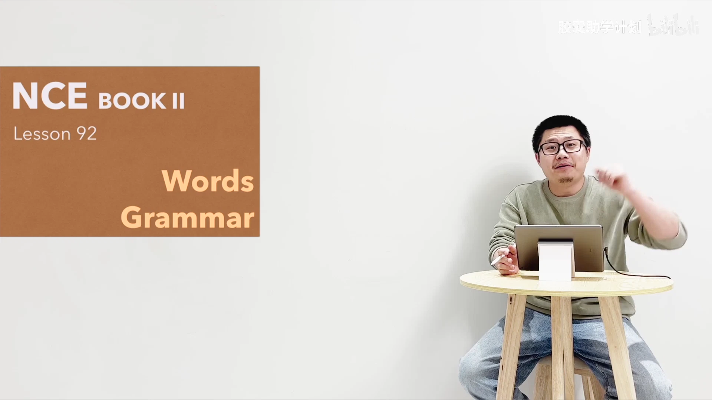

文字识别：NCE / BOOKI"I / Lesson 92 / Words / Grammar

### 画面 00:00:02

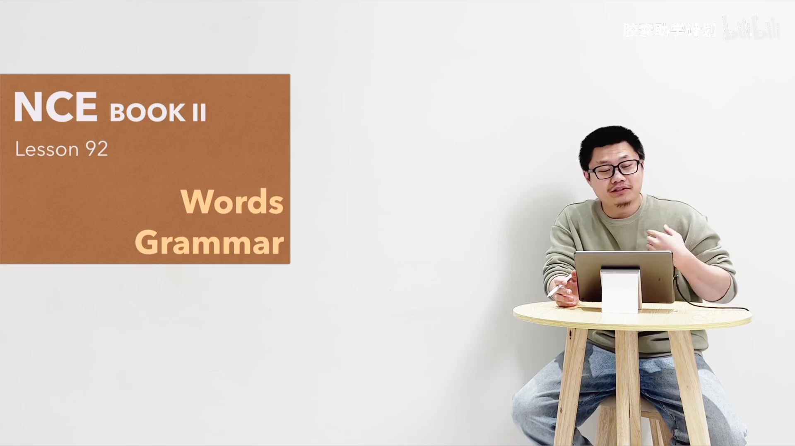

文字识别：NCE / BOOKI"I / Lesson 92 / Words / Grammar

### 画面 00:00:04

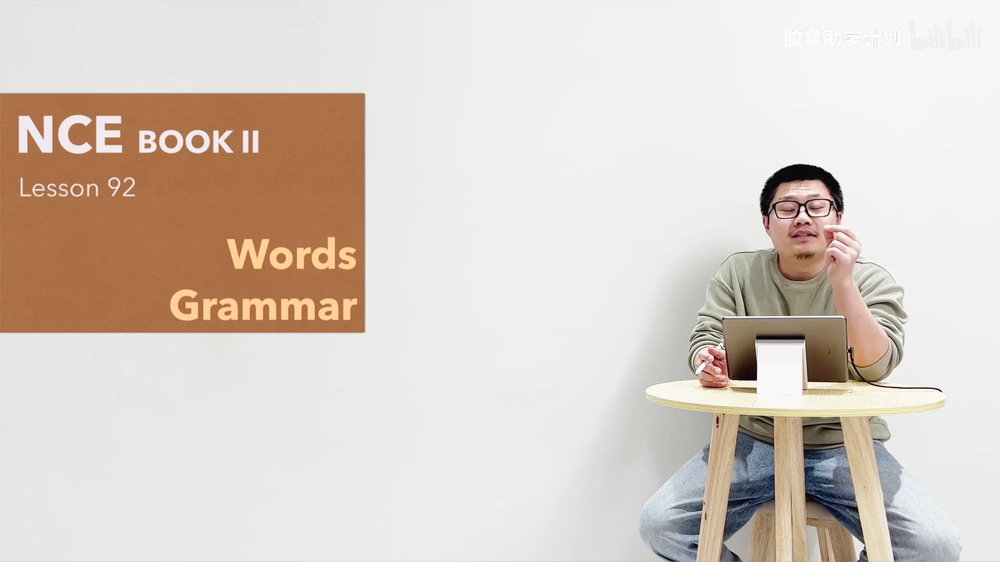

文字识别：NCE / BOOKII / Lesson 92 / Words / Grammar

### 画面 00:00:08

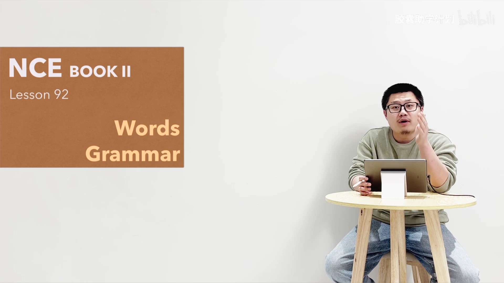

文字识别：NCE / BOOKII / Lesson 92 / Words / Grammar

### 画面 00:00:12

文字识别：虞助学计划長调 / 睡”

### 画面 00:00:14

文字识别：①如何表达“熟睡”？

### 画面 00:00:16

文字识别：①如何表达“熟睡”？ / 如何表达“你在讽刺我吗”?

### 画面 00:00:19

文字识别：①如何表达“熟睡”？ / 如何表达“你在讽刺我吗” / 如何表达“别用那种语气跟我说话”?

### 画面 00:00:21

文字识别：①如何表达“熟睡”？ / 如何表达“你在讽刺我吗”? / 如何表达“别用那种语气跟我说话”?

### 画面 00:00:25

文字识别：①如何表达“熟睡”？ / 如何表达“你在讽刺我吗”? / 如何表达“别用那种语气跟我说话”?

### 画面 00:00:27

文字识别：胶囊助学计划 bil

## 00:00:30–00:01:00

第一个单词 fast，这个单词对于各位来说做形容词的含义非常熟悉，对吧？叫快嘛。那 fast 在这个地方呢，它其实跟 asleep 连到一起，指的是那个睡得很熟的那个熟，啊，对吧？Fast asleep，睡得很熟，放到一起去用。那我们造个句子，比如说 When he went upstairs, five minutes later, he was fast asleep. 第七课的语法 when，对吧？

### 画面 00:00:31

文字识别：囊助学计划關 / 胶囊助学计划

### 画面 00:00:33

文字识别：单词造句指南 / 网：v.+v.变化 / 毫助字计划 / 四句型转换 / 方式/地点/时间 / 结合习惯用法 / 其他单词+词性 / 原文摘抄+变 / 6123456 / /fa:st/ / fast adv.

### 画面 00:00:35

文字识别：单词造句指南 / 网：v.+v.变化 / 喜助字计划 / 四句型转换 / 方式/地点/时间 / 结合习惯用法 / 其他单词+词性 / 原文摘抄+变 / 6123456 / /fa:st/ / fast adv.

### 画面 00:00:37

文字识别：单词造句指南 / 网：v.+v.变化 / 囊助学计划 / 四句型转换 / 方式/地点/时间 / 结合习惯用法 / 其他单词+词性 / 原文摘抄+变 / 6123456 / /fa:st/ / fast adv.

### 画面 00:00:39

文字识别：单词造句指南 / 网：v.+v.变化 / 聖助字计划園 / 四句型转换 / 方式/地点/时间 / 结合习惯用法 / 其他单词+词性 / 原文摘抄+变 / 6123456 / /fa:st/ / fast adv.

### 画面 00:00:41

文字识别：单词造句指南 / 网：v.+v.变化 / 毫助字计划 / 四句型转换 / 方式/地点/时间 / 结合习惯用法 / 其他单词+词性 / 原文摘抄+变 / 6123456 / /fa:st/ / fast adv. / ① fast asleep

### 画面 00:00:44

文字识别：单词造句指南 / 网：v.+v.变化 / 建助字计划 / 四句型转换 / 方式/地点/时间 / 结合习惯用法 / 其他单词+词性 / 原文摘抄+变 / 6123456 / /fa:st/ / fast adv. / ) fast asleep

### 画面 00:00:46

文字识别：单词造句指南 / 网：v.+v.变化 / 妻助字计划 / 四句型转换 / 方式/地点/时间 / 结合习惯用法 / 其他单词+词性 / 原文摘抄+变 / 6123456 / /fa:st/ / fast adv. /  fast asleep

### 画面 00:00:51

文字识别：单词造句指南 / 网：v.+v.变化 / 四句型转换 / 方式/地点/时间 / 结合习惯用法 / 其他单词+词性 / 原文摘抄+变 / 6123456 / /fa:st/ / fast adv. / ① fast asleep / When he went upstairs five minutes later, / she was fast asleep.

### 画面 00:00:53

文字识别：单词造句指南 / 网：v.+v.变化 / 四句型转换 / 方式/地点/时间 / 结合习惯用法 / 其他单词+词性 / 原文摘抄+变 / 6123456 / /fa:st/ / fast adv. / ① fast asleep / When he went upstairs five minutes later, / she was fast asleep.

### 画面 00:00:55

文字识别：单词造句指南 / 网：v.+v.变化 / 四句型转换 / 方式/地点/时间 / 结合习惯用法 / 其他单词+词性 / 原文摘抄+变 / 6123456 / /fa:st/ / fast adv. / ① fast asleep / When he went upstairs five minutes later, / she was fast asleep.

### 画面 00:00:57

文字识别：单词造句指南 / 网：v.+v.变化 / 四句型转换 / 方式/地点/时间 / 结合习惯用法 / 其他单词+词性 / 原文摘抄+变 / 6123456 / /fa:st/ / fast adv. / ① fast asleep / When he went upstairs five minutes later, / she was fast asleep.

### 画面 00:00:59

文字识别：单词造句指南 / 网：v.+v.变化 / 学计划 / 四句型转换 / 方式/地点/时间 / 结合习惯用法 / 其他单词+词性 / 原文摘抄+变 / 6123456 / /fa:st/ / fast adv. /  fast asleep / When he went upstairs five minutes later, / she was fast asleep.

## 00:01:00–00:01:30

Next one说，I was fast asleep when my bedside phone began to ring。说，当我这个床边的这个电话开始响的时候，我怎么样呢？正在熟睡呢。OK。Next one，下一个单词啊，本课生词也很少，和上一课一样，叫做ladder，ladder啊，ladder梯子。OK，那想拿它去造句，首先立刻想找动词，对吧？找之前学过的习惯用法、语法，哐哐往一块儿，

### 画面 00:01:01

文字识别：单词造句指南 / 网：v.+v.变化 / 四句型转换 / 方式/地点/时间 / 结合习惯用法 / 其他单词+词性 / 原文摘抄+变 / 6123456 / /fa:st/ / fast adv. / ① fast asleep / When he went upstairs five minutes later, / she was fast asleep. / I was fast asleep / when my bedside phone began to ring. / King of the Hill (1993)

### 画面 00:01:05

文字识别：单词造句指南 / 网：v.+v.变化 / 字计划 / 四句型转换 / 方式/地点/时间 / 结合习惯用法 / 其他单词+词性 / 原文摘抄+变 / 6123456 / /fa:st/ / fast adv. / ① fast asleep / When he went upstairs five minutes later, / she was fast asleep. / I was fast asleep / when my bedside phone began to ring. / King of the Hill (1993)

### 画面 00:01:09

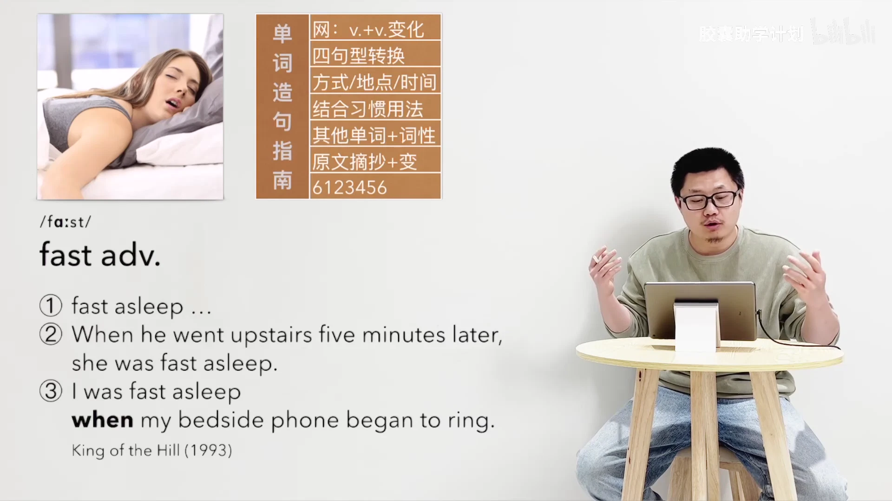

文字识别：单词造句指南 / 网：v.+v.变化 / 四句型转换 / 方式/地点/时间 / 结合习惯用法 / 其他单词+词性 / 原文摘抄+变 / 6123456 / /fa:st/ / fast adv. / ① fast asleep / When he went upstairs five minutes later, / she was fast asleep. / I was fast asleep / when my bedside phone began to ring. / King of the Hill (1993)

### 画面 00:01:12

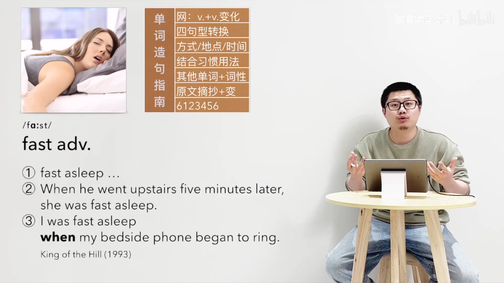

文字识别：单词造句指南 / 网：v.+v.变化 / 四句型转换 / 方式/地点/时间 / 结合习惯用法 / 其他单词+词性 / 原文摘抄+变 / 6123456 / /fa:st/ / fast adv. / ① fast asleep / When he went upstairs five minutes later, / she was fast asleep. / I was fast asleep / when my bedside phone began to ring. / King of the Hill (1993)

### 画面 00:01:14

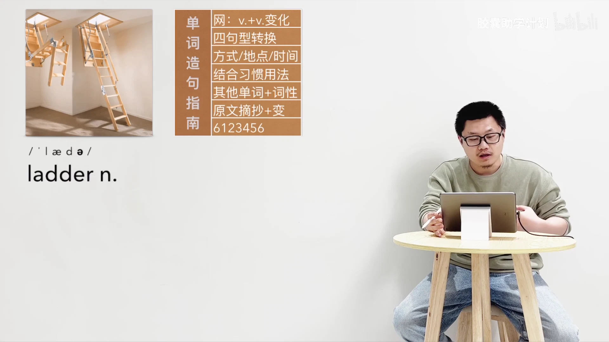

文字识别：单词造句指南 / 网：v.+v.变化 / 毫助子计划 / 四句型转换 / 方式/地点/时间 / 结合习惯用法 / 其他单词+词性 / 原文摘抄+变 / 6123456 / /  | æ d a / / ladder n.

### 画面 00:01:17

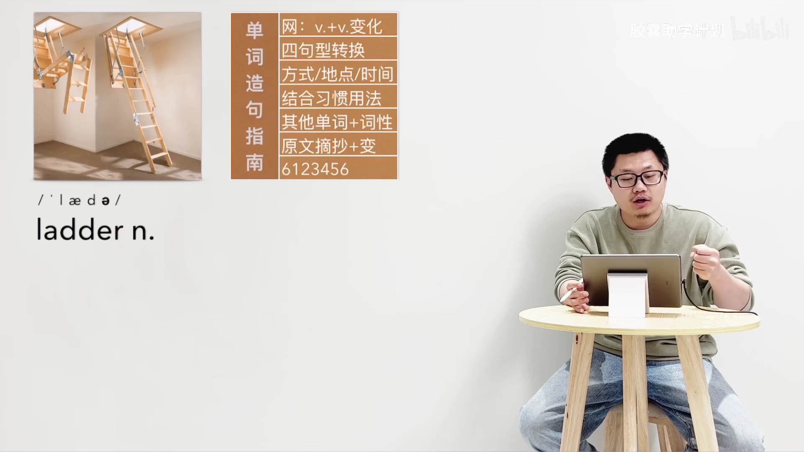

文字识别：单词造句指南 / 网：v.+v.变化 / 妻助字计划 / 四句型转换 / 方式/地点/时间 / 结合习惯用法 / 其他单词+词性 / 原文摘抄+变 / 6123456 / /  I æ d a / / ladder n.

### 画面 00:01:20

文字识别：单词造句指南 / 网：v.+v.变化 / 妻助字计划園 / 四句型转换 / 方式/地点/时间 / 结合习惯用法 / 其他单词+词性 / 原文摘抄+变 / 6123456 / /  l æ d a / / ladder n.

### 画面 00:01:22

文字识别：单词造句指南 / 网：v.+v.变化 / 建助字计划 / 四句型转换 / 方式/地点/时间 / 结合习惯用法 / 其他单词+词性 / 原文摘抄+变 / 6123456 / /  | æe d a / / ladder n. / ① The police knocked him to the ground with / a ladder. L81

### 画面 00:01:25

文字识别：单词造句指南 / 网：v.+v.变化 / 奏助字计划 / 四句型转换 / 方式/地点/时间 / 结合习惯用法 / 其他单词+词性 / 原文摘抄+变 / 6123456 / /  | æ d a / / ladder n. / ① The police knocked him to the ground with / a ladder. L81

### 画面 00:01:28

文字识别：单词造句指南 / 网：v.+v.变化 / 学计划 / 四句型转换 / 方式/地点/时间 / 结合习惯用法 / 其他单词+词性 / 原文摘抄+变 / 6123456 / /  | æ d a / / ladder n. / ① The police knocked him to the ground with / a ladder. L81

## 00:01:30–00:02:00

哎，这个揉啊，比如说 the police knocked him to the ground with a ladder，用一个梯子把他给打倒在地了，对吧？Next one，说 I'm used to climbing the ladder up and down，说我习惯于怎么样呢？哎，上上下下爬这个梯子了，没事儿不用担心，是吧？没有危险。然后下一个叫 my wife urged me to buy a new ladder，哎，怂恿我或者督促我或者催促我去买一个

### 画面 00:01:30

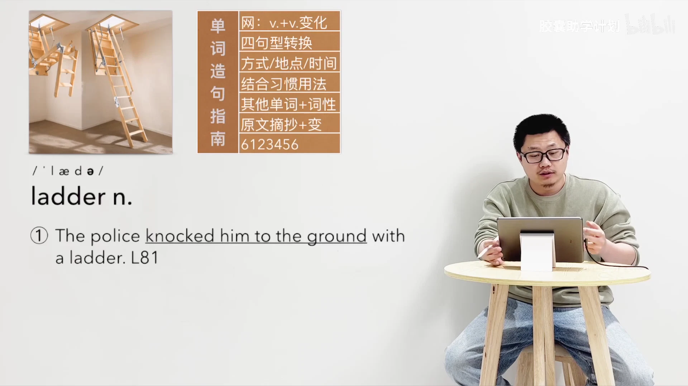

文字识别：单词造句指南 / 网：v.+v.变化 / 四句型转换 / 方式/地点/时间 / 结合习惯用法 / 其他单词+词性 / 原文摘抄+变 / 6123456 / / ' | æe d a / / ladder n. / ① The police knocked him to the ground with / a ladder. L81

### 画面 00:01:38

文字识别：单词造句指南 / 网：v.+v.变化 / 学计划 / 四句型转换 / 方式/地点/时间 / 结合习惯用法 / 其他单词+词性 / 原文摘抄+变 / 6123456 / /  | æ d a / / ladder n. / ① The police knocked him to the ground with / a ladder. L81 / ) I'm used to climbing the ladder up and / down.L79

### 画面 00:01:40

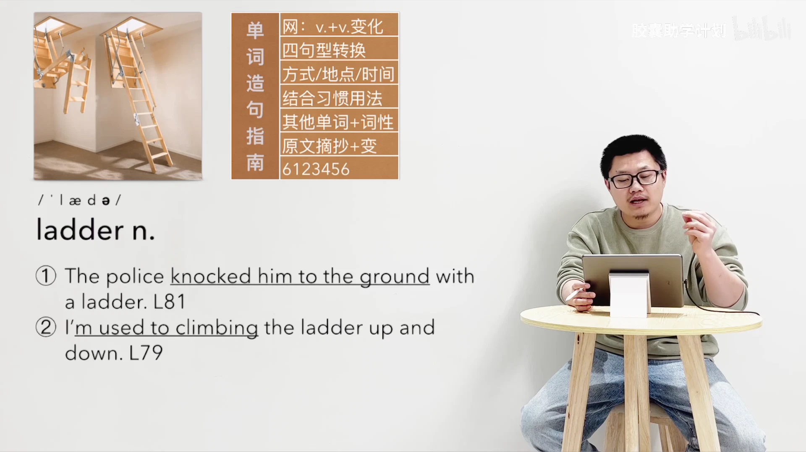

文字识别：单词造句指南 / 网：v.+v.变化 / 字计划 / 四句型转换 / 方式/地点/时间 / 结合习惯用法 / 其他单词+词性 / 原文摘抄+变 / 6123456 / /  | æ d a / / ladder n. / ① The police knocked him to the ground with / a ladder. L81 / ) I'm used to climbing the ladder up and / down.L79

### 画面 00:01:45

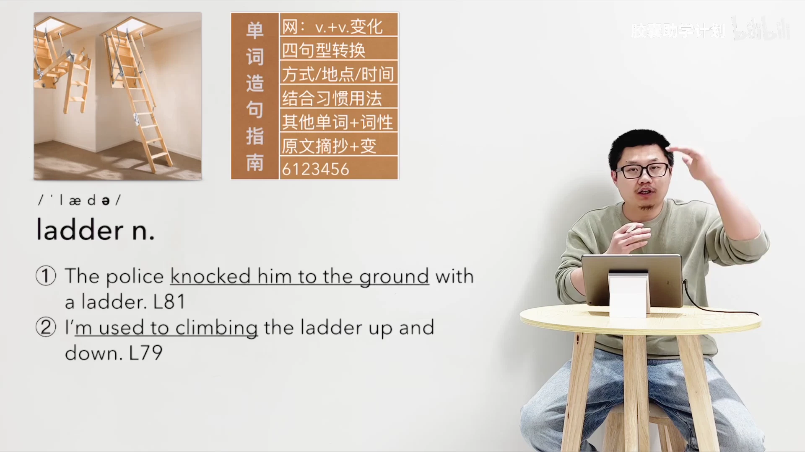

文字识别：单词造句指南 / 网：v.+v.变化 / 四句型转换 / 方式/地点/时间 / 结合习惯用法 / 其他单词+词性 / 原文摘抄+变 / 6123456 / / ' | æ d a / / ladder n. / ① The police knocked him to the ground with / a ladder. L81 / ) I'm used to climbing the ladder up and / down.L79

### 画面 00:01:48

文字识别：单词造句指南 / 网：v.+v.变化 / 四句型转换 / 方式/地点/时间 / 结合习惯用法 / 其他单词+词性 / 原文摘抄+变 / 6123456 / /  l æ d a / / ladder n. / ① The police knocked him to the ground with / a ladder. L81 / ) I'm used to climbing the ladder up and / down.L79 / ③ My wife urged me to buy a new ladder. L78

### 画面 00:01:50

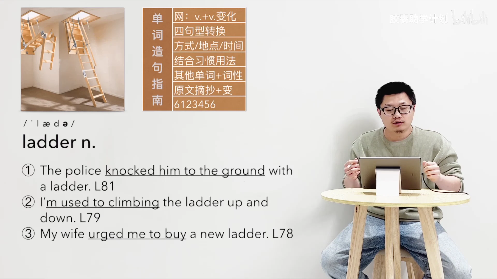

文字识别：单词造句指南 / 网：v.+v.变化 / 四句型转换 / 方式/地点/时间 / 结合习惯用法 / 其他单词+词性 / 原文摘抄+变 / 6123456 / /  | æ d a / / ladder n. / ① The police knocked him to the ground with / a ladder. L81 / ) I'm used to climbing the ladder up and / down.L79 / ③ My wife urged me to buy a new ladder. L78 / 3

### 画面 00:01:53

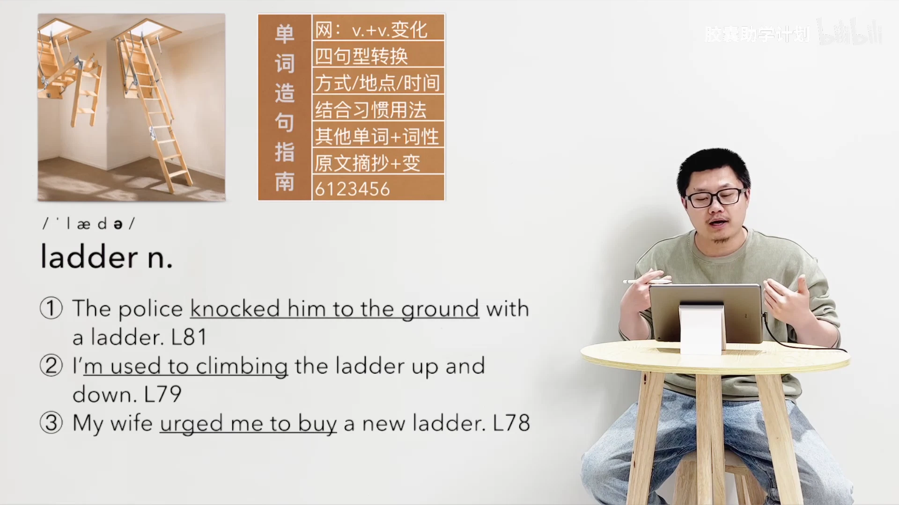

文字识别：单词造句指南 / 网：v.+v.变化 / 四句型转换 / 方式/地点/时间 / 结合习惯用法 / 其他单词+词性 / 原文摘抄+变 / 6123456 / /  l æ d a / / ladder n. / ① The police knocked him to the ground with / a ladder. L81 / ) I'm used to climbing the ladder up and / down.L79 / ③ My wife urged me to buy a new ladder. L78 / 3

### 画面 00:01:55

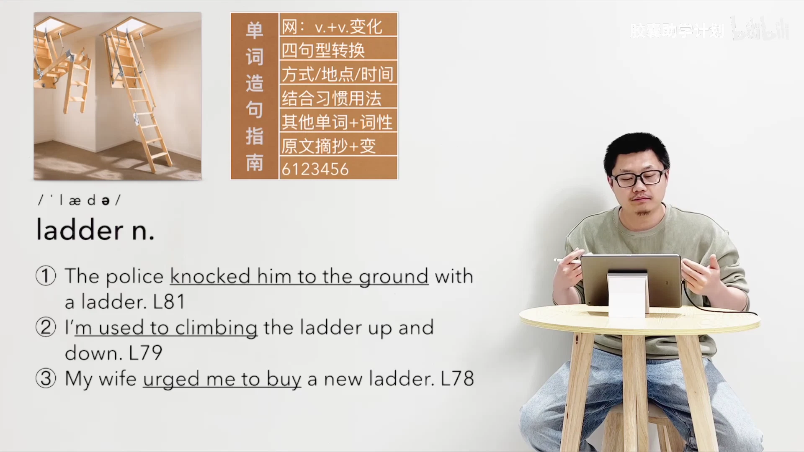

文字识别：单词造句指南 / 网：v.+v.变化 / 学计划 / 四句型转换 / 方式/地点/时间 / 结合习惯用法 / 其他单词+词性 / 原文摘抄+变 / 6123456 / /  l æ d a / / ladder n. / ① The police knocked him to the ground with / a ladder. L81 / ) I'm used to climbing the ladder up and / down.L79 / ③ My wife urged me to buy a new ladder. L78

### 画面 00:01:58

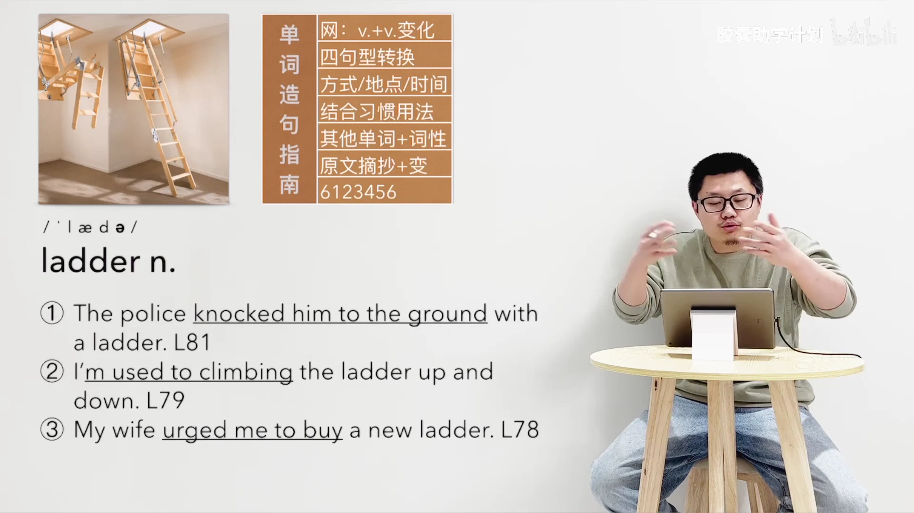

文字识别：单词造句指南 / 网：v.+v.变化 / 四句型转换 / 方式/地点/时间 / 结合习惯用法 / 其他单词+词性 / 原文摘抄+变 / 6123456 / /  | æe d a / / ladder n. / ① The police knocked him to the ground with / a ladder. L81 / ) I'm used to climbing the ladder up and / down.L79 / ③ My wife urged me to buy a new ladder. L78

## 00:02:00–00:02:30

新的梯子，这些都坏了，赶紧买个新的，再读一遍。Ladder, very good. Next one, shed. Shed是什么呢？就是如果你在西方居住过啊，或者租过房子呀，有房子呀，这种house它有一个特点是里面要么前面要么后边会有院子，院子里边呢，你可能自己种了各种各样的东西，也许是当然外国人种菜的少啊，当然如果你是中国人，可能你就种了菜，外国人你可能就种

### 画面 00:02:01

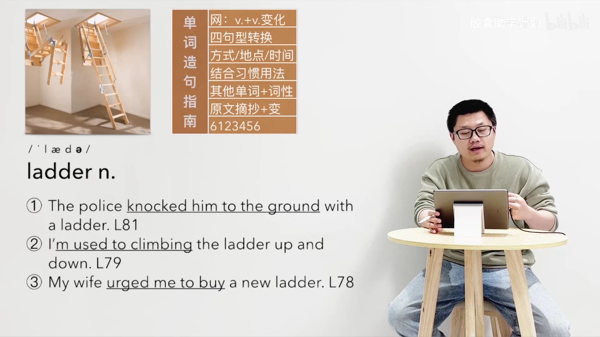

文字识别：单词造句指南 / 网：v.+v.变化 / 四句型转换 / 方式/地点/时间 / 结合习惯用法 / 其他单词+词性 / 原文摘抄+变 / 6123456 / / ' | æe d a / / ladder n. / ① The police knocked him to the ground with / a ladder. L81 / ) I'm used to climbing the ladder up and / down.L79 / ③ My wife urged me to buy a new ladder. L78

### 画面 00:02:05

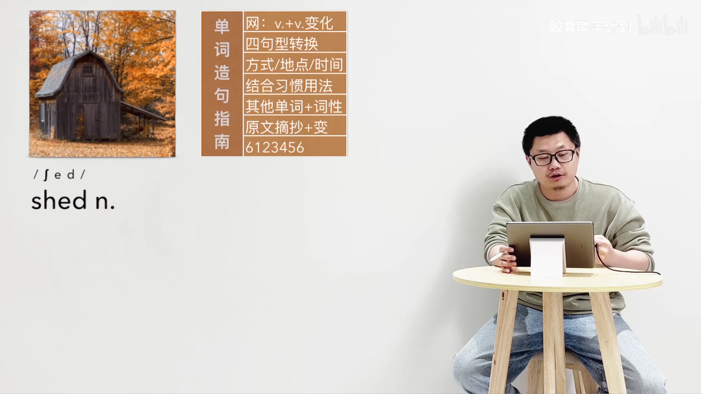

文字识别：单词造句指南 / 网：v.+v.变化 / 助字计划 / 四句型转换 / 方式/地点/时间 / 结合习惯用法 / 其他单词+词性 / 原文摘抄+变 / 6123456 / I ∫ed / / shed n.

### 画面 00:02:07

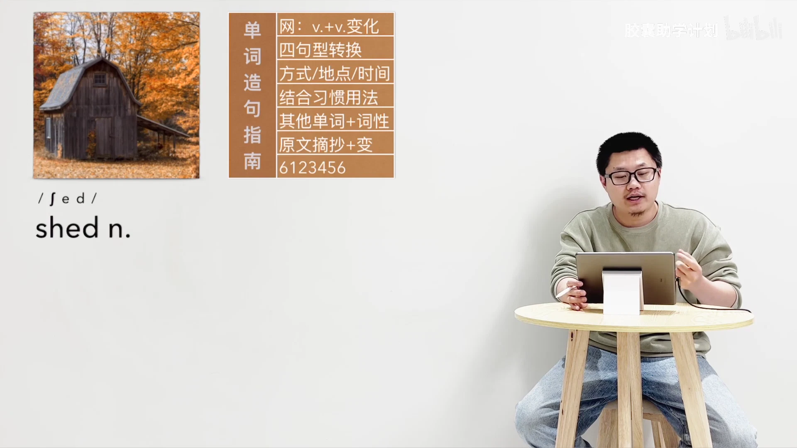

文字识别：单词造句指南 / 网：v.+v.变化 / 四句型转换 / 方式/地点/时间 / 结合习惯用法 / 其他单词+词性 / 原文摘抄+变 / 6123456 / I ∫ed/ / shed n.

### 画面 00:02:09

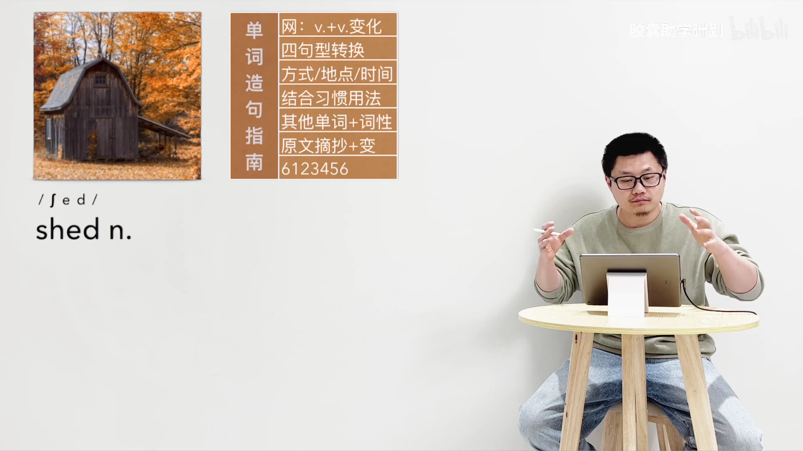

文字识别：单词造句指南 / 网：v.+v.变化 / 四句型转换 / 方式/地点/时间 / 结合习惯用法 / 其他单词+词性 / 原文摘抄+变 / 6123456 / / ∫e d / / shed n.

### 画面 00:02:11

文字识别：单词造句指南 / 网：v.+v.变化 / 四句型转换 / 方式/地点/时间 / 结合习惯用法 / 其他单词+词性 / 原文摘抄+变 / 6123456 / / ∫e d / / shed n.

### 画面 00:02:13

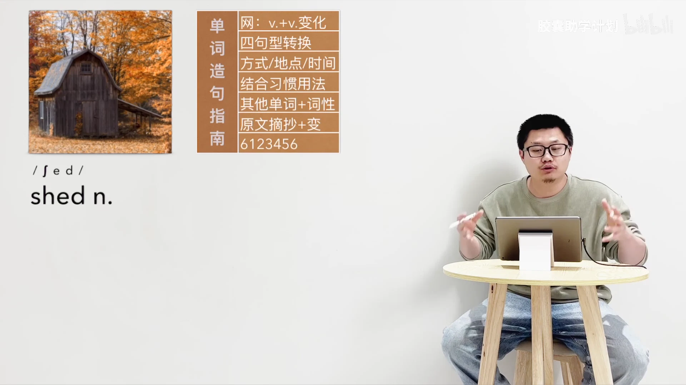

文字识别：单词造句指南 / 网：v.+v.变化 / 四句型转换 / 方式/地点/时间 / 结合习惯用法 / 其他单词+词性 / 原文摘抄+变 / 6123456 / /∫ed/ / shed n.

### 画面 00:02:15

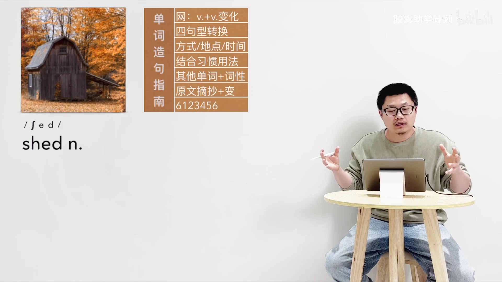

文字识别：单词造句指南 / 网：v.+v.变化 / 四句型转换 / 方式/地点/时间 / 结合习惯用法 / 其他单词+词性 / 原文摘抄+变 / 6123456 / / ∫ed / / shed n.

### 画面 00:02:18

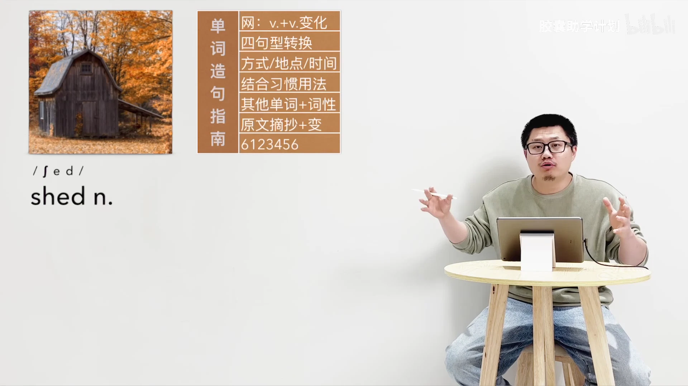

文字识别：单词造句指南 / 网：v.+v.变化 / 四句型转换 / 方式/地点/时间 / 结合习惯用法 / 其他单词+词性 / 原文摘抄+变 / 6123456 / / ∫ed / / shed n.

### 画面 00:02:20

文字识别：单词造句指南 / 网：v.+v.变化 / 四句型转换 / 方式/地点/时间 / 结合习惯用法 / 其他单词+词性 / 原文摘抄+变 / 6123456 / / Je d / / shed n.

### 画面 00:02:25

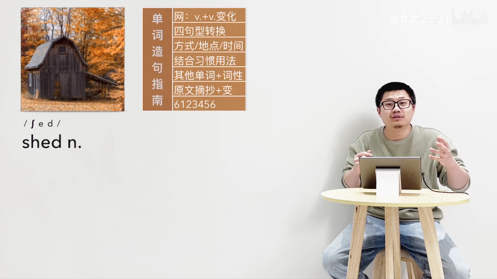

文字识别：单词造句指南 / 网：v.+v.变化 / 四句型转换 / 方式/地点/时间 / 结合习惯用法 / 其他单词+词性 / 原文摘抄+变 / 6123456 / / ∫ed / / shed n.

## 00:02:30–00:03:00

了各种各样的园艺花朵呀，对吧？这个树木，那你可能就需要这样一个小的 shed，这样的一个小棚子啊，或者这样一个小屋子啊，在我们这个 garden 里面的干什么用呢？放上各种各样的什么，当然可大可小啊。这个 shed 啊，那大了就是放上手推车啊，然后什么锤子呀，啊，斧头啊，啊，就是你干农业活的这些东西都放到这个里边，就这样的一个小棚子叫做 shed。 OK，

### 画面 00:02:31

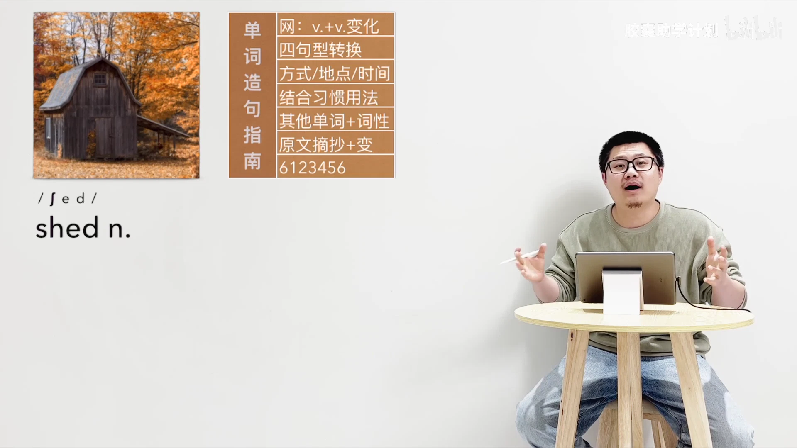

文字识别：单词造句指南 / 网：v.+v.变化 / 四句型转换 / 方式/地点/时间 / 结合习惯用法 / 其他单词+词性 / 原文摘抄+变 / 6123456 / / ∫ed / / shed n.

### 画面 00:02:35

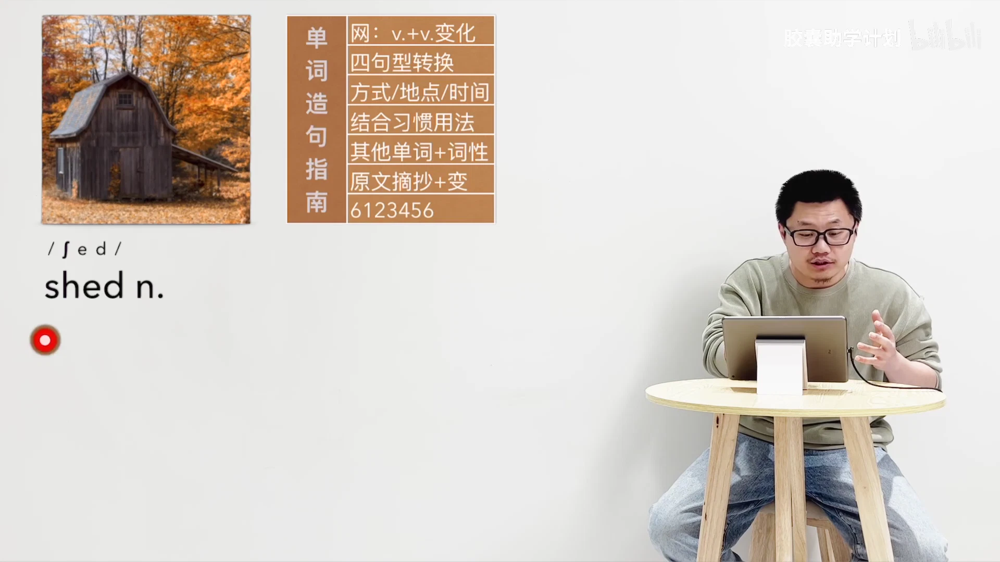

文字识别：单词造句指南 / 网：v.+v.变化 / 四句型转换 / 方式/地点/时间 / 结合习惯用法 / 其他单词+词性 / 原文摘抄+变 / 6123456 / / ∫ed / / shed n.

### 画面 00:02:40

文字识别：单词造句指南 / 网：v.+v.变化 / 四句型转换 / 方式/地点/时间 / 结合习惯用法 / 其他单词+词性 / 原文摘抄+变 / 6123456 / / ∫ed / / shed n.

### 画面 00:02:45

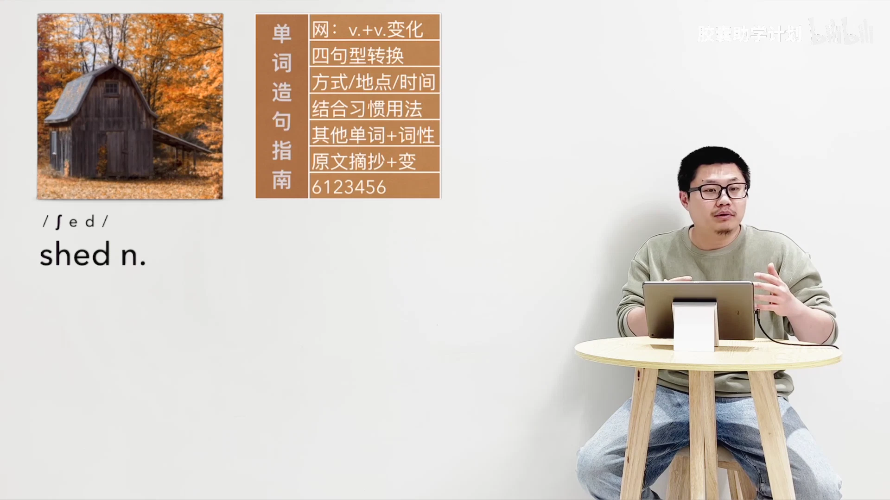

文字识别：单词造句指南 / 网：v.+v.变化 / 四句型转换 / 方式/地点/时间 / 结合习惯用法 / 其他单词+词性 / 原文摘抄+变 / 6123456 / / ∫ed / / shed n.

### 画面 00:02:50

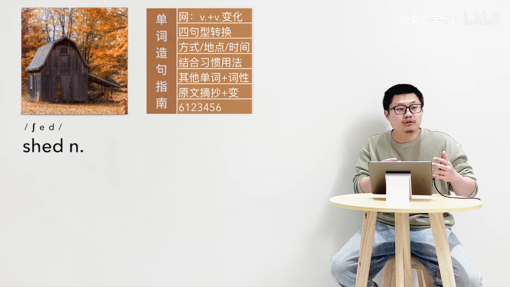

文字识别：单词造句指南 / 网：v.+v.变化 / 四句型转换 / 方式/地点/时间 / 结合习惯用法 / 其他单词+词性 / 原文摘抄+变 / 6123456 / / ∫ed / / shed n.

### 画面 00:02:55

文字识别：单词造句指南 / 网：v.+v.变化 / 四句型转换 / 方式/地点/时间 / 结合习惯用法 / 其他单词+词性 / 原文摘抄+变 / 6123456 / / ∫ed / / shed n.

## 00:03:00–00:03:30

好，比如说，那我们造个句子叫 They intended to build a shed in their garden.说他们怎么样呢？他们哎想计划打算要建造一个棚子在他们的这个花园当中，对吧？Next one,说 I look forward to seeing your new shed. Look forward to doing something.哎，正好也是本课咱们要复习的一个知识点，第二十课了。我各位学的很快，动名词，对吧？Next one,说 He managed to build a

### 画面 00:03:00

文字识别：单词造句指南 / 网：v.+v.变化 / 学计划 / 四句型转换 / 方式/地点/时间 / 结合习惯用法 / 其他单词+词性 / 原文摘抄+变 / 6123456 / / ∫ed / / shed n. / ① They intended to build a shed in their / garden. L36

### 画面 00:03:02

文字识别：单词造句指南 / 网：v.+v.变化 / 四句型转换 / 方式/地点/时间 / 结合习惯用法 / 其他单词+词性 / 原文摘抄+变 / 6123456 / / ∫ed / / shed n. / ① They intended to build a shed in their / garden. L36

### 画面 00:03:05

文字识别：单词造句指南 / 网：v.+v.变化 / 四句型转换 / 方式/地点/时间 / 结合习惯用法 / 其他单词+词性 / 原文摘抄+变 / 6123456 / / ∫ed / / shed n. / ① They intended to build a shed in their / garden. L36

### 画面 00:03:10

文字识别：单词造句指南 / 网：v.+v.变化 / 四句型转换 / 方式/地点/时间 / 结合习惯用法 / 其他单词+词性 / 原文摘抄+变 / 6123456 / / Jed / / shed n. / ① They intended to build a shed in their / garden. L36

### 画面 00:03:12

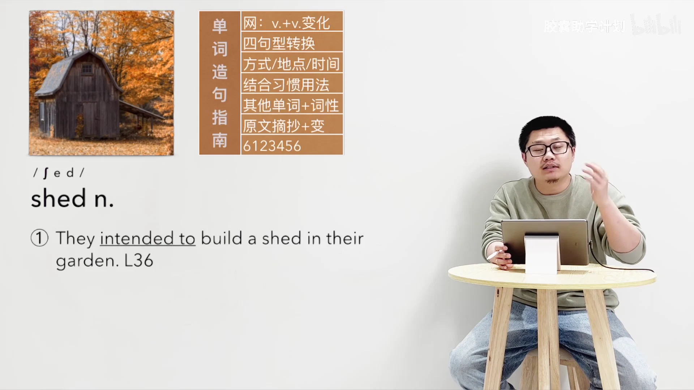

文字识别：单词造句指南 / 网：v.+v.变化 / 四句型转换 / 方式/地点/时间 / 结合习惯用法 / 其他单词+词性 / 原文摘抄+变 / 6123456 / / Jed / / shed n. / ① They intended to build a shed in their / garden. L36

### 画面 00:03:15

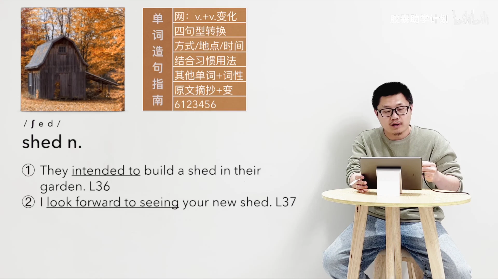

文字识别：单词造句指南 / 网：v.+v.变化 / 四句型转换 / 方式/地点/时间 / 结合习惯用法 / 其他单词+词性 / 原文摘抄+变 / 6123456 / / ∫ed / / shed n. / ① They intended to build a shed in their / garden. L36 / ② I look forward to seeing your new shed. L37

### 画面 00:03:19

文字识别：单词造句指南 / 网：v.+v.变化 / 四句型转换 / 方式/地点/时间 / 结合习惯用法 / 其他单词+词性 / 原文摘抄+变 / 6123456 / / ∫ed / / shed n. / ① They intended to build a shed in their / garden. L36 / ② I look forward to seeing your new shed. L37

### 画面 00:03:21

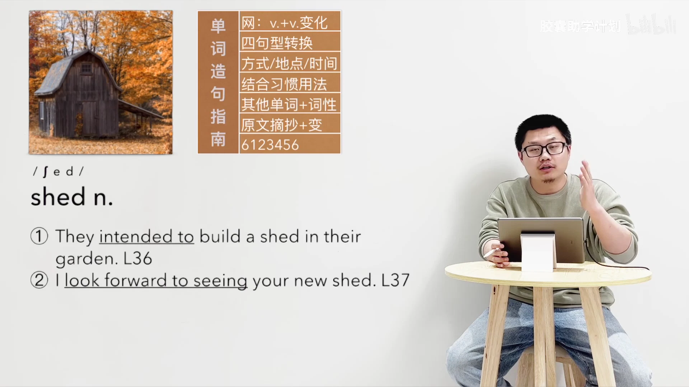

文字识别：单词造句指南 / 网：v.+v.变化 / 四句型转换 / 方式/地点/时间 / 结合习惯用法 / 其他单词+词性 / 原文摘抄+变 / 6123456 / / ∫ed / / shed n. / ① They intended to build a shed in their / garden. L36 / ② I look forward to seeing your new shed. L37

### 画面 00:03:26

文字识别：单词造句指南 / 网：v.+v.变化 / 四句型转换 / 方式/地点/时间 / 结合习惯用法 / 其他单词+词性 / 原文摘抄+变 / 6123456 / / ∫ed / / shed n. / ① They intended to build a shed in their / garden. L36 / ② I look forward to seeing your new shed. L37

### 画面 00:03:28

文字识别：单词造句指南 / 网：v.+v.变化 / 四句型转换 / 方式/地点/时间 / 结合习惯用法 / 其他单词+词性 / 原文摘抄+变 / 6123456 / / ∫ed / / shed n. / ① They intended to build a shed in their / garden. L36 / ) I look forward to seeing your new shed. L37 / 2 / He managed to build a shed by himself. / L67

## 00:03:30–00:04:00

shed by himself.刚刚我们上一课复习过的啊，六十七课的叫 manage to do something very good. 接下来下一个单词叫 sarcastic. Sarcastic, sarcastic 就是讽刺的啊，讥讽的。比如说很常用口语当中有这么一句话，我直接给各位放到这儿了，对吧？你可以多读几遍，期冀于把它记下来，以后在看电影的时候会用得到。叫做 Are you being sarcastic? 说你是在讽刺我呢吗？Are you being

### 画面 00:03:31

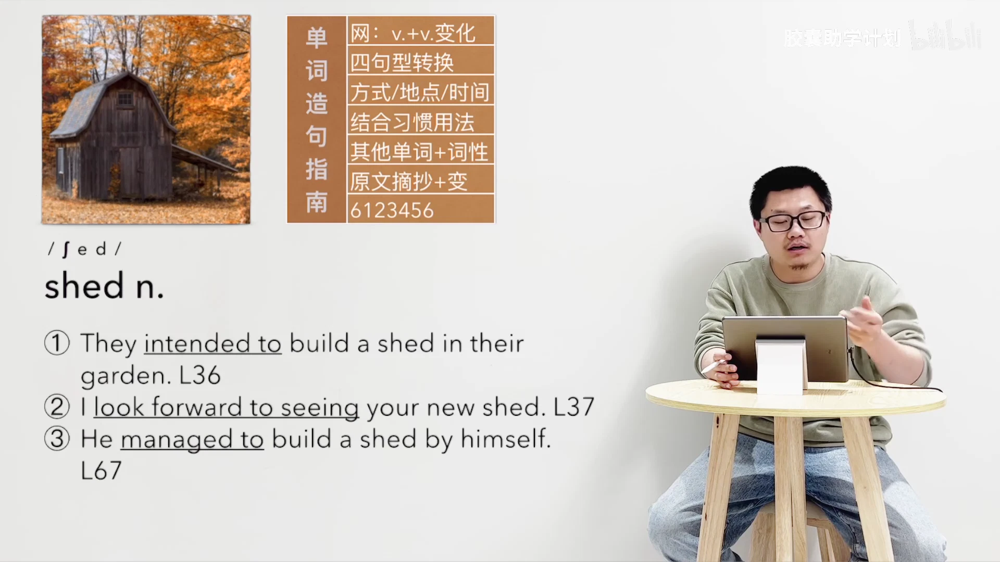

文字识别：单词造句指南 / 网：v.+v.变化 / 四句型转换 / 方式/地点/时间 / 结合习惯用法 / 其他单词+词性 / 原文摘抄+变 / 6123456 / / ∫ed / / shed n. / ① They intended to build a shed in their / garden. L36 / ) I look forward to seeing your new shed. L37 / He managed to build a shed by himself. / L67

### 画面 00:03:35

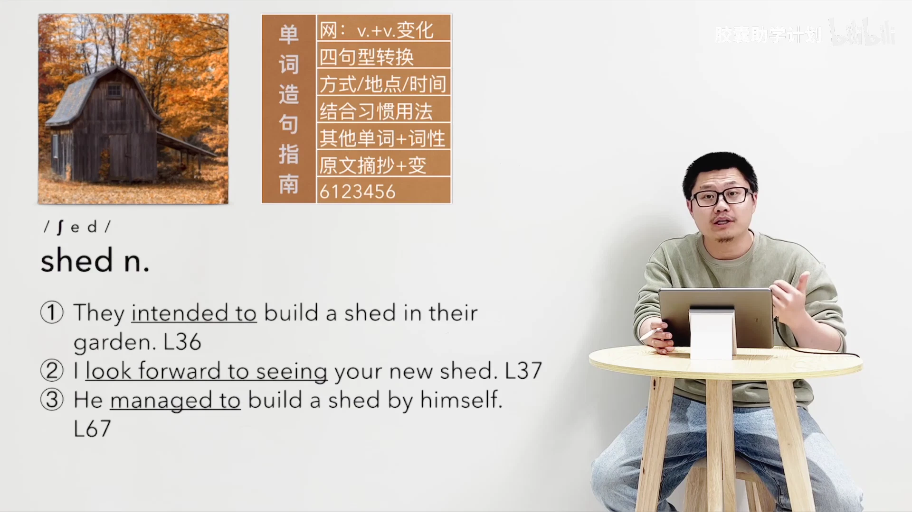

文字识别：单词造句指南 / 网：v.+v.变化 / 四句型转换 / 方式/地点/时间 / 结合习惯用法 / 其他单词+词性 / 原文摘抄+变 / 6123456 / / ∫ed / / shed n. / ① They intended to build a shed in their / garden. L36 / I look forward to seeing your new shed. L37 / He managed to build a shed by himself. / L67

### 画面 00:03:37

文字识别：单词造句指南 / 网：v.+v.变化 / 四句型转换 / 方式/地点/时间 / 结合习惯用法 / 其他单词+词性 / 原文摘抄+变 / 6123456 / /sa:'kæstik/ / sarcastic adj.

### 画面 00:03:42

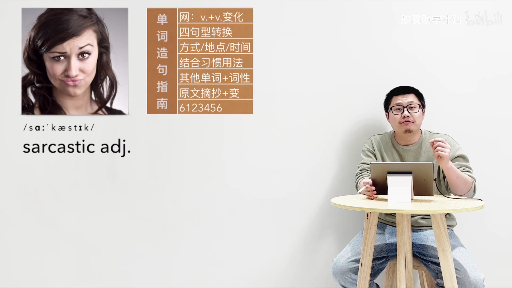

文字识别：单词造句指南 / 网：v.+v.变化 / 四句型转换 / 方式/地点/时间 / 结合习惯用法 / 其他单词+词性 / 原文摘抄+变 / 6123456 / /sa:'kæstik/ / sarcastic adj.

### 画面 00:03:45

文字识别：单词造句指南 / 网：v.+v.变化 / 四句型转换 / 方式/地点/时间 / 结合习惯用法 / 其他单词+词性 / 原文摘抄+变 / 6123456 / /sa:'kæstik/ / sarcastic adj. / ① Are you being sarcastic?

## 00:04:00–00:04:30

sarcastic? Okay, next one.你看啊，他说，Oh yes, that would be really easy.说She said in a sarcastic voice.咱们之前十五科学的是in a weak voice.那我们现在给它变成了sarcastic voice，就是用一种讽刺的语音嗓音说道啊，是的，这是啊，对对对，对吧？说那会非常简单啊，讽刺的口音。Okay, next one.说Why are you always so sarcastic?为什么你总是

### 画面 00:04:01

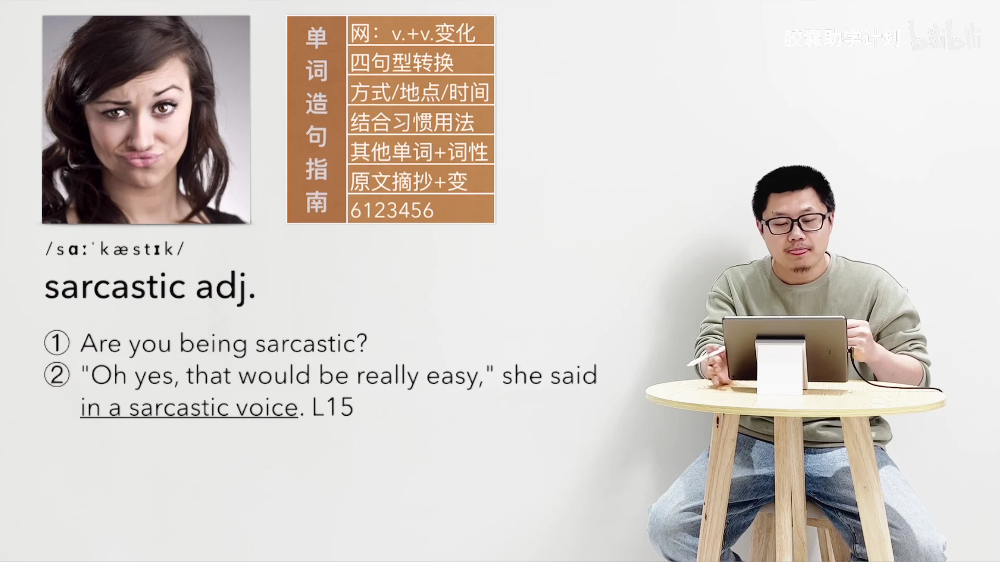

文字识别：单词造句指南 / 网：v.+v.变化 / 四句型转换 / 方式/地点/时间 / 结合习惯用法 / 其他单词+词性 / 原文摘抄+变 / 6123456 / /sa:'kæstik/ / sarcastic adj. / ① Are you being sarcastic? / ② "Oh yes, that would be really easy," she said / in a sarcastic voice. L15

### 画面 00:04:05

文字识别：单词造句指南 / 网：v.+v.变化 / 子计划 / 四句型转换 / 方式/地点/时间 / 结合习惯用法 / 其他单词+词性 / 原文摘抄+变 / 6123456 / /sa:'kæstik/ / sarcastic adj. / ① Are you being sarcastic? / ② "Oh yes, that would be really easy," she said / in a sarcastic voice. L15

### 画面 00:04:16

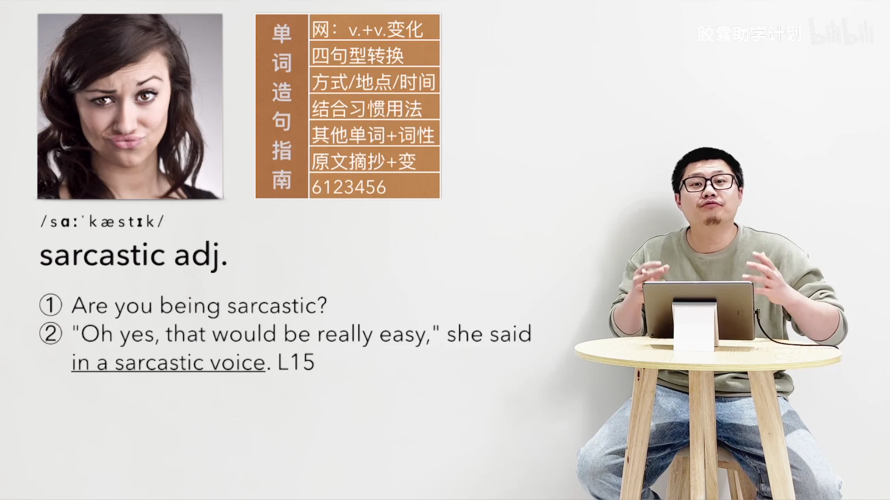

文字识别：单词造句指南 / 网：v.+v.变化 / 学计划 / 四句型转换 / 方式/地点/时间 / 结合习惯用法 / 其他单词+词性 / 原文摘抄+变 / 6123456 / /sa:'kæstik/ / sarcastic adj. / ① Are you being sarcastic? / ② "Oh yes, that would be really easy," she said / in a sarcastic voice. L15

### 画面 00:04:20

文字识别：单词造句指南 / 网：v.+v.变化 / 四句型转换 / 方式/地点/时间 / 结合习惯用法 / 其他单词+词性 / 原文摘抄+变 / 6123456 / /sa:'kæstik/ / sarcastic adj. / ① Are you being sarcastic? / ② "Oh yes, that would be really easy," she said / in a sarcastic voice. L15

## 00:04:30–00:05:00

to be sarcastic? Ah, in the first sentence, you can see that the word sarcastic is used. So sarcastic. Why do you always so love to be sarcastic? Ah, in the first sentence, you can see that the word sarcastic is used. So sarcastic. Why do you always so love to be sarcastic? Ah, in the first sentence, you can see that the word sarcastic is used. So sarcastic. Why do you always so love to be sarcastic? Ah, in the first sentence, you can see that the word sarcastic is used. So sarcastic. Why do you always so love to be sarcastic? Ah, in the first sentence, you can see that the word sarcastic is used. So sarcastic. Why do you always so love to be sarcastic? Ah, in the first sentence, you can see that the

### 画面 00:04:30

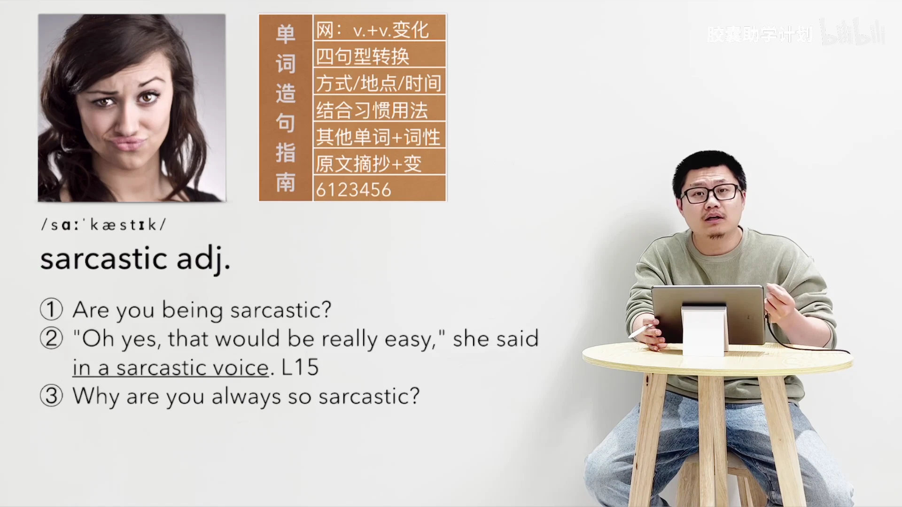

文字识别：单词造句指南 / 网：v.+v.变化 / 四句型转换 / 方式/地点/时间 / 结合习惯用法 / 其他单词+词性 / 原文摘抄+变 / 6123456 / /sa:'kæstik/ / sarcastic adj. / ① Are you being sarcastic? / ② "Oh yes, that would be really easy," she said / in a sarcastic voice. L15 /  Why are you always so sarcastic?

### 画面 00:04:37

文字识别：单词造句指南 / 网：v.+v.变化 / 臺助字计划 / 四句型转换 / 方式/地点/时间 / 结合习惯用法 / 其他单词+词性 / 原文摘抄+变 / 6123456 / /taun/ / tone n.

### 画面 00:04:40

文字识别：单词造句指南 / 网：v.+v.变化 / 辜助字计划 / 四句型转换 / 方式/地点/时间 / 结合习惯用法 / 其他单词+词性 / 原文摘抄+变 / 6123456 / /taun/ / tone n.

### 画面 00:04:45

文字识别：单词造句指南 / 网：v.+v.变化 / 喜助字计划 / 四句型转换 / 方式/地点/时间 / 结合习惯用法 / 其他单词+词性 / 原文摘抄+变 / 6123456 / /taun/ / tone n.

## 00:05:00–00:05:30

对，我们的身体语言。比如说 I don't like your tone ，我不喜欢你跟我说话的语气，对吧？很简单，是 You must be Annie ， he said in a friendly voice 。哎，说你一定就是 Annie 了，对吧？面带微笑啊，然后他用一个特别友好的这个语调语气说道。那再然后呢？这个是口语当中很常用的一句话，我直接给各位摘出来了。一会儿电影片段咱们还会再看，跟我一起读一下，叫 Don't take that

### 画面 00:05:06

文字识别：单词造句指南 / 网：v.+v.变化 / 四句型转换 / 方式/地点/时间 / 结合习惯用法 / 其他单词+词性 / 原文摘抄+变 / 6123456 / /taun/ / tone n. / ① I don't like your tone. / )'You must be Annie,' he said in a / friendly tone. L17

### 画面 00:05:10

文字识别：单词造句指南 / 网：v.+v.变化 / 四句型转换 / 方式/地点/时间 / 结合习惯用法 / 其他单词+词性 / 原文摘抄+变 / 6123456 / /taun/ / tone n. / ① I don't like your tone. / )'You must be Annie,' he said in a / friendly tone. L17

### 画面 00:05:15

文字识别：单词造句指南 / 网：v.+v.变化 / 四句型转换 / 方式/地点/时间 / 结合习惯用法 / 其他单词+词性 / 原文摘抄+变 / 6123456 / /taun/ / tone n. / ① I don't like your tone. / )'You must be Annie,' he said in a / friendly tone. L17

### 画面 00:05:22

文字识别：单词造句指南 / 网：v.+v.变化 / 四句型转换 / 方式/地点/时间 / 结合习惯用法 / 其他单词+词性 / 原文摘抄+变 / 6123456 / /taun/ / tone n. / ① I don't like your tone. / )'You must be Annie,' he said in a / friendly tone. L17 / Don't take that tone with me!

## 00:05:30–00:06:00

tone with me. Tone 这个单词很常用的一个短句子嘛，你可以理解为就别用那个语气跟我说话，对吧？啊，好。比如说，我们听一下这个电影片段。Hey, don't take that tone with me, young lady. 啊，别用这语气跟我说话，是吧？OK。呃，单词很快。Pattern只有本课语法呢，其实就是二十课的动名词。动名词呢，要么就是动词后边加名词，要么做主语。啊，这些东西呢，大多数

### 画面 00:05:30

文字识别：单词造句指南 / 网：v.+v.变化 / 四句型转换 / 方式/地点/时间 / 结合习惯用法 / 其他单词+词性 / 原文摘抄+变 / 6123456 / /taun/ / tone n. / ① I don't like your tone. / )'You must be Annie,' he said in a / friendly tone. L17 / Don't take that tone with me!

### 画面 00:05:38

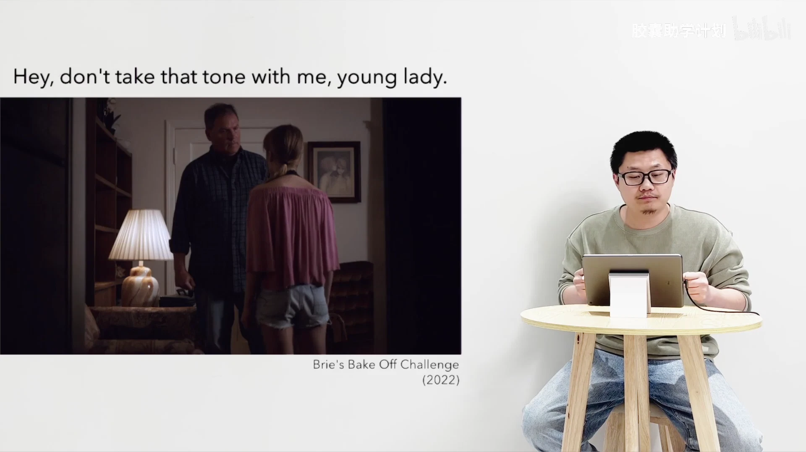

文字识别：Hey, don't take that tone with me, young lady. / Brie's Bake Off Challenge / (2022)

### 画面 00:05:45

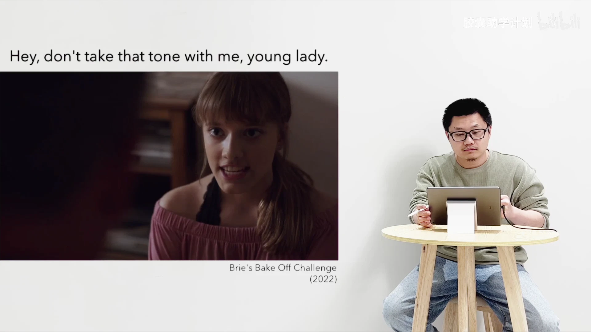

文字识别：Hey, don't take that tone with me, young lady. / Brie's Bake Off Challenge / (2022)

### 画面 00:05:49

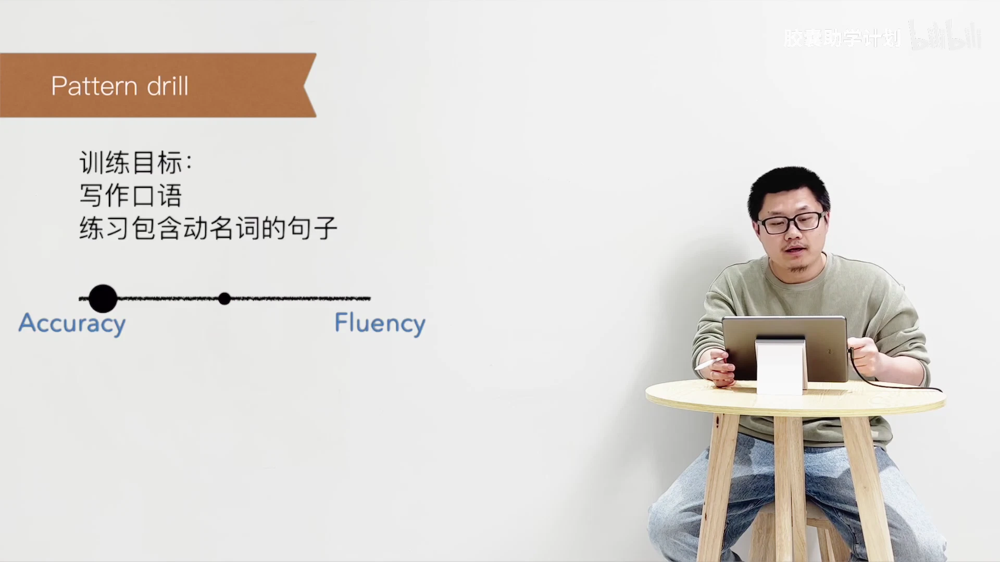

文字识别：Pattern drill / 训练目标： / 写作口语 / 练习包含动名词的句子 / Accuracy / Fluency

## 00:06:00–00:06:30

二十课我们都讲过了，在这儿也不多说了。所以很多的时候其实都是各种各样的。到后来我们其实动名词提的少，都是直接当做一个短语了。比如说 enjoy doing something，咱们就不提那个 doing 是动名词了，其实没有太大必要。你只要记住 enjoy doing 就可以了，对吧？所以在这儿呢，基本上咱们就是借着这些句子顺便回顾一下。比如说 eating between meals is bad for you，你看这就是 eating eat 这个动词变成动名词了之后，可以放在

### 画面 00:06:17

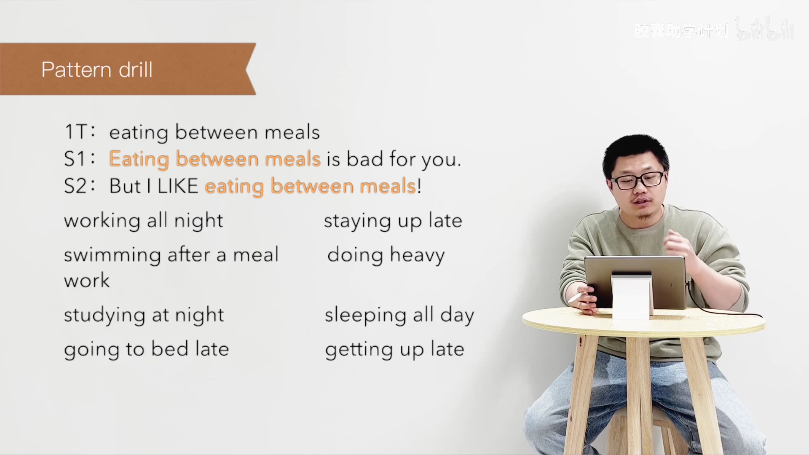

文字识别：Pattern drill / 1T：eating / between meals / S1: / Eating / between meals is bad for you. / S2:ButILIKE / eating / between meals! / working all night / staying up late / swimming a /  after a meal / doing heavy / work / studying at night / sleeping all day / going to bed late / getting up late

## 00:06:30–00:07:00

六一二三四五六一主语的位置去做主语，对吧？好，呃，在在两个餐之间吃东西对你身体不好。But I like eating between meals.但是我喜欢呢，like doing something，做了主谓宾宾语，对吧？往里边去带，这是第一个。第二个，Would you mind checking these figures?你介不介意检查一下这些数据啊？So it's no use asking me to check your figures. I'm busy checking

### 画面 00:06:47

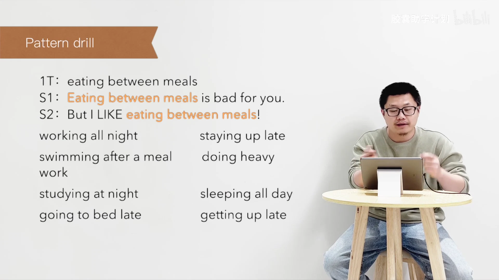

文字识别：Pattern drill / 1T：eating / between meals / S1: / Eating / between meals is bad for you. / S2:ButILIKE / eating / between meals! / working all night / staying up late / swimming a / after a meal / doing heavy / work / studying at night / sleeping all day / going to bed late / getting up late

### 画面 00:06:49

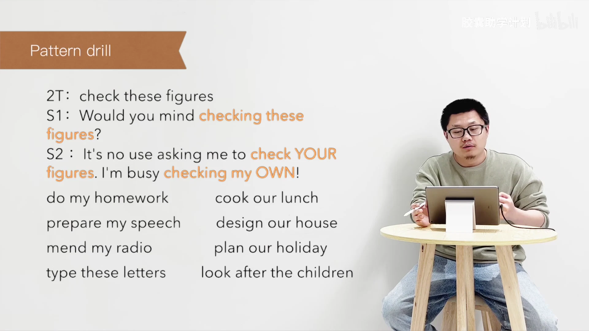

文字识别：Pattern drill / 2T:checkt / theset / : figures / S1: Would you mind / checking / these / figures? / S2 : It's no use asking me to  / check YOUR / figures. I'm busy / checking my / OWN! / do my homework / cook our lunch / prepare / my / speech / design our house / mend /  my radio / plan our holiday / type these letters / look after the children

## 00:07:00–00:07:30

my own. So you this requirement I do to do something is no use doing something, right? You require I to check your this data is useless. Why? I'm busy checking my own data. I'm busy checking my own data. I'm busy checking my own data. I'm busy checking my own data. I'm busy checking my own data. I'm busy checking my own data. I'm busy checking my own data. I'm busy checking my own data. I'm busy checking my own data. I'm busy checking my own data. I'm busy checking my own data. I'm busy checking my own data. I'm busy checking my own data. I'm busy checking my own data. I'm busy checking my own data. I'm busy checking my own data. I'm busy checking my own data. I'm busy checking my own

### 画面 00:07:19

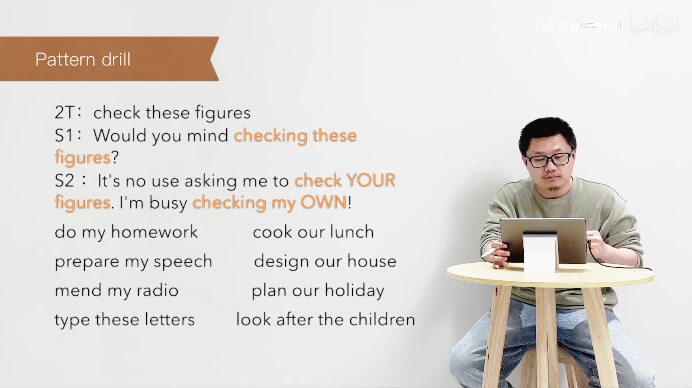

文字识别：Pattern drill / 2T: check these figures / S1:Would you mind / checking / these / figures? / S2 : It's no use asking me to  / check YOUR / figures. I'm busy / checking my / OWN! / do my homework / cook our lunch / prepare my  / speech / design our house / mend /  my radio / plan our holiday / type these letters / look after the children

### 画面 00:07:21

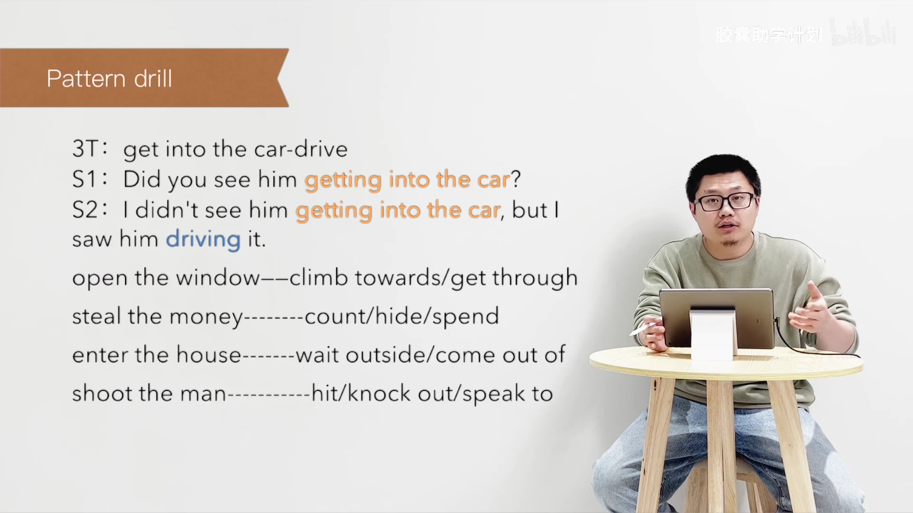

文字识别：Pattern drill / 3T:get into the car-drive / S1: Did you see him getting into the car? / S2: I didn't see him getting into the car, but I / saw him driving it. / open the window--climb towards/get through / steal themoney----count/hide/spend / enter the house-----wait outside/come out of / shoot the man--- / -hit/knock out/speak to

## 00:07:30–00:08:00

章见过是吧？I didn't see him getting into the car, but I saw him driving it. 我没有看见他正在进车，但是我看见他正在开车了，对吧？See somebody doing something. 最后一个说，You must be used to giving speeches now. 这个地方其实是 be used to doing something. 当时我讲过，迅速再复习一下，比较常用的 be used to do something 被用来使用去做某件事情，be used to doing something 习惯于。

### 画面 00:07:41

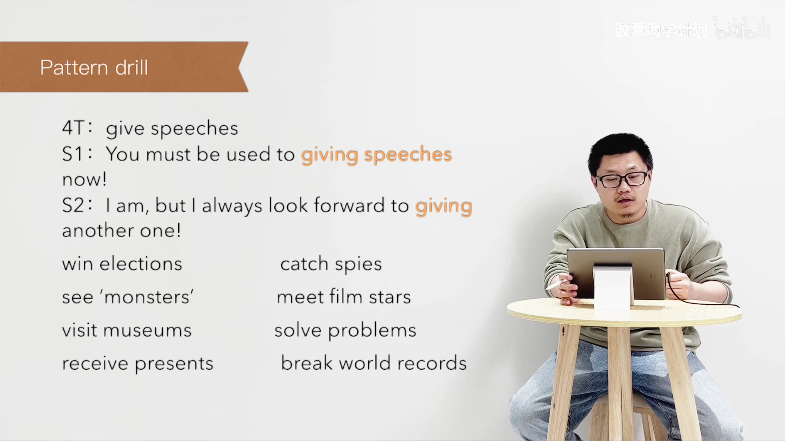

文字识别：Pattern drill / 4T:give speeches / S1: You must be used to giving speeches / now! / S2: I am, but I always look forward to giving / another one! / win elections / catch spies / see'monsters' / meet film stars / visit museums / solve problems / break world records / receive presents

## 00:08:00–00:08:30

第三个三十一课咱学的used to do something啊，叫做过去常常对吧？所以这里实际上是一个十七课的一定式和be used to doing something的一个连体，叫做你一定是习惯于演讲了吧？现在对吧？哎，是的，呃，但是呢，我总是look forward to doing something，期待于给哎期待于再讲一个再讲一个对吧？就是我总是期待下一个。OK，这第四个没什么说的了。那Recap本课习

### 画面 00:08:11

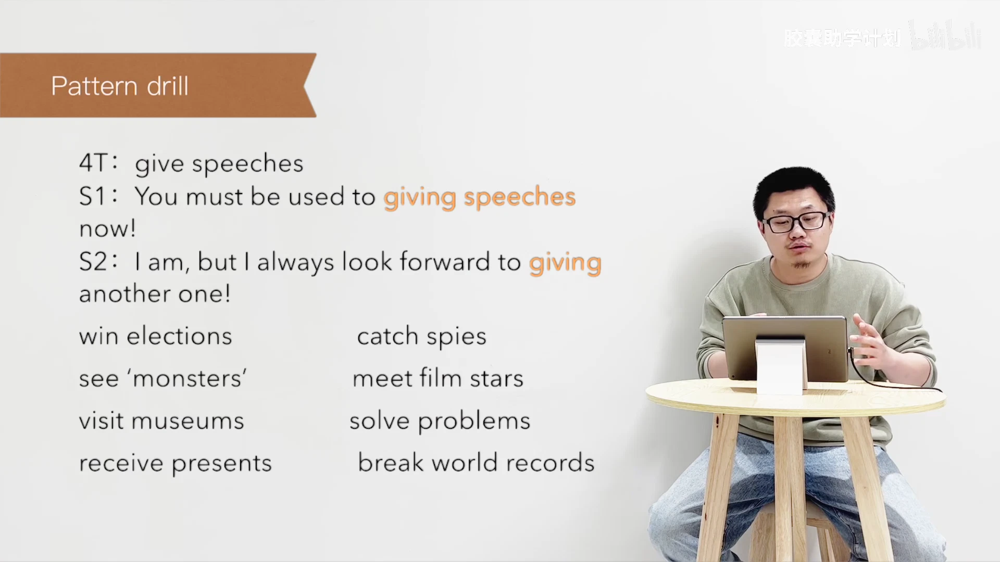

文字识别：Pattern drill / 4T:give speeches / S1: You must be used to giving speeches / now! / S2:I am, but l always look forward to giving / another one! / win elections / catch spies / see'monsters' / meet film stars / visit museums / solve problems / receive presents / break world records

### 画面 00:08:27

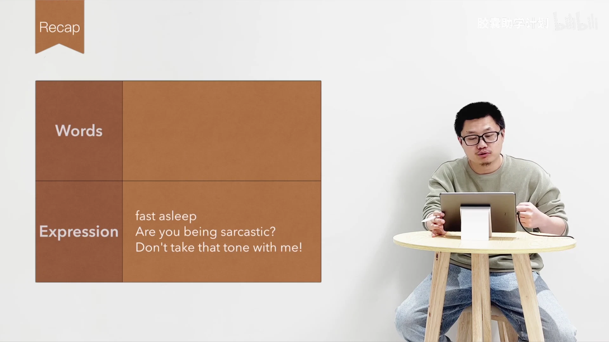

文字识别：Recap / Words / fast asleep / Expression / Are you being sarcastic? / Don't take that tone with me!

### 画面 00:08:29

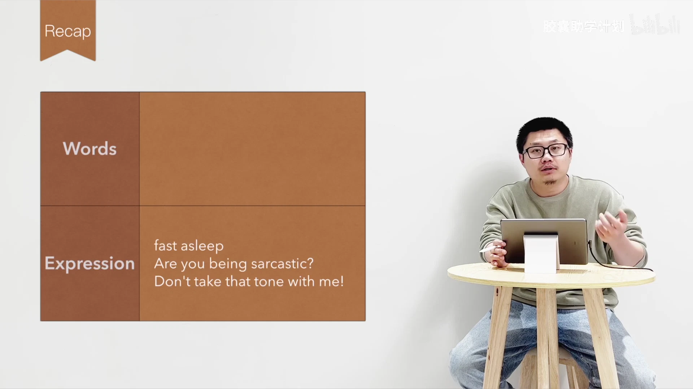

文字识别：Recap / Words / fast asleep / Expression / Are you being sarcastic? / Don't take that tone with me!

## 00:08:30–00:09:00

惯用法就这么几个，加上作业呢，单词造句、电影片段、指定留言。那因为语法放到一起了，pattern drill 你也写一下。然后二十课的这个动名词，对吧？哎，包括六十八课最重要的，哎，四十四课，哎，也要去写一下，然也要去复习一下。然后其实主要都是各种各样的习惯用法，四十四课、六十八课是习惯用法特别多的那两课，对吧？包括二十课，其实红皮书呢，其实就是你去看各

### 画面 00:08:31

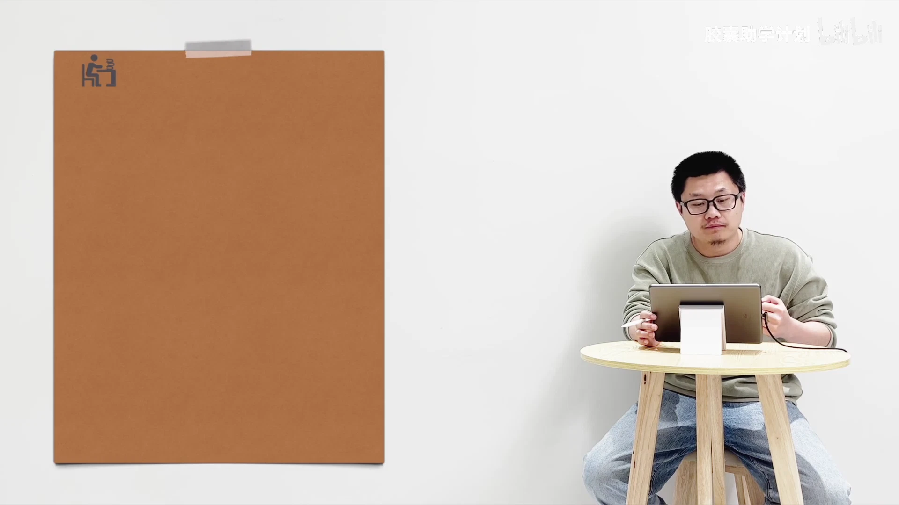

文字识别：助子计划

### 画面 00:08:33

文字识别：单词造句/对话 / 1. / 【单词造句指南】 / 每个5句 / 2.反复听电影片段，直到能 / 听出关键短语/句子

### 画面 00:08:35

文字识别：助字计划

### 画面 00:08:37

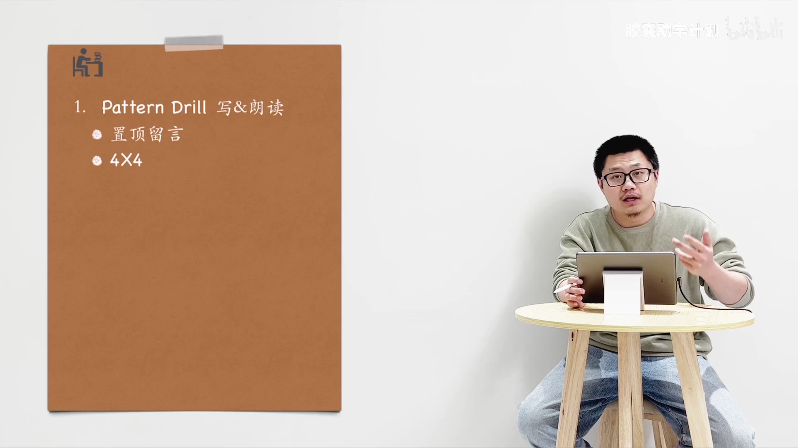

文字识别：1.f / Pattern Drill 写&朗读 / 置顶留言 / 4×4

### 画面 00:08:39

文字识别：Pattern Drill写&朗读 / 置顶留言 / 4X4 / 尝试回忆并给自己讲解一 / 遍今天的核心语法 / Study-Test / Learning Pyramid

### 画面 00:08:44

文字识别：Pattern Drill 写&朗读 / 1. / 置顶留言 / 4×4 / 尝试回忆并给自己讲解一 / 遍今天的核心语法 / Study-Test / Learning Pyramid

### 画面 00:08:46

文字识别：1. f / Pattern Drill 写&朗读 / 置顶留言 / 4×4 / 尝试回忆并给自己讲解一 / 遍今天的核心语法 / Study-Test / Learning Pyramid / 尝试翻阅红皮书（中级） / 通过目录或索引(Index) / 查找到本课语法

### 画面 00:08:49

文字识别：Pattern Drill 写&朗读 / 置顶留言 / 4×4 / 尝试回忆并给自己讲解一 / 遍今天的核心语法 / Study-Test / Learning Pyramid / 尝试翻阅红皮书（中级） / 通过目录或索引(Index) / 查找到本课语法

### 画面 00:08:54

文字识别：Pattern Drill 写&朗读 / 1. / 置顶留言 / 4×4 / 尝试回忆并给自己讲解一 / 遍今天的核心语法 / Study-Test / Learning Pyramid / 尝试翻阅红皮书（中级） / 通过目录或索引(Index) / 查找到本课语法

### 画面 00:08:59

文字识别：Pattern Drill 写&朗读 / 1.f / 置顶留言 / 4×4 / 尝试回忆并给自己讲解一 / 遍今天的核心语法 / Study-Test / Learning Pyramid / 尝试翻阅红皮书（中级） / 通过目录或索引(Index) / 查找到本课语法

## 00:09:00–00:09:30

种动词后边加ing这些，基本就够了，对吧？这些其实是我们没有办，只能日积月累的，不可能一口气儿讲完的东西。就像动词后边加个介词或加个副词那种短语，只能日积月累，没有任何办法能一口气儿全背完，那是不可能。直到今天我还有不会的，所以我们就坚持往后去学英语，坚持往后去用英语，哎，见一个记一个就好了，好吧？所以也帮我们放松了一些我们这个焦虑的心情。

### 画面 00:09:09

文字识别：Pattern Drill 写&朗读 / 置顶留言 / 4×4 / 尝试回忆并给自己讲解一 / 遍今天的核心语法 / Study-Test / Learning Pyramid / 尝试翻阅红皮书（中级） / 通过目录或索引(Index) / 查找到本课语法

### 画面 00:09:21

文字识别：Pattern Drill 写&朗读 / 1.f / 置顶留言 / 4×4 / 尝试回忆并给自己讲解一 / 遍今天的核心语法 / Study-Test / Learning Pyramid / 尝试翻阅红皮书（中级） / 通过目录或索引(Index) / 查找到本课语法

### 画面 00:09:24

文字识别：Pattern Drill 写&朗读 / 1.f / 置顶留言 / 4×4 / 尝试回忆并给自己讲解一 / 遍今天的核心语法 / Study-Test / Learning Pyramid / 尝试翻阅红皮书（中级） / 通过目录或索引(Index) / 查找到本课语法

## 00:09:30–00:09:56

那以上呢就是本期视频的全部内容了。如果各位喜欢我们的课程呢，欢迎各位关注、订阅、一键三连，分享给那些需要的朋友，来帮助我们快速成长。See you next time.

### 画面 00:09:30

文字识别：助字计划一 / 👍

### 画面 00:09:33

文字识别：臺助学计划一调 / 不 / ￥

### 画面 00:09:38

文字识别：喜助学计划一调

### 画面 00:09:43

### 画面 00:09:45

文字识别：運動字計切 / CAPSULEACADEMY / 胶囊助学计划 / 小红书 / Lecturer / □ / Leo / OE

### 画面 00:09:48

文字识别：CAPSULEACADEMY / 胶囊助学计划 / 『 / 小红书 / OE

### 画面 00:09:51

文字识别：聖珈字計切 / CAPSULEACADEMY / 胶囊助学计划 / 小红书 / Creator / □ / Leo & Berlin / OE

### 画面 00:09:53

文字识别：Bilbili / 胶囊助学计划 / CAPSULEACADEMY / 胶囊助学计划 / 小红书 / OE

### 画面 00:09:55

文字识别：bilbili / 胶囊助学计划

