# 092 练习

快速机器解析：语音为单模型转写，未进行独立交叉校对或人工复核；画面每秒采样并按变化选帧，短时文字和标记可能遗漏。截图时间约有 1 秒误差。图片有损压缩；遇到疑点请按时间查看 Google Drive 原视频。

## 00:00:00–00:00:30

Hello everyone, welcome to Capsule Academy. This is Liu. Today we're going to learn the Concept English Book Two Lesson Ninety Two Practices. 注意，进行如下练习唯一的前提就是文章熟读成诵，否则请勿开始。 Hope you gonna enjoy. 第一题 comprehension 练习咱们这个听问题回答的能力，对吧？基于文章，所以文章要求熟读成诵嘛。这里大部分练习

### 画面 00:00:00

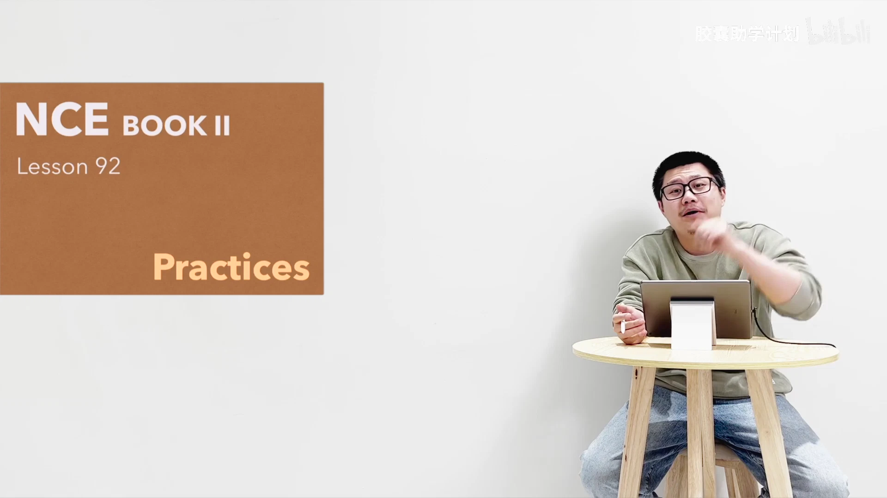

文字识别：NCE / BOOKII / Lesson 92 / Practices

### 画面 00:00:02

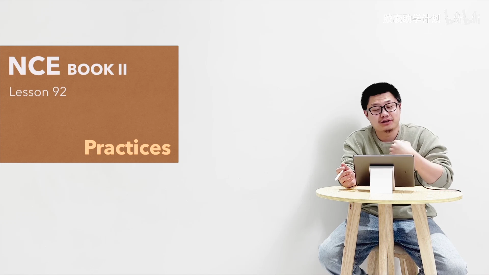

文字识别：NCE / BOOK"I / Lesson 92 / Practices

### 画面 00:00:04

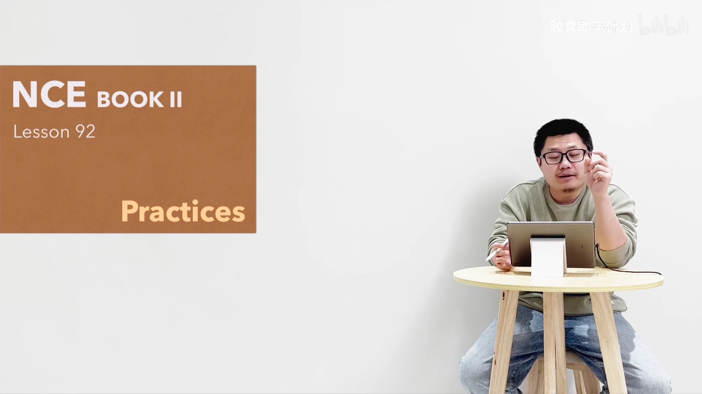

文字识别：NCE / BOOKⅡI / Lesson 92 / Practices

### 画面 00:00:08

文字识别：进行如下练习唯一前提 / 文章跟读至熟读成诵 / 否则请勿开始

### 画面 00:00:16

文字识别： bitbii / 胶囊助学计划 / • / •

### 画面 00:00:19

文字识别：胶囊助学计划册出 / 胶囊助学计划

### 画面 00:00:21

文字识别：Comprehension / 训练目标： / 听懂一般疑问句＆特殊疑问句

### 画面 00:00:26

文字识别：量助字计划 / Comprehension

## 00:00:30–00:01:00

都是这个逻辑是吧？所以要求熟读成诵。呃，那第一题我问您答啊，What time was it when you returned home? Ah, two in the morning. How did you try to wake up your wife? By ringing the doorbell. Did she wake up or was he fast? Was she fast asleep? She was fast asleep. Where did you get a letter from?

### 画面 00:00:38

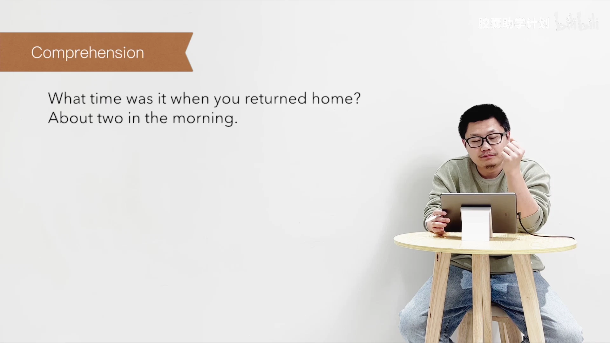

文字识别：Comprehension / What time was it when you returned home? / About two in the morning.

### 画面 00:00:41

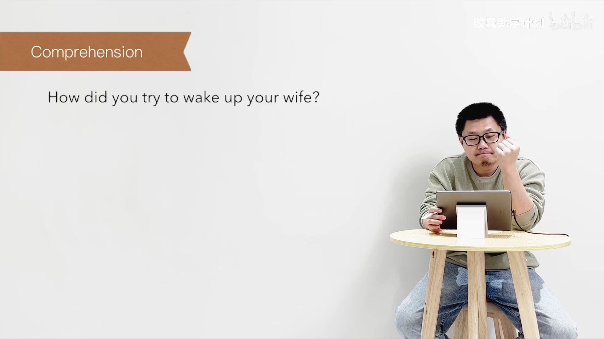

文字识别：Comprehension / How did you try to wake up your wife?

### 画面 00:00:54

文字识别：Comprehension / Did she wake up, or was she fast asleep? / She was fast asleep.

### 画面 00:00:56

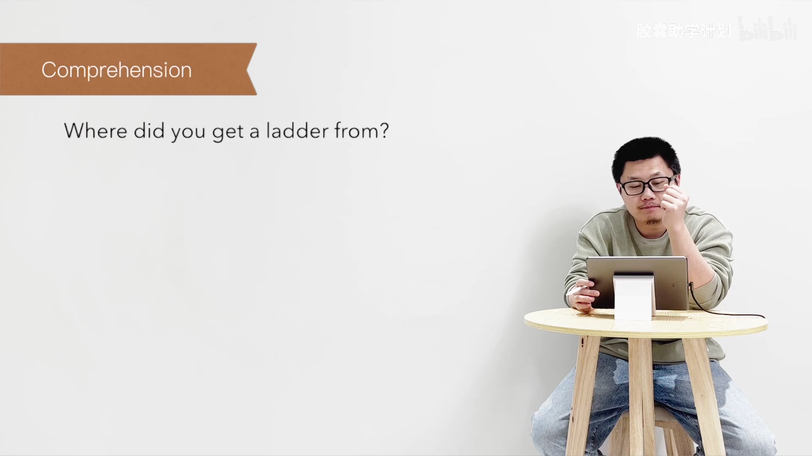

文字识别：Comprehension / Where did you get a ladder from?

### 画面 00:00:59

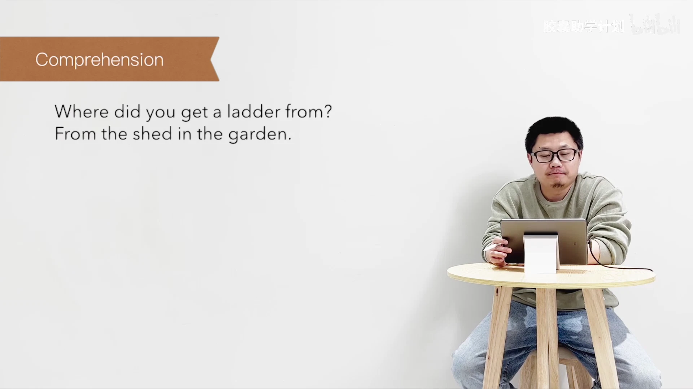

文字识别：Comprehension / Where did you get a ladder from? / From the shed in the garden.

## 00:01:00–00:01:30

from the shed in the garden. Where did you put it? Against the wall. What did you begin doing then? Climbing towards the bedroom window. What did you hear when you were almost there? A sarcastic voice. What did the voice say? I don't think the window needs cleaning

### 画面 00:01:02

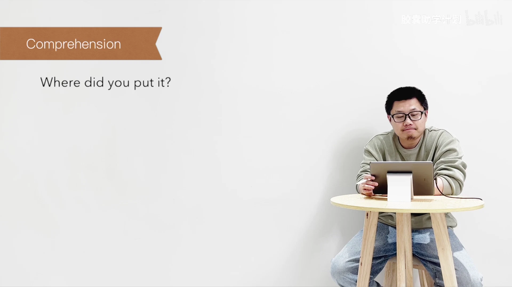

文字识别：Comprehension / Where did you put it?

### 画面 00:01:09

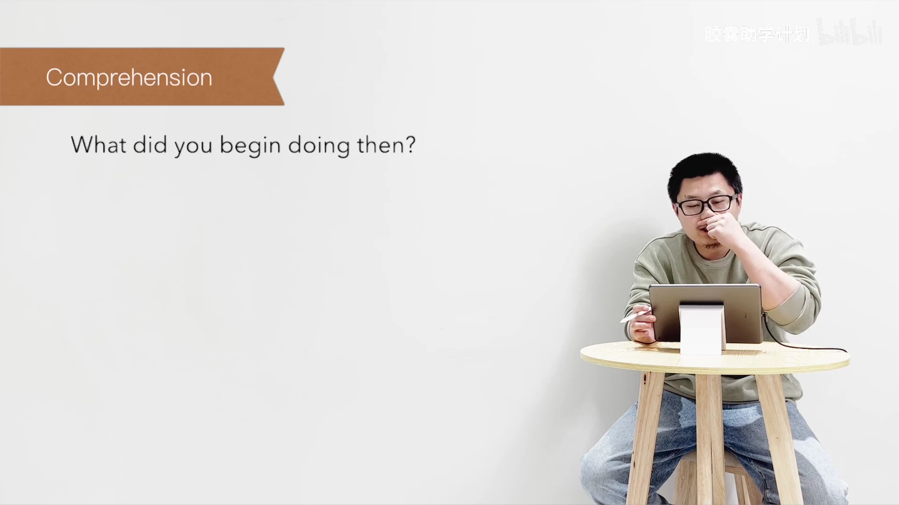

文字识别：Comprehension / What did you begin doing then?

### 画面 00:01:11

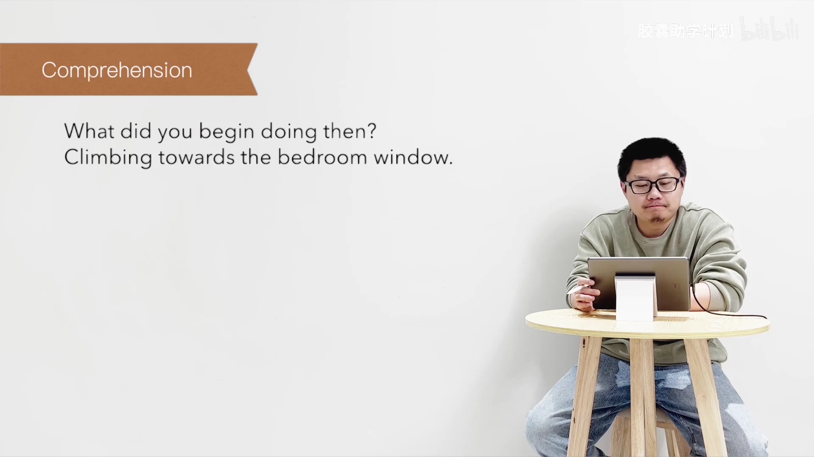

文字识别：Comprehension / What did you begin doing then? / Climbing towards the bedroom window.

### 画面 00:01:16

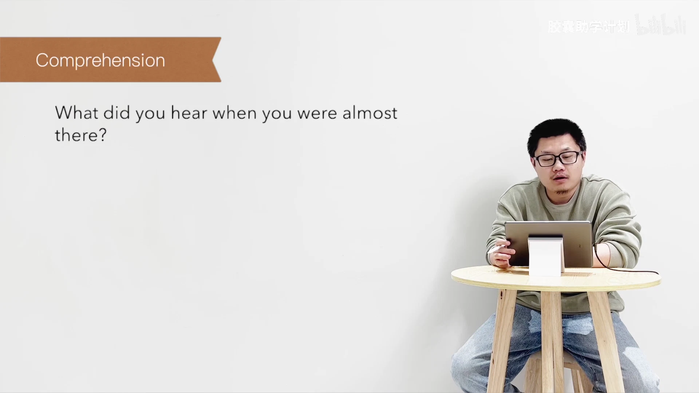

文字识别：Comprehension / What did you hear when you were almost / there?

### 画面 00:01:27

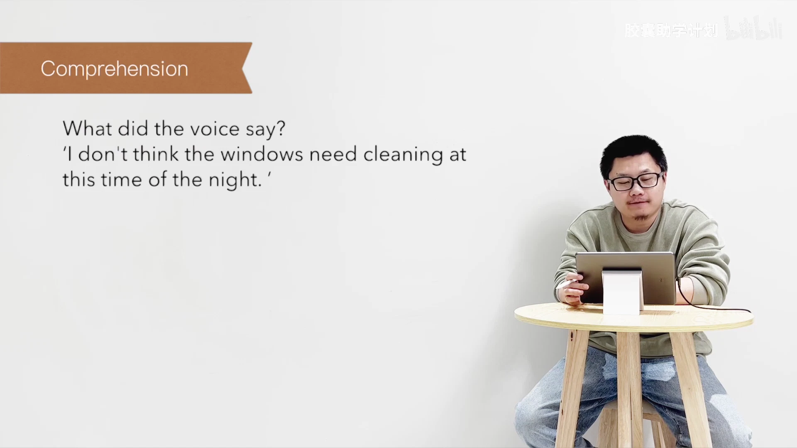

文字识别：Comprehension / What did the voice say? / 'I don't think the windows need cleaning at / this time of the night.'

## 00:01:30–00:02:00

at this time of the day. You looked down, didn't you? Yes, I did. What nearly happened when you saw a policeman? Fall off the ladder. What did you say to him? I enjoy cleaning windows at night. Did you immediately regret answering the way you did? Yes, I did.

### 画面 00:01:33

文字识别：Comprehension / You looked down, didn't you?

### 画面 00:01:42

文字识别：Comprehension / What nearly happened when you saw a / policeman? / I nearly fell off the ladder.

### 画面 00:01:46

文字识别：Comprehension / What did you say to him?

### 画面 00:01:52

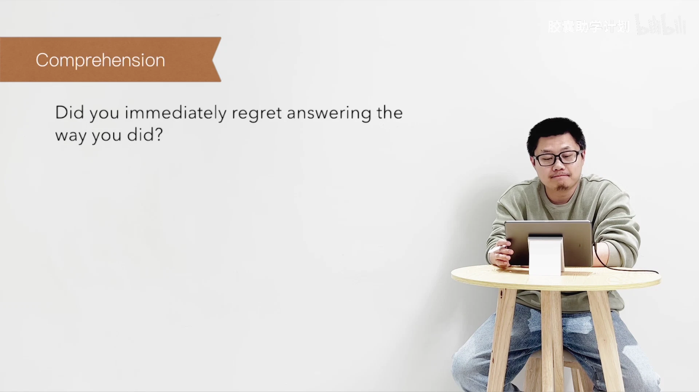

文字识别：Comprehension / Did you immediately regret answering the / way you did?

## 00:02:00–00:02:30

Asking questions, 四句型对吧？Ask me if I returned home late. Did提前，When对late提问。Who主语提问，Who returned home late？第二个，It was about two in the morning. Was提前，What time对呃这个two in the morning提问对吧？I tried to wake up my wife by ringing the doorbell. Tried did提前，How

### 画面 00:02:01

文字识别：Asking questions

### 画面 00:02:06

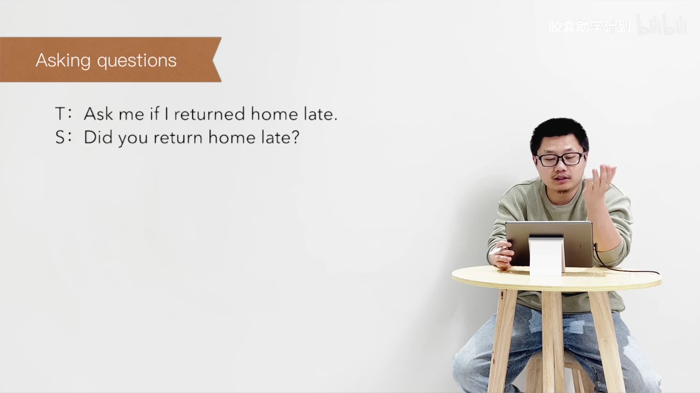

文字识别：Asking questions / T: Ask me if I returned home late. / S: Did you return home late?

### 画面 00:02:10

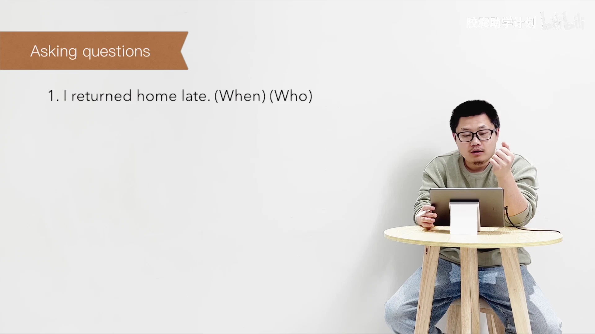

文字识别：Asking questions / 1.I returned home late.(When) (Who)

### 画面 00:02:23

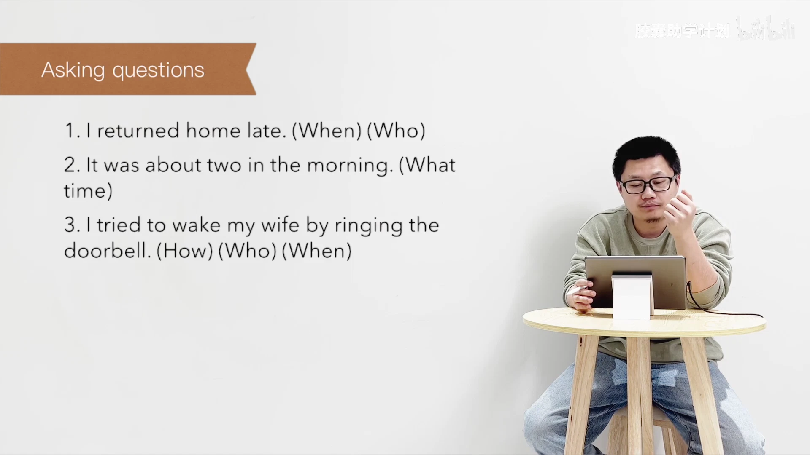

文字识别：Asking questions / 1.I returned home late.(When) (Who) / 2. Ilt was about two in the morning. (What / time) / 3.I tried to wake my wife by ringing the / doorbell. (How) (Who) (When)

## 00:02:30–00:03:00

did you try to wake up your wife?方式是 by ringing the doorbell. Who你可以对主语可以对 my wife. When加整句话. She was fast asleep. Was提前 who对主语提问. I got a letter. Did提前动词换回原形. What对 a letter提问. I got it from the garden shed. Did提前 where对 from the garden shed提问. I put it against the wall. Did提前为什么是 did提前？因为 put是过去式在这儿，

### 画面 00:02:47

文字识别：助字计划 / Asking questions

## 00:03:00–00:03:30

过去式原形长得一样。呃， where 对 against the wall 提问。 I began climbing towards the bedroom window. Did 提前，对吧？然后这个 which which window did you begin climbing towards？啊，这个 which 指的是哪一个？你冲着哪一个窗户爬过去的？ Bedroom window，对吧？外加整句话。 It almost got to the top. 啊，这个撇 d 还是单独这

### 画面 00:03:02

文字识别：Asking questions / 6.I got it from the garden shed. (Where) / 7.I put it against the wall. (Where)

### 画面 00:03:04

文字识别：Asking questions / 6.I got it from the garden shed. (Where) / 7.I put it against the wall. (Where) / 8.I began climbing towards the bedroom / window.(Which) (Why)

### 画面 00:03:23

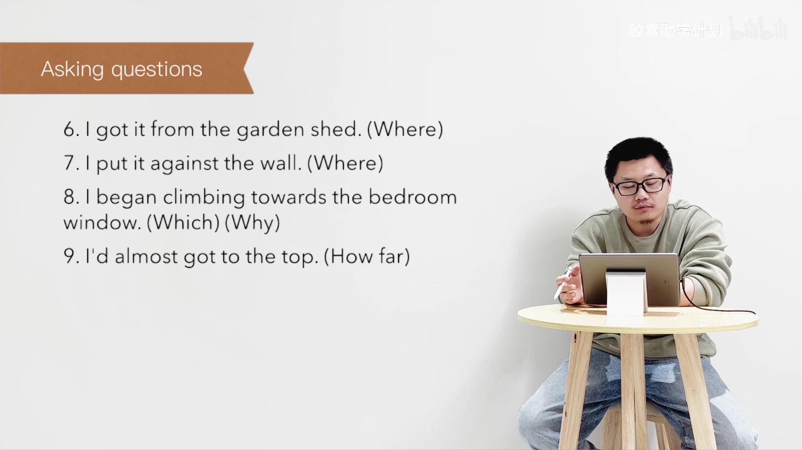

文字识别：Asking questions / 6.I got it from the garden shed. (Where) / 7.I put it against the wall. (Where) / 8.I began climbing towards the bedroom / window.(Which) (Why) / 9.I'd almost got to the top.(How far)

## 00:03:30–00:04:00

么去看？你单独看撇地，没法判断是 would 还是 had。那在这里，因为后边是一个 got，那这基本上不可能是 would 嘛，had 嘛，是吧？啊， how far？啊， how far？那对 got to the top， to the top 提问对吧？你到达了多远的地方？啊， how far had you almost got？ I heard a voice. Did you hear a voice？ What did you hear？ It was a policeman. Was 提前对吧？ Who was it？

### 画面 00:03:53

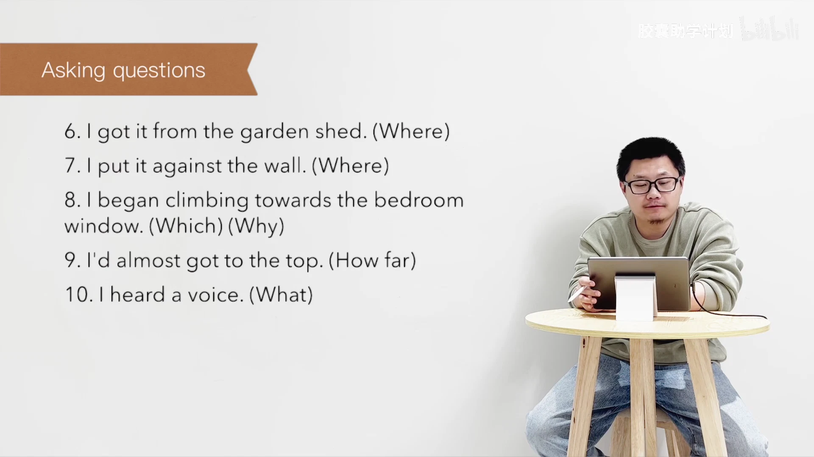

文字识别：Asking questions / 6.I got it from the garden shed. (Where) / 7.I put it against the wall. (Where) / 8.I began climbing towards the bedroom / window.(Which)(Why) / 9.I'd almost got to the top.(How far) / 10.I heard a voice.(What)

## 00:04:00–00:04:30

Tell the story fluency.练习咱们流畅度，所以这个是必须文章熟读成诵的啊啊！包括熟读成诵，其实能让我们把这篇文章中的单词背下来，习惯用法记下来，语法变得更熟练有用。相信我啊！Summer writing，这要写作两篇文章，重点看连词。第一篇，第二篇。Okay, topic for discussion.老习惯，我给您说一遍。Have you ever said something

### 画面 00:04:00

文字识别：Tell the story / 训练目标： / 口语复述能力 / Accuracy / Fluency

### 画面 00:04:02

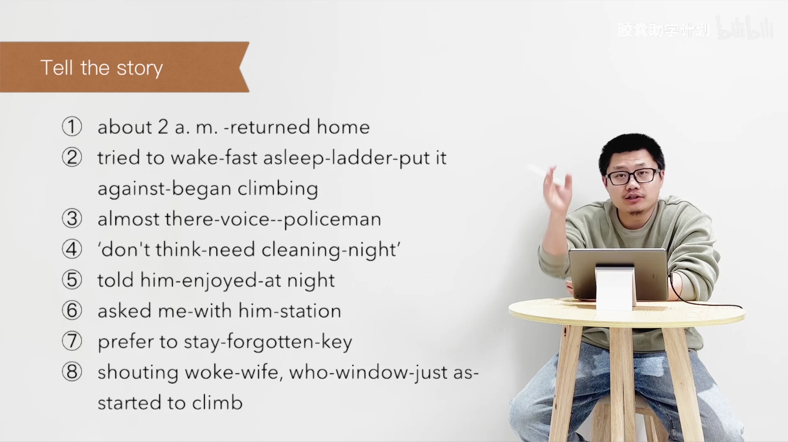

文字识别：Tell the story / 1 / about 2 a.m.-returned home / tried to wake-fast asleep-ladder-put it / against-began climbing / almost there-voice--policeman / 'don't think-need cleaning-night' / told him-enjoyed-at night / asked me-with him-station / 6 / prefer to stay-forgotten-key / shouting woke-wife, who-window-just as- / started to climb

### 画面 00:04:07

文字识别：Summary writing: Key / 训练目标： / 写作复述能力

### 画面 00:04:17

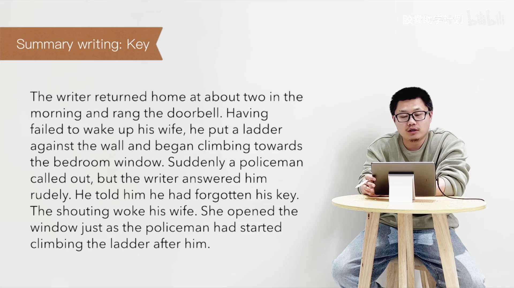

文字识别：Summary writing: Key / The writer returned home at about two in the / morning and rang the doorbell. Having / failed to wake up his wife, he put a ladder / against the wall and began climbing towards / the bedroom window. Suddenly a policeman / called out, but the writer answered him / rudely. He told him he had forgotten his key. / The shouting woke his wife. She opened the / window just as the policeman had started / climbing the ladder after him.

### 画面 00:04:19

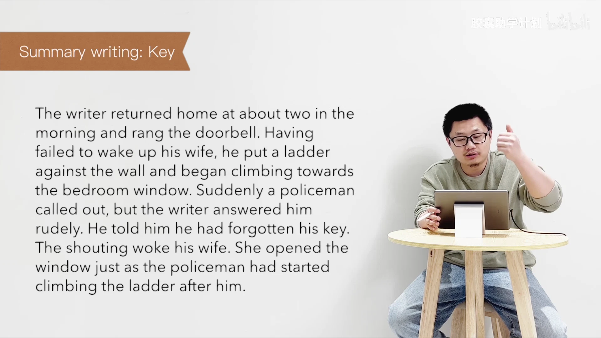

文字识别：Summary writing: Key / The writer returned home at about two in the / morning and rang the doorbell. Having / failed to wake up his wife, he put a ladder / against the wall and began climbing towards / the bedroom window. Suddenly a policeman / called out, but the writer answered him / rudely. He told him he had forgotten his key. / The shouting woke his wife. She opened the / window just as the policeman had started / climbing the ladder after him.

### 画面 00:04:21

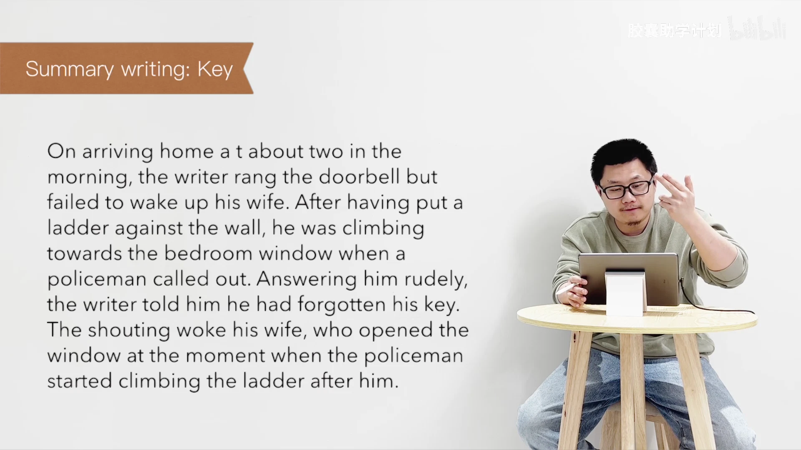

文字识别：字计划 / Summary writing: Key / On arriving home a t about two in the / morning, the writer rang the doorbell but / failed to wake up his wife. After having put a / ladder against the wall, he was climbing / towards the bedroom window when a / policeman called out. Answering him rudely, / the writer told him he had forgotten his key. / The shouting woke his wife, who opened the / window at the moment when the policeman / started climbing the ladder after him.

### 画面 00:04:23

文字识别：Topics for discussion / 训练目标： / 完全自由的对话 / Accuracy / Fluency

### 画面 00:04:25

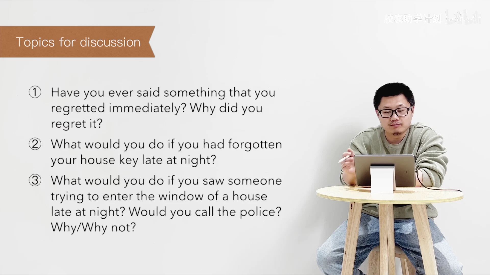

文字识别：Topics for discussion / Have you ever said something / that you / regretted immediately? Why did you / regret it? / What would you do if you had forgotten / your house key late at night? / What would you do if you saw someone / trying to enter the window of a house / late at night? Would you callthe police? / Why/Why not?

## 00:04:30–00:05:00

that you regretted immediately? Why did you regret it?你有没有说过一些说完就后悔的话？为啥后悔？What would you do if you had forgotten your house key late at night?如果你晚上忘了家钥匙，你咋办？第三个，What would you do if you saw someone trying to enter the window of a house late at night? Would you call the police? Why not?你看到大晚上有人爬别人家窗户，对吧？不一定别人家，你不知道谁家的，

### 画面 00:04:55

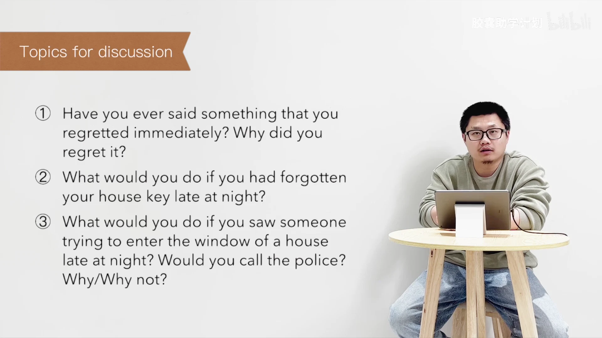

文字识别：Topics for discussion / Have you ever said something that you / regretted immediately? Why did you / regret it? / What would you do if you had forgotten / your house key late at night? / What would you do if you saw someone / 3 / trying to enter the window of a house / late at night? Would you call the police? / Why/Why not?

## 00:05:00–00:05:30

你会给警察打电话吗？对吧？打为啥打？不打为啥不打？加上作业吧。阿斯密夫先写再朗读。这要写作写完对答案，挑个story口语复述，重复间隔，对吧？置顶留言去看重复间隔的学习材料，包括课堂笔记。那以上呢就是本期视频的全部内容了。如果各位喜欢我们的课程呢，欢迎各位关注、订阅、一键三连，分享给那些需要的朋友来帮助我们快速成长。See you next time.

### 画面 00:05:04

文字识别：助学计划

### 画面 00:05:07

文字识别：1.Ask me if写&朗读 / 2.摘要写作写&答案

### 画面 00:05:09

文字识别：1.Ask me if写&朗读 / 摘要写作写&答案 / 3.Tell the story 口语复述

### 画面 00:05:11

文字识别：1.Ask me if写&朗读 / 2.摘要写作写&答案 / 3.Tell the story 口语复述 / 重复间隔（置顶留言）

### 画面 00:05:16

文字识别：助字计划调

### 画面 00:05:18

文字识别：星助字计划一 / ￥

### 画面 00:05:20

文字识别：星助字计划國 / 不

### 画面 00:05:28

文字识别：助字计划一 / 山

## 00:05:30–00:05:41

### 画面 00:05:30

文字识别：運動字計切 / CAPSULEACADEMY / 胶囊助学计划 / 小红书 / Lecturer / Leo / OE

### 画面 00:05:32

文字识别：動字計 / CAPSULEACADEMY / 胶囊助学计划 / 小红书 / Photographer / Berlin / OE

### 画面 00:05:34

文字识别：運動字計物 / CAPSULEACADEMY / 胶囊助学计划 / 小红书 / Fditor / □ / 口 / Berlin / OE

### 画面 00:05:37

文字识别：CAPSULEACADEMY / 胶囊助学计划 / 小红书 / Creator / Leo & Berlin / OE

### 画面 00:05:39

文字识别：bilbili / 胶囊助学计划

### 画面 00:05:40

文字识别：bilibili / 胶囊助学计划

