# 093 单词

快速机器解析：语音为单模型转写，未进行独立交叉校对或人工复核；画面每秒采样并按变化选帧，短时文字和标记可能遗漏。截图时间约有 1 秒误差。图片有损压缩；遇到疑点请按时间查看 Google Drive 原视频。

## 00:00:00–00:00:30

Hello everyone, welcome to Capsule Academy. This is Liu. Today we're going to learn New Concept English Book Two, Lesson Ninety Three Words. 那老习惯进入正式课程之前呢，咱们看几个问题。首先，如何表达一个高尚的人啊？接下来如何表达露营地？那带着这两个问题，后边 enjoy. 我们先看第一个单词，跟我一起读一下，叫做 noble, noble.

### 画面 00:00:00

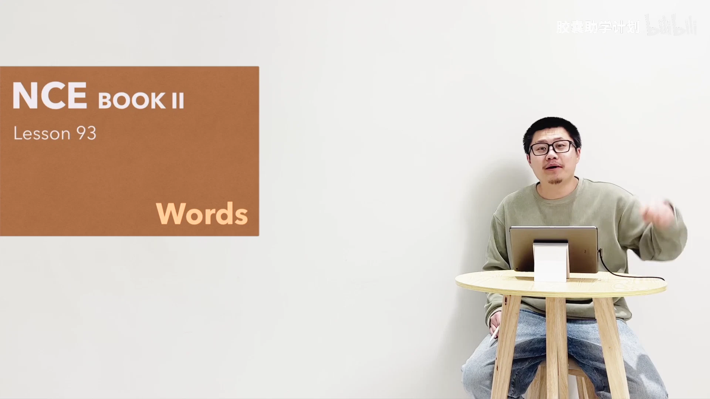

文字识别：NCE / BOOKⅡI / Lesson 93 / Words

### 画面 00:00:03

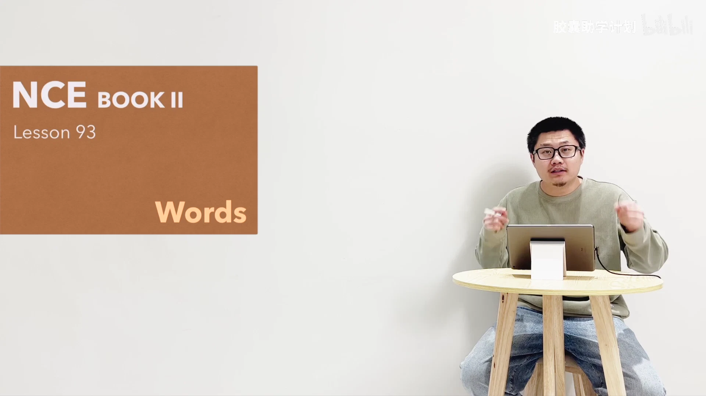

文字识别：NCE / BOOKⅡI / Lesson 93 / Words

### 画面 00:00:08

文字识别：NCE / BOOKⅡI / Lesson 93 / Words

### 画面 00:00:11

文字识别：袁助字计划一洲

### 画面 00:00:13

文字识别：臺助字计划 / ①如何表达“一个高尚的人”？

### 画面 00:00:16

文字识别：①如何表达“一个高尚的人”？ / 如何表达“露营地”

### 画面 00:00:21

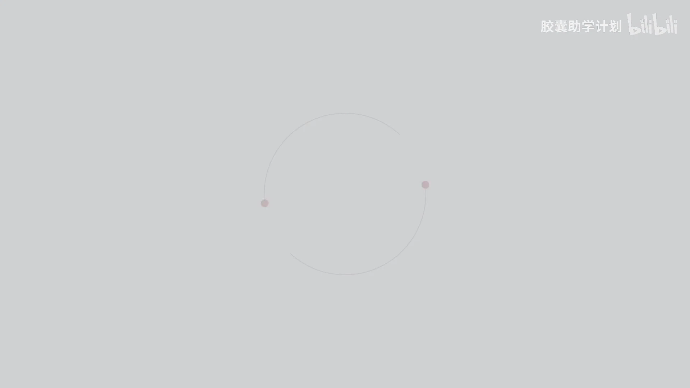

文字识别：胶囊助学计划 bil / •

### 画面 00:00:25

### 画面 00:00:27

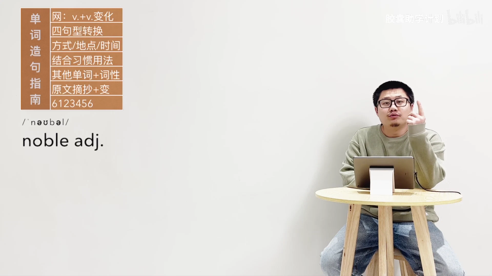

文字识别：单词造句指南 / 网：v.+v.变化 / 奏助学计划 / 四句型转换 / 方式/地点/时间 / 结合习惯用法 / 其他单词+词性 / 原文摘抄+变 / 6123456 / /'naubal/ / noble adj.

## 00:00:30–00:01:00

啊，一个高尚的，对吧？高贵的啊，高尚的。说人嘛啊， noble gift 或者 a noble man. Noble gift 用的其实更少一点， noble man 会在口语，呃和各位听力当中用的更多一点。比如说， don't take that tone with him, for he is a noble man. 说别用那个语气跟他说话啊。虽然我们经常说虎落平原被犬欺，对

### 画面 00:00:30

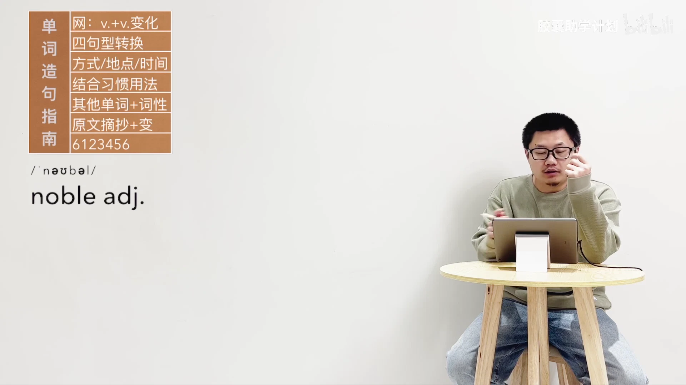

文字识别：单词造句指南 / 网：v.+v.变化 / 奏助学计划 / 四句型转换 / 方式/地点/时间 / 结合习惯用法 / 其他单词+词性 / 原文摘抄+变 / 6123456 / /'naubal/ / noble adj.

### 画面 00:00:40

文字识别：单词造句指南 / 网：v.+v.变化 / 臺助学计划 / 四句型转换 / 方式/地点/时间 / 结合习惯用法 / 其他单词+词性 / 原文摘抄+变 / 6123456 / /'naubal/ / noble adj. / ① a noble gift / man..

### 画面 00:00:47

文字识别：单词造句指南 / 网：v.+v.变化 / 囊助字计划 / 四句型转换 / 方式/地点/时间 / 结合习惯用法 / 其他单词+词性 / 原文摘抄+变 / 6123456 / /'naubal/ / noble adj. / ① a noble gift / man... / ② Don't take that tone with him, for he is a / noble man.L92

### 画面 00:00:49

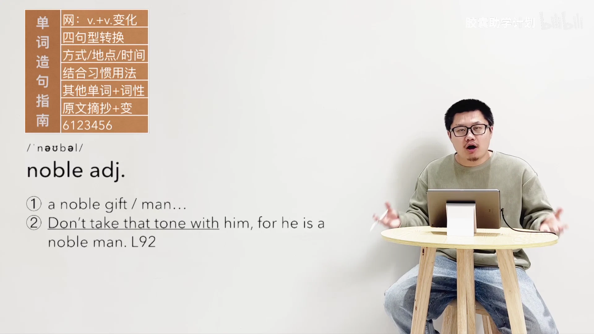

文字识别：单词造句指南 / 网：v.+v.变化 / 囊助学计划 / 四句型转换 / 方式/地点/时间 / 结合习惯用法 / 其他单词+词性 / 原文摘抄+变 / 6123456 / /'naubal/ / noble adj. / ① a noble gift / man... / ② Don't take that tone with him, for he is a / noble man. L92

### 画面 00:00:51

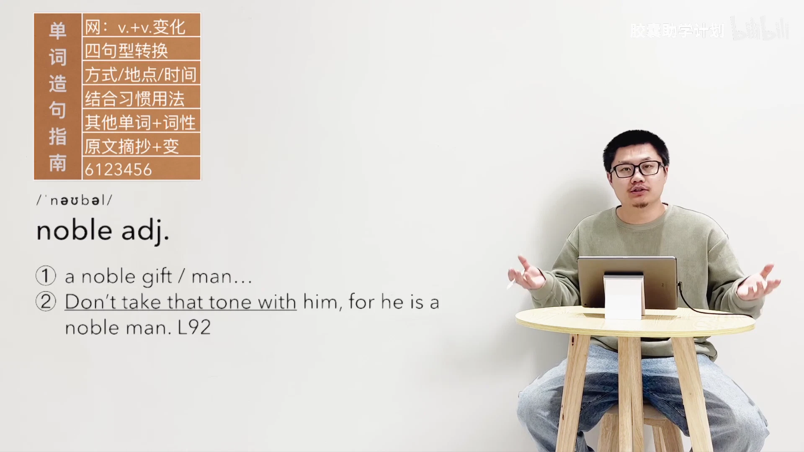

文字识别：单词造句指南 / 网：v.+v.变化 / 妻助学计划 / 四句型转换 / 方式/地点/时间 / 结合习惯用法 / 其他单词+词性 / 原文摘抄+变 / 6123456 / /'naubal/ / noble adj. / ① a noble gift / man... / ② Don't take that tone with him, for he is a / noble man. L92

### 画面 00:00:56

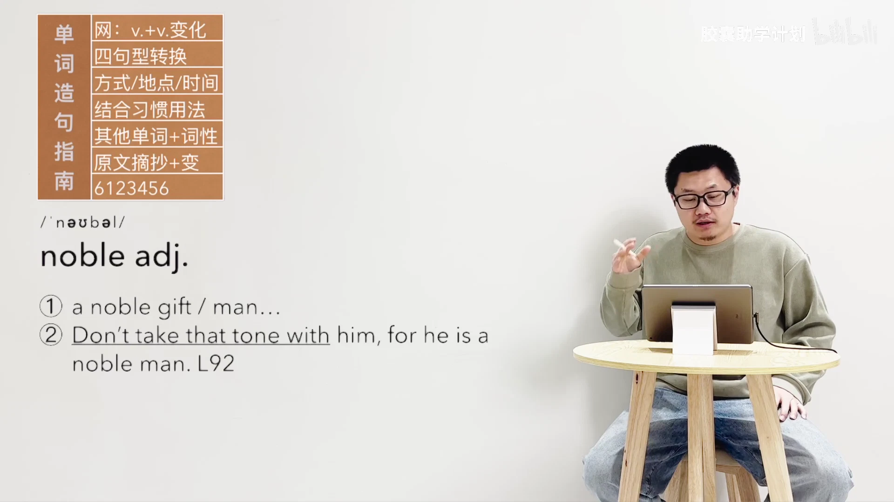

文字识别：单词造句指南 / 网：v.+v.变化 / 卖助学计划 / 四句型转换 / 方式/地点/时间 / 结合习惯用法 / 其他单词+词性 / 原文摘抄+变 / 6123456 / /'naubal/ / noble adj. / ① a noble gift / man... / ② Don't take that tone with him, for he is a / noble man. L92

### 画面 00:00:59

文字识别：单词造句指南 / 网：v.+v.变化 / 霆助字计划 / 四句型转换 / 方式/地点/时间 / 结合习惯用法 / 其他单词+词性 / 原文摘抄+变 / 6123456 / /'naubal/ / noble adj. / ① a noble gift / man... / ② Don't take that tone with him, for he is a / noble man. L92

## 00:01:00–00:01:30

吧？但是你也不要那样和他说话。虽然他现在没落了，为什么？因为他是一个很高尚的人，对吧？Okay，哪怕他现在比如说家徒四壁，穷了，但我们也不能那样和他说话。Next one, say it is said that his father is a noble man.说，据说他父亲是一个特别高尚的人。那注意，据说it is said that，对吧？Next one, he is a noble man. We all admire him.哎，他是一个

### 画面 00:01:07

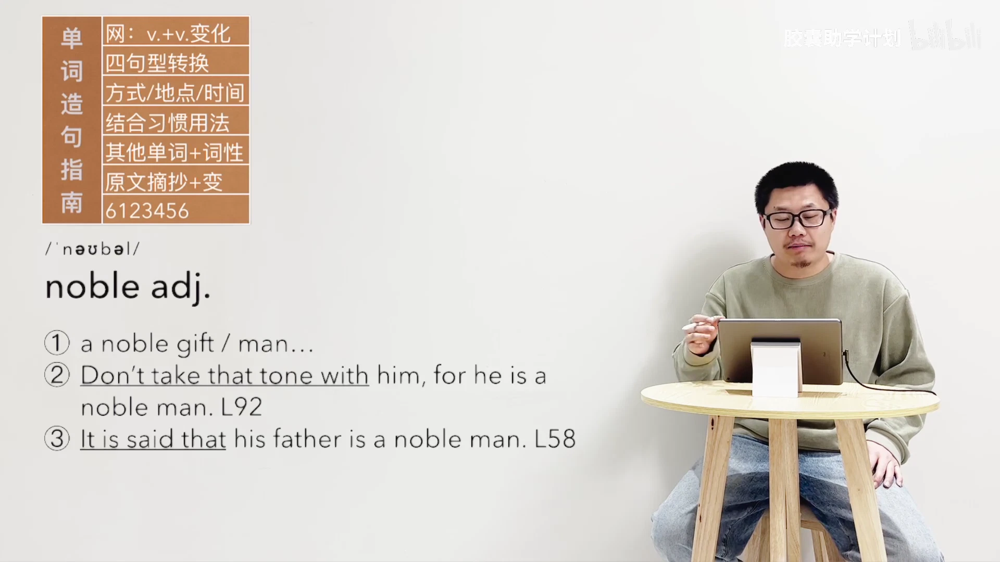

文字识别：单词造句指南 / 网：v.+v.变化 / 奏助学计划 / 四句型转换 / 方式/地点/时间 / 结合习惯用法 / 其他单词+词性 / 原文摘抄+变 / 6123456 / /'naubal/ / noble adj. / ① a noble gift / man... / ② Don't take that tone with him, for he is a / noble man. L92 / It is said that his father is a noble man. L58

### 画面 00:01:10

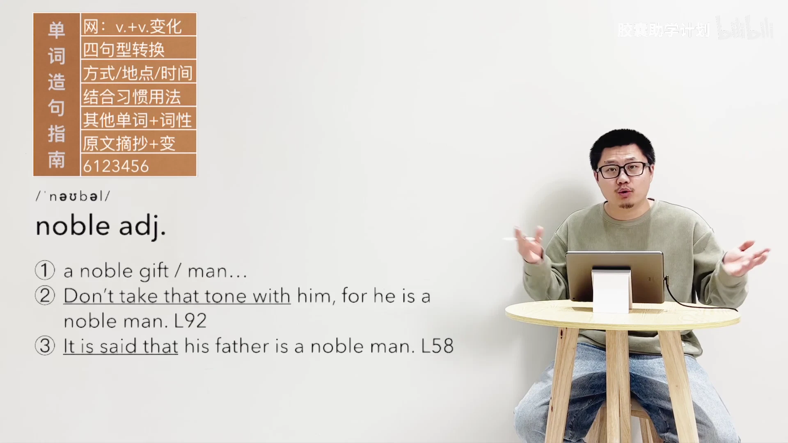

文字识别：单词造句指南 / 网：v.+v.变化 / 囊助学计划 / 四句型转换 / 方式/地点/时间 / 结合习惯用法 / 其他单词+词性 / 原文摘抄+变 / 6123456 / /'naubal/ / noble adj. / ① a noble gift / man... / ② Don't take that tone with him, for he is a / noble man. L92 / It is said that his father is a noble man. L58

### 画面 00:01:15

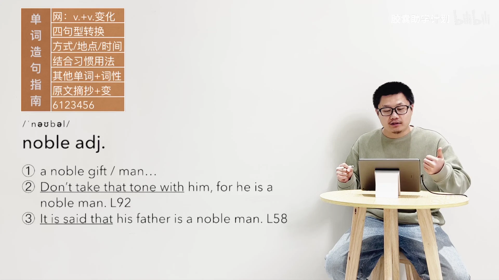

文字识别：单词造句指南 / 网：v.+v.变化 / 建助学计划 / 四句型转换 / 方式/地点/时间 / 结合习惯用法 / 其他单词+词性 / 原文摘抄+变 / 6123456 / /'naubal/ / noble adj. / ① a noble gift / man... / ② Don't take that tone with him, for he is a / noble man. L92 / It is said that his father is a noble man. L58

### 画面 00:01:21

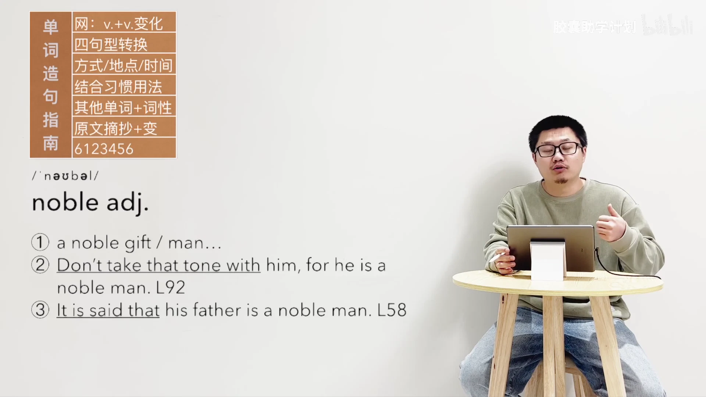

文字识别：单词造句指南 / 网：v.+v.变化 / 建助字计划 / 四句型转换 / 方式/地点/时间 / 结合习惯用法 / 其他单词+词性 / 原文摘抄+变 / 6123456 / /'naubal/ / noble adj. / ① a noble gift / man... / ② Don't take that tone with him, for he is a / noble man. L92 / It is said that his father is a noble man. L58

### 画面 00:01:25

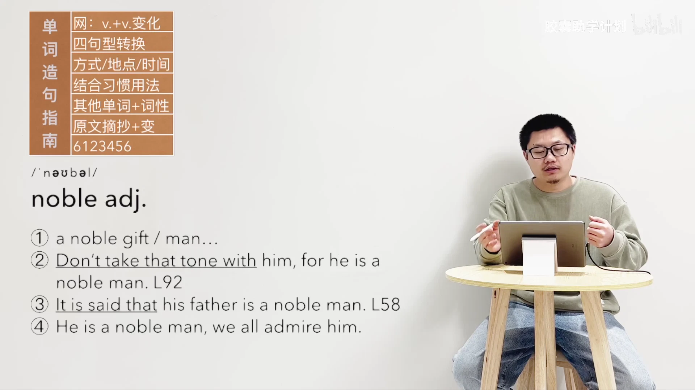

文字识别：单词造句指南 / 网：v.+v.变化 / 幸助学计划 / 四句型转换 / 方式/地点/时间 / 结合习惯用法 / 其他单词+词性 / 原文摘抄+变 / 6123456 / /'naubal/ / noble adj. / ① a noble gift / man... / ② Don't take that tone with him, for he is a / noble man. L92 / It is said that his father is a noble man. L58 / ④ He is a noble man, we all admire him.

## 00:01:30–00:02:00

高尚的人，我们都很敬佩他，尊敬他，对吧？Respect. Next one,下一个单词看一下音标 monument. Monument,纪念碑啊 monument. Very good.我们造个句子. It comes as a surprise to learn that this monument was built in 1806.好，这是九十课咱们学的一个呃句型.

### 画面 00:01:35

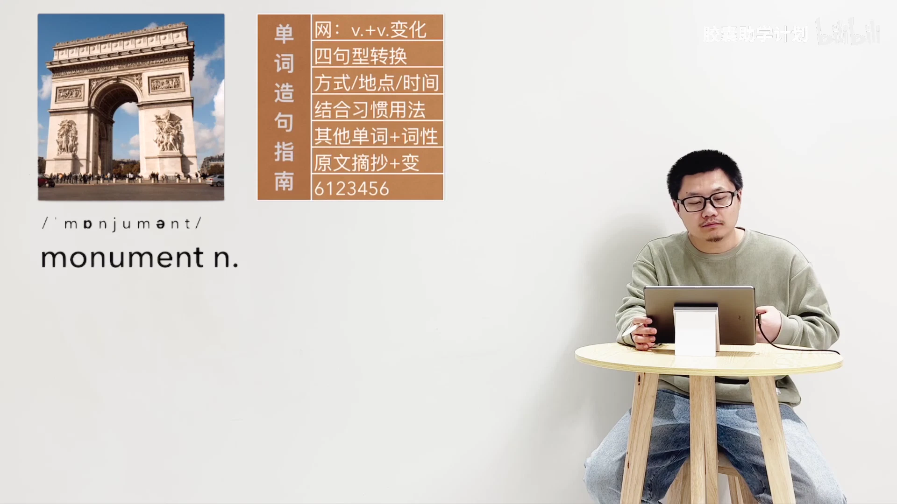

文字识别：单词造句指南 / 网：v.+v.变化 / 辜助字计划 / 四句型转换 / 方式/地点/时间 / 结合习惯用法 / 其他单词+词性 / 原文摘抄+变 / 6123456 / /'mpnjumant / / monument n.

### 画面 00:01:38

文字识别：单词造句指南 / 网：v.+v.变化 / 四句型转换 / 方式/地点/时间 / 2 / 结合习惯用法 / 其他单词+词性 / 原文摘抄+变 / 6123456 / /'mpnjumant/ / monument n.

### 画面 00:01:43

文字识别：单词造句指南 / 网：v.+v.变化 / 四句型转换 / 方式/地点/时间 / 结合习惯用法 / 其他单词+词性 / 原文摘抄+变 / 6123456 / / 'mpnjumant / / monument n.

### 画面 00:01:45

文字识别：单词造句指南 / 网：v.+v.变化 / 四句型转换 / 方式/地点/时间 / 结合习惯用法 / 其他单词+词性 / 原文摘抄+变 / 6123456 / /'mpnjumant / / monument n. / It comes as a surprise to learn that this / monument was build in 1806. L90

### 画面 00:01:48

文字识别：单词造句指南 / 网：v.+v.变化 / 四句型转换 / 方式/地点/时间 / 结合习惯用法 / 其他单词+词性 / 原文摘抄+变 / 6123456 / / 'mpnjumant / / monument n. / It comes as a surprise to learn that this / monument was build in 1806. L90

### 画面 00:01:55

文字识别：单词造句指南 / 网：v.+v.变化 / 学计划 / 四句型转换 / 方式/地点/时间 / 结合习惯用法 / 其他单词+词性 / 原文摘抄+变 / 6123456 / / 'mpnjumant / / monument n. / It comes as a surprise to learn that this / monument was build in 1806. L90

### 画面 00:01:58

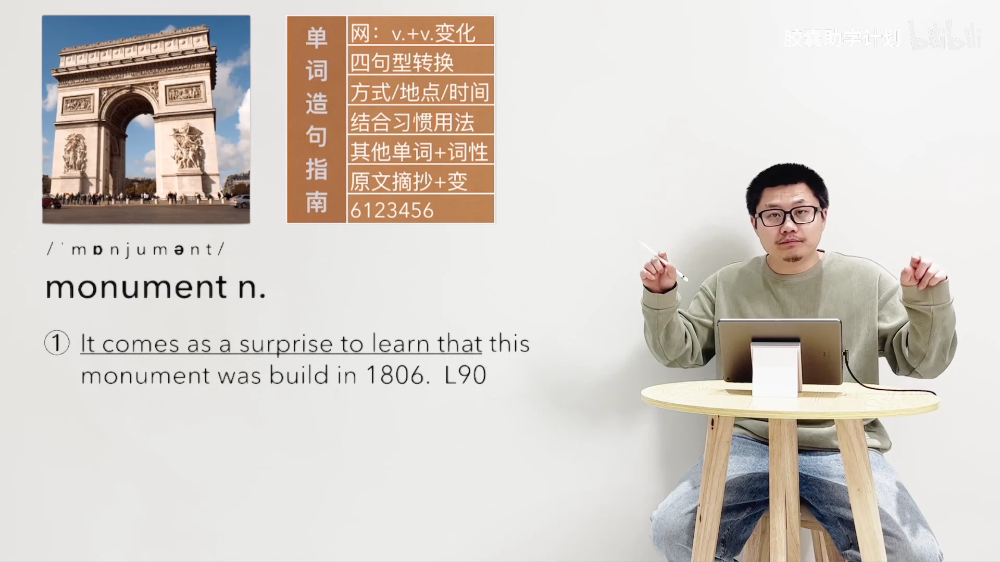

文字识别：单词造句指南 / 网：v.+v.变化 / 四句型转换 / 方式/地点/时间 / 结合习惯用法 / 其他单词+词性 / 原文摘抄+变 / 6123456 / / 'mpnjumant / / monument n. / It comes as a surprise to learn that this / monument was build in 1806. L90

## 00:02:00–00:02:30

It comes as a surprise to learn that. Continue. They watched a comedy show in front of the monument. 没什么可说的. Next one. The monument takes its name from the artist. 啊, artist和artist想一下这两个单词对吧? OK, 再读一遍这个单词. Monument. Very good. Next one. 注意这个地方，我们要着画叫statue. Statue, Liberty, Liberty.

### 画面 00:02:03

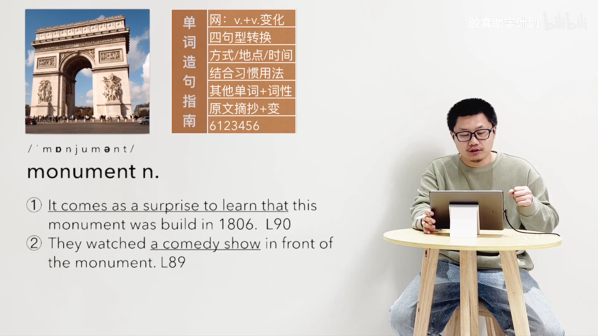

文字识别：单词造句指南 / 网：v.+v.变化 / 四句型转换 / 方式/地点/时间 / 结合习惯用法 / 其他单词+词性 / 原文摘抄+变 / 6123456 / / 'mpnjumant / / monument n. / 1 / It comes as a surprise to learn that this / monument was build in 1806. L90 / They watched a comedy show in front of / the monument. L89

### 画面 00:02:10

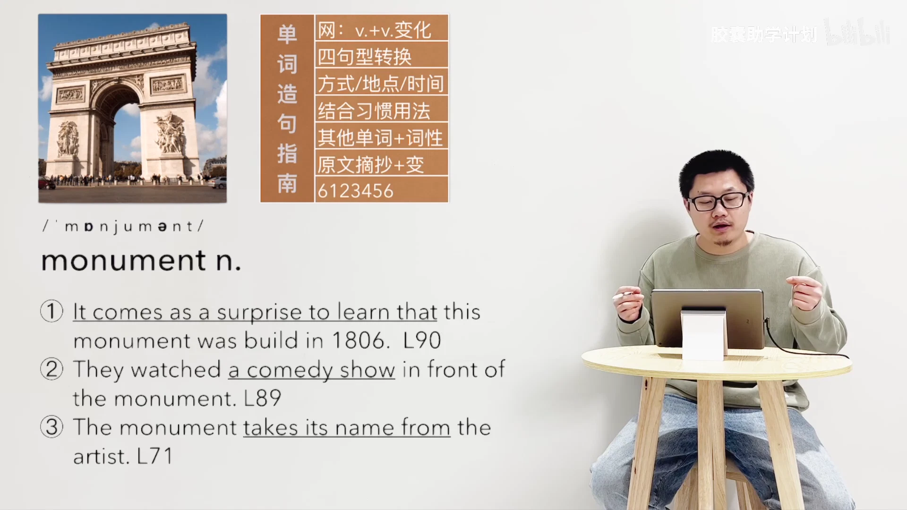

文字识别：单词造句指南 / 网：v.+v.变化 / 囊助学计划 / 四句型转换 / 方式/地点/时间 / 结合习惯用法 / 其他单词+词性 / 原文摘抄+变 / 6123456 / / 'mpnjumant / / monument n. / 1 /  It comes as a surprise to learn that this / monument was build in 1806. L90 / They watched a comedy show in front of / the monument. L89 / The monument takes its name from the / artist. L71

### 画面 00:02:16

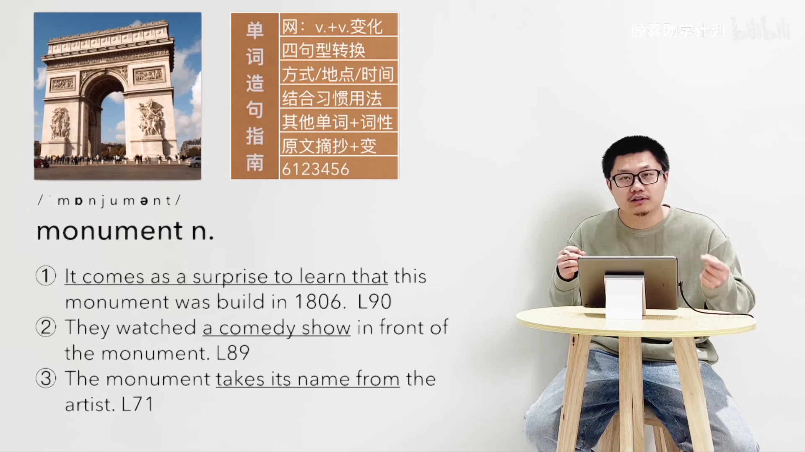

文字识别：单词造句指南 / 网：v.+v.变化 / 囊助学计划 / 四句型转换 / 方式/地点/时间 / 结合习惯用法 / 其他单词+词性 / 原文摘抄+变 / 6123456 / / 'mpnjumant/ / monument n. / 1 /  It comes as a surprise to learn that this / monument was build in 1806. L90 / They watched a comedy show in front of / the monument. L89 / The monument takes its name from the / artist. L71

### 画面 00:02:21

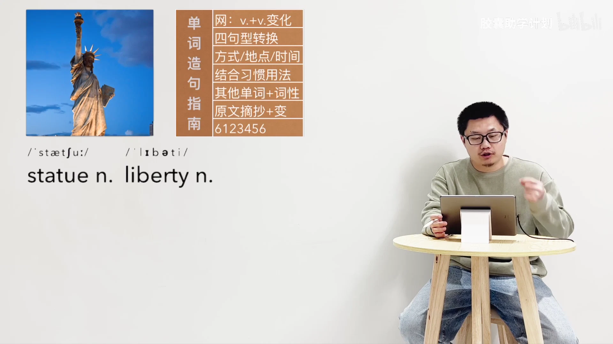

文字识别：单词造句指南 / 网：v.+v.变化 / 囊助学计划 / 四句型转换 / 方式/地点/时间 / 结合习惯用法 / 其他单词+词性 / 原文摘抄+变 / 6123456 / /'stæetfu:/ / /'lrbati/ / statue n. liberty n.

### 画面 00:02:25

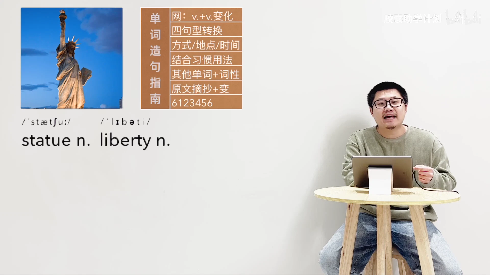

文字识别：单词造句指南 / 网：v.+v.变化 / 囊助字计划 / 四句型转换 / 方式/地点/时间 / 结合习惯用法 / 其他单词+词性 / 原文摘抄+变 / 6123456 / /'stæet∫u:/ / /'lrbati/ / statue n. liberty n.

## 00:02:30–00:03:00

好，statue指的是雕像、雕塑的意思。Liberty是自由的意思。那本文当中，我们的主角就是the Statue of Liberty，自由的雕像。什么呢？就是美国在纽约州的那个自由女神像，对吧？自由女神像，Statue of Liberty。那我们拿它去造几个句子吧，就很简单了。你其实Statue of Liberty合起来像一个名词，我得去找动词，对吧？好，比如说I hate to visit the

### 画面 00:02:41

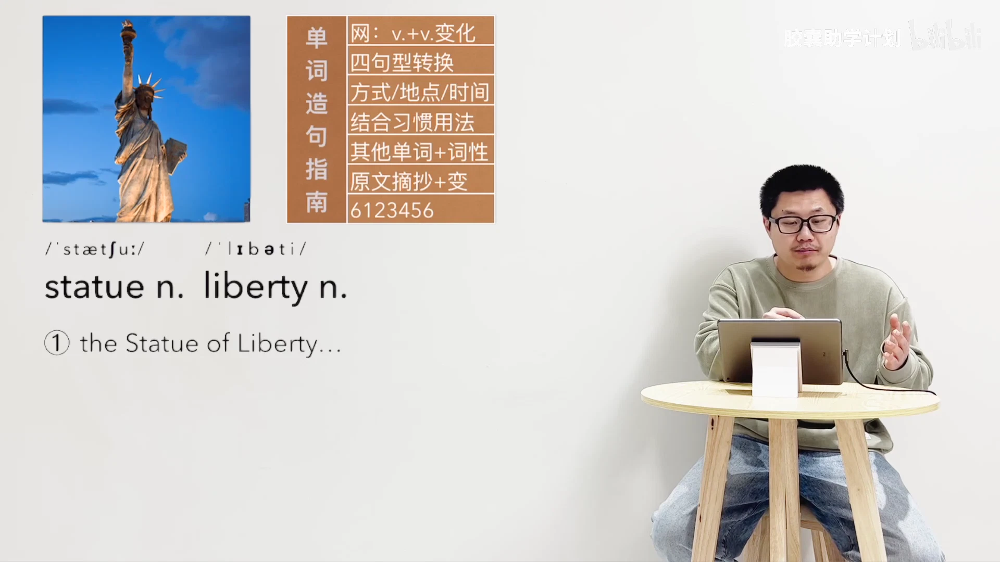

文字识别：单词造句指南 / 网：v.+v.变化 / 辜助学计划 / 四句型转换 / 方式/地点/时间 / 结合习惯用法 / 其他单词+词性 / 原文摘抄+变 / 6123456 / /'stæetfu:/ / / lrbati/ / statue n. liberty n. / ① the Statue of Liberty...

### 画面 00:02:49

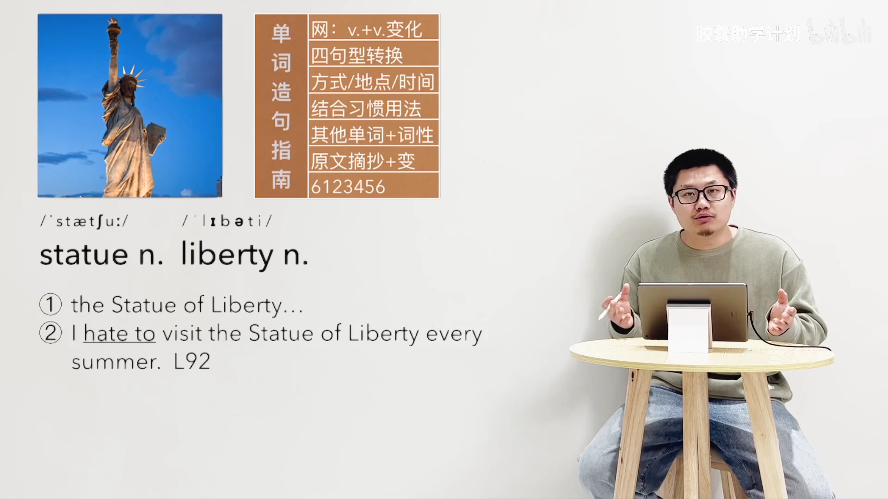

文字识别：单词造句指南 / 网：v.+v.变化 / 建助字计划 / 四句型转换 / 方式/地点/时间 / 结合习惯用法 / 其他单词+词性 / 原文摘抄+变 / 6123456 / /'stæetfu:/ / /lrbati/ / statue n. liberty n. / ① the Statue of Liberty... / ) I hate to visit the Statue of Liberty every / 2 / summer. L92

### 画面 00:02:56

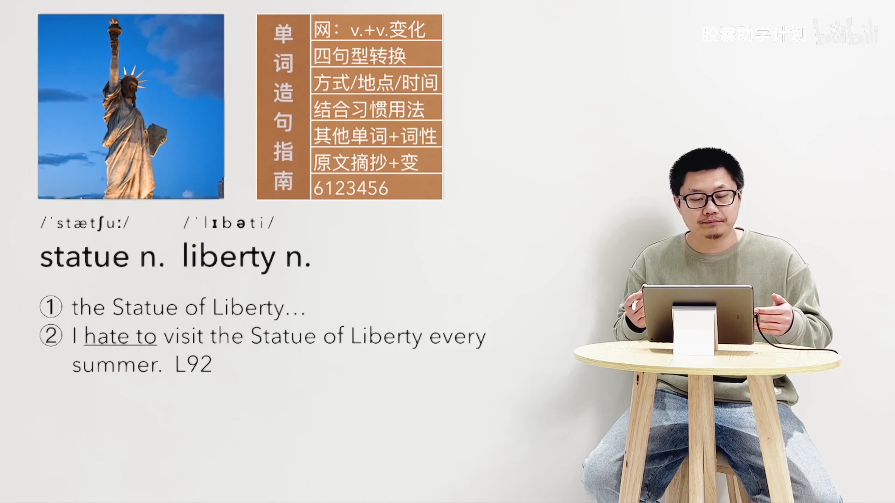

文字识别：单词造句指南 / 网：v.+v.变化 / 四句型转换 / 方式/地点/时间 / 结合习惯用法 / 其他单词+词性 / 原文摘抄+变 / 6123456 / /'stæet∫u:/ / /lrbati/ / statue n. liberty n. / ① the Statue of Liberty... / ) I hate to visit the Statue of Liberty every / summer. L92

## 00:03:00–00:03:30

Statue of Liberty every summer. I, 我特别讨厌，因为小从小到大，每每到夏天就带我去，每到夏天就带我去。I hate to visit the Statue of Liberty. Next one, let's hitchhike to the Statue of Liberty. Hitchhike to Paris. 七十三课，对吧？逃学那课咱们学的。Hitchhike to the Statue of Liberty. Next one, people from all over the world came to see the Statue of Liberty every

### 画面 00:03:12

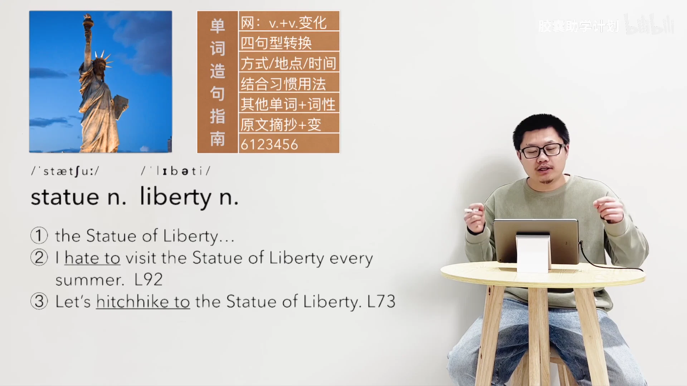

文字识别：单词造句指南 / 网：v.+v.变化 / 四句型转换 / 方式/地点/时间 / 结合习惯用法 / 其他单词+词性 / 原文摘抄+变 / 6123456 / /'stæet∫u:/ / /'lrbati/ / statue n. liberty n. / ① the Statue of Liberty... / ② I hate to visit the Statue of Liberty every / summer. L92 / ) Let's hitchhike to the Statue of Liberty. L73

### 画面 00:03:16

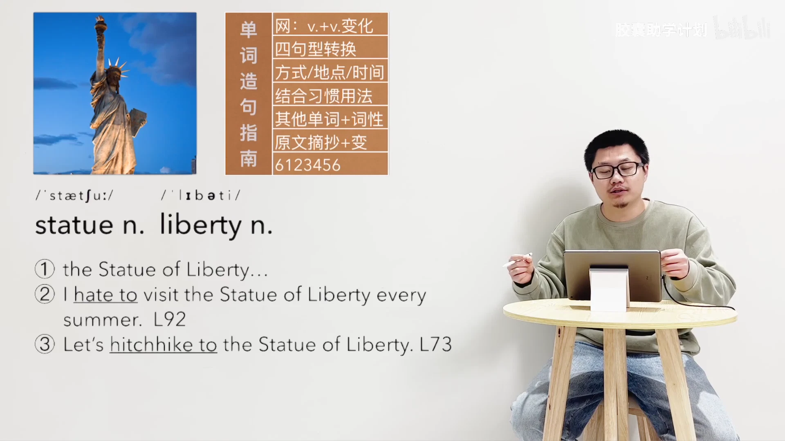

文字识别：单词造句指南 / 网：v.+v.变化 / 四句型转换 / 方式/地点/时间 / 结合习惯用法 / 其他单词+词性 / 原文摘抄+变 / 6123456 / /'stæet∫u:/ / /'lrbati/ / statue n. liberty n. / ① the Statue of Liberty... / ② I hate to visit the Statue of Liberty every / 2) / summer. L92 / ) Let's hitchhike to the Statue of Liberty. L73

### 画面 00:03:20

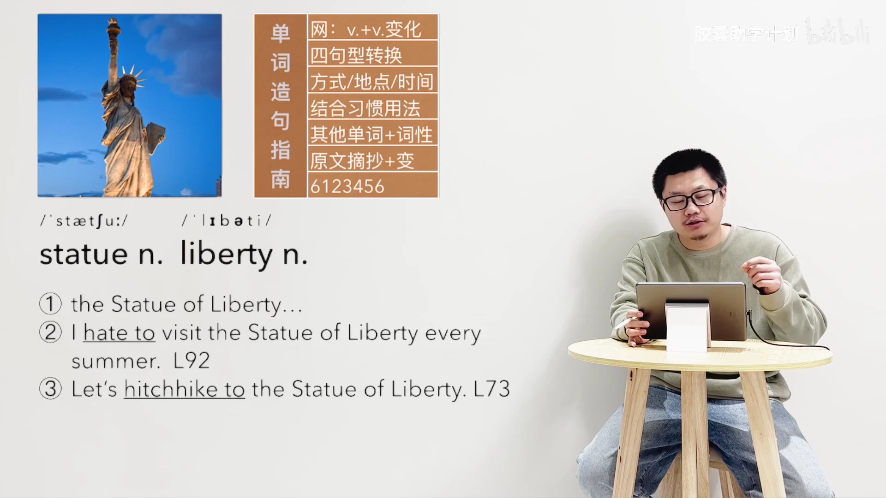

文字识别：单词造句指南 / 网：v.+v.变化 / 学计划 / 四句型转换 / 方式/地点/时间 / 结合习惯用法 / 其他单词+词性 / 原文摘抄+变 / 6123456 / /'stæet∫u:/ / /'lrbati/ / statue n. liberty n. / ① the Statue of Liberty... /  I hate to visit the Statue of Liberty every / 2 / summer. L92 / ) Let's hitchhike to the Statue of Liberty. L73

### 画面 00:03:23

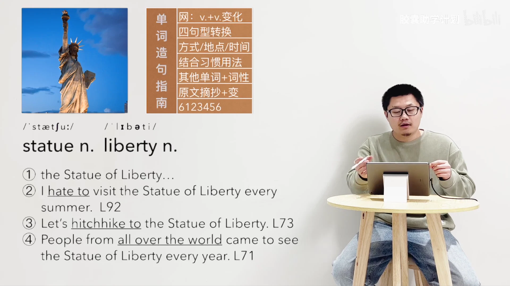

文字识别：单词造句指南 / 网：v.+v.变化 / 庭助学计划 / 四句型转换 / 方式/地点/时间 / 结合习惯用法 / 其他单词+词性 / 原文摘抄+变 / 6123456 / /'stæet∫u:/ / / lrbati/ / statue n. liberty n. / ① the Statue of Liberty... / ② I hate to visit the Statue of Liberty every / summer. L92 / ③ Let's hitchhike to the Statue of Liberty. L73 / ④ People from all over the world came to see / the Statue of Liberty every year. L71

## 00:03:30–00:04:00

year.每年都会，哎，来自于全世界各地的人都会来这个地方看 Statue of Liberty. Very good. Next one,又到了这个单词叫present啊. Present是什么意思来着？啊，是礼物对吧？而present是赠送的意思，有点像give，但是它一般只是赠送礼物嘛，对吧？Give是给，还不太一样。比如说原文给了一句话叫The Statue of

### 画面 00:03:36

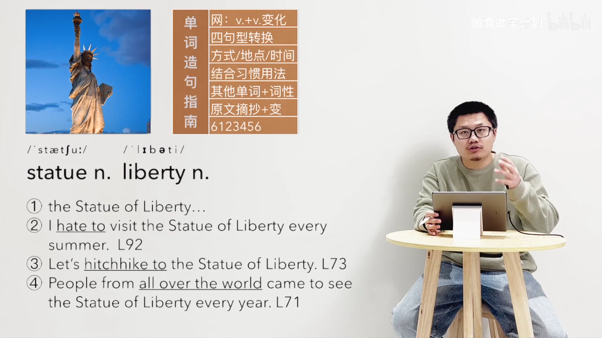

文字识别：单词造句指南 / 网：v.+v.变化 / 四句型转换 / 方式/地点/时间 / 结合习惯用法 / 其他单词+词性 / 原文摘抄+变 / 6123456 / /'stæet∫u:/ / / lrbati/ / statue n. liberty n. / ① the Statue of Liberty... / ② I hate to visit the Statue of Liberty every / summer. L92 / ③ Let's hitchhike to the Statue of Liberty. L73 / ④ People from all over the world came to see / the Statue of Liberty every year. L71

### 画面 00:03:40

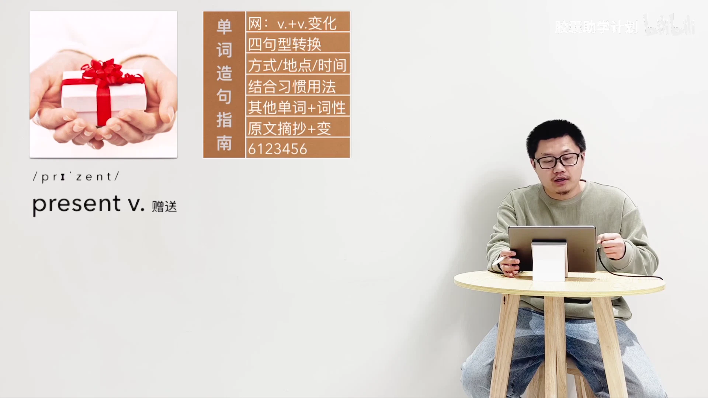

文字识别：单词造句指南 / 网：v.+v.变化 / 毫助子计划 / 四句型转换 / 方式/地点/时间 / 结合习惯用法 / 其他单词+词性 / 原文摘抄+变 / 6123456 / /pri'zent/ / present v.赠送

### 画面 00:03:47

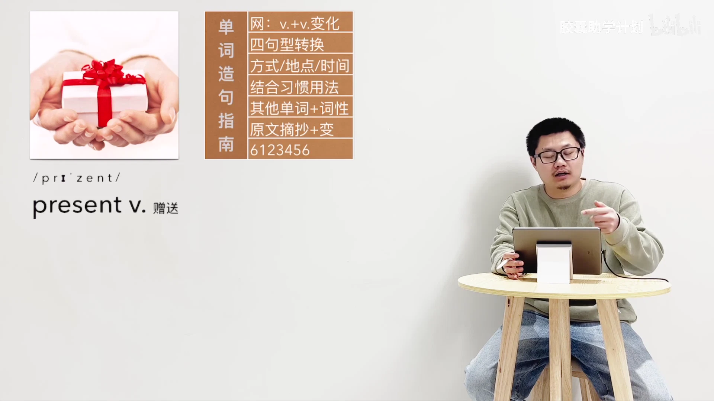

文字识别：单词造句指南 / 网：v.+v.变化 / 喜助学计划 / 四句型转换 / 方式/地点/时间 / 结合习惯用法 / 其他单词+词性 / 原文摘抄+变 / 6123456 / /pri'zent/ / present v.赠送

### 画面 00:03:53

文字识别：单词造句指南 / 网：v.+v.变化 / 喜助字计划 / 四句型转换 / 方式/地点/时间 / 结合习惯用法 / 其他单词+词性 / 原文摘抄+变 / 6123456 / /pri'zent/ / present v.赠送

### 画面 00:03:56

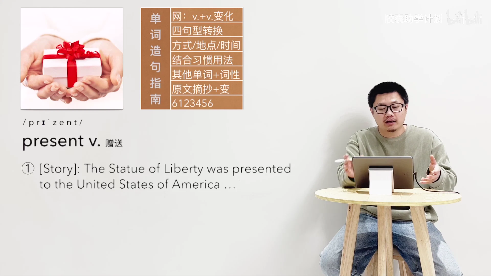

文字识别：单词造句指南 / 网：v.+v.变化 / 四句型转换 / 方式/地点/时间 / 结合习惯用法 / 其他单词+词性 / 原文摘抄+变 / 6123456 / /pri'zent/ / present v.赠送 / ① [Story]: The Statue of Liberty was presented / to the United States of America ...

### 画面 00:03:58

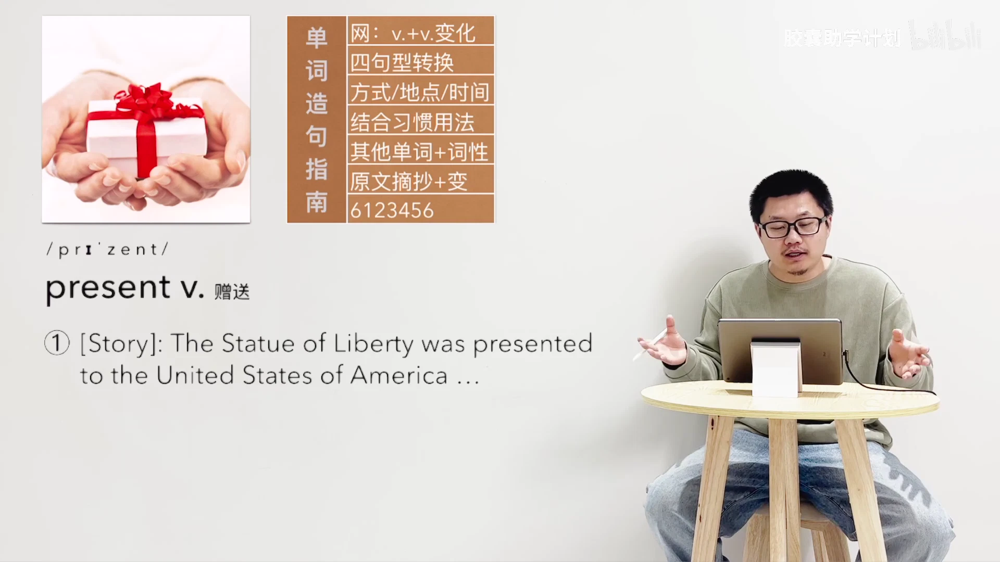

文字识别：单词造句指南 / 网：v.+v.变化 / 四句型转换 / 方式/地点/时间 / 结合习惯用法 / 其他单词+词性 / 原文摘抄+变 / 6123456 / /pri'zent/ / present v.赠送 / ① [Story]: The Statue of Liberty was presented / to the United States of America ...

## 00:04:00–00:04:30

Liberty was presented to the United States of America. 各位要意识到这个自由女神像啊，并不是美国人自己建的，是被赠予美国的，对吧？哎，作为一个对法国大革命精神的延续啊，法国给了美国这样一个东西，赠予了它这样一个礼物。 Next one, 哎，四句型转换不多说。 Continue. So all the books were presented to Leo. 都被赠予了 Leo. 然后四句型

### 画面 00:04:03

文字识别：单词造句指南 / 网：v.+v.变化 / 四句型转换 / 方式/地点/时间 / 结合习惯用法 / 其他单词+词性 / 原文摘抄+变 / 6123456 / /pri'zent/ / present v.赠送 / ① [Story]: The Statue of Liberty was presented / to the United States of America ...

### 画面 00:04:21

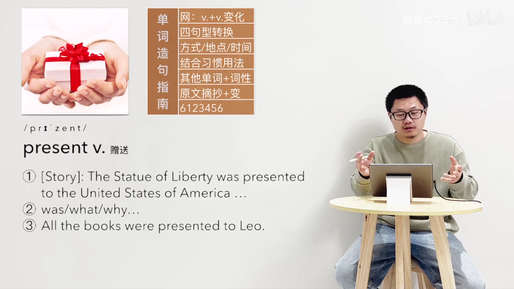

文字识别：单词造句指南 / 网：v.+v.变化 / 四句型转换 / 方式/地点/时间 / 结合习惯用法 / 其他单词+词性 / 原文摘抄+变 / 6123456 / /prl'zent/ / present v.赠送 / ① [Story]: The Statue of Liberty was presented / to the United States of America ... / was/what/why... / ③ All the books were presented to Leo.

### 画面 00:04:29

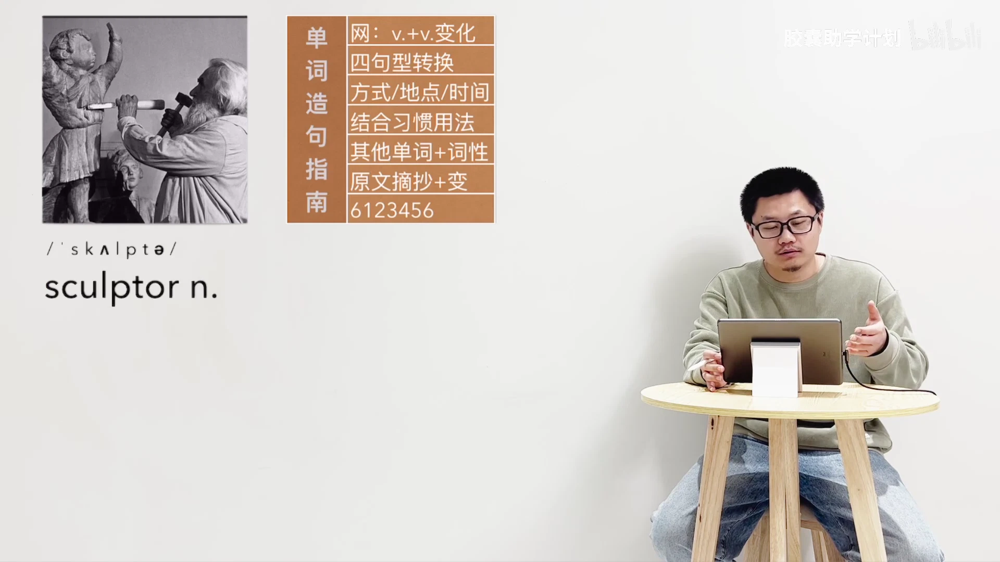

文字识别：单词造句指南 / 网：v.+v.变化 / 四句型转换 / 方式/地点/时间 / 结合习惯用法 / 其他单词+词性 / 原文摘抄+变 / 6123456 / / 'skalpta/ / sculptor n.

## 00:04:30–00:05:00

转换，刚才那个就不多说了。下一个单词，注意要浊化，sculptor，sculptor，sculptor，sculptor是什么？呢，就是雕刻家、雕塑家，对吧？好，注意，你看它后边加or什么来着？做某件事情的人，sculptor哪一个？那它去造句跟captain本质上没有区别，随便造就行了呗，对吧？那就结合你自己之前学过的知识啊，和你自己的想象力去造句子

### 画面 00:04:31

文字识别：单词造句指南 / 网：v.+v.变化 / 喜助字计划 / 四句型转换 / 方式/地点/时间 / 结合习惯用法 / 其他单词+词性 / 原文摘抄+变 / 6123456 / /'skalpta/ / sculptor n.

### 画面 00:04:33

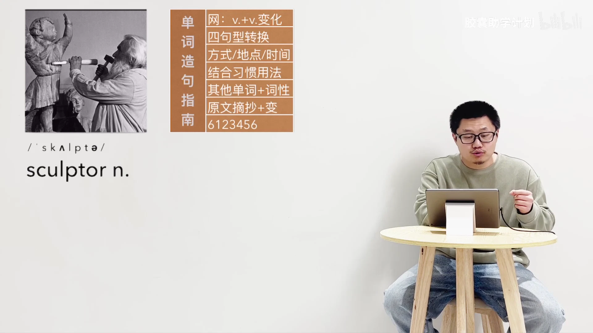

文字识别：单词造句指南 / 网：v.+v.变化 / 妻助学计划 / 四句型转换 / 方式/地点/时间 / 结合习惯用法 / 其他单词+词性 / 原文摘抄+变 / 6123456 / /'skalpta/ / sculptor n.

### 画面 00:04:36

文字识别：单词造句指南 / 网：v.+v.变化 / 囊助学计划 / 四句型转换 / 方式/地点/时间 / 结合习惯用法 / 其他单词+词性 / 原文摘抄+变 / 6123456 / / 'skalpta/ / sculptor n.

### 画面 00:04:49

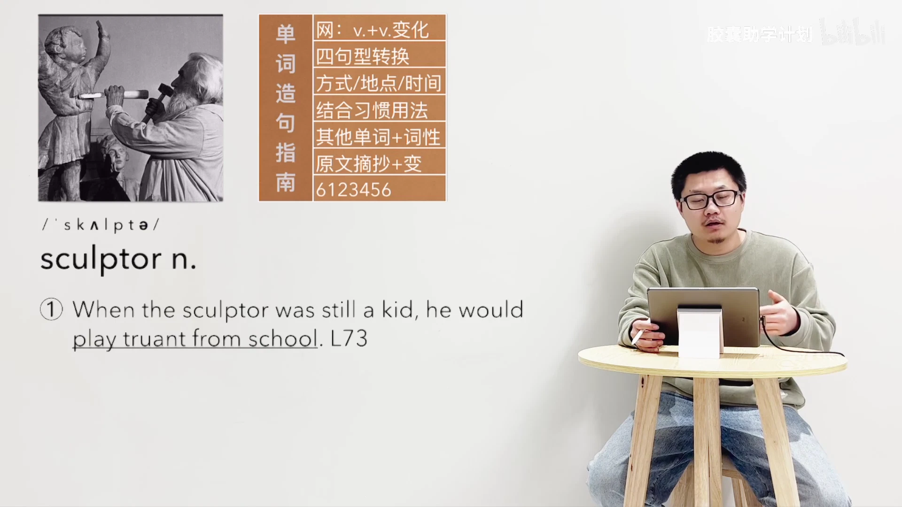

文字识别：单词造句指南 / 网：v.+v.变化 / 学计划 / 四句型转换 / 方式/地点/时间 / 结合习惯用法 / 其他单词+词性 / 原文摘抄+变 / 6123456 / / 'skalpta/ / sculptor n. / ① When the sculptor was still a kid, he would / play truant from school. L73

### 画面 00:04:56

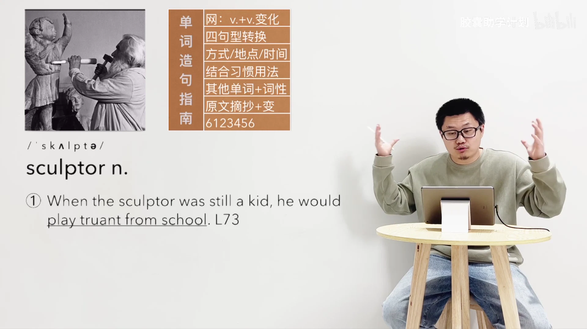

文字识别：单词造句指南 / 网：v.+v.变化 / 四句型转换 / 方式/地点/时间 / 结合习惯用法 / 其他单词+词性 / 原文摘抄+变 / 6123456 / / ' s ka lpta/ / sculptor n. / ① When the sculptor was still a kid, he would / play truant from school. L73

## 00:05:00–00:05:30

吧。哎，我造了一个句子叫做 When the sculptor was still a kid. 第七课，当什么什么时候，he would play truant from school. Play truant from school，七十三课咱们学的逃学。 Next one, when the sculptor got home, he found his wife fast asleep. Fast asleep，熟睡，刚学的九十二课。 Next one, the sculptor seems to be working right now. 别忘了 repeat after me. Okay, seem

### 画面 00:05:01

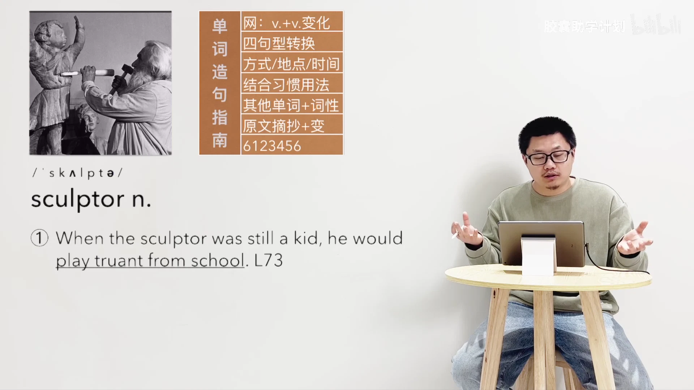

文字识别：单词造句指南 / 网：v.+v.变化 / 四句型转换 / 方式/地点/时间 / 结合习惯用法 / 其他单词+词性 / 原文摘抄+变 / 6123456 / / ' s ka lpta/ / sculptor n. / ① When the sculptor was still a kid, he would / play truant from school. L73

### 画面 00:05:13

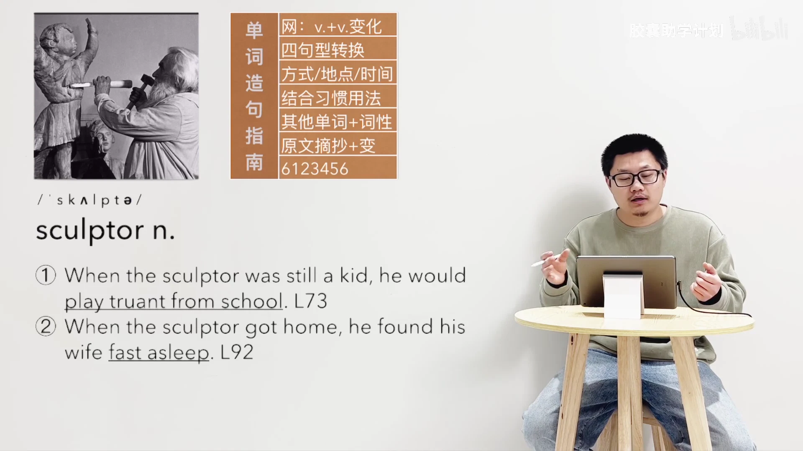

文字识别：单词造句指南 / 网：v.+v.变化 / 四句型转换 / 方式/地点/时间 / 结合习惯用法 / 其他单词+词性 / 原文摘抄+变 / 6123456 / / ' ska lpta/ / sculptor n. / ① When the sculptor was still a kid, he would / play truant from school. L73 / When the sculptor got home, he found his / wife fast asleep. L92

## 00:05:30–00:06:00

to be doing something.哎，听说读写，咱们在这地方学的，其实所有的习惯用法，听说读写都用得到啊。Seem to be doing something,似乎是正在做什么事情，对吧？Next one, actual, actual.咱们实际上学过actually，对吧？副词啊，实际上。那actual呢，就是真的，就类似于real。比如说，those were his actual words.哎，这真的这那些啊，确实就是

### 画面 00:05:31

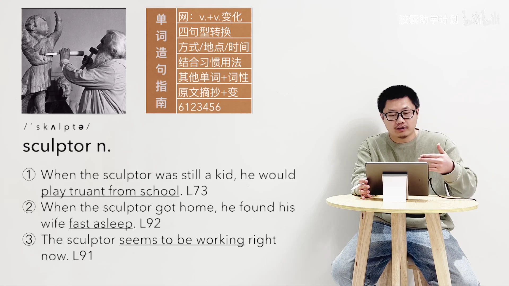

文字识别：单词造句指南 / 网：v.+v.变化 / 毫助学计划 / 四句型转换 / 方式/地点/时间 / 结合习惯用法 / 其他单词+词性 / 原文摘抄+变 / 6123456 / /'skalpta/ / sculptor n. / ① When the sculptor was still a kid, he would / play truant from school. L73 / When the sculptor got home, he found his / wife fast asleep. L92 / The sculptor seems to be working right / now.L91

### 画面 00:05:42

文字识别：单词造句指南 / 网：v.+v.变化 / 囊助学计划 / 四句型转换 / 方式/地点/时间 / 结合习惯用法 / 其他单词+词性 / 原文摘抄+变 / 6123456 / /'ækt∫ual/ / actual adj.

### 画面 00:05:45

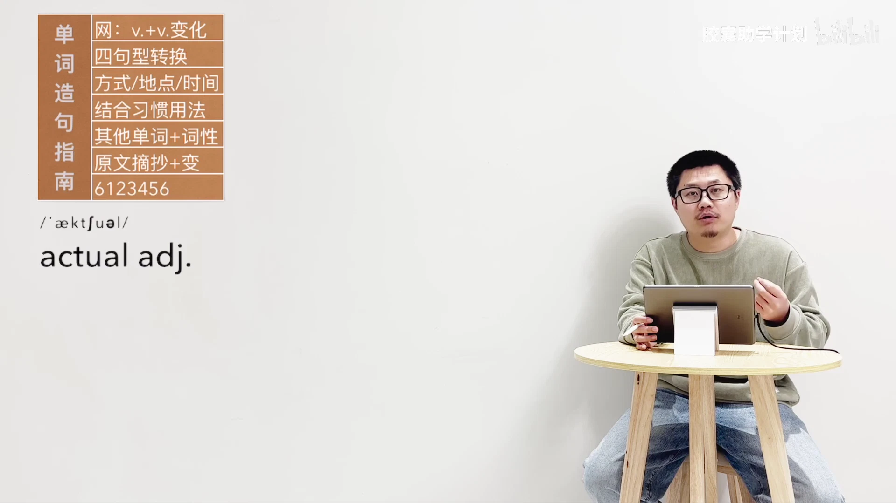

文字识别：单词造句指南 / 网：v.+v.变化 / 妻助学计划！ / 四句型转换 / 方式/地点/时间 / 结合习惯用法 / 其他单词+词性 / 原文摘抄+变 / 6123456 / /'æekt∫ual/ / actual adj.

### 画面 00:05:47

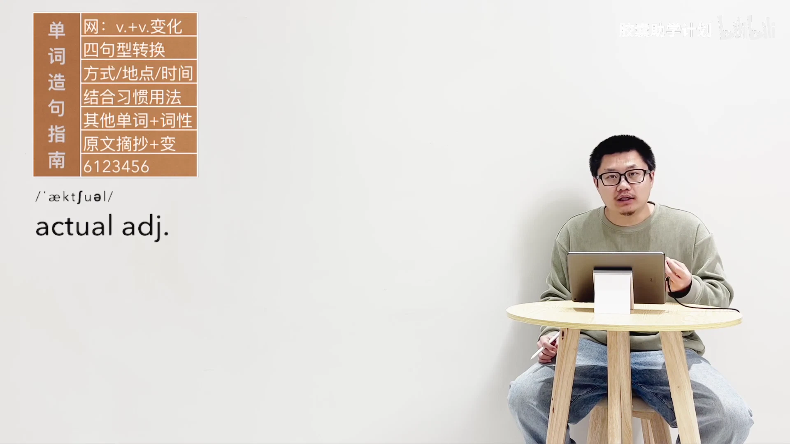

文字识别：单词造句指南 / 网：v.+v.变化 / 卖助学计划陽 / 四句型转换 / 方式/地点/时间 / 结合习惯用法 / 其他单词+词性 / 原文摘抄+变 / 6123456 / /'æekt∫ual/ / actual adj.

### 画面 00:05:50

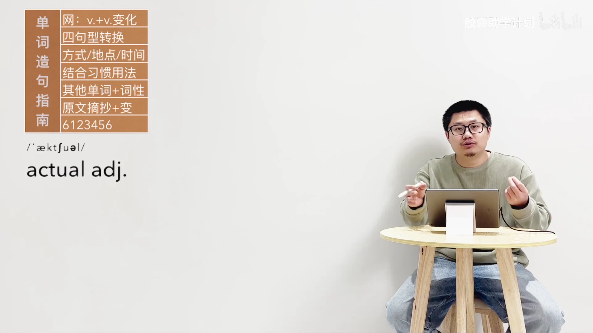

文字识别：单词造句指南 / 网：v.+v.变化 / 妻助学计划 / 四句型转换 / 方式/地点/时间 / 结合习惯用法 / 其他单词+词性 / 原文摘抄+变 / 6123456 / /'ækt∫ual/ / actual adj.

### 画面 00:05:52

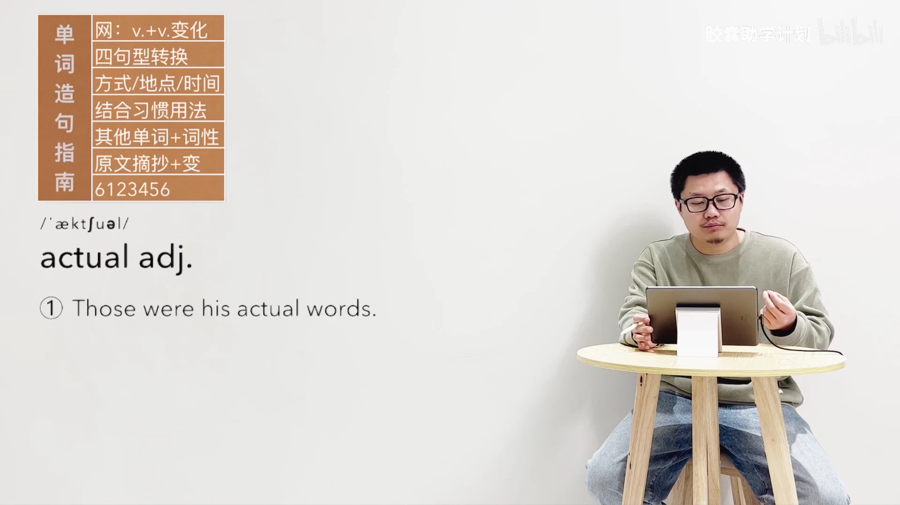

文字识别：单词造句指南 / 网：v.+v.变化 / 喜助学计划 / 四句型转换 / 方式/地点/时间 / 结合习惯用法 / 其他单词+词性 / 原文摘抄+变 / 6123456 / /'ækt∫ual/ / actual adj. /  Those were his actual words.

## 00:06:00–00:06:30

他说的原话，类似于对吧？那就是他的 actual words. Next one, say this is an actual email from her office. Say this真的啊，就是一个事实上真的啊email来自于他的办公室发过来的，对吧？好，比如说，can you give me your actual phone number?那什么叫 actual phone number?就是之前给了一个fake phone number, fake啊，假的，对吧？或者wrong phone number，或者是错

### 画面 00:06:08

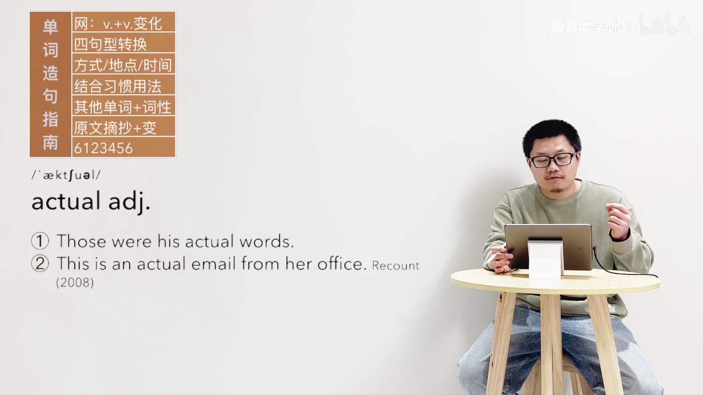

文字识别：单词造句指南 / 网：v.+v.变化 / 四句型转换 / 方式/地点/时间 / 结合习惯用法 / 其他单词+词性 / 原文摘抄+变 / 6123456 / /'ækt∫ual/ / actual adj. / ① Those were his actual words. / This is an actual email from her office. Recount / (2008)

### 画面 00:06:17

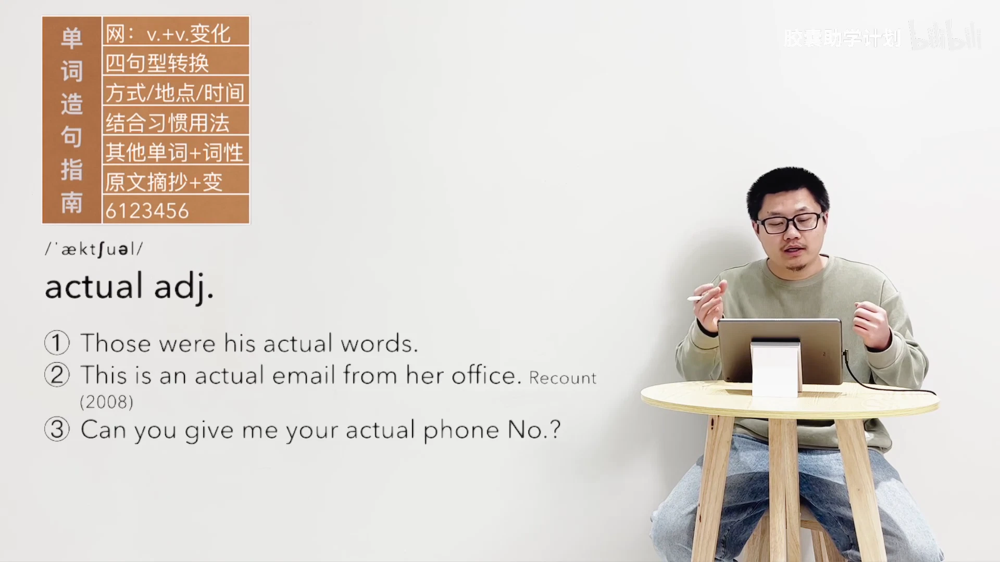

文字识别：单词造句指南 / 网：v.+v.变化 / 四句型转换 / 方式/地点/时间 / 结合习惯用法 / 其他单词+词性 / 原文摘抄+变 / 6123456 / /'ækt∫ual/ / actual adj. / ① Those were his actual words. / This is an actual email from her office. Recount / (2008) / ③ Can you give me your actual phone No.? / 3

### 画面 00:06:20

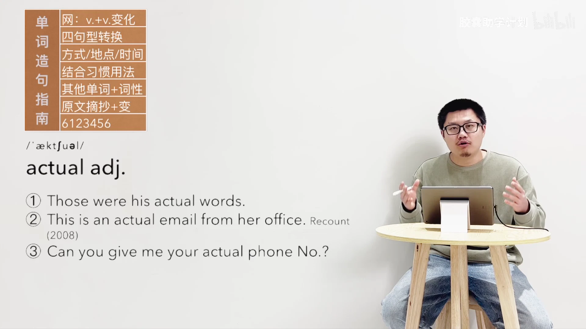

文字识别：单词造句指南 / 网：v.+v.变化 / 四句型转换 / 方式/地点/时间 / 结合习惯用法 / 其他单词+词性 / 原文摘抄+变 / 6123456 / /'ækt∫ual/ / actual adj. / ① Those were his actual words. / This is an actual email from her office. Recount / (2008) / ③ Can you give me your actual phone No.? / 3)

## 00:06:30–00:07:00

误的。那你能不能把你真实的给我actual phone number？再读一遍这个单词actual。好，next one下一个单词，看音标叫做copper, copper, copper啊。那虽然是er，但这并不是做某件事的人了，就是铜copper啊。那比如说特别简单一个句子，八十课咱们学的be made of，原文也出现了。比如说it was made of copper。哎，我说this pencil is made of copper啊，是由铜管

### 画面 00:06:31

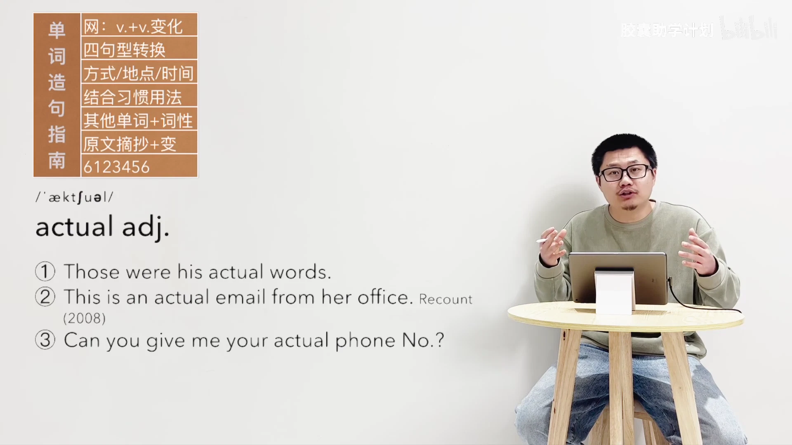

文字识别：单词造句指南 / 网：v.+v.变化 / 四句型转换 / 方式/地点/时间 / 结合习惯用法 / 其他单词+词性 / 原文摘抄+变 / 6123456 / /'ækt∫ual/ / actual adj. / ① Those were his actual words. / This is an actual email from her office. Recount / (2008) / ③ Can you give me your actual phone No.? / 3)

### 画面 00:06:37

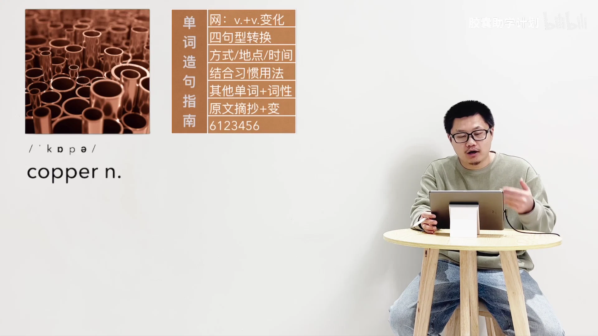

文字识别：单词造句指南 / 网：v.+v.变化 / 四句型转换 / 方式/地点/时间 / 结合习惯用法 / 其他单词+词性 / 原文摘抄+变 / 6123456 / /  kpｐa / / copper n.

### 画面 00:06:39

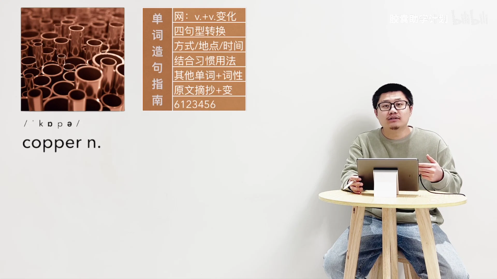

文字识别：单词造句指南 / 网：v.+v.变化 / 四句型转换 / 方式/地点/时间 / 结合习惯用法 / 其他单词+词性 / 原文摘抄+变 / 6123456 / /kpｐa/ / copper n.

### 画面 00:06:41

文字识别：单词造句指南 / 网：v.+v.变化 / 四句型转换 / 方式/地点/时间 / 结合习惯用法 / 其他单词+词性 / 原文摘抄+变 / 6123456 / /  kpｐ a l / copper n.

### 画面 00:06:45

文字识别：单词造句指南 / 网：v.+v.变化 / 四句型转换 / 方式/地点/时间 / 结合习惯用法 / 其他单词+词性 / 原文摘抄+变 / 6123456 / /  kｐｐa / / copper n.

### 画面 00:06:49

文字识别：单词造句指南 / 网：v.+v.变化 / 四句型转换 / 方式/地点/时间 / 结合习惯用法 / 其他单词+词性 / 原文摘抄+变 / 6123456 / /  k p p a / / copper n. / 1 /  It was made of copper. L80

### 画面 00:06:51

文字识别：单词造句指南 / 网：v.+v.变化 / 四句型转换 / 方式/地点/时间 / 结合习惯用法 / 其他单词+词性 / 原文摘抄+变 / 6123456 / /  k p p a / / copper n. / 1 /  It was made of copper. L80

### 画面 00:06:54

文字识别：单词造句指南 / 网：v.+v.变化 / 四句型转换 / 方式/地点/时间 / 结合习惯用法 / 其他单词+词性 / 原文摘抄+变 / 6123456 / / ' kpｐa l / copper n. / 1 /  It was made of copper. L80

### 画面 00:06:56

文字识别：单词造句指南 / 网：v.+v.变化 / 四句型转换 / 方式/地点/时间 / 结合习惯用法 / 其他单词+词性 / 原文摘抄+变 / 6123456 / / kpｐa/ / copper n. /  It was made of copper. L80 / 1

## 00:07:00–00:07:30

### 画面 00:07:00

文字识别：单词造句指南 / 网：v.+v.变化 / 四句型转换 / 方式/地点/时间 / 结合习惯用法 / 其他单词+词性 / 原文摘抄+变 / 6123456 / /  kpｐa / / copper n. / 1 / D It was made of copper. L80

### 画面 00:07:02

文字识别：单词造句指南 / 网：v.+v.变化 / 四句型转换 / 方式/地点/时间 / 结合习惯用法 / 其他单词+词性 / 原文摘抄+变 / 6123456 / / ' kop a / / copper n. / 1 / It was made of copper. L80 / His father lost his life in a copper mine. L88

### 画面 00:07:05

文字识别：单词造句指南 / 网：v.+v.变化 / 四句型转换 / 方式/地点/时间 / 结合习惯用法 / 其他单词+词性 / 原文摘抄+变 / 6123456 / /  koｐ a / / copper n. / It was made of copper. L80 / 1 / His father lost his life in a copper mine. L88

### 画面 00:07:10

文字识别：单词造句指南 / 网：v.+v.变化 / 计划 / 四句型转换 / 方式/地点/时间 / 结合习惯用法 / 其他单词+词性 / 原文摘抄+变 / 6123456 / / kｏｐa/ / copper n. / 1 / It was made of copper. L80 / His father lost his life in a copper mine. L88

### 画面 00:07:13

文字识别：单词造句指南 / 网：v.+v.变化 / 四句型转换 / 方式/地点/时间 / 结合习惯用法 / 其他单词+词性 / 原文摘抄+变 / 6123456 / / ' k p p a / / copper n. / It was made of copper. L80 / 1 / His father lost his life in a copper mine. L88

### 画面 00:07:15

文字识别：单词造句指南 / 网：v.+v.变化 / 四句型转换 / 方式/地点/时间 / 结合习惯用法 / 其他单词+词性 / 原文摘抄+变 / 6123456 / / koｐ a / / copper n. / It was made of copper. L80 / 1 / His father lost his life in a copper mine. L88

### 画面 00:07:18

文字识别：单词造句指南 / 网：v.+v.变化 / 四句型转换 / 方式/地点/时间 / 结合习惯用法 / 其他单词+词性 / 原文摘抄+变 / 6123456 / / koｐ a / / copper n. / ①1 / It was made of copper. L80 / His father lost his life in a copper mine. L88 / did/who/how/where/when...

### 画面 00:07:20

文字识别：单词造句指南 / 网：v.+v.变化 / 四句型转换 / 方式/地点/时间 / 结合习惯用法 / 其他单词+词性 / 原文摘抄+变 / 6123456 / / ' kp ｐ a / / copper n. / 1 / It was made of copper. L80 / His father lost his life in a copper mine. L88 / did/who/how/where/when...

### 画面 00:07:25

文字识别：单词造句指南 / 网：v.+v.变化 / 四句型转换 / 方式/地点/间 / 结合习惯用法 / 其他单词+词性 / 原文摘抄+变 / 6123456 / / ' kpｐ a / / copper n. / It was made of copper. L80 / 1 / His father lost his life in a copper mine. L88 / did/who/how/where/when...

### 画面 00:07:27

文字识别：单词造句指南 / 网：v.+v.变化 / 四句型转换 / 方式/地点/间 / 结合习惯用法 / 其他单词+词性 / 原文摘抄+变 / 6123456 / / ' koｐ a / / copper n. / へ / It was made of copper. L80 / His father lost his life in a copper minelL88 / did/who/how/where/when...

## 00:07:30–00:08:00

when，就是对那个时间去进行提问啊。这是我们造句的一个思路。Next one, say it is known that the copper mine belongs to his family. 说现在啊，众所周知啊，就是呃，我们知道一件事儿，叫做怎么样呢？这个 copper mine 叫做这个铜矿属于他们家庭。这个 belong to 实际上是新一九十五课就学过的一个习惯用法啊。好，那接下来咱注意力集中听个一句话，电影片段。 He owns half the copper mines

### 画面 00:07:30

文字识别：单词造句指南 / 网：v.+v.变化 / 四句型转换 / 方式/地点/时间 / 结合习惯用法 / 其他单词+词性 / 原文摘抄+变 / 6123456 / / koｐa / / copper n. / へ / It was made of copper. L80 / His father lost his life in a copper minel88 / did/who/how/where/when...

### 画面 00:07:32

文字识别：单词造句指南 / 网：v.+v.变化 / 四句型转换 / 方式/地点/时间 / 结合习惯用法 / 其他单词+词性 / 原文摘抄+变 / 6123456 / / ' kpｐ a / / copper n. / へ / It was made of copper. L80 /  His father lost hislif in a copper minel88 / did/who/how/where/when...

### 画面 00:07:34

文字识别：单词造句指南 / 网：v.+v.变化 / 四句型转换 / 方式/地点/间 / 结合习惯用法 / 其他单词+词性 / 原文摘抄+变 / 6123456 / / ' kpｐ a / / copper n. / ① It was made of copper. L80 / His father lost his life in a copper minel88 / did/who/how/where/when... / It is known that the copper mine belongs to / his family. L82

### 画面 00:07:36

文字识别：单词造句指南 / 网：v.+v.变化 / 四句型转换 / 方式/地点/间 / 结合习惯用法 / 其他单词+词性 / 原文摘抄+变 / 6123456 / / ' kpｐ a / / copper n. / ① It was made of copper. L80 / His father lost his life in a copper minel88 / did/who/how/where/when... / It is known that the copper mine belongs to / his family. L82

### 画面 00:07:40

文字识别：单词造句指南 / 网：v.+v.变化 / 四句型转换 / 方式/地点/t间 / 结合习惯用法 / 其他单词+词性 / 原文摘抄+变 / 6123456 / / kpｐa / / copper n. / ① It was made of copper. L80 /  His father lost his life in a copper minel88 / did/who/how/where/when... / It is known that the copper mine belongs to / his family. L82

### 画面 00:07:45

文字识别：单词造句指南 / 网：v.+v.变化 / 四句型转换 / 方式/地点/t间 / 结合习惯用法 / 其他单词+词性 / 原文摘抄+变 / 6123456 / / ' kop a / / copper n. / ① It was made of copper. L80 / His father losthis life in a copper mine88 / did/who/how/where/when... / It is known that the copper mine belongs to / his family. L82

### 画面 00:07:50

文字识别：单词造句指南 / 网：v.+v.变化 / 四句型转换 / 方式/地点/间 / 结合习惯用法 / 其他单词+词性 / 原文摘抄+变 / 6123456 / /  k pp a / / copper n. / ① It was made of copper. L80 / His father lost his life in a copper minel88 / did/who/how/where/when... / It is known that the copper mine belongs to / his family. L82

### 画面 00:07:53

文字识别：He owns half the copper mines in the world. / O Lucky Man! / (1973)

### 画面 00:07:58

文字识别：He owns half the copper mines in the world. / O Lucky Man! / (1973)

## 00:08:00–00:08:30

in the world.啊，拥有全世界一半的铜矿，对吧？Next one, support, support, support,支持啊，支持某人，对吧？当然，物理意义上也可以支持的，起到支持。比如说，我现在说这面墙，哎，支持着我，是吧？或者这个椅子椅背啊，支持着我，support me，对吧？那也可以说人支持啊，你要做某件事儿啊，精神上支持你，物质上支持你，support. Okay, 我们造个句子，repeat after me.

### 画面 00:08:00

文字识别：He owns half the copper mines in the world. / O Lucky Man! / (1973)

### 画面 00:08:02

文字识别：He owns half the copper mines in the world. / O Lucky Man! / (1973)

### 画面 00:08:04

文字识别：单词造句指南 / 网：v.+v.变化 / 喜助学计划 / 四句型转换 / 方式/地点/时间 / 结合习惯用法 / 其他单词+词性 / 原文摘抄+变 / 6123456 / /sa'poit/ / support v.

### 画面 00:08:06

文字识别：单词造句指南 / 网：v.+v.变化 / 囊助子计划 / 四句型转换 / 方式/地点/时间 / 结合习惯用法 / 其他单词+词性 / 原文摘抄+变 / 6123456 / /sa'poit/ / support v.

### 画面 00:08:10

文字识别：单词造句指南 / 网：v.+v.变化 / - / 辜助学计划 / 四句型转换 / 方式/地点/时间 / 结合习惯用法 / 其他单词+词性 / 原文摘抄+变 / 6123456 / /sa'poit/ / support v.

### 画面 00:08:15

文字识别：单词造句指南 / 网：v.+v.变化 / 虞助字计划 / 四句型转换 / 方式/地点/时间 / 结合习惯用法 / 其他单词+词性 / 原文摘抄+变 / 6123456 / /sa'poit/ / support v.

### 画面 00:08:18

文字识别：单词造句指南 / 网：v.+v.变化 / 毫助字计划 / 四句型转换 / 方式/地点/时间 / 结合习惯用法 / 其他单词+词性 / 原文摘抄+变 / 6123456 / /sa'poit/ / support v.

### 画面 00:08:20

文字识别：单词造句指南 / 网：v.+v.变化 / 毫助学计划 / 四句型转换 / 方式/地点/时间 / 结合习惯用法 / 其他单词+词性 / 原文摘抄+变 / 6123456 / /sa'po:t/ / support v.

### 画面 00:08:22

文字识别：单词造句指南 / 网：v.+v.变化 / 辜助学计划 / 四句型转换 / 方式/地点/时间 / 结合习惯用法 / 其他单词+词性 / 原文摘抄+变 / 6123456 / /sa'poit/ / support v. / ① I will support you no matter what your / father say. L68

### 画面 00:08:26

文字识别：单词造句指南 / 网：v.+v.变化 / 四句型转换 / 方式/地点/时间 / 结合习惯用法 / 其他单词+词性 / 原文摘抄+变 / 6123456 / / s a 'p o i t / / support v. / ① I will support you no matter what your / father say. L68

## 00:08:30–00:09:00

I'll support you no matter what your father say.说我会支持你的，无论你父亲说什么。Next one. If they understand this, they will support you.说如果他们懂这件事儿，那他们会支持你的。Next one. When he was still a kid, he would volunteer to support his poor neighbors.说当他依旧还是个孩子的时候，他会怎么样呢？Volunteer to do something叫

### 画面 00:08:31

文字识别：单词造句指南 / 网：v.+v.变化 / 四句型转换 / 方式/地点/时间 / 结合习惯用法 / 其他单词+词性 / 原文摘抄+变 / 6123456 / / s a p o i t / / support v. / ① I will support you no matter what your / father say. L68

### 画面 00:08:35

文字识别：单词造句指南 / 网：v.+v.变化 / 四句型转换 / 方式/地点/时间 / 结合习惯用法 / 其他单词+词性 / 原文摘抄+变 / 6123456 / / s a p o i t / / support v. / ① I will support you no matter what your / father say. L68

### 画面 00:08:38

文字识别：单词造句指南 / 网：v.+v.变化 / 四句型转换 / 方式/地点/时间 / 结合习惯用法 / 其他单词+词性 / 原文摘抄+变 / 6123456 / /sapoit/ / support v. / ① I will support you no matter what your / father say. L68 / ) If they understand this, they will support / you.L16

### 画面 00:08:40

文字识别：单词造句指南 / 网：v.+v.变化 / 四句型转换 / 方式/地点/时间 / 结合习惯用法 / 其他单词+词性 / 原文摘抄+变 / 6123456 / /sa'poit/ / support v. / ① I will support you no matter what your / father say. L68 /  If they understand this, they will support / you.L16

### 画面 00:08:46

文字识别：单词造句指南 / 网：v.+v.变化 / 四句型转换 / 方式/地点/时间 / 结合习惯用法 / 其他单词+词性 / 原文摘抄+变 / 6123456 / /sa'poit / / support v. / ① I will support you no matter what your / father say. L68 / ② If they understand this, they will support / you.L16 /  When he was still a kid, he would volunteer / 3 / to support his poor neighbors. L84

### 画面 00:08:50

文字识别：单词造句指南 / 网：v.+v.变化 / 正计划 / 四句型转换 / 方式/地点/时间 / 结合习惯用法 / 其他单词+词性 / 原文摘抄+变 / 6123456 / / sap oit / / support v. / ① I will support you no matter what your / father say. L68 / ② If they understand this, they will support / you.L16 /  When he was still a kid, he would yolunteer / 3 / to support his poor neighbors. L84

### 画面 00:08:52

文字识别：单词造句指南 / 网：v.+v.变化 / 学计划 / 四句型转换 / 方式/地点/时间 / 结合习惯用法 / 其他单词+词性 / 原文摘抄+变 / 6123456 / / sap oit / / support v. / ① I will support you no matter what your / father say. L68 / ② If they understand this, they will support / you.L16 /  When he was still a kid, he would volunteer / 3 / to support his poor neighbors. L84

### 画面 00:08:55

文字识别：单词造句指南 / 网：v.+v.变化 / 子计划 / 四句型转换 / 方式/地点/时间 / 结合习惯用法 / 其他单词+词性 / 原文摘抄+变 / 6123456 / / sa'p oit / / support v. / ① I will support you no matter what your / father say. L68 / ② If they understand this, they will support / you.L16 / When he was still a kid, he would yolunteer / 3 / to support his poor neighbors. L84

## 00:09:00–00:09:30

做哎，志愿去做一件事儿，干嘛呢？Support his poor neighbors，支持他的这个穷邻居。那什么叫支持他的穷邻居呢？啊，这个地方你就要自己去发挥想象力，合理的想象。我可以是精神上的支持，可以是呃这个具体行动上的支持，可以是物质上的支持，对吧？比如说呃，我很小的时候啊，我比如说我有一个

### 画面 00:09:00

文字识别：单词造句指南 / 网：v.+v.变化 / 四句型转换 / 方式/地点/时间 / 结合习惯用法 / 其他单词+词性 / 原文摘抄+变 / 6123456 / /sa'poit/ / support v. / ① I will support you no matter what your / father say. L68 / ② If they understand this, they will support / you.L16 /  When he was still a kid, he would yolunteer / 3 / to support his poor neighbors. L84

### 画面 00:09:05

文字识别：单词造句指南 / 网：v.+v.变化 / 四句型转换 / 方式/地点/时间 / 结合习惯用法 / 其他单词+词性 / 原文摘抄+变 / 6123456 / / sa ' p o i t / / support v. / ① I will support you no matter what your / father say. L68 / ② If they understand this, they will support / you.L16 /  When he was still a kid, he would volunteer / 3 / to support his poor neighbors. L84

### 画面 00:09:15

文字识别：单词造句指南 / 网：v.+v.变化 / 字计划 / 四句型转换 / 方式/地点/时间 / 结合习惯用法 / 其他单词+词性 / 原文摘抄+变 / 6123456 / / sa 'p o it / / support v. / ① I will support you no matter what your / father say. L68 / ② If they understand this, they will support / you.L16 /  When he was still a kid, he would volunteer / to support his poor neighbors. L84

### 画面 00:09:20

文字识别：单词造句指南 / 网：v.+v.变化 / 四句型转换 / 方式/地点/时间 / 结合习惯用法 / 其他单词+词性 / 原文摘抄+变 / 6123456 / / sa ^ p o :t / / support v. / ① I will support you no matter what your / father say. L68 / ② If they understand this, they will support / you.L16 / ) When he was still a kid, he would yolunteer / 3 / to support his poor neighbors. L84

### 画面 00:09:25

文字识别：单词造句指南 / 网：v.+v.变化 / 学计划 / 四句型转换 / 方式/地点/时间 / 结合习惯用法 / 其他单词+词性 / 原文摘抄+变 / 6123456 / /sa'po:t/ / support v. / ① I will support you no matter what your / father say. L68 / ② If they understand this, they will support / you.L16 /  When he was still a kid, he would volunteer / to support his poor neighbors. L84

### 画面 00:09:29

文字识别：单词造句指南 / 网：v.+v.变化 / 四句型转换 / 方式/地点/时间 / 结合习惯用法 / 其他单词+词性 / 原文摘抄+变 / 6123456 / /sa'poit/ / support v. / ① I will support you no matter what your / father say. L68 / ② If they understand this, they will support / you.L16 /  When he was still a kid, he would yolunteer / 3 / to support his poor neighbors. L84

## 00:09:30–00:10:00

呃，妈妈给我买了这个呃三个苹果，两个苹果，对吧？哎，我不仅会自己吃，我还会把剩下的那个送给我的 poor neighbors，对吧？给他的孩子去吃，support his poor neighbors。这就是啊，one way，是吧？是一个方式。OK。好，next one，下一个单词，我们一起读一下，叫做 framework。啊，看到这个单词，我简直不能熟悉的再熟悉了，是吧？这就是读研期间天天总看这个

### 画面 00:09:31

文字识别：单词造句指南 / 网：v.+v.变化 / 四句型转换 / 方式/地点/时间 / 结合习惯用法 / 其他单词+词性 / 原文摘抄+变 / 6123456 / /sa'poit / / support v. / ① I will support you no matter what your / father say. L68 / ② If they understand this, they will support / you.L16 /  When he was still a kid, he would volunteer / to support his poor neighbors. L84

### 画面 00:09:35

文字识别：单词造句指南 / 网：v.+v.变化 / 四句型转换 / 方式/地点/时间 / 结合习惯用法 / 其他单词+词性 / 原文摘抄+变 / 6123456 / /sa'poit/ / support v. / ① I will support you no matter what your / father say. L68 / ② If they understand this, they will support / you.L16 /  When he was still a kid, he would volunteer / 3 / to support his poor neighbors. L84

### 画面 00:09:40

文字识别：单词造句指南 / 网：v.+v.变化 / 四句型转换 / 方式/地点/时间 / 结合习惯用法 / 其他单词+词性 / 原文摘抄+变 / 6123456 / /sa'po:t/ / support v. / ① I will support you no matter what your / father say. L68 / ② If they understand this, they will support / you.L16 / ) When he was still a kid, he would volunteer / 3 / to support his poor neighbors. L84

### 画面 00:09:45

文字识别：单词造句指南 / 网：v.+v.变化 / 学计划 / 四句型转换 / 方式/地点/时间 / 结合习惯用法 / 其他单词+词性 / 原文摘抄+变 / 6123456 / /sa'poit/ / support v. / ① I will support you no matter what your / father say. L68 / ② If they understand this, they will support / you.L16 /  When he was still a kid, he would volunteer / to support his poor neighbors. L84

### 画面 00:09:49

文字识别：单词造句指南 / 网：v.+v.变化 / 四句型转换 / 方式/地点/时间 / 结合习惯用法 / 其他单词+词性 / 原文摘抄+变 / 6123456 / / ' freImw 3 : k / / framework n.

## 00:10:00–00:10:30

单词 framework。只不过呢，我们学的这个单词不是它物理意义上的概念。什么叫物理意义上？就是你摸得到的啊。比如说像这个呃，咱们现在这个图当中看到的这个框架结构，这就是物理意义上你看得到、摸得到的。我们管它叫 framework，对吧？那我们也可以说，比如说你这个文章的框架，或者提供一个研究框架，也可以用 framework。我们看一下这句话：The report provides a framework for

### 画面 00:10:11

文字识别：单词造句指南 / 网：v.+v.变化 / 四句型转换 / 方式/地点/时间 / 结合习惯用法 / 其他单词+词性 / 原文摘抄+变 / 6123456 / / ' freImw 3: k / / framework n.

### 画面 00:10:17

文字识别：单词造句指南 / 网：v.+v.变化 / 四句型转换 / 方式/地点/时间 / 结合习惯用法 / 其他单词+词性 / 原文摘抄+变 / 6123456 / / ' f r e I m w 3 : k / / framework n. / ① The report provides a framework for further / research.

## 00:10:30–00:11:00

research. So this report, ah, ah, this report, ah, provides a what? A framework for future research. That is, my future research. For example, we do academic research. Of course, this is a little bit far away. But I simply explain what it means. When we do research, it is not that I am thinking hard here, and then I want to do this, I do that. It is not. Most of the time, it is that I have a general direction, and then I read many, many papers in this direction. And these

### 画面 00:10:41

文字识别：单词造句指南 / 网：v.+v.变化 / 学计划 / 四句型转换 / 方式/地点/时间 / 结合习惯用法 / 其他单词+词性 / 原文摘抄+变 / 6123456 / / ' freImw3:k / / framework n. / ① The report provides a framework for further / research.

### 画面 00:10:44

文字识别：单词造句指南 / 网：v.+v.变化 / 四句型转换 / 方式/地点/时间 / 结合习惯用法 / 其他单词+词性 / 原文摘抄+变 / 6123456 / / ' f r e I m w 3 : k / / framework n. / D The report provides a framework for further / research.

## 00:11:00–00:11:30

文，而这些前人做过的论文，所以我们怎么才说学术研究是踩在了巨人的肩膀上嘛？就是数以万计的前仆后继的研究者们，他们写的那些论文都会对你提供一个东西叫 framework，就是大概一个框架。你知道说，我研究方向应该是在这个框架之内去进行的，而不是说完全研究一个啊无稽之谈，对吧？或者完全就是没有任何基于任何前人研究的东西，对吧？OK，那种

### 画面 00:11:14

文字识别：单词造句指南 / 网：v.+v.变化 / 四句型转换 / 方式/地点/时间 / 结合习惯用法 / 其他单词+词性 / 原文摘抄+变 / 6123456 / / ' f r e I m w 3 : k / / framework n. / ① The report provides a framework for further / research.

### 画面 00:11:26

文字识别：单词造句指南 / 网：v.+v.变化 / 四句型转换 / 方式/地点/时间 / 结合习惯用法 / 其他单词+词性 / 原文摘抄+变 / 6123456 / / ' f r e I m w 3 : k / / framework n. / ① The report provides a framework for further / research.

### 画面 00:11:29

文字识别：单词造句指南 / 网：v.+v.变化 / 四句型转换 / 方式/地点/时间 / 结合习惯用法 / 其他单词+词性 / 原文摘抄+变 / 6123456 / / ' f r e I m w 3 : k / / framework n. / ① The report provides a framework for further / research.

## 00:11:30–00:12:00

是非常难的理论上的，对吧？呃，Next one，我们说 this bridge over the river has a steel framework。这就是它物理意义上的意思。比如说这个桥，那 over the river 就是在这个河上方的这个桥有什么呢？有一个钢铁的框架 framework，对吧？钢铁框架。好，Next one，四句型转换不多说了。Next one，下一个单词叫 transport。 transport 啊，不是 transport 啊， transport，

### 画面 00:11:31

文字识别：单词造句指南 / 网：v.+v.变化 / 学计划 / 四句型转换 / 方式/地点/时间 / 结合习惯用法 / 其他单词+词性 / 原文摘抄+变 / 6123456 / / ' f r e Ⅰ m w 3 : k / / framework n. / ① The report provides a framework for further / research. / This bridge over the river has a / steel framework.

### 画面 00:11:42

文字识别：单词造句指南 / 网：v.+v.变化 / 计划 / 四句型转换 / 方式/地点/时间 / 结合习惯用法 / 其他单词+词性 / 原文摘抄+变 / 6123456 / / ' f r e I m w 3 : k / / framework n. / ① The report provides a framework for further / research. / This bridge over the river has a / steel framework.

### 画面 00:11:50

文字识别：单词造句指南 / 网：v.+v.变化 / 学计划 / 四句型转换 / 方式/地点/时间 / 结合习惯用法 / 其他单词+词性 / 原文摘抄+变 / 6123456 / / ' f r e I m w 3 : k / / framework n. / ① The report provides a framework for further / research. / This bridge over the river has a / steel framework. / does/what/why...

### 画面 00:11:52

文字识别：单词造句指南 / 网：v.+v.变化 / 臺助学计划 / 四句型转换 / 方式/地点/时间 / 结合习惯用法 / 其他单词+词性 / 原文摘抄+变 / 6123456 / / 'trænspo:t/ / transport v.

### 画面 00:11:55

文字识别：单词造句指南 / 网：v.+v.变化 / 四句型转换 / 方式/地点/时间 / 结合习惯用法 / 其他单词+词性 / 原文摘抄+变 / 6123456 / / 'trænspo:t/ / transport v.

## 00:12:00–00:12:30

transport, transport. This word is transport, transport. But transport ways can be many. Like the picture, you can fly, train, bus, whatever, truck, right? Transport. Let's make a sentence. He managed to, he managed to, he managed to. He managed to

### 画面 00:12:02

文字识别：单词造句指南 / 网：v.+v.变化 / 囊助字计划 / 四句型转换 / 方式/地点/时间 / 结合习惯用法 / 其他单词+词性 / 原文摘抄+变 / 6123456 / / 'trænspo:t/ / transport v.

### 画面 00:12:06

文字识别：单词造句指南 / 网：v.+v.变化 / 毫助学计划 / 四句型转换 / 方式/地点/时间 / 结合习惯用法 / 其他单词+词性 / 原文摘抄+变 / 6123456 / / 'trænspo:t/ / transport v.

### 画面 00:12:09

文字识别：单词造句指南 / 网：v.+v.变化 / 学计划 / 四句型转换 / 方式/地点/时间 / 结合习惯用法 / 其他单词+词性 / 原文摘抄+变 / 6123456 / / 'træenspo:t/ / transport v. / ① He managed to transport all the valuable / diamonds to his hometown. L67

### 画面 00:12:11

文字识别：单词造句指南 / 网：v.+v.变化 / 四句型转换 / 方式/地点/时间 / 结合习惯用法 / 其他单词+词性 / 原文摘抄+变 / 6123456 / / 'træenspo:t/ / transport v. / ① He managed to transport all the valuable / diamonds to his hometown. L67

### 画面 00:12:15

文字识别：单词造句指南 / 网：v.+v.变化 / 四句型转换 / 方式/地点/时间 / 结合习惯用法 / 其他单词+词性 / 原文摘抄+变 / 6123456 / / 'træenspo:t/ / transport v. / ① He managed to transport all the valuable / diamonds to his hometown. L67

### 画面 00:12:28

文字识别：单词造句指南 / 网：v.+v.变化 / 四句型转换 / 方式/地点/时间 / 结合习惯用法 / 其他单词+词性 / 原文摘抄+变 / 6123456 / /'trænspo:t/ / transport v. / ① He managed to transport all the valuable / diamonds to his hometown. L67 / They called the hospital and transported / him to the nearest one. did/who/where...

## 00:12:30–00:13:00

the hospital and transported him to the nearest one.他们给医院打了个电话，然后把他运到了最近的那一个. Transported him,对吧？运输啊，运送. Next one, all the statues were transported by train.哎，所有的雕塑、雕像被动啊。本课其实也是呃第四单元第二十一课。呃，各位学的真的挺快的啊，已经学到了几乎最后两三课、三四课了。好，那他

### 画面 00:12:30

文字识别：单词造句指南 / 网：v.+v.变化 / 学计划 / 四句型转换 / 方式/地点/时间 / 结合习惯用法 / 其他单词+词性 / 原文摘抄+变 / 6123456 / /'trænspo:t/ / transport v. / ① He managed to transport all the valuable / diamonds to his hometown. L67 / They called the hospital and transported / him to the nearest one. did/who/where...

### 画面 00:12:37

文字识别：单词造句指南 / 网：v.+v.变化 / 计划 / 四句型转换 / 方式/地点/时间 / 结合习惯用法 / 其他单词+词性 / 原文摘抄+变 / 6123456 / /'trænspo:t/ / transport v. / ① He managed to transport all the valuable / diamonds to his hometown. L67 / They called the hospital and transported / him to the nearest one. did/who/where...

### 画面 00:12:40

文字识别：单词造句指南 / 网：v.+v.变化 / 四句型转换 / 方式/地点/时间 / 结合习惯用法 / 其他单词+词性 / 原文摘抄+变 / 6123456 / /'trænspo:t/ / transport v. / ① He managed to transport all the valuable / diamonds to his hometown. L67 / They called the hospital and transported / him to the nearest one. did/who/where...

### 画面 00:12:45

文字识别：单词造句指南 / 网：v.+v.变化 / 四句型转换 / 方式/地点/时间 / 结合习惯用法 / 其他单词+词性 / 原文摘抄+变 / 6123456 / / 'trænspo:t/ / transport v. / ① He managed to transport all the valuable / diamonds to his hometown. L67 / They called the hospital and transported / him to the nearest one. did/who/where... / ) All the statues were transported by train. / 3 / L10

### 画面 00:12:48

文字识别：单词造句指南 / 网：v.+v.变化 / 学计划 / 四句型转换 / 方式/地点/时间 / 结合习惯用法 / 其他单词+词性 / 原文摘抄+变 / 6123456 / /'trænspo:t/ / transport v. / ① He managed to transport all the valuable / diamonds to his hometown. L67 / They called the hospital and transported / him to the nearest one. did/who/where... / ) All the statues were transported by train. / 3 / L10

### 画面 00:12:50

文字识别：单词造句指南 / 网：v.+v.变化 / 字计划 / 四句型转换 / 方式/地点/时间 / 结合习惯用法 / 其他单词+词性 / 原文摘抄+变 / 6123456 / /'trænsp o:t / / transport v. / ① He managed to transport all the valuable / diamonds to his hometown. L67 / They called the hospital and transported / him to the nearest one. did/who/where... / ) All the statues were transported by train. / 3 / L10

### 画面 00:12:52

文字识别：单词造句指南 / 网：v.+v.变化 / 计划 / 四句型转换 / 方式/地点/时间 / 结合习惯用法 / 其他单词+词性 / 原文摘抄+变 / 6123456 / /'trænspo:t/ / transport v. / ① He managed to transport all the valuable / diamonds to his hometown. L67 / They called the hospital and transported / him to the nearest one. did/who/where... / All the statues were transported by train. / 3 / L10

### 画面 00:12:55

文字识别：单词造句指南 / 网：v.+v.变化 / 学计划 / 四句型转换 / 方式/地点/时间 / 结合习惯用法 / 其他单词+词性 / 原文摘抄+变 / 6123456 / /'trænspo:t/ / transport v. / ① He managed to transport all the valuable / diamonds to his hometown. L67 / They called the hospital and transported / him to the nearest one. did/who/where... / All the statues were transported by train. / L10

## 00:13:00–00:13:30

本课也是要复习被动的，是吧？在这儿我们先复习一下时态的，一般过去时被动叫被运输，被什么呢？被火车啊。下一个单词叫 site，site，site 这个单词我们之前学过，就地点嘛。那我们直接造一个句子，叫做 A site has been found for the new school。说一个一个地点怎么样呢？已经被找到了。哎，对，给这个新的学校，就我要建一个新的学校，我要腾块地

### 画面 00:13:00

文字识别：单词造句指南 / 网：v.+v.变化 / 学计划 / 四句型转换 / 方式/地点/时间 / 结合习惯用法 / 其他单词+词性 / 原文摘抄+变 / 6123456 / /'trænspo:t/ / transport v. / ① He managed to transport all the valuable / diamonds to his hometown. L67 / They called the hospital and transported / him to the nearest one. did/who/where... / ) All the statues were transported by train. / 3 / L10

### 画面 00:13:05

文字识别：单词造句指南 / 网：v.+v.变化 / 四句型转换 / 方式/地点/时间 / 结合习惯用法 / 其他单词+词性 / 原文摘抄+变 / 6123456 / /'trænspo:t/ / transport v. / ① He managed to transport all the valuable / diamonds to his hometown. L67 / They called the hospital and transported / him to the nearest one. did/who/where... / ) All the statues were transported by train. / 3 / L10

### 画面 00:13:09

文字识别：单词造句指南 / 网：v.+v.变化 / 套助学计划 / 四句型转换 / 方式/地点/时间 / 结合习惯用法 / 其他单词+词性 / 原文摘抄+变 / 6123456 / /sait/ / site n.

### 画面 00:13:20

文字识别：单词造句指南 / 网：v.+v.变化 / 四句型转换 / 方式/地点/时间 / 结合习惯用法 / 其他单词+词性 / 原文摘抄+变 / 6123456 / /sait/ / site n. / ① A site has been found for the new school.

## 00:13:30–00:14:00

嘛。这块地儿给你了。Next one, the statue was moved to another site.其实就是another place, place, place，对吧？地点。好，next one, campsite.这个是非常常用的两个单词，我们都学过。而两个单词放在一起就是营地啊。那我们造个句子，比如说，There are all sorts of activities for kids at the campsite，对吧？有各式各样的活动，

### 画面 00:13:30

文字识别：单词造句指南 / 网：v.+v.变化 / 四句型转换 / 方式/地点/时间 / 结合习惯用法 / 其他单词+词性 / 原文摘抄+变 / 6123456 / /sait/ / site n. / ① A site has been found for the new school.

### 画面 00:13:50

文字识别：单词造句指南 / 网：v.+v.变化 / 四句型转换 / 方式/地点/时间 / 结合习惯用法 / 其他单词+词性 / 原文摘抄+变 / 6123456 / /sait/ / site n. / ① A site has been found for the new school. / ② The statue was moved to another site. L6 / camp site / 3 / There are all sorts of activities for kids at / the camp site. L63

## 00:14:00–00:14:30

哎，给孩子们在什么地方呢？在 campsite，在这个露营地的地方，对吧？OK，在读一遍这个单词 site。 Next one，看一下音标啊，pedestal， pedestal。 OK，那这个地方注意重音在前面，叫 pedestal，它什么意思呢？指的是这个底座的意思啊，底座。比如说我印象当中，我很多年前去泰山的时候，当然我不只是在泰山脚下看过，我在很多

### 画面 00:14:08

文字识别：单词造句指南 / 网：v.+v.变化 / 建助学计划 / 四句型转换 / 方式/地点/时间 / 结合习惯用法 / 其他单词+词性 / 原文摘抄+变 / 6123456 / /'pedistal/ / pedestal n.

### 画面 00:14:12

文字识别：单词造句指南 / 网：v.+v.变化 / 韋助字计划 / 四句型转换 / 方式/地点/时间 / 结合习惯用法 / 其他单词+词性 / 原文摘抄+变 / 6123456 / /'pedistal/ / pedestal n.

## 00:14:30–00:15:00

地方都看过啊，包括我印象当中，比如说像长沙的岳麓山上，好像我印象当中也有，就是它会有一个大的乌龟啊，然后呢，这个龟呢上面会背着一个碑啊，monument是吧？然后这个龟呢，其实就是一个 pedestal，就类似于一个底座的作用，对吧？叫底座啊。当然，我们本科的这个底座更多的是跟这个 statue，这个雕像、雕塑连起来的啊。比如说，我们造了一句话，原文给了一句话，叫 a pedestal

### 画面 00:14:36

文字识别：单词造句指南 / 网：v.+v.变化 / 奏助学计划 / 四句型转换 / 方式/地点/时间 / 结合习惯用法 / 其他单词+词性 / 原文摘抄+变 / 6123456 / /'pedistal/ / pedestal n.

### 画面 00:14:41

文字识别：单词造句指南 / 网：v.+v.变化 / 喜助字计划 / 四句型转换 / 方式/地点/时间 / 结合习惯用法 / 其他单词+词性 / 原文摘抄+变 / 6123456 / /'pedistal/ / pedestal n.

### 画面 00:14:43

文字识别：单词造句指南 / 网：v.+v.变化 / 四句型转换 / 方式/地点/时间 / 结合习惯用法 / 其他单词+词性 / 原文摘抄+变 / 6123456 / /'pedistal/ / pedestal n.

### 画面 00:14:45

文字识别：单词造句指南 / 网：v.+v.变化 / 毫助字计划 / 四句型转换 / 方式/地点/时间 / 结合习惯用法 / 其他单词+词性 / 原文摘抄+变 / 6123456 / /'pedistal/ / pedestal n.

### 画面 00:14:56

文字识别：单词造句指南 / 网：v.+v.变化 / 学计划 / 四句型转换 / 方式/地点/时间 / 结合习惯用法 / 其他单词+词性 / 原文摘抄+变 / 6123456 / /'pedistal/ / pedestal n. / ① [Story]: A pedestal had to be built.

## 00:15:00–00:15:30

had to be built. 好了，你注意，你看这里是二十一课咱们学的吧？哎，啊，had to的被动，had to be done，对吧？哎，叫必须被建造，四句型转换是吧？然后呢，咱们直接给它来动词动词的变化，正好顺手复习了，had to be done，那完全就等于 must be done，对吧？哎，A pedestal must be built. 然后我再来，还是二十一

### 画面 00:15:22

文字识别：单词造句指南 / 网：v.+v.变化 / 学计划 / 四句型转换 / 方式/地点/时间 / 结合习惯用法 / 其他单词+词性 / 原文摘抄+变 / 6123456 / /'pedistal/ / pedestal n. / ① [Story]: A pedestal had to be built. / ② A pedestal must be built.

## 00:15:30–00:16:00

课的，叫 must have been done，叫当时一定是被怎么怎么样了。说 a pedestal must have been built，对吧？当时一定是被建造了。 Continue，说 a pedestal will be built，将被建造，还是二十一课学的，对吧？好，我我们就看这个一到四啊，一到四这四句话，其实是不是都叫做动词加动词的变化？我去进行了一下改变，前后基本没变，a pedestal 基本没变，动词 build 基本没变，我只

### 画面 00:15:40

文字识别：单词造句指南 / 网：v.+v.变化 / 计划 / 四句型转换 / 方式/地点/时间 / 结合习惯用法 / 其他单词+词性 / 原文摘抄+变 / 6123456 / /'pedistal/ / pedestal n. / ① [Story]: A pedestal had to be built. / ② A pedestal must be built. / ③ A pedestal must have been built. L21 / ④ A pedestal will be built.

### 画面 00:15:45

文字识别：单词造句指南 / 网：v.+v.变化 / 计划 / 四句型转换 / 方式/地点/时间 / 结合习惯用法 / 其他单词+词性 / 原文摘抄+变 / 6123456 / /'pedistal/ / pedestal n. / ① [Story]: A pedestal had to be built. / ② A pedestal must be built. / ③ A pedestal must have been built. L21 / ④ A pedestal will be built. / ⑤ We'll need to remove the pedestal from the / yard. L59

## 00:16:00–00:16:30

不过就是把我的动词加动词变化，就所谓的谓语动词嘛，进行了一些小的改变，对吧？这是我们单词造句的，也算是思路之一，对吧？OK， next one 最后一个句子说，We'll need to remove the pedestal from the yard。这个就没什么说的了。Remove something from some place，对吧？五十九课咱们学的一个习惯用法，好，要把它这个底座呢从我院子里边移出去啊。Pedestal。 Recap，本课除了单词，习惯用法不

### 画面 00:16:02

文字识别：单词造句指南 / 网：v.+v.变化 / 学计划 / 四句型转换 / 方式/地点/时间 / 结合习惯用法 / 其他单词+词性 / 原文摘抄+变 / 6123456 / /'pedistal/ / pedestal n. / ① [Story]: A pedestal had to be built. / ② A pedestal must be built. / ③ A pedestal must have been built. L21 / ④ A pedestal will be built. / ⑤ We'll need to remove the pedestal from the / yard. L59

### 画面 00:16:04

文字识别：单词造句指南 / 网：v.+v.变化 / 四句型转换 / 方式/地点/时间 / 结合习惯用法 / 其他单词+词性 / 原文摘抄+变 / 6123456 / /'pedistal/ / pedestal n. / ① [Story]: A pedestal had to be built. / ② A pedestal must be built. / ③ A pedestal musthave been built. L21 / ④ A pedestal will be built. / ⑤ We'll need to remove the pedestal from the / yard. L59

### 画面 00:16:06

文字识别：单词造句指南 / 网：v.+v.变化 / 四句型转换 / 方式/地点/时间 / 结合习惯用法 / 其他单词+词性 / 原文摘抄+变 / 6123456 / /'pedistal/ / pedestal n. / ① [Story]: A pedestal had to be built. / ② A pedestal must be built. / ③ A pedestal must have been built. L21 / ④ A pedestal will be built. / ⑤ We'll need to remove the pedestal from the / yard. L59

### 画面 00:16:10

文字识别：单词造句指南 / 网：v.+v.变化 / 四句型转换 / 方式/地点/时间 / 结合习惯用法 / 其他单词+词性 / 原文摘抄+变 / 6123456 / /'pedistal/ / pedestal n. / ① [Story]: A pedestal had to be built. / ② A pedestal must be built. / ③ A pedestal must have been built. L21 / ④ A pedestal will be built. / ⑤ We'll need to remove the pedestal from the / yard. L59

### 画面 00:16:15

文字识别：单词造句指南 / 网：v.+v.变化 / 四句型转换 / 方式/地点/时间 / 结合习惯用法 / 其他单词+词性 / 原文摘抄+变 / 6123456 / /'pedistal/ / pedestal n. / ① [Story]: A pedestal had to be built. / ② A pedestal must be built. / ③ A pedestal must have been built. L21 / ④ A pedestal will be built. / ⑤ We'll need to remove the pedestal from the / yard. L59

### 画面 00:16:25

文字识别：单词造句指南 / 网：v.+v.变化 / 四句型转换 / 方式/地点/时间 / 结合习惯用法 / 其他单词+词性 / 原文摘抄+变 / 6123456 / /'pedistal/ / pedestal n. / ① [Story]: A pedestal had to be built. / ② A pedestal must be built. / ③ A pedestal must have been built. L21 / ④ A pedestal will be built. / ⑤ We'll need to remove the pedestal from the / yard. L59

### 画面 00:16:27

文字识别：Recap / Words / a noble gift / man... / Expression / camp site

### 画面 00:16:29

文字识别：Recap / Words / a noble gift /man... / Expression / camp site

## 00:16:30–00:17:00

多啊，两个其实小短语啊，造句的时候重点用一下它。那单词造句或者对话别忘了啊，然后电影片段，然后置顶留言呢找重复间隔的学习材料。以上呢就是本期视频的全部内容了。如果各位喜欢我们的课程呢，欢迎各位关注、订阅、一键三连，分享给那些需要的朋友来帮助我们快速成长。See you next time.

### 画面 00:16:31

文字识别：Recap / Words / a noble gift / man.. / Expression / camp site

### 画面 00:16:33

文字识别：袁助学计划一

### 画面 00:16:35

文字识别：1. / 单词造句/对话 / 【单词造句指南】 / 每个5句

### 画面 00:16:37

文字识别：单词造句/对话 / 【单词造句指南】 / 每个5句 / 反复听电影片段，直到能 / 听出关键短语/句子

### 画面 00:16:39

文字识别：单词造句/对话 / 【单词造句指南】 / 每个5句 / 反复听电影片段，直到能 / 听出关键短语/句子 / 3.重复间隔（置顶留言）

### 画面 00:16:41

文字识别：虞助学计划一淵

### 画面 00:16:44

文字识别：助学计划一 / 不

### 画面 00:16:47

文字识别：霆助字计划一调

### 画面 00:16:54

### 画面 00:16:56

文字识别：CAPSULEACADEMY / 胶囊助学计划 / 小红书 / Lecturer / □ / 口 / Leo / OE

### 画面 00:16:59

文字识别：CAPSULEACADEMY / 胶囊助学计划 / 小红书 / □ / 口 / Editor / OE

## 00:17:00–00:17:06

### 画面 00:17:02

文字识别：CAPSULEACADEMY / 胶囊助学计划 / 小红书 / Creator / □ / Leo & Berlin / OE

### 画面 00:17:04

文字识别：bilbili / 胶囊助学计划 / 胶囊助学计划 / 小红书 / OE

### 画面 00:17:06

文字识别：bilbili / 胶囊助学计划

