# 093 语法

快速机器解析：语音为单模型转写，未进行独立交叉校对或人工复核；画面每秒采样并按变化选帧，短时文字和标记可能遗漏。截图时间约有 1 秒误差。图片有损压缩；遇到疑点请按时间查看 Google Drive 原视频。

## 00:00:00–00:00:30

Hello everyone, welcome to Capsule Academy. This is Leo. Today we're going to learn New Concept English Book Two Lesson Ninety Three Grammar. Hope you gonna enjoy.呃，我们整个二册马上就要迎来结束了，是吧？我们现在已经学到了第四单元的第二十一课啊。然后呢，这一课我们重点其实要复习的，就是其实四十五、六十九都没有什么语法了，都是略讲的，主

### 画面 00:00:00

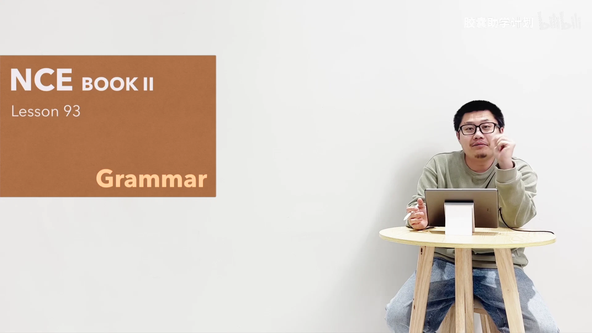

文字识别：NCE / BOOKⅡI / Lesson 93 / Grammar

### 画面 00:00:10

文字识别：胶囊助学计划bibl / •

### 画面 00:00:13

文字识别：胶囊助学计划册出 / 胶囊助学计划

### 画面 00:00:15

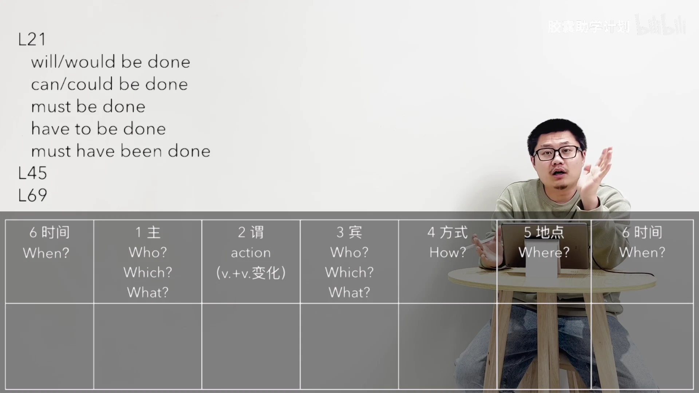

文字识别：囊助字计划 / L21 / will/would be done / can/could be done / must be done / have to be done / must have been done / L45 / L69 / 6时间 / 1主 / 2谓 / 3宾 / 4方式 / 5地点 / 6时间 / When? / Who? / action / Who? / How? / Where? / When? / Which? / (v.+v.变化) / Which? / What? / What?

## 00:00:30–00:01:00

要就是二十一课。二十一课重点学的是什么呢？就是情态动词的那些被动。其实最简单粗暴的就是直接在后边加 be done，看见了吗？我给各位标一下啊， be done。然后有一个特殊的呢，它实际上是把十七课和情态动词的被动，啊，这三个东西其实是情态动词本身、情态动词表推测、情态动词的被动，把这三个东西给它揉到了一起，出来了一个结构叫 must have been done。

### 画面 00:00:41

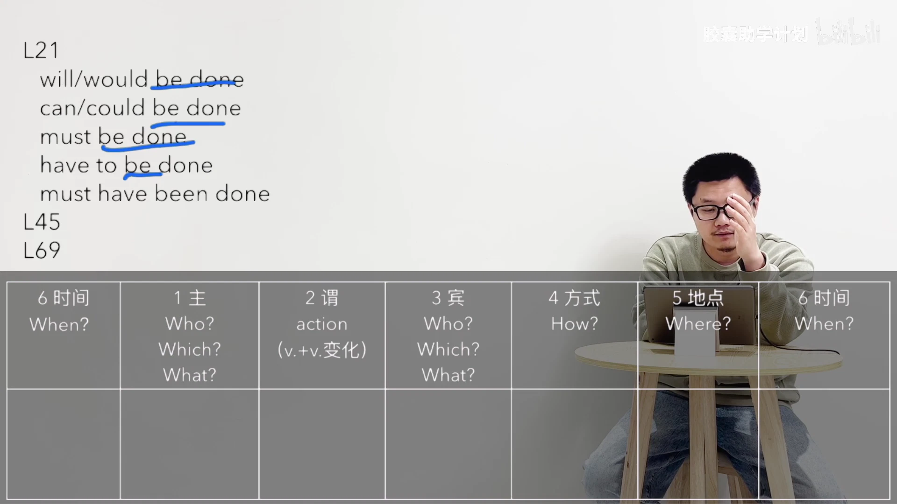

文字识别：L21 / will/would be dene / can/could be done / must be done / have to be done / must have been done / L45 / L69 / 6时间 / 1主 / 2谓 / 3宾 / 4方式 / 5地点 / 6时间 / When? / Who? / action / Who? / How? / Where? / When? / Which? / (v.+v.变化) / Which? / What? / What?

## 00:01:00–00:01:30

在我的印象当中，我在后来造单词造句的部分，我会尽可能不停的使用这个东西，因为我说这是你最容易遗忘的，叫 must have been done. 翻译成当时一定是被怎么怎么样了。它既有推测又有被动，对吧？这两个东西是连到一起的。剩下的呢就很中规中矩了，就是一个形态动词后边加个 be done 就行了。含义呢就按正常翻译，比如说 must be done 就没有推测的含义，就是必须被怎么怎么样。 Have

### 画面 00:01:11

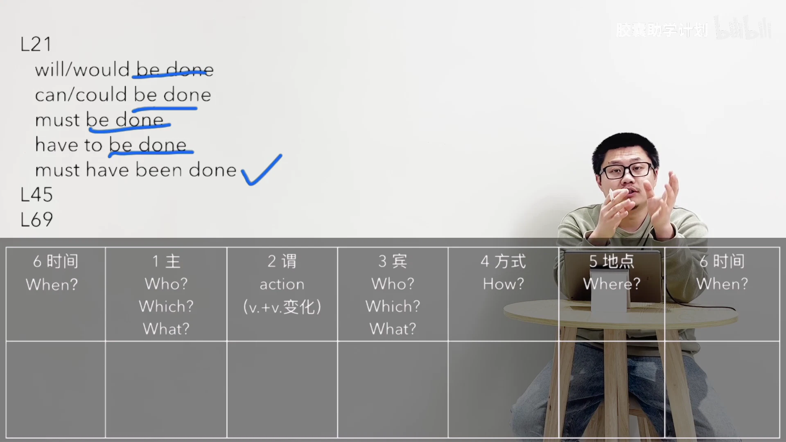

文字识别：L21 / will/would be dene / can/could be done / must be done / have to be done / must have been done / L45 / L69 / 6时间 / 1主 / 2谓 / 3宾 / 4方式 / 5地点 / 6时间 / When? / Who? / action / Who? / How? / Where? / When? / Which? / (v.+v.变化) / Which? / What? / What?

## 00:01:30–00:02:00

to就不得不背怎么怎么样，can能背怎么怎么样，will叫将背怎么怎么样，对吧？所以本课呢，重点也基本上就是在文章当中和呃这个语法视频练习当中，以练代讲的形式去练这些东西啊。那我们不挨个说了，但是呢，像你往前翻一翻，比如说你现在回到二十一课、四十五课、六十九课，如果有语法的话，重点可以迅速过一遍那个语法的视频，别的可以不过了。红皮书呢，初级、中级认真写一写，对

### 画面 00:01:41

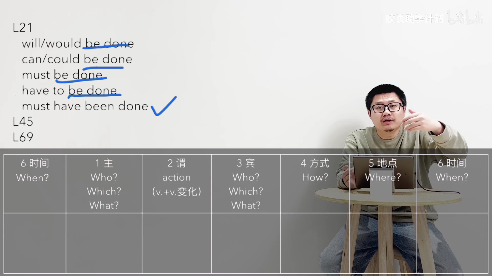

文字识别：L21 / will/would be dene / can/could be done / must be done / have to be done / must have been done / L45 / L69 / 6时间 / 1主 / 2谓 / 3宾 / 4方式 / 5地点 / 6时间 / When? / Who? / action / Who? / How? / Where? / When? / Which? / (v.+v.变化) / Which? / What? / What?

### 画面 00:01:45

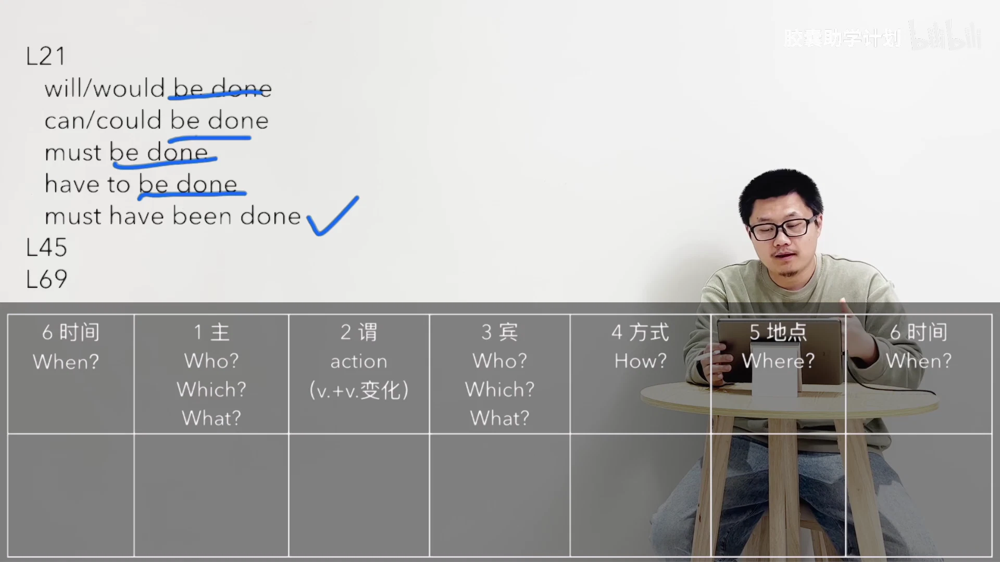

文字识别：L21 / will/would be done / can/could be done / must be done / have to be done / must have / been done / L45 / L69 / 6时间 / 1主 / 2谓 / 3宾 / 4方式 / 5地点 / 6时间 / When? / Who? / action / Who? / How? / Where? / When? / Which? / (v.+v.变化) / Which? / What? / What?

## 00:02:00–00:02:30

吧？好，呃，repetition drill，第一个啊，这个呃，张嘴跟我读就行了啊。Tell me about the car. Who will buy it? George will. The car will be bought by George. Will be但将被买，对吧？被谁呢？被George这个人。好，不挨个解释了啊，剩下全是张嘴读就行了。你自己注意力放在这个放在这个must be但上，对

### 画面 00:02:00

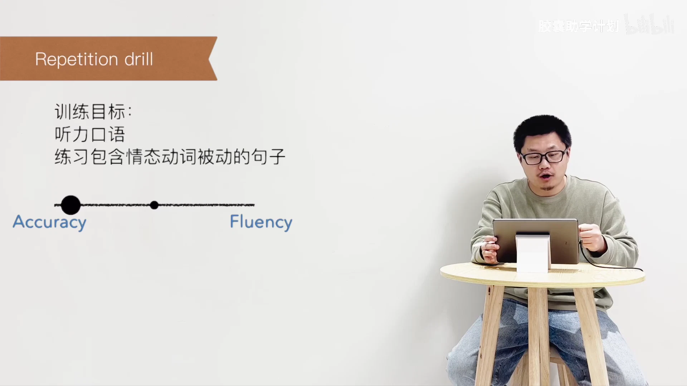

文字识别：Repetition drill / 训练目标： / 听力口语 / 练习包含情态动词被动的句子 / Accuracy / Fluency

### 画面 00:02:04

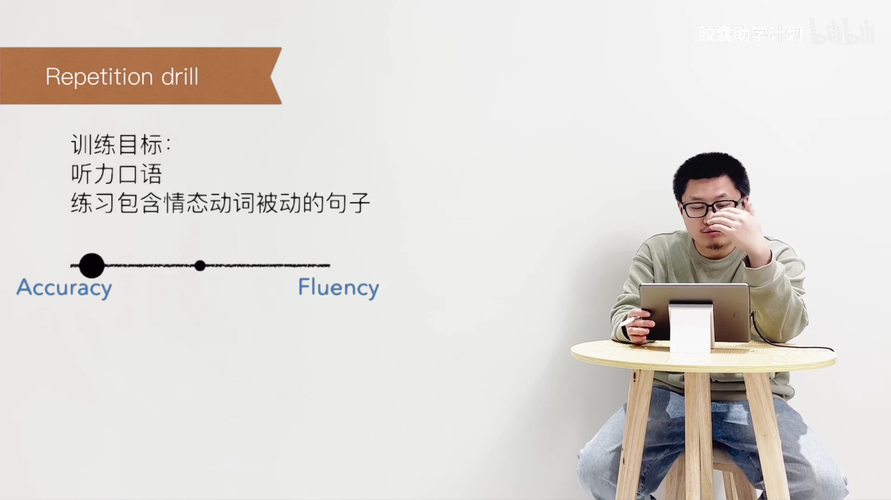

文字识别：Repetition drill / 训练目标： / 听力口语 / 练习包含情态动词被动的句子 / Accuracy / Fluency

### 画面 00:02:06

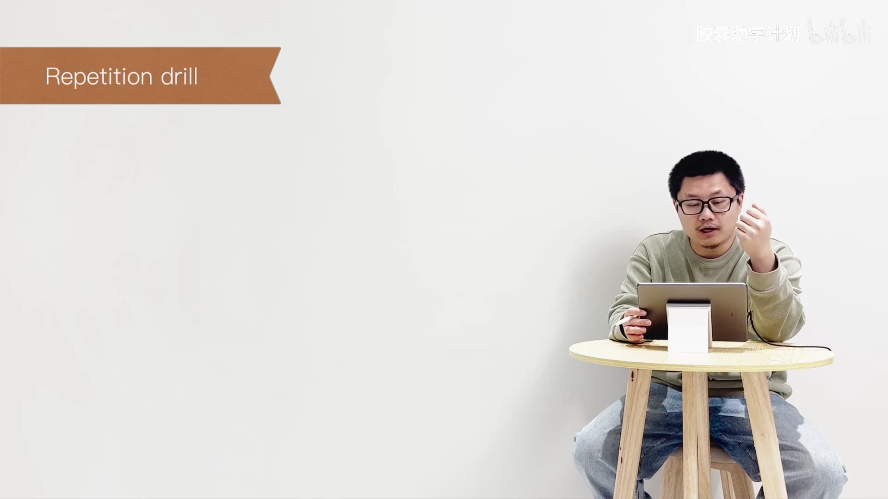

文字识别：Repetition drill

### 画面 00:02:08

文字识别：Repetition drill / (1)T: Tell me about the car. Who will buy it?

### 画面 00:02:27

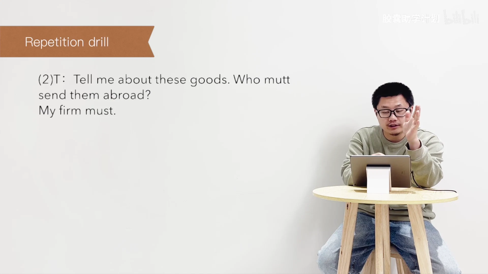

文字识别：Repetition drill / (2)T: Tell me about these goods. Who mutt / send them abroad? / My firm must.

## 00:02:30–00:03:00

吧？放在情态动词被动这个地方啊。来，tell me about these goods. Who must send them abroad? My firm must. These goods must be sent abroad by your firm. Tell me about the boat. Who could have damaged it? The sailor could have. The boat could have been damaged by the sailor. 这个其实也是情态动词，

### 画面 00:02:32

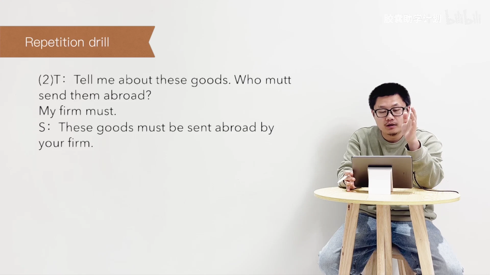

文字识别：Repetition drill / (2)T: Tell me about these goods. Who mutt / send them abroad? / My firm must. / S: These goods must be sent abroad by / your firm.

### 画面 00:02:34

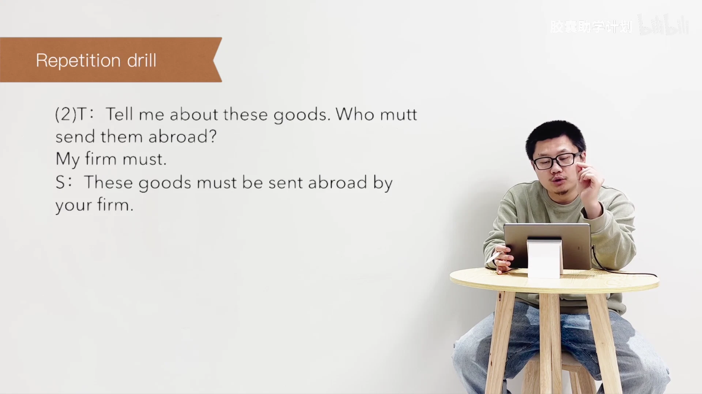

文字识别：Repetition drill / (2)T: Tell me about these goods. Who mutt / send them abroad? / My firm must. / S: These goods must be sent abroad by / your firm.

### 画面 00:02:36

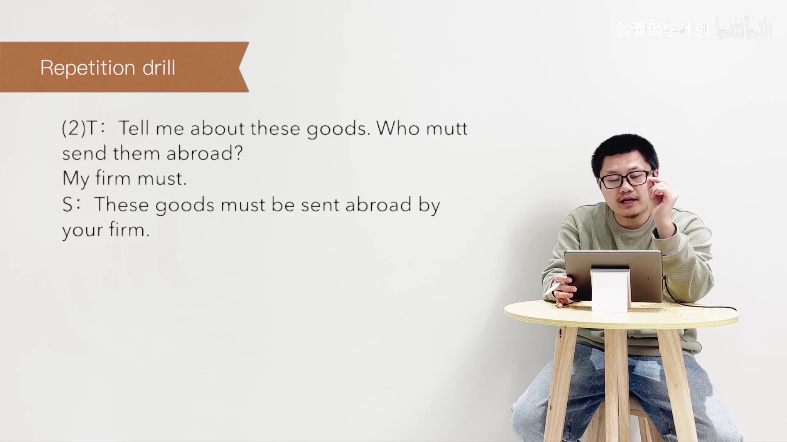

文字识别：Repetition drill / (2)T: Tell me about these goods. Who mutt / send them abroad? / My firm must. / S: These goods must be sent abroad by / your firm.

### 画面 00:02:45

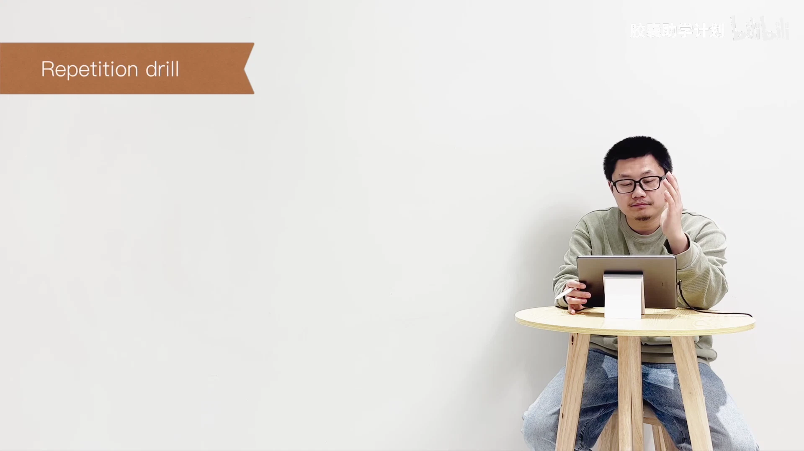

文字识别：Repetition drill

### 画面 00:02:53

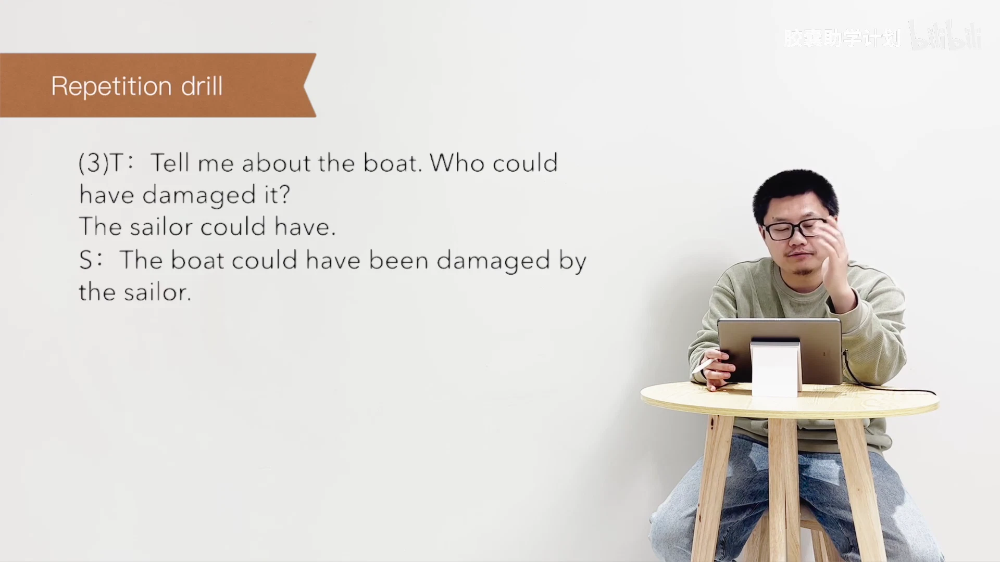

文字识别：Repetition drill / (3)T: Tell me about the boat. Who could / have damaged it? / The sailor could have. / S: The boat could have been damaged by / the sailor.

## 00:03:00–00:03:30

recording. Transcribe the exact words in their original spoken languages. Never translate. Preserve repetitions, questions and examples.

### 画面 00:03:09

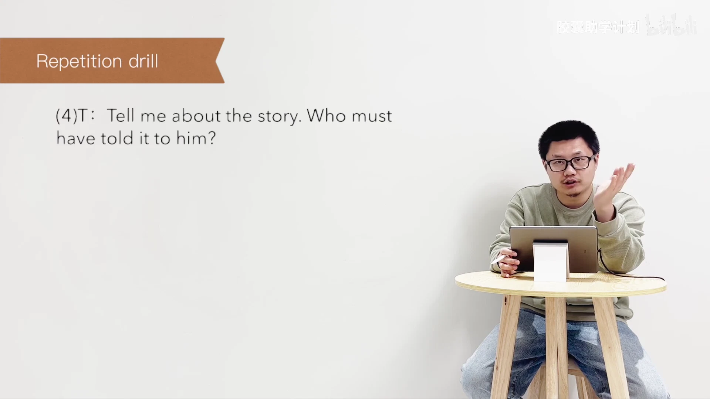

文字识别：Repetition drill / (4)T: Tell me about the story. Who must / have told it to him?

### 画面 00:03:15

文字识别：Repetition drill / (4)T: Tell me about the story. Who must / have told it to him? / A fisherman must have.

### 画面 00:03:23

文字识别：Repetition drill / 5T: Tell me about the boy. Who can / examine him?

### 画面 00:03:27

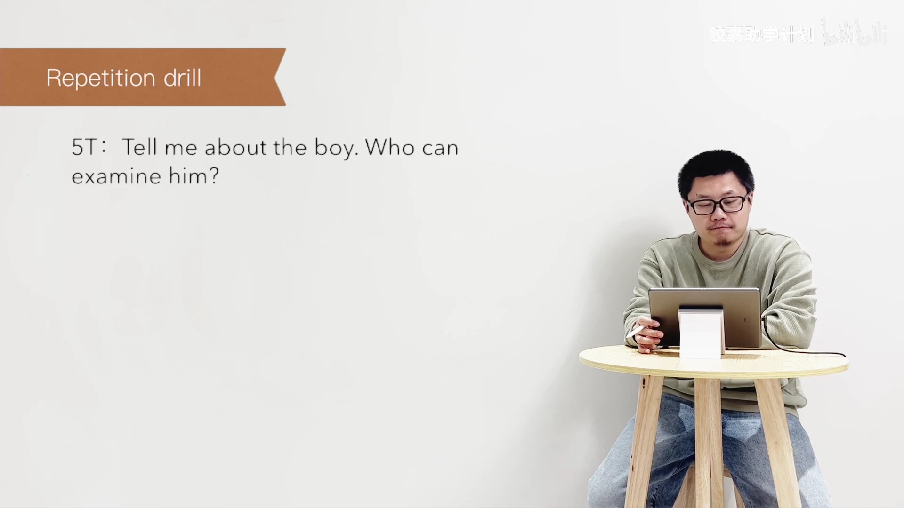

文字识别：Repetition drill / 5T: Tell me about the boy. Who can / examine him?

## 00:03:30–00:04:00

The boy can be examined by the doctor. Tell me about the prisoner. Who must have caught him? The guards must have. The prisoner must have been caught by the guards. Tell me about the children. Who will take them to school? Their mother will. The children will be taken to

### 画面 00:03:37

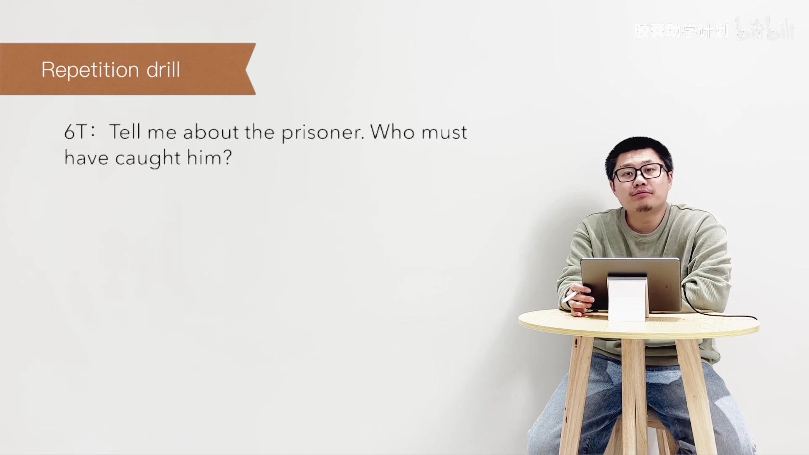

文字识别：Repetition drill / 6T: Tell me about the prisoner. Who must / have caught him?

### 画面 00:03:40

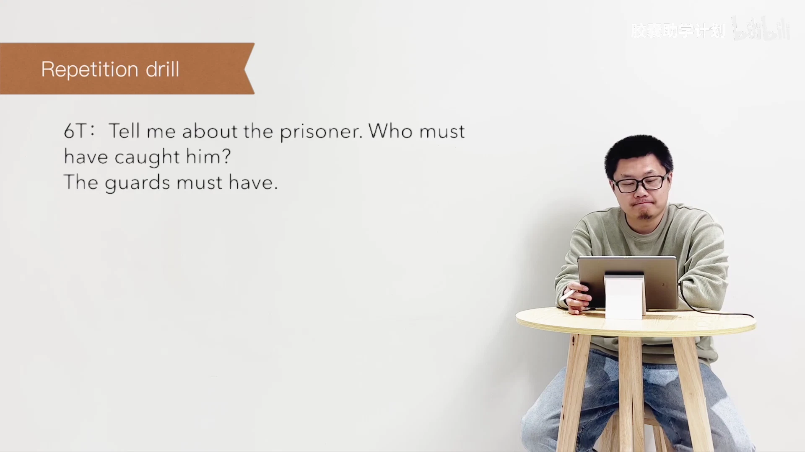

文字识别：Repetition drill / 6T: Tell me about the prisoner. Who must / have caught him? / The guards must have.

### 画面 00:03:42

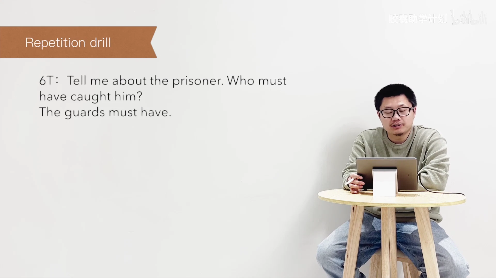

文字识别：Repetition drill / 6T: Tell me about the prisoner. Who must / have caught him? / The guards must have.

### 画面 00:03:44

文字识别：Repetition drill / 6T: Tell me about the prisoner. Who must / have caught him? / The guards must have. / S: The prisoner must have been caught by / the guards.

### 画面 00:03:49

文字识别：助子计划 / Repetition drill

### 画面 00:03:57

文字识别：Repetition drill / 7T: Tell me about the children. Who will / take them to school? / Their mother will. / S: The children will be taken to school by / their mother.

## 00:04:00–00:04:30

school by their mother. Tell me about this house. Who may have bought it? A friend of mine may have. This house may have been bought by a friend of yours. 好，这地方提还是暂停提一句，这地方只不过就是 must 被换成了 may. Must have been done 就当时一定是被, may have been done 就是当时可能是被，对吧？就这个房子当时可能是被一个你的朋友买

### 画面 00:04:02

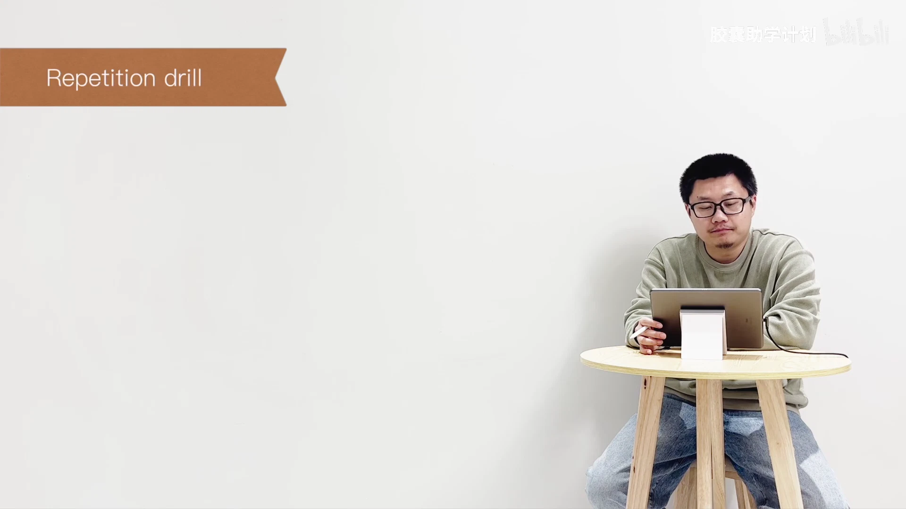

文字识别：助字计划 / Repetition drill

### 画面 00:04:10

文字识别：Repetition drill / 8T: Tell me about this house. Who may have / bought it? / A friend of mine may have. / S: This house may have been bought by a / friend of yours.

### 画面 00:04:18

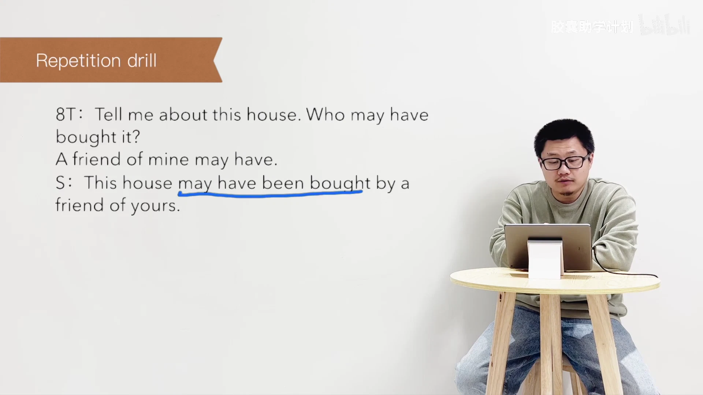

文字识别：Repetition drill / 8T: Tell me about this house. Who may have / bought it? / A friend of mine may have. / S: This house may have been bought by a / friend of yours.

### 画面 00:04:21

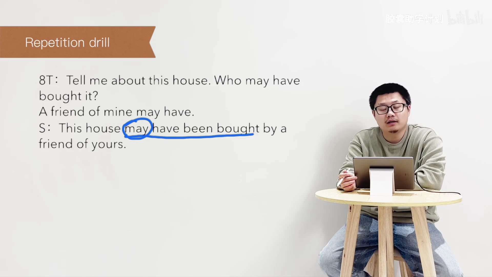

文字识别：Repetition drill / 8T: Tell me about this house. Who may have / bought it? / A friend of mine may have. / S: This housemayhave been bought by a / friend of yours.

## 00:04:30–00:05:00

下来了. Next one, tell me about the boy who will find him. The police will. The police will be found by the police. Ah, the boy will be found by the police. Tell me about this building. Who must design it? An architect must. This building must be designed by an architect. Okay, repetition drill结束. Pattern drill.

### 画面 00:04:31

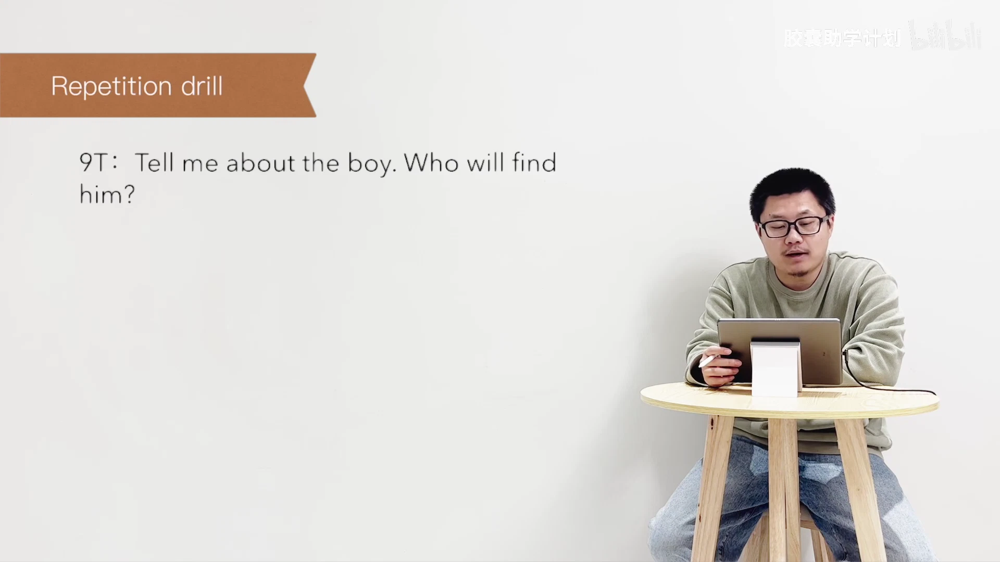

文字识别：Repetition drill / 9T: Tell me about the boy. Who will find / him?

### 画面 00:04:34

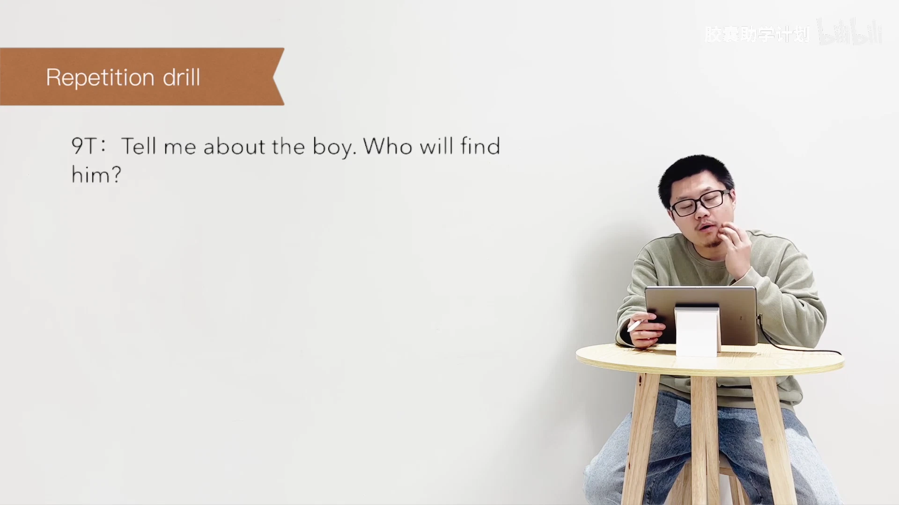

文字识别：Repetition drill / 9T: Tell me about the boy. Who will find / him?

### 画面 00:04:37

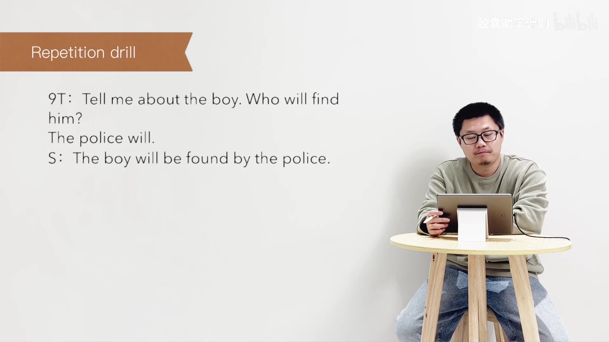

文字识别：Repetition drill / 9T: Tell me about the boy. Who will find / him? / The police will. / S: The boy will be found by the police.

### 画面 00:04:45

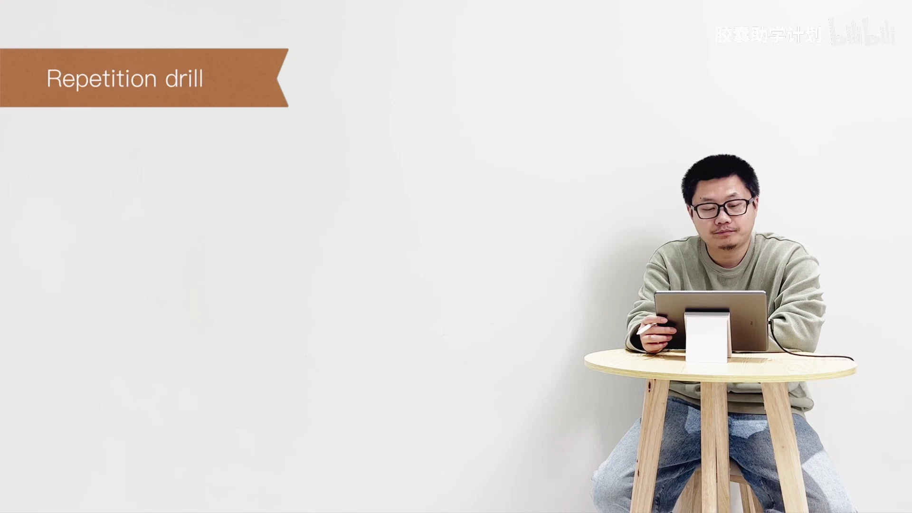

文字识别：Repetition drill

### 画面 00:04:53

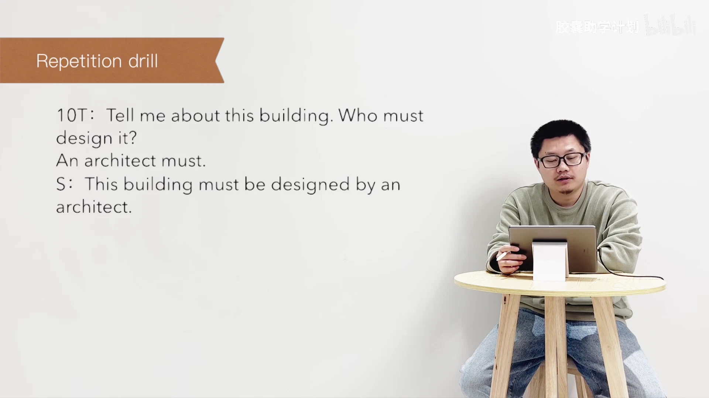

文字识别：Repetition drill / 10T: Tell me about this building. Who must / design it? / An architect must. / S: This building must be designed by an / architect.

### 画面 00:04:58

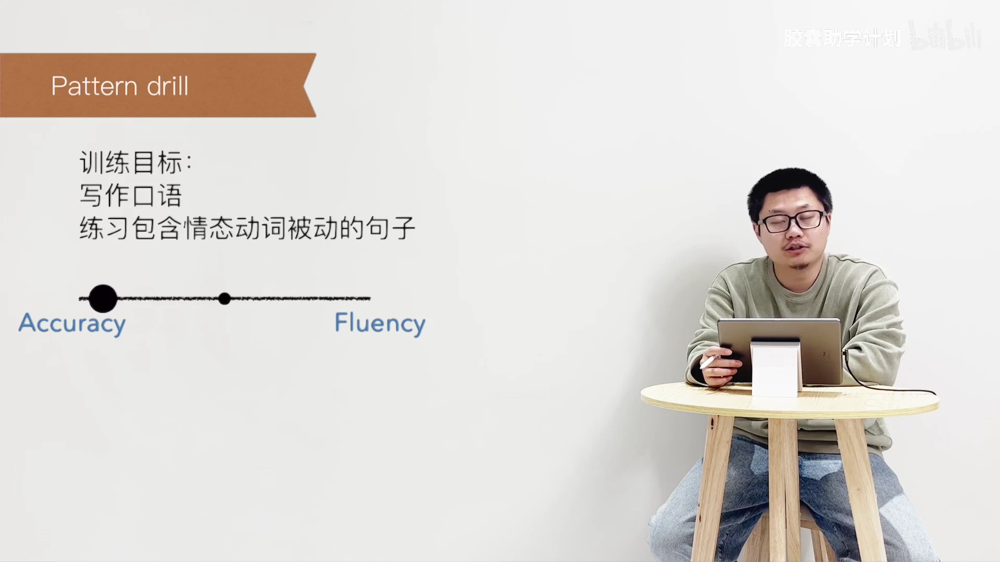

文字识别：Pattern drill / 训练目标： / 写作口语 / 练习包含情态动词被动的句子 / Accuracy / Fluency

## 00:05:00–00:05:30

四乘四老习惯啊。我们只讲S一S二S一。Where will they be sending my case?他们会把我的这个箱子送往何处呢？我要be doing it will be sent to your home.它会被送往你家。好，will be done对吧？复习往里带。第二个，I can't get this camera to work. It must be broken.我没法让这个怎么样？这个照相机工作啊，它一定是坏了。

### 画面 00:05:00

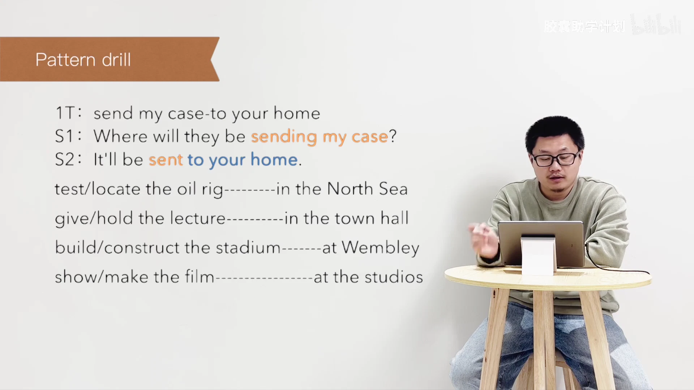

文字识别：Pattern drill / 1T: send my case-to your home / S1: Where will they be sending my case? / S2: It'll be sent to your home. / test/locate the oil rig--in theNorth Sea / give/hold the lecture---in the town hall / build/construct the stadium----at Wembley / show/make the film--. / --at the studios

### 画面 00:05:19

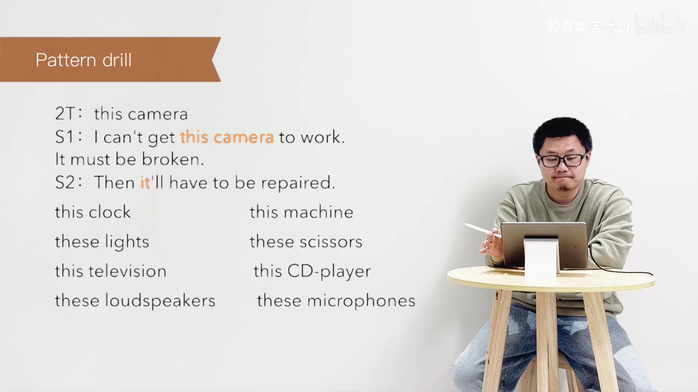

文字识别：Pattern drill / 2T: this camera / S1: I can't get this camera to work. / It must be broken. / S2: Then it'll have to be repaired. / this clock / this machine / these lights / these scissors / this television / this CD-player / these loudspeakers / these microphones

## 00:05:30–00:06:00

broken. Then it will have to be repaired. It must be repaired, have to be done, right? This is the second, the third. Why can't the luggage be sent now? Why can't the luggage be sent now? Why can't the luggage be sent now? Why can't the luggage be sent now? Why can't the luggage be sent now? Why can't the luggage be sent now? Why can't the luggage be sent now? Why can't the luggage be sent now? Why can't the luggage be sent now? Why can't the luggage be sent now? Why can't the luggage be sent now? Why can't the luggage be sent now?

### 画面 00:05:38

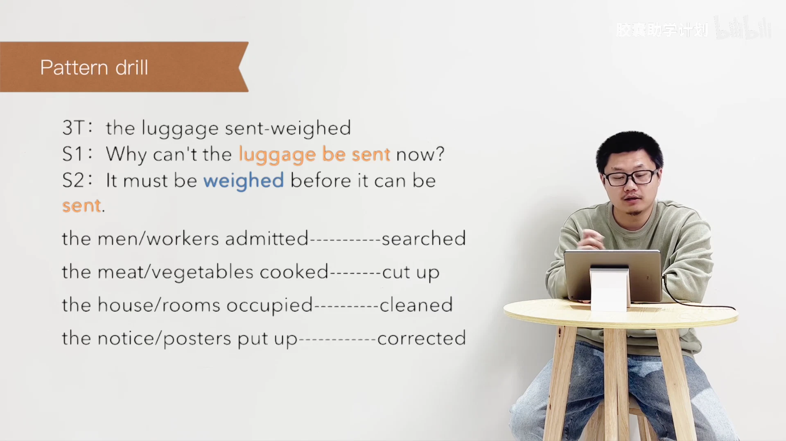

文字识别：Pattern drill / 3T: the luggage sent-weighed / S1: Why can't the luggage be sent now? / S2: It must be weighed before it can be / sent. / the men/workers admitted--------searched / the meat/vegetables cooked--cut up / the house/rooms occupied---cleaned / the notice/posters put up-- / -----corrected

### 画面 00:05:59

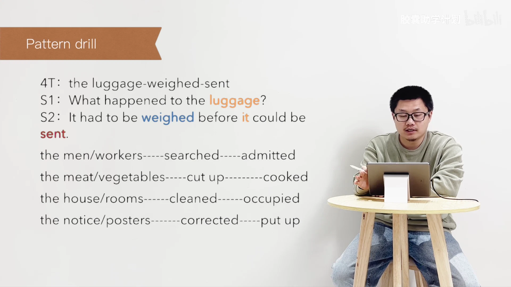

文字识别：Pattern drill / 4T: the luggage-weighed-sent / S1: What happened to the luggage? / S2: It had to be weighed before it could be / sent. / the men/workers---searched----admitted / themeat/vegetables--cutup--cooked / the house/rooms---cleaned---occupied / the notice/posters-----corrected----put up

## 00:06:00–00:06:30

第四个，What happened to the luggage? 哎，这个行李发生了什么呢？What happened to your friend? 对吧？你朋友身上发生了什么事儿呢？It had to be weighed before it could be sent. 其实就是变成了过去嘛。刚才是 must，must 没法表过去，所以换成了 had to。然后这里现在变成了 had to be done。然后刚才的 can 变成了 could be done，对吧？往里边去带一下就好了。那本课就是复习了一下情态动词的被动

### 画面 00:06:26

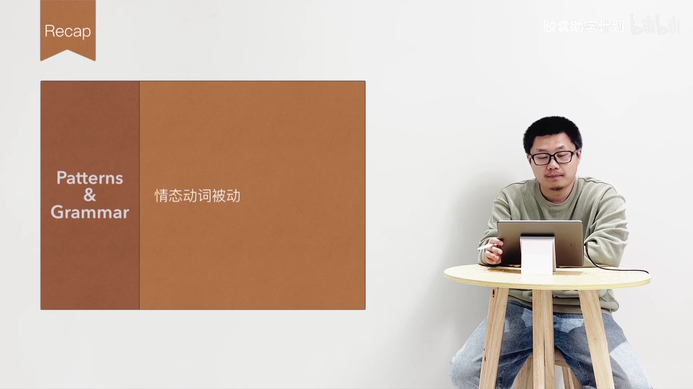

文字识别：Recap / 延字计划 / Patterns / ＆ / 情态动词被动 / Grammar

### 画面 00:06:28

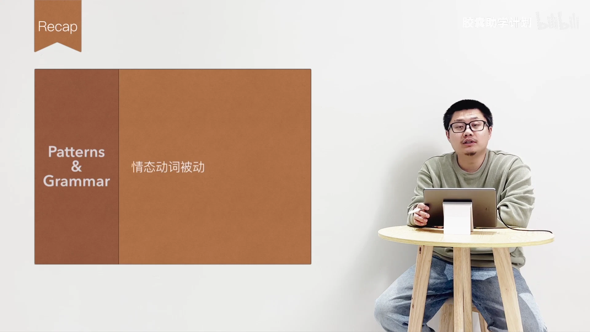

文字识别：Recap / Patterns / ＆ / 情态动词被动 / Grammar

## 00:06:30–00:07:00

嘛，对吧？呃，家庭作业呢，pattern drill你去写回忆讲解啊，主要是二十一课那几个结构。然后呢，红皮书是这样的，你不要只管中级了，初级、中级所有目前其实关于情态动词，甭管是主动还是被动，还是表推测还是表推测的主动被动，所有情态动词只要涉及到了，在初级和中级红皮书当中全部给他写了，是吧？哎，就一口气儿都给他完成啊。

### 画面 00:06:30

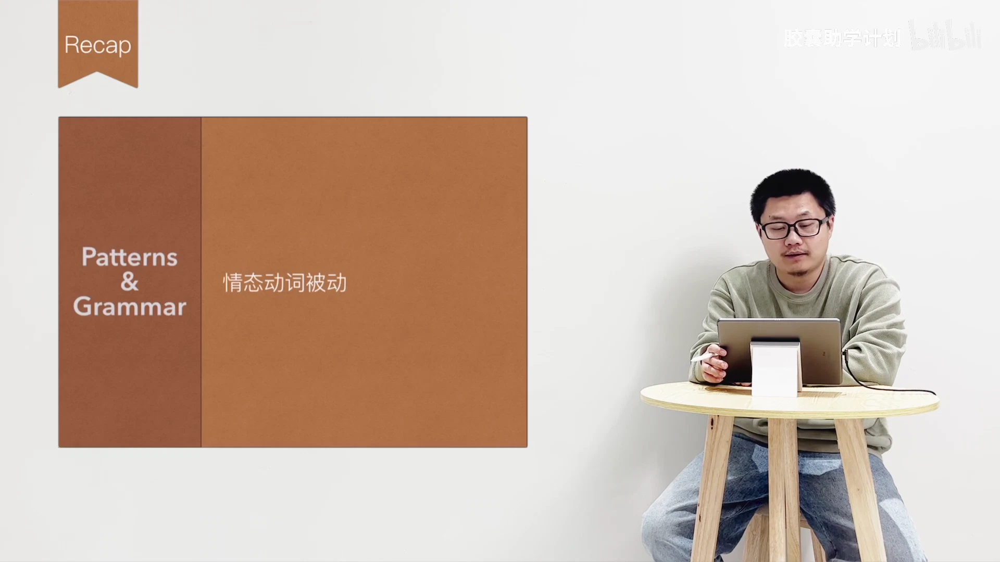

文字识别：Recap / Patterns / ＆ / 情态动词被动 / Grammar

### 画面 00:06:32

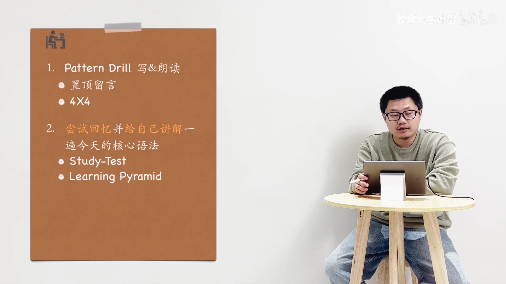

文字识别：Pattern Drill写&朗读 / 1. / 置顶留言 / 4×4 / 尝试回忆并给自己讲解一 / 遍今天的核心语法 / Study-Test / Learning Pyramid

### 画面 00:06:34

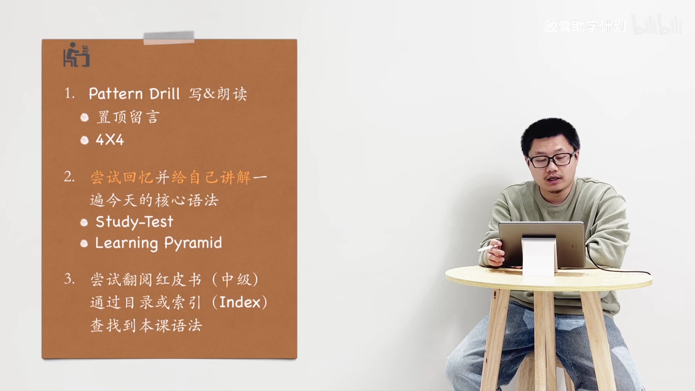

文字识别：1. f / Pattern Drill写&朗读 / 置顶留言 / 4×4 / 尝试回忆并给自己讲解一 / 遍今天的核心语法 / Study-Test / Learning Pyramid / 尝试翻阅红皮书（中级） / 通过目录或索引(Index) / 查找到本课语法

### 画面 00:06:36

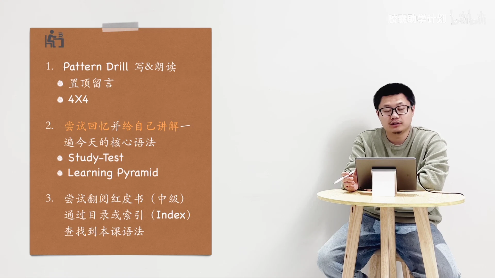

文字识别：Pattern Drill 写&朗读 / 置顶留言 / 4×4 / 尝试回忆并给自己讲解一 / 遍今天的核心语法 / Study-Test / Learning Pyramid / 尝试翻阅红皮书（中级） / 通过目录或索引(Index) / 查找到本课语法

### 画面 00:06:40

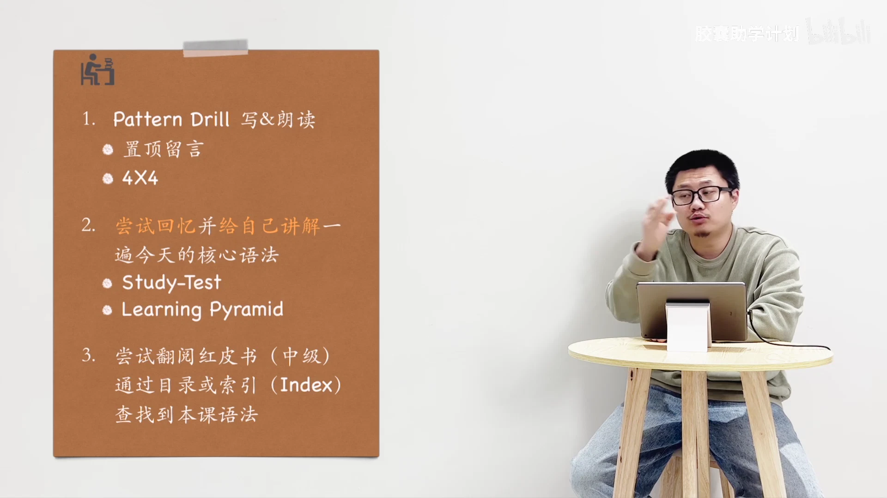

文字识别：Pattern Drill 写&朗读 / 1.f / 置顶留言 / 4×4 / 尝试回忆并给自己讲解一 / 遍今天的核心语法 / Study-Test / Learning Pyramid / 尝试翻阅红皮书（中级） / 通过目录或索引(Index) / 查找到本课语法

### 画面 00:06:45

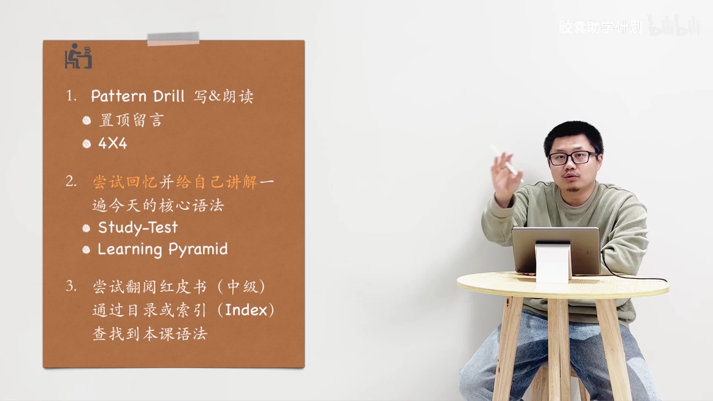

文字识别：1.↑ / Pattern Drill 写&朗读 / 置顶留言 / 4×4 / 尝试回忆并给自己讲解一 / 遍今天的核心语法 / Study-Test / Learning Pyramid / 尝试翻阅红皮书（中级） / 通过目录或索引(Index) / 查找到本课语法

### 画面 00:06:50

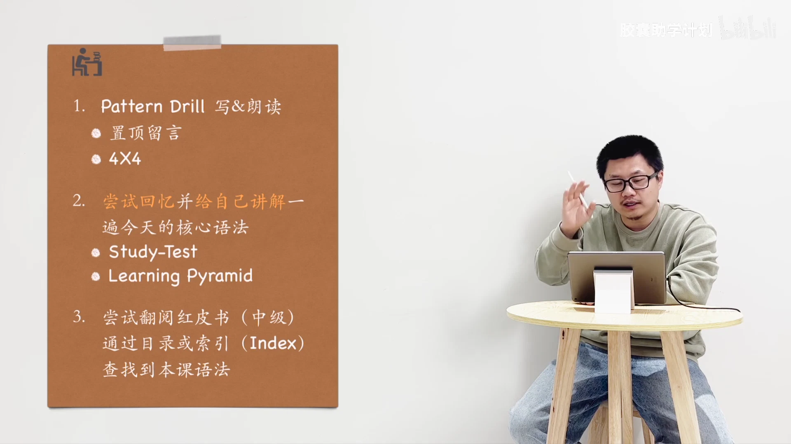

文字识别：1.Pattern Drill 写&朗读 / 置顶留言 / 4×4 / 尝试回忆并给自己讲解一 / 遍今天的核心语法 / Study-Test / Learning Pyramid / 尝试翻阅红皮书（中级） / 通过目录或索引(Index) / 查找到本课语法

### 画面 00:06:53

文字识别：1.Pattern Drill 写&朗读 / 置顶留言 / 4×4 / 尝试回忆并给自己讲解一 / 遍今天的核心语法 / Study-Test / Learning Pyramid / 尝试翻阅红皮书（中级） / 通过目录或索引(Index) / 查找到本课语法

### 画面 00:06:55

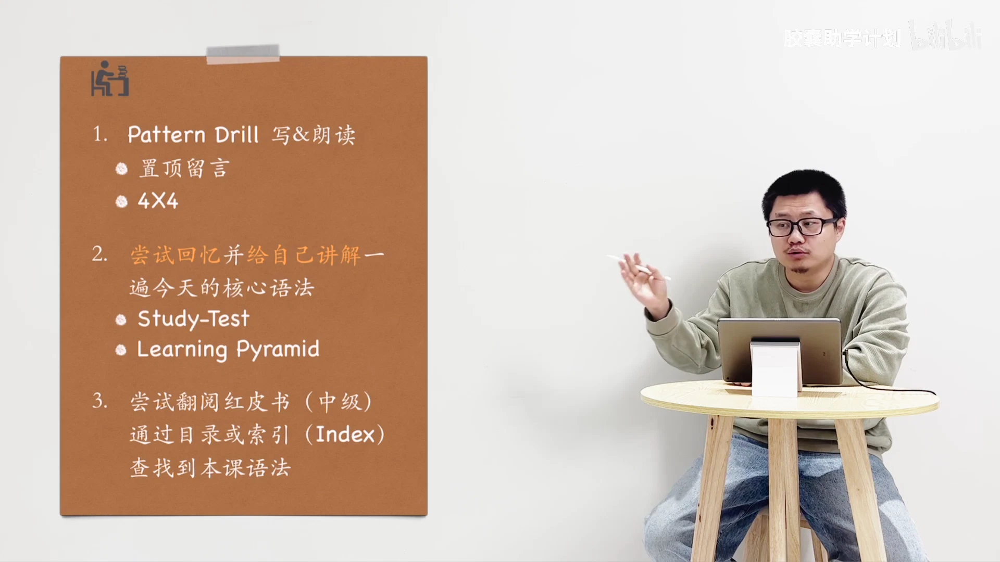

文字识别：Pattern Drill写&朗读 / 1. f / 置顶留言 / 4×4 / 尝试回忆并给自己讲解一 / 遍今天的核心语法 / Study-Test / Learning Pyramid / 尝试翻阅红皮书（中级） / 通过目录或索引(Index) / 查找到本课语法

### 画面 00:06:59

文字识别：虞助学计划一 / 👍

## 00:07:00–00:07:25

那以上呢就是本期视频的全部内容了。如果各位喜欢我们的课程呢，欢迎各位关注、订阅、一键三连、分享给那些需要的朋友，来帮助我们快速成长。See you next time.

### 画面 00:07:03

文字识别：妻助学计划一州 / 不

### 画面 00:07:05

文字识别：毫助学计划一 / 不 / 🌟

### 画面 00:07:12

文字识别：臺助学计划

### 画面 00:07:14

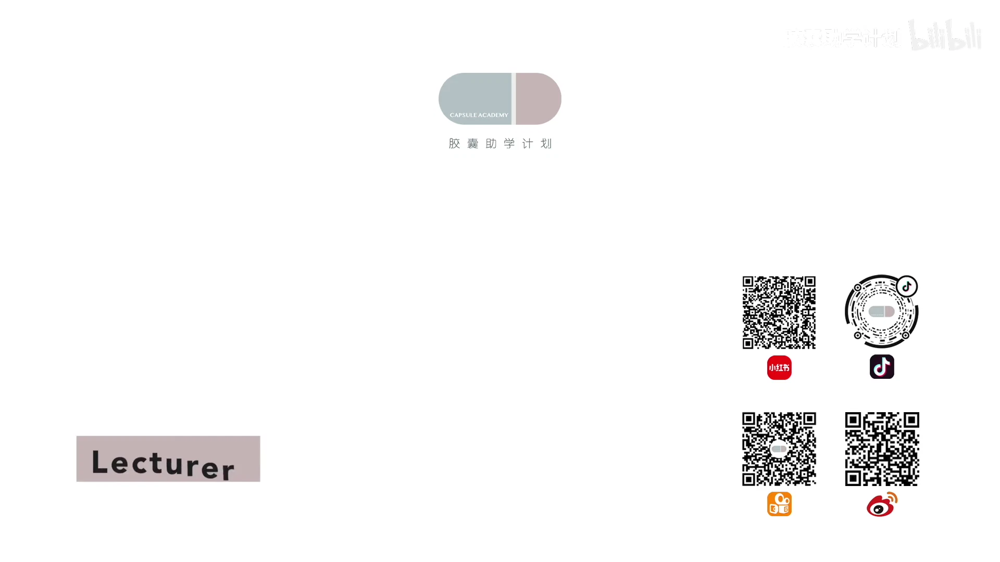

文字识别：運動字計划 / CAPSULEACADEMY / 胶囊助学计划 / 小红书 / Lecturer / OE

### 画面 00:07:16

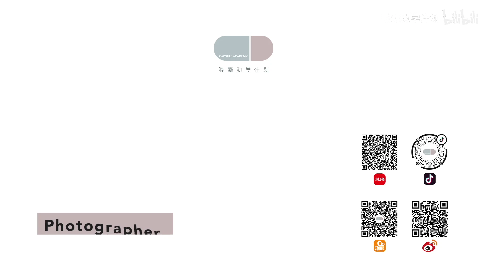

文字识别：CAPSULEACADEMY / 胶囊助学计划 / 小红书 / □ / Photographer / OE

### 画面 00:07:19

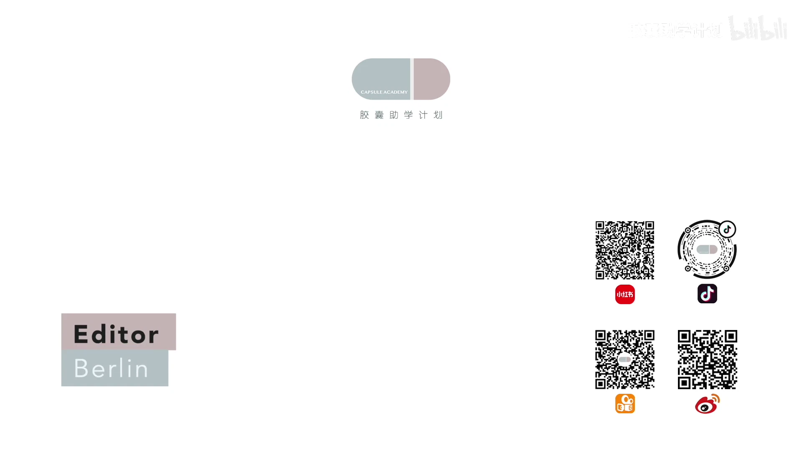

文字识别：CAPSULEACADEMY / 胶囊助学计划 / 小红书 / Editor / Berlin / OE

### 画面 00:07:22

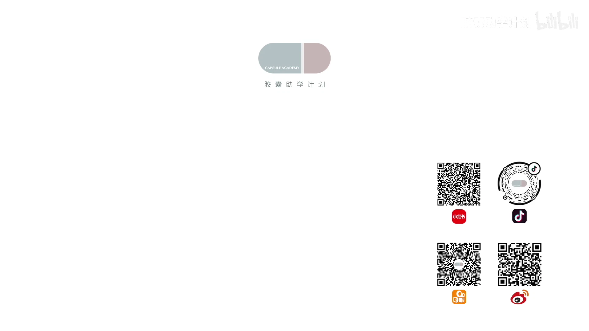

文字识别：CAPSULEACADEMY / 胶囊助学计划 / 『 / 小红书

### 画面 00:07:24

文字识别：bilbili / 胶囊助学计划

### 画面 00:07:25

文字识别：bilbili / 胶囊助学计划

