# 093 文章

快速机器解析：语音为单模型转写，未进行独立交叉校对或人工复核；画面每秒采样并按变化选帧，短时文字和标记可能遗漏。截图时间约有 1 秒误差。图片有损压缩；遇到疑点请按时间查看 Google Drive 原视频。

## 00:00:00–00:00:30

Hello everyone, welcome to Capsule Academy. This is Liu. Today we're going to learn New Concept English Book Two Lesson Ninety Three Story. Hope you gonna enjoy it. Okay,好，我们接下来看一下文章的标题和他问的问题啊，叫做 Noble Gift，一个高尚的礼物。那我们现在基本知道了，这个礼物就是 Statue of Liberty，对吧？自由女神像。啊，他问的问题是 Where was the Statue of Liberty made?

### 画面 00:00:00

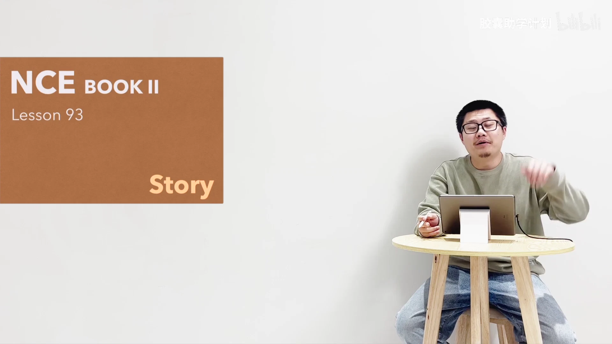

文字识别：NCE / BOOK"I / Lesson 93 / Story

### 画面 00:00:02

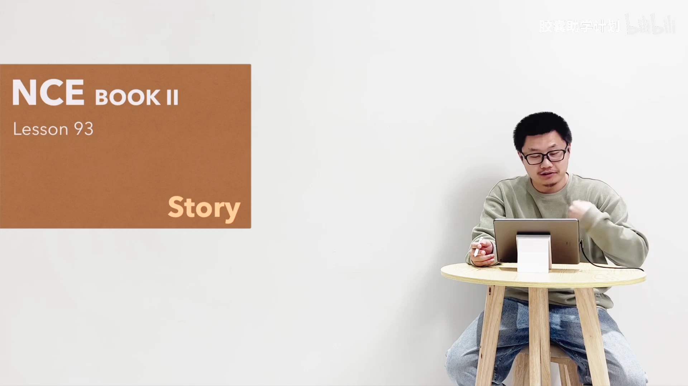

文字识别：NCE / BOOKⅡI / Lesson 93 / Story

### 画面 00:00:09

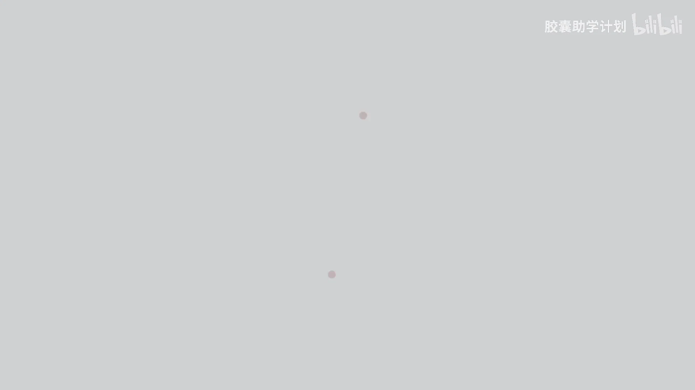

文字识别：胶囊助学计划 / •

### 画面 00:00:13

文字识别：助学針划一 / 胶囊助学计划

### 画面 00:00:15

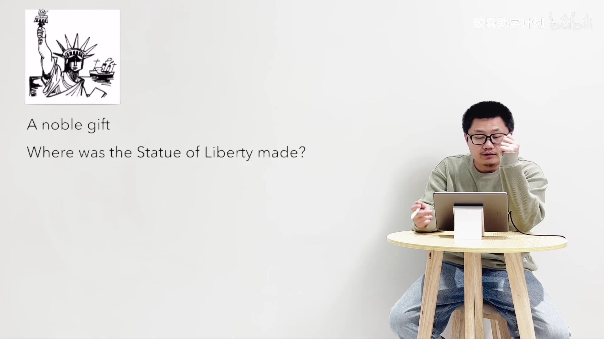

文字识别：A noble gift / Where was the Statue of Liberty made?

## 00:00:30–00:01:00

哎，你自己带着这个问题跟着我接下来去看文章啊。自由女神像在哪儿制作的？来了，One of the most famous monuments in the world, the Statue of Liberty, was presented to the United States of America in the 19th century by the people of France.哇，乍一看好像长难句，但是其实没什么连词，不是长难句，它只是真的这个句子齁长。为什么长呢？有如下几

### 画面 00:00:36

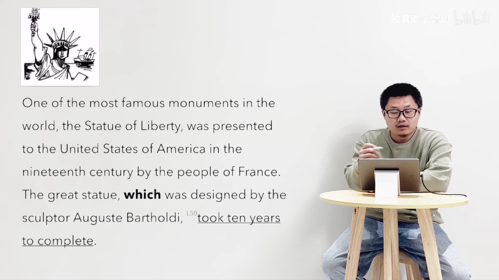

文字识别：One of the most famous monuments in the / world, the Statue of Liberty, was presented / to the United States of America in the / nineteenth century by the people of France. / The great statue, which was designed by the / sculptor Auguste Bartholdi, 5°took ten years / to complete.

### 画面 00:00:53

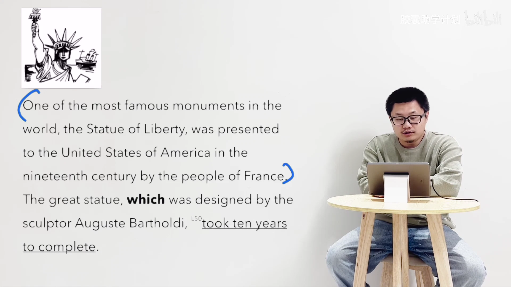

文字识别：One of the most famous monuments in the / world, the Statue of Liberty, was presented / to the United States of America in the / nineteenth century by the people of France, / The great statue, which was designed by the / sculptor Auguste Bartholdi, 5°took ten years / to complete.

### 画面 00:00:58

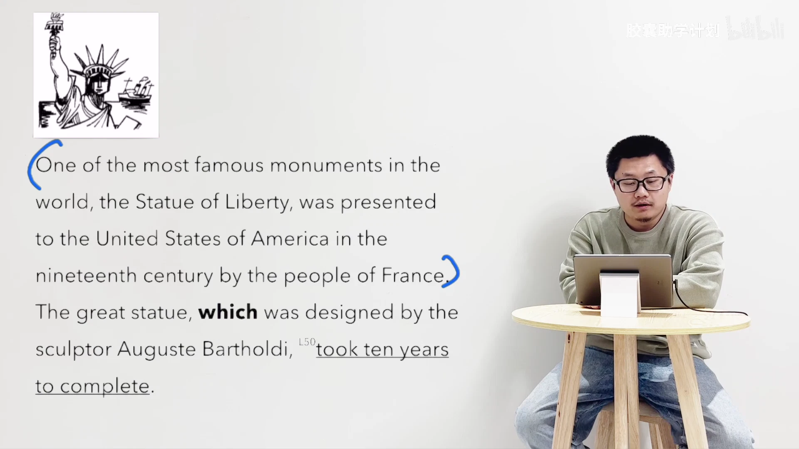

文字识别：One of the most famous monuments in the / world, the Statue of Liberty, was presented / to the United States of America in the / nineteenth century by the people of France, / The great statue, which was designed by the / sculptor Auguste Bartholdi, 5°took ten years / to complete.

## 00:01:00–00:01:30

个原因。我们先看一下，one of其中之一，the most famous monuments叫做最著名的纪念碑之一。In the world叫全世界，全世界最著名的纪念碑之一。后边给了一个逗号，这儿又给了个逗号，同位语。The Statue of Liberty叫自由女神像，就是自由女神像就是全世界最著名的纪念碑之一。然后，全世界最著名的纪念碑之一就是自由女神像，它俩是一码事，画等号，对吧？

### 画面 00:01:19

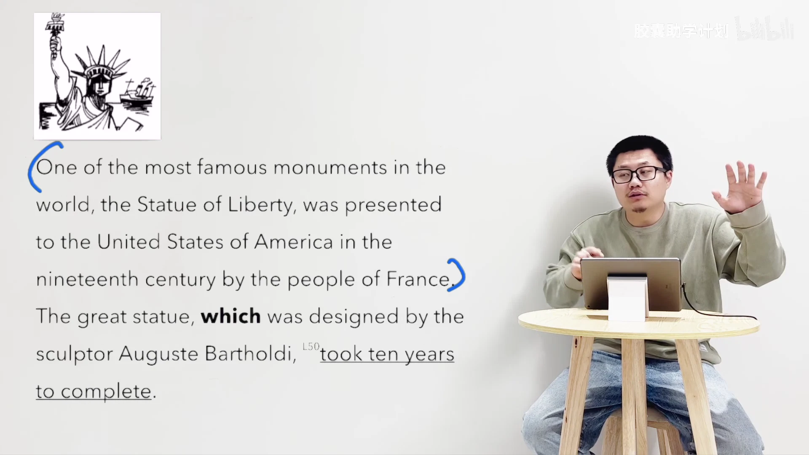

文字识别：One of the most famous monuments in the / world, the Statue of Liberty, was presented / to the United States of America in the / nineteenth century by the people of France, / The great statue, which was designed by the / sculptor Auguste Bartholdi, 5°took ten years / to complete.

### 画面 00:01:21

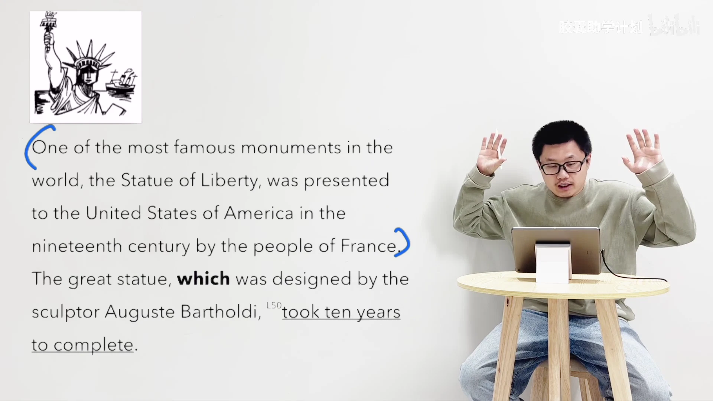

文字识别：One of the most famous monuments in the / world, the Statue of Liberty, was presented / to the United States of America in the / nineteenth century by the people of France2 / The great statue, which was designed by the / sculptor Auguste Bartholdi, 5°took ten years / to complete.

### 画面 00:01:23

文字识别：One of the most famous monuments in the / world, the Statue of Liberty, was presented / to the United States of America in the / nineteenth century by the people of France. / The great statue, which was designed by the / sculptor Auguste Bartholdi, 5°took ten years / to complete.

### 画面 00:01:25

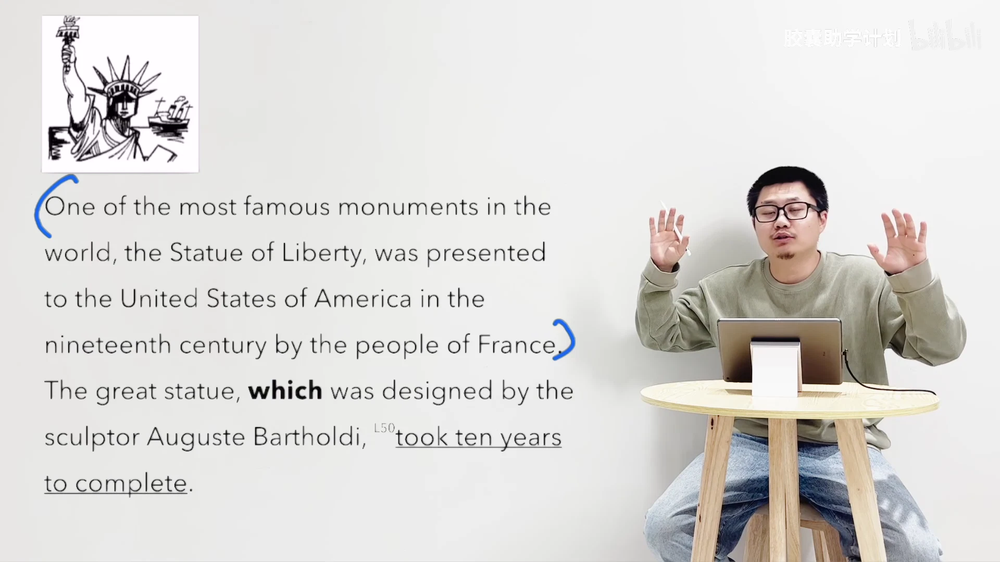

文字识别：One of the most famous monuments in the / world, the Statue of Liberty, was presented / to the United States of America in the / nineteenth century by the people of France? / The great statue, which was designed by the / sculptor Auguste Bartholdi, 5°took ten years / to complete.

### 画面 00:01:27

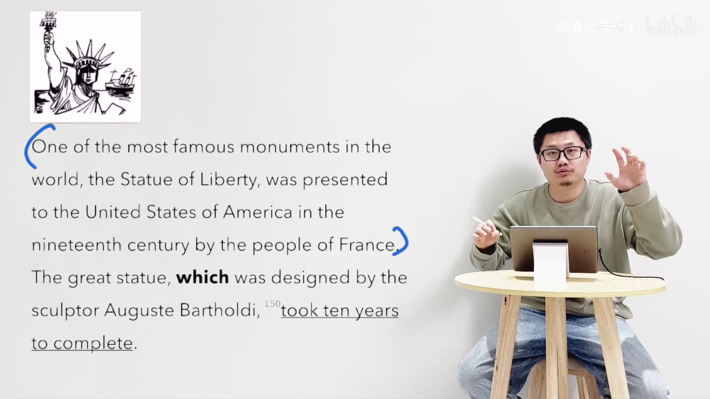

文字识别：One of the most famous monuments in the / world, the Statue of Liberty, was presented / to the United States of America in the / nineteenth century by the people of France, / The great statue, which was designed by the / sculptor Auguste Bartholdi, [5°took ten years / to complete.

### 画面 00:01:29

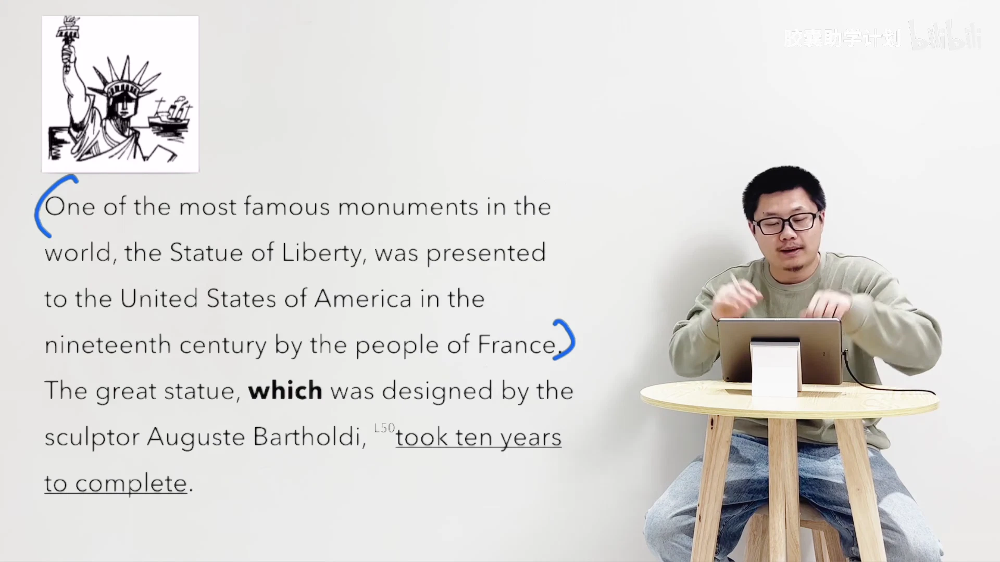

文字识别：One of the most famous monuments in the / world, the Statue of Liberty, was presented / to the United States of America in the / nineteenth century by the people of France, / The great statue, which was designed by the / sculptor Auguste Bartholdi, 5°took ten years / to complete.

## 00:01:30–00:02:00

所以你看，这个光主语就这么长了，那这个句子长一点也能理解。怎么样呢？Was presented，哎，动词出现了，to，to了谁呢？The United States of America，啊，它这个其实说USA就可以了，或者America就可以了。它给了个美利坚合众国全称，是吧？United States of America，美利坚合众国全称，被A这个东西啊，其实就是这么个东西，怎么样了呢？被送给了，注意这是个被动，对吧？被赠

### 画面 00:01:31

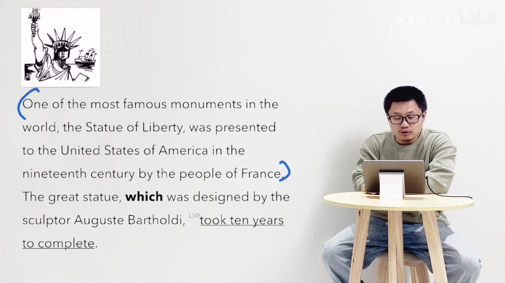

文字识别：One of the most famous monuments in the / world, the Statue of Liberty, was presented / to the United States of America in the / nineteenth century by the people of France, / The great statue, which was designed by the / sculptor Auguste Bartholdi, 5°took ten years / to complete.

### 画面 00:01:33

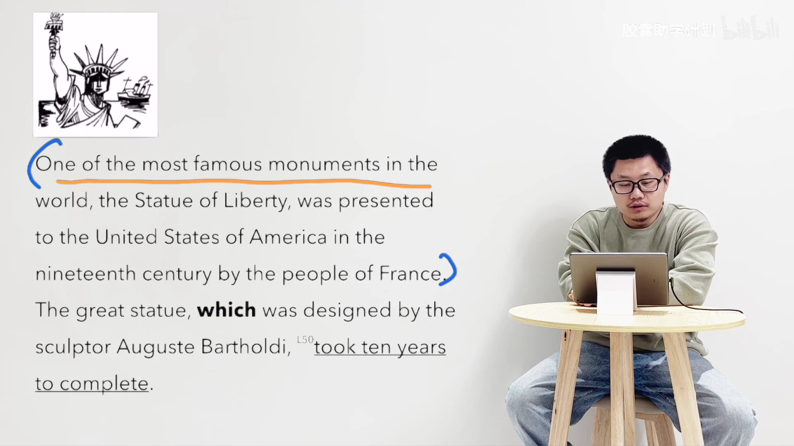

文字识别：One of the most famous monuments in the / world, the Statue of Liberty, was presented / to the United States of America in the / nineteenth century by the people of France, / The great statue, which was designed by the / sculptor Auguste Bartholdi, 5°took ten years / to complete.

### 画面 00:01:35

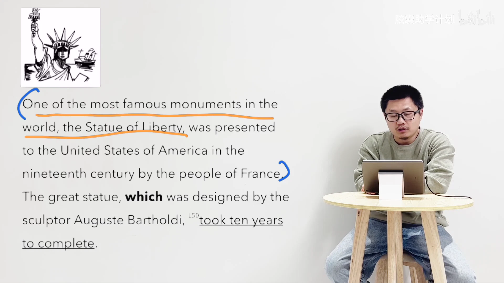

文字识别：One of the most famous monuments in the / world, the Statue of Liberty, was presented / to the United States of America in the / nineteenth century by the people of France, / The great statue, which was designed by the / sculptor Auguste Bartholdi, 5°took ten years / to complete.

### 画面 00:01:59

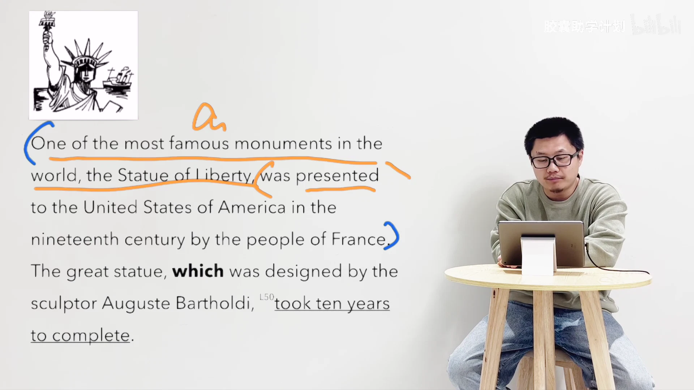

文字识别：a / One of the most famous monuments in the / world, the Statue of Liberty/ / was presented / to the United States of America in the / nineteenth century by the people of France, / The great statue, which was designed by the / sculptor Auguste Bartholdi, 5°took ten years / to complete.

## 00:02:00–00:02:30

送给了B，B啊，B是谁呢？就美国。时间呢是in the 19th century，十九世纪啊，一八零零年到一八九九年。被谁呢？The people of France，法国人民啊。所以你看这个句子呢，其实特别简单，就是A被赠送给了B，在一个时间点被谁，是吧？就这么几个事儿。但是它那个这个句子呢，写的就很长。其实这个句子我们如

### 画面 00:02:02

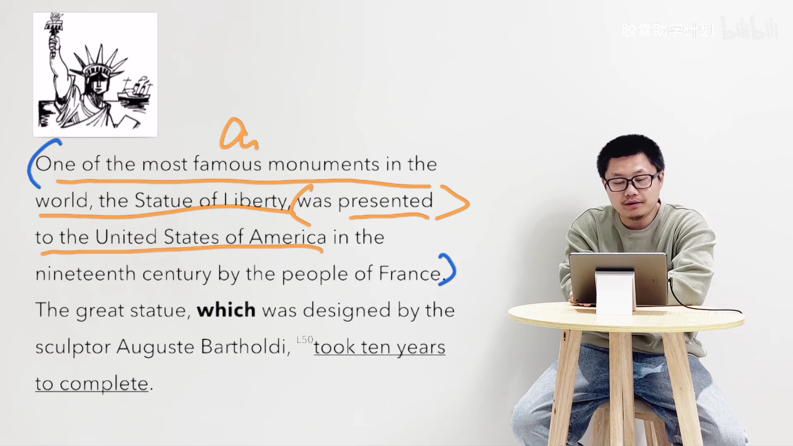

文字识别：a / One of the most famous monuments in the / world, the Statue of Liberty/ / was presented / to the United States of America in the / nineteenth century by the people of France, / The great statue, which was designed by the / sculptor Auguste Bartholdi, 5°took ten years / to complete.

### 画面 00:02:18

文字识别：a / One of the most famous monuments in the / world, the Statue of Liberty / was presented / to the United States of America in the / nineteenth century by the people of France, / The great statue, which was designed by the / sculptor Auguste Bartholdi, 5°took ten years / to complete.

### 画面 00:02:24

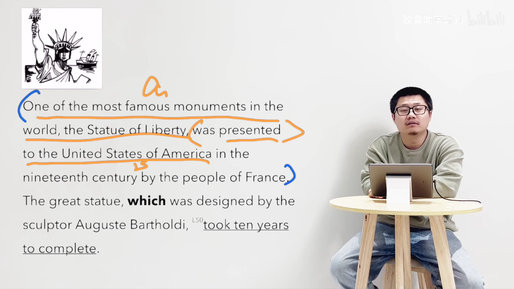

文字识别：a / One of the most famous monuments in the / world, the Statue of Liberty/ / was presented / to the United States of America in the / nineteenth century by the people of France, / The great statue, which was designed by the / sculptor Auguste Bartholdi, 5°took ten years / to complete.

## 00:02:30–00:03:00

果给它稍微缩减一点，你看我给你这样说啊，比如说就 the Statue of Liberty was presented to America，差不多，剩下都不是核心信息了，对吧？剩下就是告诉你在什么时间被谁，对吧？ Next one， the Great Statue， which was designed by the sculptor Auguste Bartholdi， took ten years to complete。啊，这是直接一个逗号，这是一个 which 非限定性定语从句，这儿有一

### 画面 00:02:45

文字识别：a / One of the most famous monuments in the / world, the Statue of Liberty/ / was presented / to the United States of America in the / nineteenth century by the people of France, / The great statue, which was designed by the / sculptor Auguste Bartholdi, 5°took ten years / to complete.

### 画面 00:02:47

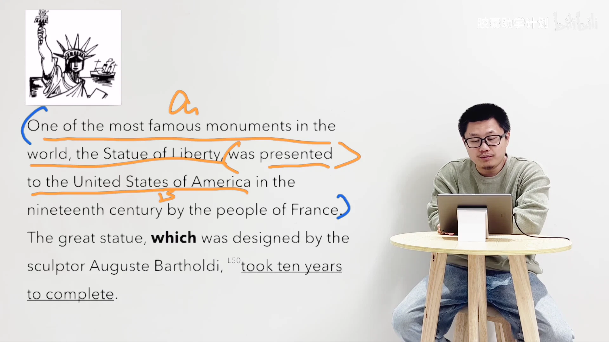

文字识别：a / One of the most famous monuments in the / world, the Statue of Liberty/ / was presented / to the United States of America in the / nineteenth century by the people of France, / The great statue, which was designed by the / sculptor Auguste Bartholdi, 5°took ten years / to complete.

## 00:03:00–00:03:30

个逗号，这儿还给你个逗号，那更像补充说明了，对吧？有的时候我们还管它叫插入语，对吧？其实什么叫插入语，就你完全可以不管它，它补充信息嘛。但我们还是看一下啊，说这个特别棒的、特别好的、伟大的这个雕像、雕塑，花了十年的时间完成，took ten years to complete。五十课学的习惯用法，不多说了。然后这个后边中间的这个非限定性定语从句呢，呃，补充说明，对吧？Which指的

### 画面 00:03:06

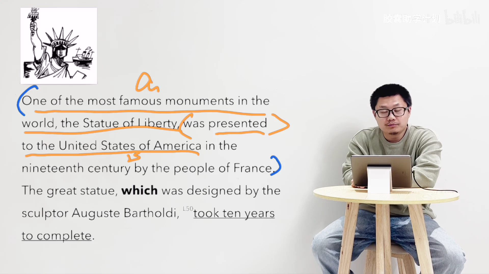

文字识别：a / One of the most famous monuments in the / world, the Statue of Liberty/ / was presented / to the United States of America in the / nineteenth century by the people of France, / The great statue, which was designed by the / sculptor Auguste Bartholdi, 5°took ten years / to complete.

### 画面 00:03:09

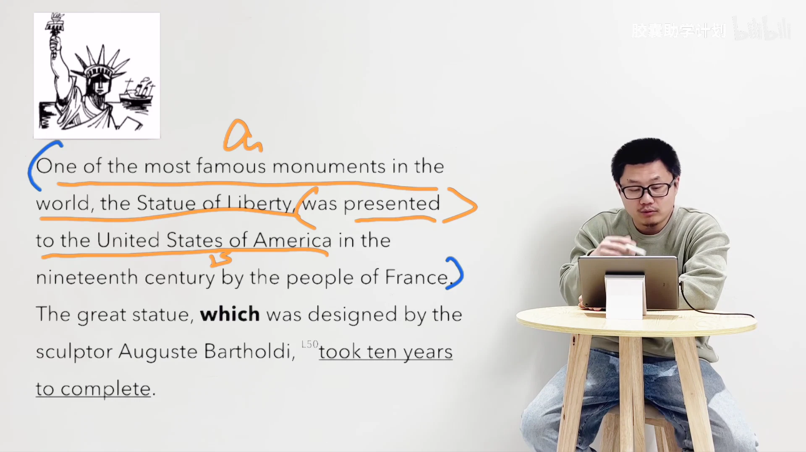

文字识别：a / One of the most famous monuments in the / world, the Statue of Liberty / was presented / to the United States of America in the / nineteenth century by the people of France, / The great statue, which was designed by the / sculptor Auguste Bartholdi, 5°took ten years / to complete.

## 00:03:30–00:04:00

就是The Statue啊，The Statue of Liberty自由女神像。自由女神像怎么样呢？Was designed被设计，被什么呢？被The sculptor A B啊，咱直接就读这个就完了。直接被一个雕像家啊，Auguste Bartholdi啊，这个还是不，他不，他如果这个单词August，他是按英文去读，他读的就是August，但是在这里他实际上按法语那个发音去读的是吧？Bartholdi啊，这个其实对于各位来说不重要。

### 画面 00:03:39

文字识别：a / One of the most famous monuments in the / world, the Statue of Liberty/ / was presented / to the United States of America in the / nineteenth century by the people of France, / The great statue, which was designed by the / sculptor Auguste Bartholdi 5°took ten years / to complete.

## 00:04:00–00:04:30

呃，被这样一个雕塑家哎设计来，对吧？所以这地方其实就提供两个信息嘛。雕塑家设计了这么个东西，这东西花了十年完成，对吧？下面，下面这句话乍一看稍微有点难，所以我通过不同的形式给各位画了一下。The actual figure was made of copper, supported by a metal framework, which had been specially constructed by Eiffel.

### 画面 00:04:09

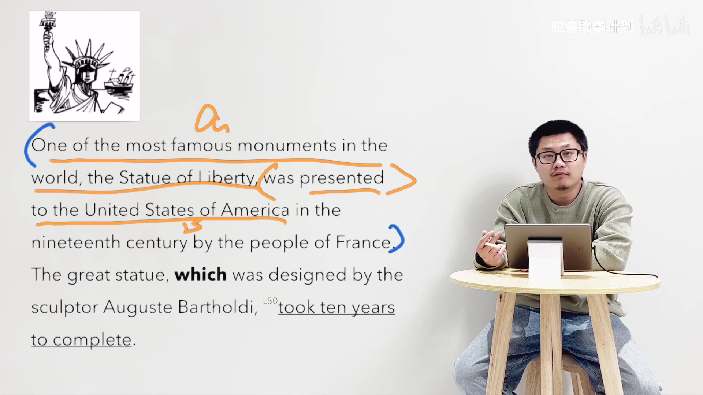

文字识别：a / One of the most famous monuments in the / world, the Statue of Liberty/ / was presented / to the United States of America in the / nineteenth century by the people of France, / The great statue, which was designed by the / sculptor Auguste Bartholdi, 5°took ten years / to complete.

### 画面 00:04:11

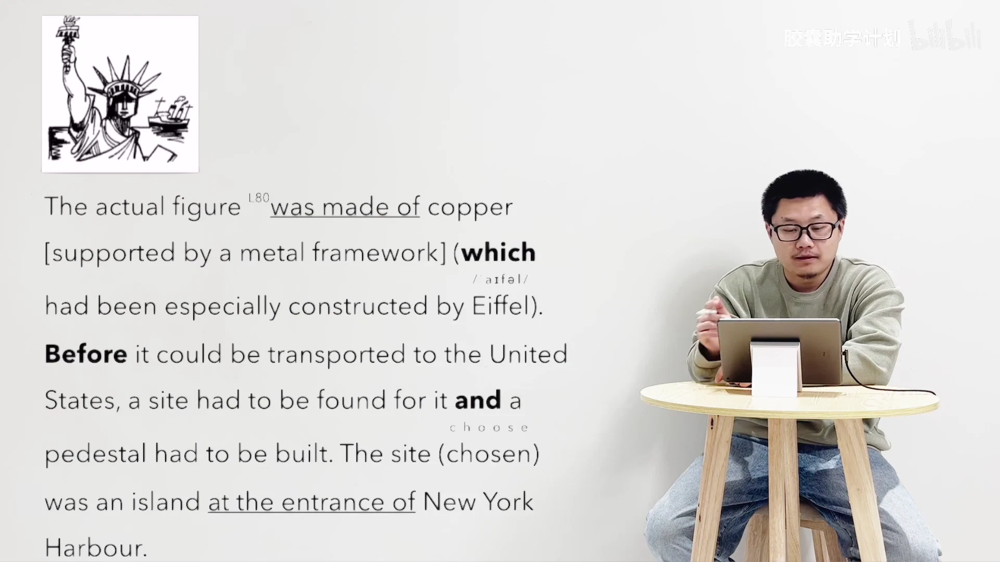

文字识别：The actual figure / L80. / 'was made of copper / [supported by a metal framework] (which / laifall / had been especially constructed by Eiffel). / Before it could be transported to the United / States, a site had to be found for it and a / cｈ o o s ｅ / pedestal had to be built. The site (chosen) / was an island at the entrance of New York / Harbour.

### 画面 00:04:13

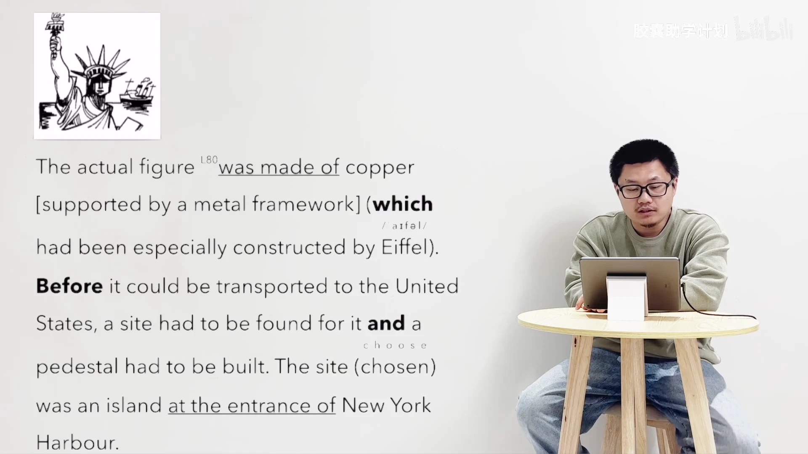

文字识别：The actual figure / L80. / 'was made of copper / [supported by a metal framework] (which / laifall / had been especially constructed by Eiffel). / Before it could be transported to the United / States, a site had to be found for it and a / ch o o s e / pedestal had to be built. The site (chosen) / was an island at the entrance of New York / Harbour.

### 画面 00:04:15

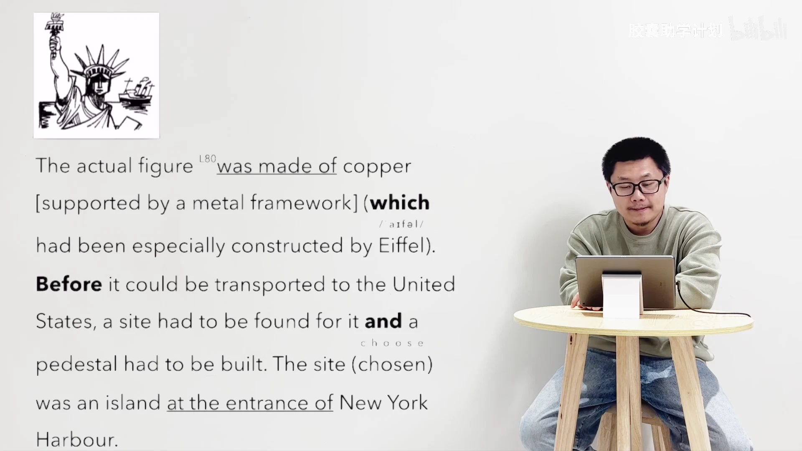

文字识别：The actual figure / L80, / 'was made of copper / [supported by a metal framework] (which / laifall / had been especially constructed by Eiffel). / Before it could be transported to the United / States, a site had to be found for it and a / cｈ o o s ｅ / pedestal had to be built. The site (chosen) / was an island at the entrance of New York / Harbour.

## 00:04:30–00:05:00

啊，这个Eiffel就是那个Eiffel Tower的那个Eiffel啊，就Eiffel Tower takes its name from the Eiffel.不知道各位这句话能不能听懂啊？Takes its name from，咱们学的习惯用法。呃，那你看这个句子啊，实际上有一些地方我们要去进行断句，最容易断句的就是这个which，对吧？那我们先从which这个地方断一下句。所以这actual figure，figure是什么？之前我们说过这个人像嘛，对吧？人影人像，那在这里其实就是替代了Statue of Liberty嘛，其实就是这个实际上的这个

### 画面 00:04:34

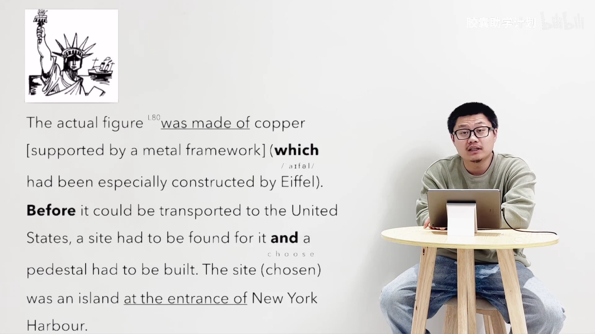

文字识别：The actual figure / L80. / ' was made of copper / [supported by a metal framework] (which / laifall / had been especially constructed by Eiffel). / Before it could be transported to the United / States, a site had to be found for it and a / cｈ o o s e / pedestal had to be built. The site (chosen) / was an island at the entrance of New York / Harbour.

### 画面 00:04:37

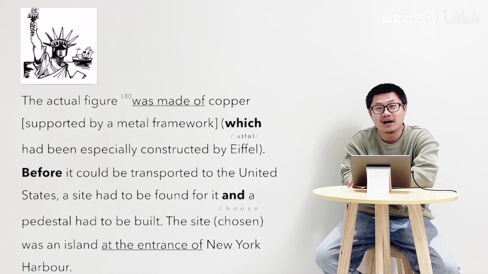

文字识别：The actual figure / L80. / 'was made of copper / [supported by a metal framework] (which / l'aifall / had been especially constructed by Eiffel). / Before it could be transported to the United / States, a site had to be found for it and a / cｈ o o s e / pedestal had to be built. The site (chosen) / was an island at the entrance of New York / Harbour.

### 画面 00:04:57

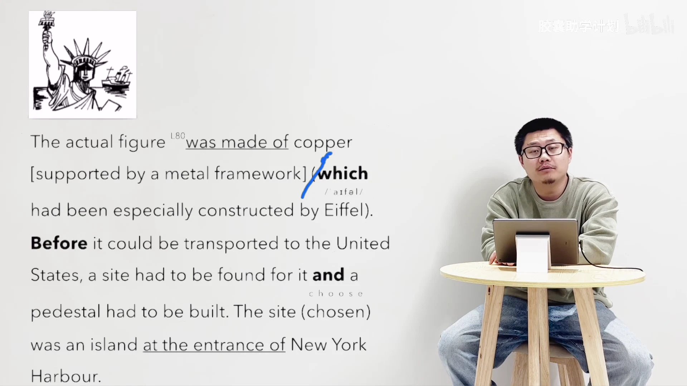

文字识别：The actual figure / L80. / 'was made of copper / [supported by a metal framework] /Which / /'aifall / had been especially constructed by Eiffel). / Before it could be transported to the United / States, a site had to be found for it and a / cｈ o o s e / pedestal had to be built. The site (chosen) / was an island at the entrance of New York / Harbour.

## 00:05:00–00:05:30

人像就是这个实际上的雕塑啊，怎么样呢？Was made of copper. Be made of，八十课咱们学了，由什么什么制成，由铜制成，它实际上是由铜制成的，对吧？就是它的这个整个身体是由铜制成的。后边给了一个叫supported by a metal framework，好，叫做支持，被什么支持呢？一个金属的框架支持。好了，你注意这个地方就有一个小的问题，就是这你没有任何连

### 画面 00:05:00

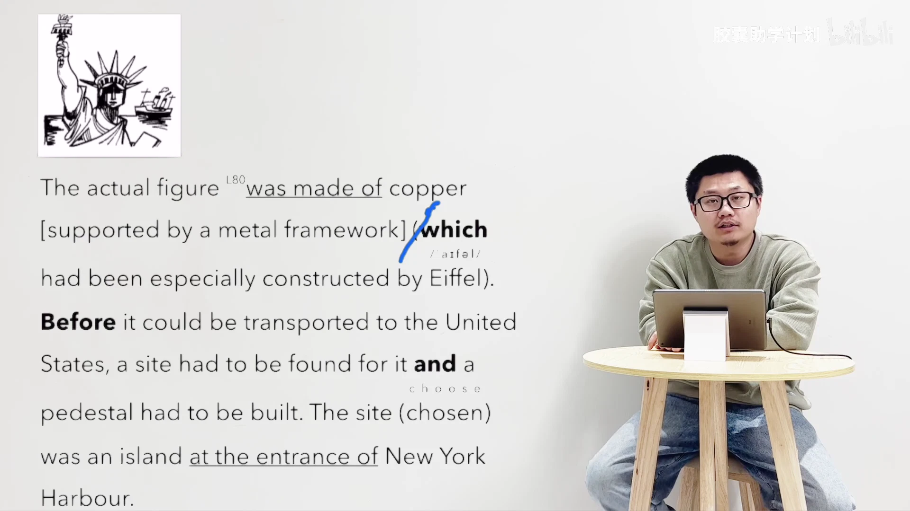

文字识别：The actual figure / L80. / 'was made of copper / [supported by a metal framework] /Which / laifal/ / had been especially constructed by Eiffel). / Before it could be transported to the United / States, a site had to be found for it and a / cｈ o o s e / pedestal had to be built. The site (chosen) / was an island at the entrance of New York / Harbour.

## 00:05:30–00:06:00

词。如果你说的 actual figure was made of copper and was supported by a framework，那就没有任何问题。但你现在没有给我那个 was，也就是被动最常见的得是 be 动嘛，在非位在这个谓语这个地方，对吧？得是 be 加 done。你现在没有给我 be，你只给了我一个 supported by a mental framework。那其实我很容易理解，就是这个谁，就是我要问的问题是，它这个地方翻译成叫做被，

### 画面 00:05:30

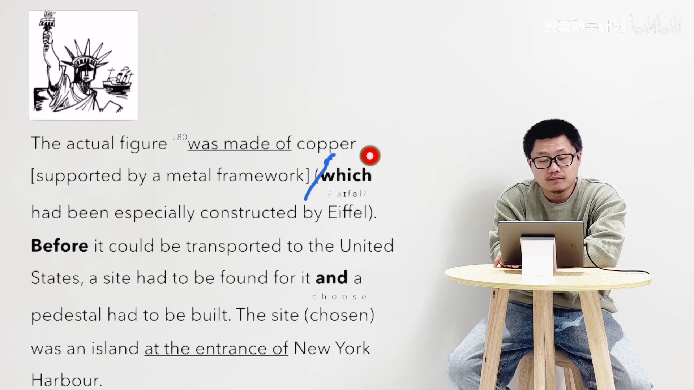

文字识别：The actual figure / L80, / 'was made of copper / [supported by a metal framework] /Which / /aifall / had been especially constructed by Eiffel). / Before it could be transported to the United / States, a site had to be found for it and a / cｈ o o s e / pedestal had to be built. The site (chosen) / was an island at the entrance of New York / Harbour.

## 00:06:00–00:06:30

呃被什么支撑呢？被一个金属框架支撑。那我要问的问题就是谁被金属框架支撑，对吧？肯定是这样一个问题嘛，叫谁被金属框架支撑啊？这不就是咱们之前学的一个语法吗？好，supportly在这儿做了一个蛋，对吧？OK，然后呢，他后边又问了一个叫which had been especially constructed by Eiffel。那which指的是谁呢？就是这个metal framework

### 画面 00:06:00

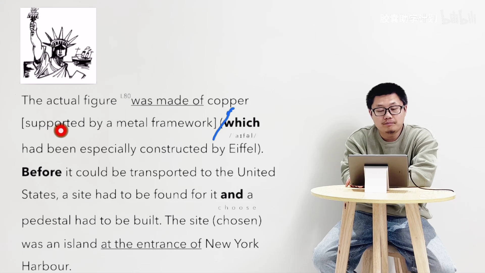

文字识别：The actual figure / L80. / 'was made of copper / [supported by a metal framework] /which / /'aifall / had been especially constructed by Eiffel). / Before it could be transported to the United / States, a site had to be found for it and a / cｈ o o s e / pedestal had to be built. The site (chosen) / was an island at the entrance of New York / Harbour.

### 画面 00:06:07

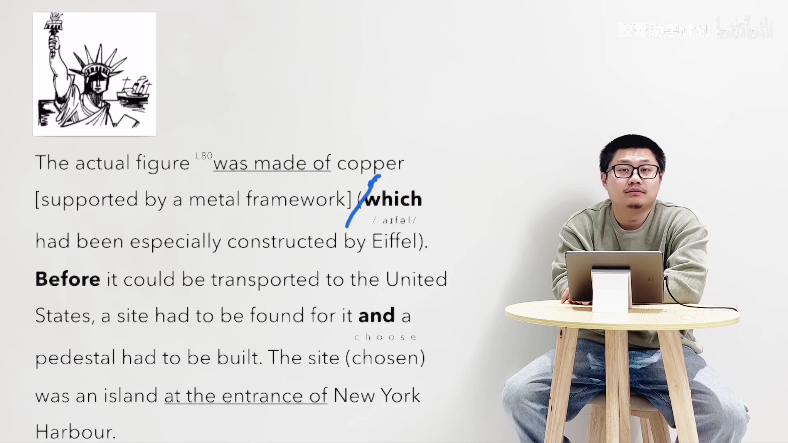

文字识别：The actual figure / L80, / 'was made of copper / [supported by a metal framework] /Which / l'aifall / had been especially constructed by Eiffel). / Before it could be transported to the United / States, a site had to be found for it and a / cｈ o o s e / pedestal had to be built. The site (chosen) / was an island at the entrance of New York / Harbour.

### 画面 00:06:10

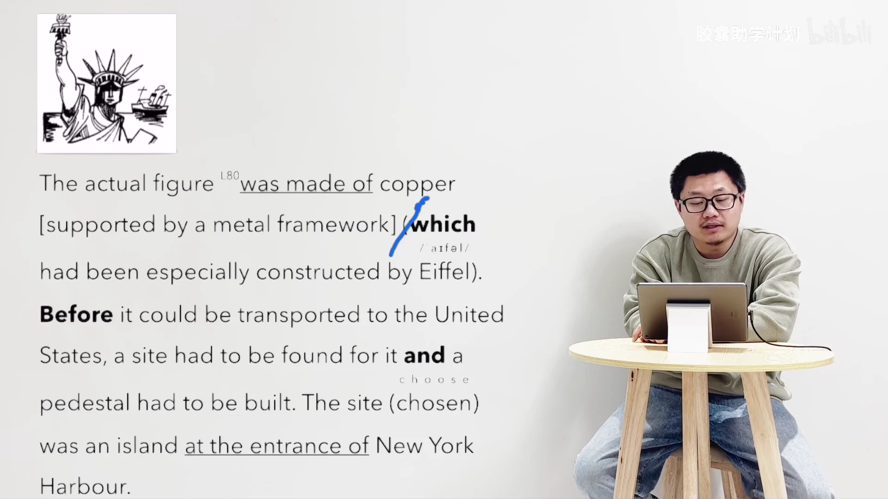

文字识别：The actual figure / L80, / 'was made of copper / [supported by a metal framework] /Which / l'aifall / had been especially constructed by Eiffel). / Before it could be transported to the United / States, a site had to be found for it and a / cｈ o o s ｅ / pedestal had to be built. The site (chosen) / was an island at the entrance of New York / Harbour.

## 00:06:30–00:07:00

### 画面 00:06:40

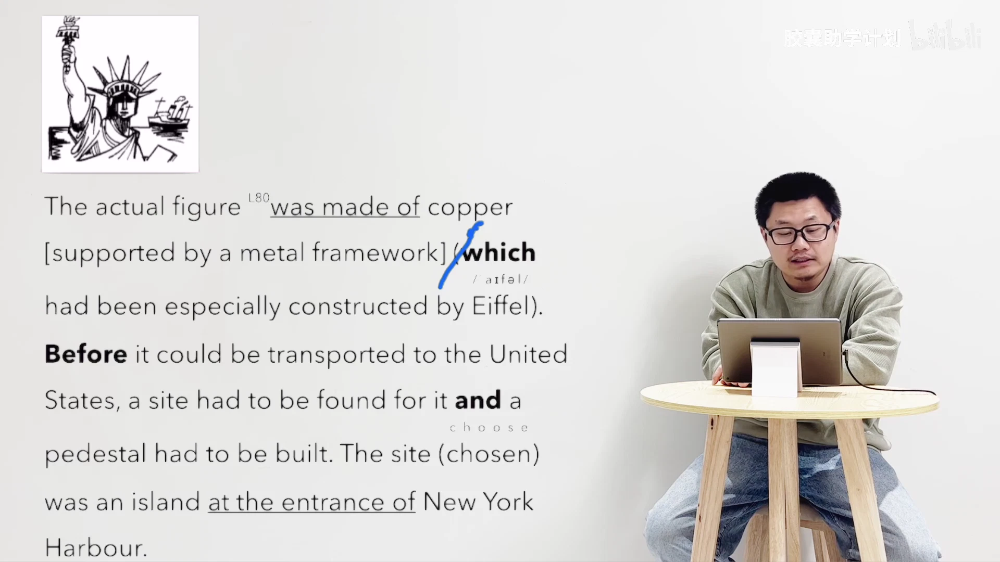

文字识别：The actual figure / L80, / 'was made of copper / [supported by a metal framework] /Which / laifall / had been especially constructed by Eiffel). / Before it could be transported to the United / States, a site had to be found for it and a / cｈo o s ｅ / pedestal had to be built. The site (chosen) / was an island at the entrance of New York / Harbour.

### 画面 00:06:48

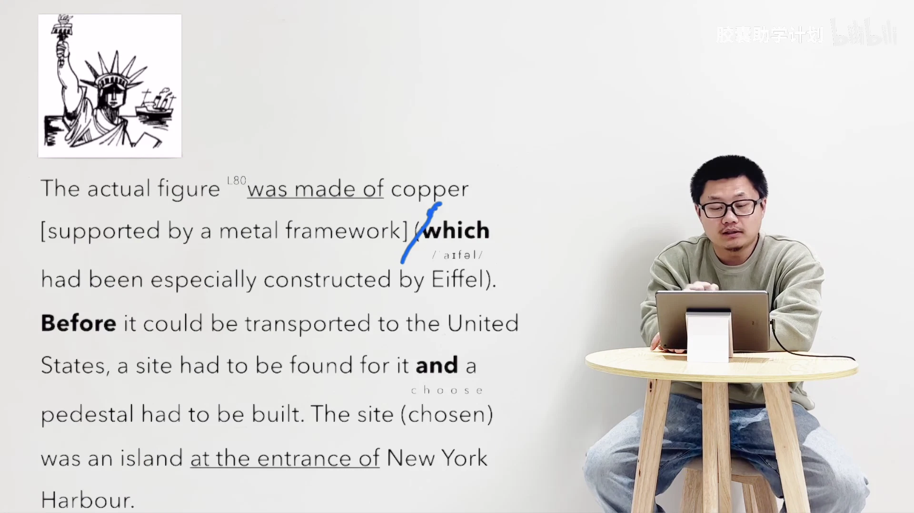

文字识别：The actual figure / L80, / 'was made of copper / [supported by a metal framework] /Which / l'aifall / had been especially constructed by Eiffel). / Before it could be transported to the United / States, a site had to be found for it and a / cｈ o o s e / pedestal had to be built. The site (chosen) / was an island at the entrance of New York / Harbour.

### 画面 00:06:50

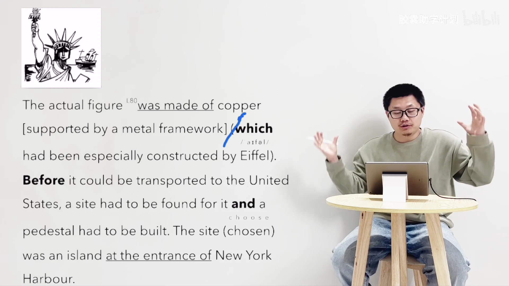

文字识别：The actual figure / L80. / 'was made of copper / [supported by a metal framework] /Which / laifall / had been especially constructed by Eiffel). / Before it could be transported to the United / States, a site had to be found for it and a / cｈo o s e / pedestal had to be built. The site (chosen) / was an island at the entrance of New York / Harbour.

### 画面 00:06:52

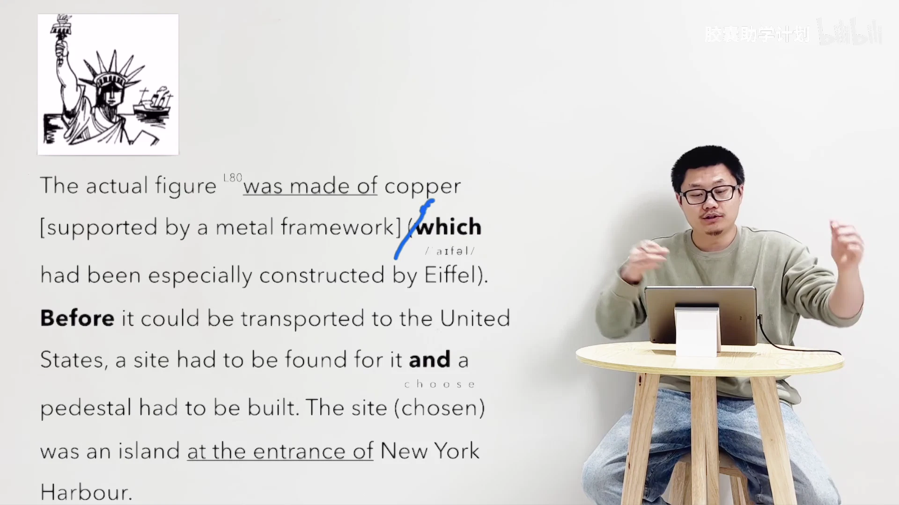

文字识别：The actual figure / L80. / 'was made of copper / [supported by a metal framework] /Which / laifall / had been especially constructed by Eiffel). / Before it could be transported to the United / States, a site had to be found for it and a / cｈ o o s e / pedestal had to be built. The site (chosen) / was an island at the entrance of New York / Harbour.

### 画面 00:06:54

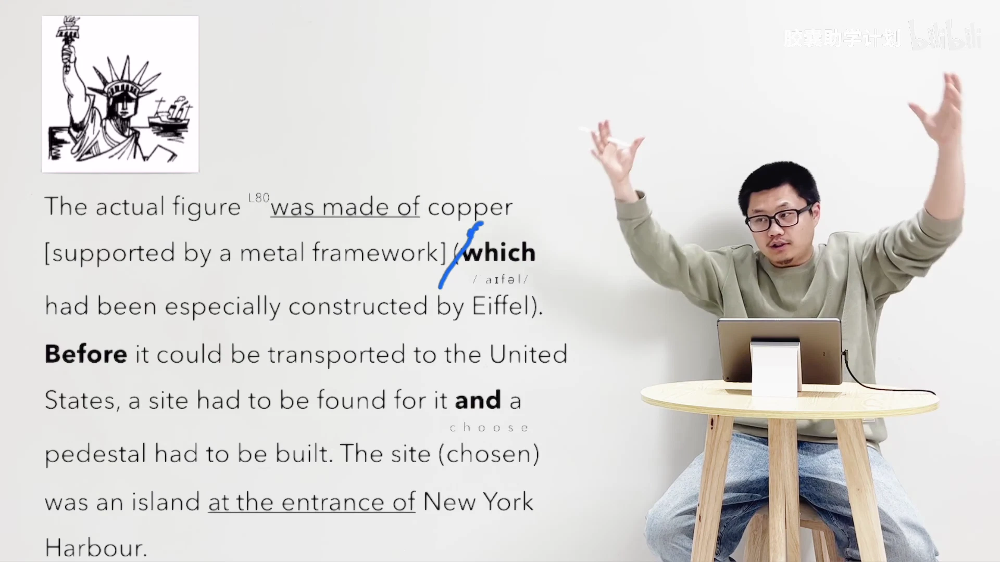

文字识别：The actual figure / L80. / ' was made of copper / [supported by a metal framework] /Which / l'aifal/ / had been especially constructed by Eiffel). / Before it could be transported to the United / States, a site had to be found for it and a / cｈ o o s e / pedestal had to be built. The site (chosen) / was an island at the entrance of New York / Harbour.

### 画面 00:06:56

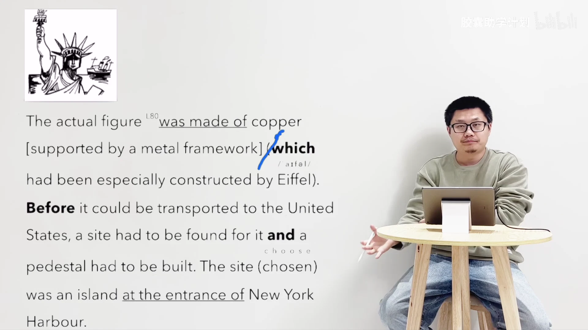

文字识别：The actual figure / L80, / 'was made of copper / [supported by a metal framework] /Which / laifall / had been especially constructed by Eiffel). / Before it could be transported to the United / States, a site had to be found for it and a / cｈ o o s e / pedestal had to be built. The site (chosen) / was an island at the entrance of New York / Harbour.

### 画面 00:06:59

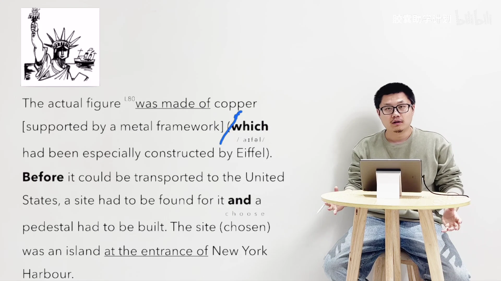

文字识别：The actual figure / L80, / 'was made of copper / [supported by a metal framework] /which / laifall / had been especially constructed by Eiffel). / Before it could be transported to the United / States, a site had to be found for it and a / cｈ o o s ｅ / pedestal had to be built. The site (chosen) / was an island at the entrance of New York / Harbour.

## 00:07:00–00:07:30

然后呢？这个雕塑是被什么支撑呢？或者这个铜是被什么支撑呢？实际上是被一个金属框架支撑着整个这个雕塑，对吧？然后这个金属框架又哪来的呢？实际上是被艾佛这个人特殊建造出来或者特殊制造出来的，对吧？所以基本上给你提供的就是如下这些信息：艾佛建造了一个特殊的金属框架，金属框架支撑着外边的这些铜，然后

### 画面 00:07:02

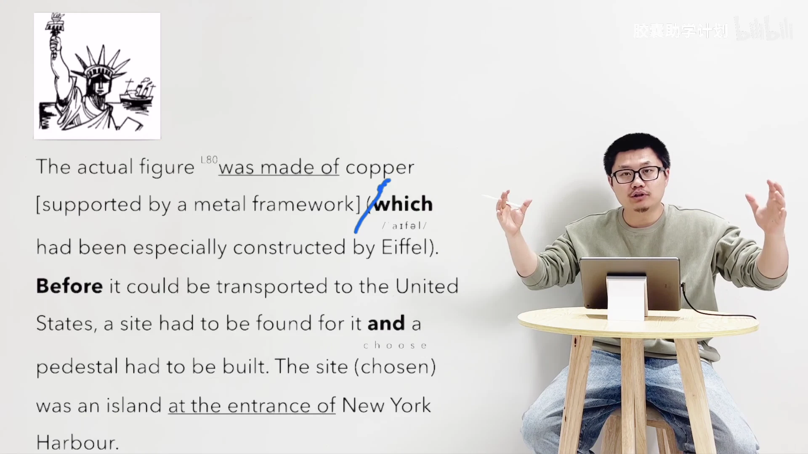

文字识别：The actual figure / L80. / 'was made of copper / [supported by a metal framework] /Which / laifall / had been especially constructed by Eiffel). / Before it could be transported to the United / States, a site had to be found for it and a / cｈ o o s e / pedestal had to be built. The site (chosen) / was an island at the entrance of New York / Harbour.

### 画面 00:07:05

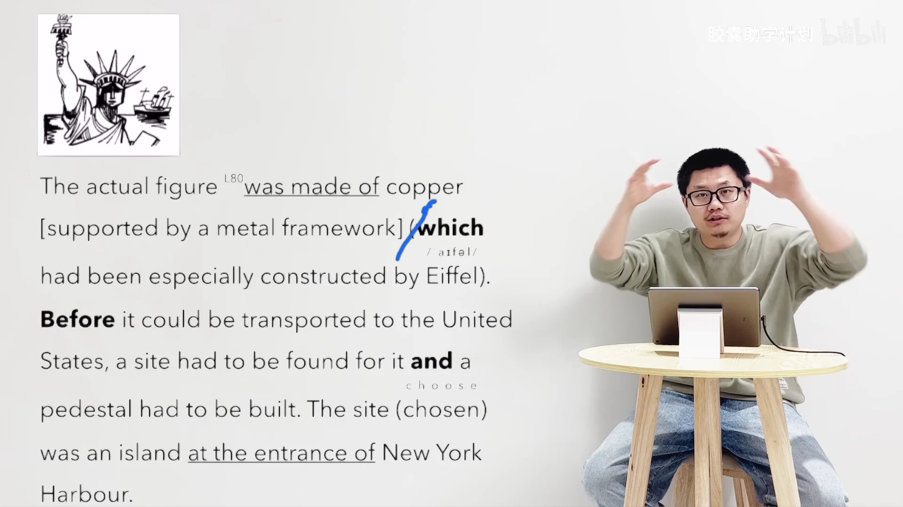

文字识别：The actual figure / L80. / 'was made of copper / [supported by a metal framework] /which / laifall / had been especially constructed by Eiffel). / Before it could be transported to the United / States, a site had to be found for it and a / cｈ o o s e / pedestal had to be built. The site (chosen) / was an island at the entrance of New York / Harbour.

### 画面 00:07:07

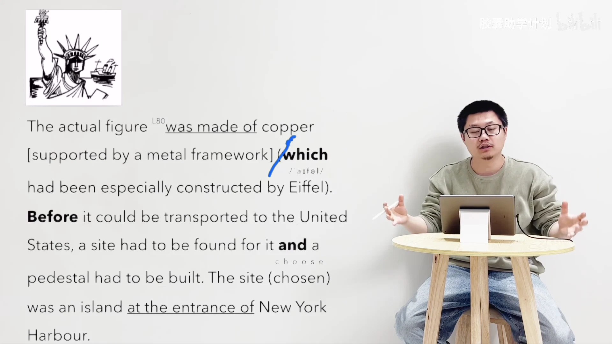

文字识别：The actual figure / L80, / 'was made of copper / [supported by a metal framework] /which / /aifal / had been especially constructed by Eiffel). / Before it could be transported to the United / States, a site had to be found for it and a / c ｈ o o s e / pedestal had to be built. The site (chosen) / was an island at the entrance of New York / Harbour.

### 画面 00:07:16

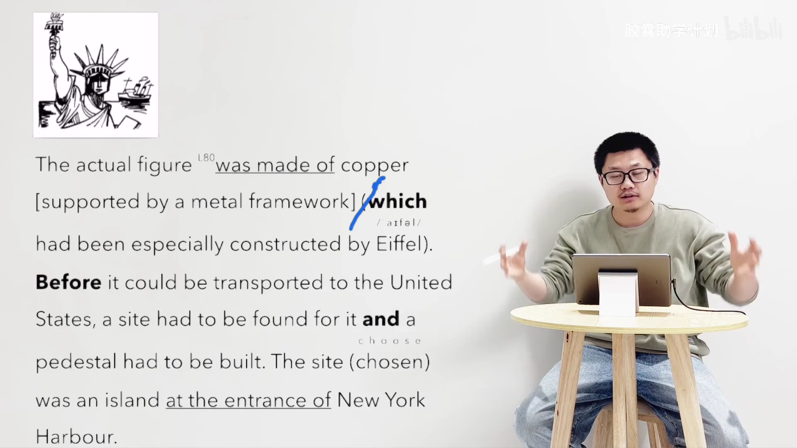

文字识别：The actual figure / L80, / 'was made of copper / [supported by a metal framework] /Which / /aifal/ / had been especially constructed by Eiffel). / Before it could be transported to the United / States, a site had to be found for it and a / c ｈ o o s e / pedestal had to be built. The site (chosen) / was an island at the entrance of New York / Harbour.

### 画面 00:07:26

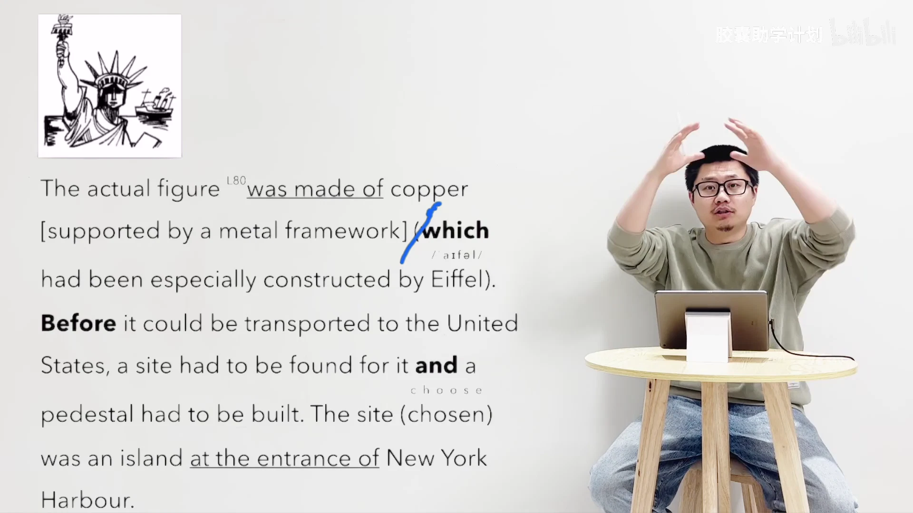

文字识别：The actual figure / L80. / 'was made of copper / [supported by a metal framework] /Which / laifall / had been especially constructed by Eiffel). / Before it could be transported to the United / States, a site had to be found for it and a / cｈ o o s e / pedestal had to be built. The site (chosen) / was an island at the entrance of New York / Harbour.

### 画面 00:07:28

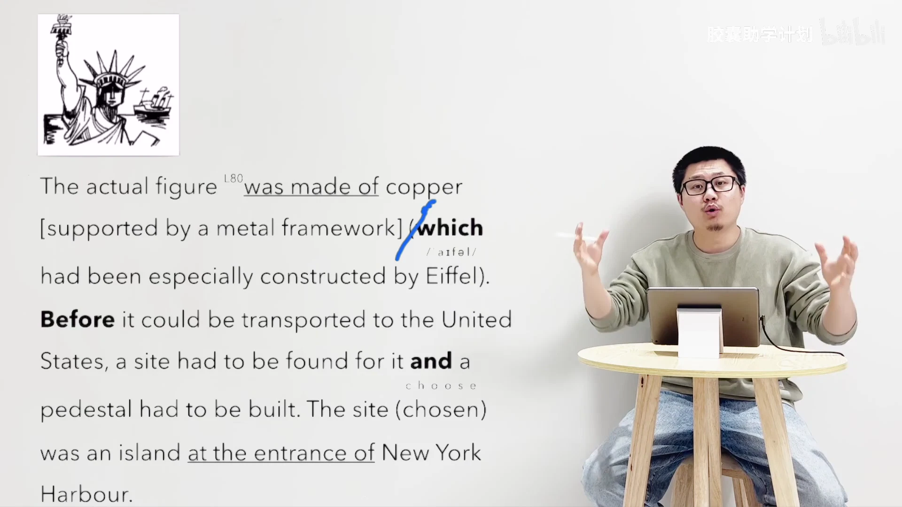

文字识别：The actual figure / L80. / 'was made of copper / [supported by a metal framework] /Which / laifall / had been especially constructed by Eiffel). / Before it could be transported to the United / States, a site had to be found for it and a / cｈ o o s ｅ / pedestal had to be built. The site (chosen) / was an island at the entrance of New York / Harbour.

## 00:07:30–00:08:00

组成了这个 actual figure，也就是 the Statue of Liberty。就是这句话读完，你脑海当中获得了这些信息，这句话就算读懂了，听见了吧？Next one. Before it could be transported to the United States, a site had to be found for it, and a pedestal had to be built. 这句话其实还好了，因为有一个 and，有一个逗号，这个句子就被拆开了。在什么呢？在它能 could be done，能被怎么怎么样，对吧？能被

### 画面 00:07:31

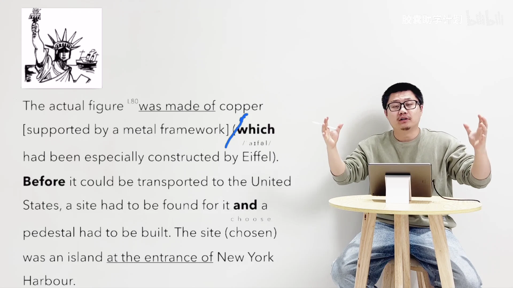

文字识别：The actual figure / L80. / 'was made of copper / [supported by a metal framework] /Which / laifall / had been especially constructed by Eiffel). / Before it could be transported to the United / States, a site had to be found for it and a / cｈ o o s e / pedestal had to be built. The site (chosen) / was an island at the entrance of New York / Harbour.

### 画面 00:07:33

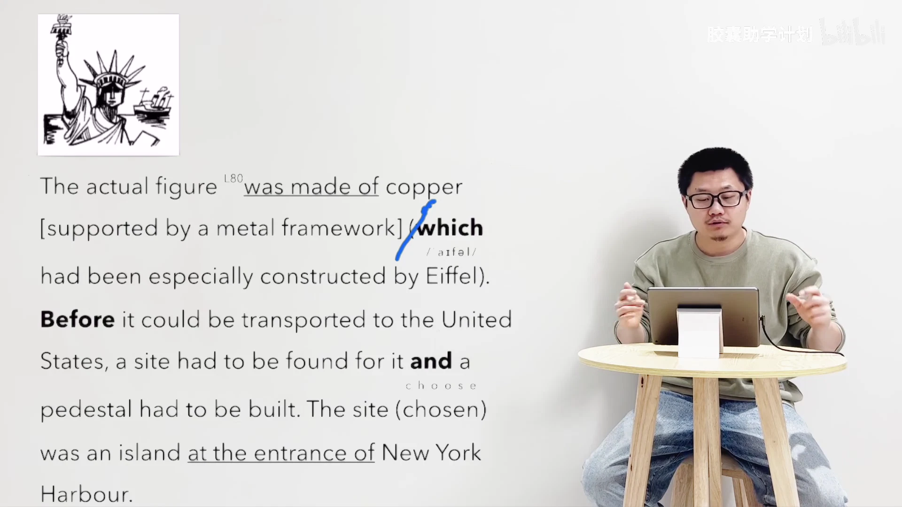

文字识别：The actual figure / L80. / 'was made of copper / [supported by a metal framework] /Which / laifal/ / had been especially constructed by Eiffel). / Before it could be transported to the United / States, a site had to be found for it and a / cｈ o o s e / pedestal had to be built. The site (chosen) / was an island at the entrance of New York / Harbour.

### 画面 00:07:35

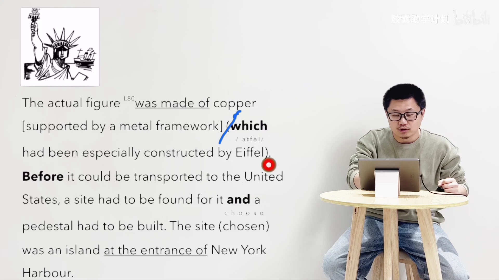

文字识别：The actual figure / L80. / 'was made of copper / [supported by a metal framework] /Which / laifall / had been especially constructed by Eiffell). / Before it could be transported to the United / States, a site had to be found for it and a / cｈ o o s e / pedestal had to be built. The site (chosen) / was an island at the entrance of New York / Harbour.

### 画面 00:07:37

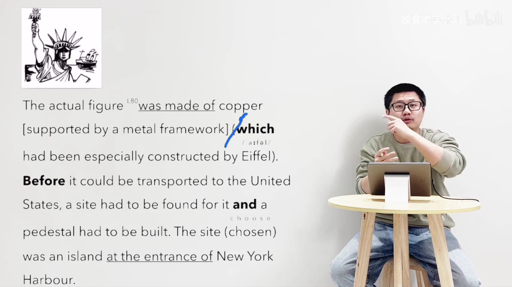

文字识别：The actual figure / L80. / 'was made of copper / [supported by a metal framework] /Which / /aifall / had been especially constructed by Eiffel). / Before it could be transported to the United / States, a site had to be found for it and a / cｈ o o s e / pedestal had to be built. The site (chosen) / was an island at the entrance of New York / Harbour.

### 画面 00:07:39

文字识别：The actual figure / L80. / 'was made of copper / [supported by a metal framework] /Which / laifall / had been especially constructed by Eiffel). / Before it could be transported to the United / States, a site had to be found for it and a / cｈ o o s e / pedestal had to be built. The site (chosen) / was an island at the entrance of New York / Harbour.

### 画面 00:07:42

文字识别：The actual figure / L80. / 'was made of copper / [supported by a metal framework] /Which / /aifall / had been especially constructed by Eiffel). / Before it could be transported to the United / States, a site had to be found for it and a / cｈ o o s ｅ / pedestal had to be built. The site (chosen) / was an island at the entrance of New York / Harbour.

### 画面 00:07:48

文字识别：The actual figure / L80, / 'was made of copper / [supported by a metal framework] /Which / laifal/ / had been especially constructed by Eiffel). / Before it could be transported to the United / States, a site had to be found for it and a / cｈ o o s e / pedestal had to be built. The site (chosen) / was an island at the entrance of New York / Harbour.

## 00:08:00–00:08:30

运输到美国之前，a site had to be found for it.所以一个地点，哎，had to be done, had to be done，叫做当时必须被是吧？要必须被找到 for it，叫做给这个雕像雕塑 the actual figure，或者叫 Statue of Liberty，对吧？然后呢，a pedestal had to be built，还是 had to be done，还 had to be done，叫做一个底座

### 画面 00:08:11

文字识别：The actual figure / L80, / 'was made of copper / [supported by a metal framework] /Which / laifall / had been especially constructed by Eiffel). / Before it could be transported to the United / States/a site had to be found for it ayd a / c h o o s e / pedestal had to be built. The site (chosen) / was an island at the entrance of New York / Harbour.

## 00:08:30–00:09:00

必须要被建造出来。OK，那这句话其实它我觉得就不算长难句了啊，因为一共就三句话，并且语言也不并不复杂。The site chosen was an island at the entrance of New York Harbor。啊，这句话里边其实整个句子很简单，就是chosen这个单词要说一下。所以这个地点chosen，你看chosen实际上是choose上面这个单词的过去分词，所以

### 画面 00:08:34

文字识别：The actual figure / L80, / 'was made of copper / [supported by a metal framework] /Which / l'aifal/ / had been especially constructed by Eiffel). / Before it could be transported to the United / States/a site had to be found for it ayd a / c h o o s e / pedestal had to be built. The site (chosen) / was an island at the entrance of New York / Harbour.

### 画面 00:08:39

文字识别：The actual figure / L80. / 'was made of copper / [supported by a metal framework] /Which / l'aifall / had been especially constructed by Eiffel). / Before it could be transported to the United / States/a site had to be found for it ayd a / c h o o s e / pedestal had to be built. The site (chosen) / was an island at the entrance of New York / Harbour.

### 画面 00:08:50

文字识别：The actual figure / L80, / 'was made of copper / [supported by a metal framework] /Which / l'aifall / had been especially constructed by Eiffel). / Before it could be transported to the United / States/a site had to be found for it ayd a / c h o o s e / pedestal had to be built. The site (chosen) / was an island at the entrance of New York / Harbour.

## 00:09:00–00:09:30

这地方其实是一个被动啊，就翻译成它是当做一个分词做定语了，它实际上翻译成叫做被选中的那个地点，被选中的那个地点，对吧？好，the site chosen was an island，实际上是一个小岛，在哪儿呢？At the entrance of本课习惯用法，在什么什么的入口，在纽约港的入口，对吧？OK，那这个地方呢，我们原文也给了，原文告诉你说这个chosen呢，the site chosen完全可以变成the site which

### 画面 00:09:20

文字识别：The actual figure / L80, / 'was made of copper / [supported by a metal framework] /which / /aifall / had been especially constructed by Eiffel). / Before it could be transported to the United / States/a site had to be found for it ayd a / c h o o s e / pedestal had to be built. The site (chosen) / was an island at the entrance of New York / Harbour.

### 画面 00:09:24

文字识别：The actual figure / L80, / 'was made of copper / [supported by a metal framework] /Which / l'aifal/ / had been especially constructed by Eiffel). / Before it could be transported to the United / States/a site had to be found for it ayd a / c h o o s e / pedestal had to be built. The site (chosen) / was an island at the entrance of New York / Harbour.

### 画面 00:09:27

文字识别：The actual figure / L80, / 'was made of copper / [supported by a metal framework] /Which / l'aifall / had been especially constructed by Eiffel). / Before it could be transported to the United / States/a site had to be found for it ayd a / c h o o s e / pedestal had to be built. The site (chosen) / was an island at the entrance of New York / Harbour.

### 画面 00:09:29

文字识别：The actual figure / L80. / 'was made of copper / [supported by a metal framework] /Which / l'aifal/ / had been especially constructed by Eiffel). / Before it could be transported to the United / States/a site had to be found for it ayd a / c h o o s e / pedestal had to be built. The site (chosen) / was an island at the entrance of New York / Harbour.

## 00:09:30–00:10:00

was chosen, 对吧？就定语从句。所以其实你能理解定语从句，就像我我举个例子，就像我们的状语从句可以变成分词，简化成分词做状语一样，定语从句也可以被简化成分词做定语，是吧？这个很容易理解了。Next one, by 1884, a statue which was 151 feet tall

### 画面 00:09:39

文字识别：The actual figure / L80. / 'was made of copper / [supported by a metal framework] /Which / laifall / had been especially constructed by Eiffel). / Before it could be transported to the United / States/a site had to be found for it ayd a / c h o o s e / pedestal had to be built. The site (chosen) / was an island at the entrance of New York / Harbour.

### 画面 00:09:46

文字识别：The actual figure / L80. / 'was made of copper / [supported by a metal framework] /Which / laifall / had been especially constructed by Eiffel). / Before it could be transported to the United / States/a site had to be found for it ayd a / c ｈ o o s e / pedestal had to be built. The site (chosen) / was an island at the entrance of New York / Harbour.

### 画面 00:09:50

文字识别：The actual figure / L80. / 'was made of copper / [supported by a metal framework] /Which / laifall / had been especially constructed by Eiffel). / Before it could be transported to the United / States/a site had to be found for it ayd a / c h o o s e / pedestal had to be built. The site (chosen) / was an island at the entrance of New York / Harbour.

### 画面 00:09:52

文字识别：By 1884, a statue (which was 151 feet tall) / had been erected in Paris. The following / year, it was taken to pieces and sent to / America. By the end of October 1886, the / statue had been put together again and it / was officially presented to the American / people by Bartholdi.

## 00:10:00–00:10:30

had been erected in Paris.依旧是对吧？你这个有一个 which，而且整个定语从句的含义非常的简单，叫做这个 statue 啊。其实这儿用非限定性定语从句一点问题没有，对吧？就所以，我跟你说嘛，这纯就是一个作者的自己主观选择。然后呢，这个雕像它怎么样呢？它有一百五十一英尺高，had been erected，叫已经被，现过

### 画面 00:10:15

文字识别：By 1884, a statue, (which was 151 feet tall) / had been erected in Paris. The following / year, it was taken to pieces and sent to / America. By the end of October 1886, the / statue had been put together again and it / was officially presented to the American / people by Bartholdi.

### 画面 00:10:18

文字识别：By 1884, a statue, (which was 151 feet tall) / had been erected in Paris. The following / year, it was taken to pieces and sent to / America. By the end of October 1886, the / statue had been put together again and it / was officially presented to the American / people by Bartholdi.

### 画面 00:10:20

文字识别：By 1884, a statue (which was 151 feet tall) / had been erected in Paris. The following / year, it was taken to pieces and sent to / America. By the end of October 1886, the / statue had been put together again and it / was officially presented to the American / people by Bartholdi.

### 画面 00:10:29

文字识别：By 1884, a statue (which was 151 feet tall) / had been erected in Paris. The following / year, it was taken to pieces and sent to / America. By the end of October 1886, the / statue had been put together again and it / was officially presented to the American / people by Bartholdi.

## 00:10:30–00:11:00

去完成时的被动已经被树立起来了。In Paris叫在巴黎，一八八四年已经被树立起来了。The following year第二年呢，It was taken to pieces and sent to America。这地方的be taken to pieces，或者我们一会儿会讲它的主动叫take something to pieces，叫拆成碎片啊，不是砸成。原来咱们学的是smash to pieces，就砸成了碎片。四十九课床从屋顶上摔下来，

### 画面 00:10:33

文字识别：By 1884, a statue (which was 151 feet tall) / had been erected in Paris. The following / year, it was taken to pieces and sent to / America. By the end of October 1886, the / statue had been put together again and it / was officially presented to the American / people by Bartholdi.

### 画面 00:10:54

文字识别：By 1884, a statue (which was 151 feet tall) / had been erected in Paris. The follwing / year, it was taken to pieces and sent to / America. By the end of October 1886, the / statue had been put together again and it / was officially presented to the American / people by Bartholdi.

### 画面 00:10:56

文字识别：By 1884, a statue (which was 151 feet tall) / had been erected in Paris. The following / year, it was taken to pieces and sent to / America. By the end of October 1886, the / statue had been put together again and it / was officially presented to the American / people by Bartholdi.

### 画面 00:10:59

文字识别：By 1884, a statue (which was 151 feet tall) / had been erected in Paris. The following / year, it was taken to pieces and sent to / America. By the end of October 1886, the / statue had been put together again and it / was officially presented to the American / people by Bartholdi.

## 00:11:00–00:11:30

smashed to pieces，那刻，对吧？现在学的是 taken to pieces，这是自己人主动做的，要拆的，是吧？拆成了碎片，但不是说砸成碎片啊，其实就是拆成零件啊。我觉得这样可能更舒服一点，拆成了一个一个的零件或者组件啊。它被拆成了一个一个的零件或者组件，然后送往了美国。你注意这地方什么叫送往了美国？其实主语还是 it was，主语还是 it was，只不过呢，and前后连接这个地

### 画面 00:11:02

文字识别：By 1884, a statue (which was 151 feet tall) / had been erected in Paris. The following / year, it was taken to pieces and sent to / America. By the end of October 1886, the / statue had been put together again and it / was officially presented to the American / people by Bartholdi.

### 画面 00:11:06

文字识别：By 1884, a statue (which was 151 feet tall) / had been erected in Paris. The following / year, it was taken to pieces and sent to / America. By the end of October 1886, the / statue had been put together again and it / was officially presented to the American / people by Bartholdi.

### 画面 00:11:08

文字识别：By 1884, a statue (which was 151 feet tall) / had been erected in Paris. The following / year, it was taken to pieces and sent to / America. By the end of October 1886, the / statue had been put together again and it / was officially presented to the American / people by Bartholdi.

### 画面 00:11:10

文字识别：By 1884, a statue (which was 151 feet tall) / had been erected in Paris. The following / year, it was taken to pieces and sent to / America. By the end of October 1886, the / statue had been put together again and it / was officially presented to the American / people by Bartholdi.

### 画面 00:11:12

文字识别：By 1884, a statue (which was 151 feet tall) / had been erected in Paris. The following / year, it was taken to pieces and sent to / America. By the end of October 1886, the / statue had been put together again and it / was officially presented to the American / people by Bartholdi.

### 画面 00:11:15

文字识别：By 1884, a statue (which was 151 feet tall) / had been erected in Paris. The following / year, it was taken to pieces and sent to / America. By the end of October 1886, the / statue had been put together again and it / was officially presented to the American / people by Bartholdi.

### 画面 00:11:29

文字识别：By 1884, a statue (which was 151 feet tall) / had been ereeted in Paris. The following / year it wastaken to pieces / ang / sent to / America. By the end of October 1886, the / statue had been put together again and it / was officially presented to the American / people by Bartholdi.

## 00:11:30–00:12:00

方就被省略掉了，所以如果你把它变成两句话，就是 It was taken to pieces.句号 It was sent to America. 明白了吧？这个地方实际上是 It was 被省略掉了，还是被动啊？By the end of October 1886, the statue had been put together again, and it was officially presented to the American people by Bartholdi.截止到 the end

### 画面 00:11:59

文字识别：By 1884, a statue (which was 151 feet tall) / had been ereeted in Paris. Thefollowing / year it waotaken to pieces / and / sent to / America. By the end of October 1886, the / statue had been put together again and it / was officially presented to the American / people by Bartholdi.

## 00:12:00–00:12:30

of October, 啊，就是截止到一八八六年十月份年，呃，这个十月底的时候，the end of October嘛。This statue说这个雕像怎么样呢？Had been put together again，说已经被had been done，还是had been done。注意啊，过去完成时被动，已经又被重新放到一起了。什么叫放到？就被组装上了嘛。又被组，刚才不是taken to pieces了嘛？现在又put together了，又把它们放到一起了，重新组装上了。

### 画面 00:12:27

文字识别：By 1884, a statue (which was 151 feet tall) / had been ereeted in Paris. The / efollowing / year it was taken to pieces / ang / sent to / America. By the end of October 1886, the / statue had been put together again and it / was officially presented to the American / people by Bartholdi.

## 00:12:30–00:13:00

And在这儿就是一个断句，但是像连并列连词，就咱二十五课学那些并列连词，大多数不用拆句子，就是一个单词一个单词老老实实往下读，读到最后就都读懂了，因为它句子不需要前后来回来去换，是吧？然后呢，It was officially presented.先不管officially was presented被被赠予了什么呢？To the American people，给美国人被赠予了美国人，

### 画面 00:12:30

文字识别：By 1884, a statue (which was 151 feet tall) / had been ereeted in Paris. The / efollowing / year it was taken to pieces / ang / sent to / America. By the end of October 1886, the / statue had been put together again and it / was officially presented to the American / people by Bartholdi.

### 画面 00:12:32

文字识别：By 1884, a statue (which was 151 feet tall) / had been ereeted in Paris. The / efollowing / year it wa taken to pieces / ang / sent to / America. By the end of October 1886, the / statue had been put together again and it / was officially presented to the American / people by Bartholdi.

### 画面 00:12:34

文字识别：By 1884, a statue (which was 151 feet tall) / had been ereeted in Paris. The / efollowing / yearit wa taken to pieces / ang / sent to / America. By the end of October 1886, the / statue had been put together again and it / was officially presented to the American / people by Bartholdi.

### 画面 00:12:36

文字识别：By 1884, a statue (which was 151 feet tall) / had been ereeted in Paris. The / following / year it was taken to pieces / and / sent to / America. By the end of October 1886, the / statue had been put together again and it / was officially presented to the American / people by Bartholdi.

## 00:13:00–00:13:30

by authority，是吧？被这个人没什么可说的了。那 officially 就是正式的啊。咱们原来学过一个短语 make it official，这个单词是那个单词的副词，正式地叫 officially，对吧？Next one. Ever since then, the Great Monument has been a symbol of liberty for the millions of people who have passed through New York Harbor to make their homes in America.

### 画面 00:13:06

文字识别：By 1884, a statue (which was 151 feet tall) / had been ereeted in Paris. The / efollowing / year it wastaken to pieces / and / sent to / America. By the end of October 1886, the / statue had been put together again and it / was officially presented to the American / people by Bartholdi.

### 画面 00:13:14

文字识别：Ever since then, the great monument has / been a symbol of liberty for the millions of / people who have passed through New York / Harbour to make their homes in America.

## 00:13:30–00:14:00

Ever since then,那整句话这一段就是一句话，对吧？一小段一句话，但其实还好，这样的定语从句也不算长难句。为什么？因为读的时候你也不需要由后往前翻译什么的，就是一个单词一个单词往下读。我带着各位走一遍啊，所以它的语序没有什么颠倒。自从那个时候，这个非常伟大的纪念碑一直都是。为啥我翻译成一直都是？Has been，现在完成时主

### 画面 00:13:33

文字识别：Ever since then, the great monument has / been a symbol of liberty for the millions of / people/who have passed through New York / Harbour to make their homes in America.

### 画面 00:13:37

文字识别：Ever since then, the great monument has / been a symbol of liberty for the millions of / people/who have passed through New York / Harbour to make their homes in America.

## 00:14:00–00:14:30

动对吧？现在完成时两个用法，从过去持续到现在嘛。那这儿前面又给了一个类似于时间状语东西，叫 ever since then，自从那个时候，自从一八八几年开始，一直到现在，对吧？它一直都是一个什么呢？呃， symbol of liberty， symbol 标志啊， liberty 是什么？ liberty 是什么？ liberty 就是自由的，一直都是一个自由的标志。对于什么人来说呢？对于 the millions of people，数以百万计的人来说，它一直都是一个自由的标志。

### 画面 00:14:07

文字识别：Ever since then, the great monument has / been a symbol of liberty for the millions of / people/who have passed through New York / Harbour to make their homes in America.

### 画面 00:14:20

文字识别：Ever since then, the great monument has / been a symbol of liberty for the millions of / people/who have passed through New York / Harbour to make their homes in America.

### 画面 00:14:23

文字识别：Ever since then, the great monument has / been a symbol of liberty for the millions of / people/who have passed through New York / Harbour to make their homes in America.

## 00:14:30–00:15:00

如果单看到这儿呢，呃，他对于至少我来说，在脑海当中就是一个特别模糊的概念，完全没有画面感，完全没有画面感。但是他加了后半句话，我瞬间就有画面感了。我给你看一下后半句话是啥。Who who指的就是 millions of people，数以百万计的人嘛。Have passed through New York Harbor，说他们怎么样已经穿过了纽约港，目的是 make their homes in America，

### 画面 00:14:33

文字识别：Ever since then, the great monument has / been a symbol of liberty for the millions of / people/who have passed through New York / Harbour to make their homes in America.

### 画面 00:14:36

文字识别：Ever since then, the great monument has / been a symbol of liberty for the millions of / people/who have passed through New York / Harbour to make their homes in America.

### 画面 00:14:59

文字识别：Ever since then, the great monument has / been a symbol of liberty for the millions of / people/who have passed through New York / Harbour± make their homes in America.

## 00:15:00–00:15:30

叫在美国安家，什么意思呢？有有很多的西方电影，尤尤其是如果他讲的内容是，比如说，嗯，各位知道美国是个移民国家嘛？呃，最初的一批很多的移民都是从欧洲来的，对吧？主要还是西欧，还不是中国和东欧，主要是西欧啊，德国、英国、法国，对吧？这些人，你比如说像现在这个，他们还有一些地方，主要是法，主要讲法语的，对吧？法语区啊，德语区都

### 画面 00:15:05

文字识别：Ever since then, the great monument has / been a symbol of liberty for the millions of / people/who have passed through New York / Harbour ± make their homes in America.

### 画面 00:15:11

文字识别：Ever since then, the great monument has / been a symbol of liberty for the millions of / people/who have passed through New York / Harboury make their homes in America.

### 画面 00:15:14

文字识别：Ever since then, the great monument has / been a symbol of liberty for the millions of / people/who have passed through New York / Harboury make their homes in America.

### 画面 00:15:19

文字识别：Ever since then, the great monument has / been a symbol of liberty for the millions of / people/who have passed through New York / Harbour±o make their homes in America.

## 00:15:30–00:16:00

有，所以从那个地方移民的时候用船，当年不是用飞机啊，用船，然后船缓缓缓缓开到什么地方？而且最初的这个美国是十六个殖民地，不都在上北下南左西右东，在东海岸，就纽约以纽约州为中心啊，不叫中心吧？以纽约州为主的这十六个州嘛，对吧？最初的这些这几个州，然后呢，经常有电影镜头，就是他们坐了很长很长时间的船，两三个月吧，也许，然后终于到达了，

### 画面 00:15:32

文字识别：Ever since then, the great monument has / been a symbol of liberty for the millions of / people/who have passed through New York / Harbour± make their homes in America.

### 画面 00:15:39

文字识别：Ever since then, the great monument has / been a symbol of liberty for the millions of / people/who have passed through New York / Harbour± make their homes in America.

### 画面 00:15:43

文字识别：Ever since then, the great monument has / been a symbol of liberty for the millions of / people/who have passed through New York / Harbour±6 make their homes in America.

### 画面 00:15:45

文字识别：Ever since then, the great monument has / been a symbol of liberty for the millions of / people/who have passed through New York / Harbouro make their homes in America.

### 画面 00:15:47

文字识别：Ever since then, the great monument has / been a symbol of liberty for the millions of / people/who have passed through New York / Harbouro make their homes in America.

### 画面 00:15:49

文字识别：Ever since then, the great monument has / been a symbol of liberty for the millions of / people/who have passed through New York / Harbour±6 make their homes in America.

### 画面 00:15:52

文字识别：Ever since then, the great monument has / been a symbol of liberty for the millions of / people/who have passed through New York / Harbour± make their homes in America.

### 画面 00:15:59

文字识别：Ever since then, the great monument has / been a symbol of liberty for the millions of / people/who have passed through New York / Harbour± make their homes in America.

## 00:16:00–00:16:30

怎么知道要到达美国了呢？啪，到那个地方一看，自由女神像，The Statue of Liberty，有很多电影都有这个片段，对吧？就大家开始欢呼啊，到美国了啊，Statue of Liberty。所以就是这句话叫做 a symbol of liberty for the millions of people who have passed through New York Harbor to make their homes in in America，对吧？像我印象当中有一个海上钢琴师，我印象当中就有这么一个画面感，对吧？我记记得，希望应该是比较清

### 画面 00:16:04

文字识别：Ever since then, the great monument has / been a symbol of liberty for the millions of / people/who have passed through New York / Harbour±o make their homes in America.

### 画面 00:16:07

文字识别：Ever since then, the great monument has / been a symbol of liberty for the millions of / people/who have passed through New York / Harbour±6 make their homes in America.

### 画面 00:16:09

文字识别：Ever since then, the great monument has / been a symbol of liberty for the millions of / peoplewho have passed through New York / Harbouro make their homes in America.

### 画面 00:16:11

文字识别：Ever since then, the great monument has / been a symbol of liberty for the millions of / people/who have passed through New York / Harbour±6 make their homes in America.

### 画面 00:16:13

文字识别：Ever since then, the great monument has / been a symbol of liberty for the millions of / people/who have passed through New York / Harbour±6 make their homes in America.

### 画面 00:16:15

文字识别：Ever since then, the great monument has / been a symbol of liberty for the millions of / people/who have passed through New York / Harbour±o make their homes in America.

### 画面 00:16:23

文字识别：Ever since then, the great monument has / been a symbol of liberty for the millions of / people/who have passed through New York / Harbour± make their homes in America.

## 00:16:30–00:17:00

楚的。但是我看过很多电影，都有类似的这种呃镜头啊。OK，呃，习惯用法两个 at the entrance of take something to pieces。啊，第一个 at the entrance of 在什么什么入口处啊，比如说 there is a monument at the entrance of the zoo。呃，动物园的门口啊有一个 monument，对吧？你像北京动物园的门口就有一个 monument，啊，也很有名，你可以去看一下。So when you get the diamonds， I'll be at the entrance of the train

### 画面 00:16:32

文字识别：Ever since then, the great monument has / been a symbol of liberty for the millions of / people/who have passed through New York / Harboury make their homes in America.

### 画面 00:16:35

文字识别：习惯用法造句 / at the entrance of.. / take sth. to pieces

### 画面 00:16:37

文字识别：习惯用法造句 / at the entrance of.. / take sth. to pieces

### 画面 00:16:39

文字识别：网：v.+v.变化 / 习惯用法造句指南 / 妻助字计划 / 四句型转换 / 方式/地点/时间 / 其他习惯用法 / 其他单词+词性 / 原文摘抄+变 / 6123456 / at the entrance of...

### 画面 00:16:41

文字识别：网：v.+v.变化 / 习惯用法造句指南 / 四句型转换 / 方式/地点/时间 / 其他习惯用法 / 其他单词+词性 / 原文摘抄+变 / 6123456 / at the entrance of... /  There is a monument at the entrance of / the zoo.

### 画面 00:16:44

文字识别：网：v.+v.变化 / 习惯用法造句指南 / 四句型转换 / 方式/地点/时间 / 其他习惯用法 / 其他单词+词性 / 原文摘抄+变 / 6123456 / at the entrance of... /  There is a monument at the entrance of / the zoo.

### 画面 00:16:46

文字识别：网：v.+v.变化 / 习惯用法造句指南 / 四句型转换 / 方式/地点/时间 / 其他习惯用法 / 其他单词+词性 / 原文摘抄+变 / 6123456 / at the entrance of... /  There is a monument at the entrance of / the zoo.

### 画面 00:16:50

文字识别：网：v.+v.变化 / 习惯用法造句指南 / 四句型转换 / 方式/地点/时间 / 其他习惯用法 / 其他单词+词性 / 原文摘抄+变 / 6123456 / at the entrance of... /  There is a monument at the entrance of / the zoo.

### 画面 00:16:54

文字识别：网：v.+v.变化 / 习惯用法造句指南 / 四句型转换 / 方式/地点/时间 / 其他习惯用法 / 其他单词+词性 / 原文摘抄+变 / 6123456 / at the entrance of... /  There is a monument at the entrance of / the zoo. /  When you get the diamonds, I'll be at the / entrance of the train station.

### 画面 00:16:56

文字识别：网：v.+v.变化 / 习惯用法造句指南 / 四句型转换 / 方式/地点/时间 / 其他习惯用法 / 其他单词+词性 / 原文摘抄+变 / 6123456 / at the entrance of... /  There is a monument at the entrance of / the zoo. /  When you get the diamonds, I'll be at the / entrance of the train station.

## 00:17:00–00:17:30

station. 当你得到这个钻石的时候呢？哎，我会在火车站入口处等你。 Next one, I will be waiting for you at the entrance of campsite. 说我会等你的，在哪儿呢？在 at the entrance of campsite，在这个营地的入口处，我会等你的。啊， OK. Next one, take something to pieces, 拆成碎片。造句子。 I had to take the washing machine to pieces so that we could figure out what was wrong.

### 画面 00:17:02

文字识别：网：v.+v.变化 / 习惯用法造句指南 / 学计划 / 四句型转换 / 方式/地点/时间 / 其他习惯用法 / 其他单词+词性 / 原文摘抄+变 / 6123456 / at the entrance of... /  There is a monument at the entrance of / the zoo. /  When you get the diamonds, Ill be at the / entrance of the train station.

### 画面 00:17:05

文字识别：网：v.+v.变化 / 习惯用法造句指南 / 四句型转换 / 方式/地点/时间 / 其他习惯用法 / 其他单词+词性 / 原文摘抄+变 / 6123456 / at the entrance of... /  There is a monument at the entrance of / the zoo. /  When you get the diamonds, I'll be at the / entrance of the train station.

### 画面 00:17:08

文字识别：网：v.+v.变化 / 习惯用法造句指南 / 建助字计划 / 四句型转换 / 方式/地点/时间 / 其他习惯用法 / 其他单词+词性 / 原文摘抄+变 / 6123456 / at the entrance of... /  There is a monument at the entrance of / the zoo. /  When you get the diamonds, I'l be at the / entrance of the train station. / I'll be waiting for you at the entrance of / camp site. L13

### 画面 00:17:10

文字识别：网：v.+v.变化 / 习惯用法造句指南 / 奏助字计划 / 四句型转换 / 方式/地点/时间 / 其他习惯用法 / 其他单词+词性 / 原文摘抄+变 / 6123456 / at the entrance of... /  There is a monument at the entrance of / the zoo. /  When you get the diamonds, Ill be at the / entrance of the train station. / I'll be waiting for you at the entrance of / camp site. L13

### 画面 00:17:17

文字识别：网：v.+v.变化 / 习惯用法造句指南 / 囊助字计划 / 四句型转换 / 方式/地点/时间 / 其他习惯用法 / 其他单词+词性 / 原文摘抄+变 / 6123456 / at the entrance of... /  There is a monument at the entrance of / the zoo. /  When you get the diamonds, 'll be at the / entrance of the train station. / I'll be waiting for you at the entrance of / camp site. L13

### 画面 00:17:19

文字识别：网：v.+v.变化 / 习惯用法造句指南 / 囊助字计划 / 四句型转换 / 方式/地点/时间 / 其他习惯用法 / 其他单词+词性 / 原文摘抄+变 / 6123456 / take sth.to pieces .

### 画面 00:17:21

文字识别：网：v.+v.变化 / 习惯用法造句指南 / 囊助字计划 / 四句型转换 / 方式/地点/时间 / 其他习惯用法 / 其他单词+词性 / 原文摘抄+变 / 6123456 / take sth.to pieces .

### 画面 00:17:23

文字识别：网：v.+v.变化 / 习惯用法造句指南 / 四句型转换 / 方式/地点/时间 / 其他习惯用法 / 其他单词+词性 / 原文摘抄+变 / 6123456 / take sth.to pieces .. / I had to take the washing machine to pieces so / that we could figure out what was wrong. L59

### 画面 00:17:25

文字识别：网：v.+v.变化 / 习惯用法造句指南 / 臺助学计划 / 四句型转换 / 方式/地点/时间 / 其他习惯用法 / 其他单词+词性 / 原文摘抄+变 / 6123456 / take sth.to pieces .. / I had to take the washing machine to pieces so / that we could figure out what was wrong. L59

### 画面 00:17:27

文字识别：网：v.+v.变化 / 习惯用法造句指南 / 建助字计划 / 四句型转换 / 方式/地点/时间 / 其他习惯用法 / 其他单词+词性 / 原文摘抄+变 / 6123456 / take sth.to pieces .. / I had to take the washing machine to pieces so / that we could figure out what was wrong. L59

### 画面 00:17:29

文字识别：网：v.+v.变化 / 习惯用法造句指南 / 奏助字计划 / 四句型转换 / 方式/地点/时间 / 其他习惯用法 / 其他单词+词性 / 原文摘抄+变 / 6123456 / take sth.to pieces .. / I had to take the washing machine to pieces so / that we could figure out what was wrong. L59

## 00:17:30–00:18:00

说我当时不得不怎么样呢？把这个洗衣机呀给拆成了碎片，拆成了组件啊，拆碎了啊，做卸了。目的是我们能怎么样呢？搞清楚到底哪儿出错了，对吧？什么出现了问题？ Next one, the sofa will have to be taken to pieces. 变被动了，被啊，将被将不得不啊，will have to be that. 也是本课要复习的一个点。目的是 we could move

### 画面 00:17:31

文字识别：网：v.+v.变化 / 习惯用法造句指南 / 四句型转换 / 方式/地点/时间 / 其他习惯用法 / 其他单词+词性 / 原文摘抄+变 / 6123456 / take sth.to pieces .. / I had to take the washing machine to pieces so / that we could figure out what was wrong. L59

### 画面 00:17:33

文字识别：网：v.+v.变化 / 习惯用法造句指南 / 辜助子计划 / 四句型转换 / 方式/地点/时间 / 其他习惯用法 / 其他单词+词性 / 原文摘抄+变 / 6123456 / take sth.to pieces .. / I had to take the washing machine to pieces so / that we could figure out what was wrong. L59

### 画面 00:17:36

文字识别：网：v.+v.变化 / 习惯用法造句指南 / 四句型转换 / 方式/地点/时间 / 其他习惯用法 / 其他单词+词性 / 原文摘抄+变 / 6123456 / take sth.to pieces .. / I had to take the washing machine to pieces so / that we could figure out what was wrong. L59

### 画面 00:17:40

文字识别：网：v.+v.变化 / 习惯用法造句指南 / 四句型转换 / 方式/地点/时间 / 其他习惯用法 / 其他单词+词性 / 原文摘抄+变 / 6123456 / take sth.to pieces .. / I had to take the washing machine to pieces so / that we could figure out what was wrong. L59

### 画面 00:17:45

文字识别：网：v.+v.变化 / 习惯用法造句指南 / 四句型转换 / 方式/地点/时间 / 其他习惯用法 / 其他单词+词性 / 原文摘抄+变 / 6123456 / take sth.to pieces .. / I had to take the washing machine to pieces so / that we could figure out what was wrong. L59 / The sofa will have to be taken to pieces so that / we could move it.

### 画面 00:17:47

文字识别：网：v.+v.变化 / 习惯用法造句指南 / 四句型转换 / 方式/地点/时间 / 其他习惯用法 / 其他单词+词性 / 原文摘抄+变 / 6123456 / take sth.to pieces ... / I had to take the washing machine to pieces so / that we could figure out what was wrong. L59 /  The sofa will have to be taken to pieces so that / we could move it.

### 画面 00:17:50

文字识别：网：v.+v.变化 / 习惯用法造句指南 / 四句型转换 / 方式/地点/时间 / 其他习惯用法 / 其他单词+词性 / 原文摘抄+变 / 6123456 / take sth.to pieces ... / I had to take the washing machine to pieces so / that we could figure out what was wrong. L59 /  The sofa will have to be taken to pieces so that / we could move it.

## 00:18:00–00:18:30

it，以至于我们可以弄清楚它，对吧？哎，目的是 they took the bed to pieces and move it out of the room。他们把床给拆了，然后从房子里边给运出去了。OK，好。那 recap 两个习惯用法 at the entrance of 和 take something to pieces。你肯定要造句嘛，然后文章熟读成诵，老习惯。然后咱们看置顶留言去找重复间隔的学习材料。那以上呢就是本期视频的全部内容了。

### 画面 00:18:03

文字识别：网：v.+v.变化 / 习惯 / 助字计划 / 四句型转换 / 伙用法造句指南 / 方式/地点/时间 / 其他习惯用法 / 其他单词+词性 / 原文摘抄+变 / 6123456 / take sth.to pieces ... /  I had to take the washing machine to pieces so / that we could figure out what was wrong. L59 /  The sofa will have to be taken to pieces so that / we could move it. /  They took the bed to pieces and moved it out / of the room.

### 画面 00:18:05

文字识别：网：v.+v.变化 / 习惯 / 毫助字计划 / 四句型转换 / 伙用法造句指南 / 方式/地点/时间 / 其他习惯用法 / 其他单词+词性 / 原文摘抄+变 / 6123456 / take sth.to pieces ... / I had to take the washing machine to pieces so / that we could figure out what was wrong. L59 /  The sofa will have to be taken to pieces so that / we could move it. /  They took the bed to pieces and moved it out / of the room.

### 画面 00:18:10

文字识别：网：v.+v.变化 / 习惯 / 四句型转换 / 伙用法造句指南 / 方式/地点/时间 / 其他习惯用法 / 其他单词+词性 / 原文摘抄+变 / 6123456 / take sth.to pieces ... / I had to take the washing machine to pieces so / that we could figure out what was wrong. L59 / The sofa will have to be taken to pieces so that / we could move it. /  They took the bed to pieces and moved it out / of the room.

### 画面 00:18:12

文字识别：Recap / at the entrance of.. / Expression / take sth. to pieces

### 画面 00:18:14

文字识别：Recap / at the entrance of. / Expression / take sth. to pieces

### 画面 00:18:16

文字识别：Recap / at the entrance of.. / Expression / take sth. to pieces

### 画面 00:18:18

文字识别：助字计划

### 画面 00:18:20

文字识别：习惯用法造句/对话 / 1. / 【习惯用法造句指南】 / 每个5句 / 文章跟读至熟读成诵 / 内化单词+语法+习惯用法 / 听力+口语+写作练习

### 画面 00:18:22

文字识别：习惯用法造句/对话 / 1. / 【习惯用法造句指南】 / 每个5句 / 文章跟读至熟读成诵 / 内化单词+语法+习惯用法 / 听力+口语+写作练习 / 重复间隔 （置顶留言)

### 画面 00:18:25

文字识别：习惯用法造句/对话 / 1. / 【习惯用法造句指南】 / 每个5句 / 文章跟读至熟读成诵 / 内化单词+语法+习惯用法 / 听力+口语+写作练习 / 3. / 重复间隔（置顶留言）

### 画面 00:18:27

文字识别：臺助学计划一调 / 不

## 00:18:30–00:18:52

如果各位喜欢我们的课程呢，那就欢迎各位关注、订阅、一键三连，分享给那些需要的朋友，来帮助我们快速成长。See you next time.

### 画面 00:18:36

文字识别：毫助学计划一個

### 画面 00:18:39

文字识别：助字计划一

### 画面 00:18:41

文字识别：CAPSULEACADEMY / 胶囊助学计划 / 小红书 / Lecturer / □ / Leo / OE

### 画面 00:18:43

文字识别：CAPSULEACADEMY / 胶囊助学计划 / 小红书 / Photographer / Berlin / OG

### 画面 00:18:46

文字识别：CAPSULEACADEMY / 胶囊助学计划 / 小红书 / Editor / Berlin / OE

### 画面 00:18:48

文字识别：CAPSULEACADEMY / 胶囊助学计划 / 『 / 小红书 / Creator / □ / Leo & Berlin / OE

### 画面 00:18:50

文字识别：bilibili / 胶囊助学计划

### 画面 00:18:51

文字识别：bilibili / 胶囊助学计划

