# 093 练习

快速机器解析：语音为单模型转写，未进行独立交叉校对或人工复核；画面每秒采样并按变化选帧，短时文字和标记可能遗漏。截图时间约有 1 秒误差。图片有损压缩；遇到疑点请按时间查看 Google Drive 原视频。

## 00:00:00–00:00:30

Hello everyone, welcome to Capsule Academy. This is Leo. Today we're going to learn New Concept English Book Two, Lesson Ninety Three Practices. 注意，进行如下练习唯一的前提就是文章跟读至熟读成诵，否则请勿开始。 Hope you gonna enjoy. Uh, comprehension练习咱们能听懂一般疑问句和特殊疑问句的能力，对吧？我问您答啊。第一题，Which is

### 画面 00:00:00

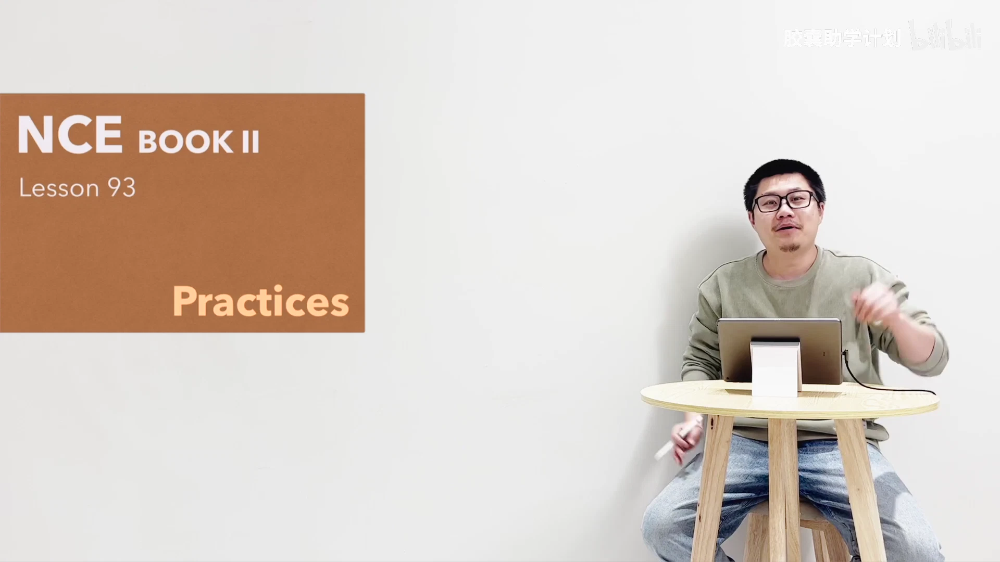

文字识别：NCE / BOOKⅡI / Lesson 93 / Practices

### 画面 00:00:02

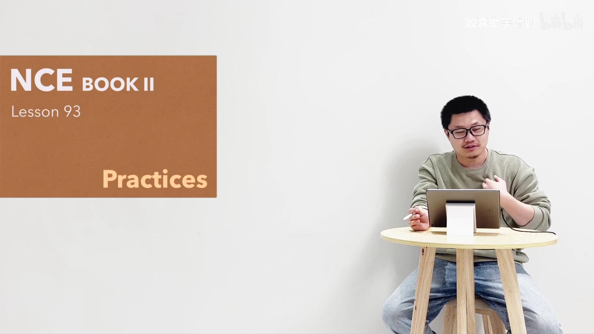

文字识别：NCE / BOOKII / Lesson 93 / Practices

### 画面 00:00:05

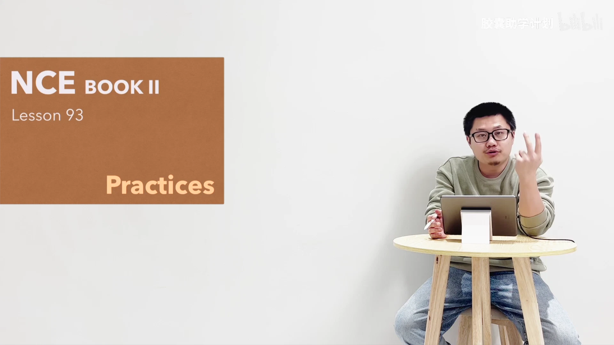

文字识别：NCE / BOOKII / Lesson 93 / Practices

### 画面 00:00:08

文字识别：辜助字计划 / 进行如下练习唯一前提 / 文章跟读至熟读成诵 / 否则请勿开始

### 画面 00:00:16

文字识别：胶囊助学计划il

### 画面 00:00:20

文字识别：助字计划一洲 / 胶囊助学计划

### 画面 00:00:22

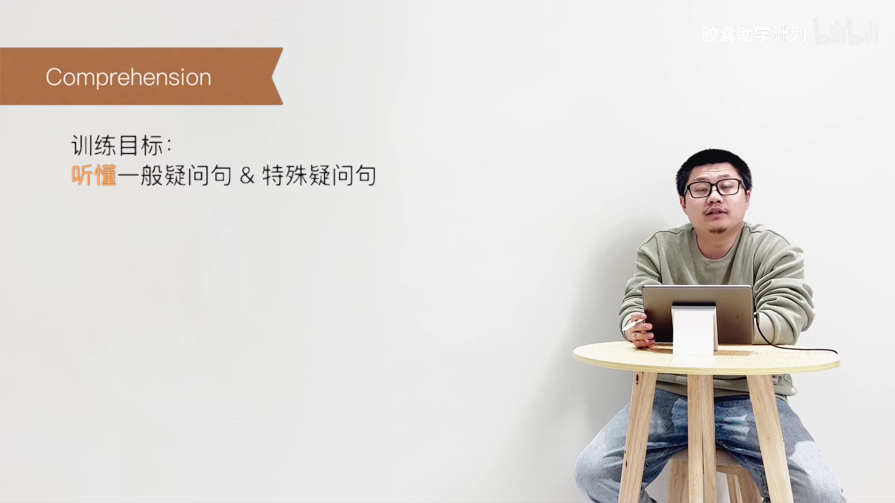

文字识别：妻助字计划一淵 / Comprehension / 训练目标： / 听懂一般疑问句＆特殊疑问句

### 画面 00:00:28

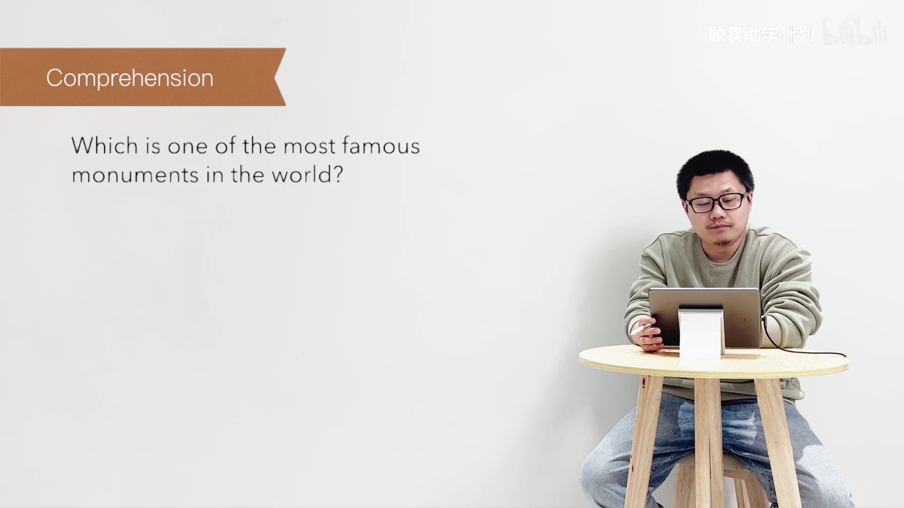

文字识别：Comprehension / Which is one of the most famous / monuments in the world?

## 00:00:30–00:01:00

one of the most famous monuments in the world, Statue of Liberty. Next one, when was it presented to the United States of America? In the 19th century. Next one, who was it presented to? Presented by, by the people of France. France. How long did the statue take to complete? Ten years. Who was

### 画面 00:00:36

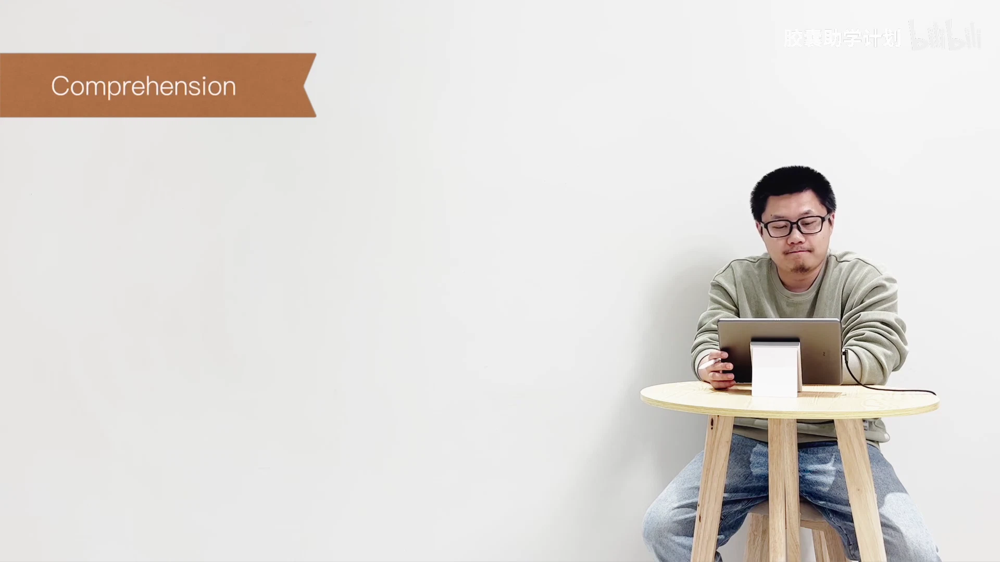

文字识别：助子计划 / Comprehension

### 画面 00:00:38

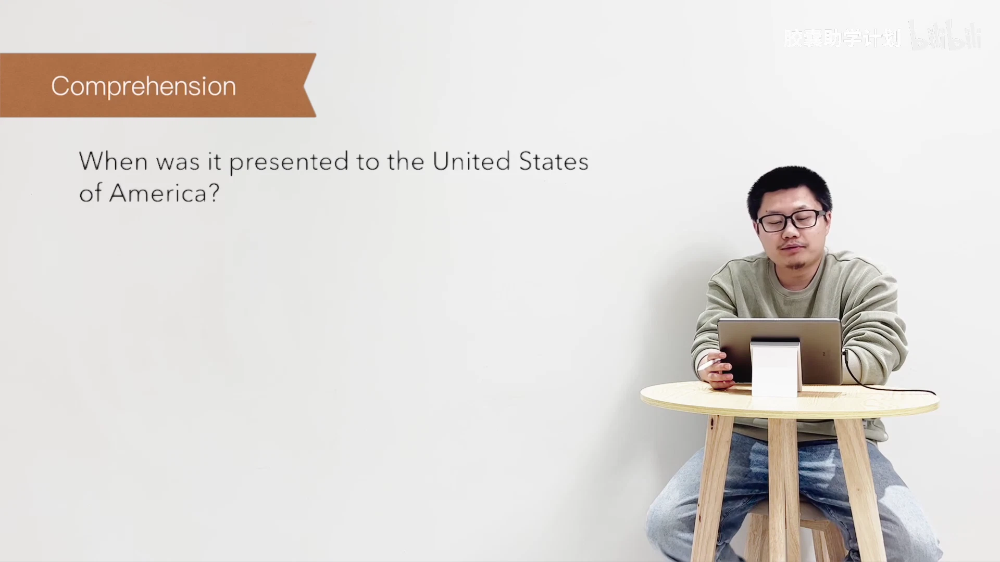

文字识别：Comprehension / When was it presented to the United States / of America?

### 画面 00:00:41

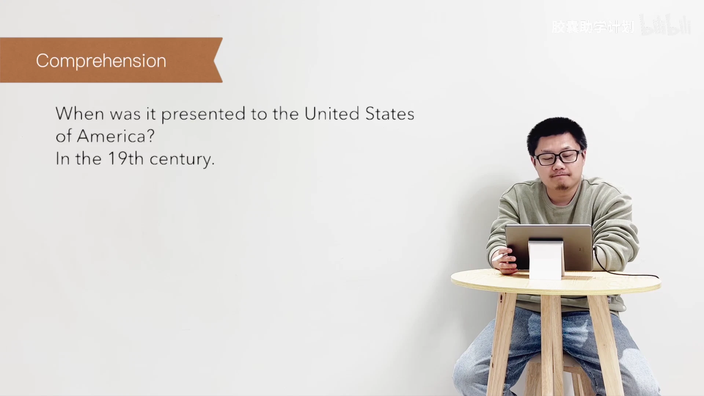

文字识别：Comprehension / When was it presented to the United States / of America? / In the 19th century.

### 画面 00:00:48

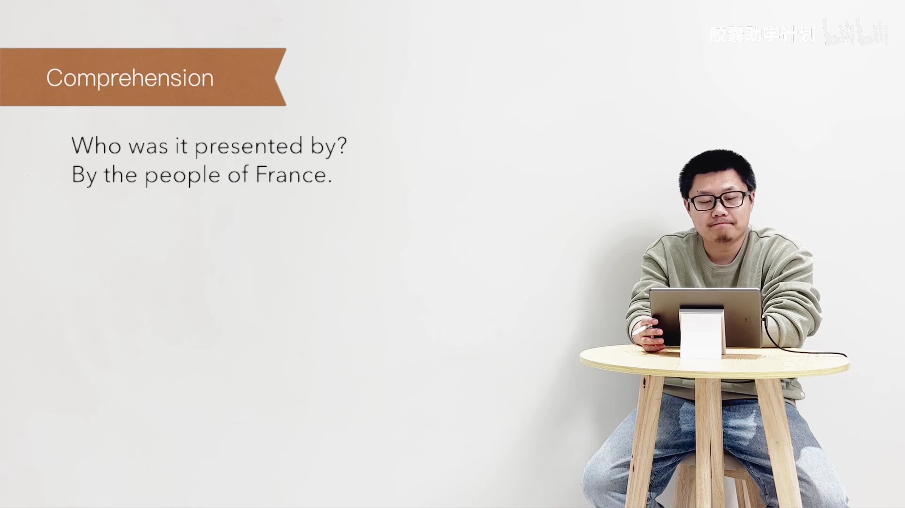

文字识别：Comprehension / Who was it presented by? / By the people of France.

### 画面 00:00:53

文字识别：Comprehension / How long did the statue take to complete?

### 画面 00:00:59

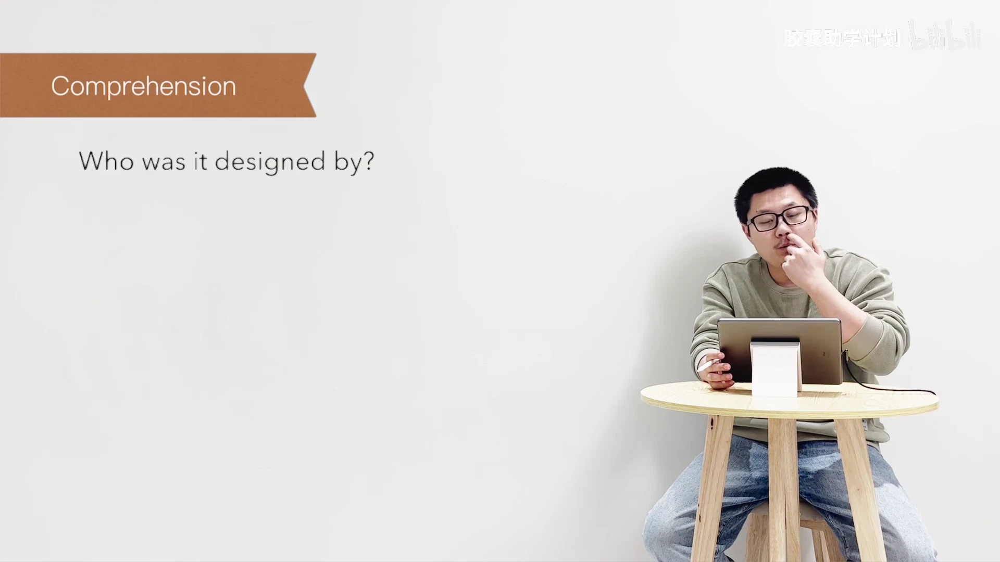

文字识别：毫助学计划 / Comprehension / Who was it designed by?

## 00:01:00–00:01:30

it designed by? By Augustus, Bathory, is it? How was the actual figure supported by metal framework? Metal framework. What was the figure made of? Copper. Who constructed the metal framework? Eiffel. What had to be found before the

### 画面 00:01:01

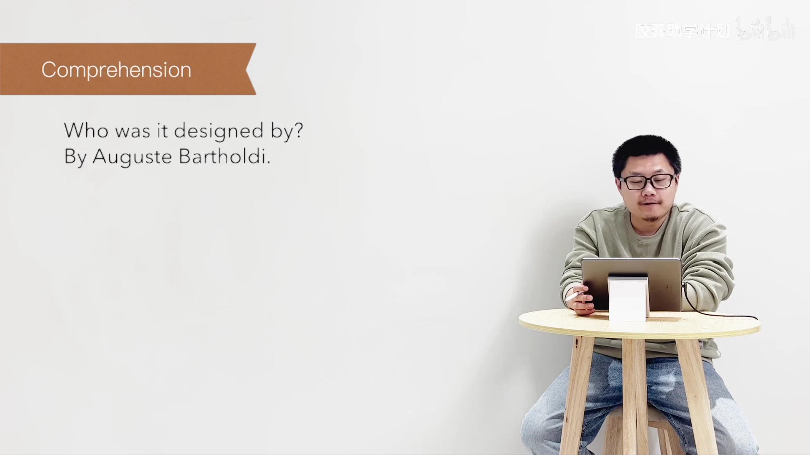

文字识别：Comprehension / Who was it designed by? / By Auguste Bartholdi.

### 画面 00:01:07

文字识别：Comprehension / How was the actual figure supported?

### 画面 00:01:25

文字识别：Comprehension / What had to be found before the statue / could be transported to the States?

## 00:01:30–00:02:00

statue could be transported to the states. A site. What had to be built? A pedestal. What site was chosen? An island at the entrance of New York Harbor. Where was the site first erected? Where was the statue first erected? In Paris.

### 画面 00:01:47

文字识别：Comprehension / What site was chosen? / An island at the entrance of New York / Harbor.

### 画面 00:01:51

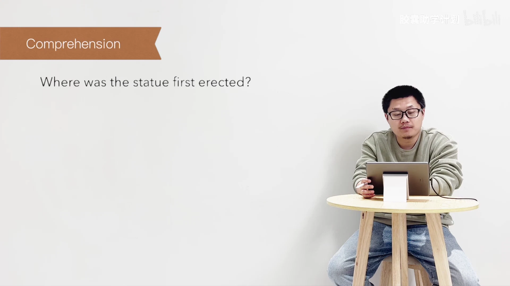

文字识别：毫助字计划 / Comprehension / Where was the statue first erected?

## 00:02:00–00:02:30

how tall was it? One hundred and fifty-one feet. Asking question, 四句型啊，第一个例子, ask me if the Statue of Liberty is a world famous monument. Famous monument is提前, how famous? World famous提问呗，对吧? How famous is the Statue of Liberty? Ah, what对主语提问, it was presented to the USA in the 19th century.

### 画面 00:02:06

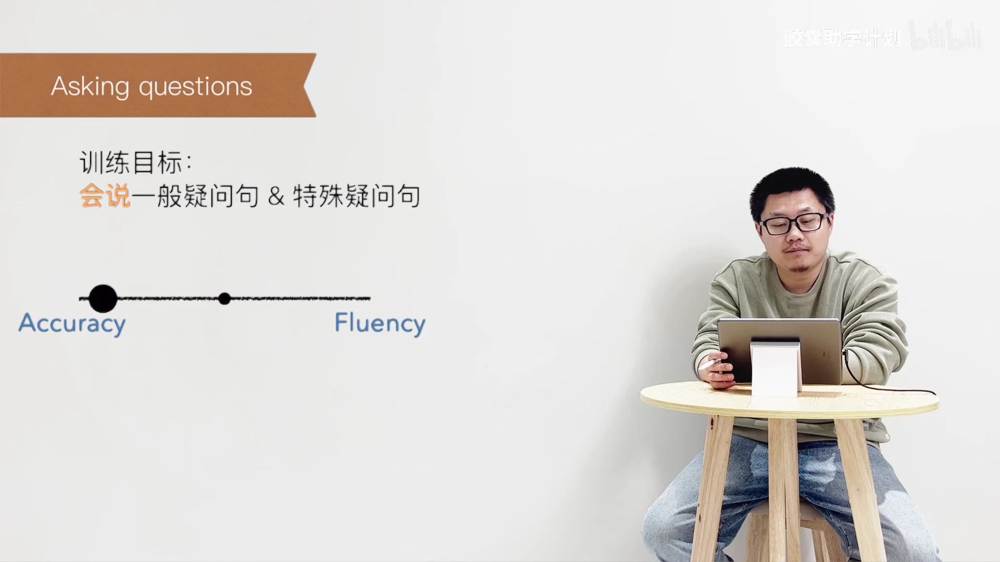

文字识别：Asking questions / 训练目标： / 会说一般疑问句＆特殊疑问句 / Accuracy / Fluency

### 画面 00:02:09

文字识别：Asking questions / T: Ask me if the Statue of Liberty is a world- / famous monument.

### 画面 00:02:14

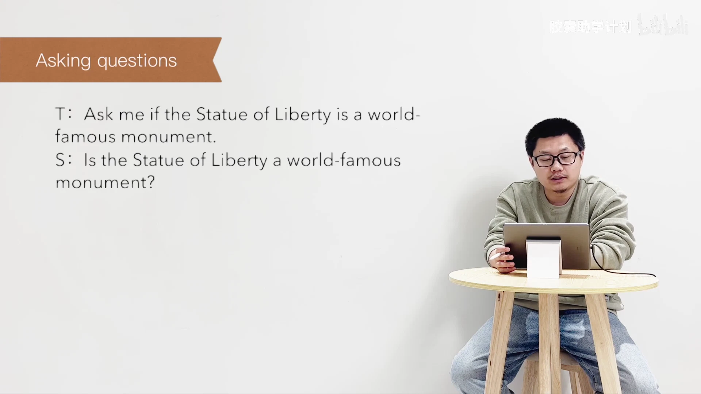

文字识别：Asking questions / T: Ask me if the Statue of Liberty is a world- / famous monument. / S: Is the Statue of Liberty a world-famous / monument?

### 画面 00:02:23

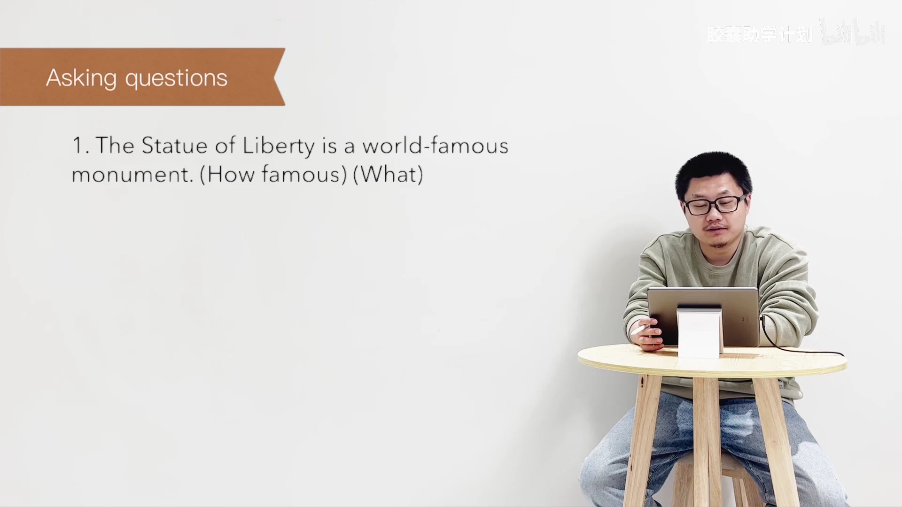

文字识别：Asking questions / 1. The Statue of Liberty is a world-famous / monument. (How famous) (What)

### 画面 00:02:27

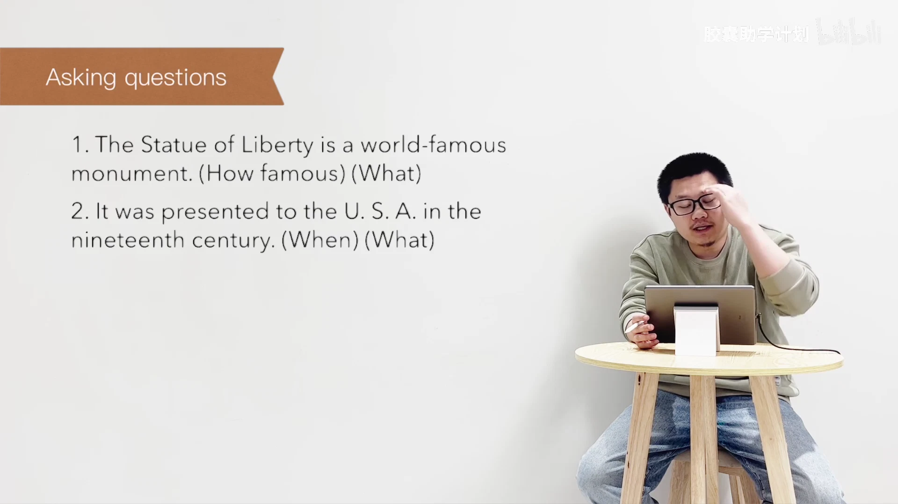

文字识别：Asking questions / 1. The Statue of Liberty is a world-famous / monument.(How famous) (What) / 2. It was presented to the U. S.A.in the / nineteenth century. (When)(What)

## 00:02:30–00:03:00

呃was presented.一般过去式被动，你把was提前。When对in the 19th century提问，What对主语提问。It was given by the French. What was提前？Who who was it given by？It was designed by呃Berthollet,是吧？呃was提前，然后Who对这个Berthollet提问。He was a sculptor. Was he a sculptor？Who was he？对呀，What这个What在这不好，我们不用它

### 画面 00:02:37

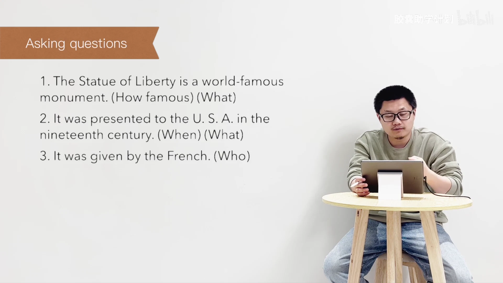

文字识别：Asking questions / 1. The Statue of Liberty is a world-famous / monument.(How famous) (What) / 2. It was presented to the U. S. A.in the / nineteenth century.(When)(What) / 3. It was given by the French.(Who)

### 画面 00:02:44

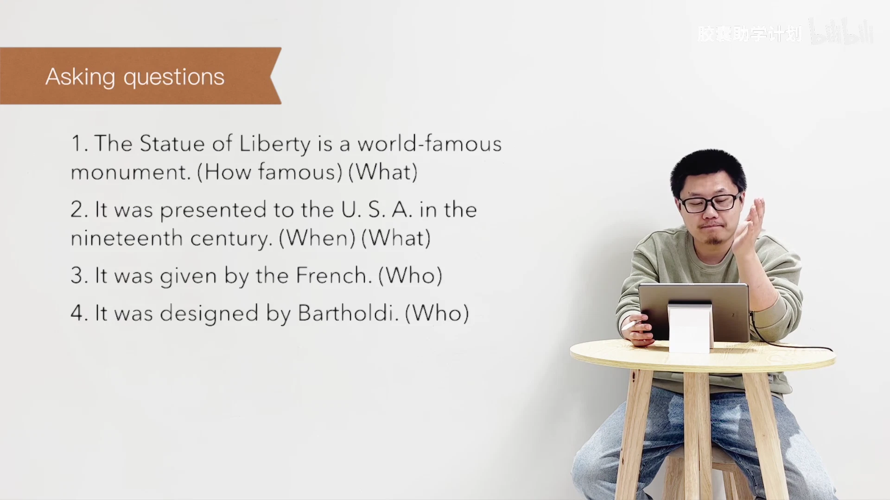

文字识别：Asking questions / 1. The Statue of Liberty is a world-famous / monument.(How famous)(What) / 2. Ilt was presented to the U. S. A. in the / nineteenth century. (When) (What) / 3. It was given by the French.(Who) / 4. It was designed by Bartholdi. (Who)

## 00:03:00–00:03:30

recording. Transcribe the exact words in their original spoken languages. Never translate. Preserve repetitions, questions and examples.

### 画面 00:03:01

文字识别：助字计划 / Asking questions

### 画面 00:03:13

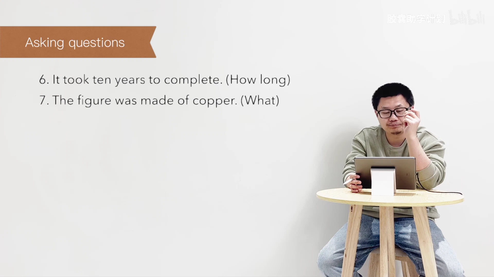

文字识别：Asking questions / 6. It took ten years to complete. (How long) / 7. The figure was made of copper. (What)

## 00:03:30–00:04:00

metal framework. Was提前，how对整个可以加by啊，how was it supported，对吧？我对主语提问。The frame was constructed by Eiffel.呃，was提前，然后互你对后边的Eiffel提问就行了。人嘛。The statue was one hundred one hundred fifty one feet tall. Was提前，how tall肯定对那个one hundred fifty one feet tall提问啊。It was erected in eighteen eighty four.呃，was提前，when对eighty eighty

### 画面 00:03:30

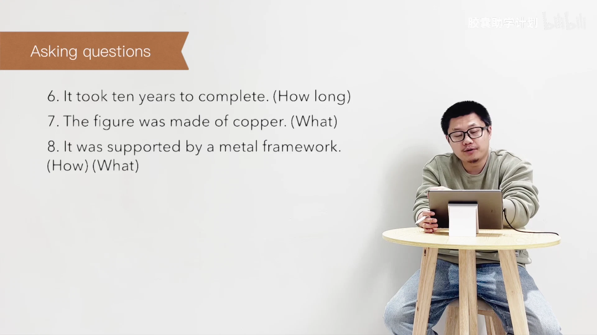

文字识别：Asking questions / 6. It took ten years to complete. (How long) / 7. The figure was made of copper. (What) / 8. It was supported by a metal framework. / (How)(What)

### 画面 00:03:32

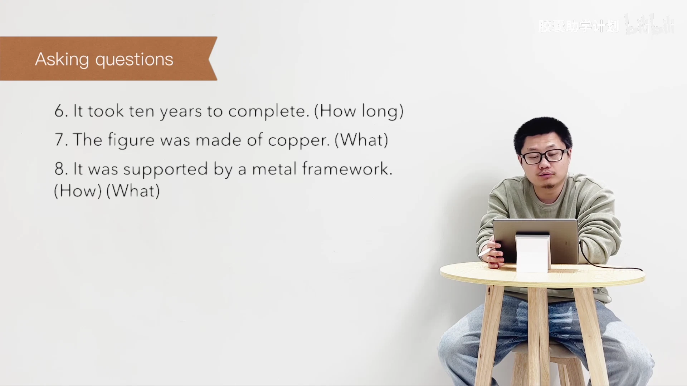

文字识别：Asking questions / 6. It took ten years to complete. (How long) / 7. The figure was made of copper. (What) / 8. It was supported by a metal framework. / (How)(What)

### 画面 00:03:34

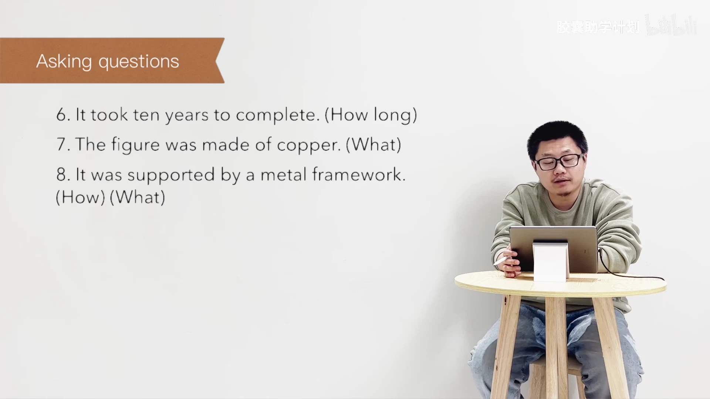

文字识别：Asking questions / 6. It took ten years to complete. (How long) / 7. The figure was made of copper. (What) / 8. It was supported by a metal framework. / (How)(What)

### 画面 00:03:36

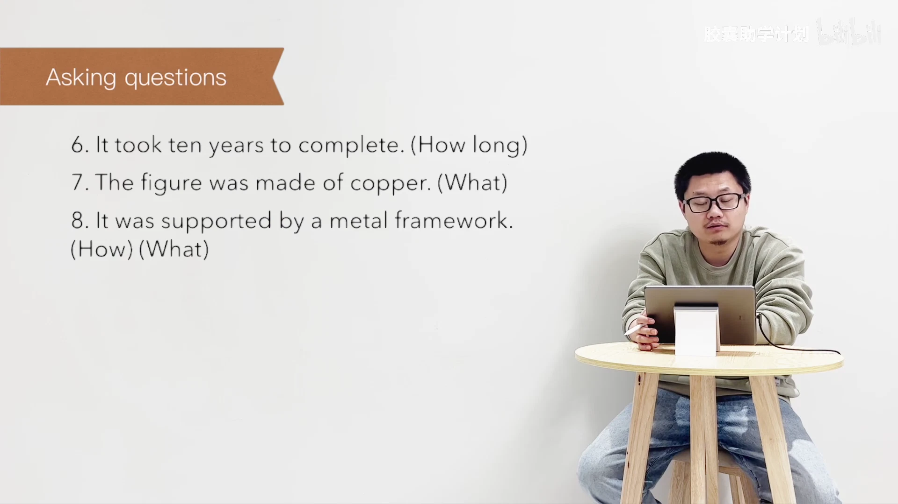

文字识别：Asking questions / 6. It took ten years to complete. (How long) / 7. The figure was made of copper. (What) / 8. It was supported by a metal framework. / (How)(What)

### 画面 00:03:45

文字识别：Asking questions / 6. It took ten years to complete. (How long) / 7. The figure was made of copper. (What) / 8. It was supported by a metal framework. / (How)(What) / 9.The frame was constructed by Eiffel. (Who) / 10. The statue was 151 feet tall. (How tall)

## 00:04:00–00:04:30

提问1884提问Tell the story老习惯直接复述啊，重点是流利对吧？所以文章要读的越熟越好。Summarizing呢，写作能力两篇文章，重点看连词。第一篇，第二篇啊，重点咱们看连词。然后topic for discussion，咱们直接看一下，说Why do you think the island side was chosen? Was it good one or not?你为什么认为就是这自由女神像要放在这个岛上？它

### 画面 00:04:02

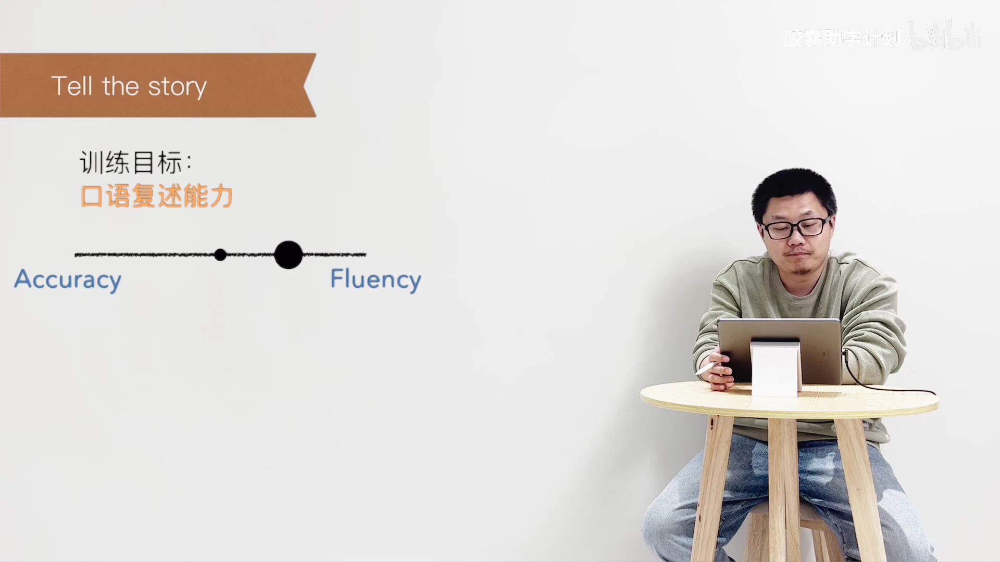

文字识别：囊助字计划 / Tell the story / 训练目标： / □语复述能力 / Accuracy / Fluency

### 画面 00:04:04

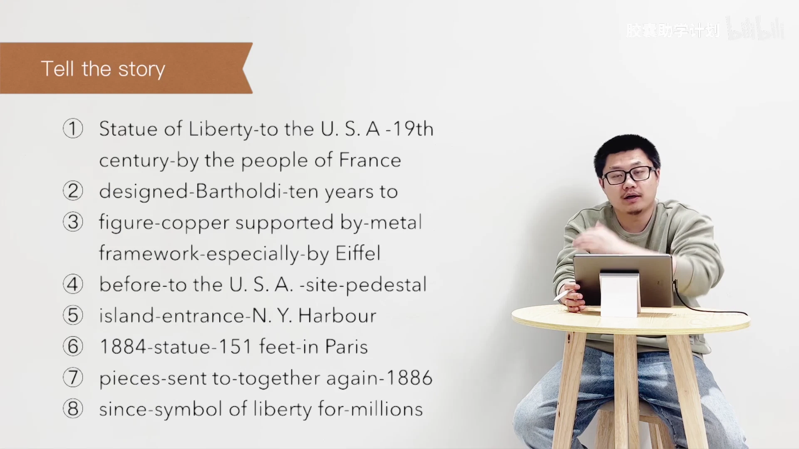

文字识别：Tell the story / Statue of Liberty-to the U. S.A -19th / century-by the people of France / designed-Bartholdi-ten years to / figure-copper supported by-metal / framework-especially-by Eiffel /  before-to the U. S.A. -site-pedestal / island-entrance-N. Y. Harbour / 5 / 1884-statue-151 feet-in Paris / 6 / pieces-sent to-together again-1886 / 8 / since-symbol of liberty for-millions

### 画面 00:04:07

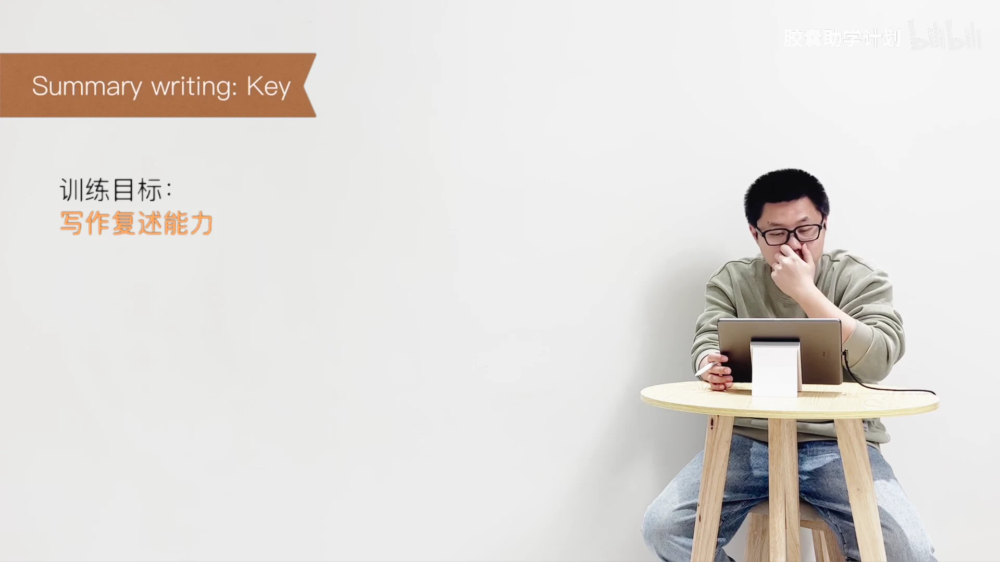

文字识别：Summary writing: Key / 训练目标： / 写作复述能力

### 画面 00:04:11

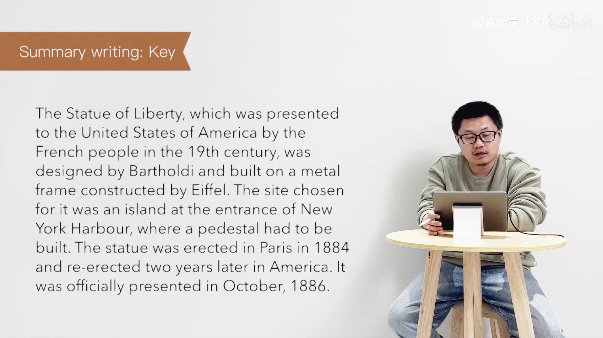

文字识别：助学计划 / Summary writing: Key / The Statue of Liberty, which was presented / to the United States of America by the / French people in the 19th century, was / designed by Bartholdi and built on a metal / frame constructed by Eiffel. The site chosen / for it was an island at the entrance of New / York Harbour, where a pedestal had to be / built. The statue was erected in Paris in 1884 / and re-erected two years later in America. It / was officially presented in October, 1886.

### 画面 00:04:13

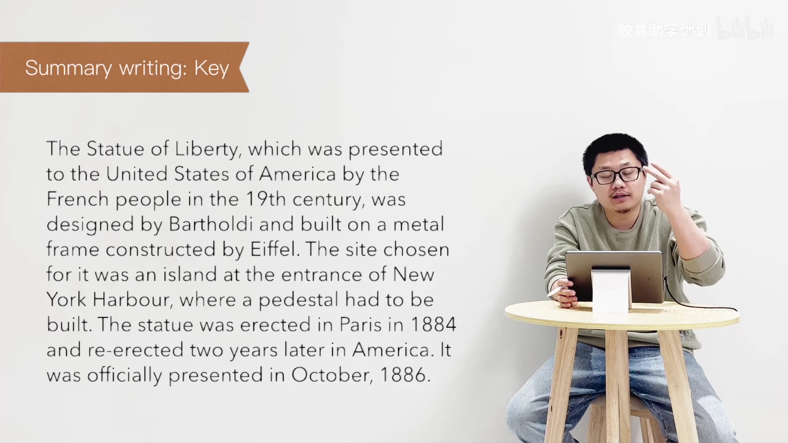

文字识别：助学计划 / Summary writing: Key / The Statue of Liberty, which was presented / to the United States of America by the / French people in the 19th century, was / designed by Bartholdi and built on a metal / frame constructed by Eiffel. The site chosen / for it was an island at the entrance of New / York Harbour, where a pedestal had to be / built. The statue was erected in Paris in 1884 / and re-erected two years later in America. lt / was officially presented in October, 1886.

### 画面 00:04:15

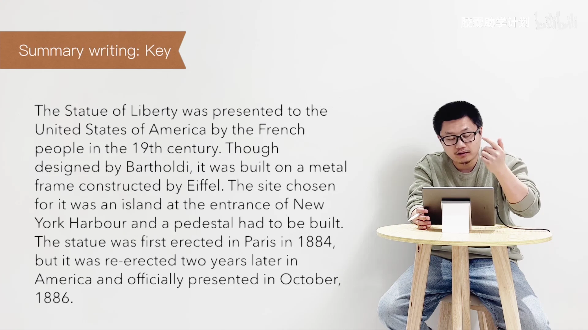

文字识别：助学计划 / Summary writing: Key / The Statue of Liberty was presented to the / United States of America by the French / people in the 19th century. Though / designed by Bartholdi, it was built on a metal / frame constructed by Eiffel. The site chosen / for it was an island at the entrance of New / York Harbour and a pedestal had to be built. / The statue Was first erected in Paris in 1884, / but it was re-erected two years later in / America and officially presented in October, / 1886.

### 画面 00:04:17

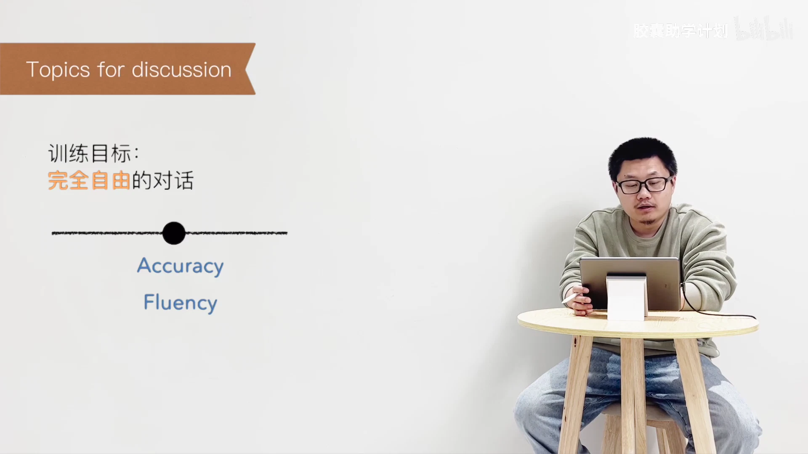

文字识别：Topics for discussion / 训练目标： / 完全自由的对话 / Accuracy / Fluency

### 画面 00:04:19

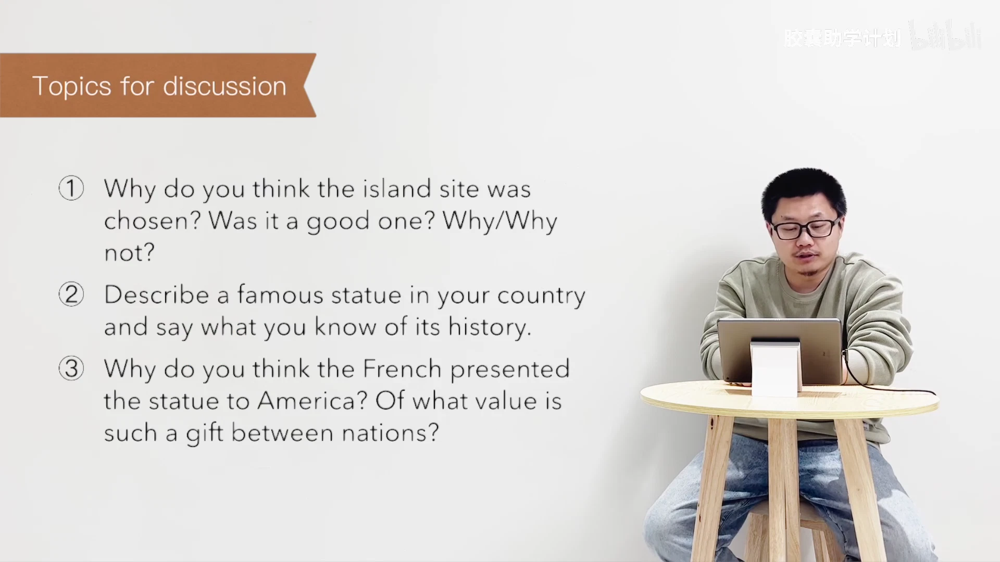

文字识别：Topics for discussion / Why do you think the island site was / chosen? Was it a good one? Why/Why / not? / Describe a famous statue in your country / and say what you know of its history. / Why do you think the French presented / the statue to America? Of what value is / such a gift between nations?

### 画面 00:04:26

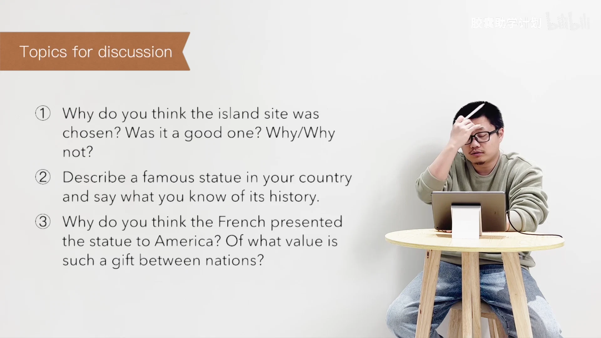

文字识别：Topics for discussion / Why do you think the island site was / chosen? Was it a good one? Why/Why / not? / Describe a famous statue in your country / and say what you know of its history. / Why do you think the French presented / the statue to America? Of what value is / such a gift between nations?

## 00:04:30–00:05:00

不是放在大陆上，是专门弄了个岛。Describe a famous statue in your country and say what you know of its history.你描述一个咱中国特别有名的famous statue，对吧？有名的这个雕像呗。那它的历史是什么，对吧？说Why do you think the French presented the statue to America?嗯，法国为啥要给美国这么个雕像呢？Of what value is such a gift between nations?国家之间送这样的一个

### 画面 00:04:41

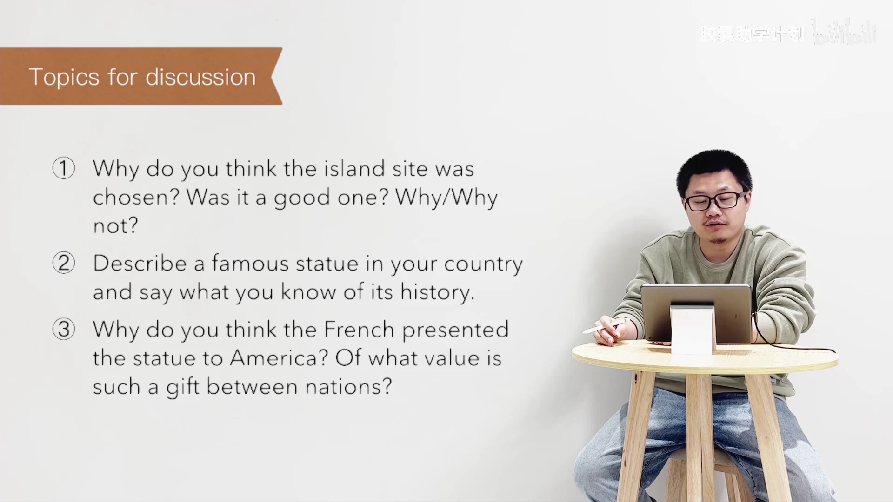

文字识别：Topics for discussion / Why do you think the island site was / chosen? Was it a good one? Why/Why / not? / Describe a famous statue in your country / and say what you know of its history. / Why do you think the French presented / the statue to America? Of what value is / such a gift between nations?

## 00:05:00–00:05:30

呃礼物有什么价值呢？OK，家庭作业Ask Smith先写再朗读，再要写作，写完对答案，Tell the story口语复述，然后看置顶留言找重复间隔的学习材料。那以上呢就是本期视频的全部内容了。如果各位喜欢我们的课程呢，欢迎各位关注订阅，一键三连，分享给那些需要的朋友来帮助我们快速成长。See you next time.

### 画面 00:05:03

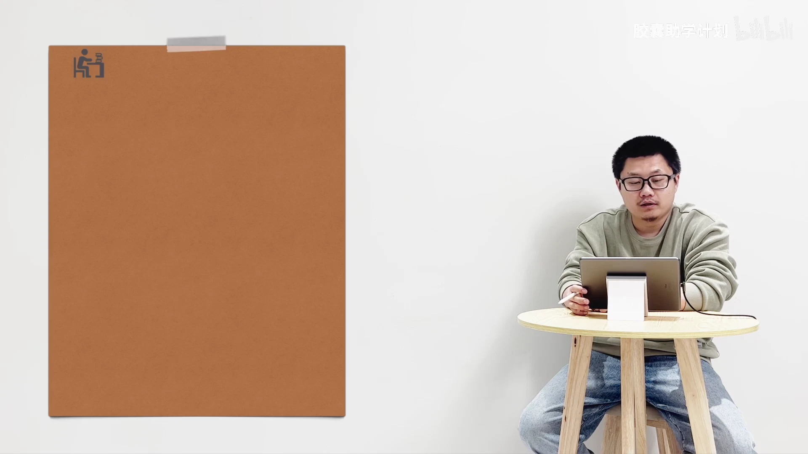

文字识别：助学计划

### 画面 00:05:05

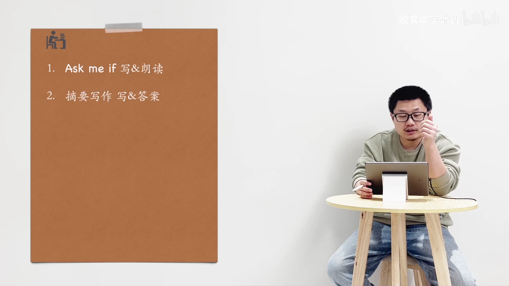

文字识别：1.Ask me if写&朗读 / 2.摘要写作写&答案

### 画面 00:05:07

文字识别：臺助字计划 / 1.Ask me if写&朗读 / 摘要写作写&答案 / 3.Tell the story 口语复述

### 画面 00:05:09

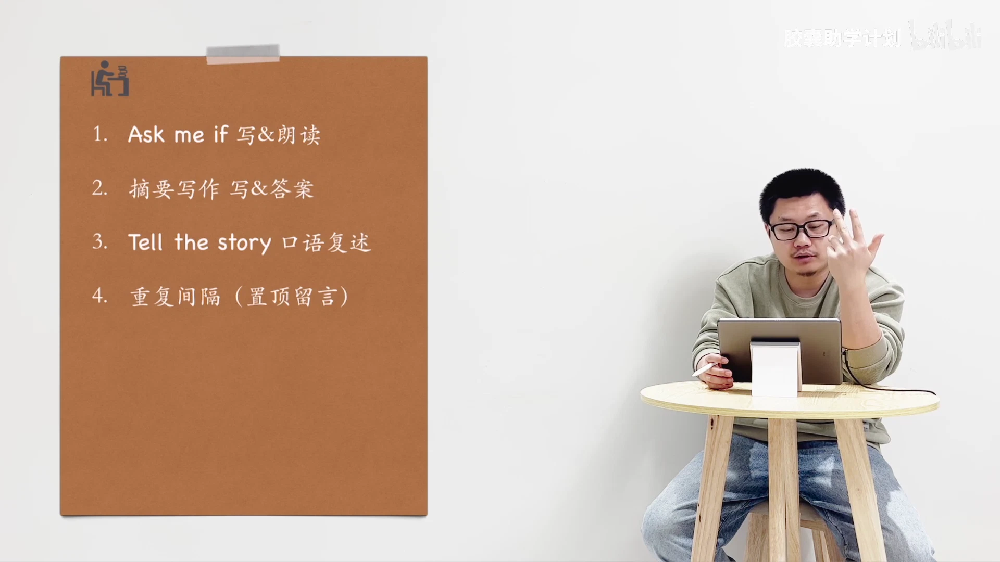

文字识别：1.Ask me if写&朗读 / 摘要写作写&答案 / 3.Tell the story 口语复述 / 4.重复间隔（置顶留言)

### 画面 00:05:11

文字识别：1.Ask me if写&朗读 / 摘要写作写&答案 / 3.Tell the story 口语复述 / 4.重复间隔（置顶留言） / 4.

### 画面 00:05:13

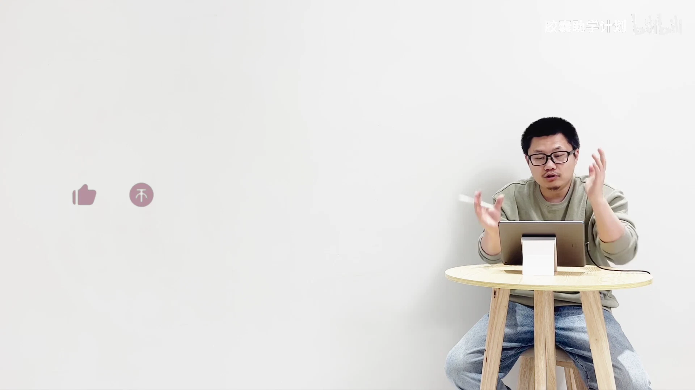

文字识别：臺助字计划一間

### 画面 00:05:15

文字识别：袁助学计划 / 不

### 画面 00:05:18

文字识别：助学计划医 / 不

### 画面 00:05:21

文字识别：寶助学计划一调

### 画面 00:05:24

文字识别：実助学计划

### 画面 00:05:26

### 画面 00:05:28

文字识别：聖助字計切 / CAPSULEACADEMY / 胶囊助学计划 / 小红书 / Lecturer / □ / Leo

## 00:05:30–00:05:38

### 画面 00:05:30

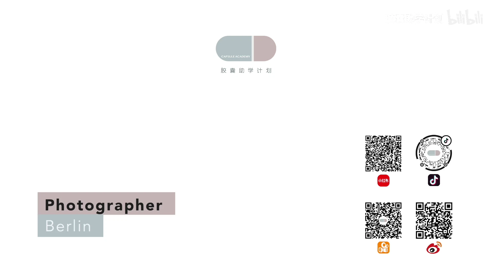

文字识别：CAPSULEACADEMY / 胶囊助学计划 / 小红书 / Photographer / Berlin / OE

### 画面 00:05:32

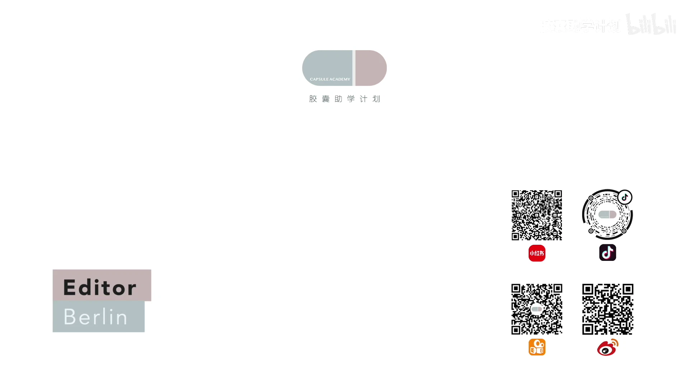

文字识别：CAPSULEACADEMY / 胶囊助学计划 / 『 / 小红书 / Editor / □ / Berlin / OE

### 画面 00:05:35

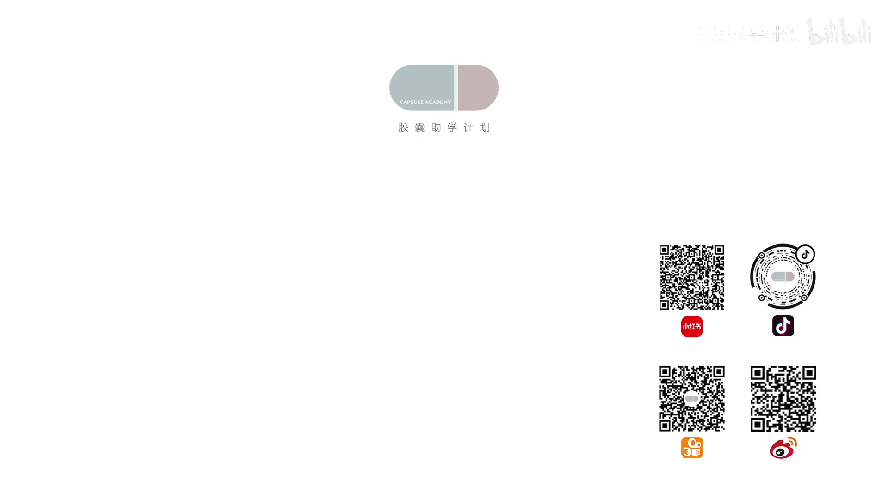

文字识别：CAPSULEACADEMY / 胶囊助学计划 / 小红书

### 画面 00:05:37

文字识别：bilbili / 胶囊助学计划

