# 094 单词

快速机器解析：语音为单模型转写，未进行独立交叉校对或人工复核；画面每秒采样并按变化选帧，短时文字和标记可能遗漏。截图时间约有 1 秒误差。图片有损压缩；遇到疑点请按时间查看 Google Drive 原视频。

## 00:00:00–00:00:30

Hello everyone, welcome to Capsule Academy. This is Leo. Today we're going to learn New Concept English Book Two, Lesson Ninety Four Words. 那老习惯进入正式课程之前，咱们先看几个问题啊。首先，如何表达不情愿做某件事情？接下来呢，如何表达竞争或对抗？那带着这两个问题，Hope you gonna enjoy. 第一个单词跟我读一下，叫 instruct, instruct, instruct. 表示的是咱们之

### 画面 00:00:00

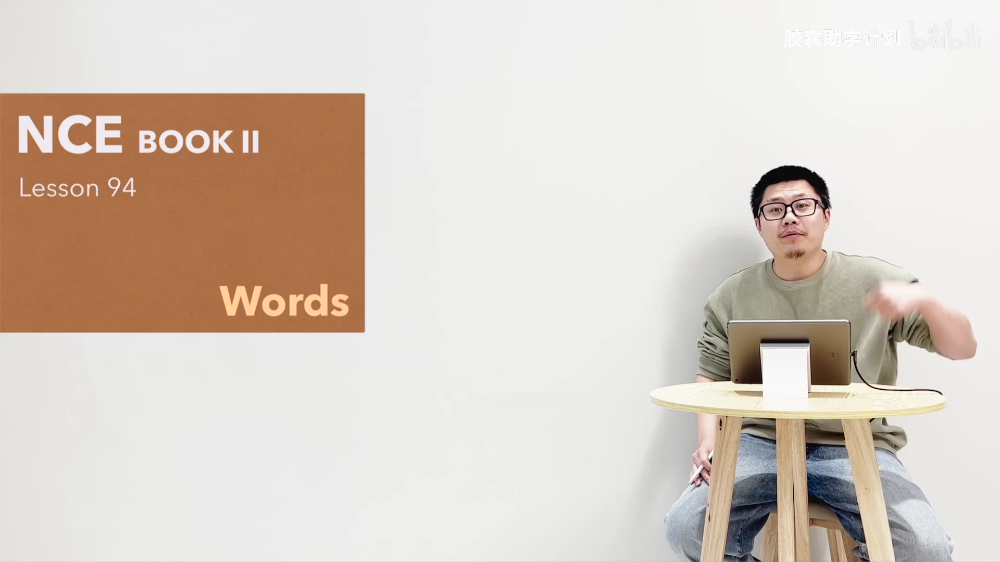

文字识别：喜助字计划 / NCE / BOOKⅡI / Lesson 94 / Words

### 画面 00:00:06

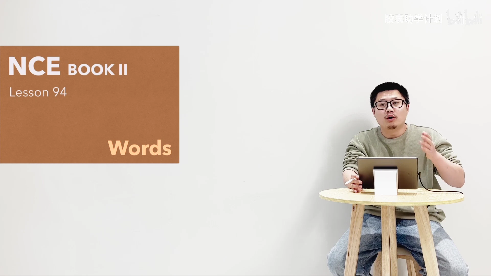

文字识别：交囊助学计划 / NCE / BOOKⅡI / Lesson 94 / Words

### 画面 00:00:08

文字识别：喜助学计划一调

### 画面 00:00:10

文字识别：囊助学计划国 / 如何表达“不情愿做某事”?

### 画面 00:00:12

文字识别：辜助学计划口 / ①如何表达“不情愿做某事”？

### 画面 00:00:14

文字识别：臺助学计划園 / ①如何表达“不情愿做某事”？ / 如何表达“竞争/对抗”?

### 画面 00:00:20

文字识别：胶囊助学计划bibl / •

### 画面 00:00:24

文字识别：動学計越

### 画面 00:00:26

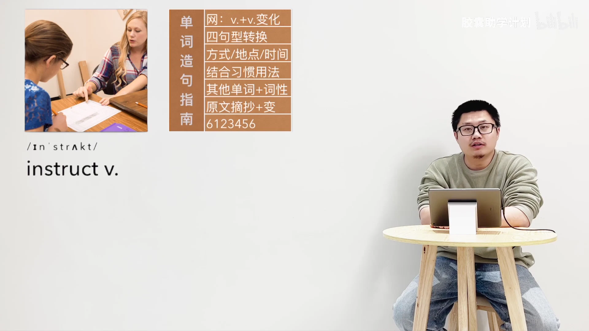

文字识别：单词造句指南 / 网：v.+v.变化 / 喜助字计划 / 四句型转换 / 方式/地点/时间 / 结合习惯用法 / 其他单词+词性 / 原文摘抄+变 / 6123456 / /In'strakt/ / instruct v.

## 00:00:30–00:01:00

前学过叫指示指令，对吧？在六十九课呢，咱学过一个短语叫be instructed to do something，叫被指示指令去做某件事儿。那你现在把它变成一个，它现在是被动，对吧？各位能看到叫be instructed。咱们当时呢，如果给它换成主动，叫instruct somebody to do something，叫指示命令某人去做某件事情，其实非常像之前咱们学过的叫做be ordered to do something，对吧？那今天呢，我们要学一个它

### 画面 00:00:30

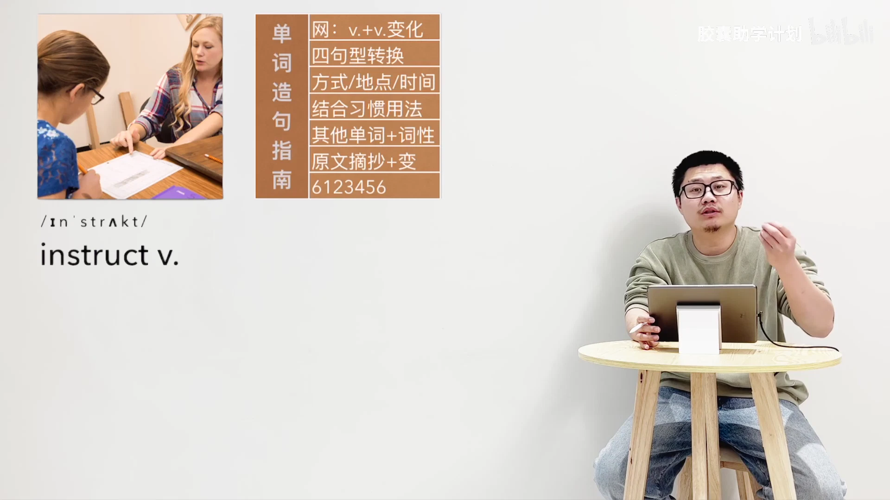

文字识别：单词造句指南 / 网：v.+v.变化 / 卖助学计划一 / 四句型转换 / 方式/地点/时间 / 结合习惯用法 / 其他单词+词性 / 原文摘抄+变 / 6123456 / /In'strakt/ / instruct v.

### 画面 00:00:35

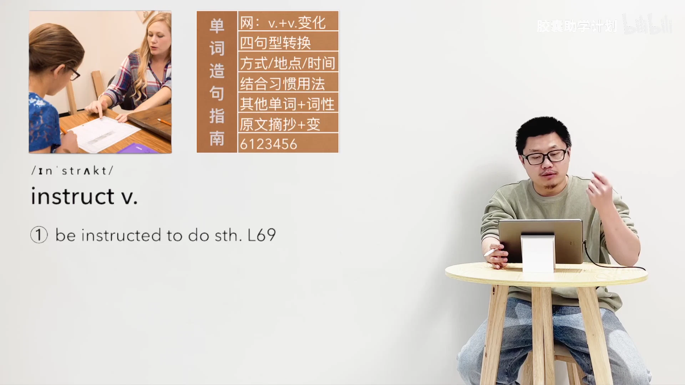

文字识别：单词造句指南 / 网：v.+v.变化 / 奏助学计划一州 / 四句型转换 / 方式/地点/时间 / 结合习惯用法 / 其他单词+词性 / 原文摘抄+变 / 6123456 / /In'strakt/ / instruct v. / ① be instructed to do sth. L69

### 画面 00:00:40

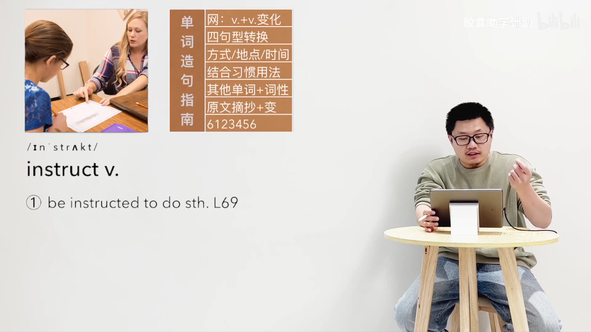

文字识别：单词造句指南 / 网：v.+v.变化 / 四句型转换 / 方式/地点/时间 / 结合习惯用法 / 其他单词+词性 / 原文摘抄+变 / 6123456 / /In'strakt/ / instruct v. / ① be instructed to do sth. L69

### 画面 00:00:43

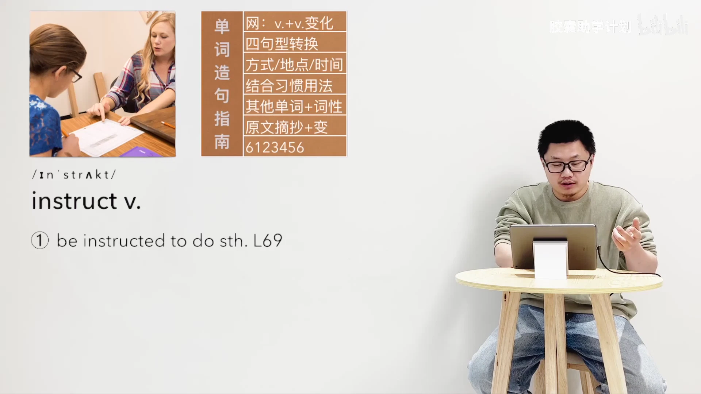

文字识别：单词造句指南 / 网：v.+v.变化 / 四句型转换 / 方式/地点/时间 / 结合习惯用法 / 其他单词+词性 / 原文摘抄+变 / 6123456 / /In'strakt/ / instruct v. / ① be instructed to do sth. L69

### 画面 00:00:45

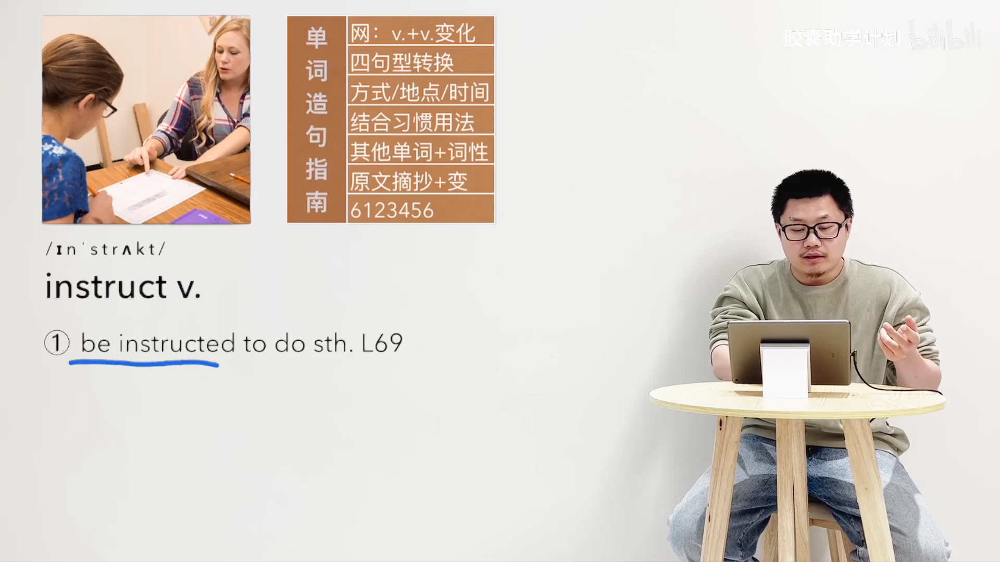

文字识别：单词造句指南 / 网：v.+v.变化 / 喜助字计划 / 四句型转换 / 方式/地点/时间 / 结合习惯用法 / 其他单词+词性 / 原文摘抄+变 / 6123456 / /In'strakt/ / instruct v. / ① be instructed to do sth. L69

### 画面 00:00:54

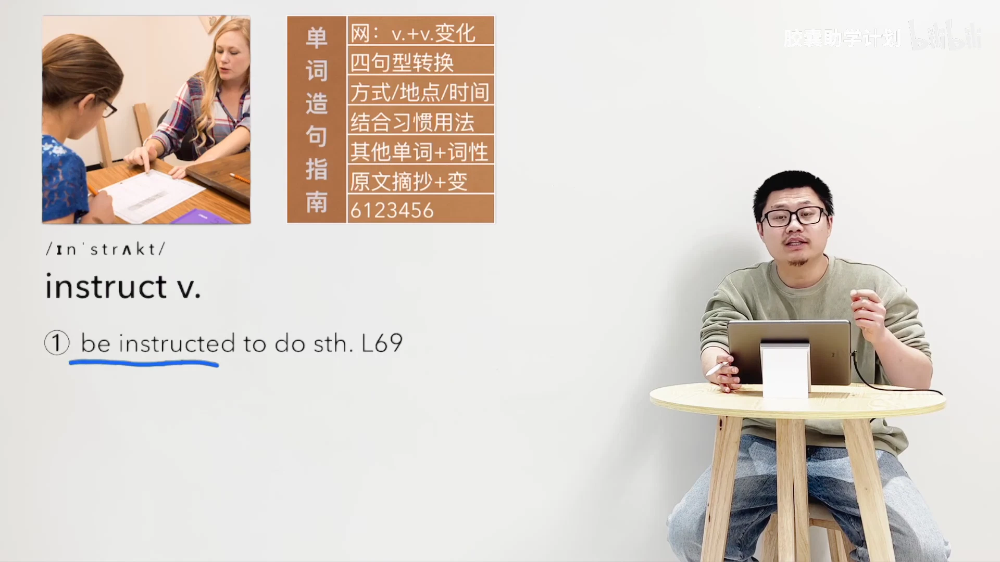

文字识别：单词造句指南 / 网：v.+v.变化 / 妻助学计划陽 / 四句型转换 / 方式/地点/时间 / 结合习惯用法 / 其他单词+词性 / 原文摘抄+变 / 6123456 / /In'strakt/ / instruct v. / ① be instructed to do sth. L69

### 画面 00:00:58

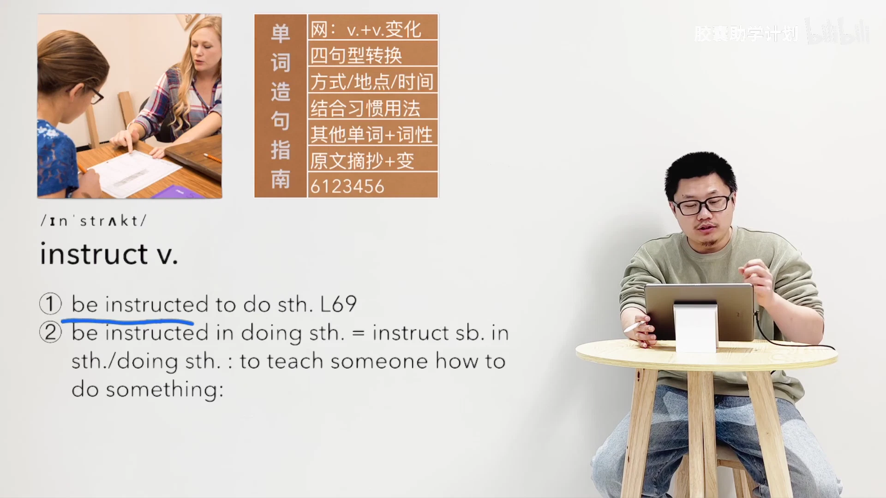

文字识别：单词造句指南 / 网：v.+v.变化 / 四句型转换 / 方式/地点/时间 / 结合习惯用法 / 其他单词+词性 / 原文摘抄+变 / 6123456 / /In'strakt/ / instruct v. / ① be instructed to do sth. L69 / )be instructed in doing sth. = instruct sb.in / sth./doing sth.: to teach someone how to / do something:

## 00:01:00–00:01:30

的新的用法，还是 instructed 这个单词，它变成了叫做 be instructed in doing something，或者你把它变成主动叫 instruct somebody in something or in doing something，什么意思呢？就类似于叫 teach somebody how to do something，叫教某人如何去做某件事，其实就是教某人啊。比如说，那我就可以造一个句子，叫 My job is to instruct her in English，对吧？我的工作就是教她

### 画面 00:01:00

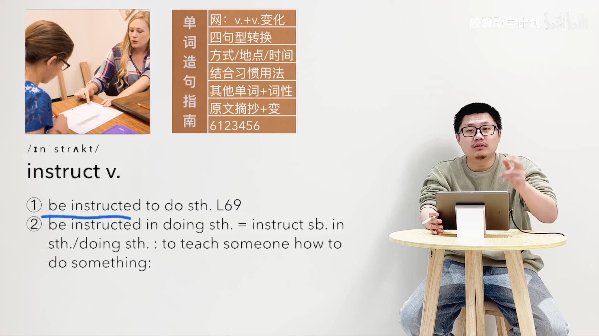

文字识别：单词造句指南 / 网：v.+v.变化 / 囊助学计划 / 四句型转换 / 方式/地点/时间 / 结合习惯用法 / 其他单词+词性 / 原文摘抄+变 / 6123456 / /In'strakt/ / instruct v. / ① be instructed to do sth. L69 / )be instructed in doing sth. = instruct sb.in / sth./doing sth. : to teach someone how to / do something:

### 画面 00:01:03

文字识别：单词造句指南 / 网：v.+v.变化 / 奏助字计划 / 四句型转换 / 方式/地点/时间 / 结合习惯用法 / 其他单词+词性 / 原文摘抄+变 / 6123456 / /In'strakt/ / instruct v. / ① be instructed to do sth. L69 / )be instructed in doing sth. = instruct sb.in / sth./doing sth.: to teach someone how to / do something:

### 画面 00:01:05

文字识别：单词造句指南 / 网：v.+v.变化 / 四句型转换 / 方式/地点/时间 / 结合习惯用法 / 其他单词+词性 / 原文摘抄+变 / 6123456 / /In'strakt/ / instruct v. / ① be instructed to do sth. L69 / )be instructed in doing sth. = instruct sb.in / sth./doing sth.: to teach someone how to / do something:

### 画面 00:01:11

文字识别：单词造句指南 / 网：v.+v.变化 / 奏助字计划 / 四句型转换 / 方式/地点/时间 / 结合习惯用法 / 其他单词+词性 / 原文摘抄+变 / 6123456 / /In'strakt/ / instruct v. / ① be instructed to do sth. L69 / )be instructed in doing sth. = instruct sb.in / sth./doing sth.: to teach someone how to / do something:

### 画面 00:01:13

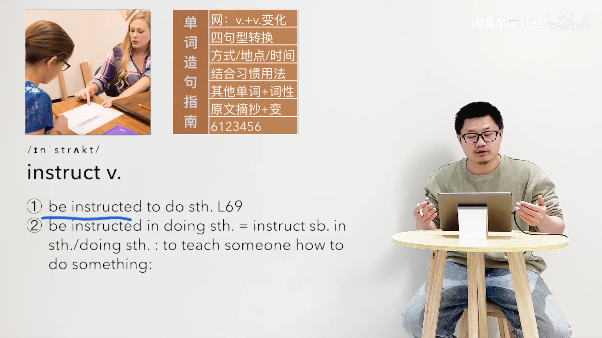

文字识别：单词造句指南 / 网：v.+v.变化 / 四句型转换 / 方式/地点/时间 / 结合习惯用法 / 其他单词+词性 / 原文摘抄+变 / 6123456 / /In'strakt/ / instruct v. / ① be instructed to do sth. L69 / )be instructed in doing sth. = instruct sb.in / sth./doing sth.: to teach someone how to / do something:

### 画面 00:01:15

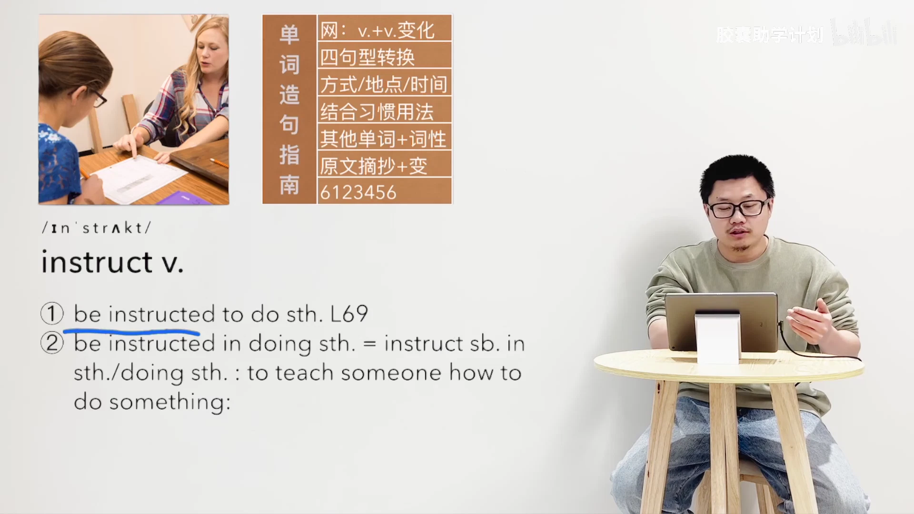

文字识别：单词造句指南 / 网：v.+v.变化 / 四句型转换 / 方式/地点/时间 / 结合习惯用法 / 其他单词+词性 / 原文摘抄+变 / 6123456 / /In'strakt/ / instruct v. / ① be instructed to do sth. L69 / )be instructed in doing sth. = instruct sb.in / sth./doing sth. : to teach someone how to / do something:

### 画面 00:01:20

文字识别：单词造句指南 / 网：v.+v.变化 / 囊助学计划 / 四句型转换 / 方式/地点/时间 / 结合习惯用法 / 其他单词+词性 / 原文摘抄+变 / 6123456 / /In'strakt/ / instruct v. / ① be instructed to do sth. L69 / )be instructed in doing sth. = instruct sb.in / sth./doing sth.: to teach someone how to / do something:

### 画面 00:01:22

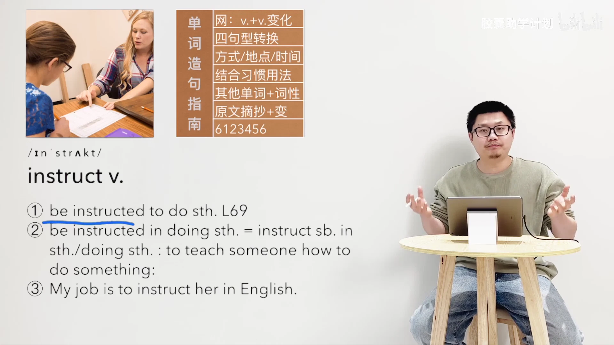

文字识别：单词造句指南 / 网：v.+v.变化 / 囊助学计划 / 四句型转换 / 方式/地点/时间 / 结合习惯用法 / 其他单词+词性 / 原文摘抄+变 / 6123456 / /In'strakt/ / instruct v. / ① be instructed to do sth. L69 / )be instructed in doing sth. = instruct sb.in / sth./doing sth.: to teach someone how to / do something: / ③ My job is to instruct her in English.

### 画面 00:01:24

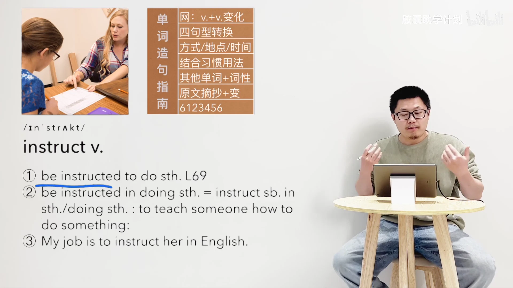

文字识别：单词造句指南 / 网：v.+v.变化 / 囊助字计划 / 四句型转换 / 方式/地点/时间 / 结合习惯用法 / 其他单词+词性 / 原文摘抄+变 / 6123456 / /In'strakt/ / instruct v. / ① be instructed to do sth. L69 / )be instructed in doing sth. = instruct sb.in / sth./doing sth.: to teach someone how to / do something: / ③ My job is to instruct her in English.

### 画面 00:01:26

文字识别：单词造句指南 / 网：v.+v.变化 / 喜助学计划 / 四句型转换 / 方式/地点/时间 / 结合习惯用法 / 其他单词+词性 / 原文摘抄+变 / 6123456 / /In'strakt/ / instruct v. / ① be instructed to do sth. L69 / )be instructed in doing sth. = instruct sb.in / sth./doing sth.: to teach someone how to / do something: / ③ My job is to instruct her in English.

## 00:01:30–00:02:00

他英语，或者我们给他变成 doing，叫做 He instructed me in building a boat. 他教我如何去，哎，这个建了一艘小的船。 OK，那再读一遍这个单词，instruct， very good。那咱注意力集中，咱听一下这个电影片段。 And did you instruct him in the use of the pistol? 好，下一个单词呢，Los Angeles。 Los Angeles 就是美国西海岸加州

### 画面 00:01:30

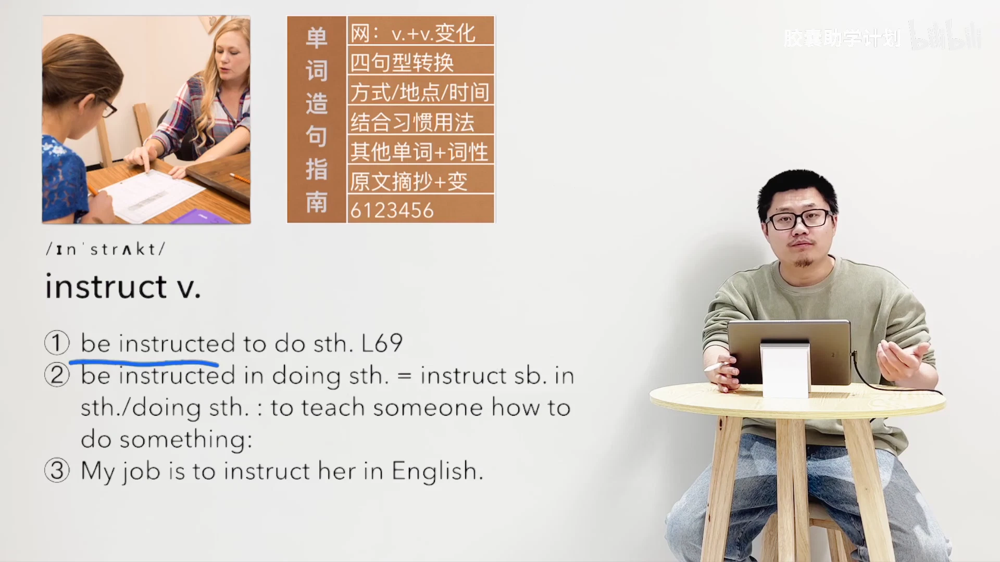

文字识别：单词造句指南 / 网：v.+v.变化 / 囊助字计划 / 四句型转换 / 方式/地点/时间 / 结合习惯用法 / 其他单词+词性 / 原文摘抄+变 / 6123456 / /In'strakt/ / instruct v. / ① be instructed to do sth. L69 / )be instructed in doing sth. = instruct sb.in / sth./doing sth.: to teach someone how to / do something: / ③ My job is to instruct her in English.

### 画面 00:01:32

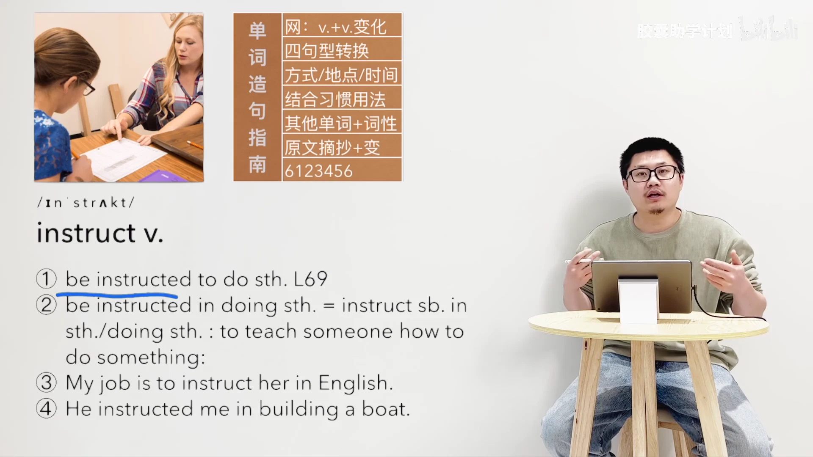

文字识别：单词造句指南 / 网：v.+v.变化 / 囊助学计划陽 / 四句型转换 / 方式/地点/时间 / 结合习惯用法 / 其他单词+词性 / 原文摘抄+变 / 6123456 / /In'strakt/ / instruct v. / ① be instructed to do sth. L69 / be instructed in doing sth. = instruct sb.in / sth./doing sth.: to teach someone how to / do something: / ③ My job is to instruct her in English. / 3) / ④ He instructed me in building a boat.

### 画面 00:01:35

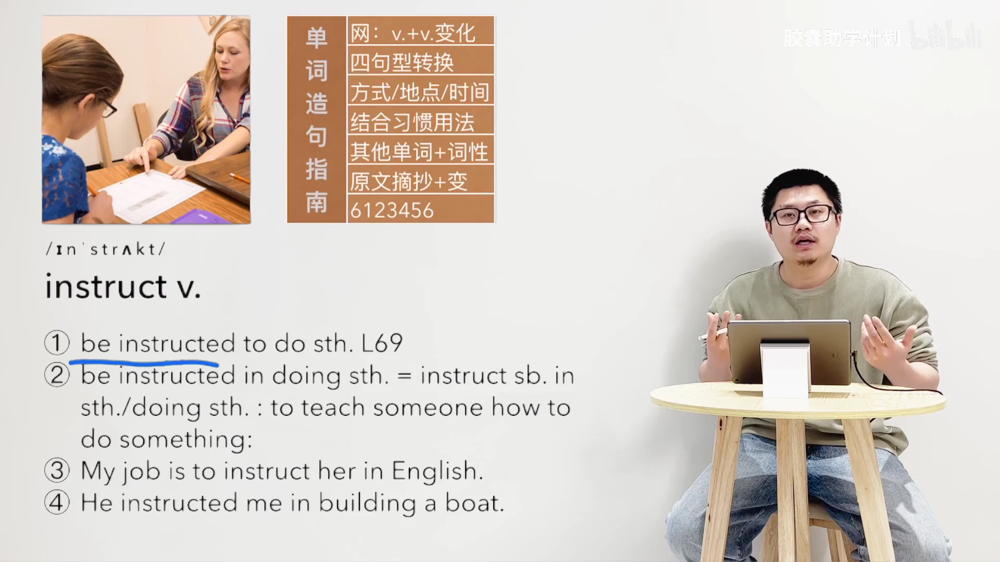

文字识别：单词造句指南 / 网：v.+v.变化 / 囊助学计划陽 / 四句型转换 / 方式/地点/时间 / 结合习惯用法 / 其他单词+词性 / 原文摘抄+变 / 6123456 / /In'strakt/ / instruct v. / ① be instructed to do sth. L69 / be instructed in doing sth. = instruct sb.in / sth./doing sth.: to teach someone how to / do something: / ③ My job is to instruct her in English. / D He instructed me in building a boat.

### 画面 00:01:44

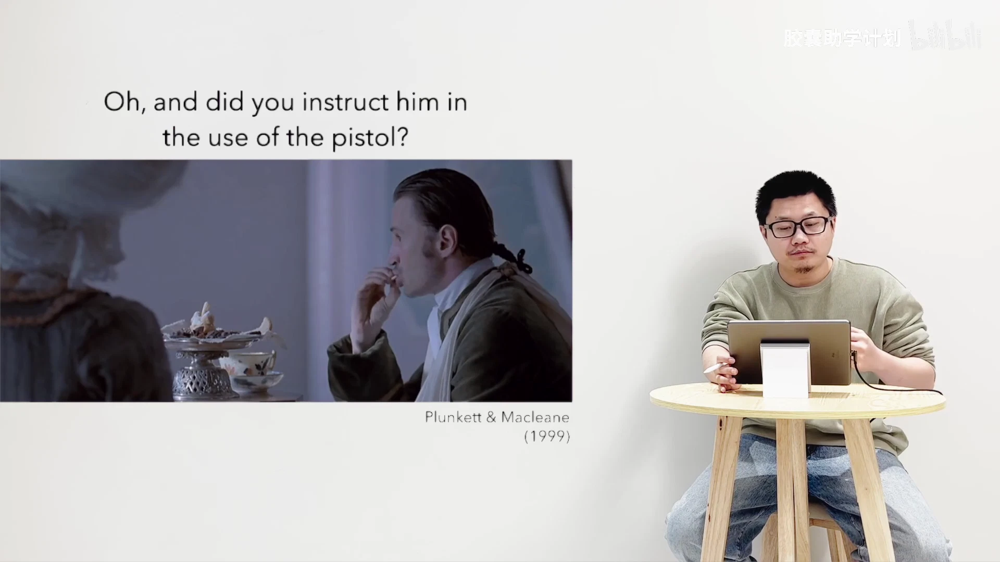

文字识别：Oh, and did you instruct him in / the use of the pistol? / Plunkett & Macleane / (1999)

### 画面 00:01:49

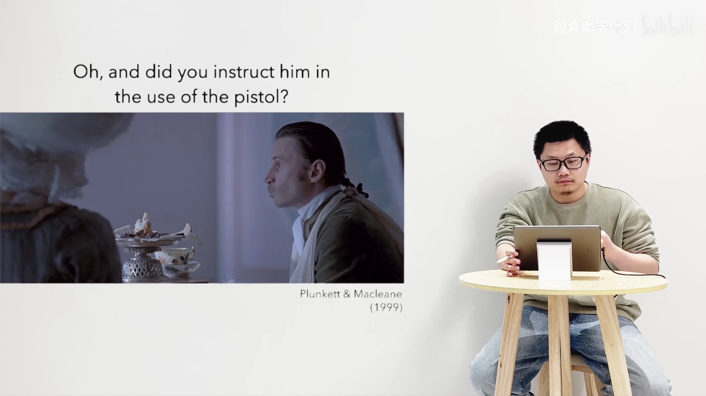

文字识别：Oh, and did you instruct him in / the use of the pistol? / Plunkett & Macleane / (1999)

### 画面 00:01:51

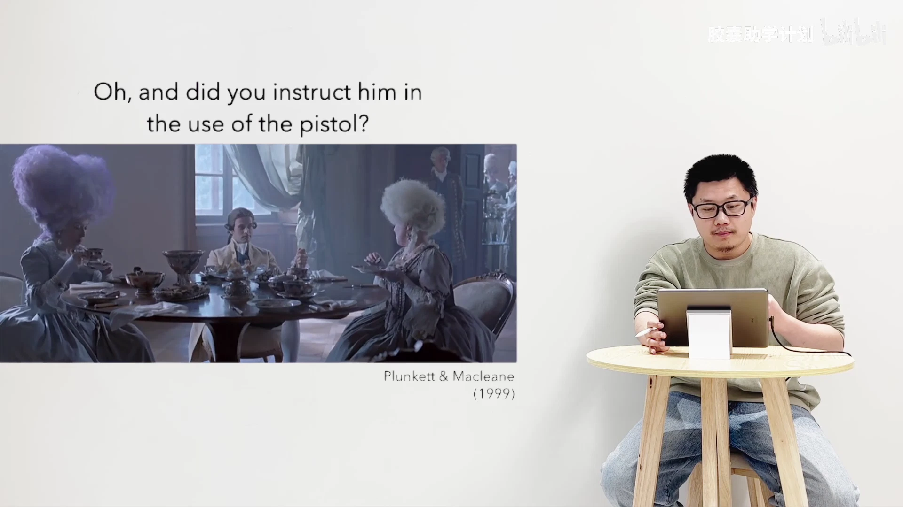

文字识别：Oh, and did you instruct him in / the use of the pistol? / Plunkett & Macleane / (1999)

### 画面 00:01:54

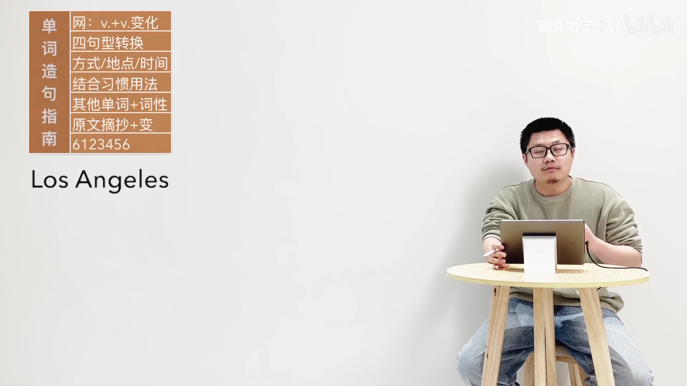

文字识别：单词造句指南 / 网：v.+v.变化 / 交囊助学计划一调 / 四句型转换 / 方式/地点/时间 / 结合习惯用法 / 其他单词+词性 / 原文摘抄+变 / 6123456 / Los Angeles

### 画面 00:01:57

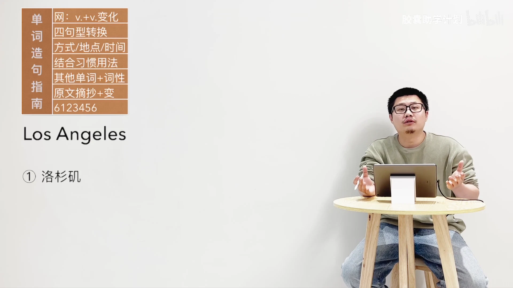

文字识别：单词造句指南 / 网：v.+v.变化 / 囊助字计划園 / 四句型转换 / 方式/地点/时间 / 结合习惯用法 / 其他单词+词性 / 原文摘抄+变 / 6123456 / Los Angeles / ①洛杉矶

## 00:02:00–00:02:30

这个州的一个城市，这没什么可说的了，是吧？这我们就不用它去造句了啊，知道就可以了。下一个单词是本课一个比较重要的单词，叫 reluctant reluctant，叫不情愿的。比如说，它很常常见的一个小的短语叫 be reluctant to do something，啊，叫做很不情愿去做某件事情。我们造一个句子，比如说 he was reluctant to ask for help，对于寻求帮助这件事，对吧？他不是很情愿，对吧？

### 画面 00:02:04

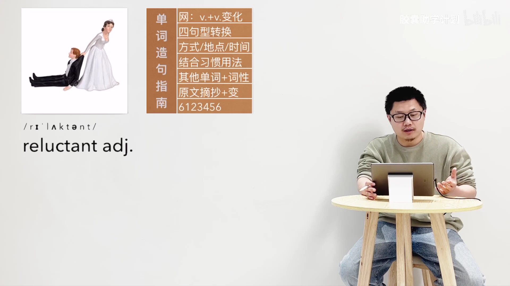

文字识别：单词造句指南 / 网：v.+v.变化 / 奏助学计划 / 四句型转换 / 方式/地点/时间 / 结合习惯用法 / 其他单词+词性 / 原文摘抄+变 / 6123456 / /ri'laktant/ / reluctant adj.

### 画面 00:02:18

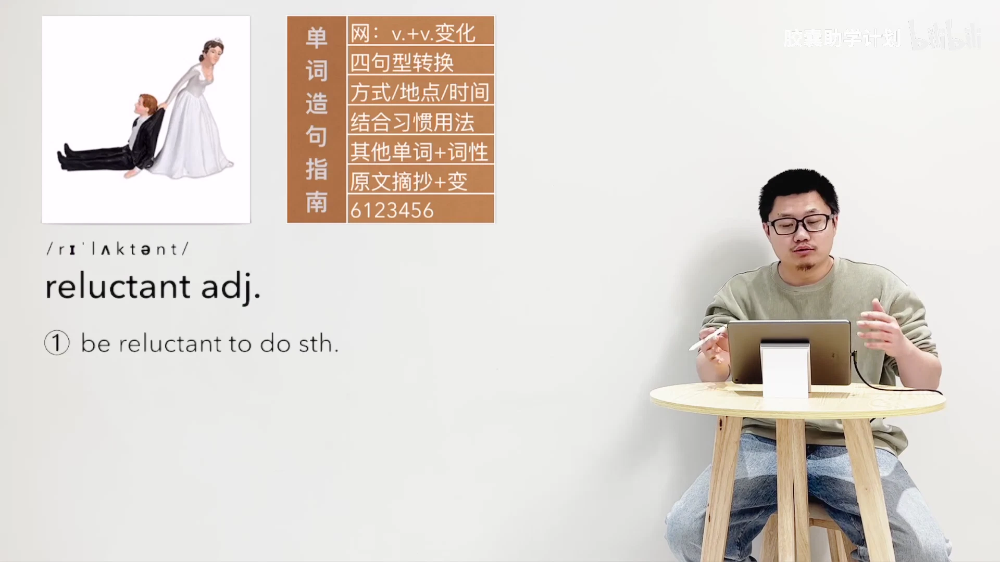

文字识别：单词造句指南 / 网：v.+v.变化 / 囊助学计划 / 四句型转换 / 方式/地点/时间 / 结合习惯用法 / 其他单词+词性 / 原文摘抄+变 / 6123456 / /ri'laktant/ / reluctant adj. / ① be reluctant to do sth.

### 画面 00:02:27

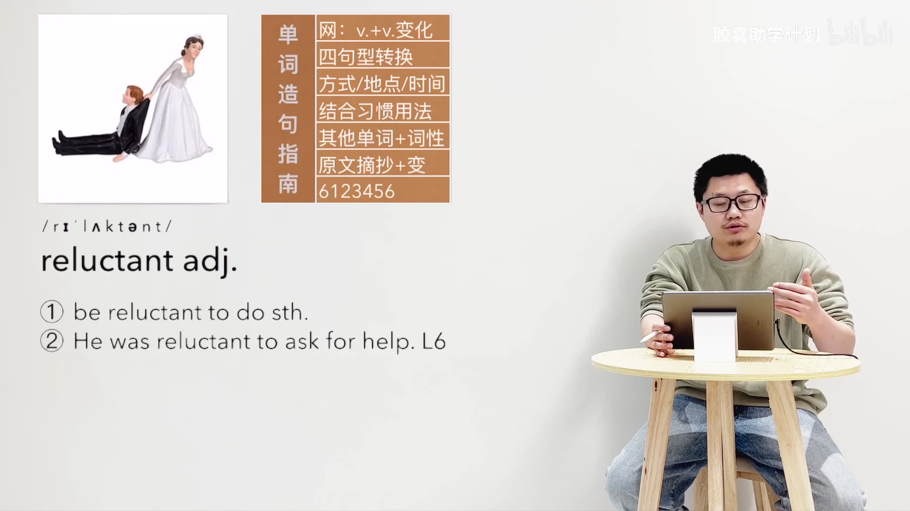

文字识别：单词造句指南 / 网：v.+v.变化 / 霆助学计划園州 / 四句型转换 / 方式/地点/时间 / 结合习惯用法 / 其他单词+词性 / 原文摘抄+变 / 6123456 / /ri'laktant/ / reluctant adj. / ① be reluctant to do sth. / ) He was reluctant to ask for help. L6

## 00:02:30–00:03:00

Next one, my son is reluctant to go to the kindergarten.说怎么样呢？我儿子不情愿去上这个幼儿园。Next one,说she was very reluctant to tell the truth.说她实际上很不情愿去讲这个实话。OK,那tell the truth八十七课咱们学过的习惯用法，再读一遍这个单词reluctant, very good.那注意力集中，咱听个电影片段啊。Everything's taken care of, but I'm reluctant to talk on the phone.啊，

### 画面 00:02:39

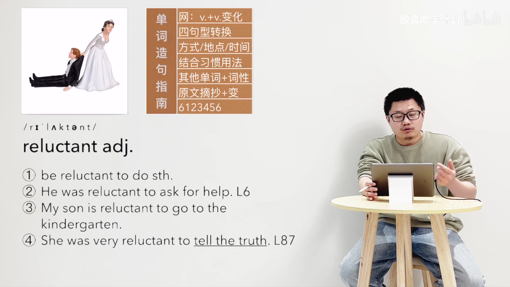

文字识别：单词造句指南 / 网：v.+v.变化 / 霆助字计划陽 / 四句型转换 / 方式/地点/时间 / 结合习惯用法 / 其他单词+词性 / 原文摘抄+变 / 6123456 / /ri'laktant/ / reluctant adj. / ① be reluctant to do sth. / ② He was reluctant to ask for help. L6 / My son is reluctant to go to the / 3 / kindergarten. / ) She was very reluctant to tell the truth. L87

### 画面 00:02:52

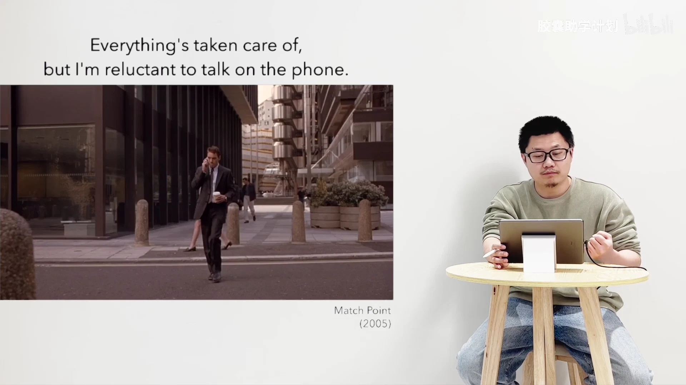

文字识别：Everything's taken care of, / but I'm reluctant to talk on the phone. / Match Point / (2005)

### 画面 00:02:56

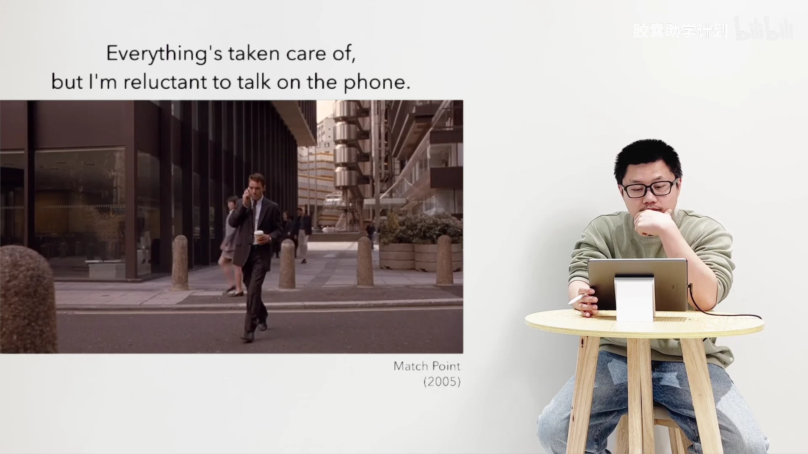

文字识别：Everything's taken care of, / but I'm reluctant to talk on the phone. / Match Point / (2005)

### 画面 00:02:58

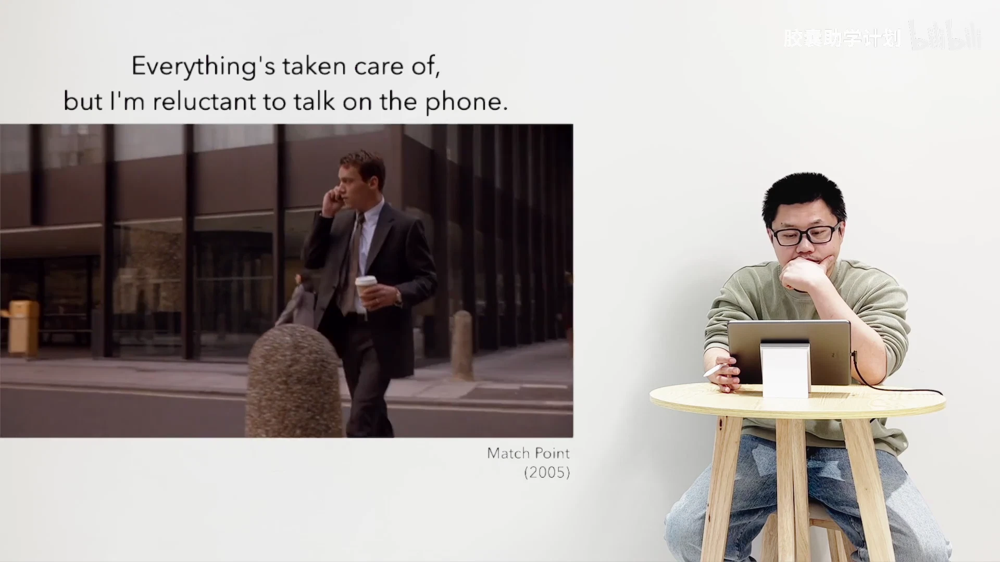

文字识别：Everything's taken care of, / but I'm reluctant to talk on the phone. / Match Point / (2005)

## 00:03:00–00:03:30

that你看这句话说 I'm reluctant to talk on the phone, 就是我不太愿意，不太想。其实就类似于 I don't want to, 对吧？但是人们说话肯定不可能说有十种 I don't want to 的表达方式，然后全世界人类统一了就只用 I don't want to。语言不是这个样子的，对吧？所以它这个地方的含义其实是类似的啊。 Next one, 下一个单词跟我一起读一下，叫 weight, weight, 重物啊。那 heavy weight 还是重物的意思，只不过可以放到一起去用。那我们造一个句子，比如说，

### 画面 00:03:00

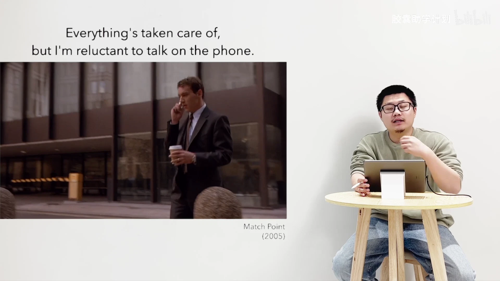

文字识别：Everything's taken care of, / but I'm reluctant to talk on the phone. / Match Point / (2005)

### 画面 00:03:18

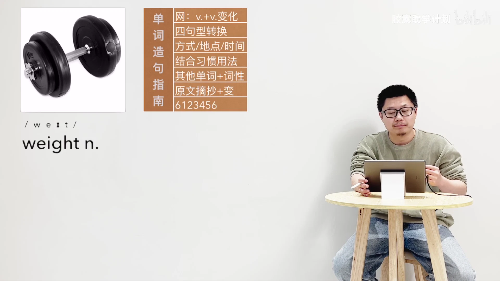

文字识别：单词造句指南 / 网：v.+v.变化 / 妻助学计划 / 四句型转换 / 方式/地点/时间 / 结合习惯用法 / 其他单词+词性 / 原文摘抄+变 / 6123456 / / w eIt / / weight n.

### 画面 00:03:21

文字识别：单词造句指南 / 网：v.+v.变化 / 交囊助学计划调 / 四句型转换 / 方式/地点/时间 / 结合习惯用法 / 其他单词+词性 / 原文摘抄+变 / 6123456 / / w eIt / / weight n.

### 画面 00:03:27

文字识别：单词造句指南 / 网：v.+v.变化 / 囊助学计划 / 四句型转换 / 方式/地点/时间 / 结合习惯用法 / 其他单词+词性 / 原文摘抄+变 / 6123456 / / w eIt / / weight n. / ① heavy weights …

## 00:03:30–00:04:00

那你看啊，首先在这我要提一点，就是 heavy weights 其实合起来其实起到了一个类似于名词的作用。你想拿它造句，你肯定要找动词，对吧？比如说，咱们造一个句子，Please carry these heavy weights to that room. Okay, 别忘了 repeat after me. The doctor said he must not lift heavy weights. 啊，那这里复习了其实好几个知识点，对吧？第一个说说到，第二个 must not 禁止，不允许。

### 画面 00:03:30

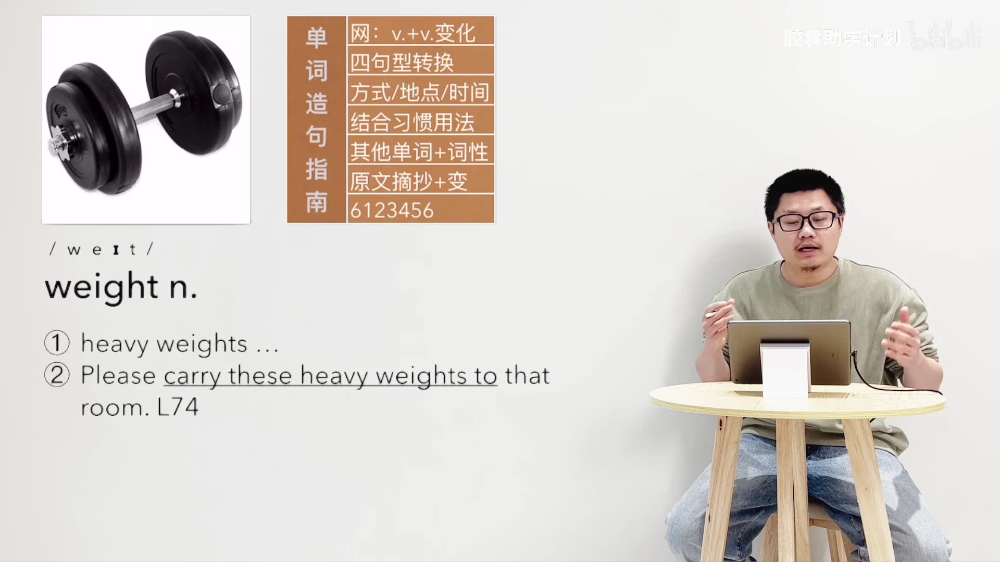

文字识别：单词造句指南 / 网：v.+v.变化 / 囊助学计划園園 / 四句型转换 / 方式/地点/时间 / 结合习惯用法 / 其他单词+词性 / 原文摘抄+变 / 6123456 / / w el t / / weight n. / ① heavy weights / 5 ... / Please carry these heavy weights to that / room.L74

### 画面 00:03:35

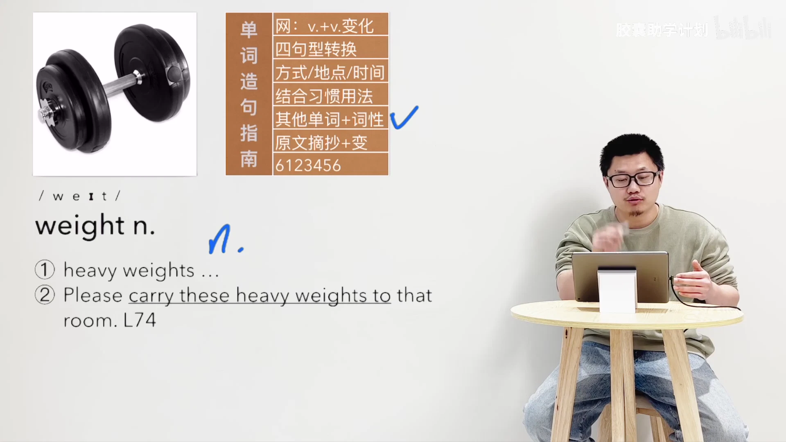

文字识别：单词造句指南 / 网：v.+v.变化 / 喜助学计划 / 四句型转换 / 方式/地点/时间 / 结合习惯用法 / 其他单词+词性 / 原文摘抄+变 / 6123456 / / weIt / / weight n. / ① heavy weights /  ... / Please carry these heavy weights to that / room.L74

### 画面 00:03:50

文字识别：单词造句指南 / 网：v.+v.变化 / 四句型转换 / 方式/地点/时间 / 结合习惯用法 / 其他单词+词性 / 原文摘抄+变 / 6123456 / / w eI t / / weight n. / ① heavy weights ... /  Please carry these heavy weights to that / room.L74 / The doctor said he must not lift / heavy weights.

### 画面 00:03:55

文字识别：单词造句指南 / 网：v.+v.变化 / 四句型转换 / 方式/地点/时间 / 结合习惯用法 / 其他单词+词性 / 原文摘抄+变 / 6123456 / / w eI t / / weight n. / ① heavy weights ... / ) Please carry these heavy weights to that / room.L74 / The doctor saidhe must not lift / heavy weights.

### 画面 00:03:58

文字识别：单词造句指南 / 网：v.+v.变化 / 四句型转换 / 方式/地点/时间 / 结合习惯用法 / 其他单词+词性 / 原文摘抄+变 / 6123456 / / w eI t / / weight n. / ① heavy weights ... / ) Please carry these heavy weights to that / room.L74 / The doctor saidhe must not lift / heavy weights.

## 00:04:00–00:04:30

Next one, we should have moved these heavy weights.我们本应该把这些heavy weights开挪开的, but we didn't,对吧? Should have done本应该做而没有做. Very good.接下来下一个单词underwater, underwater, underwater这个单词呢很有意思,实际上是两个我们会的单词组合到一起的. Under在什么什么下方, water叫水,那水的下方水下,对吧?听上去也非常的合理.那么造一个句

### 画面 00:04:01

文字识别：单词造句指南 / 网：v.+v.变化 / 妻助字计划園 / 四句型转换 / 方式/地点/时间 / 结合习惯用法 / 其他单词+词性 / 原文摘抄+变 / 6123456 / / w eI t / / weight n. / ① heavy weights ... / ② Please carry these heavy weights to that / 2) / room.L74 / The doctor said he must not lift / heavy weights. / ④ We should have moved these heavy / weights. L65

### 画面 00:04:08

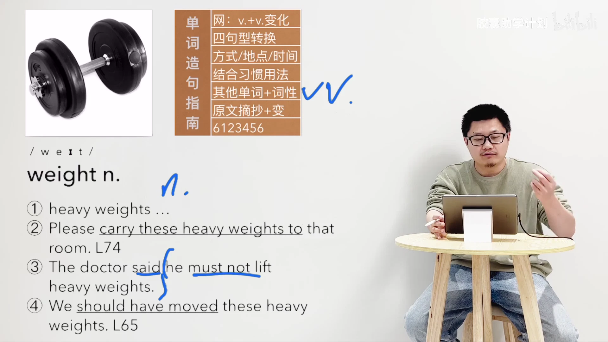

文字识别：单词造句指南 / 网：v.+v.变化 / 囊助字计划 / 四句型转换 / 方式/地点/时间 / 结合习惯用法 / 其他单词+词性 / 原文摘抄+变 / 6123456 / / w eIt / / weight n. / ① heavy weights ... /  Please carry these heavy weights to that / 2 / room.L74 / The doctor said he must not lift / heavy weights. / ④ We should have moved these heavy / weights. L65

### 画面 00:04:12

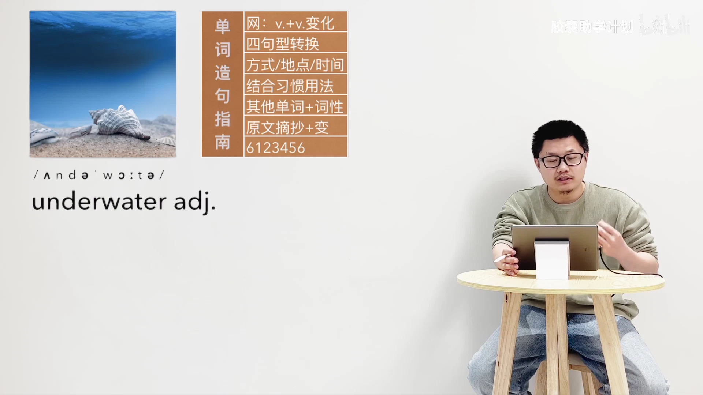

文字识别：单词造句指南 / 网：v.+v.变化 / 囊助学计划園 / 四句型转换 / 方式/地点/时间 / 结合习惯用法 / 其他单词+词性 / 原文摘抄+变 / 6123456 / /Λnda'wo:ta/ / underwater adj.

### 画面 00:04:15

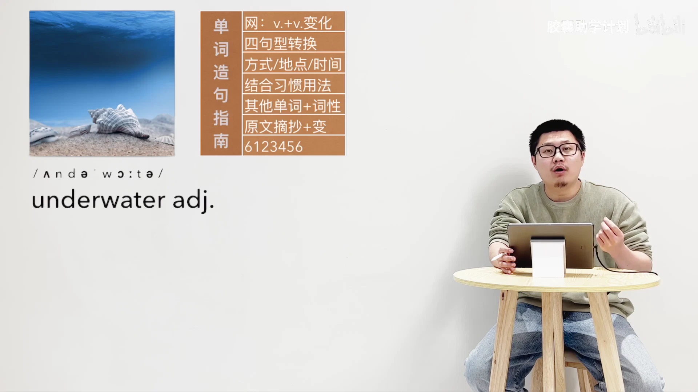

文字识别：单词造句指南 / 网：v.+v.变化 / 卖助字计划 / 四句型转换 / 方式/地点/时间 / 结合习惯用法 / 其他单词+词性 / 原文摘抄+变 / 6123456 / /Λnda'wo:ta/ / underwater adj.

### 画面 00:04:20

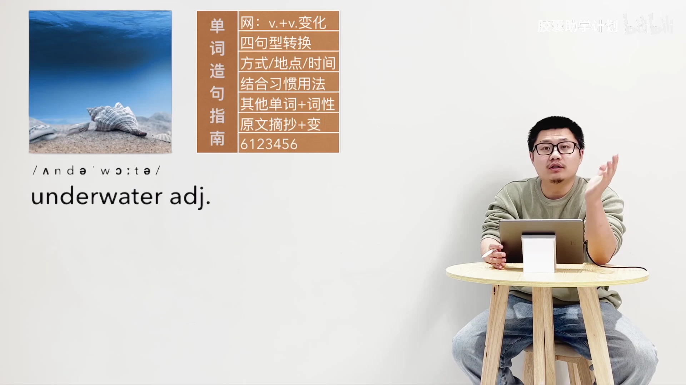

文字识别：单词造句指南 / 网：v.+v.变化 / 臺助学计划 / 四句型转换 / 方式/地点/时间 / 结合习惯用法 / 其他单词+词性 / 原文摘抄+变 / 6123456 / /Λnda'wo:ta/ / underwater adj.

### 画面 00:04:28

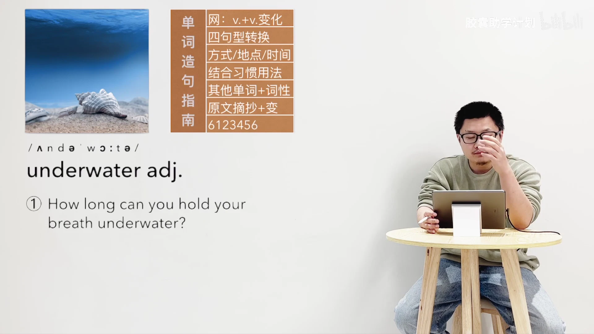

文字识别：单词造句指南 / 网：v.+v.变化 / 妻助学计划 / 四句型转换 / 方式/地点/时间 / 结合习惯用法 / 其他单词+词性 / 原文摘抄+变 / 6123456 / /Λnda'wo:ta/ / underwater adj. / ① How long can you hold your / breath underwater?

## 00:04:30–00:05:00

子叫 How long can you hold your breath underwater? 这个地方其实有一点点小的超纲，叫 hold your breath, hold your breath, 冲住呼吸，对吧？ Okay, 呃，这是我们在文章当中会学到的一个习惯用法，我们提前见一次。接下来, your partner must remain underwater till you return. 直到你回来，在这个之前怎么样呢？说你的这个搭档都必须要保持在水以下待着，对吧？ Remain underwater.

### 画面 00:04:31

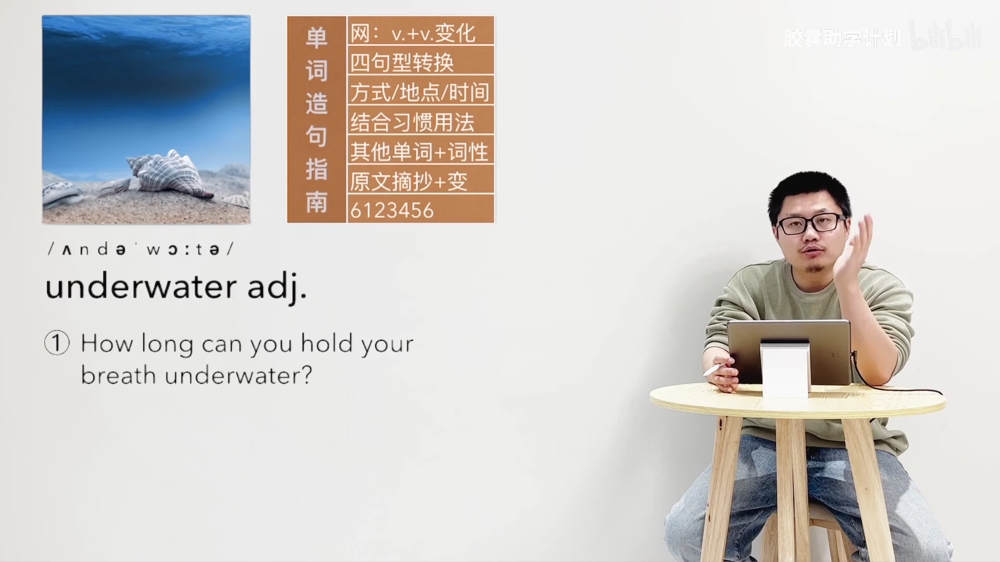

文字识别：单词造句指南 / 网：v.+v.变化 / 囊助学计划陽 / 四句型转换 / 方式/地点/时间 / 结合习惯用法 / 其他单词+词性 / 原文摘抄+变 / 6123456 / /Λnda'wo:ta/ / underwater adj. / ① How long can you hold your / breath underwater?

### 画面 00:04:35

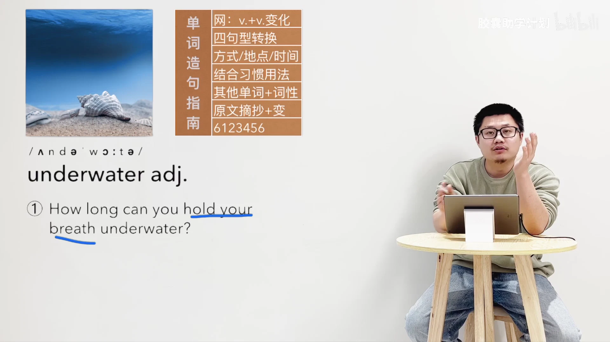

文字识别：单词造句指南 / 网：v.+v.变化 / 囊助学计划 / 四句型转换 / 方式/地点/时间 / 结合习惯用法 / 其他单词+词性 / 原文摘抄+变 / 6123456 / /Λnda'wo:ta/ / underwater adj. / ① How long can you hold your / breath underwater?

### 画面 00:04:41

文字识别：单词造句指南 / 网：v.+v.变化 / 妻助学计划 / 四句型转换 / 方式/地点/时间 / 结合习惯用法 / 其他单词+词性 / 原文摘抄+变 / 6123456 / /Λnda'wo:ta/ / underwater adj. / ① How long can you hold your / breath underwater?

### 画面 00:04:44

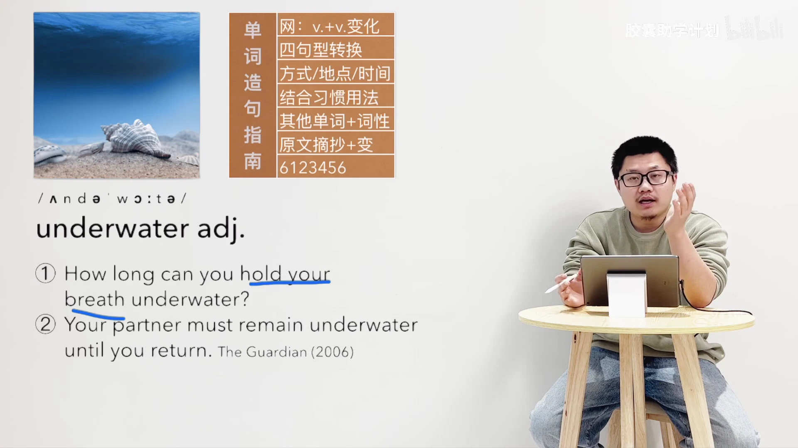

文字识别：单词造句指南 / 网：v.+v.变化 / 四句型转换 / 方式/地点/时间 / 结合习惯用法 / 其他单词+词性 / 原文摘抄+变 / 6123456 / /Λnda'wo:ta/ / underwater adj. / ① How long can you hold your / breath underwater? / Your partner must remain underwater / until you return. The Guardian (2006)

### 画面 00:04:51

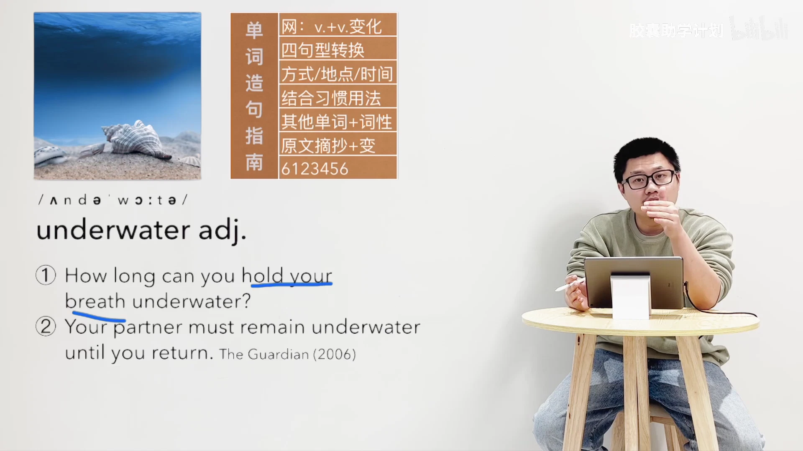

文字识别：单词造句指南 / 网：v.+v.变化 / 妻助学计划 / 四句型转换 / 方式/地点/时间 / 结合习惯用法 / 其他单词+词性 / 原文摘抄+变 / 6123456 / /Λnda'wo:ta/ / underwater adj. / ① How long can you hold your / breath underwater? / Your partner must remain underwater / until you return. The Guardian (2006)

## 00:05:00–00:05:30

其实早在新一啊，我们就学过 the remain in bed, 对吧? Okay, next one. Take a deep breath,深呼吸, and see how long you can stay under water.停留在水下, very good.那不多说了,再读一遍这个单词 under water, very good. Next one,下一个单词 tricycle. Tricycle这个单词呢很有意思,早在三十一课咱们学过一个单词叫 bicycle. Bi其实指的是

### 画面 00:05:00

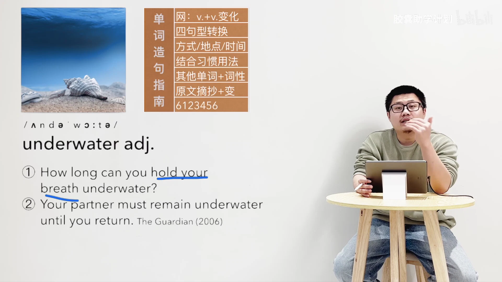

文字识别：单词造句指南 / 网：v.+v.变化 / 囊助学计划 / 四句型转换 / 方式/地点/时间 / 结合习惯用法 / 其他单词+词性 / 原文摘抄+变 / 6123456 / /Λnda'wo:ta/ / underwater adj. / ① How long can you hold your / breath underwater? / ) Your partner must remain underwater / until you return. The Guardian (2006)

### 画面 00:05:05

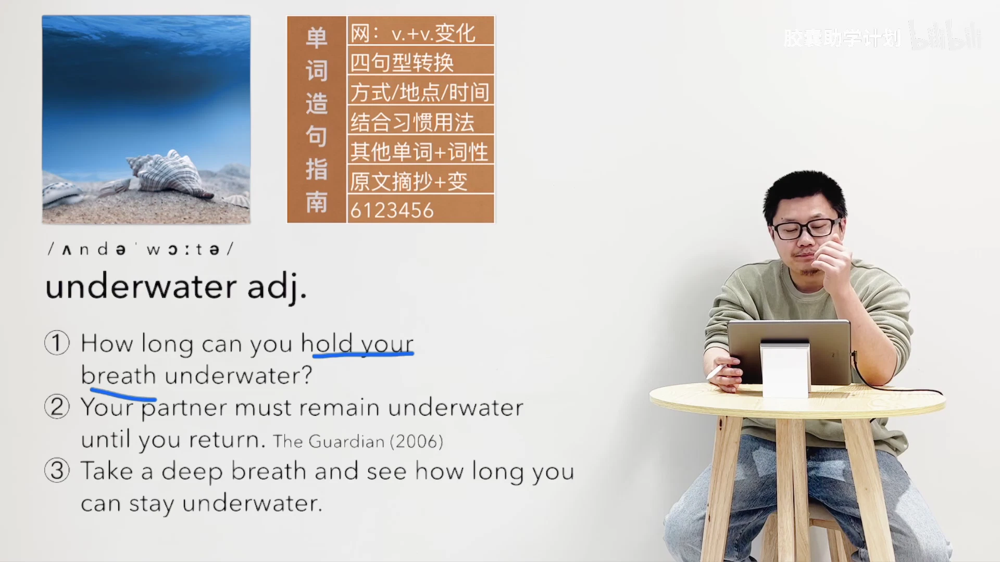

文字识别：单词造句指南 / 网：v.+v.变化 / 四句型转换 / 方式/地点/时间 / 结合习惯用法 / 其他单词+词性 / 原文摘抄+变 / 6123456 / /Λnda'wo:ta/ / underwater adj. / ① How long can you hold your / breath underwater? / ) Your partner must remain underwater / until you return. The Guardian (2006) / Take a deep breath and see how long you / can stay underwater.

### 画面 00:05:10

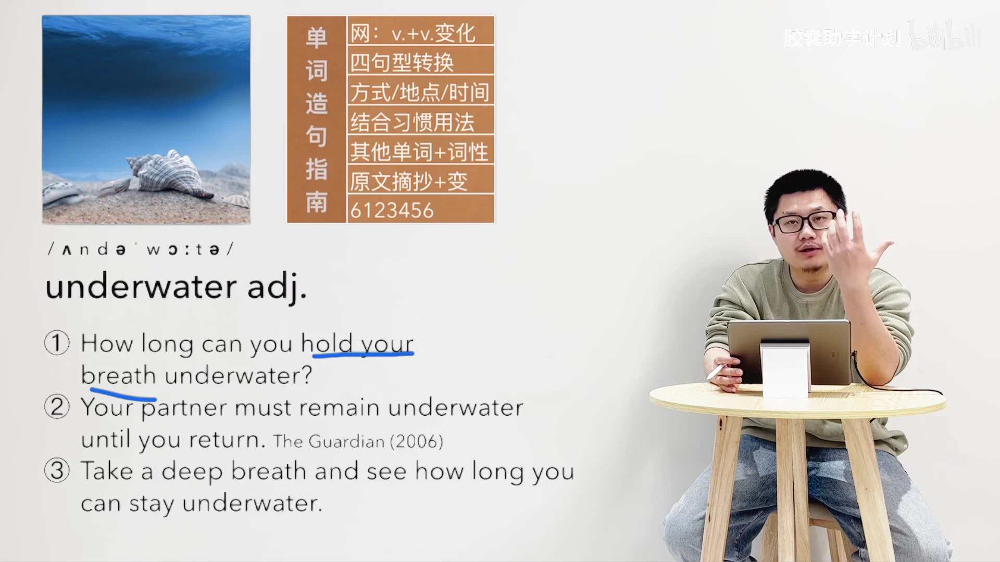

文字识别：单词造句指南 / 网：v.+v.变化 / 学计划 / 四句型转换 / 方式/地点/时间 / 结合习惯用法 / 其他单词+词性 / 原文摘抄+变 / 6123456 / /Λnda'wo:ta/ / underwater adj. / ① How long can you hold your / breath underwater? / ) Your partner must remain underwater / until you return. The Guardian (2006) / Take a deep breath and see how long you / can stay underwater.

### 画面 00:05:16

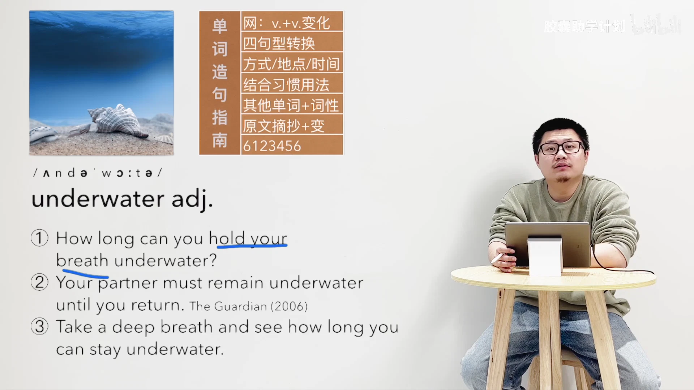

文字识别：单词造句指南 / 网：v.+v.变化 / 囊助学计划 / 四句型转换 / 方式/地点/时间 / 结合习惯用法 / 其他单词+词性 / 原文摘抄+变 / 6123456 / /anda'wo:ta/ / underwater adj. / ① How long can you hold your / breath underwater? / ) Your partner must remain underwater / until you return. The Guardian (2006) / Take a deep breath and see how long you / can stay underwater.

### 画面 00:05:18

文字识别：单词造句指南 / 网：v.+v.变化 / 四句型转换 / 方式/地点/时间 / 结合习惯用法 / 其他单词+词性 / 原文摘抄+变 / 6123456 / /'traIsikal/ / tricycle n.

### 画面 00:05:21

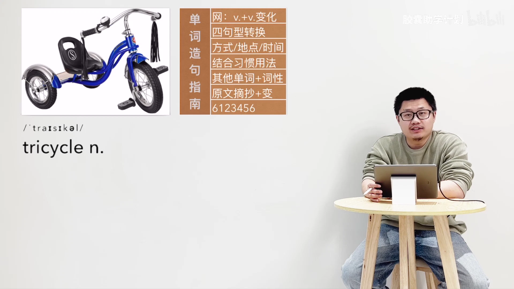

文字识别：单词造句指南 / 网：v.+v.变化 / 臺助学计划 / 四句型转换 / 方式/地点/时间 / 结合习惯用法 / 其他单词+词性 / 原文摘抄+变 / 6123456 / /'traIsikal/ / tricycle n.

### 画面 00:05:26

文字识别：单词造句指南 / 网：v.+v.变化 / 四句型转换 / 方式/地点/时间 / 结合习惯用法 / 其他单词+词性 / 原文摘抄+变 / 6123456 / /'tralsikal/ / tricycle n.

## 00:05:30–00:06:00

双的意思，二。Try指的是three是三的意思，它是一个小的单词的前缀。比如我们说一个人双语叫bilingual，对吧？那trilingual，你就我猜你应该明白什么意思了。那bicycle是双轮车，叫自行车，对吧？那tricycle就是三轮车啊。那他去造句，其实无非就还是找动词，或者是结合其他的习惯用法，这是最容易的。比如说，His grandfather seems to be

### 画面 00:05:30

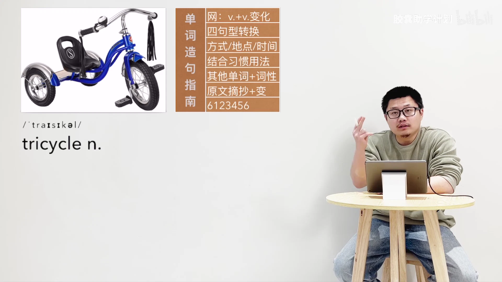

文字识别：单词造句指南 / 网：v.+v.变化 / 四句型转换 / 方式/地点/时间 / 结合习惯用法 / 其他单词+词性 / 原文摘抄+变 / 6123456 / /'traIsikal/ / tricycle n.

### 画面 00:05:50

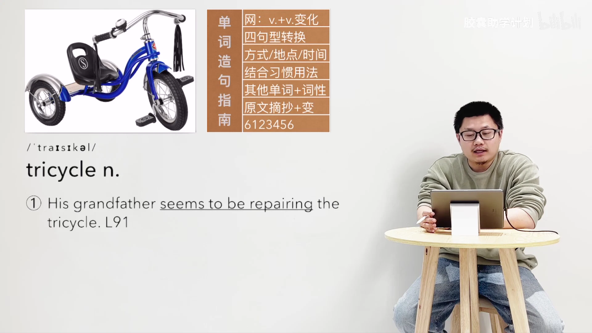

文字识别：单词造句指南 / 网：v.+v.变化 / 四句型转换 / 方式/地点/时间 / 结合习惯用法 / 其他单词+词性 / 原文摘抄+变 / 6123456 / /'traIsikal/ / tricycle n. / ① His grandfather seems to be repairing the / tricycle. L91

### 画面 00:05:56

文字识别：单词造句指南 / 网：v.+v.变化 / 四句型转换 / 方式/地点/时间 / 结合习惯用法 / 其他单词+词性 / 原文摘抄+变 / 6123456 / /'traIsikal/ / tricycle n. / ① His grandfather seems to be repairing the / tricycle. L91

## 00:06:00–00:06:30

repairing the tricycle,似乎是正在修理这个tricycle,对吧? Next one, so when I saw him riding a tricycle, I burst out laughing.说当我看到他正在骑一个自行车的时候，怎么样呢?我爆笑, burst out laughing,对吧?爆笑如雷. Next one,最后一个啊, he noticed with dismay that his tricycle wasn't there anymore.说他很沮丧,很失望啊,灰心丧

### 画面 00:06:09

文字识别：单词造句指南 / 网：v.+v.变化 / 四句型转换 / 方式/地点/时间 / 结合习惯用法 / 其他单词+词性 / 原文摘抄+变 / 6123456 / /'traisikal/ / tricycle n. / ① His grandfather seems to be repairing the / tricycle. L91 / When I saw him riding a tricycle, I burst out / laughing. L35 L89

### 画面 00:06:19

文字识别：单词造句指南 / 网：v.+v.变化 / 四句型转换 / 方式/地点/时间 / 结合习惯用法 / 其他单词+词性 / 原文摘抄+变 / 6123456 / /'traIsikal/ / tricycle n. / ① His grandfather seems to be repairing the / tricycle. L91 / When I saw him riding a tricycle, I burst out / laughing. L35 L89 / He noticed with dismay that his tricycle / wasn't there any more. L86

## 00:06:30–00:07:00

气的注意到说怎么样，他自行车不在那儿了。当然指的是三轮自行车啊，tricycle。下一个单词 compete，注意它的重音在后面，叫 compete。OK，那 compete 这个单词是什么意思呢？我们可以管它理解为叫做竞争啊，竞争关系。那 competed a compete against，其实还是竞争的意思，只不过是一个小的短语啊，经常这么去用。比如说，we gonna compete against teams，

### 画面 00:06:36

文字识别：单词造句指南 / 网：v.+v.变化 / 霆助字计划 / 四句型转换 / 方式/地点/时间 / 结合习惯用法 / 其他单词+词性 / 原文摘抄+变 / 6123456 / / kam'pi:t/ / compete v.

### 画面 00:06:41

文字识别：单词造句指南 / 网：v.+v.变化 / 窦助学计划 / 四句型转换 / 方式/地点/时间 / 结合习惯用法 / 其他单词+词性 / 原文摘抄+变 / 6123456 / / kam'pi:t/ / compete v.

### 画面 00:06:49

文字识别：单词造句指南 / 网：v.+v.变化 / 四句型转换 / 方式/地点/时间 / 结合习惯用法 / 其他单词+词性 / 原文摘抄+变 / 6123456 / / k a m 'pi :t / / compete v. / ① We're gonna compete against teams that / have been doing this for years. L52 L28

## 00:07:00–00:07:30

We will compete against these teams. We will compete against these teams. We will compete against these teams. We will compete against these teams. We will compete against these teams. We will compete against these teams. We will compete against these teams. We will compete against these teams. We will compete against these teams. We will compete against these teams. We will compete against these teams. We will compete against these teams. We will compete against these teams. We will compete against these teams. We will compete against these teams. We will compete against these teams. We will compete against these teams. We will compete against these teams. We will compete against these teams. We will compete against these teams. We will compete against these teams. We will compete against these teams. We will compete against these teams. We will compete against these teams. We will compete against these

### 画面 00:07:12

文字识别：单词造句指南 / 网：v.+v.变化 / 四句型转换 / 方式/地点/时间 / 结合习惯用法 / 其他单词+词性 / 原文摘抄+变 / 6123456 / / k a m 'pi it / / compete v. / ① We're gonna compete against teams that / have been doing this for years. L52 L28

### 画面 00:07:15

文字识别：单词造句指南 / 网：v.+v.变化 / 四句型转换 / 方式/地点/时间 / 结合习惯用法 / 其他单词+词性 / 原文摘抄+变 / 6123456 / / k a m 'pi :t / / compete v. / ① We're gonna compete against teams that / have been doing this for years. L52 L28

### 画面 00:07:19

文字识别：单词造句指南 / 网：v.+v.变化 / 臺助学计划 / 四句型转换 / 方式/地点/时间 / 结合习惯用法 / 其他单词+词性 / 原文摘抄+变 / 6123456 / / kam'pi :t / / compete v. / ① We're gonna compete against teams that / have been doing this for years. L52 L28

### 画面 00:07:23

文字识别：单词造句指南 / 网：v.+v.变化 / 四句型转换 / 方式/地点/时间 / 结合习惯用法 / 其他单词+词性 / 原文摘抄+变 / 6123456 / / kam'pi :t / / compete v. / ① We're gonna compete against teams that / have been doing this for years. L52 L28 / I had to compete against 19 other people / for the job. did/why/how many people...

### 画面 00:07:26

文字识别：单词造句指南 / 网：v.+v.变化 / 四句型转换 / 方式/地点/时间 / 结合习惯用法 / 其他单词+词性 / 原文摘抄+变 / 6123456 / / k am'pi :t / / compete v. / ① We're gonna compete against teams that / have been doing this for years. L52 L28 / ② I had to compete against 19 other people / for the job. did/why/how many people..

## 00:07:30–00:08:00

review. I had to compete against nineteen other people for the job.说我必须要和其他十九个人去竞争这个工作岗位。然后四句型转换，我们不多说，这永远是您自己的活儿了。They made us compete against each other. Made somebody do something,使某人做某件事儿啊，这又复习了一个小的习惯用法。Okay,呃，在这个地方我还是想多提一句，其实提不提无所谓啊。有的同学这个可能学这个地方的

### 画面 00:07:31

文字识别：单词造句指南 / 网：v.+v.变化 / 四句型转换 / 方式/地点/时间 / 结合习惯用法 / 其他单词+词性 / 原文摘抄+变 / 6123456 / / k am'pi :t / / compete v. / ① We're gonna compete against teams that / have been doing this for years. L52 L28 / 9 I had to compete against 19 other people / for the job. did/why/how many people...

### 画面 00:07:33

文字识别：单词造句指南 / 网：v.+v.变化 / 四句型转换 / 方式/地点/时间 / 结合习惯用法 / 其他单词+词性 / 原文摘抄+变 / 6123456 / / k am'pi :t / / compete v. / ① We're gonna compete against teams that / have been doing this for years. L52 L28 / ) I had to compete against 19 other people / for the job. did/why/how many people...

### 画面 00:07:45

文字识别：单词造句指南 / 网：v.+v.变化 / 臺助学计划 / 四句型转换 / 方式/地点/时间 / 结合习惯用法 / 其他单词+词性 / 原文摘抄+变 / 6123456 / /kam'pi:t/ / compete v. / ① We're gonna compete against teams that / have been doing this for years. L52 L28 / ② I had to compete against 19 other people / for the job. did/why/how many people... / They made us compete against each other. / L57

### 画面 00:07:50

文字识别：单词造句指南 / 网：v.+v.变化 / 毫助学计划 / 四句型转换 / 方式/地点/时间 / 结合习惯用法 / 其他单词+词性 / 原文摘抄+变 / 6123456 / /kam'pi:t/ / compete v. / ① We're gonna compete against teams that / have been doing this for years. L52 L28 / ② I had to compete against 19 other people / for the job. did/why/how many people... / They made us compete against each other. / L57

### 画面 00:07:55

文字识别：单词造句指南 / 网：v.+v.变化 / 臺助学计划 / 四句型转换 / 方式/地点/时间 / 结合习惯用法 / 其他单词+词性 / 原文摘抄+变 / 6123456 / /kam'pi:t/ / compete v. / ① We're gonna compete against teams that / have been doing this for years. L52 L28 / ② I had to compete against 19 other people / for the job. did/why/how many people... / They made us compete against each other. / L57

### 画面 00:07:59

文字识别：单词造句指南 / 网：v.+v.变化 / 虞助学计划 / 四句型转换 / 方式/地点/时间 / 结合习惯用法 / 其他单词+词性 / 原文摘抄+变 / 6123456 / /kam'pi:t/ / compete v. / ① We're gonna compete against teams that / have been doing this for years. L52 L28 / ② I had to compete against 19 other people / for the job. did/why/how many people... / They made us compete against each other. / L57

## 00:08:00–00:08:30

时候 made us to do something，对吧？然后说这个是去掉了 to 的不定式啊。其实对于各位来说最重要那个就是知其然知其所以然，对吧？这个呃，至少在做题有的时候和一些语法学家可能聊起来，这个是一个谈资啊。对于各位来说，其实就知道 make somebody do something 啊，我们就够了，对吧？我们又不用研究这个语言，会用它就可以了啊。下一个单词 yard 啊，就是一个英制的长度单位，指的是马的意思。想拿它

### 画面 00:08:04

文字识别：单词造句指南 / 网：v.+v.变化 / 四句型转换 / 方式/地点/时间 / 结合习惯用法 / 其他单词+词性 / 原文摘抄+变 / 6123456 / / kam'pi:t / / compete v. / ① We're gonna compete against teams that / have been doing this for years. L52 L28 / ② I had to compete against 19 other people / for the job. did/why/how many people... / They made us compete against each other. / L57

### 画面 00:08:06

文字识别：单词造句指南 / 网：v.+v.变化 / 虞助学计划 / 四句型转换 / 方式/地点/时间 / 结合习惯用法 / 其他单词+词性 / 原文摘抄+变 / 6123456 / / k am'pi:t / / compete v. / ① We're gonna compete against teams that / have been doing this for years. L52 L28 / ② I had to compete against 19 other people / for the job. did/why/how many people.. / They / made us compete against each other. / L57

### 画面 00:08:08

文字识别：单词造句指南 / 网：v.+v.变化 / 助学计划 / 四句型转换 / 方式/地点/时间 / 结合习惯用法 / 其他单词+词性 / 原文摘抄+变 / 6123456 / /kam'pi:t/ / compete v. / ① We're gonna compete against teams that / have been doing this for years. L52 L28 / ② I had to compete against 19 other people / for the job. did/why/how many people... / They made us compete against each other. / L57

### 画面 00:08:10

文字识别：单词造句指南 / 网：v.+v.变化 / 四句型转换 / 方式/地点/时间 / 结合习惯用法 / 其他单词+词性 / 原文摘抄+变 / 6123456 / / kam'pi:t / / compete v. / ① We're gonna compete against teams that / have been doing this for years. L52 L28 / ) I had to compete against 19 other people / for the job. did/why/how many people... / They made us compete against each other. / L57

### 画面 00:08:16

文字识别：单词造句指南 / 网：v.+v.变化 / 四句型转换 / 方式/地点/时间 / 结合习惯用法 / 其他单词+词性 / 原文摘抄+变 / 6123456 / / k am'pi :t / / compete v. / ① We're gonna compete against teams that / have been doing this for years. L52 L28 / ② I had to compete against 19 other people / for the job. did/why/how many people... / They made us compete against each other. / L57

### 画面 00:08:24

文字识别：单词造句指南 / 网：v.+v.变化 / 囊助学计划 / 四句型转换 / 方式/地点/时间 / 结合习惯用法 / 其他单词+词性 / 原文摘抄+变 / 6123456 / /ja:d/ / yard n.码

### 画面 00:08:26

文字识别：单词造句指南 / 网：v.+v.变化 / 囊助学计划 / 四句型转换 / 方式/地点/时间 / 结合习惯用法 / 其他单词+词性 / 原文摘抄+变 / 6123456 / /ja:d/ / yard n.码

### 画面 00:08:29

文字识别：单词造句指南 / 网：v.+v.变化 / 妻助学计划 / 四句型转换 / 方式/地点/时间 / 结合习惯用法 / 其他单词+词性 / 原文摘抄+变 / 6123456 / /ja:d/ / yard n.码 / ) The monument is one hundred yards away.

## 00:08:30–00:09:00

造句呢？我直接给各位造了几个，张嘴跟我读一遍就行了。单词全是我们之前学过的啊。The monument is just one hundred yards away. Next one, where is the house? I think that is almost four hundred yards away. Next one, the nearest toilet is three hundred yards away. 啊，你把 yards 换成 miles, kilometers，对吧？这不就是我们国际单位了吗？米、千米。那注意力集中，咱

### 画面 00:08:34

文字识别：单词造句指南 / 网：v.+v.变化 / 囊助学计划 / 四句型转换 / 方式/地点/时间 / 结合习惯用法 / 其他单词+词性 / 原文摘抄+变 / 6123456 / /ja:d/ / yard n.码 /  The monument is one hundred yards away. / 1

### 画面 00:08:40

文字识别：单词造句指南 / 网：v.+v.变化 / 妻助学计划陽 / 四句型转换 / 方式/地点/时间 / 结合习惯用法 / 其他单词+词性 / 原文摘抄+变 / 6123456 / /ja:d/ / yard n.码 / ① The monument is one hundred yards away. / ) Where is the house? I think that is almost / four hundred yards away.

### 画面 00:08:44

文字识别：单词造句指南 / 网：v.+v.变化 / 妻助学计划陽 / 四句型转换 / 方式/地点/时间 / 结合习惯用法 / 其他单词+词性 / 原文摘抄+变 / 6123456 / /ja:d/ / yard n.码 / ① The monument is one hundred yards away. / ) Where is the house? I think that is almost / four hundred yards away.

### 画面 00:08:49

文字识别：单词造句指南 / 网：v.+v.变化 / 囊助学计划 / 四句型转换 / 方式/地点/时间 / 结合习惯用法 / 其他单词+词性 / 原文摘抄+变 / 6123456 / /ja:d/ / yard n.码 / ① The monument is one hundred yards away. / ② Where is the house? I think that is almost / four hundred yards away. / The nearest toilet is three hundred yards / away.

### 画面 00:08:58

文字识别：But Lady Westholme was sitting at her tent two / hundred yards away. / Appointment with Death / (1988)

## 00:09:00–00:09:30

听个电影片段。 Okay, 下一个单词 gasp. Gasp 这个单词，各位需要记住它最核心、最本质的含义。然后这个单词的用法比较的活，你要结合上下文自己去猜，对吧？推测 gasp 它最本身的含义就是大吸了一口气，是吧？喘气啊，就是这样一种感觉。 Okay， 那你比如说 help me， he gasped.

### 画面 00:09:04

文字识别：But Lady Westholme was sitting at her tent two / hundred yards away. / Appointment with Death / (1988)

### 画面 00:09:07

文字识别：单词造句指南 / 网：v.+v.变化 / ．助学计划 / 四句型转换 / 方式/地点/时间 / 结合习惯用法 / 其他单词+词性 / 原文摘抄+变 / 6123456 / /gaisp/ / gasp v.

### 画面 00:09:11

文字识别：单词造句指南 / 网：v.+v.变化 / 奏助字计划 / 四句型转换 / 方式/地点/时间 / 结合习惯用法 / 其他单词+词性 / 原文摘抄+变 / 6123456 / /gaisp/ / gasp v.

## 00:09:30–00:10:00

Ah, he, help me, right?这样一下子，然后呢？说 the cold made her gasp.你看，这个就是你如果冬天，对吧？来过北方啊，这个寒风刺骨。尤其你像东北，对吧？一出门，屋里二十多度，对吧？恨不得三十度。然后一出门，风一吹，那个风啊，吹在脸上就像刀子一样割着你，很难受。然后呢， the cold made her gasp.什么意思？就是这个冷风让他哎，这样一下，这就叫

### 画面 00:09:38

文字识别：单词造句指南 / 网：v.+v.变化 / 奏助学计划 / 四句型转换 / 方式/地点/时间 / 结合习惯用法 / 其他单词+词性 / 原文摘抄+变 / 6123456 / /gaisp/ / gasp v. / ① "Help me!" he gasped. / ) The cold made her gasp. L57

### 画面 00:09:42

文字识别：单词造句指南 / 网：v.+v.变化 / 喜助学计划 / 四句型转换 / 方式/地点/时间 / 结合习惯用法 / 其他单词+词性 / 原文摘抄+变 / 6123456 / /gaisp/ / gasp v. / ① "Help me!" he gasped. / The cold made her gasp. L57

### 画面 00:09:45

文字识别：单词造句指南 / 网：v.+v.变化 / 襄助学计划 / 四句型转换 / 方式/地点/时间 / 结合习惯用法 / 其他单词+词性 / 原文摘抄+变 / 6123456 / /gaisp/ / gasp v. / ① "Help me!" he gasped. / The cold made her gasp. L57

### 画面 00:09:58

文字识别：单词造句指南 / 网：v.+v.变化 / 霆助学计划 / 四句型转换 / 方式/地点/时间 / 结合习惯用法 / 其他单词+词性 / 原文摘抄+变 / 6123456 / /gaisp/ / gasp v. / ① "Help me!" he gasped. / ) The cold made her gasp. L57

## 00:10:00–00:10:30

made her gasp. 你说用语言怎么去形容呢？这其实说实话，真翻译过来呢，这可能就涉及到翻译学上的事儿了，对吧？就是你的汉语造诣越高，那你这能翻译过来的就越好听。但是对于各位来说，各位看到它，明白它啥意思就够了。就你只要脑海当中语言的本质是什么？语言的本质就是你看到这句话，至少简单层面上，脑脑海当中能形成那个场景就够了。这是语言最简单的一个功能。当然这不包含了，比

### 画面 00:10:28

文字识别：单词造句指南 / 网：v.+v.变化 / 臺助学计划 / 四句型转换 / 方式/地点/时间 / 结合习惯用法 / 其他单词+词性 / 原文摘抄+变 / 6123456 / /gaisp/ / gasp v. / ① "Help me!" he gasped. / The cold made her gasp. L57

## 00:10:30–00:11:00

如说我们以后会学到的 argument，对吧？哎，这这不算。但是像这种场景式的，你看到这句话，脑海头哦，它就是这样了一下这句话，您就含义懂了，对吧？形成一个画面感。比如说，那什么叫 she gasped at the wonderful view？前后文你都懂了，对吧？它然后 wonderful view 叫这个美景。那什么叫 gasped at？就是看到这个景，哇，哎，gasped at，对吧？就可以了啊。你但你要

### 画面 00:10:54

文字识别：单词造句指南 / 网：v.+v.变化 / 囊助字计划 / 四句型转换 / 方式/地点/时间 / 结合习惯用法 / 其他单词+词性 / 原文摘抄+变 / 6123456 / /gaisp/ / gasp v. / ① "Help me!" he gasped. / The cold made her gasp. L57 / ③ She gasped at the wonderful view. / 3)

## 00:11:00–00:11:30

真给它翻译成什么喘气儿，那肯定是不通的，对不对？好，所以这个 gasp at 怎么去看呢？你看叫 inhale sharply，就是往里深呼吸，然后以什么方式呢？in surprise or shock，用一种特别惊讶或者震惊的方式，at someone or something，对某人或者某事某物，对吧？哎，就是就这样一种感觉。OK，呃，那注意力集中，咱看一下这个电影片段，

### 画面 00:11:04

文字识别：单词造句指南 / 网：v.+v.变化 / 毫助字计划 / 四句型转换 / 方式/地点/时间 / 结合习惯用法 / 其他单词+词性 / 原文摘抄+变 / 6123456 / /gaisp/ / gasp v. / ① "Help me!" he gasped. / The cold made her gasp. L57 / 2 / ③ / ) She gasped at the wonderful view. / ④ to inhale sharply in surprise or shock at / someone or something

### 画面 00:11:08

文字识别：单词造句指南 / 网：v.+v.变化 / 四句型转换 / 方式/地点/时间 / 结合习惯用法 / 其他单词+词性 / 原文摘抄+变 / 6123456 / /gaisp/ / gasp v. / ① "Help me!" he gasped. / The cold made her gasp. L57 / 3 / She gasped at the wonderful view. / ④ to inhale sharply in surprise or shock at / someone or something

### 画面 00:11:13

文字识别：单词造句指南 / 网：v.+v.变化 / 奏助字计划 / 四句型转换 / 方式/地点/时间 / 结合习惯用法 / 其他单词+词性 / 原文摘抄+变 / 6123456 / /gaisp/ / gasp v. / ① "Help me!" he gasped. / The cold made her gasp. L57 / 3 / She gasped at the_wonderful view. / ) to inhale sharply in surprise or shock at / 4) / someone or something

### 画面 00:11:15

文字识别：单词造句指南 / 网：v.+v.变化 / 四句型转换 / 方式/地点/时间 / 结合习惯用法 / 其他单词+词性 / 原文摘抄+变 / 6123456 / /gaisp/ / gasp v. / ① "Help me!" he gasped. / The cold made her gasp. L57 / She gasped at the_wonderful view. / 3 / to inhale sharplyin surprise or shochat / 4 / someone or something

### 画面 00:11:23

文字识别：单词造句指南 / 网：v.+v.变化 / 辜助字计划 / 四句型转换 / 方式/地点/时间 / 结合习惯用法 / 其他单词+词性 / 原文摘抄+变 / 6123456 / /gaisp/ / gasp v. / ① "Help me!" he gasped. / The cold made her gasp. L57 / She gasped at the_wonderful view. / 3 / to inhale sharplyin surprise or shockat / someone or something

### 画面 00:11:27

文字识别：She hit me in the back real hard, and I gasped, / and I started breathing again. / Colin Fitz Lives! / (1997)

## 00:11:30–00:12:00

它的用法又是有点活，但这个万变不离其宗啊。看，听一下先。 She hit me on the back real hard, and I gasped. I started breathing again. 好，你看这里，它 I gasped 什么意思？就别人猛的凿了你后背一下，你就，哎，叫 I gasped，对吧？哎，我猛吸了，猛吸了一口凉气，对吧？就这样一种感觉。好， recap 文章大单单词啊，除了单词以外，这几个

### 画面 00:11:36

文字识别：She hit me in the back real hard, and I gasped, / and I started breathing again. / Colin Fitz Lives! / (1997)

### 画面 00:11:38

文字识别：She hit me in the back real hard, and I gasped, / and I started breathing again. / Colin Fitz Lives! / (1997)

### 画面 00:11:40

文字识别：She hit me in the back real hard, and I gasped, / and I started breathing again. / Colin Fitz Lives! / (1997)

### 画面 00:11:46

文字识别：She hit me in the back real hard, and I gasped, / and I started breathing again. / Colin Fitz Lives! / (1997)

### 画面 00:11:55

文字识别：Recap / Words / bei /  instructed in doing / sth.= / instruct sb. in sth./doing / sth. / Expression / be reluctant to do sth. / compete against

### 画面 00:11:57

文字识别：Recap / Words / be instructed in doing  / sth.= / instruct sb. in sth./doing / sth. / Expression / be reluctant to do sth. / compete  / against

### 画面 00:11:59

文字识别：Recap / Words / be / instructed in doing / sth.= / instruct sb. in sth./doing / sth. / Expression / be reluctant to do sth. / compete / against

## 00:12:00–00:12:30

习惯用法大多数在文章当中也见得到。您提前造造句，学文章就会容易很多啊。我们其实是把难度给它分散掉了。所以第一个您去造句，第二电影片段，第三个找这个去看这个置顶留言啊。那以上呢就是本期视频的全部内容了。如果各位喜欢我们的课程呢，欢迎各位关注、订阅、一键三连、分享给那些需要的朋友，来帮助我们快速成长。See you next time.

### 画面 00:12:01

文字识别：Recap / Words / be / instructed in doing s / sth.= / instruct sb. in sth./doing / sth. / Expression / be reluctant to do sth. / compete against

### 画面 00:12:03

文字识别：Recap / Words / be / instructed in doing / sth.= / instruct sb. in sth./doing / sth. / Expression / be reluctant to do sth. / competea / against

### 画面 00:12:05

文字识别：虚助学计划一调

### 画面 00:12:07

文字识别：单词造句/对话 / 1. / 【单词造句指南】 / 每个5句

### 画面 00:12:09

文字识别：单词造句/对话 / 1. / 【单词造句指南】 / 每个5句 / 2.反复听电影片段，直到能 / 听出关键短语/句子

### 画面 00:12:11

文字识别：单词造句/对话 / 1 / 【单词造句指南】 / 每个5句 / 2.反复听电影片段，直到能 / 听出关键短语/句子 / 3.重复间隔（置顶留言）

### 画面 00:12:14

文字识别：奏助学计划一调 / 👍

### 画面 00:12:26

文字识别：助字计划一洲

### 画面 00:12:28

文字识别：CAPSULEACADEMY / 胶囊助学计划 / 『 / 小红书 / Lecturer / Leo / OE

## 00:12:30–00:12:39

### 画面 00:12:30

文字识别：CAPSULEACADEMY / 胶囊助学计划 / 小红书 / Photographer / Berlin / OE

### 画面 00:12:32

文字识别：臺珈字計切 / CAPSULEACADEMY / 胶囊助学计划 / 小红书 / Editor / □ / Berlin / OE

### 画面 00:12:35

文字识别：CAPSULEACADEMY / 胶囊助学计划 / 小红书 / Creator / 回 / Leo & Berlin / OE

### 画面 00:12:37

文字识别：bilibili / 胶囊助学计划

### 画面 00:12:38

文字识别：bilibili / 胶囊助学计划

