# 094 文章

快速机器解析：语音为单模型转写，未进行独立交叉校对或人工复核；画面每秒采样并按变化选帧，短时文字和标记可能遗漏。截图时间约有 1 秒误差。图片有损压缩；遇到疑点请按时间查看 Google Drive 原视频。

## 00:00:00–00:00:30

Hello everyone, welcome to Capsule Academy. This is Leo. Today we are going to learn the concept in English Book Two, Lesson Ninety Four, Story. Hope you gonna enjoy it.我们上来看一下文章的标题叫 Future Champions，叫做未来的冠军。然后他问的问题是 What kind of race do the children compete in？说这些孩子们啊，这个在什么样的一个比赛当中去进行竞争呢？

### 画面 00:00:00

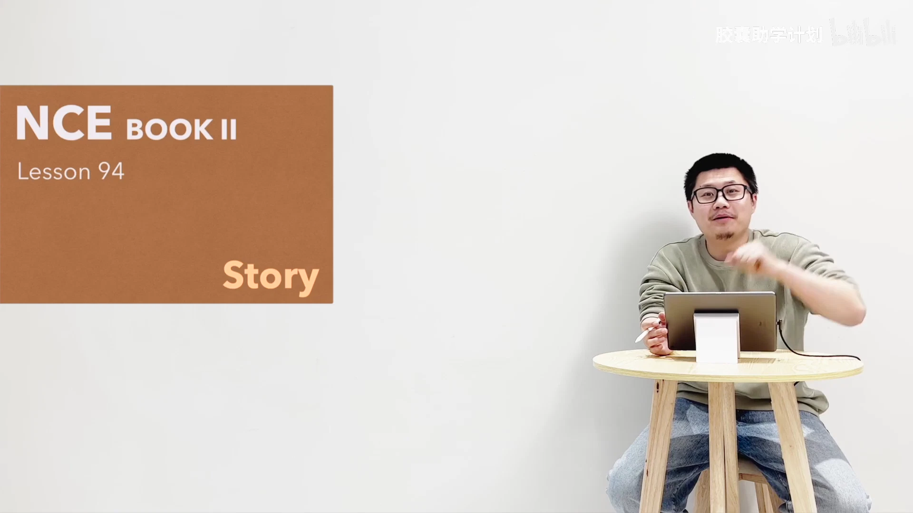

文字识别：NCE / BOOKII / Lesson 94 / Story

### 画面 00:00:02

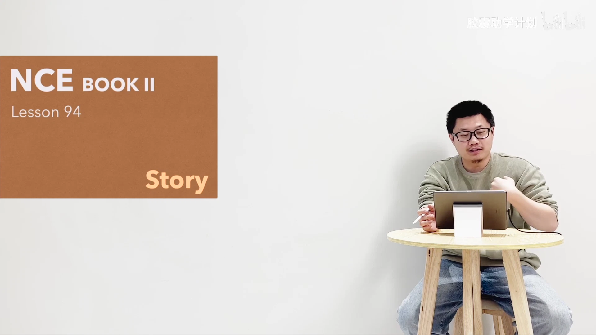

文字识别：NCE / BOOKII / Lesson 94 / Story

### 画面 00:00:04

文字识别：NCE / BOOKII / Lesson 94 / Story

### 画面 00:00:08

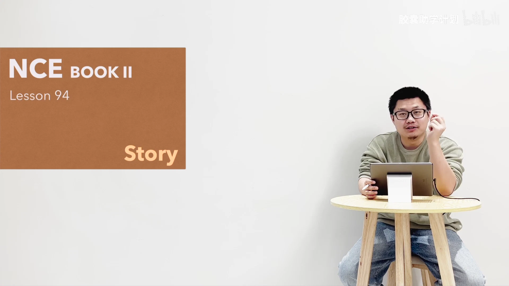

文字识别：NCE / BOOK"I / Lesson 94 / Story

### 画面 00:00:10

文字识别：胶囊助学计划 bii

### 画面 00:00:13

### 画面 00:00:15

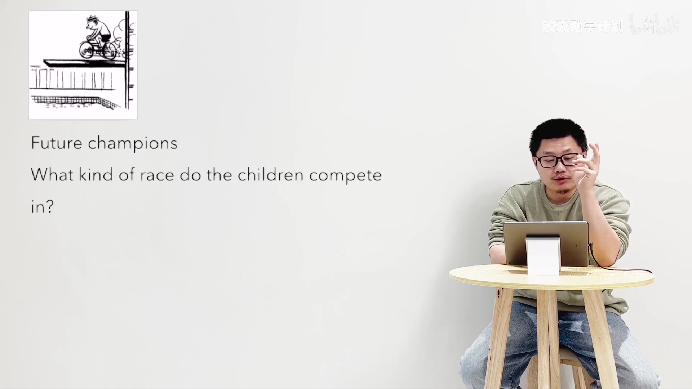

文字识别：Future champions / What kind of race do the children compete / in?

## 00:00:30–00:01:00

那我们进入文章就知道了，对吧？好，文章呢还行，不是太难啊。我们一起看一下，叫 Experiments have proved that children can be instructed in swimming at a very early age。好，呃，句子呢也不算长难句，不过呢确实中间还包含了一个从句，对吧？那我们一个一个看，说实验已经证明了啊。那这个叫做这个 prove 这个单词的用法也比较活。你看在这里，它后边是直接加了一个

### 画面 00:00:32

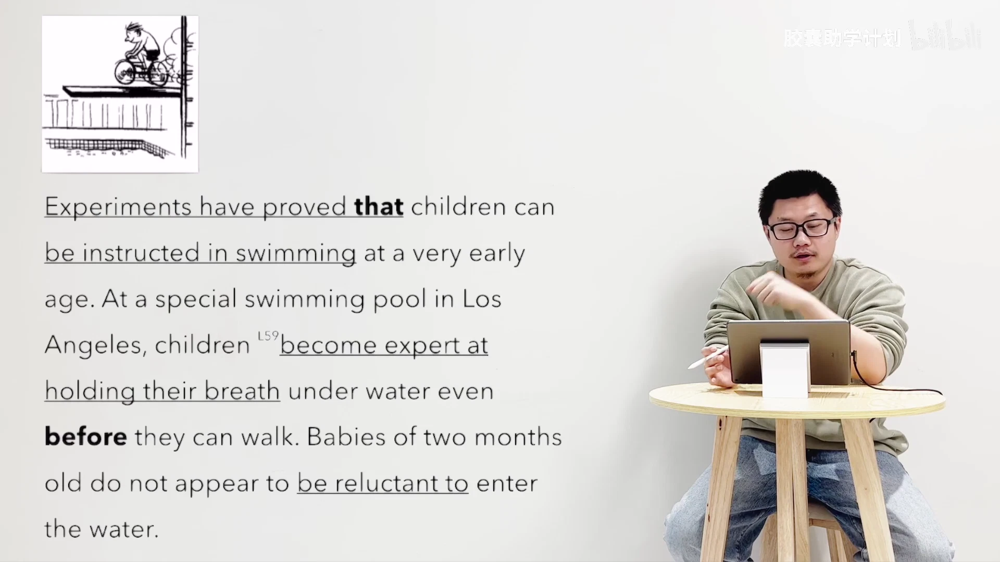

文字识别：Experiments have proved that children can / be instructed in swimming at a very early / age. At a special swimming pool in Los / Angeles, children 5°become expert at / holding their breath under water even / before they can walk. Babies of two months / old do not appear to be reluctant to enter / the water.

### 画面 00:00:53

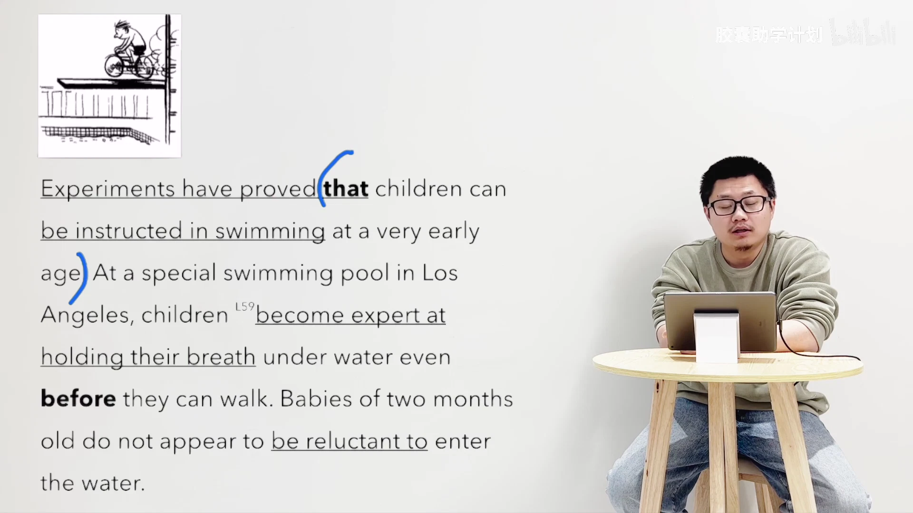

文字识别：Experiments have provedthat children can / be instructed in swimming at a very early / age / At a special swimming pool in Los / Angeles, children [5°become expert at / holding their breath under water even / before they can walk. Babies of two months / old do not appear to be reluctant to enter / the water.

### 画面 00:00:56

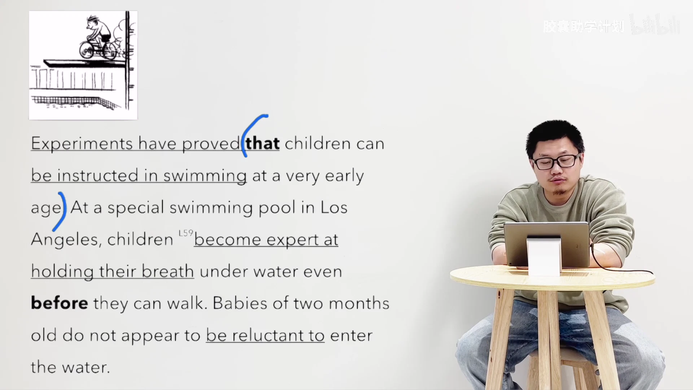

文字识别：Experiments have provedthat children can / be instructed in swimming at a very early / age / At a special swimming pool in Los / Angeles, children [5°become expert at / holding their breath under water even / before they can walk. Babies of two months / old do not appear to be reluctant to enter / the water.

### 画面 00:00:59

文字识别：Experiments have provedthat children can / be instructed in swimming at a very early / age / At a special swimming pool in Los / n 5°become expert at / Angeles, children' / holding their breath under water even / before they can walk. Babies of two months / old do not appear to be reluctant to enter / the water.

## 00:01:00–00:01:30

小的从句，对吧？它有的时候呢，后边还可以加上形容词，比如说 prove difficult。那这个 prove 呢，最常见的两种翻译方式，一个是证明，一个是显现为、显示为啊、证实为都可以。你基本上脑海当中有一个模糊的概念就可以了，不用去纠结它具体必须要翻译成什么。你只要模糊的有它翻译成叫证明、证实、显现、显示这几个含义就可以了。因为

### 画面 00:01:29

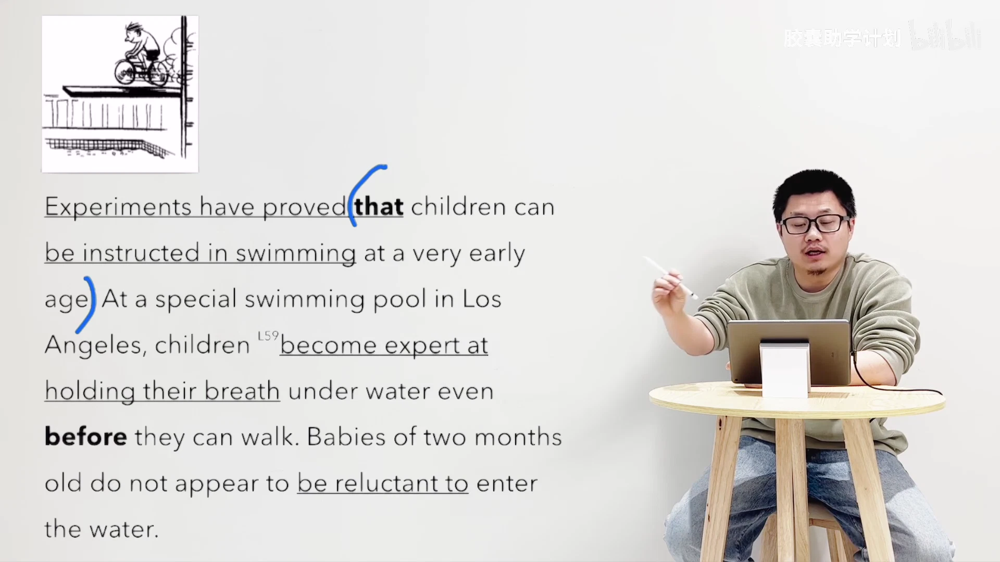

文字识别：Experiments have provedthat children can / be instructed in swimming at a very early / age / At a special swimming pool in Los / Angeles, children [5°become expert at / holding their breath under water even / before they can walk. Babies of two months / old do not appear to be reluctant to enter / the water.

## 00:01:30–00:02:00

什么？因为它就已经足够帮你去理解这句话的意思了啊！还是那句话，我们要明白，我们搞的不是翻译学，我们是搞明白这句话的大概含义就可以了。说实验证明了，说孩子们 can be done，这地方二十一课，对吧？刚复习情态动词的被动，叫能被教。那 be instructed in doing something 就不说了，能被教会游泳，对吧？At a very early age，在一个非常小的年

### 画面 00:01:47

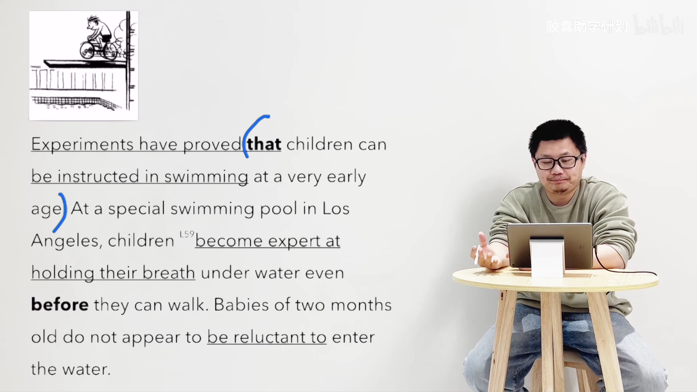

文字识别：Experiments have provedthat children can / be instructed in swimming at a very early / age / At a special swimming pool in Los / Angeles, children [5°become expert at / holding their breath under water even / before they can walk. Babies of two months / old do not appear to be reluctant to enter / the water.

## 00:02:00–00:02:30

pool in Los Angeles, children became become expert at holding their breath underwater even before they can walk. 好了，这句话好长好长，是吧？这句话好长好长。那咱们肯定就是呃，该断句断句。其实连词对于各位来说非常的重要，逗号对于各位来说非常的重要，对吧？好，那我们看一下啊，呃，回来啊，回到这个地方。At a at a very early age,

### 画面 00:02:14

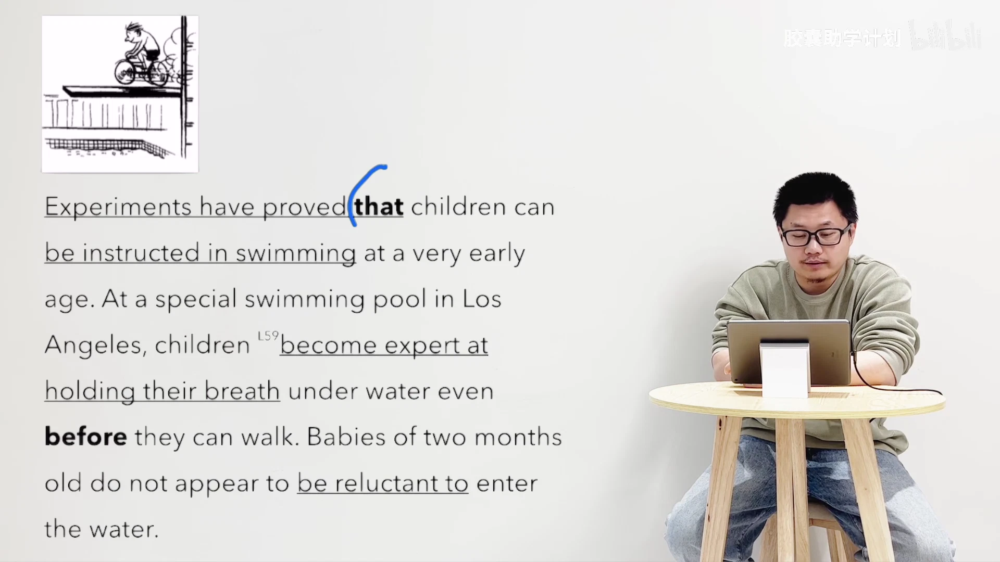

文字识别：Experiments have provedthat children can / be instructed in swimming at a very early / age. At a special swimming pool in Los / Angeles, children 5°become expert at / holding their breath under water even / before they can walk. Babies of two months / old do not appear to be reluctant to enter / the water.

### 画面 00:02:19

文字识别：Experiments have proved that children can / be instructed in swimming at a very early / age. At a special swimming pool in Los / Angeles, children 5°become expert at / holding their breath under water even / before / they can walk. Babies of two months / old do not appear to be reluctant to enter / the water.

## 00:02:30–00:03:00

uh, I have a very good friend. He himself opened a shop that does this. It's about giving very young children swimming lessons. I'm sure you've heard of this. It's about giving very young children swimming lessons. It's about giving very young children swimming lessons. It's about giving very young children swimming lessons. It's about giving very young children swimming lessons. It's about giving very young children swimming lessons. It's about giving very young children swimming lessons. It's about giving very young children swimming lessons. It's about giving very young children swimming lessons. It's about giving very young children swimming lessons. It's about giving very young children swimming lessons. It's about giving very young children swimming lessons. It's about giving very young children swimming lessons. It's about giving very young children

### 画面 00:02:49

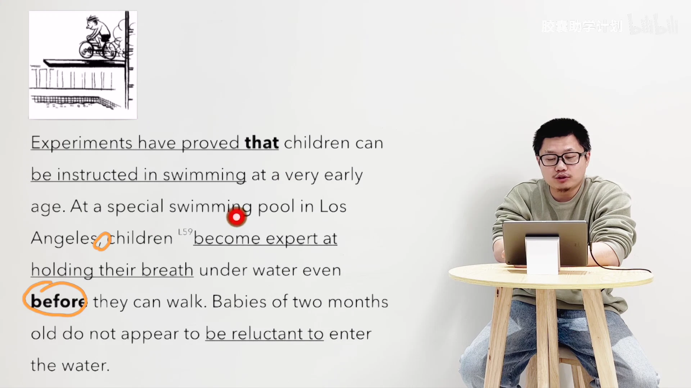

文字识别：Experiments have proved that children can / be instructed in swimming at a very early / age. At a special swimming pool in Los / n 5°become expert at / AngelesOhildren / holding their breath under water even / before / they can walk. Babies of two months / old do not appear to be reluctant to enter / the water.

## 00:03:00–00:03:30

我先不往后看。但是有同学可能就会有疑惑，叫做你跟我说六一二三四五六，那你这个五为什么掉到最前面去了？我不知道各位有没有印象，从第一课开始我讲的时候，我就提醒了一句，我说这玩意儿不是金科玉律，对吧？对于各位来说，它不是金科玉律，它是可以被打破的。但是各位作为英语初学者，能不打破就不打破。你想一下，我们打破规则的第一步是什么？我想打破规则，我是不是得先

### 画面 00:03:05

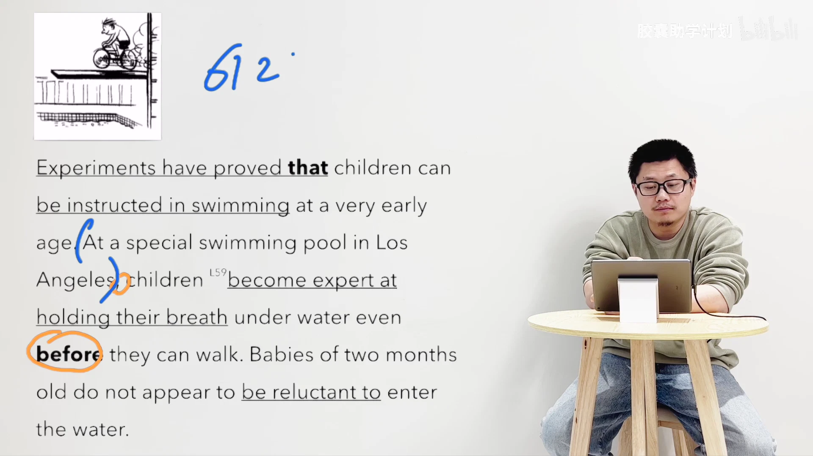

文字识别：612 / Experiments have proved that children can / be instructed in swimming at a very early / ageAt a special swimming pool in Los / n 59become expert at / Angelesrhildren' / holding their breath under water even / before / they can walk. Babies of two months / old do not appear to be reluctant to enter / the water.

### 画面 00:03:07

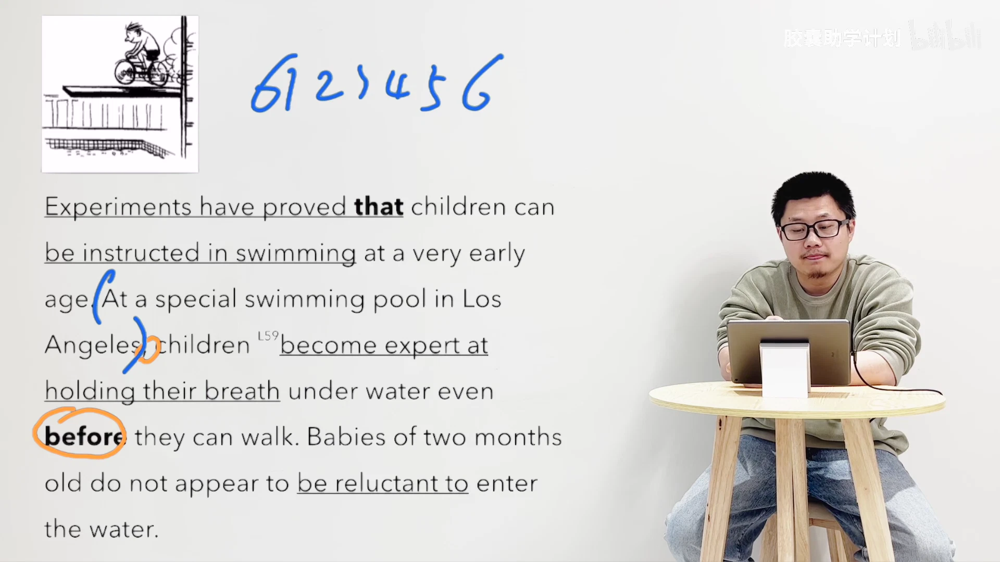

文字识别：612>456 / Experiments have proved that children can / be instructed in swimming at a very early / ageAt a special swimming pool in Los / AngeleDhildren [°become expertat / holding their breath under water even / beforet / they can walk. Babies of two months / old do not appear to be reluctant to enter / the water.

### 画面 00:03:09

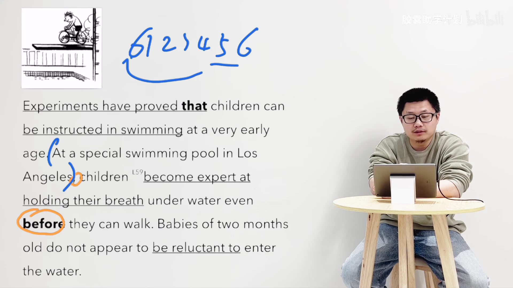

文字识别：612>456 / Experiments have proved that children can / be instructed in swimming at a very early / ageAt a special swimming pool in Los / Angeleschildren 5°become expertat / holding their breath under water even / beforet / they can walk. Babies of two months / old do not appear to be reluctant to enter / the water.

### 画面 00:03:12

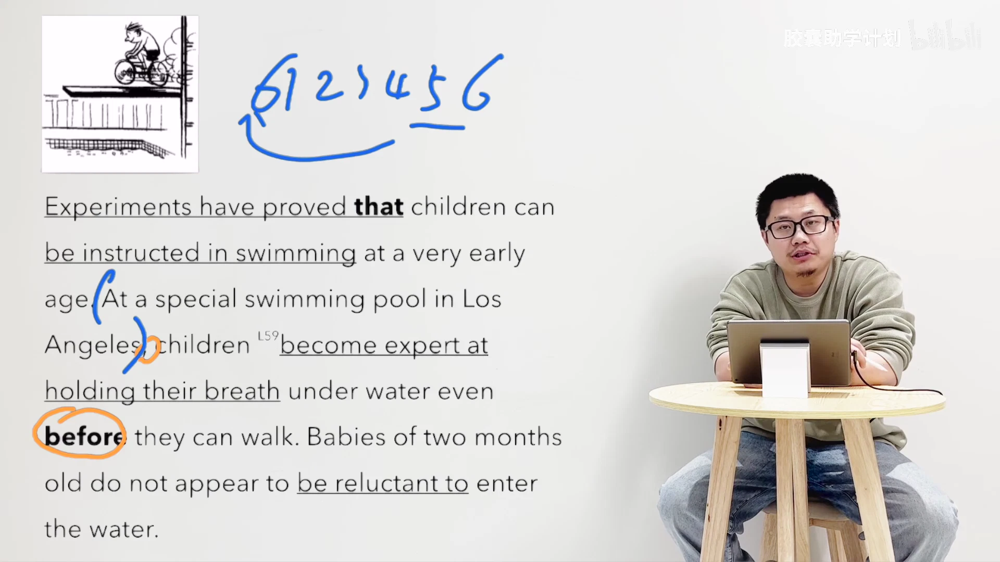

文字识别：2)456 / Experiments have proved that children can / be instructed in swimming at a very early / ageAt a special swimming pool in Los / AngeleDhildren [°become expertat / holding their breath under water even / before / they can walk. Babies of two months / old do not appear to be reluctant to enter / the water.

### 画面 00:03:14

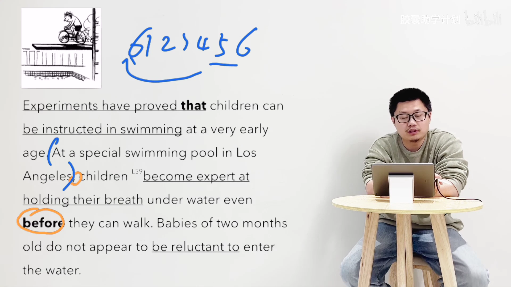

文字识别：2)456 / Experiments have proved that children can / be instructed in swimming at a very early / ageAt a special swimming pool in Los / AngeleDhildren [°become expertat / holding their breath under water even / before / they can walk. Babies of two months / old do not appear to be reluctant to enter / the water.

### 画面 00:03:26

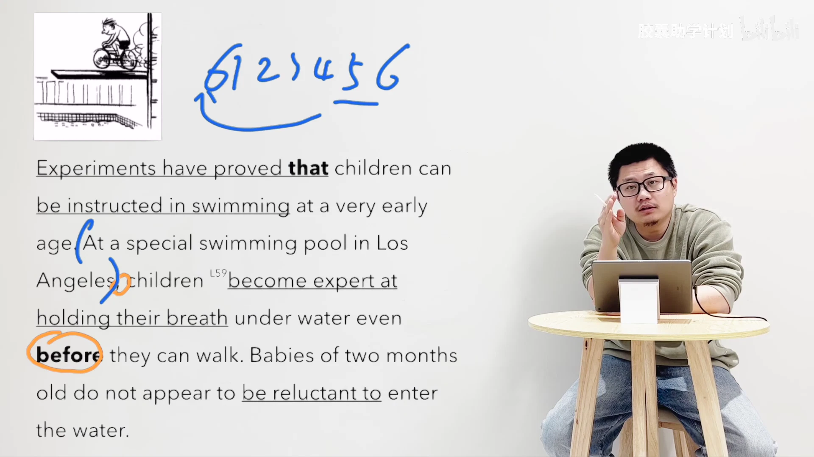

文字识别：2)456 / Experiments have proved that children can / be instructed in swimming at a very early / ageAt a special swimming pool in Los / n 5°become expert at / Angelesrhildren ' / holding their breath under water even / before / they can walk. Babies of two months / old do not appear to be reluctant to enter / the water.

## 00:03:30–00:04:00

了解规则，我才能打破它，我才能跳出这个规则，对吧？所以千万就是你想一下，这个这个这个层次感是不一样的。有很多同学会由这件事情导出另一个极端，另一个极端叫做：既然有这么多破坏规则的事情，那是不是我完全不接受规则就完了呢？不是。举一个最简单的类比，比如说关于我们的交规这件事情，在大多数情况下，对吧？你都是必须要去遵守的，你必须

### 画面 00:03:56

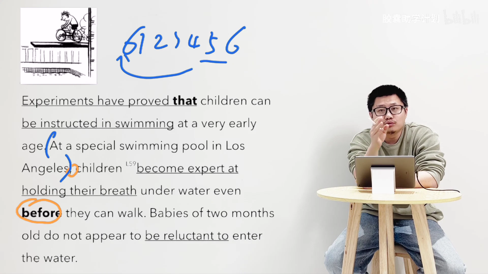

文字识别：2)456 / Experiments have proved that children can / be instructed in swimming at a very early / ageAt a special swimming pool in Los / AngeleDhildren [°become expertat / holding their breath under water even / before / they can walk. Babies of two months / old do not appear to be reluctant to enter / the water.

## 00:04:00–00:04:30

要了解这些规则。那有没有可以打破它的时候呢？比如说最简单的，比如说救命的时候，对吧？你车里边有一个需要紧急送往医院的过程当中，难道这个时候你不能打破规则？但你要了解规则。比如说你知道这个红灯我要闯，必须闯，我哪怕要扣分我也得闯。但是我要明白可能会有一个危险，所以我在闯的时候我可能要做一些什么什么样的事情，对吧？包括我是不是要给警察提前打电话护送我？

### 画面 00:04:26

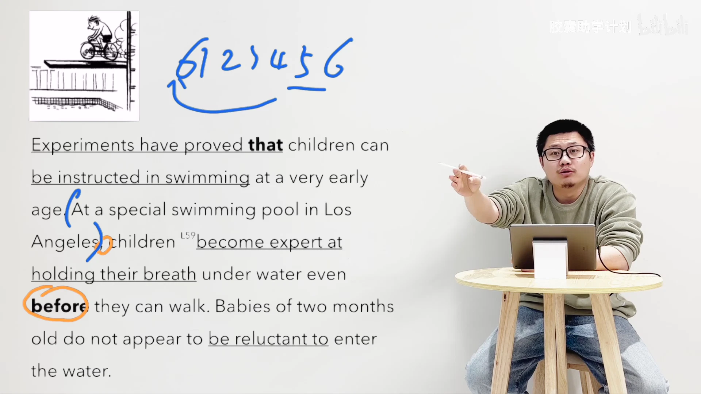

文字识别：2>456 / Experiments have proved that children can / be instructed in swimming at a very early / ageAt a special swimming pool in Los / AngeleDhildren [°become expertat / holding their breath under water even / before / they can walk. Babies of two months / old do not appear to be reluctant to enter / the water.

## 00:04:30–00:05:00

这叫说了有三个不同的层次。第一个层次是根本就不懂什么是规则，对吧？你千万不要标榜自己很自由。第二是叫做我们通过新一新二学会了规则，这是第二个层次。第三个层次就是我逐渐看到了很多，哎，跳出了这个规则范围之外的，但是它并没有错，对吧？你不能说它是错的。比如说像这里第五这个五就放到最前面，但是没有问题，对吧？这是三个不同的层

### 画面 00:04:56

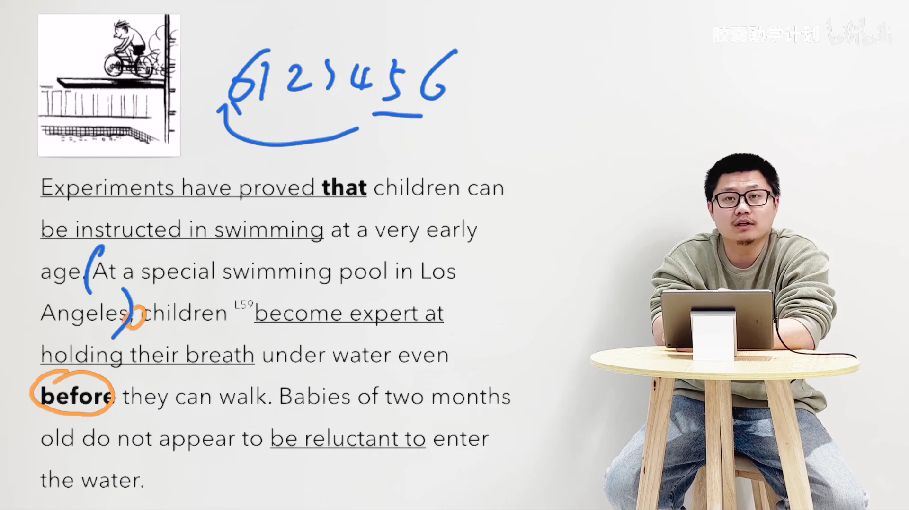

文字识别：2)456 / Experiments have proved that children can / be instructed in swimming at a very early / ageAt a special swimming pool in Los / n 5°become expert at / AngelesDrhildren ' / holding their breath under water even / before / they can walk. Babies of two months / old do not appear to be reluctant to enter / the water.

## 00:05:00–00:05:30

次。很多人呢没有经历第二个层次，就误把第三个层次跟第一个层次混为一谈了。千万我们不要这么干，对吧？好，呃，children become expert at holding their juice。说孩子们变成了什么呢？expert变成了这个专家，在什么事情上呢？在 holding their breath 上。首先，这个 become expert at doing something 五十九课习惯用法咱学过，就狗那课 become expert at opening the front gate，对

### 画面 00:05:26

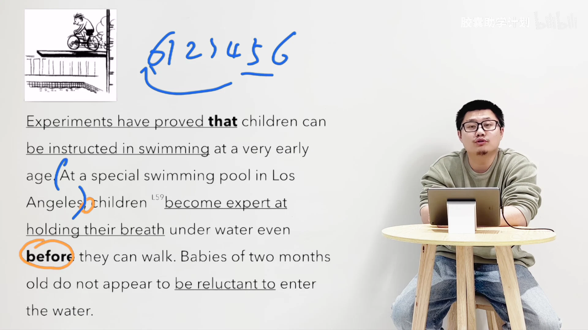

文字识别：2)456 / Experiments have proved that children can / be instructed in swimming at a very early / ageAt a special swimming pool in Los / AngeleDhildren [°become expertat / holding their breath under water even / beforet / they can walk. Babies of two months / old do not appear to be reluctant to enter / the water.

## 00:05:30–00:06:00

吧？那 hold their breath.本科的习惯用法叫憋气啊，憋气啊，或者屏住呼吸，变成了屏住呼吸的专家. Underwater,在水下. Even before,甚至在什么之前呢？They can walk,甚至在他们能走路之前，哎，他们先学会游泳了，很厉害。所以你看，这个几几个月大就可以. Baby of two months old do not appear to be reluctant to enter the water. Baby of two months

### 画面 00:05:56

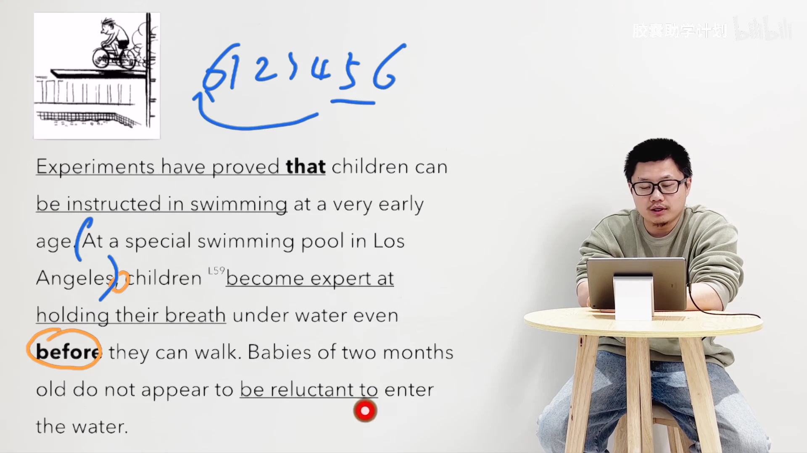

文字识别：2)456 / Experiments have proved that children can / be instructed in swimming at a very early / ageAt a special swimming pool in Los / AngeleDhildren [°become expertat / holding their breath under water even / beforet / they can walk. Babies of two months / old do not appear to be reluctant to enter / the water.

## 00:06:00–00:06:30

old,叫做两个月大的孩子怎么样? Do not appear, appear叫显现显出，它怎么样呢？并没有显现显出。Be reluctant to enter the water,说显现出不情愿进入水里面。好，没什么可说。Continue, it is not long before they are so accustomed to swimming that they can pick up waves from the floor of the pool.这个就需要你前面学的很好。你前面学的很好，这句话当

### 画面 00:06:16

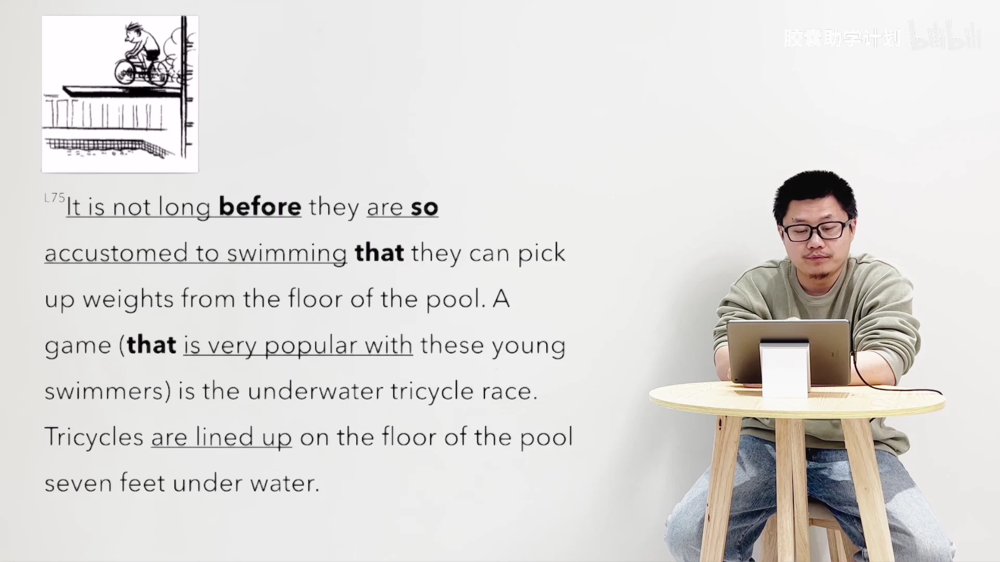

文字识别：L75lt is not long before they are so / accustomed to swimming that they can pick / up weights from the floor of the pool. A / game (that is very popular with these young / swimmers) is the underwater tricycle race. / Tricycles are lined up on the floor of the pool / seven feet under water.

## 00:06:30–00:07:00

中只有一个点卡着你。前面学的不好，这句话当中有三个点卡着你。我分别说一下。第一个叫 It is not long before。这实际上七十五课我们拿它造过好几个句子，也从原文当中见过，对吧？千万不要把它和 long before 连到很久很久以前连到一起。它恰恰是反着的。 It is not long 没有多久在什么之前，所以基本整体上就翻译成用不了多久。所以这是第一个点可能会卡着我们，但是我们之前学过。第二个点

### 画面 00:06:45

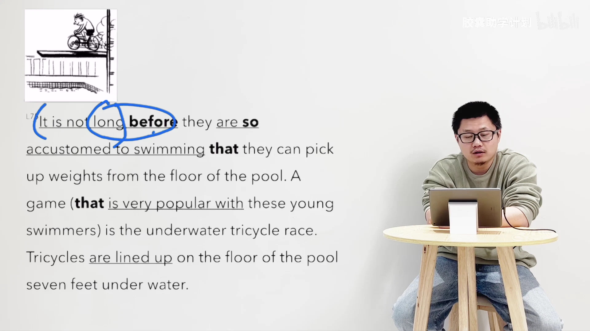

文字识别：It is nolong / beforet /  they are so / accustomed to swimming that they can pick / up weights from the floor of the pool. A / game (that is very popular with these young / swimmers) is the underwater tricycle race. / Tricycles are lined up on the floor of the pool / seven feet under water.

### 画面 00:06:47

文字识别：It is not longbefore they are so / accustomed to swimming that they can pick / up weights from the floor of the pool. A / game (that is very popular with these young / swimmers) is the underwater tricycle race. / Tricycles are lined up on the floor of the pool / seven feet under water.

### 画面 00:06:50

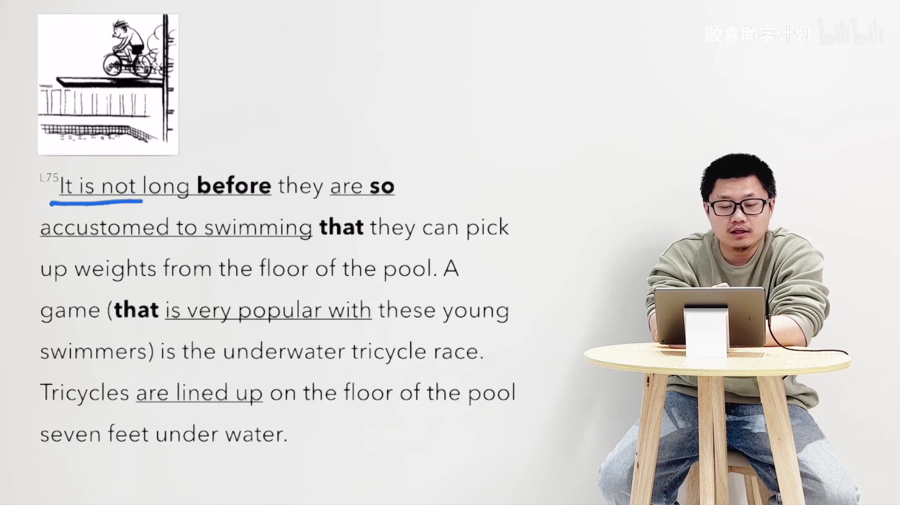

文字识别：L75lt is not long before they are so / accustomed to swimming that they can pick / up weights from the floor of the pool. A / game (that is very popular with these young / swimmers) is the underwater tricycle race. / Tricycles are lined up on the floor of the pool / seven feet under water.

## 00:07:00–00:07:30

叫 be accustomed to doing something，这真的就是本课学的，之前咱没见过。但是呢，我们学到今天，我是不是能自己上网去查？学习越主动，效果越好，对吧？就算没有老师，难道老师是谁教会的，也是以各种途径学会的，对吧？好，啊，这个有点像鸡生蛋，蛋生鸡的问题了。那 be accustomed to doing something，我们一查查完了之后，叫做习惯于做某事儿。哎，和我之前学过的 be used to doing something

### 画面 00:07:09

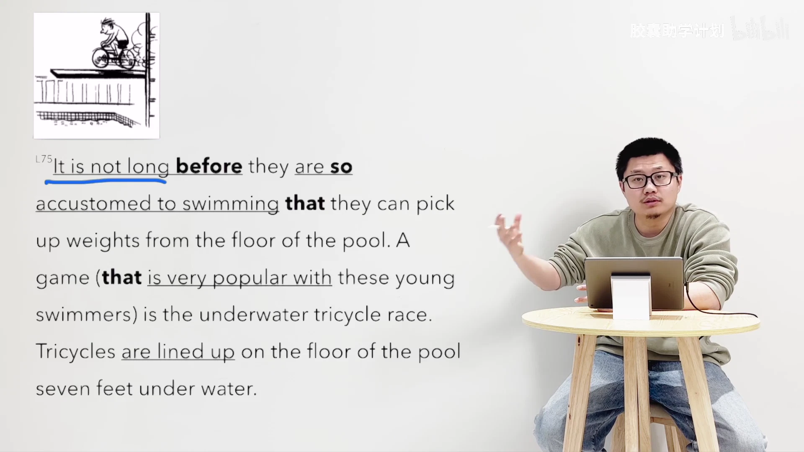

文字识别：L751t is not long before they are so / accustomed to swimming that they can pick / up weights from the floor of the pool. A / game (that is very popular with these young / swimmers) is the underwater tricycle race. / Tricycles are lined up on the floor of the pool / seven feet under water.

## 00:07:30–00:08:00

一个含义基本上，所以用不了多久，他们就习惯于了。习惯于了，后边给了个that，然后还加了一句话。我们先把这句话看一下，叫做他们能捡起重物。从A of B结构，由后往前翻译，叫做池子的地板，对吧？哎，从这个游泳池的地板就能捡起重物了。那这儿怎么就来了个从句呢？所以这就涉及到三十五课您学的好不好了啊？三十五课的这

### 画面 00:07:39

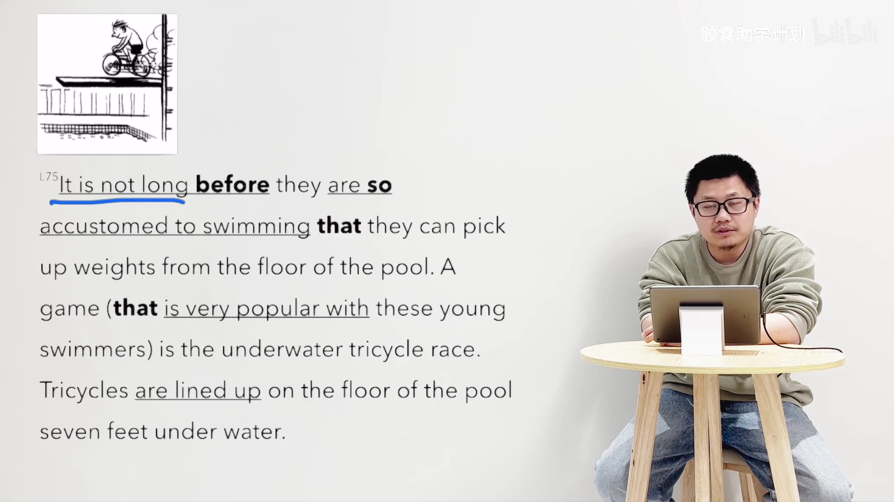

文字识别：L751t is not long before they are so / accustomed to swimming that they can pick / up weights from the floor of the pool. A / game (that is very popular with these young / swimmers) is the underwater tricycle race. / Tricycles are lined up on the floor of the pool / seven feet under water.

### 画面 00:07:57

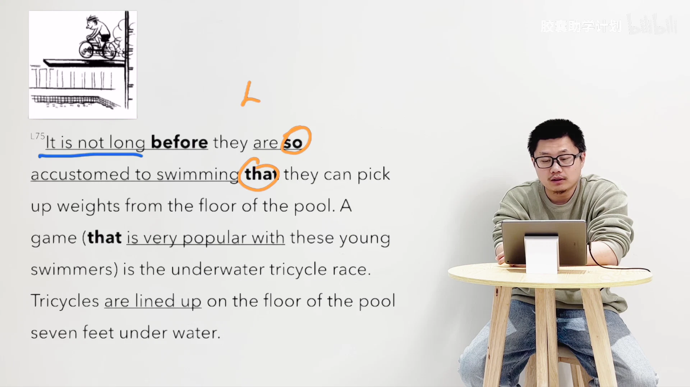

文字识别：L75lt is not long before they are / 5O / accustomed to swimming / tha / they can pick / up weights from the floor of the pool. A / game (that is very popular with these young / swimmers) is the underwater tricycle race. / Tricycles are lined up on the floor of the pool / seven feet under water.

## 00:08:00–00:08:30

个 such 点点 that 和 so 点点 that。第一，我后来造句造了，用了很多。如果您还是忘了，那复习对吧？红皮书啊，初级、中级拿出来写。如此以至于说，他们如此的习惯于游泳，以至于通了。用不了多久，他们就会如此习惯的游泳，以至于他们都能从游泳池的底下，对吧？哎，这个池底能捡起重物了，这挺厉害的。A game that is very popular with

### 画面 00:08:00

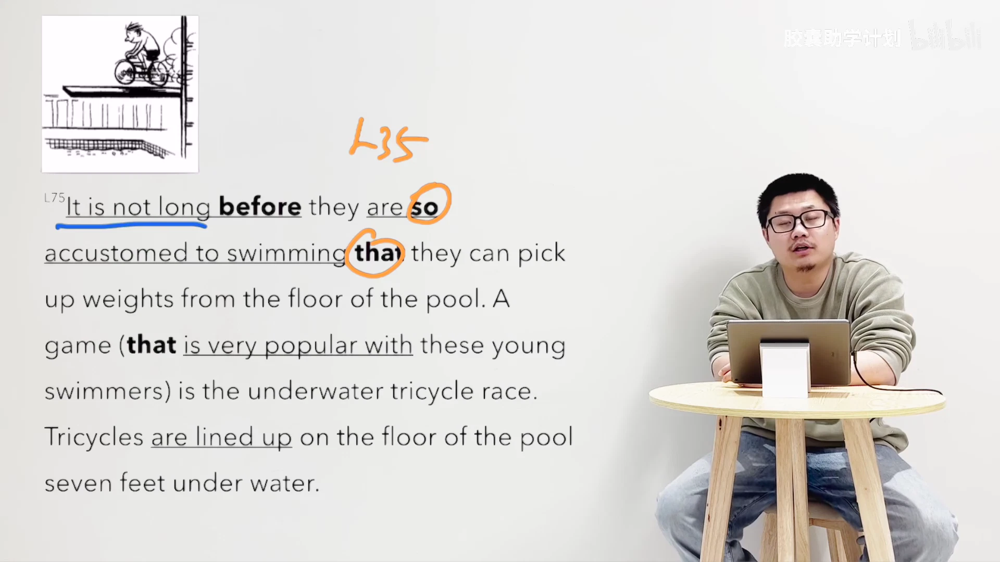

文字识别：L35 / L75lt is not long before they are / 50 / accustomed to swimming / tha / they can pick / up weights from the floor of the pool. A / game (that is very popular with these young / swimmers) is the underwater tricycle race. / Tricycles are lined up on the floor of the pool / seven feet under water.

### 画面 00:08:02

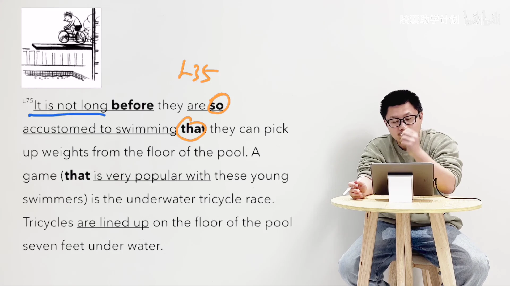

文字识别：L35 / L75lt is not long before they are / 5O / accustomed to swimming / tha / they can pick / up weights from the floor of the pool. A / game (that is very popular with these young / swimmers) is the underwater tricycle race. / Tricycles are lined up on the floor of the pool / seven feet under water.

### 画面 00:08:04

文字识别：L35 / L75lt is not long before they are / 5O / accustomed to swimming / tha / they can pick / up weights from the floor of the pool. A / game (that is very popular with these young / swimmers) is the underwater tricycle race. / Tricycles are lined up on the floor of the pool / seven feet under water.

## 00:08:30–00:09:00

this young swimmer is the underwater tricycle race.你像像这个 a game 后边立刻来 that，然后一句话后长八成定语从句或同位语从句。区分它的方式，我带着各位复习一下，就是定语从句当中这个连词是要做句子成分的。换一句话来说，就是这个句子当中要缺成分。而同位语从句当中这个 that 呢，它是不做成分的。换一句话来说，就是后边同位语从句是不缺成分的。那你看 that 后边立刻框就跟了个

### 画面 00:08:34

文字识别：L35 / L75lt is not long before they are / accustomed to swimming / tha / they can pick / up weights from the floor of the pool. A / game (that is very popular with these young / swimmers) is the underwater tricycle race. / Tricycles are lined up on the floor of the pool / seven feet under water.

## 00:09:00–00:09:30

is，这主语就没有，就缺成分，所以它八成就是个定语从句，对吧？九成九点九成是个定语从句。a game 后边加了一个 that，这 that 就是说的是 the game，对吧？就是这个比赛，就是 it。然后定语从句对于各位来说，哎，我们先第一步判断它是什么从句啊。这个判断的速度，你看刚才我讲了，可能快三十秒、一分钟，但往往就是一念之间的。随着你速度越来越快，就是一念之间，你甚至没反应过来，你就已经判断出来了啊。你就看到 that is

### 画面 00:09:04

文字识别：L35 / L75lt is not long before they are / 5O / that / accustomed to swimming / they can pick / up weights from the floor of the pool. A / game (that is very popular with these young / swimmers) is the underwater tricycle race. / Tricycles are lined up on the floor of the pool / seven feet under water.

### 画面 00:09:16

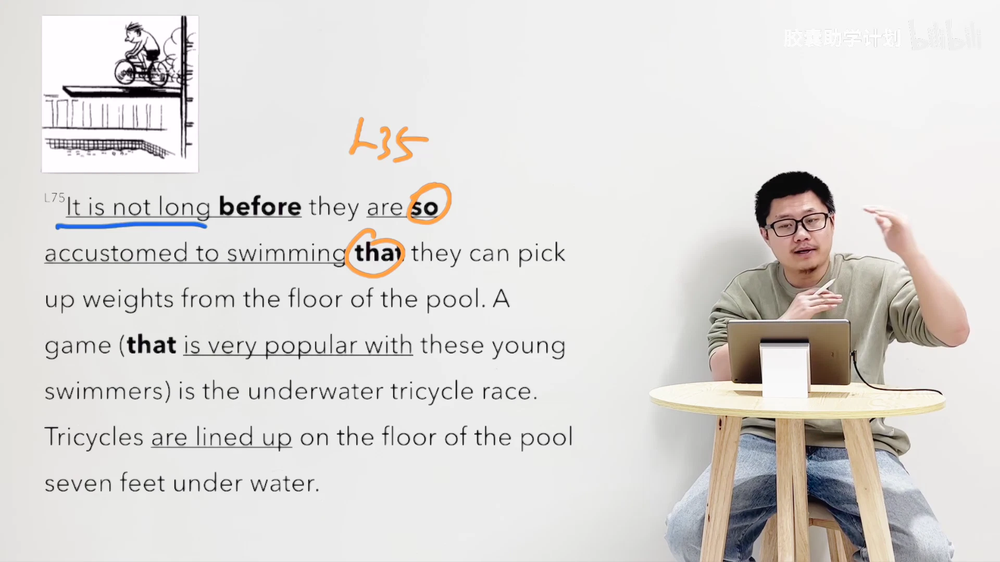

文字识别：L35 / L75lt is not long before they are / 50 / accustomed to swimming / tha / they can pick / up weights from the floor of the pool. A / game (that is very popular with these young / swimmers) is the underwater tricycle race. / Tricycles are lined up on the floor of the pool / seven feet under water.

### 画面 00:09:20

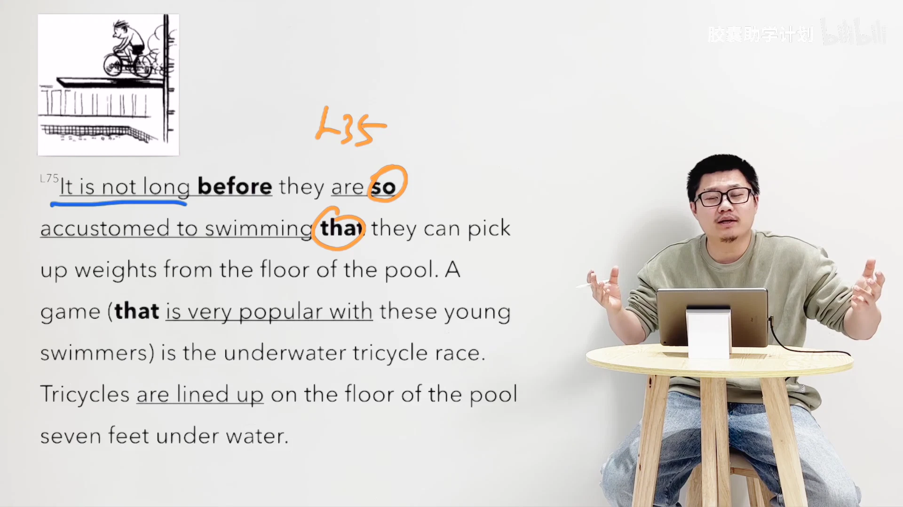

文字识别：L35 / L75lt is not long before they are / 5O / accustomed to swimming / tha / they can pick / up weights from the floor of the pool. A / game (that is very popular with these young / swimmers) is the underwater tricycle race. / Tricycles are lined up on the floor of the pool / seven feet under water.

### 画面 00:09:26

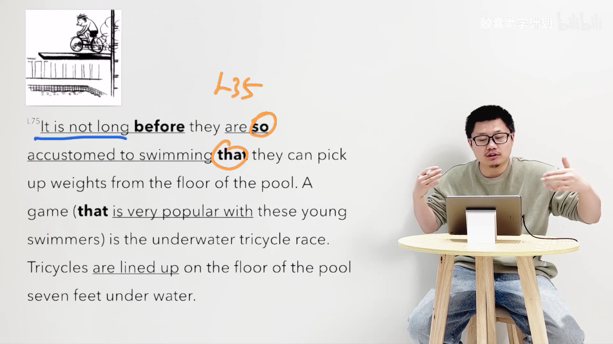

文字识别：L35 / L75lt is not long before they are / 50 / accustomed to swimming / tha / they can pick / up weights from the floor of the pool. A / game (that is very popular with these young / swimmers) is the underwater tricycle race. / Tricycles are lined up on the floor of the pool / seven feet under water.

## 00:09:30–00:10:00

定语从句，确定它是定语从句之后，第二步我要确定的事情叫它从哪儿结束。我现在都是告诉你从哪儿开始很容易，这个你也好判断，连词嘛。从哪儿结束就不是特别好判断。两种判断方式，我之前说过很多回。第一种是各位长期来说最需要记住的，就是整句话的含义结束了，自然就结束了。比如说这个这个游戏特别的受欢迎，在年轻游泳运这个年年年轻游泳者的这

### 画面 00:09:30

文字识别：L35 / L75]t is not long before they are / accustomed to swimming / tha / they can pick / up weights from the floor of the pool. A / game (that is very popular with these young / swimmers) is the underwater tricycle race. / Tricycles are lined up on the floor of the pool / seven feet under water.

### 画面 00:09:32

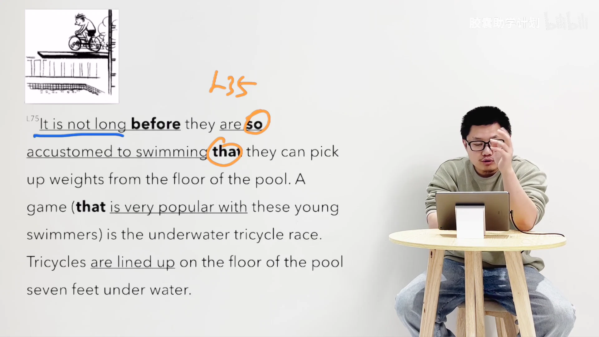

文字识别：L35 / L75lt is not long before they are / 5O / accustomed to swimming / tha) / they can pick / up weights from the floor of the pool. A / game (that is very popular with these young / swimmers) is the underwater tricycle race. / Tricycles are lined up on the floor of the pool / seven feet under water.

### 画面 00:09:34

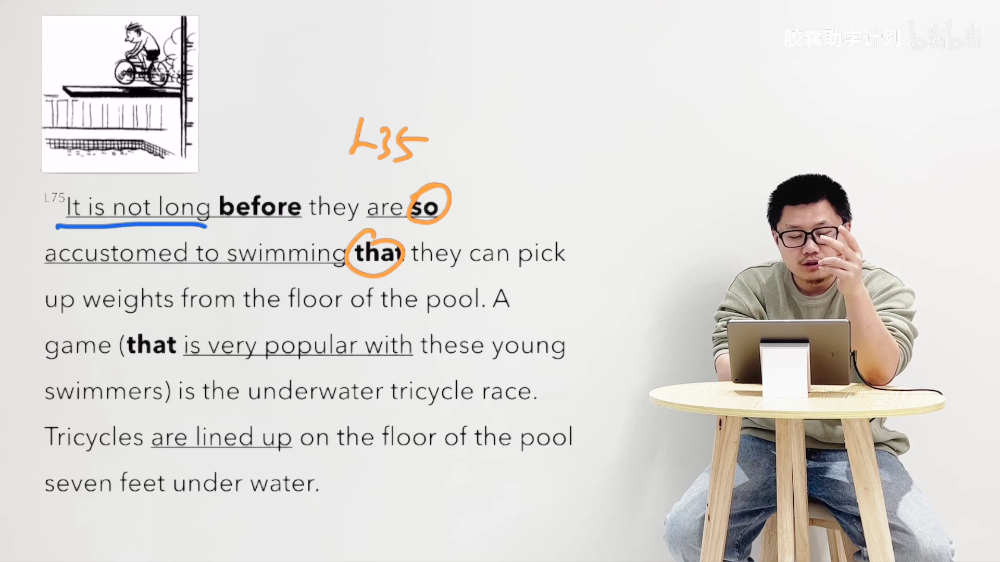

文字识别：L35 / L75lt is not long before they are / 5O / accustomed to swimming / tha) / they can pick / up weights from the floor of the pool. A / game (that is very popular with these young / swimmers) is the underwater tricycle race. / Tricycles are lined up on the floor of the pool / seven feet under water.

## 00:10:00–00:10:30

个这个这个这个这个当中啊，非常受欢迎。这句话就结束了，你后边不用再管它了。第二个呢，是从语法的角度去抠，而这个抠的时候会遇到各种各样的问题，但是有一些帮助，就是一句话定语从句也是一句话，它只能有一个谓语，除非它里边还有连词，对吧？所以你看这个情况就麻烦。那我就知道说我在见到下一个谓语的时候，定语从句可能就结束了。但这种呢，往往其实不是语言最本质的，语言最本质就是含义

### 画面 00:10:04

文字识别：L35 / L75lt is not long before they are / SO / accustomed to swimming / tha / they can pick / up weights from the floor of the pool. A / game (that is very popular with these young / swimmers) is tho underwater tricycle race. / Tricycles are lined up on the floor of the pool / seven feet under water.

## 00:10:30–00:11:00

结束就结束，语法的角度才是说，哎，这个定语从句当中有一个呃这个这个连词啊，有一个这个谓语，对吧？然后呢，主句当中 a game 还应该有一个谓语啊，你这个定从当中不能有俩，对吧？那定从当中谁说不能有俩？其实也可以有俩，来个连词就俩了。所以你要这么去想呢，你又容易懵，所以就还是整体上你都学就好了，对吧？那这儿就结束了嘛？那我们再看主

### 画面 00:10:34

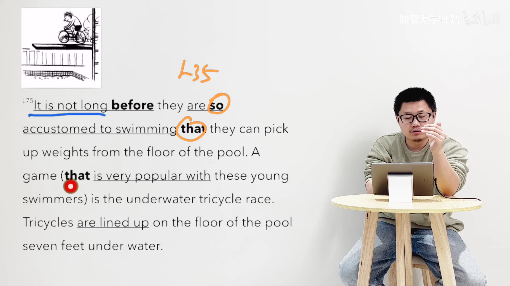

文字识别：L35 / L75lt is not long before they are / accustomed to swimming / that / they can pick / up weights from the floor of the pool. A / game (that is very popular with these young / swimmers) is the underwater tricycle race. / Tricycles are lined up on the floor of the pool / seven feet under water.

## 00:11:00–00:11:30

句，说这个游戏 is the underwater tricycle race，水下三轮车比赛，字面意思。Tricycles are lined up on the floor of the pool seven feet under water. 好了，这句话呢不难，简单句，但有一个小的习惯用法叫 be lined up。这个 line l i 我们给它还原成原型，它既可以既可以是名词，又可以是动词。名词就是线，

### 画面 00:11:04

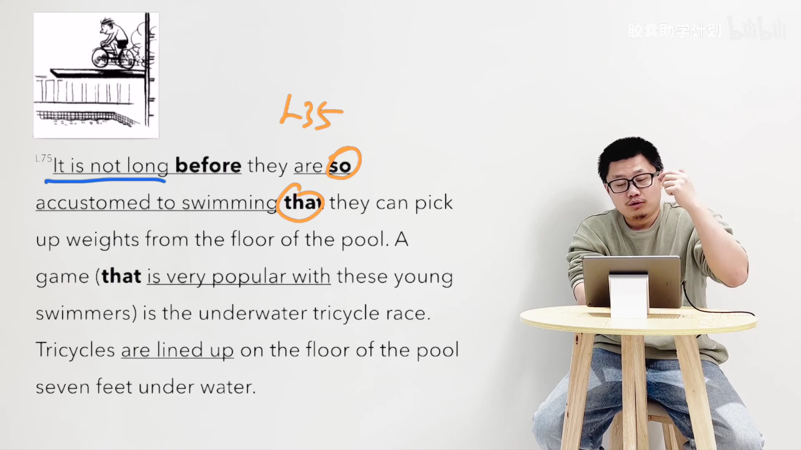

文字识别：L35 / L75lt is not long before they are / 5O / accustomed to swimming / tha / they can pick / up weights from the floor of the pool. A / game (that is very popular with these young / swimmers) is the underwater tricycle race. / Tricycles are lined up on the floor of the pool / seven feet under water.

### 画面 00:11:07

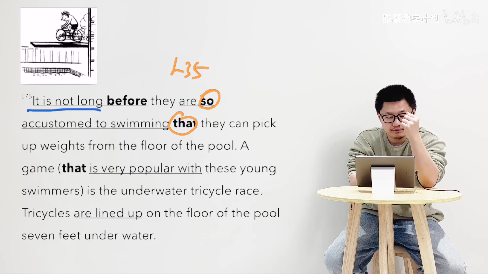

文字识别：L35 / L75lt is not long before they are / 5O / tha / accustomed to swimming / they can pick / up weights from the floor of the pool. A / game (that is very popular with these young / swimmers) is the underwater tricycle race. / Tricycles are lined up on the floor of the pool / seven feet under water.

### 画面 00:11:25

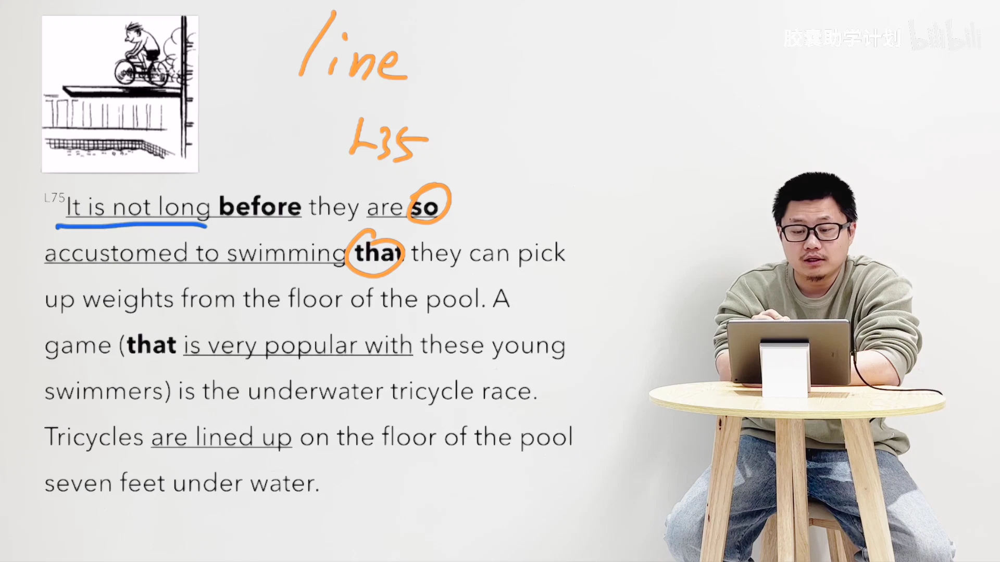

文字识别：/ine / L35 / L75lt is not long before they are / 5O / that / accustomed to swimming / they can pick / up weights from the floor of the pool. A / game (that is very popular with these young / swimmers) is the underwater tricycle race. / Tricycles are lined up on the floor of the pool / seven feet under water.

## 00:11:30–00:12:00

动词就是排成线，是吧？好，那 be lined up 就是被排成一排嘛，被排成一条线。所以这些呃三轮车被这些小的三轮车，孩子们骑的这些被排成了一条线，排成了一排。On the floor 在什么呢？On the floor of the pool 在这个泳池的这个池底啊，被排成了一条线。Seven feet under water 七英尺 under water 叫水下，水下七英

### 画面 00:11:30

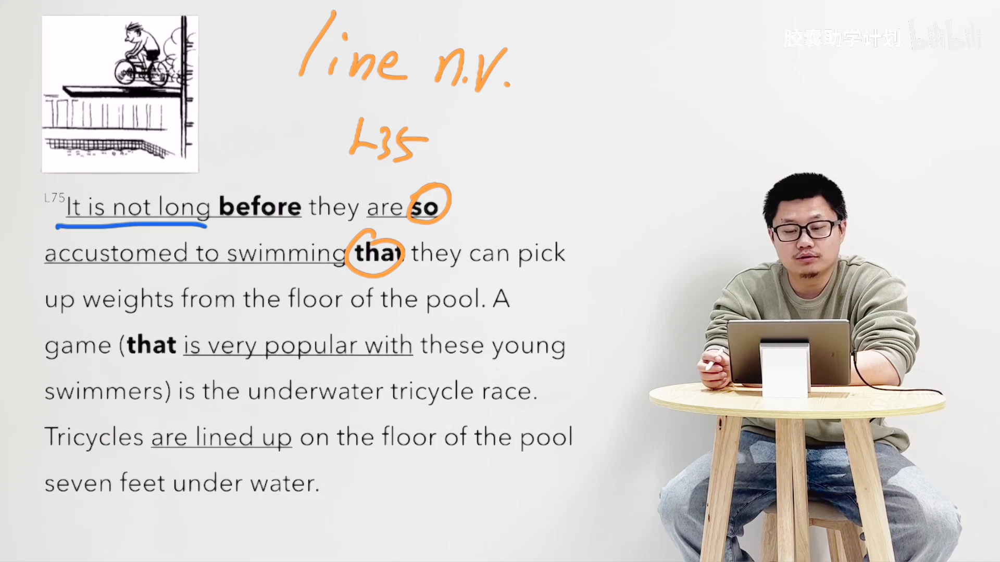

文字识别：/ine n.v. / L35 / L75lt is not long before they are / 5O / accustomed to swimming / that / they can pick / up weights from the floor of the pool. A / game (that is very popular with these young / swimmers) is the underwater tricycle race. / Tricycles are lined up on the floor of the pool / seven feet under water.

### 画面 00:11:32

文字识别：/ine n.V. / L35 / L75lt is not long before they are / SO / accustomed to swimming / that / they can pick / up weights from the floor of the pool. A / game (that is very popular with these young / swimmers) is the underwater tricycle race. / Tricycles are lined up on the floor of the pool / seven feet under water.

## 00:12:00–00:12:30

尺的地方。Continuing, the children compete against each other to reach the other end of the pool.字面意思在这儿有一个to do结构表目的，说孩子们互相竞争，目的是怎么样呢？达到the other end of the pool。以后往前翻译叫做这个泳池的另一个点，另一个结束的地方，其实就是另一端，对吧？另一端。Many pedal their tricycles, but most of them

### 画面 00:12:01

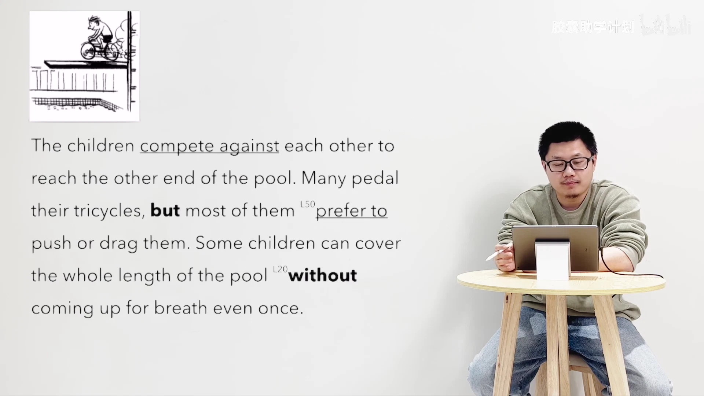

文字识别：The children compete against each other to / reach the other end of the pool. Many pedal / their tricycles, but most of them / L50, / °prefer to / push or drag them. Some children can cover / the whole length of the pool l2°without / coming up for breath even once.

## 00:12:30–00:13:00

prefer to push or drag them.说许多人怎么样的 paddle their tricycles?你想一下这句话啊，就我给你来一个汉语填空。假设 paddle 这个单词不认的，许多的孩子，这个 many 其实就是 many 孩子呢，它的一个缩写。许多的孩子下划线他们的三轮车，但是当中的大多数人 prefer to do something。五十个咱们学的，更更愿意宁愿怎么样呢？Push or drag them.推

### 画面 00:12:31

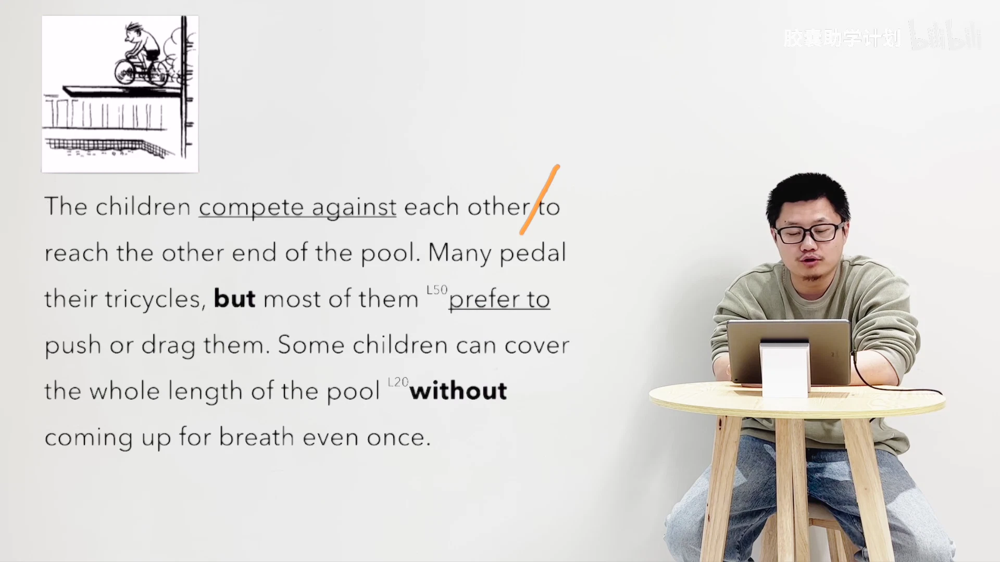

文字识别：The children compete against each other/to / reach the other end of the pool. Many pedal /  5prefer to / their tricycles, but most of them / push or drag them. Some children can cover / the whole length of the pool l2°without / coming up for breath even once.

## 00:13:00–00:13:30

或者拉这些三轮车。你想一下这句话啊，许多的孩子什么样？他们的三轮车，但大多数的孩子更宁愿的是推或者拉这些三轮车。所以在我这个地方的理解就是，当我们的英语水平逐渐往上提升，比如说接下来马上进入三册了之后，我们要学一个能力叫猜词的能力。什么叫猜词能力？就是我前前后后都读懂了。那paddle，我根据

### 画面 00:13:01

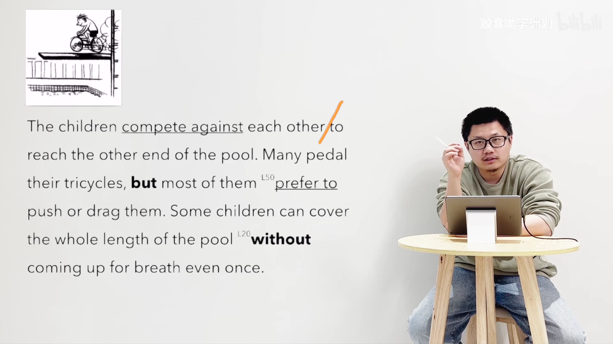

文字识别：The children compete against each other/to / reach the other end of the pool. Many pedal /  5prefer to / their tricycles, but most of them / push or drag them. Some children can cover / the whole length of the pool l2°without / coming up for breath even once.

### 画面 00:13:04

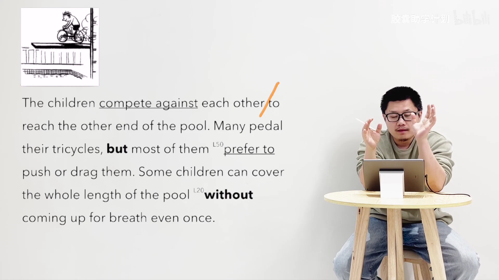

文字识别：The children compete against each other/to / reach the other end of the pool. Many pedal /  5prefer to / their tricycles, but most of them / push or drag them. Some children can cover / the whole length of the pool 2without / coming up for breath even once.

### 画面 00:13:09

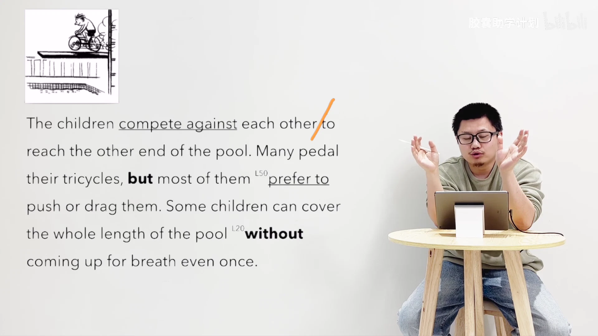

文字识别：The children compete against each other/to / reach the other end of the pool. Many pedal / their tricycles, but most of them [5preferto / push or drag them. Some children can cover / the whole length of the pool 2°without / coming up for breath even once.

### 画面 00:13:20

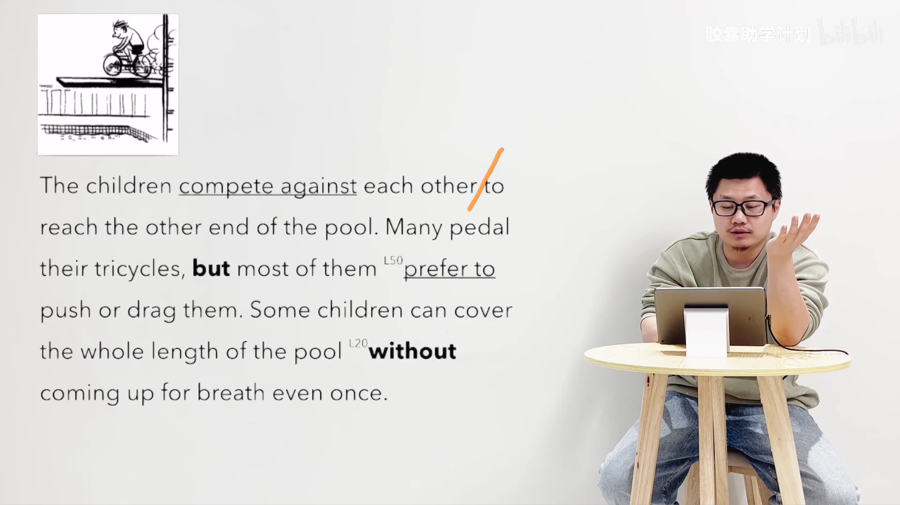

文字识别：The children compete against each other/to / reach the other end of the pool. Many pedal /  58prefer to / their tricycles, but most of them / push or drag them. Some children can cover / the whole length of the pool 2°without / coming up for breath even once.

### 画面 00:13:22

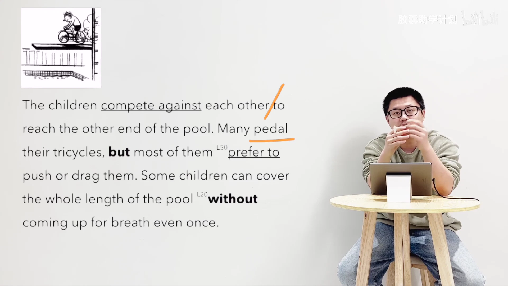

文字识别：The children compete against each other/to / reach the other end of the pool. Many pedal /  5prefer to / their tricycles, but most of them / push or drag them. Some children can cover / the whole length of the pool 2°without / coming up for breath even once.

## 00:13:30–00:14:00

汉语意思，汉语越好，英语学的越快，就是这个道理。我咋我也能猜出来，这个 paddle 应该指的是踩踏这个脚板，踩踏这个自行车，就骑这个三轮车。因为后边说的是 push or drag 嘛，对吧？但是宁愿 push or drag，大多数人的是骑，对吧？这个 paddle，并且我们之前也学过 brake paddle，刹车这个刹车这个踏板，对吧？那如果是自行车呢，就是踩刹车，对吧？那 paddle 呢，它是踏板的意思，

### 画面 00:13:49

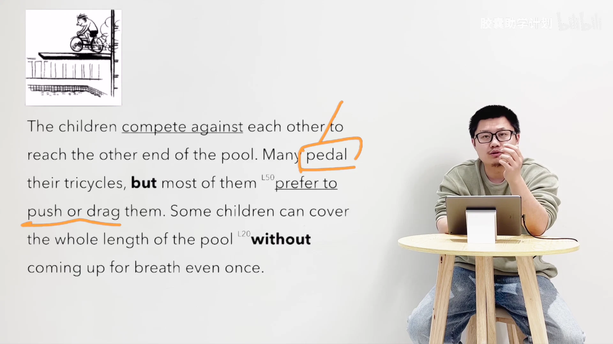

文字识别：The children compete against each otherto / reach the other end of the pool. Many pedal . / their tricycles, but most of them / L50 / preferto / push or drag them. Some children can cover / the whole length of the pool l2°without / coming up for breath even once.

## 00:14:00–00:14:30

对吧？那如果是汽车呢？就是这个踏踏板。自行车就脚蹬子嘛。呃，许多人蹬，那他脚蹬子它是名词，在这儿肯定是个动词。这句话当中缺动词，许多人踩蹬他们的自行车，但是他们当中大多数的孩子呢，更宁愿是推或者拉拽着这个自行车走，合理。 Some children can cover the whole length of the pool without coming up for breath even once. 所以有一些孩

### 画面 00:14:02

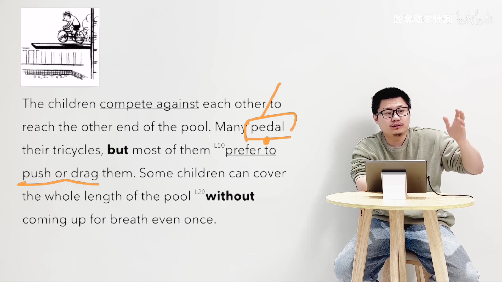

文字识别：The children compete against each otherto / reach the other end of the pool. Many pedal  /  5oprefer to / their tricycles, but most of them / push or drag them. Some children can cover / the whole length of the pool 2°without / coming up for breath even once.

### 画面 00:14:07

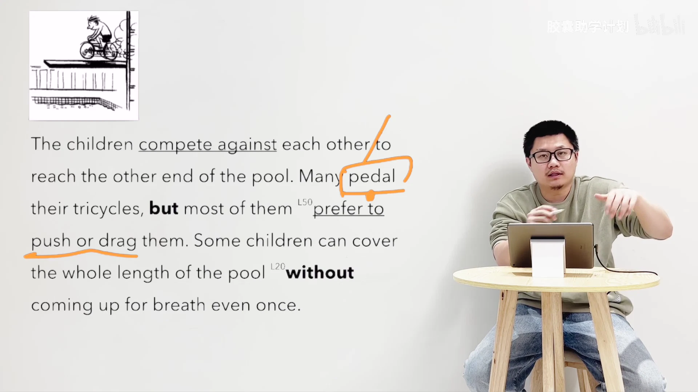

文字识别：The children compete against each other/to / reach the other end of the pool. Many pedal / their tricycles, but most of them / L50, / 'prefer to / push or drag them. Some children can cover / the whole length of the pool 2°without / coming up for breath even once.

### 画面 00:14:10

文字识别：V.V / The children compete against each other/to / reach the other end of the pool. Many pedal  / their tricycles, but most of them / L50prefer to / L50p / push or drag them. Some children can cover / the whole length of the pool 2°without / coming up for breath even once.

### 画面 00:14:12

文字识别：V.V / The children compete against each other/to / reach the other end of the pool. Many pedal /  5oprefer to / their tricycles, but most of them / push or drag them. Some children can cover / the whole length of the pool 2°without / coming up for breath even once.

### 画面 00:14:15

文字识别：V.V / The children compete against each other/to / reach the other end of the pool. Many pedal /  5prefer to / their tricycles, but most of them / push or drag them. Some children can cover / the whole length of the pool 2°without / coming up for breath even once.

### 画面 00:14:19

文字识别：V.V / The children compete against each other/to / reach the other end of the pool. Many pedal  /  15oprefer to / their tricycles, but most of them / push or drag them. Some children can cover / the whole length of the pool [2°without / coming up for breath even once.

### 画面 00:14:21

文字识别：V.V / The children compete against each otherto / reach the other end of the pool. Many pedal /  L50prefer to / their tricycles, but most of them / push or drag them. Some children can cover / the whole length of the pool l2°without / coming up for breath even once.

## 00:14:30–00:15:00

cover the whole length of the pole. The whole length of the pole,整个长度什么的整个长度呢？这个泳池的整个长度。然后这有一个cover，那就涉及到我们在很久很久之前，刚学新二的时候学过一课关于鸽子，对吧？说他买了两个garage，然后呢没办法get a telephone for his new garage，于是他养了一群鸽子。然后呢这个the bird can

### 画面 00:14:42

文字识别：V.V / The children compete against each otherto / reach the other end of the pool. Many pedal  /  L50prefer to / their tricycles, but most of them / push or drag them. Some children can cover / the whole length of the pool 2°without / coming up for breath even once.

### 画面 00:14:46

文字识别：V.V / The children compete against each other/to / reach the other end of the pool. Many pedal /  15oprefer to / their tricycles, but most of them / push or drag them. Some children can cover / the whole length of the pool 2°without / coming up for breath even once.

### 画面 00:14:52

文字识别：V.V / The children compete against each other/to / reach the other end of the pool. Many pedal  / their tricycles, but most of them / L50, / prefer to / push or drag them. Some children can cover / the whole length of the pool 2°without / coming up for breath even once.

## 00:15:00–00:15:30

cover the distance in only three minutes. 它可以跨越这段距离用三分钟。那你这个 cover the whole length of the pool 是不是就是有一些孩子能跨越整个这个泳池的长度？怎么样呢？ Without 二十课咱们学的，而不怎么怎么样，而不怎么样呢？ Coming up for breath. 这儿为什么用 coming？二十课动名词，对吧？而没有上来呼吸。 Even once, 哪怕一次啊，甚至哪怕一次，他都不用。

### 画面 00:15:12

文字识别：V.V / The children compete against each other/to / reach the other end of the pool. Many pedal /  15oprefer to / their tricycles, but most of them / push or drag them. Some children can cover / the whole length of the pool 2°without / coming up for breath even once.

## 00:15:30–00:16:00

就一口气儿从这边到那边就完事儿。Whether they will ever become future Olympic champions, only time will tell。这句话很有意思，我们先一个单词一个单词翻译一下啊，就是很多语法呀，我一直跟各位说，甚至其实你不会，甚至你没看出来，并不影响你读懂这句话。一个单词一单词翻译嘛，你看啊，是否他们将在任何时候成为未来的奥林匹克运动会冠

### 画面 00:15:31

文字识别：V.V / The children compete against each other/to / reach the other end of the pool. Many pedal  / their tricycles, but most of them / L50, / prefer to / push or drag them. Some children can cover / the whole length of the pool 2°without / coming up for breath even once.

### 画面 00:15:33

文字识别：Whether they will ever become future / Olympic champions, only time will tell. / Meanwhile, they should encourage those / among us (who cannot swim five yards / before they are gasping for air).

### 画面 00:15:40

文字识别：Whether they will ever become future / Olympic champions, only time will tell. / Meanwhile, they should encourage those / among us (who cannot swim five yards / before they are gasping for air).

### 画面 00:15:44

文字识别：Whether they will ever become future / Olympic champions, only time will tell. / Meanwhile, they should encourage those / among us (who cannot swim five yards / before they are gasping for air).

### 画面 00:15:46

文字识别：Whether they will ever become future / Olympic champions, only time will tell. / Meanwhile, they should encourage those / among us (who cannot swim five yards / before they are gasping for air).

## 00:16:00–00:16:30

军，只有时间将，只有时间会告诉我们，只有时间能告诉我们，就是我们必须得等。所以对于大多数人而言，你看到这句话从第一个单词读到最后一个单词，你如果我们不分析语法，你不会觉得有什么异样。为什么？因为含义已经通了，我明白你想说啥了。你无非就想告诉我说，他们将来是否能成为奥运会冠军，只有时间能告诉我们。汉译这样说，语序没有问题，对吧？但是你可能没注意到的是，汉语这样说的时候，汉语是个

### 画面 00:16:16

文字识别：Whether they will ever become future / Olympic champions, only time willtell. / Meanwhile, they should encourage those / among us (who cannot swim five yards / before they are gasping for air).

## 00:16:30–00:17:00

个倒装，因为你这样去说的时候，你过于的习惯了，以至于其实根本你就没有注意到说哦，汉语在这倒装了。但如果你去分析英文语法呢，哪怕它的语式完全一样，你一分析你就发现它倒装了。为什么呢？它其实是把 whether they will ever become future champions 这句话本来应该在 tell 的后边，就是这句话应该说成 only time will tell whether they will 布拉布拉布拉一直到句尾，对吧？然后它放到最前面去了，哎，其实

### 画面 00:16:30

文字识别：Whether they will ever become future / Olympic champions, only time will tell. / Meanwhile, they should encourage those / among us (who cannot swim five yards / before they are gasping for air).

### 画面 00:16:46

文字识别：Whether they will ever become future / Olympic champions, only time will tell. / Meanwhile, they should encourage those / among us (who cannot swim five yards / before they are gasping for air).

### 画面 00:16:48

文字识别：Whether they will ever become future / Olympic champions, only time will tell. / Meanwhile, they should encourage those / among us (who cannot swim five yards / before they are gasping for air).

### 画面 00:16:51

文字识别：Whether they will ever become futuy / Olympic champions, only time will tell. / Meanwhile, they should encourage those / among us (who cannot swim five yards / before they are gasping for air).

### 画面 00:16:53

文字识别：Whether they will ever become futuy / Olympic champions, only time will tell. / Meanwhile, they should encourage those / among us (who cannot swim five yards / before they are gasping for air).

### 画面 00:16:56

文字识别：Whether they will ever become futuy / Olympic champions, only time will tell. / Meanwhile, they should encourage those / among us (who cannot swim five yards / before they are gasping for air).

## 00:17:00–00:17:30

就是宾语从句整个半句提到最前面，他强调了一下，这个就是我们说的例外。呃，我我的个人建议是，反正我到今天我也不会这样去用，因为它的风险比较的高。你用了算不算错呢？不知道，我只能这么跟你说，尤其是应试考试啊，你用了算不算错？不知道，不能完全确定，对吧？就是判卷老师硬说你错呢，你也你也没有办法说，对吧？比如说我们考个四六级，对吧？考个研，所以我的个人建

### 画面 00:17:26

文字识别：Whether they will ever become futuy / Olympic champions, only time will tell. / Meanwhile, they should encourage those / among us (who cannot swim five yards / before they are gasping for air).

## 00:17:30–00:18:00

议呢，就是别冒险。我们按规则来，对吧？我们按章程来，你就把它写成 Only time will tell whether they will blah blah，一直到句尾，好吧？但是这样的句子看到呢，我们要明白说，嗯，我能欣赏，我懂它是对的，它不是错的，对吧？它是个例外。Meanwhile，与此同时，they should encourage those among us who cannot swim five yards before they're gasping for air. Meanwhile，与此同时，in the meantime，他们应该可

### 画面 00:17:56

文字识别：Whether they will ever become futuy / Olympic champions, only time will tell. / Meanwhile, they should encourage those / among us (who cannot swim five yards / before they are gasping for air).

## 00:18:00–00:18:30

of us in the middle. Read to here, this place is over. Then I will ask you a question. It is those of us in the middle, right? He actually this place is translated from the back to the front. They should encourage those of us in the middle. Then I want to ask you a question. If you only say this sentence, what do you want to ask me? What you want to ask me is those people are those people, isn't it? Such a thing. We look at the back. Who cannot swim five years? Say they have no way to swim five miles before. Before what?

### 画面 00:18:26

文字识别：Whether they will ever become futuy / Olympic champions, only time will tell. / Meanwhile, they should encourage those / among us (who cannot swim five yards / before they are gasping for air).

## 00:18:30–00:19:00

before在什么之前呢？ They are gasping for air.他们换气喘气，对吧？上来换气，gasping for air，对吧？喘气啊，在他们喘气之前，他们连五码都游不到。也就是说，基本换一句话来说，就是他们游不到五码就需要上来喘气了。这样一批人，所以各位能注意到一个小的细节，就是 among us这两个单词是说 those的，整个定语从句还是说 those的。那英文它就有一

### 画面 00:18:52

文字识别：Whether they will ever become futuy / Olympic champions, only time will tell. / Meanwhile, they should encourage those / among us who cannot swim five yards / before they are gasping for air).

### 画面 00:18:54

文字识别：Whether they will ever become futuy / Olympic / champions, only time will tell. / Meanwhile, they should encourage those / among us who cannot swim five yards / before they are gasping for air).

### 画面 00:18:57

文字识别：Whether they will ever become futuy / Olympic / champions, only time will tell. / Meanwhile, they sheuld encourage those- / among us who cannot swim five yards / before they are gasping for air)

## 00:19:00–00:19:30

个小的习惯，就是我们之前说定语从句要紧跟着被修饰的词，对吧？在这儿它明明就没有紧紧跟着，这是不是说打脸了呢？没有，哎，这就是一个例外，对吧？我们大多数时候要紧紧跟着，像这种情况，如果你紧紧跟着，导致的结果就是 among us 这两个单词被放到最后面去了，明显不符合人类语言习惯。为什么？你要说非让我分析，那我给你分析一下，就是我看完这两个单词，这两个单词是第一个语言片段，后边定语从

### 画面 00:19:14

文字识别：Whether they will ever become futuy / Olympic / champions, only time will tell. / Meanwhile, they should encourage t / those / who cannot swim five yards / among us / before they are gasping for air)

### 画面 00:19:16

文字识别：Whether they will ever become futu/ / Olympic / champions, only time will tell. / Meanwhile, they should encourage those / who cannot swim five yards / among us / before they are gasping for air)

### 画面 00:19:18

文字识别：Whether they will ever become futuy / Olympic / champions, only time will tell. / Meanwhile, they should encourage / those / who cannot swim five yards / among us / before they are gasping for air)

### 画面 00:19:28

文字识别：Whether they will ever become / futu / Olympic / champions, only time will tell. / Meanhile they shoule encouage / those / among us / who / cannot swim / five yards / before they are gasping for air)

## 00:19:30–00:20:00

句是第二个语言片段，那我就问你一个问题，这句话问题可能有点绕，但是你听懂了，你就明白为什么要这样处理，是一先放一再放二，而不是先放二后放一了，是这样而不是这样了。我问你啊，我把一放在这个地方，二放在这个地方，对于我来说，我二读完了，一顺便再扫一遍就可以了，对吧？顺便再扫一遍就可以了，我去遗忘

### 画面 00:19:30

文字识别：Whether t /  they will / ever become / futu / Olympic / champions, only / time / will tell. / Mearhile, they shouled encouage / those / among us / who / cann / swim / five yards / before they are gaspng for  / air

### 画面 00:19:41

文字识别：Whether they will / ever become / futu / Olympic / champions, only / time / will tell. / Mearnhile, they shoule encuage / those / among us / who / cann / swim / five yards / before they are gaspng for  / air

### 画面 00:19:43

文字识别：【 / Whether they wille /  ever become / futu / Olympic / champions, only time / e will tell. / MeanWhile, they should encouage / those / among us / who / cann / swim / five yards / before they are gas png for a / air

### 画面 00:19:52

文字识别：V / ① / X / Whether they will ever become futu/ / Olympic / champions, only time will tell. / Mearhile, they shoule enceuage t / those / among us / Nho / cann / swim five yards / before they are gasng for air

## 00:20:00–00:20:30

掉它的概率是低的，但如果你让我把二读完，我再去看一，我就不知道你这个一首先没法判断它是跟谁连到一起的了。就是从语言的这个呃逻辑上，我的一个合理推测啊。所以那如果我们从一个更呃定性的角度来说，就英语就这习惯，就是如果你这有一个小段，就比如说修饰同一个词，哎，一般来说短的放前面，长的放后边，这样对于人来说读

### 画面 00:20:03

文字识别：し / ① / X / Whether they will ever become futu/ / Olympic / champions, only time will tell. / MeanWhile, they shouled encouage / those / among us / vho / cann / swim five yards / before they are gasSng for a / ain

### 画面 00:20:07

文字识别：V / ① / X / Whether they will ever become futu/ / Olympic / champions, only time will tell. / MgenWhile, they shoule encouaget / those / among us / Vho / cann / swim five yards / before they are gaspng for ain

### 画面 00:20:24

文字识别：し / ① / X / Whether they will ever become futu/ / Olympic / champions, only time will tell. / MganWhile, they shoule encuagethose / among us / vho / cann / swim five yards / before they are gas png for a / air

### 画面 00:20:28

文字识别：① / X / Whether they will ever become futu/ / Olympic / champions, only time will tell / MgenWhile, they shoule encouagethose / vho / swim five yards / among us / cann / before they are gaspng for a / air

## 00:20:30–00:21:00

起来更舒服，就这么简单，好吧？习惯用法造句，如下这些，咱们挨个来。第一个句子，比如说，tests have proved that the system works。实验证明了这个系统是成的，没有问题的，这个是这个系统是可以工作的。Next one, he proved that he was right, and we were moving in a circle. 他证明了他是对的，然后咱们在转圈圈。最后一个，

### 画面 00:20:32

文字识别：习惯用法造句 / sb./sth. proved that +句子 / hold sb's breath / be accustomed to doing / be popular with.. / be lined up

### 画面 00:20:34

文字识别：习惯用法造句 / sb./sth. proved that +句子 / hold sb's breath / be accustomed to doing / be popular with.. / be lined up

### 画面 00:20:36

文字识别：网：v.+v.变化 / 习惯用法造句指南 / 囊助学计划 / 四句型转换 / 方式/地点/时间 / 其他习惯用法 / 其他单词+词性 / 原文摘抄+变 / 6123456 / sb./sth. proved that + 句子

### 画面 00:20:38

文字识别：网：v.+v.变化 / 习惯用法造句指南 / 囊助学计划 / 四句型转换 / 方式/地点/时间 / 其他习惯用法 / 其他单词+词性 / 原文摘抄+变 / 6123456 / sb./sth. proved that + 句子 /  Tests have proved that the system works.

### 画面 00:20:40

文字识别：网：v.+v.变化 / 习惯用法造句指南 / 四句型转换 / 方式/地点/时间 / 其他习惯用法 / 其他单词+词性 / 原文摘抄+变 / 6123456 / sb./sth. proved that + 句子 /  Tests have proved that the system works.

### 画面 00:20:42

文字识别：网：v.+v.变化 / 习惯用法造句指南 / 学计划 / 四句型转换 / 方式/地点/时间 / 其他习惯用法 / 其他单词+词性 / 原文摘抄+变 / 6123456 / sb./sth. proved that + 句子 /  Tests have proved that the system works.

### 画面 00:20:44

文字识别：网：v.+v.变化 / 习惯用法造句指南 / 辜助字计划 / 四句型转换 / 方式/地点/时间 / 其他习惯用法 / 其他单词+词性 / 原文摘抄+变 / 6123456 / sb./sth. proved that + 句子 /  Tests have proved that the system works.

### 画面 00:20:46

文字识别：网：v.+v.变化 / 习惯用法造句指南 / 四句型转换 / 方式/地点/时间 / 其他习惯用法 / 其他单词+词性 / 原文摘抄+变 / 6123456 / sb./sth. proved that + 句子 /  Tests have proved that the system works.

### 画面 00:20:50

文字识别：网：v.+v.变化 / 习惯用法造句指南 / 妻助学计划 / 四句型转换 / 方式/地点/时间 / 其他习惯用法 / 其他单词+词性 / 原文摘抄+变 / 6123456 / sb./sth. proved that + 句子 /  Tests have proved that the system works. /  He proved that he was right and we were / moving in a circle. L86

### 画面 00:20:52

文字识别：网：v.+v.变化 / 习惯用法造句指南 / 辜助学计划 / 四句型转换 / 方式/地点/时间 / 其他习惯用法 / 其他单词+词性 / 原文摘抄+变 / 6123456 / sb./sth. proved that + 句子 /  Tests have proved that the system works. /  He proved that he was right and we were / moving in a circle. L86

### 画面 00:20:55

文字识别：网：v.+v.变化 / 习惯用法造句指南 / 囊助学计划 / 四句型转换 / 方式/地点/时间 / 其他习惯用法 / 其他单词+词性 / 原文摘抄+变 / 6123456 / sb./sth. proved that + 句子 /  Tests have proved that the system works. /  He proved that he was right and we were / moving in a circle. L86

### 画面 00:20:58

文字识别：网：v.+v.变化 / 习惯用法造句指南 / 喜助学计划 / 四句型转换 / 方式/地点/时间 / 其他习惯用法 / 其他单词+词性 / 原文摘抄+变 / 6123456 / sb./sth. proved that + 句子 /  Tests have proved that the system works. /  He proved that he was right and we were / moving in a circle. L86 /  You've proved that you have a perfect / alibi. L87

## 00:21:00–00:21:30

you've proved that you have a perfect alibi.说你证明了怎么样呢？你有一个绝佳的、完美的不在犯罪现场证明啊，perfect alibi。注意力集中，咱听个电影片段。But today you prove that all you really care about is our family's happiness.下一个, hold somebody's breath,屏住呼吸嘛。When you swim, remember not to hold

### 画面 00:21:00

文字识别：网：v.+v.变化 / 习惯用法造句指南 / 臺助学计划 / 四句型转换 / 方式/地点/时间 / 其他习惯用法 / 其他单词+词性 / 原文摘抄+变 / 6123456 / sb./sth. proved that + 句子 /  Tests have proved that the system works. /  He proved that he was right and we were / moving in a circle. L86 /  You've proved that you have a perfect / alibi. L87

### 画面 00:21:05

文字识别：网：v.+v.变化 / 习惯用法造句指南 / 奏助学计划 / 四句型转换 / 方式/地点/时间 / 其他习惯用法 / 其他单词+词性 / 原文摘抄+变 / 6123456 / sb./sth. proved that + 句子 /  Tests have proved that the system works. /  He proved that he was right and we were / moving in a circle. L86 /  You've proved that you have a perfect / alibi. L87

### 画面 00:21:10

文字识别：网：v.+v.变化 / 习惯用法造句指南 / 奏助学计划 / 四句型转换 / 方式/地点/时间 / 其他习惯用法 / 其他单词+词性 / 原文摘抄+变 / 6123456 / sb./sth. proved that + 句子 /  Tests have proved that the system works. /  He proved that he was right and we were / moving in a circle. L86 /  You've proved that you have a perfect / alibi. L87

### 画面 00:21:12

文字识别：But today you proved that / all you really care about / is our family's happiness. / Daddy's Home / (2015)

### 画面 00:21:17

文字识别：But today you proved that / all you really care about / is our family's happiness. / Daddy's Home / (2015)

### 画面 00:21:19

文字识别：But today you proved that / all you really care about / is our family's happiness. / Daddy's Home / (2015)

### 画面 00:21:21

文字识别：网：v.+v.变化 / 习惯用法造句指南 / 囊助学计划 / 四句型转换 / 方式/地点/时间 / 其他习惯用法 / 其他单词+词性 / 原文摘抄+变 / 6123456 / hold sb's breath

### 画面 00:21:24

文字识别：网：v.+v.变化 / 习惯用法造句指南 / 囊助学计划 / 四句型转换 / 方式/地点/时间 / 其他习惯用法 / 其他单词+词性 / 原文摘抄+变 / 6123456 / hold sb's breath

### 画面 00:21:26

文字识别：网：v.+v.变化 / 习惯用法造句指南 / 喜助字计划 / 四句型转换 / 方式/地点/时间 / 其他习惯用法 / 其他单词+词性 / 原文摘抄+变 / 6123456 / hold sb's breath /  When you swim, remember not to hold / your breath.

## 00:21:30–00:22:00

your breath. So,当你游泳的时候，记住不要屏住呼吸啊. Do not hold your breath. Next one. How long can you hold your breath? So,你能屏住呼吸多长时间呢? Next one. If you want to pass the test, just don't hold your breath. So,如果你想通过这个测试，就记住怎么样，不要屏住呼吸就好了. Okay. Next one. Be accustomed to doing something.习惯于做某事儿啊.比如

### 画面 00:21:30

文字识别：网：v.+v.变化 / 习惯用法造句指南 / 四句型转换 / 方式/地点/时间 / 其他习惯用法 / 其他单词+词性 / 原文摘抄+变 / 6123456 / hold sb's breath /  When you swim, remember not to hold / your breath.

### 画面 00:21:37

文字识别：网：v.+v.变化 / 习惯用法造句指南 / 四句型转换 / 方式/地点/时间 / 其他习惯用法 / 其他单词+词性 / 原文摘抄+变 / 6123456 / hold sb's breath /  When you swim, remember not to hold / your breath. / How long can you hold your breath?

### 画面 00:21:40

文字识别：网：v.+v.变化 / 习惯用法造句指南 / 学诗物 / 四句型转换 / 方式/地点/时间 / 其他习惯用法 / 其他单词+词性 / 原文摘抄+变 / 6123456 / hold sb's breath /  When you swim, remember not to hold / your breath. /  How long can you hold your breath?

### 画面 00:21:44

文字识别：网：v.+v.变化 / 习惯用法造句指南 / 四句型转换 / 方式/地点/时间 / 其他习惯用法 / 其他单词+词性 / 原文摘抄+变 / 6123456 / hold sb's breath /  When you swim, remember not to hold / your breath. /  How long can you hold your breath? /  If you wanna pass the test, just don't hold / your breath. L84

### 画面 00:21:46

文字识别：网：v.+v.变化 / 习惯用法造句指南 / 四句型转换 / 方式/地点/时间 / 其他习惯用法 / 其他单词+词性 / 原文摘抄+变 / 6123456 / hold sb's breath /  When you swim, remember not to hold / your breath. /  How long can you hold your breath? /  If you wanna pass the test, just don't hold / your breath. L84

### 画面 00:21:50

文字识别：网：v.+v.变化 / 习惯用法造句指南 / 奏助学计划 / 四句型转换 / 方式/地点/时间 / 其他习惯用法 / 其他单词+词性 / 原文摘抄+变 / 6123456 / hold sb's breath /  When you swim, remember not to hold / your breath. /  How long can you hold your breath? /  If you wanna pass the test, just don't hold / your breath. L84

### 画面 00:21:54

文字识别：网：v.+v.变化 / 习惯用法造句指南 / 喜助学计划 / 四句型转换 / 方式/地点/时间 / 其他习惯用法 / 其他单词+词性 / 原文摘抄+变 / 6123456 / hold sb's breath /  When you swim, remember not to hold / your breath. /  How long can you hold your breath? /  If you wanna pass the test, just don't hold / your breath. L84

### 画面 00:21:56

文字识别：网：v.+v.变化 / 习惯用法造句指南 / 四句型转换 / 方式/地点/时间 / 其他习惯用法 / 其他单词+词性 / 原文摘抄+变 / 6123456 / be accustomed to doing

### 画面 00:21:59

文字识别：网：v.+v.变化 / 习惯用法造句指南 / 学计材 / 四句型转换 / 方式/地点/时间 / 其他习惯用法 / 其他单词+词性 / 原文摘抄+变 / 6123456 / be accustomed to doing /  He was accustomed to getting up early.

## 00:22:00–00:22:30

说 he was accustomed to getting up early. Repeat after me. I'm not accustomed to drinking alcohol. Alcohol 就酒，酒精啊，含酒精的饮料啊，一般指的是软饮、硬饮都可以. I'm accustomed to changing into uniform before work. 工作前哎，换成制服这事儿我很习惯了. Be accustomed to doing something. Next one, be popular

### 画面 00:22:04

文字识别：网：v.+v.变化 / 习惯用法造句指南 / 四句型转换 / 方式/地点/时间 / 其他习惯用法 / 其他单词+词性 / 原文摘抄+变 / 6123456 / be accustomed to doing /  He was accustomed to getting up early. / I'm not accustomed to drinking alcohol.

### 画面 00:22:06

文字识别：网：v.+v.变化 / 习惯用法造句指南 / 四句型转换 / 方式/地点/时间 / 其他习惯用法 / 其他单词+词性 / 原文摘抄+变 / 6123456 / be accustomed to doing /  He was accustomed to getting up early. / I'm not accustomed to drinking alcohol.

### 画面 00:22:10

文字识别：网：v.+v.变化 / 习惯用法造句指南 / 四句型转换 / 方式/地点/时间 / 其他习惯用法 / 其他单词+词性 / 原文摘抄+变 / 6123456 / be accustomed to doing /  He was accustomed to getting up early. / I'm not accustomed to drinking alcohol. / I'm accustomed to changing into uniform / before work. L81

### 画面 00:22:15

文字识别：网：v.+v.变化 / 习惯用法造句指南 / 四句型转换 / 方式/地点/时间 / 其他习惯用法 / 其他单词+词性 / 原文摘抄+变 / 6123456 / be accustomed to doing /  He was accustomed to getting up early. / I'm not accustomed to drinking alcohol. / I'm accustomed to changing into uniform / before work. L81

### 画面 00:22:21

文字识别：网：v.+v.变化 / 习惯用法造句指南 / 秦助学计划 / 四句型转换 / 方式/地点/时间 / 其他习惯用法 / 其他单词+词性 / 原文摘抄+变 / 6123456 / be accustomed to doing /  He was accustomed to getting up early. / I'm not accustomed to drinking alcohol. / I'm accustomed to changing into uniform / before work. L81

### 画面 00:22:25

文字识别：网：v.+v.变化 / 习惯用法造句指南 / 四句型转换 / 方式/地点/时间 / 其他习惯用法 / 其他单词+词性 / 原文摘抄+变 / 6123456 / be accustomed to doing /  He was accustomed to getting up early. / I'm not accustomed to drinking alcohol. / I'm accustomed to changing into uniform / before work. L81

### 画面 00:22:27

文字识别：网：v.+v.变化 / 习惯用法造句指南 / 妻助学计划 / 四句型转换 / 方式/地点/时间 / 其他习惯用法 / 其他单词+词性 / 原文摘抄+变 / 6123456 / be popular with...

### 画面 00:22:29

文字识别：网：v.+v.变化 / 习惯用法造句指南 / 毒助学计划 / 四句型转换 / 方式/地点/时间 / 其他习惯用法 / 其他单词+词性 / 原文摘抄+变 / 6123456 / be popular with...

## 00:22:30–00:23:00

This dance is popular with young people.说这个舞蹈实际上是怎么样呢？和在年轻人当中很受欢迎，很流行。He is very popular with girls.他在姑娘当中很流行，很受欢迎，对吧？二选其一嘛，你自己由上下文单词去决定怎么翻译。The idea wasn't very popular with anybody at that time.

### 画面 00:22:31

文字识别：网：v.+v.变化 / 习惯用法造句指南 / 囊助字计划 / 四句型转换 / 方式/地点/时间 / 其他习惯用法 / 其他单词+词性 / 原文摘抄+变 / 6123456 / be popular with... /  This dance is popular with young people.

### 画面 00:22:33

文字识别：网：v.+v.变化 / 习惯用法造句指南 / 囊助学计划 / 四句型转换 / 方式/地点/时间 / 其他习惯用法 / 其他单词+词性 / 原文摘抄+变 / 6123456 / be popular with... /  This dance is popular with young people.

### 画面 00:22:35

文字识别：网：v.+v.变化 / 习惯用法造句指南 / 妻助字计划 / 四句型转换 / 方式/地点/时间 / 其他习惯用法 / 其他单词+词性 / 原文摘抄+变 / 6123456 / be popular with... /  This dance is popular with young people.

### 画面 00:22:40

文字识别：网：v.+v.变化 / 习惯用法造句指南 / 喜助子计划 / 四句型转换 / 方式/地点/时间 / 其他习惯用法 / 其他单词+词性 / 原文摘抄+变 / 6123456 / be popular with... /  This dance is popular with young people.

### 画面 00:22:43

文字识别：网：v.+v.变化 / 习惯用法造句指南 / 囊助学计划 / 四句型转换 / 方式/地点/时间 / 其他习惯用法 / 其他单词+词性 / 原文摘抄+变 / 6123456 / be popular with... /  This dance is popular with young people.

### 画面 00:22:45

文字识别：网：v.+v.变化 / 习惯用法造句指南 / 辜助字计划 / 四句型转换 / 方式/地点/时间 / 其他习惯用法 / 其他单词+词性 / 原文摘抄+变 / 6123456 / be popular with... /  This dance is popular with young people. /  He's very popular with girls.

### 画面 00:22:50

文字识别：网：v.+v.变化 / 习惯用法造句指南 / 秦助学计划 / 四句型转换 / 方式/地点/时间 / 其他习惯用法 / 其他单词+词性 / 原文摘抄+变 / 6123456 / be popular with... /  This dance is popular with young people. /  He's very popular with girls.

### 画面 00:22:55

文字识别：网：v.+v.变化 / 习惯用法造句指南 / 喜助字计划 / 四句型转换 / 方式/地点/时间 / 其他习惯用法 / 其他单词+词性 / 原文摘抄+变 / 6123456 / be popular with... /  This dance is popular with young people. /  He's very popular with girls. /  The idea wasn't very popular with / anybody at that time.

## 00:23:00–00:23:30

在那个时候，他这个想法和任就是他这个想法不受任何人的欢迎，对吧？那注意力集中，咱听个电影片段。Not too popular with your family, you know. Okay, be lined up,排成一排。我们造个句子，比如说Why are people lined up?人们为什么要排成一排呢？They were lined up in front of the house.他们在什么？他们被

### 画面 00:23:00

文字识别：网：v.+v.变化 / 习惯用法造句指南 / 臺助学计划 / 四句型转换 / 方式/地点/时间 / 其他习惯用法 / 其他单词+词性 / 原文摘抄+变 / 6123456 / be popular with... /  This dance is popular with young people. /  He's very popular with girls. /  The idea wasn't very popular with / anybody at that time.

### 画面 00:23:06

文字识别：I'm not too popular with your family you know. / BNSRONSRORSRONSRS / Undeserved / (2016)

### 画面 00:23:11

文字识别：I'm not too popular with your family you know. / Undeserved / (2016)

### 画面 00:23:13

文字识别：I'm not too popular with your family you know. / Undeserved / (2016)

### 画面 00:23:15

文字识别：网：v.+v.变化 / 习惯用法造句指南 / 霆助学计划 / 四句型转换 / 方式/地点/时间 / 其他习惯用法 / 其他单词+词性 / 原文摘抄+变 / 6123456 / be lined up

### 画面 00:23:19

文字识别：网：v.+v.变化 / 习惯用法造句指南 / 妻助学计划 / 四句型转换 / 方式/地点/时间 / 其他习惯用法 / 其他单词+词性 / 原文摘抄+变 / 6123456 / be lined up /  Why are people lined up?

### 画面 00:23:21

文字识别：网：v.+v.变化 / 习惯用法造句指南 / 四句型转换 / 方式/地点/时间 / 其他习惯用法 / 其他单词+词性 / 原文摘抄+变 / 6123456 / be lined up /  Why are people lined up?

### 画面 00:23:23

文字识别：网：v.+v.变化 / 习惯用法造句指南 / 四句型转换 / 方式/地点/时间 / 其他习惯用法 / 其他单词+词性 / 原文摘抄+变 / 6123456 / be lined up /  Why are people lined up? /  They were lined up in front of the house.

### 画面 00:23:25

文字识别：网：v.+v.变化 / 习惯用法造句指南 / 四句型转换 / 方式/地点/时间 / 其他习惯用法 / 其他单词+词性 / 原文摘抄+变 / 6123456 / be lined up /  Why are people lined up? /  They were lined up in front of the house.

### 画面 00:23:28

文字识别：网：v.+v.变化 / 习惯用法造句指南 / 四句型转换 / 方式/地点/时间 / 其他习惯用法 / 其他单词+词性 / 原文摘抄+变 / 6123456 / be lined up /  Why are people lined up? /  They were lined up in front of the house.

## 00:23:30–00:24:00

排成了一排，在这个房子的前面。Next one，四句型转换。哎，那 recap 本课除了文章习惯用法，对吧？然后呢，习惯用法造句，文章咱要熟读成诵。我在这儿多解释一下，就是文章熟读成诵的原因，至少有两个。第一个是帮助我们把本课的单词、语法和习惯用法内化。内化的，你就是你，你造句是搞明白它变熟练，然后通过一，比如说这个熟练度可能是从零到十，通过一遍

### 画面 00:23:31

文字识别：网：v.+v.变化 / 习惯用法造句指南 / 喜助字计划 / 四句型转换 / 方式/地点/时间 / 其他习惯用法 / 其他单词+词性 / 原文摘抄+变 / 6123456 / be lined up /  Why are people lined up? /  They were lined up in front of the house.

### 画面 00:23:33

文字识别：网：v.+v.变化 / 习惯用法造句指南 / 四句型转换 / 方式/地点/时间 / 其他习惯用法 / 其他单词+词性 / 原文摘抄+变 / 6123456 / be lined up /  Why are people lined up? /  They were lined up in front of the house. /  were/who/why/where ...

### 画面 00:23:35

文字识别：Recap / sb./sth. proved that +句子 / hold sb's breath / Expression / be accustomed to doing / bel / lined up / be popular with..

### 画面 00:23:37

文字识别：Recap / sb./sth. proved that +句子 / hold sb's breath / Expression / be accustomed to doing / be / lined up / be popular with..

### 画面 00:23:39

文字识别：1. / 习惯用法造句/对话 / 【习惯用法造句指南】 / 每个5句

### 画面 00:23:41

文字识别：1. / 习惯用法造句/对话 / 【习惯用法造句指南】 / 每个5句 / 文章跟读至熟读成诵 / 内化单词+语法+习惯用法 / 听力+口语+写作练习

### 画面 00:23:45

文字识别：习惯用法造句/对话 / 1. / 【习惯用法造句指南】 / 每个5句 / 文章跟读至熟读成诵 / 内化单词+语法+习惯用法 / 听力+口语+写作练习

### 画面 00:23:54

文字识别：1. / 习惯用法造句/对话 / 【习惯用法造句指南】 / 每个5句 / 文章跟读至熟读成诵 / 内化单词+语法+习惯用法 / 听力+口语+写作练习

### 画面 00:23:56

文字识别：习惯用法造句/对话 / 1. / 【习惯用法造句指南】 / 每个5句 / 文章跟读至熟读成诵 / 内化单词+语法+习惯用法 / 听力+口语+写作练习

## 00:24:00–00:24:30

一遍跟读起到的作用是把熟练度从十提升到九十或者八十，对吧？然后呢，当然我们接下来的各种练习需要逆速度成诵。然后呢，老习惯置顶留言去找重复间隔的学习材料。那以上呢就是本期视频的全部内容了。如果喜欢我们的课程呢，欢迎各位关注、订阅、一键三连，分享给那些需要的朋友，来帮助我们快速成长。See you next time.

### 画面 00:24:00

文字识别：1. / 习惯用法造句/对话 / 【习惯用法造句指南】 / 每个5句 / 文章跟读至熟读成诵 / 内化单词+语法+习惯用法 / 听力+口语+写作练习

### 画面 00:24:07

文字识别：1. / 习惯用法造句/对话 / 【习惯用法造句指南】 / 每个5句 / 文章跟读至熟读成诵 / 内化单词+语法+习惯用法 / 听力+口语+写作练习

### 画面 00:24:09

文字识别：1. / 习惯用法造句/对话 / 【习惯用法造句指南】 / 每个5句 / 文章跟读至熟读成诵 / 内化单词+语法+习惯用法 / 听力+口语+写作练习 / 3. / 重复间隔（置顶留言）

### 画面 00:24:11

文字识别：1. / 习惯用法造句/对话 / 【习惯用法造句指南】 / 每个5句 / 文章跟读至熟读成诵 / 内化单词+语法+习惯用法 / 听力+口语+写作练习 / 3. / 重复间隔（置顶留言）

### 画面 00:24:14

文字识别：寶助学计划调 / 👍

### 画面 00:24:17

文字识别：奏助学计划州 / 不

### 画面 00:24:19

文字识别：泰助学计划 / 不 / ￥

### 画面 00:24:24

文字识别：美助学计划一洲

### 画面 00:24:27

文字识别：毫助字计划一 / K

### 画面 00:24:29

文字识别：CAPSULEACADEMY / 胶囊助学计划 / 『 / 小红书 / Lecturer / Leo / OG

## 00:24:30–00:24:40

### 画面 00:24:31

文字识别：CAPSULEACADEMY / 胶囊助学计划 / 小红书 / Photographer / □ / Berlin / OE

### 画面 00:24:33

文字识别：CAPSULEACADEMY / 胶囊助学计划 / 『 / 小红书 / Editor / □ / Berlin / OE

### 画面 00:24:36

文字识别：CAPSULEACADEMY / 胶囊助学计划 / 『 / 小红书 / Creator / Leo & Berlin / OE

### 画面 00:24:38

文字识别：bilbili / 胶囊助学计划

### 画面 00:24:39

文字识别：bilbili / 胶囊助学计划

