# 095 单词

快速机器解析：语音为单模型转写，未进行独立交叉校对或人工复核；画面每秒采样并按变化选帧，短时文字和标记可能遗漏。截图时间约有 1 秒误差。图片有损压缩；遇到疑点请按时间查看 Google Drive 原视频。

## 00:00:00–00:00:30

Hello everyone, welcome to Capsule Academy. This is Leo. Today we're going to learn New Concept English Book Two Lesson Ninety Five Words. Old习惯进入正式课程之前，咱们看几个问题：如何表达活在幻想当中？接下来如何表达？我的天哪！最后一个问题如何表达开火？啊！带着这三个问题，Hope you guys enjoy. We, look at the first word, called

### 画面 00:00:00

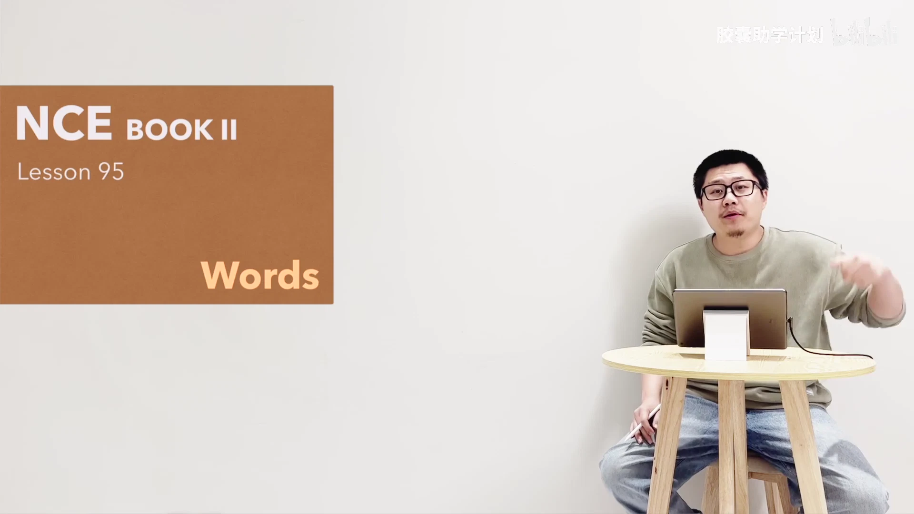

文字识别：交囊助学计划 / NCE / BOOK"I / Lesson 95 / Words

### 画面 00:00:02

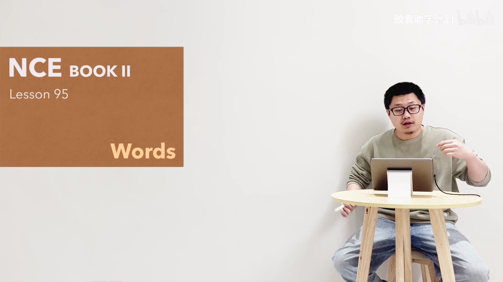

文字识别：交囊助字计划 / NCE / BOOKⅡI / Lesson 95 / Words

### 画面 00:00:09

文字识别：交囊助学计划

### 画面 00:00:11

文字识别：交囊助学计划卿 / ①如何表达“活在幻想中”？

### 画面 00:00:14

文字识别：囊助学计划州 / ①如何表达“活在幻想中”？ / 内”?

### 画面 00:00:16

文字识别：囊助字计划国 / ①如何表达“活在幻想中” / ”7 / 如何表达“天呐”?

### 画面 00:00:18

文字识别：交囊助学计划一州 / ①如何表达“活在幻想中” / 如何表达“天呐”？ / 如何表达“开火”?

### 画面 00:00:23

文字识别：胶囊助学计划i出 / •

### 画面 00:00:27

### 画面 00:00:29

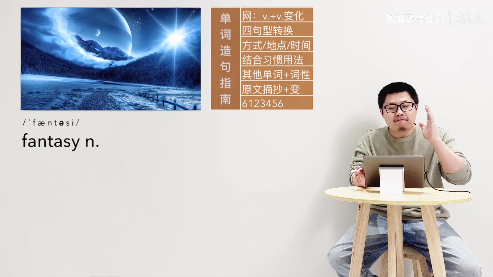

文字识别：单词造句指南 / 网：v.+v.变化 / 毒助学计划 / 四句型转换 / 方式/地点/时间 / 结合习惯用法 / 其他单词+词性 / 原文摘抄+变 / 6123456 / / 'fæentasi/ / fantasy n.

## 00:00:30–00:01:00

Fantasy就是你的幻想，对吧？你的各种各样的幻想。比如说，说 Steve's favorite fantasy was to own a big house and a splendid car. 说 Steve这个人呢，啊， fantasy也有白日做梦啊，白日梦的感觉，对吧？他的这个最喜欢的这个幻想和白日梦是什么呢？拥有个大房子啊，大 house 啊，再来一个巨棒的车。 Next one，有这么个短语

### 画面 00:00:31

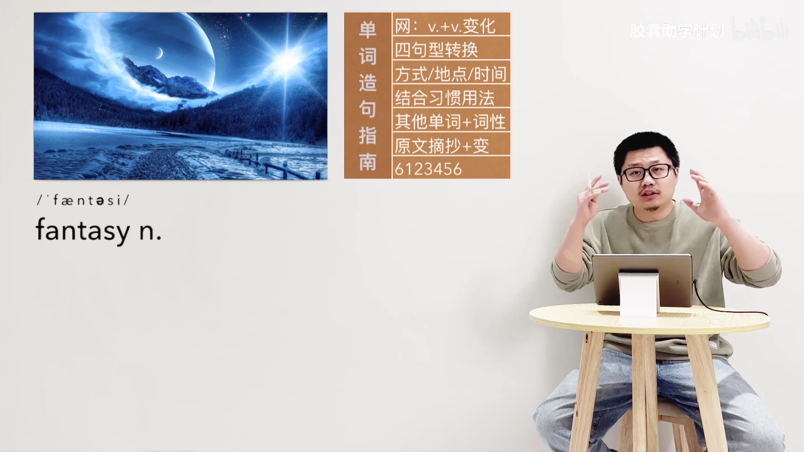

文字识别：单词造句指南 / 网：v.+v.变化 / 交囊助学计划 / 四句型转换 / 方式/地点/时间 / 结合习惯用法 / 其他单词+词性 / 原文摘抄+变 / 6123456 / / 'fæentasi/ / fantasy n.

### 画面 00:00:34

文字识别：单词造句指南 / 网：v.+v.变化 / 囊助学计划州 / 四句型转换 / 方式/地点/时间 / 结合习惯用法 / 其他单词+词性 / 原文摘抄+变 / 6123456 / / 'fæntasi/ / fantasy n. / ① Steve's favorite fantasy was to own a big / house and a splendid car.

### 画面 00:00:36

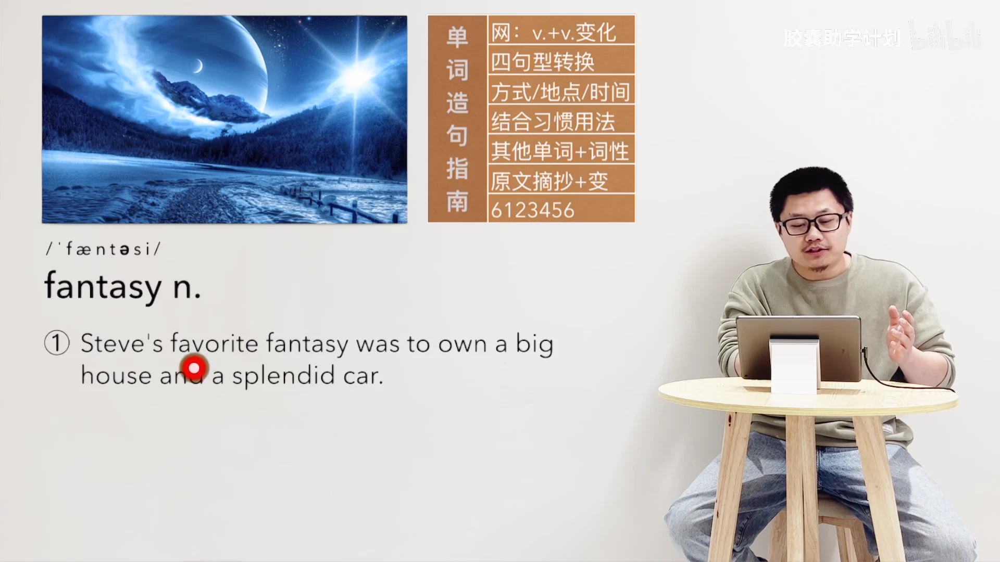

文字识别：单词造句指南 / 网：v.+v.变化 / 妻助学计划園 / 四句型转换 / 方式/地点/时间 / 结合习惯用法 / 其他单词+词性 / 原文摘抄+变 / 6123456 / / 'fæentasi/ / fantasy n. / ① Steve's favorite fantasy was to own a big / house anO a splendid car.

### 画面 00:00:39

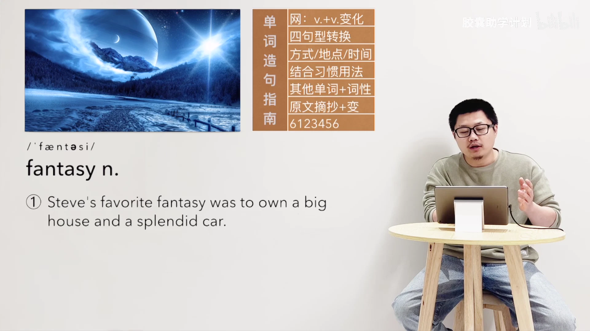

文字识别：单词造句指南 / 网：v.+v.变化 / 妻助学计划 / 四句型转换 / 方式/地点/时间 / 结合习惯用法 / 其他单词+词性 / 原文摘抄+变 / 6123456 / / 'fæentasi/ / fantasy n. / ① Steve's favorite fantasy was to own a big / house and a splendid car.

### 画面 00:00:41

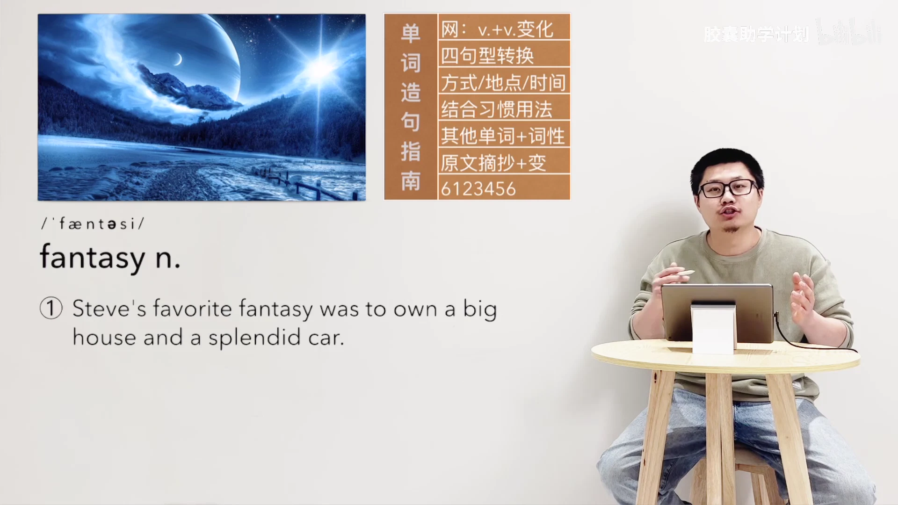

文字识别：单词造句指南 / 网：v.+v.变化 / 交囊助学计划州 / 四句型转换 / 方式/地点/时间 / 结合习惯用法 / 其他单词+词性 / 原文摘抄+变 / 6123456 / / 'fæntasi/ / fantasy n. / ① Steve's favorite fantasy was to own a big / house and a splendid car.

### 画面 00:00:45

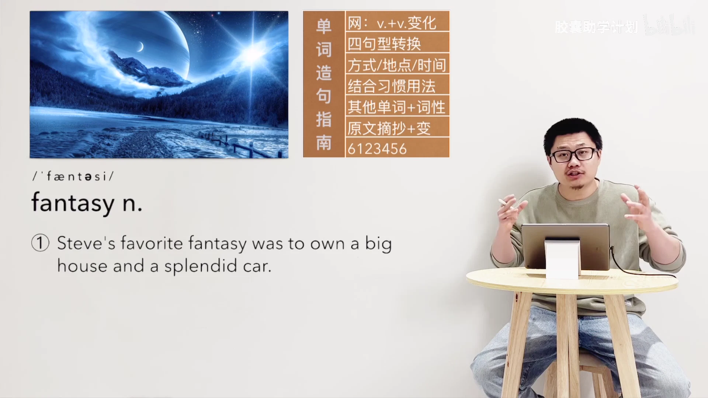

文字识别：单词造句指南 / 网：v.+v.变化 / 囊助学计划 / 四句型转换 / 方式/地点/时间 / 结合习惯用法 / 其他单词+词性 / 原文摘抄+变 / 6123456 / / 'fæntasi/ / fantasy n. / ① Steve's favorite fantasy was to own a big / house and a splendid car.

### 画面 00:00:50

文字识别：单词造句指南 / 网：v.+v.变化 / 囊助学计划 / 四句型转换 / 方式/地点/时间 / 结合习惯用法 / 其他单词+词性 / 原文摘抄+变 / 6123456 / / 'fæntasi/ / fantasy n. / ① Steve's favorite fantasy was to own a big / house and a splendid car.

### 画面 00:00:55

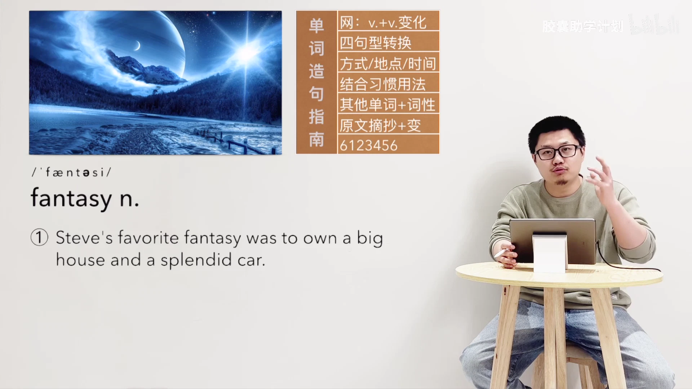

文字识别：单词造句指南 / 网：v.+v.变化 / 囊助学计划 / 四句型转换 / 方式/地点/时间 / 结合习惯用法 / 其他单词+词性 / 原文摘抄+变 / 6123456 / / 'fæntasi/ / fantasy n. / ① Steve's favorite fantasy was to own a big / house and a splendid car.

### 画面 00:00:58

文字识别：单词造句指南 / 网：v.+v.变化 / 囊助学计划園 / 四句型转换 / 方式/地点/时间 / 结合习惯用法 / 其他单词+词性 / 原文摘抄+变 / 6123456 / / 'fæentasi/ / fantasy n. / ① Steve's favorite fantasy was to own a big / house and a splendid car. / live in a fantasy world...

## 00:01:00–00:01:30

叫 live in a fantasy world，就说一个人呢活在幻想当中，叫做 live in a fantasy world。比如说，我们看一个电影片段啊，说 if you didn't knock on my door that day, I'd be still, I'd still be living in a fantasy world。说如果那天你没敲我这个门，那我还活在幻想当中呢，对吧？OK, very good。那接下来呢，那咱注意力集中听一个电影片段啊，就用了刚才

### 画面 00:01:00

文字识别：单词造句指南 / 网：v.+v.变化 / 妻助学计划園 / 四句型转换 / 方式/地点/时间 / 结合习惯用法 / 其他单词+词性 / 原文摘抄+变 / 6123456 / / 'fæentasi/ / fantasy n. / ① Steve's favorite fantasy was to own a big / house and a splendid car. / live in a fantasy world...

### 画面 00:01:05

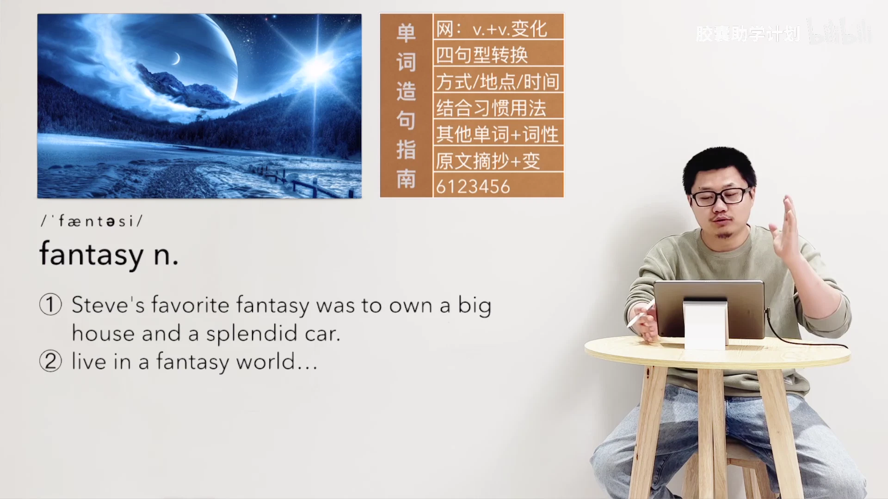

文字识别：单词造句指南 / 网：v.+v.变化 / 妻助学计划 / 四句型转换 / 方式/地点/时间 / 结合习惯用法 / 其他单词+词性 / 原文摘抄+变 / 6123456 / / 'fæentasi/ / fantasy n. / ① Steve's favorite fantasy was to own a big / house and a splendid car. / live in a fantasy world...

### 画面 00:01:07

文字识别：单词造句指南 / 网：v.+v.变化 / 妻助学计划は / 四句型转换 / 方式/地点/时间 / 结合习惯用法 / 其他单词+词性 / 原文摘抄+变 / 6123456 / / 'fæentasi/ / fantasy n. / ① Steve's favorite fantasy was to own a big / house and a splendid car. / live in a fantasy world... / If you didn't knock on my door that day I'd / 3 / still be living in a fantasy world. Class Rank / (2017)

### 画面 00:01:09

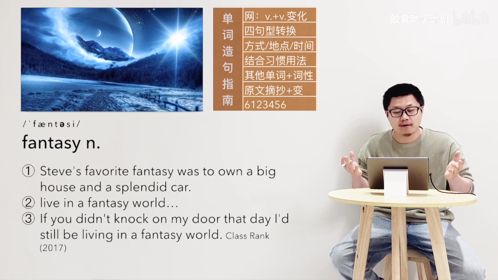

文字识别：单词造句指南 / 网：v.+v.变化 / 妻助学计划 / 四句型转换 / 方式/地点/时间 / 结合习惯用法 / 其他单词+词性 / 原文摘抄+变 / 6123456 / / 'fæentasi/ / fantasy n. / ① Steve's favorite fantasy was to own a big / house and a splendid car. / live in a fantasy world... / If you didn't knock on my door that day I'd / 3 / still be living in a fantasy world. Class Rank / (2017)

### 画面 00:01:11

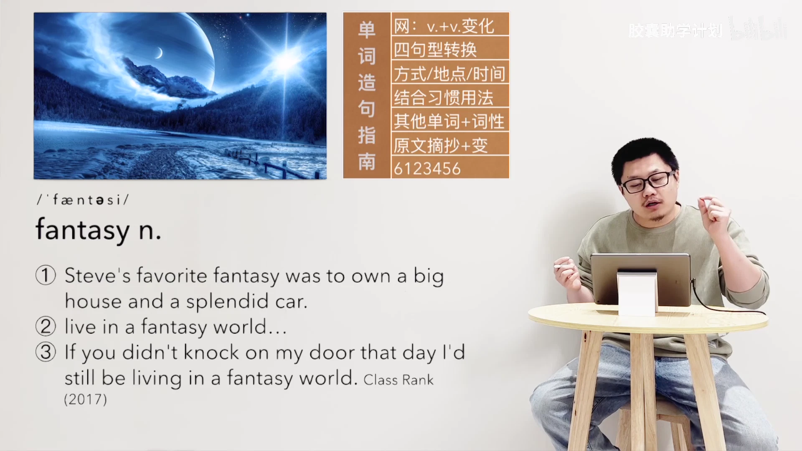

文字识别：单词造句指南 / 网：v.+v.变化 / 妻助学计划陽 / 四句型转换 / 方式/地点/时间 / 结合习惯用法 / 其他单词+词性 / 原文摘抄+变 / 6123456 / / 'fæentasi/ / fantasy n. / ① Steve's favorite fantasy was to own a big / house and a splendid car. / live in a fantasy world... / If you didn't knock on my door that day I'd / 3 / still be living in a fantasy world. Class Rank / (2017)

### 画面 00:01:15

文字识别：单词造句指南 / 网：v.+v.变化 / 妻助学计划一 / 四句型转换 / 方式/地点/时间 / 结合习惯用法 / 其他单词+词性 / 原文摘抄+变 / 6123456 / / 'fæentasi/ / fantasy n. / ① Steve's favorite fantasy was to own a big / house and a splendid car. / live in a fantasy world... /  If you didn't knock on my door that day I'd / 3 / still be living in a fantasy world. Class Rank / (2017)

### 画面 00:01:17

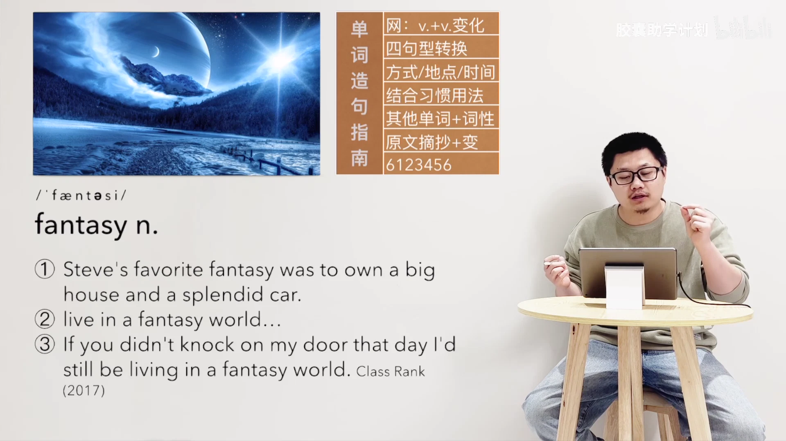

文字识别：单词造句指南 / 网：v.+v.变化 / 妻助学计划陽 / 四句型转换 / 方式/地点/时间 / 结合习惯用法 / 其他单词+词性 / 原文摘抄+变 / 6123456 / / 'fæentasi/ / fantasy n. / ① Steve's favorite fantasy was to own a big / house and a splendid car. / live in a fantasy world... / If you didn't knock on my door that day I'd / 3 / still be living in a fantasy world. Class Rank / (2017)

### 画面 00:01:20

文字识别：单词造句指南 / 网：v.+v.变化 / 囊助学计划 / 四句型转换 / 方式/地点/时间 / 结合习惯用法 / 其他单词+词性 / 原文摘抄+变 / 6123456 / / 'fæntasi/ / fantasy n. / ① Steve's favorite fantasy was to own a big / house and a splendid car. / live in a fantasy world... / If you didn't knock on my door that day I'd / 3 / still be living in a fantasy world. Class Rank / (2017)

### 画面 00:01:24

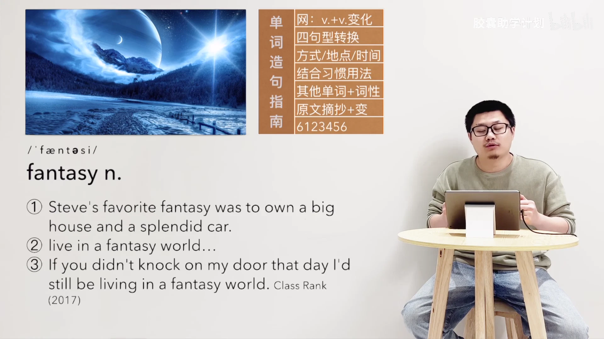

文字识别：单词造句指南 / 网：v.+v.变化 / 妻助学计划！ / 四句型转换 / 方式/地点/时间 / 结合习惯用法 / 其他单词+词性 / 原文摘抄+变 / 6123456 / / 'fæentasi/ / fantasy n. / ① Steve's favorite fantasy was to own a big / house and a splendid car. / live in a fantasy world... / If you didn't knock on my door that day I'd / 3 / still be living in a fantasy world. Class Rank / (2017)

### 画面 00:01:26

文字识别：妻助学计划淵 / I don't want to live in a fantasy world. / Wilson / (2017)

## 00:01:30–00:02:00

我说的这个 live in a fantasy world. I don't want to live in a fantasy world. Okay,下一个单词 ambassador 连起来 ambassador ambassador 大使对吧？Okay，啊中国驻外的某某大使说 the ambassador was reluctant to leave the room. The ambassador 造句跟 captain 基本质没区别，我造了我说了很多类似的例子了，对吧？哎，不情愿离开这个房间。

### 画面 00:01:34

文字识别：妻助学计划！明 / I don't want to live in a fantasy world. / Wilson / (2017)

### 画面 00:01:36

文字识别：妻助学计划 / I don't want to live in a fantasy world. / Wilson / (2017)

### 画面 00:01:38

文字识别：单词造句指南 / 网：v.+v.变化 / 校囊助学计划一淵 / 四句型转换 / 方式/地点/时间 / 结合习惯用法 / 其他单词+词性 / 原文摘抄+变 / 6123456 / / æem'b æe sa d a / / ambassador n.

### 画面 00:01:40

文字识别：单词造句指南 / 网：v.+v.变化 / 校囊助学计划 / 四句型转换 / 方式/地点/时间 / 结合习惯用法 / 其他单词+词性 / 原文摘抄+变 / 6123456 / / æ m b æe sa d a / / ambassador n.

### 画面 00:01:45

文字识别：单词造句指南 / 网：v.+v.变化 / 交囊助学计划一淵 / 四句型转换 / 方式/地点/时间 / 结合习惯用法 / 其他单词+词性 / 原文摘抄+变 / 6123456 / / æe m'b æe sa d a / / ambassador n.

### 画面 00:01:48

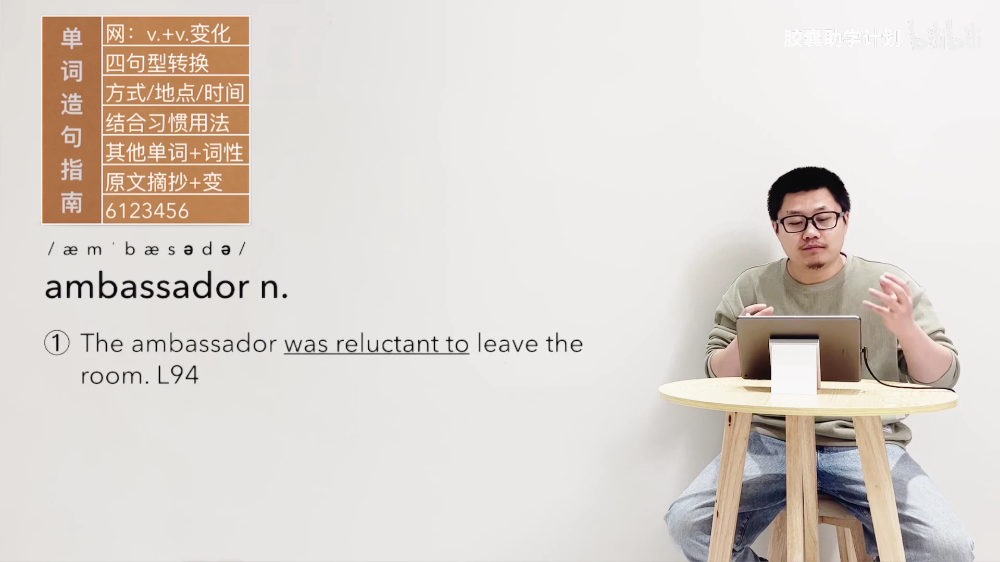

文字识别：单词造句指南 / 网：v.+v.变化 / 校囊助学计划一 / 四句型转换 / 方式/地点/时间 / 结合习惯用法 / 其他单词+词性 / 原文摘抄+变 / 6123456 / / æe m b æe sa d a / / ambassador n. / ① The ambassador was reluctant to leave the / room.L94

### 画面 00:01:51

文字识别：单词造句指南 / 网：v.+v.变化 / 校囊助学计划 / 四句型转换 / 方式/地点/时间 / 结合习惯用法 / 其他单词+词性 / 原文摘抄+变 / 6123456 / / æe mb æe sa d a / / ambassador n. / ① The ambassador was reluctant to leave the / room.L94

### 画面 00:01:57

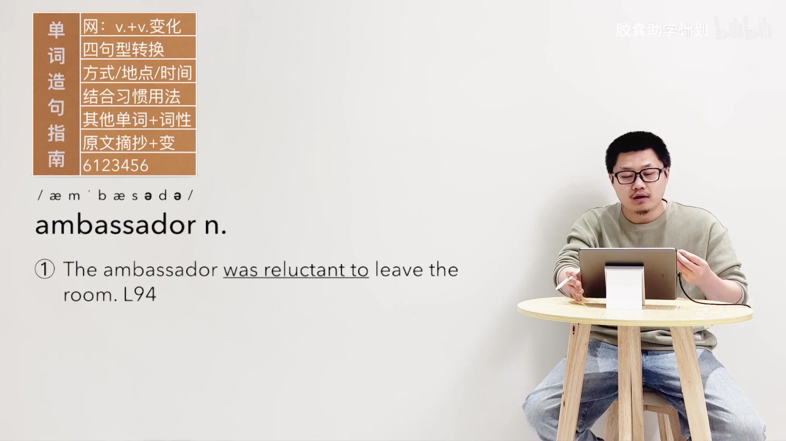

文字识别：单词造句指南 / 网：v.+v.变化 / 妻助学计划園 / 四句型转换 / 方式/地点/时间 / 结合习惯用法 / 其他单词+词性 / 原文摘抄+变 / 6123456 / / æe m 'b æe sa d a / / ambassador n. / ① The ambassador was reluctant to leave the / room.L94

## 00:02:00–00:02:30

Next one, say the ambassador is accustomed to working till midnight. 九十四个咱们刚学的 be accustomed to doing something. Next one,最后一个说 when the ambassador heard the news, he burst out laughing. 说当他听到这个消息的时候，哗就笑了是吧？再读一遍这个单词 ambassador. Very good. Next one, frightful, frightful. 啊，就是恐惧的，害怕的啊。你注意它是个形容词，对吧？

### 画面 00:02:00

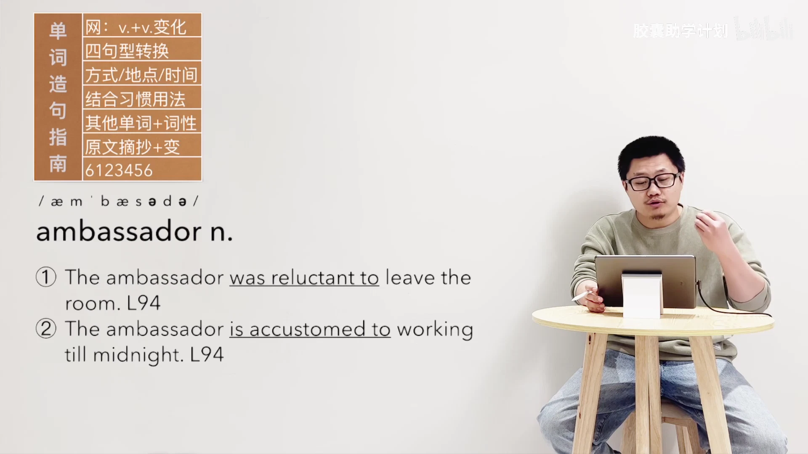

文字识别：单词造句指南 / 网：v.+v.变化 / 囊助学计划 / 四句型转换 / 方式/地点/时间 / 结合习惯用法 / 其他单词+词性 / 原文摘抄+变 / 6123456 / / æe m 'b æ s a d a / / ambassador n. / ① The ambassador was reluctant to leave the / room.L94 / The ambassador is accustomed to working / till midnight. L94

### 画面 00:02:04

文字识别：单词造句指南 / 网：v.+v.变化 / 妻助学计划 / 四句型转换 / 方式/地点/时间 / 结合习惯用法 / 其他单词+词性 / 原文摘抄+变 / 6123456 / / æe m 'b æ s a d a / / ambassador n. / ① The ambassador was reluctant to leave the / room.L94 / The ambassador is accustomed to working / till midnight. L94

### 画面 00:02:07

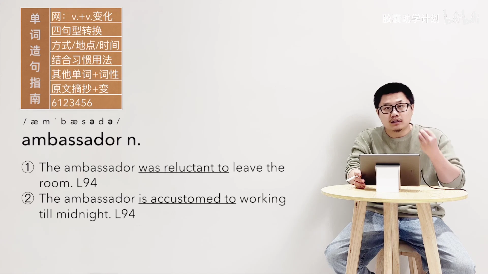

文字识别：单词造句指南 / 网：v.+v.变化 / 交囊助学计划 / 四句型转换 / 方式/地点/时间 / 结合习惯用法 / 其他单词+词性 / 原文摘抄+变 / 6123456 / / æe m ' b æ s a d a / / ambassador n. / ① The ambassador was reluctant to leave the / room.L94 / The ambassador is accustomed to working / till midnight. L94

### 画面 00:02:10

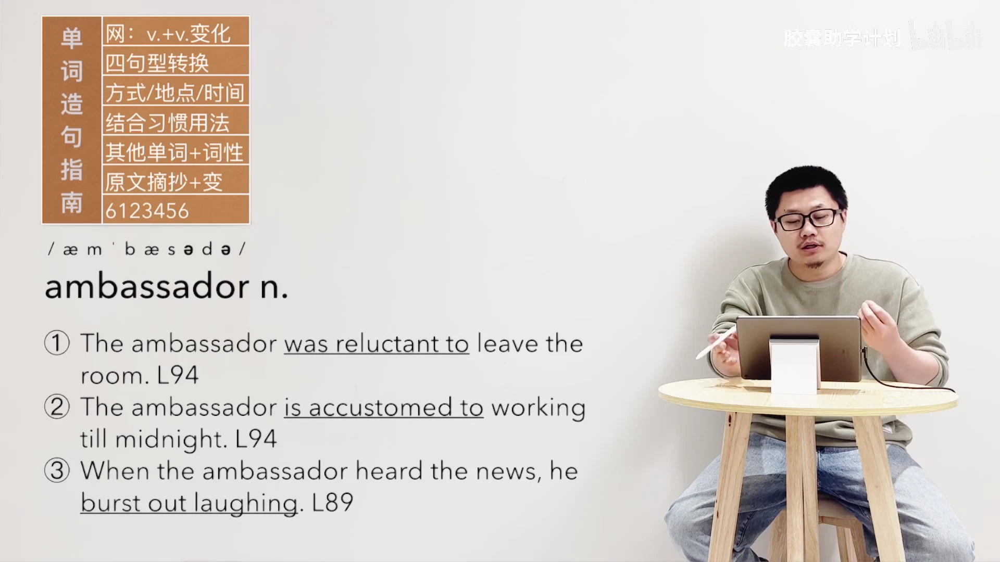

文字识别：单词造句指南 / 网：v.+v.变化 / 囊助学计划 / 四句型转换 / 方式/地点/时间 / 结合习惯用法 / 其他单词+词性 / 原文摘抄+变 / 6123456 / / æe m 'b æ s a d a / / ambassador n. / ① The ambassador was reluctant to leave the / room.L94 / The ambassador is accustomed to working / till midnight. L94 / When the ambassador heard the news, he / burst out laughing. L89

### 画面 00:02:15

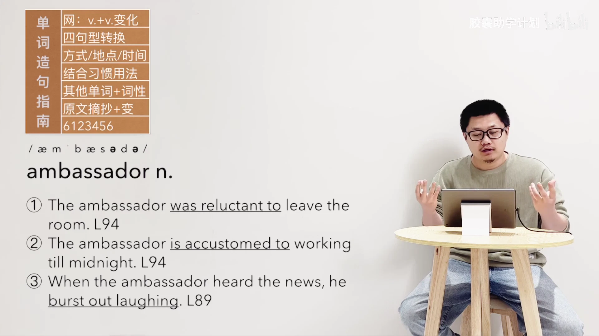

文字识别：单词造句指南 / 网：v.+v.变化 / 妻助学计划 / 四句型转换 / 方式/地点/时间 / 结合习惯用法 / 其他单词+词性 / 原文摘抄+变 / 6123456 / / æe m ' b æe s a d a / / ambassador n. / ① The ambassador was reluctant to leave the / room.L94 / The ambassador is accustomed to working / till midnight. L94 / When the ambassador heard the news, he / burst out laughing. L89

### 画面 00:02:20

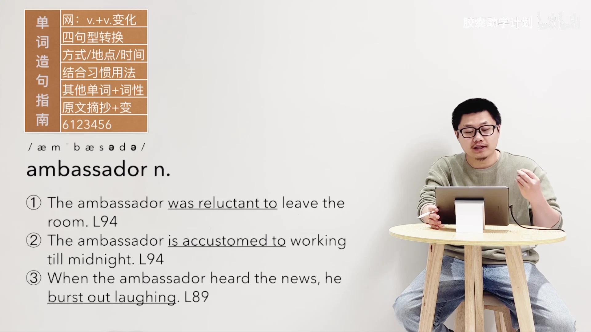

文字识别：单词造句指南 / 网：v.+v.变化 / 囊助字计划 / 四句型转换 / 方式/地点/时间 / 结合习惯用法 / 其他单词+词性 / 原文摘抄+变 / 6123456 / / æe m  b æe s a d a / / ambassador n. / ① The ambassador was reluctant to leave the / room.L94 / The ambassador is accustomed to working / till midnight. L94 / When the ambassador heard the news, he / burst out laughing. L89

### 画面 00:02:23

文字识别：单词造句指南 / 网：v.+v.变化 / 交囊助学计划一 / 四句型转换 / 方式/地点/时间 / 结合习惯用法 / 其他单词+词性 / 原文摘抄+变 / 6123456 / / 'fraitfal/ / frightful adj.

### 画面 00:02:25

文字识别：单词造句指南 / 网：v.+v.变化 / 囊助学计划一 / 四句型转换 / 方式/地点/时间 / 结合习惯用法 / 其他单词+词性 / 原文摘抄+变 / 6123456 / / 'fraitfal/ / frightful adj.

## 00:02:30–00:03:00

比如说，they are making a frightful noise. 哎，他们正在正在制造一种特别让人恐惧、特别害怕的声音啊。 Next one, say when you think of it, it must smell absolutely frightful. 说你现在要这么去想它的时候呢，它一定是闻起来哎，绝对的、特别的让人觉得很难受啊，很不舒服，对吧？Frightful, 啊，哎，很害怕

### 画面 00:02:32

文字识别：单词造句指南 / 网：v.+v.变化 / 囊助学计划酬 / 四句型转换 / 方式/地点/时间 / 结合习惯用法 / 其他单词+词性 / 原文摘抄+变 / 6123456 / / 'fraitfal/ / frightful adj. / ① They're making a frightful noise.

### 画面 00:02:35

文字识别：单词造句指南 / 网：v.+v.变化 / 交囊助学计划一淵 / 四句型转换 / 方式/地点/时间 / 结合习惯用法 / 其他单词+词性 / 原文摘抄+变 / 6123456 / / 'fraitfal/ / frightful adj. / ① They're making a frightful noise.

### 画面 00:02:39

文字识别：单词造句指南 / 网：v.+v.变化 / 交囊助学计划一淵 / 四句型转换 / 方式/地点/时间 / 结合习惯用法 / 其他单词+词性 / 原文摘抄+变 / 6123456 / / 'fraitfal/ / frightful adj. / ① They're making a frightful noise.

### 画面 00:02:41

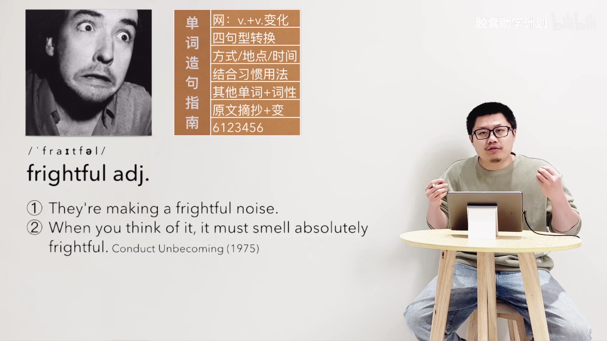

文字识别：单词造句指南 / 网：v.+v.变化 / 囊助学计划園 / 四句型转换 / 方式/地点/时间 / 结合习惯用法 / 其他单词+词性 / 原文摘抄+变 / 6123456 / / 'fraitfal/ / frightful adj. / ① They're making a frightful noise. / When you think of it, it must smell absolutely / frightful. Conduct Unbecoming (1975)

### 画面 00:02:54

文字识别：单词造句指南 / 网：v.+v.变化 / 妻助学计划園 / 四句型转换 / 方式/地点/时间 / 结合习惯用法 / 其他单词+词性 / 原文摘抄+变 / 6123456 / /'fraitfal/ / frightful adj. / ① They're making a frightful noise. / When you think of it, it must smell absolutely / frightful. Conduct Unbecoming (1975)

### 画面 00:02:59

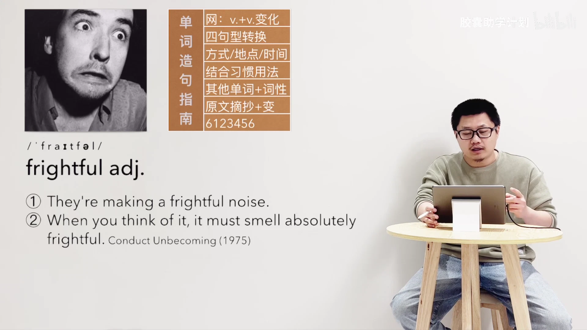

文字识别：单词造句指南 / 网：v.+v.变化 / 妻助学计划園 / 四句型转换 / 方式/地点/时间 / 结合习惯用法 / 其他单词+词性 / 原文摘抄+变 / 6123456 / /'fraitfal/ / frightful adj. / ① They're making a frightful noise. / When you think of it, it must smell absolutely / frightful. Conduct Unbecoming (1975)

## 00:03:00–00:03:30

呃，这样的一种味道，很可怕的一个味道。Next one不是害怕啊，是可怕的一个味道。Next one, so you should have looked at their face. They looked frightful,哎，那么看起来糟糕透顶了，对吧？哎，有这样一种感觉。当然，它也有惊悚的意思。这你要结合上下文去看。OK, next one,下一个单词是由两个单词组成的。第一个单词叫fire，第二个单词叫extinguisher. Fire extinguisher就是我们图

### 画面 00:03:01

文字识别：单词造句指南 / 网：v.+v.变化 / 囊助学计划 / 四句型转换 / 方式/地点/时间 / 结合习惯用法 / 其他单词+词性 / 原文摘抄+变 / 6123456 / /'fraitfal/ / frightful adj. / ① They're making a frightful noise. /  When you think of it, it must smell absolutely / 2 / frightful. Conduct Unbecoming (1975) / ) You should have looked at their face. They / looked frightful. L65

### 画面 00:03:17

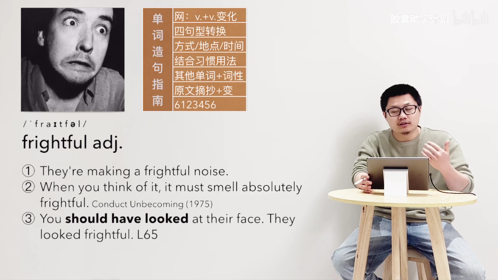

文字识别：单词造句指南 / 网：v.+v.变化 / 囊助学计划 / 四句型转换 / 方式/地点/时间 / 结合习惯用法 / 其他单词+词性 / 原文摘抄+变 / 6123456 / /'fraitfal/ / frightful adj. / ① They're making a frightful noise. / When you think of it, it must smell absolutely / frightful. Conduct Unbecoming (1975) / ) You should have looked at their face. They / looked frightful. L65

### 画面 00:03:20

文字识别：单词造句指南 / 网：v.+v.变化 / 交囊助学计划一 / 四句型转换 / 方式/地点/时间 / 结合习惯用法 / 其他单词+词性 / 原文摘抄+变 / 6123456 / /ik'stingwi∫a/ / fire extinguisher

### 画面 00:03:22

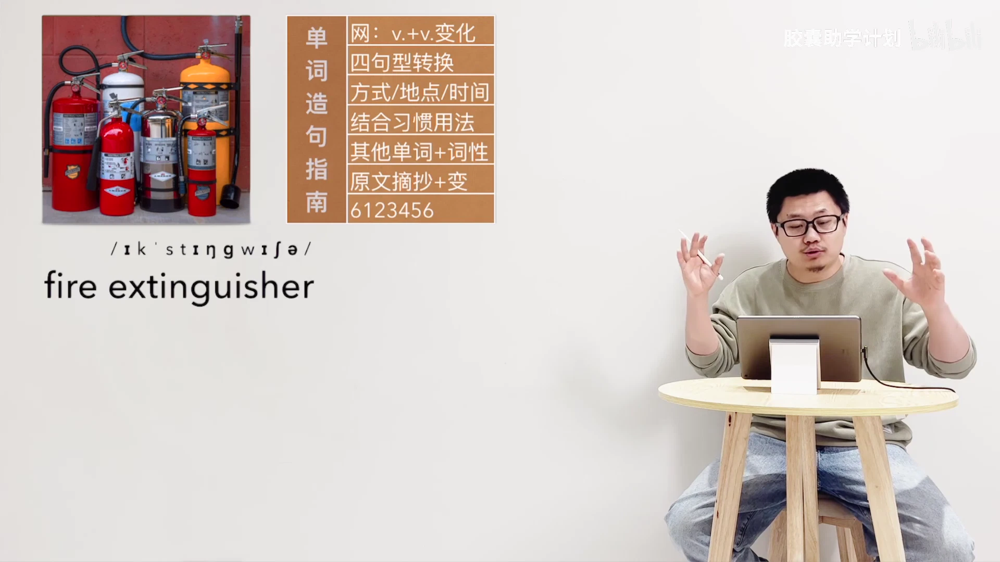

文字识别：单词造句指南 / 网：v.+v.变化 / 囊助学计划一 / 四句型转换 / 方式/地点/时间 / 结合习惯用法 / 其他单词+词性 / 原文摘抄+变 / 6123456 / /ik'stingwi∫a/ / fire extinguisher

### 画面 00:03:25

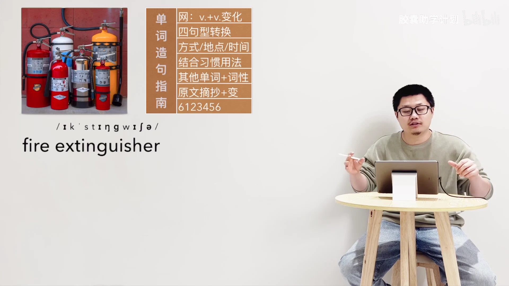

文字识别：单词造句指南 / 网：v.+v.变化 / 交囊助学计划 / 四句型转换 / 方式/地点/时间 / 结合习惯用法 / 其他单词+词性 / 原文摘抄+变 / 6123456 / /ik'stingwi∫a/ / fire extinguisher

### 画面 00:03:27

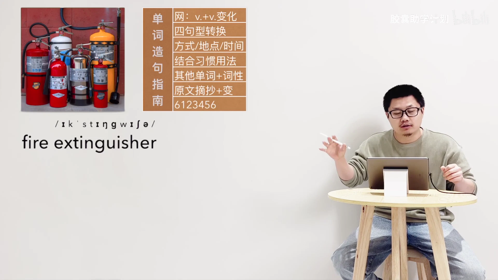

文字识别：单词造句指南 / 网：v.+v.变化 / 交囊助学计划 / 四句型转换 / 方式/地点/时间 / 结合习惯用法 / 其他单词+词性 / 原文摘抄+变 / 6123456 / /ik'stingwi∫a/ / fire extinguisher

## 00:03:30–00:04:00

中这个东西，灭火器啊，这是一个名词吧？你可以理解为，那你是不是要找各种各样的动词，对吧？比如说 you've proved that，咱们上节课刚学的 experiments have proved that，对吧？Children can巴拉巴拉巴拉。So you have you've proved that you know how to use the fire extinguisher. 哎，你已经证明了，你知道如何使用灭火器。Next one， the fire extinguisher is at the entrance of the building，在建筑物的入口处。最后一个， he doesn't even have

### 画面 00:03:30

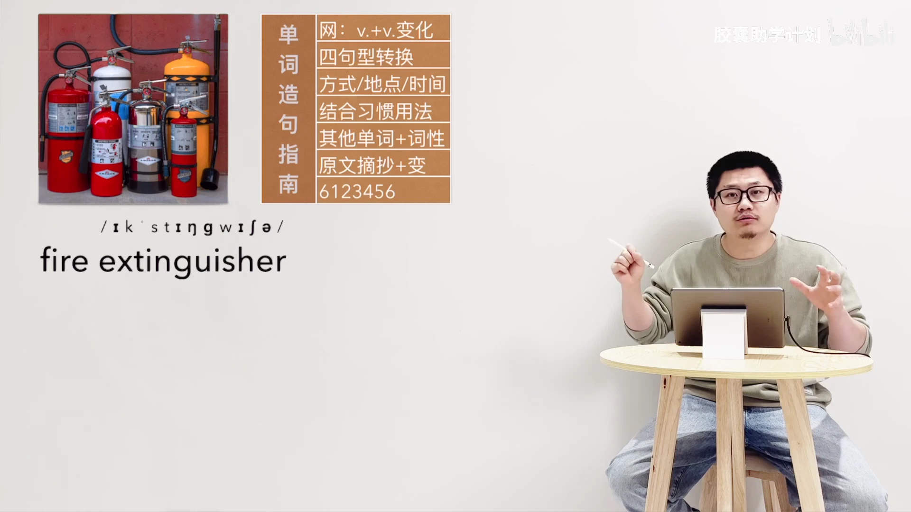

文字识别：单词造句指南 / 网：v.+v.变化 / 交囊助学计划一淵 / 四句型转换 / 方式/地点/时间 / 结合习惯用法 / 其他单词+词性 / 原文摘抄+变 / 6123456 / /ik'stingwi∫a/ / fire extinguisher

### 画面 00:03:33

文字识别：单词造句指南 / 网：v.+v.变化 / 妻助学计划間 / 四句型转换 / 方式/地点/时间 / 结合习惯用法 / 其他单词+词性 / 原文摘抄+变 / 6123456 / /Ik'stingwi∫a/ / fire extinguisher / ① You've proved that you know how to use / the fire extinguisher. L94

### 画面 00:03:35

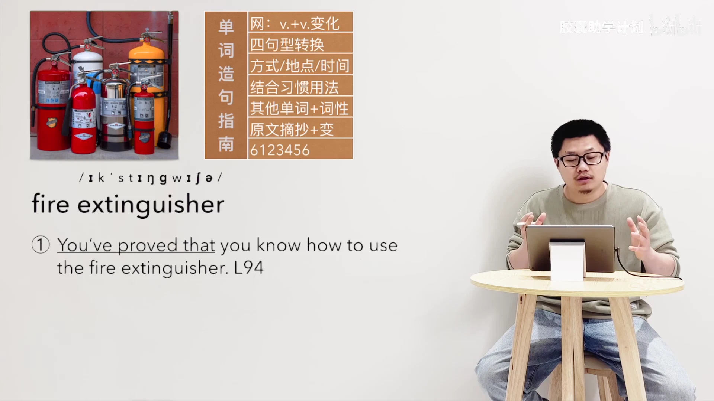

文字识别：单词造句指南 / 网：v.+v.变化 / 妻助学计划 / 四句型转换 / 方式/地点/时间 / 结合习惯用法 / 其他单词+词性 / 原文摘抄+变 / 6123456 / /ik'stiηgwi∫a/ / fire extinguisher / ① You've proved that you know how to use / the fire extinguisher. L94

### 画面 00:03:43

文字识别：单词造句指南 / 网：v.+v.变化 / 奏助学计划園園 / 四句型转换 / 方式/地点/时间 / 结合习惯用法 / 其他单词+词性 / 原文摘抄+变 / 6123456 / /ik'stingwi∫a/ / fire extinguisher / ① You've proved that you know how to use / the fire extinguisher. L94

### 画面 00:03:46

文字识别：单词造句指南 / 网：v.+v.变化 / 雲助学计划陽淵 / 四句型转换 / 方式/地点/时间 / 结合习惯用法 / 其他单词+词性 / 原文摘抄+变 / 6123456 / /ik'stingwi∫a/ / fire extinguisher / ① You've proved that you know how to use / the fire extinguisher. L94

### 画面 00:03:50

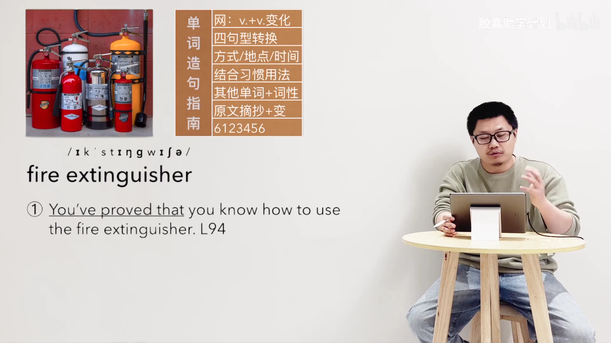

文字识别：单词造句指南 / 网：v.+v.变化 / 妻助学计划一關 / 四句型转换 / 方式/地点/时间 / 结合习惯用法 / 其他单词+词性 / 原文摘抄+变 / 6123456 / /ik'stingwi∫a/ / fire extinguisher / ① You've proved that you know how to use / the fire extinguisher. L94

### 画面 00:03:52

文字识别：单词造句指南 / 网：v.+v.变化 / 囊助学计划淵 / 四句型转换 / 方式/地点/时间 / 结合习惯用法 / 其他单词+词性 / 原文摘抄+变 / 6123456 / /Ik'stingwi∫a/ / fire extinguisher / ① You've proved that you know how to use / the fire extinguisher. L94 / The fire extinguisher is at the entrance of / the building. L93

### 画面 00:03:55

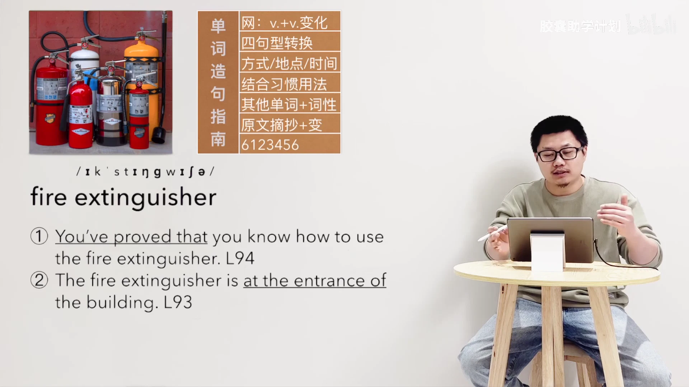

文字识别：单词造句指南 / 网：v.+v.变化 / 囊助学计划 / 四句型转换 / 方式/地点/时间 / 结合习惯用法 / 其他单词+词性 / 原文摘抄+变 / 6123456 / /Ik'stingwi ∫a/ / fire extinguisher / ① You've proved that you know how to use / the fire extinguisher. L94 / The fire extinguisher is at the entrance of / the building. L93

### 画面 00:03:57

文字识别：单词造句指南 / 网：v.+v.变化 / 妻助字计划陽 / 四句型转换 / 方式/地点/时间 / 结合习惯用法 / 其他单词+词性 / 原文摘抄+变 / 6123456 / /Ik'stingwi ∫a/ / fire extinguisher / ① You've proved that you know how to use / the fire extinguisher. L94 / The fire extinguisher is at the entrance of / the building. L93 / He doesn't even have the nerve to use the / fire extinguisher. L78

### 画面 00:03:59

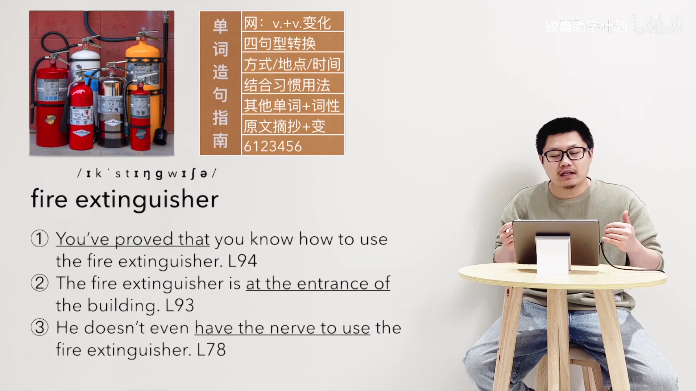

文字识别：单词造句指南 / 网：v.+v.变化 / 妻助字计划陽 / 四句型转换 / 方式/地点/时间 / 结合习惯用法 / 其他单词+词性 / 原文摘抄+变 / 6123456 / /Ik'stingwi ∫a/ / fire extinguisher / ① You've proved that you know how to use / the fire extinguisher. L94 / The fire extinguisher is at the entrance of / the building. L93 / He doesn't even have the nerve to use the / fire extinguisher. L78

## 00:04:00–00:04:30

the nerve to do something.有勇气去使用什么呢？The fire extinguisher.所以在这里我们重点是用了一个动词叫use。当然你也可以用别的，对吧？哎，比如说放置，place啊，埋啊，by等等等等。Next one，下一个单词叫dryly，dryly，dryly这个单词它的形容词你肯定认的叫dry，wet湿的，dry干燥的，对吧？那

### 画面 00:04:01

文字识别：单词造句指南 / 网：v.+v.变化 / 妻助学计划 / 四句型转换 / 方式/地点/时间 / 结合习惯用法 / 其他单词+词性 / 原文摘抄+变 / 6123456 / /ik'stingwi∫a/ / fire extinguisher / ① You've proved that you know how to use / the fire extinguisher. L94 / The fire extinguisher is at the entrance of / the building. L93 / He doesn't even have the nerve to use the / fire extinguisher. L78

### 画面 00:04:03

文字识别：单词造句指南 / 网：v.+v.变化 / 囊助学计划陽 / 四句型转换 / 方式/地点/时间 / 结合习惯用法 / 其他单词+词性 / 原文摘抄+变 / 6123456 / /ik'stingwi∫a/ / fire extinguisher / ① You've proved that you know how to use / the fire extinguisher. L94 / The fire extinguisher is at the entrance of / the building. L93 / He doesn't even have the nerve to use the / fire extinguisher. L78

### 画面 00:04:05

文字识别：单词造句指南 / 网：v.+v.变化 / 囊助学计划陽 / 四句型转换 / 方式/地点/时间 / 结合习惯用法 / 其他单词+词性 / 原文摘抄+变 / 6123456 / /ik'stingwi∫a/ / fire extinguisher / ① You've proved that you know how to use / the fire extinguisher. L94 / The fire extinguisher is at the entrance of / the building. L93 / He doesn't even have the nerve to use the / fire extinguisher. L78

### 画面 00:04:10

文字识别：单词造句指南 / 网：v.+v.变化 / 妻助字计划園 / 四句型转换 / 方式/地点/时间 / 结合习惯用法 / 其他单词+词性 / 原文摘抄+变 / 6123456 / /ik'stingwi∫a/ / fire extinguisher / ① You've proved that you know how to use / the fire extinguisher. L94 / The fire extinguisher is at the entrance of / the building. L93 / He doesn't even have the nerve to use the / fire extinguisher. L78

### 画面 00:04:15

文字识别：单词造句指南 / 网：v.+v.变化 / 妻助学计划園 / 四句型转换 / 方式/地点/时间 / 结合习惯用法 / 其他单词+词性 / 原文摘抄+变 / 6123456 / /ik'stingwi∫a/ / fire extinguisher / ① You've proved that you know how to use / the fire extinguisher. L94 / The fire extinguisher is at the entrance of / the building. L93 / He doesn't even have the nerve to use the / fire extinguisher. L78

### 画面 00:04:18

文字识别：单词造句指南 / 网：v.+v.变化 / 交囊助学计划一 / 四句型转换 / 方式/地点/时间 / 结合习惯用法 / 其他单词+词性 / 原文摘抄+变 / 6123456 / /'draili/ / drily adv.

### 画面 00:04:20

文字识别：单词造句指南 / 网：v.+v.变化 / 交囊助学计划 / 四句型转换 / 方式/地点/时间 / 结合习惯用法 / 其他单词+词性 / 原文摘抄+变 / 6123456 / /'draili/ / drily adv.

## 00:04:30–00:05:00

dryly 干燥地，哎，它往往不是这样，它指的其实是人说话冷冷的，对吧？很冷淡的。比如说 I'm reluctant to do that. He said dryly. 哎，他干干巴巴的说道，也没带什么情绪啊，没带什么情绪啊，很冷淡的说道。比如说 I'm cons I'm accustomed to getting up early. He answered dryly. 哎，他非常冷淡的回答道。OK，再读一遍这个单词 dryly. Very good. 下一个单词 embassy ambassador 待

### 画面 00:04:34

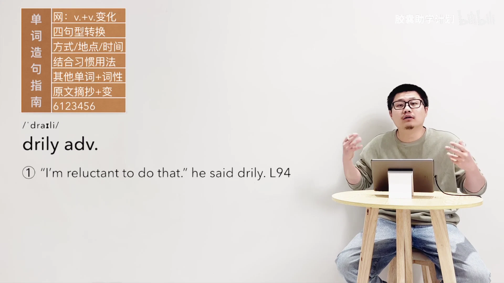

文字识别：单词造句指南 / 网：v.+v.变化 / 囊助学计划一州 / 四句型转换 / 方式/地点/时间 / 结合习惯用法 / 其他单词+词性 / 原文摘抄+变 / 6123456 / /'draili/ / drily adv. /  "'m reluctant to do that." he said drily. L94

### 画面 00:04:45

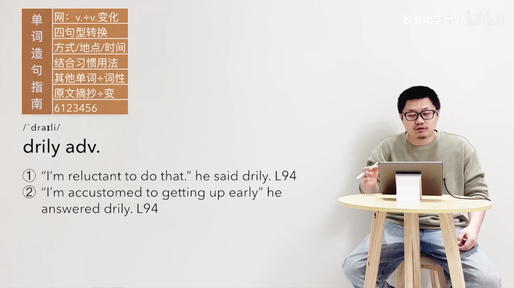

文字识别：单词造句指南 / 网：v.+v.变化 / 囊助学计划 / 四句型转换 / 方式/地点/时间 / 结合习惯用法 / 其他单词+词性 / 原文摘抄+变 / 6123456 / /'draili/ / drily adv. / ① "'m reluctant to do that." he said drily. L94 / "I'm accustomed to getting up early' he / answered drily. L94

### 画面 00:04:51

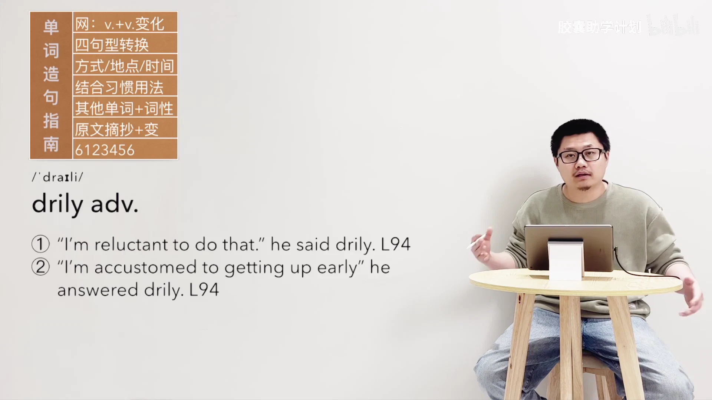

文字识别：单词造句指南 / 网：v.+v.变化 / 囊助学计划 / 四句型转换 / 方式/地点/时间 / 结合习惯用法 / 其他单词+词性 / 原文摘抄+变 / 6123456 / /'draili/ / drily adv. / ① "I'm reluctant to do that.'" he said drily. L94 / "I'm accustomed to getting up early'he / answered drily. L94

### 画面 00:04:55

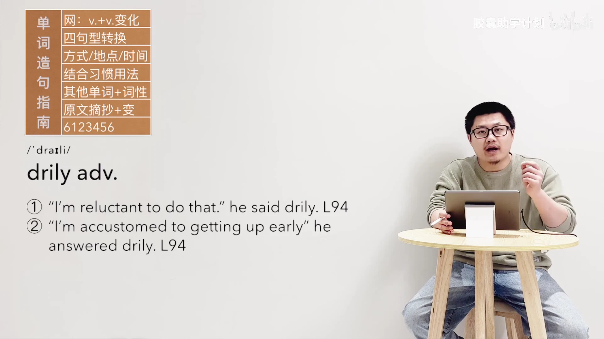

文字识别：单词造句指南 / 网：v.+v.变化 / 囊助学计划 / 四句型转换 / 方式/地点/时间 / 结合习惯用法 / 其他单词+词性 / 原文摘抄+变 / 6123456 / /'draili/ / drily adv. / ① "I'm reluctant to do that." he said drily. L94 / "'m accustomed to getting up early" he / answered drily. L94

### 画面 00:04:57

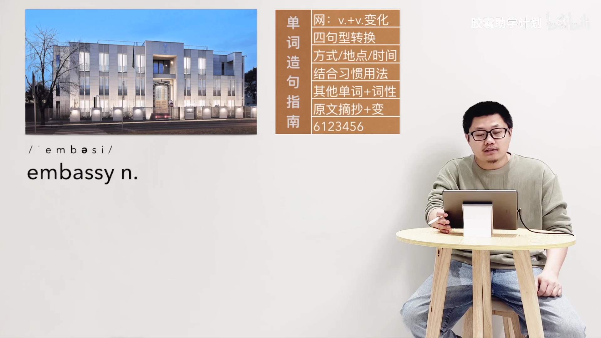

文字识别：单词造句指南 / 网：v.+v.变化 / 奏助学计划 / 四句型转换 / 方式/地点/时间 / 结合习惯用法 / 其他单词+词性 / 原文摘抄+变 / 6123456 / /'e m b a s i / / embassy n.

### 画面 00:04:59

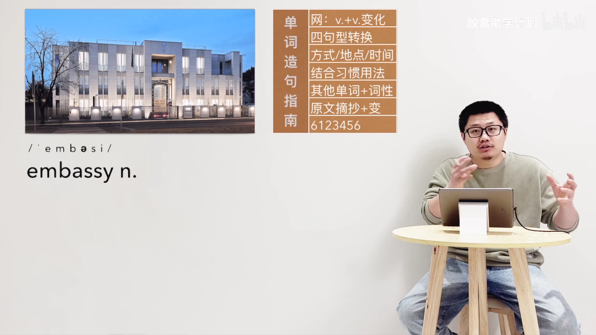

文字识别：单词造句指南 / 网：v.+v.变化 / 囊助学计划一州 / 四句型转换 / 方式/地点/时间 / 结合习惯用法 / 其他单词+词性 / 原文摘抄+变 / 6123456 / / 'emb as i / / embassy n.

## 00:05:00–00:05:30

的地方叫 embassy 大使馆 embassy 那你想一下六幺三四五六瞬间一三五对吧哎很容易想到一三五啊好 next one 那我们造一个句子当然这是电影片段但它用到了十四课咱们学过的语法 as soon as I get out of here I'm going to the embassy 哎我一从这儿出来我就要去大使馆 next one 说 where is the Japanese embassy 日本大使馆在哪儿呢啊 next one 说 a large

### 画面 00:05:01

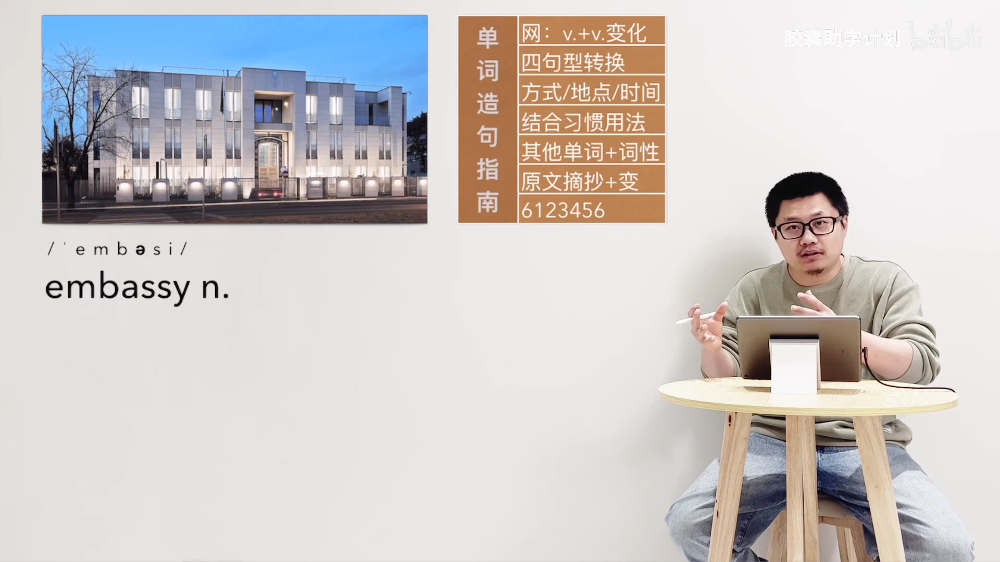

文字识别：单词造句指南 / 网：v.+v.变化 / 卖助学计划園 / 四句型转换 / 方式/地点/时间 / 结合习惯用法 / 其他单词+词性 / 原文摘抄+变 / 6123456 / / 'emb a s i / / embassy n.

### 画面 00:05:05

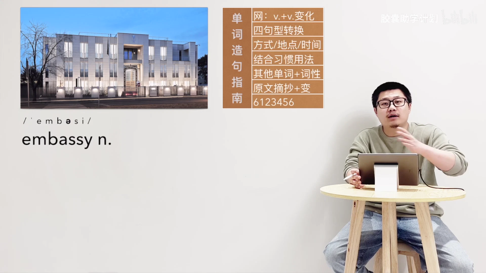

文字识别：单词造句指南 / 网：v.+v.变化 / 交囊助学计划 / 四句型转换 / 方式/地点/时间 / 结合习惯用法 / 其他单词+词性 / 原文摘抄+变 / 6123456 / / 'embas i/ / embassy n.

### 画面 00:05:08

文字识别：单词造句指南 / 网：v.+v.变化 / 交囊助学计划一 / 四句型转换 / 方式/地点/时间 / 结合习惯用法 / 其他单词+词性 / 原文摘抄+变 / 6123456 / / 'embas i / / embassy n.

### 画面 00:05:10

文字识别：单词造句指南 / 网：v.+v.变化 / 囊助学计划 / 四句型转换 / 方式/地点/时间 / 结合习惯用法 / 其他单词+词性 / 原文摘抄+变 / 6123456 / / 'em b a si / / embassy n. / As soon as | get out of here, I'm going to / the embassy. Missing (1982) L14

### 画面 00:05:15

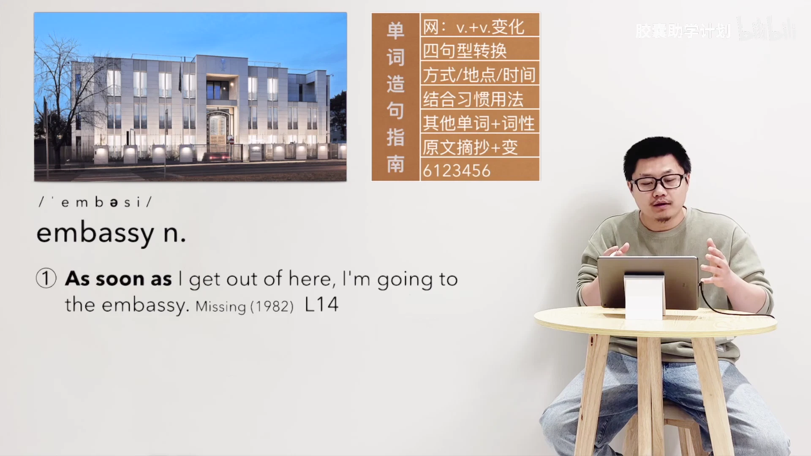

文字识别：单词造句指南 / 网：v.+v.变化 / 襄助学计划 / 四句型转换 / 方式/地点/时间 / 结合习惯用法 / 其他单词+词性 / 原文摘抄+变 / 6123456 / / 'em b a si / / embassy n. / As soon as I get out of here, I'm going to / the embassy. Missing (1982) L14

### 画面 00:05:20

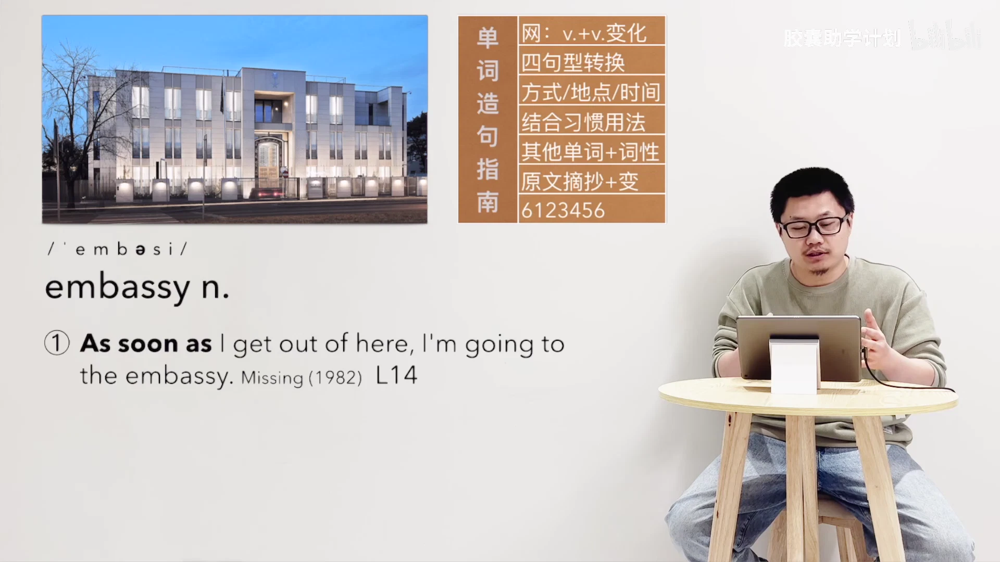

文字识别：单词造句指南 / 网：v.+v.变化 / 四句型转换 / 方式/地点/时间 / 结合习惯用法 / 其他单词+词性 / 原文摘抄+变 / 6123456 / / ' em b a si / / embassy n. / As soon as I get out of here, I'm going to / the embassy. Missing (1982) L14

### 画面 00:05:25

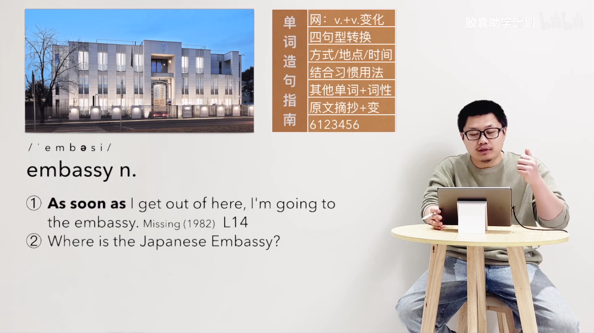

文字识别：单词造句指南 / 网：v.+v.变化 / 四句型转换 / 方式/地点/时间 / 结合习惯用法 / 其他单词+词性 / 原文摘抄+变 / 6123456 / / 'e m b a si / / embassy n. / As soon as I get out of here, I'm going to / the embassy. Missing (1982) L14 / Where is the Japanese Embassy?

## 00:05:30–00:06:00

crowd，一大群人，had gathered under the town hall clock。这是咱们当时学的原句，对吧？我们给它稍微改了一下，叫做outside the American embassy，是吧？哎，一大群人在美国大使馆前面聚集起来了。Okay, very good. Had gathered.呃，当然四句型转换这个是您对吧？想做随时暂停屏幕都可以做的。比如像第三句话就非常典型，非常适合问where,

### 画面 00:05:30

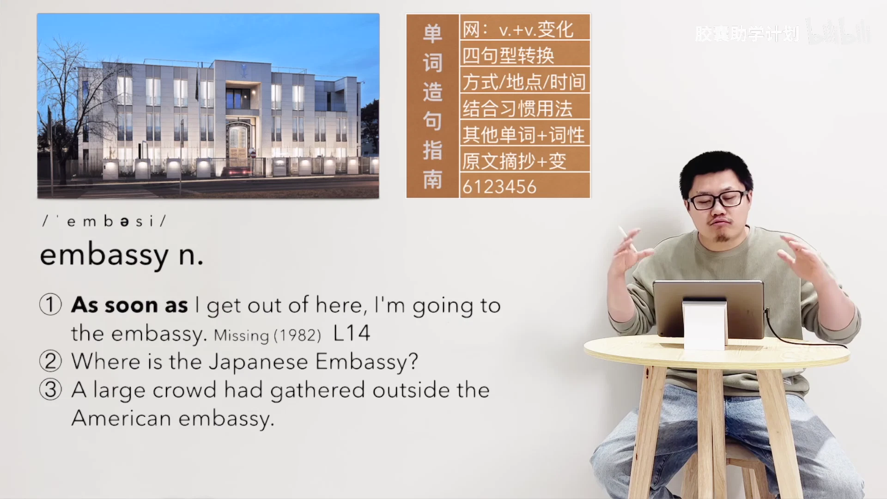

文字识别：单词造句指南 / 网：v.+v.变化 / 学计划 / 四句型转换 / 方式/地点/时间 / 结合习惯用法 / 其他单词+词性 / 原文摘抄+变 / 6123456 / / 'embas i / / embassy n. / As soon as I get out of here, I'm going to / the embassy. Missing(1982) L14 / Where is the Japanese Embassy? / 3 / ) A large crowd had gathered outside the / American embassy.

### 画面 00:05:35

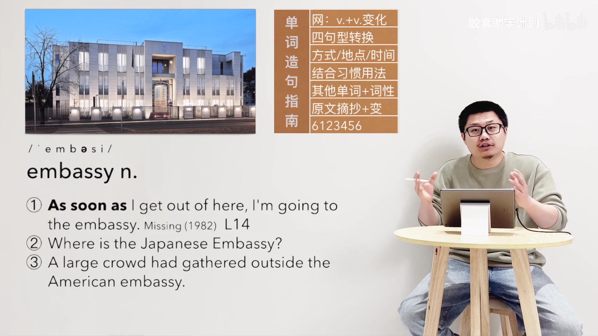

文字识别：单词造句指南 / 网：v.+v.变化 / 泰助学计划 / 四句型转换 / 方式/地点/时间 / 结合习惯用法 / 其他单词+词性 / 原文摘抄+变 / 6123456 / / 'embas i / / embassy n. / As soon as I get out of here, I'm going to / the embassy. Missing(1982) L14 / Where is the Japanese Embassy? / ③ A large crowd had gathered outside the / American embassy.

### 画面 00:05:40

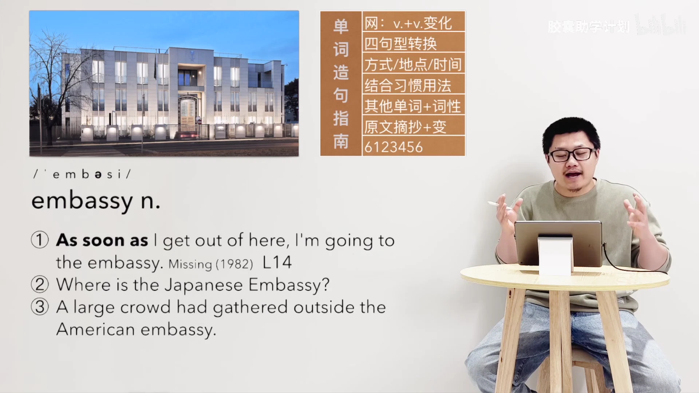

文字识别：单词造句指南 / 网：v.+v.变化 / 囊助学计划 / 四句型转换 / 方式/地点/时间 / 结合习惯用法 / 其他单词+词性 / 原文摘抄+变 / 6123456 / / 'em bas i / / embassy n. / As soon as I get out of here, I'm going to / the embassy. Missing(1982) L14 / Where is the Japanese Embassy? / 3 / ) A large crowd had gathered outside the / American embassy.

### 画面 00:05:50

文字识别：单词造句指南 / 网：v.+v.变化 / 四句型转换 / 方式/地点/时间 / 结合习惯用法 / 其他单词+词性 / 原文摘抄+变 / 6123456 / / 'e m b as i / / embassy n. / As soon as | get out of here, I'm going to / the embassy. Missing(1982) L14 / Where is the Japanese Embassy? / 3 / ③ A large crowd had gathered outside the / American embassy.

### 画面 00:05:55

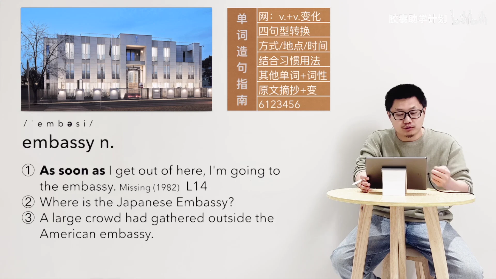

文字识别：单词造句指南 / 网：v.+v.变化 / 妻助学计划 / 四句型转换 / 方式/地点/时间 / 结合习惯用法 / 其他单词+词性 / 原文摘抄+变 / 6123456 / / 'em basi / / embassy n. / As soon as I get out of here, I'm going to / the embassy. Missing(1982) L14 / Where is the Japanese Embassy? / ③ A large crowd had gathered outside the / American embassy.

## 00:06:00–00:06:30

who,对吧？几乎都可以用。Next one,下一个单词heaven, heaven啊，天堂，对吧？天堂。那这这当然，这这个天堂不是咱们这个咱们这个儒释道文化下的这个这个这个大闹天宫的那个，它不是一一一码的事儿啊。这个heaven是基督教当中认为的那个天堂，对吧？Heaven。但是呢，它最常用的其实是口语当中啊，其实类特别像汉语。就我的天哪，英文叫Good heavens！

### 画面 00:06:00

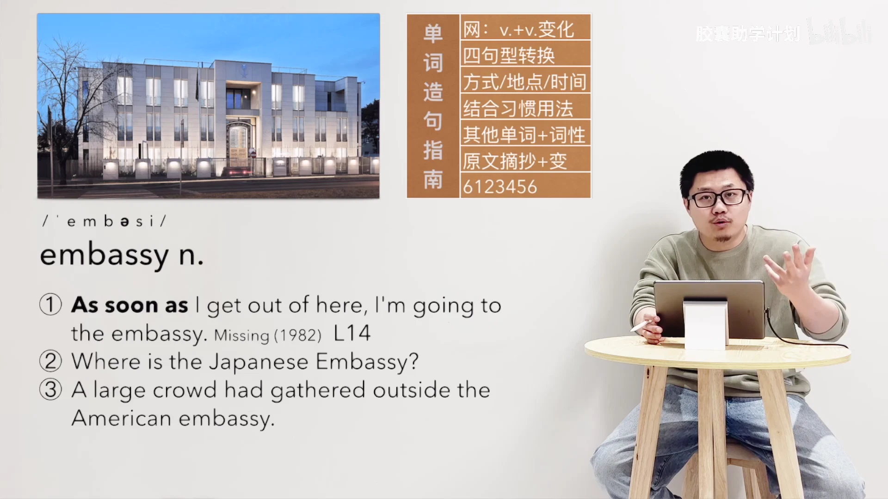

文字识别：单词造句指南 / 网：v.+v.变化 / 四句型转换 / 方式/地点/时间 / 结合习惯用法 / 其他单词+词性 / 原文摘抄+变 / 6123456 / / 'e m b a s i / / embassy n. / As soon as I get out of here, I'm going to / the embassy. Missing (1982) L14 / Where is the Japanese Embassy? / ③ A large crowd had gathered outside the / American embassy.

### 画面 00:06:03

文字识别：单词造句指南 / 网：v.+v.变化 / 交囊助学计划 / 四句型转换 / 方式/地点/时间 / 结合习惯用法 / 其他单词+词性 / 原文摘抄+变 / 6123456 / /'hevan/ / heaven n.

### 画面 00:06:05

文字识别：单词造句指南 / 网：v.+v.变化 / 交囊助学计划一 / 四句型转换 / 方式/地点/时间 / 结合习惯用法 / 其他单词+词性 / 原文摘抄+变 / 6123456 / /'hevan/ / heaven n.

### 画面 00:06:10

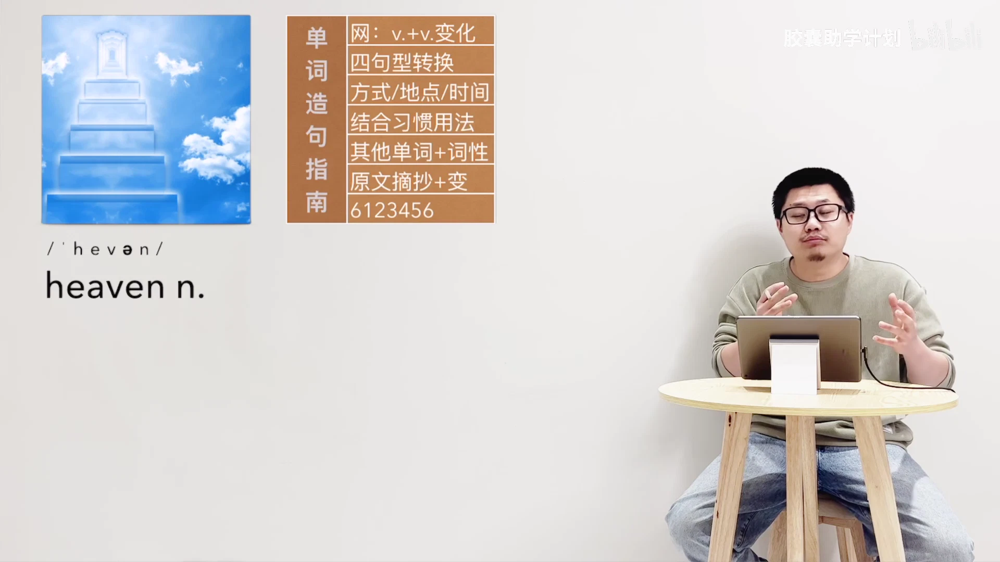

文字识别：单词造句指南 / 网：v.+v.变化 / 校囊助学计划州 / 四句型转换 / 方式/地点/时间 / 结合习惯用法 / 其他单词+词性 / 原文摘抄+变 / 6123456 / /'hevan/ / heaven n.

### 画面 00:06:16

文字识别：单词造句指南 / 网：v.+v.变化 / 校囊助学计划一 / 四句型转换 / 方式/地点/时间 / 结合习惯用法 / 其他单词+词性 / 原文摘抄+变 / 6123456 / /'hevan/ / heaven n.

### 画面 00:06:20

文字识别：单词造句指南 / 网：v.+v.变化 / 交囊助学计划 / 四句型转换 / 方式/地点/时间 / 结合习惯用法 / 其他单词+词性 / 原文摘抄+变 / 6123456 / /'hevan/ / heaven n.

### 画面 00:06:25

文字识别：单词造句指南 / 网：v.+v.变化 / 交囊助学计划一州 / 四句型转换 / 方式/地点/时间 / 结合习惯用法 / 其他单词+词性 / 原文摘抄+变 / 6123456 / /'hevan/ / heaven n. / ① Good heavens!

## 00:06:30–00:07:00

啊，口语当中一小句话，咱们造个句子，比如说 Good heavens, are you still trying to win? 我的天呐，你还在试着想赢吗？ Next one is Good heavens, how can you hold your breath for ten minutes? 说哎呦，我的天呐，你是如何做到憋气憋了十分钟的呢？别忘了 repeat after me 啊，总在提醒你。 Next one 下一个单词叫 basement, basement 地下室。六二三四五六里边又是一三五，

### 画面 00:06:32

文字识别：单词造句指南 / 网：v.+v.变化 / 妻助字计划 / 四句型转换 / 方式/地点/时间 / 结合习惯用法 / 其他单词+词性 / 原文摘抄+变 / 6123456 / /'hevan/ / heaven n. / ① Good heavens! / Good heavens. Are you still trying to win? / The Princess Bride (1987)

### 画面 00:06:35

文字识别：单词造句指南 / 网：v.+v.变化 / 妻助学计划 / 四句型转换 / 方式/地点/时间 / 结合习惯用法 / 其他单词+词性 / 原文摘抄+变 / 6123456 / /'hevan/ / heaven n. / ① Good heavens! / Good heavens. Are you still trying to win? / The Princess Bride (1987)

### 画面 00:06:39

文字识别：单词造句指南 / 网：v.+v.变化 / 四句型转换 / 方式/地点/时间 / 结合习惯用法 / 其他单词+词性 / 原文摘抄+变 / 6123456 / /'hevan/ / heaven n. / ① Good heavens! / ② Good heavens. Are you stil trying to win? / 2) / The Princess Bride (1987) / Good heavens!!! How can you hold your / breath for ten minutes? L94

### 画面 00:06:41

文字识别：单词造句指南 / 网：v.+v.变化 / 囊助字计划陽 / 四句型转换 / 方式/地点/时间 / 结合习惯用法 / 其他单词+词性 / 原文摘抄+变 / 6123456 / /'hevan/ / heaven n. / ① Good heavens! / ② Good heavens. Are you still trying to win? / The Princess Bride (1987) / Good heavens!!! How can you hold your / breath for ten minutes? L94

### 画面 00:06:45

文字识别：单词造句指南 / 网：v.+v.变化 / 四句型转换 / 方式/地点/时间 / 结合习惯用法 / 其他单词+词性 / 原文摘抄+变 / 6123456 / /'hevan/ / heaven n. / ① Good heavens! / ② Good heavens. Are you still trying to win? / The Princess Bride (1987) / Good heavens!!! How can you hold your / breath for ten minutes? L94

### 画面 00:06:50

文字识别：单词造句指南 / 网：v.+v.变化 / 囊助字计划陽 / 四句型转换 / 方式/地点/时间 / 结合习惯用法 / 其他单词+词性 / 原文摘抄+变 / 6123456 / /'hevan/ / heaven n. / ① Good heavens! / ② Good heavens. Are you still trying to win? / The Princess Bride (1987) / Good heavens!!! How can you hold your / breath for ten minutes? L94

### 画面 00:06:52

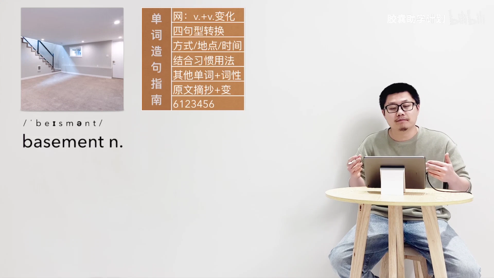

文字识别：单词造句指南 / 网：v.+v.变化 / 囊助字计划園 / 四句型转换 / 方式/地点/时间 / 结合习惯用法 / 其他单词+词性 / 原文摘抄+变 / 6123456 / /'belsmant/ / basement n.

### 画面 00:06:55

文字识别：单词造句指南 / 网：v.+v.变化 / 奏助字计划 / 四句型转换 / 方式/地点/时间 / 结合习惯用法 / 其他单词+词性 / 原文摘抄+变 / 6123456 / /'belsmant/ / basement n.

## 00:07:00–00:07:30

对吧？主语、宾语、地点，这是它最常见的地方。然后呢，不管是啥，得找动词。比如说，We should have checked the basement。在这个里边，它用到的实际上是三，在三这个位置。如果它在三的位置，那你肯定就要去想的是什么样的动词能跟 basement 连起来。但如果它在五的位置做一个地点，那你就去想的是什么样的活动可以在 basement 里面进行，对吧？它不用不用非得说接

### 画面 00:07:00

文字识别：单词造句指南 / 网：v.+v.变化 / 卖助学计划一洲 / 四句型转换 / 方式/地点/时间 / 结合习惯用法 / 其他单词+词性 / 原文摘抄+变 / 6123456 / /'beIsmant/ / basement n.

### 画面 00:07:08

文字识别：单词造句指南 / 网：v.+v.变化 / 囊助字计划陽 / 四句型转换 / 方式/地点/时间 / 结合习惯用法 / 其他单词+词性 / 原文摘抄+变 / 6123456 / /'beIsmant/ / basement n. / ① We should have checked the basement. / L65

### 画面 00:07:15

文字识别：单词造句指南 / 网：v.+v.变化 / 囊助学计划園 / 四句型转换 / 方式/地点/时间 / 结合习惯用法 / 其他单词+词性 / 原文摘抄+变 / 6123456 / /'beismant/ / basement n. / ① We should have checked the basement. / L65

### 画面 00:07:22

文字识别：单词造句指南 / 网：v.+v.变化 / 妻助学计划 / 四句型转换 / 方式/地点/时间 / 结合习惯用法 / 其他单词+词性 / 原文摘抄+变 / 6123456 / /'beIsmant/ / basement n. / ① We should have checked the basement. / L65

## 00:07:30–00:08:00

to say to go to the basement. Go to the basement. We should have checked it, but we didn't. Next one. Two detectives were keeping guard at the entrance of the basement. They used two expressions: keep guard at the entrance of. The last one. They carried the bags to the basement. They carried the bags to the basement. They carried the bags to the basement. They carried the bags to the basement. They carried the bags to the basement. They carried the bags to the basement. They

### 画面 00:07:34

文字识别：单词造句指南 / 网：v.+v.变化 / 四句型转换 / 方式/地点/时间 / 结合习惯用法 / 其他单词+词性 / 原文摘抄+变 / 6123456 / /'beismant/ / basement n. / ① We should have checked the basement. / L65 / Two detectives were keeping guard at the / entrance of the basement. L93 L7

### 画面 00:07:36

文字识别：单词造句指南 / 网：v.+v.变化 / 四句型转换 / 方式/地点/时间 / 结合习惯用法 / 其他单词+词性 / 原文摘抄+变 / 6123456 / /'beismant/ / basement n. / ① We should have checked the basement. / L65 / Two detectives were keeping guard at the / entrance of the basement. L93 L7

### 画面 00:07:48

文字识别：单词造句指南 / 网：v.+v.变化 / 学计划 / 四句型转换 / 方式/地点/时间 / 结合习惯用法 / 其他单词+词性 / 原文摘抄+变 / 6123456 / /'beismant/ / basement n. / ① We should have checked the basement. / L65 / Two detectives were keeping guard at the / entrance of the basement. L93 L7 / They carried the bags to the basement. L74

### 画面 00:07:53

文字识别：单词造句指南 / 网：v.+v.变化 / 四句型转换 / 方式/地点/时间 / 结合习惯用法 / 其他单词+词性 / 原文摘抄+变 / 6123456 / /'beismant/ / basement n. / ① We should have checked the basement. / L65 / Two detectives were keeping guard at the / entrance of the basement. L93 L7 / They carried the bags to the basement. L74

### 画面 00:07:55

文字识别：单词造句指南 / 网：v.+v.变化 / 妻助学计划 / 四句型转换 / 方式/地点/时间 / 结合习惯用法 / 其他单词+词性 / 原文摘抄+变 / 6123456 / /'defrnatli/ / definitely adv.

### 画面 00:07:58

文字识别：单词造句指南 / 网：v.+v.变化 / 妻助学计划 / 四句型转换 / 方式/地点/时间 / 结合习惯用法 / 其他单词+词性 / 原文摘抄+变 / 6123456 / /'definatli/ / definitely adv.

## 00:08:00–00:08:30

definitely, definitely. Okay, definitely就是一定的，肯定的，definitely绝对的。比如说，the team will definitely lose if he doesn't play.如果他不上场，这个play肯定，平常我们翻译成玩儿。你前面用的是一个team和lose，这个这个这队肯定输啊。如果他不上场，对吧？Okay, I can't tell you definitely when I will come.或者说I can't tell you when

### 画面 00:08:00

文字识别：单词造句指南 / 网：v.+v.变化 / 囊助字计划 / 四句型转换 / 方式/地点/时间 / 结合习惯用法 / 其他单词+词性 / 原文摘抄+变 / 6123456 / /'definatli/ / definitely adv.

### 画面 00:08:04

文字识别：单词造句指南 / 网：v.+v.变化 / 囊助学计划一 / 四句型转换 / 方式/地点/时间 / 结合习惯用法 / 其他单词+词性 / 原文摘抄+变 / 6123456 / /'definatli/ / definitely adv.

### 画面 00:08:09

文字识别：单词造句指南 / 网：v.+v.变化 / 妻助字计划 / 四句型转换 / 方式/地点/时间 / 结合习惯用法 / 其他单词+词性 / 原文摘抄+变 / 6123456 / /'definatli/ / definitely adv. / ① The team will definitely lose if he doesn't / play. L16

### 画面 00:08:14

文字识别：单词造句指南 / 网：v.+v.变化 / 妻助学计划 / 四句型转换 / 方式/地点/时间 / 结合习惯用法 / 其他单词+词性 / 原文摘抄+变 / 6123456 / /'definatli/ / definitely adv. / ① The team will definitely lose if he doesn't / play. L16

### 画面 00:08:19

文字识别：单词造句指南 / 网：v.+v.变化 / 奏助学计划 / 四句型转换 / 方式/地点/时间 / 结合习惯用法 / 其他单词+词性 / 原文摘抄+变 / 6123456 / /'definatli/ / definitely adv. / ① The team will definitely lose if he doesn't / play. L16

### 画面 00:08:24

文字识别：单词造句指南 / 网：v.+v.变化 / 囊助字计划 / 四句型转换 / 方式/地点/时间 / 结合习惯用法 / 其他单词+词性 / 原文摘抄+变 / 6123456 / /'definatli/ / definitely adv. / ① The team will definitely lose if he doesn't / play. L16 / ② I can't tell you definitely when I will come.

## 00:08:30–00:09:00

I will definitely come.或者说，呃，definitely when I will come，都可以啊。说我具体是什么时候到啊？肯定什么时候到？最后一个句子说 I can definitely say，说我我可以很确定的和肯定的说说什么呢？Everything is under control. Trust me.啊，相信我，一切都在控制之下。I can definitely say that. Okay，其实就是 I can say that，前面这个中间加了个副词嘛，对吧？好，

### 画面 00:08:39

文字识别：单词造句指南 / 网：v.+v.变化 / 囊助字计划 / 四句型转换 / 方式/地点/时间 / 结合习惯用法 / 其他单词+词性 / 原文摘抄+变 / 6123456 / / 'definatli / / definitely adv. / ① The team will definitely lose if he doesn't / play. L16 / ② I can't tell you definitely when I will come. / ③ I can definitely say that everything is under / control. L62

### 画面 00:08:44

文字识别：单词造句指南 / 网：v.+v.变化 / 妻助字计划 / 四句型转换 / 方式/地点/时间 / 结合习惯用法 / 其他单词+词性 / 原文摘抄+变 / 6123456 / /'definat l i / / definitely adv. / ① The team will definitely lose if he doesn't / play. L16 / ② I can't tell you definitely when I will come. / ③ I can definitely say that everything is under / Control. L62

### 画面 00:08:47

文字识别：单词造句指南 / 网：v.+v.变化 / 奏助字计划陽 / 四句型转换 / 方式/地点/时间 / 结合习惯用法 / 其他单词+词性 / 原文摘抄+变 / 6123456 / /'definat l i / / definitely adv. / ① The team will definitely lose if he doesn't / play. L16 / ② I can't tell you definitely when I will come. / ③ I can definitely say that everything is under / control. L62

### 画面 00:08:54

文字识别：单词造句指南 / 网：v.+v.变化 / 囊助字计划陽 / 四句型转换 / 方式/地点/时间 / 结合习惯用法 / 其他单词+词性 / 原文摘抄+变 / 6123456 / / 'd efinat l i / / definitely adv. / ① The team will definitely lose if he doesn't / play. L16 / ② I can't tell you definitely when I will come. / ③ I can definitely say that everything is under / Control. L62

### 画面 00:08:59

文字识别：单词造句指南 / 网：v.+v.变化 / 囊助字计划陽 / 四句型转换 / 方式/地点/时间 / 结合习惯用法 / 其他单词+词性 / 原文摘抄+变 / 6123456 / /paust/ / post v.

## 00:09:00–00:09:30

下一个单词叫 post。这个单词你认的，只不过今天我们要学的，它的含义是委派、委任的意思，就是你把某人，类似于借调啊，或者说给他派向另一个工作岗位。post。比如说原文给了一句话叫 I must get that fellow posted。我一定会让他怎么样被派走的。OK，那比如说我们现在造一个句子叫做 He's been posted to Beijing for six months。说他已经

### 画面 00:09:03

文字识别：单词造句指南 / 网：v.+v.变化 / 囊助字计划園 / 四句型转换 / 方式/地点/时间 / 结合习惯用法 / 其他单词+词性 / 原文摘抄+变 / 6123456 / /paust/ / post v.

### 画面 00:09:10

文字识别：单词造句指南 / 网：v.+v.变化 / 囊助学计划 / 四句型转换 / 方式/地点/时间 / 结合习惯用法 / 其他单词+词性 / 原文摘抄+变 / 6123456 / /paust/ / post v.

### 画面 00:09:14

文字识别：单词造句指南 / 网：v.+v.变化 / 囊助字计划一卿 / 四句型转换 / 方式/地点/时间 / 结合习惯用法 / 其他单词+词性 / 原文摘抄+变 / 6123456 / /paust/ / post v. / ① [Story]: I must get that fellow posted...

### 画面 00:09:25

文字识别：单词造句指南 / 网：v.+v.变化 / 妻助学计划 / 四句型转换 / 方式/地点/时间 / 结合习惯用法 / 其他单词+词性 / 原文摘抄+变 / 6123456 / /paust/ / post v. / ① [Story]: I must get that fellow posted.. / ) He's been posted to Beijing for six months.

## 00:09:30–00:10:00

posted

### 画面 00:09:34

文字识别：单词造句指南 / 网：v.+v.变化 / 延字计划 / 四句型转换 / 方式/地点/时间 / 结合习惯用法 / 其他单词+词性 / 原文摘抄+变 / 6123456 / /paust/ / post v. / ① [Story]: I must get that fellow posted... /  He's been posted to Beijing for six months. / 2） / ③ A guard was posted outside the building.

### 画面 00:09:38

文字识别：单词造句指南 / 网：v.+v.变化 / 四句型转换 / 方式/地点/时间 / 结合习惯用法 / 其他单词+词性 / 原文摘抄+变 / 6123456 / /paust/ / post v. / ① [Story]: I must get that fellow posted... / ) He's been posted to Beijing for six months. / ③ A guard was posted outside the building.

### 画面 00:09:40

文字识别：单词造句指南 / 网：v.+v.变化 / 四句型转换 / 方式/地点/时间 / 结合习惯用法 / 其他单词+词性 / 原文摘抄+变 / 6123456 / /paust/ / post v. / ① [Story]: I must get that fellow posted... /  He's been posted to Beijing for six months. / 2） / ③ A guard was posted outside the building.

### 画面 00:09:46

文字识别：单词造句指南 / 网：v.+v.变化 / 四句型转换 / 方式/地点/时间 / 结合习惯用法 / 其他单词+词性 / 原文摘抄+变 / 6123456 / /paust/ / post v. / ① [Story]: I must get that fellow posted... / ② He's been posted to Beijing for six months. / 2） / ③ A guard was posted outside the building.

### 画面 00:09:50

文字识别：单词造句指南 / 网：v.+v.变化 / 四句型转换 / 方式/地点/时间 / 结合习惯用法 / 其他单词+词性 / 原文摘抄+变 / 6123456 / /paust/ / post v. / ① [Story]: I must get that fellow posted... /  He's been posted to Beijing for six months. / 2) / ③ A guard was posted outside the building.

### 画面 00:09:54

文字识别：单词造句指南 / 网：v.+v.变化 / 囊助学计划 / 四句型转换 / 方式/地点/时间 / 结合习惯用法 / 其他单词+词性 / 原文摘抄+变 / 6123456 / /paust/ / post v. / ① [Story]: I must get that fellow posted... / 9 He's been posted to Beijing for six months. / 2） / ③ A guard was posted outside the building. / ④ I hope you'll be posted to my department.

### 画面 00:09:59

文字识别：单词造句指南 / 网：v.+v.变化 / 四句型转换 / 方式/地点/时间 / 结合习惯用法 / 其他单词+词性 / 原文摘抄+变 / 6123456 / /paust/ / post v. / ① [Story]: I must get that fellow posted.. / ) He's been posted to Beijing for six months. / 2） / ③ A guard was posted outside the building. / ④ I hope you'll be posted to my department.

## 00:10:00–00:10:30

说我希望怎么样呢？注意，will be done二十一课咱们刚学的叫你将被委派到我的这个部门，对吧？被委派，将被委派，will be done。再读一遍这个单词，post。下一个单词，shot，shot就是开枪啊，你可以理解为就是开枪这个动作，对吧？或者这个名词都可以啊。那它很常用的这个短语，我们直接就在这儿出现了，叫fire a shot，就是开枪了，

### 画面 00:10:10

文字识别：单词造句指南 / 网：v.+v.变化 / 四句型转换 / 方式/地点/时间 / 结合习惯用法 / 其他单词+词性 / 原文摘抄+变 / 6123456 / /paust/ / post v. / ① [Story]: I must get that fellow posted... / ② He's been posted to Beijing for six months. / 2） / ③ A guard was posted outside the building. / ④ I hope you'll be posted to my department.

### 画面 00:10:14

文字识别：单词造句指南 / 网：v.+v.变化 / 学计划 / 四句型转换 / 方式/地点/时间 / 结合习惯用法 / 其他单词+词性 / 原文摘抄+变 / 6123456 / /paust/ / post v. / ① [Story]: I must get that fellow posted... / ② He's been posted to Beijing for six months. / 2) / ③ A guard was posted outside the building. / ④ I hope you'll be posted to my department.

### 画面 00:10:16

文字识别：单词造句指南 / 网：v.+v.变化 / 妻助学计划） / 四句型转换 / 方式/地点/时间 / 结合习惯用法 / 其他单词+词性 / 原文摘抄+变 / 6123456 / / ∫ot/ / shot n.

### 画面 00:10:19

文字识别：单词造句指南 / 网：v.+v.变化 / 囊助学计划 / 四句型转换 / 方式/地点/时间 / 结合习惯用法 / 其他单词+词性 / 原文摘抄+变 / 6123456 / / ∫ot/ / shot n.

### 画面 00:10:23

文字识别：单词造句指南 / 网：v.+v.变化 / 裡助学计划 / 四句型转换 / 方式/地点/时间 / 结合习惯用法 / 其他单词+词性 / 原文摘抄+变 / 6123456 / / ∫ot/ / shot n. / ① [Story]: Someone fired a shot through my / office window.

### 画面 00:10:25

文字识别：单词造句指南 / 网：v.+v.变化 / 四句型转换 / 方式/地点/时间 / 结合习惯用法 / 其他单词+词性 / 原文摘抄+变 / 6123456 / / ∫ot/ / shot n. / ① [Story]: Someone firedoshot through my / office window.

## 00:10:30–00:11:00

对吧？那through my office window就是穿过我的办公室的窗户，对吧？那四句型转换就是咱们原文摘抄再加变，这是最简单，我没什么说的了。我们再造一个句子，It comes as a surprise to learn that. 记得吧，我说这个语法怎么学来着？不用分析，It comes as a surprise to learn that. 来回来去造句，造多了自然而然记下来了，对吧？这是我希望你最终做到的事情。说很惊讶的意识到怎么样呢？He didn't fire shot. 他竟然就没开枪。

### 画面 00:10:39

文字识别：单词造句指南 / 网：v.+v.变化 / 四句型转换 / 方式/地点/时间 / 结合习惯用法 / 其他单词+词性 / 原文摘抄+变 / 6123456 / / ∫ot/ / shot n. / ① [Story]: Someone fired a shot through my / office window. / did/why/who/when... / It comes as a surprise to learn that he didn't / fire a shot. L90

### 画面 00:10:47

文字识别：单词造句指南 / 网：v.+v.变化 / 臺助学计划 / 四句型转换 / 方式/地点/时间 / 结合习惯用法 / 其他单词+词性 / 原文摘抄+变 / 6123456 / / ∫ot/ / shot n. / ① [Story]: Someone fired a shot through my / office window. / did/why/who/when... / It comes as a surprise to learn that he didn't / fire a shot. L90

### 画面 00:10:51

文字识别：单词造句指南 / 网：v.+v.变化 / 四句型转换 / 方式/地点/时间 / 结合习惯用法 / 其他单词+词性 / 原文摘抄+变 / 6123456 / / ∫ot/ / shot n. / ① [Story]: Someone fired a shot through my / office window. / did/why/who/when... / It comes as a surprise to learn that he didn't / fire a shot. L90

### 画面 00:10:54

文字识别：单词造句指南 / 网：v.+v.变化 / 四句型转换 / 方式/地点/时间 / 结合习惯用法 / 其他单词+词性 / 原文摘抄+变 / 6123456 / / ∫ot/ / shot n. / ① [Story]: Someone fired a shot through my / office window. / did/why/who/when... / It comes as a surprise to learn that he didn't / fire a shot. L90

### 画面 00:10:59

文字识别：单词造句指南 / 网：v.+v.变化 / 四句型转换 / 方式/地点/时间 / 结合习惯用法 / 其他单词+词性 / 原文摘抄+变 / 6123456 / / ∫ot/ / shot n. / ① [Story]: Someone fired a shot through my / office window. / did/why/who/when... / It comes as a surprise to learn that he didn't / fire a shot. L90

## 00:11:00–00:11:30

Okay,最后一个if everything goes smoothly, go smoothly什么意思？Progress啊，这个smoothly什么意思来着？Go smoothly, run smoothly指的是事情进展顺利，对吧？I won't fire a shot啊，我连开枪都不用开。如果一切顺利的话，对吧？当然这课用到了十六课的基本这个句型，对吧？If的这个从句啊。好，本课除了单词以外，这几个习惯用法你肯定要记住，听说读写全用得到啊。

### 画面 00:11:04

文字识别：单词造句指南 / 网：v.+v.变化 / 四句型转换 / 方式/地点/时间 / 结合习惯用法 / 其他单词+词性 / 原文摘抄+变 / 6123456 / / ∫ot/ / shot n. / ① [Story]: Someone fired a shot through my / office window. / did/why/who/when... / It comes as a surprise to learn that he didn't / fire a shot. L90 / ④ If everything go smoothly, I won't fire a / shot. L88 L16

### 画面 00:11:23

文字识别：Recap / Words / live in a fantasy world / Expression / Good heavens! / fire a shot

### 画面 00:11:25

文字识别：Recap / 臺助正字计划 / Words / live in a fantasy world / Expression / Good heavens! / fire a shot

### 画面 00:11:27

文字识别：Recap / 囊助字计划 / Words / live in a fantasy world / Expression / Good heavens! / fire a shot

### 画面 00:11:29

文字识别：Recap / 囊助字计划 / Words / live in a fantasy world / Expression / Good heavens! / fire a shot

## 00:11:30–00:12:00

我们新二当中所有都是听说读写用得到，单词造句，然后呢听电影片段，然后置顶留言去找重复间隔的学习材料。那以上呢就是本期视频的全部内容了。如果各位喜欢我们的课程呢，欢迎各位关注、订阅、一键三连，分享给那些需要的朋友来帮助我们快速成长。See you next time.

### 画面 00:11:31

文字识别：妻助字计划一

### 画面 00:11:33

文字识别：菱助学计划園 / 单词造句/对话 / 1. / 【单词造句指南】 / 每个5句 / 2.反复听电影片段，直到能 / 听出关键短语/句子

### 画面 00:11:35

文字识别：单词造句/对话 / 【单词造句指南】 / 每个5句 / 2.反复听电影片段，直到能 / 听出关键短语/句子 / 3.重复间隔（置顶留言）

### 画面 00:11:38

文字识别：囊助学计划一 / 👍

### 画面 00:11:51

文字识别：助字计划一州

### 画面 00:11:53

文字识别：臺聖珈学計切 / CAPSULEACADEMY / 胶囊助学计划 / 小红书 / Lecturer / Leo / OE

### 画面 00:11:55

文字识别：CAPSULEACADEMY / 胶囊助学计划 / 小红书 / Photographer / □ / Berlin / OE

### 画面 00:11:57

文字识别：臺聖珈学計划 / CAPSULEACADEMY / 胶囊助学计划 / 『 / 小红书 / Editor / □ / Berlin / OE

## 00:12:00–00:12:04

### 画面 00:12:00

文字识别：洲学針物 / CAPSULEACADEMY / 胶囊助学计划 / 『 / 小红书 / Creator / □ / Leo & Berlin / OE

### 画面 00:12:02

文字识别：bilbili / 胶囊助学计划

### 画面 00:12:03

文字识别：bilbili / 胶囊助学计划

