# 095 文章

快速机器解析：语音为单模型转写，未进行独立交叉校对或人工复核；画面每秒采样并按变化选帧，短时文字和标记可能遗漏。截图时间约有 1 秒误差。图片有损压缩；遇到疑点请按时间查看 Google Drive 原视频。

## 00:00:00–00:00:30

Hello everyone, welcome to Capsule Academy. This is Leo. Today we're going to learn New Concept English Book Two Lesson Ninety Five Story. Hope you gonna enjoy it.呃，我们先看文章标题叫 A Fantasy 白日做梦什么意思？这得进入文章才知道了，是吧？说 Why was the embassy particularly lucky？说为什么这个大使格外的幸运啊？我们进入文章看一下他为什么很幸运吧。

### 画面 00:00:00

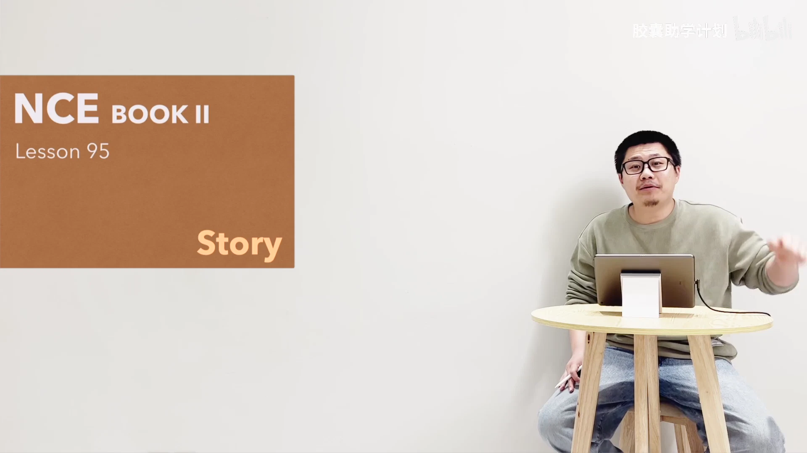

文字识别：囊助学计划 / NCE / BOOKII / Lesson 95 / Story

### 画面 00:00:02

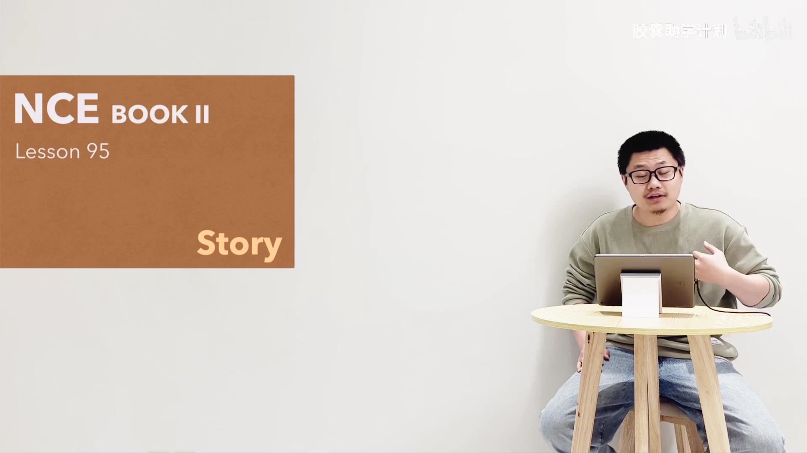

文字识别：助学计划 / NCE / BOOKⅡI / Lesson 95 / Story

### 画面 00:00:07

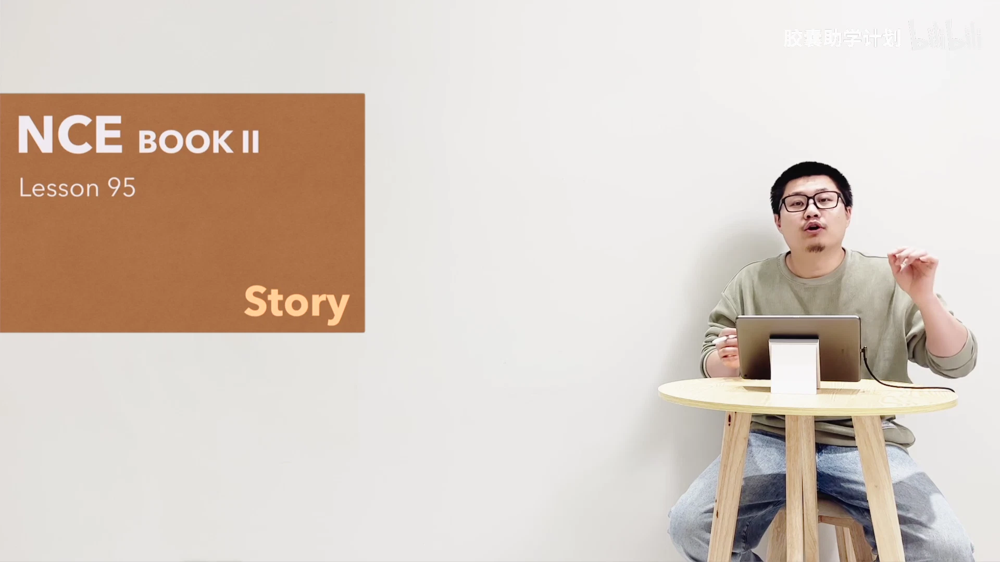

文字识别：交囊助学计划 / NCE / BOOKⅡI / Lesson 95 / Story

### 画面 00:00:09

文字识别：bitbli / 胶囊助学计划

### 画面 00:00:13

### 画面 00:00:15

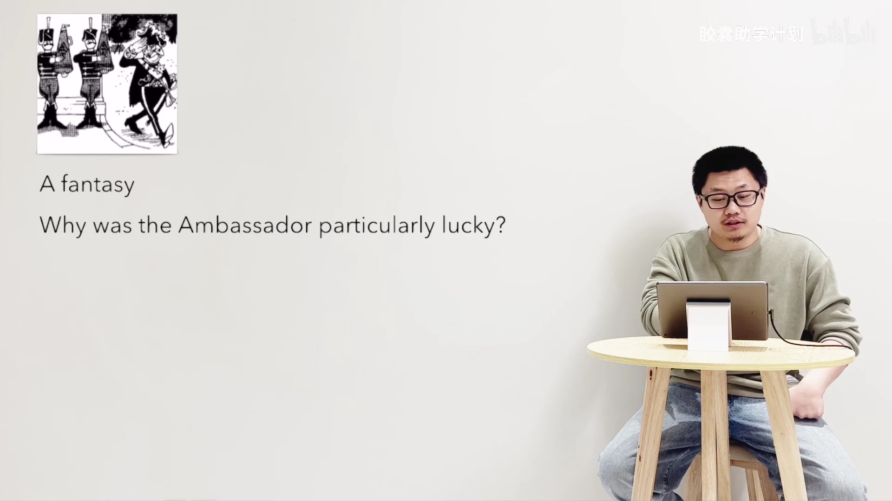

文字识别：囊助学计划 / A fantasy / Why was the Ambassador particularly lucky?

### 画面 00:00:22

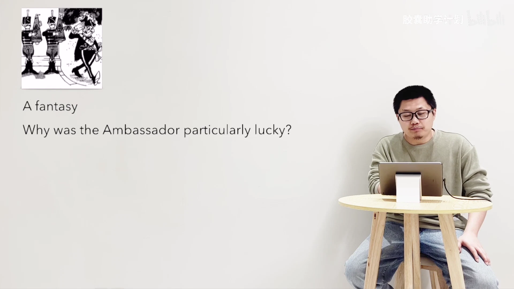

文字识别：妻助学计划 / Afantasy / Why was the Ambassador particularly lucky?

## 00:00:30–00:01:00

啊，就是捡回了一条命，甚至可以这样说。我们看文章，整个文章基本上是对话啊，不是很难。When当the ambassador of Isklopie，这个基本就是一个编造的词，呃，你也许这辈子见到他的可能性就是在读这篇文章的时候了，是吧？所以不用记啊，一个伪造的地名，这个地方的大使。Return home for lunch. His wife got a shock.

### 画面 00:00:30

文字识别：When the Ambassador of Escalopia / returned home for lunch, his wife / L23 / gota / shock. He looked pale and his clothes were / in a frightful state. / 'What has happened?' she asked.'How did / your clothes get into such a mess?'

### 画面 00:00:32

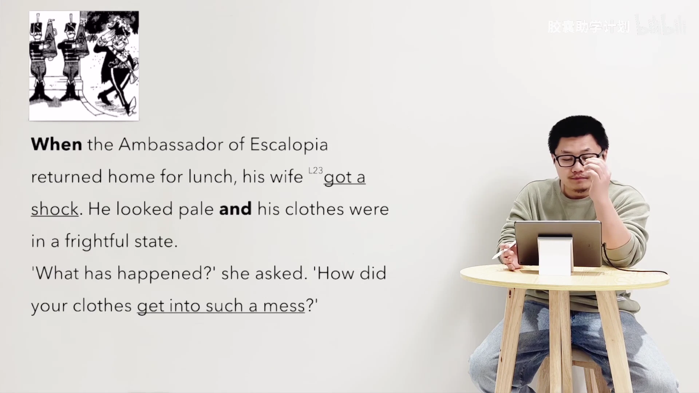

文字识别：When the Ambassador of Escalopia / returned home for lunch, his wife / ,L23 / 3got a / shock. He looked pale and his clothes were / in a frightful state. / 'What has happened?' she asked.'How did / your clothes get into such a mess?'

## 00:01:00–00:01:30

Return home for lunch. 回家吃午饭的时候，他老婆 got a shock. Got a shock. 二十三课咱们学过，就震惊了。 Get a surprise. Get a shock, 对吧？ He looked pale, and his clothes were in a frightful state. 说他看起来 pale 怎么样呢？这个脸色苍白，衣服呢？哎，是一个特别可怕的状态啊，特别可怕。这就不肯定不是吓人

### 画面 00:01:02

文字识别：When the Ambassador of Escalopia / returned home for lunch, his wife / 。L23 / 3got a / shock. He looked pale and his clothes were / in a frightful state. / 'What has happened?' she asked.'How did / your clothes get into such a mess?'

## 00:01:30–00:02:00

了吗？就一个很可怕的状态。这个 state 是状态的意思。What has happened? She asked. How did your clothes get into such a mess? 这发生了什么呀？她问道。说你的这个衣服怎么 get into such a mess? Get，其实如果我们先从字面意思去理解 get into such a mess。啊，这个 get 万能动词 into 进入如此糟糕，就怎

### 画面 00:01:32

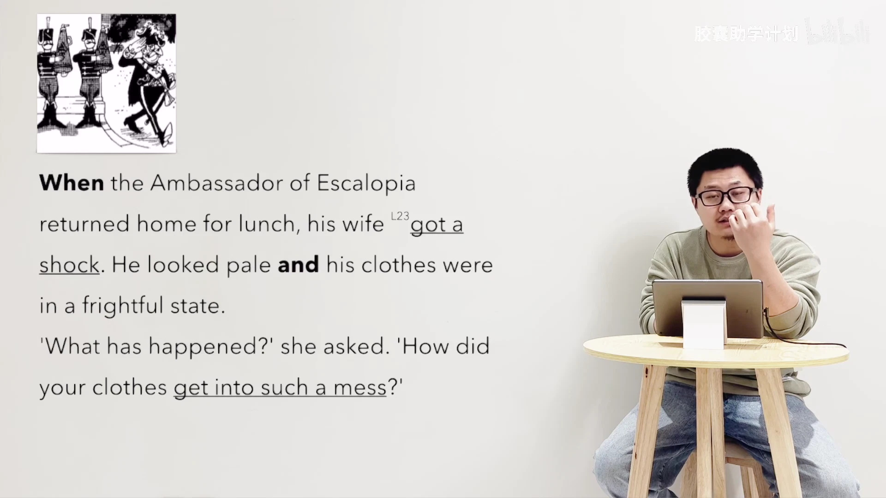

文字识别：When the Ambassador of Escalopia / returned home for lunch, his wife / eL23 / 3got a / shock. He looked pale and his clothes were / in a frightful state. / 'What has happened?' she asked.'How did / your clothes get into such a mess?'

### 画面 00:01:52

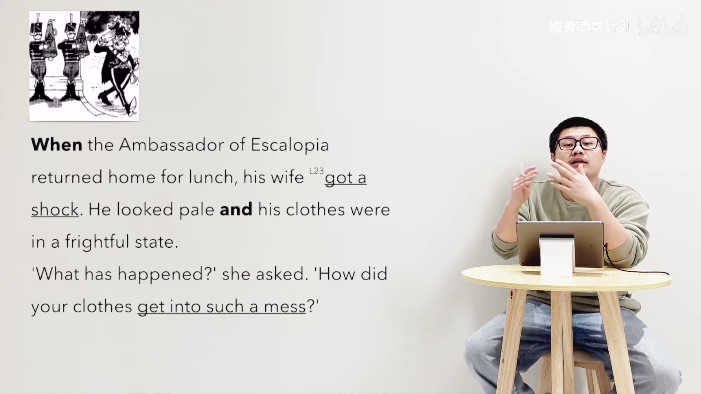

文字识别：When the Ambassador of Escalopia / returned home for lunch, his wife / ,L23 / gota / shock. He looked pale and his clothes were / in a frightful state. / 'What has happened?' she asked.'How did / your clothes get into such a mess?'

### 画面 00:01:55

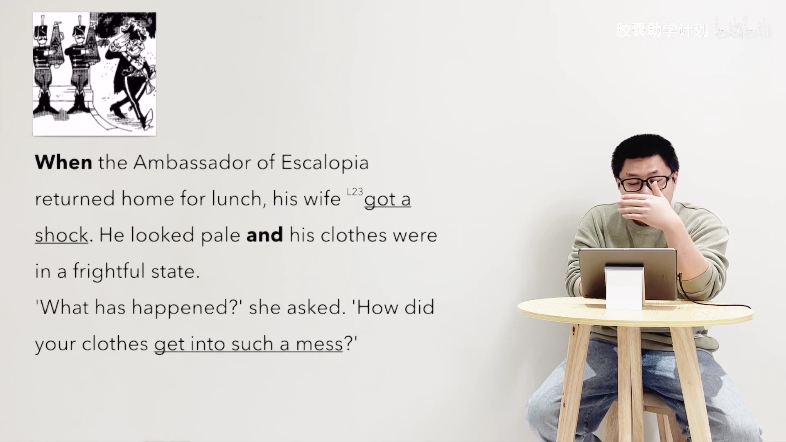

文字识别：When the Ambassador of Escalopia / returned home for lunch, his wife / L23 / 3got a / shock. He looked pale and his clothes were / in a frightful state. / 'What has happened?' she asked.'How did / your clothes get into such a mess?'

## 00:02:00–00:02:30

么进到如此糟糕的这个状态了，什么意思？什么叫你的衣服如怎么进入如此糟糕的一个状态了？这个 mess 当然也有混乱，对吧？就是你衣服怎么乱七八糟的啊？这儿一个洞，那儿那儿一块泥的，对吧？浑身怎么乱七八糟的？就是这样一个 get into such a mess。当然，它还可以指，比如说我们进入某个事情 get into such a mess 也可以，对吧？哎，这个一会儿我们习惯用法造句的时候再说啊。现在在这文

### 画面 00:02:09

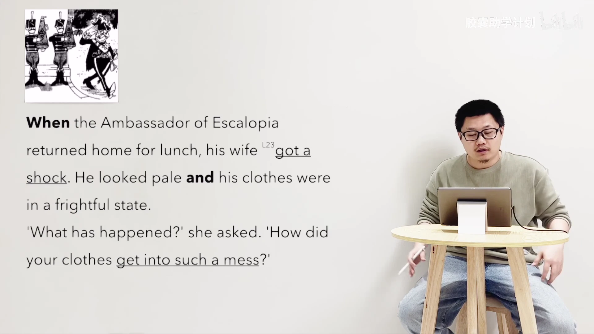

文字识别：When the Ambassador of Escalopia / returned home for lunch, his wife /  L23 / 3gota / shock. He looked pale and his clothes were / in a frightful state. / 'What has happened?' she asked.'How did / your clothes get into such a mess?'

### 画面 00:02:18

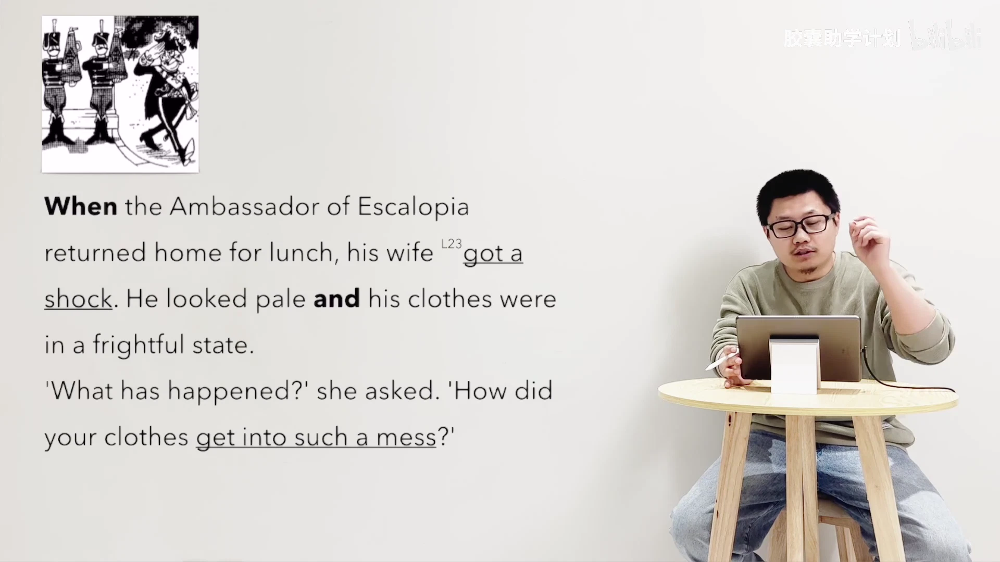

文字识别：When the Ambassador of Escalopia / returned home for lunch, his wife / 。L23 / 3got a / shock. He looked pale and his clothes were / in a frightful state. / 'What has happened?' she asked.'How did / your clothes get into such a mess?'

### 画面 00:02:21

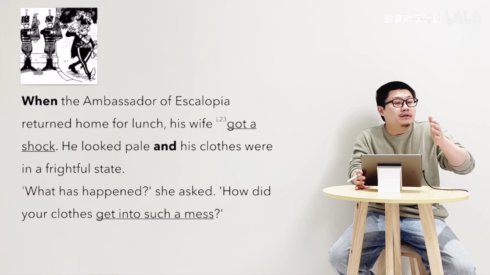

文字识别：When the Ambassador of Escalopia / returned home for lunch, his wife / L23 / gota / shock. He looked pale and his clothes were / in a frightful state. / 'What has happened?' she asked.'How did / your clothes get into such a mess?'

### 画面 00:02:28

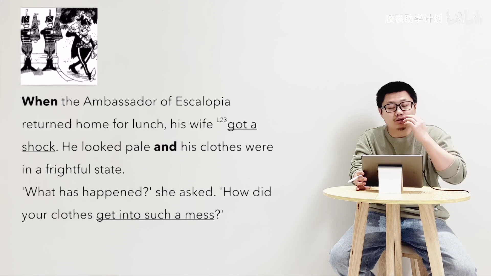

文字识别：When the Ambassador of Escalopia / returned home for lunch, his wife / ,L23 / gota / shock. He looked pale and his clothes were / in a frightful state. / 'What has happened?' she asked.'How did / your clothes get into such a mess?'

## 00:02:30–00:03:00

章中的意思我们懂就行了。你衣服怎么乱七八糟的？A fire extinguisher, my dear. Answer the ambassador dryly. 哎，我得再读一遍，他是dryly嘛？就是A fire extinguisher, my dear. Answer the ambassador dryly. 啊，是灭火器啊，亲爱的。呃，回答到这个大使回答到怎么样呢？Dryly就是冷冷淡淡、平平淡淡的，很平常啊。就是哎，灭火器弄的，就这样，对吧？没觉得是多大

### 画面 00:02:33

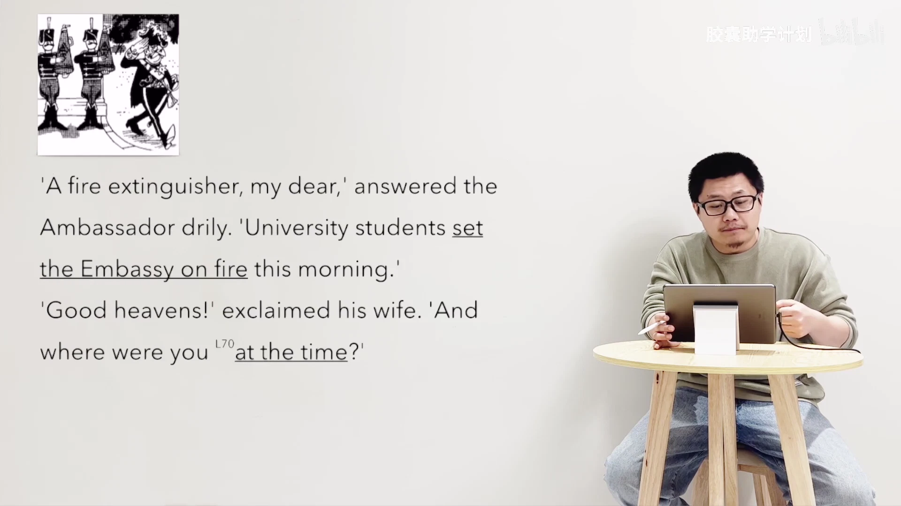

文字识别：'A fire extinguisher, my dear,' answered the / Ambassador drily.'University students set / the Embassy on fire this morning.' / 'Good heavens!' exclaimed his wife.'And / where were you / L70 / 'at the time?'

### 画面 00:02:35

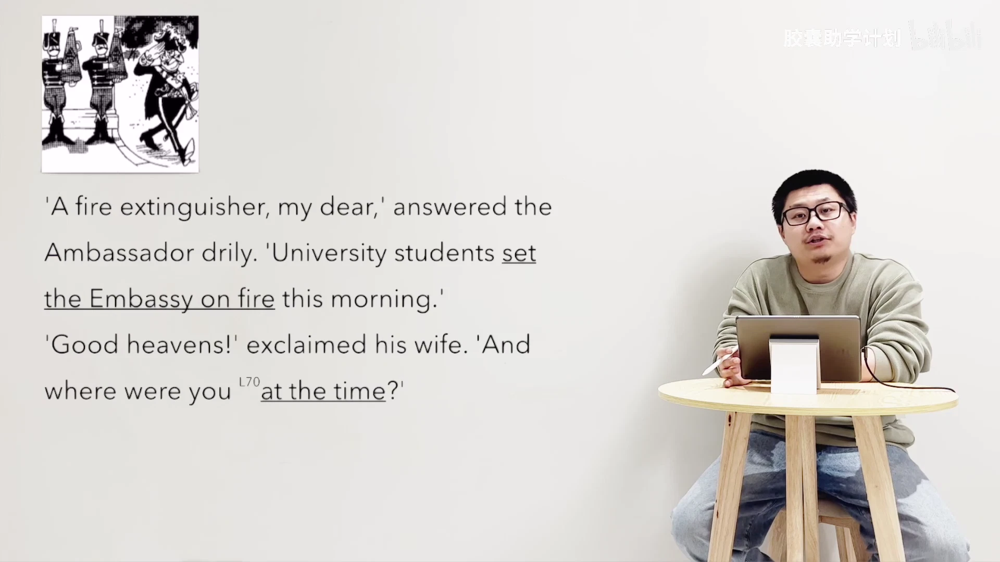

文字识别：'A fire extinguisher, my dear,' answered the / Ambassador drily.'University students set / the Embassy on fire this morning.' / 'Good heavens!' exclaimed his wife.'And / where were you / u [7at the time?' / L70

## 00:03:00–00:03:30

事儿。接下来他说了，说 University students set the embassy on fire this morning。说怎么样呢？University students指的是什么呢？就是大学生。那 set something on fire 就把某个东西给点燃了，点着了。本科的习惯用法。Set the embassy on fire this morning。今儿早上把大使馆给点着了。Good heavens! Exclaimed his wife. And where were you at the time? Good heavens! 就

### 画面 00:03:05

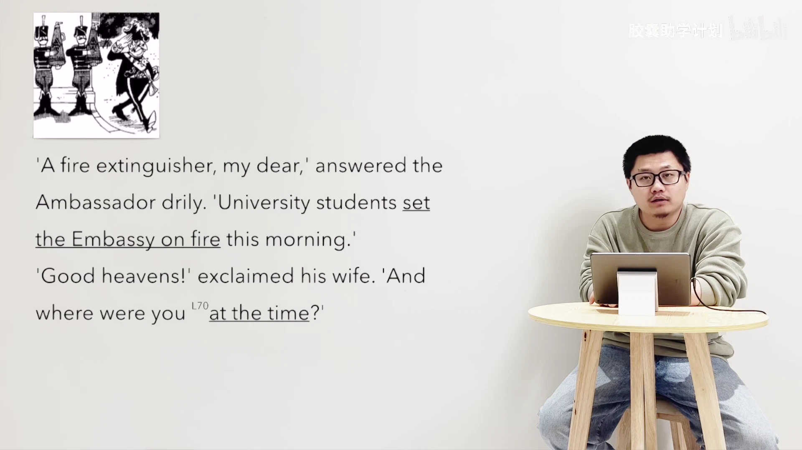

文字识别：'A fire extinguisher, my dear,' answered the / Ambassador drily.'University students set / the Embassy on fire this morning.' / 'Good heavens!' exclaimed his wife.'And / where were you / L70 / 'at the time?'

## 00:03:30–00:04:00

天了，为啥我刚才那样读呢？因为后边用的是 exclaimed. Exclaimed 和 said 的区别是什么呢？都是说，但 exclaimed 这个动词本身当中就包含了一个副词的感觉，它不是普通的说，它是大声惊呼的。我天哪！哎，这种感觉啊。然后当时你在哪？At the time，就在那个时候，你在哪呢？I was in my office as usual. Answered the ambassador. 说

### 画面 00:03:35

文字识别：'A fire extinguisher, my dear,' answered the / Ambassador drily.'University students set / the Embassy on fire this morning.' / 'Good heavens!' exclaimed his wife.'And / where were you / L70 / 'at the time?'

### 画面 00:03:55

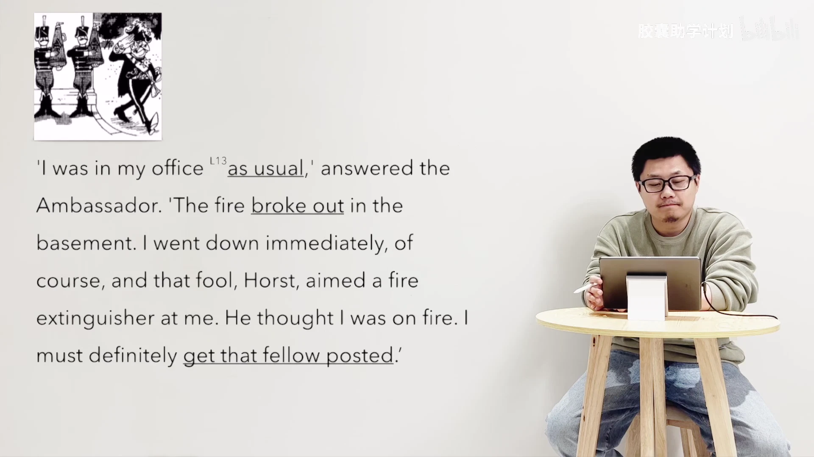

文字识别：' was in my office "³as usual,' answered the / Ambassador.'The fire broke out in the / basement.I went down immediately, of / course, and that fool, Horst, aimed a fire / extinguisher at me. He thought I was on fire.I / must definitely get that fellow posted.'

## 00:04:00–00:04:30

我在我办公室里。" As Yura, like usual, he answered. "The fire broke out in the basement." "说，这个火呀，从哪儿爆发出来的呢？" "在这个地下室爆发出来的。" "I went down immediately, of course, and that fool horse aimed a fire extinguisher at me." "这没有长难句，就是一个单词一个单词往下读。" "我迅速就下去了，下去地下室了，对吧？" "Of course, 当然了，我迅速就下去了。" "然后呢？" "That

### 画面 00:04:25

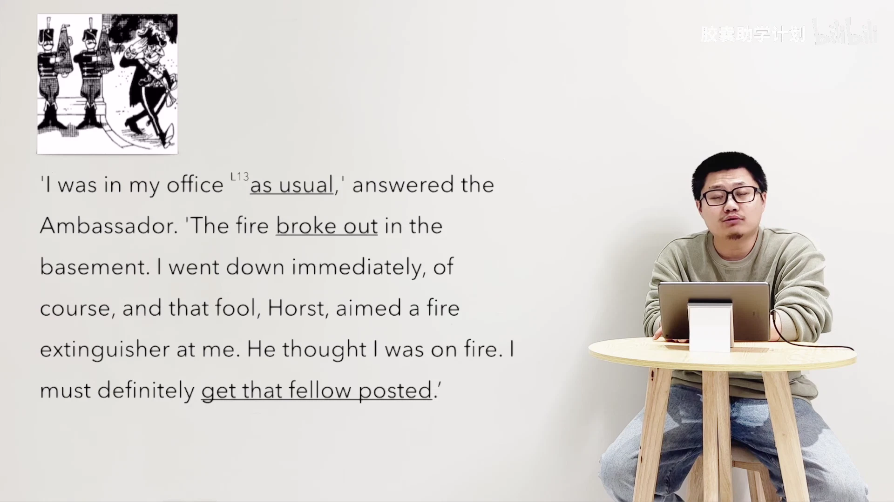

文字识别：' was in my office ["³as usual,' answered the / Ambassador.'The fire broke out in the / basement.I went down immediately, of / course, and that fool, Horst, aimed a fire / extinguisher at me. He thought I was on fire.I / must definitely get that fellow posted.'

## 00:04:30–00:05:00

April Fool's Day,记得吧？咱们学过那fool，当时我也讲过，就这这个傻子啊，说这混蛋，这傻子，哎，fool，OK，horse同位语，同位语啊，这horse就是这个fool，这fool就是这个horse，怎么样了呢？Aimed，瞄准了一个灭火器，冲着我，对吧？冲着我，瞄准了个灭火器，就把我给突突了，对吧？拿灭火器，He thought I was on fire.他以为，他当

### 画面 00:04:55

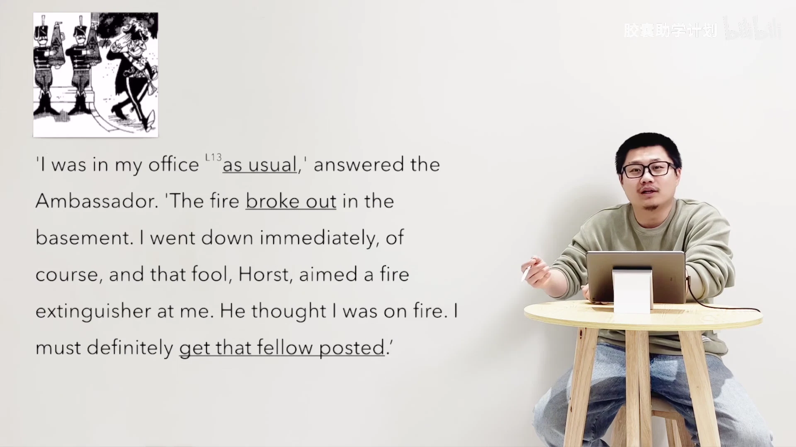

文字识别：' was in my office "³as usual,' answered the / Ambassador.'The fire broke out in the / basement.I went down immediately, of / course, and that fool, Horst, aimed a fire / extinguisher at me. He thought I was on fire.I / must definitely get that fellow posted.'

## 00:05:00–00:05:30

### 画面 00:05:25

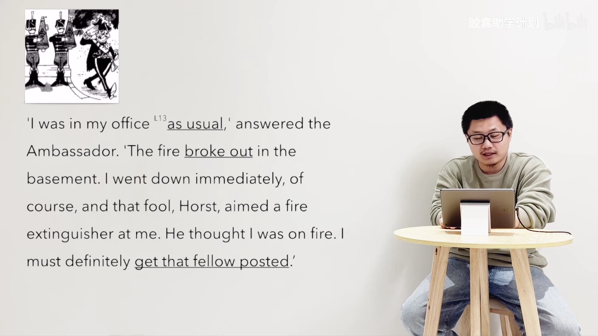

文字识别：' was in my office ["³as usual,' answered the / Ambassador.'The fire broke out in the / basement.I went down immediately, of / course, and that fool, Horst, aimed a fire / extinguisher at me. He thought I was on fire.I / must definitely get that fellow posted.'

### 画面 00:05:29

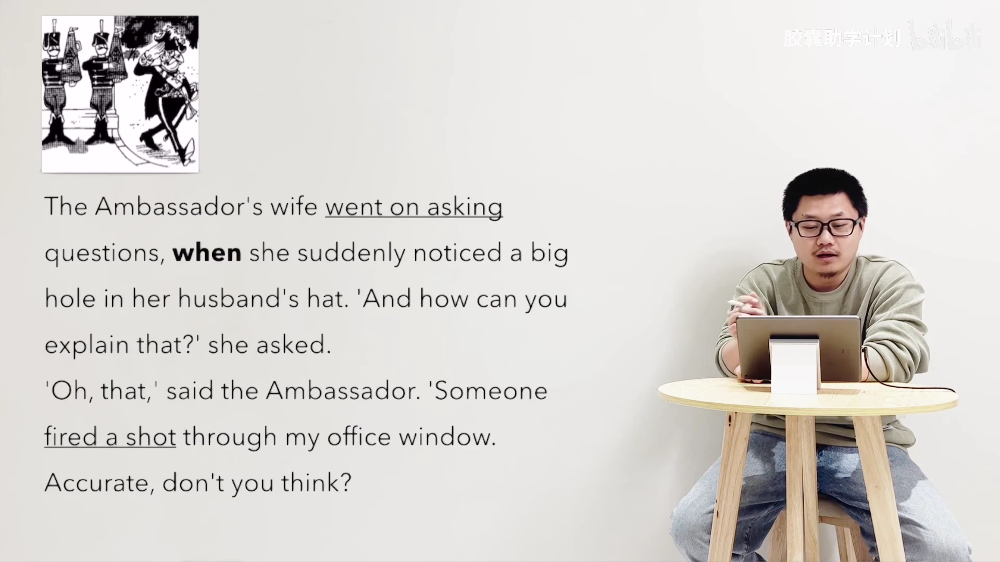

文字识别：The Ambassador's wife went on asking / questions, when she suddenly noticed a big / hole in her husband's hat.'And how can you / explain that?' she asked. / 'Oh, that,' said the Ambassador.'Someone / fired a shot through my office window. / Accurate, don't you think?

## 00:05:30–00:06:00

the ambassador's wife went on asking questions. Go on doing something. 本课习惯用法啊. My heart will go on. 我心永恒. Go on doing something. 继续做某件事儿。呃，媳妇儿继续问道，问问题. When she suddenly noticed a big hole in her husband's hat, 说当什么呢？当她突然间注意到一个特别大的洞，在她老公的这个帽子上有一个很大的窟窿，有个洞.

### 画面 00:05:59

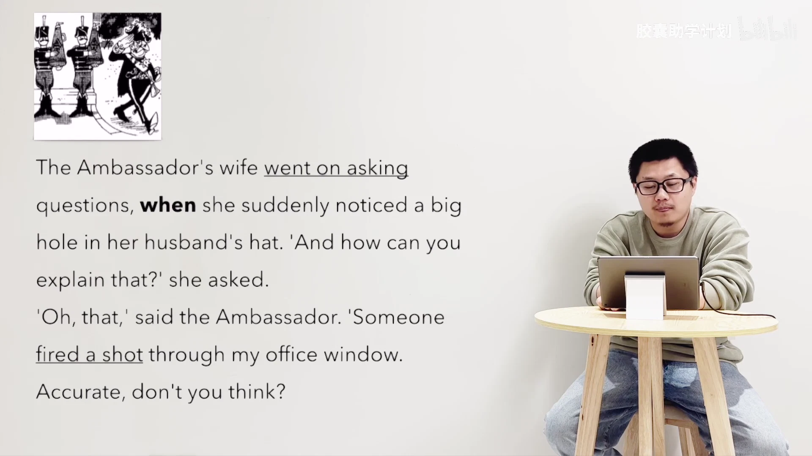

文字识别：The Ambassador's wife went on asking / questions, when she suddenly noticed a big / hole in her husband's hat.'And how can you / explain that?' she asked. / 'Oh, that,' said the Ambassador.'Someone / fired a shot through my office window. / Accurate, don't you think?

## 00:06:00–00:06:30

And how can you explain that? She asked. 那你怎么解释这个事儿？帽子上有个大洞这个事儿？他问道。 Oh, that! 啊，说啊，那个呀， said the ambassador. 他说道。 Someone fired a shot through my office window, accurate. Don't you think? 所以有这么个人呢，咱不知道是谁。 Fired a shot, 开枪开火了。 Through my office window, 穿过了我的这个办公室的玻璃。 Accurate,

### 画面 00:06:29

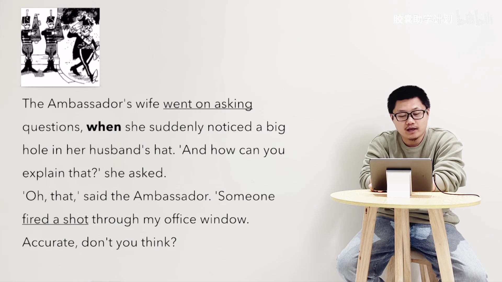

文字识别：The Ambassador's wife went on asking / questions, when she suddenly noticed a big / hole in her husband's hat.'And how can you / explain that?' she asked. / 'Oh, that,' said the Ambassador.'Someone / fired a shot through my office window. / Accurate, don't you think?

## 00:06:30–00:07:00

就非常准确，Don't you think?难道你不这样认为吗？对吧？哦，其实它就类似于It's very accurate. Do you think so?对吧？哎，非常的准，你觉得呢？Fortunately, I wasn't wearing it at the time.说很幸运的是，Unfortunately, fortunately，咱们连着见了三四次了，光在第四单元啊。I wasn't wearing it.我当时没有正在戴着这个帽子at the time，叫在那个时候，是吧？

### 画面 00:06:42

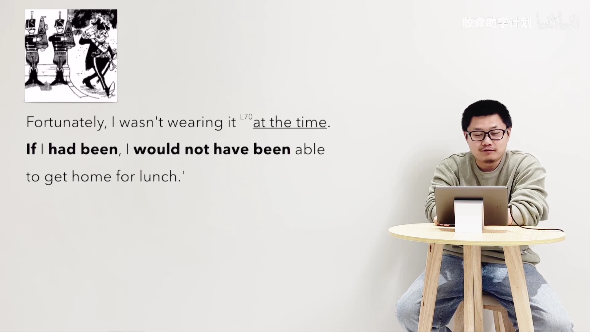

文字识别：Fortunately, I wasn't wearing it 7°at the time. / If I had been, I would not have been able / to get home for lunch.'

## 00:07:00–00:07:30

If I had been, I would not have been able to get home for lunch.直接用了一个六十四课咱们学过的虚拟语气，说如果我当时，这个地方其实后边省略了，叫wearing it或者wearing my hat，对吧？如果我当时戴着我这个帽子呢，那我就将没有办法，将不能be able to do嘛，我将不能回家吃午饭了。那可不，人都没了，对吧？所以他这句话的意思是，当时其实我没戴着这个帽子，

### 画面 00:07:12

文字识别：Fortunately, I wasn't wearing it 7°at the time. / If I had been, I would not have been able / to get home for lunch.'

## 00:07:30–00:08:00

所以我这不就回来跟你吃饭了吗？虽然帽子上有个洞，对吧？但是其实当时我并没戴着它。OK，那本课就结束了，不难啊。然后呢，这个基本都是复习了，习惯用法这个还是要牢牢拿住的。Get into such a mess，这个我们要一个一个的去造句子啊，这个结合上下文去看它什么含义。我们看这句话，至少在我的感觉当中可以有两种翻译方式，我给你解释一下。If you're going to the park, please don't get into a

### 画面 00:07:37

文字识别：奏助字计划 / 习惯用法造句 / get into such a mess. / set sth. on fire / go on doing sth.

### 画面 00:07:39

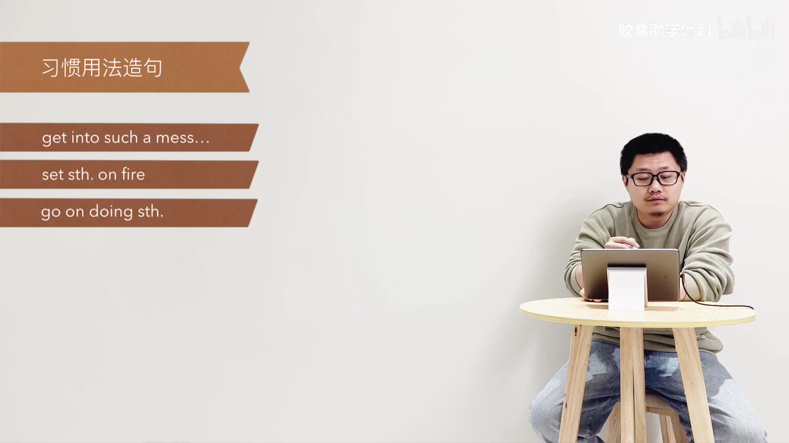

文字识别：交囊助学计划 / 习惯用法造句 / get into such a mess. / set sth. on fire / go on doing sth.

### 画面 00:07:41

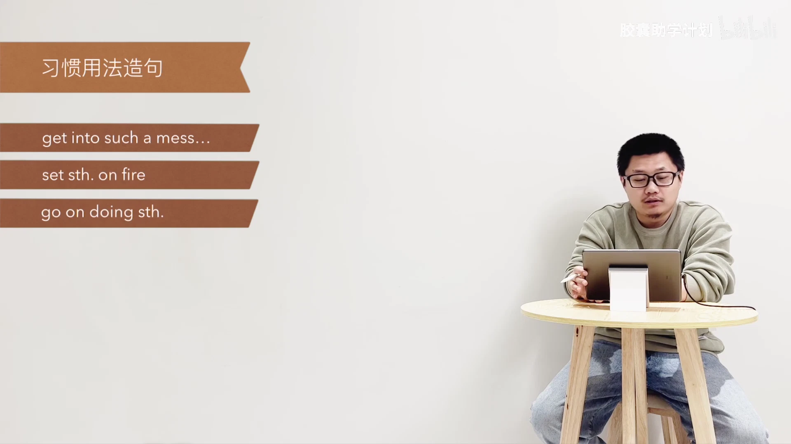

文字识别：辜助学计划 / 习惯用法造句 / get into such a mess.. / set sth. on fire / go on doing sth.

### 画面 00:07:43

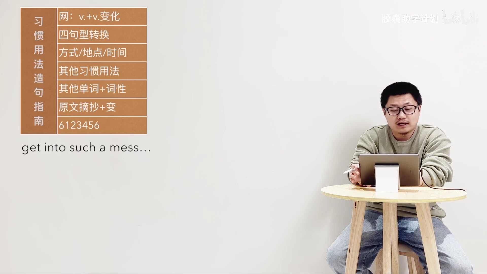

文字识别：网：v.+v.变化 / 习惯用法造句指南 / 胶囊助学计划一调 / 四句型转换 / 方式/地点/时间 / 其他习惯用法 / 其他单词+词性 / 原文摘抄+变 / 6123456 / get into such a mess..

### 画面 00:07:45

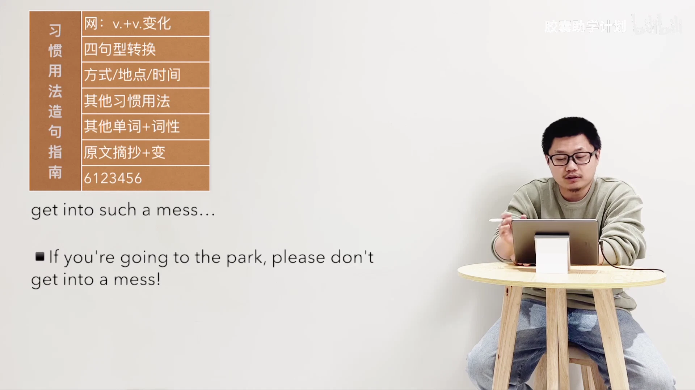

文字识别：网：v.+v.变化 / 习惯用法造句指南 / 妻助学计划陽 / 四句型转换 / 方式/地点/时间 / 其他习惯用法 / 其他单词+词性 / 原文摘抄+变 / 6123456 / get into such a mess... /  If you're going to the park, please don't / get into a mess!

### 画面 00:07:47

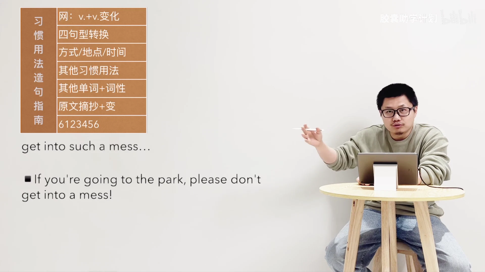

文字识别：网：v.+v.变化 / 习惯用法造句指南 / 妻助学计划 / 四句型转换 / 方式/地点/时间 / 其他习惯用法 / 其他单词+词性 / 原文摘抄+变 / 6123456 / get into such a mess... /  If you're going to the park, please don't / get into a mess!

### 画面 00:07:50

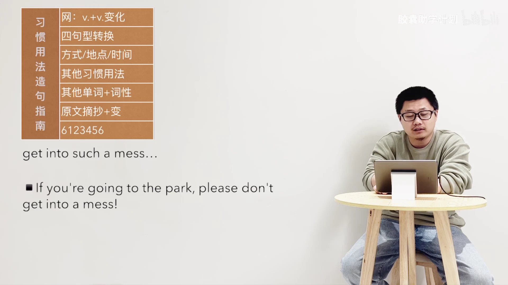

文字识别：网：v.+v.变化 / 习惯用法造句指南 / 交囊助学计划陽 / 四句型转换 / 方式/地点/时间 / 其他习惯用法 / 其他单词+词性 / 原文摘抄+变 / 6123456 / get into such a mess... /  If you're going to the park, please don't / get into a mess!

### 画面 00:07:55

文字识别：网：v.+v.变化 / 习惯用法造句指南 / 交囊助学计划 / 四句型转换 / 方式/地点/时间 / 其他习惯用法 / 其他单词+词性 / 原文摘抄+变 / 6123456 / get into such a mess... /  If you're going to the park, please don't / get into a mess!

## 00:08:00–00:08:30

a mess.当然，such有没有都可以，是吧？如果你是对小孩说的，你想想是什么意思？你再结合这篇文章，那大概意思，如果你去公园玩，你别又弄一身泥巴回来。这小时候我妈跟我说的话是吧？大概就是类似的，说你别又弄一身泥。Get into a mess.但如果你想一下啊，你是跟你兄弟说的，哎，你有个弟弟，你这弟弟呢，哎呀，天天打架啊，一出去就打架，就惹事儿，惹是生非，对吧？哎，沾

### 画面 00:08:00

文字识别：网：v.+v.变化 / 习惯用法造句指南 / 交妻助学计划 / 四句型转换 / 方式/地点/时间 / 其他习惯用法 / 其他单词+词性 / 原文摘抄+变 / 6123456 / get into such a mess... /  If you're going to the park, please don't / get into a mess!

### 画面 00:08:05

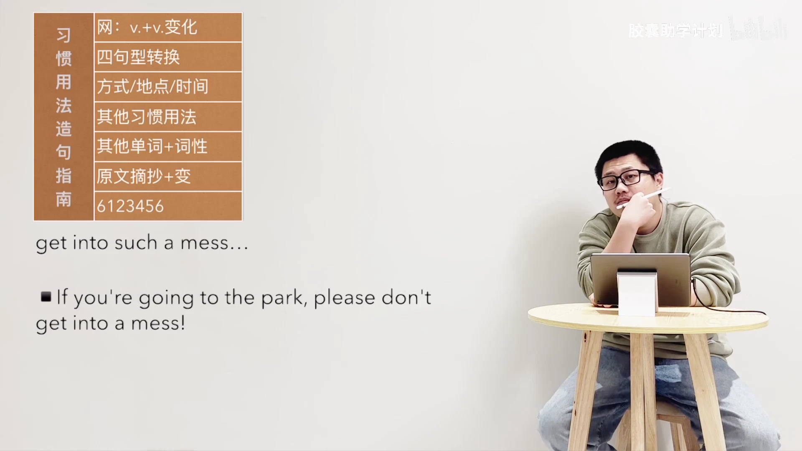

文字识别：网：v.+v.变化 / 习惯用法造句指南 / 交妻助字计划陽 / 四句型转换 / 方式/地点/时间 / 其他习惯用法 / 其他单词+词性 / 原文摘抄+变 / 6123456 / get into such a mess... /  If you're going to the park, please don't / get into a mess!

### 画面 00:08:10

文字识别：网：v.+v.变化 / 习惯用法造句指南 / 交妻助学计划 / 四句型转换 / 方式/地点/时间 / 其他习惯用法 / 其他单词+词性 / 原文摘抄+变 / 6123456 / get into such a mess... /  If you're going to the park, please don't / get into a mess!

### 画面 00:08:15

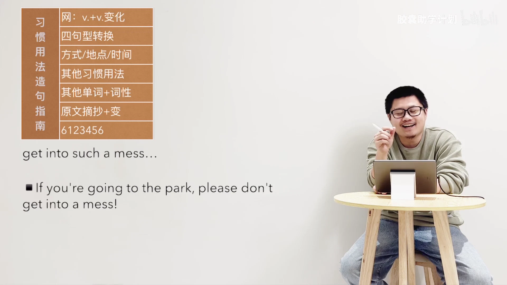

文字识别：网：v.+v.变化 / 胶囊助学计划一 / 习惯用法造句指南 / 四句型转换 / 方式/地点/时间 / 其他习惯用法 / 其他单词+词性 / 原文摘抄+变 / 6123456 / get into such a mess... /  If you're going to the park, please don't / get into a mess!

### 画面 00:08:20

文字识别：网：v.+v.变化 / 习惯用法造句指南 / 校囊助学计划一 / 四句型转换 / 方式/地点/时间 / 其他习惯用法 / 其他单词+词性 / 原文摘抄+变 / 6123456 / get into such a mess... /  If you're going to the park, please don't / get into a mess!

### 画面 00:08:23

文字识别：网：v.+v.变化 / 习惯用法造句指南 / 交妻助学计划園 / 四句型转换 / 方式/地点/时间 / 其他习惯用法 / 其他单词+词性 / 原文摘抄+变 / 6123456 / get into such a mess... /  If you're going to the park, please don't / get into a mess!

### 画面 00:08:25

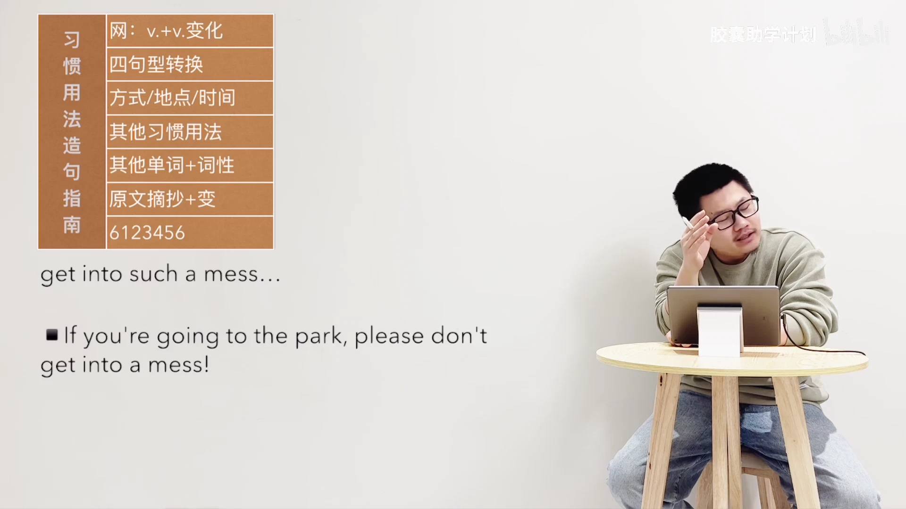

文字识别：网：v.+v.变化 / 习惯用法造句指南 / 校寶助学计划 / 四句型转换 / 方式/地点/时间 / 其他习惯用法 / 其他单词+词性 / 原文摘抄+变 / 6123456 / get into such a mess... /  If you're going to the park, please don't / get into a mess!

## 00:08:30–00:09:00

花惹草啊，拈花惹草的。好，然后他说，你就跟他说，嘿，Man， if you're going to the park， don't get into a mess。就那种老大哥对着自己小弟指手画脚的感觉就来了，对吧？你别又给我惹麻烦，get into a mess，听见了吧？哎，你别又给我这个进入一团乱糟的事儿里边去啊，别哪儿都有你，对吧？下一个说，How did you get into呃a mess with those guys？说你怎么和这些人惹上了这个破

### 画面 00:08:30

文字识别：网：v.+v.变化 / 习惯用法造句指南 / 交妻助学计划！ / 四句型转换 / 方式/地点/时间 / 其他习惯用法 / 其他单词+词性 / 原文摘抄+变 / 6123456 / get into such a mess... /  If you're going to the park, please don't / get into a mess!

### 画面 00:08:35

文字识别：网：v.+v.变化 / 习惯用法造句指南 / 交妻助学计划 / 四句型转换 / 方式/地点/时间 / 其他习惯用法 / 其他单词+词性 / 原文摘抄+变 / 6123456 / get into such a mess... /  If you're going to the park, please don't / get into a mess!

### 画面 00:08:40

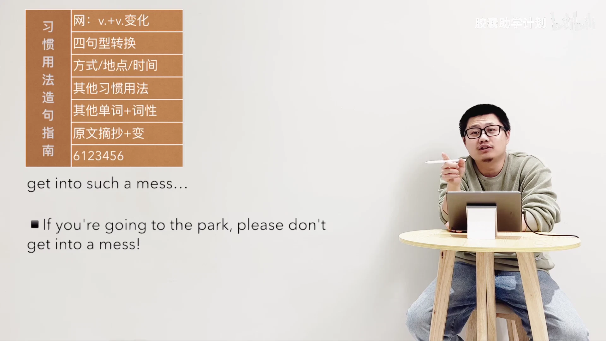

文字识别：网：v.+v.变化 / 习惯用法造句指南 / 校囊助学计划陽 / 四句型转换 / 方式/地点/时间 / 其他习惯用法 / 其他单词+词性 / 原文摘抄+变 / 6123456 / get into such a mess... /  If you're going to the park, please don't / get into a mess!

### 画面 00:08:45

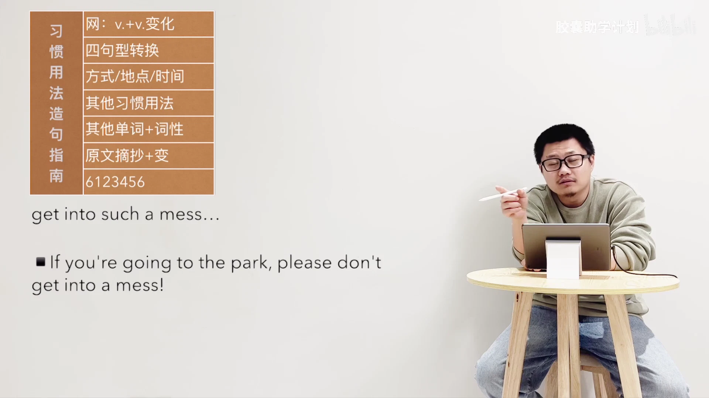

文字识别：网：v.+v.变化 / 习惯用法造句指南 / 交妻助学计划 / 四句型转换 / 方式/地点/时间 / 其他习惯用法 / 其他单词+词性 / 原文摘抄+变 / 6123456 / get into such a mess... /  If you're going to the park, please don't / get into a mess!

### 画面 00:08:47

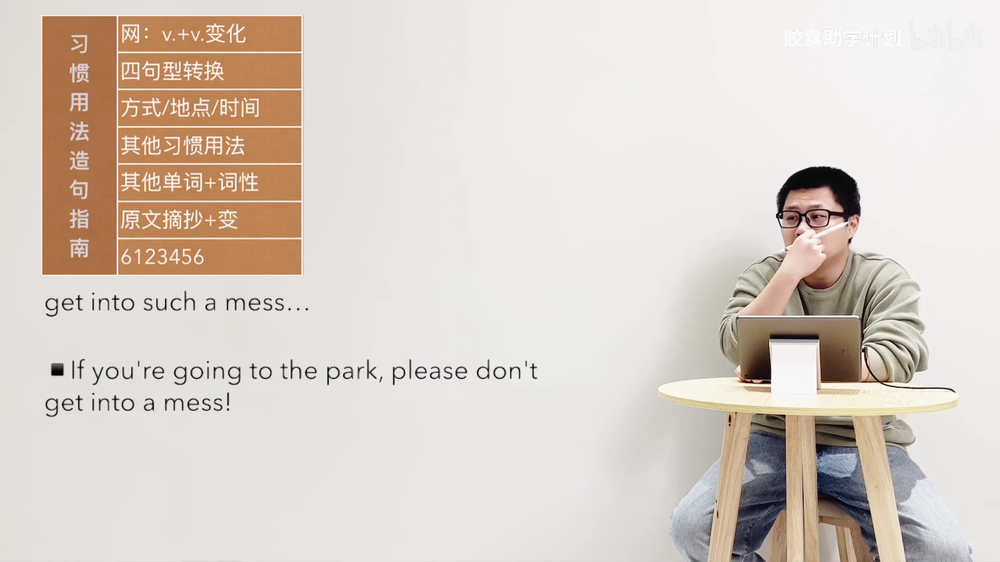

文字识别：网：v.+v.变化 / 习惯用法造句指南 / 交妻助学计划 / 四句型转换 / 方式/地点/时间 / 其他习惯用法 / 其他单词+词性 / 原文摘抄+变 / 6123456 / get into such a mess... /  If you're going to the park, please don't / get into a mess!

### 画面 00:08:50

文字识别：网：v.+v.变化 / 习惯用法造句指南 / 交奏助学计划間 / 四句型转换 / 方式/地点/时间 / 其他习惯用法 / 其他单词+词性 / 原文摘抄+变 / 6123456 / get into such a mess... /  If you're going to the park, please don't / get into a mess!

### 画面 00:08:52

文字识别：网：v.+v.变化 / 习惯用法造句指南 / 妻助学计划陽 / 四句型转换 / 方式/地点/时间 / 其他习惯用法 / 其他单词+词性 / 原文摘抄+变 / 6123456 / get into such a mess.. /  If you're going to the park, please don't / get into a mess! /  How did you get into a mess with those / guys?

### 画面 00:08:55

文字识别：网：v.+v.变化 / 习惯用法造句指南 / 囊助学计划陽 / 四句型转换 / 方式/地点/时间 / 其他习惯用法 / 其他单词+词性 / 原文摘抄+变 / 6123456 / get into such a mess.. /  If you're going to the park, please don't / get into a mess! /  How did you get into a mess with those / guys?

## 00:09:00–00:09:30

事儿呢，就是这样翻译，对吧？哎，进入了这个混乱当中的当中呢。Next one,最后一个啊。The biggest question is how they got into this mess.说现在最大的问题是说他们如何哎陷入了这个麻烦困难里边的，他们是如何进入这个特别复杂的状态当中的，或者说进入这个呃这个一团糟当中来的，他们是如何卷进来的啊？

### 画面 00:09:00

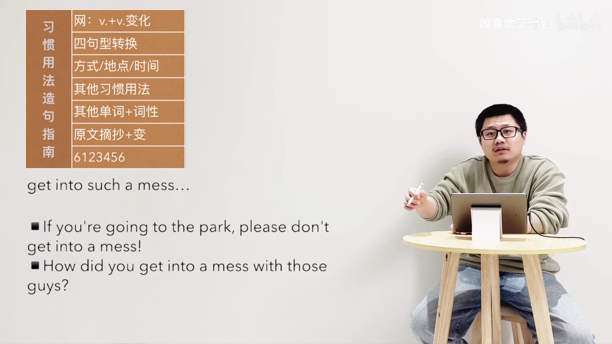

文字识别：习惯用法造句指南 / 网：v.+v.变化 / 校囊助学计划一 / 四句型转换 / 方式/地点/时间 / 其他习惯用法 / 其他单词+词性 / 原文摘抄+变 / 6123456 / get into such a mess.. /  If you're going to the park, please don't / get into a mess! /  How did you get into a mess with those / guys?

### 画面 00:09:03

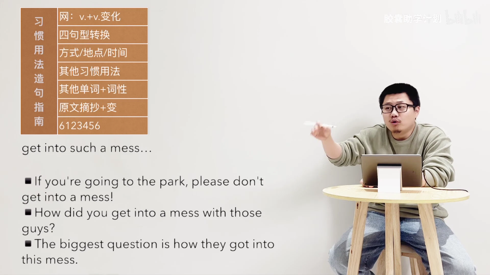

文字识别：网：v.+v.变化 / 习惯用法造句指南 / 妻助学计划 / 四句型转换 / 方式/地点/时间 / 其他习惯用法 / 其他单词+词性 / 原文摘抄+变 / 6123456 / get into such a mess... /  If you're going to the park, please don't / get into a mess! /  How did you get into a mess with those / guys? /  The biggest question is how they got into / this mess.

### 画面 00:09:05

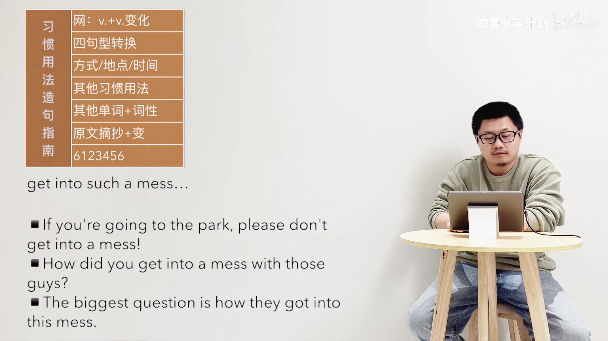

文字识别：网：v.+v.变化 / 习惯用法造句指南 / 囊助学计划 / 四句型转换 / 方式/地点/时间 / 其他习惯用法 / 其他单词+词性 / 原文摘抄+变 / 6123456 / get into such a mess... /  If you're going to the park, please don't / get into a mess! /  How did you get into a mess with those / guys? /  The biggest question is how they got into / this mess.

### 画面 00:09:10

文字识别：网：v.+v.变化 / 习惯用法造句指南 / 妻助字计划 / 四句型转换 / 方式/地点/时间 / 其他习惯用法 / 其他单词+词性 / 原文摘抄+变 / 6123456 / get into such a mess... /  If you're going to the park, please don't / get into a mess! /  How did you get into a mess with those / guys? /  The biggest question is how they got into / this mess.

### 画面 00:09:12

文字识别：网：v.+v.变化 / 习惯用法造句指南 / 囊助学计划陽 / 四句型转换 / 方式/地点/时间 / 其他习惯用法 / 其他单词+词性 / 原文摘抄+变 / 6123456 / get into such a mess... /  If you're going to the park, please don't / get into a mess! /  How did you get into a mess with those / guys? /  The biggest question is how they got into / this mess.

### 画面 00:09:15

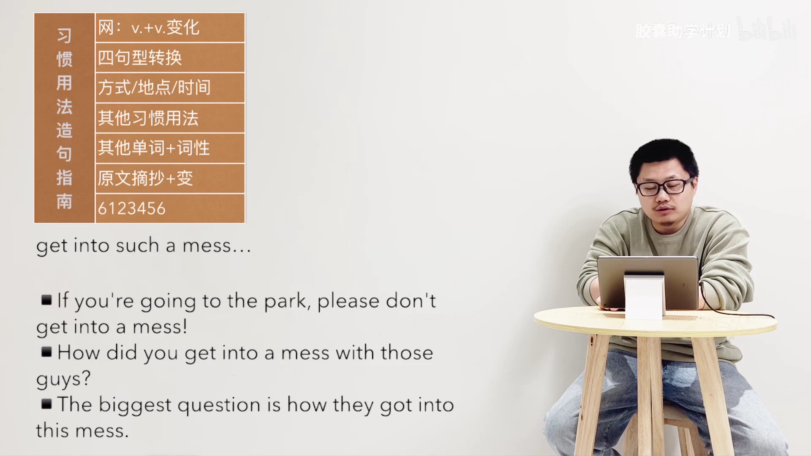

文字识别：网：v.+v.变化 / 习惯用法造句指南 / 囊助字计划 / 四句型转换 / 方式/地点/时间 / 其他习惯用法 / 其他单词+词性 / 原文摘抄+变 / 6123456 / get into such a mess... /  If you're going to the park, please don't / get into a mess! /  How did you get into a mess with those / guys? /  The biggest question is how they got into / this mess.

### 画面 00:09:18

文字识别：网：v.+v.变化 / 习惯用法造句指南 / 囊助学计划陽 / 四句型转换 / 方式/地点/时间 / 其他习惯用法 / 其他单词+词性 / 原文摘抄+变 / 6123456 / get into such a mess... /  If you're going to the park, please don't / get into a mess! /  How did you get into a mess with those / guys? /  The biggest question is how they got into / this mess.

### 画面 00:09:20

文字识别：网：v.+v.变化 / 习惯用法造句指南 / 卖助学计划！ / 四句型转换 / 方式/地点/时间 / 其他习惯用法 / 其他单词+词性 / 原文摘抄+变 / 6123456 / get into such a mess... /  If you're going to the park, please don't / get into a mess! /  How did you get into a mess with those / guys? /  The biggest question is how they got into / this mess.

### 画面 00:09:26

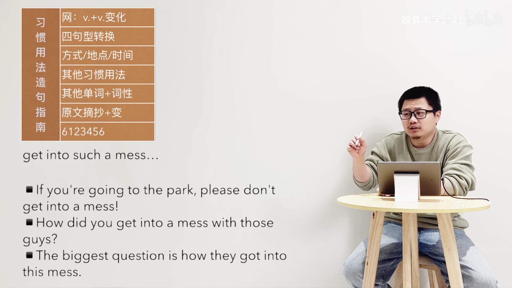

文字识别：网：v.+v.变化 / 习惯用法造句指南 / 妻助学计划 / 四句型转换 / 方式/地点/时间 / 其他习惯用法 / 其他单词+词性 / 原文摘抄+变 / 6123456 / get into such a mess... /  If you're going to the park, please don't / get into a mess! /  How did you get into a mess with those / guys? /  The biggest question is how they got into / this mess.

## 00:09:30–00:10:00

Get into this mess. Okay,好，那注意力集中，咱听一个电影片段。 Tommy, how does a good man like me get into a mess like this? 哎，你看这里的 get into a mess 并不是指身体上的或者是衣服上的了，对吧？这肯定是对于事情上来说，对吧？像像我这么好的一个人，怎么会卷入这么这个乱七八糟的一件事里边来啊？下一个 set something on fire 着火，造句

### 画面 00:09:30

文字识别：网：v.+v.变化 / 习惯用法造句指南 / 囊助字计划 / 四句型转换 / 方式/地点/时间 / 其他习惯用法 / 其他单词+词性 / 原文摘抄+变 / 6123456 / get into such a mess... /  If you're going to the park, please don't / get into a mess! /  How did you get into a mess with those / guys? /  The biggest question is how they got into / this mess.

### 画面 00:09:33

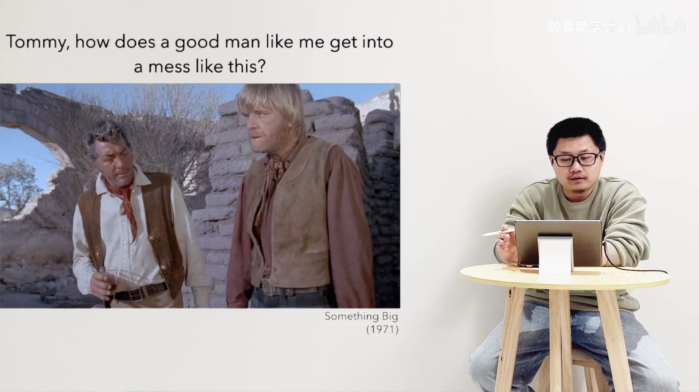

文字识别：Tommy, how does a good man like me get into / a mess like this? / Something Big / (1971)

### 画面 00:09:37

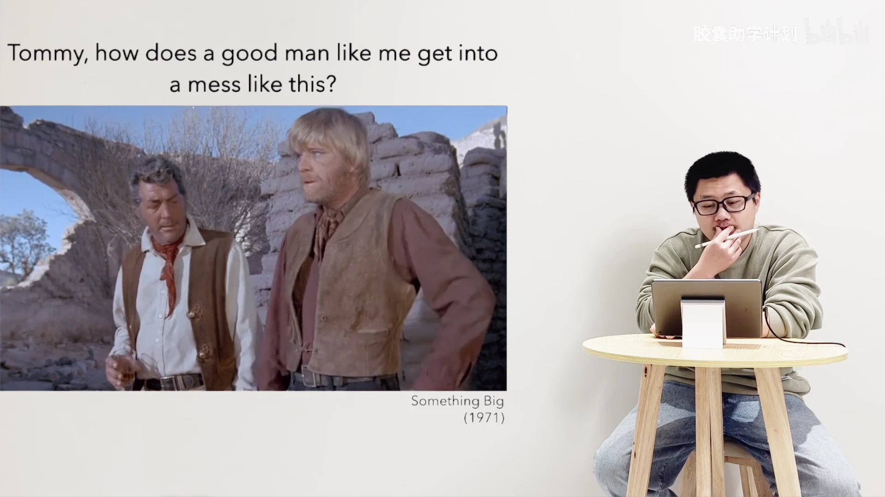

文字识别：Tommy, how does a good man like me get into / a mess like this? / Something Big / (1971)

### 画面 00:09:39

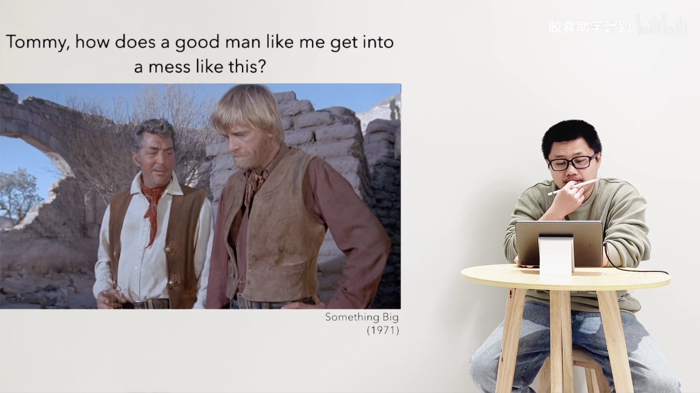

文字识别：Tommy, how does a good man like me get into / a mess like this? / Something Big / (1971)

### 画面 00:09:41

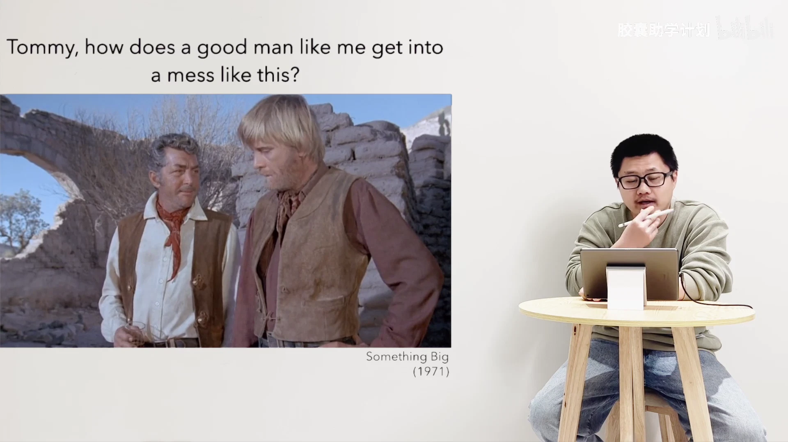

文字识别：Tommy, how does a good man like me get into / a mess like this? / Something Big / (1971)

### 画面 00:09:55

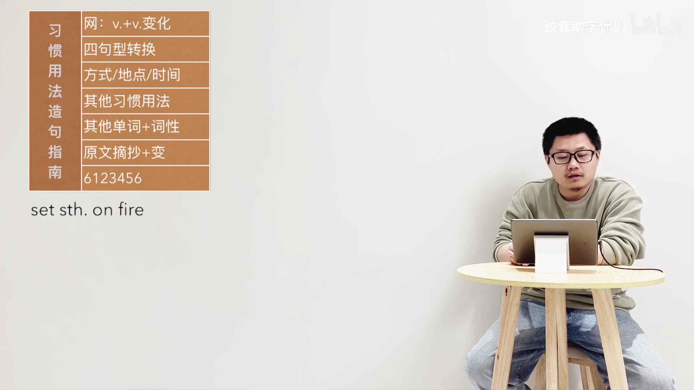

文字识别：网：v.+v.变化 / 习惯用法造句指南 / 校囊助学计划 / 四句型转换 / 方式/地点/时间 / 其他习惯用法 / 其他单词+词性 / 原文摘抄+变 / 6123456 / set sth. on fire

### 画面 00:09:57

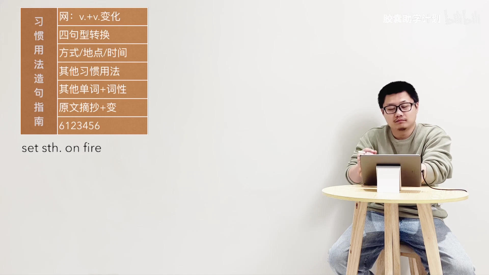

文字识别：网：v.+v.变化 / 交囊助学计划一 / 习惯用法造句指南 / 四句型转换 / 方式/地点/时间 / 其他习惯用法 / 其他单词+词性 / 原文摘抄+变 / 6123456 / set sth. on fire

### 画面 00:09:59

文字识别：网：v.+v.变化 / 习惯用法造句指南 / 毒助学计划園 / 四句型转换 / 方式/地点/时间 / 其他习惯用法 / 其他单词+词性 / 原文摘抄+变 / 6123456 / set sth. on fire /  Don't smoke in the room. You're gonna set / this room on fire.

## 00:10:00–00:10:30

子，比如说 don't 把什么什么点燃是吧？比如说 don't smoke in the room, you're gonna set this room on fire. 说你别在屋里抽烟，你或者把这屋都给点着了。 Next one, armed with a torch, he set the whole village on fire. 怎么样呢？ Armed with a torch，什么意思呢？叫做装备着他的这个火炬，对吧？他把整个村都给点着了。 Okay, next one, a spark set the

### 画面 00:10:01

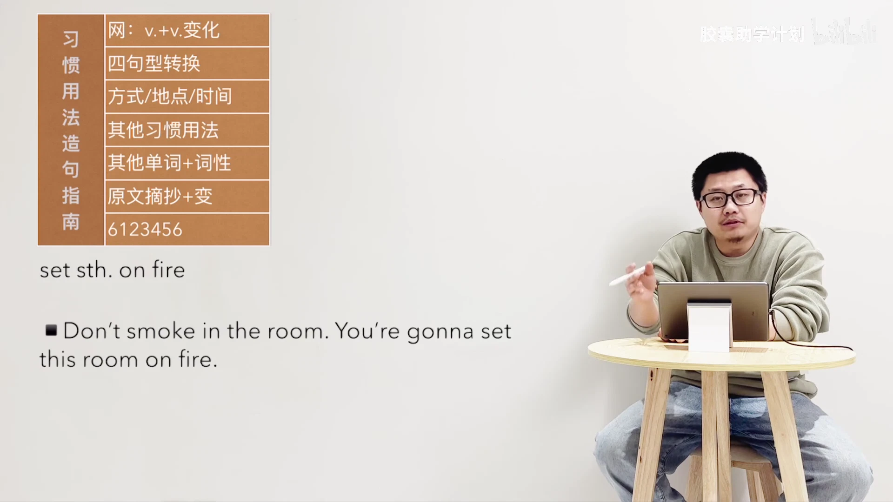

文字识别：网：v.+v.变化 / 习惯用法造句指南 / 囊助学计划陽 / 四句型转换 / 方式/地点/时间 / 其他习惯用法 / 其他单词+词性 / 原文摘抄+变 / 6123456 / set sth. on fire /  Don't smoke in the room. You're gonna set / this room on fire.

### 画面 00:10:03

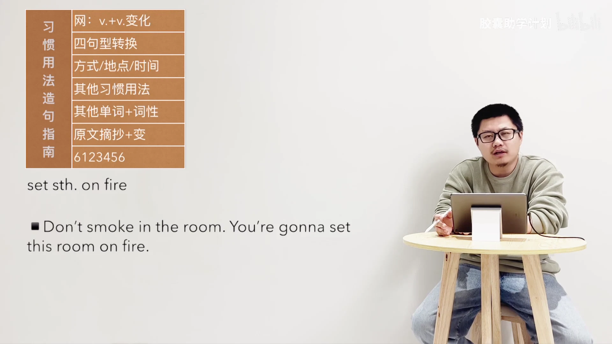

文字识别：网：v.+v.变化 / 习惯用法造句指南 / 囊助学计划 / 四句型转换 / 方式/地点/时间 / 其他习惯用法 / 其他单词+词性 / 原文摘抄+变 / 6123456 / set sth. on fire /  Don't smoke in the room. You're gonna set / this room on fire.

### 画面 00:10:05

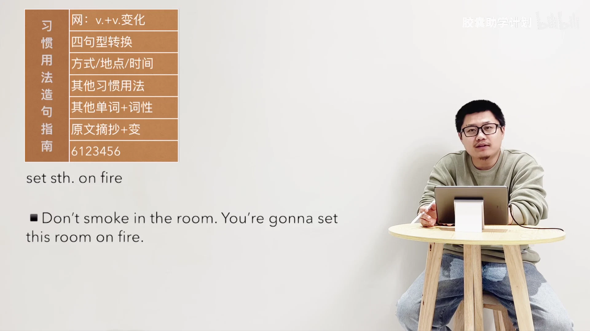

文字识别：网：v.+v.变化 / 习惯用法造句指南 / 交雲助学计划 / 四句型转换 / 方式/地点/时间 / 其他习惯用法 / 其他单词+词性 / 原文摘抄+变 / 6123456 / set sth. on fire /  Don't smoke in the room. You're gonna set / this room on fire.

### 画面 00:10:10

文字识别：网：v.+v.变化 / 习惯用法造句指南 / 妻助学计划に / 四句型转换 / 方式/地点/时间 / 其他习惯用法 / 其他单词+词性 / 原文摘抄+变 / 6123456 / set sth. on fire /  Don't smoke in the room. You're gonna set / this room on fire.

### 画面 00:10:12

文字识别：网：v.+v.变化 / 习惯用法造句指南 / 妻助学计划 / 四句型转换 / 方式/地点/时间 / 其他习惯用法 / 其他单词+词性 / 原文摘抄+变 / 6123456 / set sth. on fire /  Don't smoke in the room. You're gonna set / this room on fire. /  Armed with a torch, he set the whole / village on fire. L55

### 画面 00:10:15

文字识别：网：v.+v.变化 / 习惯用法造句指南 / 囊助学计划！ / 四句型转换 / 方式/地点/时间 / 其他习惯用法 / 其他单词+词性 / 原文摘抄+变 / 6123456 / set sth. on fire /  Don't smoke in the room. You're gonna set / this room on fire. /  Armed with a torch, he set the whole / village on fire. L55

### 画面 00:10:17

文字识别：网：v.+v.变化 / 习惯用法造句指南 / 囊助学计划陽 / 四句型转换 / 方式/地点/时间 / 其他习惯用法 / 其他单词+词性 / 原文摘抄+变 / 6123456 / set sth. on fire /  Don't smoke in the room. You're gonna set / this room on fire. /  Armed with a torch, he set the whole / village on fire. L55

### 画面 00:10:20

文字识别：网：v.+v.变化 / 习惯用法造句指南 / 囊助字计划陽 / 四句型转换 / 方式/地点/时间 / 其他习惯用法 / 其他单词+词性 / 原文摘抄+变 / 6123456 / set sth. on fire /  Don't smoke in the room. You're gonna set / this room on fire. /  Armed with a torch, he set the whole / village on fire. L55

### 画面 00:10:22

文字识别：网：v.+v.变化 / 习惯用法造句指南 / 妻助学计划 / 四句型转换 / 方式/地点/时间 / 其他习惯用法 / 其他单词+词性 / 原文摘抄+变 / 6123456 / set sth. on fire /  Don't smoke in the room. You're gonna set / this room on fire. /  Armed with a torch, he set the whole / village on fire. L55

### 画面 00:10:25

文字识别：网：v.+v.变化 / 习惯用法造句指南 / 妻助学计划 / 四句型转换 / 方式/地点/时间 / 其他习惯用法 / 其他单词+词性 / 原文摘抄+变 / 6123456 / set sth. on fire /  Don't smoke in the room. You're gonna set / this room on fire. /  Armed with a torch, he set the whole / village on fire. L55

### 画面 00:10:29

文字识别：网：v.+v.变化 / 习惯用法造句指南 / 妻助学计划 / 四句型转换 / 方式/地点/时间 / 其他习惯用法 / 其他单词+词性 / 原文摘抄+变 / 6123456 / set sth. on fire /  Don't smoke in the room. You're gonna set / this room on fire. /  Armed with a torch, he set the whole / village on fire. L55 / A spark set the woods on fire.

## 00:10:30–00:11:00

woods on fire. 哎，每个单词都学过是吧？一个火星，把这个林子就给点着了。那注意力集中，咱看个电影片段。 Come on, Maggie. You will set the bed on fire. Okay, ah. You will set the bed on fire. 你会把这个床给我点着的。 Go on doing something. 持续嘛。造几个句子。 We must go on. 我们就必须要继续怎么样？就是

### 画面 00:10:31

文字识别：网：v.+v.变化 / 习惯用法造句指南 / 囊助学计划 / 四句型转换 / 方式/地点/时间 / 其他习惯用法 / 其他单词+词性 / 原文摘抄+变 / 6123456 / set sth. on fire /  Don't smoke in the room. You're gonna set / this room on fire. /  Armed with a torch, he set the whole / village on fire. L55 / A spark set the woods on fire.

### 画面 00:10:35

文字识别：网：v.+v.变化 / 习惯用法造句指南 / 囊助学计划陽 / 四句型转换 / 方式/地点/时间 / 其他习惯用法 / 其他单词+词性 / 原文摘抄+变 / 6123456 / set sth. on fire /  Don't smoke in the room. You're gonna set / this room on fire. /  Armed with a torch, he set the whole / village on fire. L55 / A spark set the woods on fire.

### 画面 00:10:37

文字识别：网：v.+v.变化 / 习惯用法造句指南 / 囊助学计划 / 四句型转换 / 方式/地点/时间 / 其他习惯用法 / 其他单词+词性 / 原文摘抄+变 / 6123456 / set sth. on fire /  Don't smoke in the room. You're gonna set / this room on fire. /  Armed with a torch, he set the whole / village on fire. L55 / A spark set the woods on fire.

### 画面 00:10:39

文字识别：Come on, Maggie. You will set the bed on fire. / Ladybird Ladybird / (1994)

### 画面 00:10:43

文字识别：Come on, Maggie. You will set the bed on fire. / Ladybird Ladybird / (1994)

### 画面 00:10:45

文字识别：Come on, Maggie. You will set the bed on fire. / Ladybird Ladybird / (1994)

### 画面 00:10:51

文字识别：网：v.+v.变化 / 习惯用法造句指南 / 交囊助学计划一洲 / 四句型转换 / 方式/地点/时间 / 其他习惯用法 / 其他单词+词性 / 原文摘抄+变 / 6123456 / go on doing sth.

### 画面 00:10:53

文字识别：网：v.+v.变化 / 习惯用法造句指南 / 囊助字计划園 / 四句型转换 / 方式/地点/时间 / 其他习惯用法 / 其他单词+词性 / 原文摘抄+变 / 6123456 / go on doing sth. /  We must go on giving him encouragement. L85

### 画面 00:10:55

文字识别：网：v.+v.变化 / 习惯用法造句指南 / 交妻助学计划一 / 四句型转换 / 方式/地点/时间 / 其他习惯用法 / 其他单词+词性 / 原文摘抄+变 / 6123456 / go on doing sth. /  We must go on giving him encouragement. L85

### 画面 00:10:58

文字识别：网：v.+v.变化 / 习惯用法造句指南 / 交妻助学计划服 / 四句型转换 / 方式/地点/时间 / 其他习惯用法 / 其他单词+词性 / 原文摘抄+变 / 6123456 / go on doing sth. /  We must go on giving him encouragement. L85

## 00:11:00–00:11:30

continue to do something嘛。Giving him encouragement, 给他鼓励。Next one, we must go on trying. 我们要继续尝试。You should go on spying on him. 你应该继续监视他。Spy on somebody, 对吧？好。Recap 本课习惯用法这三个，你肯定要造句，然后文章熟读成诵，然后咱们看置顶留言找重复间隔的这些学习材料。那以上呢就是本期视频的

### 画面 00:11:00

文字识别：网：v.+v.变化 / 习惯用法造句指南 / 交奏助学计划園 / 四句型转换 / 方式/地点/时间 / 其他习惯用法 / 其他单词+词性 / 原文摘抄+变 / 6123456 / go on doing sth. /  We must go on giving him encouragement. L85

### 画面 00:11:06

文字识别：网：v.+v.变化 / 习惯用法造句指南 / 囊助学计划陽 / 四句型转换 / 方式/地点/时间 / 其他习惯用法 / 其他单词+词性 / 原文摘抄+变 / 6123456 / go on doing sth. /  We must go on giving him encouragement. L85 /  We must go on trying.

### 画面 00:11:10

文字识别：网：v.+v.变化 / 习惯用法造句指南 / 囊助字计划陽 / 四句型转换 / 方式/地点/时间 / 其他习惯用法 / 其他单词+词性 / 原文摘抄+变 / 6123456 / go on doing sth. /  We must go on giving him encouragement. L85 /  We must go on trying. / You should go on spying on him. L91

### 画面 00:11:15

文字识别：网：v.+v.变化 / 习惯用法造句指南 / 妻助学计划は / 四句型转换 / 方式/地点/时间 / 其他习惯用法 / 其他单词+词性 / 原文摘抄+变 / 6123456 / go on doing sth. /  We must go on giving him encouragement. L85 /  We must go on trying. / You should go on spying on him. L91

### 画面 00:11:17

文字识别：Recap / 交奏助学计划 / get into such a mess... / Expression / set sth. on fire / go on doing sth.

### 画面 00:11:19

文字识别：Recap / 交囊助学计划 / get into such a mess... / Expression / set sth. on fire / go on doing sth.

### 画面 00:11:21

文字识别：胶囊助学计划 / 1. / 习惯用法造句/对话 / 【习惯用法造句指南】 / 每个5句 / 文章跟读至熟读成诵 / 内化单词+语法+习惯用法 / 听力+口语+写作练习

### 画面 00:11:23

文字识别：囊助学计划情 / 1. / 习惯用法造句/对话 / 【习惯用法造句指南】 / 每个5句 / 文章跟读至熟读成诵 / 内化单词+语法+习惯用法 / 听力+口语+写作练习 / 重复间隔（置顶留言）

### 画面 00:11:25

文字识别：交囊助学计划 / 习惯用法造句/对话 / 【习惯用法造句指南】 / 每个5句 / 文章跟读至熟读成诵 / 内化单词+语法+习惯用法 / 听力+口语+写作练习 / 3. / 重复间隔（置顶留言）

### 画面 00:11:27

文字识别：囊助学计划州

### 画面 00:11:29

文字识别：奏助学计划一调 / ￥

## 00:11:30–00:11:53

全部内容了。如果各位喜欢我们的课程呢，欢迎各位关注、订阅、一键三连，分享给那些需要的朋友，来帮助我们快速成长。See you next time.

### 画面 00:11:32

文字识别：交囊助学计划 / ￥

### 画面 00:11:34

文字识别：交囊助学计划門 / 餐

### 画面 00:11:36

文字识别：交囊助学计划

### 画面 00:11:39

文字识别：交囊助学计划一

### 画面 00:11:41

文字识别：動字計划 / CAPSULEACADEMY / 胶囊助学计划 / 小红书 / OE

### 画面 00:11:43

文字识别：CAPSULEACADEMY / 胶囊助学计划 / 小红书 / OE

### 画面 00:11:46

文字识别：臺聖珈学計划 / CAPSULEACADEMY / 胶囊助学计划 / 『 / 小红书 / Editor / Berlin / OE

### 画面 00:11:48

文字识别：CAPSULEACADEMY / 胶囊助学计划 / 『 / 小红书 / Creator / □ / Leo & Berlin / OE

### 画面 00:11:50

文字识别：bilbili / 胶囊助学计划 / CAPSULEACADEMY / 胶囊助学计划 / 小红书 / OE / 0

### 画面 00:11:52

文字识别：bilibili / 胶囊助学计划

