# 095 练习

快速机器解析：语音为单模型转写，未进行独立交叉校对或人工复核；画面每秒采样并按变化选帧，短时文字和标记可能遗漏。截图时间约有 1 秒误差。图片有损压缩；遇到疑点请按时间查看 Google Drive 原视频。

## 00:00:00–00:00:30

Hello everyone, welcome to Capsule Academy. This is Leo. Today we're going to learn New Concept English Book Two Lesson Ninety Five Practices. 注意，进行如下练习唯一的前提是文章跟读至熟读成诵，否则请勿开始。 Hope you gonna enjoy it. 第一题 comprehension，我问您答，咱练听力口语啊。第一题，When did the ambassador return home at lunchtime?

### 画面 00:00:00

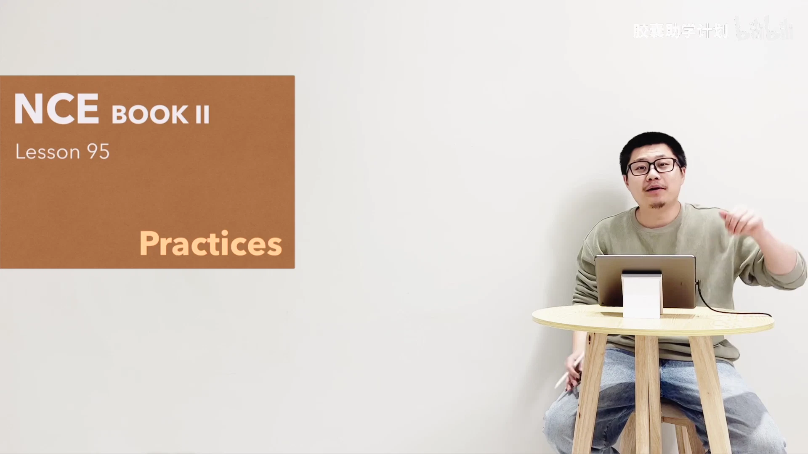

文字识别：交囊助学计划 / NCE / BOOK"I / Lesson 95 / Practices

### 画面 00:00:02

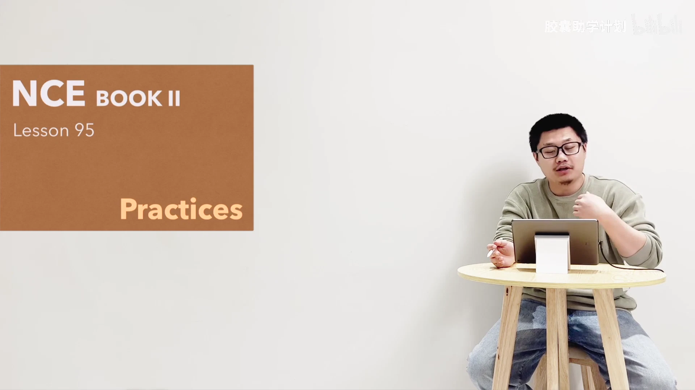

文字识别：辜助字计划 / NCE / BOOKII / Lesson 95 / Practices

### 画面 00:00:07

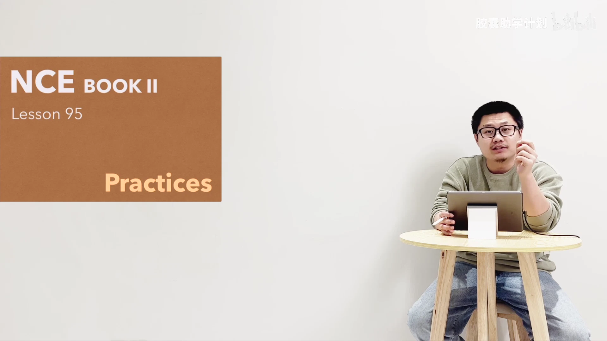

文字识别：交囊助学计划 / NCE / BOOKII / Lesson 95 / Practices

### 画面 00:00:09

文字识别：囊助学计划 / 进行如下练习唯一前提 / 文章跟读至熟读成诵 / 否则请勿开始

### 画面 00:00:16

文字识别： biibi / 胶囊助学计划 / •

### 画面 00:00:20

### 画面 00:00:22

文字识别：囊助学计划 / Comprehension / 训练目标： / 听懂一般疑问句＆特殊疑问句

### 画面 00:00:24

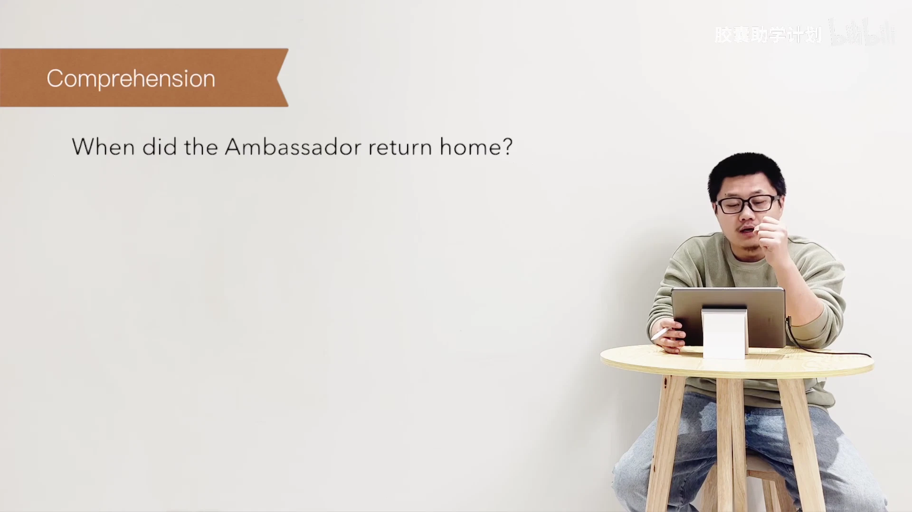

文字识别：襄助学计划區 / Comprehension / When did the Ambassador return home?

## 00:00:30–00:01:00

How did his wife feel? Shocked. Get a shock. How did the ambassador look? Pale. What state were his clothes in? A frightful state. Why were his clothes in a mess? Because of a fire extinguisher. Who had set the

### 画面 00:00:53

文字识别：囊助学计划陽 / Comprehension / Why were his clothes in a mess? / Because of a fire extinguisher.

## 00:01:00–00:01:30

embassy on fire? University students. What did she ask her husband then? Where were you at the time? Where had he been? In his office. Where did the fire break out? In the basement. When did the

### 画面 00:01:02

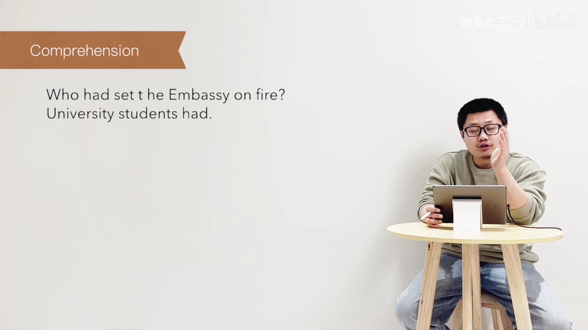

文字识别：妻助学计划！ / Comprehension / Who had set t he Embassy on fire? / University students had.

### 画面 00:01:10

文字识别：妻助学计划園園 / Comprehension / What did she ask her husband then? / 'Where were you at the time?'

### 画面 00:01:16

文字识别：囊助字计划 / Comprehension / Where had he been?

## 00:01:30–00:02:00

ambassador go down there? Immediately. Who aimed a fire extinguisher at him? Horst, that fool. Next one. Why did he do this? He thought the ambassador was on fire. Was the ambassador pleased? No, he wasn't.

### 画面 00:01:46

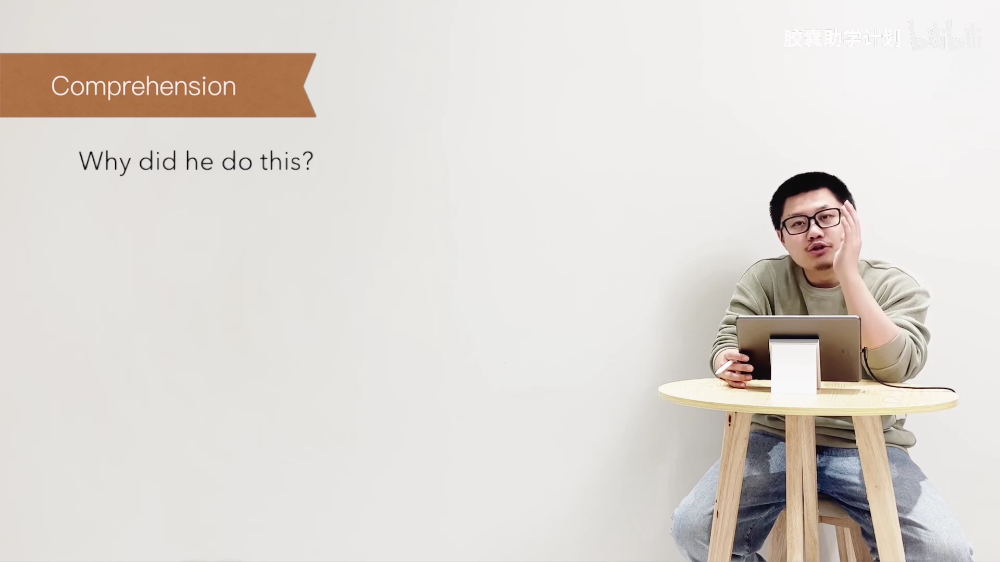

文字识别：囊助字计划 / Comprehension / Why did he do this?

### 画面 00:01:48

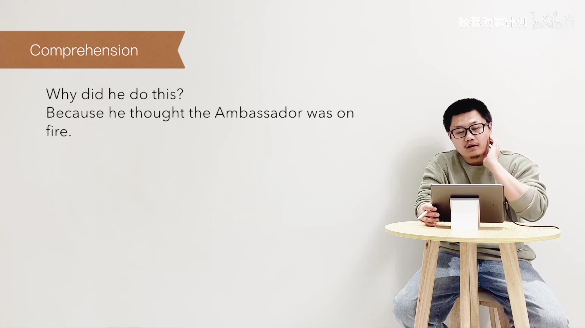

文字识别：Comprehension / Why did he do this? / Because he thought the Ambassador was on / fire.

### 画面 00:01:51

文字识别：建助字计划園 / Comprehension / Why did he do this? / Because he thought the Ambassador was on / fire.

### 画面 00:01:53

文字识别：喜助学计划国 / Comprehension / Was the Ambassador pleased?

### 画面 00:01:59

文字识别：囊助学计划 / Asking questions

## 00:02:00–00:02:30

Asking questions, 四句型. Ask me if the ambassador came home late for lunch. Did提前对吧? Why整句话就行了。呃，When When整句话可以啊。 When did the ambassador came home for lunch?啊几点啊？其实问题的是大概是吧。其实用What time可能更舒服一点。后对主语提问，或者问你也可以有另外一个问法，直接对for lunch提问，但它不是那么逻辑，不是那么明显啊。它应该

### 画面 00:02:06

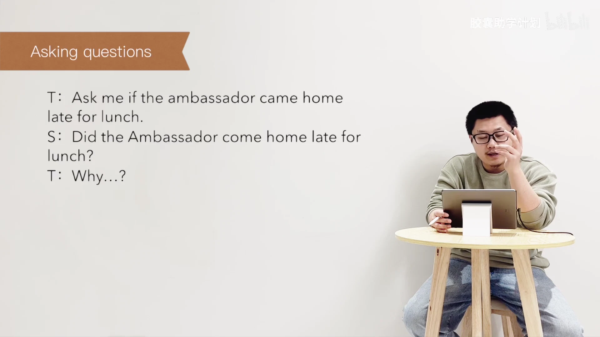

文字识别：Asking questions / T: Ask me if the ambassador came home / late for lunch. / S: Did the Ambassador come home late for / lunch? / T:Why..?

### 画面 00:02:09

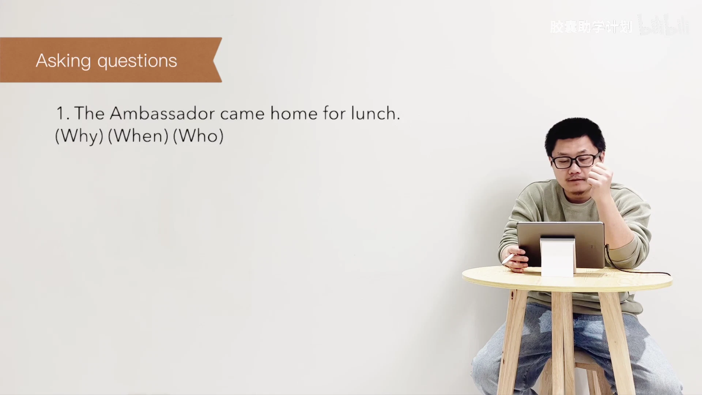

文字识别：妻助学计划 / Asking questions / 1. The Ambassador came home for lunch. / (Why)(When)(Who)

### 画面 00:02:19

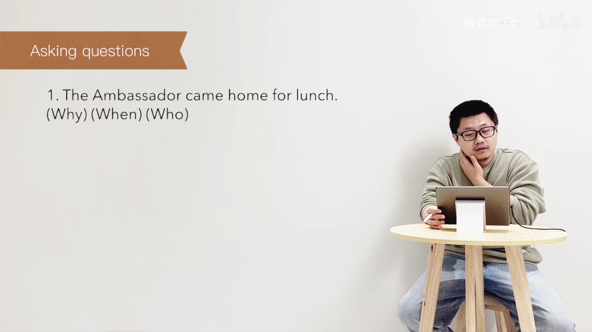

文字识别：臺助字计划 / Asking questions / 1. The Ambassador came home for lunch. / (Why)(When)(Who)

### 画面 00:02:23

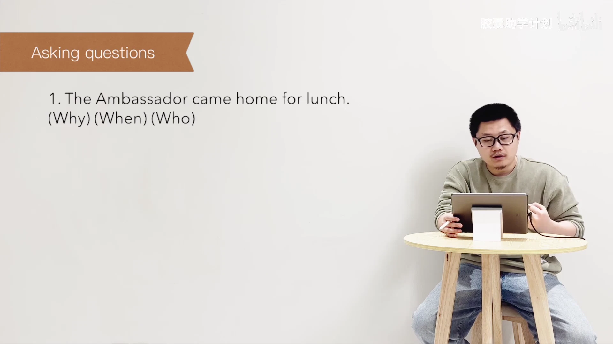

文字识别：妻助学计划陽 / Asking questions / 1. The Ambassador came home for lunch. / (Why)(When)(Who)

### 画面 00:02:25

文字识别：Asking questions / 1. The Ambassador came home for lunch. / (Why)(When)(Who)

## 00:02:30–00:03:00

是 When did the ambassador come home? 对吧？但答案不是 for lunch，是 at lunch time，所以它并不是一一对应的。 His wife got a shock. Did 提前，外加整句话，互对主语提问。 He looked pale. Did 提前，动词换原形。 How 对 pale 提问，互对主语提问。 His clothes were in a mess. Were 提前，呃，What were in a mess？外加整句话。 Students set the embassy on fire. 注意它是一般过去时，只不过 set

### 画面 00:02:41

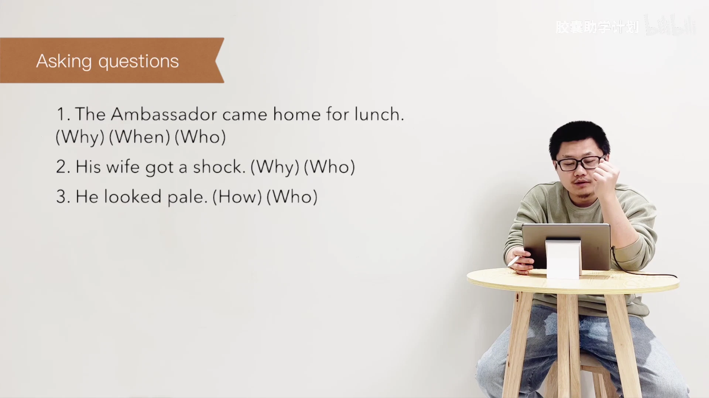

文字识别：Asking questions / 1. The Ambassador came home for lunch. / (Why)(When)(Who) / 2. His wife got a shock. (Why) (Who) / 3. He looked pale.(How) (Who)

### 画面 00:02:54

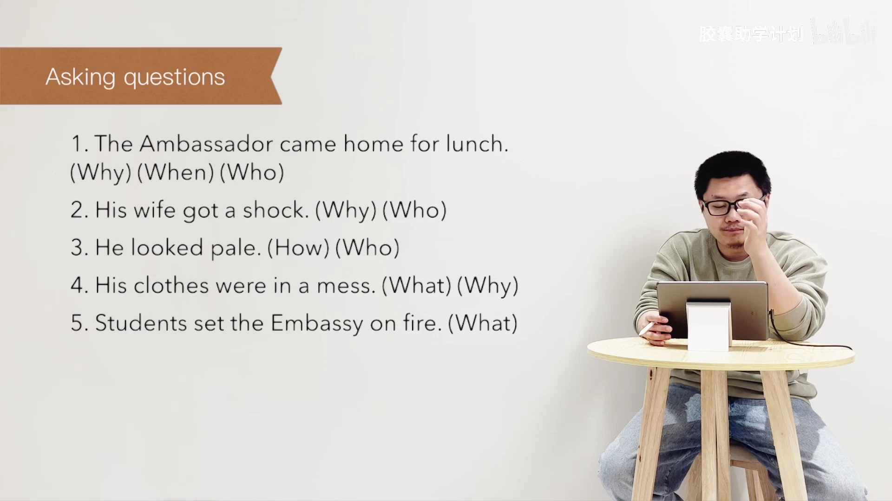

文字识别：Asking questions / 1. The Ambassador came home for lunch. / (Why)(When)(Who) / 2. His wife got a shock. (Why) (Who) / 3. He looked pale.(How)(Who) / 4. His clothes were in a mess. (What) (Why) / 5. Students set the Embassy on fire. (What)

### 画面 00:02:57

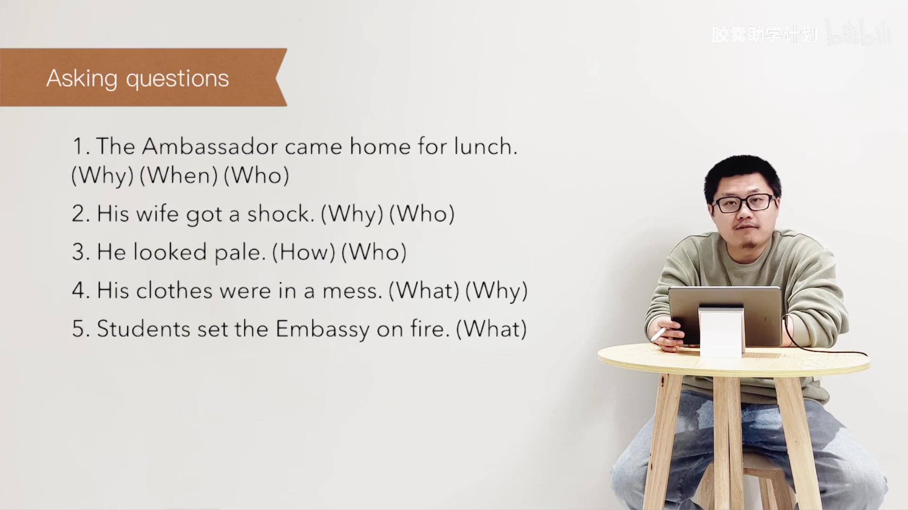

文字识别：Asking questions / 1. The Ambassador came home for lunch. / (Why)(When)(Who) / 2. His wife got a shock. (Why) (Who) / 3. He looked pale.(How)(Who) / 4. His clothes were in a mess. (What) (Why) / 5. Students set the Embassy on fire.(What)

### 画面 00:02:59

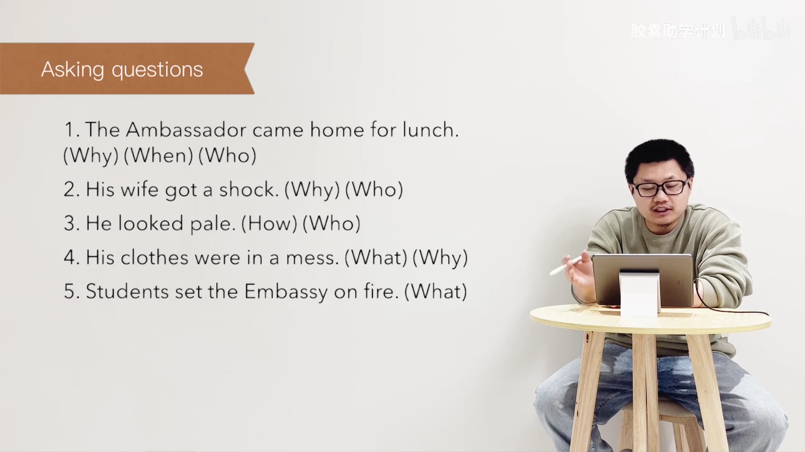

文字识别：妻助学计划 / Asking questions / 1. The Ambassador came home for lunch. / (Why)(When)(Who) / 2. His wife got a shock. (Why) (Who) / 3. He looked pale.(How)(Who) / 4. His clothes were in a mess. (What) (Why) / 5. Students set the Embassy on fire. (What)

## 00:03:00–00:03:30

原形过去式长得一样，所以那是提 did 啊，就你从原文你也想嘛，它是个故事，它肯定是 did 吧。呃，what，那对的 embassy 提问对吧？呃，the ambassador was in his office was 提前 where 对 in his office 提问。The fire broke out in the embassy did 提前 where 对 in the embassy 提问 what 对 the fire 主语提问，不变一般疑问句，问加整句话，加

### 画面 00:03:02

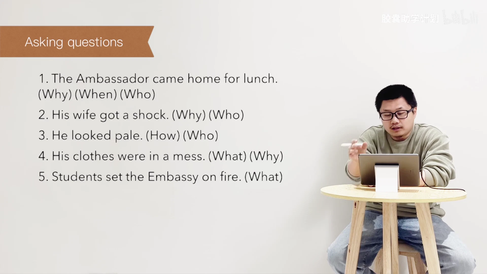

文字识别：Asking questions / 1. The Ambassador came home for lunch. / (Why)(When)(Who) / 2. His wife got a shock. (Why) (Who) / 3. He looked pale.(How) (Who) / 4. His clothes were in a mess. (What) (Why) / 5. Students set the Embassy on fire.(What)

### 画面 00:03:13

文字识别：囊助字计划 / Asking questions

### 画面 00:03:19

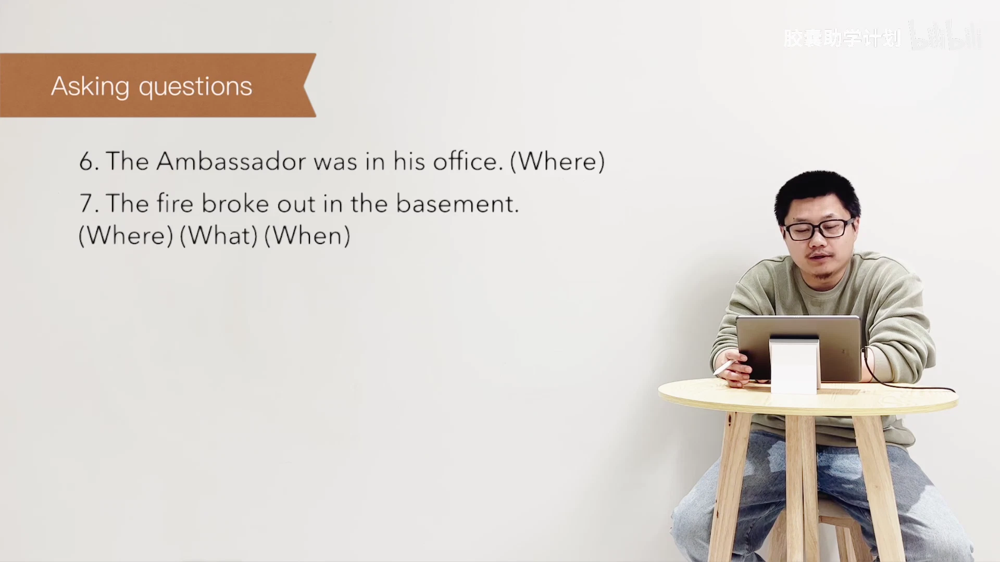

文字识别：Asking questions / 6. The Ambassador was in his office.(Where) / 7. The fire broke out in the basement. / (Where)(What)(When)

## 00:03:30–00:04:00

整句话都是加的一般疑问句啊。The ambassador went down immediately. Did提前，Where对，呃，整句话提问对吧？I would对当提问啊。Where did go immediately？When对immediately提问，Who对主语提问，不变一般疑问句。Horst aimed a fire extinguisher at him. Did提前呗？那What对a fire extinguisher提问？Why整句话Who主语和him都可以。There was a hole

### 画面 00:03:30

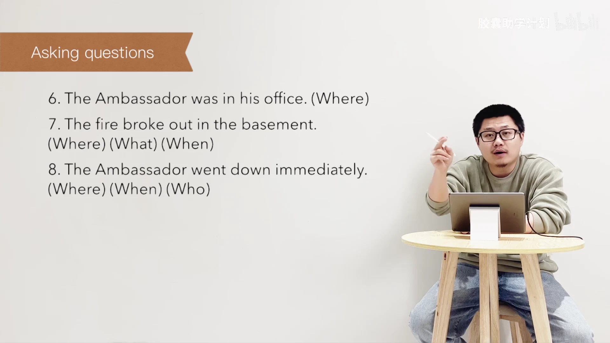

文字识别：Asking questions / 6. The Ambassador was in his office. (Where) / 7. The fire broke out in the basement. / (Where)(What) (When) / 8. The Ambassador went down immediately. / (Where)(When)(Who)

### 画面 00:03:47

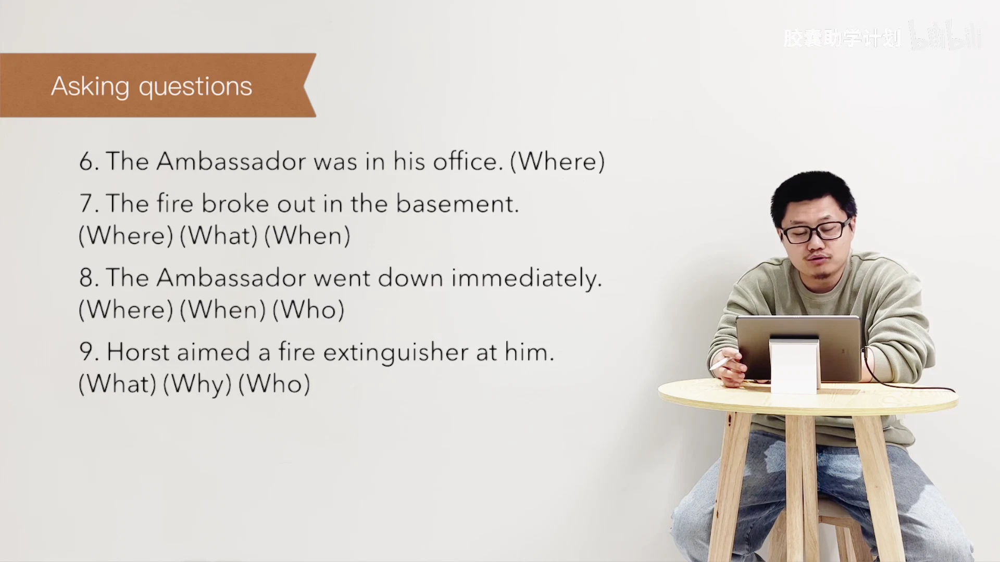

文字识别：Asking questions / 6. The Ambassador was in his office. (Where) / 7. The fire broke out in the basement. / (Where) (What) (When) / 8. The Ambassador went down immediately. / (Where)(When) (Who) / 9. Horst aimed a fire extinguisher at him. / (What) (Why)(Who)

## 00:04:00–00:04:30

in his head. Was提前there be句型吧，对吧？新概念一册六十七课咱就学了，六十七、六十六十九咱学的嘛。呃，where对in his head提问。Tell the story.哎，练习我们这个流畅的这个呃复述，对吧？啊，所以文章要跟读、熟读成诵。Summary呢，一共两篇文章，这是第一篇，这是第二篇。重点咱们要看它的连词。Topic for discussion，老习惯，我给您翻译一遍。Have you ever witnessed a

### 画面 00:04:10

文字识别：交囊助字计划洲 / Tell the story / 训练目标： / 口语复述能力 / Accuracy / Fluency

### 画面 00:04:12

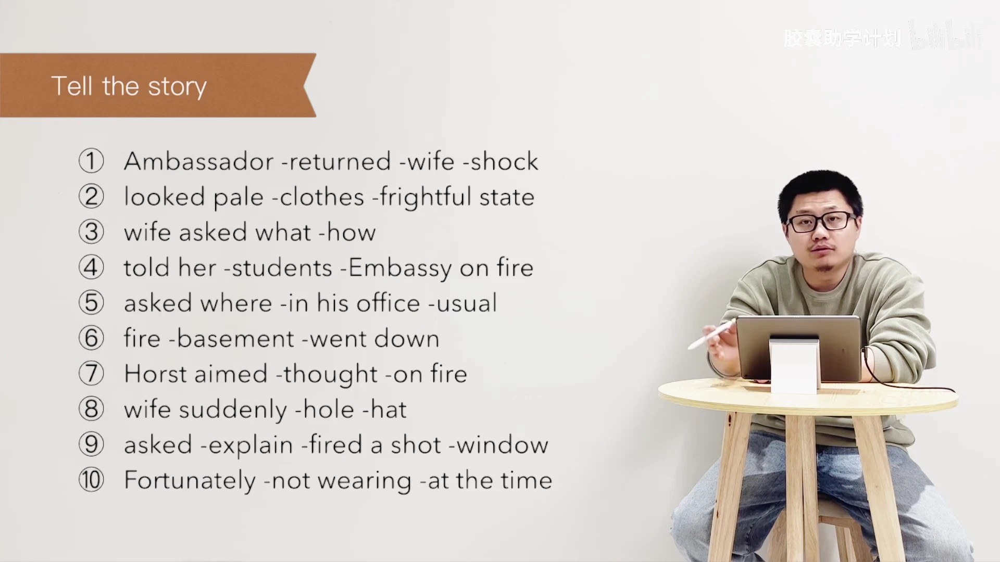

文字识别：助学计划 / Tell the story / ① / Ambassador -returned -wife -shock / ② looked pale -clothes -frightful state / 2 / wife asked what -how / told her -students -Embassy on fire / asked where -in his office -usual / fire -basement -went down / Horst aimed -thought -on fire / wife suddenly -hole -hat / 8 / 9 / asked -explain -fired a shot -window / ⑩ Fortunately -not wearing -at the time

### 画面 00:04:17

文字识别：囊助字计划州 / Summary writing: Key / 训练目标： / 写作复述能力

### 画面 00:04:19

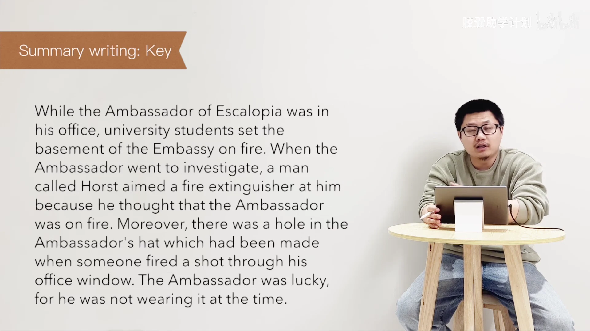

文字识别：養助学计划 / Summary writing: Key / While the Ambassador of Escalopia was in / his office, university students set the / basement of the Embassy on fire. When the / Ambassador went to investigate, a man / called Horst aimed a fire extinguisher at him / because he thought that the Ambassador / was on fire. Moreover, there was a hole in the / Ambassador's hat which had been made / when someone fired a shot through his / office window. The Ambassador was lucky, / for he was not wearing it at the time.

### 画面 00:04:21

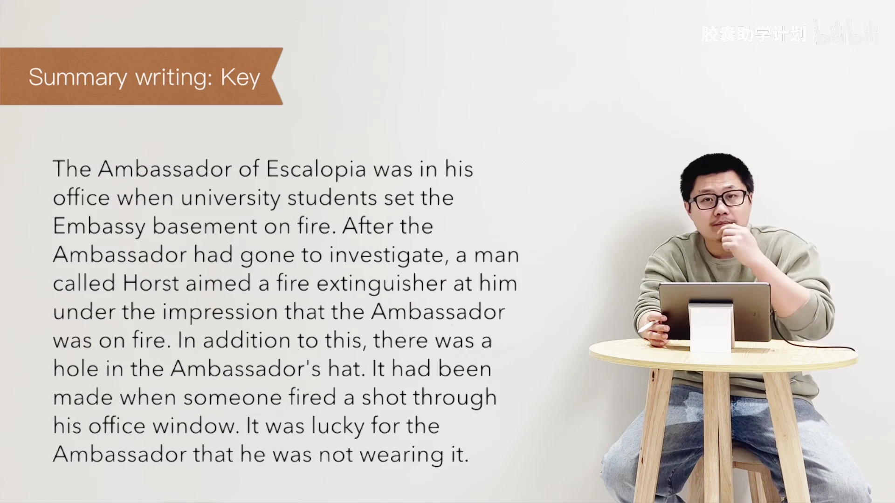

文字识别：奏助学计划 / Summary writing: Key / The Ambassador of Escalopia was in his / office when university students set the / Embassy basement on fire. After the / Ambassador had gone to investigate, a man / called Horst aimed a fire extinguisher at him / under the impression that the Ambassador / was on fire. In addition to this, there was a / hole in the Ambassador's hat. It had been / made when someone fired a shot through / his office window. Ilt was lucky for the / Ambassador that he was not wearing it.

### 画面 00:04:23

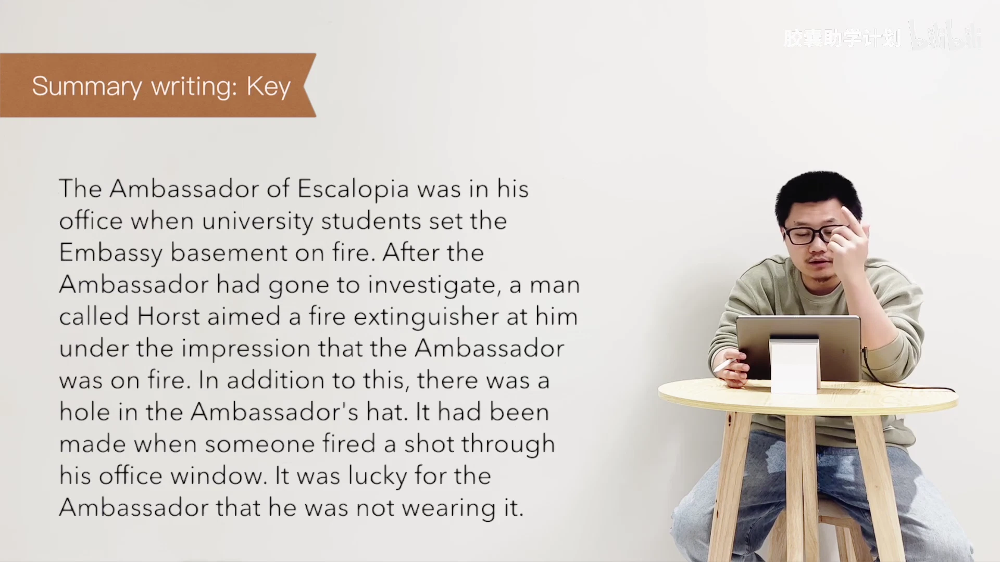

文字识别：奏助学计划 / Summary writing: Key / The Ambassador of Escalopia was in his / office when university students set the / Embassy basement on fire. After the / Ambassador had gone to investigate, a man / called Horst aimed a fire extinguisher at him / under the impression that the Ambassador / was on fire. In addition to this, there was a / hole in the Ambassador's hat. It had been / made when someone fired a shot through / his office window. It was lucky for the / Ambassador that he was not wearing it.

### 画面 00:04:25

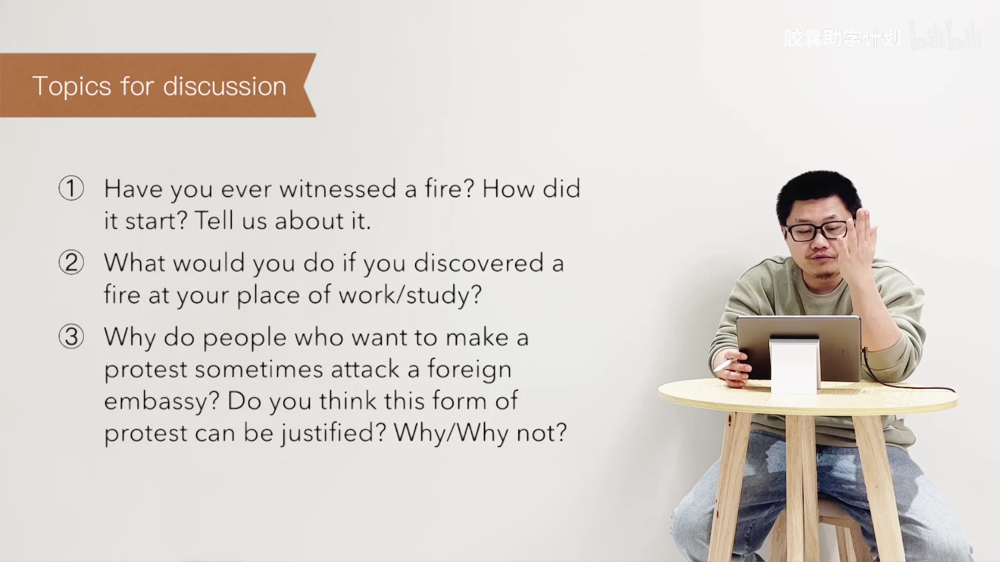

文字识别：助学计划 / Topics for discussion / Have you ever witnessed a fire? How did / it start? Tell us about it. / What would you do if you discovered a / fire at your place of work/study? / Why do people who want to make a / 3 / protest sometimes attack a foreign / embassy? Do you think this form of / protest can be justified? Why/Why not?

## 00:04:30–00:05:00

fire? How did it start? Tell us about it.你看过大火吗？它是如何开始的？给我们讲一讲。第二个，What would you do if you discovered a fire at your place of work or study?说你会做什么？如果你发现了你工作或学习的地方发生大火了。最后一个，Why do people who want to make a protest sometimes attack a foreign embassy?

### 画面 00:04:55

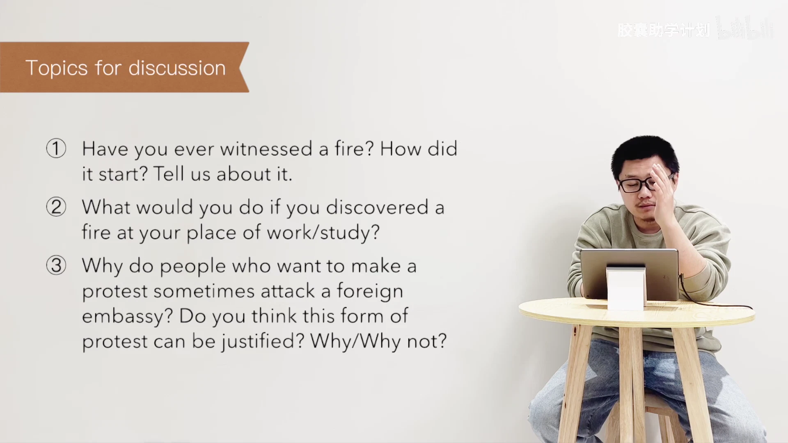

文字识别：虞助学计划 / Topics for discussion / Have you ever witnessed a fire? How did / it start? Tell us about it. / What would you do if you discovered a / fire at your place of work/study? / Why do people who want to make a / 3 / protest sometimes attack a foreign / embassy? Do you think this form of / protest can be justified? Why/Why not?

## 00:05:00–00:05:30

do you think this form of protest can be justified? Why? Why not? So you think why some people who protest against the government attack foreign embassies? So do you think this form of protest is reasonable? Right? Is it reasonable? Right? Why? Right? Homework: Ask Smith. Write and read out loud. Write the essay. Read the answer. Tell the story. Repeat the vocabulary. Then repeat the gaps. Top comment can find the repetition of the gaps.

### 画面 00:05:19

文字识别：囊助学计划

### 画面 00:05:21

文字识别：交囊助学计划咖 / 1.Ask me if写&朗读 / 2. / 摘要写作写&答案

### 画面 00:05:23

文字识别：交囊助学计划 / 1.Ask me if写&朗读 / 摘要写作写&答案 / 3.Tell the story 口语复述

### 画面 00:05:25

文字识别：校囊助学计划淵 / 1.Askme if写&朗读 / 摘要写作写&答案 / 3.Tell the story 口语复述

### 画面 00:05:27

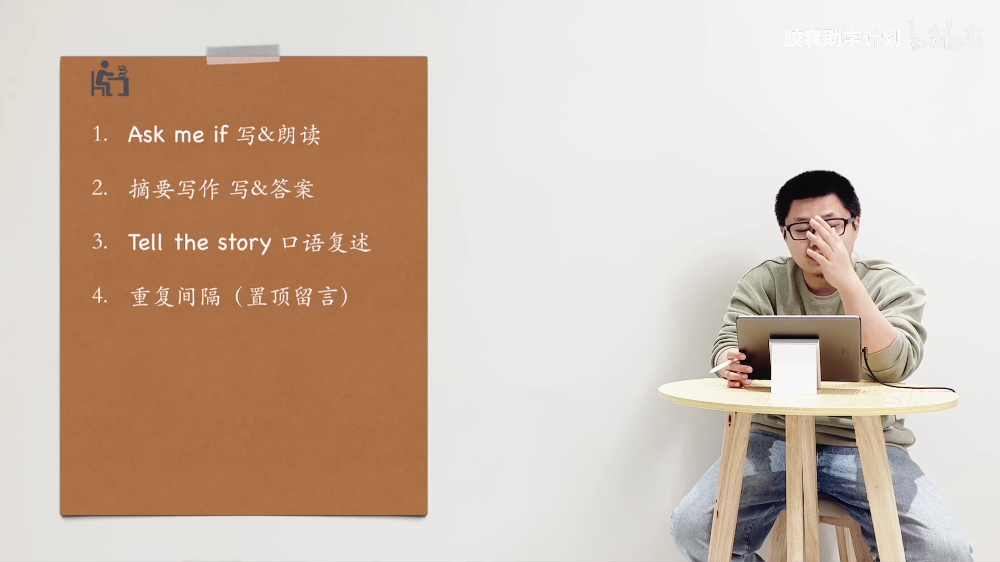

文字识别：校囊助学计划 / 1.Ask me if写&朗读 / 摘要写作写&答案 / 3.Tell the story 口语复述 / .重复间隔（置顶留言） / 4.

## 00:05:30–00:05:58

重复间隔的学习材料，对吧？那以上呢就是本期视频的全部内容了。如果各位喜欢我们的课程呢，欢迎各位关注、订阅、一键三连、分享给需要的朋友，来帮助我们快速成长。See you next time.

### 画面 00:05:30

文字识别：交妻助字计划 / 1.Ask me if写&朗读 / 2.摘要写作写&答案 / 3.Tell the story 口语复述 / ·重复间隔（置顶留言） / 4.

### 画面 00:05:33

文字识别：囊助学计划 / 👍

### 画面 00:05:35

文字识别：交囊助学计划 / 不

### 画面 00:05:38

文字识别：囊助学计划 / 不

### 画面 00:05:41

文字识别：交囊助学计划

### 画面 00:05:43

文字识别：交囊助学计划

### 画面 00:05:45

文字识别：臺助学计划 / 业

### 画面 00:05:47

文字识别：CAPSULEACADEMY / 胶囊助学计划 / 『 / 小红书 / Lecturer / Leo / OE

### 画面 00:05:49

文字识别：洲字 / CAPSULEACADEMY / 胶囊助学计划 / 小红书 / Photographer / Berlin / OE

### 画面 00:05:51

文字识别：運動字計划 / CAPSULEACADEMY / 胶囊助学计划 / 『 / 小红书 / Editor / Berlin / OE

### 画面 00:05:54

文字识别：聖聖動字計划 / CAPSULEACADEMY / 胶囊助学计划 / 『 / 小红书 / Creator / Leo & Berlin / OE

### 画面 00:05:56

文字识别：bilbili / 胶囊助学计划

### 画面 00:05:57

文字识别：bilbili / 胶囊助学计划

