# 096 单词

快速机器解析：语音为单模型转写，未进行独立交叉校对或人工复核；画面每秒采样并按变化选帧，短时文字和标记可能遗漏。截图时间约有 1 秒误差。图片有损压缩；遇到疑点请按时间查看 Google Drive 原视频。

## 00:00:00–00:00:30

Hello, everyone. Welcome to Capsule Academy. This is Leo. Today, we're going to learn new concept English, second volume, last lesson, lesson ninety-six. Uh, congratulate everyone. Finally, we have learned the last lesson. Ah, let's look at the words. Old habit. How to express making a fool of oneself, embarrassing oneself. With this question, study hard. Uh, congratulate everyone. Again, congratulate everyone. We have learned the last lesson of new two. According to

### 画面 00:00:00

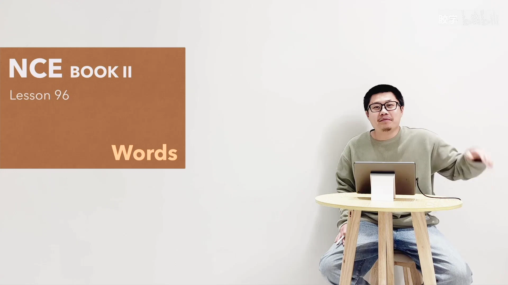

文字识别：NCE / BOOKII / Lesson 96 / Words

### 画面 00:00:05

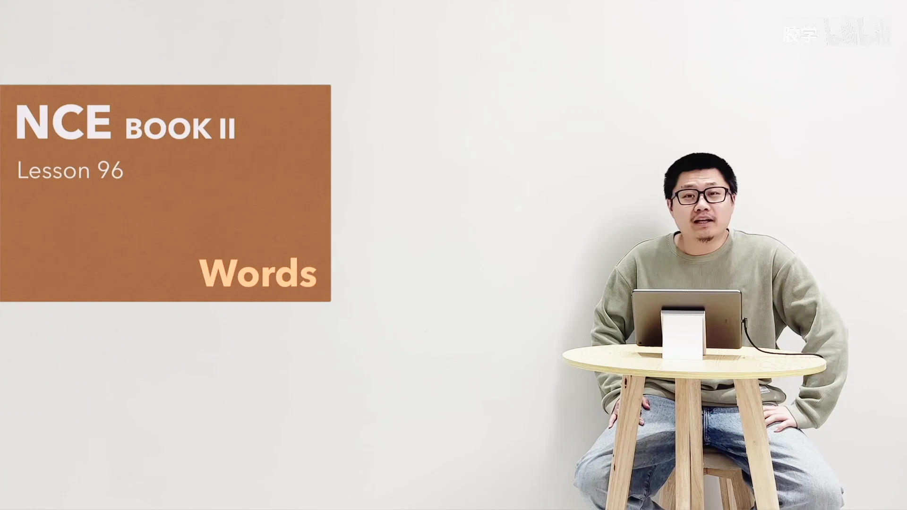

文字识别：NCE / BOOKⅡI / Lesson 96 / Words

### 画面 00:00:10

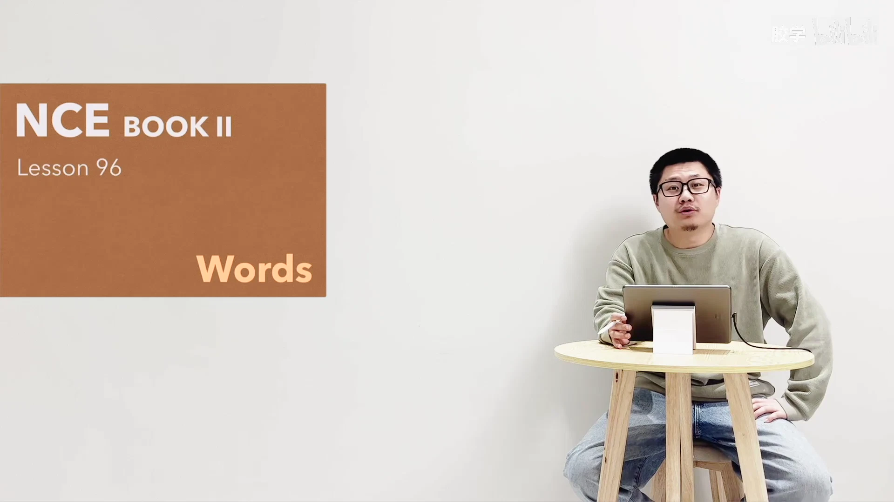

文字识别：NCE / BOOKⅡI / Lesson 96 / Words

### 画面 00:00:13

文字识别：现眼

### 画面 00:00:15

文字识别：①如何表达“出洋相;丢人现眼”？

### 画面 00:00:19

文字识别：胶学b出 / • / •

### 画面 00:00:23

文字识别：胶学 / 胶囊助学计划

### 画面 00:00:25

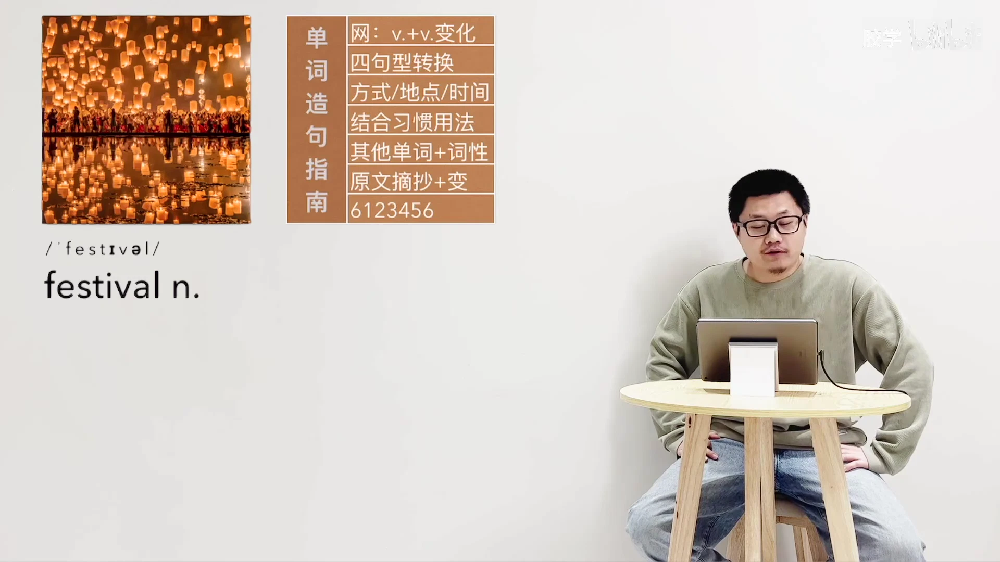

文字识别：单词造句指南 / 网：v.+v.变化 / 四句型转换 / 方式/地点/时间 / 结合习惯用法 / 其他单词+词性 / 原文摘抄+变 / 6123456 / /'festival/ / festival n.

### 画面 00:00:28

文字识别：单词造句指南 / 网：v.+v.变化 / 四句型转换 / 方式/地点/时间 / 结合习惯用法 / 其他单词+词性 / 原文摘抄+变 / 6123456 / /'festival/ / festival n.

## 00:00:30–00:01:00

原来线下教学的经验啊，能认认真真把作业也写完，学到这一课的人真的是凤毛麟角，人很少。如果您学到这儿了，嗯嗯，弹幕留个言什么的，证明一下你曾经来过，很牛很牛了，这是一个特别很好很大的成就啊，祝贺你！咱们还是耐下心来把这几个单词看完，最后一课也没什么东西了，咱们一起看一遍啊。

### 画面 00:00:30

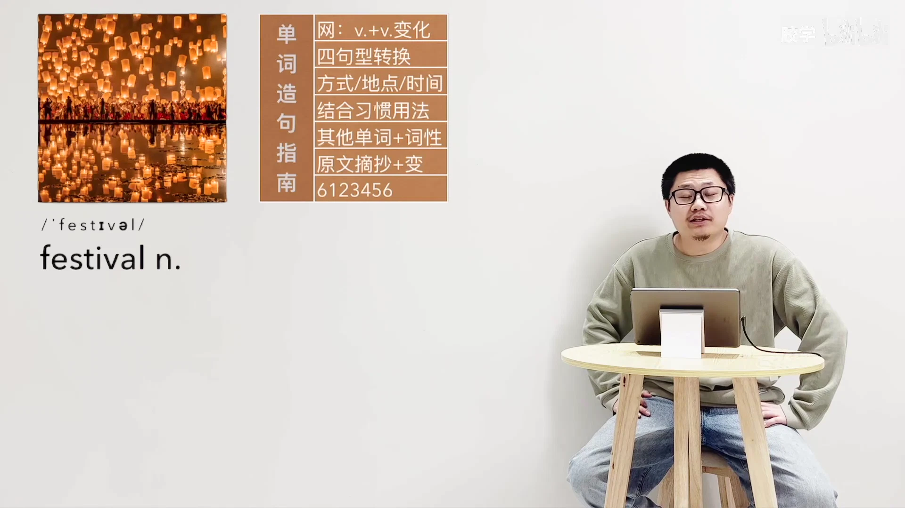

文字识别：单词造句指南 / 网：v.+v.变化 / 四句型转换 / 方式/地点/时间 / 结合习惯用法 / 其他单词+词性 / 原文摘抄+变 / 6123456 / /'festival/ / festival n.

### 画面 00:00:35

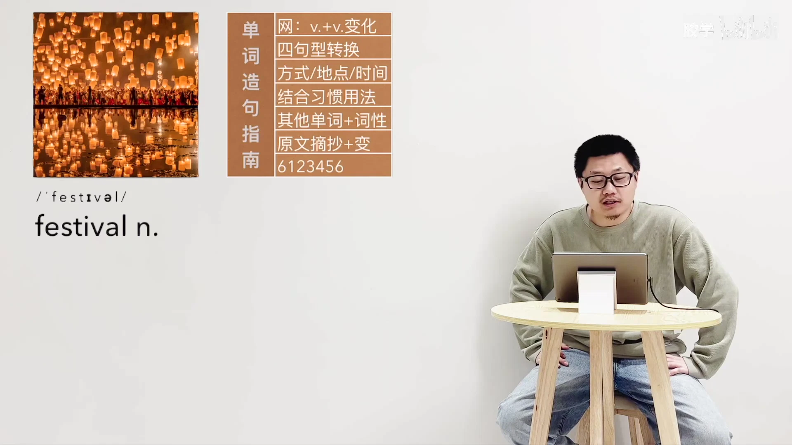

文字识别：单词造句指南 / 网：v.+v.变化 / 四句型转换 / 方式/地点/时间 / 结合习惯用法 / 其他单词+词性 / 原文摘抄+变 / 6123456 / /'festival/ / festival n.

### 画面 00:00:40

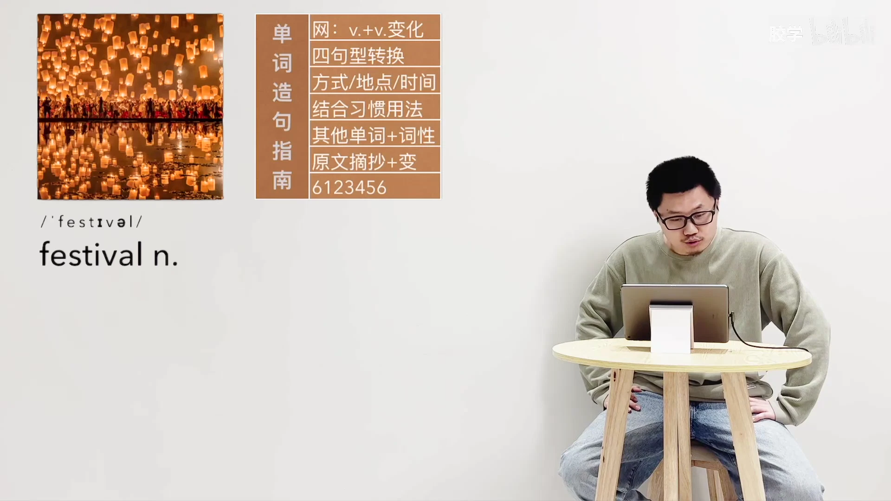

文字识别：单词造句指南 / 网：v.+v.变化 / 四句型转换 / 方式/地点/时间 / 结合习惯用法 / 其他单词+词性 / 原文摘抄+变 / 6123456 / /'festival/ / festival n.

### 画面 00:00:44

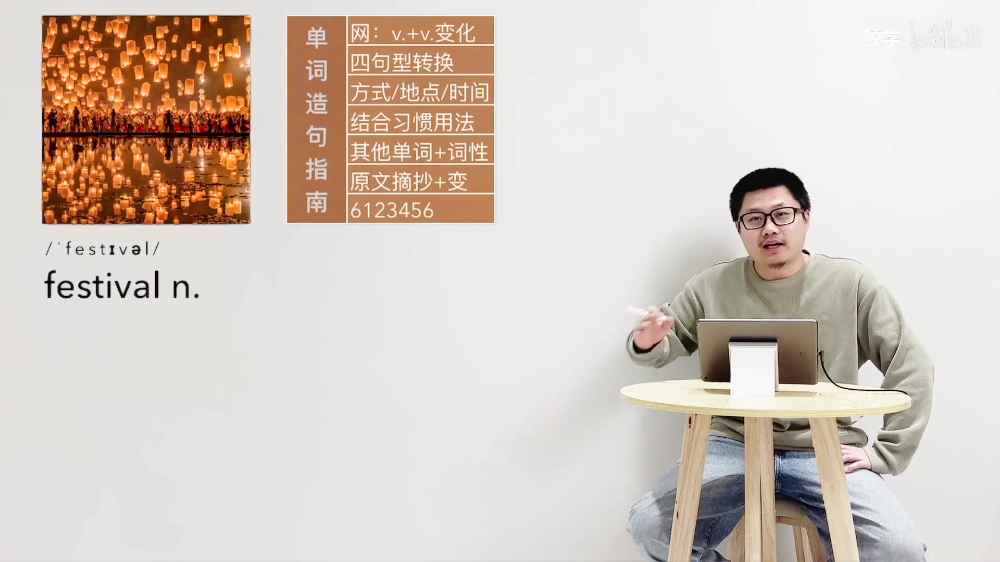

文字识别：单词造句指南 / 网：v.+v.变化 / 四句型转换 / 方式/地点/时间 / 结合习惯用法 / 其他单词+词性 / 原文摘抄+变 / 6123456 / /'festival/ / festival n.

### 画面 00:00:46

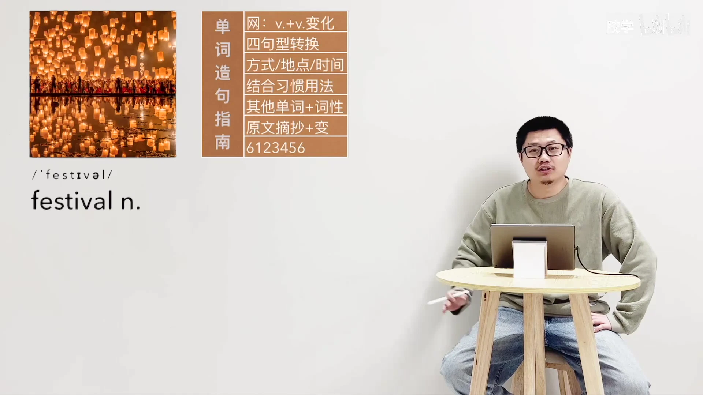

文字识别：单词造句指南 / 网：v.+v.变化 / 四句型转换 / 方式/地点/时间 / 结合习惯用法 / 其他单词+词性 / 原文摘抄+变 / 6123456 / /'festival/ / festival n.

### 画面 00:00:48

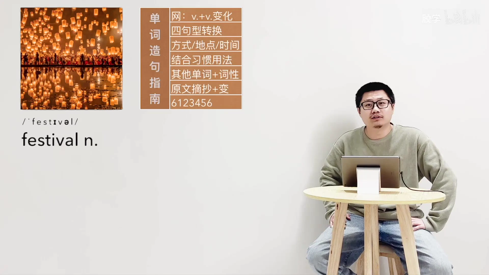

文字识别：单词造句指南 / 网：v.+v.变化 / 四句型转换 / 方式/地点/时间 / 结合习惯用法 / 其他单词+词性 / 原文摘抄+变 / 6123456 / /'festival/ / festival n.

### 画面 00:00:50

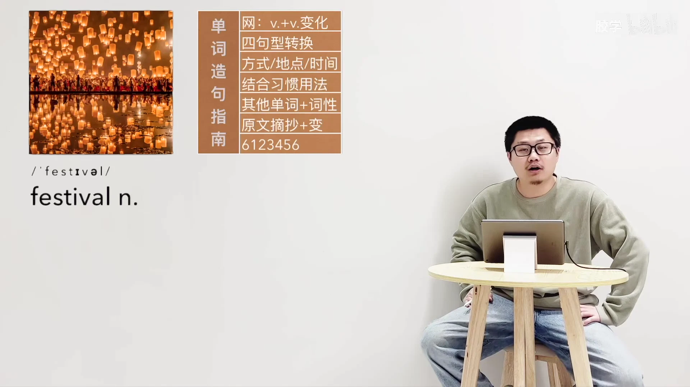

文字识别：单词造句指南 / 网：v.+v.变化 / 四句型转换 / 方式/地点/时间 / 结合习惯用法 / 其他单词+词性 / 原文摘抄+变 / 6123456 / /'festival/ / festival n.

### 画面 00:00:53

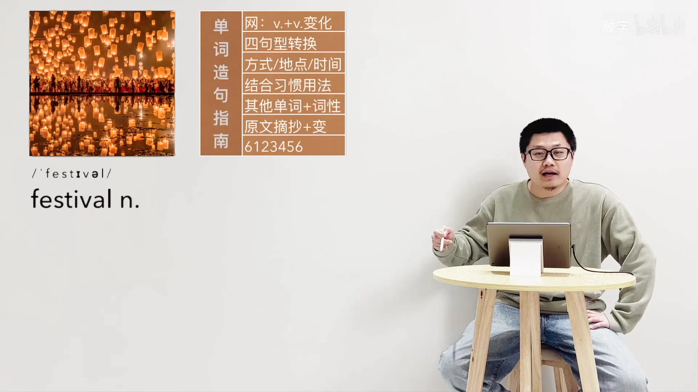

文字识别：单词造句指南 / 网：v.+v.变化 / 四句型转换 / 方式/地点/时间 / 结合习惯用法 / 其他单词+词性 / 原文摘抄+变 / 6123456 / /'festival/ / festival n.

### 画面 00:00:55

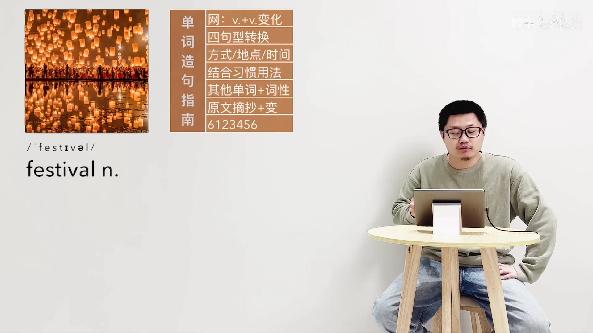

文字识别：单词造句指南 / 网：v.+v.变化 / 四句型转换 / 方式/地点/时间 / 结合习惯用法 / 其他单词+词性 / 原文摘抄+变 / 6123456 / /'festival/ / festival n.

## 00:01:00–00:01:30

第一个单词 festival festival 这个单词可能你从小就见过，尤其像 spring festival 对吧？春节，那我就说 the spring festival lasted for fifteen days last year. Next one 四句型转换，然后呢， I saw her talking to Leo at the festival 在这个节日上，对吧？我看他跟他正在说话呢。 Next one 四句型转换啊， festival，

### 画面 00:01:00

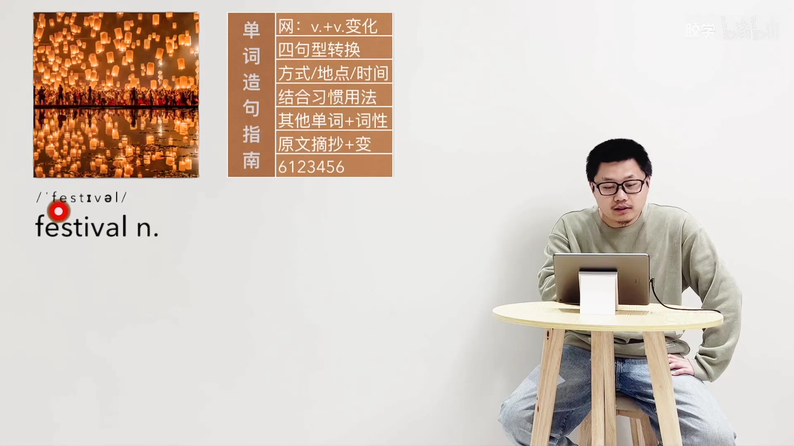

文字识别：单词造句指南 / 网：v.+v.变化 / 四句型转换 / 方式/地点/时间 / 结合习惯用法 / 其他单词+词性 / 原文摘抄+变 / 6123456 / / 'festival/ / festival n.

### 画面 00:01:02

文字识别：单词造句指南 / 网：v.+v.变化 / 四句型转换 / 方式/地点/时间 / 结合习惯用法 / 其他单词+词性 / 原文摘抄+变 / 6123456 / /'festival/ / festival n.

### 画面 00:01:05

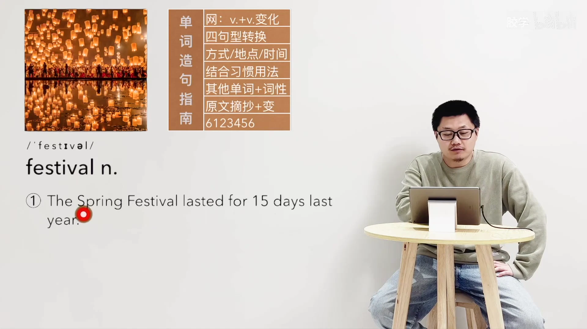

文字识别：单词造句指南 / 网：v.+v.变化 / 四句型转换 / 方式/地点/时间 / 结合习惯用法 / 其他单词+词性 / 原文摘抄+变 / 6123456 / /'festival/ / festival n. / ① The Spring Festival lasted for 15 days last / year.

### 画面 00:01:08

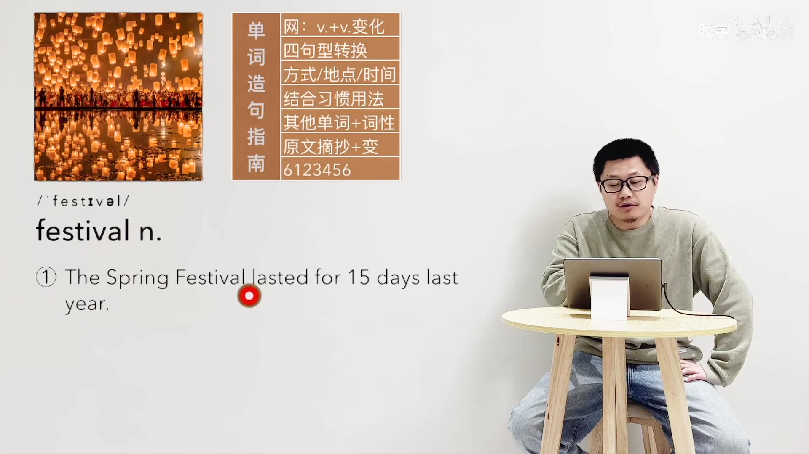

文字识别：单词造句指南 / 网：v.+v.变化 / 四句型转换 / 方式/地点/时间 / 结合习惯用法 / 其他单词+词性 / 原文摘抄+变 / 6123456 / /'festival/ / festival n. / ① The Spring Festival lasted for 15 days last / year.

### 画面 00:01:10

文字识别：单词造句指南 / 网：v.+v.变化 / 四句型转换 / 方式/地点/时间 / 结合习惯用法 / 其他单词+词性 / 原文摘抄+变 / 6123456 / /'festival/ / festival n. / ① The Spring Festival lasted for 15 days last / year.

### 画面 00:01:13

文字识别：单词造句指南 / 网：v.+v.变化 / 四句型转换 / 方式/地点/时间 / 结合习惯用法 / 其他单词+词性 / 原文摘抄+变 / 6123456 / /'festival/ / festival n. / ① The Spring Festival lasted for 15 days last / year. / 'did/what/how long..

### 画面 00:01:15

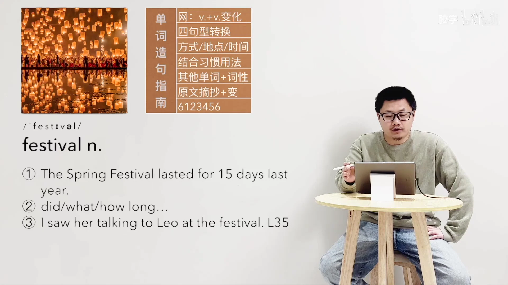

文字识别：单词造句指南 / 网：v.+v.变化 / 四句型转换 / 方式/地点/时间 / 结合习惯用法 / 其他单词+词性 / 原文摘抄+变 / 6123456 / /'festival/ / festival n. / ① The Spring Festival lasted for 15 days last / year. / did/what/how long... / ③ I saw her talking to Leo at the festival. L35

### 画面 00:01:17

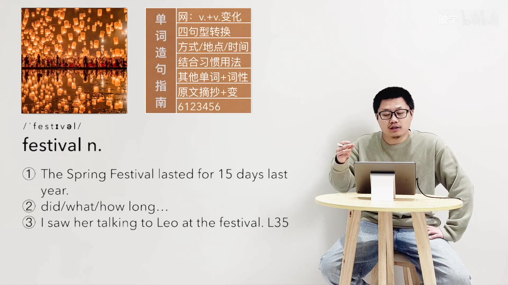

文字识别：单词造句指南 / 网：v.+v.变化 / 四句型转换 / 方式/地点/时间 / 结合习惯用法 / 其他单词+词性 / 原文摘抄+变 / 6123456 / /'festival/ / festival n. / ① The Spring Festival lasted for 15 days last / year. / did/what/how long... / ③ I saw her talking to Leo at the festival. L35

### 画面 00:01:20

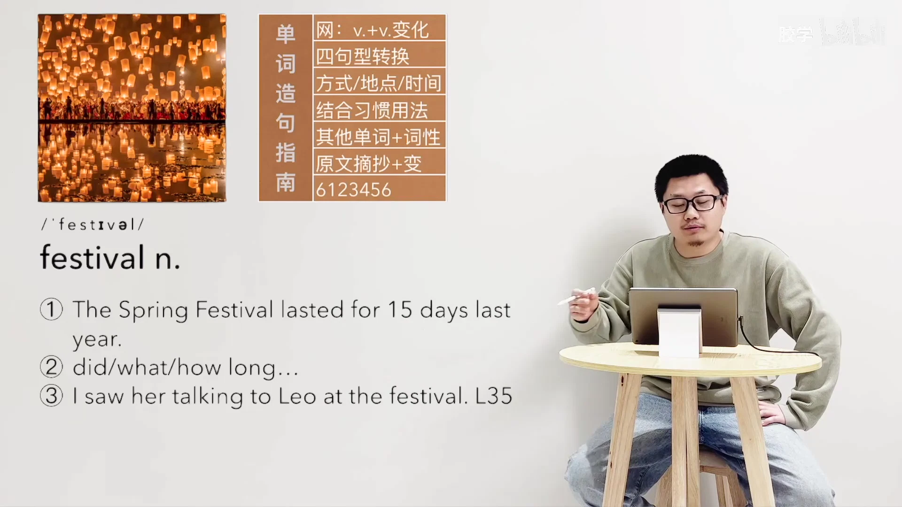

文字识别：单词造句指南 / 网：v.+v.变化 / 四句型转换 / 方式/地点/时间 / 结合习惯用法 / 其他单词+词性 / 原文摘抄+变 / 6123456 / /'festival/ / festival n. / ① The Spring Festival lasted for 15 days last / year. / did/what/how long... / ③ I saw her talking to Leo at the festival. L35

### 画面 00:01:22

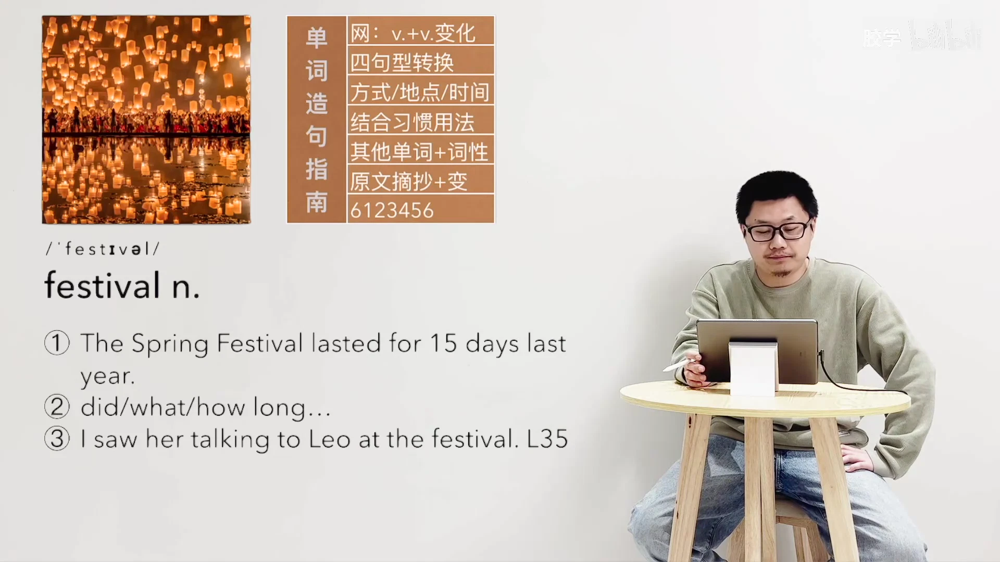

文字识别：单词造句指南 / 网：v.+v.变化 / 四句型转换 / 方式/地点/时间 / 结合习惯用法 / 其他单词+词性 / 原文摘抄+变 / 6123456 / /'festival/ / festival n. / ① The Spring Festival lasted for 15 days last / year. / did/what/how long.. / ③ I saw her talking to Leo at the festival. L35

### 画面 00:01:24

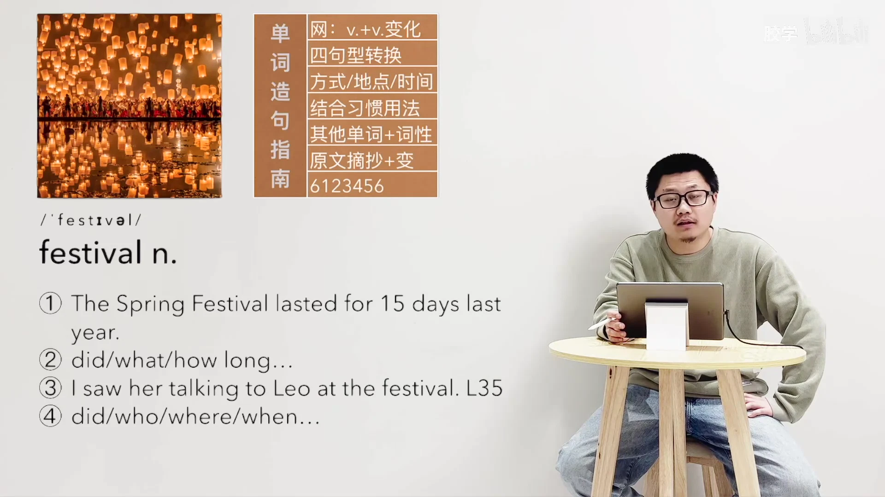

文字识别：单词造句指南 / 网：v.+v.变化 / 四句型转换 / 方式/地点/时间 / 结合习惯用法 / 其他单词+词性 / 原文摘抄+变 / 6123456 / /'festival/ / festival n. / ① The Spring Festival lasted for 15 days last / year. / did/what/how long... / ③ I saw her talking to Leo at the festival. L35 / ) did/who/where/when...

### 画面 00:01:26

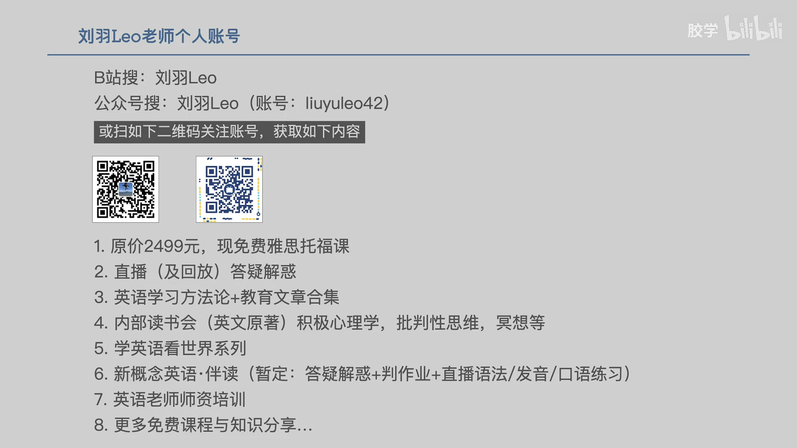

文字识别：胶学 bii出 / 刘羽Leo老师个人账号 / B站搜：刘羽Leo / 公众号搜：刘羽Leo（账号：liuyuleo42) / 或扫如下二维码关注账号，获取如下内容 / 1.原价2499元，现免费雅思托福课 / 2.直播（及回放）答疑解惑 / 3.英语学习方法论+教育文章合集 / 4.内部读书会（英文原著）积极心理学，批判性思维，冥想等 / 5.学英语看世界系列 / 6.新概念英语·伴读 (暂定：答疑解惑+判作业+直播语法/发音/口语练习) / 7.英语老师师资培训 / 8.更多免费课程与知识分享...

## 00:01:30–00:02:00

呃，那注意力集中，咱听一个电影片段。 Well, in that case, I'll see you this evening at the festival, Emmet. 好，接下来下一个单词 lantern, lantern 就灯笼啊，灯笼。那咱们造句子呗，它是名词，找动词嘛。 They tried to set all the lanterns on fire last night. 九十五课咱刚学的 set something on fire. Next one, 说 this kind of lantern is very

### 画面 00:01:31

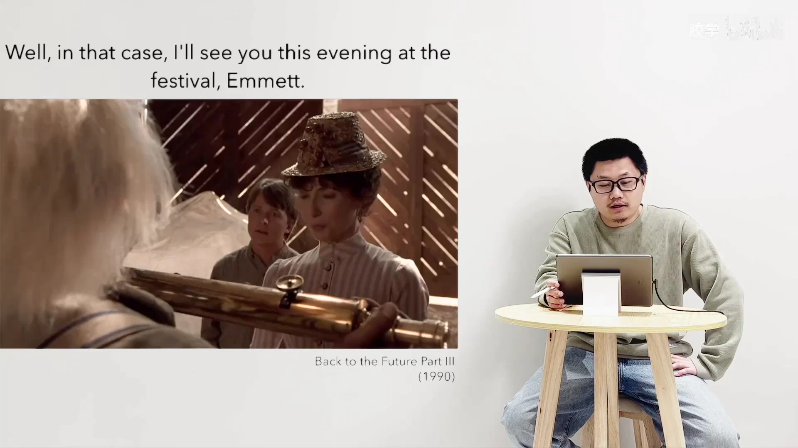

文字识别：Well, in that case, I'll see you this evening at the / festival, Emmett. / Back to the Future Part lll / (1990)

### 画面 00:01:36

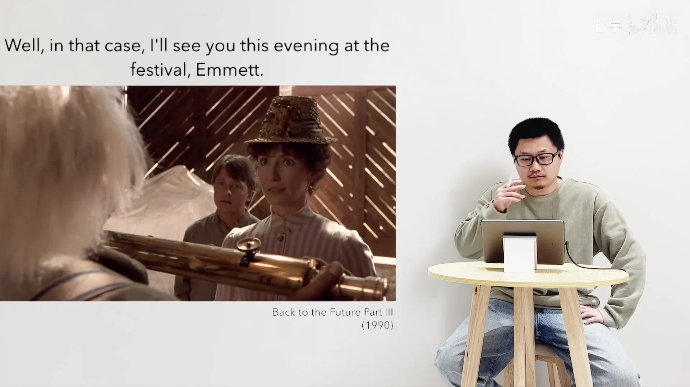

文字识别：Well, in that case, I'll see you this evening at the / festival, Emmett. / Back to the Future Part lll / (1990)

### 画面 00:01:38

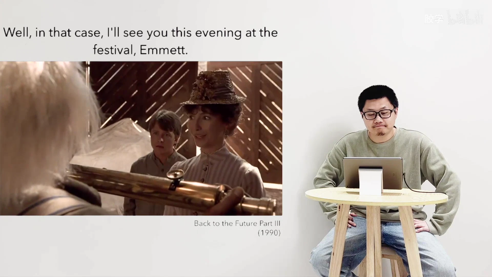

文字识别：Well, in that case, I'll see you this evening at the / festival, Emmett. / Back to the Future Part lll / (1990)

### 画面 00:01:40

文字识别：Well, in that case, I'll see you this evening at the / festival, Emmett. / Back to the Future Part lll / (1990)

### 画面 00:01:42

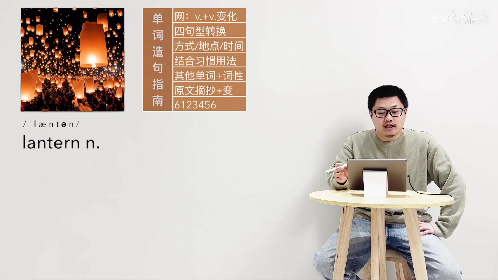

文字识别：单词造句指南 / 网：v.+v.变化 / 四句型转换 / 方式/地点/时间 / 结合习惯用法 / 其他单词+词性 / 原文摘抄+变 / 6123456 / /'læntan/ / lantern n.

### 画面 00:01:44

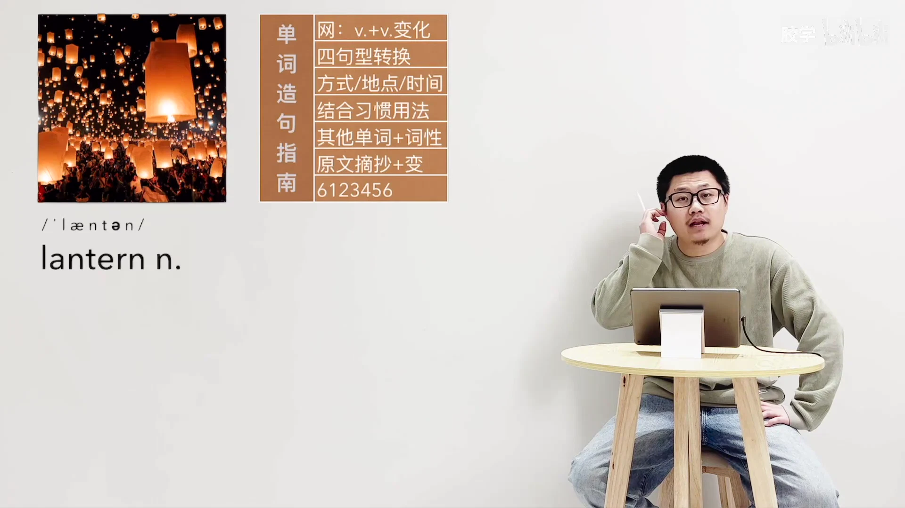

文字识别：单词造句指南 / 网：v.+v.变化 / 四句型转换 / 方式/地点/时间 / 结合习惯用法 / 其他单词+词性 / 原文摘抄+变 / 6123456 / /'læntan/ / lantern n.

### 画面 00:01:46

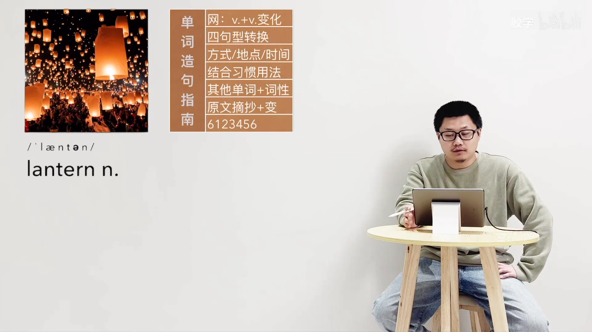

文字识别：单词造句指南 / 网：v.+v.变化 / 四句型转换 / 方式/地点/时间 / 结合习惯用法 / 其他单词+词性 / 原文摘抄+变 / 6123456 / /'læntan/ / lantern n.

### 画面 00:01:49

文字识别：单词造句指南 / 网：v.+v.变化 / 四句型转换 / 方式/地点/时间 / 结合习惯用法 / 其他单词+词性 / 原文摘抄+变 / 6123456 / /'læentan/ / lantern n. / ① They tried to set all the lanterns on fire last / night. L95

### 画面 00:01:51

文字识别：单词造句指南 / 网：v.+v.变化 / 四句型转换 / 方式/地点/时间 / 结合习惯用法 / 其他单词+词性 / 原文摘抄+变 / 6123456 / / læntan/ / lantern n. / ① They tried to set all the lanterns on fire last / night. L95

### 画面 00:01:54

文字识别：单词造句指南 / 网：v.+v.变化 / 四句型转换 / 方式/地点/时间 / 结合习惯用法 / 其他单词+词性 / 原文摘抄+变 / 6123456 / / |æntan/ / lantern n. / ① They tried to set all the lanterns on fire last / night. L95

### 画面 00:01:56

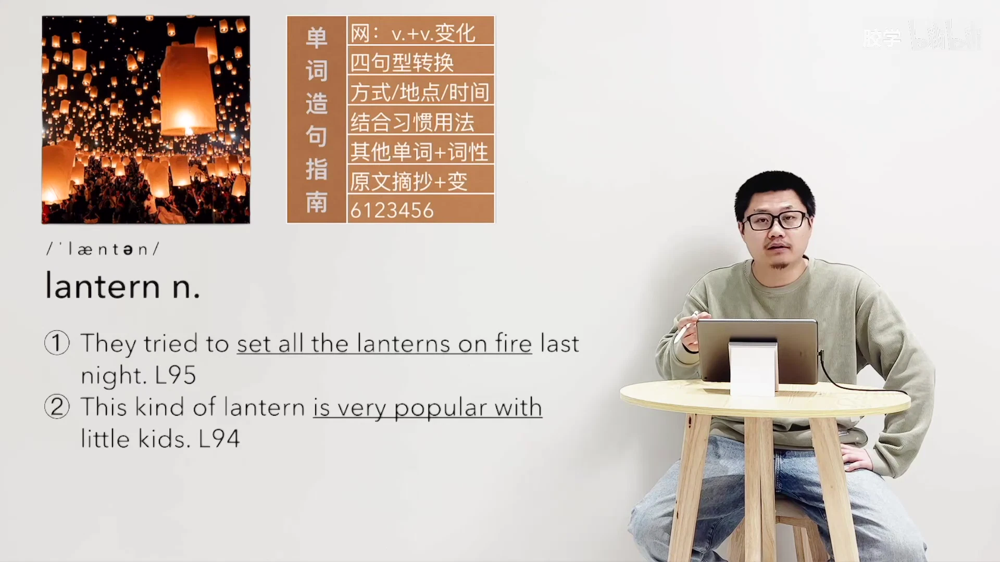

文字识别：单词造句指南 / 网：v.+v.变化 / 四句型转换 / 方式/地点/时间 / 结合习惯用法 / 其他单词+词性 / 原文摘抄+变 / 6123456 / /'læntan/ / lantern n. / ① They tried to set all the lanterns on fire last / night. L95 / This kind of lantern is very popular with / little kids. L94

### 画面 00:01:59

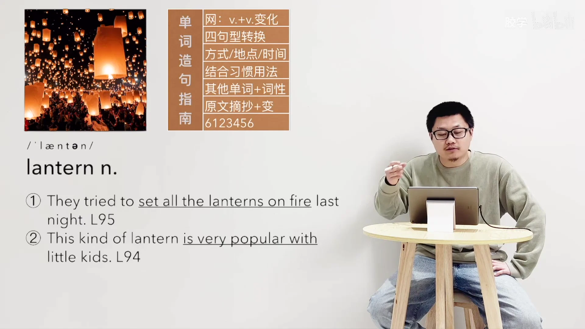

文字识别：单词造句指南 / 网：v.+v.变化 / 四句型转换 / 方式/地点/时间 / 结合习惯用法 / 其他单词+词性 / 原文摘抄+变 / 6123456 / /'læntan/ / lantern n. / ① They tried to set all the lanterns on fire last / night. L95 / This kind of lantern is very popular with / little kids. L94

## 00:02:00–00:02:30

popular with little kid.小孩儿很受小孩儿欢迎，对吧？最后一个，He claimed to have seen lots of lanterns in the sky.他声称他在天上看见了很多的灯笼。Okay,海市蜃楼吗？啊，lantern.下一个单词，spectacle. Spectacle呢？景象、景色，对吧？像这种图当中很美的景象、景色，全可以叫spectacle.那我们就不学它了。我们学一个它的常见的习惯用法，make a

### 画面 00:02:01

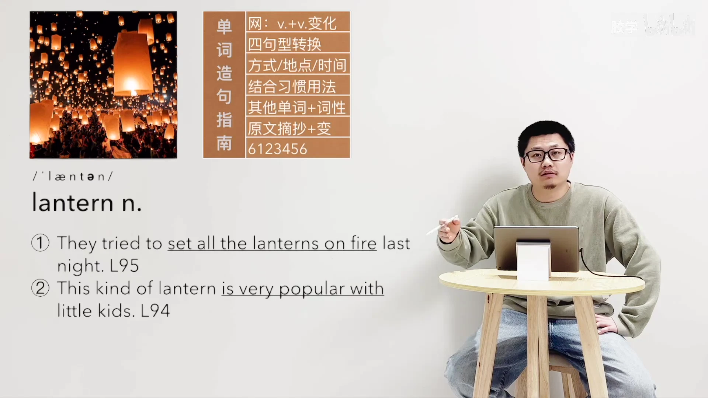

文字识别：单词造句指南 / 网：v.+v.变化 / 四句型转换 / 方式/地点/时间 / 结合习惯用法 / 其他单词+词性 / 原文摘抄+变 / 6123456 / /'læntan/ / lantern n. / ① They tried to set all the lanterns on fire last / night. L95 / This kind of lantern is very popular with / little kids. L94

### 画面 00:02:04

文字识别：单词造句指南 / 网：v.+v.变化 / 四句型转换 / 方式/地点/时间 / 结合习惯用法 / 其他单词+词性 / 原文摘抄+变 / 6123456 / /'læntan/ / lantern n. / ① They tried to set all the lanterns on fire last / night. L95 / This kind of lantern is very popular with / little kids. L94 / He claimed to have seen lots of lanterns in / the sky. L82

### 画面 00:02:06

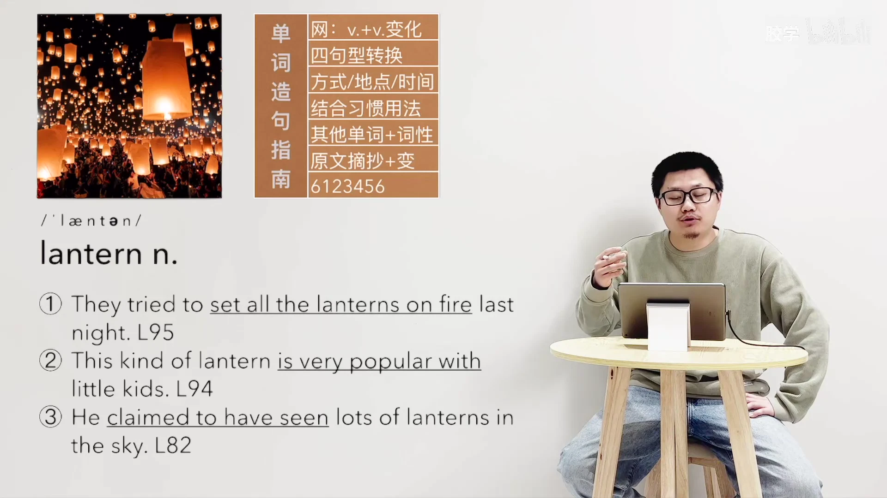

文字识别：单词造句指南 / 网：v.+v.变化 / 四句型转换 / 方式/地点/时间 / 结合习惯用法 / 其他单词+词性 / 原文摘抄+变 / 6123456 / / 'læntan/ / lantern n. / ① They tried to set all the lanterns on fire last / night. L95 / This kind of lantern is very popular with / little kids. L94 / He claimed to have seen lots of lanterns in / the sky. L82

### 画面 00:02:10

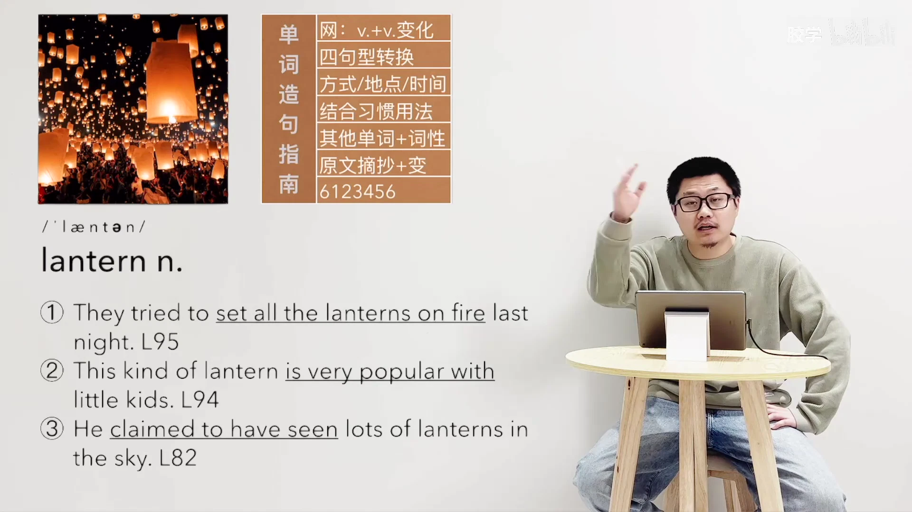

文字识别：单词造句指南 / 网：v.+v.变化 / 四句型转换 / 方式/地点/时间 / 结合习惯用法 / 其他单词+词性 / 原文摘抄+变 / 6123456 / /'læntan/ / lantern n. / ① They tried to set all the lanterns on fire last / night. L95 / This kind of lantern is very popular with / little kids. L94 / He claimed to have seen lots of lanterns in / the sky. L82

### 画面 00:02:12

文字识别：单词造句指南 / 网：v.+v.变化 / 四句型转换 / 方式/地点/时间 / 结合习惯用法 / 其他单词+词性 / 原文摘抄+变 / 6123456 / /'læntan/ / lantern n. / ① They tried to set all the lanterns on fire last / night. L95 / This kind of lantern is very popular with / little kids. L94 / He claimed to have seen lots of lanterns in / the sky. L82

### 画面 00:02:15

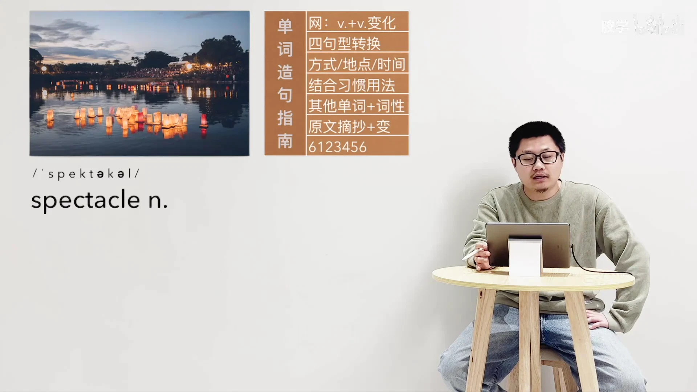

文字识别：单词造句指南 / 网：v.+v.变化 / 四句型转换 / 方式/地点/时间 / 结合习惯用法 / 其他单词+词性 / 原文摘抄+变 / 6123456 / /'spektakal/ / spectacle n.

### 画面 00:02:17

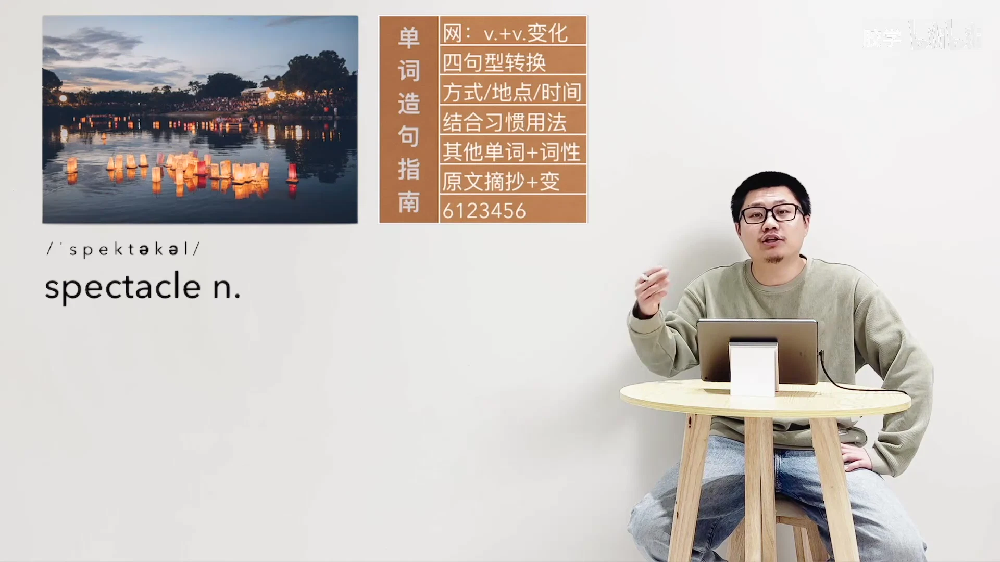

文字识别：单词造句指南 / 网：v.+v.变化 / 四句型转换 / 方式/地点/时间 / 结合习惯用法 / 其他单词+词性 / 原文摘抄+变 / 6123456 / /'spektakal/ / spectacle n.

### 画面 00:02:21

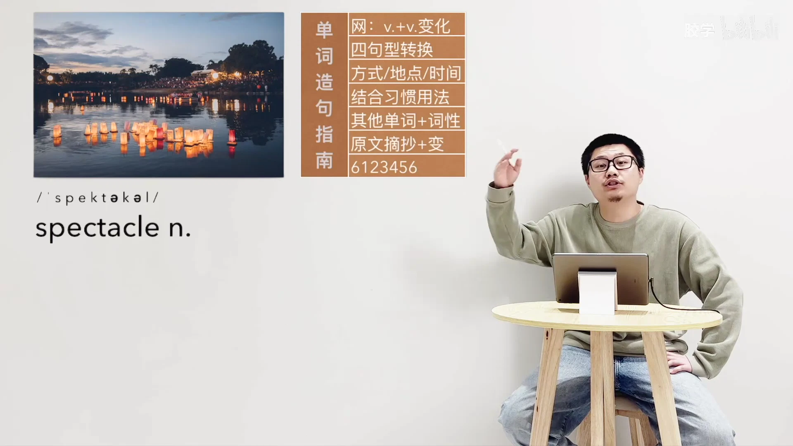

文字识别：单词造句指南 / 网：v.+v.变化 / 四句型转换 / 方式/地点/时间 / 结合习惯用法 / 其他单词+词性 / 原文摘抄+变 / 6123456 / /'spektakal/ / spectacle n.

### 画面 00:02:24

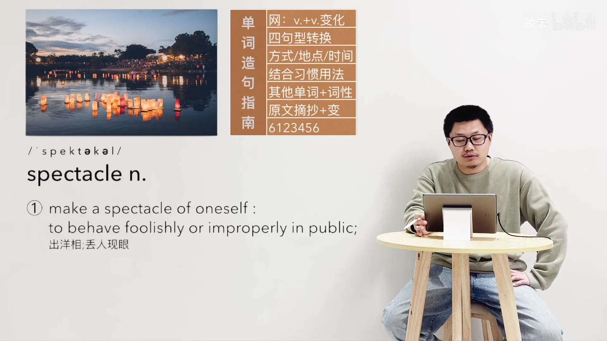

文字识别：单词造句指南 / 网：v.+v.变化 / 四句型转换 / 方式/地点/时间 / 结合习惯用法 / 其他单词+词性 / 原文摘抄+变 / 6123456 / /'spektakal/ / spectacle n. / ① make a spectacle of oneself : / to behave foolishly or improperly in public; / 出洋相;丢人现眼

### 画面 00:02:26

文字识别：单词造句指南 / 网：v.+v.变化 / 四句型转换 / 方式/地点/时间 / 结合习惯用法 / 其他单词+词性 / 原文摘抄+变 / 6123456 / /'spektakal/ / spectacle n. / ① make a spectacle of oneself : / to behave foolishly or improperly in public; / 出洋相;丢人现眼

## 00:02:30–00:03:00

spectacle a spectacle of oneself什么意思呢？哎，英文叫 to behave foolish foolishly or improperly in public。那汉语的意思就是出洋相，丢人了，对吧？哎，丢人现眼了。那 foolishly 就是愚蠢的， improper improperly 就是不合适的，对吧？OK，造个句子嘛，口语当中很常用。Don't make a spectacle of yourself。你别让你自己在这丢人现眼，对吧？好，再来说，He got

### 画面 00:02:31

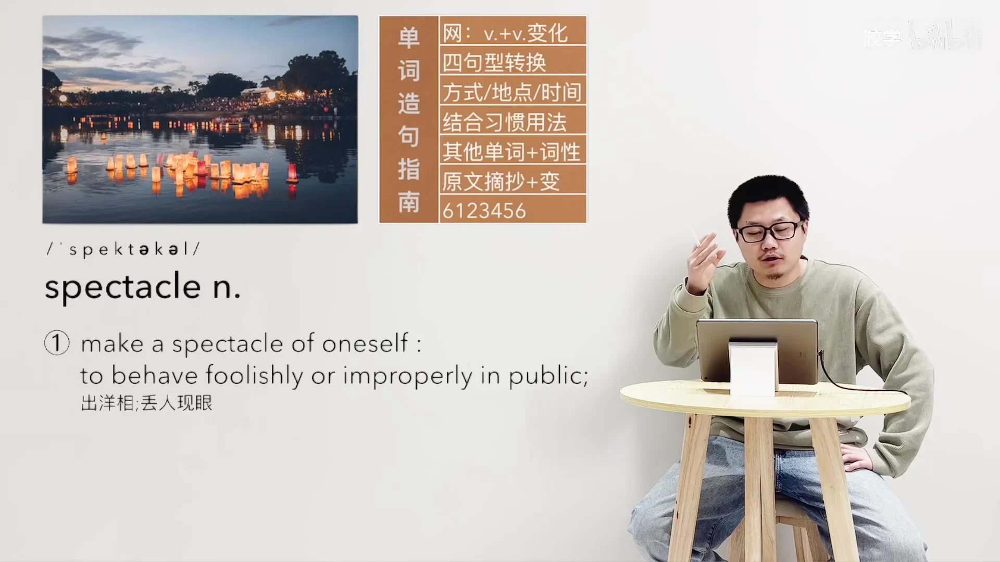

文字识别：单词造句指南 / 网：v.+v.变化 / 四句型转换 / 方式/地点/时间 / 结合习惯用法 / 其他单词+词性 / 原文摘抄+变 / 6123456 / /'spektakal/ / spectacle n. / ① make a spectacle of oneself : / to behave foolishly or improperly in public; / 出洋相;丢人现眼

### 画面 00:02:36

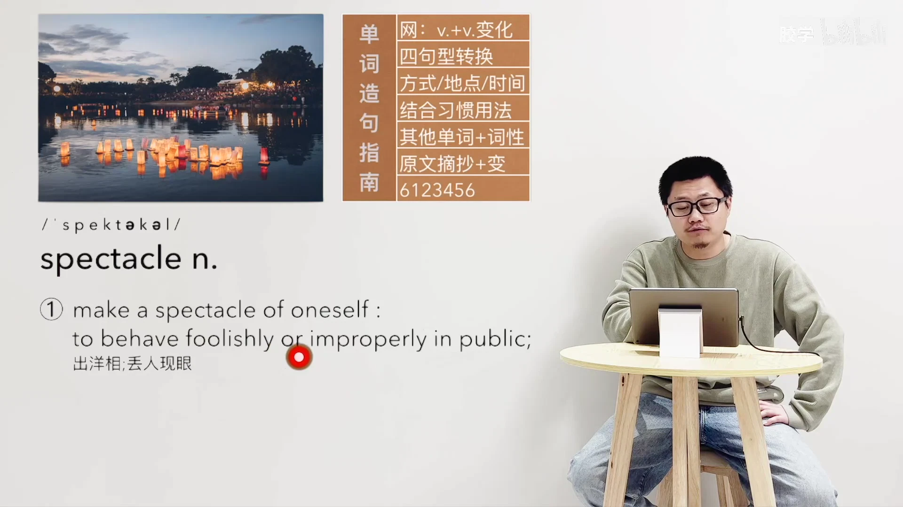

文字识别：单词造句指南 / 网：v.+v.变化 / 四句型转换 / 方式/地点/时间 / 结合习惯用法 / 其他单词+词性 / 原文摘抄+变 / 6123456 / /'spektakal/ / spectacle n. / ① make a spectacle of oneself : / to behave foolishly or improperly in public; / 出洋相;丢人现眼

### 画面 00:02:41

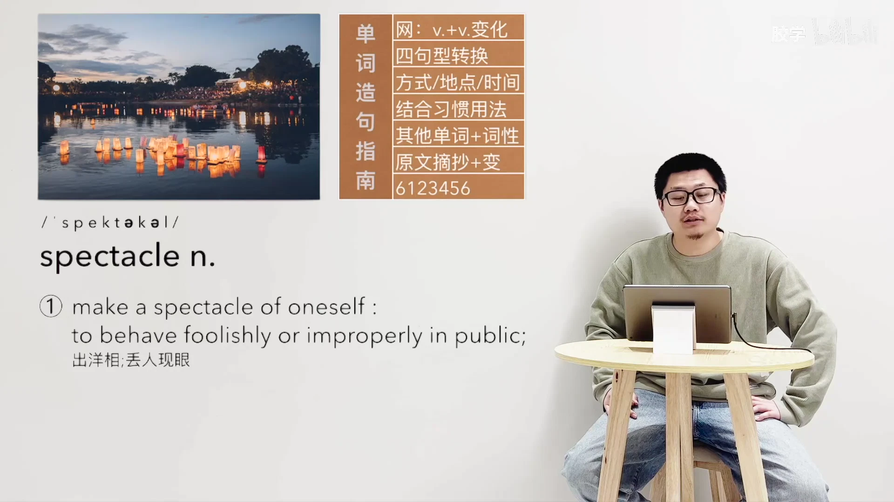

文字识别：单词造句指南 / 网：v.+v.变化 / 四句型转换 / 方式/地点/时间 / 结合习惯用法 / 其他单词+词性 / 原文摘抄+变 / 6123456 / / 'spektakal/ / spectacle n. / ① make a spectacle of oneself : / to behave foolishly or improperly in public; / 出洋相;丢人现眼

### 画面 00:02:46

文字识别：单词造句指南 / 网：v.+v.变化 / 四句型转换 / 方式/地点/时间 / 结合习惯用法 / 其他单词+词性 / 原文摘抄+变 / 6123456 / / 'spektakal/ / spectacle n. / ① make a spectacle of oneself : / to behave foolishly or improperly in public; / 出洋相;丢人现眼

### 画面 00:02:51

文字识别：单词造句指南 / 网：v.+v.变化 / 四句型转换 / 方式/地点/时间 / 结合习惯用法 / 其他单词+词性 / 原文摘抄+变 / 6123456 / /'spektakal/ / spectacle n. / ① make a spectacle of oneself : / to behave foolishly or improperly in public; / 出洋相;丢人现眼 / ) Don't make a spectacle of yourself.

### 画面 00:02:56

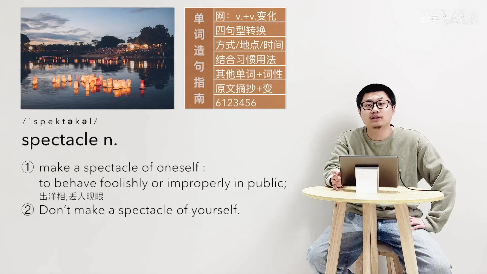

文字识别：单词造句指南 / 网：v.+v.变化 / 四句型转换 / 方式/地点/时间 / 结合习惯用法 / 其他单词+词性 / 原文摘抄+变 / 6123456 / /'spektakal/ / spectacle n. / ① make a spectacle of oneself : / to behave foolishly or improperly in public; / 出洋相;丢人现眼 / ) Don't make a spectacle of yourself.

### 画面 00:02:58

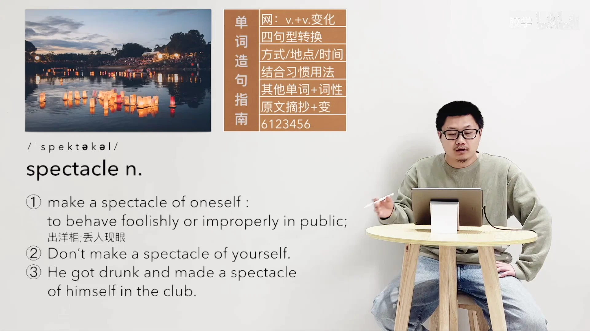

文字识别：单词造句指南 / 网：v.+v.变化 / 四句型转换 / 方式/地点/时间 / 结合习惯用法 / 其他单词+词性 / 原文摘抄+变 / 6123456 / / spektakal/ / spectacle n. / ① make a spectacle of oneself : / to behave foolishly or improperly in public; / 出洋相;丢人现眼 / ) Don't make a spectacle of yourself. / He got drunk and made a spectacle / 3 / of himself in the club.

## 00:03:00–00:03:30

drunk and made a spectacle of himself in the club, 对吧？他喝多了，然后在这个俱乐部里边怎么样？哎呀，丢人丢大发了。Make a spectacle of oneself. Okay, 那咱注意力集中，咱听个电影片段. I must have made a spectacle of myself, running away like yeah yeah. 哎，你看这里，实际上 make must have made 复习了十七课 must have done，对吧？就各位一定要知道，我们二册学完了，接下来的路

### 画面 00:03:01

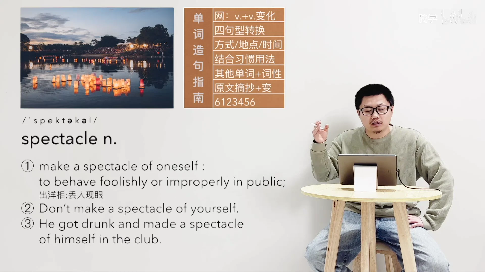

文字识别：单词造句指南 / 网：v.+v.变化 / 四句型转换 / 方式/地点/时间 / 结合习惯用法 / 其他单词+词性 / 原文摘抄+变 / 6123456 / / spektakal/ / spectacle n. / ① make a spectacle of oneself : / to behave foolishly or improperly in public; / 出洋相;丢人现眼 /  Don't make a spectacle of yourself. / He got drunk and made a spectacle / 3 / of himself in the club.

### 画面 00:03:06

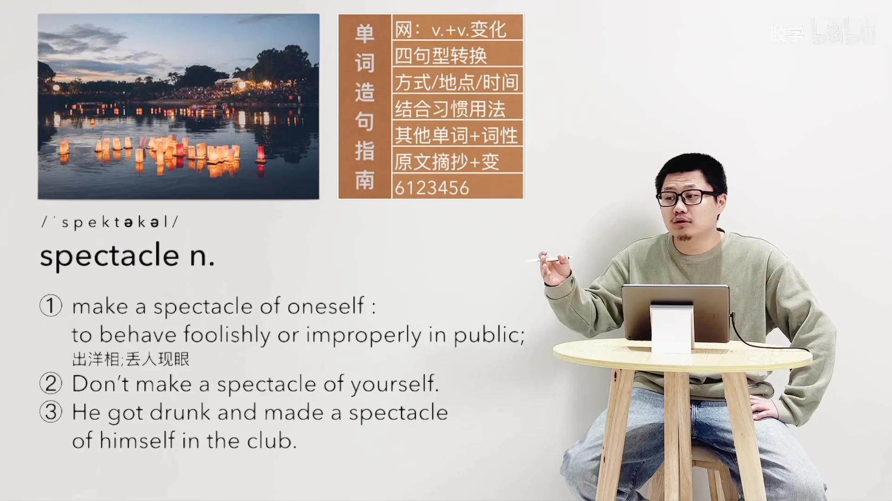

文字识别：单词造句指南 / 网：v.+v.变化 / 四句型转换 / 方式/地点/时间 / 结合习惯用法 / 其他单词+词性 / 原文摘抄+变 / 6123456 / /'spektakal/ / spectacle n. / ① make a spectacle of oneself : / to behave foolishly or improperly in public; / 出洋相;丢人现眼 /  Don't make a spectacle of yourself. / He got drunk and made a spectacle / 3 / of himself in the club.

### 画面 00:03:09

文字识别：单词造句指南 / 网：v.+v.变化 / 四句型转换 / 方式/地点/时间 / 结合习惯用法 / 其他单词+词性 / 原文摘抄+变 / 6123456 / / spektakal/ / spectacle n. / ① make a spectacle of oneself : / to behave foolishly or improperly in public; / 出洋相;丢人现眼 / Don't make a spectacle of yourself. / He got drunk and made a spectacle / 3 / of himself in the club.

### 画面 00:03:11

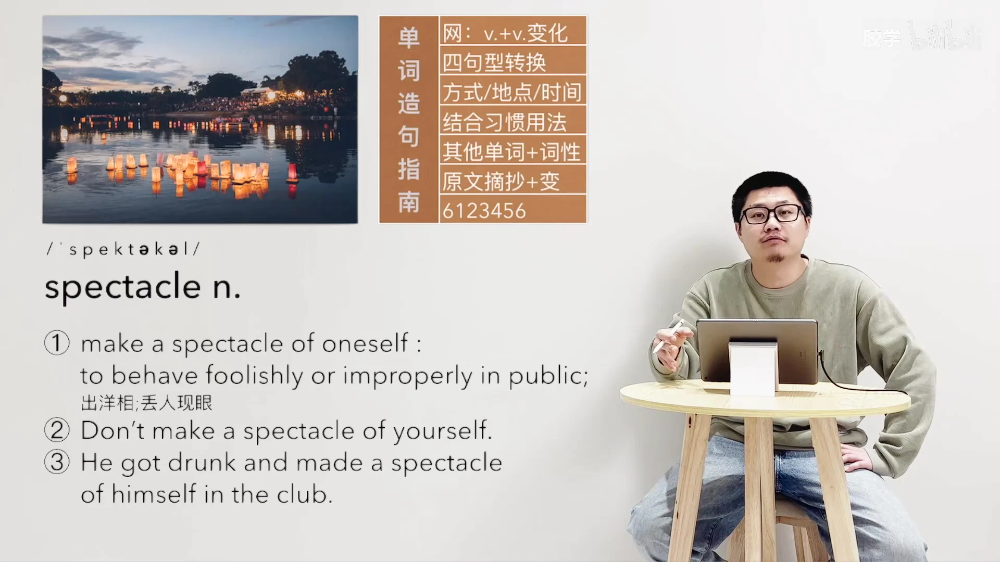

文字识别：单词造 / 网：v.+v.变化 / 四句型转换 / 方式/地点/时间 / 旭句指南 / 结合习惯用法 / 其他单词+词性 / 原文摘抄+变 / 6123456 / /'spektakal/ / spectacle n. / ① make a spectacle of oneself : / to behave foolishly or improperly in public; / 出洋相;丢人现眼 / ) Don't make a spectacle of yourself. / He got drunk and made a spectacle / 3 / of himself in the club.

### 画面 00:03:13

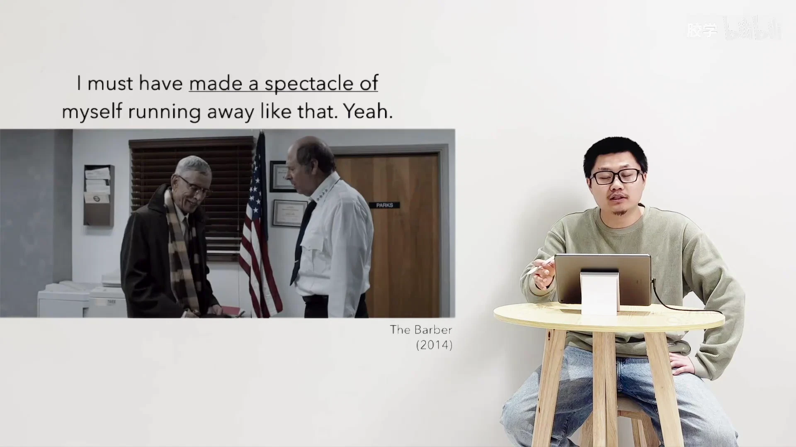

文字识别：I must have made a spectacle of / myself running away like that. Yeah. / PARKS / The Barber / (2014)

### 画面 00:03:16

文字识别：I must have made a spectacle of / myself running away like that. Yeah. / PARKS / The Barber / (2014)

### 画面 00:03:18

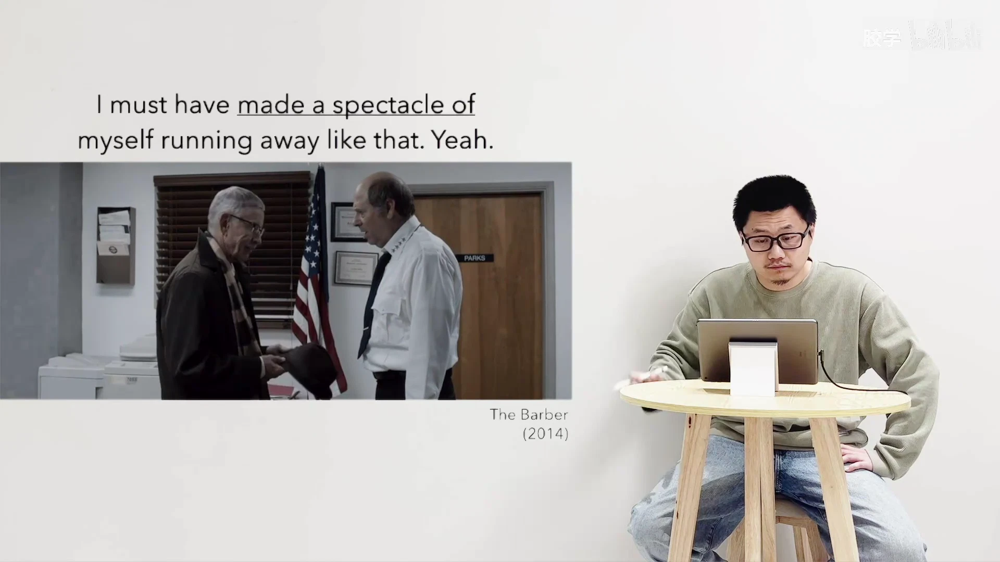

文字识别：I must have made a spectacle of / myself running away like that. Yeah. / PARKS / The Barber / (2014)

### 画面 00:03:20

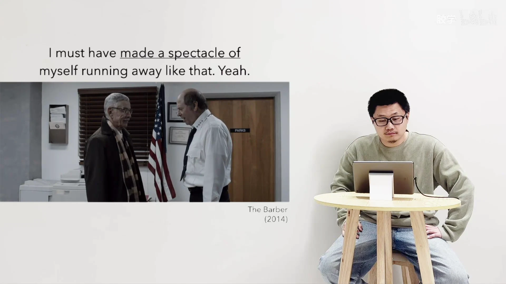

文字识别：I must have made a spectacle of / myself running away like that. Yeah. / PAAKS / The Barber / (2014)

### 画面 00:03:23

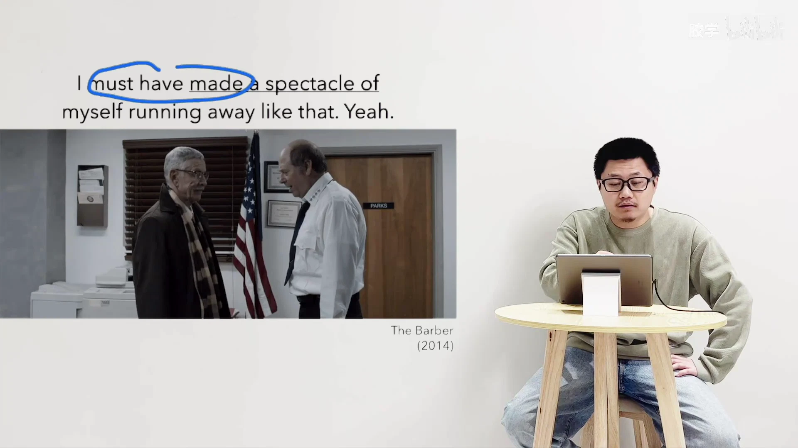

文字识别：must have made a spectacle of / myself r / running / away / like that. Yeah. / PARKS / The Barber / (2014)

## 00:03:30–00:04:00

是什么？首先肯定是三册。接下来呢，我们看很多的电影美剧当中，你会发现里面有非常非常多的语法结构，因为咱们语法基本学完了，你几乎全看得懂了。如果你耐下心来，对吧？看一句，暂停一句，你仔细去分析，你会发现哇，好多句子我们都看懂了。这就是我们认认真真学新二的回报啊！最后呢，我补了一个单词，是我们原文当中出现的啊，叫moving。这个单词呢，咱们原来会，

### 画面 00:03:52

文字识别：单词造句指南 / 网：v.+v.变化 / 四句型转换 / 方式/地点/时间 / 结合习惯用法 / 其他单词+词性 / 原文摘抄+变 / 6123456 / /'mu:.vIn/ / moving adj.

### 画面 00:03:54

文字识别：单词造句指南 / 网：v.+v.变化 / 四句型转换 / 方式/地点/时间 / 结合习惯用法 / 其他单词+词性 / 原文摘抄+变 / 6123456 / /'mu:.vIn/ / moving adj.

### 画面 00:03:56

文字识别：单词造句指南 / 网：v.+v.变化 / 四句型转换 / 方式/地点/时间 / 结合习惯用法 / 其他单词+词性 / 原文摘抄+变 / 6123456 / /'mu:.vIn/ / moving adj.

## 00:04:00–00:04:30

但你会的不是这个单词，你会的是 move 那个单词的 I N G，也叫 moving。只不过那个单词表示移动啊，这俩单词长相是一样的，对吧？只不过 moving 这个单词形容词表示很感动啊，很感动。比如说我们造句子嘛，比如说 I find that music very moving. Ah, whenever I heard it, I couldn't style, I couldn't help but cry. Ah,忍不住的流泪，哎，觉得非常的令人感动。 Next one, say only then.

### 画面 00:04:00

文字识别：单词造句指南 / 网：v.+v.变化 / 四句型转换 / 方式/地点/时间 / 结合习惯用法 / 其他单词+词性 / 原文摘抄+变 / 6123456 / /'mu:.vIn/ / moving adj.

### 画面 00:04:05

文字识别：单词造句指南 / 网：v.+v.变化 / 四句型转换 / 方式/地点/时间 / 结合习惯用法 / 其他单词+词性 / 原文摘抄+变 / 6123456 / /'mu:.vIn/ / moving adj.

### 画面 00:04:10

文字识别：单词造句指南 / 网：v.+v.变化 / 四句型转换 / 方式/地点/时间 / 结合习惯用法 / 其他单词+词性 / 原文摘抄+变 / 6123456 / /'mu:.vIn/ / moving adj.

### 画面 00:04:15

文字识别：单词造句指南 / 网：v.+v.变化 / 四句型转换 / 方式/地点/时间 / 结合习惯用法 / 其他单词+词性 / 原文摘抄+变 / 6123456 / /'mu:.vIn/ / moving adj. / ① I find that music very moving. L4

### 画面 00:04:20

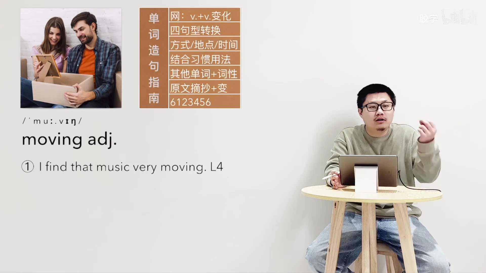

文字识别：单词造句指南 / 网：v.+v.变化 / 四句型转换 / 方式/地点/时间 / 结合习惯用法 / 其他单词+词性 / 原文摘抄+变 / 6123456 / /'mu:.vIn/ / moving adj. / ① I find that music very moving. L4

### 画面 00:04:25

文字识别：单词造句指南 / 网：v.+v.变化 / 四句型转换 / 方式/地点/时间 / 结合习惯用法 / 其他单词+词性 / 原文摘抄+变 / 6123456 / /'mu:.vIn/ / moving adj. / ① I find that music very moving. L4

## 00:04:30–00:05:00

其实九课咱学的倒装. Did I hear a very moving story from him? 只有在那个状态下，只有在那个时候，我才从他那儿听到了一个故事啊，特别感人的故事。最后一个, people from all over the world know this moving story. 哎，全世界的人都知道，呃，这个卖火柴的小女孩，这个 moving story，对吧？OK. 那 recap 除了单词以外，习惯用法就这一个 make a spectacle of oneself. 你以后在电

### 画面 00:04:30

文字识别：单词造句指南 / 网：v.+v.变化 / 四句型转换 / 方式/地点/时间 / 结合习惯用法 / 其他单词+词性 / 原文摘抄+变 / 6123456 / /'mu:.vIn/ / moving adj. / ① I find that music very moving. L4 / ② Only then did I hear a very moving story / from him. L79

### 画面 00:04:35

文字识别：单词造句指南 / 网：v.+v.变化 / 四句型转换 / 方式/地点/时间 / 结合习惯用法 / 其他单词+词性 / 原文摘抄+变 / 6123456 / /'mu:.vIn/ / moving adj. / ① I find that music very moving. L4 / ② Only then did I hear a very moving story / from him. L79

### 画面 00:04:40

文字识别：单词造句指南 / 网：v.+v.变化 / 四句型转换 / 方式/地点/时间 / 结合习惯用法 / 其他单词+词性 / 原文摘抄+变 / 6123456 / /'mu:.vIn/ / moving adj. / ① I find that music very moving. L4 / ② Only then did I hear a very moving story / from him. L79

### 画面 00:04:43

文字识别：单词造句指南 / 网：v.+v.变化 / 四句型转换 / 方式/地点/时间 / 结合习惯用法 / 其他单词+词性 / 原文摘抄+变 / 6123456 / /'mu:.vIn/ / moving adj. / ① I find that music very moving. L4 / ② Only then did I hear a very moving story / from him. L79 /  People from all over the world know this / moving story. L71

### 画面 00:04:45

文字识别：单词造句指南 / 网：v.+v.变化 / 四句型转换 / 方式/地点/时间 / 结合习惯用法 / 其他单词+词性 / 原文摘抄+变 / 6123456 / /'mu:.vin/ / moving adj. / ① I find that music very moving. L4 / ② Only then did I hear a very moving story / from him. L79 /  People from all over the world know this / moving story. L71

### 画面 00:04:50

文字识别：单词造句指南 / 网：v.+v.变化 / 四句型转换 / 方式/地点/时间 / 结合习惯用法 / 其他单词+词性 / 原文摘抄+变 / 6123456 / /'mu:.vIn/ / moving adj. / ① I find that music very moving. L4 / ② Only then did I hear a very moving story / from him. L79 /  People from all over the world know this / moving story. L71

### 画面 00:04:54

文字识别：Recap / Words / make a spectacle of oneself / Expression

### 画面 00:04:56

文字识别：Recap / Words / make a spectacle of oneself / Expression

### 画面 00:04:59

文字识别：Recap / Words / make a spectacle of oneself / Expression

## 00:05:00–00:05:30

in the movie. Okay, homework? Words, sentences. We'll take the last shift, right? If you've written all 95 lessons, this one won't be bad. We'll write it carefully, and we'll finish it. We'll have a beginning and an end. A movie clip, and then repeat the interval. That's all for this video. If you like our course, please follow us, subscribe, and share it with those who need it to help us grow faster. See you next time.

### 画面 00:05:01

文字识别：OO

### 画面 00:05:03

文字识别：单词造句/对话 / 1 / 【单词造句指南】 / 每个5句 / 反复听电影片段，直到能 / 听出关键短语/句子

### 画面 00:05:05

文字识别：单词造句/对话 / 【单词造句指南】 / 每个5句 / 反复听电影片段，直到能 / 听出关键短语/句子

### 画面 00:05:10

文字识别：单词造句/对话 / 1 / 【单词造句指南】 / 每个5句 / 反复听电影片段，直到能 / 听出关键短语/句子

### 画面 00:05:12

文字识别：单词造句/对话 / 【单词造句指南】 / 每个5句 / 反复听电影片段，直到能 / 听出关键短语/句子 / 3.重复间隔（置顶留言）

### 画面 00:05:14

文字识别：1 / 单词造句/对话 / 【单词造句指南】 / 每个5句 / 2.反复听电影片段，直到能 / 听出关键短语/句子 / 3.重复间隔（置顶留言）

### 画面 00:05:16

文字识别：不

### 画面 00:05:28

## 00:05:30–00:05:41

### 画面 00:05:30

文字识别：CAPSULEACADEMY / 胶囊助学计划 / 小红书 / Lecturer / 口 / Leo

### 画面 00:05:33

文字识别：CAPSULEACADEMY / 胶囊助学计划 / 小红书 / 品

### 画面 00:05:36

文字识别：CAPSULEACADEMY / 胶囊助学计划 / 小红书 / Creator / Leo & Berlin / OE / 0

### 画面 00:05:38

文字识别：胶学 bibi / CAPSULEACADEMY / 胶囊助学计划 / 小红书 / OE / 0

### 画面 00:05:40

文字识别：Bilili / 胶学

