# 096 文章

快速机器解析：语音为单模型转写，未进行独立交叉校对或人工复核；画面每秒采样并按变化选帧，短时文字和标记可能遗漏。截图时间约有 1 秒误差。图片有损压缩；遇到疑点请按时间查看 Google Drive 原视频。

## 00:00:00–00:00:30

Hello everyone, welcome to Capsule Academy. This is Leo. Today we're going to learn New Concept English Book Two, Lesson Ninety Six, Story. Hope you gonna enjoy.呃，本文的标题叫 The Dead Return，是吧？The the咱们其实有一个电影叫 The Return of the King，王者归来是吧？指环王是吧？那这个 The Dead Return，是吧？就是亡灵归来，是吧？呃，What happens to the Latins

### 画面 00:00:00

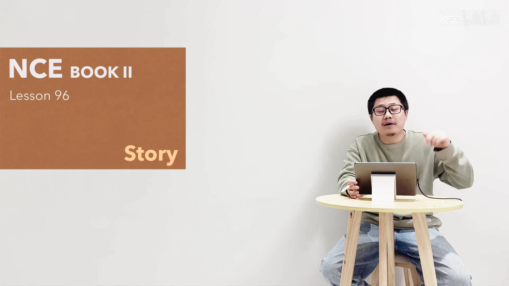

文字识别：NCE / BOOKII / Lesson 96 / Story

### 画面 00:00:02

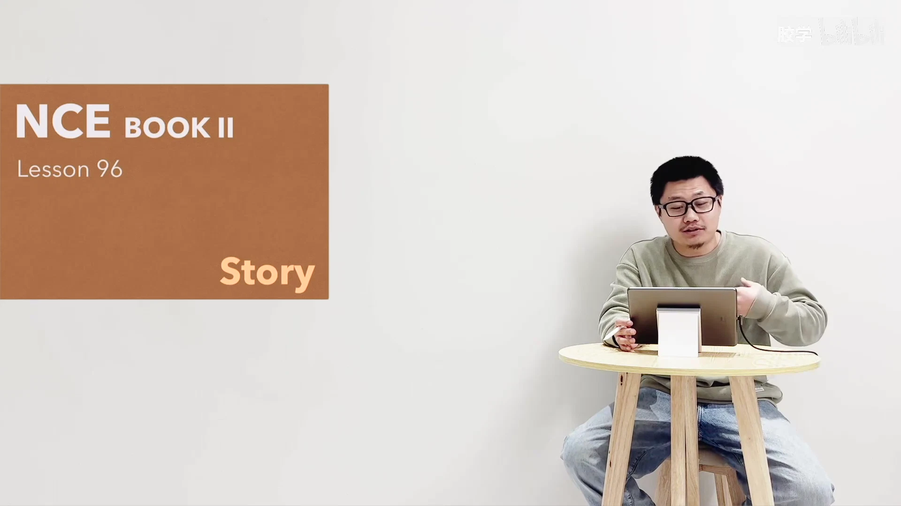

文字识别：NCE / BOOKII / Lesson 96 / Story

### 画面 00:00:05

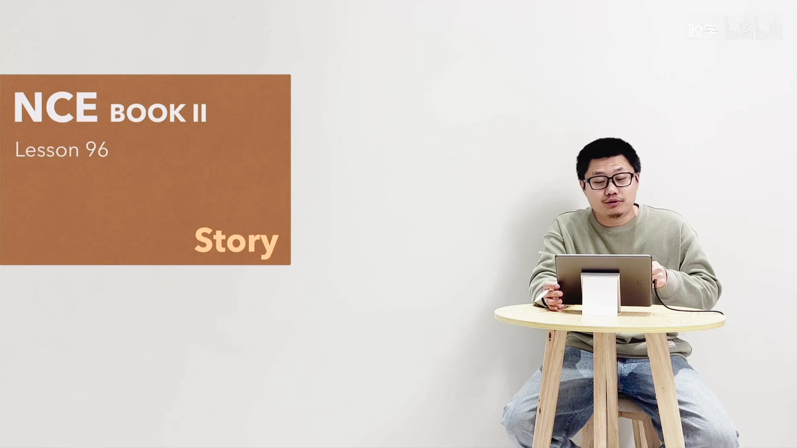

文字识别：NCE / BOOKII / Lesson 96 / Story

### 画面 00:00:09

文字识别：胶学出 / •

### 画面 00:00:13

文字识别：胶囊助学计划

### 画面 00:00:15

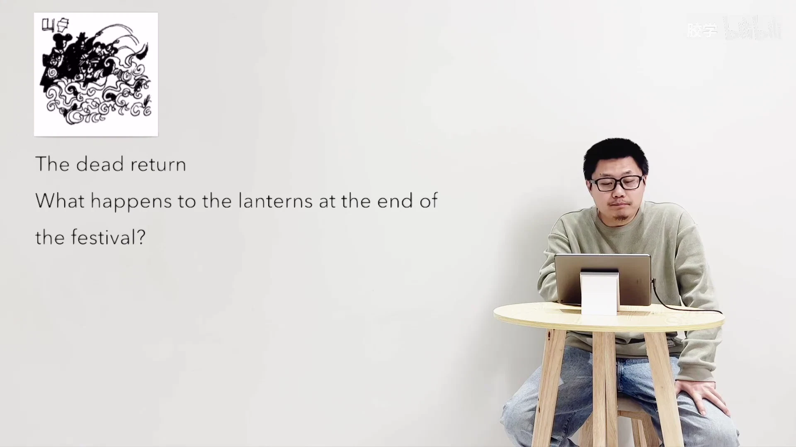

文字识别：The dead return / What happens to the lanterns at the end of / the festival?

## 00:00:30–00:01:00

at the end of the festival? 在这个节日结束的时候，这个灯笼都发生了什么？对他们，他们都怎么办了？怎么处理了？看文章吧。呃，这篇文章我们讲解就我偷懒儿，你费劲。怎么着？我偷懒儿，你费劲呢？呃，我只会给你过一遍语法。这里边的所有习惯用法，我已经带您从新一摘到了新二。如果您学到

### 画面 00:00:39

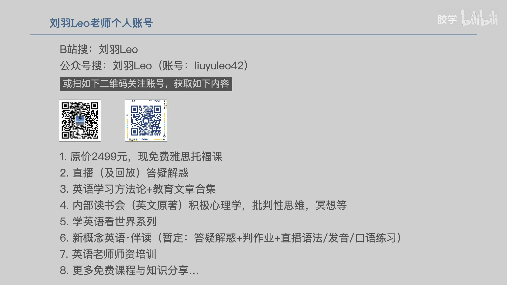

文字识别：胶学 bi出 / 刘羽Leo老师个人账号 / B站搜：刘羽Leo / 公众号搜：刘羽Leo（账号：liuyuleo42) / 或扫如下二维码关注账号，获取如下内容 / 1.原价2499元，现免费雅思托福课 / 2.直播（及回放）答疑解惑 / 3.英语学习方法论+教育文章合集 / 4.内部读书会（英文原著）积极心理学，批判性思维，冥想等 / 5.学英语看世界系列 / 6.新概念英语·伴读 (暂定：答疑解惑+判作业+直播语法/发音/口语练习) / 7.英语老师师资培训 / 8.更多免费课程与知识分享...

### 画面 00:00:44

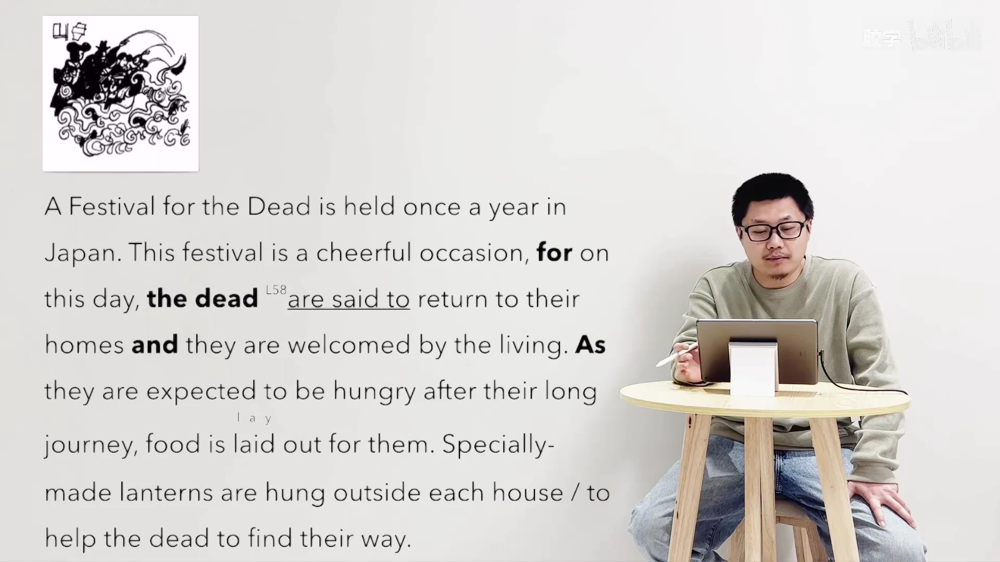

文字识别：A Festival for the Dead is held once a year in / Japan. This festival is a cheerful occasion, for on / this day, the dead / L58 / are said to return to their / homes and they are welcomed by the living. As / they are expected to be hungry after their long / ay / journey, food is laid out for them. Specially- / made lanterns are hung outside each house / to / help the dead to find their way.

### 画面 00:00:46

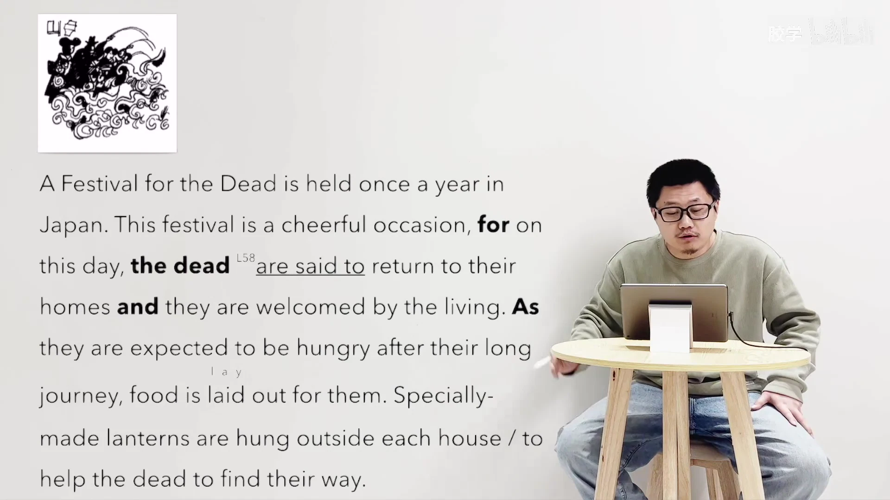

文字识别：山 / A Festival for the Dead is held once a year in / Japan. This festival is a cheerful occasion, for on / this day, the dead / L58 / are said to return to their / homes and they are welcomed by the living. As / they are expected to be hungry after their long / lay / journey, food is laid out for them. Specially- / made lanterns are hung outside each house / to / help the dead to find their way.

### 画面 00:00:49

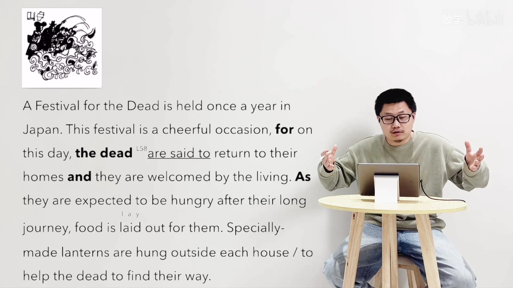

文字识别：山 / A Festival for the Dead is held once a year in / Japan. This festival is a cheerful occasion, for on / this day, the dead / L58 / 'are said to return to their / homes and they are welcomed by the living. As / they are expected to be hungry after their long / lā y / journey, food is laid out for them. Specially- / made lanterns are hung outside each house / to / help the dead to find their way.

## 00:01:00–00:01:30

今天，只学了新二，你也学了九十五课怎么摘了。我需要你自己去摘一次。在这篇文章当中，我只过一遍文章，你自己去摘一下这课当中你觉得可以用到的习惯用法，好吧？我不多说，我只说一遍意思啊。我讲的比较快。A festival for the dead is held once a year in Japan. 给逝去的人举办的节日被举办一年一次在日本啊，其实中国也有。This festival is a cheerful

### 画面 00:01:16

文字识别：山 / A Festival for the Dead is held once a year in / Japan. This festival is a cheerful occasion, for on / this day, the dead / L58 / 'are said to return to their / homes and they are welcomed by the living. As / they are expected to be hungry after their long / ay / journey, food is laid out for them. Specially- / made lanterns are hung outside each house / to / help the dead to find their way.

## 00:01:30–00:02:00

occasion. For on this day, the dead are said to return to their homes, and they are welcomed by the livings.这个节日是一个特别开心的场合。哎，是这样一个日子，大家都很高兴。因为什么呢？因为 on this day，在这一天，the dead，注意这个 the 加 dead，the 加很多形容词表示一类人嘛。the rich，富人；the poor，穷人，对吧？啊，

### 画面 00:01:46

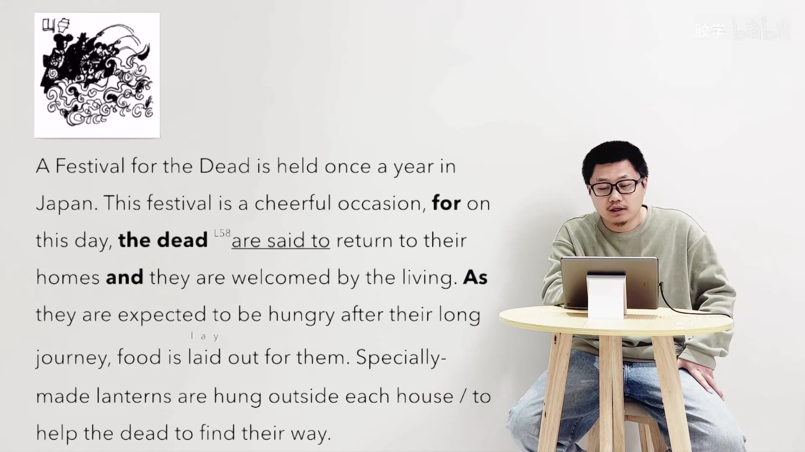

文字识别：V / A Festival for the Dead is held once a year in / Japan. This festival is a cheerful occasion, for on / this day, the dead / L58 / 'are said to return to their / homes and they are welcomed by the living. As / they are expected to be hungry after their long / ay / journey, food is laid out for them. Specially- / made lanterns are hung outside each house / to / help the dead to find their way.

## 00:02:00–00:02:30

the disabled指的是这个残疾人啊。Okay,那the dead逝去的人，这些逝去的人怎么样了呢？Are said to return to their homes.八五十八课咱们学过的，据说会回到他们家。然后呢，他们被欢迎，被什么人呢？The livings，我啊，你，我们活着的人。As they are expected to be hungry after their long journey, food

### 画面 00:02:16

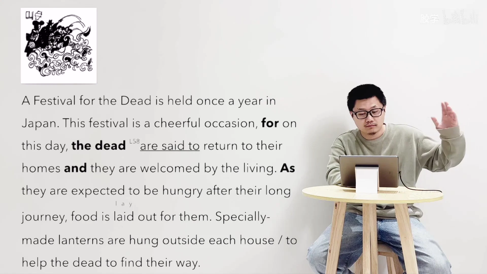

文字识别：山 / A Festival for the Dead is held once a year in / Japan. This festival is a cheerful occasion, for on / this day, the dead / L58 / 'are said to return to their / homes and they are welcomed by the living. As / they are expected to be hungry after their long / lā y / journey, food is laid out for them. Specially- / made lanterns are hung outside each house / to / help the dead to find their way.

## 00:02:30–00:03:00

is laid out for them. As单看不知道什么意思。文章我看过，我直接告诉你，因为他们被预期是怎么样的，会饿。在他们的这个很长的旅途啊之后，他们会感到很饿。食物啊会被放出来。这个 laid 是 laid 这个单词的过去式。其实，在这儿你换成 place 也可以，就是名词是地点，动词是放置那个单词 place p r a c

### 画面 00:02:46

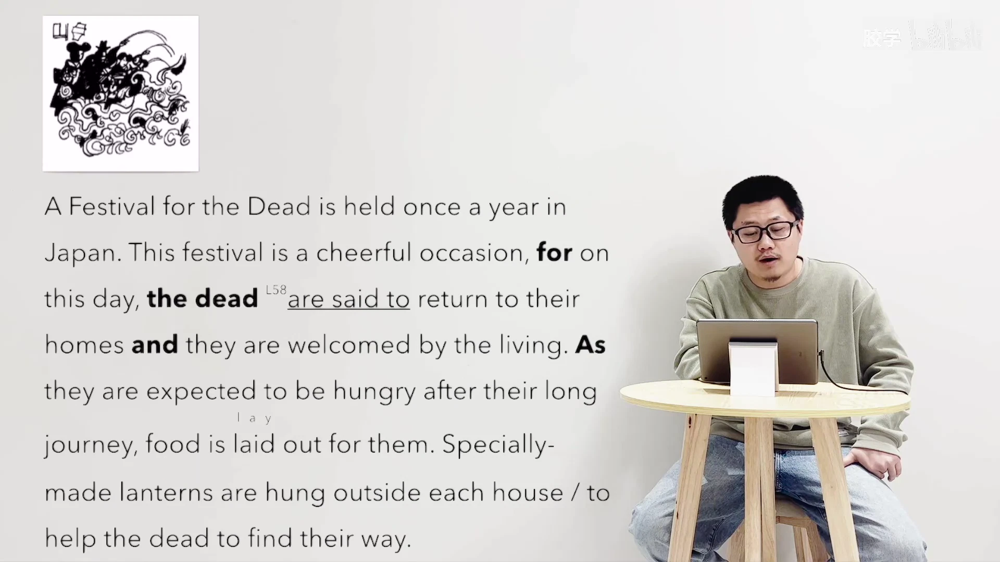

文字识别：A Festival for the Dead is held once a year in / Japan. This festival is a cheerful occasion, for on / this day, the dead / L58 / are said to return to their / homes and they are welcomed by the living. As / they are expected to be hungry after their long / āy / journey, food is laid out for them. Specially- / made lanterns are hung outside each house / to / help the dead to find their way.

## 00:03:00–00:03:30

is laid out for them.哎，会给他们摆出来食物啊。中国有很多，比如说请灶王。如果你去过农村，很多年前是有的，现在不知道还有没有了。请灶王爷不就要把这个食物放在那个地方去祭拜供吗？对吧？呃，especially made lanterns are hung outside each house to help the dead to find their way. Especially made，特殊制造的这些灯笼会被悬挂在每个房子的外面，目的是去

### 画面 00:03:16

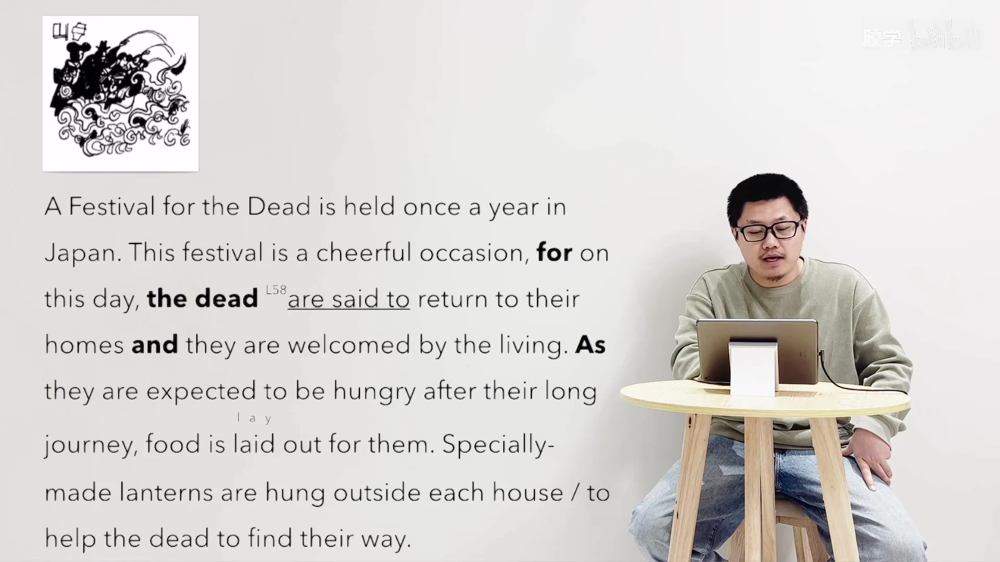

文字识别：山 / V / A Festival for the Dead is held once a year in / Japan. This festival is a cheerful occasion, for on / this day, the dead / L58 / 'are said to return to their / homes and they are welcomed by the living. As / they are expected to be hungry after their long / āy / journey, food is laid out for them. Specially- / made lanterns are hung outside each house / to / help the dead to find their way.

## 00:03:30–00:04:00

帮助这些逝去的人找到他们的路，什么路回家的路，对吧？这点跟中国的这个传统习惯非常的像啊。All night long, people dance and sing.啊，人们就是唱啊跳啊。In the early morning, the food that has been laid out for the dead is thrown into a river or into the sea, as it is considered unlucky for anyone living to eat

### 画面 00:03:35

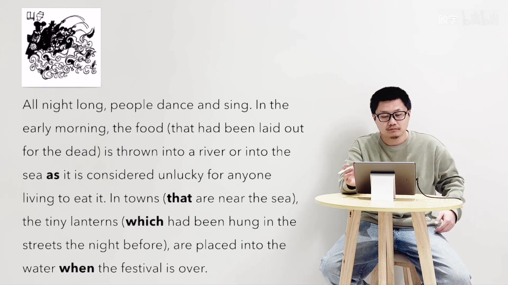

文字识别：山 / All night long, people dance and sing. In the / early morning, the food (that had been laid out / for the dead) is thrown into a river or into the / sea as it is considered unlucky for anyone / living to eat it. In towns (that are near the sea), / the tiny lanterns (which had been hung in the / streets the night before), are placed into the / water when the festival is over.

## 00:04:00–00:04:30

这句话看似很长，但是其实我最多把它叫做长句，不算难句。为什么？因为语法稍微好一点，我们从头读到尾，整个句子意思就通了。我们看一下啊，整个晚啊啊，应该是从这儿开始啊。说在早晨的时候，在早晨早一些时候啊，在清晨，对吧？这个时间，食物什么样的食物呢？That had been laid out for the dead，说已经被被摆出来给这些

### 画面 00:04:05

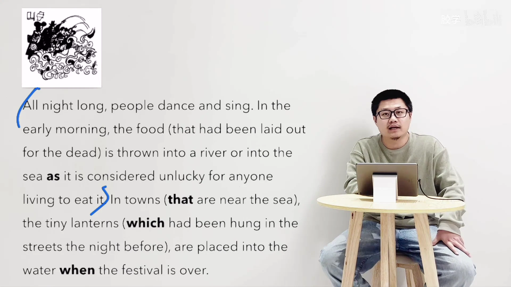

文字识别：山 / All night long, people dance and sing. In the / early morning, the food (that had been laid out / for the dead) is thrown into a river or into the / sea as it is considered unlucky for anyone / living to eatifIn towns (that are nearthe sea), / the tiny lanterns (which had been hung in the / streets the night before), are placed into the / water when the festival is over.

### 画面 00:04:20

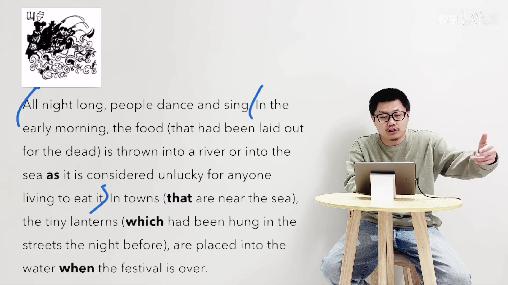

文字识别：山 / V / All night long, people dance and sing /In the / early morning, the food (that had been laid out / for the dead) is thrown into a river or into the / sea as it is considered unlucky for anyone / living to eatifIn towns (that are nearthe sea), / the tiny lanterns (which had been hung in the / streets the night before), are placed into the / water when the festival is over.

## 00:04:30–00:05:00

逝去人的这些食物，怎么判断定语从句从哪儿结束？两个点进入新三，咱还会说第一个找谓语动词 had been done，后边立刻来了个 is，行了，在这直接一括弧，对吧？结束了。第二个呢，就是整句话的意思结束了，对吧？整句话这个定语从句的含义通了，完整了就结束了。被摆出来给逝去人这些食物怎么样呢？被动，被扔进了河里或者扔进海里。as单看不

### 画面 00:04:47

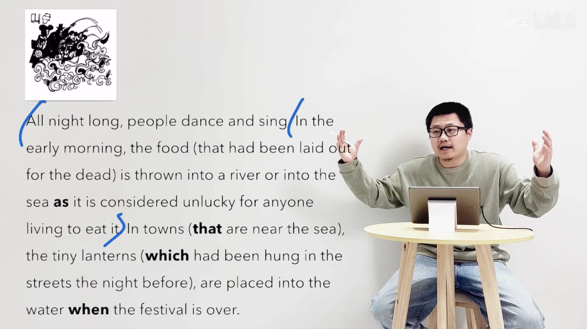

文字识别：山 / V / All night long, people dance and sing /In the / early morning, the food (that had been laid olt / for the dead) is thrown into a river or into the / sea as it is considered unlucky for anyone / living to eati Iin towns (that are near the sea), / the tiny lanterns (which had been hung in the / streets the night before), are placed into the / water when the festival is over.

### 画面 00:04:51

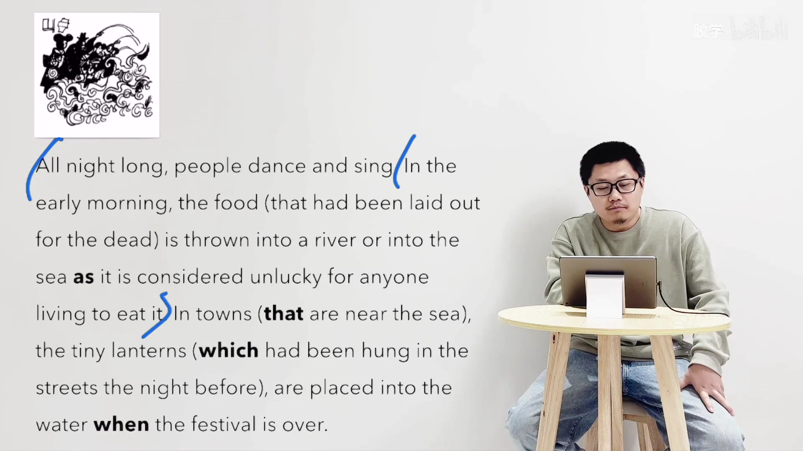

文字识别：山 / All night long, people dance and sing/In the / early morning, the food (that had been laid out / for the dead) is thrown into a river or into the / sea as it is considered unlucky for anyone / living to eatitIn towns (that are nearthe sea), / the tiny lanterns (which had been hung in the / streets the night before), are placed into the / water when the festival is over.

## 00:05:00–00:05:30

知道什么意思，我直接告诉你，因为在这儿，因为它被认为是unlucky，不幸运的。那对于中国的语言体系当中，就是不吉利嘛。给任何活的人去吃它，这事儿不吉利，对吧？所以也不能碰，也不吃。接下来这句话算长难句，注意力集中。In towns that are near the sea, the tiny lanterns which had been hung in the streets the night before are placed

### 画面 00:05:21

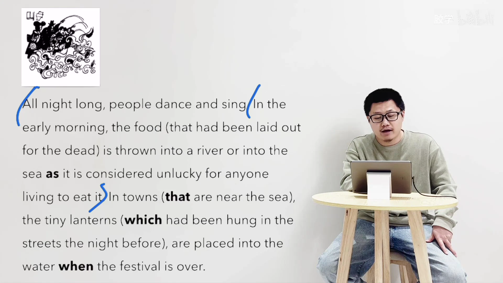

文字识别：山 / All night long, people dance and sing /In the / early morning, the food (that had been laid out / for the dead) is thrown into a river or into the / sea as it is considered unlucky for anyone / living to eatifIn towns (that are nearthe sea), / the tiny lanterns (which had been hung in the / streets the night before), are placed into the / water when the festival is over.

## 00:05:30–00:06:00

into the water when the festival is over. It's called a long complex sentence. It's mainly because of two relative clauses. I've already marked them for you. In these towns, what kind of towns? That are near the sea. In seaside towns, Japan is a country with many coastlines. It's an island country with many coasts, right? The tiny lanterns, these very small lanterns. What kind of lanterns? A relative clause. These lanterns have been hung on the streets before.

### 画面 00:05:51

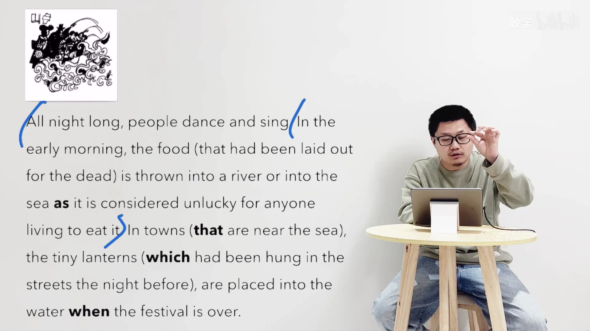

文字识别：山 / All night long, people dance and sing /In the / early morning, the food (that had been laid out / for the dead) is thrown into a river or into the / sea as it is considered unlucky for anyone / living to eatifIn towns (that are nearthe sea), / the tiny lanterns (which had been hung in the / streets the night before), are placed into the / water when the festival is over.

## 00:06:00–00:06:30

在街道上。The night before,前一天晚上，所以他的意思，首先在什么样的小镇，在海边的小镇，什么样的小灯笼呢？前一天晚上被挂在街上的小灯笼。好，到这儿其实整句话都没结束，就是没头，只有头没有尾。他们怎么了呢？对吧？在这样的小镇上，这样的灯笼怎么了呢？你要看后边，叫做 are placed into the water，被放置进了水里面，被动，对吧？Placed，咱们刚才刚说，当 the

### 画面 00:06:13

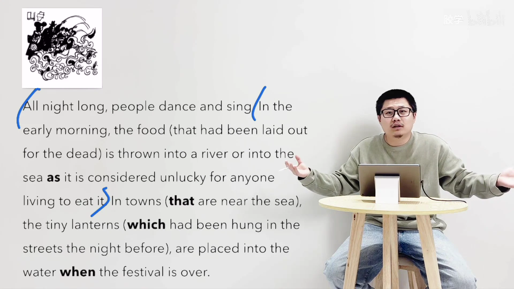

文字识别：山 / All night long, people dance and sing /In the / early morning, the food (that had been laid out / for the dead) is thrown into a river or into the / sea as it is considered unlucky for anyone / living to eatitIn towns (that are nearthe sea), / the tiny lanterns (which had been hung in the / streets the night before), are placed into the / water when the festival is over.

### 画面 00:06:21

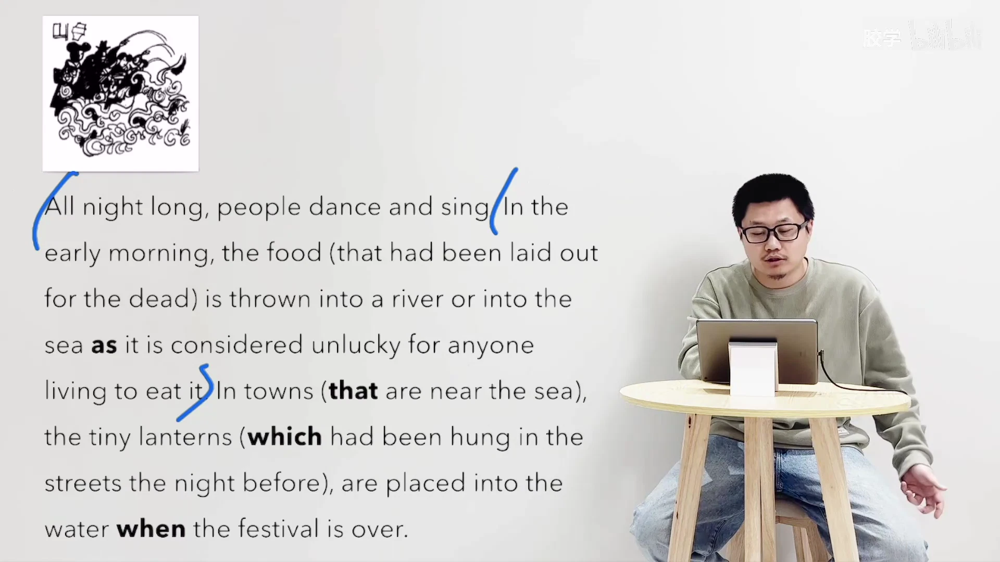

文字识别：山 / All night long, people dance and sing /In the / early morning, the food (that had been laid out / for the dead) is thrown into a river or into the / sea as it is considered unlucky for anyone / living to eatitIn towns (that are nearthe sea), / the tiny lanterns (which had been hung in the / streets the night before), are placed into the / water when the festival is over.

## 00:06:30–00:07:00

festival is over，当这个节日 over，game over 结束的时候，continue thousands of lanterns slowly drift out to sea，guiding the dead on their return journey to the other world。数以千计的灯笼慢慢的、缓缓的飘到了海里面，drift out to sea。前两天那个 speedboat 快艇那课，咱刚学嘛。guiding 什么 guiding 呢？什么 guiding the dead on their return journey to the

### 画面 00:06:35

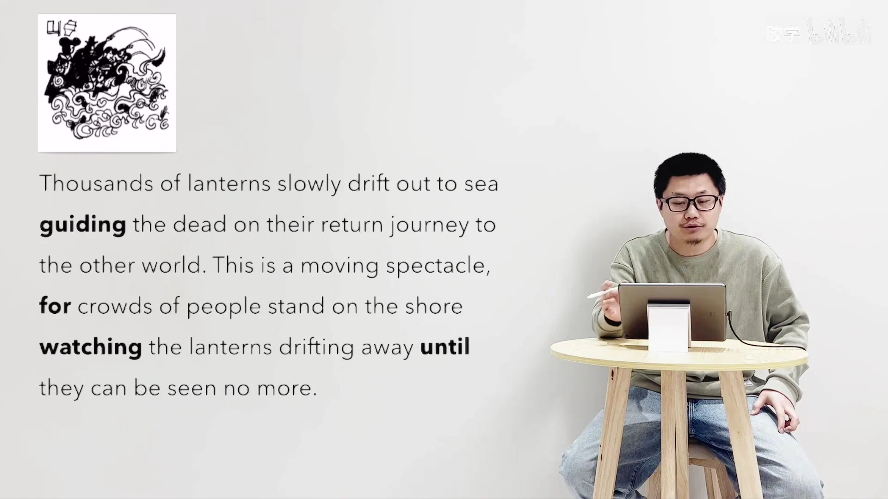

文字识别：Thousands of lanterns slowly drift out to sea / guiding the dead on their return journey to / the other world. This is a moving spectacle, / for crowds of people stand on the shore / watching the lanterns drifting away until / they can be seen no more.

## 00:07:00–00:07:30

that world, thousands of lights嘛，主动被动主动啊，这个 guiding 就跟 lead 引领是一个意思啊。 Guide 它自己本身是有向导的意思，动词对吧？引领着、向导着这些逝去的人，在他们的回去的路上，什么去另一个世界啊？我们所谓叫阴间吧，比如说对吧？或者说呃另一个世界，西方极乐世界对吧？好，这个可能语言体系不一样，稍有不同，但我希望你应该能懂对吧？哎，再把这

### 画面 00:07:05

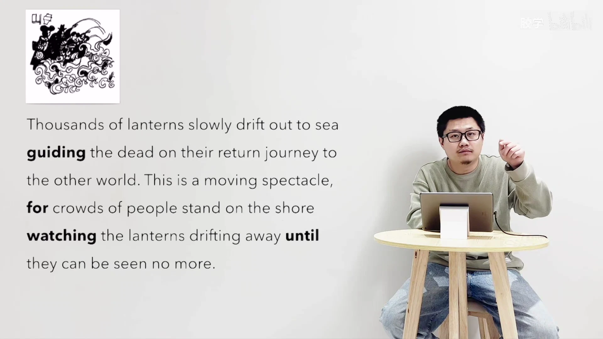

文字识别：山 / V / Thousands of lanterns slowly drift out to sea / guiding the dead on their return journey to / the other world. This is a moving spectacle, / for crowds of people stand on the shore / watching the lanterns drifting away until / they can be seen no more.

## 00:07:30–00:08:00

些逝去的人的灵魂，在他们回程的路上，在照亮回程的路，对吧？哎，很有意思。This is a moving spectacle.这个moving就是单词里边我给你多添加的那一个单词。这是一个非常感人的场景。因为for crowds of people stand on the shore watching the lanterns drifting away until they can be seen no more.因为什么呢？树群的人，很多群人，

### 画面 00:07:35

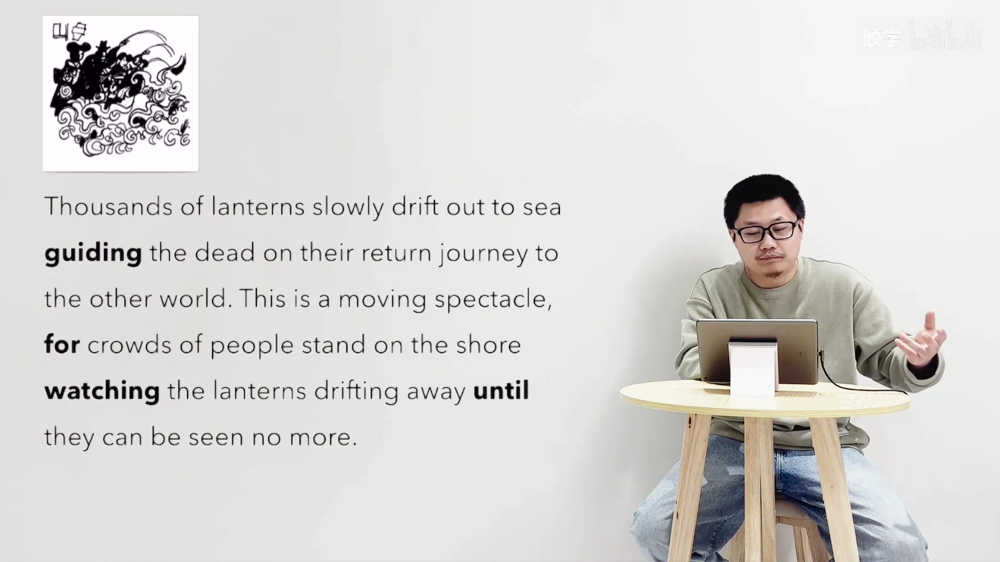

文字识别：Thousands of lanterns slowly drift out to sea / guiding the dead on their return journey to / the other world. This is a moving spectacle, / for crowds of people stand on the shore / watching the lanterns drifting away until / they can be seen no more.

## 00:08:00–00:08:30

就很多人啊。Lots of people其实就是 stand on the shore，站在这个海岸线上，和海岸海岸上 watching the lanterns drifting away，看着这些什么灯笼 drifting away，他们怎么样了呢？哎，drifting away就是这个飘走。那这个地方的 watching 主语是谁？Crowds of people嘛，对吧？主动被动，主动嘛。四十九课学的，不多废话了。直到

### 画面 00:08:05

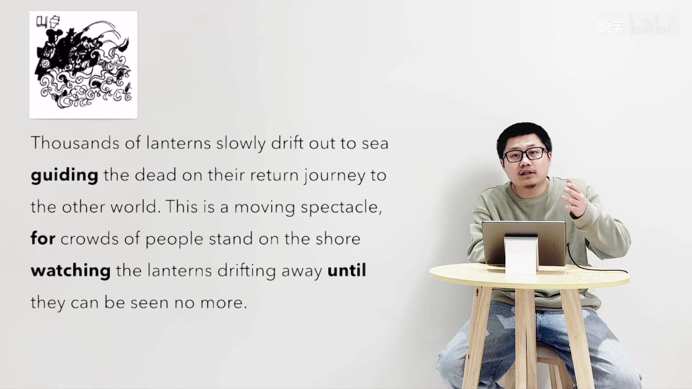

文字识别：山 / Thousands of lanterns slowly drift out to sea / guiding the dead on their return journey to / the other world. This is a moving spectacle, / for crowds of people stand on the shore / watching the lanterns drifting away until / they can be seen no more.

## 00:08:30–00:09:00

they can be seen can 直到他们能被看见。注意后边还有两个单词 no more 他们直到不再能被看到，结束了。本文习惯用法自己摘，对吧？带您摘了至少九十五课了，最后一课自己来啊！我们自己动手，丰衣足食，学习越主动效果越好。将作业你自己摘完了，自己对，自己去造句子，对吧？然后文章咱熟读成诵，然后呢，这个置顶留言呢去找重复间隔的

### 画面 00:08:35

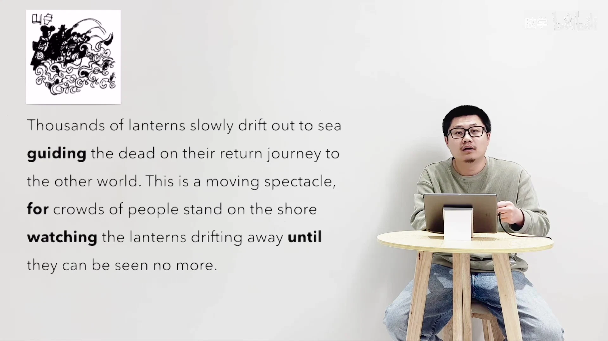

文字识别：Thousands of lanterns slowly drift out to sea / guiding the dead on their return journey to / the other world. This is a moving spectacle, / for crowds of people stand on the shore / watching the lanterns drifting away until / they can be seen no more.

### 画面 00:08:41

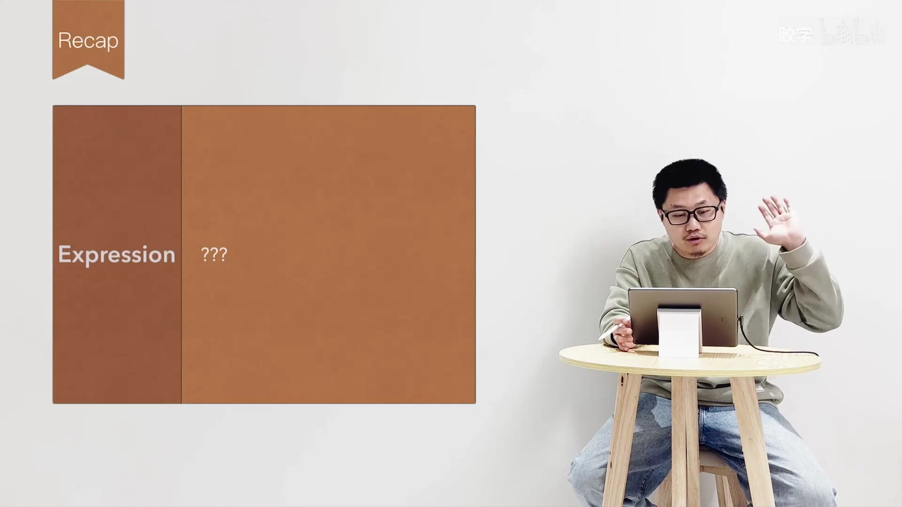

文字识别：Recap / Expression / ???

### 画面 00:08:43

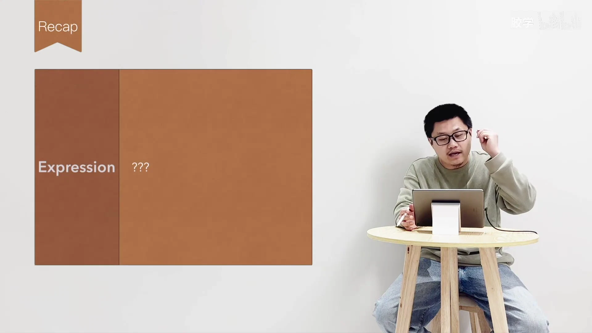

文字识别：Recap / Expression / ???

### 画面 00:08:46

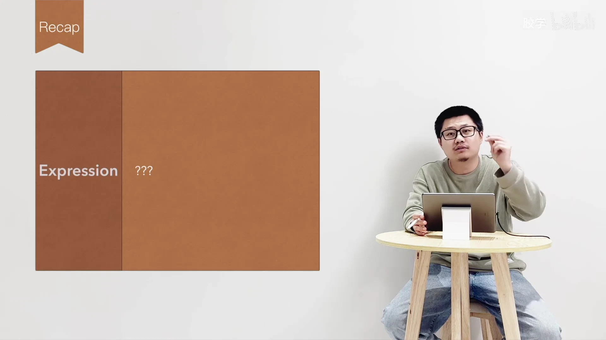

文字识别：Recap / Expression / ???

### 画面 00:08:50

### 画面 00:08:52

文字识别：1. / 习惯用法造句/对话 / 【习惯用法造句指南】 / 每个5句

### 画面 00:08:54

文字识别：1. / 习惯用法造句/对话 / 【习惯用法造句指南】 / 每个5句 / 文章跟读至熟读成诵 / 内化单词+语法+习惯用法 / 听力+口语+写作练习

### 画面 00:08:56

文字识别：1. / 习惯用法造句/对话 / 【习惯用法造句指南】 / 每个5句 / 文章跟读至熟读成诵 / 内化单词+语法+习惯用法 / 听力+口语+写作练习 / 重复间隔（置顶留言）

### 画面 00:08:58

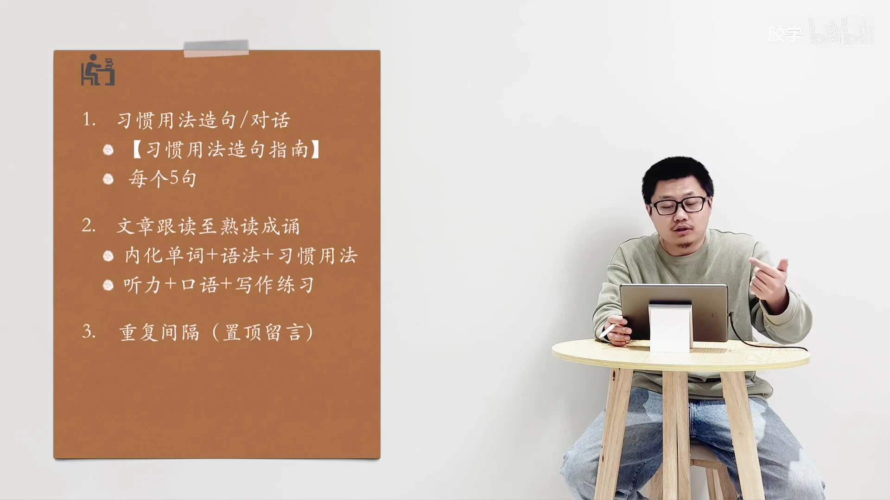

文字识别：1. / 习惯用法造句/对话 / 【习惯用法造句指南】 / 每个5句 / 文章跟读至熟读成诵 / 内化单词+语法+习惯用法 / 听力+口语+写作练习 / 3. / 重复间隔（置顶留言）

## 00:09:00–00:09:29

学习材料啊。那以上呢就是本期视频的全部内容了。如果各位喜欢我们的课程啊，欢迎您关注、订阅、一键三连，分享给那些需要的朋友来帮助我们快速成长。咱们练习视频最后一个视频见，拜拜。

### 画面 00:09:01

文字识别：1.习惯用法造句/对话 / 【习惯用法造句指南】 / 每个5句 / 文章跟读至熟读成诵 / 内化单词+语法+习惯用法 / 听力+口语+写作练习 / 重复间隔（置顶留言）

### 画面 00:09:03

### 画面 00:09:10

### 画面 00:09:12

### 画面 00:09:16

### 画面 00:09:18

文字识别：CAPSULEACADEMY / 胶囊助学计划 / 小红书 / Lecturer / □ / 回 / Leo / OE

### 画面 00:09:20

文字识别：CAPSULEACADEMY / 胶囊助学计划 / 小红书 / Photographer / Berlin / OE

### 画面 00:09:22

文字识别：CAPSULEACADEMY / 胶囊助学计划 / 小红书 / Editor / □ / Berlin / 0

### 画面 00:09:25

文字识别：CAPSULEACADEMY / 胶囊助学计划 / 小红书 / Creator / Leo & Berlin / 0

### 画面 00:09:27

文字识别：Bilibli / 胶学

### 画面 00:09:28

文字识别：Bilibli / 胶学

