# 096 练习

快速机器解析：语音为单模型转写，未进行独立交叉校对或人工复核；画面每秒采样并按变化选帧，短时文字和标记可能遗漏。截图时间约有 1 秒误差。图片有损压缩；遇到疑点请按时间查看 Google Drive 原视频。

## 00:00:00–00:00:30

Hello everyone, welcome to Capsule Academy. This is Leo. Today we're going to learn New Concept English Book Two, Lesson Ninety Six Practices. 注意，进行如下练习唯一的前提就是文章熟读成诵，否则请勿开始。 Hope you gonna enjoy. Comprehension, 我问您答啊，听力口语练习，咱们站好最后一班岗。

### 画面 00:00:00

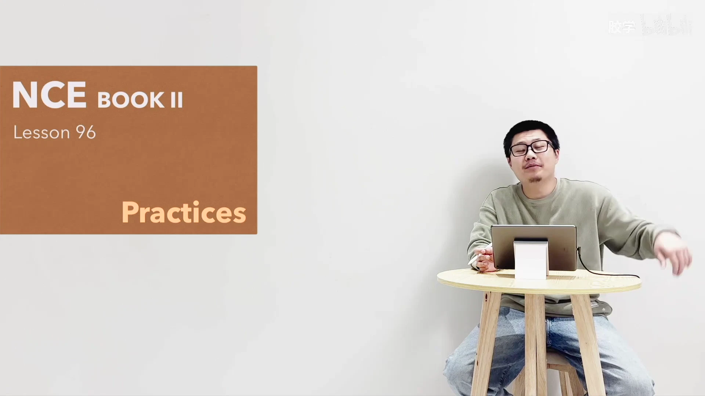

文字识别：NCE / BOOKⅡI / Lesson 96 / Practices

### 画面 00:00:05

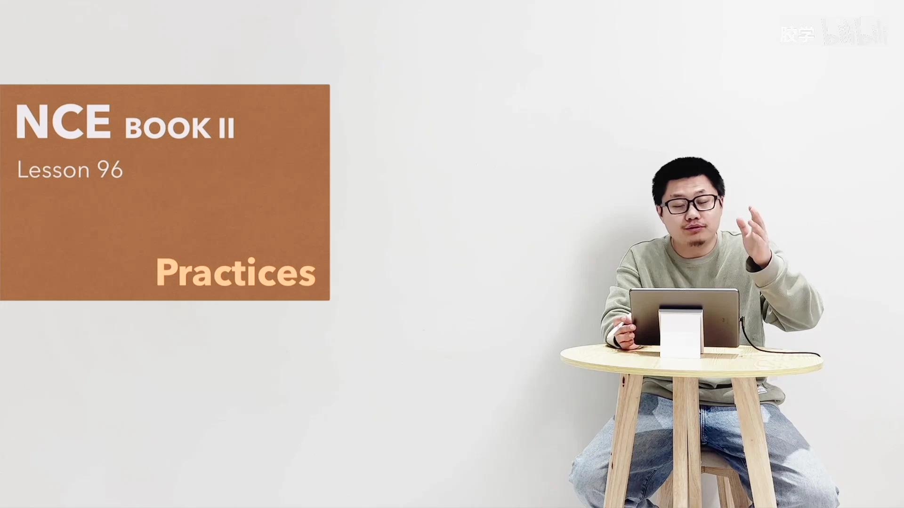

文字识别：NCE / BOOKⅡI / Lesson 96 / Practices

### 画面 00:00:08

文字识别：进行如下练习唯一前提 / 文章跟读至熟读成诵 / 否则请勿开始

### 画面 00:00:10

文字识别：进行如下练习唯一前提 / 文章跟读至熟读成诵 / 否则请勿开始

### 画面 00:00:15

文字识别：胶学b出

### 画面 00:00:19

文字识别：L

### 画面 00:00:21

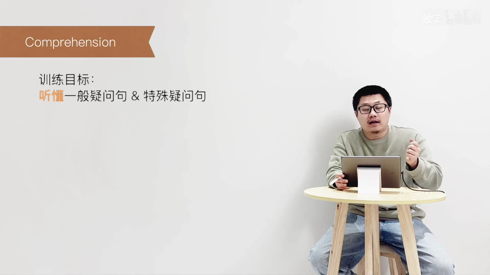

文字识别：Comprehension / 训练目标： / 听懂一般疑问句＆特殊疑问句

### 画面 00:00:23

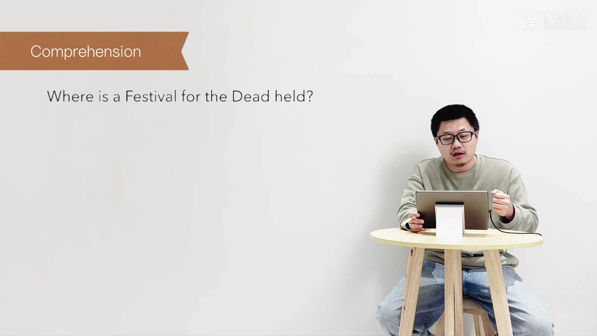

文字识别：Comprehension / Where is a Festival for the Dead held?

### 画面 00:00:25

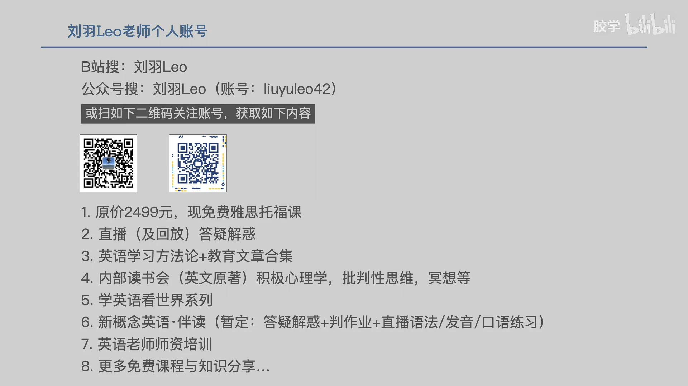

文字识别：胶学 bili / 刘羽Leo老师个人账号 / B站搜：刘羽Leo / 公众号搜：刘羽Leo（账号：liuyuleo42) / 或扫如下二维码关注账号，获取如下内容 / 1.原价2499元，现免费雅思托福课 / 2.直播（及回放）答疑解惑 / 3.英语学习方法论+教育文章合集 / 4.内部读书会（英文原著）积极心理学，批判性思维，冥想等 / 5.学英语看世界系列 / 6.新概念英语·伴读 (暂定：答疑解惑+判作业+直播语法/发音/口语练习) / 7.英语老师师资培训 / 8.更多免费课程与知识分享...

## 00:00:30–00:01:00

Where is a festival for the dead held in Japan? How often is it held there? Once a year. Is the festival a sad occasion? No, it isn't. It's a cheerful one, isn't it? Yes, it is. Where are the dead set to return to their homes?自己家

### 画面 00:00:30

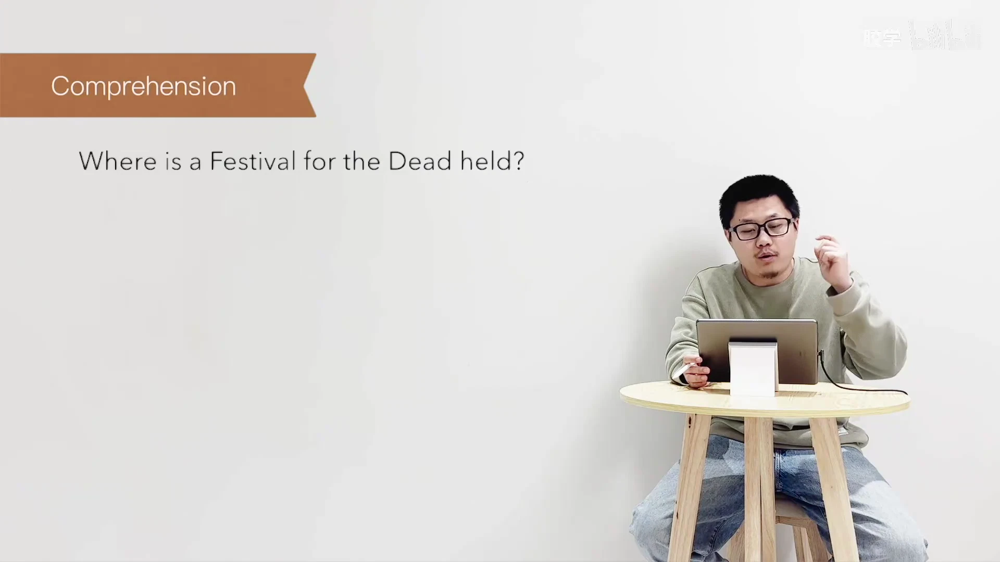

文字识别：Comprehension / Where is a Festival for the Dead held?

### 画面 00:00:33

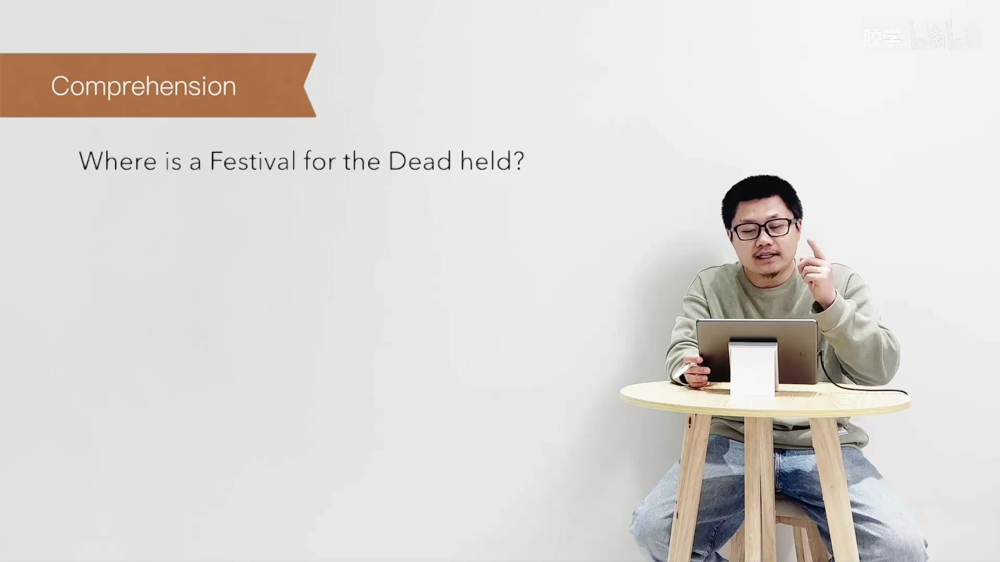

文字识别：Comprehension / Where is a Festival for the Dead held?

### 画面 00:00:35

文字识别：Comprehension / Where is a Festival for the Dead held? / In Japan.

### 画面 00:00:40

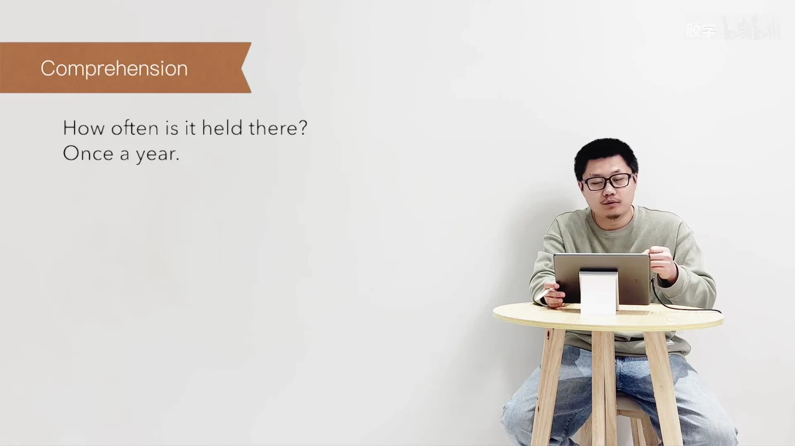

文字识别：Comprehension / How often is it held there? / Once a year.

### 画面 00:00:45

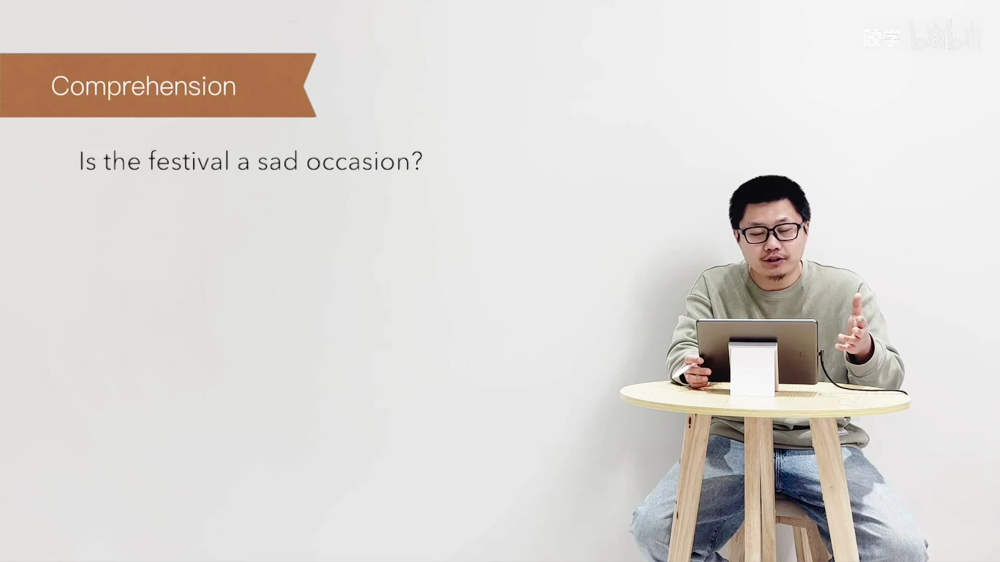

文字识别：Comprehension / Is the festival a sad occasion?

### 画面 00:00:50

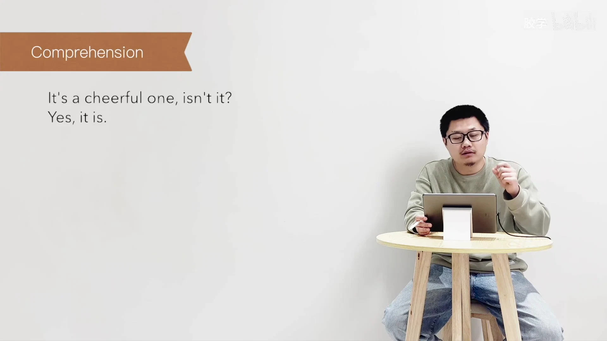

文字识别：Comprehension / It's a cheerful one, isn't it? / Yes, it is.

### 画面 00:00:55

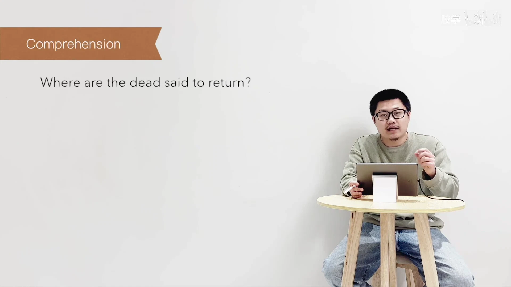

文字识别：Comprehension / Where are the dead said to return?

## 00:01:00–00:01:30

人来到自己家里，请祖先，对吧？So who are they welcomed by? By the living. Why is food laid out for them? Because they are expected to be hungry after their long journey. What is hung outside each house? Especially made lanterns. Why are they hung there?

### 画面 00:01:00

文字识别：Comprehension / Who are they welcomed by?

### 画面 00:01:05

文字识别：Comprehension / Who are they welcomed by? / By the living.

### 画面 00:01:10

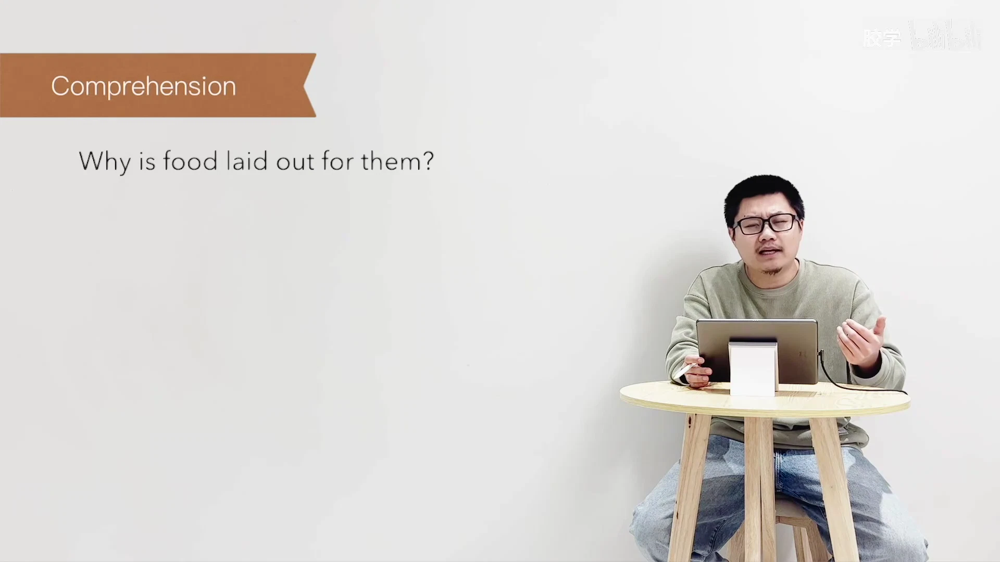

文字识别：Comprehension / Why is food laid out for them?

### 画面 00:01:15

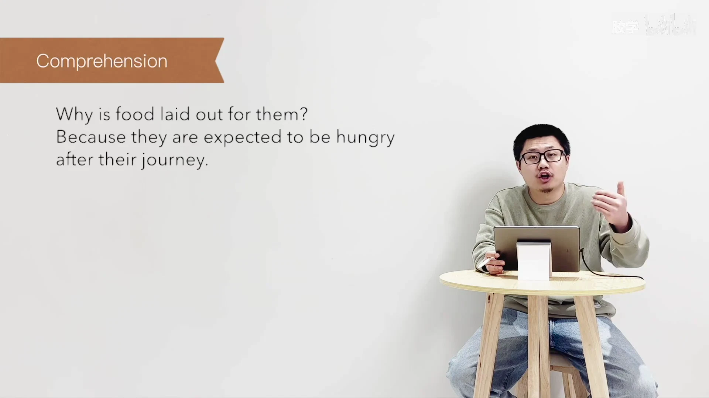

文字识别：Comprehension / Why is food laid out for them? / Because they are expected to be hungry / after their journey.

### 画面 00:01:17

文字识别：Comprehension / What is hung outside each house?

### 画面 00:01:20

文字识别：Comprehension / What is hung outside each house?

### 画面 00:01:25

文字识别：Comprehension

## 00:01:30–00:02:00

help the dead to find their way. What do people do all night long? Dance and sing. Do they eat the food they've prepared for the dead? No, they don't. Why don't they? Because it is considered unlucky for anyone living to eat it. When do they throw it away? Early

### 画面 00:01:30

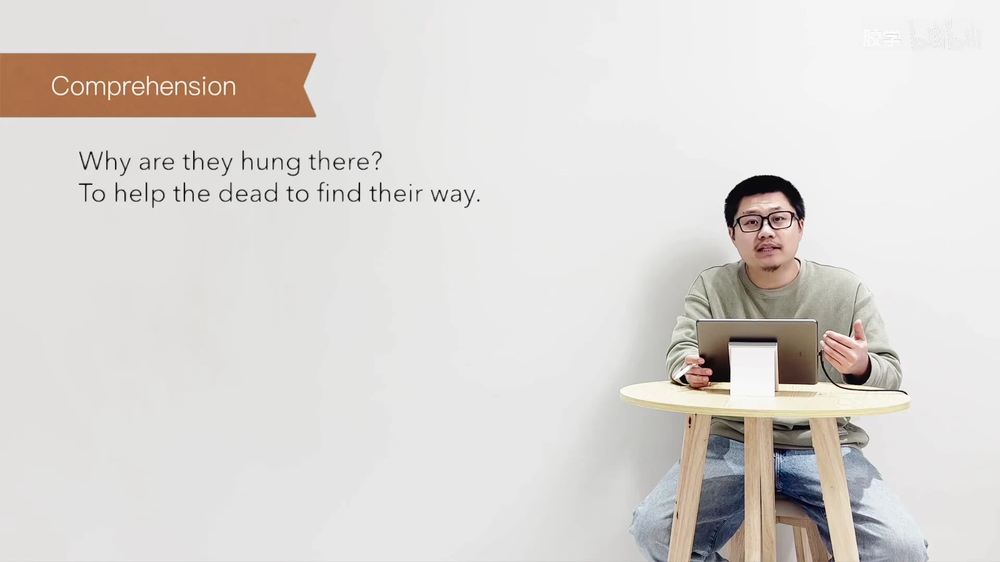

文字识别：Comprehension / Why are they hung there? / To help the dead to find their way.

### 画面 00:01:35

文字识别：Comprehension / What do people do all night long?

### 画面 00:01:40

文字识别：Comprehension

### 画面 00:01:45

文字识别：Comprehension / Do they eat the food they've prepared for / the dead?

### 画面 00:01:50

文字识别：Comprehension / Why don't they? / Because it is considered unlucky for anyone / living to eat it.

### 画面 00:01:55

文字识别：Comprehension / Why don't they? / Because it is considered unlucky for anyone / living to eat it.

### 画面 00:01:57

文字识别：Comprehension / When do they throw it away?

## 00:02:00–00:02:30

the next morning. Where do they throw it? Into a river or the sea. Asking questions. 四句型转换对吧？A festival for the food is held in Japan. Is提前Where对In Japan提问。好，剩下的这些我们不一一说了。您我相信到最后一课脱离了我，您应该可以搞定了啊。好，我们这是所有的题。

### 画面 00:02:00

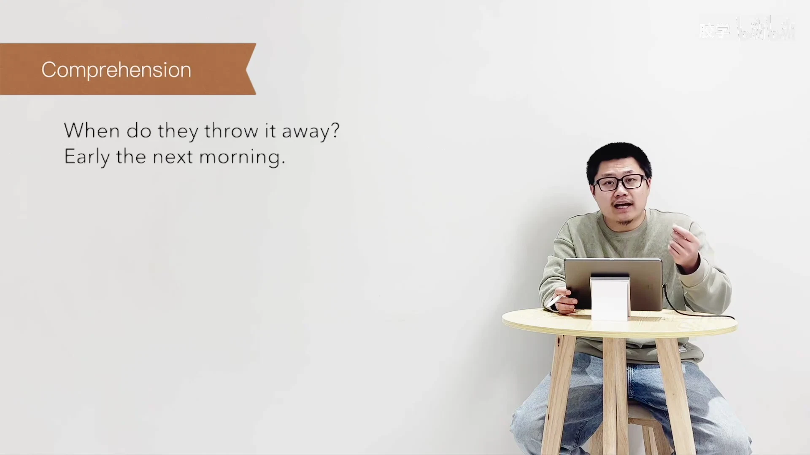

文字识别：Comprehension / When do they throw it away? / Early the next morning.

### 画面 00:02:06

文字识别：Comprehension / Where do they throw it? / Into a river or the sea.

### 画面 00:02:08

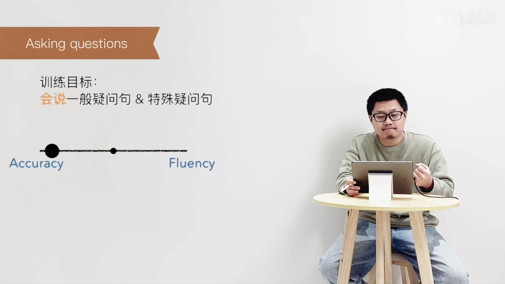

文字识别：Asking questions / 训练目标： / 会说一般疑问句＆特殊疑问句 / Accuracy / Fluency

### 画面 00:02:10

文字识别：Asking questions / T: Ask me if a festival for the Dead is held in / Japan.

### 画面 00:02:12

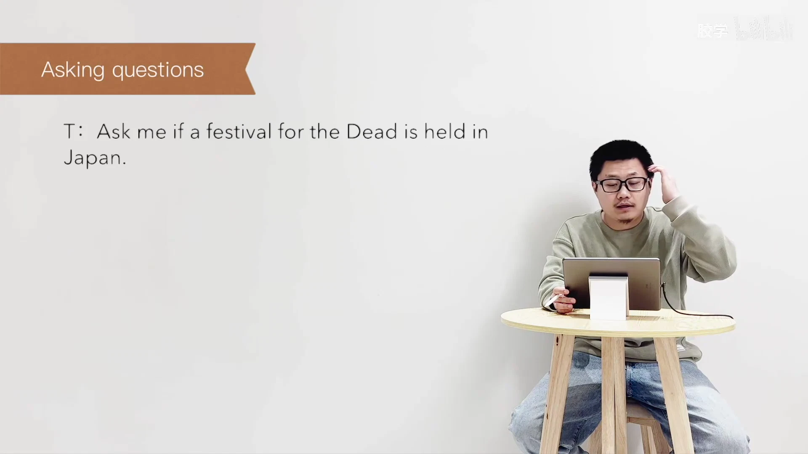

文字识别：Asking questions / T: Ask me if a festival for the Dead is held in / Japan.

### 画面 00:02:16

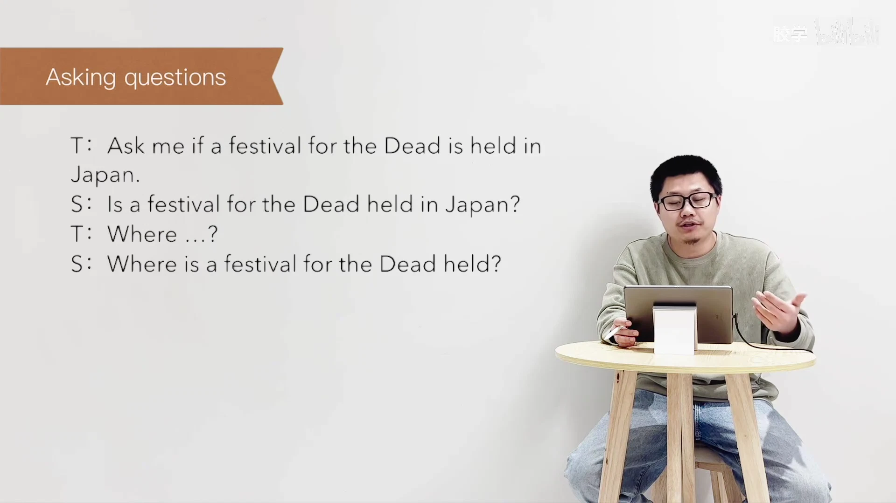

文字识别：Asking questions / T: Ask me if a festival for the Dead is held in / Japan. / S: Is a festival for the Dead held in Japan? / T: Where ...? / S: Where is a festival for the Dead held?

### 画面 00:02:18

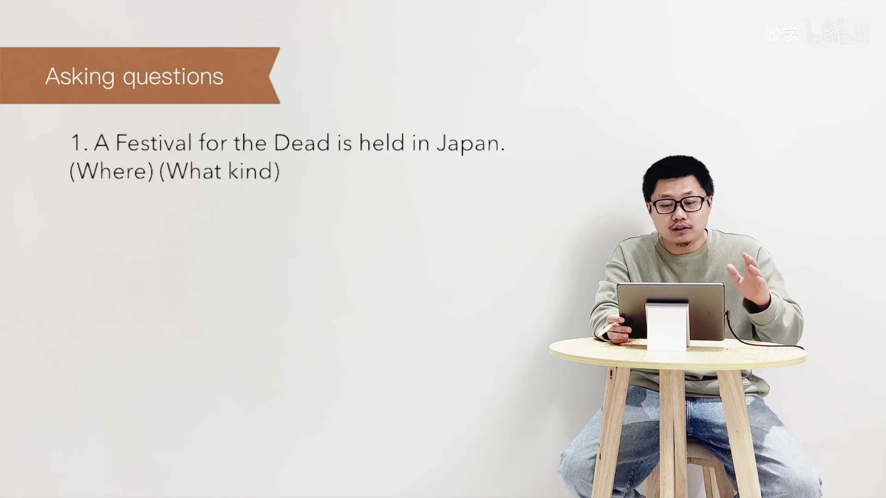

文字识别：Asking questions / 1.A Festival for the Dead is held in Japan. / (Where) (What kind)

### 画面 00:02:21

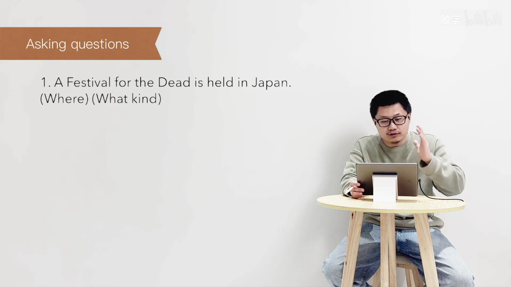

文字识别：Asking questions / 1.A Festival for the Dead is held in Japan. / (Where)(What kind)

### 画面 00:02:26

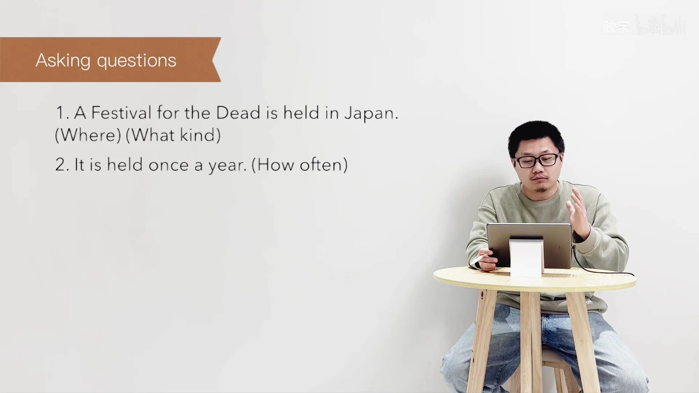

文字识别：Asking questions / 1.A Festival for the Dead is held in Japan. / (Where) (What kind) / 2. It is held once a year. (How often)

### 画面 00:02:28

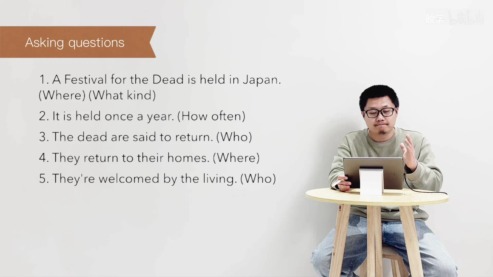

文字识别：Asking questions / 1.A Festival for the Dead is held in Japan. / (Where) (What kind) / 2. Ilt is held once a year. (How often) / 3. The dead are said to return. (Who) / 4. They return to their homes. (Where) / 5. They're welcomed by the living. (Who)

## 00:02:30–00:03:00

当然，在我们的这个给大家总结的课堂笔记和练习的PDF文件当中也有啊。呃，Tell the story，您该练继续练，进入马上进入咱们二册学完不就进入三册吗？三册咱还练这个啊。然后Summary writing呢，老习惯，重点是看一下连词，第一个、第二个。Topic for discussion，我给您在最后来一个，翻译一下。What other kinds of festival do you know about? Why and when they are held? 你还知道什么其

### 画面 00:02:30

文字识别：Asking questions / 7.They're expected to be hungry. (Who)

### 画面 00:02:32

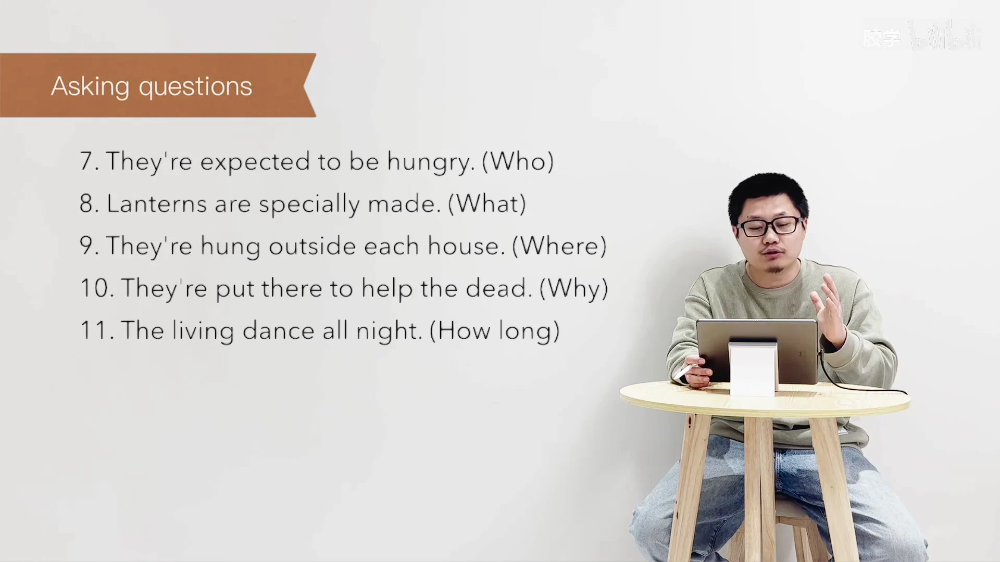

文字识别：Asking questions / 7. They're expected to be hungry. (Who) / 8. Lanterns are specially made. (What) / 9. They're hung outside each house. (Where) / 10. They're put there to help the dead. (Why) / 11.The living dance all night. (How long)

### 画面 00:02:36

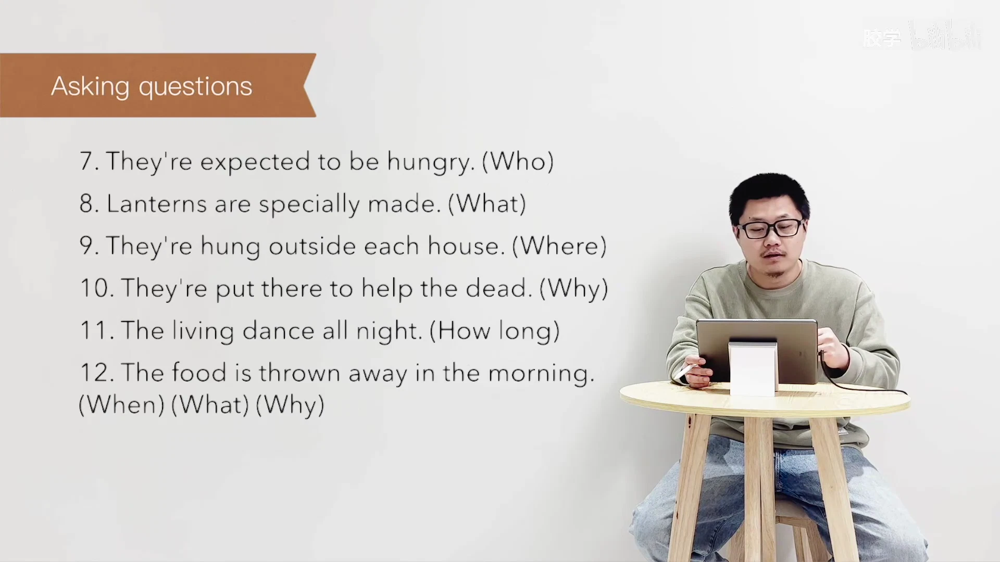

文字识别：Asking questions / 7. They're expected to be hungry. (Who) / 8. Lanterns are specially made. (What) / 9. They're hung outside each house. (Where) / 10. They're put there to help the dead. (Why) / 11.The living dance all night. (How long) / 12. The food is thrown away in the morning. / (When)(What) (Why)

### 画面 00:02:38

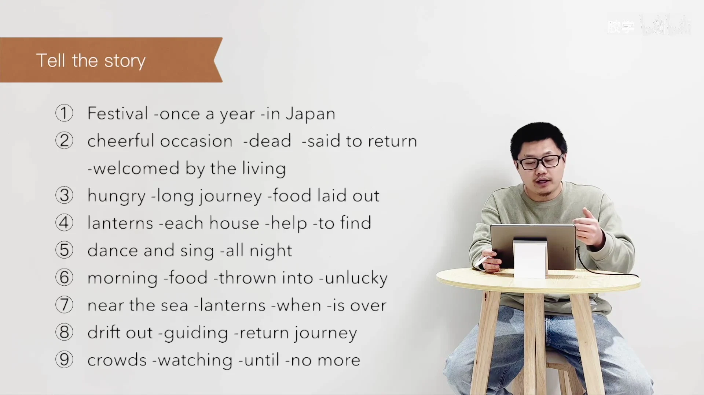

文字识别：Tell the story / D Festival -once a year -in Japan / 1 /  cheerful occasion -dead -said to return / 2 / -welcomed by the living / ③ hungry -long journey -food laid out / 3 / lanterns -each house -help -to find / dance and sing -all night / 5 / ⑥ morning -food -thrown into -unlucky / near the sea -lanterns -when -is over /  drift out -guiding -return journey / 9 / ) crowds -watching -until -no more

### 画面 00:02:41

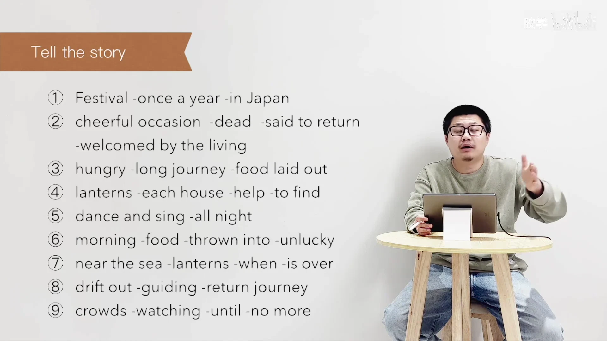

文字识别：Tell the story / ① Festival -once a year -in Japan / ) cheerful occasion -dead -said to return / 2 / -welcomed by the living / ③ hungry -long journey -food laid out / 3） / lanterns -each house -help -to find / dance and sing -all night / ⑥ morning -food -thrown into -unlucky / near the sea -lanterns -when -is over /  drift out -guiding -return journey / 8 / 9 / ) crowds -watching -until -no more

### 画面 00:02:45

文字识别：Summary writing: Key / 训练目标： / 写作复述能力

### 画面 00:02:47

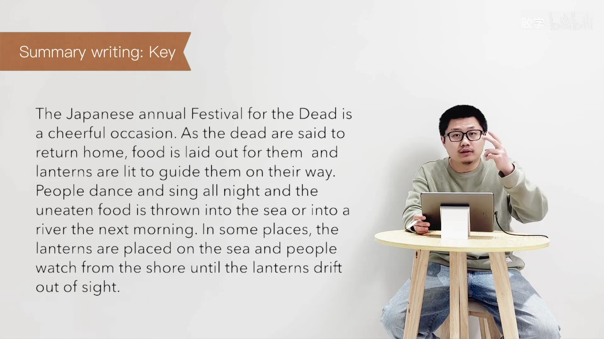

文字识别：Summary writing: Key / The Japanese annual Festival for the Dead is / a cheerful occasion. As the dead are said to / return home, food is laid out for them and / lanterns are lit to guide them on their way. / People dance and sing all night and the / uneaten food is thrown into the sea or into a / river the next morning. In some places, the / lanterns are placed on the sea and people / watch from the shore until the lanterns drift / out of sight.

### 画面 00:02:49

文字识别：Topics for discussion / 训练目标： / 完全自由的对话 / Accuracy / Fluency

### 画面 00:02:51

文字识别：Topics for discussion / What other kinds of festivals do you / know about? Why and when are they / held? / Which is your favourite festival in your / country? Why? / Give examples to show that, since / ancient times, water has played an / important part in different ceremonies all / over the world. Why do you think this is / So?

### 画面 00:02:53

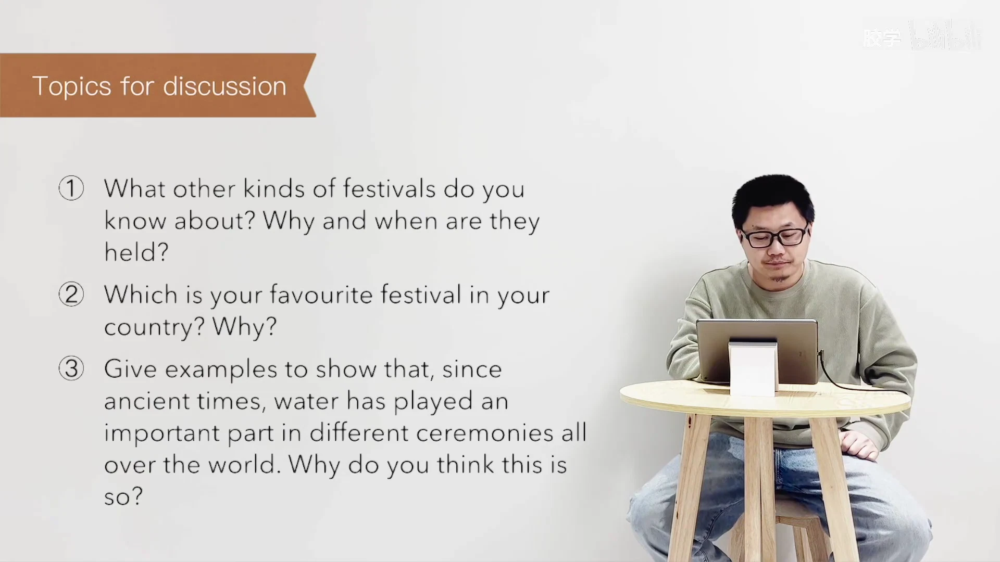

文字识别：Topics for discussion / What other kinds of festivals do you / know about? Why and when are they / held? / Which is your favourite festival in your / country? Why? / Give examples to show that, since / 3 / ancient times, water has played an / important part in different ceremonies all / over the world. Why do you think this is / so?

### 画面 00:02:55

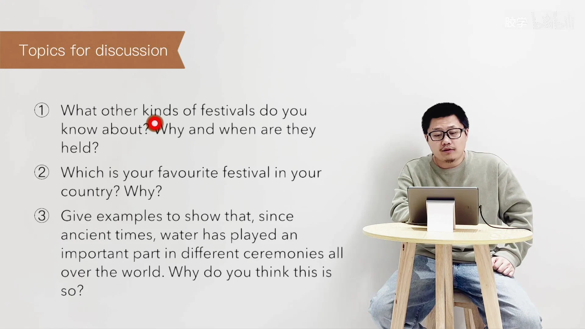

文字识别：Topics for discussion / What other kinds of festivals do you / know about?OVhy and when are they / held? / Which is your favourite festival in your / country? Why? / Give examples to show that, since / ancient times, water has played an / important part in different ceremonies all / over the world. Why do you think this is / so?

### 画面 00:02:57

文字识别：Topics for discussion / What other kinds of festivals do you / know about? Why and when are they / held? / Which is your favourite festival in your / country? Why? / Give examples to show that, since / ancient times, water has played an / important part in different ceremonies all / over the world. Why do you think this is / so?

## 00:03:00–00:03:30

他的节日吗？为啥以及他们什么时候会被举举行，对吧？会被庆祝。Which is your favorite festival in your country? Why?在你国家你最喜欢哪个节日？为啥？Give examples to show that since ancient times, water has played an important part in different ceremonies all over the world. Why do you think this is so?啊，对我相信很多人可能单看这个一口气儿看起来都不一定懂。说你举一个例子证明什么呢？说自从从古

### 画面 00:03:01

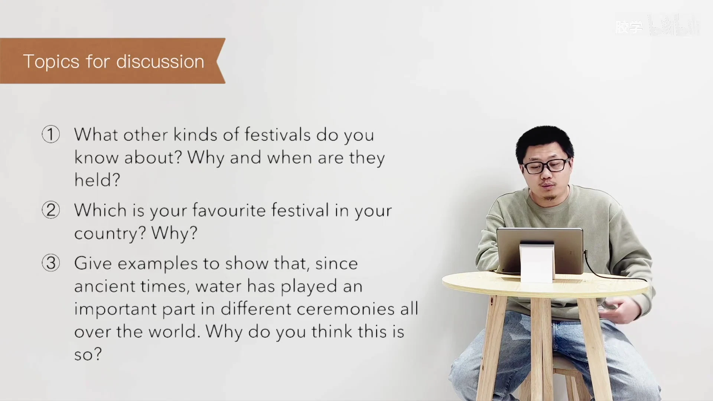

文字识别：Topics for discussion / What other kinds of festivals do you / know about? Why and when are they / held? / Which is your favourite festival in your / country? Why? / Give examples to show that, since / 3 / ancient times, water has played an / important part in different ceremonies all / over the world. Why do you think this is / so?

### 画面 00:03:06

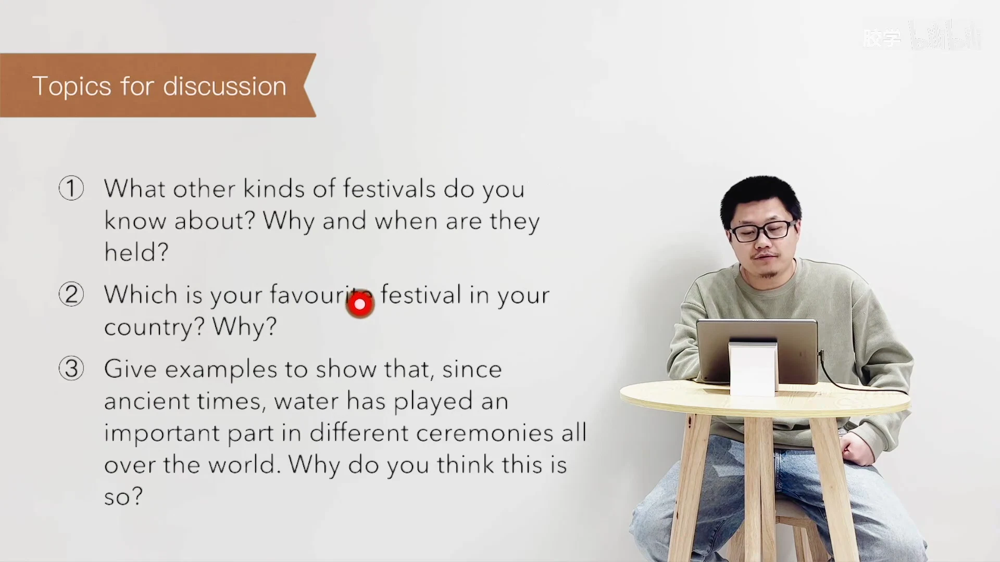

文字识别：Topics for discussion / What other kinds of festivals do you / know about? Why and when are they / held? / Which is your favourio / festival in your / country? Why? / Give examples to show that, since / ancient times, water has played an / important part in different ceremonies all / over the world. Why do you think this is / so?

### 画面 00:03:11

文字识别：Topics for discussion / What other kinds of festivals do you / know about? Why and when are they / held? / Which is your favourite festival in your / country? Why? / Give examples to show that, since / ancient times, water has played an / important part in different ceremonies all / over the world. Why do you think this is / So?

### 画面 00:03:16

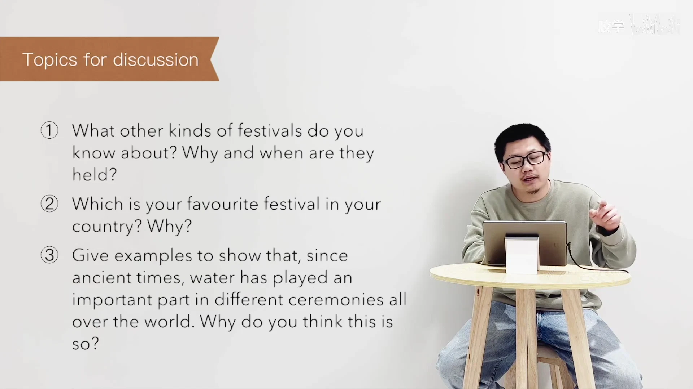

文字识别：Topics for discussion / What other kinds of festivals do you / know about? Why and when are they / held? / Which is your favourite festival in your / country? Why? / Give examples to show that, since / ancient times, water has played an / important part in different ceremonies all / over the world. Why do you think this is / so?

### 画面 00:03:21

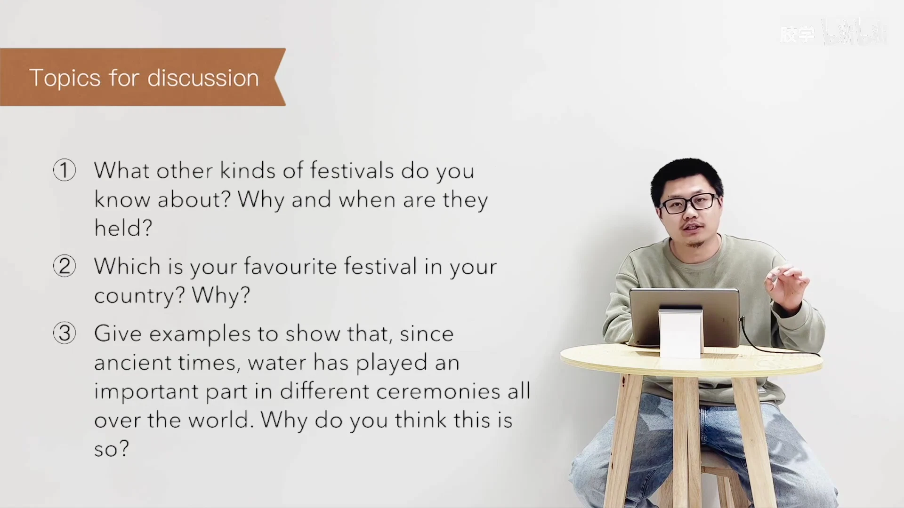

文字识别：Topics for discussion / What other kinds of festivals do you / know about? Why and when are they / held? / Which is your favourite festival in your / country? Why? / Give examples to show that, since / ancient times, water has played an / important part in different ceremonies all / over the world. Why do you think this is / So?

### 画面 00:03:26

文字识别：Topics for discussion / What other kinds of festivals do you / know about? Why and when are they / held? / Which is your favourite festival in your / country? Why? / Give examples to show that, since / ancient times, water has played an / important part in different ceremonies all / over the world. Why do you think this is / so?

## 00:03:30–00:04:00

代开始，水在不同的仪式当中就起到了一个非常重要的作用。比如说，在很多的宗教当中都有洗礼这个概念，要用水洗一下，对吧？清除你所谓的类似于在入教前前一生的那个罪孽，对吧？哎，洗礼。那 Why do you think this is so? 为什么你认为这个事儿是这样的呢？你先举一些例子，你再说一下为什么水扮演了这么重要的一个角色，对吧？OK。那家庭作业，Ask Smith写完朗读，摘要写

### 画面 00:03:31

文字识别：Topics for discussion / What other kinds of festivals do you / know about? Why and when are they / held? / Which is your favourite festival in your / country? Why? / Give examples to show that, since / ancient times, water has played an / important part in different ceremonies all / over the world. Why do you think this is / so?

### 画面 00:03:36

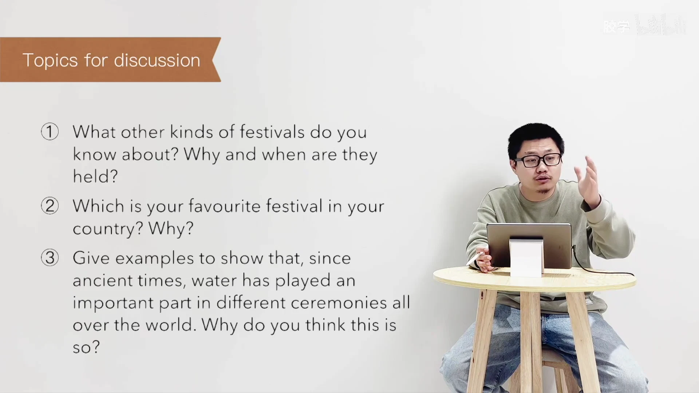

文字识别：Topics for discussion / What other kinds of festivals do you / know about? Why and when are they / held? / Which is your favourite festival in your / country? Why? / Give examples to show that, since / ancient times, water has played an / important part in different ceremonies all / over the world. Why do you think this is / so?

### 画面 00:03:41

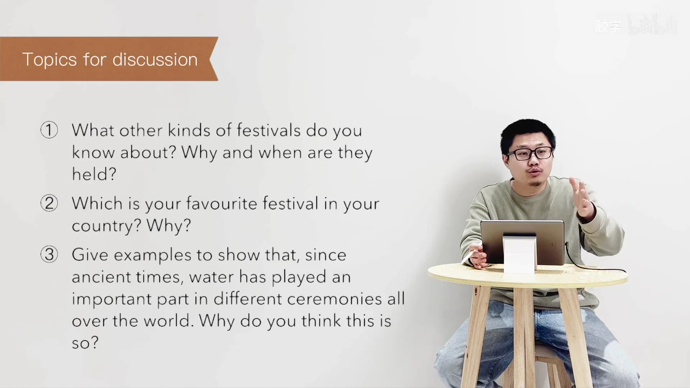

文字识别：Topics for discussion / What other kinds of festivals do you / know about? Why and when are they / held? / Which is your favourite festival in your / country? Why? / Give examples to show that, since / ancient times, water has played an / important part in different ceremonies all / over the world. Why do you think this is / So?

### 画面 00:03:46

文字识别：Topics for discussion / What other kinds of festivals do you / know about? Why and when are they / held? / Which is your favourite festival in your / country? Why? / Give examples to show that, since / ancient times, water has played an / important part in different ceremonies all / over the world. Why do you think this is / so?

### 画面 00:03:51

文字识别：Topics for discussion / What other kinds of festivals do you / know about? Why and when are they / held? / Which is your favourite festival in your / country? Why? / Give examples to show that, since / ancient times, water has played an / important part in different ceremonies all / over the world. Why do you think this is / so?

### 画面 00:03:57

### 画面 00:03:59

文字识别：1. Askme if写&朗读 / 摘要写作写&答案

## 00:04:00–00:04:24

作，写完对答案，tell the story口语复述，重复间隔呢？咱们找这个置顶留言。呃，更多的话不多说了，各位新二学好了，咱们新三见，拜拜。

### 画面 00:04:01

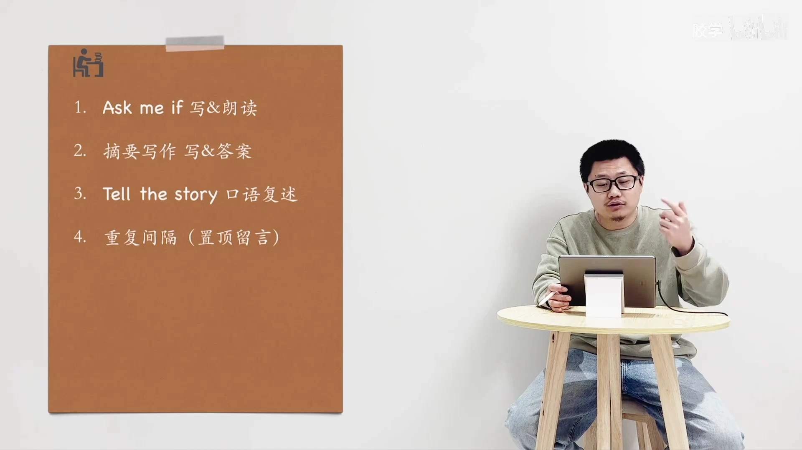

文字识别：1.Askme if写&朗读 / 摘要写作写&答案 / 3.Tell the story 口语复述 / 4.重复间隔（置顶留言）

### 画面 00:04:04

文字识别：不

### 画面 00:04:10

文字识别：O

### 画面 00:04:12

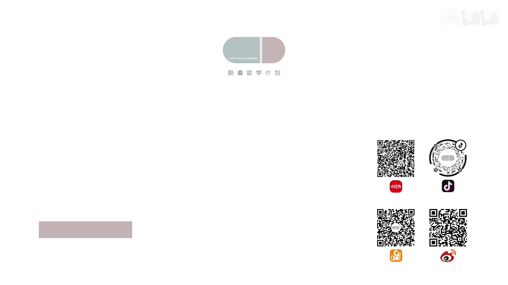

文字识别：CAPSULEACADEMY / 胶囊助学计划 / 小红书 / OE

### 画面 00:04:14

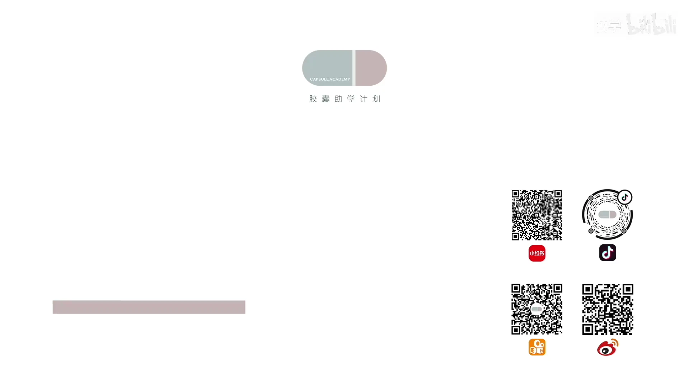

文字识别：CAPSULEACADEMY / 胶囊助学计划 / 小红书 / OE

### 画面 00:04:20

文字识别：CAPSULEACADEMY / 胶囊助学计划 / 小红书 / Creator / 口 / Leo & Berlin / 0

### 画面 00:04:22

文字识别：Bilibli / 胶学

### 画面 00:04:23

文字识别：Bilibili / 胶学

