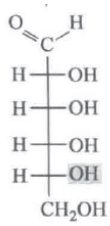
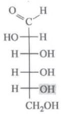
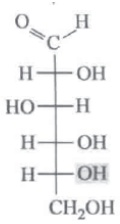
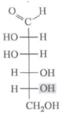
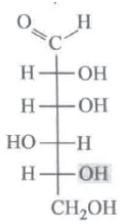
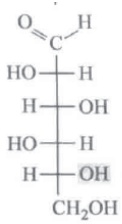
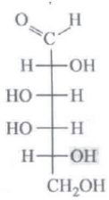
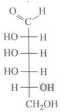

# 上海大学

# 2022 年硕士学位研究生入学考试试题

科目代码:858 科目名称:生物化学

说明:答案必须写在答题纸上，写在试题或草稿纸上无效

## 一、名词解释

1. 肽平面
2.核糖体结合位点
3. 开放阅读框
4. 诱导契合
5.非编码 RNA
6. 酶原
7. 波尔效应
8.多顺反子
9.反馈抑制

## 二、单向选择

1. 下列属于必需氨基酸的是（D）

A.Ser B.Pro C.Tyr D.Thr

2. 丙酮酸脱氢酶有缺陷，如果对其体内的代谢状态进行分析，不会发生的状况是(C)

A、乳酸含量偏高
B、丙氨酸含量偏高
C、柠檬酸含量偏高义
D、丙酮酸含量偏高

3. 下列突变中对蛋白质三维结构影响最大的一种是(D)

A、Gly → Ala
B、Ser→Thr
C、Asp→Glu
D、Ile →Lys

## 三、判断题

1. 镰刀形贫血症是由于血红蛋白亚基的 $\beta$ 链上的 Val 突变成 Glu（×）
2. 嘧啶和嘌呤两类核苷酸合成都需要 Asn 和 Gln (×)

## 四、填空题

1. 离子强度提高和加入单链结合蛋白后 Km 的变化?
2. 植物脂肪处于液态是因为？和动物脂肪相比溶解温度？
3.依赖于  $\rho$  因子的终止子具有什么酶功能？
4.基因工程操作需要的酶？
5.蛋白质转录氨基酸的活化形势？催化该反应的酶？

1. 稳定蛋白质空间构象的非共价键主要有盐键, 氢键, (疏水键) 和 (范德华力)。
2. 结合蛋白酶类必须由酶蛋白和辅助因子相结合后才具有活性，（酶蛋白）决定酶的专一性，
（辅助因子）传递电子，原子及某些基因。
3. 体内的氧化呼吸链主要有（NADH 呼吸链）和（FADH2 呼吸链）。
4. 根据维生素的溶解性可以分为（脂溶性维生素）和（水溶性维生素）。

## 五、简答题

1.酶比活力转换数计算

2.书本 P328 图

A

B

C

D

E

F

G

H

(1) 上述各个糖类有哪些相同点?

(2) C 是什么糖？（葡萄糖）
(3) 找出上述糖类中葡萄糖的同分异构体

## 3. 考查血红蛋白分子病

已知五种血红蛋白分子病, 每种血红蛋白分子病是由于正常血红蛋白中哪个氨基端被替换导致

(1) 上述五种血红蛋白分子病哪种不会引起血红蛋白功能发生很大变化?
(2) 将上述五种血红蛋白进行电泳。哪种会想两极移动？
(3) 上述五种血红蛋白分子病哪种会导致与 BPG 的亲和力下降而与氧气的结合力增强?

4.人体只摄入丰富的蛋白质而不摄入糖和脂肪是否可行？

5.一个基因只能表达一种蛋白质是否正确？为什么？

不正确。一条 mRNA 能够转录出多少种蛋白质，对真核生物来说只可能是 1 种，而对原核生物来说则可能有多种。

原核生物的一条 mRNA 能有多个起始位点; 而且还观察到有一些终止密码不能行使终止作用 (这些生物体内在有些情况下为终止密码也编码了氨基酸!!!), 从而翻译处多种蛋白质。

对真核生物，因为 mRNA 的特殊修饰结构，一条 mRNA 只能在 5'端的一个位点被核糖体识别，因此只能翻译出一种蛋白质。但这不意味着一个基因只能编码一种蛋白质。因为真核生物转录后得到的 RNA，需要经过拼接除去内含子、修饰、编辑等过程才成为成熟的 mRNA。一个基因虽然只能转录出同样的 RNA，但是经过不同的拼接、编辑、修饰（例如某个内含子有时被切除，有时却得以保留），就可以变成不同的成熟 mRNA，从而转录出不同的蛋白质

## 6..糖酵解相关

(1) 在无氧的条件下, 为什么不能进行 TCA 循环?
(2) 为什么在无氧条件下只能丙酮酸转换为乳酸?
(3) 写出丙酮酸转换为乳酸的反应方程式及做需要的酶及辅酶。

7.

8.

## 六、论述题

1. 比较  $\beta$  氧化和脂肪酸的氧化过程的异同点
2. 已知谷胱甘肽的结构式

(1) 圈出谷胱甘肽中的肽键和活性集团
(2) 在 $\mathrm{pH}$ 中性条件下计算谷胱甘肽等电点
(3) 简述谷胱甘肽的功能