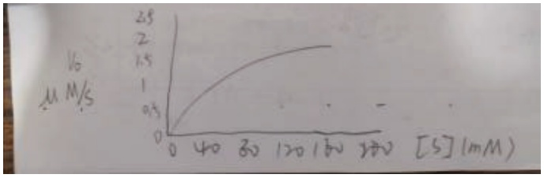
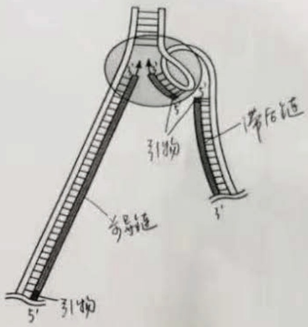

# 上海大学

# 2021 年攻读硕士学位研究生入学考试试题

科目代码:858 科目名称:生物化学

说明:答案必须写在答题纸上，写在试题或草稿纸上无效

## 一、名词解释

1、蛋白质  $\alpha$  螺旋和 DNA 双螺旋
2、泛素途径和溶酶体途径
3、转氨基作用和联合脱氨基作用
4、柠檬酸循环和尿素循环
5、呼吸链抑制剂和氧化磷酸化抑制剂
6、启动子和操纵子

## 二、单项选择

1、几丁质在下列哪种生物材料中广泛存在（虾壳）
2、下列辅酶或辅基结构中没有 AMP 的是（）
3、以下不属于两亲分子的脂是
4、拉氏构象图
5、变性蛋白质
6、可溶性蛋白质三级结构
7、原核生物基因组转录起始的正确性取决于
8、有一个婴儿被诊断出丙酮酸脱氢酶有缺陷，如果对其体内的代谢状态进行分析，预期不会发生的是（）

A、乳酸含量变高 B、丙氨酸含量变高 C 柠檬酸含量增高 D 丙酮酸含量增高

9、化学渗透假说

10、RNA 问四个选项哪个正确

11、端粒酶

12、错配修复的标签是模板链的（）

A 磷酸化 B 酰基化 C 甲基化 D 羟基化。

13、UAC 能配对结合反密码子

A、AUG B、AUI C、IUA D、IAU

14、同一个碱基在动物肝细胞中表达的终产物是 ApoB-100，而在小肠上皮细胞中表达的终产物是分子质量相对较小的 ApoB-48 原因是

A、使用不同的启动子进行转录
B、使用相同的启动子进行转录，但初级转录产物经历了选择性剪接。
C、使用相同的启动子进行转录，但其中一种初级转录物经历了编辑
D、表达的终产物经历了不同形式的后加工

## 三、判断题

1、质膜上糖蛋白的糖基都位于膜的外侧。
2、天然存在的磷脂构型是 L 构型。
3、自然界中常见的不饱和脂肪酸多具有反式双键
4、脂肪的造价高表示含低相对分子质量的脂肪酸多。
5、所有  $\alpha$  氨基酸中的  $\alpha$  碳原子都是一个不对称的碳原子
6、与肌红蛋白不同，血红蛋白由四个亚基组成，因此提高了他与氧的结合能力，从而增加了输氧功能。
7、蛋白构象改变是由于分子内共价键的断裂所导致。
8、Km
9、别构调节物的存在能改变酶与底物的结合常数，但不改变酶的最大反应速率。
10、过渡态抑制剂不是底物类似物，因此不会改变 km。
11、酶原激活是多肽在特定部位发生水解的结果。
12、ATP 中有三个高能磷酸键。
13、葡萄糖激酶对葡萄糖的专一性强，亲和力高。主要用于糖酵解。
14、由于癌细胞生长分裂比正常的细胞旺盛，因而更依赖 ATP 的产生，这表现在他们的糖酵解速率明显减弱。
15、呼吸链中各电子传递体中的铁都是以卟啉铁的形式存在。
16、人体皮肤上的黑色素是通过氨基酸合成而来的。
17、DNA 聚合酶和 RNA 聚合酶的催化作用都需要引物。
18、如果一个氨基酸有多个密码子, 这些密码子之间的差别一般在第三个碱基
19、肽链合成时，核糖体以  $3'\rightarrow5'$  方向沿 m RNA 移动。
20、遗传信息流动始终是单向的，计由 DNA→RNA→蛋白质

## 四填空题

1、α-D-吡喃葡萄糖结构式\_\_\_\_，18:1 Δ 9c\_\_\_\_
2、乳糖 \_\_\_\_ 糖苷键。
3、双链 DNA 储存在纯水中会自动变性，原因是\_\_\_\_
4、磺胺类药物能抑制细菌生长因为它是\_\_\_\_结构类似物, 能\_\_\_\_性抑制二氢叶酸合成酶活性。
5、牛胰核糖核酸酶的变性和复性实验说明蛋白质的一级结构决定高级结构。
6、葡萄糖生成丙酮酸净生成\_\_\_\_个 ATP
7、柠檬酸循环中两个脱羧反应由\_\_\_\_酶和\_\_\_\_酶催化。
8、长期饥饿，脑细胞会转向利用\_\_\_\_提供能量。
9、细胞浆中的 NADH 可通过\_\_\_\_或\_\_\_\_穿梭进入线粒体，再 NADH 呼吸链或 FADH2 呼吸链被氧化。
10、戊糖途径的主要作用是形成\_\_\_\_和\_\_\_\_
11、根据维生素的\_\_\_\_性质,可分为\_\_\_\_和\_\_\_\_类

## 五、简答题

1、有一个八肽被酸水解、胰蛋白酶水解、胰凝乳蛋白酶水解，问这个多肽的氨基酸序列是什么

## 2、实验中酶浓度 40nM, V max=4.0 μ M/s

(1) 底物浓度 $80 \mathrm{mM}$ 时, 酶促反应初速率为 ( )
（2）将该酶促反应的催化酶突变，唯一效果是使 K cat 降低 10 倍，计算该酶的 K cat=（）

line

| [S] (mM) | Value |
| --- | --- |
| 0 | 0 |
| 40 | ~0.8 |
| 80 | ~1.3 |
| 120 | ~1.6 |
| 160 | ~1.75 |
| 200 | ~1.8 |

## 3、有四种蛋白质 A、60kDa B、112kDa C、15kD D、200kD

(1) 用分子排阻层析分离, 解释分子排阻层析原理, 预测顺序 (先洗脱下 $\rightarrow$ 最后洗脱)
(2) 还是这四种蛋白质, 用 SDS-PAGE 分离, 标注阴极和阳极及随带电荷, 预测并标注电泳完成后四种蛋白质的条带 (利用最左侧已知分子量的蛋白质标准品条带来标记 4 种蛋白质迁移到哪里) 并解释蛋白质为何会沿着凝胶向下移动

4、（1）写出糖酵解中直接催化 1,3-二磷酸甘油酸的反应步骤、酶、对糖酵解的意义

(2) 糖酵解活跃时, 对氧运输有何影响
(3) 解释己糖激酶缺乏症的病人, 其红细胞中的血红蛋白对氧运输有何影响

## 5、下列组分在细菌蛋白质合成中的主要作用

(1) 氨酰 tRNA 合成酶
(2) 16sRNA
(3) 肽酰转移酶

## 六、论述题

## 1、已知缓激肽（结构式）

(1) 有几个氨基酸
(2) 写出氨基酸序列
(3) 圈出第一个肽键和最后一个肽键（精确）
(4) 预测 pH7.0 带电情况
(5) 采用哪种层析柱比较合理

## 2、判断下列进程能否在人体内进行？能，写出有关代谢途径及其细胞内定位，主要反应、关键酶。不能解释原因。

(1) 葡萄糖→软脂酸
(2) 葡萄糖→亚油酸
(3) 葡萄糖→亮氨酸
(4) 丙氨酸→葡萄糖
(5) 软脂酸→葡萄糖

## 3、见下图

(1) 引物的本质和作用
(2) 解释前导链和滞后链含义
(3) 列举参与原核生物 DNA 复制的酶或蛋白质及其功能

text_image

带后链
引物
5'
5'
5'
5'

## 参考答案:

（1）引物的本质和作用分别是什么？请在图中标出引物的位置:

引物的本质为 RNA，作用是为 DNA 合成提供游离的 3'-OH 末端（1 分），引物的位置如图所示（1 分）。

(2) 请在图中标出前导链和滞后链以及各自的 5'-端和 3'-端, 并分别解释前导链和滞后链的含义:

如图所示(1分)，前导链是以 $3^{\prime}\rightarrow5^{\prime}$ 方向的亲代链为模板连续合成的子代链。

(1分)滞后链是以 $5^{\prime}\rightarrow3^{\prime}$ 方向的亲代链为模板的子代链先逆复制叉移动方向合成冈崎片段，再连接而成的链(1分)。

(3) 请列举参与原核生物 DNA 复制的酶或蛋白质及其功能。

下列任意5个，每个1分

DNA pol III: 催化 DNA 复制时新链的延长;

解链酶:解开 DNA 双螺旋；

DNA 连接酶:连接双链 DNA 的单链切口，形成 3',5'-磷酸二酯键；

引物酶:合成 RNA 引物:

DNA 拓扑异构酶:解除超螺旋 DNA;

SSB: 稳定单链 DNA。

# 上海大学 2020 年攻读硕士学位研究生

# 入学考试试题

招生专业:生物学 考试科目:858 生物化学

## 一、名词解释及简单解释二者之间的关系(5×6,共30分)

(和19年一样以成对形式出现,恐怕以后的趋势也都是这样了)

1、snRNA 和 miRNA
2、底物水平磷酸化和氧化磷酸化
3、乳酸循环和丙氨酸循环
4、启动子和 SD 序列
5、DNA 变性和核酸变性

## 二、判断（20个每个1分20分）

二、判断（2）葡萄糖和1-葡萄糖都能被人体利用。（×）
1. D-葡萄糖和L-葡萄糖都能被吸入,  $\times$  氨基酸。 (×)
2. 必需氨基酸是指蛋白质代谢中叶内核素和核糖。
3. 原核生物基因表达的调控主要发生在各个水平，但主要也是在转录水基因表达的调控可以发生在各个水平，但主要也是在转录水
平。(✓)
平。（√）

4. 当动物胰脏的胰岛受到损坏后，胰岛素分泌显著减少，因而
血糖水平降低。（×）
5. 四膜虫 26S rRNA 前体的剪接是由其内含子的凹凸成的。（✓）

6. 人体内合成尿素的器官是肾。（✗）
7. 碱基的颠换不会造成移码突变。（√）
7. 碱基的颠换不会造成任何物质。
8. 寡霉素对呼吸链中 ATP 生成的抑制作用可被 2,4-二硝基苯酚解除。（✗）
9. 无论是原核或真核细胞中，大多数 mRNA 都是多顺反子的转录产物。（✗）

10. 磷酸戊糖途径为还原性生物合成提供 NADH。（✗）

11.甲硫氨酸含有一个活泼甲基，是机体甲基化反应中甲基的主要直接供体。（×）

12.RNA 聚合酶比 DNA 聚合酶有更强的具校对功能的  $3' \rightarrow 5'$  外切活性。（✗）

13.胞浆的 NADH 能够直接穿过线粒体内膜进入线粒体，然后被氧化产能。（✗）

14.蛋白质合成时，核糖体沿着mRNA的5'至3'方向移动。（√）

15.糖原、淀粉和纤维素分子中都有一个还原端，所以它们都有还原性。（✗）

16.真核生物 mRNA 前体的转录对于  $\alpha$ -鹅膏蕈碱敏感。（✓）

17.食用过量维生素能引起中毒，主要是指脂溶性维生素。（√）

18.脂肪酸合成的直接原料是乙酰 CoA。（✗）

19.三羧酸循环是美国科学家鲍林（Pauling）发现的。（×）

20.膜内在蛋白的跨膜区域的结构主要有α-螺旋和β-桶状结构。（√）

## 三、单选（20个每个1分20）

1. 体内转运一碳单位的载体是（B）

A. 生物素

B. 四氢叶酸

C. 辅酶 A

D. 叶酸

2. 脂肪酸β-氧化的反应顺序是（D）

A. 脱氢、再脱氢、水合、硫解 B. 缩合、还原、脱水、再还原
C. 还原、缩水、再还原、脱水 D. 脱氢、水合、再脱氢、硫解

3. 嘌呤霉素抑制蛋白质生物合成是由于它是（C）

A.核糖体失活蛋白 B.核糖核酸酶
C. 氨酰-tRNA 的类似物 D. RNA 聚合酶的抑制剂

4. 下列与 DNA 解链无关的是 (D)

A. 单链 DNA 结合蛋白 B. DNA 解链酶
C. 拓扑异构酶 II D. DNA 旋转酶

5. 缺氧情况下，糖酵解途径生成的 NADH+H+ 的去路 （B）

A. 进人呼吸链氧化供应能量
B.丙酮酸还原为乳酸
C.3-磷酸甘油酸还原为 3-磷酸甘油醛
D. 醛缩酶的辅助因子合成 1,6-双磷酸果糖

6. 转氨酶的辅酶为 (D)

A. NAD+ B. NADP+ C. FAD D. 磷酸吡哆醛

7. 酶的比活用来表示酶的（B）

A 活力 B 纯度 C 酶量 D 饱和度

8. 下列有关 DNA 聚合酶Ⅲ的论述，下列哪个是错误的（D）

A.有模板依赖性 B.有  $5' \rightarrow 3'$  聚合酶活性
C.有  $3'\rightarrow5'$  外切酶活性 D.有  $5'\rightarrow3'$  外切酶活性

9. ATP 对磷酸果糖激酶 I 的作用（C）

A. 酶的底物
B. 酶的抑制剂
C.既是酶的底物同时又是酶的变构抑制剂
D. 1, 6-双磷酸果糖被激酶水解时生成的产物

10. 一位男子因接触大量硫化氢而中毒失去知觉，心脏也骤停。这是因为硫化氢（D）

A、抑制呼吸链复合物Ⅰ B、抑制呼吸链复合物Ⅱ

C、抑制呼吸链复合物 III D、抑制呼吸链复合物 IV

11. 以下可以增加脂双层的流动性的手段是（A）

A、提高温度
B、降低温度
C、提高磷脂分子上饱和脂肪酸的数目 D、增加脂酰基的长度

12. 下列哪种因素能够提高血红蛋白对分子氧的亲和力（A）

A、一分子氧气与血红蛋白结合
B、一分子2,3-BPG与血红蛋白结合
C、一个质子与血红蛋白结合
D、一分子二氧化碳与血红蛋白结合

13. 丙酮酸脱氢酶有缺陷，如果对其体内的代谢状态进行分析，不会发生的状况是（C）

A、乳酸含量偏高
B、丙氨酸含量偏高
C、柠檬酸含量偏高
D、丙酮酸含量偏高

14. 肌糖原不能直接补充血糖的原因是肌肉缺少（C）

A、脱支酶
B、糖原磷酸化酶
C、葡萄糖-6-磷酸酶
D、磷酸葡萄糖变位酶

15. 下列突变中对蛋白质三维结构影响最大的一种是 (D)

A、Gly → Ala
B、Ser → Thr
C、Asp → Glu
D、Ile → Lys

16. 反转录酶除了有以 RNA 为模板生成 RNA-DNA 杂交分子的功能外，还有下列活性（C）

A、DNA 聚合酶和 RNase A
B、DNA 聚合酶和 S1 核酸酶
C、DNA 聚合酶和 RNase H
D、S1 核酸酶和 RNase H
17. 下列与 DNA 解链无关的是 (D)

A. 单链 DNA 结合蛋白

B. DNA 解链酶

C. 拓扑异构酶 II

D. DNA 旋转酶

18. 下列关于三羧酸（TCA）循环的描述正确的是 (D)

A. 本身不会产生高能磷酸化合物
B. 不受无氧条件限制

C. 循环起始物乙酰 CoA 中的 2 个 C 原子在一轮循环中以 2 个 CO2 形式释出
D. 循环速率取决于对 ATP 的需求

19. 大肠杆菌 RNA 聚合酶中负责识别转录起始点的亚基是 (D)

A. α亚基

B. β亚基

C. β'亚基

D. σ亚基

20. 下列关于氧化磷酸化偶联机制的化学渗透学说的描述错误的是 (D)

A. H+不能自由通过线粒体内膜
B. B. 能量用于由 ADP+Pi 合成 ATP
C. 在线粒体膜内外 H+形成跨膜浓度梯度
D. 线粒体内膜外侧 pH 值比膜内侧

## 四、填空 20 个每个 1 分 20 分

1. 植物细胞壁骨架的主要成分是纤维素，革兰氏阳性细菌细胞壁骨架的主要成分是肽聚糖。
2. 脂肪酸  $\beta$ -氧化的限速酶是肉碱脂酰 CoA 转移酶 I。
3. 尿素合成过程中两种氨基酸鸟氨酸和瓜氨酸不参与人体内蛋白质合成。
4. 基因表达包括转录和翻译。
5. 脂肪酸合成过程中，乙酰 CoA 来源于葡萄糖或氨基酸。
6. 一条肽链: Asn-His-Lys-Trp-Phe-Glu-Ile-Arg-Glu-Tyr-Gly-Arg, 经胰蛋白酶水解后, 可得到 3 个寡肽。
7. DNA 二级结构的维持力有碱基堆积力、氢键和离子键。
8. 活在海洋中的哺乳动物能长时间潜水，是由于它们的肌肉中含有大量的肌红蛋白以储存氧气。
9. 三羧酸循环中有 2 次脱羧反应，分别由异柠檬酸脱氢酶和 α-酮戊二酸脱氢酶催化。

10. 限制性内切酶的识别序列通常是 4\~6 个碱基对的长度，且具有回文结构，被切割的 DNA 双链可形成黏性末端或平齐末端。

## 五、简答题（30分，每个6分）

## 1. 蛋白质分离技术

## (1) 根据溶解度不同:

①盐析:+高浓度中性盐类，硫酸铵效果最好，低温透析或葡聚糖凝胶柱层析除盐
②等电点沉淀:等电点时颗粒间静电排斥力最小，溶解度最小，常与盐析、有机溶剂沉淀法结合使用
③低温有机溶剂沉淀法:+乙醇/丙酮破坏水化膜，调节 pH 到等电点使蛋白质沉淀

## (2) 根据蛋白质分子大小

①透析超滤:让小分子透过半透膜而蛋白质留在膜上
②凝胶过滤:大分子沿着凝胶空隙流出，小分子不停穿过颗粒内部而洗脱出来

## (3) 根据带电性质

①电泳:PAGE 利蛋白质的电荷效应和分子筛效应分离分析蛋白质，可分 SDS-PAGE 和等电聚焦电泳
②离子交换层析:蛋白质流经层析柱时，带有与离子交换剂可交换集团的同种电荷的蛋白质被吸附，带电荷越多吸附越强，而后改变离子强度或 pH 可洗脱，分为阴离子交换剂、阳离子交换剂

## (4) 根据配体性质: 亲和层析

## 2. 竞争性抑制

竞争性抑制是指当抑制物与底物的结构类似时，它们将竞争酶的同一可结合部位一一活性位，阻碍了底物与酶相结合，导致酶催化反应速率降低。这种抑制作用称为竞争性抑制。

一个竞争性抑制剂通常与正常的底物或配体竞争同一个蛋白质的结合部位。这种抑制使得 Km 增大，而 Vmax 不变。若在反应体中存在与反应物无关的

位上结合，从而阻碍酶与底物的结合，使酶催化底物反应速率下降。

特点:抑制剂与底物竞争酶的活性部位，当抑制剂与酶的活性部位结合后，底物就不能再与酶结合，同样反之。
竞争性抑制的机理

1 抑制剂与底物在结构上有类似之处
2 可能结合在底物所结合的位点（如结合基团）上，从而阻断了底物和酶的结合
3 降低酶和底物的亲和力。

## 3. DNA 双螺旋

由脱氧核糖和磷酸基通过酯键交替连接而成。主链有二条,它们似“麻花状”绕一共同轴心以右手方向盘旋,相互平行而走向相反形成双螺旋构型。主链处于螺旋的外则,这正好解释了由糖和磷酸构成的主链的亲水性。DNA 外侧是脱氧核糖和磷酸交替连接而成的骨架。所谓双螺旋就是针对二条主链的形状而言的。

DNA 双螺旋结构的多样性

包括 A-DNAB-DNA Z-DNA

|  | 旋向 | 螺距(nm) | 碱基数(每圈) | 螺旋直径(nm) | 骨架走行 | 存在条件 |
| --- | --- | --- | --- | --- | --- | --- |
| A型 | 右手 | 2.53 | 11 | 2.55 | 平滑 | 体外脱水 |
| B型 | 右手 | 3.54 | 10.5 | 2.37 | 平滑 | DNA生理条件 |
| Z型 | 左手 | 4.56 | 12 | 1.84 | 锯齿型 | CG序列 |

4. 葡萄糖转化为脂肪酸
5. 关于催生素考氨基酸的个数

(这一知识点在书本上很容易被忽略, 所以一定要注重回归课本)
催产素是一种肽类激素。由垂体后叶分泌。由下丘脑室旁核和视上核合成。由 9 个氨基酸组成。

## 六、论述（30分,每个10分）

1.酵母细胞有氧无氧环境能量的理解
2. 复制过程的理解
3.关于遗传信息的传递（方向）,DNA 和病毒 RNA