# 101计划 数学分析(全三册) (楼红卫, 杨家忠,_

MinerU 4.0.12 Advanced；FULL 视图保留页眉、页脚、页码和边栏。

数学“101计划”之分析学


“101 计划”核心教材数学领域

## 数学分析（上册）

楼红卫 杨家忠 梅加强 编著

## AI赋能

通过智能问答、智慧阅读、知识图谱和资源中心等功能和模块提供学习服务。通过访问 https://ai-101.hep.com.cn/math/fxx，或扫描下方二维码访问平台。如平台部分功能无法在移动端显示，可通过计算机访问使用。


中国教育出版传媒集团

高等教育出版社

---


---


<details>
<summary>natural_image</summary>

Abstract blue hexagonal icon with stacked books, no text or symbols present
</details>

“101计划”核心教材数学领域

---

数学 “101 计划” 之分析学

数学分析（上册）

楼红卫 杨家忠 梅加强 编著

中国教育出版传媒集团

高等教育出版社·北京

---

## 内容提要

本教材根据 “101 计划” 的要求编写。教材的编写基于编者多年的教学经验以及与兄弟院校教师的交流，兼顾了先进性与一定的普适性，注重基础性、思想性以及学科间的融会贯通，精选了例题和习题。

全书共二十一章，包含集合与映射、实数、序列极限、函数极限、连续函数、导数与微分、微分中值定理、不定积分、Riemann 积分、广义积分、数项级数、函数序列与函数项级数、幂级数、多元函数与映射的极限与连续、多元函数微分学及其应用、多元函数的积分学、曲线积分与曲面积分、微分形式简介、场论初步、含参变量积分、Fourier 级数等。

本教材可作为数学类专业数学分析课程的教材或教学参考书，还可供科技工作者参考。

---

## 总序

自数学出现以来，世界上不同国家、地区的人们在生产实践中、在思考探索中以不同的节奏推动着数学的不断突破和飞跃，并使之成为一门系统的学科。尤其是进入21世纪之后，数学发展的速度、规模、抽象程度及其应用的广泛和深入都远远超过了以往任何时期。数学的发展不仅是在理论知识方面的增加和扩大，更是思维能力的转变和升级，数学深刻地改变了人类认识和改造世界的方式。对于新时代的数学研究和教育工作者而言，有责任将这些知识和能力的发展与革新及时体现到课程和教材改革等工作当中。

数学“101计划”核心教材是我国高等教育领域数学教材的大型编写工程。作为教育部基础学科系列“101计划”的一部分，数学“101计划”旨在通过深化课程、教材改革，探索培养具有国际视野的数学拔尖创新人才，教材的编写是其中一项重要工作。教材是学生理解和掌握数学的主要载体，教材质量的高低对数学教育的变革与发展意义重大。优秀的数学教材可以为青年学生打下坚实的数学基础，培养他们的逻辑思维能力和解决问题的能力，激发他们进一步探索数学的兴趣和热情。为此，数学“101计划”工作组统筹协调来自国内16所一流高校的师资力量，全面梳理知识点，强化协同创新，陆续编写完成符合数学学科“教与学”特点，体现学术前沿，具备中国特色的高质量核心教材。此次核心教材的编写者均为具有丰富教学成果和教材编写经验的数学家，他们当中很多人不仅有国际视野，还在各自的研究领域作出杰出的工作成果。在教材的内容方面，几乎是包括了分析学、代数学、几何学、微分方程、概率论、现代分析、数论基础、代数几何基础、拓扑学、微分几何、应用数学基础、统计学基础等现代数学的全部分支方向。考虑到不同层次的学生需要，编写组对个别教材设置了不同难度的版本。同时，还及时结合现代科技的最新动向，特别组织编写《人工智能的数学基础》等相关教材。

数学 “101 计划” 核心教材得以顺利完成离不开所有参与教材编写和审订的专家、学者及编辑人员的辛勤付出，在此深表感谢。希望读者们能通过数学 “101 计划” 核心教材更好地构建扎实的数学知识基础，锻炼数学思维能力，深化对数

---

ii 总序

学的理解，进一步生发出自主学习探究的能力。期盼广大青年学生受益于这套核心教材，有更多的拔尖创新人才脱颖而出！

田刚

数学“101计划”工作组组长

中国科学院院士

北京大学讲席教授

---

## 前言

数学分析是高等学校数学类专业本科阶段最重要的基础课之一，它以微积分为核心内容，历经三百余年众多数学大师们的精心打造，理论基础日趋严谨，知识构架更加宏大，与其他学科的交叉不断深入，影响和应用愈加深远，其强大的生命力也越发彰显。基于课程的上述特点和地位，当教育部在2023年启动数学领域本科教育教学改革试点工作即“101计划”时，数学分析教材的撰写被列为核心教材建设项目，本套教材正是在此背景下诞生的。

根据教育部关于 “101 计划” 教材的指导精神，即从课程的基本规律和基础要素出发，借鉴国内外的先进资源和经验，以 26 所数学类基础学科拔尖学生培养基地建设高校为主，以培养高校尖子人才为目标，本书定位于为基础较好的优秀大学生提供一套完整的数学分析教材，主要面向部分试点高校数学类基础学科的拔尖班、实验班等群体，同时也期望能为各高校广大的数学分析任课教师提供一套有益的参考书。

微积分的发展大致经过了三个阶段:第一个阶段是从公元前3世纪以Archimedes为代表的微积分的萌芽状态到17世纪后半叶Newton和Leibniz将微积分发展为独立的学科，彼时的微积分重在解决天文、力学、工程等方面的实际问题。在之后的一二百年间，第一个阶段微积分发展过程中的概念的含糊性和理论基础的欠缺性渐渐显露，使得微积分陷入了深重的危机之中，这一现象直到19世纪Cauchy，Riemann，Liouville和Weierstrass等众多数学家在极限理论等严谨性方面奠基性的工作，才对微积分的定义、概念和定理给出严谨和精准的描述，才力挽数学大厦之危难于不倒，这是微积分发展的第二个阶段。微积分发展的第三个阶段大致始于19世纪末，随着问题研究的进一步深化，各种深层次的问题层出不穷，尤其一些悖论的出现，再度引起数学根基的动摇，人们发现，严格性与精确性其实只解决了逻辑推理本身这个基础问题，而逻辑推理所依存的理论基础才是更根本也更难解决的问题，甚至人们连实数系也并不完全了解。这一时期的混乱最终得益于Dedekind，Cantor，Lebesgue等数学家对实数理论、集合论等基础性问题的厘清，微积分创建的过程才算得以终结。在同一时期，Grassmann，Poincaré和Cartan等人又发展了外微分形式的语言，并利用外微分形式的语言

---

ii

前言

把微分和积分这一对矛盾统一在 Stokes 积分公式中，这就使得 Newton 和 Leibniz 的微积分基本公式达到了一个统一的新的高度，微积分也渐渐融入现代分析的洪流。

下面对本套教材主要内容和特点作一简要介绍。由于数学分析是非常成熟的一门基础课程，市面上也有大量的数学分析教材，因此我们只着重介绍和大多数传统教材有较大区别的地方。

教材前两章属于数学分析内容的立足之本。第一章介绍了数学中两个最基本的概念:集合与映射，着重复习了数学中的底层逻辑语言和相关概念与性质。第二章详细讨论了实数系的构造及其基本性质，实数系是数学分析研究对象所处的底层空间，其重要性不言而喻。这部分内容对于初学者而言既是重点也是难点。

第三章和第四章旨在打造分析学的最基本工具之一:极限。具体来说，第三章是关于数列极限的讨论，这里汇集了所谓的实数完备性的几个等价的大定理、它们的证明以及应用。第四章是与数列极限平行的内容，即函数的极限。

在引入了微积分研究对象所处的基本舞台——R 和所用的基本工具——极限后，数学分析的角色——函数，在第五章登场。在本章，我们主要讨论了函数的连续性。紧随函数的连续性讨论，第六、七两章讨论了函数的微分及其应用。我们详细讨论了经典导数定义的本质定位，从而由此可以给出多种导数定义的自然推广。在应用部分，我们介绍了几个理论上非常重要的微分中值定理。

第八章的不定积分是由微分转向积分的过渡章节，本章的特点之一是在没有引入定积分的定义前，给出了连续函数必有原函数的直接证明。另外，这一章有若干道关于不定积分较为新颖的习题。

从第九章开始，我们转向了本套教材的第二册，即中册。除了第十四和第十五章是关于多元函数的内容外，其余章节全部是围绕着研究对象的“求和”展开的。当求和对象为函数时，对应的求和表现为定积分；当求和对象为数列或者函数列时，表现为数项级数或函数项级数。函数项级数的一种特殊情况就是幂级数，对幂级数的深入讨论放到了第十三章。

第九章中的 Riemann 积分是一元分析的一个重点和难点。我们首先从 Riemann 积分的定义出发，分别介绍由 Riemann, Darboux, Lebesgue 等人所发展的可积性理论，其中引入了零测集的概念以刻画可积函数；其次证明了将微分和积分联系在一起的核心结果——Newton-Leibniz 公式，并介绍了计算定积分的基本方法，同时还给出了 Wallis 公式和 Taylor 公式的积分余项；接下来介绍了可积函数的阶梯逼近和分段线性逼近的技巧并由此证明了推广的分部积分公式和积分第二中值定理；之后我们简要介绍了积分近似计算的矩形公式、梯形公式和 Simpson 公式及其误差估计；最后介绍了定积分在若干几何问题和物理问题中的应用。

---

前言 iii

第十章讨论一元函数定积分的推广。Riemann 框架下的经典的定积分理论，主要讨论的是有界闭区间上定义的有界函数的积分，当闭区间的有界性和函数的有界性二者之一遭到破坏时，我们面对的将是广义积分。我们首先引入了无界函数的瑕积分和无界区间上的无穷限积分等概念，其次介绍了判断广义积分收敛性的常用方法，最后具体计算了几个常见的广义积分。

第十一、十二和十三章是关于无穷级数理论的。这是分析学的经典内容。其中，关于数项级数我们突出了若干个经典的判别法，特别对于比较判别法，突出了取什么样的级数作为“被比较”对象的典范的基本思想。我们还探讨和推广了经典的交错级数的Leibniz判别法、级数与积分的敛散性之间的关系、两个收敛级数之间的代数运算等内容。在函数项级数章节，我们深入讨论了在可列无穷个函数相加时通项函数性质到和函数性质的传承性的一般性理念和根本性思想，以及一致收敛的本质作用。我们还讨论了Baire定理、Dini定理、Arzelà控制收敛定理等几个深刻的经典结论。在幂级数一章，除了大多数教材上通常包含的内容外，我们还深入讨论了函数的Taylor展开，以及Bernstein定理、收敛幂级数之间的代数运算、Tauber定理、小o Tauber定理、Abel定理、Cesàro可和与Abel可和之间的关系等内容。在幂级数一章的最后，我们证明了闭区间上连续函数的多项式一致逼近的Weierstrass定理，给出了Peano曲线的构造等内容。

第十四章讨论欧氏空间以及多元函数的极限和连续性等基本性质，为后续的多元函数的微分学和积分学理论提供必要的预备知识。我们首先引入了内积、范数等基本概念，并讨论了外积运算在高维空间中的推广形式；其次引入了开集、闭集等拓扑学基本概念，并证明了与实数理论相对应的几个基本结果，给出了重要的压缩映射原理；接下来介绍了多元函数和向量值函数的极限和连续性等概念并用开集和闭集刻画了连续性，研究了连续函数的介值定理和最值定理等整体性质；最后我们简要介绍了欧氏空间上的Lipschitz映射和零测集，这主要是为多元函数的可积性理论以及积分变量替换公式的证明做准备的。

第十五章是多元函数的微分学。在这一章，我们特别分析了二阶混合偏导数不具有交换性的一个著名的经典例子，指出如果用极坐标的角度去看这个函数，我们不但能构造出大量的这样“神奇”的函数，而且能更深刻理解其中的原因。围绕这个例子，我们还指出了二阶混合偏导数可以交换的Young定理和Schwarz定理。值得注意的是这一章对于线性代数的要求较高，读者应当具备线性映射、线性变换的基础知识。究其原因是因为微分学的基本手法无非是作线性化，线性代数的语言很自然地要用上。比如，在这一章里，无论是拟微分中值定理，还是逆映射定理、隐映射定理，甚至是Lagrange乘数法，它们的严格表述和证明都是用线性代数的语言完成的，其中Jacobi矩阵起了突出的作用。在本章我们还较为详细地讨论了多元微分学的若干应用。

---

iv 前言

从下册，即第三册开始，我们转向了多元函数的Riemann积分，即重积分。第十六章讨论多元函数的积分学。我们首先给出了矩形区域上的二元函数积分的定义，并将一元函数的可积性理论推广到了二元函数；其次给出了 $n$ 维矩形区域上的多元函数的重积分的定义，推广了可积性理论，引入了Jordan可测集的概念并将矩形区域上的积分推广到了Jordan可测集上；接下来介绍了多元函数的重积分化为累次积分的计算方法以及变量替换方法，我们还给出了变量替换公式的完整证明；最后简要讨论了重积分的进一步推广以及简单的物理应用。

第十七章讨论欧氏空间中曲线以及曲面上的积分理论，包括曲线的长度、曲面的面积以及曲线和曲面上函数或向量值函数的积分，这些积分往往有着明显的几何或物理背景。

第十八章 讨论曲线积分、曲面积分以及重积分之间的联系，得到了 Newton-Leibniz 公式在欧氏空间中的几种推广形式，包括 Green 公式、Gauss 公式、Stokes 公式，它们也可以统一表述为散度定理的形式。为了统一描述这些公式，我们还引入微分形式这一新的研究对象并证明了重要的 Brouwer 不动点定理。

第十九章讨论了场论的若干基本结果。我们首先引进了梯度场和保守场的概念并给出了保守场的刻画；其次给出了散度、Laplace算子和调和函数的定义，证明了调和函数的平均值公式以及Liouville定理，利用微分形式还给出了曲线坐标系中散度的计算公式；最后我们介绍了旋度场并给出了曲线正交坐标系中旋度场的计算公式。

第二十章讨论了含参变量积分，给出了 Arzelà 有界收敛定理和 Arzelà 控制收敛定理的证明，系统讨论了含参变量积分以及含参变量广义积分下的连续性、可微性和可积性。特别地，我们还讨论了 Gamma 函数以及 Beta 函数，Stirling 公式、Euler 公式和 Euler 余元公式的推导和证明，以及 Bohr-Mollerup 定理。

本书的最后一章即第二十一章是关于 Fourier 级数理论的讨论。Fourier 级数是数学分析中极为重要的一部分内容，有着广泛和深刻的影响。在本章中，我们讨论了较为丰富的内容，有些内容对于初学者有一定的难度。这里我们给出了 Fourier 级数的敛散性讨论，Cesàro 求和意义下的收敛，Weierstrass 第二逼近定理，以及 Fejér 积分，讨论了 Fourier 级数的逐项可积、可微和连续性，我们还介绍了 Gibbs 现象，研究了 Fourier 变换以及 Fourier 变换的卷积、逆变换和 Plancherel 定理，并讨论了 Fourier 分析在热传导等问题上的几个重要应用。本章的最后一节给出了 Fourier 级数的唯一性的深入讨论。

完全讲授本教材的全部内容大约需要三个学期的教学量, 其中每周需要 4 个学时的主课, 配以 2 个学时的习题课。对于部分有困难的学校, 可以按照章节内容的特点, 做适当的删减。同时, 部分习题可能也有一定的难度。

本教材在内容的编排和处理上试图展现微积分上述各阶段的重要理论和思

---

前言 v

想方法，以及与此有关的适度外延，对这些问题的分析和讨论，既可以用朴素的观点展望现代分析的思想方法、观点和内容，又可以为后续课程提供大量的素材，有助于读者化解更高深课程的抽象性和艰涩性。

本教材采用的教学内容安排是一种新的尝试，目前还很不成熟。这样的编排次序也迫使我们在一些问题的处理方法上采用了与通常教材不同的手法。

教材较早地引入了一些重要的分析思想，较早地让学生面对了一些问题，因此不是那么遵循循序渐进的教学思想。这可能给部分学生带来一些学习上的困难，但也为学生熟悉运用那些重要的分析思想提供了更多的练习机会，并帮助学生减少一些习惯性的错误认知。

另一方面，对于定理和例题中的推导证明，在大多数情况下，教材尽量采用了“直接”的证明，尤其是接近于“从定义出发”的证明，尽量介绍“常规”的证明思路。我们认为这对于培养学生的基本功是非常重要的。自然，这也可能带来一些副作用。

本教材能较好地对接后继课程的教学，其特点之一是不仅保留了课程传统的教学内容和经典章节，还增加了一些拓展内容以供教师选讲或学生自学。在选材和处理手法上、考虑问题的角度上充分注意到数学内在的统一性，使之在思想、体系、理论和方法等方面能够更自然地对接后续课程。

总体而言，本教材的基本内容仍然属于经典的微积分范畴。在取材方面我们着重理论基础和结构的完整，然而限于编者的水平，如有处理得不恰当的地方还请专家和读者予以批评指正。

编者

2024年11月

---

## 目录

## 第一章 集合与映射 1

1.1 集合 2

1.1.1 集合论简介 2

1.1.2 第三次数学危机
集合论公理体系简介 3

1.2 集合的运算 6
1.3 关系与映射 7
1.4 集合的势 9

## 第二章 实数 19

2.1 自然数公理 20
2.2 实数系公理 22

2.2.1 实数系公理 22
2.2.2 实数的基本性质 23
2.2.3 复数域 25
2.2.4 广义实数系 26
2.2.5 单调函数与周期函数 27

2.3 实数系的构造 27
2.4 实数系一些概念的回顾 35

## 第三章 序列极限 43

3.1 数列极限 44
3.2 无穷大量 无穷小量 Stolz 公式 53
3.3 实数系基本定理 61

3.3.1 单调收敛定理 61
3.3.2 e 的定义 63
3.3.3 闭区间套定理 65
3.3.4 $\mathbb{R}$ 中的基本概念 66
3.3.5 致密性定理与聚点原则 68

---

ii 目录

3.3.6 Cauchy收敛准则 71
3.3.7 有限覆盖定理 73
3.3.8 基本定理的新舞台 74

## 3.4 上、下极限 79

## 第四章 函数极限 87

4.1 函数极限 88
4.2 基本定理与函数极限 92
4.3 几个基础性的函数极限 93

## 第五章 连续函数 97

5.1 连续函数 98
5.2 基本初等函数的连续性 101

5.2.1 连续函数和、差、积、商的连续性 101
5.2.2 复合函数的连续性 102
5.2.3 反函数的连续性 102
5.2.4 基本初等函数的连续性 103
5.2.5 几个常用的重要极限 105

5.3 连续函数的基本性质 107

5.3.1 介值定理 107
5.3.2 最值性与有界性 108
5.3.3 一致连续性 108
5.3.4 摄动法 111

5.4 Lipschitz 连续、Hölder 连续和单调函数 112
5.5 指数函数、对数函数和三角函数的定义 116

5.5.1 复指数函数 116
5.5.2 自然指数函数与自然对数函数 118
5.5.3 一般的指数函数与对数函数 118
5.5.4 三角函数 119
5.5.5 圆周率 122
5.5.6 夹角 正弦定理 余弦定理 124

## 第六章 导数与微分 127

6.1 导数的引入与定义 128
6.2 单侧导数 Dini 导数 更多的导数 137

6.2.1 单侧导数 137
6.2.2 Dini 导数 139
6.2.3 对称导数 Schwarz 型导数 140

---

目录 iii

6.3 导数的计算 求导法则 144

6.3.1 一些基本初等函数的导数 144
6.3.2 求导法则 更多函数的导数 145

6.4 函数的微分 161

6.4.1 微分的定义 可导与可微的关系 161
6.4.2 微分法则 166
6.4.3 一阶微分的形式不变性 167

6.5 高阶导数 169

6.5.1 高阶导数的定义 169
6.5.2 高阶导数的求导法则 173
6.5.3 高阶微分 176

## 第七章 微分中值定理 181

7.1 微分中值定理 183

7.1.1 Fermat 引理 183
7.1.2 Rolle 中值定理 184
7.1.3 Lagrange 中值定理 185
7.1.4 Cauchy 中值定理 187
7.1.5 Darboux 介值定理 188

7.2 L'Hôpital 法则 193

7.2.1  $\frac{0}{0}$  型极限 194
7.2.2  $\frac{\infty}{\infty}$  型极限 197

7.3 Taylor 展开式 203

7.3.1 带 Peano 型余项的 Taylor 展开式 203
7.3.2 带 Lagrange 型余项的 Taylor
展开式 208

7.4 Lagrange插值多项式 212
7.5 利用导数研究函数 216

7.5.1 极值与最值 216
7.5.2 单调性 222

7.5.3 凹凸性 225

7.5.4 函数的拐点与渐近线 236
7.5.5 函数作图 238

## 第八章 不定积分 243

8.1 原函数与不定积分 244

---

iv 目录

8.2 原函数的存在性 247
8.3 不定积分的性质与计算 250

8.3.1 积出来和积不出来 250
8.3.2 不定积分的基本性质 253
8.3.3 不定积分的运算法则之一:
分部积分法 254
8.3.4 不定积分的运算法则之二:
换元积分法 256

8.4 几类能积出来的初等函数的不定积分 259

8.4.1 有理函数的不定积分 259
8.4.2 几类可有理化函数的不定积分 263

参考文献 270

常用符号 274

索引 277

---

## 第一章

## 集合与映射

---

2

第一章 集合与映射

## 1.1 集合

新概念的定义, 总是基于比它更基本的概念. 这样, 总有一个概念是最基本的. 集合正是这样一个概念. 我们只能描述它, 而不能定义它.

## 1.1.1 集合论简介

集合 (简称集) 是指一些具有特定性质的对象的总体, 这些对象称为集合的元素. 集合论创始人 Cantor $^{①}$  对集合的刻画为 $^{②}$ “吾人直观或思维之对象, 如为相异而确定之物, 其总括之全体即为集合, 其组成集合之物谓之集合之元素”.

通常用大写字母 $A, B, C$ 等表示集合，而用小写字母 $a, b, c$ 等表示元素.

一个元素 $a$ 是否是集合 $A$ 的元素必须是确定的. 同样, 集合是由它所有元素确定的. 若两个集合的元素完全相同, 则它们相等.

这种确定性与我们是否有能力判断具体一个 $a$ 是否是 $A$ 的元素无关. 例如, 若 $a$ 为圆周率 $\pi$ 与自然对数的底 $\mathrm{e}$ 的和 $\pi + \mathrm{e}$, 而 $A$ 为所有无理数组成的集合. 到目前为止, 我们还无法判断这个 $a$ 是否是 $A$ 的元素. 但 “$a$ 是 $A$ 的元素” 和 “$a$ 不是 $A$ 的元素” 中, 有且只有一个成立. 而且, 究竟是哪一个成立, 是确定的, 并不依赖于我们的认识能力.

以上要求抽象为如下的外延原则与概括原则.

外延原则 一集合是由它的元素唯一确定的.

概括原则 对于描述或刻画人们直观或思维的对象 $x$ 的任一性质或条件 $P(x)$, 都存在一集合 $S$, 它的元素恰好是具有性质 $P$ 的那些对象.

表示一个集合的方式通常有两种: 枚举法和描述法. 例如由数字 1,2,3 组成的集合可以用枚举法表示为

$$
A = \{1, 2, 3 \}.
$$

自然数集 $^{③}$ 可以表示为

$$
\mathbb {N} = \{0, 1, 2, \dots , n, \dots \}.
$$

上面的表示事实上并没有列出集合的所有元素, 但是给出了元素的变化规律, 我们也把这种表示方法归为枚举法.

<small><span class="docvortex-page-footnote" data-block-type="page_footnote" style="color:#6b7280">① Cantor, Georg Ferdinand Ludwig Philipp, 1845 年 3 月 3 日—1918 年 1 月 6 日, 德国数学家.</span></small>

<small><span class="docvortex-page-footnote" data-block-type="page_footnote" style="color:#6b7280">② 参见文献 [66]: 肖文灿《集合论初步》.</span></small>

<small><span class="docvortex-page-footnote" data-block-type="page_footnote" style="color:#6b7280">③ 历史上, 零并不是一开始就出现的数字, 所以, 曾经只把正整数才看作自然数. 目前对于零是否是自然数也有不同的取舍. 在我国, 1993 年发布的《中华人民共和国国家标准: 量和单位》(GB 3100\~3102—93), 将零纳入自然数.</span></small>

---

1.1 集合

3

如果 $m, n, k$ 是三个整数, 则 $\{m, n, k\}$ 就表示元素为 $m, n, k$ 的集合. 这样当 $m = n \neq k$ 时, $\{m, n, k\}$ 事实上是含有两个元素的集合. 易见, 为了今后讨论的方便, 在用枚举法表示集合时, 允许所列的元素出现重复是合适的. 当然, 对于集合 $\{1, 2, 3\}$, 我们自然不会把它写成 $\{1, 2, 3, 3\}$. 但从规则上, 我们不妨允许 $\{1, 2, 3, 3\}$ 也作为集合, 只是这个集合就等于集合 $\{1, 2, 3\}$.

仅用枚举法难以应对更复杂的情形, 我们用描述法来表示具有某种性质  $P(x)$  的元素 x 的全体组成的集合 $^{①}$ :

$$
\{x \mid P (x) \text {成立} \}.
$$

例如, 有理数集可表示为

$$
\mathbb {Q} = \left\{\frac {q}{p} \Big | p \text {为正整数,} q \text {为整数} \right\}.
$$

为简便起见, 我们可采用

$$
\{x \in \mathbb {Q} _ {+} | x ^ {2} <   2 \}
$$

表示集合

$$
\{x | x ^ {2} <   2 \text {且} x \in \mathbb {Q} _ {+} \},
$$

这里 $\mathbb{Q}_{+}$ 表示正有理数集. 今后还用 $\mathbb{Z},\mathbb{Z}_{+},\mathbb{R},\mathbb{R}_{+}$ 和 $\mathbb{C}$ 依次表示整数集、正整数集、实数集、正实数集和复数集.

若 $a$ 是集合 $A$ 的元素, 我们称 $a$ 属于 $A$ 或 $A$ 包含 $a$, 记作 $a \in A$ 或 $A \ni a$. 若 $a$ 不是集合 $A$ 的元素, 则记作 $a \notin A$ 或 $A \not\ni a$.

若集合 $B$ 的所有元素都是集合 $A$ 的元素, 我们称 $B$ 是 $A$ 的子集, 记作 ${}^{2} B \subseteq A$ (读作 $B$ 包含于 $A$) 或 $A \supseteq B$ (读作 $A$ 包含 $B$). 若 $B \subseteq A$ 但 $B \neq A$, 则称 $B$ 为 $A$ 的真子集, 记作 $B \subset A$ (读作 $B$ 真包含于 $A$) 或 $A \supset B$ (读作 $A$ 真包含 $B$).

## 1.1.2 第三次数学危机 集合论公理体系简介

在 19 世纪末, Cantor 创立了 (古典) 集合论, 很快渗透到了大部分数学分支中, 得到了大多数数学家的肯定. 在此基础上, 人们可以建立起严格的实数理论和极限理论等. 当时的数学家为找到数学大厦的基础而充满乐观. 在 1900 年举办的国际数学家大会上, 著名数学家 Poincaré $^{③}$ 宣称: “借助集合论概念, 我们可以建造整个数学大厦……我们可以说绝对的严格性已经达到了!”

<small><span class="docvortex-page-footnote" data-block-type="page_footnote" style="color:#6b7280">① 也常表示为  $\{x: x$  具有性质  $P\}$ .</span></small>

<small><span class="docvortex-page-footnote" data-block-type="page_footnote" style="color:#6b7280">② 也有人用 $\subset$ 与 $\subsetneq$ 依次表示包含于和真包含于.</span></small>

<small><span class="docvortex-page-footnote" data-block-type="page_footnote" style="color:#6b7280">③ Poincaré, Jules Henri, 1854 年 4 月 29 日—1912 年 7 月 17 日, 法国数学家、天体力学家、数学物理学家、科学哲学家.</span></small>

---

4

第一章 集合与映射

然而, 1902 年, Russell $^{①}$ 就发现了现在称为 Russell 悖论的集合论悖论. 所谓悖论, 是指这样一个命题 T, 从 T 出发可以找到一个命题 S. 若假定 S 成立, 可推出 S 不成立; 而假设 S 不成立, 则又可以推出 S 成立.

现考虑把所有集合作为元素来构成一个集合 $X$。则 $X$ 作为一个集合也是它自身的元素，于是就形成了 $X \in X$ 这样的关系式。进一步，考虑集合

$$
A := \left\{B \middle | B \not \in B \right\}.
$$

那么是否成立 $A \in A$？如果 $A \in A$，则按照 $A$ 的定义，$A \notin A$。如果 $A \notin A$，则可得 $A \in A$。因此，无论如何都会得到矛盾。这就是 Russell 悖论。

Russell 悖论的出现引发了数学史上所谓的第三次数学危机. 集合论需要通过建立其他的一系列原则来替代概括原则. 而把外延原则和概括原则作为比集合更为广泛的概念——类的一种直观描述.

如今, 集合论采用的公理系统是 Zermelo $^{②}$ -Fraenkel $^{③}$  公理系统 (ZF 公理系统). ZF 公理系统加上选择公理 (AC) 称为 ZFC 公理系统.

为区别起见, Cantor 最初建立的集合论称为古典集合论或朴素集合论.

在新的公理体系中, 替代朴素集合论概括原则的是六条新原则 (参见文献 [72]), 这些原则用于确定哪些类可以接受为集合. 欲对此有更详细的了解, 可以参见文献 [72] 或其他集合论的书籍.

以下我们罗列 ZFC 公理系统的公理. 从这些公理中可以看到, 在集合论中, 集合以及集合中的元素都是集合. 而这些公理规定了什么可以作为集合. 用大白话来讲, 公理中说什么样的集合存在, 相当于说我们把公理提到的那些东西视为集合.

公理1——外延公理 如果集合 $X$ 与集合 $Y$ 有相同的元素, 则它们相等.

就是说, 集合是由它的元素确定的.

公理 2——空集存在公理 存在一个空集, 即存在不含任何元素的集合, 记作 ∅.

公理3——无序对集合存在公理 对任意的集合 $x, y$，存在一个集合 $S$，它恰有元素 $x$ 和 $y$，并记作 $\{x, y\}$，当 $x$ 与 $y$ 相等时，就记作 $\{x\}$.

在使用公理 3 时, x, y 不能选用真类——不是集合的类. 而利用公理 2 和公理 3, 我们可以得到  $\{\varnothing\}$ ,  $\{\varnothing, \{\varnothing\}\}$  等新的集合.

公理 4——幂集存在公理 对任意的集合  $E, 2^{E} := \{A | A \subseteq E\}$  是一个集合.

我们称集合 $2^{E}$ 为 $E$ 的幂集.

公理5——并集存在公理 对任意的集合 $S$，存在一个集合 $\cup S$，由 $S$ 的所有元素的元素组成，称为 $S$ 的并集.

<small><span class="docvortex-page-footnote" data-block-type="page_footnote" style="color:#6b7280">① Russell, Bertrand Arthur William, 3rd Earl Russell, 1872年5月18日—1970年2月2日，英国哲学家、逻辑学家、数学家、历史学家、社会活动家、政治活动家.</span></small>

<small><span class="docvortex-page-footnote" data-block-type="page_footnote" style="color:#6b7280">② Zermelo, Ernst Friedrich Ferdinand, 1871 年 7 月 27 日—1953 年 5 月 21 日, 德国逻辑学家、数学家.</span></small>

<small><span class="docvortex-page-footnote" data-block-type="page_footnote" style="color:#6b7280">③ Fraenkel, Abraham Halevi (Adolf), 1891 年 2 月 17 日—1965 年 10 月 15 日德国裔以色列逻辑学家、数学家.</span></small>

---

1.1 集合

5

对于两个集合 $E$ 和 $F$, 习惯上用 $E \cup F$ 表示由 $E$ 中所有的元素和 $F$ 中所有的元素合在一起的集合. 按照公理5中的记号, $E \cup F$ 就是 $\cup \{E, F\}$.

利用无序对集合存在公理以及并集存在公理，对于集合 $x, y$，可以得到它们的有序对集合 $\{\{x\}, \{x, y\}\}$，记作 $(x, y)$.

公理 6——分离公理模式 给定性质  $P(x)$  和集合 S,  $E := \{x \mid P(x) \text{ 成立}, \text{且} x \in S\}$  是一个集合.

可以看到 E 是集合 S 中由满足性质 P 的元素组成的子集.

这里的性质  $P(x)$  是用形式语言按一定规则形成的所谓公式.

与前五条公理不同, 这是无穷多条公理, 因为它是一种模式, 对每一个公式都适用. 由于每个公式是有限长的, 因此公式的总数是可数 $^{①}$ 多个 (即 $R_{0}$ 个), 从而公理 6 相当于可数多个公理.

公理 7——替换公理模式 如果 F 是类函数, 且 S 是集合, 则  $\{y \mid 存在 x \in S, 使得 y = F(x)\}$  是一个集合.

公理 8——无穷公理（无穷集存在公理） 存在一个集合 X 使得  $\varnothing \in X$ ，而且当  $A \in X$  时， $A \cup \{A\} \in X$ .

设 $X$ 为无穷公理中的 $X$, 则 $\varnothing \in X$, 而且 $\{\varnothing\} = \varnothing \cup \{\varnothing\} \in X$. 进而 $\{\varnothing, \{\varnothing\}\} = \{\varnothing\} \cup \{\{\varnothing\}\} \in X$. 一般地, 可以得到 $X$ 包含以下元素:

$$
\varnothing , \quad \{\varnothing \}, \quad \{\varnothing , \{\varnothing \} \}, \quad \{\varnothing , \{\varnothing \}, \{\varnothing , \{\varnothing \} \} \}, \quad \{\varnothing , \{\varnothing \}, \{\varnothing , \{\varnothing \} \}, \{\varnothing , \{\varnothing \}, \{\varnothing , \{\varnothing \} \} \} \}, \quad \dots .
$$

这也就是说 X 包含 von Neumann $^{②}$ 构造的自然数集 N (参见第 20 页).

无穷公理中的 X 可能比这个 N 更大. 但是我们可以通过分离公理来得到 N 是一个集合.

而之所以需要无穷公理, 是因为之前的公理无法保证无穷集的存在性.

公理 9——正则公理 对于非空集 X, 存在  $x \in X$  使得  $x \cap X$  为空集.

例如, 对于非空集 $X = \{\varnothing\}$, $\varnothing \in X$ 而 $\varnothing \cap X = \varnothing$.

公理 10——选择公理 对于任何集合 X，存在一个函数 F，使得对任何非空集  $x \in X$ ，有  $F(x) \in x$ .

关于函数的概念, 参见第 7 页.

直白地说, 选择公理是说, 对于集族 $X$, 可以从 $X$ 的每一个不等于空集的元 $E$ 中选取一个元素 $e_{E} \in E$.

在无穷公理中, 规定了无穷集的存在性. 那么什么叫无穷集. 有两个常见的定义. 一是定义无穷集为不是有限集的集合. 另一个定义是把它定义为 Dedekind $^{③}$ 无穷集: 与自身的一个真子集一一对应的集合.

如果 X 不是有限集, 我们 “容易” 证明它与它的一个真子集一一对应. 首先, 我们 “证明” 它包含一个可列子集. 所谓可列集是与 N ——对应的集合. 具体地, 由于 X 不是有限集, 因此, 可以取出  $x_{0} \in X$ . 进而由于 X 不只包含一个元素 (否则为有限集), 我们可以取到  $x_{1} \neq x_{0}$ , 使得  $x_{1} \in X$ . 以此类推, 可以取出 X 中两两不同的一列元素  $x_{0}, x_{1}, x_{2}, \cdots, x_{n}, \cdots$ . 此时  $k \mapsto x_{k}$

<small><span class="docvortex-page-footnote" data-block-type="page_footnote" style="color:#6b7280">① 参见集合的基数.</span></small>

<small><span class="docvortex-page-footnote" data-block-type="page_footnote" style="color:#6b7280">② von Neumann, John, 1903 年 12 月 28 日—1957 年 2 月 8 日, 匈牙利裔美国数学家.</span></small>

<small><span class="docvortex-page-footnote" data-block-type="page_footnote" style="color:#6b7280">③ Dedekind, Julius Wilhelm Richard, 1831 年 10 月 6 日—1916 年 2 月 12 日, 德国数学家.</span></small>

---

6

第一章 集合与映射

就是一个 $\mathbb{N}$ 到 $X$ 的子集 $X_0 := \left\{x_k \mid k \in \mathbb{N}\right\}$ 的一一对应。进而可以得到 $X$ 到其自身真子集 $X \setminus \{x_0\}$ 的一个一一对应:

$$
F (x) := \left\{ \begin{array}{l l} x, & x \notin X _ {0}, \\ x _ {k + 1}, & x = x _ {k} \in X _ {0}, k \in \mathbb {N}. \end{array} \right.
$$

然而上述证明过程, 如果没有选择公理 (确切地讲, 如果没有一个较弱的选择公理——可数选择公理), 而只有其他几个公理, 则是不合法的. Cohen $^{①}$  证明了这个可数选择公理在 ZF 集合论中是不可证明的.

## 1.2 集合的运算

我们回顾熟知的集合运算. 为方便叙述, 用符号 “∀” 表示 “对于任意”, 用符号 “∃” 表示 “存在”, 用 “s.t.” 表示 “满足” 或 “使得”.

若对于集合 $I$ 中的元 $\alpha$, 均对应一个集合 $A_{\alpha}$, 我们记 $\bigcup_{\alpha \in I} A_{\alpha}$ 为它们的并集, 即

$$
\bigcup_ {\alpha \in I} A _ {\alpha} := \{x | \exists \alpha \in I, \text {s.t.} x \in A _ {\alpha} \},
$$

记 $\bigcap_{\alpha \in I}A_{\alpha}$ 为它们的交集，即

$$
\bigcap_ {\alpha \in I} A _ {\alpha} := \left\{x |   \forall   \alpha \in I, \text {均有}   x \in A _ {\alpha} \right\}.
$$

两个集合 A, B 的并集和交集可以记为  $A \cup B$  和  $A \cap B$ . 集合  $A_{1}, A_{2}, \cdots, A_{n}$  的并集和交集也可以记为  $\bigcup_{k=1}^{n} A_{k}$  和  $\bigcap_{k=1}^{n} A_{k}$ .

对于两个集合 $A, B$, 它们的差集定义为

$$
A \setminus B := \{x | x \in A, \text {且} x \not \in B \}.
$$

当 $A$ 是全集时, 即 $A$ 是我们所研究的问题中所有元素的集合时, 称 $A \setminus B$ 为 $B$ 的补集, 又称为余集, 记作 $\mathscr{C}B$.

集合 $(A \setminus B) \cup (B \setminus A)$ 称为集合 A, B 的对称差.

我们有如下的 De Morgan $^{②}$ 定律.

定理 1.2.1 设有集合 X，以及集族  $\{A_{\alpha} \mid \alpha \in I\}$ ，则成立

<small><span class="docvortex-page-footnote" data-block-type="page_footnote" style="color:#6b7280">① Cohen, Paul Joseph, 1934 年 4 月 2 日—2007 年 3 月 23 日, 美国数学家.</span></small>

<small><span class="docvortex-page-footnote" data-block-type="page_footnote" style="color:#6b7280">② De Morgan, Augustus, 1806 年 6 月 27 日—1871 年 3 月 18 日, 英国数学家、逻辑学家.</span></small>

---

1.3 关系与映射

7

(1) $X \setminus \bigcup_{\alpha \in I} A_{\alpha} = \bigcap_{\alpha \in I} (X \setminus A_{\alpha})$;
(2) $X \setminus \bigcap_{\alpha \in I} A_{\alpha} = \bigcup_{\alpha \in I} (X \setminus A_{\alpha}).$

定义 1.2.1 对于集合 E 和 F, 称集合  $E \times F := \{(x, y) | x \in E, y \in F\}$  为它们的 Descartes $^{①}$  乘积集合, 简称 Descartes 乘积.

更一般地, 若有 $n \geqslant 2$ 个集合 $E_{1}, E_{2}, \cdots, E_{n}$, 它们的 Descartes 乘积定义为集合

$$
E _ {1} \times E _ {2} \times \dots \times E _ {n} := \{(x _ {1}, x _ {2}, \dots , x _ {n}) | x _ {k} \in E _ {k}, k = 1, 2, \dots , n \}.
$$

当  $E_{1}=E_{2}=\cdots=E_{n}=E$  时， $E_{1}\times E_{2}\times\cdots\times E_{n}$  记为  $E^{n}$ . 若 n=1, 则  $E^{n}$  理解为 E.

## 1.3 关系与映射

定义 1.3.1 对于集合 E 和 F,  $E \times F$  的子集 R 称为集合 E 和 F 间的关系, 有时候也称为对应. 若  $(x, y) \in R$ , 则称 x 与 y R-相关, 记作 xRy.

称 $\operatorname{dom} R := \{x \mid \exists y \in F, \text{s.t. } xRy\}$ 为 $R$ 的定义域, 称 $\operatorname{ran} R := \{y \mid \exists x \in E, \text{s.t. } xRy\}$ 为 $R$ 的值域.

在具体的情形, 究竟称为关系还是称为对应, 根据习惯而定, 且通常并不能互相替换.

定义 1.3.2 设 R 是 E 和其自身间的关系. 称 R 是 E 上的一个等价关系, 是指如下性质成立:

(1) 自反性:  $\forall x \in E,$  有 xRx;
(2) 对称性: 若 xRy, 则 yRx;
(3) 传递性: 若 $xRy, yRz$, 则 $xRz$.

时常用记号～表示等价关系.

定义1.3.3 称 $E$ 和 $F$ 间的关系 $R$ 为映射或函数，是指对于 $E$ 中任何一个元素 $x$，均有 $F$ 中唯一的元素 $y$ 与之 $R$-相关，此时 $y$ 可以记作 $R(x)$，称为 $x$（在映射 $R$ 之下）的像，称 $x$ 为 $y$（在映射 $R$ 之下）的逆像或原像。通常我们用“$R: E \to F$”来表示映射。也可以用 $R: x \mapsto R(x)$ 给出映射的对应关系。映射通常用 $f, F$ 等符号表示。

通常 $E$ 中的元素称为自变量, $F$ 中的元素称为因变量.

若 $E$ 中不同的元素对应 $F$ 中不同的元, 即当 $x_{1}, x_{2} \in E$ 且 $x_{1} \neq x_{2}$ 时, $R(x_{1}) \neq R(x_{2})$, 则称 $R$ 是单射.

若 ran R = F, 则称 R 为满射或到上的.

既是单射又是满射的映射称为双射,也称为一一映射或一一对应.

<small><span class="docvortex-page-footnote" data-block-type="page_footnote" style="color:#6b7280">① Descartes, René, 1596 年 3 月 31 日—1650 年 2 月 11 日, 法国哲学家、数学家.</span></small>

---

8

第一章 集合与映射

按照定义, 映射与函数是一个含义. 在不同情形下, 对于映射 $f: E \to F$, 人们对 $f$ 有一些习惯性的称呼. 以下是一个常见称呼的列表. 具体场合, 请注意根据上下文判断. 例如, 很多时候复变函数指的是复变复值的函数.

函数 往往指 $E, F$ 均为 $\mathbb{R}^n$ 或 $\mathbb{C}^n (n \geqslant 1)$ 的子集.

实变 指 $E$ 为 $\mathbb{R}^n (n\geqslant 1)$ 的子集, 其中当 $n = 1$ 时称为一元, 当 $n\geqslant 2$ 时称为多元.

复变 指 $E$ 为 $\mathbb{C}^n (n\geqslant 1)$ 的子集, 其中当 $n = 1$ 时称为单复变, 当 $n\geqslant 2$ 时称为多复变.

实值 指 $F = \mathbb{R}$

复值 指 $F = \mathbb{C}$

向量值 指 $m \geqslant 2$, 且 $F = \mathbb{R}^m$ (或 $\mathbb{C}^m$).

算子 指 E, F 均为函数空间.

泛函 指 $E$ 为一般的集合, 通常是函数空间, $F$ 为 $\mathbb{R}$.

如果对于 $x > 0$ ，我们定义 $f(x)$ 为 $y^{2} = x$ 的解.则 $f(x)$ 有两个取值，它不是唯一的.因此，按照定义1.3.3，它不是函数.但我们经常把这一类对应关系称为多值函数.如果我们把 $f(x)$ 的两个取值看成一个集合 $\{y\in \mathbb{R}|y^2 = x\}$ ，则 $f$ 可以看成是 $(0, + \infty)$ 到 $2^{\mathbb{R}}$ 的一个映射，称为集值函数.在这种意义上，它按照定义1.3.3，确实是一个函数.

人们经常用 $f(x)$ 来表示函数 $f$, 尤其是在数学分析中. 严格说来, $f(x)$ 表示的是函数值而不应是函数. 为避免误解, 我们可采用 $f(\cdot)$ 表示函数 $f$. 对于 $f: E \times F \to \mathbb{R}$, 我们可以用 $f(x, \cdot)$ 表示 $x$ 值固定时的函数 $y \mapsto f(x, y)$, 而 $f(\cdot, y)$ 表示 $y$ 值固定时的函数 $x \mapsto f(x, y)$.

如果 $f$ 是定义在 $E$ 上的函数, $W \subseteq E$, 在 $W$ 上定义

$$
g (x) := f (x), \quad \forall x \in W.
$$

则称 $g$ 为 $f$ 在 $W$ 上的限制, 记作① $f|_{W}$. 而 $f$ 称为 $g$ 在 $E$ 上的延拓.

定义1.3.4 若 $f: E \to F$ 是单射, 则对任何 $y \in \operatorname{ran} f$, 存在唯一的 $x$ 满足 $y = f(x)$, 我们记 $x = f^{-1}(y)$. 这样我们就给出了一个映射 $f^{-1}: \operatorname{ran} f \to E$, 称为 $f$ 的逆映射.

定义 1.3.5 对于映射 $f: E \to F$ 以及 $g: F \to G$, 将 $x \in E$ 映为 $g(f(x)) \in G$ 的映射 $x \mapsto g(f(x))$ 称为 $g$ 和 $f$ 的复合映射, 记为 $g \circ f$.

如果函数 $f$ 由一个表达式给出, 通常将这个表达式有意义的范围称为 $f$ 的自然定义域. 例如 $\ln x$ 的自然定义域是正数集, $\frac{1}{x^2 - 1}$ 的自然定义域是 $\mathbb{R} \setminus \{-1, 1\}$.

对于映射 $f: E \to W$ 以及 $g: F \to G$, 当 $f(E) \not\subseteq F$ 而 $f(E) \cap F \neq \varnothing$ 时, 习惯上, 仍然可以考虑 $g$ 和 $f$ 的复合映射 $g \circ f$, 此时, 复合映射的定义域就调整为 $f^{-1}(F) :=$

<small><span class="docvortex-page-footnote" data-block-type="page_footnote" style="color:#6b7280">① 类似地, 可用 $f(x) \big|_{x=x_0}$ (简记为 $f(x) \big|_{x_0}$) 表示 $f(x_0)$, 用 $f(x,y) \big|_{x=x_0}$ 表示 $f(x_0,y)$.</span></small>

---

1.4 集合的势

9

$$
\{x \in E | f (x) \in F \}.
$$

## 1.4 集合的势

要理解数学分析中一些较为深刻的问题, 避不开 “可数” 和 “不可数” 的概念. 本节我们介绍 Cantor 研究无限集 “元素个数” 的思想. 我们将称一个集合的 “元素个数” 为基数或势. 集合 A 的势记为  $\overline{A}$ .

严格说来, 自然数乃至实数的性质, 有待于下一章建立. 为方便起见, 在本节的讨论中, 我们将提前使用关于实数的那些熟知 (中学阶段默认) 的性质.

定义 1.4.1 设 E, F 是两个集合.

(1) 若存在 E 和 F 之间的双射, 则称 E 和 F 有相同的基数 (或势), 记作  $\overline{E} = \overline{F}$ .
(2) 若  $E = \varnothing$  或者存在  $n \geqslant 1$  使得  $\overline{E} = \overline{\{1, 2, \cdots, n\}}$ ，则称 E 为有限集，并将  $\overline{E}$  相应地记为 0 或 n.

(3) 若  $\overline{E} = \overline{\overline{N}}$ ，则称 E 为可数集或可列集，其基数记为  $N_{0}$ ，读作阿列夫零.

(4) 若  $\overline{E} = \overline{R}$ ，则称 E 具有连续统、连续势，其基数记为 N.

(5) 若存在 $E$ 到 $F$ 的单射, 则称 $E$ 的基数小于或等于 $F$ 的基数, 记作 $\overline{E} \leqslant \overline{F}$ 或 $\overline{F} \geqslant \overline{E}$. 进一步, 若 $\overline{E} \leqslant \overline{F}$ 且 $\overline{E} \neq \overline{F}$, 则称 $\overline{E} < \overline{F}$ 或 $\overline{F} > \overline{E}$.

(6) 若  $\overline{E} \leqslant N_{0}$ ，则称 E 为至多可数集或至多可列集.

易见, 等势是一种等价关系. 以下定理则表明基数没有上界.

定理 1.4.1 对任何集合 E, 成立  $\overline{2^{E}} > \overline{\overline{E}}$ .

证明 若结论不真, 则 $\overline{2^E} = \overline{\overline{E}}$, 即存在 $E$ 到 $2^E$ 的双射 $T$. 定义

$$
A := \{x \in E | x \not \in T (x) \}.
$$

令 $y = T^{-1}(A)$, 则无论 $y \in A$ 是否成立, 都会得出矛盾: 若 $y \in A$, 则根据定义, $y \notin T(y) = A$; 若 $y \notin A$, 则根据定义, $y \in T(y) = A$.

容易看到对于基数为 $n$ 的集合 $E$, 它的元素个数为 $k (0 \leqslant k \leqslant n)$ 的子集数是 $\mathrm{C}_n^k$. 从而 $E$ 的幂集 (定义参见第4页) $2^{E}$ 的基数为 $2^n$. 这也是为什么记 $E$ 的幂集为 $2^{E}$ 的原因. 今后我们记 $2^{E}$ 的基数为 $2^{\overline{E}}$.

通过将 $A \subseteq E$ 对应于映射

$$
\chi_ {A} (x) := \left\{ \begin{array}{l l} 1, & x \in A, \\ 0, & x \not \in A, \end{array} \right.
$$

可见 $2^{E}$ 与从 $E$ 映到 $\{0,1\}$ 所有映射组成的集合等势.

---

10

第一章 集合与映射

类似地, $E^n$ 与从 $\{1,2,\dots ,n\}$ 映到 $E$ 的所有映射组成的集合等势. 鉴于此, 我们可以将从 $E$ 映到 $F$ 的所有映射组成的集合的势记作 $\overline{\overline{F}}$.

由定理 1.4.1, 立即得到如下推论.

推论 1.4.2 ${2}^{{\aleph }_{0}} > {\aleph }_{0}$ .

我们将证明  $\aleph = 2^{\aleph_{0}}$  以及有理数集、代数数集都是可数集, 从而得到无理数 (超越数) 要比有理数 (代数数) 多得多的结论.

首先, 有以下有趣的定理.

定理 1.4.3 可列个可列集的并是可列集.

证明 设对每个 $k \geqslant 1, E_k$ 是一可列集:

$$
E _ {k} = \left\{a _ {k 1}, a _ {k 2}, a _ {k 3}, \dots \right\}, \quad k = 1, 2, 3, \dots ,
$$

则按照如下形式列出 $\bigcup_{k = 1}^{\infty}E_k$ 中所有元(期间去除重复的元):

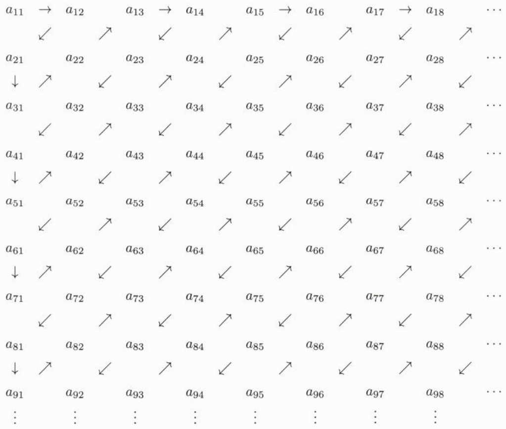

<details>
<summary>flowchart</summary>

```mermaid
graph LR
  a11["a_{11}"] --> a12["a_{12}"]
  a12 --> a_{13}["a_{13}"]
  a13 --> a_{14}["a_{14}"]
  a_{15} --> a_{16}["a_{15}"]
  a_{16} --> a_{17}["a_{17}"]
  a_{17} --> a_{18}["a_{18}"]
  a_{18} --> ...["..."]
```
</details>

即得 $\bigcup_{k=1}^{\infty} E_k$ 是可列集.


---

1.4 集合的势

11

上述证明还表明可列个至多可列集的并是至多可列集. 我们可以把定理 1.4.3 的结果写成

$$
\aleph_ {0} ^ {2} = \aleph_ {0} \times \aleph_ {0} = \aleph_ {0}. \tag {1.4.1}
$$

反复运用该定理, 可以得到

$$
\aleph_ {0} ^ {n} = \aleph_ {0}, \quad \forall n \geqslant 1. \tag {1.4.2}
$$

作为上述结论的推论, 注意到

$$
\mathbb {Q} := \bigcup_ {n \in \mathbb {N} _ {+}} \left\{\frac {m}{n} \Big | m \in \mathbb {N} \right\} \cup \bigcup_ {n \in \mathbb {N} _ {+}} \left\{- \frac {m}{n} \Big | m \in \mathbb {N} \right\},
$$

立即得到

推论 1.4.4 有理数集是可列集.

接下来, 我们证明如下定理:

定理 1.4.5  $N > N_{0}$ .

证明 易证  $\overline{(0,1)} = \aleph$ ，我们只要证明  $\overline{(0,1)} > \aleph_{0}$ 。否则，由于  $\overline{(0,1)} \geqslant \aleph_{0}$ ，可得  $\overline{(0,1)} = \aleph_{0}$ 。于是存在把  $(0,1)$  映到正整数集  $\{1,2,\cdots\}$  的双射，或者说  $(0,1)$  中的所有数字可以排列成一列:

$$
x _ {1}, x _ {2}, x _ {3}, \dots
$$

用十进制小数

$$
x _ {k} = 0. a _ {k 1} a _ {k 2} a _ {k 3} \dots , \quad k = 1, 2, \dots
$$

表示这些数 (规定不以 9 为循环节). 定义 $y = 0.y_{1}y_{2}y_{3}\cdots$ 如下:

$$
y _ {k} = \left\{ \begin{array}{l l} 1, & a _ {k k} \neq 1, \\ 2, & a _ {k k} = 1, \end{array} \right.
$$

则易见 $y \in (0,1)$, 而 $y$ 和任何一个 $x_{k}$ 不同, 得到矛盾. 所以 $\aleph > \aleph_{0}$.

在研究集合的势的过程中, 自然产生了以下问题.

问题1(反对称性) 若 $\overline{\overline{E}}\leqslant \overline{\overline{F}}$ 与 $\overline{\overline{F}}\leqslant \overline{\overline{E}}$ 同时成立，是否有 $\overline{\overline{E}} = \overline{\overline{F}}?$

问题 2 (三歧性) 对于任何集合 E, F,

$$
\overline {{\overline {{E}}}} <   \overline {{\overline {{F}}}}, \quad \overline {{\overline {{E}}}} = \overline {{\overline {{F}}}}, \quad \overline {{\overline {{E}}}} > \overline {{\overline {{F}}}}
$$

是否必有一个成立？

问题 3 (连续统问题) 是否存在严格介于  $\aleph_{0}$  与  $\aleph$  之间的基数, 即是否存在集合 E 使得  $\aleph_{0} < \overline{E} < \aleph?$

对于问题 1, 我们有如下的 Cantor-Bernstein $^{①}$ -Schröder $^{②}$ 定理 (简称 Bernstein 定理), 得到肯定的回答.

<small><span class="docvortex-page-footnote" data-block-type="page_footnote" style="color:#6b7280">① Bernstein, Felix, 1878 年 2 月 24 日—1956 年 12 月 3 日, 德国数学家.</span></small>

<small><span class="docvortex-page-footnote" data-block-type="page_footnote" style="color:#6b7280">② Schröder, Friedrich Wilhelm Karl Ernst, 1841 年 11 月 25 日—1902 年 6 月 16 日, 德国数学家.</span></small>

---

12

第一章 集合与映射

定理 1.4.6 设  $\overline{\overline{A}} \leqslant \overline{\overline{B}}, \overline{\overline{B}} \leqslant \overline{\overline{A}}$ ，则  $\overline{\overline{A}} = \overline{\overline{B}}$ .

证明 由假设, 存在 $A$ 到 $B$ 的一个子集 $B_{1}$ 的双射 $\varphi$, 以及 $B$ 到 $A$ 的一个子集 $A_{1}$ 的双射 $\psi$. 令 $A_{0} = A$, 并对 $n \geqslant 0$ 定义 $A_{n+2} = \psi(\varphi(A_{n}))$. 则 $\psi \circ \varphi: A_{n} \to A_{n+2}$ 为双射.

注意到 $\varphi(A) \subseteq B$, 我们得到 $A_2 = \psi(\varphi(A)) \subseteq \psi(B) = A_1$. 而由 $A_1 \subseteq A$ 得到 $A_3 \subseteq A_2$. 依次可得 $A_{n+1} \subseteq A_n$ 对任何 $n \geqslant 0$ 成立.

由于 $\psi \circ \varphi$ 是 $A_{n}$ 到 $A_{n + 2}$ 的双射, 同时又是 $A_{n}$ 的子集 $A_{n + 1}$ 到 $A_{n + 2}$ 的子集 $A_{n + 3}$ 的双射, 因此, $\psi \circ \varphi$ 也是 $A_{n} \setminus A_{n + 1}$ 到 $A_{n + 2} \setminus A_{n + 3}$ 的双射.

注意到

$$
A = \left(\bigcap_ {k = 1} ^ {\infty} A _ {k}\right) \bigcup \left(A \setminus A _ {1}\right) \bigcup \left(A _ {1} \setminus A _ {2}\right) \bigcup \left(A _ {2} \setminus A _ {3}\right) \bigcup \left(A _ {3} \setminus A _ {4}\right) \bigcup \dots
$$

$$
A _ {1} = \left(\bigcap_ {k = 1} ^ {\infty} A _ {k}\right) \bigcup \left(A _ {2} \setminus A _ {3}\right) \bigcup \left(A _ {1} \setminus A _ {2}\right) \bigcup \left(A _ {4} \setminus A _ {5}\right) \bigcup \left(A _ {3} \setminus A _ {4}\right) \bigcup \dots
$$

我们可以给出 $A$ 到 $A_{1}$ 的双射

$$
f (x) := \left\{ \begin{array}{l l} x, & x \in \Big (\bigcap_ {k = 1} ^ {\infty} A _ {k} \Big) \bigcup \Big (\bigcup_ {n = 0} ^ {\infty} \big (A _ {2 n + 1} \setminus A _ {2 n + 2} \big) \Big), \\ \psi \big (\varphi (x) \big), & x \in \bigcup_ {n = 0} ^ {\infty} \big (A _ {2 n} \setminus A _ {2 n + 1} \big). \end{array} \right.
$$

所以  $\overline{\overline{A}}=\overline{\overline{A_{1}}}=\overline{\overline{B}}.$

Bernstein 定理是证明集合有相同基数的主要方法. 有了这个定理, 要证明 $\overline{A} = \overline{B}$, 只要找到 $A$ 到 $B$ 的单射以及 $B$ 到 $A$ 的单射. 这比直接寻找两者之间的双射方便多了.

以下运用 Bernstein 定理来证明一些结果.

对于  $n \geqslant 0$ ，当  $a_{n} \neq 0$  时，多项式  $a_{n}x^{n} + a_{n-1}x^{n-1} + \cdots + a_{1}x + a_{0}$  称为 n 次多项式。零多项式（即 n = 0 且  $a_{0} = 0$ ）的次数定义为  $-\infty$ 。

我们称非零整系数多项式的 (复) 零点为代数数 $^{①}$ . 其余的复数称为超越数. 可以证明全体代数数构成一个域 (参见习题 11). 特别地, 一个复数为代数数当且仅当其实部和虚部都为代数数. 我们有

定理 1.4.7 代数数集是可列集.

证明 首先, 零次的整系数多项式, 即恒等于非零整数的函数没有零点.

一次整系数多项式形为 $a + bx$，它的基数小于或等于 $\aleph_0^2 = \aleph_0$。每一个这样的多项式有一个零点。因此，这样的零点总数不大于 $1 \times \aleph_0 = \aleph_0$。

二次整系数多项式形为 $a + bx + cx^2$，它的基数小于或等于 $\aleph_0^3 = \aleph_0$. 每一个这样的多项式至多有两个零点. 因此, 这样的零点总数不大于 $2 \times \aleph_0 = \aleph_0$.

一般地, 对于任何 $n \geqslant 1$, 可以证明 $n$ 次非零整系数多项式的零点数不大于 $\aleph_0$. 而易见任何整数都是某个 $n$ 次非零整系数多项式的零点. 因此, 所有 $n$ 次非零整系数多项式的零点数是 $\aleph_0$.

<small><span class="docvortex-page-footnote" data-block-type="page_footnote" style="color:#6b7280">① 等价于非零有理系数多项式的零点.</span></small>

---

1.4 集合的势

13

最后, 由可列个可列集的并为可列集得到代数数全体是可列集.

接下来, 有

定理1.4.8 $\aleph = 2^{\aleph_0}$

证明 对于 $[0,1)$ 中的点, 用二进制小数表示, 并规定不以 1 为循环节. 对于 $x = 0.a_{1}a_{2}a_{3}\cdots \in [0,1)$, 令

$$
F (x) = \left\{n \in \mathbb {N} _ {+} \Big | a _ {n} = 1 \right\}.
$$

则  $F:(0,1)\to2^{\mathbb{N}_{+}}$  是单射, 从而  $N\leqslant2^{\aleph_{0}}$ .

另一方面, 对于 $E \subseteq \mathbb{N}_{+}$, 定义

$$
a _ {n} = \left\{ \begin{array}{l l} {1,} & {n = 2 m, m \in E,} \\ {0,} & {\text {其他},} \end{array} \right.
$$

并令

$$
G (E) := 0. a _ {1} a _ {2} a _ {3} \dots
$$

为一个二进制小数. 则  $G:2^{N_{+}} \rightarrow [0,1)$  是单射, 从而  $N \geqslant 2^{N_{0}}$ .

于是由 Bernstein 定理, 得到  $N = 2^{N_{0}}$ .

以上定理说明了无理数和超越数的基数都是 N. 即无理数和超越数都是不可数的. 这样, Cantor 通过对集合基数的研究, 轻松地证明了超越数不仅存在, 而且比代数数还多得多——而在这个过程中, Cantor 没有给出哪怕是一个具体的超越数.

历史上, Liouville $^{①}$  研究了一类现在被称为 Liouville 数的无理数. 若实数 x 满足如下条件: 对任何  $n \in N_{+}$ , 存在整数 p > 1 和整数 q 使得

$$
0 <   \left| x - \frac {q}{p} \right| <   \frac {1}{p ^ {n}}, \tag {1.4.3}
$$

则称 x 为 Liouville 数.

易见对于 Liouville 数, 对每个 $n \in \mathbb{N}_{+}$, 满足 (1.4.3) 式的整数对 $(p, q)$ 必然有无限多对.

一般地, 对于实数 x 以及  $\alpha > 0$ , 考虑使得以下不等式成立的正整数 p 和整数 q:

$$
0 <   \left| x - \frac {q}{p} \right| <   \frac {1}{p ^ {\alpha}}. \tag {1.4.4}
$$

Dirichlet $^{②}$ 逼近定理表明, 当  $\alpha = 2, x$  为无理数时, 有无穷多对  $(p, q)$  满足 (1.4.4) 式. 一般地, 定义实数 x 的无理测度为

$$
\sup \left\{\alpha \middle | \text {存在无限多对整数} (p, q) \text {满足} (1. 4. 4) \text {式} \right\},
$$

其中 sup 表示上确界, 即最小上界, 确切的含义参见第二章第 3 节. 目前可以粗略地把它理解为数集的最大值.

<small><span class="docvortex-page-footnote" data-block-type="page_footnote" style="color:#6b7280">① Liouville, Joseph, 1809 年 3 月 24 日—1882 年 9 月 8 日, 法国数学家.</span></small>

<small><span class="docvortex-page-footnote" data-block-type="page_footnote" style="color:#6b7280">② Dirichlet, Peter Gustav Lejeune, 1805 年 2 月 13 日—1859 年 5 月 5 日, 德国数学家.</span></small>

---

14

第一章 集合与映射

这样, 通俗地讲, Liouville 数就是无理测度为无穷的无理数. 易见有理数的无理测度为 1, Dirichlet 逼近定理表明无理数的无理测度都大于或等于 2.

1844 年, Liouville 证明了如下定理:

## 定理 1.4.9 (关于 Diophantus $^{①}$ 逼近的 Liouville 定理)

设 $n \geqslant 2$, 无理数 $x$ 是某个 $n$

次整系数多项式的零点，则存在常数 $A > 0$ 使得对于任何整数 $q$ 和正整数 $p$ ，成立

$$
\left| x - \frac {q}{p} \right| > \frac {A}{p ^ {n}}.
$$

因此, 所有代数数的无理测度都是有限的, 都不是 Liouville 数. Liouville 还构造出一个 Liouville 数:

$$
a = 0. 1 ^ {1!} + 0. 1 ^ {2!} + 0. 1 ^ {3!} + 0. 1 ^ {4!} + \dots .
$$

这样 Liouville 就第一次证明了超越数的存在性, 并给出了一个具体的超越数.

定理1.4.9的证明并不困难. 可以仿照如下特例的证明来证明: 对任何正整数对 $(p, q)$ 有

$$
\left| \sqrt [ 3 ]{5} - \frac {q}{p} \right| > \frac {1}{1 9 p ^ {3}}. \tag {1.4.5}
$$

首先, 只需对满足  $\left|\sqrt[3]{5}-\frac{q}{p}\right|<1$  的正整数对  $(p,q)$  来证明 (1.4.5) 式. 此时

$$
\frac {q}{p} \leqslant \left| \frac {q}{p} - \sqrt [ 3 ]{5} \right| + \sqrt [ 3 ]{5} \leqslant 3.
$$

从而

$$
\begin{array}{l} \left| \frac {q ^ {3}}{p ^ {3}} - 5 \right| = \left| \left(\frac {q}{p} - \sqrt [ 3 ]{5}\right) \left(\frac {q ^ {2}}{p ^ {2}} + \frac {q}{p} \sqrt [ 3 ]{5} + \sqrt [ 3 ]{5 ^ {2}}\right) \right| \\ \leqslant \left(3 ^ {2} + 3 \times 2 + 2 ^ {2}\right) \left| \frac {q}{p} - \sqrt [ 3 ]{5} \right| = 1 9 \left| \frac {q}{p} - \sqrt [ 3 ]{5} \right|. \\ \end{array}
$$

另一方面, 易证  $\sqrt[3]{5}$  是无理数. 因此,

$$
\left| \frac {q ^ {3}}{p ^ {3}} - 5 \right| = \frac {1}{p ^ {3}} \left| q ^ {3} - 5 p ^ {3} \right| \geqslant \frac {1}{p ^ {3}}.
$$

进而得到 (1.4.5) 式.

后人进一步证明了当无理数是代数数时, 其无理测度是 2. 对于两个常数 $\pi$ 和 e, 目前已经得到 e 的无理测度是 2. 而 $\pi$ 的无理测度不超过 7.6063. Stuart$^{[56]}$ 利用 $\pi$ 的无理测度证明了以下非常有趣的结果: 当且仅当 $\alpha > \frac{1}{\sqrt[3]{\sin 3}} \approx 1.92$ 时, 不等式 $|\sin n| > \alpha^{-n}$ 对于任何正整数 $n$ 成立. 特别地, 对于任何正整数 $n$, 我们有 $|\sin n| > 2^{-n}$.

不难证明 Liouville 数全体的基数是  $\aleph$ (参见习题 9)，但是从一种角度看，Liouville 数全体是零测度集，即它的“总长度”——Lebesgue $^{②}$ 测度为零。也可以这样说，从测度这个角度来看，Liouville 数在超越数中是极少数——虽然从基数的角度来看，它们是一样多的。

<small><span class="docvortex-page-footnote" data-block-type="page_footnote" style="color:#6b7280">① Diophantus of Alexandria, 很可能生于 201 年到 215 年, 卒于 285 年到 299 年, 古希腊数学家.</span></small>

<small><span class="docvortex-page-footnote" data-block-type="page_footnote" style="color:#6b7280">② Lebesgue, Henri Léon, 1875 年 6 月 28 日—1941 年 7 月 26 日, 法国数学家.</span></small>

---

1.4 集合的势

15

利用前面引入的记号, 至少在形式上, 我们有

$$
\aleph^ {\aleph_ {0}} = \left(2 ^ {\aleph_ {0}}\right) ^ {\aleph_ {0}} = 2 ^ {\aleph_ {0} \times \aleph_ {0}} = 2 ^ {\aleph_ {0}} = \aleph .
$$

读者不难从上式得到启发, 证明如下结果.

定理 1.4.10 集合  $R^{\infty} := \left\{ \left\{ x_{k} \mid k \geqslant 1 \right\} \mid x_{k} \in R, k \in N \right\}$  的势为 N.

定理的证明也可以仿照定理 1.4.8 的证明给出.

进一步, 通过关系式

$$
\aleph = 2 ^ {\aleph_ {0}} \leqslant \aleph_ {0} ^ {\aleph_ {0}} \leqslant \aleph^ {\aleph_ {0}} = \aleph
$$

可见 $\aleph_0^{\aleph_0} = \aleph$.

类似地，

$$
\overline {{\{f \mid f \text {是} \mathbb {R} \text {上的实值函数} \}}} = \aleph^ {\aleph} = 2 ^ {\aleph_ {0} \times \aleph} = 2 ^ {\aleph} > \aleph .
$$

相比于问题 1, 后两个问题就要困难许多, 1915 年, Hartogs $^{①}$  证明了基数的三歧性与选择公理等价.

对于问题 3, Cantor 给出了定理 1.4.8, 即证明了连续统的势是 $2^{\aleph_0}$, 并提出了连续统假设: $\aleph_1 = 2^{\aleph_0}$, 其中 $\aleph_1$ 表示 $\aleph_0$ 的下一个势.

1938 年, Gödel $^{②}$  证明了连续统假设和 ZFC 公理系统不矛盾. 1963 年, Cohen $^{③}$  证明了连续统假设对于 ZFC 公理系统是独立的. 也就是说, 在 ZFC 公理系统中, 不可能判定连续统假设的真假.

Cantor 还提出了广义连续统假设:  $\aleph_{k+1}=2^{\aleph_{k}}\quad(k=0,1,2,\cdots)$ . 自然, 在 ZFC 公理系统下, 不能证明广义连续统假设, 但在 ZF 公理系统下, 广义连续统假设可以导出选择公理.

选择公理看起来显然, 以至很难想象选择公理不成立会怎样. 但当选择公理成立时, 有一些 “不好的” 结果. 其中著名的有 Lebesgue 不可测集的存在性, 更出人意料的是有 Banach $^{④}$ -Tarski $^{⑤}$ 定理.

定理 1.4.11 如果选择公理成立, 则可以把一个单位球体分成 $A, B, C, D, E$ 五份, 其中 $A, B, C$ 通过一些刚体运动, 即平移和旋转, 可以拼合成一个新的单位球体, 而 $D, E$ 也可以通过刚体运动拼合成另一个新的单位球体.

<small><span class="docvortex-page-footnote" data-block-type="page_footnote" style="color:#6b7280">① Hartogs, Friedrich Moritz, 1874 年 5 月 20 日—1943 年 8 月 18 日, 比利时数学家.</span></small>

<small><span class="docvortex-page-footnote" data-block-type="page_footnote" style="color:#6b7280">② Gödel, Kurt Friedrich, 1906 年 4 月 28 日—1978 年 1 月 14 日, 奥地利裔美国逻辑学家、数学家和哲学家.</span></small>

<small><span class="docvortex-page-footnote" data-block-type="page_footnote" style="color:#6b7280">③ Cohen, Paul Joseph, 1934 年 4 月 2 日—2007 年 3 月 23 日, 美国数学家.</span></small>

<small><span class="docvortex-page-footnote" data-block-type="page_footnote" style="color:#6b7280">④ Banach, Stefan, 1892 年 3 月 30 日—1945 年 8 月 31 日, 波兰数学家.</span></small>

<small><span class="docvortex-page-footnote" data-block-type="page_footnote" style="color:#6b7280">⑤ Tarski, Alfred, 1901 年 1 月 14 日—1983 年 10 月 26 日, 波兰裔美国逻辑学家、数学家、哲学家.</span></small>

---

16

第一章 集合与映射

## 习题1

1. 设  $a_{0}, a_{1}, \cdots, a_{n}$  为复常数，且对任何  $x \in R$  成立  $a_{n}x^{n} + a_{n-1}x^{n-1} + \cdots + a_{1}x + a_{0} = 0$ . 证明: $a_{0} = a_{1} = \cdots = a_{n} = 0$ .

2. 设 $P$ 为首项系数不为零的 $n$ 次复系数多项式, $x_{1}$ 是它的一个零点. 证明: 存在首项系数不为零的 $n - 1$ 次多项式 $Q$ 使得

$$
P (x) = (x - x _ {1}) Q (x).
$$

3. 设  $a_{0}, a_{1}, \cdots, a_{n}$  为复常数,  $a_{n} \neq 0$ . 证明: 多项式

$$
P (x) = a _ {n} x ^ {n} + a _ {n - 1} x ^ {n - 1} + \dots + a _ {1} x + a _ {0}
$$

至多有 n 个复零点 (含重数).

4. 证明: Viète $^{①}$ 定理: 设  $a_{n} \neq 0, x_{1}, x_{2}, \cdots, x_{n}$  为

$$
P (x) = a _ {n} x ^ {n} + a _ {n - 1} x ^ {n - 1} + \dots + a _ {1} x + a _ {0}
$$

的 $n$ 个复零点 (含重根), 则对于 $1 \leqslant k \leqslant n$, 成立

$$
\sum_ {1 \leqslant m _ {1} <   m _ {2} <   \dots <   m _ {k} \leqslant n} \prod_ {j = 1} ^ {k} x _ {m _ {j}} = (- 1) ^ {k} \frac {a _ {n - k}}{a _ {n}}.
$$

5. 试构造区间 $\left( {0,1}\right)$ 映到 $\lbrack 0,1\rbrack$ 的一个双射.

6. 说明映射  $T: Q \rightarrow Z,$

$$
T (q) = \left\{ \begin{array}{l l} {(m + n) ^ {2} + n,} & {q = \frac {n}{m}, \quad m, n \text {为既约正整数},} \\ {0,} & {q = 0,} \\ {- (m + n) ^ {2} - n,} & {q = - \frac {n}{m}, \quad m, n \text {为既约正整数}} \end{array} \right.
$$

为有理数集到整数集的单射.

7. 证明: 代数数集是可列集.

8. 证明: 存在常数 $A > 0$ 使得对于任何整数 $q$ 和正整数 $p$, 成立

$$
\left| \sqrt {3} + \sqrt {2} - \frac {q}{p} \right| > \frac {A}{p ^ {4}}.
$$

9. 证明 $\left\{\sum_{k=1}^{\infty} \frac{n_k}{10^{k!}} \bigg| n_k = 1,2,\cdots,9 \right\}$ 的势是 $\aleph$, 其元均为 Liouville 数.

<small><span class="docvortex-page-footnote" data-block-type="page_footnote" style="color:#6b7280">① Viète, François, Seigneur de la Bigotiere, 1540 年—1603 年 12 月 13 日, 法国数学家.</span></small>

---

习题1

17

10. 称关于  $x_{1}, x_{2}, \cdots, x_{n}$  的 m 次 n 元多项式  $R(x_{1}, x_{2}, \cdots, x_{n})$  是可轮换的，是指对任何  $1 \leqslant k < j \leqslant n$ ，将  $R(x_{1}, x_{2}, \cdots, x_{n})$  中的  $x_{k}, x_{j}$  分别替换成  $x_{j}, x_{k}$  后多项式保持不变。证明:

(1) 若  $R(x_{1}, x_{2}, \cdots, x_{n})$  是可轮换的一次齐次多项式, 则它是  $x_{1} + x_{2} + \cdots + x_{n}$  的常数倍;

(2) 若  $R(x_{1}, x_{2}, \cdots, x_{n})$  是可轮换的二次齐次多项式, 则有常数  $C_{1}, C_{2}$ , 使得

$$
R (x _ {1}, x _ {2}, \dots , x _ {n}) \equiv C _ {1} (x _ {1} ^ {2} + x _ {2} ^ {2} + \dots + x _ {n} ^ {2}) + C _ {2} \sum_ {1 \leqslant i <   j \leqslant n} x _ {i} x _ {j};
$$

(3) 归纳证明, 若  $R(x_{1}, x_{2}, \cdots, x_{n})$  是可轮换的 k 次多项式, 而  $x_{1}, x_{2}, \cdots, x_{n}$  是某首项系数不为零的 n 次有理系数多项式的零点, 则  $R(x_{1}, x_{2}, \cdots, x_{n})$  为有理数.

11. 设 P, Q 分别是 m, n 阶首项系数为 1 的有理系数多项式:

$$
P (x) = \prod_ {k = 1} ^ {m} (x - x _ {k}), \quad Q (x) = \prod_ {k = 1} ^ {n} (x - y _ {k}).
$$

证明:

(1) 多项式  $R(x) := \prod_{k=1}^{m} \prod_{j=1}^{n} (x - x_k - y_j)$  是有理系数多项式;

(2) 多项式 $S(x) := \prod_{k=1}^{m} \prod_{j=1}^{n} (x - x_k y_j)$ 是有理系数多项式.

12. 证明 Liouville 定理 1.4.9.

13. 证明: 一个复数是代数数当且仅当它的实部和虚部都是代数数.

---

## 第二章

## 实数

---

20

第二章 实数

数的发展过程可以从两个方面来看: 一个是它的历史发展过程, 另一个是它的逻辑发展过程.

不同的文化对数的认识过程有所区别. 大体上, 人们首先 (感性地) 认识了自然数, 然后认识整数、有理数、实数、复数, 并在有理数基础上建立实数理论, 在集合论基础上建立自然数理论.

逻辑上, 自然应该是先建立自然数理论, 再引入有理数, 并在此基础上建立实数理论, 并引入复数.

## 2.1 自然数公理

自然数是构造实数的基础,但从实数理论的历史发展过程来看,自然数理论晚于实数理论.这虽然有点意料之外,却在情理之中.

Peano $^{①}$ 于1889年发表了自然数公理.

(N) 自然数公理 满足以下性质的集合 $\mathbb{N}$ 称为自然数集:

(1) 0 属于 N;
(2) 每一个确定的自然数 n 都有唯一的后继  $n^{+}$ ;
(3) 没有以 0 为后继的自然数;
(4) 不同的自然数对应不同的后继, 即若 $m \neq n$, 则 $m^{+} \neq n^{+}$;
(5) 若 $E$ 是 $\mathbb{N}$ 的子集, 包含 0 及其每一个元素的后继, 则 $E$ 是 $\mathbb{N}$.

在自然数公理中, 只是涉及自然数的序而没有涉及四则运算. 这里 0 可以抽象地看作一个符号. 我们可以用别的记号, 比如 $\bar{n}$ 来代替 0. 自然, 我们也可以用 1 来代替 0.

有了自然数以后, 我们可以在其中定义加法. 对于 $m, n \in \mathbb{N}$, 定义

(1) $n+0=n;$
(2) $m + n^{+} = (m + n)^{+}$.

然后建立加法的性质, 再引入乘法, 把自然数集扩充为整数集、有理数集. 对此有兴趣的读者可以尝试自己完成这些工作.

易得有理数具有如下的稠密性: 对任何 $p, q \in \mathbb{Q}, p < q$, 存在有理数 $r$ 使得 $p < r < q$. 例如, 取 $r = \frac{p + q}{2}$ 即可.

进一步, 有理数还具有 Archimedes $^{②}$ 性: 设 p 为正有理数, 则对任何有理数 q, 存在自然数 n, 使得 np > q.

<small><span class="docvortex-page-footnote" data-block-type="page_footnote" style="color:#6b7280">① Peano, Giuseppe, 1858 年 8 月 27 日—1932 年 4 月 20 日, 意大利数学家.</span></small>

<small><span class="docvortex-page-footnote" data-block-type="page_footnote" style="color:#6b7280">② Archimedes, 公元前 287 年—前 212 年, 古希腊哲学家、数学家、物理学家、力学家.</span></small>

---

2.1 自然数公理

21

为证明这一结论, 不妨设 $q > 0$. 我们有正整数 $m_p, k_p$ 以及 $m_q, k_q$ 使得 $p = \frac{k_p}{m_p}$, $q = \frac{k_q}{m_q}$. 取 $n = m_p k_q + 1$ 即得 $np > q$.

基于自然数公理, 我们有如下常用的数学归纳法.

定理 2.1.1 设  $P_{0}, P_{1}, \cdots, P_{n}, \cdots$  是一列命题，满足

(1) $P_{0}$ 成立;
(2) 若对某个 $n \in \mathbb{N}$, $P_{n}$ 成立, 则 $P_{n+1}$ 成立,

则对任何  $n \in N, P_{n}$  成立.

证明 令

$$
E := \left\{n \in \mathbb {N} | P _ {n} \text {成立} \right\}.
$$

由 (1), $0 \in E$, 而由 (2), $n \in E$ 蕴涵 $n + 1 \in E$. 因此, 由自然数公理 (N), 得到 $E = \mathbb{N}$. 即对任何 $n \in \mathbb{N}, P_n$ 成立. $\square$

数学归纳法还有以下常用的形式.

定理 2.1.2 设  $m \in N$  给定,  $P_{m}, P_{m+1}, \cdots, P_{n}, \cdots$  是一列命题, 满足

(1) $P_{m}$ 成立;
(2) 对某个 $n \in \mathbb{N}, n \geqslant m$, 若 $P_{n}$ 成立, 则 $P_{n+1}$ 成立,

则对任何自然数  $n \geqslant m, P_{n}$  成立.

定理 2.1.3 设  $m \in N$  给定,  $P_{m}, P_{m+1}, \cdots, P_{n}, \cdots$  是一列命题, 满足

(1) $P_{m}$ 成立;
(2) 对某个  $n \in N, n \geqslant m$ ，若  $P_{m}, P_{m+1}, \cdots, P_{n}$  成立，则  $P_{n+1}$  成立，则对任何自然数  $n \geqslant m, P_{n}$  成立.

关于自然数的介绍, 可参看《陶哲轩实分析》[57] 第二章.

Peano 自然数公理对于集合论公理的建立起到了重要作用. von Neumann 则按以下方式 “无中生有” 地构造出了自然数:

$$
\begin{array}{l} 0 := \varnothing , \\ 1 := \{\varnothing \} = \{0 \}, \\ 2 := \{\varnothing , \{\varnothing \} \} = \{0, 1 \}, \\ 3 := \{\varnothing , \{\varnothing \}, \{\varnothing , \{\varnothing \} \} \} = \{0, 1, 2 \}, \\ 4 := \{\varnothing , \{\varnothing \}, \{\varnothing , \{\varnothing \} \}, \{\varnothing , \{\varnothing \}, \{\varnothing , \{\varnothing \} \} \} \} = \{0, 1, 2, 3 \}, \\ \cdots , \\ n + 1 := n \cup \{n \} = \{0, 1, 2, \dots , n \}, \\ \dots \\ \end{array}
$$

按照集合论公理, 以上的自然数都是合乎公理规则的集合. 因此, 这可以视为基于集合论公理构造出了自然数. 而完成了自然数的构造, 相当于证明了满足自然数公理的自然

---

22

第二章 实数

数确实是存在的. 而此项工作的完成, 则意味着我们不必再把 Peano 的自然数公理视为公理. 它更像是一个构造自然数的 “定制标准”. 类似地, 即将介绍的实数系公理也可以视为构造实数系的一个 “定制标准”.

## 2.2 实数系公理

什么是实数, Hilbert $^{①}$ 于 1899 年首次提出了实数公理系统. 这虽然是在建立实数理论的工作之后, 但相关要求是每一种实数理论都必须考虑的. 正如我们在前一节所指出的, 我们在课程中引用这一公理体系, 并非真的要把它们作为公理, 而是把它们视为构造实数系的一个 “定制标准”.

## 2.2.1 实数系公理

实数系公理有几种等价的形式, 我们采用以下形式.

设 $\mathbb{R}$ 是一个集合, 带有加法和乘法两种运算以及序关系:

加法 +:  $R \times R \rightarrow R, (x, y) \mapsto x + y;$

乘法 $\because \mathbb{R} \times \mathbb{R} \to \mathbb{R}, (x, y) \mapsto x \cdot y,$ 在不引起混淆的情况下，$x \cdot y$ 简记为 $xy$;

序关系 $\leqslant: x \leqslant y$ 也记作 $y \geqslant x$.

进一步, x < y (也记作 y > x) 表示  $x \leqslant y$  且  $x \neq y$ .

满足下列公理的系统 $(\mathbb{R}, +, \cdot, \leqslant)$ 称为实数系，简写为 $\mathbb{R}$，它的元素称为实数:

设 $x, y, z \in \mathbb{R}$.

(F) 域公理 ( $R, +, \cdot$ ) 是一个域, 即满足

(A1) 加法结合律  $(x+y)+z=x+(y+z)$ .

(A2) 加法交换律  $x + y = y + x$ .

(A3) 存在加法单位元 存在 $0 \in \mathbb{R}$, 称为加法单位元或零元, 满足: 对于任何 $x \in \mathbb{R}$, 成立 $x + 0 = x$.

(A4) 存在负元 对于任何 $x \in \mathbb{R}$, 存在一个元素 $y \in \mathbb{R}$ (记作 $-x$) 满足 $x + (-x) = 0$.

(M1) 乘法结合律  $(xy)z = x(yz)$ .

(M2) 乘法交换律 xy = yx.

(M3) 存在乘法单位元 存在非零元 $1 \in \mathbb{R}$, 称为乘法单位元, 满足: 对于任何 $x \in \mathbb{R}$, $1 \cdot x = x$.

<small><span class="docvortex-page-footnote" data-block-type="page_footnote" style="color:#6b7280">① Hilbert, David, 1862 年 1 月 23 日—1943 年 2 月 14 日, 德国数学家.</span></small>

---

2.2 实数系公理

23

(M4) 非零元存在逆元 若 $x \neq 0$, 则存在一个元素 $y \in \mathbb{R}$ (记作 $1 / x$ 或 $x^{-1}$) 满足 $x(1 / x) = 1$.

(AM) 乘法分配律 $x(y + z) = xy + xz$.

(O) 序公理

(O1) 反对称性 若 $x \leqslant y$ 与 $y \leqslant x$ 都成立, 则 $x = y$.

(O2) 传递性 若 $x \leqslant y$, 且 $y \leqslant z$, 则 $x \leqslant z$.

(O3) 全序性 关系式  $x \leqslant y, y \leqslant x$  中至少有一个成立.

(AO) 加法的保序性 若 $y \leqslant z$, 则 $x + y \leqslant x + z$.

(MO) 乘法的保序性 若  $x, y \geqslant 0$ ，则  $xy \geqslant 0$ .

(C) 连续公理

(C1) Archimedes 公理 给定 $y$ 与 $x > 0$, 则总可以把 $x$ 自己相加足够多的次数使得

$$
n x := \overbrace {x + x + \cdots + x} ^ {n \text {次}} > y.
$$

(C2) 完备公理 如果 $\widetilde{\mathbb{R}} \supseteq \mathbb{R}$ 且 $(\widetilde{\mathbb{R}}, +, \cdot, \leqslant)$ 满足前述公理 (F), (O), (C1), 则 $\widetilde{\mathbb{R}} = \mathbb{R}$.

注 2.2.1 条件 (A1)\~(A4) 表示 ( $\mathbb{R}, +$ ) 是一个 (可) 交换群, 又称 Abel $^{①}$ 群.

注 2.2.2 条件 (O1)\~(O2) 及自反性 “ $x \leqslant x$ ” 表示 ( $R, \leqslant$ ) 是一个偏序集，条件 (O1)\~(O3) 表示 ( $R, \leqslant$ ) 是一个全序集。易见 (O3) 蕴涵自反性。

注2.2.3 为方便起见, 用 $y \geqslant x$ 表示 $x \leqslant y$. 而 $x < y$ 表示 $x \leqslant y$ 且 $x \neq y$. 这样, 由序公理, 关系式 $x < y$, $x = y$, $y < x$ 中有且只有一个成立.

## 2.2.2 实数的基本性质

称满足域公理 (F) 与序公理 (O) 的系统为有序域. 关于实数四则运算的很多常用性质和不等式的都可以从公理 (F) 和 (O) 推导出来. 我们将它们的一部分留作习题.

对于 $x, y \in \mathbb{R}$ 记 $x - y := x + (-y)$. 当 $y \neq 0$ 时, 记 $x \cdot (1 / y)$ 为 $x / y$ 或 $\frac{x}{y}$. 定义 $x$ 的绝对值为

$$
| x | := \left\{ \begin{array}{l l} x, & x \geqslant 0, \\ - x, & x <   0. \end{array} \right.
$$

对于正整数 n, 定义它的阶乘  $n!$  为  $n \cdot (n-1) \cdots 2 \cdot 1$ . 定义偶数 2n 的双阶乘  $(2n)!!$  为  $(2n)(2n-2) \cdots 2$ , 定义奇数  $2n+1$  的双阶乘  $(2n+1)!!$  为  $(2n+1)(2n-1) \cdots 3 \cdot 1$ . 当 n=0 时,  $n!$  以及  $n!!$  定义为 1.

<small><span class="docvortex-page-footnote" data-block-type="page_footnote" style="color:#6b7280">① Abel, Niels Henrik, 1802 年 8 月 5 日—1829 年 4 月 6 日, 挪威数学家.</span></small>

---

24

第二章 实数

类似地, 可以定义三阶乘等.

对于自然数 n 以及  $0 \leqslant k \leqslant n$ ，记

$$
\mathrm{C} _ {n} ^ {k} := \frac {n !}{k ! (n - k) !}.
$$

则对于 $k \geqslant 0$ 以及 $n \geqslant k + 1$, 成立

$$
\mathrm{C} _ {n + 1} ^ {k + 1} = \mathrm{C} _ {n} ^ {k} + \mathrm{C} _ {n} ^ {k + 1}. \tag {2.2.1}
$$

对于整数  $n \geqslant m$ ，以及  $x_{m}, x_{m+1}, \cdots, x_{n} \in R$ ，引入求和符号

$$
\sum_ {k = m} ^ {n} x _ {k} := x _ {m} + x _ {m + 1} + \dots + x _ {n} \tag {2.2.2}
$$

和求积符号

$$
\prod_ {k = m} ^ {n} x _ {k} := x _ {m} x _ {m + 1} \dots x _ {n}. \tag {2.2.3}
$$

当 $n$ 为正整数时, $n$ 个 $x$ 的乘积记为 $x^n$. 进一步, 当 $x \neq 0$ 时, $x^0$ 定义为 $1, x^{-n}$ 定义为 $(x^{-1})^n$.

我们有以下重要结果.

命题 2.2.1 (三角不等式) $\left| {x + y}\right|  \leq  \left| x\right|  + \left| y\right|$ .

证明 上述不等式分情形讨论可得

(i) $x \geqslant 0, y \geqslant 0$. 则 $x + y \geqslant 0$. 从而 $|x + y| = x + y = |x| + |y|$.
(ii)  $x \geqslant 0, y \leqslant 0.$  则  $x + y = |x| - |y|$ .

若 $|x| - |y| \geqslant 0$，则 $|x + y| = |x| - |y| \leqslant |x| \leqslant |x| + |y|$.

若 $|x| - |y| < 0$，则 $|x + y| = |y| - |x| \leqslant |y| \leqslant |x| + |y|$.

(iii) $x \leqslant 0, y \leqslant 0$. 则由 (i), $|x + y| = |(-x) + (-y)| = |-x| + |-y| = |x| + |y|$.

(iv) $x \leqslant 0, y \geqslant 0$. 则由 (ii), $|x + y| = |y + x| \leqslant |y| + |x| = |x| + |y|$.

命题 2.2.2 (Newton $^{①}$  二项展开式) 对于正整数 n, 有

$$
(x + y) ^ {n} = \sum_ {k = 0} ^ {n} \mathrm{C} _ {n} ^ {k} x ^ {k} y ^ {n - k}. \tag {2.2.4}
$$

证明 当 $n = 1$ 时, (2.2.4) 式成立. 进一步, 若对某个 $n \geqslant 1$, (2.2.4) 式成立, 则

$$
\begin{array}{l} (x + y) ^ {n + 1} = (x + y) (x + y) ^ {n} = (x + y) \sum_ {k = 0} ^ {n} \mathrm{C} _ {n} ^ {k} x ^ {k} y ^ {n - k} \\ = \sum_ {k = 0} ^ {n} \mathrm{C} _ {n} ^ {k} x ^ {k + 1} y ^ {n - k} + \sum_ {k = 0} ^ {n} \mathrm{C} _ {n} ^ {k} x ^ {k} y ^ {n + 1 - k} \\ \end{array}
$$

<small><span class="docvortex-page-footnote" data-block-type="page_footnote" style="color:#6b7280">① Newton, Isaac, 1643 年 1 月 4 日—1727 年 3 月 31 日, 英国物理学家、数学家.</span></small>

---

2.2 实数系公理

25

$$
\begin{array}{l} = x ^ {n + 1} + \sum_ {k = 1} ^ {n} (\mathrm{C} _ {n} ^ {k - 1} + \mathrm{C} _ {n} ^ {k}) x ^ {k} y ^ {n + 1 - k} + y ^ {n + 1} \\ = \mathrm{C} _ {n + 1} ^ {n + 1} x ^ {n + 1} + \sum_ {k = 1} ^ {n} \mathrm{C} _ {n + 1} ^ {k} x ^ {k} y ^ {n + 1 - k} + \mathrm{C} _ {n + 1} ^ {0} y ^ {n + 1} \\ = \sum_ {k = 0} ^ {n + 1} \mathrm{C} _ {n + 1} ^ {k} x ^ {k} y ^ {n + 1 - k}. \\ \end{array}
$$

于是, 由数学归纳法 (2.2.4) 式对任何自然数 n 成立.

展开式 (2.2.4) 中的系数称为二项式系数, 这些系数形成的三角称为杨辉 $^{①}$ 三角或贾宪 $^{②}$ 三角 $^{③}$ . 表中每个数字等于上一行左右两个数字之和:

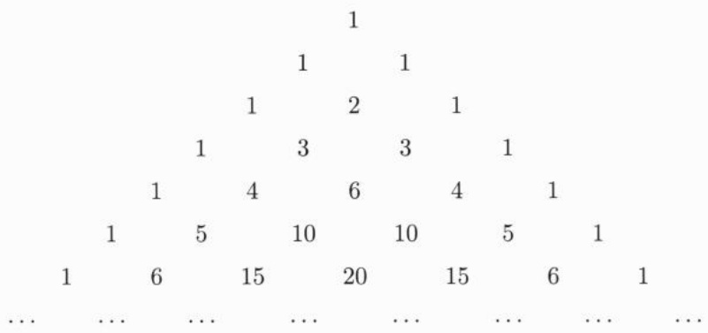

<details>
<summary>text_image</summary>

1
1 1
1 2 1
1 3 3 1
1 4 6 4 1
1 5 10 10 5 1
1 6 15 20 15 6 1
... ... ... ... ... ... ... ... ... ...
</details>

## 2.2.3 复数域

有很多问题在实数域内难以得到满意的结果. 我们需要复数域.

在  $R^{2}$  中引入加法和乘法:

$$
(x _ {1}, y _ {1}) + (x _ {2}, y _ {2}) := (x _ {1} + x _ {2}, y _ {1} + y _ {2}),
$$

$$
(x _ {1}, y _ {1}) \cdot (x _ {2}, y _ {2}) := (x _ {1} x _ {2} - y _ {1} y _ {2}, x _ {1} y _ {2} + x _ {2} y _ {1}).
$$

则可以验证 $(\mathbb{R}^2, +, \cdot)$ 构成一个域. 为了与通常的欧氏空间 $\mathbb{R}^2$ 区别开来, 我们把 $(\mathbb{R}^2, +, \cdot)$ 记为 $\mathbb{C}$, 称为复数域. 此时 $(1,0)$ 就是 $\mathbb{C}$ 的单位元. 若记 $i := (0,1)$, 则 $i^2 = (-1,0)$, 我们称 $i$ 为虚根单位. 此处及今后, 在复数域中, 直接用实数 $x$ 表示 $(x,0)$, 则 $\mathbb{C}$ 中的元素 $(x,y)$ 可以写为 $x + yi$, 称为复数, $x,y$ 分别称为 $x + yi$ 的实数部分和虚数部分, 简称实部和虚部, 记作 $x = \operatorname{Re}(x + yi), y = \operatorname{Im}(x + yi)$. 称 $|x + yi| := \sqrt{x^2 + y^2}$ 为 $x + yi$ 的

<small><span class="docvortex-page-footnote" data-block-type="page_footnote" style="color:#6b7280">① 杨辉, 字谦光, 南宋钱塘 (今浙江杭州) 人, 约 1238 年—约 1298 年.</span></small>

<small><span class="docvortex-page-footnote" data-block-type="page_footnote" style="color:#6b7280">② 贾宪, 北宋人, 生平籍贯不详, 约活动在 11 世纪上半叶.</span></small>

<small><span class="docvortex-page-footnote" data-block-type="page_footnote" style="color:#6b7280">③ 杨辉在 1261 年所著的《详解九章算法》一书中, 辑录了这一三角形数表, 称之为 “开方作法本源” 图, 并说明此表引自贾宪的《释锁算术》.</span></small>

---

26

第二章 实数

模或绝对值. 若 $y \neq 0$, 则 $x + yi$ 称为虚数, 而 $yi$ 称为纯虚数. 由于 $\mathrm{i}^2 = -1$, 因此, 不可能在 $\mathbb{C}$ 中引进序使之成为有序域.

## 2.2.4 广义实数系

时常, 引入广义实数系可以方便讨论. 广义实数系包含 $\mathbb{R}$ 中所有的元以及两个无穷大: 正无穷大 $+\infty$ 和负无穷大 $-\infty$. 规定

$$
- \infty <   x <   + \infty , \quad \forall x \in \mathbb {R}.
$$

对于广义实数系中的元素 $a < b$ ，记

$$
\begin{array}{l} (a, b) := \{x | a <   x <   b \}, \\ [ a, b ] := \{x | a \leqslant x \leqslant b \}, \\ [ a, b) := \{x | a \leqslant x <   b \}, \\ (a, b ] := \{x | a <   x \leqslant b \}. \\ \end{array}
$$

特别地, $(-\infty, +\infty)$ 即为 $\mathbb{R}$, 而 $[- \infty, +\infty]$ 即为广义实数系. 当这些集合不以 $-\infty$ 和 $+\infty$ 为元素时, 我们称之为区间. 其中, 当 $a, b$ 为实数时, 称为有界区间, 当 $a = -\infty$ 或 $b = +\infty$ 时称为无界区间.

进一步, 设 $a < b$ 为实数, 可把区间分为以下三类:

开区间: $(a,b),(a, + \infty),(-\infty ,b),(-\infty , + \infty)$

闭区间: $[a,b],[a, + \infty),(-\infty ,b],(-\infty , + \infty)$

半开半闭区间: $[a, b)$, $(a, b]$.

对于 $x, y, z \in \mathbb{R}, y > 0, z < 0,$ 规定

$$
\begin{array}{l} x + (+ \infty) = x - (- \infty) = + \infty , \\ x - (+ \infty) = x + (- \infty) = - \infty , \\ y \cdot (+ \infty) = z \cdot (- \infty) = + \infty , \\ y \cdot (- \infty) = z \cdot (+ \infty) = - \infty , \\ \end{array}
$$

进一步, 规定

$$
\begin{array}{l} \frac {1}{+ \infty} = \frac {1}{- \infty} = 0, \\ (+\infty) + (+ \infty) = (+ \infty) - (- \infty) = + \infty , \\ (- \infty) + (- \infty) = (- \infty) - (+ \infty) = - \infty , \\ \end{array}
$$

---

2.3 实数系的构造

27

$$
\begin{array}{l} (- \infty) \cdot (- \infty) = (+ \infty) \cdot (+ \infty) = + \infty , \\ (- \infty) \cdot (+ \infty) = (+ \infty) \cdot (- \infty) = - \infty . \\ \end{array}
$$

但是 $(+\infty) + (-\infty), (+\infty) - (+\infty), 0 \cdot (\pm \infty)$ 等无意义.

## 2.2.5 单调函数与周期函数

单调函数与周期函数是非常重要的两类函数. 首先, 定义单调函数如下:

定义 2.2.1 设有函数 $f: E \to \mathbb{R}$, 其中 $E$ 是 $\mathbb{R}$ 的非空子集①.

如果对任何 $x, y \in E, x < y$ 蕴涵 $f(x) \leqslant f(y)$，则称 $f$ 在 $E$ 上单调增加。若 $x < y$ 蕴涵 $f(x) < f(y)$，则称 $f$ 在 $E$ 上严格单调增加。

称 $f$ 在 $E$ 上（严格）单调减少是指 $-f$ 在 $E$ 上（严格）单调增加.

单调增加又称单调上升、单调递增, 简称单增, 单调减少又称单调下降、单调递减, 简称单减.

若 $f:\mathbb{R}\to \mathbb{R},T\neq 0$ 使得对任何 $x\in \mathbb{R}$ 成立 $f(x + T) = f(x)$ ，则称 $f$ 为以 $T$ 为周期的周期函数.

周期时常指正周期, 甚至所谓 “最小正周期”. 并非所有周期函数均有最小正周期. 例如任何非零有理数均为 Dirichlet $^{②}$ 函数 $D(\cdot):=\chi_{\mathbb{Q}}(\cdot)$ 的周期. 因此, Dirichlet 函数没有最小正周期.

## 2.3 实数系的构造

本节主要介绍用 Dedekind 分割建立实数系的方法.

## 第一次数学危机

首先, 简单回顾第一次数学危机的历史. 构造实数系的历史可追溯到古希腊的 Pythagoras $^{③}$ 学派的工作.

Pythagoras 学派信奉任何两个 (同类型的) 量都是 “可公度” 的. 以直线段的长度为例, 对于直线段 $\ell$ 与 $L$, 都存在直线段 $s$, 使得 $\ell, L$ 都是 $s$ 的整数倍, 比如说, 依次为 $m$ 倍和 $n$ 倍. 这样, 如果把 $\ell$ 的长度定义为 1 的话, $L$ 的长度就是分数 $\frac{n}{m}$. 按照这种方法, 就可以定义所有线段的长度.

<small><span class="docvortex-page-footnote" data-block-type="page_footnote" style="color:#6b7280">① 可在广义实数系中类似地定义单调性.</span></small>

<small><span class="docvortex-page-footnote" data-block-type="page_footnote" style="color:#6b7280">② Dirichlet, Peter Gustav Lejeune, 1805 年 2 月 13 日—1859 年 5 月 5 日, 德国数学家.</span></small>

<small><span class="docvortex-page-footnote" data-block-type="page_footnote" style="color:#6b7280">③ Pythagoras of Samos, 约公元前 580 年—约前 500 年, 古希腊数学家、哲学家.</span></small>

---

28

第二章 实数

然而, Pythagoras 学派的 Hippasus $^{①}$ 发现存在不可公度的线段. 具体地, 就是正五边形边长与对角线不可公度, 正直角三角形直角边与斜边不可公度 (参见文献 [43]). 前者相当于说方程 $x = \frac{1 - x}{x}$ 没有有理根. 后者相当于说 $x^{2} = 2$ 没有有理根 $^{②}$.

不可公度量的发现, 导致了数学史上的第一次数学危机. 为了解决不可公度性问题, Eudoxus $^{③}$ 建立了比例论.

对于两个同类的量, Eudoxus 定义其 “比例” 及大小关系. 例如,

$\frac{a}{b}=\frac{A}{B}$  定义为: 对于任何 (正) 整数 m, n, 以下三者有且只有一个成立:

(1) ma > nb 且 mA > nB;
(2) ma < nb 且 mA < nB;
(3) ma = nb 且 mA = nB.

而  $\frac{a}{b} > \frac{A}{B}$  定义为: 存在 (正) 整数 m, n 使得 ma > nb 且  $mA \neq nB$ .

这样, $a, b$ 可公度当且仅当存在 $m, n$ 使得 $\frac{m}{n} = \frac{a}{b}$. 否则, (正) 整数的比分成两个集合: $L = \left\{\frac{m}{n} \mid \frac{m}{n} < \frac{a}{b}\right\}$ 以及 $U = \left\{\frac{m}{n} \mid \frac{m}{n} > \frac{a}{b}\right\}$, 且可见 $L$ 中每一个比例都小于 $U$ 中每一个比例.

然而, 在 Eudoxus 的比例论中, 比例不是数. 对于第一次数学危机, 比例论给出的解决方案是不完备的.

## 实数系的构造 Dedekind 分割

Dedekind 把有理数分成两个集合 $L$ 和 $U$, 其中 $L$ 中每一个元素均小于 $U$ 中每一个元素, 其思想明显与 Eudoxus 的比例论有关. 这样的集合对 $(L, U)$ 称为分割. 通过在分割中引入序、加法和乘法, Dedekind 给出了实数系的构造.

需要指出的是, Dedekind 时代的数学家们对于实数的理解并不是那么清晰的. 事实上, Dedekind 本人并不认为是通过分割构造了无理数, 而是认为分割确定了无理数. 但 Weber $^{④}$ 已经认识到并告诉过 Dedekind, 无理数就是分割.

另一方面, 实数在有理数的基础上构造, 而有理数的基础是自然数. 在建立实数理论时, 对于自然数的认识主要还基于经验. 因此, 那时的实数理论, 本质上还没有做到真正的严密.

如今, 我们基于集合论, 构造出了自然数, 并在此基础上引入了有理数及四则运算, 并建立其性质. 而用 Dedekind 分割构造实数的论证过程 (以及构造实数的其他方法), 完全在集合论公理允许的范围内. 并且, 我们也能够证明满足实数系公理的实数系本质上是唯一的. 因此, 严密地建立实数理论, 已经圆满地完成了.

<small><span class="docvortex-page-footnote" data-block-type="page_footnote" style="color:#6b7280">① Hippasus of Metapontum, 约公元前 470 年, 古希腊数学家.</span></small>

<small><span class="docvortex-page-footnote" data-block-type="page_footnote" style="color:#6b7280">② 目前还不能说它相当于说  $\sqrt{2}$  是无理数, 因为我们还没有定义什么是  $\sqrt{2}$ .</span></small>

<small><span class="docvortex-page-footnote" data-block-type="page_footnote" style="color:#6b7280">③ Eudoxus of Cnidus, 约公元前 408 年—前 347 年, 古希腊天文学家、数学家.</span></small>

<small><span class="docvortex-page-footnote" data-block-type="page_footnote" style="color:#6b7280">④ Weber, Heinrich Martin, 1842 年 5 月 5 日—1913 年 5 月 17 日, 德国数学家.</span></small>

---

2.3 实数系的构造

29

以下我们来介绍利用 Dedekind 分割构造实数系的过程.

由于 $U = \mathbb{Q} \setminus L$ 完全由 $L$ 确定, 所以我们采用 Rudin$^{①}$《数学分析原理》$^{[52]}$ 中的做法, 只考虑 $L$.

在通常的教材中, 利用 Dedekind 分割来构造实数时, 定义加法和乘法时都会涉及 Dedekind 分割的定义. 在本小节中, 我们按文献 [43] 中的方法, 在上确界存在定理的基础上来定义加法、乘法以及证明相关性质. 利用这一方法, 可以容易地用小数构造实数 $^{②}$ .

现在, 我们来构造实数系.

I. 实数集 称满足条件

(D1)  $\alpha \neq \varnothing, \alpha \neq Q;$

(D2) 对于有理数 p, q, 若  $q \in \alpha$ , p < q, 则  $p \in \alpha$ ;

(D3) $\alpha$ 中没有最大元

的有理数集 $\mathbb{Q}$ 的子集 $\alpha$ 为Dedekind分割.

称 Dedekind 分割为实数, 全体实数记为 $\mathbb{R}$. 本节下文中小写英文字母 $k, m, n$ 表示整数, 其他的小写英文字母表示有理数, 小写希腊字母表示实数. 对于有理数 $p$, 定义 $p^{*} := \{q | q < p\}$.

若 $\mathbb{Q} \setminus \alpha$ 中没有最小元, 则称 $\alpha$ 为无理分割, 若 $\mathbb{Q} \setminus \alpha$ 中有最小元 $p$, 则易证 $\alpha = p^*$, 此时称 $\alpha$ 为有理分割. 另一方面, 对于任何有理数 $p$, 必有 $p^* \in \mathbb{R}$. 因此, 有理分割的全体为 $\mathbb{Q}^* = \{p^* | p \in \mathbb{Q}\}$.

例 2.3.1 (无理分割的存在性) 考虑  $\alpha := \{p | p \geqslant 0, p^{2} < 2\} \cup 0^{*}$ . 则易见 (D1) 和 (D2) 成立. 为验证 (D3), 考虑 p > 0 满足  $p^{2} < 2$ . 令  $r = \frac{2 - p^{2}}{2p + 2}$ , 则 0 < r < 1. 进而  $r < \frac{2 - p^{2}}{r + 2p}$ . 即  $(p + r)^{2} < 2$ . 这表明  $p + r \in \alpha$ . 说明  $\alpha$  中没有最大元, 因此,  $\alpha$  是分割.

另一方面, 由于任何有理数的平方都不等于 2, 因此, $\mathbb{Q} \setminus \alpha = \{p | p > 0, p^2 > 2\}$. 若 $p \in \mathbb{Q} \setminus \alpha$, 取 $r := \frac{p^2 - 2}{2p}$, 易见 $0 < r < p$ 且 $r < \frac{p^2 - 2 + r^2}{2p}$. 因此, $(p - r)^2 > 2$, 即 $p - r \in \mathbb{Q} \setminus \alpha$. 所以 $\mathbb{Q} \setminus \alpha$ 中没有最小元, 即 $\alpha$ 是无理分割.

II. 在 $\mathbb{R}$ 中定义序

1. 序的定义 定义  $\alpha \leqslant \beta$  为  $\alpha \subseteq \beta$ .

2. $\mathbb{Q}$ 与 $\mathbb{Q}^*$ 的序一致 显然有

$$
p ^ {*} \leqslant q ^ {*} \Longleftrightarrow p \leqslant q. \tag {2.3.1}
$$

3. 全序性 (O1)\~(O3) 显然, (O1)\~(O2) 成立. 下证 (O3) 成立.

<small><span class="docvortex-page-footnote" data-block-type="page_footnote" style="color:#6b7280">① Rudin, Walter, 1921 年 5 月 2 日—2010 年 5 月 20 日, 美国数学家.</span></small>

<small><span class="docvortex-page-footnote" data-block-type="page_footnote" style="color:#6b7280">② 利用小数构造实数比想象的要困难一些, 参见第 34 页.</span></small>

---

30

第二章 实数

若 $\alpha \leqslant \beta$ 不成立, 即 $\alpha \nsubseteq \beta$, 则存在 $p \in \alpha \setminus \beta$. 由分割定义中的条件 (D2), 这意味着对任何 $q \in \beta$ 成立 $q < p$, 进而得到 $q \in \alpha$. 从而 $\beta \subseteq \alpha$, 即 $\beta \leqslant \alpha$ 成立. 因此 (O3) 成立.

4. 有理分割的稠密性 易见有理分割在 $\mathbb{R}$ 中有如下引理中的稠密性.

引理 2.3.1 若  $\alpha < \beta,$  则有 p 使得  $\alpha < p^{*} < \beta.$

证明 首先, 有 $p_0 \in \beta \setminus \alpha$. 进而又有 $p > p_0$ 使得 $p \in \beta$. 此时, $\alpha \leqslant p_0^* < p^* < \beta$. □进一步, 我们有

引理2.3.2 设 $\alpha \in \mathbb{R}, r > 0$。则存在 $p$ 使得 $p^* < \alpha < (p + r)^*$。进一步，若 $\alpha > q^*$，则可取到 $p \geqslant q$ 使得 $p^* < \alpha < (p + r)^*$。

证明 取 $p_0 \in \alpha$, 以及 $q \notin \alpha$, 记 $p_k = p_0 + \frac{kr}{2} (k = 1, 2, \dots)$. 由 Archimedes 性, 存在正整数 $n$ 使得 $p_n > q$. 从而 $p_n \notin \alpha$. 设 $m$ 为使得 $p_m \notin \alpha$ 成立的最小的整数. 取 $p = p_{m-1}$, 则有 $p^* < \alpha \leqslant \left(p + \frac{r}{2}\right)^* < (p + r)^*$. 进一步, 当 $\alpha > q^*$ 时, 若上面取到的 $p < q$, 则用 $q$ 代替 $p$ 即得结论.

5. 上确界存在定理 对于 $E \subset \mathbb{R}$, 若 $\beta \in \mathbb{R}$ 满足

$$
\alpha \leqslant \beta (\alpha \geqslant \beta), \quad \forall \alpha \in E, \tag {2.3.2}
$$

则称 $\beta$ 为 $E$ 的上界 (下界), $E$ 为上有界集 (下有界集). 如果存在 $\gamma \in \mathbb{R}$ 满足

(1)  $\gamma$  是 E 的上界 (下界);

(2) 若  $\sigma$  是 E 的上界 (下界), 则  $\gamma \leqslant \sigma (\gamma \geqslant \sigma)$ ,

则称 $\gamma$ 为 $E$ 的最小上界或上确界 (最大下界或下确界), 记作 $\sup E (\inf E)$. 若 $\gamma \in E$ 且 $\gamma$ 是 $E$ 的上界 (下界), 则称 $\gamma$ 为 $E$ 的最大值 (最小值), 记作 $\max E (\min E)$. 易见 $E$ 的上确界或最大值 (下确界或最小值) 存在的话, 是唯一的. 而 $E$ 的最大值 (最小值) 就是属于 $E$ 的上确界 (下确界). 为方便起见, 时常记 $\max \{\alpha, \beta\}$ 和 $\min \{\alpha, \beta\}$ 为 $\alpha \vee \beta$ 和 $\alpha \wedge \beta$.

我们有下面非常重要的上确界存在定理:

定理 2.3.3 R 中任何非空上有界集均有上确界.

证明 设 $E \subset \mathbb{R}$ 是一非空上有界集, 设 $\gamma$ 为 $E$ 的一个上界. 令 $\beta := \bigcup_{\alpha \in E} \alpha$. 我们来证明 $\beta$ 是一个分割.

(i) 首先, 由 $E$ 非空得到 $\beta \neq \varnothing$. 进一步, 由于 $\gamma \neq \mathbb{Q}$, 因此存在 $p \notin \gamma$. 于是对任何 $q \in \alpha \in E$, 必有 $q < p$. 因此, $p \notin \beta$. 所以 $\beta \neq \mathbb{Q}$.

(ii) 若 $q \in \beta, p < q$, 则有 $\alpha \in E$ 使得 $q \in \alpha$, 从而由 $\alpha$ 是分割得到 $p \in \alpha \subseteq \beta$.

(iii) 若 $p \in \beta$, 则存在 $\alpha \in E$ 使得 $p \in \alpha$. 从而有 $q > p$ 使得 $q \in \alpha$. 进而 $q \in \beta$. 因此, $\beta$ 中没有最大元.

这就证明了  $\beta$  是一个分割.

---

2.3 实数系的构造

31

接下来, 易见 $\beta$ 是 $E$ 的一个上界. 而如果 $\sigma$ 是 $E$ 的另一个上界, 则 $\forall \alpha \in E$ 有 $\alpha \subseteq \sigma$, 从而 $\beta = \bigcup_{\alpha \in E} \alpha \subseteq \sigma$. 这就是说 $\beta$ 是 $E$ 的上确界. □

6. 实数表示成有理分割集的上确界 利用有理分割的稠密性, 立即可得

$$
\alpha = \sup \left\{p ^ {*} \mid p ^ {*} <   \alpha \right\} = \sup \left\{p ^ {*} \mid p ^ {*} \leqslant \alpha \right\}. \tag {2.3.3}
$$

如若不然, 则必有 $\beta \equiv \sup \left\{p^{*} | p^{*} < \alpha \right\} < \alpha$. 由有理分割的稠密性, 存在 $q$ 使得 $\beta < q^{*} < \alpha$. 所以 $q^{*} \in \left\{p^{*} | p^{*} < \alpha \right\}$. 这又得到 $\beta \geqslant q^{*}$. 得到矛盾. 因此, (2.3.3) 式成立.

## Ⅲ. 在 $\mathbb{R}$ 中定义加法

1. 加法的定义 定义 $\alpha +\beta := \sup E_{\alpha ,\beta}$ ，其中

$$
E _ {\alpha , \beta} := \left\{(p + q) ^ {*} \mid p ^ {*} \leqslant \alpha \text {且} q ^ {*} \leqslant \beta \right\}. \tag {2.3.4}
$$

由有理分割的稠密性, $E_{\alpha, \beta}$ 非空, 且有 $p, q$ 使得 $p^{*} > \alpha$ 以及 $q^{*} > \beta$. 此时易证 $(p + q)^{*}$ 是 $E_{\alpha, \beta}$ 的上界. 因此, 由上确界存在定理, $\alpha + \beta$ 是合理定义的.

2. $\mathbb{Q}$ 与 $\mathbb{Q}^*$ 中加法的一致性 易见 $(p + q)^{*}$ 是 $E_{p^{*},q^{*}}$ 的最大值. 因此 $(p + q)^{*} = p^{*} + q^{*}$.

3. 加法交换律 (A2) 成立  $\alpha + \beta = \beta + \alpha$ . 这是因为  $E_{\alpha, \beta} = E_{\beta, \alpha}$ .

4. 加法零元 (A3) 成立 $\alpha + 0^{*} = \alpha$. 易见 $E_{\alpha,0^{*}} = \{p^{*} | p^{*} \leqslant \alpha\}$. 于是由 (2.3.3) 式即得 $\alpha + 0^{*} = \alpha$.

5. 加法的保序性 (AO) 若 $\alpha \leqslant \beta$, 则 $\alpha + \gamma \leqslant \beta + \gamma$. 这是因为此时有 $E_{\alpha, \gamma} \subseteq E_{\beta, \gamma}$.

推论 2.3.4 若对任何 s > 0, 成立  $\alpha \leqslant \beta + s^{*}$ , 则  $\alpha \leqslant \beta$ .

证明 若结论不真, 则 $\alpha > \beta$. 从而存在 $p, q$ 使得 $\beta < q^{*} < p^{*} < \alpha$. 因此, $\beta + (p - q)^{*} \leqslant q^{*} + (p - q)^{*} = p^{*} < \alpha$. 得到矛盾.

6. 加法结合律 (A1) 成立 $\alpha + (\beta + \gamma) = (\alpha + \beta) + \gamma$. 这是因为, 对任何 $s > 0$, 由引理2.3.2, 有 $p, q, r$ 使得

$$
p ^ {*} <   \alpha <   (p + s) ^ {*}, \quad q ^ {*} <   \beta <   (q + s) ^ {*}, \quad r ^ {*} <   \gamma <   (r + s) ^ {*}. \tag {2.3.5}
$$

于是

$$
\alpha + (\beta + \gamma) \leqslant p ^ {*} + q ^ {*} + r ^ {*} + (3 s) ^ {*} \leqslant ((\alpha + \beta) + \gamma) + (3 s) ^ {*},
$$

$$
(\alpha + \beta) + \gamma \leqslant p ^ {*} + q ^ {*} + r ^ {*} + (3 s) ^ {*} \leqslant (\alpha + (\beta + \gamma)) + (3 s) ^ {*}.
$$

由推论2.3.4以及反对称性得到 $\alpha +(\beta +\gamma) = (\alpha +\beta) + \gamma .$

7. Archimedes 性 (C1) 设 $\alpha > 0^{*}, \beta \in \mathbb{R}$. 有正整数 $n$ 使得 $n\alpha > \beta$. 具体地, 可取 $p, q$ 满足 $0^{*} < p^{*} < \alpha$ 及 $q^{*} > \beta$. 由 $\mathbb{Q}$ 中的 Archimedes 性, 存在正整数 $n$ 使得 $np > q$. 从而 $n\alpha \geqslant np^{*} = (np)^{*} > q^{*} > \beta$.

---

32

第二章 实数

8. 负元 (A4) 对于 $\alpha \in \mathbb{R}$, 存在 $\alpha$ 的负元. 具体地, 令 $E := \{\gamma | \gamma + \alpha \leqslant 0^*\}$. 任取 $s > 0$, 有 $p$ 使得 $p^* < \alpha < (p + s)^*$. 于是, $\alpha + (-p - s)^* \leqslant 0^*$. 因此 $(-p - s)^* \in E$. 而对任何 $\gamma \in E$, 我们有 $\gamma + p^* \leqslant \gamma + \alpha \leqslant 0^*$. 从而 $\gamma \leqslant (-p)^*$. 这样 $\beta := \sup E$ 是合理定义的, 且 $(-p - s)^* \leqslant \beta \leqslant (-p)^*$. 我们有

$$
\alpha + \beta \leqslant (p + s) ^ {*} + (- p) ^ {*} = s ^ {*},
$$

$$
0 = p ^ {*} + (- p - s) ^ {*} + s ^ {*} \leqslant \alpha + \beta + s ^ {*}.
$$

由推论2.3.4以及反对称性得到 $\alpha +\beta = 0^{*}$

## IV. 在 $\mathbb{R}$ 中定义乘法

1. 乘法的定义 对于 $\alpha, \beta > 0^{*}$, 定义 $\alpha \beta := \sup M_{\alpha, \beta}$, 其中

$$
M _ {\alpha , \beta} := \left\{\left(p q\right) ^ {*} \mid 0 ^ {*} <   p ^ {*} \leqslant \alpha , 0 ^ {*} <   q ^ {*} \leqslant \beta \right\}. \tag {2.3.6}
$$

易见 $M_{\alpha, \beta}$ 非空有上界. 从而 $\alpha \beta$ 是合理定义的.

对于其他情形, 补充定义

$$
\alpha \beta := \left\{ \begin{array}{l l} 0 ^ {*}, & \alpha = 0 ^ {*} \text {或} \beta = 0 ^ {*}, \\ - ((- \alpha) \beta), & \alpha <   0 ^ {*}, \beta > 0 ^ {*}, \\ - (\alpha (- \beta)), & \alpha > 0 ^ {*}, \beta <   0 ^ {*}, \\ (- \alpha) (- \beta), & \alpha <   0 ^ {*}, \beta <   0 ^ {*}. \end{array} \right. \tag {2.3.7}
$$

2. $\mathbb{Q}$ 与 $\mathbb{Q}^*$ 中乘法的一致性 当 $p, q > 0$ 时, 易见 $(pq)^*$ 是 $M_{p^*, q^*}$ 的最大值. 因此

$$
(p q) ^ {*} = p ^ {*} q ^ {*}. \tag {2.3.8}
$$

结合 (2.3.7) 式可见 (2.3.8) 式对任何有理数 $p, q$ 成立.

3. 乘法交换律 (M2) 成立 $\alpha \beta = \beta \alpha$. 若 $\alpha, \beta > 0^*$, 则 $M_{\alpha, \beta} = M_{\beta, \alpha}$, 从而结论成立. 一般情形的结果结合 (2.3.7) 式得到.
4. 乘法单位元 (M3) 成立 $\alpha \cdot 1^{*} = \alpha$. 若 $\alpha > 0^{*}$, 易见 $M_{\alpha,1^{*}} = \{p^{*} | 0^{*} < p^{*} \leqslant \alpha\}$. 于是由 (2.3.3) 式可得 $\alpha \cdot 1^{*} = \alpha$. 一般情形的结果结合 (2.3.7) 式得到.
5. 乘法保序性 (MO) 若 $\alpha, \beta \geqslant 0^{*}$, 则 $\alpha \beta \geqslant 0^{*}$. 这可由定义立即得到.

进一步, 若 $\alpha > 0^{*}, \beta \geqslant \gamma > 0^{*}$, 则 $M_{\alpha, \gamma} \subseteq M_{\alpha, \beta}$, 从而 $\alpha \beta \geqslant \alpha \gamma$.

6. 分配率 (AM) 成立 $\alpha (\beta +\gamma) = \alpha \beta +\alpha \gamma$ . 若记 $\delta = -(\beta +\gamma)$ ，则 $\beta +\gamma +\delta = 0^{*}$ 由乘法定义，即要证明

$$
\alpha \beta + \alpha \gamma + \alpha \delta = 0 ^ {*}. \tag {2.3.9}
$$

若 $\alpha, \beta, \gamma, \delta$ 之一为 $0^{*}$, 则直接从乘法定义可见 (2.3.9) 式成立. 因此, 我们只需考虑 $\alpha, \beta, \gamma, \delta$ 全不为 $0^{*}$ 的情形. 进一步, 只需考虑 $\alpha, \beta, \gamma > 0^{*}$ 的情形. 取 $u^{*} > \alpha, \beta, \gamma$.

---

2.3 实数系的构造

33

则对任何 $0 < s < u$ ，由引理2.3.2，有 $p, q, r \geqslant 0$ 满足(2.3.5)式. 易见

$$
(p + s) (q + r + 2 s) \leqslant p (q + r) + 6 u s.
$$

上式结合保序性立即得到

$$
\begin{array}{l} \alpha (\beta + \gamma) \leqslant p ^ {*} q ^ {*} + p ^ {*} r ^ {*} + (6 u s) ^ {*} \leqslant \alpha \beta + \alpha \gamma + (6 u s) ^ {*}, \\ \alpha \beta + \alpha \gamma \leqslant p ^ {*} (q ^ {*} + r ^ {*}) + (6 u s) ^ {*} \leqslant \alpha (\beta + \gamma) + (6 u s) ^ {*}. \\ \end{array}
$$

由推论2.3.4以及反对称性得到 $\alpha (\beta +\gamma) = \alpha \beta +\alpha \gamma$ 即(2.3.9)式成立

7. 乘法结合律 (M1) 成立乘法结合律 $\alpha (\beta \gamma) = (\alpha \beta)\gamma$. 为此, 只需对 $\alpha, \beta, \gamma > 0^{*}$ 的情形加以证明. 取 $u^{*} > \alpha, \beta, \gamma$. 对任何 $0 < s < u$, 有 $p, q, r \geqslant 0$ 满足 (2.3.5) 式. 此时

$$
(p + s) (q + s) (r + s) \leqslant p q r + 7 u ^ {2} s.
$$

上式结合保序性立即得到

$$
\begin{array}{l} \alpha (\beta \gamma) \leqslant (p ^ {*} q ^ {*}) r ^ {*} + (7 u ^ {2} s) ^ {*} \leqslant (\alpha \beta) \gamma + (7 u ^ {2} s) ^ {*}, \\ (\alpha \beta) \gamma \leqslant p ^ {*} (q ^ {*} r ^ {*}) + (7 u ^ {2} s) ^ {*} \leqslant \alpha (\beta \gamma) + (7 u ^ {2} s) ^ {*}. \\ \end{array}
$$

由推论2.3.4以及反对称性得到 $\alpha (\beta \gamma) = (\alpha \beta)\gamma$

8. 逆元 (M4) 对于 $\alpha \neq 0^{*}$, 存在 $\alpha$ 的逆元. 首先, 设 $\alpha > 0^{*}$, 我们有 $r$ 使得 $0^{*} < r^{*} < \alpha$. 考虑 $E := \{\gamma | 0^{*} < \gamma \alpha \leqslant 1^{*}\}$. 任取 $s > 0$. 由引理2.3.2, 有 $p \geqslant r$ 使得 $p^{*} < \alpha < (p + s)^{*}$. 从而由乘法保序性可得 $0^{*} < \alpha \left(\frac{1}{p + s}\right)^{*} \leqslant 1^{*}$, 因此, $\left(\frac{1}{p + s}\right)^{*} \in E$.

另一方面, 对任何 $\gamma \in E$, 我们有 $\gamma p^{*} \leqslant \gamma \alpha \leqslant 1^{*}$. 因此, $\gamma \leqslant \left(\frac{1}{p}\right)^{*}$. 这样 $\beta := \sup E$ 存在且 $\left(\frac{1}{p + s}\right)^{*} \leqslant \beta \leqslant \left(\frac{1}{p}\right)^{*}$. 进而

$$
\begin{array}{l} \alpha \beta \leqslant (p + s) ^ {*} \left(\frac {1}{p}\right) ^ {*} \leqslant 1 ^ {*} + \left(\frac {s}{r}\right) ^ {*}, \\ 1 ^ {*} = p ^ {*} \left(\frac {1}{p + s}\right) ^ {*} + \left(\frac {s}{p + s}\right) ^ {*} \leqslant \alpha \beta + \left(\frac {s}{r}\right) ^ {*}. \\ \end{array}
$$

由推论2.3.4以及反对称性得到 $\alpha \beta = 1^{*}$

若 $\alpha < 0^{*}$. 则 $-\frac{1}{(-\alpha)}$ 为 $\alpha$ 的逆元.

V. 完备性 (C2) 设 $\widetilde{\mathbb{R}} \supseteq \mathbb{R}$ 且 $(\widetilde{\mathbb{R}}, +, \cdot, \leqslant)$ 满足 (F), (O) 以及 (C1). 我们要证 $\widetilde{\mathbb{R}} = \mathbb{R}$.

首先, 我们来说明 $\mathbb{R}$ 的零元 $0^{*}$ 和单位元 $1^{*}$ 就是 $\widetilde{\mathbb{R}}$ 的零元 $\tilde{\theta}$ 和单位元 $\tilde{I}$. 为此, 设 $0^{*}$ 在 $\widetilde{\mathbb{R}}$ 中的负元为 $\tilde{\gamma}$. 则

$$
\tilde {\theta} = 0 ^ {*} + \tilde {\gamma} = (0 ^ {*} + 0 ^ {*}) + \tilde {\gamma} = 0 ^ {*} + (0 ^ {*} + \tilde {\gamma}) = 0 ^ {*} + \tilde {\theta} = 0 ^ {*}.
$$

---

34

第二章 实数

因此, $0^{*}$ 就是 $\widetilde{\mathbb{R}}$ 的零元. 特别地, $1^{*}$ 不是 $\widetilde{\mathbb{R}}$ 的零元, 从而它在 $\widetilde{\mathbb{R}}$ 中有逆元 $\tilde{\beta}$. 类似地, 我们有

$$
\tilde {I} = \tilde {\beta} \cdot 1 ^ {*} = \tilde {\beta} \cdot (1 ^ {*} \cdot 1 ^ {*}) = (\tilde {\beta} \cdot 1 ^ {*}) \cdot 1 ^ {*} = \tilde {I} \cdot 1 ^ {*} = 1 ^ {*}.
$$

即  $1^{*}$  是  $\widetilde{R}$  的单位元.

任取 $\tilde{\sigma} \in \widetilde{\mathbb{R}}$. 由 (C1), 存在正整数 $n$ 使得 $n^{*} > \tilde{\sigma}$ 以及 $n^{*} > -\tilde{\sigma}$. 因此, $\tilde{\sigma} > -n^{*}$.

现在令 $E := \{\alpha \in \mathbb{R} | \alpha \leqslant \tilde{\sigma}\}$. 则 $E$ 是 $\mathbb{R}$ 中的非空上有界集. 因此, 它在 $\mathbb{R}$ 中有上确界 $\beta = \sup_{\mathbb{R}} E$.

如果 $\tilde{\sigma} >\beta$ ，则 $\tilde{\sigma} -\beta >0^{*}$ .由(C1)，存在正整数 $m$ 使得 $m(\tilde{\sigma} -\beta) > 1^{*} = m\cdot \left(\frac{1}{m}\right)^{*}$ 于是，由(MO)易得 $\tilde{\sigma} -\beta \geqslant \left(\frac{1}{m}\right)^{*}$ .即 $\tilde{\sigma}\geqslant \left(\frac{1}{m}\right)^{*} + \beta .$ 所以 $\left(\frac{1}{m}\right)^{*} + \beta \in E.$ 这与 $\beta$ 为 $E$ 在 $\mathbb{R}$ 中的上确界矛盾.

类似地, 如果 $\tilde{\sigma} < \beta$, 则 $\beta - \tilde{\sigma} > 0^{*}$. 由 (C1), 存在正整数 $m$ 使得 $m(\beta - \tilde{\sigma}) > 1^{*}$. 这蕴涵了对任何 $\gamma \in E$, 成立 $\beta - \left(\frac{1}{m}\right)^{*} \geqslant \tilde{\sigma} \geqslant \gamma$. 同样与 $\beta$ 的定义矛盾.

因此, $\tilde{\sigma} = \beta$. 这就证明了 $\tilde{\mathbb{R}} = \mathbb{R}$, 即 (C2) 成立.

至此, 我们完成了实数系的构造. 接下来, 有理数的称呼将用于称呼有理分割, 而将无理分割称为无理数.

等价于上确界存在定理, 我们有下确界存在定理:

定理 2.3.5 R 中任何非空下有界集均有下确界.

若非空集 $E$ 无上界, 则记 $\sup E = +\infty$, 若 $E$ 无下界, 则记 $\inf E = -\infty$. 易见, 对于非空集 $E, F$, 我们有

$$
\inf E \leqslant \sup E, \tag {2.3.10}
$$

以及

$$
E \subseteq F \Longrightarrow \inf F \leqslant \inf E, \quad \sup E \leqslant \sup F. \tag {2.3.11}
$$

另一方面, 通常规定 $\sup \varnothing = -\infty, \inf \varnothing = +\infty$. 我们看到对于空集, (2.3.10) 式不成立. 构造实数系的其他典型方法

Weierstrass $^{①}$ 很早就认识到, 要使分析具备牢靠的基础, 必须建立严格的实数理论. 他于 1857 年开始讲授解析函数论等课程, 总要在第一阶段花很多时间阐明他关于实数的理论. 稍后, Méray $^{②}$, Cantor, Dedekind 以及 Heine $^{③}$ 分别于 1869, 1871, 1872, 1872 年各自独立地给出了无理数的定义, 建立了严格的实数理论.

历史上, Wallis $^{④}$ 于 1696 年将有理数与无限循环小数等同, 而 Stolz $^{⑤}$ 则于 1886 年提出将十进制无限非循环小数作为无理数的定义, 但未建立起一个满意的实数理论. 如今, 人们知道在小

<small><span class="docvortex-page-footnote" data-block-type="page_footnote" style="color:#6b7280">① Weierstrass, Karl Theodor Wilhelm, 1815 年 10 月 31 日—1897 年 2 月 19 日, 德国数学家.</span></small>

<small><span class="docvortex-page-footnote" data-block-type="page_footnote" style="color:#6b7280">② Méray, Hugues Charles Robert, 1835 年 11 月 12 日—1911 年 2 月 2 日, 法国数学家.</span></small>

<small><span class="docvortex-page-footnote" data-block-type="page_footnote" style="color:#6b7280">③ Heine, Heinrich Eduard, 1821 年 3 月 16 日—1881 年 10 月 21 日, 德国数学家.</span></small>

<small><span class="docvortex-page-footnote" data-block-type="page_footnote" style="color:#6b7280">④ Wallis, John, 1616 年 11 月 23 日—1703 年 10 月 28 日, 英国数学家.</span></small>

<small><span class="docvortex-page-footnote" data-block-type="page_footnote" style="color:#6b7280">⑤ Stolz, Otto, 1842 年 7 月 3 日—1905 年 11 月 23 日, 奥地利数学家.</span></small>

---

2.4 实数系一些概念的回顾

35

数中先引入序, 在此基础上建立上确界定理, 再来定义加法和乘法, 同样不难用小数来构造实数. 只是这一构造过程不如人们所期望的那么简捷. 有兴趣的读者也可以对本节用 Dedekind 分割构造实数的过程略加改写, 就可以得到用小数构造实数的过程.

从有理数扩充到实数, 以 Weierstrass, Dedekind 和 Cantor 的工作最具代表性. 关于它们的简单介绍, 读者可以参见文献 [41, 43].

## 实数系的唯一性

人们用多种方法建立了实数系, 那么不同的方法会不会构造出本质上不同的实数系来呢? 很幸运, 回答是否定的. 事实上, 若用其他方法建立了一个实数系 $(\mathbb{R}^{*}, \oplus, \otimes, \preceq)$, 即它满足实数系公理 (F), (O) 和 (C), 则 $(\mathbb{R}^{*}, \oplus, \otimes, \preceq)$ 必然与之前构造的实数系 $(\mathbb{R}, +, \cdot, \leqslant)$ 序同构. 即存在一个双射 $T: \mathbb{R} \to \mathbb{R}^{*}$ 使得

(1)  $\forall x, y \in R, T(x + y) = T(x) \oplus T(y)$  成立;
(2)  $\forall x, y \in R, T(x \cdot y) = T(x) \otimes T(y)$  成立;
(3) 若 $x \in \mathbb{R}, x \geqslant 0$, 则 $T(x) \geqslant \theta$, 这里 $\theta$ 表示 $\mathbb{R}^*$ 中的零元.

由上述性质, 可以看到 $\mathbb{R}$ 中元素之间的四则运算、序关系与对应的元素在 $\mathbb{R}^*$ 中的四则运算、序关系完全一样. 而实数的其他即将引入的运算都是在序和四则运算的基础上引入的. 所以可以把 $\mathbb{R}$ 和 $\mathbb{R}^*$ 看作是一样的. 这样的 $T$ 称为“序同构”.

有兴趣的读者可参见文献[41,43].

## 2.4 实数系一些概念的回顾

基于已经建立的实数理论, 我们对实数的 $p$ 进制表示、算术几何不等式、基本初等函数的定义等作一个回顾.

## 实数的十进制表示

对于实数 $x$, 称 $[x] := \max \{n \in \mathbb{Z} | n \leqslant x\}$ 为 $x$ 的整数部分, 称 $\{x\} := x - [x]$ 为 $x$ 的小数部分. 请读者说明它们定义的合理性.

接下来, 我们来引入十进制小数.

首先, 对于实数 $x \geqslant 0$, 令 $m := [x]$, 以及对于整数 $k \geqslant 1$, 称

$$
a _ {k} := [ 1 0 ^ {k} x ] - 1 0 \cdot [ 1 0 ^ {k - 1} x ]
$$

为 x 的十进制小数的第 k 位小数. 此时,  $a_{k}$  取值于  $0,1,2,\cdots,9$ , 且成立

$$
x = \sup _ {k \geqslant 1} \left(m + \frac {a _ {1}}{1 0} + \frac {a _ {2}}{1 0 ^ {2}} + \dots + \frac {a _ {k}}{1 0 ^ {k}}\right). \tag {2.4.1}
$$

我们记 $x = m.a_{1}a_{2}\dots a_{k}\dots$ ，并称之为 $x$ 的十进制表示.而称 $-m.a_1a_2\dots a_k\dots$ 为 $-x$ 的十进制表示.

---

36

第二章 实数

一般地, 若对某个 $k \geqslant 1$, 当 $j \geqslant k$ 时, 总有 $a_{j} = 0$, 则简记 $m.a_{1}a_{2} \cdots a_{k} \cdots$ 为 $m.a_{1}a_{2} \cdots a_{k-1}$. 相应实数称为有限小数.

若存在正整数 $n$, 以及某个 $k \geqslant 1$, 使得当 $j \geqslant k$ 时成立 $a_{j+n} = a_j$, 则记 $m.a_1a_2 \cdots a_k \cdots = m.a_1 \cdots a_{k-1}\dot{a}_k\dot{a}_{k+1} \cdots\dot{a}_{k+n-1}$ 并称 $a_k a_{k+1} \cdots a_{k+n-1}$ 为 (长为 $n$ 的) 循环节.

另一方面, 对于非负实数 $m$ 以及取值于 $0,1,2,\cdots,9$ 的 $a_1,a_2,\cdots,m.a_1a_2\cdots a_k\cdots$ 是否给出了一个实数? 按上确界存在定理, 不难看到, 可由 (2.4.1) 式给出一个实数. 问题是这一实数的小数表示是否就是 $m.a_1a_2\cdots a_k\cdots$?

容易证明, 当且仅当 9 不是 $m.a_{1}a_{2}\cdots a_{k}\cdots$ 的循环节时, 回答是肯定的.

但时常, 当 $m.a_{1}a_{2}\cdots a_{k}\cdots$ 以9为循环节时, 我们认为它就是按(2.4.1)式得到的实数. 这样, $0.\dot{9}=1$. 而有限小数都会有两个不同的表示, 一个是有限小数的形式, 另一个是以9为循环节的形式. 这在讨论中需要引起注意.

## 实数的 $p$ 进制表示

同样, 对于整数 $p \geqslant 2$, 可以定义实数的 $p$ 进制表示.

考虑 $x \geqslant 0$. 若 $x \leqslant 1$, 令 $N \equiv N_x := 0$. 若 $x > 1$, 由二项展开式, 对于 $n = [x] + 1$, 可得 $p^n \geqslant (p - 1 + 1)^n \geqslant n > x$. 因此, 注意到 $p^0 = 1 < x$, 此时可定义 $N \equiv N_x$ 为使得 $p^n \geqslant x$ 的最小整数 $n$. 即 $N$ 满足 $p^{N-1} < x \leqslant p^N$. 对于整数 $k \leqslant N$, 定义①

$$
a _ {k} := [ p ^ {- k} x ] - p \cdot [ p ^ {- k - 1} x ].
$$

则

$$
x = \sup _ {- \infty <   m \leqslant N} \sum_ {k = m} ^ {N} a _ {k} p ^ {k} = \sup _ {m \geqslant 1} \Big (\sum_ {k = 0} ^ {N} a _ {k} p ^ {k} + \sum_ {j = 1} ^ {m} \frac {a _ {- j}}{p ^ {j}} \Big). \tag {2.4.2}
$$

我们记 $x = a_{N}a_{N - 1}\dots a_{0}.a_{-1}a_{-2}\dots a_{-k}\dots_{p}$ ，并称之为 $x$ 的 $p$ 进制表示.而称 $x = -a_{N}a_{N - 1}\dots a_{0}.a_{-1}a_{-2}\dots a_{-k}\dots_{p}$ 为 $-x$ 的 $p$ 进制表示.

由于我们熟悉十进制表示. 当 p > 10 时, 采用上述表述方法, 就需要引入新的字符表示  $10, 11, \cdots, p - 1$ . 自然很不方便. 今后, 我们可以把 (2.4.2) 式中的 x 表示成无穷级数

$$
x = \sum_ {k = - \infty} ^ {N} a _ {k} p ^ {k} = \sum_ {k = 0} ^ {N} a _ {k} p ^ {k} + \sum_ {j = 1} ^ {\infty} \frac {a _ {- j}}{p ^ {j}}. \tag {2.4.3}
$$

对于 $p$ 进制数, 同样可以定义循环节. 时常, 若循环节为 $p - 1$, 则按 (2.4.2) 式来定义该数.

不难看到, $p$ 进制下的有限小数不见得是十进制下的有限小数. 反之亦然. 但 $p$ 进制下的有限小数或无限循环小数一定也是十进制下的有限小数或无限小数, 反之亦然. 事实上, 对任何整数 $p \geqslant 2$, $p$ 进制下的有限小数和无限循环小数的全体就是所有有理数.

<small><span class="docvortex-page-footnote" data-block-type="page_footnote" style="color:#6b7280">① 上面定义实数的十进制表示, 也应该如此处理整数部分.</span></small>

---

2.4 实数系一些概念的回顾

37

## $n$ 次方根

有了上确界存在定理, 我们可以定义 n 次方根.

定理 2.4.1 设 a > 0 ，而 n 为正整数，则方程  $x^{n} = a$  有唯一的正解.

证明 由于 $t > s > 0$ 蕴涵 $t^n > s^n$, 因此, 方程 $x^n = a$ 的正解若存在, 必然唯一.

现考虑集合  $E_{a} := \{y | y > 0, y^{n} \leqslant a\}$ .

取 $s = \frac{a}{1 + a}$, 则 $0 < s < 1$, 从而 $s^n < s < a$, 即 $s \in E_a$, 因此 $E_a$ 非空. 另一方面, $(1 + a)^n \geqslant 1 + a > a$, 因此 $1 + a$ 是 $E_a$ 的一个上界. 这样, $x := \sup E_a$ 存在且 $\frac{a}{1 + a} \leqslant x \leqslant 1 + a$. 下证 $x^n = a$.

若 $x^n < a$ ，取 $\varepsilon = \frac{a - x^n}{(2 + a)^n}$ ，则 $\varepsilon \in (0,1)$ ，从而

$$
(x + \varepsilon) ^ {n} = \sum_ {k = 0} ^ {n} \mathrm{C} _ {n} ^ {k} \varepsilon^ {k} x ^ {n - k} \leqslant x ^ {n} + \varepsilon \sum_ {k = 1} ^ {n} \mathrm{C} _ {n} ^ {k} x ^ {k} <   x ^ {n} + \varepsilon (2 + a) ^ {n} = a.
$$

所以 $x + \varepsilon \in E_a$ ，与 $x$ 为 $E_{a}$ 的上确界矛盾.

若 $x^n > a$. 取 $\varepsilon = \frac{x^n - a}{(2 + a)^n}$, 则 $0 < \varepsilon < 1$ 且 $x - \varepsilon > 0$. 进一步,

$$
(x - \varepsilon) ^ {n} = \sum_ {k = 0} ^ {n} \mathrm{C} _ {n} ^ {k} (- \varepsilon) ^ {k} x ^ {n - k} \geqslant x ^ {n} - \varepsilon \sum_ {k = 1} ^ {n} \mathrm{C} _ {n} ^ {k} x ^ {k} > x ^ {n} - \varepsilon (2 + a) ^ {n} = a.
$$

因此, $x - \varepsilon$ 是 $E_{a}$ 的一个上界, 与 $x$ 为 $E_{a}$ 的上确界矛盾.

这就证明了 $x^n = a$.

定义 2.4.1 设  $a \geqslant 0$ ，对于正整数  $n \geqslant 2$ ，称方程  $x^{n} = a$  的唯一非负实根为 a 的 n 次方根，记作  $a^{\frac{1}{n}}$  或  $\sqrt[n]{a}$ 。 $\sqrt[2]{a}$  简记为  $\sqrt{a}$ 。

## 实数指数幂

在 $n$ 次方根的基础上, 对于正数 $a$ 以及有理数 $q$, 我们可以定义 $a^q$ 并建立相应的性质. 另外, 也可以对某些特殊的 $q$, 当 $a = 0$ 或 $a < 0$ 时, 定义 $a^q$.

进一步, 可以定义实数指数幂与对数并建立相关性质. 具体细节参见本节习题 9\~15.

以上过程较为烦琐. 今后, 我们还将利用极限来定义实数指数幂与对数 (参见第五章第 5 节).

## 三角函数与反三角函数

我们称幂函数、指数函数、对数函数、三角函数与反三角函数为基本初等函数. 要从分析上严格地定义三角函数及反三角函数, 一般有三个途径: 利用定积分、利用微分方程以及利用极限或级数. 有兴趣的读者可参见文献 [43]. 在第五章第 5 节, 我们介绍如何用极限或级数来定义三角函数.

## 算术几何平均不等式

接下来, 建立如下的算术几何平均不等式.

---

38

第二章 实数

命题 2.4.2 设  $n \geqslant 2, a_{1}, a_{2}, \cdots, a_{n} \geqslant 0$ ，则

$$
\sqrt [ n ]{\prod_ {k = 1} ^ {n} a _ {k}} \leqslant \frac {1}{n} \sum_ {k = 1} ^ {n} a _ {k}. \tag {2.4.4}
$$

且等号成立当且仅当  $a_{1}=a_{2}=\cdots=a_{n}$ .

不等式左端称为  $a_{1}, a_{2}, \cdots, a_{n}$  的几何平均，右端称为  $a_{1}, a_{2}, \cdots, a_{n}$  的算术平均.

证明 我们分三步加以证明.

(i) $n = 2$ 的情形. 设 $a_1, a_2 \geqslant 0$, 则

$$
a _ {1} - 2 \sqrt {a _ {1} a _ {2}} + a _ {2} = (\sqrt {a _ {1}} - \sqrt {a _ {2}}) ^ {2} \geqslant 0.
$$

从而 (2.4.4) 式成立, 且等号成立当且仅当 $a_1 = a_2$.

(ii)  $n = 2^{k} \quad (k \geqslant 1)$  的情形. 设对某个  $k \geqslant 1$ , 当  $n = 2^{k}$  时命题 2.4.2 成立. 记  $m = 2^{k}$ . 则对于  $a_{1}, a_{2}, \cdots, a_{2m} \geqslant 0$ , 我们有

$$
\sqrt [ 2 m ]{\prod_ {j = 1} ^ {2 m} a _ {j}} = \sqrt [ m ]{\prod_ {j = 1} ^ {m} \sqrt {a _ {j} a _ {m + j}}} \leqslant \frac {1}{m} \sum_ {j = 1} ^ {m} \sqrt {a _ {j} a _ {m + j}},
$$

且等号成立当且仅当  $a_{1}a_{m+1}=a_{2}a_{m+2}=\cdots=a_{m}a_{2m}$ . 由 (i),

$$
\frac {1}{m} \sum_ {j = 1} ^ {m} \sqrt {a _ {j} a _ {m + j}} \leqslant \frac {1}{2 m} \sum_ {j = 1} ^ {2 m} a _ {j},
$$

且等号成立当且仅当 $a_1 = a_{m + 1},a_2 = a_{m + 2},\dots ,a_m = a_{2m}$ 都成立.总之，

$$
\sqrt [ 2 m ]{\prod_ {j = 1} ^ {2 m} a _ {j}} \leqslant \frac {1}{2 m} \sum_ {j = 1} ^ {2 m} a _ {j},
$$

且等号成立当且仅当  $a_{1}=a_{2}=\cdots=a_{2m}$ . 即命题 2.4.2 当  $n=2^{k+1}$  时也成立.

结合 (i), 由数学归纳法得到对任何 $k \geqslant 1$, 命题2.4.2当 $n = 2^k$ 时成立.

(iii)  $n \geqslant 2$  的一般情形. 一般地, 对于  $n \geqslant 2$ , 有  $k \geqslant 1$  使得  $2^{k} \leqslant n < 2^{k+1}$ . 记  $m = 2^{k}$ , 由 (ii), 不妨设 m < n < 2m. 对于  $a_{1}, a_{2}, \cdots, a_{n} \geqslant 0$ , 令  $A = \frac{1}{n} \sum_{j=1}^{n} a_{j}$ . 当 A = 0 时,  $a_{1} = a_{2} = \cdots = a_{n} = 0$ , 命题自然成立. 下设 A > 0. 令  $a_{n+1} = a_{n+2} = \cdots = a_{2m} = A$ , 我们有

$$
\sqrt [ n ]{\prod_ {j = 1} ^ {n} a _ {j}} = \frac {1}{A ^ {\frac {2 m - n}{n}}} \left[ \left(\prod_ {j = 1} ^ {2 m} a _ {j}\right) ^ {\frac {1}{2 m}} \right] ^ {\frac {2 m}{n}} \leqslant \frac {1}{A ^ {\frac {2 m - n}{n}}} \left(\frac {1}{2 m} \sum_ {j = 1} ^ {2 m} a _ {j}\right) ^ {\frac {2 m}{n}} = A,
$$

---

习题2

39

且等号成立当且仅当  $a_{1}=a_{2}=\cdots=a_{n}=A$ . 这就证明了命题.

## Young 不等式

我们来把算术几何平均不等式推广为 Young $^{①}$ 不等式. 若 $1 \leqslant p, q \leqslant +\infty$ 满足 $\frac{1}{p} + \frac{1}{q} = 1$, 则称 p, q 为对偶数.

定理 2.4.3 设 $p,q \in  \left( {1, + \infty }\right)$ 为对偶数. 则对任何 $a,b > 0$ ,有 ${}^{\text{②}}$

$$
a b \leqslant \frac {1}{p} a ^ {p} + \frac {1}{q} b ^ {q}. \tag {2.4.5}
$$

证明 令 $A = \frac{a}{(ab)^{\frac{1}{p}}}$. 则 $\frac{b}{(ab)^{\frac{1}{q}}} = \frac{1}{A}$. 因此, (2.4.5) 式等价于

$$
1 \leqslant \frac {1}{p} A ^ {p} + \frac {1}{q} \frac {1}{A ^ {q}}. \tag {2.4.6}
$$

不妨设 $A \geqslant 1$. 任取 $m > p$. 令 $k = \left[\frac{m}{p}\right] + 1$. 则 $\frac{1}{p} \leqslant \frac{k}{m} \leqslant \frac{1}{p} + \frac{1}{m}, \frac{1}{q} \geqslant \frac{m - k}{m}$. 从而利用算术几何平均不等式, 可得

$$
\begin{array}{l} \frac {1}{m} A ^ {p} + \frac {1}{p} A ^ {p} + \frac {1}{q} \frac {1}{A ^ {q}} \geqslant \frac {k}{m} A ^ {\frac {m}{k}} + \frac {m - k}{m} \frac {1}{A ^ {\frac {m}{m - k}}} \\ \geqslant \left(\left(A ^ {\frac {m}{k}}\right) ^ {k} \left(\frac {1}{A ^ {\frac {m}{m - k}}}\right) ^ {m - k}\right) ^ {\frac {1}{m}} = 1. \\ \end{array}
$$

由 m > p 的任意性即得 (2.4.6) 式. 定理得证.

利用 Young 不等式易得如下定理.

定理 2.4.4 设  $x \geqslant 0$ ，则

$$
(1 + x) ^ {\alpha} - 1 \leqslant \alpha x, \quad \forall \alpha \in (0, 1 ], x \geqslant 0. \tag {2.4.7}
$$

$$
(1 + x) ^ {\alpha} - 1 \geqslant \alpha x, \quad \forall \alpha \geqslant 1, x \geqslant 0. \tag {2.4.8}
$$

$$
(1 + x) ^ {\alpha} - 1 \geqslant \frac {\alpha x}{1 + x}, \quad \forall \alpha \geqslant 0, x \geqslant 0. \tag {2.4.9}
$$

进一步，以上三个不等式是等价的.

## 习题2

1. 证明: 对任何整数 $p \geqslant 2, p$ 进制下的有限小数和无限循环小数的全体就是所有有理数.

<small><span class="docvortex-page-footnote" data-block-type="page_footnote" style="color:#6b7280">① Young, William Henry, 1863 年 10 月 20 日—1942 年 7 月 7 日, 英国数学家. Young, Grace Chisholm, 1868 年 3 月 15 日—1944 年 3 月 29 日, 英国数学家. 两者为夫妻, 合作进行数学研究.</span></small>

<small><span class="docvortex-page-footnote" data-block-type="page_footnote" style="color:#6b7280">② 今后可以证明 (2.4.5) 式中, 等号成立当且仅当 $a = b^{q - 1}$.</span></small>

---

40

第二章 实数

2. Rudin 在其《数学分析原理》 $^{[52]}$  一书中使用了变换  $q = p + \frac{2 - p^{2}}{p + 2} = \frac{2 + 2p}{p + 2}$ . 验证:

(1) 若 p > 0, 且  $p^{2} < 2$ , 则 q > p 且  $q^{2} < 2$ ;
(2) 若 p > 0, 且  $p^{2} > 2$ , 则 0 < q < p 且  $q^{2} > 2$ .

3. 试求使变换 $q = p + \frac{2 - p^2}{ap + b}$ 具有习题 2 中性质 (1)\~(2) 的所有有理数对 $(a, b)$.
4. 证明无理数在实数集中的稠密性: 对任何 $x \in \mathbb{R}$, 以及 $\varepsilon > 0$, 存在无理数 $y$ 使得 $|y - x| < \varepsilon$.
5. 设 $a > 0$, 而 $n$ 为正整数. 证明: $\min \{a, 1\} \leqslant a^{\frac{1}{n}} \leqslant \max \{a, 1\}$.
6. 设  $n \geqslant 2, \alpha_{1}, \alpha_{2}, \cdots, \alpha_{n} \geqslant 0$ ，满足  $\alpha_{1} + \alpha_{2} + \cdots + \alpha_{n} = 1$ 。证明:对于  $x_{1}, x_{2}, \cdots, x_{n} > 0$ ，有  $x_{1}^{\alpha_{1}} x_{2}^{\alpha_{2}} \cdots x_{n}^{\alpha_{n}} \leqslant \alpha_{1} x_{1} + \alpha_{2} x_{2} + \cdots + \alpha_{n} x_{n}$ 。
7. 证明定理 2.4.4.
8. 设 $I$ 是一个非空指标集, 对 $I$ 中每一个元 $\alpha$, 都对应两个实数 $x_{\alpha}$ 以及 $y_{\alpha}$. 我们习惯将 $\sup \{x_{\alpha} | \alpha \in I\}$ 和 $\inf \{x_{\alpha} | \alpha \in I\}$ 写成 $\sup_{\alpha \in I} x_{\alpha}$ 和 $\inf_{\alpha \in I} x_{\alpha}$. 证明: 在广义实数系中,

(1) $\inf_{\alpha \in I}(-x_{\alpha}) = -\sup_{\alpha \in I}x_{\alpha};$

(2) 对以下所列的每一个不等式:

$$
\begin{array}{l} \inf _ {\alpha \in I} x _ {\alpha} + \inf _ {\alpha \in I} y _ {\alpha} \leqslant \inf _ {\alpha \in I} (x _ {\alpha} + y _ {\alpha}) \leqslant \sup _ {\alpha \in I} x _ {\alpha} + \inf _ {\alpha \in I} y _ {\alpha} \\ \leqslant \sup _ {\alpha \in I} (x _ {\alpha} + y _ {\alpha}) \leqslant \sup _ {\alpha \in I} x _ {\alpha} + \sup _ {\alpha \in I} y _ {\alpha}, \\ \end{array}
$$

若其两端在广义实数系中都有意义, 则该不等式成立;

(3) 若 $x_{\alpha} > 0 (\forall \alpha \in I)$, 并在此种情形规定 $\frac{1}{0} = +\infty$, 我们有

$$
\sup _ {\alpha \in I} \frac {1}{x _ {\alpha}} = \frac {1}{\inf _ {\alpha \in I} x _ {\alpha}};
$$

(4) 设  $x_{\alpha} > 0, y_{\alpha} > 0 (\forall \alpha \in I)$ . 对以下所列的每一个不等式:

$$
\begin{array}{l} \inf _ {\alpha \in I} x _ {\alpha} \inf _ {\alpha \in I} y _ {\alpha} \leqslant \inf _ {\alpha \in I} (x _ {\alpha} y _ {\alpha}) \leqslant \sup _ {\alpha \in I} x _ {\alpha} \inf _ {\alpha \in I} y _ {\alpha}, \\ \leqslant \sup _ {\alpha \in I} (x _ {\alpha} y _ {\alpha}) \leqslant \sup _ {\alpha \in I} x _ {\alpha} \sup _ {\alpha \in I} y _ {\alpha}, \\ \end{array}
$$

若其两端在广义实数系中都有意义, 则该不等式成立.

9. 对于 $a > 0$ 以及有理数 $\frac{m}{n}$, 其中 $m, n$ 为既约整数, $n > 0$. 当 $m \neq 1$ 时, 定义

$$
a ^ {\frac {m}{n}} := \left(a ^ {m}\right) ^ {\frac {1}{n}}.
$$

自然, 当 $m = 1$ 时, 上式也成立. 进一步, 当 $n = 2k + 1$ 为奇数时, 定义

$$
\left(- a\right) ^ {\frac {m}{2 k + 1}} := \left(- 1\right) ^ {m} a ^ {\frac {m}{2 k + 1}}.
$$

---

习题2

41

下设 $a, b > 0$，且 $p, q$ 为有理数，证明:

(1) $(a^p)^q = a^{pq}$;

(2) $a^p a^q = a^{p + q}$;

(3) $a^p b^p = (ab)^p$;

(4) 若 a > 1, p > 0, 则  $a^{p} > 1$ ;

(5) 若 a > 1, 则  $a^{p}$  关于  $p \in Q$  严格单增;

(6) 设 $a > 1$, 对于任何 $b \in \mathbb{R}$, $\sup \{a^p | p < b\} = \inf \{a^p | p > b\}$ 成立.

10. 设  $a \geqslant 1$ ，且 b 为无理数，定义

$$
a ^ {b} := \sup \left\{a ^ {p} | p \leqslant b \right\}.
$$

证明: 当 b 为有理数时上式也成立.

进一步, 当 0 < a < 1 时, 定义  $a^{b} = (a^{-1})^{-b}$ .

11. 设 $a, b > 0$, 且 $x, y \in \mathbb{R}$, 证明:

(1) $(a^x)^y = a^{xy}$;
(2) $a^{x}a^{y}=a^{x+y};$
(3) $a^x b^x = (ab)^x$;

(4) 若 a > 1, x > 0, 则  $a^{x} > 1$ ;

(5) 若 a > 1, 则  $a^{x}$  关于  $x \in R$  严格单增;

(6) 若 0 < a < 1, 则  $a^{x}$  关于  $x \in R$  严格单减.

12. 设 $a > 0, a \neq 1, b > 0$, 证明有唯一的实数 $x$ 满足 $a^x = b$. 该实数称为以 $a$ 为底以 $b$ 为真数的对数. 记作 $\log_a b$. 在底 $a$ 明确的情况下, 可以简写为 $\log b$. $\log_{10} b$ 记作 $\lg b$, 称为常用对数, $\log_e b$ 记作 $\ln b$, 称为自然对数, 其中常数 $e$ 在3.3.2小节定义.

13. 设 $a, b, x > 0, a \neq 1, b \neq 1$. 证明: $\log_a x = \frac{\log_b x}{\log_b a}$.

14. 证明: 当 $a > 1$ 时, $\log_a x$ 关于 $x > 0$ 严格单增; 当 $0 < a < 1$ 时, $\log_a x$ 关于 $x > 0$ 严格单减.

15. 设 $a, x, y > 0, a \neq 1$, 证明: $\log_a(xy) = \log_a x + \log_a y$.

---

## 第三章

## 序列极限

---

44

第三章 序列极限

极限贯穿整个数学分析课程, 学习数学分析是一个从理解简单的极限到理解复杂的极限的不断深入的过程.

## 3.1 数列极限

所谓实数列, 是指一个从正整数集映到实数集的函数 $a: \mathbb{N}_+ \to \mathbb{R}$. 若记 $a(n)$ 为 $a_n$, 则我们用 $\{a_n\}$ 表示该数列, $a_n$ 称为数列的一般项或通项. 通常, 我们也把数列 $\{a_n\}$ 写成

$$
a _ {1}, a _ {2}, \dots , a _ {n}, a _ {n + 1}, \dots . \tag {3.1.1}
$$

必要时, 对于整数 $m$, 我们用 $\{a_{n}\}_{m}^{\infty}$ 表示数列

$$
a _ {m}, a _ {m + 1}, a _ {m + 2}, \dots , a _ {n}, a _ {n + 1}, \dots . \tag {3.1.2}
$$

我们定义数列极限如下:

定义 3.1.1 设有数列  $\{a_{n}\}$  与给定常数 A, 如果对任意  $\varepsilon > 0$ , 都存在  $N \geqslant 1$ , 使得当  $n \geqslant N$  时, 有

$$
\left| a _ {n} - A \right| <   \varepsilon , \tag {3.1.3}
$$

则称数列 $\{a_{n}\}$ 收敛于① $A$ 或极限存在, $A$ 称为 $\{a_{n}\}$ 的极限, 记作②

$$
\lim _ {n \rightarrow + \infty} a _ {n} = A \tag {3.1.4}
$$

或

$$
a _ {n} \rightarrow A, \quad \text {当} n \rightarrow + \infty \text {时}. \tag {3.1.5}
$$

当  $\{a_{n}\}$  不收敛时, 我们就称它是发散的.

通俗地讲, $\{a_{n}\}$ 的极限为 $A$, 就是只要 $n$ 足够大, $a_{n}$ 与 $A$ 要多接近就有多接近. 体现在直角坐标系中, 就是当 $n$ 足够大时, $(n, a_{n})$ 都落在带形 $(- \infty, +\infty) \times (A - \varepsilon, A + \varepsilon)$ 上, 如图3.1所示. 也可以这样理解 $\{a_{n}\}$ 的极限为 $A$: 无论 $\varepsilon > 0$ 有多小, 数列 $\{a_{n}\}$ 中都只有有限项落在区间 $(A - \varepsilon, A + \varepsilon)$ 之外, 如图3.2所示.

对于数列 $\{a_{n}\}$, 可形成一个新的数列 $\left\{\sum_{k=1}^{n} a_{k}\right\}$, 我们用 $\sum_{n=1}^{\infty} a_{n}$ 表示, 称为无穷级数或级数. 若 $\left\{\sum_{k=1}^{n} a_{k}\right\}$ 收敛到 $A$, 则称级数 $\sum_{n=1}^{\infty} a_{n}$ 收敛到 $A$, 又称级数的和为 $A$. $\sum_{k=1}^{n} a_{k}$ 称为级数的部分和. 易见, $\lim_{n \to +\infty} a_{n} = 0$ 是级数 $\sum_{n=1}^{\infty} a_{n}$ 收敛的必要条件.

<small><span class="docvortex-page-footnote" data-block-type="page_footnote" style="color:#6b7280">① “收敛于 A” 也时常说成 “趋于 A”.</span></small>

<small><span class="docvortex-page-footnote" data-block-type="page_footnote" style="color:#6b7280">② 鉴于数列极限中的 n 通常为自然数或正整数,  $n \rightarrow +\infty$  时常写为  $n \rightarrow \infty$ .</span></small>

---

3.1 数列极限

45


<details>
<summary>scatter</summary>

| Point | x (approx) | y (approx) |
| --- | --- | --- |
| a1 | ~0.5 | ~-2.5 |
| a2 | ~1.5 | ~7.5 |
| a3 | ~2.5 | ~4.5 |
| a4 | ~3.5 | ~-1.5 |
| a5 | ~4.5 | ~6.0 |
| a6 | ~5.5 | ~-0.5 |
| an | ~6.5 | ~-0.5 |
| an+1 | ~7.5 | ~-1.0 |
| Unlabeled 1 | ~8.5 | ~-0.5 |
| Unlabeled 2 | ~9.5 | ~-0.5 |
| Unlabeled 3 | ~10.5 | ~-0.5 |
| Unlabeled 4 | ~11.5 | ~-0.5 |
| Unlabeled 5 | ~12.5 | ~-0.5 |
| Unlabeled 6 | ~13.5 | ~-0.5 |
| Unlabeled 7 | ~14.5 | ~-0.5 |
| Unlabeled 8 | ~15.5 | ~-0.5 |
| Unlabeled 9 | ~16.5 | ~-0.5 |
| Unlabeled 10 | ~17.5 | ~-0.5 |
| Unlabeled 11 | ~18.5 | ~-0.5 |
| Unlabeled 12 | ~19.5 | ~-0.5 |
| Unlabeled 13 | ~20.5 | ~-0.5 |
| Unlabeled 14 | ~21.5 | ~-0.5 |
| Unlabeled 15 | ~22.5 | ~-0.5 |
| Unlabeled 16 | ~23.5 | ~-0.5 |
| Unlabeled 17 | ~24.5 | ~-0.5 |
| Unlabeled 18 | ~25.5 | ~-0.5 |
| Unlabeled 19 | ~26.5 | ~-0.5 |
| Unlabeled 20 | ~27.5 | ~-0.5 |
| Unlabeled 21 | ~28.5 | ~-0.5 |
| Unlabeled 22 | ~29.5 | ~-0.5 |
| Unlabeled 23 | ~30.5 | ~-0.5 |
| Unlabeled 24 | ~31.5 | ~-0.5 |
| Unlabeled 25 | ~32.5 | ~-0.5 |
| Unlabeled 26 | ~33.5 | ~-0.5 |
| Unlabeled 27 | ~34.5 | ~-0.5 |
| Unlabeled 28 | ~35.5 | ~-0.5 |
| Unlabeled 29 | ~36.5 | ~-0.5 |
| Unlabeled 30 | ~37.5 | ~-0.5 |
| Unlabeled 31 | ~38.5 | ~-0.5 |
| Unlabeled 32 | ~39.5 | ~-0.5 |
| Unlabeled 33 | ~40.5 | ~-0.5 |
| Unlabeled 34 | ~41.5 | ~-0.5 |
| Unlabeled 35 | ~42.5 | ~-0.5 |
| Unlabeled 36 | ~43.5 | ~-0.5 |
| Unlabeled 37 | ~44.5 | ~-0.5 |
| Unlabeled 38 | ~45.5 | ~-0.5 |
| Unlabeled 39 | ~46.5 | ~-0.5 |
| Unlabeled 40 | ~47.5 | ~-0.5 |
| Unlabeled 41 | ~48.5 | ~-0.5 |
| Unlabeled 42 | ~49.5 | ~-0.5 |
| Unlabeled 43 | ~50.5 | ~-0.5 |
| Unlabeled 44 | ~51.5 | ~-0.5 |
| Unlabeled 45 | ~52.5 | ~-0.5 |
| Unlabeled 46 | ~53.5 | ~-0.5 |
| Unlabeled 47 | ~54.5 | ~-0.5 |
| Unlabeled 48 | ~55.5 | ~-0.5 |
| Unlabeled 49 | ~56.5 | ~-0.5 |
| Unlabeled 50 | ~57.5 | ~-0.5 |
| Unlabeled 51 | ~58.5 | ~-0.5 |
| Unlabeled 52 | ~59.5 | ~-0.5 |
| Unlabeled 53 | ~60.5 | ~-0.5 |
| Unlabeled 54 | ~61.5 | ~-0.5 |
| Unlabeled 55 | ~62.5 | ~-0.5 |
| Unlabeled 56 | ~63.5 | ~-0.5 |
| Unlabeled 57 | ~64.5 | ~-0.5 |
| Unlabeled 58 | ~65.5 | ~-0.5 |
| Unlabeled 59 | ~66.5 | ~-0.5 |
| Unlabeled 60 | ~67.5 | ~-0.5 |
| Unlabeled 61 | ~68.5 | ~-0.5 |
| Unlabeled 62 | ~69.5 | ~-0.5 |
| Unlabeled 63 | ~70.5 | ~-0.5 |
| Unlabeled 64 | ~71.5 | ~-0.5 |
| Unlabeled 65 | ~72.5 | ~-0.5 |
| Unlabeled 66 | ~73.5 | ~-0.5 |
| Unlabeled 67 | ~74.5 | ~-0.5 |
| Unlabeled 68 | ~75.5 | ~-0.5 |
| Unlabeled 69 | ~76.5 | ~-0.5 |
| Unlabeled 70 | ~77.5 | ~-0.5 |
| Unlabeled 71 | ~78.5 | ~-0.5 |
| Unlabeled 72 | ~79.5 | ~-0.5 |
| Unlabeled 73 | ~80.5 | ~-0.5 |
| Unlabeled 74 | ~81.5 | ~-0.5 |
| Unlabeled 75 | ~82.5 | ~-0.5 |
| Unlabeled 76 | ~83.5 | ~-0.5 |
| Unlabeled 77 | ~84.5 | ~-0.5 |
| Unlabeled 78 | ~85.5 | ~-0.5 |
| Unlabeled 79 | ~86.5 | ~-0.5 |
| Unlabeled 80 | ~87.5 | ~-0.5 |
| Unlabeled 81 | ~88.5 | ~-0.5 |
| Unlabeled 82 | ~89.5 | ~-0.5 |
| Unlabeled 83 | ~90.5 | ~-0.5 |
| Unlabeled 84 | ~91.5 | ~-0.5 |
| Unlabeled 85 | ~92.5 | ~-0.5 |
| Unlabeled 86 | ~93.5 | ~-0.5 |
| Unlabeled 87 | ~94.5 | ~-0.5 |
| Unlabeled 88 | ~95.5 | ~-0.5 |
| Unlabeled 89 | ~96.5 | ~-0.5 |
| Unlabeled 90 | ~97.5 | ~-0.5 |
| Unlabeled 91 | ~98.5 | ~-0.5 |
| Unlabeled 92 | ~99.5 | ~-0.5 |
</details>

图3.1


<details>
<summary>text_image</summary>

a₄ a₁
A−ε aₙ A Aₙ₊₁ A+ε a₃ a₂
</details>

图3.2

类似地, 由数列 $\{a_{n}\}$ 形成的另一个数列 $\left\{\prod_{k=1}^{n} a_{k}\right\}$ 称为无穷乘积, 用 $\prod_{n=1}^{\infty} a_{n}$ 表示. 若 $\left\{\prod_{k=1}^{n} a_{k}\right\}$ 收敛到实数 $A \neq 0$, 则称无穷乘积 $\prod_{n=1}^{\infty} a_{n}$ 收敛到 $A$, 又称作乘积为 $A$. $\prod_{k=1}^{n} a_{k}$ 称为无穷乘积的部分积. 易见, $\lim_{n \to +\infty} a_{n} = 1$ 是无穷乘积 $\prod_{n=1}^{\infty} a_{n}$ 收敛的必要条件.

用定义说明极限存在关键是找到合适的 N. 满足要求的 N 并不唯一. 许多初学者习惯于寻找使不等式 (3.1.3) 成立的那个最小的 N. 但这是没有必要的. 正确的思路是用尽量简单的方法找一个正确的简单的 N.

例3.1.1 证明 $\lim_{n\to +\infty}\frac{n}{2n + 1} = \frac{1}{2}$

证明 $\forall \varepsilon > 0$, 要使得

$$
\left| \frac {n}{2 n + 1} - \frac {1}{2} \right| <   \varepsilon ,
$$

即

$$
2 (2 n + 1) > \frac {1}{\varepsilon},
$$

只要

$$
n \geqslant \left[ \frac {1}{\varepsilon} \right].
$$

取 $N = \left[\frac{1}{\varepsilon}\right]$, 则当 $n \geqslant N$ 时, 有

$$
\left| \frac {n}{2 n + 1} - \frac {1}{2} \right| <   \varepsilon .
$$

于是, 根据极限的定义, 得到  $\lim_{n\to+\infty}\frac{n}{2n+1}=\frac{1}{2}$ .

---

46

第三章 序列极限

当 $\varepsilon > 1$ 时, 上面所取的 $N = 0$, 不符合极限定义中 $N \geqslant 1$ 的条件. 为此, 我们可以用取 $N = \left[\frac{1}{\varepsilon}\right] + 1$ 来代替原先的取法.

另一方面, 极限定义中之所以要求 $N \geqslant 1$, 是因为数列定义中的起始项对应于 $n = 1$. 但这不是本质的. 在 (3.1.2) 式中, 数列的起始项对应于整数 $n = m$, 此时极限定义中的 “$N \geqslant 1$” 自然应修改为 “$N \geqslant m$”.

在例 3.1.1 中, 我们不妨认为数列的起始项对应于 n = 0 的项  $\frac{0}{0 + 1} = 0$ . 这样, 就不必刻意去要求  $N \geqslant 1$ .

当情况更为复杂时, 较大的 $\varepsilon$ 反而造成一些麻烦. 为此, 可限制 $\varepsilon$ 取值于 $(0, \delta_0)$, 其中 $\delta_0$ 是一个预先给定的正数. 换言之, 极限定义中的 “$\forall \varepsilon > 0$”, 可以替换为 “$\forall \varepsilon \in (0,1)$” 或 “$\forall \varepsilon \in \left(0, \frac{1}{2}\right)$” 等.

例 3.1.2 设 a > 1, 证明  $\lim_{n \to +\infty} \sqrt[n]{a} = 1$ .

证明 $\forall \varepsilon > 0,$ 要使得

$$
\left| \sqrt [ n ]{a} - 1 \right| <   \varepsilon ,
$$

即

$$
a <   (1 + \varepsilon) ^ {n} = 1 + n \varepsilon + \mathrm{C} _ {n} ^ {2} \varepsilon^ {2} + \dots + \mathrm{C} _ {n} ^ {n} \varepsilon^ {n},
$$

只要

$$
a <   n \varepsilon .
$$

取 $N = \left[\frac{a}{\varepsilon}\right] + 1$ ，则当 $n \geqslant N$ 时，有

$$
\left| \sqrt [ n ]{a} - 1 \right| <   \varepsilon .
$$

于是, 根据极限的定义, 得到  $\lim_{n\to+\infty}\sqrt[n]{a}=1$ .

例 3.1.3 证明  $\lim_{n\to+\infty}\sqrt[n]{n}=1$ .

证明 $\forall \varepsilon > 0,$ 要使得

$$
\left| \sqrt [ n ]{n} - 1 \right| <   \varepsilon ,
$$

即

$$
n <   (1 + \varepsilon) ^ {n} = 1 + n \varepsilon + \mathrm{C} _ {n} ^ {2} \varepsilon^ {2} + \dots + \mathrm{C} _ {n} ^ {n} \varepsilon^ {n},
$$

只要 $n \geqslant 2$ ，且

$$
n <   \frac {n (n - 1)}{2} \varepsilon^ {2}. \tag {3.1.6}
$$

这只要 $n \geqslant 2$ ，且

$$
n > \frac {2}{\varepsilon^ {2}} + 1.
$$

取 $N = \left[\frac{2}{\varepsilon^2}\right] + 2,$ 则当 $n\geqslant N$ 时，有

$$
\left| \sqrt [ n ]{n} - 1 \right| <   \varepsilon .
$$

---

3.1 数列极限

47

于是, 根据极限的定义, 得到 $\lim_{n\to +\infty}\sqrt[n]{n} = 1$.

在上面的讨论中, 为了 $(1 + \varepsilon)^n$ 的展开式出现 (3.1.6) 式中的 $\frac{n(n - 1)}{2}\varepsilon^2$, 我们附加了 $n \geqslant 2$ 的要求. 事实上, 即使 $n < 2$, 认为 $(1 + \varepsilon)^n$ 的展开式中含有 $\frac{n(n - 1)}{2}\varepsilon^2$ 也并无不妥. 而在默认 $n \geqslant 0$ 时, $(1 + \varepsilon)^n \geqslant \frac{n(n - 1)}{2}\varepsilon^2$ 也总是成立. 因此, $n \geqslant 2$ 这个要求可以不用专门提.

例3.1.4 设 $q \in (-1, 1)$. 证明 $\lim_{n \to +\infty} q^n = 0$.

证明 $\forall \varepsilon > 0,$ 要使得

$$
\left| q ^ {n} \right| <   \varepsilon ,
$$

即

$$
n \lg | q | <   \lg \varepsilon ,
$$

亦即

$$
n > \frac {\lg \varepsilon}{\lg | q |},
$$

可取 $N = \left[\frac{\lg\varepsilon}{\lg|q|}\right] + 1,$ 则当 $n\geqslant N$ 时，有

$$
\left| q ^ {n} \right| <   \varepsilon .
$$

于是, 根据极限的定义, 得到  $\lim_{n\to+\infty}q^{n}=0$ .

例 3.1.5 证明  $\lim_{n\to+\infty}\frac{10n^{3}-456n^{2}+123n-89}{2n^{3}-99n^{2}+7n-8}=5.$

证明 任取 $\varepsilon \in (0,1)$, 要使得

$$
\left| \frac {1 0 n ^ {3} - 4 5 6 n ^ {2} + 1 2 3 n - 8 9}{2 n ^ {3} - 9 9 n ^ {2} + 7 n - 8} - 5 \right| <   \varepsilon ,
$$

即

$$
\left| \frac {3 9 n ^ {2} + 8 8 n - 4 9}{2 n ^ {3} - 9 9 n ^ {2} + 7 n - 8} \right| <   \varepsilon ,
$$

只要 $n \geqslant 100$ ，且

$$
\frac {4 0 n ^ {2}}{n ^ {3}} <   \varepsilon .
$$

取 $N = \left[\frac{100}{\varepsilon}\right]$, 则当 $n \geqslant N$ 时, 有

$$
\left| \frac {1 0 n ^ {3} - 4 5 6 n ^ {2} + 1 2 3 n - 8 9}{2 n ^ {3} - 9 9 n ^ {2} + 7 n - 8} - 5 \right| <   \varepsilon .
$$

于是, 根据极限的定义, 得到  $\lim_{n\to+\infty}\frac{10n^{3}-456n^{2}+123n-89}{2n^{3}-99n^{2}+7n-8}=5.$

---

48

第三章 序列极限

注3.1.1 在很多场合, 严格地按照极限定义的形式进行讨论会显得很不方便. 因此, 我们需要熟悉与定义3.1.1等价的陈述. 例如, $\lim_{n\to +\infty}a_n = A$ 等价于:

$\forall \varepsilon \in (0,1),\exists N\geqslant 10,$ 使得当 $n\geqslant 100N$ 时，有

$$
| a _ {n} - A | \leqslant 1 0 0 0 \varepsilon . \tag {3.1.7}
$$

一般地, 对于固定的  $\varepsilon_{0}>0, N_{0}\geqslant1$ , 以及 M>0,  $\lim_{n\to+\infty}a_{n}=A$  等价于:
 $\forall\varepsilon\in(0,\varepsilon_{0})$  (亦可改为  $(0,\varepsilon_{0}]$ ),  $\exists N\geqslant N_{0}$  (亦可改为  $N>N_{0}$ ), 使得当  $n\geqslant N$  (亦可改为 n>N) 时, 有

$$
| a _ {n} - A | <   M \varepsilon \qquad (\text {亦可改为} \quad | a _ {n} - A | \leqslant M \varepsilon). \tag {3.1.8}
$$

现在我们来考察收敛数列的基本性质. 首先, 我们来给出唯一性、有界性、保序性和保号性.

定理 3.1.1 设数列  $\{a_{n}\}$  收敛到 A.

(1) (保号性) 若 A > 0, 则存在  $N \geqslant 1$ , 使得当  $n \geqslant N$  时, 有  $a_{n} > 0$ .

一般地, 若 A > B, 则存在  $N \geqslant 1$ , 使得当  $n \geqslant N$  时, 有  $a_{n} > B$ .

特别地, 若 A > 0, 则存在  $N \geqslant 1$ , 使得当  $n \geqslant N$  时, 有  $a_{n} > \frac{A}{2}$ .

(2) (保序性) 若数列 $\{b_n\}$ 收敛到 $B$, 而从某一项开始, 有 $a_n \geqslant b_n$, 则 $A \geqslant B$.
(3) (唯一性) 若  $\{a_{n}\}$  同时收敛到 B, 则 A = B.
(4) (有界性)  $\{a_{n}\}$  有界.

证明 (1) 只要证明 A > B 时的一般结论.

取 $\varepsilon_0 = A - B$ ，则 $\varepsilon_0 > 0$ 根据极限定义，存在 $N\geqslant 1$ ，使得当 $n\geqslant N$ 时，有$|a_n - A| <   \varepsilon_0.$ 此时， $a_{n} > A - \varepsilon_{0} = B.$

(2) 若结论不真, 则 $A < B$. 易见 $\lim_{n \to +\infty} (-a_n) = -A$. 由 (1) 以及

$$
\lim _ {n \to + \infty} b _ {n} = B > \frac {A + B}{2}
$$

可得, 存在  $N_{1} \geqslant 1$  使得当  $n \geqslant N_{1}$  时, 有  $b_{n} > \frac{A + B}{2}$ .

同样地, 由 (1) 以及

$$
\lim _ {n \to + \infty} \left(- a _ {n}\right) = - A > - \frac {A + B}{2}
$$

可得, 存在  $N_{2} \geqslant 1$ , 使得当  $n \geqslant N_{2}$  时, 有  $-a_{n} > -\frac{A + B}{2}$ .

取  $N = N_{1} + N_{2}$ ，则当  $n \geqslant N$  时，有

$$
b _ {n} - a _ {n} > \frac {A + B}{2} - \frac {A + B}{2} = 0.
$$

---

3.1 数列极限

49

与假设矛盾. 因此  $A \geqslant B$ .

(3) 取 $\{b_n\}$ 为 $\{a_n\}$, 由 (2), 立即得到 $A \geqslant B$ 与 $B \geqslant A$ 同时成立. 因此, $A = B$.

(4) 由极限定义, 存在 $N \geqslant 1$, 使得当 $n \geqslant N$ 时, 有 $|a_n - A| < \varepsilon_0 = 1$. 此时 $|a_n| < |A| + 1$. 取 $M = \sum_{k=1}^{n} |a_k| + |A| + 1$, 则对于任何 $n \geqslant 1$, 有 $|a_n| \leqslant M$. 即证 $\{a_n\}$ 有界.

这里需要注意 (4) 的结果还基于数列的每一项都是实数. 例如, 不能由 $\lim_{n\to +\infty}\frac{n + 1}{n - 100} = 1$ 得出存在 $M > 0$ 使得对任何 $n \geqslant 1$ 有 $\left|\frac{n + 1}{n - 100}\right| \leqslant M$, 进而 $|n - 100| \geqslant \frac{n + 1}{M}$.

在今后的讨论中, 夹逼准则是一个简单而非常有用的定理.

定理 3.1.2 设数列  $\{x_{n}\},\{y_{n}\}$  和  $\{z_{n}\}$  满足如下条件:

$$
y _ {n} \leqslant x _ {n} \leqslant z _ {n}, \quad \forall n \geqslant 1.
$$

若

$$
\lim _ {n \to + \infty} y _ {n} = \lim _ {n \to + \infty} z _ {n} = A.
$$

则

$$
\lim _ {n \to + \infty} x _ {n} = A. \tag {3.1.9}
$$

证明 $\forall \varepsilon > 0,$ 由 $\lim_{n\to +\infty}y_n = A$ 可得, 存在 $N \geqslant 1$, 使得当 $n \geqslant N$ 时, 有

$$
A - \varepsilon <   y _ {n} <   A + \varepsilon .
$$

对于上述 $^{①}$   $\varepsilon$ , 由  $\lim_{n\to+\infty}z_n=A$  可得, 存在 $^{②}\widetilde{N}\geqslant1$ , 使得当  $n\geqslant\widetilde{N}$  时, 有

$$
A - \varepsilon <   z _ {n} <   A + \varepsilon .
$$

取 $M = \max \left\{N, \widetilde{N}\right\}$, 则当 $n \geqslant M$ 时, 有

$$
A - \varepsilon <   y _ {n} \leqslant x _ {n} \leqslant z _ {n} <   A + \varepsilon .
$$

因此, 由极限定义可见  $\lim_{n\to+\infty}x_{n}=A.$

注3.1.2 如果像定理3.1.1(2)的证明中那样, 把在上面证明中的 $N, \widetilde{N}, M$ 依次用 $N_{1}, N_{2}, N$ 代替, 则证明的可读性会更好. 如何选择符号, 是我们在叙述中需要留意的. 尤其遵循符号使用上一些通行的习惯是值得鼓励的.

<small><span class="docvortex-page-footnote" data-block-type="page_footnote" style="color:#6b7280">① “ $\forall\varepsilon>0$ ” 在前面已经出现过，意味着此时  $\varepsilon$  已经确定，因此，不能再使用 “ $\forall\varepsilon>0$ ”.</span></small>

<small><span class="docvortex-page-footnote" data-block-type="page_footnote" style="color:#6b7280">② 同样地，“存在 $N \geqslant 1$”在前面已经出现过，意味着此时 $N$ 也已经确定，因此，不能再使用“存在 $N \geqslant 1$”，而应该另换一个字符表示另一个可能不同的值.</span></small>

---

50

第三章 序列极限

另一方面，在有一定的熟练度以后，可以跳过 $N_{1}, N_{2}$ 而直接给出 $N$。例如，在定理3.1.2的证明中，可以这样写:$\forall \varepsilon > 0$，由 $\lim_{n \to +\infty} y_n = \lim_{n \to +\infty} z_n = A$，可得存在 $N \geqslant 1$，使得当 $n \geqslant N$ 时，有

$$
\left| y _ {n} - A \right| <   \varepsilon , \quad \left| z _ {n} - A \right| <   \varepsilon .
$$

在今后的证明中, 我们将逐步略过一些证明细节.

注 3.1.3 根据数列极限的定义, 数列极限是否存在以及值为多少, 与数列的前有限项无关. 因此, 我们在考虑数列极限的时候, 只需要关心 n 充分大时的项. 我们用记号 “≫”, 表示 “大大大于”. 通常使用的是 “n ≫ 1”, 其含义是 n 充分大, 即对于某个给定的 (通常是在证明之初待定的) N ≥ 1, 有 n ≥ N.

类似地, 对于 “大大小于” 符号, “ $0 < \varepsilon \ll 1$ ” 表示正数  $\varepsilon$  足够小, 即 “对于某个给定的 (通常是在证明之初待定的)  $\delta > 0$ , 有  $0 < \varepsilon < \delta$ ”.

最后, 我们给出关于极限四则运算的性质.

定理3.1.3 设 $\lim_{n\to +\infty}a_n = A,\lim_{n\to +\infty}b_n = B.$

(1) 设 $\alpha, \beta \in \mathbb{R}$ 为常数, 则

$$
\lim _ {n \to + \infty} (\alpha a _ {n} + \beta b _ {n}) = \alpha A + \beta B;
$$

(2) $\lim_{n\to +\infty}(a_nb_n) = AB;$
(3) 若 $B \neq 0$, 则 $\lim_{n \to +\infty} \frac{a_n}{b_n} = \frac{A}{B}$.

证明 (1) 对于任何 $\varepsilon > 0$, 由 $\lim_{n \to +\infty} a_n = A$ 可得, 存在 $N_1 \geqslant 1$, 使得当 $n \geqslant N_1$ 时, 有①

$$
| a _ {n} - A | <   \frac {\varepsilon}{1 + | \alpha | + | \beta |}. \tag {3.1.10}
$$

另一方面, 由 $\lim_{n\to +\infty}b_n = B$ 可得, 对上述 $\varepsilon$, 存在 $N_2 \geqslant 1$, 使得当 $n \geqslant N_2$ 时, 有

$$
| b _ {n} - B | <   \frac {\varepsilon}{1 + | \alpha | + | \beta |}. \tag {3.1.11}
$$

取 $N = N_{1} + N_{2}$, 则当 $n \geqslant N$ 时, (3.1.10) 式与 (3.1.11) 式同时成立. 此时,

$$
\left| \alpha a _ {n} + \beta b _ {n} - (\alpha A + \beta B) \right| \leqslant | \alpha | \left| a _ {n} - A \right| + | \beta | \left| b _ {n} - B \right| <   \varepsilon . \tag {3.1.12}
$$

因此, 由极限定义得到 $\lim_{n\to +\infty}(\alpha a_n + \beta b_n) = \alpha A + \beta B.$

<small><span class="docvortex-page-footnote" data-block-type="page_footnote" style="color:#6b7280">① 采用含有1的 $1 + |\alpha| + |\beta|$ 是考虑到 $\alpha = \beta = 0$ 这种特殊情形.</span></small>

---

3.1 数列极限

51

(2) 由收敛数列的有界性, 存在常数 $M > 0$ 使得对任何 $n \geqslant 1$, 都有 $|a_{n}| \leqslant M$. 于是, $\forall \varepsilon > 0$, 存在 $N \geqslant 1$, 使得当 $n \geqslant N$ 时, 有

$$
\(| a _ {n} - A | <   \varepsilon , \quad | b _ {n} - B | <   \varepsilon . \tag {3.1.13}
$$

从而

$$
\begin{array}{l} \left| a _ {n} b _ {n} - A B \right| = \left| a _ {n} \left(b _ {n} - B\right) + B \left(a _ {n} - A\right) \right| \\ \leqslant \left| a _ {n} \right| \left| b _ {n} - B \right| + | B | \left| a _ {n} - A \right| \\ \leqslant M \varepsilon + | B | \varepsilon = (M + | B |) \varepsilon . \tag {3.1.14} \\ \end{array}
$$

因此， $\lim_{n\to +\infty}(a_nb_n) = AB.$

(3) 由 (2), 只需对 $a_{n} \equiv 1$ 的情形加以证明. 由 (1), 不妨设 $B > 0$. 由定理 3.1.1, 有 $N \geqslant 1$ 使得当 $n \geqslant N$ 时, 有 $b_{n} \geqslant \frac{B}{2}$. 此时,

$$
\left| \frac {1}{b _ {n}} - \frac {1}{B} \right| = \frac {| b _ {n} - B |}{b _ {n} B} \leqslant \frac {2}{B ^ {2}} | b _ {n} - B |. \tag {3.1.15}
$$

因此, 由 (1) 和夹逼准则即得 $\lim_{n\to +\infty}\frac{1}{b_n} = \frac{1}{B}$.

在定理3.1.3(3)中， $\{b_n\}$ 不一定恒不为零.但由保号性，存在 $n\geqslant m$ 时，$|b_n| > 0.$ 因此，定理中考虑的数列本质上是数列 $\left\{\frac{a_n}{b_n}\right\}_{m}^{\infty}$

而在 (3.1.14) 式中, 不等式的右端是 $(M + |B|)\varepsilon$ 而不是 $\varepsilon$, 其中 $M + |B|$ 是一个与 $\varepsilon$ 无关的常数 (没有特别要求 $M + |B|$ 为正数). 相较于我们刻意使得 (3.1.12) 式的右端为 $\varepsilon$, 并在 (3.1.11) 式中, 为避免分母为零而采用 $1 + |\alpha| + |\beta|$ 代替 $|\alpha| + |\beta|$, 这无疑更为方便.

例3.1.6 计算 $\lim_{n\to +\infty}\frac{5n^3 - 65n^2 + 2n - 17}{3n^3 + 4n^2 + 4n - 3}.$

解 运用极限四则运算的性质, 我们有

$$
\begin{array}{l} \lim _ {n \to + \infty} \frac {5 n ^ {3} - 6 5 n ^ {2} + 2 n - 1 7}{3 n ^ {3} + 4 n ^ {2} + 4 n - 3} = \lim _ {n \to + \infty} \frac {5 - \frac {6 5}{n} + \frac {2}{n ^ {2}} - \frac {1 7}{n ^ {3}}}{3 + \frac {4}{n} + \frac {4}{n ^ {2}} - \frac {3}{n ^ {3}}} \\ = \frac {5 - \lim _ {n \rightarrow + \infty} \frac {6 5}{n} + \lim _ {n \rightarrow + \infty} \frac {2}{n ^ {2}} - \lim _ {n \rightarrow + \infty} \frac {1 7}{n ^ {3}}}{3 + \lim _ {n \rightarrow + \infty} \frac {4}{n} + \lim _ {n \rightarrow + \infty} \frac {4}{n ^ {2}} - \lim _ {n \rightarrow + \infty} \frac {3}{n ^ {3}}} \\ = \frac {5 - 6 5 \cdot 0 + 2 \cdot 0 - 1 7 \cdot 0}{3 + 4 \cdot 0 + 4 \cdot 0 - 3 \cdot 0} = \frac {5}{3}. \tag {3.1.16} \\ \end{array}
$$

上面的计算过程以及书写方式太过详细, 对于书写和阅读都是一种负担. 一般说来, 对

---

52

第三章 序列极限

于初学者, 如下写法就足够详细了:

$$
\lim _ {n \to + \infty} \frac {5 n ^ {3} - 6 5 n ^ {2} + 2 n - 1 7}{3 n ^ {3} + 4 n ^ {2} + 4 n - 3} = \lim _ {n \to + \infty} \frac {5 - \frac {6 5}{n} + \frac {2}{n ^ {2}} - \frac {1 7}{n ^ {3}}}{3 + \frac {4}{n} + \frac {4}{n ^ {2}} - \frac {3}{n ^ {3}}} = \frac {5}{3}.
$$

以后, 对于如此简单的极限, 可直接写出答案:

$$
\lim _ {n \to + \infty} \frac {5 n ^ {3} - 6 5 n ^ {2} + 2 n - 1 7}{3 n ^ {3} + 4 n ^ {2} + 4 n - 3} = \frac {5}{3}.
$$

由定理 3.1.3(1) 的结论直接可得, 任何有限个数列 “和的极限等于极限的和”. 但这一结论不能推广到无限和. 尤其要注意不能推广到形式上有限个, 实质上为无限个数列的和.

例 3.1.7 计算  $\lim_{n\to+\infty}\left(\frac{1}{n^{2}}+\frac{2}{n^{2}}+\cdots+\frac{n}{n^{2}}\right)$ .

解 如果利用“和的极限等于极限的和”得到

$$
\begin{array}{l} \lim _ {n \to + \infty} \left(\frac {1}{n ^ {2}} + \frac {2}{n ^ {2}} + \dots + \frac {n}{n ^ {2}}\right) \\ = \lim _ {n \to + \infty} \frac {1}{n ^ {2}} + \lim _ {n \to + \infty} \frac {2}{n ^ {2}} + \dots + \lim _ {n \to + \infty} \frac {n}{n ^ {2}} \\ = 0 + 0 + \dots + 0 = 0. \\ \end{array}
$$

则论证过程以及结论都是错误的. 这是因为这里和式的项数 $n$ 随着 $n$ 的增大而增大, 并没有一个上限. 以下是正确的推导过程:

$$
\begin{array}{l} \lim _ {n \to + \infty} \left(\frac {1}{n ^ {2}} + \frac {2}{n ^ {2}} + \dots + \frac {n}{n ^ {2}}\right) = \lim _ {n \to + \infty} \frac {1 + 2 + \cdots + n}{n ^ {2}} \\ = \lim _ {n \to + \infty} \frac {n (n + 1)}{2 n ^ {2}} = \frac {1}{2}. \\ \end{array}
$$

通常我们不能像例 3.1.7 那样得到和的表达式. 此时, 可通过适当的放大和缩小, 最后利用夹逼准则得到极限. 如何恰到好处地进行 “放缩”(估计), 是最能体现分析这门学科的基本技巧和思想的地方.

例3.1.8 求 $\lim_{n\to +\infty}\left(\frac{n}{n^2 + 1} +\frac{n - 1}{n^2 + 2} +\dots +\frac{1}{n^2 + n}\right)$

解 我们有

$$
\frac {n + (n - 1) + \cdots + 1}{n ^ {2} + n} \leqslant \frac {n}{n ^ {2} + 1} + \frac {n - 1}{n ^ {2} + 2} + \dots + \frac {1}{n ^ {2} + n} \leqslant \frac {n + (n - 1) + \cdots + 1}{n ^ {2}}.
$$

同例3.1.7, 可得

$$
\lim _ {n \to + \infty} \frac {n + (n - 1) + \cdots + 1}{n ^ {2} + n} = \lim _ {n \to + \infty} \frac {n + (n - 1) + \cdots + 1}{n ^ {2}} = \frac {1}{2}.
$$

于是，由夹逼准则，得到

$$
\lim _ {n \to + \infty} \left(\frac {n}{n ^ {2} + 1} + \frac {n - 1}{n ^ {2} + 2} + \dots + \frac {1}{n ^ {2} + n}\right) = \frac {1}{2}.
$$

---

3.2 无穷大量 无穷小量 Stolz 公式

53

## 习题3.1

1. 用定义证明 $\lim_{n\to +\infty}\frac{3n^3 + 4n^2 - 100}{2n^3 - 9n - 11} = \frac{3}{2}$.

2. 用定义证明 $\lim_{n\to +\infty}\lg \left(1 + \frac{1}{n}\right) = 0.$

3. 证明: $\lim_{n\to +\infty}a_n = 0$ 的充要条件是存在单调下降且无正下界的正数列 $\{\omega_n\}$ 使得 $\forall n\geqslant 1$ 有 $|a_{n}|\leqslant \omega_{n}$.

4. 计算极限  $\lim_{n\to+\infty}\frac{2\sqrt[n]{n}+\sqrt[n]{100}}{3\sqrt[n]{n}-1}$ .

5. 计算极限  $\lim_{n\to+\infty}\left(\frac{3\lg^{3}n+2\lg n+1}{2\lg^{2}n+\lg n}-\frac{6\lg^{3}n+5\lg^{2}n+3\lg n+1}{4\lg^{2}n-\lg n+2}\right)$ .

6. 计算极限  $\lim_{n\to+\infty}\left(\left(1+\frac{1}{n}\right)^{n}+\left(2+\frac{3}{n}\right)^{n}+\left(3+\frac{5}{n}\right)^{n}\right)^{\frac{1}{n}}$

7. 设  $0 \leqslant p \leqslant k - 1$ ，求: $\lim_{n \to +\infty} \frac{C_{kn}^{p} + C_{kn}^{p+k} + \cdots + C_{kn}^{p+(n-1)k}}{2^{kn}}$ .

## 3.2 无穷大量 无穷小量 Stolz 公式

易见 $\lim_{n\to +\infty}a_n = A$ 等价于 $\lim_{n\to +\infty}|a_n - A| = 0.$ 结合夹逼准则, 在证明 $\lim_{n\to +\infty}a_n = A$ 时时常寻求如下不等式:

$$
\left| a _ {n} - b _ {n} \right| \leqslant c _ {n}, \quad \forall n \gg 1,
$$

其中 $\lim_{n\to +\infty}b_n = A,\lim_{n\to +\infty}c_n = 0.$ 因此，极限为零的数列是需要特别关注的数列.类似地，也需要特别关注极限为无穷的数列.具体地，我们给出如下定义:

定义 3.2.1 考虑实数列  $\{a_{n}\}$ .

(1) 若  $\lim_{n\to+\infty}a_{n}=0$ ，则称  $\{a_{n}\}$  为无穷小量；

(2) 若对任何 $M > 0$, 存在 $N \geqslant 1$, 使得当 $n \geqslant N$ 时有 $a_{n} > M$, 则称 $\{a_{n}\}$ 为正无穷大量, 记作 $\lim_{n \to +\infty} a_{n} = +\infty$, 或 $a_{n} \to +\infty (n \to +\infty)$, 或

$$
a _ {n} \rightarrow + \infty , \qquad \text {当} n \rightarrow + \infty \text {时};
$$

(3) 若 $\{-a_{n}\}$ 是正无穷大量, 则称 $\{a_{n}\}$ 为负无穷大量, 记作 $\lim_{n\to +\infty}a_n = -\infty$, 或 $a_{n}\rightarrow -\infty (n\rightarrow +\infty)$, 或

$$
a _ {n} \rightarrow - \infty , \qquad \text {当} n \rightarrow + \infty \text {时};
$$

(4) 若  $\{|a_{n}|\}$  为正无穷大量, 则称  $\{a_{n}\}$  为无穷大量, 记作  $\lim_{n\to+\infty}a_{n}=\infty$ , 或  $a_{n}\to\infty(n\to+\infty)$ , 或

$$
a _ {n} \to \infty , \qquad \text {当} n \to + \infty \text {时}.
$$

---

54

第三章 序列极限

当 $\lim_{n\to +\infty}a_n = +\infty (-\infty$ 或 $\infty)$ 时，可称 $\{a_{n}\}$ 的极限为 $+\infty (-\infty$ 或 $\infty)$. 此时，$\{a_{n}\}$ 是发散的，仍然称 $\{a_{n}\}$ 的极限不存在. 但当 $\lim_{n\to +\infty}a_n = +\infty$ 或 $-\infty$ 时，可称 $\{a_{n}\}$ 在广义实数系中的极限存在或收敛.

在极限的讨论中, 引入如下记号可以带来很大的方便.

定义 3.2.2 考虑实数列  $\{a_{n}\}$  和  $\{b_{n}\}$ . 设有  $N \geqslant 1$  使得当  $n \geqslant N$  时  $b_{n} \neq 0$ .

(1) 若  $\lim_{n\to+\infty}\frac{a_{n}}{b_{n}}=0,$  则记

$$
a _ {n} = o (b _ {n}), \qquad {\text {当}} n \to + \infty \text {时}.
$$

此时, 若 $\{a_{n}\}$ 与 $\{b_{n}\}$ 均为无穷小量, 则称 $\{a_{n}\}$ 是 $\{b_{n}\}$ 的高阶无穷小量, 称 $\{b_{n}\}$ 是 $\{a_{n}\}$ 的低阶无穷小量; 若 $\{a_{n}\}$ 与 $\{b_{n}\}$ 均为无穷大量, 则称 $\{a_{n}\}$ 是 $\{b_{n}\}$ 的低阶无穷大量, 称 $\{b_{n}\}$ 是 $\{a_{n}\}$ 的高阶无穷大量.

(2) 若  $\left\{\frac{a_{n}}{b_{n}}\right\}_{N}^{\infty}$  有界, 则记

$$
a _ {n} = O (b _ {n}), \qquad \text {当} n \to + \infty \text {时}.
$$

(3) 若 $\lim_{n\to +\infty}\frac{a_n}{b_n} = 1$ ，则称 $\{a_n\}$ 与 $\{b_n\}$ 等价，记作

$$
a _ {n} \sim b _ {n}, \qquad \text {当} n \to + \infty \text {时}.
$$

若 $\lim_{n\to +\infty}\frac{a_n}{b_n}$ 存在且不等于零, 则称 $\{a_n\}$ 与 $\{b_n\}$ 同阶.

等价和同阶主要用于 $\{a_{n}\}$ 与 $\{b_n\}$ 均为无穷大量或均为无穷小量的情形.

利用上述记号, 无穷小量可以记作 $o(1)$, 有界量可以记作 $O(1)$.

对于等价量, 利用极限的四则运算, 易见有以下结果.

定理 3.2.1 设  $\{a_{n}\}, \{b_{n}\}$  与  $\{x_{n}\}$  为实数列. 又  $\lim_{n\to+\infty}\frac{a_{n}}{b_{n}}=1,\ell$  是有限数、 $+\infty,-\infty$  或  $\infty$ .

(1) 若  $\lim_{n\to+\infty}a_{n}x_{n}=\ell,$  则  $\lim_{n\to+\infty}b_{n}x_{n}=\ell;$

(2) 若  $\lim_{n\to+\infty}\frac{x_{n}}{a_{n}}=\ell,$  则  $\lim_{n\to+\infty}\frac{x_{n}}{b_{n}}=\ell.$

证明 定理的证明是简单的. 具体地, 我们有

(1) $\lim_{n\to +\infty}b_nx_n = \lim_{n\to +\infty}(a_nx_n)\cdot \lim_{n\to +\infty}\frac{b_n}{a_n} = \ell \cdot 1 = \ell .$
(2) $\lim_{n\to +\infty}\frac{x_n}{b_n} = \lim_{n\to +\infty}\frac{x_n}{a_n}\cdot \lim_{n\to +\infty}\frac{a_n}{b_n} = \ell \cdot 1 = \ell .$

我们给出上述证明过程, 主要是希望读者在具体使用这一定理时, 心里也有这样一个证明过程.

例3.2.1 由于 $\lim_{n\to +\infty}\frac{(n + 1)^{-1}}{n^{-1}} = 1,$ 因此

$$
\lim _ {n \to + \infty} \frac {n ^ {- 1} - (n + 1) ^ {- 1}}{n ^ {- 2}} = \lim _ {n \to + \infty} \frac {n ^ {- 1} - n ^ {- 1}}{n ^ {- 2}} = 0.
$$

---

3.2 无穷大量 无穷小量 Stolz 公式

55

自然, 上述推导过程是错误的. 如果写成

$$
\begin{array}{l} \lim _ {n \to + \infty} \frac {n ^ {- 1} - (n + 1) ^ {- 1}}{n ^ {- 2}} = \lim _ {n \to + \infty} \frac {n ^ {- 1}}{n ^ {- 2}} - \lim _ {n \to + \infty} \frac {(n + 1) ^ {- 1}}{n ^ {- 2}} \\ = \lim _ {n \to + \infty} \frac {n ^ {- 1}}{n ^ {- 2}} - \lim _ {n \to + \infty} \frac {n ^ {- 1}}{n ^ {- 2}} = 0, \\ \end{array}
$$

同样也是错误的. 第一个等式后的两个极限不存在, 因此不能用四则运算中 “和的极限等于极限的和”. 而最后一个等式的左边事实上是  $(+\infty)-(+\infty)$ , 它是没有意义的, 自然这一步也是错的.

再者, 如果写

$$
\lim _ {n \to + \infty} \frac {n ^ {- 1} + (n + 1) ^ {- 1}}{n ^ {- 1}} = \lim _ {n \to + \infty} \frac {n ^ {- 1} + n ^ {- 1}}{n ^ {- 1}} = 2,
$$

虽然结论是正确的,但过程的准确性就有疑问.自然,如下的过程是正确的:

$$
\begin{array}{l} \lim _ {n \to + \infty} \frac {n ^ {- 1} + (n + 1) ^ {- 1}}{n ^ {- 1}} = \lim _ {n \to + \infty} \frac {n ^ {- 1}}{n ^ {- 1}} + \lim _ {n \to + \infty} \frac {(n + 1) ^ {- 1}}{n ^ {- 1}} \\ = \lim _ {n \to + \infty} \frac {n ^ {- 1}}{n ^ {- 1}} + \lim _ {n \to + \infty} \frac {n ^ {- 1}}{n ^ {- 1}} = 1 + 1 = 2. \\ \end{array}
$$

这里我们刻意写了较完整的计算步骤. 事实上, 只要写出关键的第一步, 其后的两步可以省略.

另一方面, 我们有

定理 3.2.2 设实数列 $\{a_{n}\}$ 与 $\{b_{n}\}$ 分别为无穷小量与有界量, 则 $\{a_{n}b_{n}\}$ 为无穷小量.

例3.2.2 由于 $\lim_{n\to +\infty}\frac{1}{n} = 0,\{\sin n\}$ 有界,因此，由定理3.2.2可得 $\lim_{n\to +\infty}\frac{\sin n}{n} =$ 0.但我们不能写

$$
\lim _ {n \to + \infty} \frac {\sin n}{n} = \lim _ {n \to + \infty} \frac {1}{n} \cdot \lim _ {n \to + \infty} \sin n = 0 \cdot \lim _ {n \to + \infty} \sin n = 0.
$$

这是因为 (可以证明) $\lim_{n\to +\infty}\sin n$ 不存在.

在处理商的极限时, 时常需要面对分子、分母同时为无穷小量或无穷大量的情形, 我们称之为 $\frac{0}{0}$ 型或 $\frac{\infty}{\infty}$ 型的不定式. 对此, 一个有效的工具是以下的 Stolz-Cesàro$^{①}$ 定理$^{②}$.

定理3.2.3 设 $\{x_{n}\}$ 和 $\{y_{n}\}$ 是两个实数列, 若

(1) $\{y_{n}\}$ 严格单调增加;
(2) $\lim_{n\to +\infty}y_n = +\infty;$
(3) $\lim_{n\to +\infty}\frac{x_{n + 1} - x_n}{y_{n + 1} - y_n} = \ell$ ，其中 $\ell$ 可以是有限数、 $+\infty$ 或 $-\infty ,$

<small><span class="docvortex-page-footnote" data-block-type="page_footnote" style="color:#6b7280">① Cesàro, Ernesto, 1859 年 3 月 12 日—1906 年 9 月 12 日, 意大利数学家.</span></small>

<small><span class="docvortex-page-footnote" data-block-type="page_footnote" style="color:#6b7280">② Stolz-Cesàro 定理习惯上称为 Stolz 定理, 也常称为 Stolz 公式.</span></small>

---

56

第三章 序列极限

则

$$
\lim _ {n \to + \infty} \frac {x _ {n}}{y _ {n}} = \ell . \tag {3.2.1}
$$

证明 我们仅就 $\ell$ 为有限数的情形加以证明. 其余情形类似可证.

由(2)，存在 $N_{1}\geqslant 1$ 使得当 $n\geqslant N_1$ 时，有 $y_{n} > 0$

$\forall\varepsilon\in(0,1)$ ，由(3)，存在 $N_{2}\geqslant N_{1}$ 使得当 $n\geqslant N_{2}$ 时，有

$$
\ell - \varepsilon <   \frac {x _ {n + 1} - x _ {n}}{y _ {n + 1} - y _ {n}} <   \ell + \varepsilon .
$$

即

$$
(\ell - \varepsilon) (y _ {n + 1} - y _ {n}) <   x _ {n + 1} - x _ {n} <   (\ell + \varepsilon) (y _ {n + 1} - y _ {n}).
$$

进而有

$$
(\ell - \varepsilon) \sum_ {k = N _ {2}} ^ {n - 1} \left(y _ {k + 1} - y _ {k}\right) <   \sum_ {k = N _ {2}} ^ {n - 1} \left(x _ {k + 1} - x _ {k}\right) <   (\ell + \varepsilon) \sum_ {k = N _ {2}} ^ {n - 1} \left(y _ {k + 1} - y _ {k}\right), \quad \forall n > N _ {2}.
$$

即

$$
(\ell - \varepsilon) (y _ {n} - y _ {N _ {2}}) <   x _ {n} - x _ {N _ {2}} <   (\ell + \varepsilon) (y _ {n} - y _ {N _ {2}}), \quad \forall n > N _ {2}.
$$

整理得到

$$
- \varepsilon - (\ell - \varepsilon) \frac {y _ {N _ {2}}}{y _ {n}} + \frac {x _ {N _ {2}}}{y _ {n}} <   \frac {x _ {n}}{y _ {n}} - \ell <   \varepsilon - (\ell + \varepsilon) \frac {y _ {N _ {2}}}{y _ {n}} + \frac {x _ {N _ {2}}}{y _ {n}}, \quad \forall n > N _ {2}. \tag {3.2.2}
$$

再次由条件 (2), 可得存在  $N \geqslant N_{2}$  使得当  $n \geqslant N$  时, 有

$$
\frac {\big (| \ell | + \varepsilon \big) | y _ {N _ {2}} | + | x _ {N _ {2}} |}{y _ {n}} <   \varepsilon .
$$

结合 (3.2.2) 式得到

$$
\left| \frac {x _ {n}}{y _ {n}} - \ell \right| <   2 \varepsilon , \quad \forall n \geqslant N.
$$

从而由极限定义知 (3.2.1) 式成立.

由于定理条件没有要求 $\{x_{n}\}$ 趋于无穷, 因此, 这一类型的 $\frac{x_n}{y_n}$ 称为 $\frac{*}{\infty}$ 型的不定式. 由 Stolz 定理, 可得如下推论.

推论 3.2.4 设有实数列  $\{x_{n}\}$ .

(1) 若  $\lim_{n\to+\infty}(x_{n+1}-x_n)=\ell,$  则  $\lim_{n\to+\infty}\frac{x_n}{n}=\ell,$  其中  $\ell$  可以是有限数、 $+\infty$  或  $-\infty;$
(2) 若  $\lim_{n\to+\infty}x_n=\ell,$  则  $\lim_{n\to+\infty}\frac{x_1+x_2+\cdots+x_n}{n}=\ell,$  其中  $\ell$  可以是有限数、 $+\infty$  或  $-\infty;$
(3) 若 $\{x_{n}\}$ 为正数列, 且 $\lim_{n\to +\infty}\frac{x_{n + 1}}{x_n} = \ell$, 则 $\lim_{n\to +\infty}\sqrt[n]{x_n} = \ell$, 其中 $\ell$ 可以是有限数或 $+\infty$.

---

3.2 无穷大量 无穷小量 Stolz 公式

57

易见, (1) 和 (2) 本质上是一样的. 严格说来, 目前 (3) 还不能由 Stolz 定理直接得到. 它需要结合指数函数与对数函数的连续性得到. 但我们可以仿照定理 3.2.3 的证明直接证明 (3).

例 3.2.3 设 k 为自然数, 计算  $\lim_{n\to+\infty}\frac{1^{k}+2^{k}+\cdots+n^{k}}{n^{k+1}}$ .

解 由 Stolz 定理, 我们有

$$
\begin{array}{l} \lim _ {n \to + \infty} \frac {1 ^ {k} + 2 ^ {k} + \cdots + n ^ {k}}{n ^ {k + 1}} = \lim _ {n \to + \infty} \frac {(n + 1) ^ {k}}{(n + 1) ^ {k + 1} - n ^ {k + 1}} \\ = \lim _ {n \to + \infty} \frac {n ^ {k}}{\mathrm{C} _ {k + 1} ^ {1} n ^ {k} + \mathrm{C} _ {k + 1} ^ {2} n ^ {k - 1} + \cdots + \mathrm{C} _ {k + 1} ^ {k} n + \mathrm{C} _ {k + 1} ^ {k + 1}} \\ = \frac {1}{k + 1}. \\ \end{array}
$$

结合定理 2.4.4 以及夹逼准则, 让我们有可能处理 k 不为整数时的极限. 我们把它留作习题.

例3.2.4 设 $k$ 为自然数， $\lim_{n\to +\infty}a_n = a.$ 证明:

$$
\lim _ {n \to + \infty} \frac {n ^ {k} a _ {1} + (n - 1) ^ {k} a _ {2} + \cdots + a _ {n}}{n ^ {k + 1}} = \frac {a}{k + 1}. \tag {3.2.3}
$$

证明 本例是上例的推广. 由上例的结果, 若 $a_{n} \equiv a$, 则结论成立. 鉴此, 令 $\alpha_{n} = a_{n} - a$, 则问题化为在条件 $\lim_{n \to +\infty} \alpha_{n} = 0$ 下证明

$$
\lim _ {n \to + \infty} \frac {n ^ {k} \alpha_ {1} + (n - 1) ^ {k} \alpha_ {2} + \cdots + \alpha_ {n}}{n ^ {k + 1}} = 0. \tag {3.2.4}
$$

这相当于说, 不妨设 a = 0.

我们有

$$
\left| \frac {n ^ {k} \alpha_ {1} + (n - 1) ^ {k} \alpha_ {2} + \cdots + \alpha_ {n}}{n ^ {k + 1}} \right| \leqslant \frac {| \alpha_ {1} | + | \alpha_ {2} | + \cdots + | \alpha_ {n} |}{n}, \quad n \geqslant 1.
$$

于是结合 Stolz 公式与夹逼准则得到 (3.2.4) 式. 结论得证.

易见在证明 (3.2.4) 式的过程中, 对于变量的缩放, 要比直接证明 (3.2.3) 式放得开手脚. 在下例中, 把问题化为证明某个数列的极限为零起到了重要作用.

例3.2.5 设数列 $\{2x_{n + 1} + x_n\}$ 收敛. 证明: $\{x_{n}\}$ 也收敛.

证明 不妨设 $\{2x_{n + 1} + x_n\}$ 收敛到零. 此时 $\lim_{n\to +\infty}(-1)^n (2x_{n + 1} + x_n) = 0.$ 我们有

$$
\begin{array}{l} \lim _ {n \to + \infty} (- 1) ^ {n} x _ {n} = \lim _ {n \to + \infty} \frac {(- 2) ^ {n} x _ {n}}{2 ^ {n}} \\ = \lim _ {n \to + \infty} \frac {(- 2) ^ {n + 1} x _ {n + 1} - (- 2) ^ {n} x _ {n}}{2 ^ {n + 1} - 2 ^ {n}} \\ \end{array}
$$

---

58

第三章 序列极限

$$
= \lim _ {n \to + \infty} (- 1) ^ {n + 1} (2 x _ {n + 1} + x _ {n}) = 0.
$$

因此, $\{x_{n}\}$ 收敛于零.

在上面的论证中, 如果不设  $\{2x_{n+1} + x_{n}\}$  收敛到零, 则在 Stolz 公式的运用中就会遇到麻烦. 读者也可以利用反证法证明例 3.2.5 的结论.

对于分子、分母都是无穷小量的情形, 即  $\frac{0}{0}$  型的不定式, 有如下类似的结果 (同样称之为 Stolz 定理):

定理3.2.5 设有实数列 $\{x_{n}\}$ 和 $\{y_{n}\}$, 若

(1) $\{y_{n}\}$ 严格单调减少;
(2) $\lim_{n\to +\infty}x_n = \lim_{n\to +\infty}y_n = 0;$
(3) $\lim_{n\to +\infty}\frac{x_n - x_{n + 1}}{y_n - y_{n + 1}} = \ell$ ，其中 $\ell$ 可以是有限数、 $+\infty$ 或 $-\infty ,$

则

$$
\lim _ {n \to + \infty} \frac {x _ {n}}{y _ {n}} = \ell . \tag {3.2.5}
$$

证明 定理的证明与定理3.2.3的证明是完全类似的.这里我们对 $\ell = +\infty$ 的情形加以证明.其余情形类似可证.

首先, 由 (1) 和 (2), 易见 $\{y_{n}\}$ 是正数列.

$\forall M>0,$  由(3), 存在  $N\geqslant1$  使得当  $n\geqslant N$  时, 有

$$
\frac {x _ {n} - x _ {n + 1}}{y _ {n} - y _ {n + 1}} > M.
$$

即

$$
x _ {n} - x _ {n + 1} > M \Big (y _ {n} - y _ {n + 1} \Big), \qquad n \geqslant N.
$$

进而, 对任何  $m > n \geqslant N$ , 有

$$
x _ {n} - x _ {m + 1} > M \Big (y _ {n} - y _ {m + 1} \Big).
$$

在上式中令 $m\to +\infty$ 得到

$$
x _ {n} \geqslant M y _ {n}, \quad \forall n \geqslant N.
$$

即

$$
\frac {x _ {n}}{y _ {n}} \geqslant M, \quad \forall n \geqslant N.
$$

这就证明了  $\lim_{n\to+\infty}\frac{x_{n}}{y_{n}}=+\infty.$

例 3.2.6 设 k 为正整数, 计算

$$
\lim _ {n \to + \infty} \frac {(n + 1) ^ {- k - 1} + (n + 2) ^ {- k - 1} + \cdots + (2 n) ^ {- k - 1}}{n ^ {- k}}.
$$

---

3.2 无穷大量 无穷小量 Stolz 公式

59

解 要使用定理 3.2.5, 需要证明分子趋于零. 易见,

$$
0 \leqslant (n + 1) ^ {- k - 1} + (n + 2) ^ {- k - 1} + \dots + (2 n) ^ {- k - 1} \leqslant (n + 1) ^ {- k}.
$$

于是, 由夹逼准则得到

$$
\lim _ {n \to + \infty} \left((n + 1) ^ {- k - 1} + (n + 2) ^ {- k - 1} + \dots + (2 n) ^ {- k - 1}\right) = 0.
$$

这样, 由定理 3.2.5 得到

$$
\begin{array}{l} \lim _ {n \to + \infty} \frac {(n + 1) ^ {- k - 1} + (n + 2) ^ {- k - 1} + \cdots + (2 n) ^ {- k - 1}}{n ^ {- k}}. \\ = \lim _ {n \to + \infty} \frac {(n + 1) ^ {- k - 1} - (2 n + 1) ^ {- k - 1} - (2 n + 2) ^ {- k - 1}}{n ^ {- k} - (n + 1) ^ {- k}} \\ = \lim _ {n \to + \infty} \left(1 - \left(2 - \frac {1}{n + 1}\right) ^ {- k - 1} - 2 ^ {- k - 1}\right) \lim _ {n \to + \infty} \frac {1}{(n + 1) \left(\left(1 + \frac {1}{n}\right) ^ {k} - 1\right)} \\ = \frac {1 - 2 ^ {- k}}{k}. \\ \end{array}
$$

例3.2.7 设 $\ell \in \mathbb{R}$, 数列 $\{2x_{n} - x_{n + 1}\}$ 收敛于 $\ell$, 且 $\lim_{n\to +\infty}2^{-n}x_n = 0$. 证明: $\{x_{n}\}$ 也收敛于 $\ell$.

证明 由 Stolz 公式, 有

$$
\begin{array}{l} \lim _ {n \to + \infty} x _ {n} = \lim _ {n \to + \infty} \frac {2 ^ {- n} x _ {n}}{2 ^ {- n}} \\ = \lim _ {n \to + \infty} \frac {2 ^ {- n} x _ {n} - 2 ^ {- (n + 1)} x _ {n + 1}}{2 ^ {- n} - 2 ^ {- (n + 1)}} = \lim _ {n \to + \infty} (2 x _ {n} - x _ {n + 1}) = \ell . \\ \end{array}
$$

## 习题 3.2

1. 计算  $\lim_{n\to+\infty}\frac{n^{-1}-(n+1)^{-1}}{n^{-2}}$ .

2. 证明: $\lim_{n\to +\infty}\sin n$ 不存在.

3. $\{a_{n}\}$ 的极限为 $L$ 当且仅当 $\{a_{2n}\}$ 与 $\{a_{2n + 1}\}$ 的极限为 $L$, 其中 $L$ 为有限数、 $+\infty, -\infty$ 或 $\infty$.

4. 设  $\alpha > 0$ , 计算  $\lim_{n \to +\infty} \frac{1 + 2^{\alpha} + \cdots + n^{\alpha}}{n^{\alpha+1}}$ .

5. 若  $\alpha \in (-1,0)$ ，则极限  $\lim_{n\to+\infty}\frac{1+2^{\alpha}+\cdots+n^{\alpha}}{n^{\alpha+1}}$  是否存在？请说明理由。若存在，请进一步计算该极限。

6. 若  $\alpha < -1$ ，则极限  $\lim_{n\to+\infty}\frac{(n+1)^{\alpha}+(n+2)^{\alpha}+\cdots+(n+n)^{\alpha}}{n^{\alpha+1}}$  是否存在？请说明理由。若存在，请进一步计算该极限。

---

60

第三章 序列极限

7. 证明定理3.2.3与定理3.2.5的未证部分.

8. 设  $x_{1}=a, x_{2}=b, x_{n+2}=\frac{1}{2}(x_{n}+x_{n+1})$  ( $n=1,2,\cdots$ ). 试证明  $\{x_{n}\}$  收敛, 并求其极限.

(提示: 计算数列的通项公式, 或利用例 3.2.5.)

9. 设  $\{x_{n}\}$  满足  $\lim_{n\to+\infty}x_{n}\sum_{k=1}^{n}x_{k}^{2}=1$ . 证明:  $\lim_{n\to+\infty}\sqrt[3]{3n}x_{n}=1$ .

10. 设 a 和 d 是给定的正数. 对于  $n = 1, 2, 3, \cdots$ , 由等差数列  $a, a + d, \cdots, a + (n - 1)d$  形成算术平均  $A_{n}$  和几何平均  $G_{n}$ , 试求  $\lim_{n \to +\infty} \frac{G_{n}}{A_{n}}$ .

11. 令 $a_{n,k} = \frac{k}{n - k + 1} (n \geqslant k \geqslant 1)$. 证明:

(1) 对于固定的  $k \geqslant 1, \{a_{n,k}\}$  是无穷小量;

(2) $A_{n}:=\prod_{k=1}^{n}a_{n,k}$ 不是无穷小量.

12. 设 $E \subseteq \mathbb{R}$ 为非空集. 证明: 存在 $E$ 中点列 $\{x_k\}$ 使得 $\lim_{k \to +\infty} x_k = \sup E$, 这里 $\sup E$ 可以是 $+\infty$.

注: 对于 $f: D \to \mathbb{R}$, 满足 $\lim_{k \to +\infty} f(x_k) = \sup_{x \in D} f(x) (\inf_{x \in D} f(x))$ 的 $D$ 中的点列 $\{x_k\}$ 称为 $f$ 在 $D$ 上的极大化序列 (极小化序列).

13. (Toeplitz $^{①}$ 定理) 设有无穷三角矩阵 $(t_{nm})_{n\geqslant m}$ :

$$
\left( \begin{array}{c c c c} t _ {1 1} & & & \\ t _ {2 1} & t _ {2 2} & & \\ t _ {3 1} & t _ {3 2} & t _ {3 3} & \\ \vdots & \vdots & \vdots & \ddots \end{array} \right)
$$

满足下列条件:

(i) 每一列元趋于零, 即  $\lim_{n\to+\infty}t_{nm}=0;$

(ii) 各行元素的绝对值之和有界, 即  $\forall n \in N_{+}$ ,

$$
| t _ {n 1} | + | t _ {n 2} | + \dots + | t _ {n n} | \leqslant K <   + \infty .
$$

记  $y_{n}=t_{n1}x_{1}+t_{n2}x_{2}+\cdots+t_{nn}x_{n}$ . 证明:

(1) 若  $\lim_{n\to+\infty}x_{n}=0$ ，则  $\lim_{n\to+\infty}y_{n}=0$ .
(2) 记  $T_{n}=t_{n1}+t_{n2}+\cdots+t_{nn}$ . 若  $\lim_{n\to+\infty}T_{n}=1$ , 且  $\lim_{n\to+\infty}x_{n}=a$  有限, 则  $\lim_{n\to+\infty}y_{n}=a$ .

14. 试考察 Stolz 定理和 Toeplitz 定理的关系.

<small><span class="docvortex-page-footnote" data-block-type="page_footnote" style="color:#6b7280">① Toeplitz, Otto, 1881 年 8 月 1 日—1940 年 2 月 15 日, 德国数学家.</span></small>

---

3.3 实数系基本定理

61

## 3.3 实数系基本定理

本节介绍实数系 $\mathbb{R}$ 中的基本定理, 这些定理在分析中有着重要的地位, 其中很多基本定理可以推广到高维情形乃至更抽象的情形.

首先, 我们重述确界存在定理, 即定理 2.3.3 和定理 2.3.5 如下:

定理 3.3.1 (1) R 中任何非空上有界集有上确界;

(2) $\mathbb{R}$ 中任何非空下有界集有下确界.

## 3.3.1 单调收敛定理

由确界存在定理, 立即导出如下的单调收敛定理.

定理 3.3.2 R 中单调有界数列都有极限.

证明 设 $\{a_{n}\}$ 是 $\mathbb{R}$ 中的单调有界数列. 不妨设 $\{a_{n}\}$ 单调增加. 令 $A = \sup_{n\geqslant 1}a_n$. 则 $\forall \varepsilon >0$, 由上确界的定义, 存在 $N\geqslant 1$ 使得 $a_{N} > A - \varepsilon$. 于是由 $\{a_{n}\}$ 单增, 当 $n\geqslant N$ 时, 有 $A - \varepsilon < a_N\leqslant a_n\leqslant A$.

这样, 由极限定义得到 $\lim_{n\to +\infty}a_n = A$, 即 $\{a_n\}$ 有极限.

注意, 数列的极限为无穷不能够说成数列 “有极限”.

另一方面, 若 $\{a_{n}\}$ 单调增加, 则总有 $\lim_{n\to +\infty}a_n = \sup_{n\geqslant 1}a_n$. 同样地, 若 $\{a_{n}\}$ 单调减少, 则有 $\lim_{n\to +\infty}a_n = \inf_{n\geqslant 1}a_n$. 无论哪种情形, 我们都可以说, $\lim_{n\to +\infty}a_n$ 在广义实数系中存在.

例 3.3.1 设  $x_{0}>0, x_{n+1}=\sqrt{2+x_{n}} (n\geqslant0)$ . 证明  $\{x_{n}\}$  收敛并求极限.

证明 易见  $\{x_{n}\}$  是正数列. 进一步, 由递推公式,

$$
x _ {n + 1} - x _ {n} = \sqrt {2 + x _ {n}} - x _ {n} = \frac {(2 - x _ {n}) (1 + x _ {n})}{\sqrt {2 + x _ {n}} + x _ {n}}, \quad \forall n \geqslant 0. \tag {3.3.1}
$$

若 $x_0 \geqslant 2$，则利用递推式归纳可得 $x_n \geqslant 2 (\forall n \geqslant 0)$。进而，利用 (3.3.1) 式归纳可得 $\{x_n\}$ 单调减少。

若 $0 < x_0 < 2$, 归纳可得 $x_n < 2 (\forall n \geqslant 0)$. 进而, 利用 (3.3.1) 式归纳可得 $\{x_n\}$ 单调增加.

总之, $\{x_{n}\}$ 单调有界, 因此有极限, 设极限为 $L$. 则 $L \geqslant 0$. 将递推式平方后, 两端求极限得到 $L^{2} = 2 + L$. 结合 $L \geqslant 0$ 得到 $L = 2$. 即 $\lim_{n \to +\infty} x_{n} = 2$.

例3.3.2 设 $x_0 > 0, x_{n+1} = 2 + \frac{1}{x_n} (n \geqslant 0)$. 证明 $\{x_n\}$ 收敛并求极限.

---

62

第三章 序列极限

证明 利用递推公式归纳可证

$$
x _ {n} > 2, \quad \forall n \geqslant 1.
$$

进而

$$
2 <   x _ {n} <   2 + \frac {1}{2}, \quad \forall n \geqslant 2.
$$

进一步, 由递推公式可得,

$$
\begin{array}{l} x _ {n + 2} - x _ {n} = \frac {1}{x _ {n + 1}} - \frac {1}{x _ {n - 1}} = - \frac {x _ {n + 1} - x _ {n - 1}}{x _ {n + 1} x _ {n - 1}} \\ = \frac {x _ {n} - x _ {n - 2}}{x _ {n + 1} x _ {n - 1} x _ {n} x _ {n - 2}}, \quad \forall n \geqslant 2. \tag {3.3.2} \\ \end{array}
$$

这表明 $x_{n + 2} - x_n$ 与 $x_{n} - x_{n - 2}$ 同时为正、或同时为负、或同时为零.由此可见 $\{x_{2n}\}$ 与$\{x_{2n + 1}\}$ 都是单调有界数列，从而都收敛.设它们的极限依次为 $L$ 与 $\ell$ .则 $L,\ell \in \left[2,\frac{5}{2}\right]$

$$
L = 2 + \frac {1}{\ell}, \quad \ell = 2 + \frac {1}{L}.
$$

解得 $L = \ell = 1 + \sqrt{2}$. 即 $\{x_{2n}\}$ 与 $\{x_{2n+1}\}$ 均收敛到同一极限. 因此, $\{x_n\}$ 收敛, 且 $\lim_{n\to +\infty}x_n = 1 + \sqrt{2}$. □

例3.3.3 设 $x_0 \in (0,1)$, $x_{n+1} = x_n - x_n^3$ ($n \geqslant 0$). 证明: $\lim_{n \to +\infty} \sqrt{n} x_n = \frac{\sqrt{2}}{2}$.

证明 归纳可证 $\{x_{n}\}$ 为单调下降的正数列，从而收敛.设其极限为 $L$ ，则 $L = L - L^{3}$ .从而 $L = 0$ 即 $\lim_{n\to +\infty}x_n = 0.$ 于是

$$
\lim _ {n \to + \infty} \frac {x _ {n + 1}}{x _ {n}} = \lim _ {n \to + \infty} \left(1 - x _ {n} ^ {2}\right) = 1.
$$

而由 Stolz 公式,

$$
\begin{array}{l} \lim _ {n \to + \infty} \frac {x _ {n} ^ {- 2}}{n} = \lim _ {n \to + \infty} (x _ {n + 1} ^ {- 2} - x _ {n} ^ {- 2}) = \lim _ {n \to + \infty} \frac {x _ {n} ^ {2} - x _ {n + 1} ^ {2}}{x _ {n + 1} ^ {2} x _ {n} ^ {2}} \\ = \lim _ {n \to + \infty} \frac {x _ {n} ^ {4} (2 - x _ {n} ^ {2})}{x _ {n} ^ {4} (1 - x _ {n} ^ {2}) ^ {2}} = 2. \\ \end{array}
$$

即 $\lim_{n\to +\infty}nx_n^2 = \frac{1}{2}$ .最后，由

$$
\left| \sqrt {n} x _ {n} - \frac {\sqrt {2}}{2} \right| = \left| \frac {n x _ {n} ^ {2} - \frac {1}{2}}{\sqrt {n} x _ {n} + \frac {\sqrt {2}}{2}} \right| \leqslant \sqrt {2} \left| n x _ {n} ^ {2} - \frac {1}{2} \right|
$$

与夹逼准则得到 $\lim_{n\to +\infty}\sqrt{n} x_n = \frac{\sqrt{2}}{2}$ 今后，利用 $\sqrt{x}$ 的连续性与 $\lim_{n\to +\infty}nx_n^2 = \frac{1}{2}$ 以及$\{x_n\}$ 为正数列，可直接得到上述结论. □

---

3.3 实数系基本定理

63

## 3.3.2 e 的定义

人们发现, 用形为 $\left(1 + \frac{1}{10^n}\right)^{10^n}$ 或 $\left(1 - \frac{1}{10^n}\right)^{10^n}$ 这样的数字作底数, 制作对数表就比较简单. 而 $n$ 取得越大, 则对数表可达到的精度越大.

进一步, 人们发现数列 $\left\{\left(1 + \frac{1}{n}\right)^n\right\}$ 有极限, Euler① 将该极限记为 e. 在现代数学中, e 和圆周率 $\pi$ 时常出现在各种场合, 成为最重要的两个常数.

定理 3.3.3 数列  $\left\{\left(1+\frac{1}{n}\right)^{n}\right\}$  严格单增且有界, 从而收敛.

证明 我们用两种方法给出证明.

证法 1 对任何  $n \geqslant 1$ ，利用算术几何平均不等式，

$$
\left(1 + \frac {1}{n}\right) ^ {n} = \left(1 + \frac {1}{n}\right) ^ {n} \cdot 1 <   \left(\frac {n \left(1 + \frac {1}{n}\right) + 1}{n + 1}\right) ^ {n + 1} = \left(1 + \frac {1}{n + 1}\right) ^ {n + 1}, \tag {3.3.3}
$$

$$
\left(1 + \frac {1}{n}\right) ^ {n + 1} = \frac {1}{\left(\frac {n}{n + 1}\right) ^ {n + 1} \cdot 1} > \frac {1}{\left(\frac {(n + 1) \frac {n}{n + 1} + 1}{n + 2}\right) ^ {n + 2}} = \left(1 + \frac {1}{n + 1}\right) ^ {n + 2}. \tag {3.3.4}
$$

因此, $\left\{\left(1+\frac{1}{n}\right)^{n}\right\}$ 严格单增而 $\left\{\left(1+\frac{1}{n}\right)^{n+1}\right\}$ 严格单减.

从而

$$
2 = (1 + 1) ^ {1} \leqslant \left(1 + \frac {1}{n}\right) ^ {n} <   \left(1 + \frac {1}{n}\right) ^ {n + 1} \leqslant (1 + 1) ^ {2} = 4.
$$

于是, 又得到  $\left\{\left(1+\frac{1}{n}\right)^{n}\right\}$  有界, 从而收敛.

证法 2 对任何  $n \geqslant 1$ ，利用二项展开式，我们有

$$
\left(1 + \frac {1}{n}\right) ^ {n} = 1 + 1 + \frac {1}{2 !} \left(1 - \frac {1}{n}\right) + \dots + \frac {1}{n !} \prod_ {k = 1} ^ {n - 1} \left(1 - \frac {k}{n}\right). \tag {3.3.5}
$$

直接与  $\left(1+\frac{1}{n+1}\right)^{n+1}$  的展开式

$$
1 + 1 + \frac {1}{2 !} \left(1 - \frac {1}{n + 1}\right) + \dots + \frac {1}{n !} \prod_ {k = 1} ^ {n - 1} \left(1 - \frac {k}{n + 1}\right) + \frac {1}{(n + 1) !} \prod_ {k = 1} ^ {n} \left(1 - \frac {k}{n + 1}\right)
$$

<small><span class="docvortex-page-footnote" data-block-type="page_footnote" style="color:#6b7280">① Euler, Leonhard, 1707 年 4 月 15 日—1783 年 9 月 18 日, 瑞士数学家、自然科学家.</span></small>

---

64

第三章 序列极限

比较, 即得 $\left\{\left(1 + \frac{1}{n}\right)^n\right\}$ 严格单增. 另一方面, 由 (3.3.5) 式还可以得到

$$
2 \leqslant \left(1 + \frac {1}{n}\right) ^ {n} \leqslant \sum_ {k = 0} ^ {n} \frac {1}{k !} <   2 + \sum_ {k = 2} ^ {\infty} \frac {1}{2 ^ {k - 1}} = 3.
$$

因此, $\left\{\left(1+\frac{1}{n}\right)^{n}\right\}$ 有界,从而收敛.

利用定理3.3.3证明中得到的 $\left\{\left(1 + \frac{1}{n}\right)^n\right\}$ 严格单增以及 $\left\{\left(1 + \frac{1}{n}\right)^{n + 1}\right\}$ 严格单减,可得

$$
\left(1 + \frac {1}{n}\right) ^ {n} <   \mathrm{e} <   \left(1 + \frac {1}{n}\right) ^ {n + 1}, \qquad \forall n \geqslant 1.
$$

两端取对数得到

$$
n \ln \left(1 + \frac {1}{n}\right) <   1 <   (n + 1) \ln \left(1 + \frac {1}{n}\right), \qquad \forall n \geqslant 1.
$$

即

$$
\frac {1}{n + 1} <   \ln \left(1 + \frac {1}{n}\right) <   \frac {1}{n}, \quad \forall n \geqslant 1. \tag {3.3.6}
$$

于是又有

$$
\lim _ {n \to + \infty} n \ln \left(1 + \frac {1}{n}\right) = 1. \tag {3.3.7}
$$

另一方面, 利用定理 3.3.3 证明中的 (3.3.5) 式, 对于固定的 $m \geqslant 2$, 当 $n \geqslant m$ 时, 有

$$
1 + 1 + \frac {1}{2 !} \left(1 - \frac {1}{n}\right) + \dots + \frac {1}{m !} \prod_ {k = 1} ^ {m - 1} \left(1 - \frac {k}{n}\right) \leqslant \left(1 + \frac {1}{n}\right) ^ {n} \leqslant \sum_ {k = 0} ^ {\infty} \frac {1}{k !}.
$$

在上式中令 $n\to +\infty$ 得到

$$
\sum_ {k = 0} ^ {m} \frac {1}{k !} \leqslant \mathrm{e} \leqslant \sum_ {k = 0} ^ {\infty} \frac {1}{k !}.
$$

再在上式中令 $m\to +\infty$ 即得

$$
\mathrm{e} = \sum_ {k = 0} ^ {\infty} \frac {1}{k !}. \tag {3.3.8}
$$

而利用 (3.3.8) 式, 可得对任何正整数 $m$, 有

$$
0 <   \mathrm{e} - \sum_ {k = 0} ^ {m} \frac {1}{k !} <   \frac {1}{(m + 1) !} \sum_ {k = m + 1} ^ {\infty} \frac {1}{(m + 1) ^ {k - m - 1}} = \frac {1}{m \cdot m !}.
$$

---

3.3 实数系基本定理

65

因此，

$$
0 <   m! \Big (\mathrm{e} - \sum_ {k = 0} ^ {m} \frac {1}{k !} \Big) <   \frac {1}{m}.
$$

这表明对任何正整数 $m, m! \mathrm{e}$ 的小数部分总不等于0. 因此, $\mathrm{e}$ 是一个无理数

下例中的常数 $\gamma$ 称为 Euler 常数, $\gamma \approx 0.5772$, 但人们至今还不知道 $\gamma$ 是否为无理数.

例 3.3.4 对于  $n \geqslant 1$ , 考虑

$$
a _ {n} = 1 + \frac {1}{2} + \dots + \frac {1}{n} - \ln n, \quad b _ {n} = 1 + \frac {1}{2} + \dots + \frac {1}{n} - \ln (n + 1).
$$

证明: $\{a_{n}\}$ 和 $\{b_{n}\}$ 均收敛, 且收敛到同一极限. 该极限称为 Euler 常数, 记为 $\gamma$.

证明 对于任何 $n \geqslant 1$, 由 (3.3.6) 式, 我们有

$$
\begin{array}{l} a _ {n + 1} - a _ {n} = \frac {1}{n + 1} - \ln (n + 1) + \ln n = \frac {1}{n + 1} - \ln \left(1 + \frac {1}{n}\right) <   0, \\ b _ {n + 1} - b _ {n} = \frac {1}{n + 1} - \ln (n + 2) + \ln (n + 1) = \frac {1}{n + 1} - \ln \left(1 + \frac {1}{n + 1}\right) > 0. \\ \end{array}
$$

因此， $\{a_{n}\}$  严格单减而  $\{b_{n}\}$  严格单增。另一方面，注意到  $a_{n}>b_{n}(n\geqslant1)$ ，可得

$$
b _ {1} \leqslant b _ {n} <   a _ {n} \leqslant a _ {1}, \quad \forall n \geqslant 1.
$$

即得 $\{a_{n}\}$ 与 $\{b_n\}$ 均单调有界, 从而有极限. 结合 $a_{n+1} = \frac{1}{n+1} + b_{n} (n \geqslant 1)$, 得到它们的极限相同. □

## 3.3.3 闭区间套定理

由单调收敛定理, 或直接利用确界存在定理, 容易得到如下的 Cauchy $^{①}$ -Cantor 闭区间套定理.

定理3.3.4 设 $\{[a_n, b_n]\}$ 是一列闭区间，满足

(1) 对任何 $n \geqslant 1$, $[a_{n+1}, b_{n+1}] \subseteq [a_n, b_n]$;
(2) $\lim_{n\to +\infty}(b_n - a_n) = 0,$

则  $\{[a_{n},b_{n}]\}$  有唯一的公共点.

证明 没有特别说明时, 定理中的 $a_{n}, b_{n}$ 是实数, 且 $a_{n} < b_{n} (n \geqslant 1)$. 因此, 由条件 (1), $\{a_{n}\}$ 单调增加, 且以 $a_{1}$ 为下界, $b_{1}$ 为上界. 因此 $\{a_{n}\}$ 是单调增加的有界数列. 设它的极限 $\xi$. 则由条件 (2),

$$
\lim _ {n \to + \infty} b _ {n} = \lim _ {n \to + \infty} a _ {n} + \lim _ {n \to + \infty} (b _ {n} - a _ {n}) = \xi .
$$

<small><span class="docvortex-page-footnote" data-block-type="page_footnote" style="color:#6b7280">① Cauchy, Augustin-Louis, 1789 年 8 月 21 日—1857 年 5 月 23 日, 法国数学家.</span></small>

---

66

第三章 序列极限

另一方面, 任取 $m \geqslant 1$, 当 $n \geqslant m$ 时,

$$
a _ {m} \leqslant a _ {n} <   b _ {n} \leqslant b _ {m}.
$$

令 $n\to +\infty$ 得到

$$
a _ {m} \leqslant \xi \leqslant b _ {m}.
$$

即  $\xi$  是  $\{[a_{n}, b_{n}]\}$  的公共点.

另一方面, 若  $\eta$  也是  $\{[a_{n}, b_{n}]\}$  的公共点. 即对任何  $m \geqslant 1$ ,

$$
a _ {m} \leqslant \eta \leqslant b _ {m}.
$$

则由夹逼准则得到 $\eta = \xi$. 这表明 $\{[a_n, b_n]\}$ 只有唯一一个公共点 $\xi$.


注3.3.1 定理3.3.4的结论相当于说， $\bigcap_{n = 1}^{\infty}[a_n,b_n] = \{\xi \}$ .若去掉定理的条件(2)，则可证

$$
\bigcap_ {n = 1} ^ {\infty} [ a _ {n}, b _ {n} ] = \left\{x \Big | \lim _ {n \to + \infty} a _ {n} \leqslant x \leqslant \lim _ {n \to + \infty} b _ {n} \right\}.
$$

特别地， $\bigcap_{n = 1}^{\infty}[a_n,b_n]\neq \varnothing$

但有界闭区间改为无界闭区间后,区间套的交集可能为空.例如

$$
\bigcap_ {n = 1} ^ {\infty} [ n, + \infty) = \varnothing.
$$

## 3.3.4 $\mathbb{R}$ 中的基本概念

为进一步的讨论, 我们引入 $\mathbb{R}$ 中的一些基本概念. 对于 $E \subseteq \mathbb{R}$, 用 $\mathscr{C}E$ 表示集合 $\mathbb{R} \setminus E$.

定义 3.3.1 设  $E \subseteq R$ .

(1) 若存在 $\delta > 0$ 使得 $(x_0 - \delta, x_0 + \delta) \subset E$, 则称 $x_0$ 为 $E$ 的内点. $E$ 的内点全体称为 $E$ 的内部, 记作 $E^\circ$.

若  $x_{0}$  是集合 V 的内点, 则称 V 为  $x_{0}$  的邻域.

(2) 若 $x_0$ 是 $\mathcal{C}E$ 的内点, 则称 $x_0$ 为 $E$ 的外点. 这等价于存在 $\delta > 0$ 使得 $(x_0 - \delta, x_0 + \delta) \cap E = \varnothing$. 外点全体称为外部.
(3) 若 $x_0$ 既不是 $E$ 的内点又不是 $E$ 的外点, 则称 $x_0$ 为 $E$ 的边界点. 这等价于: $\forall \delta > 0$, $(x_0 - \delta, x_0 + \delta)$ 内既有 $E$ 中的点, 又有不属于 $E$ 的点. 边界点全体称为边界, 记作 $\partial E$.

---

3.3 实数系基本定理

67

根据定义, $\mathbb{R}$ 被分成两两不交的三部分: 内部、外部和边界.

另一方面, 我们定义

定义 3.3.2 设  $E \subseteq R$ .

(1) 若对任何 $\delta > 0$, $(x_0 - \delta, x_0 + \delta) \cap E$ 为无限集, 则称 $x_0$ 为 $E$ 的聚点, 又称为极限点. $E$ 的极限点全体称为 $E$ 的导集, 记作 $E'$.
(2) 若存在 $\delta > 0$ 使得 $(x_0 - \delta, x_0 + \delta) \cap E = \{x_0\}$, 则称 $x_0$ 为 $E$ 的孤立点.

定理 3.3.5 若对任何  $\delta > 0, (x_{0} - \delta, x_{0} + \delta)$  内包含 E 中异于  $x_{0}$  的点，则  $x_{0}$  为 E 的聚点.

证明 任取 $\delta > 0$. 由假设, 存在 $x_{1} \in (x_{0} - \delta, x_{0} + \delta) \cap E$, 且 $x_{1} \neq x_{0}$. 从而 $\delta_{1} := |x_{1} - x_{0}| > 0$.

于是, 又有 $x_{2} \in (x_{0} - \delta_{1}, x_{0} + \delta_{1}) \cap E$, 满足 $x_{2} \neq x_{0}$. 依次可以找到 $E$ 中点列 $\{x_{n}\}$ 满足 $0 < |x_{n+1} - x_{0}| < |x_{n} - x_{0}| < \delta$. 所以 $(x_{0} - \delta, x_{0} + \delta)$ 内包含了 $E$ 中无限多个点. 即 $x_{0}$ 是 $E$ 的聚点. □

在以上定义的基础上, 我们可以给出 $\mathbb{R}$ 的另一种分类: $\mathbb{R}$ 按 $E$ 的导集、孤立点全体以及外部, 分成两两不交的三部分.

接下来我们引入开集和闭集.

定义 3.3.3 若 E 中的点都是其内点, 即  $E = E^{\circ}$ , 则称 E 为开集.

若 E 包含其所有聚点, 即  $E' \subseteq E$ , 则称 E 为闭集.

根据定义, $\varnothing$ 与 $\mathbb{R}$ 既是开集又是闭集. 今后我们将证明这也是 $\mathbb{R}$ 中仅有的两个既是开集又是闭集的集合.

由定义易见集合的内部是开集. 自然, 它的外部也是开集.

以下定理所列条件是集合为闭集的充要条件, 均可作为闭集的等价定义. 也是判断集合是否为闭集的最常用条件.

定理 3.3.6 设  $E \subseteq R$ . 则 E 为闭集当且仅当以下任一条件成立:

(1)  $\partial E \subseteq E;$
(2) CE 为开集;
(3) E 中任何收敛点列的极限均属于 E.

证明 由边界点与聚点的定义易见, 若 $x_0 \notin F$, 则 $x_0$ 是 $F$ 的边界点当且仅当它是 $F$ 的聚点. 即

$$
\mathscr {C} F \cap \partial F = \mathscr {C} F \cap F ^ {\prime}. \tag {3.3.9}
$$

(1) 由 (3.3.9) 式即得 E 为闭集, 即  $E' \subseteq E$  当且仅当  $\partial E \subseteq E$ .
(2) 由于 $\partial E = \partial (\mathscr{C}E)$, 由 (1), $E$ 为闭集当且仅当 $\mathscr{C}E \cap \partial (\mathscr{C}E) = \varnothing$. 注意到总有 $(\mathscr{C}E)^{\circ} \subseteq \mathscr{C}E \subseteq (\mathscr{C}E)^{\circ} \cup \partial (\mathscr{C}E)$, 可见 $E$ 为闭集等价于 $\mathscr{C}E = (\mathscr{C}E)^{\circ}$, 即 $\mathscr{C}E$ 为开集.

---

68

第三章 序列极限

(3) 若 $E$ 是闭集, 设 $E$ 中点列 $\{x_k\}$ 收敛到 $x_0$, 则当集合 $F := \{x_k | k \geqslant 1\}$ 为有限集时, 必有 $x_0 \in F$, 从而 $x_0 \in E$; 当 $F$ 为无限集时, 必有 $x_0 \in E'$, 从而也有 $x_0 \in E$.

另一方面, 若 $E$ 中收敛点列 $\{x_k\}$ 的极限总是属于 $E$, 则对任何 $x_0 \in E'$ 以及 $k \geqslant 1$, 存在 $x_k \in \left(x_0 - \frac{1}{k}, x_0 + \frac{1}{k}\right) \cap E$. 由此 $\{x_k\}$ 是 $E$ 中收敛到 $x_0$ 的点列, 所以 $x_0 \in E$, 从而 $E$ 为闭集.

对于开集, 有如下重要性质.

定理 3.3.7 (1) 任意个开集的并是开集;

(2) 任意有限个开集的交是开集.

证明 (1) 设 $\{V_{\alpha} | \alpha \in I\}$ 是开集族①, 我们要证 $V := \bigcup_{\alpha \in I} V_{\alpha}$ 是开集.

任取 $x \in V$, 我们有 $\alpha \in I$ 使得 $x \in V_{\alpha}$. 由于 $V_{\alpha}$ 为开集, 存在 $\delta > 0$ 使得 $(x - \delta, x + \delta) \subset V_{\alpha} \subseteq V$. 因此, $V$ 为开集.

(2) 设  $m \geqslant 1, V_{1}, V_{2}, \cdots, V_{m}$  为开集, 我们要证  $V := \bigcap_{1 \leqslant k \leqslant m} V_{k}$  是开集.

任取 $x \in V$, 则对于 $1 \leqslant k \leqslant m$, 都有 $x \in V_k$. 从而有 $\delta_k > 0$ 使得 $(x - \delta_k, x + \delta_k) \subset V_k$. 取 $\delta = \min_{1 \leqslant k \leqslant m} \delta_k$, 则 $\delta > 0$, 且 $(x - \delta, x + \delta) \subset V$. 因此, $V$ 为开集.

结合定理 3.3.6 (2) 和 De Morgan 定律可得如下定理.

定理 3.3.8 (1) 任意个闭集的交是闭集;

(2) 任意有限个闭集的并是闭集.

由定理3.3.8中的(1)以及 $\mathbb{R}$ 本身为闭集, 可见对于任何 $E \subseteq \mathbb{R}$, 集合 $\cap \{F | E \subseteq F \subseteq \mathbb{R}, F$ 为闭集} 是包含 $E$ 的最小闭集. 我们定义如下.

定义 3.3.4 称包含 E 的最小闭集为 E 的闭包, 记作  $\overline{E}$ .

不难证明

$$
\overline {{E}} = E \cup E ^ {\prime} = E \cup \partial E = \mathscr {C} (\mathscr {C} E) ^ {\circ}. \tag {3.3.10}
$$

我们把证明留给读者.

最后, 我们引入稠密性的概念.

定义3.3.5 (1) 若 $E \subseteq F \subseteq \overline{E}$, 则称 $E$ 在 $F$ 中稠密;

(2) 如果 $E$ 的闭包没有内点, 则称 $E$ 为无处稠密集, 又称疏朗集.

## 3.3.5 致密性定理与聚点原则

致密性定理是一个非常常用的定理, 而聚点原则与它之间的等价性非常直接.

定理 3.3.9 R 中任何有界无限集均有聚点.

证明 设 $E \subseteq \mathbb{R}$ 是有界无限集. 则有有界区间 $[a_1, b_1] \subseteq \mathbb{R}$ 使得 $E \subseteq [a_1, b_1]$.

<small><span class="docvortex-page-footnote" data-block-type="page_footnote" style="color:#6b7280">① 不能按以下方式设: 设 $\{V_{n} | n \geqslant 1\}$ 为开集族.</span></small>

---

3.3 实数系基本定理

69

由于 $E$ 是无限集, 因此 $\left[a_1, \frac{a_1 + b_1}{2}\right] \cap E$ 与 $\left[\frac{a_1 + b_1}{2}, b_1\right] \cap E$ 至少有一个为无限集. 若 $\left[a_1, \frac{a_1 + b_1}{2}\right] \cap E$ 为无限集, 则令 $[a_2, b_2]$ 为 $\left[a_1, \frac{a_1 + b_1}{2}\right]$. 否则令 $[a_2, b_2]$ 为 $\left[\frac{a_1 + b_1}{2}, b_1\right]$. 这样 $[a_2, b_2] \subseteq [a_1, b_1], [a_2, b_2] \cap E$ 为无限集, 且 $b_2 - a_2 = \frac{b_1 - a_1}{2}$.

一般地, 若对于 $n \geqslant 2$, 已经取定 $[a_n, b_n]$ 使得 $[a_n, b_n] \cap E$ 为无限集. 则类似地可以取到 $[a_{n+1}, b_{n+1}] \subseteq [a_n, b_n]$, 使得 $[a_{n+1}, b_{n+1}] \cap E$ 为无限集, $b_{n+1} - a_{n+1} = \frac{b_n - a_n}{2}$.

这样，$\{[a_n, b_n]\}$ 是满足闭区间套定理所列条件的闭区间套，从而有唯一的公共点 $\xi$。

任取 $\delta > 0$, 由 $\lim_{n \to +\infty} a_n = \lim_{n \to +\infty} b_n = \xi$, 存在 $N \geqslant 1$ 使得 $\xi - \delta < a_N < b_N < \xi + \delta$. 从而 $[a_N, b_N] \subset (\xi - \delta, \xi + \delta)$. 由于 $[a_N, b_N] \cap E$ 是无限集, 因此 $(\xi - \delta, \xi + \delta) \cap E$ 是无限集, 即 $\xi$ 是 $E$ 的聚点.

接下来, 我们介绍致密性定理. 首先, 引入子列概念. 对于点列 $\{a_{n}\}_{n=1}^{\infty}$, 任取严格单增的正整数列 $\{n_{k}\}$, 称 $\{a_{n_{k}}\}$ 为 $\{a_{n}\}$ 的子列.

之前我们用到的  $\{a_{2n}\}$  与  $\{a_{2n+1}\}$  都是  $\{a_{n}\}$  的子列.  $\{a_{n}\}$  本身也是它自己的子列.

容易看到, 若 $\{a_{n}\}$ 的极限为 $L$, 则它的任何子列的极限也为 $L$. 这样, 若数列有两个收敛到不同值的子列, 则该数列发散. 例如, 数列 $\{(-1)^{n}\}$ 的子列 $\{(-1)^{2n}\}$ 收敛到 1, 而另一个子列 $\{(-1)^{2n+1}\}$ 收敛到 -1, 因此 $\{(-1)^{n}\}$ 发散.

接下来的 Bolzano $^{①}$ -Weierstrass 定理 3.3.10, 常常被称为致密性定理, 是我们今后最常用到的定理之一. 它与聚点原则非常类似.

定理 3.3.10 R 中任何有界数列都有收敛子列.

证明 设 $\{a_{n}\}$ 是 $\mathbb{R}$ 中有界数列. 考虑集合 $E := \{a_{n} | n \geqslant 1\}$, 则 $E$ 是有界集.

若 E 是有限集, 则必有某个元 a 在  $\{a_{n}\}$  中出现无限多次, 把相应的项取出来就形成  $\{a_{n}\}$  的一个取常值 a 的子列, 自然, 该子列收敛到 a.

若 $E$ 是无限集, 则 $E$ 有聚点, 设为 $\xi$. 由聚点定义, 在 $(\xi - 1, \xi + 1)$ 内有 $E$ 中无限多个点. 因此, 可以取到 $n_1 \geqslant 1$ 使得 $a_{n_1} \in (\xi - 1, \xi + 1)$. 进一步, 可取到 $n_2 > n_1$ 使得 $a_{n_2} \in \left(\xi - \frac{1}{2}, \xi + \frac{1}{2}\right)$. 依次可以取到严格单增的正整数列 $\{n_k\}$ 使得 $a_{n_{k+1}} \in \left(\xi - \frac{1}{k+1}, \xi + \frac{1}{k+1}\right)$. 易见, $\{a_{n_k}\}$ 是 $\{a_n\}$ 的收敛于 $\xi$ 的一个子列.

例3.3.5 设实数列 $\{x_{n}\}$ 满足等式

$$
x _ {n} ^ {5} - 5 x _ {n} ^ {4} + \frac {1 0 n ^ {2} + 1}{n ^ {2}} x _ {n} ^ {3} - (4 + 6 \sqrt [ n ]{n}) x _ {n} ^ {2} + \left(6 - \mathrm{e} ^ {\frac {1}{n}}\right) x _ {n} - 1 = 0, \quad \forall n \geqslant 1. \tag {3.3.11}
$$

证明: $\{x_{n}\}$ 收敛.

<small><span class="docvortex-page-footnote" data-block-type="page_footnote" style="color:#6b7280">① Bolzano, Bernhard Placidus Johann Nepomuk, 1781 年 10 月 5 日—1848 年 12 月 18 日, 波希米亚数学家、神学家、哲学家、逻辑学家.</span></small>

---

70

第三章 序列极限

证明 我们断言 $\lim_{n\to +\infty}x_n = 1$。否则，由极限定义，存在 $\varepsilon_0 > 0$，使得对任何 $N\geqslant 1$ 都有 $n\geqslant N$ 满足 $|x_{n} - 1|\geqslant \varepsilon_{0}$。特别地，可取到 $\{x_{n}\}$ 的子列 $\{x_{k_n}\}$ 使得

$$
\left| x _ {k _ {n}} - 1 \right| \geqslant \varepsilon_ {0}, \quad \forall n \geqslant 1. \tag {3.3.12}
$$

另一方面，由 $2^{n} = (1 + 1)^{n}\geqslant n$ 可得 $n^{\frac{1}{n}}\leqslant 2(\forall n\geqslant 1)$ .于是当 $|x| > 39$ 时，

$$
\begin{array}{l} \left| x ^ {5} - 5 x ^ {4} + \frac {1 0 n ^ {2} + 1}{n ^ {2}} x ^ {3} - (4 + 6 \sqrt [ n ]{n}) x ^ {2} + (6 - \mathrm{e} ^ {\frac {1}{n}}) x - 1 \right| \\ \geqslant | x | ^ {5} - 5 | x | ^ {4} - 1 1 | x | ^ {3} - 1 6 | x | ^ {2} - 6 | x | - 1 \\ \geqslant | x | ^ {4} (| x | - 5 - 1 1 - 1 6 - 6 - 1) = | x | ^ {4} (| x | - 3 9) > 0, \quad \forall n \geqslant 1. \\ \end{array}
$$

因此， $|x_{n}|\leqslant 39(\forall n\geqslant 1)$ ，即 $\{x_{n}\}$ 是有界数列.进而其子列 $\{x_{k_n}\}$ 也是有界数列

由致密性定理, $\{x_{k_n}\}$ 有子列 $\{x_{m_n}\}$ 收敛, 设极限为 $\xi$. 由 (3.3.11) 式得到

$$
\xi^ {5} - 5 \xi^ {4} + 1 0 \xi^ {3} - 1 0 \xi^ {2} + 5 \xi - 1 = 0.
$$

解得 $\xi = 1$

另一方面, 由 (3.3.12) 式可得 $|\xi - 1| \geqslant \varepsilon_0$. 得到矛盾.

因此, 必有  $\lim_{n\to+\infty}x_{n}=1$ .

利用致密性定理, 容易将闭区间套定理 3.3.4 以及注 3.3.1 中的结论作如下推广. 对于非空集 E, 定义其直径为  $\mathrm{diam}E := \sup_{x, y \in E} |x - y|$ .

定理3.3.11 设 $\{E_n\}$ 为 $\mathbb{R}$ 中的有界非空闭集列，满足 $E_{n + 1}\subseteq E_n(n\geqslant 1)$ .则

(1) $\bigcap_{n=1}^{\infty} E_n \neq \varnothing$;
(2) (闭集套定理) 进一步, 若  $\lim_{n\to+\infty}\operatorname{diam}E_n=0$ , 则  $\bigcap_{n=1}^{\infty}E_n$  是单点集.

证明 由定理假设, 对每个 $n \geqslant 1$, 可取到 $x_{n} \in E_{n}$. 进一步, $\{x_{n}\}$ 有界, 从而有收敛子列 $\{x_{k_n}\}$, 设极限为 $\xi$.

对任何 $m \geqslant 1$, 当 $n \geqslant m$ 时有 $k_n \geqslant m$. 从而 $x_{k_n} \in E_{k_n} \subseteq E_m$. 由于 $E_m$ 是闭集, 因此 $\xi \in E_m$. 这就是说 $\xi \in \bigcap_{n=1}^{\infty} E_n$, 即 $\bigcap_{n=1}^{\infty} E_n \neq \varnothing$.

进一步, 对于 $\eta \in \bigcap_{n=1}^{\infty} E_n$, 有 $|\eta - \xi| \leqslant \mathrm{diam} E_n (\forall n \geqslant 1)$. 这样, 如果 $\lim_{n \to +\infty} \mathrm{diam} E_n = 0$, 则可得 $|\eta - \xi| \leqslant 0$, 即 $\eta = \xi$. 这表明此时 $\bigcap_{n=1}^{\infty} E_n$ 是单点集. $\square$

---

3.3 实数系基本定理

71

## 3.3.6 Cauchy 收敛准则

数列收敛的 Cauchy 收敛准则时常被看作数列收敛的等价定义, 其优点是不需要事先知道数列的极限. 首先, 定义基本列如下:

定义 3.3.6 称数列  $\{x_{n}\}$  为基本列或 Cauchy 列, 是指  $\forall \varepsilon > 0$ , 存在  $N \geqslant 1$ , 使得当  $m, n \geqslant N$  时, 有

$$
\left| x _ {m} - x _ {n} \right| <   \varepsilon . \tag {3.3.13}
$$

从定义可见 $\{x_{n}\}$ 是Cauchy列当且仅当

$$
\lim _ {N \rightarrow + \infty} \sup _ {m, n \geqslant N} \left| x _ {m} - x _ {n} \right| = 0. \tag {3.3.14}
$$

也等价于

$$
\lim _ {n \rightarrow + \infty} \sup _ {m \geqslant n} \left| x _ {m} - x _ {n} \right| = 0. \tag {3.3.15}
$$

我们有如下的 Cauchy 收敛准则.

定理 3.3.12 数列收敛的充要条件是它是基本列.

证明 (必要性) 若 $\lim_{n\to +\infty}a_n = A,$ 则 $\forall \varepsilon >0,$ 存在 $N\geqslant 1$ ，使得当 $n\geqslant N$ 时，有

$$
| a _ {n} - A | <   \frac {\varepsilon}{2}.
$$

从而当 $n, m \geqslant N$ 时, 有

$$
| a _ {n} - a _ {m} | \leqslant | a _ {n} - A | + | a _ {m} - A | <   \varepsilon ,
$$

即  $\{a_{n}\}$  是 Cauchy 列.

(充分性) 若  $\{a_{n}\}$  是 Cauchy 列, 则有  $N_{1} \geqslant 1$  使得当  $n \geqslant 1$  时, 有

$$
\left| a _ {n} - a _ {N _ {1}} \right| \leqslant 1.
$$

因此, $\{a_{n}\}$ 是有界数列. 于是由致密性定理, $\{a_{n}\}$ 有子列 $\{a_{n_k}\}$ 收敛, 设极限为 $\xi$.

另一方面, $\forall \varepsilon > 0$, 再次利用 $\{a_n\}$ 是 Cauchy 列, 知存在 $N \geqslant 1$, 使得当 $n, m \geqslant N$ 时, 有

$$
\left| a _ {n} - a _ {m} \right| <   \varepsilon .
$$

特别地, 注意到 $n_m \geqslant m \geqslant N$, 可得

$$
\left| a _ {n} - a _ {n _ {m}} \right| <   \varepsilon .
$$

上式中令 $m\to +\infty$ 即得

$$
| a _ {n} - \xi | \leqslant \varepsilon .
$$

于是, 由极限定义得到 $\lim_{n\to +\infty}a_n = \xi$.

□

---

72

第三章 序列极限

例 3.3.6 设 p > 1, 证明: (1)  $\sum_{n=1}^{\infty} \frac{1}{n^{p}}$  收敛; (2)  $\sum_{n=1}^{\infty} \frac{\sin n}{n^{p}}$  收敛.

证明 (1) 记 $\alpha = p - 1$. 由定理2.4.4的(2.4.9)式, 对任何 $n \geqslant 2$, 有

$$
\begin{array}{l} \frac {1}{n ^ {\alpha}} - \frac {1}{(n + 1) ^ {\alpha}} = \frac {1}{(n + 1) ^ {\alpha}} \left(\left(1 + \frac {1}{n}\right) ^ {\alpha} - 1\right) \\ > \frac {1}{(n + 1) ^ {\alpha}} \frac {\frac {\alpha}{n}}{1 + \frac {1}{n}} = \frac {\alpha}{(n + 1) ^ {p}}. \tag {3.3.16} \\ \end{array}
$$

于是，

$$
\sum_ {k = 2} ^ {n} \frac {1}{k ^ {p}} \leqslant \frac {1}{\alpha} \sum_ {k = 2} ^ {n} \left(\frac {1}{(k - 1) ^ {\alpha}} - \frac {1}{k ^ {\alpha}}\right) \leqslant \frac {1}{\alpha}.
$$

因此, $\left\{\sum_{k=1}^{n} \frac{1}{k^p}\right\}$ 是单调增加的有界数列. 所以 $\sum_{n=1}^{\infty} \frac{1}{n^p}$ 收敛.

(2) $\forall \varepsilon > 0$, 由 (1) 及 Cauchy 收敛准则, 存在 $N \geqslant 1$ 使得当 $m > n \geqslant N$ 时, 有

$$
\sum_ {k = n + 1} ^ {m} \frac {1}{k ^ {p}} = \left| \sum_ {k = 1} ^ {m} \frac {1}{k ^ {p}} - \sum_ {k = 1} ^ {n} \frac {1}{k ^ {p}} \right| <   \varepsilon .
$$

从而

$$
\left| \sum_ {k = 1} ^ {m} \frac {\sin k}{k ^ {p}} - \sum_ {k = 1} ^ {n} \frac {\sin k}{k ^ {p}} \right| = \left| \sum_ {k = n + 1} ^ {m} \frac {\sin k}{k ^ {p}} \right| \leqslant \sum_ {k = n + 1} ^ {m} \frac {1}{k ^ {p}} <   \varepsilon .
$$

于是, 由 Cauchy 收敛准则得到  $\sum_{n=1}^{\infty}\frac{\sin n}{n^{p}}$  收敛.

例 3.3.7 证明: 调和级数  $\sum_{n=1}^{\infty}\frac{1}{n}$  发散.

证明 证法1 取 $\varepsilon_0 = \frac{1}{2}$, 则对任何 $N \geqslant 1$, 取 $m = 2n = 2N$, 我们有

$$
\Big | \sum_ {k = 1} ^ {m} \frac {1}{k} - \sum_ {k = 1} ^ {n} \frac {1}{k} \Big | = \sum_ {k = n + 1} ^ {m} \frac {1}{k} \geqslant \frac {m - n}{m} = \varepsilon_ {0}.
$$

由 Cauchy 收敛准则,  $\sum_{n=1}^{\infty}\frac{1}{n}$  发散.

证法 2 由 (3.3.6) 式,

$$
\sum_ {k = 1} ^ {n} \frac {1}{k} \geqslant \sum_ {k = 1} ^ {n} \ln \left(1 + \frac {1}{k}\right) = \ln (n + 1).
$$

因此, $\sum_{n=1}^{\infty}\frac{1}{n}=+\infty$ ,从而级数发散.

□

---

3.3 实数系基本定理

73

## 3.3.7 有限覆盖定理

最后一个基本定理是 Heine-Borel $^{①}$  有限覆盖定理, 该定理在后继的分析学科中非常重要. 在数学分析课程中, 时常可帮助我们在观察问题时看到问题的本质. 对于  $E \subseteq R$ , 称集族 F 是 E 的一个开覆盖, 是指 F 中的元均为 R 中的开集, 且  $E \subseteq \bigcup_{V \in F} V$ .

定理 3.3.13 R 中有界闭集的任何开覆盖均有有限子覆盖.

证明 证法1 我们用闭集套定理和反证法来证明. 由于 $E$ 有界, 存在有界区间 $[a_1, b_1]$ 使得 $E \subseteq [a_1, b_1]$.

若定理结论不真，则 $E = E \cap [a_1, b_1]$ 不能被 $\mathcal{F}$ 中有限个元素覆盖，简称 $E \cap [a_1, b_1]$ 不能被有限覆盖。将区间 $[a_1, b_1]$ 平分。若 $\left[a_1, \frac{a_1 + b_1}{2}\right] \cap E$ 不能被有限覆盖，令 $[a_2, b_2] = \left[a_1, \frac{a_1 + b_1}{2}\right]$。否则，$\left[\frac{a_1 + b_1}{2}, b_1\right] \cap E$ 必然不能被有限覆盖，此时，令 $[a_2, b_2] = \left[\frac{a_1 + b_1}{2}, b_1\right]$。

以此类推, 可以找到一列闭区间  $\{[a_{n}, b_{n}]\}$  满足如下性质: 对任何  $n \geqslant 1, [a_{n+1}, b_{n+1}] \subseteq [a_{n}, b_{n}], b_{n} - a_{n} = \frac{b_{1} - a_{1}}{2^{n-1}}$ , 且  $[a_{n}, b_{n}] \cap E$  不能被有限覆盖.

由闭集套定理, $\{[a_n, b_n] \cap E\}$ 有唯一的公共点 $\xi$.

由于 $\mathcal{F}$ 覆盖 $E$, 因此, 有 $V \in \mathcal{F}$ 使得 $\xi \in V$. 而由 $V$ 为开集可得存在 $\delta > 0$, 使得 $(\xi - \delta, \xi + \delta) \subseteq V$.

另一方面, 存在 $m \geqslant 1$ 使得 $b_{m} - a_{m} < \delta$. 因此, $\xi - \delta \leqslant b_{m} - \delta < a_{m}$. 同理 $b_{m} < \xi + \delta$. 于是, $[a_{m}, b_{m}] \cap E \subseteq [a_{m}, b_{m}] \subset (\xi - \delta, \xi + \delta) \subseteq V$, 即 $[a_{m}, b_{m}] \cap E$ 可以被 $\mathcal{F}$ 中一个元素 $V$ 覆盖. 得到矛盾.

因此, 一定可以找到 $\mathcal{F}$ 中有限个元覆盖 $E$.

证法2 以下用致密性定理证明. 由定理条件可得, 对于任何 $x \in E$, 令

$$
r (x) := \sup \left\{r \in (0, 1)   \big |   \exists V \in {\mathcal {F}},   \text {使得}   (x - r, x + r) \subseteq V \right\}.
$$

则 $\forall x\in E,$ 有 $r(x) > 0.$ 任取 $x_{1}\in E,$ 有 $V_{1}\in \mathcal{F}$ 使得 $\left(x_1 - \frac{r(x_1)}{2},x_1 + \frac{r(x_1)}{2}\right)\subseteq V_1.$

现设对于某个 $n \geqslant 1$, 已经取到 $x_1, x_2, \dots, x_n \in E$ 以及 $V_1, V_2, \dots, V_n \in \mathcal{F}$. 若 $E \subset \bigcup_{k=1}^{n} V_k$, 则定理得证. 否则, 可取到 $x_{n+1} \in E \setminus \bigcup_{k=1}^{n} V_k$, 以及 $V_{n+1} \in \mathcal{F}$ 使得 $\left(x_{n+1} - \frac{r(x_{n+1})}{2}, x_{n+1} + \frac{r(x_{n+1})}{2}\right) \subset V_{n+1}$.

我们断言以上过程必在有限步内结束. 否则, 因 $E$ 有界, $E$ 中的数列 $\{x_{n}\}$ 有界. 从而它有子列 $\{x_{k_n}\}$ 收敛到某个 $\xi$.

<small><span class="docvortex-page-footnote" data-block-type="page_footnote" style="color:#6b7280">① Borel, Félix Édouard Justin Émile, 1871 年 1 月 7 日—1956 年 2 月 3 日, 法国数学家、政治家.</span></small>

---

74

第三章 序列极限

由 $\{x_{n}\}$ 的构造方法, 对任何 $n \geqslant 1$, 有 $x_{k_{n+1}} \notin V_{k_{n}+1}$. 特别地, $r(x_{k_n}) \leqslant 2|x_{k_{n+1}} - x_{k_n}|$. 因此, $\lim_{n \to +\infty} r(x_{k_n}) = 0$.

另一方面, 由于 $E$ 为闭集, 因此 $\xi \in E$. 从而存在 $U \in \mathcal{F}$ 使得 $\left(\xi - \frac{r(\xi)}{2}, \xi + \frac{r(\xi)}{2}\right) \subset U$. 对于充分大的 $n$, 有 $|x_{k_n} - \xi| < \frac{r(\xi)}{2}$, 进而由

$$
\left(x _ {k _ {n}} - \left(\frac {r (\xi)}{2} - | x _ {k _ {n}} - \xi |\right), x _ {k _ {n}} + \left(\frac {r (\xi)}{2} - | x _ {k _ {n}} - \xi |\right)\right) \subset \left(\xi - \frac {r (\xi)}{2}, \xi + \frac {r (\xi)}{2}\right) \subset U,
$$

可得 $r(x_{k_n}) \geqslant \frac{r(\xi)}{2} - |x_{k_n} - \xi|$. 这样, 又有 $\lim_{n \to +\infty} r(x_{k_n}) \geqslant \frac{r(\xi)}{2} > 0$. 得到矛盾.

总之， $E$ 可以被 $\mathcal{F}$ 的有限子集族覆盖.

由有限覆盖定理易得如下的Lebesgue覆盖引理. 我们称 $\delta > 0$ 为 $E$ 的覆盖 $\mathcal{F}$ 的Lebesgue数, 是指它满足如下条件: 对 $E$ 的任何直径小于 $\delta$ 的子集 $A$, 总有 $\mathcal{F}$ 中的元素 $F$ 使得 $A \subseteq F$.

定理 3.3.14 设 F 是 R 中有界闭集 E 的开覆盖, 则 F 有 Lebesgue 数.

证明 考虑集族

$$
\mathcal {F} _ {0} := \left\{(x - r, x + r)   \big |   \exists V \in \mathcal {F}, \text {使得} (x - 2 r, x + 2 r) \subseteq V \right\},
$$

则 $\mathcal{F}_0$ 是 $E$ 的开覆盖. 从而由有限覆盖定理, 有 $(x_k - r_k, x_k + r_k) \in \mathcal{F}_0 (1 \leqslant k \leqslant n)$, 使得 $E \subset \bigcup_{k=1}^{n} (x_k - r_k, x_k + r_k)$. 令 $\delta = \min_{1 \leqslant k \leqslant n} r_k$. 则对于 $E$ 的直径小于 $\delta$ 的非空子集 $A$, 任取一元素 $x_0 \in A$, 必有某个 $k$ 满足 $1 \leqslant k \leqslant n$, 使得 $x_0 \in (x_k - r_k, x_k + r_k)$. 另一方面, 有 $V_k \in \mathcal{F}$ 使得 $(x_k - 2r_k, x_k + 2r_k) \subseteq V_k$. 从而

$$
A \subseteq [ x _ {0} - \delta , x _ {0} + \delta ] \subseteq (x _ {k} - r _ {k} - \delta , x _ {k} + r _ {k} + \delta) \subseteq (x _ {k} - 2 r _ {k}, x _ {k} + 2 r _ {k}) \subseteq V _ {k}.
$$

即  $\delta$  为 F 的一个 Lebesgue 数.

## 3.3.8 基本定理的新舞台

在 $\mathbb{R}$ 中, 各基本定理是等价的. 承认其中任一个定理, 可推出其他任一个定理. 读者可以尝试证明它们的等价性. 比如可以按下述次序证明这种等价性:

下确界存在定理 $\xleftrightarrow{\text{显然}}$ 上确界存在定理 $\xrightarrow{\text{已证}}$ 单调收敛定理 $\xrightarrow{\text{已证}}$ 闭区间套定理 $\xrightarrow{\text{已证}}$ 有限覆盖定理 $\Rightarrow$ 聚点原则 $\xrightarrow{\text{已证}}$ 致密性定理 $\xrightarrow{\text{已证}}$ Cauchy收敛准则 $\Rightarrow$ 闭区间套定理 $\Rightarrow$ 上确界存在定理.

除了确界存在定理与单调收敛定理, 余下五个基本定理都可以推广到 $\mathbb{R}^n$ 中. 进一步, 它们还可以推广到更一般的空间中去.

通常, 我们把具有一定结构的非空集合 $X$ 称为空间. 各种各样的空间为基本定理提供了广阔的舞台.

---

3.3 实数系基本定理

75

## 1. 度量空间与完备性

若  $\rho:X\times X\to[0,+\infty)$  满足如下条件:

(1) 非负性  $\rho(x,y)\geqslant0,$  且等号成立当且仅当 x=y;
(2) 对称性  $\rho(x,y)=\rho(y,x);$
(3) 三角不等式 $\rho(x, z) \leqslant \rho(x, y) + \rho(y, z)$,

则称  $(X,\rho)$  (或 X) 为度量空间或距离空间, 称  $\rho(x,y)$  为 x 与 y 间的距离.

在度量空间中, 可以引入收敛性. 称 $X$ 中的点列 $\{x_{n}\}$ 收敛于 $\xi \in X$, 是指 $\lim_{n\to +\infty} \rho(x_{n}, \xi) = 0$.

类似地, 可以在度量空间中引入 Cauchy 列. 称 X 中的  $\{x_{n}\}$  为 Cauchy 列 (基本列), 是指  $\lim_{N\to+\infty}\sup_{m,n\geqslant N}\rho(x_{m},x_{n})=0$ .

称 $(X, \rho)$ 是完备的度量空间, 是指 $X$ 中的 Cauchy 列都收敛. 即若 $\{x_{n}\}$ 是 Cauchy 列, 则必有 $\xi \in X$ 使得 $\{x_{n}\}$ 收敛到 $\xi$.

易见, $\mathbb{R}$ 及其闭子集 (在通常的度量之下) 是完备度量空间.

## 2. 拓扑空间与紧性

如果  $T \subseteq 2^{X}$  满足如下条件:

(1)  $\varnothing, X \in T;$
(2) $\mathcal{T}$ 的任何子集的并集属于 $\mathcal{T}$, 即若 $\mathcal{F} \subseteq \mathcal{T}$, 则 $\bigcup_{F \in \mathcal{F}} F \in \mathcal{T}$;

(3) T 的任何有限个元素的交集属于 T, 即若  $V_{1}, V_{2}, \cdots, V_{n} \in T$ , 则  $\bigcap_{k=1}^{n} V_{k} \in T$ ,

则称 $(X, \mathcal{T})$ (简记为 $X$) 为一个拓扑空间, $\mathcal{T}$ 中的元素称为 $X$ 的开集. 在拓扑空间中, 如果 $X \setminus F$ 是开集, 则称 $F$ 为闭集. 同样, 对于任何 $E \subseteq X$, 可以定义它的闭包 $\overline{E}$.

若 X 的任何开覆盖都有有限子覆盖, 则称 X 为紧空间. 若  $A \subseteq X$  的任何开覆盖都有有限子覆盖, 则称 A 为紧集, 又称紧致集. 若  $\overline{F} \subseteq E$  且  $\overline{F}$  为紧集, 则称 F 紧包含于 E, 记作  $F \subset \subset E$ .

定理3.3.15 $E$ 是 $\mathbb{R}$ 中的紧集当且仅当 $E$ 是有界闭集.

证明 有限覆盖定理表明, $\mathbb{R}$ 中有界闭集是紧集. 我们只要证明, 若 $E$ 是紧集, 则它一定是有界闭集. 下设 $E$ 为紧集.

为此, 注意到  $\{(-n,n)\}$  是 E 的开覆盖. 因此, 它有有限子覆盖. 即有  $n_{1}, n_{2}, \cdots, n_{m} \in N_{+}$  使得  $E \subseteq \bigcup_{k=1}^{m} (-n_{k}, n_{k}) = (-N, N)$ , 其中  $N = \max_{1 \leqslant k \leqslant m} n_{k}$ . 因此, E 有界.

现设  $\xi\not\in E,$  则  $\left\{\left(-\infty,\xi-\frac{1}{n}\right)\cup\left(\xi+\frac{1}{n},+\infty\right)\right\}$  是 E 的开覆盖. 于是, 它有有限子覆盖, 即有  $n_{1},n_{2},\cdots,n_{m}\in N_{+}$  使得  $E\subseteq\bigcup_{k=1}^{m}\left(\left(-\infty,\xi-\frac{1}{n_{k}}\right)\cup\left(\xi+\frac{1}{n_{k}},+\infty\right)\right)=\mathbb{R}\setminus[\xi-\delta,\xi+\delta]$ , 其中  $\delta=\min_{1\leqslant k\leqslant m}\frac{1}{n_{k}}>0.$  因此,  $\xi\not\in E'$ , 这就是说 E 是闭集. □

## 3. 列紧性

在拓扑空间 $X$ 中可以定义收敛性. 称 $X$ 中的点列 $\{x_{n}\}$ 收敛于 $\xi \in X$, 是指对 $\xi$ 的任何开集 $V$, 有 $N \geqslant 1$ 使得当 $n \geqslant N$ 时, 有 $x_{n} \in V$.

---

76

第三章 序列极限

若 $(X,\rho)$ 是度量空间, 定义相应的 $\mathcal{T}$ (称为由度量 $\rho$ 诱导的拓扑) 如下: $V\in \mathcal{T}$ 当且仅当对任何 $x_0\in V$, 存在 $\delta >0$ 使得

$$
\{x \in X | \rho (x, x _ {0}) <   \delta \} \subseteq V.
$$

易见在距离空间中的收敛性与诱导的拓扑空间中的收敛性是一致的. 度量空间中收敛点列的极限是唯一的, 而在一般的拓扑空间中不一定.

若 $X$ 中的点列均有收敛子列, 则称 $X$ 为列紧空间. 若 $X$ 的子集 $A$ 中的点列, 均有收敛于 $A$ 中点的子列, 则称 $A$ 为列紧集.

在 $\mathbb{R}$ 中，一个集合为紧集或列紧集，均当且仅当它为有界闭集.

## 习题3.3

1. 设 $E \subseteq \mathbb{R}$, 称某性质 $P$ 在 $E$ 上局部成立, 是指对任何 $x \in E$, 存在 $x$ 的一个邻域 $V$, 使得 $P$ 在 $E \cap V$ 上成立. 换言之, 对任何 $x \in E$, 存在 $\delta > 0$ 使得 $P$ 在 $(x - \delta, x + \delta) \cap E$ 上成立.

(1) 设 $-\infty \leqslant a < b \leqslant +\infty$. 证明 $f$ 在 $(a, b)$ 内局部有界当且仅当对任何有界闭集 $E \subseteq (a, b)$, $f$ 在 $E$ 上有界.

(2) 设 $-\infty < a < b \leqslant +\infty$. 证明 $f$ 在 $[a, b)$ 上局部有界当且仅当对任何 $c \in (a, b)$, $f$ 在 $[a, c]$ 上有界.

2. 设 $E \subset \mathbb{R}$ 为非空的有界闭集. 证明: $E$ 有最大、最小值, 即 $\sup E \in E$, $\inf E \in E$.

3. 设 E 为 R 中的无理点全体. 证明  $\overline{E} = R$ .

4. 设 $x_0 \in (0,2)$, $x_{n+1} = x_n(2 - x_n) (n \geqslant 0)$. 证明: $\lim_{n \to +\infty} x_n = 1$.

由此, 对于 $c > 0$, 任取 $y_0 > 0$ 满足 $cy_0 < 1$. 令 $y_{n+1} = y_n(2 - cy_n) (n \geqslant 0)$, 则 $\lim_{n \to \infty} y_n = \frac{1}{c}$. 这一事实让我们有可能利用乘法来计算倒数的近似值.

5. 设 $a_0, b_0 > 0$, $a_{n+1} = \frac{a_n + b_n}{2}$, $b_{n+1} = \frac{2a_nb_n}{a_nb_n}$. 证明: $\{a_n\}$ 和 $\{b_n\}$ 均收敛且极限相同.

6. 设  $c \geqslant -3$ ,

$$
x _ {1} = \frac {c}{2}, \qquad x _ {n + 1} = \frac {c}{2} + \frac {x _ {n} ^ {2}}{2}, \qquad n = 1, 2, 3, \dots .
$$

问  $\{x_{n}\}$  何时收敛, 并求极限.

7. 梳理或证明以下结果, 并尝试对这些结论有一个直观的理解:

(1) 收敛数列的子列收敛到同一极限;
(2) 如果一个数列有两个子列收敛到不同极限, 则该数列发散;
(3) 如果有界数列的收敛子列均收敛到同一个极限, 则该数列收敛;

---

3.3 实数系基本定理

77

(4) 有界数列 $\{a_{n}\}$ 不收敛到 $A$ 当且仅当存在一个收敛到 $B \neq A$ 的子列;
(5)  $\bar{x}$  为 E 的聚点当且仅当存在 E 中两两不同的点列  $\{x_{n}\}$  使得  $x_{n} \rightarrow \bar{x}$ ;
(6)  $\bar{x}$  为 E 的聚点当且仅当存在  $\{x_{n}\} \subseteq E \setminus \{\bar{x}\}$  使得  $x_{n} \to \bar{x}$ .

8. 设 $E \subseteq \mathbb{R}$. 证明存在至多可列集 $F \subseteq E$ 使得 $F$ 在 $E$ 中稠密.

9. 证明: 闭区间 $[a, b]$ 不能表示为两个不相交的非空闭集的并.

10. 证明: $\mathbb{R}$ 中既开又闭的集只有空集和 $\mathbb{R}$.

11. 设 $\{a_{k_n}\}$ 与 $\{a_{m_n}\}$ 是 $\{a_n\}$ 的两个有相同极限的收敛子列, $\{k_n | n \geqslant 1\} \cup \{m_n | n \geqslant 1\} = \mathbb{N}_+$. 证明: $\{a_n\}$ 收敛.

12. 设 E 为 R 中闭集, 证明存在集合 F 使得 F 的导集为 E.

13. 下表穷举了集合的内部、导集、边界和闭包的内部、导集、边界和闭包. 请证明每一格中的结果, 对于非等式的情形, 举出等式成立以及不成立的例子. 进一步, 思考能否得出其他的关系式.

| 集合 | 内部 | 导集 | 边界 | 闭包 |
| --- | --- | --- | --- | --- |
| $E^{\circ}$ | $(E^{\circ})^{\circ}=E^{\circ}$ | $(E^{\circ})'=\overline{E^{\circ}}$ | $\partial(E^{\circ})\subseteq\partial E\cap E'$ | $\overline{E^{\circ}}\subseteq E'$ |
| $E'$ | $(E')^{\circ}=\overline{E}^{\circ}\supseteq E^{\circ}$ | $(E')'\subseteq E'$ | $\partial(E')\subseteq\partial E\cap E'$ | $\overline{E'}=E'$ |
| $\partial E$ | $(\partial E)^{\circ}=\left(\overline{E}\cap\overline{\mathscr{C}E}\right)^{\circ}$ | $(\partial E)'\subseteq\partial E\cap E'$ | $\partial(\partial E)\subseteq\partial E$ | $\overline{\partial E}=\partial E$ |
| $\overline{E}$ | $(\overline{E})^{\circ}\supseteq E^{\circ}$ | $(\overline{E})'=E'$ | $\partial(\overline{E})\subseteq\partial E$ | $(\overline{E})=\overline{E}$ |

14. 试构造 $\mathbb{R}$ 中一列非空集 $\{E_k\}$ 使得 $E_{k + 1} = E_k' \subset E_k (k \geqslant 1)$.

15. 设 $E \subseteq \mathbb{R}$, 用 $S_{E}$ 表示 $E$ 的孤立点全体, $\mathcal{O}_{E}$ 为 $E$ 的外点全体①. 证明:

(1) 内点为不是边界点的聚点, 即  $E^{\circ} = E' \setminus \partial E;$
(2) 外点为既非聚点又非孤立点的点, 即  $\mathcal{O}_{E} = \mathscr{C}(E' \cup \mathcal{S}_{E})$ ;
(3) 边界点为孤立点, 或不是内点的聚点, 即  $\partial E = S_{E} \cup (E' \setminus E^{\circ})$ ;
(4) 聚点为内点, 或不是孤立点的边界点, 即  $E' = E^{\circ} \cup (\partial E \setminus S_{E})$ ;
(5) 孤立点为不是聚点的边界点, 即  $S_{E} = \partial E \setminus E'$ .

16. 设 $x_0 \in (0,1)$, $x_{n+1} = x_n(1 - x_n) (n \geqslant 0)$. 不使用 Stolz 公式, 按以下过程证明:

(1) $\lim_{n\to +\infty}x_n = 0;$
(2) 对任何  $n \geqslant 1$ ，成立  $(n + 1)x_{n} < 1$ ;
(3) 从某一项开始,  $\{nx_{n}\}$  单调有界;
(4) $\lim_{n\to +\infty}nx_n = 1.$

17. 在习题 6 中, 若 c < -3 会如何?

18. 设 $[a, b]$ 上函数列 $\{f_n\}$ 一致有界, 即存在常数 $M > 0$, 使得

$$
| f _ {n} (x) | \leqslant M, \quad \forall n \geqslant 1, x \in [ a, b ].
$$

<small><span class="docvortex-page-footnote" data-block-type="page_footnote" style="color:#6b7280">① 这两个不是通用记号.</span></small>

---

78

第三章 序列极限

证明存在子函数列 $\{f_{n_k}\}$ 使得在 $[a,b]$ 的所有有理点收敛.

19. 设整数  $m \geqslant 1$ ，证明: $\lim_{n \to +\infty} \sqrt{m + \sqrt{m + 1 + \sqrt{m + 2 + \cdots + \sqrt{m + n}}}}$  存在，并记该极限为  $a_{m}$ 。进一步，计算  $\lim_{m \to +\infty} (a_{m} - \sqrt{m})$ 。

20. 证明: $\lim_{n\to +\infty}\sqrt{1 + 2\sqrt{1 + 3\sqrt{1 + 4\sqrt{1 + \cdots + n\sqrt{1 + (n + 1)}}}}} = 3.$

21. 推广习题 20.

22. 设 $x_0 \geqslant 0, x_{n+1} = \sqrt{2 + x_n} (n \geqslant 0)$. 问: $\lim_{n \to +\infty} 4^n(2 - x_n)$ 是否存在? 该极限存在时, 能否得到极限的值?

23. 一般地, 对于所求过的极限可考虑进一步的结果, 例如, 若已经得到 $\lim_{n\to +\infty}x_n = A$, 试试能否找到一个与初值 $x_0$ 无关的无穷大量 $\{y_n\}$ 使得 $\lim_{n\to +\infty}y_n(x_n - A)$ 为一个非零实数.

24. 固定 $r \in (0,4)$. 任取 $x_0 \in (0,1)$. 令 $x_{n+1} = rx_n(1 - x_n) (n \geqslant 0)$. 问: 当 $r$ 取什么值时, 你可以证明对于任何 $x_0 \in (0,1)$, 按上述方式定义的数列 $\{x_n\}$ 一定收敛.

试编写一计算机程序, 感受对于不同的 r, 当 n 足够大时  $x_{n}$  的收敛情况.

25. 设 $\{x_{n}\}$ 是在 $[0,1]$ 中稠密的点列, 任取 $\alpha \in \left(0, \frac{1}{2}\right)$, $E := [0,1] \setminus \bigcup_{n=1}^{\infty} \left(x_{n} - \frac{\alpha}{2^{n}}, x_{n} + \frac{\alpha}{2^{n}}\right)$. 证明 $E$ 为非空的疏朗集.

26. 考虑

$$
X := \left\{\{x _ {n} \} _ {n = 1} ^ {\infty} \Big | \sum_ {n = 1} ^ {\infty} | x _ {n} | ^ {2} <   + \infty \right\},
$$

在其上定义

$$
\| \{x _ {n} \} \| := \Big (\sum_ {n = 1} ^ {\infty} | x _ {n} | ^ {2} \Big) ^ {\frac {1}{2}}, \qquad d (\{x _ {n} \}, \{y _ {n} \}) := \| \{x _ {n} - y _ {n} \} \|.
$$

证明 $d$ 是 $X$ 上的距离. 并以此距离定义收敛性、开集、闭集等. 证明:

(1) 在 X 上, Cauchy 收敛准则成立.
(2) 在 X 上, 致密性定理不成立, 即有界点列不一定有收敛子列.
(3) 设 $\{\pmb{x}_k\}$ 是 $X$ 中点列, 它的每一个分量都有界, 即记 $\pmb{x}_k = \{x_{k,n}\}_{n=1}^{\infty}$ 时, 对任何 $n \geqslant 1$, $\{x_{k,n}\}_{k=1}^{\infty}$ 是有界集. 证明: 存在 $\{\pmb{x}_k\}$ 的子列使得其每一个分量都收敛.
(4) 在 X 上, 有限覆盖定理不成立.
(5) 在 $X$ 上, 闭集套定理成立. 即如果 $\{E_n\}$ 是 $X$ 中的一列单调下降且直径趋于零的闭集列, 则 $\bigcap_{n=1}^{\infty} E_n$ 为单点集.

---

3.4 上、下极限

79

(6) X 中存在一列有界非空闭集  $E_{1} \supseteq E_{2} \supseteq E_{3} \supseteq \cdots$  使得  $\bigcap_{n=1}^{\infty} E_{n}$  为空集.

27. (1) 在 $[- \infty, +\infty]$ 中①, 若 $\lim_{n \to +\infty} a_n = +\infty$ 或 $\lim_{n \to +\infty} a_n = -\infty$, 我们就分别称 $\{a_n\}$ 收敛到 $+\infty$ 或 $-\infty$. 试重新考察习题 7.

(2) 对于 $E \subseteq [-\infty, +\infty]$, 若存在 $a \in \mathbb{R}$ 使得 $(a, +\infty] \subseteq E ([-\infty, a) \subseteq E)$, 则称 $+\infty (-\infty)$ 为 $E$ 的内点. 若 $U \subseteq [-\infty, +\infty]$ 的所有点都是其内点, 则称 $U$ 为 $[- \infty, +\infty]$ 的开集. 考虑在 $[- \infty, +\infty]$ 中, 哪些集合是紧集, 即 $[- \infty, +\infty]$ 中满足任何开覆盖都有有限子覆盖的集合.

28. 设 $E \subseteq \mathbb{R}$. 则 $E$ 满足什么条件时, 成立: 对于 $E$ 的任何闭覆盖, 均有有限子覆盖.

29. 设 $U$ 为 $\mathbb{R}$ 中开集. 证明:

(1) 若  $x_{0} \in U$ ，则存在唯一的开区间  $(\alpha, \beta)$  ——这样的区间称为 U 的构成区间，满足:

(i) $x_0 \in (\alpha, \beta) \subseteq U$; (ii) 若 $x_0 \in (a, b) \subseteq U$, 则 $(a, b) \subseteq (\alpha, \beta)$.

(2) U 可以表示为至多可列个两两不交的构成区间的并.

30. 闭区间 $[a, b]$ 不能表示为至少两个但至多可列个两两不交的非空闭集的并.

31. $\mathbb{R}$ 不能表示成一列无处稠密集的并.

32. 设 $\{V_k\}$ 是一列在 $\mathbb{R}$ 中稠密的开集, 证明: $\bigcap_{k} V_k$ 在 $\mathbb{R}$ 中稠密.

33. 在度量空间的定义中, 由 (2)\~(3) 可以得到

(3') 对任何 $x, y, z \in X$, 成立 $\rho(x, z) \leqslant \rho(y, x) + \rho(y, z)$.

证明: (1)\~(3) 与 (1), (3') 等价.

## 3.4 上、下极限

在讨论问题之初不能确定某些极限是否存在, 时常带来很大的麻烦. 引入上、下极限在技术上可以减少这种麻烦. 而通过研究弱意义下的极限来研究极限, 则提供了一种重要的数学思想.

设  $\{a_{n}\}$  是广义实数系中的点列, 考虑

$$
A _ {n} := \sup _ {k \geqslant n} a _ {k}, \quad B _ {n} := \inf _ {k \geqslant n} a _ {k}.
$$

则 $\{A_{n}\}$ 单调减少, $\{B_n\}$ 单调增加. 因此, 它们在广义实数系中有极限. 我们给出如下

<small><span class="docvortex-page-footnote" data-block-type="page_footnote" style="color:#6b7280">① 以下说法在 R 中不适用.</span></small>

---

80

第三章 序列极限

定义.

定义 3.4.1 对于广义实数系中的点列  $\{a_{n}\}$ ，称

$$
\varlimsup_ {n \to + \infty} a _ {n} := \lim _ {n \to + \infty} \sup _ {k \geqslant n} a _ {k} \quad \text {和} \quad \varliminf_ {n \to + \infty} a _ {n} := \lim _ {n \to + \infty} \inf _ {k \geqslant n} a _ {k}
$$

为  $\{a_{n}\}$  的上极限和下极限.

由夹逼准则立即可得如下定理, 它使得通过上、下极限来研究极限成为可能.

定理3.4.1 对于广义实数列 $\{a_{n}\}$ ， $\lim_{n\to +\infty}a_n = \ell$ 当且仅当

$$
\varlimsup_ {n \to + \infty} a _ {n} = \varliminf_ {n \to + \infty} a _ {n} = \ell , \tag {3.4.1}
$$

其中  $\ell\in[-\infty,+\infty]$ .

证明 (充分性) 若 (3.4.1) 式成立, 则由

$$
\inf _ {k \geqslant n} a _ {k} \leqslant a _ {n} \leqslant \sup _ {k \geqslant n} a _ {k}
$$

和夹逼准则即得  $\lim_{n\to+\infty}a_{n}=\ell.$

(必要性) 若 $\lim_{n\to +\infty}a_n = \ell$ ，则当 $\ell \in (-\infty , + \infty)$ 时， $\forall \varepsilon >0,$ 存在 $N > 0$ 使得

$$
\ell - \varepsilon \leqslant a _ {n} \leqslant \ell + \varepsilon , \quad \forall n \geqslant N.
$$

于是

$$
\ell - \varepsilon \leqslant \inf _ {k \geqslant n} a _ {k} \leqslant a _ {n} \leqslant \sup _ {k \geqslant n} a _ {k} \leqslant \ell + \varepsilon , \quad \forall n \geqslant N.
$$

这就表明 $\lim_{n\to +\infty}a_n = \varlimsup_{n\to +\infty}a_n = \ell.$ 即(3.4.1)式成立.

当  $\ell = +\infty$  或  $\ell = -\infty$  时, 类似可证 (3.4.1) 式成立.

除了定理 3.4.1, 上、下极限具有如下自然的性质.

定理 3.4.2 对于广义实数列 $\{a_{n}\}$, 有

(1) $\varlimsup_{n\to +\infty}a_n\geqslant \varliminf_{n\to +\infty}a_n;$
(2) $\lim_{n\to +\infty}a_n = \inf_n\sup_{k\geqslant n}a_k,\quad \varliminf_{n\to +\infty}a_n = \sup_n\inf_{k\geqslant n}a_k;$

(3) 设  $\{a_{n_{k}}\}$  为  $\{a_{n}\}$  的一个子列, 则

$$
\varlimsup_ {k \to + \infty} a _ {n _ {k}} \leqslant \varlimsup_ {n \to + \infty} a _ {n}, \quad \varliminf_ {k \to + \infty} a _ {n _ {k}} \geqslant \varliminf_ {n \to + \infty} a _ {n};
$$

(4) 存在  $\{a_{n}\}$  的子列  $\{a_{n_{k}}\}$  和子列  $\{a_{m_{k}}\}$  使得 $^{①}$

$$
\varlimsup_ {n \to + \infty} a _ {n} = \lim _ {k \to + \infty} a _ {n _ {k}}, \quad \varliminf_ {n \to + \infty} a _ {n} = \lim _ {k \to + \infty} a _ {m _ {k}}.
$$

<small><span class="docvortex-page-footnote" data-block-type="page_footnote" style="color:#6b7280">① 本结果蕴涵致密性定理.</span></small>

---

3.4 上、下极限

81

定理 3.4.3 对于广义实数列 $\{a_{n}\}$ 和 $\{b_{n}\}$, 有

(1) 若  $a_{n} \leqslant b_{n}$  ( $n = 1, 2, \cdots$ ), 则

$$
\varliminf_ {n \to + \infty} a _ {n} \leqslant \varliminf_ {n \to + \infty} b _ {n}, \quad \varlimsup_ {n \to + \infty} a _ {n} \leqslant \varlimsup_ {n \to + \infty} b _ {n}.
$$

(2) $\lim_{n\to +\infty}(-a_n) = -\lim_{n\to +\infty}a_n.$

(3) 以下每一个不等式, 只要其两端在广义实数系中都有意义, 就一定成立:

$$
\begin{array}{l} \varliminf_ {n \to + \infty} a _ {n} + \varliminf_ {n \to + \infty} b _ {n} \leqslant \varliminf_ {n \to + \infty} (a _ {n} + b _ {n}) \\ \leqslant \varliminf_ {n \to + \infty} a _ {n} + \varlimsup_ {n \to + \infty} b _ {n} \leqslant \varlimsup_ {n \to + \infty} (a _ {n} + b _ {n}) \\ \leqslant \varlimsup_ {n \to + \infty} a _ {n} + \varlimsup_ {n \to + \infty} b _ {n}. \\ \end{array}
$$

(4) 若 $\lim_{n\to +\infty}a_n$ 存在, 则

$$
\begin{array}{l} \varliminf_ {n \to + \infty} (a _ {n} + b _ {n}) = \lim _ {n \to + \infty} a _ {n} + \varliminf_ {n \to + \infty} b _ {n}, \\ \varlimsup_ {n \to + \infty} (a _ {n} + b _ {n}) = \lim _ {n \to + \infty} a _ {n} + \varlimsup_ {n \to + \infty} b _ {n}. \\ \end{array}
$$

(5) 若  $a_{n} > 0 (n = 1, 2, \cdots)$ ，规定  $\frac{1}{0} = +\infty$ ，则我们有

$$
\varlimsup_ {n \to + \infty} \frac {1}{a _ {n}} = \frac {1}{\varliminf_ {n \to + \infty} a _ {n}}.
$$

(6) 设  $a_{n} > 0, b_{n} > 0 (n = 1, 2, \cdots)$ ，则以下每一个不等式，只要其两端在广义实数系中都有意义，就一定成立:

$$
\begin{array}{l} \varliminf_ {n \to + \infty} a _ {n} \varliminf_ {n \to + \infty} b _ {n} \leqslant \varliminf_ {n \to + \infty} (a _ {n} b _ {n}) \leqslant \varliminf_ {n \to + \infty} a _ {n} \varlimsup_ {n \to + \infty} b _ {n} \\ \leqslant \varlimsup_ {n \to + \infty} (a _ {n} b _ {n}) \leqslant \varlimsup_ {n \to + \infty} a _ {n} \varliminf_ {n \to + \infty} b _ {n}. \\ \end{array}
$$

(7) 设  $a_{n} > 0 (n = 1, 2, \cdots)$ ，且  $\lim_{n \to +\infty} a_{n} = 0$ .

若  $\varliminf_{n\to+\infty}b_{n}$  不为  $\pm\infty$ ，则  $\varliminf_{n\to+\infty}(a_{n}b_{n})=0$ .

若 $\lim_{n\to +\infty}b_n$ 不为 $\pm \infty$ ，则 $\lim_{n\to +\infty}(a_nb_n) = 0.$

(8) 设 $\lim_{n\to +\infty}a_n = A\in (0, + \infty)$, 则

$$
\varliminf_ {n \to + \infty} (a _ {n} b _ {n}) = A \varliminf_ {n \to + \infty} b _ {n}, \quad \varlimsup_ {n \to + \infty} (a _ {n} b _ {n}) = A \varlimsup_ {n \to + \infty} b _ {n}.
$$

利用上、下极限, Stolz 公式可作如下推广.

---

82

第三章 序列极限

定理 3.4.4 设  $\{x_{n}\}$  和  $\{y_{n}\}$  是两个实数列,  $\{y_{n}\}$  严格单增, 且  $\lim_{n\to+\infty}y_{n}=+\infty$ . 则

$$
\varliminf_ {n \to + \infty} \frac {x _ {n + 1} - x _ {n}}{y _ {n + 1} - y _ {n}} \leqslant \varliminf_ {n \to + \infty} \frac {x _ {n}}{y _ {n}} \leqslant \varlimsup_ {n \to + \infty} \frac {x _ {n}}{y _ {n}} \leqslant \varlimsup_ {n \to + \infty} \frac {x _ {n + 1} - x _ {n}}{y _ {n + 1} - y _ {n}}. \tag {3.4.2}
$$

证明 对任何 $n > m \geqslant 1$, 我们有

$$
\inf _ {k \geqslant m} \frac {x _ {k + 1} - x _ {k}}{y _ {k + 1} - y _ {k}} \leqslant \frac {\sum_ {j = m} ^ {n - 1} (x _ {j + 1} - x _ {j})}{\sum_ {j = m} ^ {n - 1} (y _ {j + 1} - y _ {j})} \leqslant \sup _ {k \geqslant m} \frac {x _ {k + 1} - x _ {k}}{y _ {k + 1} - y _ {k}}.
$$

即

$$
\inf _ {k \geqslant m} \frac {x _ {k + 1} - x _ {k}}{y _ {k + 1} - y _ {k}} \leqslant \frac {x _ {n} - x _ {m}}{y _ {n} - y _ {m}} \leqslant \sup _ {k \geqslant m} \frac {x _ {k + 1} - x _ {k}}{y _ {k + 1} - y _ {k}}. \tag {3.4.3}
$$

在上式中固定 $m$ ，令 $n\to +\infty$ ，并注意到

$$
\begin{array}{l} \varliminf_ {n \to + \infty} \frac {x _ {n} - x _ {m}}{y _ {n} - y _ {m}} = \varliminf_ {n \to + \infty} \frac {x _ {n} - x _ {m}}{y _ {n}} = \varliminf_ {n \to + \infty} \frac {x _ {n}}{y _ {n}}, \\ \varlimsup_ {n \to + \infty} \frac {x _ {n} - x _ {m}}{y _ {n} - y _ {m}} = \varlimsup_ {n \to + \infty} \frac {x _ {n} - x _ {m}}{y _ {n}} = \varliminf_ {n \to + \infty} \frac {x _ {n}}{y _ {n}}, \\ \end{array}
$$

得到

$$
\inf _ {k \geqslant m} \frac {x _ {k + 1} - x _ {k}}{y _ {k + 1} - y _ {k}} \leqslant \varliminf_ {n \to + \infty} \frac {x _ {n}}{y _ {n}} \leqslant \varlimsup_ {n \to + \infty} \frac {x _ {n}}{y _ {n}} \leqslant \sup _ {k \geqslant m} \frac {x _ {k + 1} - x _ {k}}{y _ {k + 1} - y _ {k}}.
$$

再在上式中令 $m\to +\infty$ 得到

$$
\varliminf_ {n \to + \infty} \frac {x _ {n + 1} - x _ {n}}{y _ {n + 1} - y _ {n}} \leqslant \varliminf_ {n \to + \infty} \frac {x _ {n}}{y _ {n}} \leqslant \varlimsup_ {n \to + \infty} \frac {x _ {n}}{y _ {n}} \leqslant \varlimsup_ {n \to + \infty} \frac {x _ {n + 1} - x _ {n}}{y _ {n + 1} - y _ {n}}.
$$

从而定理成立.

定理 3.4.5 设  $\lim_{n\to+\infty}x_{n}=\lim_{n\to+\infty}y_{n}=0,\{y_{n}\}$  严格单减. 则

$$
\varliminf_ {n \to + \infty} \frac {x _ {n + 1} - x _ {n}}{y _ {n + 1} - y _ {n}} \leqslant \varliminf_ {n \to + \infty} \frac {x _ {n}}{y _ {n}} \leqslant \varlimsup_ {n \to + \infty} \frac {x _ {n}}{y _ {n}} \leqslant \varlimsup_ {n \to + \infty} \frac {x _ {n + 1} - x _ {n}}{y _ {n + 1} - y _ {n}}. \tag {3.4.4}
$$

证明 对任何 $m > n \geqslant 1$, 同样有

$$
\inf _ {k \geqslant n} \frac {x _ {k} - x _ {k + 1}}{y _ {k} - y _ {k + 1}} \leqslant \frac {x _ {n} - x _ {m}}{y _ {n} - y _ {m}} \leqslant \sup _ {k \geqslant n} \frac {x _ {k} - x _ {k + 1}}{y _ {k} - y _ {k + 1}}.
$$

在上式中固定 $n$, 令 $m \to +\infty$ 得到

$$
\inf _ {k \geqslant n} \frac {x _ {k} - x _ {k + 1}}{y _ {k} - y _ {k + 1}} \leqslant \frac {x _ {n}}{y _ {n}} \leqslant \sup _ {k \geqslant n} \frac {x _ {k} - x _ {k + 1}}{y _ {k} - y _ {k + 1}}.
$$

---

3.4 上、下极限

83

再令 $n\to +\infty$ 即得

$$
\varliminf_ {n \to + \infty} \frac {x _ {n} - x _ {n + 1}}{y _ {n} - y _ {n + 1}} \leqslant \varliminf_ {n \to + \infty} \frac {x _ {n}}{y _ {n}} \leqslant \varlimsup_ {n \to + \infty} \frac {x _ {n}}{y _ {n}} \leqslant \varlimsup_ {n \to + \infty} \frac {x _ {n} - x _ {n + 1}}{y _ {n} - y _ {n + 1}}.
$$

因此定理成立.

例3.4.1 设实数列 $\{a_{n}\}$ 满足 $a_{n} \neq -1$ 以及 $a_{n+1} = \frac{2}{a_{n} + 1} (n \geqslant 1)$. 试讨论 $\{a_{n}\}$ 的收敛性及其极限.

解 本例可以仿例 3.3.2 分情形加以讨论, 但相关讨论较为烦琐. 而采用上、下极限则会简捷许多.

记 $f(x) = \frac{2}{x + 1}, L = \varlimsup_{n\to +\infty}a_n, \ell = \varliminf_{n\to +\infty}a_n.$

由于 $a_{n} \neq -1$，而 $f(-3) = -1$，因此 $a_{n} \neq -3$。另一方面，$f(x) > 0$ 的解集为 $(-1, +\infty)$，而 $f(x) > -1$ 的解集，亦即 $f(f(x)) > 0$ 的解集为 $(- \infty, -3) \cup (-1, +\infty)$。

情形1 存在 $N \geqslant 1$ 使得 $a_{N} > -1$ 或者 $a_{N} < -3$.

此时, 可得当 $n \geqslant N + 2$ 时, 有 $a_{n} = f(f(a_{n - 2})) > 0$. 进一步, 归纳可得

$$
\frac {2}{3} \leqslant a _ {n} \leqslant 2, \quad \forall n \geqslant N + 4.
$$

从而 $\frac{2}{3} \leqslant \ell \leqslant L \leqslant 2$. 对递推式两边分别求上极限和下极限得到

$$
L = \frac {2}{\ell + 1}, \quad \ell = \frac {2}{L + 1}.
$$

由此可得 $L = \ell = 1$ .从而 $\lim_{n\to +\infty}a_n = 1.$

情形 2 对任何  $n \geqslant 1$  成立 -3 <  $a_{n} < -1$ . 此时  $-3 \leqslant \ell \leqslant L \leqslant -1$ . 对递推式两边分别求上极限和下极限得到

$$
L = \frac {2}{\ell + 1}, \quad \ell = \frac {2}{L + 1}, \tag {3.4.5}
$$

其中当 $L = -1$ 时, $\frac{2}{L + 1}$ 理解为 $-\infty$, 当 $\ell = -1$ 时, $\frac{2}{\ell + 1}$ 理解为 $-\infty$. 这事实上表明 $L < -1$. 这一点也可以从 $f(a_n) > -3$ 解得 $a_n < -\frac{5}{3}$ 或 $a_n > -1$ (舍去) 得到.

由(3.4.5)式和 $\ell \leqslant L\leqslant -1$ 解得 $L = \ell = -2$ 因此 $\lim_{n\to +\infty}a_n = -2.$

总之, 无论哪种情形, 都可得 $\{a_{n}\}$ 收敛. 且极限为 1 或 -2.

例3.4.2 设正数序列 $\{x_{n}\}$ 满足 $x_{m + n} \leqslant \frac{mx_m + nx_n}{m + n} (\forall m, n \geqslant 1)$. 求证: $\lim_{n \to +\infty} x_n$ 存在.

证明 归纳可证 $0 < x_{n} \leqslant x_{1} (\forall n \geqslant 1)$. 一般地, 有

$$
x _ {m n} \leqslant x _ {n}, \quad \forall m, n \geqslant 1.
$$

---

84

第三章 序列极限

先固定 $n \geqslant 1$, 对于 $m \geqslant n$, 作带余除法, 得到 $m = k_m n + j_m$, 其中 $k_m, j_m$ 为整数, $0 \leqslant j_m \leqslant n - 1$. 则 $\lim_{m \to +\infty} \frac{k_m n}{m} = 1$. 补充定义 $x_0 = 0$. 则

$$
x _ {m} \leqslant \frac {k _ {m} n x _ {k _ {m} n} + j _ {m} x _ {j _ {m}}}{m} \leqslant \frac {k _ {m} n x _ {n} + j _ {m} x _ {1}}{m}.
$$

上式中令 $m\to +\infty$ ，两端取上极限，得到

$$
\varlimsup_ {m \to + \infty} x _ {m} \leqslant x _ {n}, \quad \forall n \geqslant 1.
$$

再令 $n\to +\infty$ ，两端取下极限，得到

$$
\varlimsup_ {m \to + \infty} x _ {m} \leqslant \varliminf_ {n \to + \infty} x _ {n}.
$$

从而

$$
\varlimsup_ {n \to + \infty} x _ {n} = \varliminf_ {n \to + \infty} x _ {n} \leqslant x _ {1},
$$

即  $\lim_{n\to+\infty}x_{n}$  存在.

□

例3.4.3 设 $a_0, a_1 > 0, a_{n+2} = \frac{1}{a_n} + \frac{2}{a_{n+1}} (n \geqslant 0)$. 证明: $\lim_{n \to +\infty} a_n = \sqrt{3}$.

证明 令 $M = \max \left\{a_0, a_1, \frac{3}{a_0}, \frac{3}{a_1}\right\}$. 则归纳可证 $\frac{3}{M} \leqslant a_n \leqslant M (n \geqslant 0)$. 于是 $\{a_n\}$ 的上、下极限 $L, \ell$ 满足 $\frac{3}{M} \leqslant \ell \leqslant L \leqslant M$. 在递推公式两端取下极限可得 $\ell \geqslant \frac{3}{L}$. 而两端取上极限可得 $L \leqslant \frac{3}{\ell}$. 两者结合得到 $L\ell = 3$.

由上极限的性质, 存在 $\{a_{n}\}$ 的子列 $\{a_{k_n + 3}\}$ 使得 $\lim_{k\to +\infty}a_{k_n + 3} = L$. 进一步, 由致密性定理, $\{a_{k_n + 2}\}$ 有子列收敛. 不失一般性, 不妨设 $\{a_{k_n + 2}\}$ 本身收敛, 极限为 $x$. 类似地, 不妨设 $\{a_{k_n + 1}\}$ 和 $\{a_{k_n}\}$ 也收敛①, 极限依次为 $y, z$. 则 $\ell \leqslant x, y, z \leqslant L$. 由递推公式得

$$
L = \frac {2}{x} + \frac {1}{y} \leqslant \frac {2}{\ell} + \frac {1}{\ell} = L.
$$

因此, 必有 $x = y = \ell$. 类似地,

$$
\ell = x = \frac {2}{y} + \frac {1}{z} \geqslant \frac {2}{L} + \frac {1}{L} = \ell .
$$

所以 $y = z = L$. 特别地, 可得 $L = y = \ell$. 结合 $L\ell = 3$ 以及 $\ell \geqslant 0$ 得到 $L = \ell = \sqrt{3}$. 这就证明了 $\lim_{n \to +\infty} a_n = \sqrt{3}$. □

<small><span class="docvortex-page-footnote" data-block-type="page_footnote" style="color:#6b7280">① 以上相当于证明或利用了 $\mathbb{R}^3$ 中有界列有收敛子列. 一般地, 对于任何正整数 $m, \mathbb{R}^m$ 中的有界列有收敛子列.</span></small>

---

3.4 上、下极限

85

## 习题3.4

1. 若  $x_{n}>0\ (n=1,2,\cdots)$ ，且  $\varlimsup_{n\to+\infty}x_{n}\cdot\varlimsup_{n\to+\infty}\frac{1}{x_{n}}=1$ 。证明序列  $\{x_{n}\}$  收敛。

2. 设  $\{x_{n}\}$  满足  $0 \leqslant x_{m+n} \leqslant x_{m} \cdot x_{n} (\forall m, n \geqslant 1)$ . 证明:  $\{\sqrt[n]{x_{n}}\}$  收敛.

3. 举例说明, 在习题 2 中,  $\{\sqrt[n]{x_{n}}\}$  可以没有单调性.

4. 设 $\{a_{n}\}$ 满足 $a_{m} + a_{n} - 1 \leqslant a_{m+n} \leqslant a_{m} + a_{n} + 1 (\forall m, n \geqslant 1)$. 求证:

(1) $\lim_{n\to +\infty}\frac{a_n}{n}$ 存在;

(2) 设  $\lim_{n\to+\infty}\frac{a_{n}}{n}=q$ ，则  $nq-1\leqslant a_{n}\leqslant nq+1\quad(n\geqslant1)$ .

5. 设  $r \in (0,1)$ ,  $x_{0} = 0$ ,  $x_{n+1} = r(1 - x_{n}^{2}) (n = 0, 1, 2, \cdots)$ . 试研究  $\{x_{n}\}$  的敛散性.

6. 设 0 < q < 1,  $\{a_{n}\}$ ,  $\{b_{n}\}$  满足  $a_{n} = b_{n} - qa_{n+1} (n = 1, 2, \cdots)$ ，且  $\{a_{n}\}$ ,  $\{b_{n}\}$  有界. 求证:  $\lim_{n \to +\infty} b_{n}$  存在的充要条件是  $\lim_{n \to +\infty} a_{n}$  存在.

7. 在习题 6 中当  $q \notin (0,1)$  时, 结论会怎样?

8. 设 $a_{n} \geqslant 0$ 满足 $a_{n+1} \leqslant a_{n} + \frac{1}{n^{2}}$. 证明: $\{a_{n}\}$ 收敛.

9. 利用上、下极限证明 $\mathbb{R}$ 中的 Cauchy 收敛准则.

10. 证明: 在例 3.4.1 中, 若 $\lim_{n\to +\infty}a_n = -2$, 则 $a_1 = -2$.

11. 推广习题 2 和习题 4.

12. 设  $\{x_{n}\}$  是正数列, 证明  $\lim_{n\to+\infty}n\left(\frac{1+x_{n+1}}{x_{n}}-1\right)\geqslant1$ .

13. 设 $f$ 是 $\mathbb{R}$ 上周期为 1 的实函数, 满足: $\forall x, y \in \mathbb{R}, x \neq y$, 有 $|f(x) - f(y)| < |x - y|$. 任取 $x_0 \in \mathbb{R}$, 定义 $x_{n+1} = f(x_n) (n \geqslant 0)$. 证明: $\{x_n\}$ 收敛, 且极限不依赖于 $x_0$ 的选择.

---

## 第四章

## 函数极限

---

88

第四章 函数极限

## 4.1 函数极限

首先, 引入函数极限的定义. 若 $V$ 是 $x_0$ 的一个邻域, 则称 $V \setminus \{x_0\}$ 为 $x_0$ 的去心邻域.

定义 4.1.1 设函数 f 在  $x_{0}$  的一个去心邻域内有定义, A 为给定常数. 如果对任何  $\varepsilon > 0$ , 存在  $\delta > 0$ , 使得当  $0 < |x - x_{0}| < \delta$  时, 有

$$
| f (x) - A | <   \varepsilon ,
$$

则称 $f(x)$ 当 $x$ 趋于 $x_0$ 时的极限为 $A$, 记作 $\lim_{x\to x_0}f(x) = A$, 或 $f(x)\rightarrow A(x\to x_0)$, 或

$$
f (x) \rightarrow A, \quad x \rightarrow x _ {0}.
$$

例4.1.1 从定义出发证明 $\lim_{x\to 1}\frac{x^3 - 3x^2 + x + 1}{2x^2 - x - 1} = -\frac{2}{3}.$

证明 对于 $x \neq 1, -\frac{1}{2}$, 我们有

$$
\begin{array}{l} \left| \frac {x ^ {3} - 3 x ^ {2} + x + 1}{2 x ^ {2} - x - 1} + \frac {2}{3} \right| = \left| \frac {(x - 1) (x ^ {2} - 2 x - 1)}{(x - 1) (2 x + 1)} + \frac {2}{3} \right| \\ = \left| \frac {x ^ {2} - 2 x - 1}{2 x + 1} + \frac {2}{3} \right| = \left| \frac {3 x ^ {2} - 2 x - 1}{3 (2 x + 1)} \right| \\ = \left| \frac {(x - 1) (3 x + 1)}{3 (2 x + 1)} \right|. \\ \end{array}
$$

于是, $\forall \varepsilon > 0$, 取 $\delta = \min \left\{1, \frac{\varepsilon}{3}\right\}$, 则 $\delta > 0$, 而当 $0 < |x - 1| < \delta$ 时, 有 $0 < x < 2$. 从而

$$
\left| \frac {x ^ {3} - 3 x ^ {2} + x + 1}{2 x ^ {2} - x - 1} + \frac {2}{3} \right| = \frac {3 x + 1}{3 (2 x + 1)} | x - 1 | <   \frac {7}{3} | x - 1 | <   \varepsilon .
$$

因此, 由极限定义, 得到 $\lim_{x\to 1}\frac{x^3 - 3x^2 + x + 1}{2x^2 - x - 1} = -\frac{2}{3}$.

例 4.1.2 利用极限定义证明:  $\lim_{x\to0}\ln(1+x)=0$ .

证明 对任何 $\varepsilon \in (0,1)$, $|\ln(1 + x)| < \varepsilon$ 等价于 $\mathrm{e}^{-\varepsilon} - 1 < x < \mathrm{e}^{\varepsilon} - 1$. 取 $\delta = \min \left\{\mathrm{e}^{\varepsilon} - 1, 1 - \mathrm{e}^{-\varepsilon}\right\}$. 则 $\delta > 0$, 而当 $|x| < \delta$ 时, 就有 $|\ln(1 + x)| < \varepsilon$. 因此, $\lim_{x \to 0} \ln(1 + x) = 0$.

将函数极限与数列极限作对比, 可以帮助我们更好地掌握函数极限的性质.

首先, 类似于定理 3.1.1, 我们有

定理 4.1.1 设函数 f 在  $x_{0}$  的一个去心邻域内有定义， $\lim_{x\to x_{0}}f(x)=A$ .

(1) (保号性) 若 A > 0, 则存在  $\delta > 0$ , 使得当  $0 < |x - x_{0}| < \delta$  时, 有  $f(x) > 0$ .

一般地, 若 A > B, 则存在  $\delta > 0$ , 使得当  $0 < |x - x_{0}| < \delta$  时, 有  $f(x) > B$ .

---

4.1 函数极限

89

特别地, 若 $A > 0$, 则存在 $\delta > 0$, 使得当 $0 < |x - x_0| < \delta$ 时, 有 $f(x) > \frac{A}{2}$.

(2) (保序性) 设函数 $g$ 在 $x_0$ 的一个去心邻域内有定义, 且存在 $\delta > 0$ 使得对任何满足 $0 < |x - x_0| < \delta$ 的 $x$, 有 $f(x) \geqslant g(x)$. 若 $\lim_{x \to x_0} g(x) = B$, 则 $A \geqslant B$.

(3) (唯一性) 若  $\lim_{x\to x_{0}}f(x)=B,$  则 A=B.

(4) (局部有界性) 存在 $\delta > 0$ 使得 $f$ 在 $(x_0 - \delta, x_0) \cup (x_0, x_0 + \delta)$ 内有界.

定理的证明与定理 3.1.1 的证明完全类似, 我们把它留给读者. 在收敛数列有界性的证明中, 我们首先从  $\lim_{n\to+\infty}a_n=A$  得到存在  $N\geqslant1$ , 使得当  $n\geqslant N$  时有  $|a_n-A|\leqslant1$ , 这同我们从  $\lim_{x\to x_0}f(x)=A$  得到存在  $\delta>0$ , 使得当  $0<|x-x_0|<\delta$  时有  $|f(x)-A|\leqslant1$  一样. 但区别之处在于  $a_N$  前面的项  $a_1,a_2,\cdots,a_{N-1}$  是有限项, 从而必有界. 而 f 在  $(x_0-\delta,x_0+\delta)$  之外有无限多项, 因此, 只能得到 f 在  $x_0$  附近的局部有界性, 而不能简单地得到 f 在定义域内的整体有界性.

而与数列极限存在与否以及极限值与数列的前几项无关一样，函数极限 $\lim_{x\to x_0}f(x)$ 存在与否以及极限值为多少也只与 $f$ 在 $(x_0 - \delta ,x_0)\cup (x_0,x_0 + \delta)$ 内的值有关.

同样地, 如同定理 3.1.3, 可建立函数极限的四则运算的性质. 我们把证明留给读者.

定理 4.1.2 设函数 f, g 在  $x_{0}$  的一个去心邻域内有定义， $\lim_{x\to x_{0}}f(x)=A,\quad\lim_{x\to x_{0}}g(x)=B.$

(1) 设  $\alpha, \beta$  为常数, 则

$$
\lim _ {x \to x _ {0}} \left(\alpha f (x) + \beta g (x)\right) = \alpha A + \beta B;
$$

(2) $\lim_{x\to x_0}\left(f(x)g(x)\right) = AB;$

(3) 若  $B \neq 0$ ，则  $\lim_{x \to x_{0}} \frac{f(x)}{g(x)} = \frac{A}{B}$ .

函数极限与数列极限有着紧密的联系. 利用如下的 Heine 定理, 可以通过研究数列极限来得到函数极限的性质.

定理 4.1.3 设函数 f 在  $x_{0}$  的一个去心邻域 V 内有定义. 则  $\lim_{x\to x_{0}}f(x)=A$  当且仅当对 V 中任何趋于  $x_{0}$  的点列 $^{①}\{x_{n}\}$ ，有  $\lim_{n\to+\infty}f(x_{n})=A$ .

证明 我们有 $\delta_0 > 0$ 使得 $(x_0 - \delta_0, x_0) \cup (x_0, x_0 + \delta_0) \subseteq V$.

(必要性) 设 $\lim_{x\to x_0}f(x) = A$，且 $\{x_n\}$ 是 $V$ 中趋于 $x_0$ 的一个点列。则 $\forall \varepsilon > 0$，存在 $\delta \in (0, \delta_0)$，使得当 $0 < |x - x_0| < \delta$ 时，有 $|f(x) - A| < \varepsilon$。而对于上述 $\delta > 0$，存在 $N \geqslant 1$，使得当 $n \geqslant N$ 时，有 $|x_n - x_0| < \delta$。注意到 $x_n \neq x_0$，可得此时有 $|f(x_n) - A| < \varepsilon$。因此，$\lim_{n\to +\infty}f(x_n) = A$。

(充分性) 若 $\lim_{x\to x_0}f(x)\neq A$ (这里包括 $\lim_{x\to x_0}f(x)$ 不存在的情形), 则存在 $\varepsilon_0 > 0$, 使得对任何 $\delta \in (0,\delta_0)$, 都有 $x\in (x_0 - \delta ,x_0)\cup (x_0,x_0 + \delta)$ 使得 $|f(x) - A|\geqslant \varepsilon_0$. 特别地,

<small><span class="docvortex-page-footnote" data-block-type="page_footnote" style="color:#6b7280">① 注意 V 不含  $x_{0}$ ，若 V 是  $x_{0}$  的邻域而不是去心邻域，则  $\{x_{n}\}$  需要不取  $x_{0}$ .</span></small>

---

90

第四章 函数极限

对任何 $n \geqslant 1$, 存在 $x_{n} \in \left(x_{0} - \frac{1}{n}, x_{0}\right) \cup \left(x_{0}, x_{0} + \frac{1}{n}\right)$ 满足 $|f(x_{n}) - A| \geqslant \varepsilon_{0}$. 这表明 $\{x_{n}\}$ 是 $V$ 中趋于 $x_{0}$ 的点列, 而 $\{f(x_{n})\}$ 不收敛于 $A$. 得到矛盾.

注 4.1.1 若对  $(x_{0}-\delta_{0},x_{0})\cup(x_{0},x_{0}+\delta_{0})$  中任意趋于  $x_{0}$  的点列  $\{x_{n}\}$ ， $\lim_{n\to+\infty}f(x_{n})$  都存在，则易见极限值必然与点列  $\{x_{n}\}$  的选取无关，从而得到  $\lim_{x\to x_{0}}f(x)$  存在.

换言之, Heine 定理可以描述为: $\lim_{x\to x_0}f(x)$ 存在当且仅当对任何趋于 $x_0$ 而不取 $x_0$ 的点列 $\{x_n\}$, 极限 $\lim_{n\to +\infty}f(x_n)$ 都存在.

类似于数列极限, 我们可以给出  $\lim_{x\to x_{0}}f(x)=+\infty,\quad\lim_{x\to x_{0}}f(x)=-\infty$  以及  $\lim_{x\to x_{0}}f(x)=\infty$  的定义.

这样, 在定理 4.1.3 中, 把 A 换成  $+\infty, -\infty$  或  $\infty$  时, 结论也成立.

如果在考察 $x \to x_0$ 时, 只需要考察 $x > x_0$ 的情况, 就需要引入单侧极限. 具体地, 设 $\delta_0 > 0$, $f$ 在 $(x_0, x_0 + \delta_0)$ 内有定义, $A$ 为给定实数, 则 $f$ 在 $x_0$ 处的右 (侧) 极限 $\lim_{x \to x_0^+} f(x) = A$ 定义为

$\forall\varepsilon>0,$  存在  $\delta\in(0,\delta_{0})$  使得当  $0<x-x_{0}<\delta$  时, 有  $|f(x)-A|<\varepsilon.$

时常记  $\lim_{x\to x_{0}^{+}}f(x)$  为  $f(x_{0}^{+})$ .

类似地定义 f 在  $x_{0}$  处的左 (侧) 极限  $f(x_{0}^{-}) \equiv \lim_{x \to x_{0}^{-}} f(x)$ .

易见， $\lim_{x\to x_0}f(x) = A$ 当且仅当 $\lim_{x\to x_0^+}f(x) = \lim_{x\to x_0^-}f(x) = A.$

我们也可以考虑自变量趋于无穷的函数极限，请读者自行给出相关定义（参见习题4).

可以对一般集合上的函数引入极限.

定义4.1.2 设 $E \subseteq \mathbb{R}, x_0 \in E'$, $f$ 在 $E$ 上有定义. 则 $\lim_{\substack{x \to x_0 \\ x \in E}} f(x) = A$ 定义为

$\forall \varepsilon > 0$ ，存在 $\delta > 0$ ，使得当 $0 < |x - x_0| < \delta$ ，且 $x \in E$ 时，有 $|f(x) - A| < \varepsilon$

这样, 当 $f$ 在 $x_0$ 的一个 (去心) 邻域 $V$ 内有定义, 则 $f$ 在点 $x_0$ 处的右极限 $\lim_{x \to x_0^+} f(x)$ 是 $\lim_{x \to x_0 \atop x \in (x_0, +\infty) \cap V} f(x)$. 而 $f$ 在点 $x_0$ 处的左极限 $\lim_{x \to x_0^-} f(x)$ 是 $\lim_{x \to x_0 \atop x \in (-\infty, x_0) \cap V} f(x)$. 数列极限 $\lim_{n \to +\infty} a_n$ 其实就是 $\lim_{\substack{x \to +\infty \\ x \in \mathbb{N}_+}} a_x$.

对于一般集合 E 上的函数以及  $x_{0} \in E'$ ，对应于极限四则运算以及 Heine 定理，只要把定理条件中  $x_{0}$  的去心邻域换成 E，定理 4.1.2 和定理 4.1.3 仍成立.

对于函数极限, 同样可以引入上、下极限.

定义 4.1.3 设 f 在  $x_{0}$  的一个去心邻域 V 内有定义, 则 f 在点  $x_{0}$  处的上、下极限依次定义为

---

4.1 函数极限

91

$$
\varlimsup_ {x \to x _ {0}} f (x) := \lim _ {\delta \to 0 ^ {+}} \sup _ {0 <   | x - x _ {0} | <   \delta} f (x), \quad \varliminf_ {x \to x _ {0}} f (x) := \lim _ {\delta \to 0 ^ {+}} \inf _ {0 <   | x - x _ {0} | <   \delta} f (x).
$$

自然可以对单侧极限引入上、下极限. 请读者仿照数列上、下极限的性质, 建立函数上、下极限的性质.

另一方面, 对于函数, 类似地定义无穷小量、无穷大量, 并引入 $o, O, \sim$ 等记号, 在此不再赘述.

## 习题4.1

1. 设 a > 0, 利用函数极限定义证明  $\lim_{x \to a} \sqrt{x} = \sqrt{a}$ .
2. 计算极限  $\lim_{x\to2}\left(\frac{7x^{3}-2x^{2}-17x-19}{2x^{3}+3xx^{2}-11x-6}-\frac{1}{2x^{2}-3x-2}\right)$ .
3. 设 $\psi, \varphi$ 为定义在 $(0, +\infty)$ 上的周期函数, 满足 $\lim_{x \to +\infty} \left( \psi(x) - \varphi(x) \right) = 0$. 证明: $\psi \equiv \varphi$.
4. 抽取下表中的几个极限类型, 写出相关的定义 (其中 $a, A$ 为实数)、Cauchy 收敛准则和 Heine 定理.

| 自变量变化 | 极限值 | 自变量变化 | 极限值 |
| --- | --- | --- | --- |
| $x \rightarrow a$ | $A$ | $x \rightarrow a^{+}$ | $A$ |
| $x \rightarrow a^{-}$ | $A$ | $x \rightarrow a$ | $+\infty$ |
| $x \rightarrow a^{+}$ | $+\infty$ | $x \rightarrow a^{-}$ | $+\infty$ |
| $x \rightarrow a$ | $-\infty$ | $x \rightarrow a^{+}$ | $-\infty$ |
| $x \rightarrow a^{-}$ | $-\infty$ | $x \rightarrow a$ | $\infty$ |
| $x \rightarrow a^{+}$ | $\infty$ | $x \rightarrow a^{-}$ | $\infty$ |
| $x \rightarrow \infty$ | $A$ | $x \rightarrow +\infty$ | $A$ |
| $x \rightarrow -\infty$ | $A$ | $x \rightarrow \infty$ | $+\infty$ |
| $x \rightarrow +\infty$ | $+\infty$ | $x \rightarrow -\infty$ | $+\infty$ |
| $x \rightarrow \infty$ | $-\infty$ | $x \rightarrow +\infty$ | $-\infty$ |
| $x \rightarrow -\infty$ | $-\infty$ | $x \rightarrow \infty$ | $\infty$ |
| $x \rightarrow +\infty$ | $\infty$ | $x \rightarrow -\infty$ | $\infty$ |

5. 设 $a_0, a_1, \ell, \alpha$ 为正数, $a_1 \neq a_0$, $a_{n+1} = \frac{(\ell + n^\alpha)a_n^2}{\ell a_n + n^\alpha a_{n-1}} (n \geqslant 1)$. 证明:

(1) 若  $\alpha < 1$ ，则  $\{a_{n}\}$  有正的极限；
(2) 若  $\alpha = 1, \ell > 1$ ，则  $\{a_{n}\}$  有正的极限；
(3) 若  $\alpha > 1$ ，则  $\{a_{n}\}$  发散或极限为零；

---

92

第四章 函数极限

(4) 若  $\alpha = \ell = 1$ ，则  $\{a_{n}\}$  发散或极限为零.

## 4.2 基本定理与函数极限

我们将之前与极限相关的基本定理与其他一些定理, 与函数极限作一个联结.

函数极限的 Cauchy 收敛准则可以表述如下.

定理 4.2.1 设函数 f 在  $x_{0}$  的一个去心邻域 V 内有定义. 则  $\lim_{x\to x_{0}}f(x)$  存在当且仅当:  $\forall\varepsilon>0,$  存在  $\delta>0,$  使得当  $x,y\in(x_{0}-\delta,x_{0})\cup(x_{0},x_{0}+\delta)$  时, 有  $|f(x)-f(y)|<\varepsilon.$ 
同数列极限一样, Cauchy 收敛准则相当于说  $\lim_{x\to x_{0}}f(x)$  存在当且仅当

$$
\lim_{\delta \to 0^{+}}\sup_{\substack{|x - x_{0}| <   \delta ,|y - x_{0}| <   \delta \\ x,y\in V}}|f(x) - f(y)| = 0. \tag{4.2.1}
$$

证明 由极限定义容易得到必要性. 细节留给读者. 下证充分性.

设 (4.2.1) 式成立. 任取 $V$ 中趋于 $x_0$ 的点列 $\{x_n\}$. 则由 (4.2.1) 式, $\{f(x_n)\}$ 是 Cauchy 列, 从而它收敛. 由 Heine 定理 (以及注 4.1.1), $\lim_{x \to x_0} f(x)$ 存在. $\square$

对于函数极限, 同样有夹逼准则.

定理 4.2.2 设  $\delta > 0$ ，在  $(x_{0} - \delta, x_{0}) \cup (x_{0}, x_{0} + \delta)$  内有  $\psi \leqslant f \leqslant \psi$ 。若  $\lim_{x \to x_{0}} \psi(x) = \lim_{x \to x_{0}} \varphi(x) = A$ ，则  $\lim_{x \to x_{0}} f(x) = A$ 。

对应于单调收敛定理, 结合数列极限的单调收敛定理与 Heine 定理, 可得

定理 4.2.3 设 f 在  $(x_{0}, x_{0} + \delta)$  内单调有界，则  $\lim_{x \to x_{0}^{+}} f(x)$  存在.

这里要注意的是 $f$ 在 $(x_0 - \delta, x_0) \cup (x_0, x_0 + \delta)$ 内单调有界只能推出 $\lim_{x \to x_0^+} f(x)$ 和 $\lim_{x \to x_0^-} f(x)$ 都存在，但不能推出 $\lim_{x \to x_0} f(x)$ 存在.

对应于致密性定理, 以下结果是平凡的.

定理 4.2.4 设  $\delta > 0, f$  在  $(x_{0}, x_{0} + \delta)$  内有界，则存在  $(x_{0}, x_{0} + \delta)$  内趋于  $x_{0}$  的点列  $\{x_{n}\}$  使得  $\{f(x_{n})\}$  收敛.

在致密性定理的运用方面, 如下结果体现了唯一性对于存在性的重要意义, 其思想广泛运用于数学的许多学科.

定理4.2.5 设 $\delta > 0, f$ 在 $(x_0, x_0 + \delta)$ 内有界, $A$ 给定. 对于 $(x_0, x_0 + \delta)$ 内趋于 $x_0$ 的点列 $\{x_n\}$, 只要 $\{f(x_n)\}$ 收敛, 就有 $\lim_{n \to +\infty} f(x_n) = A$. 则 $\lim_{x \to x_0^+} f(x) = A$.

证明 若 $\lim_{x\to x_0^+}f(x)\neq A$ (这里包括 $\lim_{x\to x_0^+}f(x)$ 不存在的情形), 则存在 $\varepsilon_0 > 0$, 使得对任何 $n\geqslant \frac{1}{\delta}$, 存在 $x_{n}\in \left(x_{0},x_{0} + \frac{1}{n}\right)$ 使得 $|f(x_n) - A|\geqslant \varepsilon_0$. 因 $f$ 在 $(x_0,x_0 + \delta)$ 内有

---

4.3 几个基础性的函数极限

93

界, 因此, $\{f(x_n)\}$ 有界, 从而有收敛子列. 不妨设 $\{f(x_n)\}$ 本身收敛. 注意到 $\{x_n\}$ 是各项异于 $x_0$ 而收敛于 $x_0$ 的点列, 根据定理假设, 有 $\lim_{n\to +\infty}f(x_n) = A$. 这与 $|f(x_n) - A| \geqslant \varepsilon_0$ 矛盾. 因此, 必有 $\lim_{x\to x_0^+}f(x) = A$.

事实上, 在例 3.3.5 中, 我们正是利用定理 4.2.5 的思想来解决问题的.

对应于 Stolz 公式, 我们给出如下结果.

定理 4.2.6 设 f, g 在  $(a, +\infty)$  内局部有界, 且

(1) 对于任何 x > a, 有  $g(x + 1) > g(x)$ ;
(2) $\lim_{x\to +\infty}g(x) = +\infty,$

则

$$
\varliminf_ {x \to + \infty} \frac {f (x + 1) - f (x)}{g (x + 1) - g (x)} \leqslant \varliminf_ {x \to + \infty} \frac {f (x)}{g (x)} \leqslant \varlimsup_ {x \to + \infty} \frac {f (x)}{g (x)} \leqslant \varlimsup_ {x \to + \infty} \frac {f (x + 1) - f (x)}{g (x + 1) - g (x)}. \tag {4.2.2}
$$

我们把证明留给读者.

## 习题4.2

1. 证明 $\lim_{n\to +\infty}n\sum_{k = 1}^{n}\left|\sqrt{1 + \frac{2k}{n^3}} -1 - \frac{k}{n^3}\right| = 0$ 并由此计算 $\lim_{n\to +\infty}n\sum_{k = 1}^{n}\left(\sqrt{1 + \frac{2k}{n^3}} -1\right)$.
2. 设数列 $\{x_{n}\}, \{y_{n}\}$ 满足

$$
\left\{ \begin{array}{l} x _ {n} ^ {2} + y _ {n} ^ {2} + 2 y _ {n} = 1 + \ln \frac {n + 1}{n}, \\ x _ {n} + \Big (1 + \frac {1}{3 n} \Big) y _ {n} = \frac {1}{\sqrt [ n ]{n}}. \end{array} \right.
$$

证明  $\{x_{n}\},\{y_{n}\}$  收敛并求极限.

3. 设  $\alpha \in R$ , 计算  $\lim_{x \to 0} \frac{(1 + x)^{\alpha} - 1}{x}$ .
4. 仿照习题 1 编写一个习题.
5. 证明定理 4.2.6.

## 4.3 几个基础性的函数极限

本节中, 我们将给出数列极限中一些重要极限的相应结果, 并简单介绍极限 $\lim_{x\to 0}\frac{\sin x}{x}$. 首先, 由例3.1.2导出相关的结果.

例 4.3.1 设 a > 0, 证明:  $\lim_{x \to 0} a^{x} = 1$ ,  $\lim_{x \to \infty} a^{\frac{1}{x}} = 1$ .

---

94

第四章 函数极限

证明 先设  $a \geqslant 1$ ，则当 x > 1 时，

$$
1 \leqslant a ^ {\frac {1}{x}} \leqslant a ^ {\frac {1}{[ x ]}}.
$$

于是, 由 $\lim_{x\to +\infty}a^{\frac{1}{[x]}} = \lim_{n\to +\infty}a^{\frac{1}{n}} = 1$ 以及夹逼准则, 得到 $\lim_{x\to +\infty}a^{\frac{1}{x}} = 1$. 进一步,

$$
\lim _ {x \to - \infty} a ^ {\frac {1}{x}} = \lim _ {x \to + \infty} \frac {1}{a ^ {\frac {1}{x}}} = 1.
$$

因此， $\lim_{x\to\infty}a^{\frac{1}{x}}=1.$

当 0 < a < 1 时,

$$
\lim _ {x \to \infty} a ^ {\frac {1}{x}} = \lim _ {x \to \infty} \frac {1}{(1 / a) ^ {\frac {1}{x}}} = 1.
$$

这表明对任何 $a > 0$ 成立 $\lim_{x\to \infty}a^{\frac{1}{x}} = 1.$ 这等价于 $\lim_{x\to 0}a^x = 1.$

接下来是例 3.1.3 对应的极限.

例4.3.2 证明: $\lim_{x\to +\infty}x^{\frac{1}{x}} = 1,\quad \lim_{x\to 0^{+}}x^{x} = 1.$

证明 对于 $x > 2$, 我们有 $1 \leqslant x^{\frac{1}{x}} \leqslant ([x]^2)^{\frac{1}{[x]}} = ([x])^{\frac{2}{[x]}}$. 由此结合 $\lim_{n \to +\infty} n^{\frac{1}{n}} = 1$ 即得 $\lim_{x \to +\infty} x^{\frac{1}{x}} = 1$. 这又相当于 $\lim_{x \to 0^+} \frac{1}{x^x} = 1$, 亦即 $\lim_{x \to 0^+} x^x = 1$.

自然, 例 4.3.1 的结果可以由例 4.3.2 和夹逼准则得到. 类似地, 由例 3.1.4 可得

例 4.3.3 设 0 < q < 1, 则  $\lim_{x \to +\infty} q^{x} = 0$ .

我们把本例的证明留给读者.

在定理 3.3.3 中, 我们给出了重要极限  $e = \lim_{n \to +\infty} \left(1 + \frac{1}{n}\right)^n$  的存在性. 现在, 我们将它推广到连续变量情形.

例 4.3.4 证明:

$$
\lim _ {x \to \infty} \left(1 + \frac {1}{x}\right) ^ {x} = \lim _ {x \to 0} (1 + x) ^ {\frac {1}{x}} = \mathrm{e}. \tag {4.3.1}
$$

证明 对于 $x > 1$ ，我们有

$$
\left(1 + \frac {1}{[ x ] + 1}\right) ^ {[ x ]} <   \left(1 + \frac {1}{x}\right) ^ {x} <   \left(1 + \frac {1}{[ x ]}\right) ^ {[ x ] + 1}.
$$

由 e 的定义, 可得

$$
\lim _ {x \to + \infty} \left(1 + \frac {1}{[ x ] + 1}\right) ^ {[ x ]} = \lim _ {x \to + \infty} \left(1 + \frac {1}{[ x ] + 1}\right) ^ {[ x ] + 1} = \lim _ {n \to + \infty} \left(1 + \frac {1}{n + 1}\right) ^ {n + 1} = \mathrm{e}
$$

以及

$$
\lim _ {x \to + \infty} \left(1 + \frac {1}{[ x ]}\right) ^ {[ x ] + 1} = \lim _ {x \to + \infty} \left(1 + \frac {1}{[ x ]}\right) ^ {[ x ]} = \lim _ {n \to + \infty} \left(1 + \frac {1}{n}\right) ^ {n} = \mathrm{e}.
$$

---

4.3 几个基础性的函数极限

95

从而由夹逼准则得到

$$
\lim _ {x \to + \infty} \left(1 + \frac {1}{x}\right) ^ {x} = \mathrm{e}. \tag {4.3.2}
$$

进而

$$
\lim _ {x \to - \infty} \left(1 + \frac {1}{x}\right) ^ {x} = \lim _ {x \to + \infty} \left(1 - \frac {1}{x}\right) ^ {- x} = \lim _ {x \to + \infty} \left(1 + \frac {1}{x - 1}\right) ^ {x} = \lim _ {x \to + \infty} \left(1 + \frac {1}{x - 1}\right) ^ {x - 1} = \mathrm{e}.
$$

上式结合 (4.3.2) 式即得

$$
\lim _ {x \to \infty} \left(1 + \frac {1}{x}\right) ^ {x} = \mathrm{e}.
$$

等价地, 有

$$
\lim _ {x \to 0} (1 + x) ^ {\frac {1}{x}} = \mathrm{e}. \tag * {\square}
$$

类似地, 利用 (3.3.7) 式或 (3.3.6) 式可得

$$
\lim _ {x \to 0} \frac {\ln (1 + x)}{x} = 1. \tag {4.3.3}
$$

而利用定理2.4.4, 可以得到 $\forall \alpha \in (0,1]$, 有

$$
\frac {\alpha}{1 + x} \leqslant \frac {(1 + x) ^ {\alpha} - 1}{x} \leqslant \alpha , \quad x > 0.
$$

于是由夹逼准则得到

$$
\lim _ {x \to 0 ^ {+}} \frac {(1 + x) ^ {\alpha} - 1}{x} = \alpha .
$$

容易把上述结果推广为 $\forall \alpha \in \mathbb{R}$ ，有

$$
\lim _ {x \to 0} \frac {(1 + x) ^ {\alpha} - 1}{x} = \alpha . \tag {4.3.4}
$$

之后,我们将利用连续性,结合其他极限得到它们. 目前,把它们的详细证明留给读者.

前面的例子中, 涉及的函数是幂函数、指数函数与对数函数. 要考察三角函数与反三角函数, 尤其是今后考察这些函数的导数时, 就自然地会涉及极限  $\lim_{x\to0}\frac{\sin x}{x}$ .

在分析上要严格地定义三角函数, 通常有三种方式. 其一与弧度相关, 是利用单位圆周上圆弧的弧长来引入弧度, 这需要用到定积分; 其二是利用微分方程来定义; 其三则是利用极限或级数来定义 (有兴趣的读者可以参见文献 [43,44]). 总的说来, 在介绍这些知识之前, 三角函数是没有严格定义过的, 其相关性质自然也还没有严格地建立起来.

由于三角函数和反三角函数可以在接下来的讨论中提供丰富的例子, 因此我们将在承认相关知识的情况下使用它们. 而在第五章第 5 节, 我们将介绍如何利用极限或级数来严格地定义三角函数.

在中学, $\sin x$ 中的 $x$ 是弧度. 当单位圆周的一段弧的弧长为 $x$ 时, 对应的圆心角的弧度就是 $x$. 曲线的弧长通过折线长度的极限来定义. 特别地, 单位圆周的长度是内

---

96

第四章 函数极限

接多边形周长的极限. 换言之, 如图 4.1 所示, 记 $P_{0}P_{1}$ 的弧长为 $x$, 直线段 $P_{0}P_{1}$ 的长为 $|P_{0}P_{1}|$, 则弧长的定义相当于说, $\lim_{x \to 0^{+}} \frac{|P_{0}P_{1}|}{x} = 1$. 注意到 $|P_{0}P_{1}| = 2\sin \frac{x}{2}$. 因此, $\lim_{x \to 0^{+}} \frac{2\sin \frac{x}{2}}{x} = 1$. 即

$$
\lim _ {x \to 0 ^ {+}} \frac {\sin x}{x} = 1. \tag {4.3.5}
$$

也就是说, 在把 $x$ 理解为弧度时, (4.3.5) 式本质上是一种定义. 由于 $\sin$ 是奇函数, 由 (4.3.5) 式又可得

$$
\lim _ {x \to 0} \frac {\sin x}{x} = 1. \tag {4.3.6}
$$


<details>
<summary>text_image</summary>

P₁
x
P₀
</details>

图4.1

## 习题4.3

1. 给出例 4.3.3 的证明.
2. 详细证明 (4.3.3) 式.
3. 设 $E \subseteq \mathbb{R}, f: E \to \mathbb{R}, x_0 \in E'$. 证明: $\lim_{\substack{x \to x_0 \\ x \in E}} f(x)$ 存在当且仅当对 $E \setminus \{x_0\}$ 中任何趋于 $x_0$ 的点列 $\{x_n\}$, 极限 $\lim_{n \to +\infty} f(x_n)$ 存在.
4. 证明对于 $x \neq 0$, 有 $\prod_{n=1}^{\infty} \cos \frac{x}{2^n} = \frac{\sin x}{x}$. 特别地, 有 Viète 公式: $\prod_{n=2}^{\infty} \cos \frac{\pi}{2^n} = \frac{2}{\pi}$.

---

## 第五章

## 连续函数

---

98

第五章 连续函数

人们研究的数学问题一般都是多种运算相互作用的情形, 连续函数体现了极限运算与取函数值这两种运算的可交换性. 连续性也体现了函数的取值所受到的一种制约.

## 5.1 连续函数

首先, 引入函数连续性的定义.

定义 5.1.1 设  $\delta > 0, f$  在  $(x_{0} - \delta, x_{0} + \delta)$  内有定义. 若  $\lim_{x \to x_{0}} f(x) = f(x_{0})$ ，则称 f 在点  $x_{0}$  处连续.

若区间 I 上的函数 f 在 I 上每一点处连续 $^{①}$ ，则称 f 在 I 上连续.

连续的本质就是求极限和求函数值可以交换次序. 具体地, $f$ 在点 $x_0$ 处连续即为

$$
\lim _ {x \to x _ {0}} f (x) = f (\lim _ {x \to x _ {0}} x).
$$

另一方面, 将条件分解可见 $f$ 在点 $x_0$ 处连续当且仅当

$$
\lim _ {x \to x _ {0} ^ {+}} f (x) = f (x _ {0}) = \lim _ {x \to x _ {0} ^ {-}} f (x). \tag {5.1.1}
$$

这样, 考察 $f$ 在点 $x_0$ 处的左极限、右极限与函数值三者之间的关系, 就得到不连续点的分类.

定义 5.1.2 设  $\delta > 0, f$  的定义域包含  $(x_{0} - \delta, x_{0}) \cup (x_{0}, x_{0} + \delta)$ . 若 f 在点  $x_{0}$  处不连续或无定义，则称  $x_{0}$  为 f 的不连续点，又称为间断点. 进一步，

(1) 若 $f(x_0^+)$, $f(x_0^-)$ 均存在, 但不相等, 则称 $x_0$ 为第一类间断点, 又称为跳跃间断点;
(2) 若 $f(x_0^+)$ 和 $f(x_0^-)$ 中至少一个不存在，则称 $x_0$ 为第二类间断点；
(3) 若 $f(x_0^+)$, $f(x_0^-)$ 均存在且相等, 但不等于 $f(x_0)$ 或 $f(x_0)$ 不存在, 则称 $x_0$ 为第三类间断点, 又称可去间断点.

对于第二类间断点, 若函数在点 $x_0$ 附近有界, 则称 $x_0$ 为振荡间断点; 若 $\lim_{x \to x_0} f(x) = \infty$, 则称 $x_0$ 为无穷间断点.

对应于函数的连续性, 结合定理 4.1.3, 有如下的 Heine 定理.

定理5.1.1 设 $f$ 在 $(a, b)$ 内有定义, $x_0 \in (a, b)$. 则 $f$ 在点 $x_0$ 处连续当且仅当对 $(a, b)$ 内任何趋于 $x_0$ 的点列 $\{x_n\}$, 有 $\lim_{n \to +\infty} f(x_n) = f(x_0)$.

如果 (5.1.1) 式中左边的等式或右边的等式成立, 则称 $f$ 具有单侧的连续性. 具体地, 定义如下:

<small><span class="docvortex-page-footnote" data-block-type="page_footnote" style="color:#6b7280">① 若 $I$ 包含左端点 $a$, 则 $f$ 在点 $a$ 处右连续; 若 $I$ 包含右端点 $b$, 则 $f$ 在点 $b$ 处左连续. 左、右连续的定义见定义 5.1.3.</span></small>

---

5.1 连续函数

99

定义 5.1.3 设  $\delta > 0$ .

(1) 若 $f$ 在 $[x_0, x_0 + \delta)$ 上有定义, 且 $\lim_{x \to x_0^+} f(x) = f(x_0)$, 则称 $f$ 在点 $x_0$ 处右连续;
(2) 若 $f$ 在 $(x_0 - \delta, x_0]$ 上有定义, 且 $\lim_{x \to x_0^-} f(x) = f(x_0)$, 则称 $f$ 在点 $x_0$ 处左连续.

这样, $f$ 在点 $x_0$ 处连续, 当且仅当 $f$ 在点 $x_0$ 处既是左连续的, 又是右连续的.

而结合极限的定义, 可得 $f$ 在点 $x_0$ 处连续当且仅当 $\forall \varepsilon > 0$, 存在 $\delta > 0$, 使得当 $x \in (x_0 - \delta, x_0 + \delta)$ 时, 有 $|f(x) - f(x_0)| < \varepsilon$.

我们可以用此方法来定义一般集合 E 上函数的连续性.

定义 5.1.4 设  $E \subseteq R$ .

(1) 设 $x_0 \in E$, 若 $\forall \varepsilon > 0$, 存在 $\delta > 0$, 使得当 $x \in (x_0 - \delta, x_0 + \delta) \cap E$ 时, 有 $|f(x) - f(x_0)| < \varepsilon$, 则称 $f$ 在点 $x_0$ 处连续;
(2) 若 $f$ 在 $E$ 的任何点处都连续, 则称 $f$ 在 $E$ 上连续;
(3) 设 $x_0 \in \overline{E}$, 若 $x_0 \notin E$ 或 $f$ 在点 $x_0$ 处不是连续的, 则称 $x_0$ 是 $f$ 的不连续点, 又称间断点;
(4) 若 $F \subseteq E$, 而 $f|_{F}$ 在点 $x_0$ 处连续, 则称 $f$ 限制在 $F$ 上在点 $x_0$ 处连续.

在定义 5.1.4 中, f 在点  $x_{0} \in E$  处连续, 有两种情形. 其一是  $x_{0}$  是孤立点. 即定义 5.1.4 规定了函数在定义域的孤立点是连续的. 其二是  $x_{0}$  为 E 的聚点, 且  $\lim_{\substack{x \to x_{0} \\ x \in E}} f(x) = f(x_{0})$ .

$f$ 在点 $x_0$ 处右连续, 相当于 $f|_{[x_0, x_0 + \delta)}$ 在点 $x_0$ 处连续.

引入定义 5.1.4 的好处是明显的. 例如按定义 5.1.4, 若 f 在闭区间  $[a, b]$  上连续, 则在左端点 a 处恰好就是之前要求的右连续, 而在右端点 b 处就是左连续. 今后在  $R^{n}$  的子集上考虑函数的连续性时, 这一定义更能给我们的讨论带来方便.

一般情形下的 Heine 定理可以表述如下:

定理 5.1.2 设 f 是 E 上的函数,  $x_{0} \in E$ . 则 f 在点  $x_{0}$  处连续当且仅当对 E 中任何趋于  $x_{0}$  的点列  $\{x_{n}\}$ , 有  $\lim_{n \to +\infty} f(x_{n}) = f(x_{0})$ .

定理 5.1.1 与定理 5.1.2 与函数极限的 Heine 定理稍有区别的地方是, 定理 5.1.1 与定理 5.1.2 中的点列  $\{x_{n}\}$  可以取  $x_{0}$ . 另一方面, 定理 5.1.2 也适用于  $x_{0}$  为 E 的孤立点的情形.

## 习题5.1

1. 证明 Dirichlet 函数

$$
D (x) := \left\{ \begin{array}{l l} 1, & x \in \mathbb {Q}, \\ 0, & x \notin \mathbb {Q} \end{array} \right.
$$

在 R 上处处不连续.

2. 考虑 [0,1] 上的 Riemann $^{①}$  函数

<small><span class="docvortex-page-footnote" data-block-type="page_footnote" style="color:#6b7280">① Riemann, Georg Friedrich Bernhard, 1826 年 9 月 17 日—1866 年 7 月 20 日, 德国数学家.</span></small>

---

100

第五章 连续函数

$$
R (x) := \left\{ \begin{array}{l l} {1,} & {x = 0,} \\ {\frac {1}{q},} & {x = \frac {p}{q}} \\ {0,} & {x \in \mathbb {Q}.} \end{array} \right. (\text {其中} p, q \text {为既约整数}),
$$

证明 R 在有理点不连续, 在无理点连续.

3. 设 $S_{n} = \frac{1}{n^{2}}\sum_{k=0}^{n}\ln C_{n}^{k}$. 求 $\lim_{n\to+\infty} S_{n}$.

4. 设 $\lim_{x\to 0}f(x) = 0,\lim_{x\to 0}\frac{f(2x) - f(x)}{x} = 0.$ 证明 $\lim_{x\to 0}\frac{f(x)}{x} = 0.$

5. 称 $\mathbb{R}$ 上函数 $f$ 满足局部 Lipschitz$^{\text{①}}$ 条件, 是指对任何 $x \in \mathbb{R}$, 存在 $\delta > 0$ 以及 $M > 0$ 使得

$$
| f (y) - f (z) | \leqslant M | y - z |, \quad \forall y, z \in (x - \delta , x + \delta).
$$

证明: $f$ 在 $\mathbb{R}$ 上满足局部 Lipschitz 条件等价于对任何 $A > 0$, 存在 $M_A > 0$ 使得

$$
| f (x) - f (y) | \leqslant M _ {A} | x - y |, \quad \forall x, y \in [ - A, A ].
$$

6. 设 $f$ 为 $\mathbb{R}$ 上函数. 对任何 $x \in  \mathbb{R}$ ,存在 $\delta  > 0$ 以及 $M > 0$ 使得

$$
| f (y) - f (x) | \leqslant M | y - x |, \quad \forall y \in (x - \delta , x + \delta).
$$

问: f 是否一定满足局部 Lipschitz 条件?

7. 设 $f$ 是 $[a, b]$ 上的单调连续函数, $\{a_{n}\}$ 是 $[a, b]$ 中的点列. 证明:

(1) 若 $f$ 单增, 则 $\lim_{n\to +\infty}f(a_n) = f(\lim_{n\to +\infty}a_n), \lim_{n\to +\infty}f(a_n) = f(\lim_{n\to +\infty}a_n);$
(2) 若 $f$ 单减, 则 $\varlimsup_{n\to +\infty}f(a_n) = f(\varliminf_{n\to +\infty}a_n), \varliminf_{n\to +\infty}f(a_n) = f(\varlimsup_{n\to +\infty}a_n).$

8. 将习题 7 推广到广义实数系情形.

9. 证明区间 $I$ 上的单调函数的间断点均为跳跃间断点, 且间断点全体至多可列.

10. 设 $\{x_k\}_{k=1}^{\infty}$ 为 $\mathbb{R}$ 中点列, 定义 $f(x) := \sum_{k=1}^{\infty} \frac{1}{2^k} \chi_{(x_k, +\infty)}(x)$. 证明: $f$ 的间断点全体为 $\{x_k | k \geqslant 1\}$.

进一步, 若 $\{x_{k}\}$ 在 $\mathbb{R}$ 中稠密, 则 $f$ 在 $\mathbb{R}$ 上严格单增.

11. 将区间  $(0,1)$  内的实数用十进制小数  $0.a_{1}a_{2}a_{3}\cdots a_{n}\cdots$  表示, 约定不将 9 作为循环节. 定义

$$
f (0. a _ {1} a _ {2} a _ {3} \dots a _ {n} \dots) := 0. a _ {1} 0 a _ {2} 0 a _ {3} 0 \dots a _ {n} 0 \dots ,
$$

试问 $f$ 在 $(0,1)$ 内的哪些点连续，哪些点不连续？

<small><span class="docvortex-page-footnote" data-block-type="page_footnote" style="color:#6b7280">① Lipschitz, Rudolf Otto Sigismund, 1832 年 5 月 14 日—1903 年 10 月 7 日, 德国数学家.</span></small>

---

5.2 基本初等函数的连续性

101

12. 设正数列 $\{a_{n}\}$ 满足 $\lim_{n\to +\infty}a_{n} = 1, \overline{\lim}_{n\to +\infty}a_{n} = 2$ 及 $\lim_{n\to +\infty}\sqrt[n]{\prod_{k=1}^{n}a_{k}} = 1.$ 证明: $\lim_{n\to +\infty}\frac{1}{n}\sum_{k=1}^{n}a_{k} = 1.$

13. 证明: R 上实连续函数全体的势为 N.

14. 设 $f$ 在 $(0, +\infty)$ 上连续, 且对于任何 $a \in (0, +\infty)$, $\lim_{n \to +\infty} f(na) = 0$. 证明: $\lim_{x \to +\infty} f(x) = 0$.

## 5.2 基本初等函数的连续性

这一节要讨论的是初等函数在其定义域内的连续性. 关于初等函数, 这里不给出严格定义. 简单地讲, 初等函数是基本初等函数经过有限次的四则运算和复合运算得到的函数. 更确切一点, 在这种运算中需要把所谓代数函数包含进去. 函数 $f$ 称为代数函数, 是指满足一个代数方程的解析函数①, 具体地, 就是存在多项式 $a_{n}(\cdot), a_{n-1}(\cdot), \cdots, a_{0}(\cdot)$, 使得 $f$ 满足不可约方程

$$
a _ {n} (x) f ^ {n} (x) + a _ {n - 1} (x) f ^ {n - 1} (x) + \dots + a _ {1} (x) f (x) + a _ {0} (x) = 0,
$$

其中  $n \geqslant 1, a_{n}(\cdot) \neq 0.$

初等函数的连续性可由基本初等函数的连续性以及复合函数、反函数的连续性得到.因此,接下来主要建立基本初等函数的连续性以及有关复合函数连续性和反函数连续性的定理.

## 5.2.1 连续函数和、差、积、商的连续性

首先, 由极限的四则运算, 立即可得连续函数和、差、积、商的连续性.

定理 5.2.1 设  $\delta > 0$ ，函数 f 和 g 在  $(x_{0} - \delta, x_{0} + \delta)$  内有定义，且 f, g 在点  $x_{0}$  处连续.

(1) 设  $\alpha, \beta$  为常数, 则  $\alpha f + \beta g$  在点  $x_{0}$  处连续;
(2) fg 在点  $x_{0}$  处连续;
(3) 若  $g(x_{0}) \neq 0$ ，则  $\frac{f}{g}$  在点  $x_{0}$  处连续.

自然, 把定理中的连续改为左连续或右连续, 或在定义 5.1.4 意义下考虑连续性, 定理也成立.

<small><span class="docvortex-page-footnote" data-block-type="page_footnote" style="color:#6b7280">① 这里的解析性可允许有个别例外点.</span></small>

---

102

第五章 连续函数

## 5.2.2 复合函数的连续性

由于连续的本质是取极限和取函数值可以交换次序, 因此, 连续函数与连续函数复合得到的是连续函数. 具体地, 有如下定理.

定理 5.2.2 设 g 在区间  $(a, b)$  内有定义, 在点  $x_{0} \in (a, b)$  处连续. 又设  $g(a, b) \subseteq (c, d)$ , f 在  $(c, d)$  内有定义, 在点  $y_{0} = g(x_{0})$  处连续. 则  $f \circ g$  在点  $x_{0}$  处连续.

证明 由定理条件, $f \circ g$ 在 $(a, b)$ 内有定义.

任取 $(a, b)$ 内趋于 $x_0$ 的点列 $\{x_n\}$, 由 $g$ 的连续性以及 Heine 定理 5.1.1, 得到 $\lim_{n \to +\infty} g(x_n) = g(x_0)$. 于是, 由 $f$ 在点 $y_0 = g(x_0)$ 处的连续性, 并再次利用 Heine 定理 5.1.1, 得到 $\lim_{n \to +\infty} f(g(x_n)) = f(g(x_0))$. 这就是说 $f \circ g$ 在点 $x_0$ 处连续.

注 5.2.1 本质上, 定理 5.2.2 就是如下的关系式成立:

$$
\lim _ {x \to x _ {0}} f (g (x)) = f (\lim _ {x \to x _ {0}} g (x)) = f (g (\lim _ {x \to x _ {0}} x)) = f (g (x _ {0})). \tag {5.2.1}
$$

(5.2.1) 式自然是正确的, 也比较显然. 其推导过程可以视为使用了 Heine 定理 5.1.1 的一种推广:

设 $f$ 在 $(c,d)$ 内有定义，$y_0 \in (c,d)$，则 $\lim_{y \to y_0} f(y) = f(y_0)$ 当且仅当对任何取值于 $(c,d)$ 并满足 $\lim_{x \to x_0} g(x) = y_0$ 的函数 $g$，有 $\lim_{y \to y_0} f(g(x)) = f(y_0)$.

但初次使用就利用 (5.2.1) 式, 略微显得有点跳跃. 定理 5.2.2 的证明可以认为是 (5.2.1) 式的一个证明.

这里也可以看到, 极限运算中运用变量代换可以视为复合函数连续性的一个应用.

类似地, 可以给出复合函数左连续或右连续对应的相关定理.

在定理 5.2.2 中, $g(a,b) \subseteq (c,d)$, $f$ 在 $(c,d)$ 内有定义. 这样点 $x_0$ 是复合函数 $f \circ g$ 定义域的内点. 但时常两个函数的复合不是严格意义上定义域和值域匹配的复合, 例如基本初等函数复合过程中, 自然定义域就会产生变化. 一方面, 自然定义域有时候会出现左端点或右端点, 甚至出现孤立点. 这会给论证过程中的讨论带来一些麻烦. 利用定义 5.1.4 所定义的一般集合上函数的连续性, 则可以把各种情形都归并到一起.

定理 5.2.3 设 g 是 E 上的函数, 在点  $x_{0} \in E$  处连续. 又设  $y_{0} = g(x_{0}) \in F$ , 而 f 是 F 上的函数, 在点  $y_{0}$  处连续. 则  $f \circ g : E \cap g^{-1}(F) \to \mathbb{R}$  在点  $x_{0}$  处连续, 这里  $g^{-1}(F) = \{x | g(x) \in F\}$ .

## 5.2.3 反函数的连续性

现在, 我们来给出反函数的连续性.

定理 5.2.4 设 f 是  $[a, b]$  上严格单调的连续函数, 则 f 的反函数  $f^{-1}: f[a, b] \rightarrow R$  连续.

---

5.2 基本初等函数的连续性

103

证明 由于 $f$ 严格单调, 因此它是单射, 从而反函数 $f^{-1}$ 存在. 不妨设 $f$ 严格单增. 任取 $y_0 \in f(a, b)$, 记 $x_0 = f^{-1}(y_0)$, 则 $x_0 \in (a, b)$.

对任何 $0 < \varepsilon < \min \{x_0 - a, b - x_0\}$, 令 $\delta := \min \{y_0 - f(x_0 - \varepsilon), f(x_0 + \varepsilon) - y_0\}$. 则当 $|y - y_0| < \delta$ 时,

$$
f (x _ {0} - \varepsilon) <   y <   f (x _ {0} + \varepsilon).
$$

从而

$$
f ^ {- 1} (y _ {0}) - \varepsilon = x _ {0} - \varepsilon <   f ^ {- 1} (y) <   x _ {0} + \varepsilon = f ^ {- 1} (y _ {0}) + \varepsilon .
$$

即 $f^{-1}$ 在点 $y_0 \in f(a, b)$ 处连续. 同理可证 $f^{-1}$ 在点 $f(a)$ 与 $f(b)$ 处连续.

细看定理 5.2.4 的证明, 可以发现没有用到 f 的连续性. 这里的问题在于我们没有说明满足  $|y - y_{0}| < \delta$  的 y 都在  $f^{-1}$  的定义域内, 即在 f 的值域内. 而要说明这一点, 需要下一节的介值定理 (参见定理 5.3.1). 另一方面, 如果按照一般集合上函数的连续性定义, 我们不要求  $f^{-1}$  的定义域为区间, 那么上述证明过程中, 追加  $y \in f[a, b]$  后就是正确的. 更确切地, 我们有如下结果.

定理5.2.5 设 $f$ 是 $[a,b]$ 上严格单调的函数，则 $f$ 的反函数 $f^{-1}:f[a,b]\to \mathbb{R}$ 连续.

易见 $f^{-1}$ 是 $f[a,b]$ 上严格单调的函数, 但它的反函数即 $f$ 不一定连续. 在此可以看到, 在保证 $f^{-1}$ 连续这个问题上, $f$ 的定义域为区间起到了重要的作用.

## 5.2.4 基本初等函数的连续性

有了前面各小节的理论基础, 我们来逐一讨论基本初等函数在其定义域内的连续性. 具体地, 我们要考察如下函数的连续性:

$$
x ^ {a}, a ^ {x}, \log_ {a} x, \sin x, \cos x, \tan x, \cot x, \sec x, \csc x, \arcsin x, \arccos x, \arctan x.
$$

## 1. 幂函数在其定义域内连续

根据 $a \neq 0$ 的不同情况，幂函数 $x^a$ 的定义域有四种情况:$(0, +\infty), [0, +\infty)$，$\mathbb{R} \setminus \{0\}$，$\mathbb{R}$。现设 $x^a$ 在点 $x_0$ 处有定义。

(1) $x_0 > 0$. 无论哪种情形, $x^a$ 在 $(0, +\infty)$ 内有定义. 对于, $x^a = \mathrm{e}^{a\ln x}$, 因此, $x^a$ 在 $(0, +\infty)$ 内的连续性可由指数函数和对数函数的连续性得到.

自然, 也可以直接通过以下不等式得到连续性: 记 $n = [|a|] + 1$, 则

$$
\left| x ^ {a} - x _ {0} ^ {a} \right| = x _ {0} ^ {a} \Big | \Big (\frac {x}{x _ {0}} \Big) ^ {a} - 1 \Big | \leqslant x _ {0} ^ {a} \Big (\Big | \Big (\frac {x}{x _ {0}} \Big) ^ {n} - 1 \Big | + \Big | \Big (\frac {x}{x _ {0}} \Big) ^ {- n} - 1 \Big | \Big), \quad \forall x > 0.
$$

另外, 也可以利用更精细的 (4.3.4) 式得到结论.

(2) $x_0 < 0$. 若 $x^a$ 在 $x_0 < 0$ 有定义, 则必在 $(- \infty, 0)$ 内有定义, 且此时

$$
x ^ {a} = (- 1) ^ {a} (- x) ^ {a}, \quad \forall x <   0.
$$

---

104

第五章 连续函数

这样, 此种情形下, $x^{a}$ 在 $(- \infty, 0)$ 内的连续性可由 (1) 的结论得到.

(3) $x_0 = 0$. $x^a$ 在 $x_0 = 0$ 有定义当且仅当 $a > 0$. 此时, 直接从极限定义可得 $\lim_{x \to 0^+} x^a = 0$. 即此时 $x^a$ 在 0 点处右连续.

若进一步, $x^{a}$ 在整个 $\mathbb{R}$ 上有定义, 则利用 $|x^{a}| = |x|^{a}$, 可得此时有 $\lim_{x\to 0}x^a = 0$. 即此时 $x^{a}$ 在0点处连续.

总之, 幂函数在定义域内连续. 其中, 当 0 是 $x^{a}$ 定义域的左端点时, $x^{a}$ 在 0 点处右连续.

## 2. 指数函数在其定义域内连续

具体地, 对于 $a > 0, a \neq 1, a^x$ 在 $\mathbb{R}$ 内连续.

注意到 $a^x = a^{x_0}a^{x - x_0}$ ，我们只要证明 $a^x$ 在0点处的连续性.而在例4.3.1中，我们已经证明了 $\lim_{x\to 0}a^x = 1.$ 因此，指数函数在其定义域内连续

## 3. 对数函数在其定义域内连续

具体地, 对于 $a > 0, a \neq 1, \log_a x$ 在 $(0, +\infty)$ 内连续.

利用定理 5.2.4, 对数函数作为指数函数的反函数, 它在其定义域内连续.

自然也可以从定义出发直接证明.

## 4. 三角函数在其定义域内连续

(1) $\sin x$ 在 $\mathbb{R}$ 上连续.

首先, 由 $\lim_{x\to 0}\frac{\sin x}{x} = 1$ (参见(4.3.6)式) 可得 $\lim_{x\to 0}\sin x = 0$, 即 $\sin x$ 在0点处连续. 任取 $x_0\in \mathbb{R}$, 我们有

$$
\left| \sin x - \sin x _ {0} \right| = \left| 2 \cos \frac {x + x _ {0}}{2} \sin \frac {x - x _ {0}}{2} \right| \leqslant 2 \left| \sin \frac {x - x _ {0}}{2} \right|. \tag {5.2.2}
$$

结合 $\sin x$ 在0点处的连续性以及夹逼准则可得 $\lim_{x\to x_0}\sin x = \sin x_0$ 即 $\sin x$ 在 $\mathbb{R}$ 上连续.

(2) 由 $\cos x = \sin \left(x + \frac{\pi}{2}\right)$ 即得 $\cos x$ 在 $\mathbb{R}$ 上连续.

(3) 由连续函数四则运算的性质得到 $\tan x, \cot x, \sec x, \csc x$ 等函数在各自的定义域内连续.

## 5. 反三角函数在其定义域内连续

利用定理 5.2.4, 如下反三角函数均为连续函数:

$$
\begin{array}{l} \arcsin x: [ - 1, 1 ] \rightarrow \left[ - \frac {\pi}{2}, \frac {\pi}{2} \right], \\ \arccos x: [ - 1, 1 ] \rightarrow [ 0, \pi ], \\ \arctan x: (- \infty , + \infty) \rightarrow \left(- \frac {\pi}{2}, \frac {\pi}{2}\right). \\ \end{array}
$$

---

5.2 基本初等函数的连续性

105

## 5.2.5 几个常用的重要极限

利用本节的定理, 尤其是复合函数的连续性, 可以大大丰富我们之前得到的极限关系式. 这里我们再次提请读者注意, 通过变量代换计算极限, 相当于利用复合函数的连续性来计算极限.

以下利用已知极限来推导出一些新的常用的重要极限.

1. $\lim_{x\to 0}(1 + x)^{\frac{1}{x}} = \mathrm{e}$ 的推论

(1) 两边取对数, 得到我们在 (4.3.3) 式中得到的

$$
\lim _ {x \to 0} \frac {\ln (1 + x)}{x} = 1. \tag {5.2.3}
$$

(2) 在 (5.2.3) 式中用 $\mathrm{e}^{x} - 1$ 代替 $x$, 得到

$$
\lim _ {x \to 0} \frac {\mathrm{e} ^ {x} - 1}{x} = 1. \tag {5.2.4}
$$

(3) 对于任何 $\alpha \in \mathbb{R}$, 下式给出了 (4.3.4) 式的又一推导过程:

$$
\lim _ {x \to 0} \frac {(1 + x) ^ {\alpha} - 1}{x} = \lim _ {x \to 0} \frac {\mathrm{e} ^ {\alpha \ln (1 + x)} - 1}{\ln (1 + x)} \lim _ {x \to 0} \frac {\ln (1 + x)}{x} = \alpha . \tag {5.2.5}
$$

2. $\lim_{x\to 0}\frac{\sin{x}}{x} = 1$ 的推论

(1) 结合  $\cos x$  在 0 点处的连续性, 得到

$$
\lim _ {x \to 0} \frac {\tan x}{x} = 1. \tag {5.2.6}
$$

(2) 在  $\lim_{x\to0}\frac{\sin x}{x}=1$  中以  $\arcsin x$  代替 x 得到

$$
\lim _ {x \to 0} \frac {\arcsin x}{x} = 1. \tag {5.2.7}
$$

(3) 在 (5.2.6) 式中以 $\arctan x$ 代替 $x$ 得到

$$
\lim _ {x \to 0} \frac {\arctan x}{x} = 1. \tag {5.2.8}
$$

3. $\lim_{x\to +\infty}x^{\frac{1}{x}} = 1$ 的推论

(1) 两端取对数得到

$$
\lim _ {x \to + \infty} \frac {\ln x}{x} = 0. \tag {5.2.9}
$$

对于任何 $\alpha > 0$ ，在(5.2.9)式中以 $x^{\alpha}$ 代替 $x$ 得到

$$
\lim _ {x \to + \infty} \frac {\ln x}{x ^ {\alpha}} = 0. \tag {5.2.10}
$$

---

106

第五章 连续函数

由 (5.2.10) 式又得到对任何 $\alpha \in \mathbb{R}$ 以及 $\beta > 0$, 有

$$
\lim _ {x \to + \infty} \frac {(\ln x) ^ {\alpha}}{x ^ {\beta}} = 0. \tag {5.2.11}
$$

(2) 在 (5.2.11) 式中用 $\frac{1}{x}$ 代替 $x$ 得到对任何 $\alpha \in \mathbb{R}$ 以及 $\beta > 0$, 有

$$
\lim _ {x \to 0 ^ {+}} x ^ {\beta} | \ln x | ^ {\alpha} = 0. \tag {5.2.12}
$$

(3) 对于 $\alpha \in \mathbb{R}$ 以及 $\beta > 0$, 在 (5.2.11) 式中以 $\mathrm{e}^x$ 代替 $x$ 得到

$$
\lim _ {x \to + \infty} \frac {x ^ {\alpha}}{\mathrm{e} ^ {\beta x}} = 0. \tag {5.2.13}
$$

## 4. $\mathrm{e}^{x}$ 的无穷级数表示

类似于 (3.3.8) 式, 可以得到 $\mathrm{e}^{x}$ 的级数表示. 利用 (5.2.3) 式可得

$$
\lim _ {n \to + \infty} \left(1 + \frac {x}{n}\right) ^ {n} = \lim _ {n \to + \infty} \mathrm{e} ^ {n \ln (1 + \frac {x}{n})} = \mathrm{e} ^ {x}. \tag {5.2.14}
$$

另一方面, 对任何 $n \geqslant 1$, 我们有

$$
\left(1 + \frac {x}{n}\right) ^ {n} = 1 + x + \frac {x ^ {2}}{2 !} \left(1 - \frac {1}{n}\right) + \dots + \frac {x ^ {n}}{n !} \prod_ {k = 1} ^ {n - 1} \left(1 - \frac {k}{n}\right). \tag {5.2.15}
$$

由单调收敛定理易得级数 $\sum_{n=0}^{\infty} \frac{|x|^n}{n!}$ 收敛. 而由 Cauchy 收敛准则得到 $\sum_{n=0}^{\infty} \frac{x^n}{n!}$ 也收敛. 于是, 固定 $m \geqslant 2$, 当 $n \geqslant m$ 时, 有

$$
\left| \left(1 + \frac {x}{n}\right) ^ {n} - \left(1 + x + \frac {x ^ {2}}{2 !} \left(1 - \frac {1}{n}\right) + \dots + \frac {x ^ {m}}{m !} \prod_ {k = 1} ^ {m - 1} \left(1 - \frac {k}{n}\right)\right) \right| \leqslant \sum_ {k = m + 1} ^ {\infty} \frac {| x | ^ {k}}{k !}. \tag {5.2.16}
$$

上式中令 $n\to +\infty$ 可得

$$
\left| \mathrm{e} ^ {x} - \sum_ {k = 0} ^ {m} \frac {x ^ {k}}{k !} \right| \leqslant \sum_ {k = m + 1} ^ {\infty} \frac {| x | ^ {k}}{k !}. \tag {5.2.17}
$$

再令 $m\to +\infty$ 即得

$$
\mathrm{e} ^ {x} = \sum_ {n = 0} ^ {\infty} \frac {x ^ {n}}{n !}, \quad \forall x \in \mathbb {R}. \tag {5.2.18}
$$

## 习题5.2

1. 求  $\lim_{n\to+\infty}\left(\frac{n!}{n^n}\right)^{\frac{1}{n}}$ .
2. 设 $a > 0, b > 0$, 求证: $\lim_{n \to +\infty} \left(\frac{\sqrt[n]{a} + \sqrt[n]{b}}{2}\right)^n = \sqrt{ab}$.

---

5.3 连续函数的基本性质

107

3. 计算  $\lim_{x\to0}\frac{e^{x}-1-x}{x^{2}}$ .
4. 计算  $\lim_{x\to0}\frac{\ln(1+x)-x}{x^{2}}$ .
5. 设 $\alpha \in \mathbb{R}$, 计算 $\lim_{x\to 0}\frac{(1 + x)^{\alpha} - 1 - \alpha x}{x^{2}}$.

## 5.3 连续函数的基本性质

这一节介绍连续函数的基本性质, 包括介值性、最值性以及一致连续性等.

## 5.3.1 介值定理

首先, 引入如下的介值定理, 它常用于证明代数方程解的存在性.

定理 5.3.1 设 f 在  $[a, b]$  上连续， $f(a) < \eta < f(b)$ ，则存在  $\xi \in (a, b)$  使得  $f(\xi) = \eta$ .

证明 记 $E := \{x \in [a, b] | f(x) \leqslant \eta\}$. 则 $a \in E$. 因此, $E$ 非空有界, 从而 $\xi := \sup E$ 存在且 $a \leqslant \xi \leqslant b$.

由上确界的定义, 无论 $\xi$ 是否属于 $E$, 都可以找到 $E$ 中点列 $\{x_{n}\}$ 使得 $\lim_{n\to +\infty}x_{n} = \xi$. 于是由 $f$ 的连续性, $f(\xi) = \lim_{n\to +\infty}f(x_n)\leqslant \eta$. 特别地, $\xi < b$.

于是, 对任何 $x \in (\xi, b]$, 有 $f(x) > \eta$. 从而又有 $f(\xi) = \lim_{x \to \xi^{+}} f(x) \geqslant \eta$.

总之, 得到  $f(\xi)=\eta$ .

一般地, 对于区间 $I$, 我们称函数 $f: I \to \mathbb{R}$ 具有介值性, 是指对任何 $a, b \in I, a < b$, $f$ 在 $[a, b]$ 上 (而不仅仅是在 $I$ 上) 可取到任何介于 $f(a)$ 与 $f(b)$ 之间的值. 这等价于对 $I$ 的任何子区间 $J$, 它的像 $f(J)$ 也是区间或单点集.

例 5.3.1 设  $P(x)=x^{5}+a_{4}x^{4}+a_{3}x^{3}+a_{2}x^{2}+a_{1}x+a_{0}$ ，其中  $a_{0}, a_{1}, \cdots, a_{4} \in R$ .
证明:P 有实零点.

证明 显然 $P$ 是 $\mathbb{R}$ 上的连续函数. 记 $M = \sum_{k=0}^{4} |a_k| + 1$. 则

$$
\begin{array}{l} P (M) \geqslant M ^ {5} - \sum_ {k = 0} ^ {4} | a _ {k} | M ^ {k} \geqslant M ^ {5} - M ^ {4} \sum_ {k = 0} ^ {4} | a _ {k} | > 0, \\ P (- M) \leqslant - M ^ {5} + \sum_ {k = 0} ^ {4} | a _ {k} | M ^ {k} \leqslant - M ^ {5} + M ^ {4} \sum_ {k = 0} ^ {4} | a _ {k} | <   0. \\ \end{array}
$$

由介值定理即得 P 有零点  $\xi \in (-M, M)$ .

---

108

第五章 连续函数

例 5.3.2 证明:  $\cos x = x$  有实零点.

证明 记 $f(x) = \cos x - x$. 则 $f$ 是 $\mathbb{R}$ 上的连续函数. 我们有

$$
f (0) = 1 - 0 > 0, \quad f (1) = \cos 1 - 1 <   0.
$$

由介值定理即得 f 有零点  $\xi \in (0,1)$ .

## 5.3.2 最值性与有界性

如下最值定理表明有界闭区间上连续函数具有最值, 进而是有界的.

定理 5.3.2 设 f 是有界闭区间  $[a, b]$  上的连续函数. 则 f 在  $[a, b]$  上有最大最小值, 即有  $\xi, \eta \in [a, b]$  使得

$$
f (\xi) = \sup _ {x \in [ a, b ]} f (x), \quad f (\eta) = \inf _ {x \in [ a, b ]} f (x).
$$

进而 f 在  $[a, b]$  上有界.

证明 记 $M = \sup_{x\in [a,b]}f(x)$ (这里的 $M$ 有可能为 $+\infty$ ). 而接下来的讨论要证明 $M$ 是有限的、可达的.

由上确界的定义, 有 $[a, b]$ 中点列 $\{x_{n}\}$ 使得 $\lim_{n \to +\infty} f(x_{n}) = M$. 这样的点列 $\{x_{n}\}$ 称为 $f$ 在 $[a, b]$ 上的极大化序列. 由致密性定理, $\{x_{n}\}$ 有收敛子列. 不妨设 $\{x_{n}\}$ 本身收敛, 其极限为 $\xi$. 则 $\xi \in [a, b]$,

$$
f (\xi) = \lim _ {n \to + \infty} f (x _ {n}) = M.
$$

这表明 $M$ 为 $f$ 的最大值, $\xi$ 为最大值点①. 同理, $f$ 有最小值. 进而 $f$ 有界.

把最值定理与介值定理结合, 可见  $[a,b]$  上的连续函数 f 把  $[a,b]$  映成区间  $[m,M]$  或单点集  $\{M\}=\{m\}$ , 其中 M,m 为 f 在  $[a,b]$  上的最大值和最小值.

仿定理 5.3.2 的证明, 自然可得如下结论: 设 f 是区间 I 上的连续函数,  $E \subseteq I$  是有界闭集, 则  $f(E)$  是有界闭集.

## 5.3.3 一致连续性

首先, 我们引入如下概念.

定义5.3.1 设 $f$ 是区间 $I$ 上的函数. 若 $\lim_{r\to 0^{+}}\sup_{\substack{x,y\in I\\ |x - y|\leqslant r}}|f(x) - f(y)| = 0,$ 则称 $f$ 在$I$ 上一致连续.

<small><span class="docvortex-page-footnote" data-block-type="page_footnote" style="color:#6b7280">① 称函数取得最大 (小) 值的点为其最大 (小) 值点.</span></small>

---

5.3 连续函数的基本性质

109

易见, $f$ 在 $I$ 上一致连续等价于: $\forall \varepsilon > 0$, 存在 $\delta > 0$, 使得对任何满足 $|x - y| < \delta$ 的 $x, y \in I$, 有 $|f(x) - f(y)| < \varepsilon$.

若对于 $r \geqslant 0$ ，令

$$
\omega (r) \equiv \omega (r; f) := \sup_ {\substack {x, y \in I \\ | x - y | \leqslant r}} | f (x) - f (y) |. \tag{5.3.1}
$$

则 $f$ 在 $I$ 上一致连续当且仅当 $\lim_{r\to 0^{+}}\omega (r) = \omega (0) = 0.$

当 $f$ 在 $I$ 上一致连续时, 我们称由 (5.3.1) 式定义的 $\omega$ 为 $f$ 在 $I$ 上的连续模.

若 $f$ 在区间 $I$ 上一致连续, 则其连续模 $\omega$ 是 $[0, +\infty)$ 上一个单调增加的连续函数, 满足 $\omega(0) = 0$ 以及

$$
\omega (r + s) \leqslant \omega (r) + \omega (s), \quad \forall r, s \geqslant 0.
$$

一般地, 我们把满足  $\omega(0^{+}) = \omega(0) = 0$  的单调增加函数  $\omega : [0, +\infty) \to [0, +\infty]$  称为一个连续模.

易见, 一致连续蕴涵连续, 而反之不然.

例 5.3.3 在  $(0,+\infty)$  上考虑函数  $f(x):=\frac{1}{x}$ . 则 f 在  $(0,+\infty)$  上连续. 但对于 r>0,

$$
\sup_{\substack{x,y > 0\\ |x - y|\leqslant r}}|f(x) - f(y)|\geqslant \sup_{0 <   x <   r}|f(2x) - f(x)| = \sup_{0 <   x <   r}\frac{1}{2x} = +\infty .
$$

因此, $f$ 在 $(0, +\infty)$ 上非一致连续.

一致连续性是有界闭集上连续函数的重要性质.

## 定理 5.3.3 有界闭区间上的连续函数必一致连续.

证明 我们用两种方法证明.

证法1 任取 $\varepsilon > 0$, 由 $f$ 的连续性, 对任何 $x \in [a, b]$ 有 $\delta_x > 0$ 使得当 $|y - x| < \delta_x$ 且 $y \in [a, b]$ 时, 有 $|f(y) - f(x)| < \varepsilon$.

显然， $[a,b]\subset\bigcup_{x\in[a,b]}\left(x-\frac{\delta_{x}}{2},x+\frac{\delta_{x}}{2}\right)$ . 由有限覆盖定理, 存在  $x_{1},x_{2},\cdots,x_{n}\in[a,b]$ 
使得  $[a,b]\subset\bigcup_{k=1}^{n}\left(x_{k}-\frac{\delta_{x_{k}}}{2},x_{k}+\frac{\delta_{x_{k}}}{2}\right)$ .

取 $\delta = \frac{1}{2}\min_{1\leqslant k\leqslant n}\delta_{x_k}$ .则 $\delta >0$ .对于满足 $|x - y| <   \delta$ 的 $x,y\in [a,b]$ ，首先有 $1\leqslant k\leqslant n$ 使得 $x\in \left(x_{k} - \frac{\delta_{x_{k}}}{2},x_{k} + \frac{\delta_{x_{k}}}{2}\right)$ .进而又有 $x,y\in \left(x_{k} - \delta_{x_{k}},x_{k} + \delta_{x_{k}}\right)$ .从而

$$
| f (x) - f (y) | \leqslant | f (x) - f (x _ {k}) | + | f (y) - f (x _ {k}) | <   2 \varepsilon .
$$

于是, 由定义得到 $f$ 在 $[a, b]$ 上一致连续.

---

110

第五章 连续函数

证法 2 若结论不真, 则存在  $\varepsilon_{0} > 0$  使得 (注意下式左端单增)

$$
\sup_{\substack{x,y\in [a,b]\\ |x - y|\leqslant r}}|f(x) - f(y)| > \varepsilon_{0},\qquad \forall   r > 0.
$$

特别地, 对于任何 $n \geqslant 1$, 有 $x_{n}, y_{n} \in [a, b]$ 使得 $|x_{n} - y_{n}| \leqslant \frac{1}{n}$ 且 $|f(x_{n}) - f(y_{n})| > \varepsilon_{0}$.

由致密性定理, $\{x_{n}\}$ 有子列收敛. 不妨设 $\{x_{n}\}$ 本身收敛到 $\xi$. 则必有 $\xi \in [a, b]$. 进一步, $\{y_{n}\}$ 必也收敛到 $\xi$. 于是, 由 $f$ 在 $\xi$ 的连续性,

$$
\varepsilon_ {0} \leqslant \lim _ {n \to + \infty} | f (x _ {n}) - f (y _ {n}) | = | f (\xi) - f (\xi) | = 0.
$$

得到矛盾. 定理得证.

例5.3.4 设 $f$ 在 $[a, +\infty)$ 上连续，$\lim_{x \to +\infty} f(x) = A$。证明:$f$ 在 $[a, +\infty)$ 上一致连续。

证明 任取 X > a. 则对任意  $r \in (0,1)$ ,

$$
\sup_{\substack{x,y\geqslant a\\ |x - y| <   r}}|f(x) - f(y)|\leqslant \sup_{\substack{x,y\in [a,X + 1]\\ |x - y| <   r}}|f(x) - f(y)| + 2\sup_{x\geqslant X}|f(x) - A|.
$$

由定理 5.3.3,

$$
\varlimsup_ {r \to 0 ^ {+}} \sup_ {\substack {x, y \geqslant a \\ | x - y | <   r}} | f (x) - f (y) | \leqslant 2 \sup_ {x \geqslant X} | f (x) - A |, \quad \forall   X > a.
$$

由题设条件, 上式中令  $X \rightarrow +\infty$  即得

$$
\lim_{r\to 0^{+}}\sup_{\substack{x,y\geqslant a\\ |x - y| <   r}}|f(x) - f(y)| = 0.
$$

即 f 在  $[a, +\infty)$  上一致连续.

例5.3.5 设 $f$ 在 $[a, +\infty)$ 上一致连续， $\lim_{n\to +\infty}f(\sqrt{n}) = A.$ 证明: $\lim_{x\to +\infty}f(x) = A.$

证明 设 $\omega$ 为 $f$ 在 $[a, +\infty)$ 上的连续模. 对于 $x > |a| + 1$, 记 $n_x = [x^2]$. 则

$$
| x - \sqrt {n _ {x}} | \leqslant x - \sqrt {x ^ {2} - 1} = \frac {1}{x + \sqrt {x ^ {2} - 1}} <   \frac {1}{x}.
$$

从而

$$
\begin{array}{l} \left| f (x) - A \right| \leqslant \left| f (x) - f (\sqrt {n _ {x}}) \right| + \left| f (\sqrt {n _ {x}}) - A \right| \\ \leqslant \omega \big (\left| x - \sqrt {n _ {x}} \right| \big) + \left| f (\sqrt {n _ {x}}) - A \right| \\ \leqslant \omega \Big (\frac {1}{x} \Big) + \big | f (\sqrt {n _ {x}}) - A \big |. \\ \end{array}
$$

由题设条件和夹逼准则立即得到  $\lim_{x\to+\infty}f(x)=A.$

□

---

5.3 连续函数的基本性质

111

## 5.3.4 摄动法

利用函数的连续性, 可以把非退化、非奇异情形下的一些结果推广到退化或奇异情形. 典型的是线性代数问题中, 可利用摄动法简化一些退化矩阵或矩阵特征值有重根情形的问题的处理.

例5.3.6 设 A, B 均为 n 阶方阵, 且  $A + B$  非奇异, 证明:  $A(A + B)^{-1}B = B(A + B)^{-1}A$ .

证明 若 $A, B$ 可逆, 则

$$
A (A + B) ^ {- 1} B = \left(B ^ {- 1} (A + B) A ^ {- 1}\right) ^ {- 1} = \left(A ^ {- 1} + B ^ {- 1}\right) ^ {- 1} = B (A + B) ^ {- 1} A.
$$

一般地, 由于 $\pmb{A}, \pmb{B}, \pmb{A} + \pmb{B}$ 的特征值的个数有限, 因此有 $\delta > 0$ 使得当 $0 < s < \delta$ 时, $s$ 不是 $\pmb{A}, \pmb{B}$ 的特征值, $2s$ 不是 $\pmb{A} + \pmb{B}$ 的特征值. 从而 $\pmb{A}_s := \pmb{A} - s\pmb{I}, \pmb{B}_s := \pmb{B} - s\pmb{I}$ 和 $\pmb{A}_s + \pmb{B}_s$ 可逆. 此时,

$$
A _ {s} (A _ {s} + B _ {s}) ^ {- 1} B _ {s} = B _ {s} (A _ {s} + B _ {s}) ^ {- 1} A _ {s}.
$$

上式中令 $s\to 0^{+}$ 即得 $\pmb {A}(\pmb {A} + \pmb {B})^{-1}\pmb {B} = \pmb {B}(\pmb {A} + \pmb {B})^{-1}\pmb{A}$

□

## 习题5.3

1. 设 $f$ 为有界区间 $(a, b)$ 内的连续函数, $f(a^{+}), f(b^{-})$ 都存在且 $f(a^{+}) < 0, f(b^{-}) > 0$. 证明: 存在 $\xi \in (a, b)$ 使得 $f(\xi) = 0$.

2. 设 $f$ 在 $(0, +\infty)$ 内连续, 且满足 $f(x^{2}) = f(x) (\forall x > 0)$. 证明: $f$ 在 $(0, +\infty)$ 内为常数.

3. 设 $f$ 为区间 $(a, +\infty)$ 上的连续函数, $f(a^{+})$ 存在且为负数, $f(+\infty) = +\infty$. 证明: 存在 $\xi \in (a, +\infty)$ 使得 $f(\xi) = 0$.

4. 设 $f$ 是 $\mathbb{R}$ 上的连续周期函数. 若 $f$ 不为常数, 证明它一定有最小正周期.

5. 试用闭区间套定理证明介值定理.

6. 设 $f$ 在有界区间 $(a, b)$ 内连续. 证明: $f$ 在 $(a, b)$ 内一致连续当且仅当 $f(a^{+})$ 和 $f(b^{-})$ 都存在.

7. 设 $f$ 在 $[0, +\infty)$ 上连续，$\lim_{n \to +\infty} f(\sqrt{n} \ln n) = 0$。证明:$\lim_{x \to +\infty} f(x)$ 存在的充要条件是 $f$ 在 $[0, +\infty)$ 上一致连续。

8. 证明: $f(x) = \sin^2 x + \sin x^2$ 不是周期函数.

9. 设 $f$ 在 $\mathbb{R}$ 上一致连续. 证明: 存在常数 $a, b$ 使得对任何 $x \in \mathbb{R}$, 有 $|f(x)| \leqslant a + b|x|$.

10. 设 $a > 0, a^2 + 4b < 0$. 求证: 不存在 $\mathbb{R}$ 上具有介值性的函数 $f$ 满足 $f(f(x)) = af(x) + bx$.

11. 设 $\mathbb{R}$ 上连续函数列 $\{f_n\}$ 对于每一个 $x \in \mathbb{R}$ 都是有界的 (称为“逐点有界”). 证明: 存在区间 $(a, b)$ 使得 $\{f_n\}$ 在 $(a, b)$ 内一致有界. 即存在与 $n$ 无关的常数 $M > 0$ 使得

$$
| f _ {n} (x) | \leqslant M, \quad \forall n \geqslant 1, x \in (a, b).
$$

---

112

第五章 连续函数

12. 设函数 $f$ 在区间 $\left( {{x}_{0}, + \infty }\right)$ 上连续并有界. 证明: 对任何实数 $T$ ,存在趋于 $+ \infty$ 的序列 $\left\{  {x}_{n}\right\}$ 使得

$$
\lim _ {n \to + \infty} (f (x _ {n} + T) - f (x _ {n})) = 0.
$$

13. 设 $f$ 是区间 $(a, b)$ 内的函数, 若 $\forall n \in \mathbb{N}_{+}$, $\frac{|f + n| - |f - n|}{2}$ 连续, 证明 $f$ 连续.

14. 设 $f$ 在 $\mathbb{R}$ 上连续, 且对任何 $x, y \in \mathbb{R}$ 均有 $f(x + y) = f(x) + f(y)$. 证明: $f$ 必为齐次线性函数.

15. 在习题 14 中, $f$ 的连续性可以用 $f$ 在 0 点的连续性来代替. 进一步证明: $f$ 的连续性用局部有界性代替时, 结论仍然成立.

16. $\mathbb{R}$ 上的函数 $f$ 满足 $f(x + y) = f(x)f(y)$, 设 $f$ 局部有界.

(1) 证明: 存在常数 $A$, 使得

$$
f (x) = A ^ {x}, \quad \forall x \in \mathbb {R};
$$

(2) 若 $f$ 是复值函数, 情况又如何?

17. 设 $f, g$ 在闭区间 $[a, b]$ 上连续, 且存在 $x_{n} \in [a, b]$, 使得

$$
f (x _ {n}) = g (x _ {n + 1}), \quad \forall n = 1, 2, \dots .
$$

证明:存在 $\xi \in [a,b]$ 使得， $f(\xi) = g(\xi)$

18. 证明不存在 $\mathbb{R}$ 上的连续函数 $f$ 使得对任何 $\alpha \in \mathbb{R}$, 方程 $f(x) = \alpha$ 恰好有两个根.
19. 设 $n$ 为正整数, $f$ 在 $[0, n]$ 上连续, 且 $f(0) = f(n)$. 证明存在 $n$ 组不同的 $\{x, y\}$ 使得 $f(x) = f(y)$ 且 $x - y$ 为非零整数.
20. 设定义在区间 $[a, b]$ 内的函数 $f$ 具有介值性. 证明 $f$ 在 $[a, b]$ 上连续当且仅当对任何有理数 $q$, $\{x \in [a, b] | f(x) = q\}$ 是闭集.
21. 设 $f(x), g(x)$ 和 $xf(x)$ 均在 $\mathbb{R}$ 上一致连续. 证明 $f(x)g(x)$ 在 $\mathbb{R}$ 上一致连续.
22. 设 $f$ 在 $[a, b]$ 上连续, 但不为常数. 求证: $\exists \xi \in (a, b)$ 使 $f$ 在点 $\xi$ 不取极值. 即对任何 $\delta > 0$, 都有 $x \in (\xi - \delta, \xi)$ 以及 $y \in (\xi, \xi + \delta)$ 使得 $\left(f(x) - f(\xi)\right)(f(y) - f(\xi)) < 0$.
23. 设 A, B 均为 n 阶方阵, 证明  $\det\begin{pmatrix}A & B \\ B & A\end{pmatrix} = \det(A + B) \det(A - B).$

## 5.4 Lipschitz 连续、Hölder 连续和单调函数

在今后的研究中有几类连续函数将受到特别的关注. 首先, 我们引入如下概念.

定义 5.4.1 设 f 是区间 I 上的函数, 若存在常数 M 使得

---

5.4 Lipschitz 连续、Hölder 连续和单调函数

113

$$
\(| f (x) - f (y) | \leqslant M | x - y |, \quad \forall x, y \in I, \tag {5.4.1}
$$

则称 $f$ 在 $I$ 上满足Lipschitz条件，或称 $f$ 在 $I$ 上Lipschitz连续.(5.4.1)式中的常数 $M$ 称为Lipschitz常数.

若存在 $\alpha \in (0,1)$ 以及常数 $M$ 使得

$$
\(| f (x) - f (y) | \leqslant M | x - y | ^ {\alpha}, \quad \forall x, y \in I, \tag {5.4.2}
$$

则称 $f$ 在 $I$ 上满足 $\mathbf{Hölder}^{\text{①}}$ 条件, 或称 $f$ 在 $I$ 上 $\mathbf{Hölder}$ 连续, (5.4.2) 式也常称为 $\mathrm{Lip - }\alpha$ 条件.

易见 Lipschitz 连续或 Hölder 连续蕴涵一致连续. 在有界区间 Lipschitz 连续蕴涵 Hölder 连续.

例 5.4.1 设 f 为区间  $(a, b)$  内的函数, 且有  $\alpha > 1$  以及常数 M > 0 使得

$$
| f (x) - f (y) | \leqslant M | x - y | ^ {\alpha}, \quad \forall   x, y \in (a, b).
$$

证明: $f$ 在 $(a, b)$ 内恒为常数.

证明 任取 $x, y \in (a, b)$. 由题设条件, 对于 $n \geqslant 2$, 有

$$
\begin{array}{l} \left| f (y) - f (x) \right| \leqslant \sum_ {k = 1} ^ {n} \left| f \left(x + \frac {k (y - x)}{n}\right) - f \left(x + \frac {(k - 1) (y - x)}{n}\right) \right| \\ \leqslant M \sum_ {k = 1} ^ {n} \frac {| y - x | ^ {\alpha}}{n ^ {\alpha}} = \frac {M | y - x | ^ {\alpha}}{n ^ {\alpha - 1}}. \\ \end{array}
$$

令  $n \rightarrow +\infty$  即得  $f(y) = f(x)$ ，即 f 在  $(a, b)$  内恒为常数.

当 Lipschitz 常数小于 1 时, 我们有如下的结果.

例5.4.2 设 $f:\mathbb{R}\to \mathbb{R}$ 满足

$$
\left| f (x) - f (y) \right| \leqslant k | x - y |, \quad \forall x, y \in \mathbb {R}, \tag {5.4.3}
$$

其中常数 0 < k < 1. 证明: f 有唯一的不动点, 即方程  $f(x) = x$  有唯一解.

进一步，设  $\xi$  为该不动点，则对任何  $x_{0} \in R, \{f_{n}(x_{0})\}$  收敛到  $\xi$ ，其中  $f_{n} = \overbrace{f \circ f \circ \cdots \circ f}^{n个}$ .

证明 由题设条件, $f$ 连续. 进一步, 有

$$
\begin{array}{l} \left| f _ {2} \left(x _ {0}\right) - f _ {1} \left(x _ {0}\right) \right| = \left| f \left(f \left(x _ {0}\right)\right) - f \left(x _ {0}\right) \right| \leqslant k \left| f \left(x _ {0}\right) - x _ {0} \right|, \\ \left| f _ {3} \left(x _ {0}\right) - f _ {2} \left(x _ {0}\right) \right| = \left| f \left(f _ {2} \left(x _ {0}\right)\right) - f \left(f _ {1} \left(x _ {0}\right)\right) \right| \leqslant k \left| f _ {2} \left(x _ {0}\right) - f _ {1} \left(x _ {0}\right) \right| \leqslant k ^ {2} \left| f \left(x _ {0}\right) - x _ {0} \right|, \\ \end{array}
$$

...，

<small><span class="docvortex-page-footnote" data-block-type="page_footnote" style="color:#6b7280">① Hölder, Otto Ludwig, 1859 年 12 月 22 日—1937 年 8 月 29 日, 德国数学家.</span></small>

---

114

第五章 连续函数

$$
| f _ {n + 1} (x _ {0}) - f _ {n} (x _ {0}) | \leqslant k ^ {n} | f (x _ {0}) - x _ {0} |,
$$

...

从而, 对于任何 $m > n \geqslant 1$, 有

$$
| f _ {m} (x _ {0}) - f _ {n} (x _ {0}) | \leqslant \sum_ {j = n} ^ {m - 1} k ^ {j} | f (x _ {0}) - x _ {0} | \leqslant \frac {k ^ {n}}{1 - k} | f (x _ {0}) - x _ {0} |.
$$

因此， $\{f_{n}(x_{0})\}$ 是 Cauchy 列，从而有极限，设其极限为 $\xi$。则对 $f_{n+1}(x_{0}) = f(f_{n}(x_{0}))$ 取极限得到 $f(\xi) = \xi$。这样就证明了 $\{f_{n}(x_{0})\}$ 收敛到 $f$ 的不动点。

另一方面, 若 $\eta$ 也是 $f$ 的不动点, 则

$$
| \eta - \xi | = | f (\eta) - f (\xi) | \leqslant k | \eta - \xi |.
$$

于是由 $0 < k < 1$ 得到 $\eta = \xi$, 即 $f$ 的不动点唯一.

上例是压缩映射原理的特例. 压缩映射原理在一般的完备度量空间中成立, 其证明与例题中的证明大同小异. 易见, 在例 5.4.2 中把 $f: \mathbb{R} \to \mathbb{R}$ 改成 $f: I \to I$, 其中 $I$ 为 (有界或无界的) 闭区间, 而其他条件不变, 则结论依然成立.

若  $f:[a,b]\rightarrow[a,b]$  是连续函数, 则由介值定理可得 f 有不动点.

在今后的讨论中, 单调函数经常起着重要的作用. 以下是单调函数一个有趣的性质.

定理 5.4.1 设 f 是  $(a, b)$  内的单调函数. 则 f 的不连续点至多可列.

证明 不妨设 $f$ 单增. 由单调收敛定理, 对任何 $x \in (a, b)$, $f(x^{+})$ 与 $f(x^{-})$ 都存在, 且 $f(x^{-}) \leqslant f(x^{+})$. 考虑集合 $E := \{x \in (a, b) | f(x^{-}) < f(x^{+})\}$. 则 $E$ 为 $f$ 的不连续点全体. 而对于 $x \in E$ 均可以取到有理数 $q_{x} \in (f(x^{-}), f(x^{+}))$. 注意到对于不同的 $x, y \in E$, $y > x$, 有 $q_{y} > f(y^{-}) \geqslant f(x^{+}) > q_{x}$, 因此 $x \mapsto q_{x}$ 是 $E$ 到有理数集的一个单射. 这表明 $E$ 至多可列, 即 $f$ 的不连续点全体至多可列. □

下例表明单调函数的不连续点可以是任意可列集.

例 5.4.3 设有点列  $\{x_{n}\}_{n=1}^{\infty}$ . 证明: 存在 R 的单增函数 f, 其不连续点全体恰好为  $\{x_{n}|n\geqslant1\}$ .

证明 不妨设 $x_{n}$ 两两不同. 记

$$
h (\cdot) = \chi_ {(0, + \infty)} (\cdot), \qquad i (\cdot) = \chi_ {\{0 \}} (\cdot).
$$

定义

$$
f (x) = \sum_ {x _ {n} <   x} \frac {1}{2 ^ {n}} = \sum_ {n = 1} ^ {\infty} \frac {1}{2 ^ {n}} h (x - x _ {n}), \qquad x \in \mathbb {R}.
$$

则对任何 $x \in \mathbb{R}$, 级数 $\sum_{n=1}^{\infty} \frac{1}{2^n} h(x - x_n)$ 的部分和单调有界, 从而级数收敛. 即 $f(x)$ 是合理定义的.

---

5.4 Lipschitz 连续、Hölder 连续和单调函数

115

易见 f 是单调增加的函数.

另一方面, 固定 $x_0 \in \mathbb{R}$, 对任何 $m \geqslant 2$, 取 $\delta = \min \left\{|x_n - x_0||1 \leqslant n \leqslant m, x_n \neq x_0\right\}$. 则 $\delta > 0$, 且当 $x_0 < x < x_0 + \delta$ 时,

$$
\sum_ {n = 1} ^ {m} \frac {1}{2 ^ {n}} h (x - x _ {n}) = \sum_ {n = 1} ^ {m} \frac {1}{2 ^ {n}} \big (h (x _ {0} - x _ {n}) + i (x _ {0} - x _ {n}) \big).
$$

因此，

$$
0 \leqslant f (x) - \sum_ {n = 1} ^ {\infty} \frac {1}{2 ^ {n}} \big (h (x _ {0} - x _ {n}) + i (x _ {0} - x _ {n}) \big) \leqslant \sum_ {n = m + 1} ^ {\infty} \frac {1}{2 ^ {n}}.
$$

由此即得

$$
\lim _ {x \to x _ {0} ^ {+}} f (x) = \sum_ {n = 1} ^ {\infty} \frac {1}{2 ^ {n}} \big (h (x _ {0} - x _ {n}) + i (x _ {0} - x _ {n}) \big).
$$

即 $f$ 在点 $x_0$ 处右连续当且仅当 $x_0 \notin \{x_n | n \geqslant 1\}$.

同理可证

$$
\lim _ {x \to x _ {0} ^ {-}} f (x) = \sum_ {n = 1} ^ {\infty} \frac {1}{2 ^ {n}} h (x _ {0} - x _ {n}) = f (x _ {0}).
$$

即 f 在点  $x_{0}$  处左连续.

总之，f 的不连续点全体是集合  $\{x_{n}|n\geqslant1\}$ .

在上例中, $f$ 是左连续的. 如果取 $\{x_{n}\}$ 为 $\mathbb{R}$ 的稠密子列, 比如所有有理数的一个排列, 则 $f$ 的不连续点全体是 $\mathbb{R}$ 的稠密子集. 而且此时 $f$ 是严格单增的.

例 5.4.4 设区间 I 上函数 f 具有介值性, 且是两个单调函数之和. 证明: f 在 I 上连续.

证明 只要证明对任何有界闭区间 $[a, b] \subseteq I$, $f$ 在 $[a, b]$ 上连续. 由于 $f$ 为两个单调函数之和, 因此对任何 $x_0 \in [a, b)$, $f$ 在点 $x_0$ 处的右极限 $f(x_0^+)$ 存在.

若 $\varepsilon_0 = |f(x_0^+) - f(x_0)| > 0$，则不妨设 $\varepsilon_0 = f(x_0^+) - f(x_0) > 0$。此时，存在 $\delta \in (0, b - x_0)$ 使得当 $0 < x - x_0 < \delta$ 时有 $f(x) > f(x_0^+) - \frac{\varepsilon_0}{2} > f(x_0) + \frac{\varepsilon_0}{2}$。从而 $f$ 在 $[x_0, x_0 + \delta)$ 上取到 $f(x_0)$ 以及大于 $f(x_0) + \frac{\varepsilon_0}{2}$ 的某个值，但取不到介于这两者之间的值 $f(x_0) + \frac{\varepsilon_0}{2}$。与题设的介值性矛盾。因此 $\varepsilon_0 = 0$。即 $f$ 在点 $x_0$ 处右连续。

由  $x_{0} \in [a, b)$  的任意性, f 在  $[a, b)$  上右连续. 同理, f 在  $(a, b]$  上左连续.

总之, $f$ 在 $I$ 上连续.

---

116

第五章 连续函数

## 习题5.4

1. 考虑

$$
f (x) := \left\{ \begin{array}{l l} x \sin \frac {1}{x ^ {2}}, & x \in (0, 1 ], \\ 0, & x = 0. \end{array} \right.
$$

试证明 $f$ 在 $[0,1]$ 上连续并考察 $f$ 在 $[0,1]$ 上是否满足 Hölder 条件.

2. 考虑

$$
f (x) := \left\{ \begin{array}{l l} x \sin \mathrm{e} ^ {\frac {1}{x}}, & x \in (0, 1 ], \\ 0, & x = 0. \end{array} \right.
$$

试证明 $f$ 在 $[0,1]$ 上连续并考察 $f$ 在 $[0,1]$ 上是否满足 Hölder 条件.

3. 试构造 $\mathbb{R}$ 上的函数 $f$ 使得 $|f(x) - f(y)| < |x - y|$ 对任何 $x \neq y$ 成立, 但 $f$ 没有不动点.
4. 设 $f$ 为 $\mathbb{R}$ 上的有界函数, 且对任何 $x \neq y$ 有 $|f(x) - f(y)| < |x - y|$. 任取 $x_0 \in \mathbb{R}$, 并设 $x_{n+1} = f(x_n) (n \geqslant 0)$. 证明: $\{x_n\}$ 收敛.
5. 设 $f$ 是 $\mathbb{R}$ 上周期为 1 的函数, 满足 $|f(x) - f(y)| \leqslant |x - y|$ $(x, y \in \mathbb{R})$. 考察函数 $g(x) = x + f(x)$. 任取 $x_0 \in \mathbb{R}$, 令 $x_{n+1} = g(x_n) (n \geqslant 0)$. 证明: $\lim_{n \to +\infty} \frac{x_n}{n}$ 存在且不依赖于 $x_0$ 的选择.

## 5.5 指数函数、对数函数和三角函数的定义

利用上确界存在定理, 我们在第二章定义了正数 $a$ 的 $n$ 次方根 $a^{\frac{1}{n}}$, 并由此出发定义了实指数幂 $a^{b}$ 以及对数 $\log_{a} b$. 这一定义过程比较自然, 但较为烦琐. 以下我们展示如何通过极限或级数直接定义 $\mathrm{e}^{x}$, 然后再来定义其他相关函数的过程. 另一方面, 我们也将用极限或级数来定义三角函数, 这一过程比较简捷, 但相对说来, 缺乏直观.

关于通过积分定义对数函数 $\ln x$ ，然后再定义指数函数的过程，可参见文献[42]第四章第2节或文献[44]第八章附录.关于利用微分方程定义三角函数，可参见文献[43]第四章第4节.关于利用积分定义三角函数，可参见文献[44]第八章附录.

在接下来的讨论中, 我们将利用极限或级数一并定义指数函数与三角函数. 自然, 如下的讨论中, 之前已经得到的指数函数和对数函数的性质以及我们承认的三角函数的性质都将从零开始加以建立.

## 5.5.1 复指数函数

为减少重复讨论, 我们直接引入复指数函数.

---

5.5 指数函数、对数函数和三角函数的定义

117

定义 5.5.1 对于 $z \in \mathbb{C}$, 定义

$$
\exp (z) := \lim _ {n \to + \infty} \left(1 + \frac {z}{n}\right) ^ {n}. \tag {5.5.1}
$$

我们有

定理5.5.1 对任何 $z\in \mathbb{C}$ ， $\exp (z)$ 是合理定义的，且

$$
\exp (z) = \sum_ {n = 0} ^ {\infty} \frac {z ^ {n}}{n !}. \tag {5.5.2}
$$

证明 证明完全类似于 (5.2.18) 式的证明.

由单调收敛定理得级数 $\sum_{n=0}^{\infty} \frac{|z|^n}{n!}$ 收敛. 而由 Cauchy 收敛准则得到 $\sum_{n=0}^{\infty} \frac{z^n}{n!}$ 也收敛. 于是, 固定 $m \geqslant 2$, 当 $n \geqslant m$ 时, 利用二项展开式, 有

$$
\begin{array}{l} \left| \left(1 + \frac {z}{n}\right) ^ {n} - \sum_ {k = 0} ^ {\infty} \frac {z ^ {k}}{k !} \right| \\ \leqslant \left| \sum_ {k = 0} ^ {m} \frac {z ^ {k}}{k !} - \left(1 + z + \frac {z ^ {2}}{2 !} \left(1 - \frac {1}{n}\right) + \dots + \frac {z ^ {m}}{m !} \prod_ {k = 1} ^ {m - 1} \left(1 - \frac {k}{n}\right)\right) \right| + 2 \sum_ {k = m + 1} ^ {\infty} \frac {| z | ^ {k}}{k !}. \\ \end{array}
$$

上式中令 $n\to +\infty$ 可得

$$
\varlimsup_ {n \to + \infty} \left| \left(1 + \frac {z}{n}\right) ^ {n} - \sum_ {k = 0} ^ {\infty} \frac {z ^ {k}}{k !} \right| \leqslant 2 \sum_ {k = m + 1} ^ {\infty} \frac {| z | ^ {k}}{k !}.
$$

再令 $m\to +\infty$ 即得 $\lim_{n\to +\infty}\left(1 + \frac{z}{n}\right)^n$ 存在且(5.5.2)式成立.

我们有如下重要的结果.

定理 5.5.2 设  $z, w \in C, n \in Z$ ，则

(1)  $\exp(z+w)=\exp(z)\exp(w);$
(2) $\left(\exp (z)\right)^n = \exp (nz)$.

证明 (1) 证法 1 任取整数 $k \geqslant 2|z + w|$, 我们有

$$
\left(1 + \frac {z}{k}\right) ^ {k} \left(1 + \frac {w}{k}\right) ^ {k} = \left(1 + \frac {z + w}{k} + \frac {z w}{k ^ {2}}\right) ^ {k} = \left(1 + \frac {z + w}{k}\right) ^ {k} \left(1 + \frac {\frac {z w}{k ^ {2}}}{1 + \frac {z + w}{k}}\right) ^ {k}. \tag {5.5.3}
$$

而由二项展开式，

$$
\left| \left(1 + \frac {\frac {z w}{k ^ {2}}}{1 + \frac {z + w}{k}}\right) ^ {k} - 1 \right| \leqslant \sum_ {j = 1} ^ {k} \frac {1}{j !} \left| \frac {\frac {z w}{k ^ {2}}}{1 + \frac {z + w}{k}} \right| ^ {j} \leqslant \frac {1}{k} \sum_ {j = 1} ^ {k} \frac {(2 | z w |) ^ {j}}{j !} \leqslant \frac {1}{k} \exp (2 | z w |). \tag {5.5.4}
$$

结合 (5.5.3) 式和 (5.5.4) 式得 $\exp (z + w) = \exp (z)\exp (w)$.

证法 2 任取整数  $N \geqslant 2$ ，由二项展开式，我们有

$$
\Big|\sum_{m = 0}^{N}\frac{(z + w)^{m}}{m!} -\sum_{k = 0}^{N}\frac{z^{k}}{k!}\sum_{j = 0}^{N}\frac{w^{j}}{j!}\Big| = \Big|\sum_{m = 0}^{N}\sum_{\substack{0\leqslant k,j\leqslant N\\ k + j = m}}\frac{z^{k}w^{j}}{k!\cdot j!} -\sum_{m = 0}^{2N}\sum_{\substack{0\leqslant k,j\leqslant N\\ k + j = m}}\frac{z^{k}w^{j}}{k!\cdot j!}\Big|
$$

---

118

第五章 连续函数

$$
\begin{array}{l} = \left|\sum_{m = N + 1}^{2N}\sum_{\substack{0\leqslant k,j\leqslant N\\ k + j = m}}\frac{z^kw^j}{k!\cdot j!}\right| \\ \leqslant \sum_ {m = N + 1} ^ {2 N} \sum_ {\substack {0 \leqslant k, j \leqslant N \\ k + j = m}} \frac {| z | ^ {k} | w | ^ {j}}{k ! \cdot j !} \leqslant \sum_ {m = N + 1} ^ {\infty} \frac {(| z | + | w |) ^ {m}}{m !}. \\ \end{array}
$$

令  $m \rightarrow +\infty$  即得  $\exp(z + w) = \exp(z) \exp(w)$ .

(2) 由 (1) 立即可得对任何整数 $n \geqslant 1$, $\left(\exp(z)\right)^n = \exp(nz)$ 成立. 另一方面, 由 (1), $\exp(z) \exp(-z) = \exp(0) = 1$. 因此, $\exp(z) \neq 0$, $\left(\exp(z)\right)^{-1} = \exp(-z)$. 由此可得对任何整数 $n \leqslant 0$, $\left(\exp(z)\right)^n = \exp(nz)$ 也成立.

鉴于以上定理, 以下记  $\exp(z)$  为  $e^{z}$ , 其中  $e = \exp(1)$ .

## 5.5.2 自然指数函数与自然对数函数

定理 5.5.3 函数  $e^{x}$  在 R 上恒正、连续、严格单增，且值域为  $(0, +\infty)$ .

证明 易见 $\mathrm{e}^x$ 在 $[0, +\infty)$ 上恒正, 且严格单增. 结合 $\mathrm{e}^{-x} = (\mathrm{e}^{x})^{-1}$ 即得 $\mathrm{e}^x$ 在 $\mathbb{R}$ 上恒正, 且严格单增.

利用 (5.5.2) 式, 易得当  $|x| \leqslant 1$  时,

$$
\left| \mathrm{e} ^ {x} - 1 \right| \leqslant \sum_ {n = 1} ^ {\infty} \frac {| x | ^ {n}}{n !} \leqslant | x | \sum_ {n = 1} ^ {\infty} \frac {1}{n !} = (\mathrm{e} - 1) | x |.
$$

从而 $\lim_{x\to 0}\mathrm{e}^x = 1$ ，即 $\mathrm{e}^x$ 在 $x = 0$ 连续.结合 $\mathrm{e}^x = \mathrm{e}^{x_0}\mathrm{e}^{x - x_0}$ 得到 $\mathrm{e}^x$ 在 $\mathbb{R}$ 上连续

另一方面, 易见 $\lim_{x\to +\infty}e^x = +\infty$. 结合 $e^{-x} = (e^x)^{-1}$ 得到 $\lim_{x\to -\infty}e^x = 0$. 于是, 由介值定理, 知 $e^x$ 的值域为 $(0, +\infty)$. □

定义 5.5.2 称 R 上的函数  $e^{x}$  为自然指数函数, 称  $e^{x}$  的反函数为自然对数函数, 记作  $\ln(x)$  (常简记为  $\ln x$ ), 即  $\ln x$  满足  $e^{\ln x} = x$ .

由定理5.5.2和5.5.3可得

定理 5.5.4 函数  $\ln x$  的自然定义域为  $(0, +\infty)$ ，值域为 R，它在  $(0, +\infty)$  上连续、严格单增，且对任何 x, y > 0 以及  $n \in Z$ ，有

(1)  $\ln 1 = 0;$
(2)  $\ln(xy)=\ln x+\ln y;$
(3) $\ln x^n = n\ln x$.

## 5.5.3 一般的指数函数与对数函数

定义 5.5.3 对于 a > 0 以及  $b, c \in R$ ，定义  $a^{b} := e^{b \ln a}$ .

进一步, 若  $a \neq 1$ , 定义  $a^{x}$  的反函数为  $\log_{a} x$ , 即  $a^{\log_{a} x} = x$ .

易见当 $a = \mathrm{e}$ 时, $a^b$ 与 $\mathrm{e}^b$ 是一致的, 而 $\log_{\mathrm{e}}x = \ln x$. 进一步, 有 $(a^{b})^{c} = a^{bc}, a^{b}a^{c} = a^{b + c}$. 特别地, 可得 $(\mathrm{e}^{x})^{y} = \mathrm{e}^{xy}, (a^{\frac{1}{n}})^{n} = a$ 等.

---

5.5 指数函数、对数函数和三角函数的定义

119

而对于 $a > 0, a \neq 1$, 有 $\log_a x = \frac{\ln x}{\ln a}$.

当 $x > 0$ 时, 可以补充定义 $0^x = 0$. 而当 $x$ 是分母为奇数的有理数 $\frac{m}{2n + 1}$ 时, 可以补充定义 $(-a)^{\frac{m}{2n + 1}} = (-1)^m a^{\frac{m}{2n + 1}}$.

## 5.5.4 三角函数

我们只给出正弦函数和余弦函数的定义并建立相关性质. 其余函数的性质易由正弦函数和余弦函数的性质导出.

定义 5.5.4 定义正弦函数 sin 和余弦函数 cos 如下:

$$
\sin x = \operatorname{Im} \mathrm{e} ^ {\mathrm{i} x} = \sum_ {n = 0} ^ {\infty} \frac {(- 1) ^ {n}}{(2 n + 1) !} x ^ {2 n + 1}, \quad x \in \mathbb {R}, \tag {5.5.5}
$$

$$
\cos x = \operatorname{Re} \mathrm{e} ^ {\mathrm{i} x} = \sum_ {n = 0} ^ {\infty} \frac {(- 1) ^ {n}}{(2 n) !} x ^ {2 n}, \quad x \in \mathbb {R}. \tag {5.5.6}
$$

显然, sin 是奇函数, cos 是偶函数. 自然, Euler 公式

$$
\mathrm{e} ^ {\mathrm{i} x} = \cos x + \mathrm{i} \sin x, \quad x \in \mathbb {R} \tag {5.5.7}
$$

成立. 进一步, 我们有如下结果.

## 定理 5.5.5 (1) Pythagoras 恒等式

$$
\sin^ {2} x + \cos^ {2} x = 1, \quad \forall x \in \mathbb {R} \tag {5.5.8}
$$

成立;

$$
\lim _ {x \to 0} \frac {\sin x}{x} = 1; \tag {5.5.9}
$$

(3) sin, cos 是 R 上的连续函数;
(4) $\sin$ 有最小正零点, 设为 $\pi^{①}$, $\sin$ 在 $(0, \pi)$ 内恒正;
(5) $2\pi$ 是 $\sin$ 以及 $\cos$ 的最小正周期, $\sin \frac{\pi}{2} = 1$, $\cos \pi = -1$.

证明 (1) 我们有

$$
\sin^ {2} x + \cos^ {2} x = | \cos x + \mathrm{i} \sin x | ^ {2} = | \mathrm{e} ^ {\mathrm{i} x} | ^ {2} = \mathrm{e} ^ {\mathrm{i} x} \overline {{\mathrm{e} ^ {\mathrm{i} x}}} = \mathrm{e} ^ {\mathrm{i} x} \mathrm{e} ^ {- \mathrm{i} x} = \mathrm{e} ^ {0} = 1.
$$

即 (5.5.8) 式成立.

(2) 对于 $0 < |x| \leqslant 1$, 我们有

$$
\left| \frac {\sin x}{x} - 1 \right| = \left| \sum_ {n = 1} ^ {\infty} \frac {(- 1) ^ {n}}{(2 n + 1) !} x ^ {2 n} \right| \leqslant x ^ {2} \sum_ {n = 1} ^ {\infty} \frac {1}{(2 n + 1) !}.
$$

于是由夹逼准则即得 (5.5.9) 式.

(3) 对任何 $x, y \in \mathbb{R}$, 若 $|x - y| \leqslant 1$, 则

<small><span class="docvortex-page-footnote" data-block-type="page_footnote" style="color:#6b7280">① 注意, 到这一步,  $\pi$  还没有与圆周率相关联.</span></small>

---

120

第五章 连续函数

$$
\begin{array}{l} \left| \sin x - \sin y \right| ^ {2} + \left| \cos x - \cos y \right| ^ {2} = \left| \cos x - \cos y + \mathrm{i} (\sin x - \sin y) \right| ^ {2} \\ = \left| \mathrm{e} ^ {\mathrm{i} x} - \mathrm{e} ^ {\mathrm{i} y} \right| ^ {2} = \left| \mathrm{e} ^ {\mathrm{i} y} \left(\mathrm{e} ^ {\mathrm{i} (x - y)} - 1\right) \right| ^ {2} \\ = \left| \mathrm{e} ^ {\mathrm{i} y} \right| ^ {2} \cdot \left| \mathrm{e} ^ {\mathrm{i} (x - y)} - 1 \right| ^ {2} = \left| \sum_ {n = 1} ^ {\infty} \frac {\mathrm{i} ^ {n} (x - y) ^ {n}}{n !} \right| ^ {2} \\ \leqslant \left(\sum_ {n = 1} ^ {\infty} \frac {| x - y | ^ {n}}{n !}\right) ^ {2} \leqslant \left(\sum_ {n = 1} ^ {\infty} \frac {1}{n !}\right) ^ {2} | x - y | ^ {2}. \\ \end{array}
$$

于是由夹逼准则即得 $\sin, \cos$ 在 $\mathbb{R}$ 上连续.

(4) 我们有  $\cos 0 = 1$ ,

$$
\begin{array}{l} \cos 2 = \sum_ {n = 0} ^ {\infty} \frac {(- 1) ^ {n} 2 ^ {2 n}}{(2 n) !} \\ = 1 - \frac {2 ^ {2}}{2 !} + \frac {2 ^ {4}}{4 !} - \sum_ {k = 1} ^ {\infty} \left(\frac {2 ^ {4 k + 2}}{(4 k + 2) !} - \frac {2 ^ {4 k + 4}}{(4 k + 4) !}\right) \\ = - \frac {1}{3} - \sum_ {k = 1} ^ {\infty} \frac {2 ^ {4 k + 2}}{(4 k + 2) !} \left(1 - \frac {4}{(4 k + 4) (4 k + 3)}\right) <   0. \\ \end{array}
$$

由介值定理, 有 $\beta > 0$ 使得 $\cos \beta = 0$. 此时, 由 (5.5.8) 式, $\sin \beta = \pm 1$. 即 $e^{\beta i} = \pm i$. 从而 $e^{4\beta i} = (\pm i)^4 = 1$. 因此 $\sin 4\beta = 0$. 即 $4\beta$ 是 $\sin$ 的正零点. 而由 (2), 存在 $\delta > 0$ 使得 $\forall x \in (0, \delta)$, 有 $\sin x > 0$. 因此, $\sin$ 有最小正零点. 结合介值定理可得对于这个最小正零点 $\pi$, $\sin$ 在 $(0, \pi)$ 内恒正.

(5) 由 (5.5.8) 式, $\cos \pi = \pm 1$. 我们断言, $\cos \pi = -1$. 否则, $e^{i\pi} = 1$. 从而 $\left(e^{i\frac{\pi}{2}}\right)^2 = 1$. 于是 $e^{i\frac{\pi}{2}} = \pm 1$. 由此即得 $\sin \frac{\pi}{2} = 0$. 这与 $\pi$ 为 $\sin$ 的最小正零点矛盾.

因此, $e^{i\pi}=-1$ ,进而 $e^{2\pi i}=1$ .即得 $2\pi$ 是sin,cos的正周期.

由 $\sin$ 在 $(0, \pi)$ 内恒正知 $\sin$ 有最小正周期，且最小正周期只能是 $\pi$ 或 $2\pi$。又由于 $\sin$ 是奇函数，$\sin$ 在 $(- \pi, 0)$ 内为负。因此，$\sin$ 的最小正周期必然是 $2\pi$。同理，由 $\cos 0 = 1$ 以及 $\cos \pi = -1$ 可见，$\cos$ 的最小正周期也是 $2\pi$。

另一方面，由 $\left(\mathrm{e}^{\mathrm{i}\frac{\pi}{2}}\right)^2 = \mathrm{e}^{\mathrm{i}\pi} = -1$ 可得 $\mathrm{e}^{\mathrm{i}\frac{\pi}{2}} = \pm \mathrm{i}$. 因此，$\sin \frac{\pi}{2} = \pm 1$. 结合 $\sin$ 在 $(0, \pi)$ 内恒正得到 $\sin \frac{\pi}{2} = 1$.

正弦函数和余弦函数的很多常用性质可以由 $\mathrm{e}^{\mathrm{i}(x + y)} = \mathrm{e}^{\mathrm{i}x}\mathrm{e}^{\mathrm{i}y}$ 得到.

首先, 由该式立即可得正弦函数和余弦函数的和角公式 $^{①}$ 、倍角公式、积化和差公式与和差化积公式等.

具体地, 将  $\mathrm{e}^{\mathrm{i}(x\pm y)}=\mathrm{e}^{\mathrm{i}x}\mathrm{e}^{\pm\mathrm{i}y}$  两边展开并比较实部和虚部得到和角公式:

$$
\left\{ \begin{array}{l} \cos (x + y) = \cos x \cos y - \sin x \sin y, \\ \sin (x + y) = \sin x \cos y + \cos x \sin y, \\ \cos (x - y) = \cos x \cos y + \sin x \sin y, \\ \sin (x - y) = \sin x \cos y - \cos x \sin y. \end{array} \right. \tag {5.5.10}
$$

<small><span class="docvortex-page-footnote" data-block-type="page_footnote" style="color:#6b7280">① 按目前的定义, $\sin x, \cos x$ 中的自变量与角度没有关系. 这里只是采用习惯的称呼.</span></small>

---

5.5 指数函数、对数函数和三角函数的定义

121

在(5.5.10)式的第一、第二式中令 $y = x$ ，亦即利用 $\mathrm{e}^{2\mathrm{i}x} = \left(\mathrm{e}^{\mathrm{i}x}\right)^{2}$ 得到倍角公式

$$
\left\{ \begin{array}{l} \cos 2 x = \cos^ {2} x - \sin^ {2} x, \\ \sin 2 x = 2 \sin x \cos x. \end{array} \right. \tag {5.5.11}
$$

一般地, 可以利用  $\mathrm{e}^{\mathrm{i}nx} = \left(\mathrm{e}^{\mathrm{i}x}\right)^{n}$  将  $\cos nx$  和  $\sin nx$  展开成  $\cos x, \sin x$  的多项式.

取 $\varepsilon_1, \varepsilon_2$ 为1或-1，由

$$
(\mathrm{e} ^ {\mathrm{i} x} + \varepsilon_ {1} \mathrm{e} ^ {- \mathrm{i} x}) (\mathrm{e} ^ {\mathrm{i} y} + \varepsilon_ {2} \mathrm{e} ^ {- \mathrm{i} y}) = \mathrm{e} ^ {\mathrm{i} (x + y)} + \varepsilon_ {1} \mathrm{e} ^ {- \mathrm{i} (x - y)} + \varepsilon_ {2} \mathrm{e} ^ {\mathrm{i} (x - y)} + \varepsilon_ {1} \varepsilon_ {2} \mathrm{e} ^ {- \mathrm{i} (x + y)}
$$

可得积化和差公式

$$
\left\{ \begin{array}{l} 2 \cos x \cos y = \cos (x + y) + \cos (x - y), \\ - 2 \sin x \sin y = \cos (x + y) - \cos (x - y), \\ 2 \sin x \cos y = \sin (x + y) + \sin (x - y), \\ 2 \cos x \sin y = \sin (x + y) - \sin (x - y). \end{array} \right. \tag {5.5.12}
$$

在(5.5.12)式中用 $\frac{x + y}{2},\frac{x - y}{2}$ 代替 $x,y$ 即得和差化积公式

$$
\left\{ \begin{array}{l} \cos x + \cos y = 2 \cos \frac {x + y}{2} \cos \frac {x - y}{2}, \\ \cos x - \cos y = - 2 \sin \frac {x + y}{2} \sin \frac {x - y}{2}, \\ \sin x + \sin y = 2 \sin \frac {x + y}{2} \cos \frac {x - y}{2}, \\ \sin x - \sin y = 2 \cos \frac {x + y}{2} \sin \frac {x - y}{2}. \end{array} \right. \tag {5.5.13}
$$

再者, 利用  $\mathrm{e}^{\mathrm{i}\left(\frac{\pi}{2}-x\right)}=\mathrm{e}^{\mathrm{i}\frac{\pi}{2}}\mathrm{e}^{-\mathrm{i}x}=\mathrm{i}\mathrm{e}^{-\mathrm{i}x}$  可得余角公式

$$
\left\{ \begin{array}{l l} \sin \left(\frac {\pi}{2} - x\right) = \cos x, \\ \cos \left(\frac {\pi}{2} - x\right) = \sin x, \end{array} \right. \quad \forall x \in \mathbb {R}. \tag {5.5.14}
$$

利用 $\mathrm{e}^{\mathrm{i}(\pi -x)} = \mathrm{e}^{\mathrm{i}\pi}\mathrm{e}^{-\mathrm{i}x} = -\mathrm{e}^{-\mathrm{i}x}$ 可得补角公式

$$
\left\{ \begin{array}{l} \sin (\pi - x) = \sin x, \\ \cos (\pi - x) = - \cos x, \end{array} \quad \forall x \in \mathbb {R}. \right. \tag {5.5.15}
$$

由余角公式可得 $\cos$ 在 $\left(0, \frac{\pi}{2}\right)$ 内为正. 这样, 对于 $0 \leqslant x < y \leqslant \frac{\pi}{2}$, 由和差化积公式,

$$
\sin y - \sin x = 2 \cos {\frac {x + y}{2}} \sin {\frac {y - x}{2}} > 0.
$$

---

122

第五章 连续函数

因此，$\sin$ 在 $\left[0, \frac{\pi}{2}\right]$ 上严格单增。结合 $\sin$ 为奇函数可得 $\sin$ 在 $\left[-\frac{\pi}{2}, \frac{\pi}{2}\right]$ 上严格单增。利用 $\sin (x + \pi) = -\sin x$ 可得 $\sin$ 在 $\left[\frac{\pi}{2}, \frac{3\pi}{2}\right]$ 上严格单减。

进一步, 易得  $\cos x = \sin\left(x + \frac{\pi}{2}\right)$ , 进而  $\cos$  在  $[0, \pi]$  上严格单减, 在  $[\pi, 2\pi]$  上严格单增.

利用上述性质, 容易得到 sin, cos 在一些特殊点的值. 例如

$$
\sin \frac {\pi}{4} = \cos \frac {\pi}{4} = \sqrt {\frac {2 \sin \frac {\pi}{4} \cos \frac {\pi}{4}}{2}} = \sqrt {\frac {\sin \frac {\pi}{2}}{2}} = \frac {\sqrt {2}}{2}.
$$

由

$$
\cos \frac {\pi}{6} = \sin \left(\frac {\pi}{2} - \frac {\pi}{6}\right) = \sin \frac {2 \pi}{6} = 2 \sin \frac {\pi}{6} \cos \frac {\pi}{6}
$$

得到 $\cos \frac{\pi}{3} = \sin \frac{\pi}{6} = \frac{1}{2}$ 进而

$$
\sin \frac {\pi}{3} = \cos \frac {\pi}{6} = \sqrt {1 - \sin^ {2} \frac {\pi}{6}} = \frac {\sqrt {3}}{2}.
$$

## 5.5.5 圆周率

现在考虑平面 $\mathbb{R}^2$ 中的单位圆周 $x^{2} + y^{2} = 1$ ，则利用正弦函数和余弦函数，它可以用参数表示为

$$
\left\{ \begin{array}{l} x = \cos t, \\ y = \sin t, \end{array} \right. \quad t \in [ 0, 2 \pi ].
$$

任取  $n \geqslant 3$ ，将参数的取值区间作 n 等分，得到圆周的内接 n 边形（图 5.1），其周长为

$$
\begin{array}{l} L _ {n} = \sum_ {k = 1} ^ {n} \left| \mathrm{e} ^ {\mathrm{i} \frac {2 k \pi}{n}} - \mathrm{e} ^ {\mathrm{i} \frac {2 (k - 1) \pi}{n}} \right| = \sum_ {k = 1} ^ {n} \left| \mathrm{e} ^ {\mathrm{i} \frac {2 (k - 1) \pi}{n}} \right| \cdot \left| \mathrm{e} ^ {\mathrm{i} \frac {2 \pi}{n}} - 1 \right| \\ = n \sqrt {\left(\cos \frac {2 \pi}{n} - 1\right) ^ {2} + \sin^ {2} \frac {2 \pi}{n}} = n \sqrt {2 - 2 \cos \frac {2 \pi}{n}} \\ = 2 n \sin \frac {\pi}{n}. \\ \end{array}
$$

由(5.5.9)式可得

$$
\lim _ {n \to + \infty} L _ {n} = 2 \pi.
$$

从推导过程可以看出, 上面的内接 n 边形是内接正 n 边形. 进一步可以证明, 对任何  $\varepsilon > 0$ , 存在  $\delta > 0$ , 使得对任何  $0 = \theta_{0} < \theta_{1} < \theta_{2} < \cdots < \theta_{m} = 2\pi$ , 只要  $\max_{1 \leqslant k \leqslant m} (\theta_{k} - \theta_{k-1}) < \delta$ , 就有

$$
\Big | \sum_ {k = 1} ^ {m} \big | \mathrm{e} ^ {\mathrm{i} \theta_ {k}} - \mathrm{e} ^ {\mathrm{i} \theta_ {k - 1}} \big | - 2 \pi \Big | <   \varepsilon .
$$

这相当于说单位圆周的周长是  $2\pi$ .

---

5.5 指数函数、对数函数和三角函数的定义

123

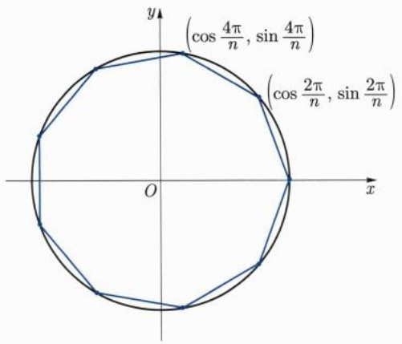

<details>
<summary>text_image</summary>

(cos 4π/n, sin 4π/n)
(cos 2π/n, sin 2π/n)
</details>

图5.1

另一方面, 由 $\cos 2 < 0$ 可得 $\frac{\pi}{2} < 2$, 即 $\pi < 4$. 则当 $x \in \left(0, \frac{\pi}{2}\right)$ 时,

$$
\sin x - x = \sum_ {n = 1} ^ {\infty} \frac {(- 1) ^ {n} x ^ {2 n + 1}}{(2 n + 1) !} = - \sum_ {n = 0} ^ {\infty} \Big (\frac {1}{(4 n + 3) !} - \frac {x ^ {2}}{(4 n + 5) !} \Big) x ^ {4 n + 3}
$$

$$
= - \sum_ {n = 0} ^ {\infty} \left(1 - \frac {x ^ {2}}{(4 n + 4) (4 n + 5)}\right) \frac {x ^ {4 n + 3}}{(4 n + 3) !} <   0,
$$

$$
\begin{array}{l} \sin x + x - 4 \sin \frac {x}{2} = \sum_ {n = 1} ^ {\infty} \frac {(- 1) ^ {n} x ^ {2 n + 1}}{(2 n + 1) !} - 4 \sum_ {n = 1} ^ {\infty} \frac {(- 1) ^ {n} x ^ {2 n + 1}}{2 ^ {2 n + 1} (2 n + 1) !} \\ = - \sum_ {n = 0} ^ {\infty} \left((1 - \frac {1}{2 ^ {4 n + 1}}) - (1 - \frac {1}{2 ^ {4 n + 3}}) \frac {x ^ {2}}{(4 n + 4) (4 n + 5)}\right) \frac {x ^ {4 n + 3}}{(4 n + 3) !} \\ <   - \sum_ {n = 0} ^ {\infty} \left(\frac {1}{2} - 1 \cdot \frac {1}{5}\right) \frac {x ^ {4 n + 3}}{(4 n + 3) !} <   0. \\ \end{array}
$$

这就得到了

$$
\sin x <   x <   4 \sin \frac {x}{2} - \sin x, \quad \forall x \in \left(0, \frac {\pi}{2}\right). \tag {5.5.16}
$$

自然, 今后引入导数以后, 上式的证明将更容易.

对于正整数 $n \geqslant 1$ ，取 $x = \frac{\pi}{3 \cdot 2^n}$ ，即得

$$
3 \cdot 2 ^ {n} \sin \frac {\pi}{3 \cdot 2 ^ {n}} <   \pi <   3 \cdot 2 ^ {n + 2} \sin \frac {\pi}{3 \cdot 2 ^ {n + 1}} - 3 \cdot 2 ^ {n} \sin \frac {\pi}{3 \cdot 2 ^ {n}}. \tag {5.5.17}
$$

这本质上就是刘徽 $^{①}$ 在其割圆术中所采用的不等式. 由  $\sin\frac{\pi}{6}=\frac{1}{2}$ ，并反复利用

$$
\sin^ {2} \frac {t}{2} = \frac {1 - \sqrt {1 - \sin^ {2} t}}{2}, \quad \forall t \in \left(0, \frac {\pi}{2}\right)
$$

可以计算 $^{②}\sin\frac{\pi}{3\cdot2^{n}}$ 并得到 $\pi$ 的近似值. 取 n=6, 刘徽得到了 $\pi\approx192\sin\frac{\pi}{192}\approx3.14$ , 并指出

<small><span class="docvortex-page-footnote" data-block-type="page_footnote" style="color:#6b7280">① 刘徽, 三国时期魏国人, 约 225 年—约 295 年, 中国古代数学家.</span></small>

<small><span class="docvortex-page-footnote" data-block-type="page_footnote" style="color:#6b7280">② 正如刘徽在《九章算术注》中所作的那样, 对于 $1 < k < n$, 只需要计算 $\sin^2 \frac{\pi}{3 \cdot 2^k}$ 而不需要计算 $\sin \frac{\pi}{3 \cdot 2^k}$.</span></small>

---

124

第五章 连续函数

若取 $n = 10$ 得到① $\pi \approx 3072\sin \frac{\pi}{3072} \approx 3.1416$. 在 (5.5.16) 式中取 $n = 12$, 就得到祖冲之②、祖暅③父子得到的

$$
3. 1 4 1 5 9 2 6 <   \pi <   3. 1 4 1 5 9 2 7.
$$

自然, 在刘徽和祖冲之的时代没有三角函数. 这里只是借用现代数学的语言来解释相关工作.

## 5.5.6 夹角 正弦定理 余弦定理

考虑平面 $\mathbb{R}^2$ 中的单位圆周 $x^{2} + y^{2} = 1$ 上两点 $A(\cos \theta ,\sin \theta)$ 和 $B(\cos \varphi ,\sin \varphi)$ (图5.2).则有整数 $k$ 以及 $\alpha \in (-\pi ,\pi ]$ 使得 $\varphi -\theta = 2k\pi +\alpha$ .我们称 $\beta = |\alpha |$ 为 $\angle AOB$ 的弧度，或称 $\overrightarrow{OA}$ 和 $\overrightarrow{OB}$ 的夹角为 $\beta$ 易见在这一定义下，夹角在旋转变换下不变.进一步，可见 $\beta$ 由 $\cos \beta$ 唯一确定:

$$
\cos \beta = \cos \alpha = \cos (\varphi - \theta) = \cos \varphi \cos \theta + \sin \varphi \sin \theta = \overrightarrow {O A} \cdot \overrightarrow {O B}.
$$

在射线 OA 以及射线 OB 上各任取一点 P, Q (P, Q 不为 O). 则

$$
\cos \beta = \frac {\overrightarrow {O P} \cdot \overrightarrow {O Q}}{| O P | \cdot | O Q |},
$$

这里 $|OP|$, $|OQ|$ 表示线段 $OP, OQ$ 的长度. 由此, 对于 $\mathbb{R}^2$ 中三个不同的点 $P_k(x_k, y_k) (k = 0, 1, 2)$, 可一般地定义 $\overrightarrow{P_0P_1}$ 与 $\overrightarrow{P_0P_2}$ 的夹角为

$$
\arccos \frac {\overrightarrow {P _ {0} P _ {1}} \cdot \overrightarrow {P _ {0} P _ {2}}}{| P _ {0} P _ {1} | \cdot | P _ {0} P _ {2} |} = \frac {(x _ {1} - x _ {0}) (x _ {2} - x _ {0}) + (y _ {1} - y _ {0}) (y _ {2} - y _ {0})}{\sqrt {(x _ {1} - x _ {0}) ^ {2} + (y _ {1} - y _ {0}) ^ {2}} \sqrt {(x _ {2} - x _ {0}) ^ {2} + (y _ {2} - y _ {0}) ^ {2}}}, \tag {5.5.18}
$$

其中 $\arccos$ 是 $\cos$ 在 $[0, \pi]$ 上的反函数. 根据上面的讨论可见, 这里定义的夹角在旋转变换与平移变换下不变.

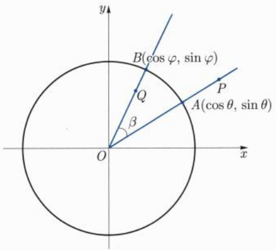

<details>
<summary>text_image</summary>

y
B(cos φ, sin φ)
Q
β
A(cos θ, sin θ)
P
O
x
</details>

图5.2

<small><span class="docvortex-page-footnote" data-block-type="page_footnote" style="color:#6b7280">① 刘徽还给出了另一种方法得到 $\pi \approx 3.1416$，该法利用 $n \leqslant 6$ 的数据来估算圆周率。该法究竟是什么样的方法，今人难以确定。</span></small>

<small><span class="docvortex-page-footnote" data-block-type="page_footnote" style="color:#6b7280">② 祖冲之, 字文远, 429 年—500 年, 南北朝时期数学家、天文学家.</span></small>

<small><span class="docvortex-page-footnote" data-block-type="page_footnote" style="color:#6b7280">③ 祖暅，一作祖暅之，字景烁，5—6世纪，南北朝时期数学家、天文学家.</span></small>

---

5.5 指数函数、对数函数和三角函数的定义

125

更一般地, 在 $\mathbb{R}^n (n\geqslant 2)$ 中, 可以同样地定义两个向量的夹角. 同样可以证明, 该夹角在旋转变换与平移变换下不变.

定义 5.5.5 设  $n \geqslant 2$ ,  $P_{k}(x_{1,k}, x_{2,k}, \cdots, x_{n,k}) (k = 0, 1, 2)$  为  $R^{n}$  中三个不同的点. 则  $P_{0}P_{1}$  与  $P_{0}P_{2}$  的夹角定义为

$$
\mathrm{arccos} \frac {\overrightarrow {P _ {0} P _ {1}} \cdot \overrightarrow {P _ {0} P _ {2}}}{| P _ {0} P _ {1} | \cdot | P _ {0} P _ {2} |} = \mathrm{arccos} \frac {\sum_ {j = 1} ^ {n} (x _ {j , 1} - x _ {j , 0}) (x _ {j , 2} - x _ {j , 0})}{\sqrt {\sum_ {j = 1} ^ {n} (x _ {j , 1} - x _ {j , 0}) ^ {2}} \sqrt {\sum_ {j = 1} ^ {n} (x _ {j , 2} - x _ {j , 0}) ^ {2}}}.\tag {5.5.19}
$$

现在考虑  $R^{n}$  中的  $\triangle ABC$  (图 5.3)，依次用 A, B, C 表示顶点 A, B, C 对应的三个内角，用 a, b, c 依次表示顶点 A, B, C 所对的边的边长。由定义，

$$
2 \cos C = \frac {2 \overrightarrow {C A} \cdot \overrightarrow {C B}}{| C A | \cdot | C B |} = \frac {\overrightarrow {C B} \cdot \overrightarrow {C B} + \overrightarrow {C A} \cdot \overrightarrow {C A} - (\overrightarrow {C A} - \overrightarrow {C B}) \cdot (\overrightarrow {C A} - \overrightarrow {C B})}{| C A | \cdot | C B |} = \frac {a ^ {2} + b ^ {2} - c ^ {2}}{a b}.
$$

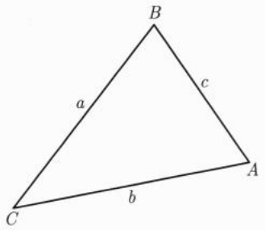

<details>
<summary>text_image</summary>

B
a
c
C
b
A
</details>

图5.3

这就是余弦定理. 特别地, 当且仅当 $C = \frac{\pi}{2}$ 时有勾股定理

$$
c ^ {2} = a ^ {2} + b ^ {2}.
$$

我们有

$$
\begin{array}{l} \frac {\sin C}{c} = \frac {1}{c} \sqrt {1 - \cos^ {2} C} = \frac {1}{2 a b c} \sqrt {4 a ^ {2} b ^ {2} - (a ^ {2} + b ^ {2} - c ^ {2}) ^ {2}} \\ = \frac {1}{2 a b c} \sqrt {(a + b + c) (a + b - c) (b + c - a) (c + a - b)}. \\ \end{array}
$$

由此可见 $\frac{\sin C}{c} = \frac{\sin B}{b} = \frac{\sin A}{a}$. 这就是正弦定理.

最后, 我们来证明三角形的内角和为  $\pi$ , 即  $A + B + C = \pi$ . 由

$$
\begin{array}{l} \sin (A + B) = \sin A \cos B + \cos A \sin B = (a \cos B + b \cos A) \frac {\sin C}{c} \\ = \left(\frac {a ^ {2} + c ^ {2} - b ^ {2}}{2 c} + \frac {b ^ {2} + c ^ {2} - a ^ {2}}{2 c}\right) \frac {\sin C}{c} = \sin C > 0, \tag {5.5.20} \\ \end{array}
$$

以及 $0 < A + B < 2\pi$ 可见 $0 < A + B < \pi$.

若 $A + B + C \neq \pi$, 则由 (5.5.20)式必有 $A + B = C$. 同理可证 $B = A + C$. 这与 $A > 0$ 矛盾. 因此, 必有 $A + B + C = \pi$.

---

126

第五章 连续函数

于是, 当 $C = \frac{\pi}{2}$ 时, $A + B = \frac{\pi}{2}$. 从而

$$
\sin A = \cos B = \frac {a ^ {2} + c ^ {2} - b ^ {2}}{2 a c} = \frac {2 a ^ {2}}{2 a c} = \frac {a}{c}.
$$

## 习题5.5

1. 对于 $x_0 \in \mathbb{R}$, 计算 $\lim_{x \to x_0} \frac{\sin x - \sin x_0}{x - x_0}$.
2. 对于 $x_0 \in \mathbb{R}$, 计算 $\lim_{x \to x_0} \frac{\cos x - \cos x_0}{x - x_0}$.
3. 对于 $x_0 \in \mathbb{R}$, 计算 $\lim_{x \to x_0} \frac{\tan x - \tan x_0}{x - x_0}$.
4. 对于 $x_0 \in \mathbb{R}$, 计算 $\lim_{x \to x_0} \frac{\arctan x - \arctan x_0}{x - x_0}$.
5. 计算  $\lim_{x\to0}\frac{\sin x-x+\frac{x^{3}}{6}}{x^{5}}$ .
6. 计算  $\lim_{x\to0}\frac{\arcsin x-x-\frac{x^{3}}{6}}{x^{5}}$ .
7. 计算 $\lim_{x\to 0}\frac{\tan x - x}{x^3}.$
8. 计算 $\lim_{x\to 0}\frac{\arctan x - x + \frac{x^3}{3}}{x^5}.$

---

## 第六章

## 导数与微分

---

128

第六章 导数与微分

数学分析的核心内容主要包括微分和积分两部分, 也就是所谓的微积分. 如果我们把微分和积分分别看成是 “微观” 和 “宏观”, 再把前面引入的 “连续” 当作 “中观” 的话, 那么数学分析可以理解为是一门介绍 “微观” “中观” 和 “宏观” 方法的学科. 或者通俗地说, 数学分析是用此 “三观” 来观察和研究函数的学科.

本章我们将着重从“微观”的角度来研究函数, 即所谓的一元函数微分学的内容.

微分的思想萌芽可以追溯到古希腊时期, 当时是在解决具体问题时, 以朴素的、零散的碎片方式表现出来的. 而更接近现代观点的微分学, 比较认可的说法是在 16 世纪前后逐渐形成和发展的. 代表人物和所讨论的问题有 Kepler $^{①}$ 研究的行星运行、Descartes 讨论的曲线的切线、Fermat $^{②}$ 考虑的函数的极值和曲线的切线、Barrow $^{③}$ 通过微分三角形探讨的切线方程等. 这些前期的酝酿, 为后来的代表人物 Newton 和 Leibniz 系统地创立微积分提供了充足的素材和准备. 我们现在介绍的内容, 是经过了 19 世纪的长足发展, 在理论上给予严谨化和进一步的提升、推广和应用后的体系.

顺便提到一点的是, 积分思想的诞生要早于, 至少不迟于, 微分的诞生. 因此, 从历史发展的顺序来说, 微分与积分观念形成的先后与通常教科书中的陈述顺序刚好相反. 本书也将采取先讨论微分再讲述积分的顺序. 这一点其实也不奇怪, 正如大多数分析教材也都是站在 19 世纪数学严谨化之后的角度来讲授的, 而不是完全按时间顺序介绍前人的思想、方法和结论, 然后再逐一打补丁填补不严谨之处.

## 6.1 导数的引入与定义

引入导数这一微分学的核心概念的方式通常有如下两种, 一种是从曾经产生过重大历史影响的两个经典问题入手, 即当初 Newton 和 Leibniz 分别讨论的质点运动的瞬时速度和曲线的切线问题的模型, 然后进行数学抽象和提升; 另一种是跳过对具体问题的介绍, 直接从逻辑上给出严格的数学定义. 这两种方式各有利弊, 完全视读者的知识背景和储备.

对于初学者来说, 也许第一种引入方式较为自然, 也能产生一定的质感, 学习和关注的重点在于如何从介绍朴素的案例的过程中捕捉到数学的本质, 再对其提炼和提升. 第二种引入方法其优点在于简明精练, 主题鲜明.

我们下面采用第一种模式来引入导数. 我们这样做还有一个原因, 就是这两个经典模型的背后代表着学习这门课时两种不同的角度, 一种是分析味道浓郁, 一种几何直观

<small><span class="docvortex-page-footnote" data-block-type="page_footnote" style="color:#6b7280">① Kepler, Johannes, 1571 年 12 月 27 日—1630 年 11 月 15 日, 德国天文学家、物理学家、数学家.</span></small>

<small><span class="docvortex-page-footnote" data-block-type="page_footnote" style="color:#6b7280">② Fermat, Pierre de, 1601 年 8 月 17 日—1665 年 1 月 12 日, 法国数学家.</span></small>

<small><span class="docvortex-page-footnote" data-block-type="page_footnote" style="color:#6b7280">③ Barrow, Isaac, 1630 年 10 月 — 1677 年 5 月 4 日, 英国数学家.</span></small>

---

6.1 导数的引入与定义

129

凸显. 它们均为数学分析中极其重要的理念和方法, 在后面的章节中也能隐约体会到它们在处理问题时带来的不同影响.

我们来讨论下面两个经典模型, 它们正是当年 Newton 和 Leibniz 分别创建微积分时研究的问题. 起源于对质点瞬时速度和曲线切线及其斜率的讨论,

(1) 质点运动学问题: 求质点变速直线运动的瞬时速度.
(2) 几何图形中的切线问题: 求曲线上一点处的切线斜率.

## 1. 质点运动学问题, 非匀速直线运动的瞬时速度

在经典的匀速直线运动框架下，质点的速度定义为质点在单位时间内移动的改变。顾名思义，它应为常值才和匀速直线运动吻合，既不依时间单位长短 $\Delta t$ 的改变而改变，也不依测量时刻 $t$ 的不同而不同。但事实上，严格意义下的匀速直线运动仅仅是一种理想状态。稍微一般的情况应该是非匀速直线运动，以及更一般的曲线变速运动。在此，我们仅重点考虑前者，即质点的非匀速直线运动。

所谓的非匀速直线运动, 是指在给定的时间段 (比如单位时间) 内, 质点运动的位移会有所不同. 这种采用给定时间段去除运动位移改变的计算方法, 是与前面匀速直线运动速度的计算方法兼容的. 这样得到的比值, 称为质点在这段时间的平均速度.

Newton 关于质点运动的瞬时速度, 是在上述平均速度的基础上引入的. 换句话说, 我们将上述时间段的长度取得越来越小, 如果平均速度有极限的话, 就定义为指定质点的瞬时速度. 我们给出如下严格的描述.

设质点在直线 (取为 $x$ 轴) 上运动, 在时刻 $t_0$, 质点的位置为 $x(t_0)$, 那么从时刻 $t_0$ 到时刻 $t_0 + \tau$, 质点的位移变化为

$$
\Delta x = x (t _ {0} + \tau) - x (t _ {0}).
$$

这里我们允许 $\tau < 0$ ，此时可以理解为经过时间段 $-\tau$ 后，质点从位置 $x(t_0 + \tau)$ 到达位置 $x(t_0)$ .质点在 $\tau$ 时间段内的平均速度为

$$
\bar {v} := \frac {\Delta x}{\tau} = \frac {x (t _ {0} + \tau) - x (t _ {0})}{\tau}.
$$

对于固定的非常小的 $\tau$, 可以将它看成是在 $t_0$ 时刻质点速度的一个近似值. 因此, 如果极限

$$
\lim _ {\tau \to 0} \frac {\Delta x}{\tau} = \lim _ {\tau \to 0} \frac {x (t _ {0} + \tau) - x (t _ {0})}{\tau}
$$

存在且有限时, 我们称此极限值为质点在时刻  $t_{0}$  的瞬时速度.

## 2. 曲线切线问题

我们在中学讨论圆的切线时, 曾经把和圆只有一个公共交点的直线称为圆的切线. 对于圆来说, 这种定义切线的方式倒也无妨, 因为这的确是圆的切线所具有的特征, 但

---

130

第六章 导数与微分

这一特征显然不宜当作一般曲线切线的定义. 比如对于抛物线而言, 任何一条平行于抛物线对称轴的直线与抛物线都只有一个交点, 而这些直线显然不能称为抛物线的切线. 由此看出, 对于一般曲线, 我们尚未严谨引入过 “切线” 的概念. 下面我们简要介绍一下 Leibniz 研究曲线切线时所采用的基本思想和方法. 为简单计, 我们假设所讨论的曲线是由显式函数给出的, 即曲线是由形如 $y = f(x)$ 的函数给出的图像.

在曲线 $y = f(x)$ 上，任取一点 $P_0(x_0, y_0), y_0 = f(x_0)$，在点 $P_0$ 附近再在曲线上取一点 $P = (x, y)$. 连接两点 $P$ 与 $P_0$ 作曲线的一条“割线”，则此割线的斜率为

$$
\tan \alpha = \frac {Q P}{P _ {0} Q},
$$

其中 Q 为坐标是  $(x, y_{0})$  的点 (见图 6.1).


<details>
<summary>line</summary>

| Point | x | y |
| --- | --- | --- |
| Intersection (P0) | x0 | y0 |
</details>

图6.1

容易看出, 当点 P 沿着曲线向点  $P_{0}$  移动时,

$$
\tan \alpha = \frac {f (x) - f (x _ {0})}{x - x _ {0}}.
$$

割线 $P_0P$ 以及夹角 $\alpha$ 都随着 $P$ 变化而变化. 如果当 $x \to x_0$ 时, $\tan \alpha$ 存在有限的极限 $k$, 即

$$
\lim _ {x \to x _ {0}} \frac {f (x) - f (x _ {0})}{x - x _ {0}} = k,
$$

那么我们很自然地可以把经过点 $P_{0}$ 斜率为 $k$ 的直线定义为曲线 $y = f(x)$ 在点 $P_{0}$ 处的切线 $\ell$. 显然, 如此定义的切线 $\ell$ 有解析表达式

$$
y = y _ {0} + k (x - x _ {0}).
$$

上述两个经典数学模型, 表现形式相去甚远, 但其背后的共同点都是讨论函数的改变量与自变量改变量的比率, 我们将其进行数学上的提炼、抽象和统一处理, 即可引入导数的定义.

---

6.1 导数的引入与定义

131

定义 6.1.1 (导数) 设函数 $y = f\left( x\right)$ 在点 ${x}_{0}$ 附近有定义,如果极限

$$
\lim _ {x \to x _ {0}} \frac {f (x) - f (x _ {0})}{x - x _ {0}} \tag {6.1.1}
$$

存在且有限, 则称 $f(x)$ 在点 $x_0$ 处可导, 并称其极限值为 $f(x)$ 在点 $x_0$ 处的导数, 记为 $f'(x_0)$ 或 $y'(x_0)$.

关于导数符号的几句话: 数学符号的引入通常有其历史背景或文化背景, 或有其内含抑或个人偏好. 导数的记号也不例外. 比如, 上面表示导数的符号' 是 Lagrange $^{①}$  创建的, 最显著的特点是简捷明了,  $f'(x_{0})$  蕴涵着是由函数  $f(x)$  而非另外的函数  $g(x)$  诱导出来的数. 除了 Lagrange 的符号外, 常见的表示导数的符号还有下面 Leibniz 给出的形式:

$$
\left. \frac {\mathrm{d} y}{\mathrm{d} x} \right| _ {x = x _ {0}}, \quad \frac {\mathrm{d} f}{\mathrm{d} x} (x _ {0}), \quad \left. \frac {\mathrm{d} f}{\mathrm{d} x} \right| _ {x = x _ {0}}.
$$

Leibniz 引入的符号初看起来略显啰唆, 当然它传递的信息更多. 当我们讨论的场景稍微复杂时, 比如有多个函数代数运算时, Leibniz 的符号能更清晰地反映出变量间的依赖关系. 不仅如此, 我们还看到这些符号特有的 “分数” 形式, 它更像是两个量的比值. 事实上, 的确如此, 我们对导数的定义稍作形式上的处理, 很快将会看到为什么导数又叫差商的极限了. 在引入微分的概念之后, 这些形式符号被赋予了更深刻的内涵: 导数 $\frac{\mathrm{dy}}{\mathrm{dx}}$ 中的分子和分母可以被看成独立的运算符号, 即微分 $\mathrm{dy}$ 和 $\mathrm{dx}$ 之商了.

除了讨论函数 $f(x)$ 某点 $x_0$ 的可导性外, 我们还经常讨论它在一个集合上的可导性. 对于一个给定的点集 $E \subseteq \mathbb{R}$, 如果 $f(x)$ 在 $E$ 中的每个点都可导, 则称 $f(x)$ 在集合 $E$ 上可导. 当我们的关注点落在函数在集合 $E$ 上的可导性而不是指定点 $x_0$ 的可导性时, 我们常常把 $x_0$ 中的下标去掉, 代之以更灵活和方便的符号 $f'(x)$, 并称之为函数 $f(x)$ 的导函数.

点集 $E \subseteq \mathbb{R}$ 最常见的形式为区间, 包括开区间 $(a, b)$ 和闭区间 $E = [a, b]$ 以及各种组合, 此时我们也说 $f(x)$ 在区间上可导.

我们对定义6.1.1中的导数作一些形式上的处理: 对于固定点 $x_0$ 以及附近的点 $x$, 我们更习惯于将 $x$ 与 $x_0$ 的差用 $\Delta x$ 表示, 类似地, 用 $\Delta f(x)$ 或者 $\Delta y$ 表示相应的函数值的差 $f(x) - f(x_0)$, 即

$$
\Delta x = x - x _ {0}, \qquad \Delta y = f (x) - f (x _ {0}).
$$

于是 $x = x_0 + \Delta x, f(x) = f(x_0) + \Delta y,$ 而 $x\to x_0$ 则等价于 $\Delta x\to 0.$ 表达式（6.1.1）就变成了

$$
f ^ {\prime} (x _ {0}) = \lim _ {\Delta x \to 0} \frac {\Delta y}{\Delta x}. \tag {6.1.2}
$$

<small><span class="docvortex-page-footnote" data-block-type="page_footnote" style="color:#6b7280">① Lagrange, Joseph-Louis, 1736 年 1 月 25 日 — 1813 年 4 月 10 日, 意大利裔法国数学家.</span></small>

---

132

第六章 导数与微分

注6.1.1 可以看出, 一个函数在给定点的导数本质上是由此函数在该点诱导出的差商的极限来定义的. 因此, 我们这里再次看到了极限的工具地位, 故可以用极限的 $\varepsilon - \delta$ 语言来描述函数的可导性: 如果存在实数 $A \in \mathbb{R}$, 使得 $\forall \varepsilon > 0$, 都存在 $\delta > 0$, 当 $0 < |x - x_0| < \delta$ 时, 成立

$$
\left| \frac {f (x) - f (x _ {0})}{x - x _ {0}} - A \right| <   \varepsilon , \tag {6.1.3}
$$

则称  $f(x)$  在点  $x_{0}$  处可导, 且导数值定义为 A.

这样, 函数在某点的可导性问题就等价于上述极限的存在性问题, 而计算导数则变成了寻求 $A$ 的问题.

例 6.1.1 试求 R 上的常值函数  $f(x) \equiv c$  的导数.

解 $\forall x_0\in \mathbb{R}$ ，由于

$$
\lim _ {x \to x _ {0}} \frac {f (x) - f (x _ {0})}{x - x _ {0}} = \lim _ {x \to x _ {0}} \frac {c - c}{x - x _ {0}} \equiv 0, \tag {6.1.4}
$$

所以

$$
c ^ {\prime} = 0. \tag {6.1.5}
$$

这一结论显然符合我们当初引入导数时的预期: 一个取值不变的函数其变化率应该恒为零. 后面我们还能证明, 如果一个函数, 其变化率处处为零, 那么它就是个常值函数.

例 6.1.2 设 n > 0 为正整数, 试求  $f(x) = x^{n}$  在点  $x_{0}$  处的导数.

解 $\forall x_0\in \mathbb{R}$ ，我们有

$$
\begin{array}{l} \frac {\Delta y}{\Delta x} = \frac {x ^ {n} - x _ {0} ^ {n}}{x - x _ {0}} \\ = x ^ {n - 1} + x ^ {n - 2} x _ {0} + \dots + x _ {0} ^ {n - 1}. \\ \end{array}
$$

因此

$$
f ^ {\prime} (x _ {0}) = \lim _ {x \to x _ {0}} \frac {\Delta y}{\Delta x} = n x _ {0} ^ {n - 1}. \tag {6.1.6}
$$

由于  $x_{0}$  的一般性, 在不强调  $x_{0}$  时, 我们也常常把上式写成

$$
(x ^ {n}) ^ {\prime} = n x ^ {n - 1}. \tag {6.1.7}
$$

完全类似地不难得到, 对于负整数 n, 当 x > 0 时, 也有

$$
(x ^ {n}) ^ {\prime} = n x ^ {n - 1}. \tag {6.1.8}
$$

如果把例 6.1.1 中的常值函数看成是例 6.1.2 中 n = 0 的情况, 并将 (6.1.7) 式右端理解成 0 的话, 那么我们可以把关系式 (6.1.5), (6.1.7), (6.1.8) 合并为统一的表达式.

$$
(x ^ {n}) ^ {\prime} = n x ^ {n - 1}.
$$

---

6.1 导数的引入与定义

133

这里我们默认当 $n < 0$ 时, 仅讨论当 $x > 0$ 时函数的情况.

例 6.1.3 设  $f(x)=|x|$ . 证明  $f(x)$  在  $x_{0}=0$  处不可导.

证明 注意到当 $x > 0$ 时, 有

$$
\lim _ {x \to 0 ^ {+}} \frac {f (x) - f (0)}{x - 0} = \lim _ {x \to 0 ^ {+}} \frac {x}{x} = 1
$$

而当 $x < 0$ 时, 有

$$
\lim _ {x \to 0 ^ {-}} \frac {f (x) - f (0)}{x - 0} = \lim _ {x \to 0 ^ {-}} \frac {- x}{x} = - 1,
$$

所以极限  $\lim_{x\to0}\frac{f(x)-f(0)}{x-0}$  不存在, 因此函数  $f(x)$  在  $x_{0}=0$  处不可导.

完全类似地可以证明如下稍微一般的结论:

例6.1.4 设 $k_{1} \neq k_{2}$, 则“折线”函数

$$
f (x) = \left\{ \begin{array}{l l} k _ {1} (x - x _ {0}), & x \leqslant x _ {0}, \\ k _ {2} (x - x _ {0}), & x \geqslant x _ {0} \end{array} \right.
$$

在折点 $x = x_0$ 处是不可导的.

这一结论符合我们对上述函数在点 $x_0$ 处没切线的直觉:函数在点 $x_0$ 处因为“急转弯”而产生一个“尖点”，哪怕它在“尖点处”连续，也不意味着可导。需要注意的是，这仅仅是几何直觉而非逻辑证明。另一方面，下面的例子告诉我们，一个看似很糟糕的函数，仅在一个点连续，在此点它竟然是可导的（换个角度说，一个函数即使在一点可导，也不能保证存在一个哪怕是充分小的邻域，使得函数在此邻域内连续）。

例6.1.5 试讨论函数

$$
f _ {1} (x) = \left\{ \begin{array}{l l} x, & x \in \mathbb {Q}, \\ - x, & x \notin \mathbb {Q}, \end{array} \right. \quad f _ {2} (x) = \left\{ \begin{array}{l l} x ^ {2}, & x \in \mathbb {Q}, \\ - x ^ {2}, & x \notin \mathbb {Q} \end{array} \right. \tag {6.1.9}
$$

在 x = 0 处的可导性, 如果可导, 求其导数.

解 根据导数的定义, 考虑 ${f}_{1}\left( x\right)$ 在 0 点处差商的极限

$$
\lim _ {x \to 0} \frac {f _ {1} (x) - f _ {1} (0)}{x - 0} = \left\{ \begin{array}{l l} 1, & x \in \mathbb {Q}, \\ - 1, & x \notin \mathbb {Q}, \end{array} \right.
$$

所以极限 $\lim_{x\to 0}\frac{f_1(x) - f_1(0)}{x - 0}$ 不存在.即 $f_{1}(x)$ 在 $x = 0$ 处不可导

另一方面, 根据定义直接计算可得

$$
\lim _ {x \to 0} \frac {f _ {2} (x) - f _ {2} (0)}{x - 0} = 0.
$$

所以  $f_{2}(x)$  在 x=0 处可导, 且  $f_{2}^{\prime}(0)=0$ . 即由函数给出的“曲线”在原点处有切线.

---

134

第六章 导数与微分

这里曲线二字上的引号是在暗示这些函数的图形实在不像通俗意义下的曲线, 因为看起来它的连续性实在太糟糕了. 然而即使如此, $f_{2}(x)$ 在 $x = 0$ 处竟然有“切线”. 与之对应的是 $f_{1}(x)$, 它的定义方式看起来和 $f_{2}(x)$ “同宗同族”, 但是它在 $x = 0$ 处却无法定义出切线. 完全类似地不难证明下面的函数在 $x = 0$ 处都是可导的. 因此, 我们建议读者从 Leibniz 当初引入切线的原始思想和做法出发, 充分体会这些函数可导与不可导的本质, 这对我们理解导数和构造更多的例子或反例颇有益处, 对导数的推广也很有启发.

对于 $k_{1}, k_{2} \in \mathbb{R}$, 函数

$$
g _ {1} (x) = \left\{ \begin{array}{l l} k _ {1} x ^ {2}, & x \in \mathbb {Q}, \\ k _ {2} x ^ {2}, & x \notin \mathbb {Q}, \end{array} \right. \quad g _ {2} (x) = \left\{ \begin{array}{l l} k _ {1} x ^ {2}, & x \leqslant 0, \\ k _ {2} x ^ {2}, & x \geqslant 0 \end{array} \right. \tag {6.1.10}
$$

在 $x = 0$ 处都是可导的.

我们给出个稍微一般些的例子.

例 6.1.6 考察逐段二次函数

$$
G (x) = \left\{ \begin{array}{l l} \frac {1}{2} x ^ {2}, & x \leqslant 0, \\ x ^ {2}, & x \in (0, 1), \\ - \frac {1}{2} x ^ {2} + 3 x - \frac {3}{2}, & x \geqslant 1 \end{array} \right. \tag {6.1.11}
$$

的导函数的存在性.

解 根据导数的定义, 通过直接计算可以得到函数 $G(x)$ 的导函数 (见图6.2)

$$
g (x) = G ^ {\prime} (x) = \left\{ \begin{array}{l l} x, & x \leqslant 0, \\ 2 x, & x \in (0, 1), \\ - x + 3, & x \geqslant 1, \end{array} \right. \tag {6.1.12}
$$


图6.2 例6.1.6中的函数

可以看出, $G(x)$ 在视觉上给出的曲线还算得上是一条光滑曲线, 其导函数 $g(x)$ 所表示的曲线已经是条“折线”了. 如果反过来看这个问题的话, 可以概括为: 一条由逐段线性函数给出的折线, 可以由一条逐段为二次函数的导函数生成. 我们特别指出, $G(x)$ 与

---

6.1 导数的引入与定义

135

$g(x)$  之间的关系在后续章节中将多次应用: 比如函数逼近、连续函数原函数的存在性, 等等. 鉴于此, 我们不厌其烦地再把此例一般化如下, 证明方法完全等同于上例, 不再赘述.

例 6.1.7 设  $G(x)$  是在  $[a, b]$  上由逐段抛物线给出的函数, 如果在两段抛物线的衔接处是可导的, 那么  $g(x) = G'(x)$  是  $[a, b]$  上的逐段线性函数. 即设  $a = x_{0} < x_{1} < x_{2} < \cdots < x_{n} < x_{n+1} = b$ ,

$$
G (x) = \left\{ \begin{array}{l l} A _ {0} + a _ {0} (x - x _ {0}) + \frac {1}{2} b _ {0} (x - x _ {0}) ^ {2}, & x \in [ x _ {0}, x _ {1}), \\ A _ {1} + a _ {1} (x - x _ {1}) + \frac {1}{2} b _ {1} (x - x _ {1}) ^ {2}, & x \in [ x _ {1}, x _ {2}), \\ \dots , \\ A _ {n} + a _ {n} (x - x _ {n}) + \frac {1}{2} b _ {n} (x - x _ {n}) ^ {2}, & x \in [ x _ {n}, x _ {n + 1} ], \end{array} \right.
$$

其中  $A_{0}=G(a)$ ,

$$
a _ {k} = a _ {k - 1} + b _ {k - 1} (x _ {k} - x _ {k - 1}), \quad k = 1, 2, \dots , n, \tag {6.1.13}
$$

$$
A _ {k} = A _ {k - 1} + a _ {k - 1} (x _ {k} - x _ {k - 1}) + \frac {1}{2} b _ {k - 1} (x _ {k} - x _ {k - 1}) ^ {2}, \quad k = 1, 2, \dots , n.
$$

则  $G'(x)$  是  $[a, b]$  上的连续的逐段线性函数:

$$
g (x) = G ^ {\prime} (x) = \left\{ \begin{array}{l l} a _ {0} + b _ {0} (x - x _ {0}), & x \in [ a, x _ {1}), \\ a _ {1} + b _ {1} (x - x _ {1}), & x \in [ x _ {1}, x _ {2}), \\ \dots , \\ a _ {n} + b _ {n} (x - x _ {n}), & x \in [ x _ {n}, b ], \end{array} \right.
$$

上面我们提到过圆的切线可描述为一条与圆周有且仅有一个交点的直线, 下面的例子告诉我们, 一条曲线在某点处的切线与曲线本身可能有非常复杂的交点.

例6.1.8 试计算函数

$$
f (x) = \left\{ \begin{array}{l l} x ^ {2} \sin \frac {1}{x}, & x \neq 0, \\ 0, & x = 0 \end{array} \right. \tag {6.1.14}
$$

在 x = 0 处的导数.

解 由定义直接计算可得 $f'(0) = 0$. 因此函数对应的曲线在 $(0,0)$ 处的切线与 $x$ 轴重合. 注意该切线在 $x = 0$ 的任意小邻域内都与曲线有无穷多个交点, 这在直观上与初等数学中圆的切线与圆周有且仅有一个交点有很大区别.

我们以可导与连续之间的关系这一极其基本的性质结束本节.

定理 6.1.1 若  $f(x)$  在点  $x_{0}$  处可导, 则必有  $f(x)$  在点  $x_{0}$  处连续, 从而在点  $x_{0}$  附近有界, 即存在  $\delta_{0} > 0$ , 使得  $f(x)$  在  $(x_{0} - \delta_{0}, x_{0} + \delta_{0})$  内有界.

---

136

第六章 导数与微分

证明 设 $f(x)$ 在点 $x_0$ 处可导, 则

$$
\lim _ {x \to x _ {0}} f (x) - f (x _ {0}) = \lim _ {x \to x _ {0}} \frac {f (x) - f (x _ {0})}{x - x _ {0}} (x - x _ {0}) = f ^ {\prime} (x _ {0}) \cdot 0 = 0.
$$

即  $f(x)$  在点  $x_{0}$  处连续.

关于函数的连续与可导之间的关系, 在微积分发展历史上, 经历了较为漫长的时间才得以厘清. 人们很早就认识到可导蕴涵着连续, 也知道有 $y = |x|$ 这样的连续函数, “偶尔”会有一些不可导的点. 直到19世纪上半叶, 人们曾一度认为连续函数可导的点应该占主流, 包括Cauchy, Gauss①这些大数学家都持有这种观点, 因为很难想象一个有“很多”不可导点的连续函数会是什么样. Picard②曾这样评论道: 如果Newton和Leibniz知道了连续函数不一定可导, 微分学将无以产生. 这个错觉或误解被德国数学家Weierstrass在1872年所打破, 他构造性地证明了震惊数学界的结论: 存在处处连续处处不可导的函数. 目前我们暂时了解可导与连续的逻辑关系, 在后面章节再系统讨论这方面的内容.

## 习题6.1

1. 变速直线运动可以看作是匀速直线运动的一般化, 进而我们引入了质点作变速直线运动的瞬时速度. 思考一下, 我们为何不直接引入更一般情况的变速曲线运动的瞬时速度?
2. 考虑如下意义下的“尺规作图”:假设给出了一个没有刻度的直角坐标系，给出了坐标系下函数的图像，并被告知是 $y = f(x)$ 的图像。试用尺规作出曲线上的点 $P_0(x_0, f(x_0))$ 处的切线，其中 $f(x)$ 分别为

(1) $f(x)=x^{k}$ ，其中 k 是整数，特别地 k=-1;
(2) 尺规作出椭圆  $\frac{x^{2}}{a^{2}} + \frac{y^{2}}{b^{2}} = 1$  上一点处的切线;
(3)  $f(x) = \sin x;$
(4) $f(x) = \tan x;$
(5) $f(x)=\mathrm{e}^{x};$
(6) $f(x)=\ln x.$

3. 设 $f(x)$ 在点 $x_0$ 处可导, 求极限

$$
\lim _ {h \to 0} \frac {f (x _ {0} + h) - f (x _ {0} - h)}{h}.
$$

<small><span class="docvortex-page-footnote" data-block-type="page_footnote" style="color:#6b7280">① Gauss, Johann Carl Friedrich, 1777 年 4 月 30 日 — 1855 年 2 月 23 日, 德国数学家、物理学家、天文学家、几何学家、大地测量学家.</span></small>

<small><span class="docvortex-page-footnote" data-block-type="page_footnote" style="color:#6b7280">② Picard, Charles Emile, 1856 年 7 月 24 日 — 1941 年 12 月 11 日, 法国数学家.</span></small>

---

6.2 单侧导数 Dini 导数 更多的导数

137

4. 设 $f(x)$ 在 $x = 0$ 处连续, 且

$$
\lim _ {x \to 0} \frac {f (2 x) - f (x)}{x} = k.
$$

证明:  $f'(0) = k.$

5. 证明: 可导偶函数的导数为奇函数, 可导奇函数的导数为偶函数, 可导周期函数的导数仍为周期函数.

6. 如果曲线 $\Gamma: y = F(x)$ 在 $x = x_0$ 处有斜率为 $k$ 的切线 $\ell$, 那么将 $\Gamma$ 沿着 $x$ 轴平移 $c$ 得到曲线 $\Gamma_c: y = F(x + c)$. 证明: $\Gamma_c$ 在 $x = x_0 + c$ 处也有斜率为 $k$ 的切线 $\ell_c$, 并写出 $\ell_c$ 的方程.

7. 设  $g(0)=g'(0)=0,$

$$
f (x) = \left\{ \begin{array}{l l} g (x) \sin \frac {1}{x}, & x \neq 0, \\ 0, & x = 0. \end{array} \right.
$$

求  $f'(0)$ .

8. 设 $f$ 是定义在 $\mathbb{R}$ 上的函数, 且对任何 $x_{1}, x_{2} \in \mathbb{R}$, 都有

$$
f (x _ {1} + x _ {2}) = f (x _ {1}) \cdot f (x _ {2}).
$$

若 $f'(0) = 1$ ，证明对任何 $x \in \mathbb{R}$，都有

$$
f ^ {\prime} (x) = f (x).
$$

## 6.2 单侧导数 Dini 导数 更多的导数

本节我们讨论一下导数的推广. 这些概念的推广大多数都是极其自然的, 是基于在引入经典导数时对涉及的最基本要素的本质挖掘.

## 6.2.1 单侧导数

类似于单侧极限, 我们也可以讨论函数在一点处的单侧导数.

定义 6.2.1 (左侧可导) 设函数  $y = f(x)$  在  $(x_{0} - \delta, x_{0}] (\delta > 0)$  上有定义, 如果单侧极限

$$
\lim _ {\Delta x \to 0 ^ {-}} \frac {f (x _ {0} + \Delta x) - f (x _ {0})}{\Delta x} \tag {6.2.1}
$$

---

138

第六章 导数与微分

存在且有限, 则称 $f(x)$ 在点 $x_0$ 处左侧可导, 或简称左可导, 并称其极限值为 $f(x)$ 在点 $x_0$ 处的左导数, 记为 $f_{-}^{\prime}(x_0)$ 或 $y_{-}^{\prime}(x_0)$, 即

$$
f _ {-} ^ {\prime} (x _ {0}) = \lim _ {\Delta x \to 0 ^ {-}} \frac {f (x _ {0} + \Delta x) - f (x _ {0})}{\Delta x}. \tag {6.2.2}
$$

类似地我们可以定义函数 $f(x)$ 在点 $x_0$ 处的右侧可导以及右导数，即

定义 6.2.2 (右侧可导) 设函数  $y = f(x)$  在  $[x_{0}, x_{0} + \delta) (\delta > 0)$  上有定义, 如果单侧极限

$$
\lim _ {\Delta x \to 0 ^ {+}} \frac {f (x _ {0} + \Delta x) - f (x _ {0})}{\Delta x} \tag {6.2.3}
$$

存在且有限, 则称 $f(x)$ 在点 $x_0$ 处右侧可导, 或简称右可导, 并称其极限值为 $f(x)$ 在点 $x_0$ 处的右导数, 记为 $f_{+}^{\prime}(x_0)$ 或 $y_{+}^{\prime}(x_0)$, 即

$$
f _ {+} ^ {\prime} (x _ {0}) = \lim _ {\Delta x \to 0 ^ {+}} \frac {f (x _ {0} + \Delta x) - f (x _ {0})}{\Delta x}. \tag {6.2.4}
$$

左导数、右导数统称为单侧导数.

有了单侧导数的概念后, 当我们说函数 $f(x)$ 在闭区间 $[a, b]$ 上可导时, 则是指函数

(1) 在区间内部的点处均可导;
(2) 在区间端点 $a$ 和 $b$ 处分别右可导和左可导.

由上面两点结合下面的例子, 我们有如下观察和结论:

(1) 如果 $f$ 在区间 $[a, b]$ 上可导, 那么 $f$ 在 $[a, b]$ 的任何子区间上也可导;
(2) 即使 $f$ 在区间 $[a, b]$ 和 $[b, c]$ 上均可导, $f$ 在 $[a, c]$ 上也不一定可导.

例 6.2.1 考虑例 6.1.3 中的函数  $f(x)=|x|$ . 我们知它在 0 点处不可导. 但可以看出在 x=0 处, 函数是左可导和右可导的, 且  $f(x)$  在 0 点的左、右导数分别为

$$
f _ {-} ^ {\prime} (0) = - 1, \quad f _ {+} ^ {\prime} (0) = 1.
$$

回顾和对比极限 (6.1.2) 存在的充要条件是两个单侧极限 (6.2.1) 和 (6.2.3) 存在且相等. 对于单侧导数, 我们有以下类似的结论:

定理 6.2.1 设函数  $f(x)$  在点  $x_{0}$  附近有定义. 则  $f(x)$  在该点可导的充要条件是其两个单侧导数都存在且相等, 即

$$
f _ {-} ^ {\prime} (x _ {0}) = f _ {+} ^ {\prime} (x _ {0}).
$$

此时有

$$
f ^ {\prime} (x _ {0}) = f _ {-} ^ {\prime} (x _ {0}) = f _ {+} ^ {\prime} (x _ {0}).
$$

单侧导数作为导数的一种推广, 在讨论函数在某点处的单侧性质时非常有用.

---

6.2 单侧导数 Dini 导数 更多的导数

139

例6.2.2 设

$$
f (x) = \left\{ \begin{array}{l l} x \sin \frac {1}{x}, & x <   0, \\ x, & x \geqslant 0. \end{array} \right.
$$

试讨论  $f(x)$  在 0 点处的单侧导数.

解 当 $x \to 0^{+}$ 时, 有

$$
\lim _ {x \to 0 ^ {+}} \frac {f (x) - f (0)}{x} = 1.
$$

因此 $f_{+}^{\prime}(0) = 1$

当 $x \to 0^{-}$ 时, 有

$$
\lim _ {x \to 0 ^ {-}} \frac {f (x) - f (0)}{x} = \lim _ {x \to 0 ^ {-}} \sin \frac {1}{x}.
$$

极限不存在, 因此  $f(x)$  在 0 点左导数不存在.

注意到经典导数的本质是通过考虑函数变化率 $\frac{\Delta y}{\Delta x}$ 的极限来研究函数, 自然我们也可以重新审视函数变化率的其他引入方式, 比如上面讨论的单侧导数就是只关注一点处函数左侧或右侧的变化率的极限. 类似地, 我们也可只关注函数变化率的上下极限、左右极限, 或者它们的组合, 从而可以引入各种各样特定的导数. 下面的 Dini① 导数就是其中的一种.

## 6.2.2 Dini 导数

Dini 导数的定义如下:

定义 6.2.3 设  $f(x)$  在点  $x_{0}$  附近有定义, 令

$$
\begin{array}{l} D ^ {+} f (x _ {0}) = \varlimsup_ {\Delta x \to x _ {0} ^ {+}} \frac {f (x) - f (x _ {0})}{x - x _ {0}}, \quad D _ {+} f (x _ {0}) = \varliminf_ {\Delta x \to x _ {0} ^ {+}} \frac {f (x) - f (x _ {0})}{x - x _ {0}}, \\ D ^ {-} f (x _ {0}) = \varlimsup_ {\Delta x \to x _ {0} ^ {-}} \frac {f (x) - f (x _ {0})}{x - x _ {0}}, \quad D _ {-} f (x _ {0}) = \varliminf_ {\Delta x \to x _ {0} ^ {-}} \frac {f (x) - f (x _ {0})}{x - x _ {0}}, \tag {6.2.5} \\ \end{array}
$$

分别称它们为 $f(x)$ 在点 $x_0$ 处的右上导数、右下导数、左上导数、左下导数，统称为Dini导数.

从上下极限的性质可以得到下面的关系式:

$$
\begin{array}{l} D ^ {+} f (x _ {0}) \geqslant D _ {+} f (x _ {0}), \quad D ^ {-} f (x _ {0}) \geqslant D _ {-} f (x _ {0}) \\ D ^ {+} (- f (x _ {0})) = - D _ {+} f (x _ {0}), \quad D ^ {-} (- f (x _ {0})) = - D _ {-} f (x _ {0}). \tag {6.2.6} \\ \end{array}
$$

关于 Dini 导数, 下面与定理 6.2.1 平行的结论成立, 证略.

定理 6.2.2 设函数  $f(x)$  在点  $x_{0}$  的某邻域内有定义, 下列结论成立:

(1) $f(x)$ 在点 $x_0$ 处右可导当且仅当 $D^{+}f(x_{0}) = D_{+}f(x_{0})$ 且均为有限值；

<small><span class="docvortex-page-footnote" data-block-type="page_footnote" style="color:#6b7280">① Dini, Ulisse, 1845 年 11 月 14 日 — 1918 年 10 月 28 日, 意大利数学家.</span></small>

---

140

第六章 导数与微分

(2) $f(x)$ 在点 $x_0$ 处左可导当且仅当 $D^{-}f(x_0) = D_{-}f(x_0)$ 且均为有限值;
(3) $f(x)$ 在点 $x_0$ 处可导当且仅当四个Dini导数都存在且均为同一个有限值.

例6.2.3 试求函数

$$
f (x) = \left\{ \begin{array}{l l} x, & x \in \mathbb {Q}, \\ - x, & x \notin \mathbb {Q} \end{array} \right. \tag {6.2.7}
$$

在 x = 0 处的 Dini 导数.

解 根据定义直接计算可得

$$
D ^ {+} f (0) = 1, \quad D _ {+} f (0) = - 1, \quad D ^ {-} f (0) = 1, \quad D _ {-} f (0) = - 1.
$$

例6.2.4 试求函数

$$
f (x) = \left\{ \begin{array}{l l} x \sin^ {2} \frac {1}{x}, & x > 0, \\ 0, & x = 0, \\ 2 x \cos^ {2} \frac {1}{x}, & x <   0 \end{array} \right. \tag {6.2.8}
$$

在 x = 0 处的 Dini 导数.

解 考虑区间 $I_{n} = \left[\frac{1}{(2n + 2)\pi},\frac{1}{2n\pi}\right]$, 当 $x\in I_n$ 时, 由于 $\sin \frac{1}{x}$ 和 $\cos \frac{1}{x}$ 可以取遍 $[-1,1]$ 中的所有值, 所以有

$$
D _ {+} f (0) = 0, \quad D ^ {+} f (0) = 1, \quad D _ {-} f (0) = 0, \quad D ^ {-} f (0) = 2.
$$

作为练习读者也可以把 $D^{+}f(x_{0})$ 和 $D^{-}f(x_{0})$ 组合起来得到上导数 $\overline{D} f(x_0)$，把 $D_{+}f(x_{0})$ 和 $D_{-}f(x_{0})$ 组合起来得到下导数 $\underline{D} f(x_0)$。可以证明，满足Lipschitz连续的函数其上下导数分别满足 $\overline{D} f(x) \leqslant L, \underline{D} f(x) \geqslant -L$，其中 $L$ 是关系式 $|f(x_1) - f(x_2)| \leqslant L|x_1 - x_2|$ 中的Lipschitz常数。不难证明，函数 $f(x)$ 在点 $x_0$ 处可导的充要条件是相应点处的上、下导数相等且为有限值。

## 6.2.3 对称导数 Schwarz 型导数

我们再次回到当初 Leibniz 考虑曲线的切线问题. 给定曲线

$$
C := \{(x, y): y = f (x), x \in I \},
$$

曲线上的点 $P_{0}(x_{0},f(x_{0}))\in C$ 处的切线定义如下:任找 $C$ 上的一点 $P(x,y)$ ，考虑由 $P_{0}$ 和 $P$ 决定的割线 $L_{P_0P}$ 以及它的斜率 $k_{P_0P}$ ，如果当 $x\to x_0$ 时， $k_{P_0P}$ 存在有限的极限$k\in \mathbb{R}$ ，我们就称曲线 $C$ 在 $P_{0}$ 点切线存在，它是一条过 $P_{0}$ 点，斜率为 $k$ 的直线 $\ell$ .显然$\ell$ 的方程可以由解析式

$$
\ell : \quad y = k (x - x _ {0}) + f (x _ {0})
$$

---

6.2 单侧导数 Dini 导数 更多的导数

141

表出. 所以切线 $\ell$ 也可以看成是割线 $L_{P_0P}$ 当 $P$ 趋于 $P_0$ 时的极限状态.

我们现在考察引入切线的其他可能. 在上述假设下, 为了讨论点 $P_{0}$ 的切线, 在 $C$ 上任找两个异于 $P_{0}$ 的点 $P_{1}(x_{1}, f(x_{1}))$ 和 $P_{2}(x_{2}, f(x_{2}))$, 考虑由 $P_{1}$ 和 $P_{2}$ 决定的割线 $L_{P_{1}P_{2}}$ 及其斜率 $k_{P_{1}P_{2}}$. 如果当 $x_{1,2} \to x_{0}$ 时, $k_{P_{1}P_{2}}$ 存在有限的极限 $\tilde{k} \in \mathbb{R}$, 那么对应的割线 $L_{P_{1}P_{2}}$ 的极限位置是否可以定义为 $P_{0}$ 点的切线? 这种定义出来的“切线”和经典的切线有何关系? 换句话说, $\tilde{k}$ 和 $k$ 可否相等?

可以看出, 无论是逻辑上还是直观上我们都有理由来这样定义, 因此我们首先把这个想法抽象出来, 给出数学上的统一处理, 然后我们再讨论它们之间的关系.

有两种比较自然的选取割线 $P_{1}P_{2}$ 的方法(见图6.3): 一种是 $P_{1}$ 和 $P_{2}$ 从 $P_{0}$ 的异侧趋于 $P_{0}$, 另一种是 $P_{1}$ 和 $P_{2}$ 从 $P_{0}$ 的同侧趋于 $P_{0}$. 经典的切线恰好是 $P_{1}$ 或 $P_{2}$ 之一固定为 $P_{0}$ 的特殊情况.


<details>
<summary>text_image</summary>

f(x)
P
P₀
ℓ
O
x
</details>

(a) 经典导数: $P$ 趋于 $P_{0}$


<details>
<summary>text_image</summary>

f(x)
P₁
P₂
ℓ
P₀
O
x
</details>

(b) $P_{1}, P_{2}$ 从异侧趋于 $P_{0}$


<details>
<summary>text_image</summary>

f(x)
P₁
P₂
P₀
ℓ
O
x
</details>

(c) $P_{1}, P_{2}$ 从同侧趋于 $P_{0}$


<details>
<summary>text_image</summary>

f(x)
P₀
P₁
ℓ
P₂
O
x
</details>

图 6.3 经典导数与推广

定义 6.2.4 设  $\delta > 0, f(x)$  在点  $x_{0}$  的某邻域  $(x_{0} - \delta, x_{0} + \delta)$  内有定义.

(1) 对任意的 $x_{1}, x_{2} \in (x_{0} - \delta, x_{0} + \delta), (x_{1} - x_{0})(x_{2} - x_{0}) < 0$, 如果极限

$$
\lim_{\substack{x_{1}\to x_{0}\\ x_{2}\to x_{0}}}\frac{f(x_{2}) - f(x_{1})}{x_{2} - x_{1}} \tag{6.2.9}
$$

存在且有限, 则称 $f(x)$ 在点 $x_0$ 处 Schwarz$^{\text{①}}$ 型弱可导, 简称 $S$-型弱可导, 并称其极限值为 $f(x)$ 在点 $x_0$ 处的 $S$-弱导数, 记为 $f_w^{[1]}(x_0)$;

<small><span class="docvortex-page-footnote" data-block-type="page_footnote" style="color:#6b7280">① Schwarz, Karl Hermann Amandus, 1843 年 1 月 25 日—1921 年 11 月 30 日, 德国数学家.</span></small>

---

142

第六章 导数与微分

(2) 对任意的 $x_{1}, x_{2} \in (x_{0} - \delta, x_{0} + \delta), (x_{1} - x_{0})(x_{2} - x_{0}) > 0$, 如果极限

$$
\lim_{\substack{x_{1}\to x_{0}\\ x_{2}\to x_{0}}}\frac{f(x_{2}) - f(x_{1})}{x_{2} - x_{1}} \tag{6.2.10}
$$

存在且有限, 则称 $f(x)$ 在点 $x_0$ 处 Schwarz 型强可导, 简称 $S$-型强可导, 并称其极限值为 $f(x)$ 在点 $x_0$ 处的 $S$-强导数, 记为 $f_s^{[1]}(x_0)$.

注意, 上述定义中的 S-型强、弱可导是非标准用语, 从后面的逻辑关系中, 可以看出, 这些称呼仅仅提供了一种逻辑上的形象理解.

定义中的 $S$ -型弱导数的一种特殊情况就是所谓的 Schwarz 对称导数, 其定义如下.

定义 6.2.5 设  $\delta > 0, f(x)$  在点  $x_{0}$  的某邻域  $(x_{0} - \delta, x_{0} + \delta)$  内有定义, 如果极限

$$
\lim _ {\Delta x \to 0} \frac {f (x _ {0} + \Delta x) - f (x _ {0} - \Delta x)}{2 \Delta x} \tag {6.2.11}
$$

存在且有限, 则称 $f(x)$ 在点 $x_0$ 处 Schwarz 对称可导, 简称 $S$-可导或对称可导, 并将其极限值记为 $f^{[1]}(x_0)$.

易证下面的结论:

例 6.2.5 函数  $f(x)=|x|$  在 x=0 处 Schwarz 对称可导, 且导数为  $f^{[1]}(x_{0})\equiv0$ .

注6.2.1 从上面这个例子可以看出, 一个函数在点 $x_0$ 处 $S$-可导, 它甚至可以是不连续的, 因为我们可以任意改变 $f(x)$ 在 0 点的值而不影响其对称导数值. 因此, 在讨论 $S$-型导数时, 常常加上函数在该点连续的条件.

上面我们仅从切线的几何直观和概念的推广角度引入了 S-型导数, 由于形式上涉及一些二元函数极限的内容, 在此我们不打算作进一步的铺开讨论. 下面给出一个相关结论, 有兴趣的读者可以完善证明并作进一步的思考和讨论.

定理 6.2.3 设函数  $f(x)$  在点  $x_{0}$  附近有定义, 在点  $x_{0}$  处连续, 则下面结论成立:

(1) 如果 $f(x)$ 在点 $x_0$ 处 $S$-型强可导, 则 $f(x)$ 在点 $x_0$ 处可导.
(2) $f(x)$ 在点 $x_0$ 处可导当且仅当 $f(x)$ 在点 $x_0$ 处 $S$-型弱可导. 特别地, $f(x)$ 在点 $x_0$ 处可导蕴涵 $f(x)$ 在点 $x_0$ 处对称可导.
(3) 当  $f(x)$  在点  $x_{0}$  处 S-型强可导时, 三种导数值相等.

下面的例子说明,上述结论反向一般来说均不成立.

例 6.2.6 (1) 考虑函数  $f(x)=|x|$ ，则 f 在 x=0 处对称可导，但并不可导.

(2) 设

$$
f (x) = \left\{ \begin{array}{l l} x ^ {2} \sin \frac {1}{x}, & x \neq 0, \\ 0, & x = 0. \end{array} \right.
$$

则 $f(x)$ 在 $x = 0$ 处可导, $f'(0) = 0$, 但并不 $S$-型强可导. 事实上, 取 $x_{n} = \frac{2}{(2n + 1)\pi}$, 则极限

---

6.2 单侧导数 Dini 导数 更多的导数

143

$$
\lim _ {n \to + \infty} \frac {f (x _ {n + 1}) - f (x _ {n})}{x _ {n + 1} - x _ {n}}
$$

不存在.

除了上面的左右导数、上下导数、强弱导数外, 还可以视具体情况而引入更有针对性的导数. 注意, 这些新概念的引入并不是纯无聊的推广, 而是建立在处理具体问题时, 角度不同但理念相通的基础上的, 都是用微观的思想去看待问题的.

## 习题6.2

1. 判断下列函数在给定点是否存在单侧导数, 并计算:

(1) $f(x)=\sqrt[3]{x}$ 在 x=0 处的右导数;
(2) $f(x)=|x-2|^{3}$ 在 x=2 处的左导数;
(3) $f(x)=\begin{cases}x^{2},&x\geqslant1,\\3-\frac{1}{x},&x<1\end{cases}$ 在 x=1 处的左导数和右导数;
(4) $f(x) = \left\{ \begin{array}{ll}\sqrt{x + 1}, & x\geqslant 0,\\ x^{2} - 1, & x <   0 \end{array} \right.$ 在 $x = 0$ 处的左导数和右导数.

2. 确定常数 $a, b$ 的值, 使得函数

$$
f (x) = \left\{ \begin{array}{l l} x ^ {2}, & x \geqslant 1, \\ a x + b, & x <   1 \end{array} \right.
$$

在 $x = 1$ 处可导.

3. 设 $f(x)$ 在 $x = 0$ 处连续. 证明: 当且仅当极限 $\lim_{x \to 0} \frac{f(x) - f(x - x^3)}{x^3}$ 存在时, 极限 $\lim_{x \to 0} \frac{f(x) - f(0)}{x}$ 存在.

4. 计算下列函数在 x = 0 处的 Dini 导数:

(1) $f(x)=x^{2}\sin\frac{1}{x};$

(2) $f(x) = |x|^{3 / 2}$;

(3) $f(x) = \mathrm{e}^{-|x|^2}$.

5. 判断下列函数在给定点是否存在 Dini 导数, 并计算:

(1) $f(x) = \left\{ \begin{array}{ll}x^{3}, & x\geqslant 0,\\ -x^{3}, & x <   0 \end{array} \right.$ 在 $x = 0$ 处；
(2) $f(x)=\sin x\cos x$ 在 $x=\pi$ 处;
(3) $f(x)=x^{2}\ln|x|$ 在 x=0 处.

6. 判断下列函数在给定点是否存在对称导数, 并计算:

(1) $f(x) = \left\{ \begin{array}{ll}x^{3}, & x\geqslant 0,\\ -x^{3}, & x <   0 \end{array} \right.$ 在 $x = 0$ 处；

---

144

第六章 导数与微分

(2) $f(x)=\sin(x^{2})$ 在 $x=\pi$ 处;
(3) $f(x)=\ln|x^{2}-1|$ 在x=1处;
(4) $f(x) = x^{2}\mathrm{e}^{-|x|}$.

7. 判断下列函数在给定点是否存在 Schwarz 型导数, 并计算:

(1) $f(x)=\begin{cases}x^{3},&x\geqslant0,\\-x^{3},&x<0\end{cases}$ 在 x=0 处;
(2) $f(x) = \cos x^2$ 在 $x = \frac{\pi}{2}$ 处;
(3) $f(x)=\mathrm{e}^{-|x|^3}$ 在 x=0 处;
(4) $f(x)=\arctan x^{3}$ 在x=0处.

8. 证明: 若 $f(x), g(x)$ 在点 $x_0$ 处 Schwarz 型导数存在, 则 $f(x) \pm g(x)$ 在点 $x_0$ 处 Schwarz 型导数也存在, 且有

$$
(f \pm g) ^ {[ 1 ]} (x _ {0}) = f ^ {[ 1 ]} (x _ {0}) \pm g ^ {[ 1 ]} (x _ {0}).
$$

9. 证明:若 $f(x), g(x)$ 在点 $x_0$ 处连续，且 Schwarz 型导数存在，则 $f(x)g(x)$ 和 $\frac{f(x)}{g(x)} (g(x_0) \neq 0)$ 在点 $x_0$ 处 Schwarz 型导数也存在，且有

$$
\begin{array}{l} (f (x) g (x)) ^ {[ 1 ]} \big | _ {x = x _ {0}} = f ^ {[ 1 ]} (x _ {0}) g (x _ {0}) + f (x _ {0}) g ^ {[ 1 ]} (x _ {0}), \\ \left(\frac {f (x)}{g (x)}\right) ^ {[ 1 ]} \Big | _ {x = x _ {0}} = \frac {f ^ {[ 1 ]} (x _ {0}) g (x _ {0}) - f (x _ {0}) g ^ {[ 1 ]} (x _ {0})}{g ^ {2} (x _ {0})}. \\ \end{array}
$$

## 6.3 导数的计算 求导法则

上节我们给出了导数的定义和几种推广, 并且从定义出发讨论了一些简单函数的求导. 对于比较复杂的函数, 如果每次都从定义出发求其导数, 可能是比较烦琐甚至是棘手的. 因此我们有必要试图建立一些求导的基本法则, 利用这些法则可以将所求函数的导数转化为已知函数或已知函数导数之间的代数运算.

## 6.3.1 一些基本初等函数的导数

我们首先给出以下几类最基本初等函数的导数, 至于为何选取这几类函数作为出发点是基于以下原因: 首先通过这些函数导数的计算, 进一步熟悉用定义求导数的基本方法. 然后介绍几种常见的求导法则, 应用这些法则我们即可展示如何用这些最基本的初等函数来求得更多复杂函数的导数.

---

6.3 导数的计算 求导法则

145

例 6.3.1 求下列函数的导数:

$$
y = x ^ {\mu} (x > 0), \quad y = \sin x, \quad y = \cos x, \quad y = \mathrm{e} ^ {x}. \tag {6.3.1}
$$

解 由导数的定义知, 计算一个函数的导数本质上就是计算一个相应的差商的极限, 而这些极限的计算, 要么前面已经提及, 要么计算可以直接给出, 下面我们直接给出结果, 推导细节不再一一赘述.

(1) 考虑 $y = x^{\mu} (x > 0)$ 的导数

$$
(x ^ {\mu}) ^ {\prime} = \lim _ {\Delta x \to 0} \frac {(x + \Delta x) ^ {\mu} - x ^ {\mu}}{\Delta x} = \mu x ^ {\mu - 1}. \tag {6.3.2}
$$

特例: 取  $\mu = \frac{1}{2}$ ，有  $(\sqrt{x})' = \frac{1}{2\sqrt{x}}$ .

(2) 考虑 $y = \sin x$ 的导数

$$
(\sin x) ^ {\prime} = \lim _ {\Delta x \to 0} \frac {\sin (x + \Delta x) - \sin x}{\Delta x} = \cos x.
$$

(3) 完全类似地, 我们可以得到 $y = \cos x$ 的导数.

$$
(\cos x) ^ {\prime} = - \sin x. \tag {6.3.3}
$$

(4) 类似地, 有 $y = \mathrm{e}^{x}$ 的导数

$$
(\mathrm{e} ^ {x}) ^ {\prime} = \lim _ {\Delta x \to 0} \frac {\mathrm{e} ^ {x + \Delta x} - \mathrm{e} ^ {x}}{\Delta x} = \mathrm{e} ^ {x}.
$$

## 6.3.2 求导法则 更多函数的导数

当若干个函数通过某些代数运算得到形式更一般的函数时, 对这些函数的求导通常可以利用导数的代数运算法则来计算. 这些代数运算法则主要包含: 两个函数在四则运算和复合运算下的求导法则, 反函数的求导法则, 以及隐函数、参数方程、极坐标等形式下的求导法则.

## 1. 函数的四则运算求导法则

定理 6.3.1 设函数  $f(x)$ ,  $g(x)$  在点  $x_{0}$  处可导,  $\alpha, \beta \in R$ , 则函数  $\alpha f(x) + \beta g(x)$  以及  $f(x)g(x)$  和  $\frac{f(x)}{g(x)} (g(x) \neq 0)$  均在点  $x_{0}$  处可导, 且在点  $x_{0}$  处成立如下关系:

(1) $(\alpha f(x) + \beta g(x))' = \alpha f'(x) + \beta g'(x)$;
(2) $(f(x)g(x))' = f'(x)g(x) + f(x)g'(x)$;
(3) $\left(\frac{f(x)}{g(x)}\right)' = \frac{f'(x)g(x) - f(x)g'(x)}{g^2(x)}.$

---

146

第六章 导数与微分

证明 (1) 从导数的定义和极限的线性性立得. 注意, 如果取 $\alpha = 1, \beta = \pm 1$, 我们就得到了两个函数和与差的导数.

(2) 考虑  $f(x)g(x)$  差商的极限, 由

$$
f (x) g (x) - f (x _ {0}) g (x _ {0}) = (f (x) - f (x _ {0})) g (x) + f (x _ {0}) (g (x) - g (x _ {0}))
$$

知

$$
\begin{array}{l} (fg)' \bigg |_{x_0} = \lim_{x \to x_0} \frac{f(x)g(x) - f(x_0)g(x_0)}{x - x_0} \\ = \lim _ {x \to x _ {0}} \frac {f (x) - f (x _ {0})}{x - x _ {0}} g (x) + \lim _ {x \to x _ {0}} f (x _ {0}) \frac {g (x) - g (x _ {0})}{x - x _ {0}} \\ = f ^ {\prime} (x _ {0}) g (x _ {0}) + f (x _ {0}) g ^ {\prime} (x _ {0}). \\ \end{array}
$$

这里根据定理 6.1.1, 我们用到了  $f(x)$  和  $g(x)$  在点  $x_{0}$  处的连续性.

(3) 注意到关系式

$$
\frac {1}{x - x _ {0}} \left(\frac {f (x)}{g (x)} - \frac {f (x _ {0})}{g (x _ {0})}\right) = \frac {1}{g (x) g (x _ {0})} \left(\frac {f (x) - f (x _ {0})}{x - x _ {0}} g (x _ {0}) - f (x _ {0}) \frac {g (x) - g (x _ {0})}{x - x _ {0}}\right),
$$

根据假设 $f(x), g(x)$ 在点 $x_0$ 处可导, 故 $g(x)$ 在点 $x_0$ 处连续, 在上式中令 $x \to x_0$, 可得结论.

用代数的语言来解释定理第一条的话, 则是说在 $x_0$ 可导的所有函数的全体形成一个线性空间.

显然, 如果多次使用四则运算, 可以求得任意有限个函数加、减、乘、除后得到的函数的导数. 只不过对于除法而言, 一般并没有特别简捷的表述. 具体来说, 对于加减和乘法, 有下面的结论:

推论 6.3.2 设函数  $f_{k}(x)$  在点  $x_{0}$  处可导,  $\alpha_{k} \in \mathbb{R}(k = 1, 2, \cdots, n)$ , 则  $\sum_{k=1}^{n} \alpha_{k} f_{k}(x)$  和  $f_{1}(x) f_{2}(x) \cdots f_{n}(x)$  均在点  $x_{0}$  处可导, 且在点  $x_{0}$  处成立如下关系:

(1) $\left(\sum_{k=1}^{n}\alpha_k f_k(x)\right)' = \sum_{k=1}^{n}\alpha_k f_k'(x);$
(2) $(f_{1}(x)f_{2}(x)\dots f_{n}(x))^{\prime} = \sum_{k = 1}^{n}f_{1}(x)\dots f_{k - 1}(x)f_{k}^{\prime}(x)f_{k + 1}(x)\dots f_{n}(x).$

例如当 $n = 3$ 时, 有

$$
(f _ {1} (x) f _ {2} (x) f _ {3} (x)) ^ {\prime} = f _ {1} ^ {\prime} (x) f _ {2} (x) f _ {3} (x) + f _ {1} (x) f _ {2} ^ {\prime} (x) f _ {3} (x) + f _ {1} (x) f _ {2} (x) f _ {3} ^ {\prime} (x).
$$

在理解推论 6.3.2 时, 如果联想到能否把有限个函数之和的求导运算推广到无穷多个函数之和, 即是否成立

$$
\Big (\sum_ {k = 1} ^ {\infty} f _ {k} (x) \Big) ^ {\prime} = \sum_ {k = 1} ^ {\infty} f _ {k} ^ {\prime} (x),
$$

---

6.3 导数的计算 求导法则

147

那么这触及数学分析中一个极好的问题. 对此问题, 我们将在函数项级数章节给出系统的分析和讨论.

下面我们利用求导的四则运算法则来计算一些常见函数的导数.

例 6.3.2 求下列函数的导数:

$$
\tan x, \quad \cot x.
$$

解 代之以从定义出发计算它们的导数, 我们可以利用两个函数除法的求导法则来求之.

$$
\begin{array}{l} (\tan x) ^ {\prime} = \left(\frac {\sin x}{\cos x}\right) ^ {\prime} = \frac {(\sin x) ^ {\prime} \cos x - \sin x (\cos x) ^ {\prime}}{\cos^ {2} x} \\ = \frac {1}{\cos^ {2} x} = \sec^ {2} x = 1 + \tan^ {2} x. \\ \end{array}
$$

同理, 有

$$
(\cot x) ^ {\prime} = - \frac {1}{\sin^ {2} x} = - \csc^ {2} x = - (1 + \cot^ {2} x).
$$

注意到我们这里刻意给出了 $\tan x$ 和 $\cot x$ 导数的多种表述形式, 这在后面计算不定积分时常常带来一定的方便. 具体来说, 比如形如 $(\tan x)' = 1 + \tan^2 x$ 的表达式通常蕴涵着看待导数的一个新的角度, 即 $\tan x$ 所在的函数类关于求导封闭, 即 $y'$ 仍然可以用以 $y$ 为变量的某函数表出. 从这个角度来说, $\tan x$ 就属于满足关系式 $y' = 1 + y^2$ 的函数类. 前面讨论过的例子 $y = \mathrm{e}^x$ 就应该属于由关系式 $y' = y$ 确定的函数类中. 这为我们对函数分类提供了一个新的角度.

例6.3.3 求下列函数的导数:

$$
\mathrm{e} ^ {- x}, \qquad \cosh x = \frac {\mathrm{e} ^ {x} + \mathrm{e} ^ {- x}}{2}, \qquad \sinh x = \frac {\mathrm{e} ^ {x} - \mathrm{e} ^ {- x}}{2},
$$

其中 $\cosh x$ 和 $\sinh x$ 分别称为双曲余弦和双曲正弦.

解 我们有

$$
(\mathrm{e} ^ {- x}) ^ {\prime} = \left(\frac {1}{\mathrm{e} ^ {x}}\right) ^ {\prime} = - \frac {\mathrm{e} ^ {x}}{(\mathrm{e} ^ {x}) ^ {2}} = - \mathrm{e} ^ {- x}.
$$

另外两个函数的导数可由 $\mathrm{e}^x$ 和 $\mathrm{e}^{-x}$ 的线性叠加直接求得

$$
(\cosh x) ^ {\prime} = \sinh x, \qquad (\sinh x) ^ {\prime} = \cosh x.
$$

下面的例子是为了熟悉函数乘积的求导法则, 题目稍微涉及一点点复数的内容, 对于不熟悉这部分内容的读者, 可以把所有的计算理解为形式计算, 并不影响对求导法则的理解.

例 6.3.4 设  $x_{1}, x_{2}, \cdots, x_{n}$  是方程  $x^{n}-1=0$  的 n 个 n 次单位根. 计算

$$
\prod_ {i <   j} (x _ {i} - x _ {j}) ^ {2}.
$$

---

148

第六章 导数与微分

解 注意到

$$
x ^ {n} - 1 = (x - x _ {1}) (x - x _ {2}) \dots (x - x _ {n}), \tag {6.3.4}
$$

故有

$$
x _ {1} x _ {2} \dots x _ {n} = (- 1) ^ {n - 1}.
$$

在关系式 (6.3.4) 两端关于 $x$ 求导, 利用求导的四则运算法则, 可得

$$
n x ^ {n - 1} = \sum_ {i} (x - x _ {1}) \dots (x - x _ {i - 1}) (x - x _ {i + 1}) \dots (x - x _ {n}).
$$

在此等式中, 分别取  $x = x_{1}, x_{2}, \cdots, x_{n}$ , 然后将所得到的 n 个关系式相乘, 可得

$$
n ^ {n} (x _ {1} x _ {2} \dots x _ {n}) ^ {n - 1} = (- 1) ^ {n (n - 1) / 2} \prod_ {i <   j} (x _ {i} - x _ {j}) ^ {2}.
$$

结合等式 $x_{1}x_{2}\dots x_{n} = (-1)^{n - 1}$ ，从而有

$$
\prod_ {i <   j} (x _ {i} - x _ {j}) ^ {2} = (- 1) ^ {(n - 1) (n - 2) / 2} n ^ {n}.
$$

## 2. 复合函数求导的“链式法则”

对于复合函数求导, 成立下面所谓的链式法则:

定理 6.3.3 设函数  $\varphi(t)$  在  $t = t_{0}$  处可导, 函数  $f(x)$  在  $x_{0} = \varphi(t_{0})$  处可导, 则复合函数  $f \circ \varphi$  在  $t_{0}$  处可导, 且成立关系式

$$
(f \circ \varphi) ^ {\prime} (t _ {0}) = f ^ {\prime} (x _ {0}) \varphi^ {\prime} (t _ {0}). \tag {6.3.5}
$$

证明 我们先来分析一下复合函数 $f \circ \varphi$ 的差商

$$
\frac {f \circ \varphi (t _ {0} + \Delta t) - f \circ \varphi (t _ {0})}{\Delta t}.
$$

如果 $\varphi (t_0 + \Delta t) - \varphi (t_0)\neq 0$ ，则可将上式改写为

$$
\frac {f \circ \varphi (t _ {0} + \Delta t) - f \circ \varphi (t _ {0})}{\Delta t} = \frac {f \circ \varphi (t _ {0} + \Delta t) - f \circ \varphi (t _ {0})}{\varphi (t _ {0} + \Delta t) - \varphi (t _ {0})} \cdot \frac {\varphi (t _ {0} + \Delta t) - \varphi (t _ {0})}{\Delta t}. \tag {6.3.6}
$$

等式两边取 $\Delta t\to 0$ 的极限，即完成了定理的证明.事实上，这是因为左边的极限就是$(f\circ \varphi)^{\prime}(t_{0})$ 的定义，而右边的两个因子，其极限刚好分别为 $f^{\prime}(x_0)$ 和 $\varphi '(t_0)$

因此剩下的问题则是考虑 $\varphi(t_0 + \Delta t) - \varphi(t_0) = 0$ 的情况, 而这的确可以发生, 即使在 $t_0$ 的任意小邻域内也难以避免. 比如取 $\varphi$ 为例6.1.8中的函数. 则在0点的任意小邻域内, 只要 $n$ 足够大, 都有形如 $\frac{1}{n\pi}$ 的点, 使得 $\varphi\left(\frac{1}{n\pi}\right) - \varphi(0) = 0$.

---

6.3 导数的计算 求导法则

149

为了克服这个问题, 注意到当 $\varphi(t_0 + \Delta t) - \varphi(t_0) = 0$ 时, (6.3.6) 式的左边显然也为 0 , 再看其右边, 第二个因子由于分子为 0 故整个因子也为 0 , 所以右边的问题出在第一个因子的分母上. 鉴于此, 我们对右边第一个因子处理如下:

引入函数

$$
\psi (x) = \left\{ \begin{array}{l l} \frac {f (x) - f (\varphi (t _ {0}))}{x - \varphi (t _ {0})}, & x \neq \varphi (t _ {0}), \\ f ^ {\prime} (\varphi (t _ {0})), & x = \varphi (t _ {0}). \end{array} \right. \tag {6.3.7}
$$

根据 $\psi (x)$ 的定义，注意到 $x_0 = \varphi (t_0)$，显然该函数在点 $x_0$ 处连续，即

$$
\lim _ {x \to x _ {0}} \psi (x) = f ^ {\prime} (x _ {0}) = \psi (x _ {0}).
$$

通过引入上述函数 $\psi (x)$ ，无论 $\varphi (t_0 + \Delta t) - \varphi (t_0)$ 是否为0,(6.3.6)式总可以写为

$$
\frac {f \circ \varphi (t _ {0} + \Delta t) - f \circ \varphi (t _ {0})}{\Delta t} = \psi (\varphi (t)) \cdot \frac {\varphi (t _ {0} + \Delta t) - \varphi (t _ {0})}{\Delta t}.
$$

上式两边令 $t \to t_0$，即得等式 (6.3.5).

复合函数的求导法则常常被称为“链式法则”，但从表达式(6.3.5)中也许并没有体会到它的形象之处。事实上，当我们求任意有限多个函数的复合时，下面推论给出的求导公式就像链条似的，一环套一环，非常形象。另外，在多元函数求导运算时，我们也有相应的链式法则，那里我们越发能体会到这一称呼的直观性。

作为练习, 读者可以证明下面的结论:

推论 6.3.4 设有 n 个函数  $\varphi_{k}(t_{k})\ (k=1,2,\cdots,n)$  满足: $\varphi_{1}(t_{1})$  在  $t_{1}=t_{1,0}$  处可导， $\varphi_{k}(t_{k})$  在  $t_{k,0}=\varphi_{k-1}(t_{k-1,0})\ (k=2,3,\cdots,n)$  处可导。则复合函数  $f=\varphi_{n}\circ\varphi_{n-1}\circ\cdots\circ\varphi_{1}$  在  $t_{1,0}$  处可导，且

$$
f ^ {\prime} (t _ {1, 0}) = (\varphi_ {n} \circ \varphi_ {n - 1} \circ \dots \circ \varphi_ {1}) ^ {\prime} | _ {t _ {1, 0}} = \varphi_ {n} ^ {\prime} (t _ {n, 0}) \varphi_ {n - 1} ^ {\prime} (t _ {n - 1, 0}) \dots \varphi_ {1} ^ {\prime} (t _ {1, 0}).
$$

如果采用 Leibniz 引入的导数符号的话, 上述求导法则可以更形象地写成

$$
\left. \frac {\mathrm{d} f}{\mathrm{d} t _ {1}} \right| _ {t _ {1} = t _ {1, 0}} = \frac {\mathrm{d} \varphi_ {n}}{\mathrm{d} \varphi_ {n - 1}} \cdot \frac {\mathrm{d} \varphi_ {n - 1}}{\mathrm{d} \varphi_ {n - 2}} \dots \frac {\mathrm{d} \varphi_ {2}}{\mathrm{d} \varphi_ {1}} \cdot \left. \frac {\mathrm{d} \varphi_ {1}}{\mathrm{d} t _ {1}} \right| _ {t _ {1} = t _ {1, 0}}
$$

对于等式右边的表达式, 也许对分子分母产生跃跃欲试 “约分” 的想法了. 这的确是 Leibniz 符号的好处之一, 我们在后面讨论函数微分时还将返回这个话题, 并且把这种想法合理化、严谨化.

在实际情况中, 复合函数链式法则可能是所有求导问题中应用频率最高的法则之一. 利用这个法则, 可以极大简便复杂函数的求导. 在具体计算时, 只要分清把哪些变量打包成中间变量, 则不必每次都引入新的中间变量符号了. 在情况复杂时, 可能要层层打包, 操作时把这些包像剥洋葱似的层层解开. 熟练掌握这一方法可以极大缩短计算过程提高求导速度.

---

150

第六章 导数与微分

例 6.3.5 求下列函数的导数:

$$
a ^ {x} (a > 0), \quad \sin^ {2} x, \quad \tan (2 x + 1), \quad \mathrm{e} ^ {- x ^ {2}}, \quad \ln (x + \sqrt {1 + x ^ {2}}).
$$

解 直接应用复合函数求导的链式法则, 可得

$$
(a ^ {x}) ^ {\prime} = (\mathrm{e} ^ {x \ln a}) ^ {\prime} = (\mathrm{e} ^ {x \ln a}) \cdot (x \ln a) ^ {\prime} = a ^ {x} \ln a.
$$

$$
(\sin^ {2} x) ^ {\prime} = 2 \sin x \cdot (\sin x) ^ {\prime} = \sin 2 x.
$$

$$
(\tan (2 x + 1)) ^ {\prime} = \frac {1}{\cos^ {2} (2 x + 1)} \cdot (2 x + 1) ^ {\prime} = \frac {2}{\cos^ {2} (2 x + 1)}.
$$

$$
(\mathrm{e} ^ {- x ^ {2}}) ^ {\prime} = \mathrm{e} ^ {- x ^ {2}} \cdot (- x ^ {2}) ^ {\prime} = - 2 x \mathrm{e} ^ {- x ^ {2}}.
$$

$$
\begin{array}{l} \left(\ln (x + \sqrt {1 + x ^ {2}})\right) ^ {\prime} = \frac {1}{x + \sqrt {1 + x ^ {2}}} \cdot (x + \sqrt {1 + x ^ {2}}) ^ {\prime} \\ = \frac {1}{x + \sqrt {1 + x ^ {2}}} \cdot \left(1 + \frac {x}{\sqrt {1 + x ^ {2}}}\right) \\ = \frac {1}{\sqrt {1 + x ^ {2}}}. \\ \end{array}
$$

## 3. 反函数的求导法则

定理 6.3.5 设函数  $y = f(x)$  在包含点  $x_{0}$  的开区间 I 上严格单调并且连续. 如果  $f(x)$  在点  $x_{0}$  处可导, 且导数  $f'(x_{0}) \neq 0$ , 那么它的反函数  $x = f^{-1}(y)$  在点  $y_{0} = f(x_{0})$  处可导, 并且有

$$
(f ^ {- 1}) ^ {\prime} (y _ {0}) = \frac {1}{f ^ {\prime} (x _ {0})}.
$$

证明 由条件假设知函数 $x = f^{-1}(y)$ 也严格单调并且连续. 于是, 条件“$y \neq y_0$ 且 $y \to y_0$”等价于条件“$x \neq x_0$ 且 $x \to x_0$”, 因此下式成立:

$$
\lim _ {y \to y _ {0}} \frac {f ^ {- 1} (y) - f ^ {- 1} (y _ {0})}{y - y _ {0}} = \lim _ {x \to x _ {0}} \frac {x - x _ {0}}{f (x) - f (x _ {0})} = \lim _ {x \to x _ {0}} \frac {1}{\frac {f (x) - f (x _ {0})}{x - x _ {0}}} = \frac {1}{f ^ {\prime} (x _ {0})}. \quad \square
$$

注 6.3.1 对比一下连续函数章节的内容, 由定理 5.2.4 我们知道: 严格单调的连续函数存在反函数, 且反函数也连续. 现在定理 6.3.5 告诉我们, 一个严格单调的连续函数, 如果它可导, 并且如果它的导数非零, 那么其反函数存在、连续, 并且也可导. 进一步不难证明, 如果原来的函数导函数连续, 那么其反函数的导函数也连续.

我们特意指出这两种情况 (可以形象地描述为一种是  $C^{0}$  情况, 一种是  $C^{1}$  情况), 目的是提醒读者关注以下几点: 一是对高阶导数存在时的相应结论的成立性; 一是在后面多元函数章节, 一些结构上非常相似的结论的成立性.

---

6.3 导数的计算 求导法则

151

需要注意的是, 定理中的条件 $f'(x_0) \neq 0$ 不可缺少, 即使 $y = f(x)$ 在包含点 $x_0$ 的开区间 $I$ 上严格单调、连续、可导也不够. 函数 $y = x^3$ 在 0 点就是一个反例: 其反函数在 0 点附近存在、连续, 但反函数在此点不可导.

显然, 如果上面的条件不但在点 $x_0$ 成立, 而且在区间 $(a, b)$ 内都成立的话, 结论自然对整个区间上的每一个点都成立. 即

推论 6.3.6 如果函数  $y = f(x)$  在区间  $(a, b)$  内严格单调、可导且有非零的导数, 那么它的反函数  $x = f^{-1}(y)$  将在区间  $(\alpha, \beta)$  内可导, 其中

$$
\alpha = \min \left\{x (a ^ {+}), x (b ^ {-}) \right\}, \qquad \beta = \max \left\{x (a ^ {+}), x (b ^ {-}) \right\}.
$$

且有

$$
\frac {\mathrm{d} f ^ {- 1} (y)}{\mathrm{d} y} = \frac {1}{f ^ {\prime} (x)}.
$$

反函数的导数有明确的几何意义. 由于在同一个坐标系里 $y = f(x)$ 和 $x = f^{-1}(y)$ 对应同一条曲线 $C$, 因此在给定点其切线对应同一条直线 $\ell$, 而导数描述的是切线的斜率, 后者是因变量与自变量的比值. 因此当考虑反函数的导数时, 无非就是在计算斜率时把自变量和因变量的角色交换了一下, 而这刚好产生倒数关系. 换句话说, 假设曲线 $C$ 在点 $(x_0, y_0)$ 处的切线 $\ell$ 与 $x$ 轴正向和 $y$ 轴正向的夹角分别为 $\alpha$ 和 $\beta$ 的话, 显然有 $\alpha + \beta = \frac{\pi}{2}$ (见图6.4). 因此有

$$
\tan \alpha = {\frac {1}{\tan \beta}}, \qquad {\text {即}} \quad f ^ {\prime} (x _ {0}) = {\frac {1}{(f ^ {- 1}) ^ {\prime} (y _ {0})}}.
$$


<details>
<summary>text_image</summary>

y
x=f⁻¹(y)
y=f(x)
l
O
α
(x₀, y₀)
β
x
</details>

图6.4 反函数的导数

例 6.3.6 计算下列函数的导数:

$$
\ln x, \quad \arcsin x, \quad \arccos x, \quad \arctan x, \quad \operatorname{arccot} x.
$$

解 我们知道 $f(x) = \mathrm{e}^x$ 与 $g(y) = \ln y$ 互为反函数, 因此从 $f'(x) = \mathrm{e}^x$, 由反函数求导法则, 可得

---

152

第六章 导数与微分

$$
g ^ {\prime} (y) = \frac {1}{f ^ {\prime} (g (y))} = \frac {1}{\mathrm{e} ^ {\ln y}} = \frac {1}{y}.
$$

把 $x, y$ 的符号对换一下, 写成更熟悉的表述, 即得

$$
(\ln x) ^ {\prime} = \frac {1}{x}.
$$

道理同上, 注意到 $f(x) = \arcsin x$ 和 $g(y) = \sin y$ 互为反函数, 因此有

$$
f ^ {\prime} (x) = \frac {1}{g ^ {\prime} (f (x))} = \frac {1}{\cos (\arcsin x)} = \frac {1}{\sqrt {1 - x ^ {2}}}.
$$

即

$$
(\arcsin x) ^ {\prime} = \frac {1}{\sqrt {1 - x ^ {2}}}
$$

同理有如下结论:

$$
(\arccos x) ^ {\prime} = - \frac {1}{\sqrt {1 - x ^ {2}}}.
$$

$$
(\arctan x) ^ {\prime} = \frac {1}{1 + x ^ {2}}.
$$

$$
(\operatorname{arccot} x) ^ {\prime} = - \frac {1}{1 + x ^ {2}}.
$$

行文至此, 我们觉得很有必要把前面讨论过的基本初等函数导数给出个列表. 这些函数的导数在数学各个分支中高频出现, 其地位和作用类似于小学里的九九乘法表, 因此有必要熟练记住它们, 这是数学分析课程中为数不多的既要理解、又要熟记的内容.

初等函数导数表

| f | $f'$ | f | $f'$ | f | $f'$ |
| --- | --- | --- | --- | --- | --- |
| c | 0 | $x^{\mu}$ | $\mu x^{\mu-1}$ | $e^{x}$ | $e^{x}$ |
| $a^{x}$ | $a^{x} \ln a$ | $\ln x$ | $\frac{1}{x}$ | $\log_{a} x$ | $\frac{1}{x \ln a}$ |
| $\sin x$ | $\cos x$ | $\cos x$ | $-\sin x$ | $\tan x$ | $\frac{1}{\cos^{2} x}$ |
| $\cot x$ | $-\frac{1}{\sin^{2} x}$ | $\arcsin x$ | $\frac{1}{\sqrt{1-x^{2}}}$ | $\arccos x$ | $-\frac{1}{\sqrt{1-x^{2}}}$ |
| $\arctan x$ | $\frac{1}{1+x^{2}}$ | $\operatorname{arccot} x$ | $-\frac{1}{1+x^{2}}$ |  |  |

## 4. 隐函数的求导

隐函数这个概念是相对显函数而言的. 所谓的显函数, 通常是指因变量 $y$ 可以用自变量 $x$ 的形如 $y = f(x)$ 的表达式给出, 其中 $f$ 是 $x, y$ 间的对应关系. 因此, 顾名思义, 隐函数就是指变量 $x, y$ 之间虽然也存在某种函数关系, 但这个对应关系只能通过形如 $F(x, y) = 0$ 的方程给出, 而不能或不便用显式表出. 比如平面上单位圆周上的点 $(x, y)$ 满足 $x^2 + y^2 = 1$, 比如 $\sin x + \sin xy = \ln y$, 等等.

---

6.3 导数的计算 求导法则

153

这里自然涉及一个基本问题: 既然 $x, y$ 只是通过方程 $F(x, y) = 0$ 给出, 同时又由于我们不能用显式表述出 $y = f(x)$ 的形式, 那么如何得知这个约束条件蕴涵着函数关系? 目前, 我们从理论上还不能给这个问题一个满意回答, 需要把这个基本问题推迟到多元微积分章节去讨论, 在那里我们将给出确定函数关系的条件, 以及函数关系成立的范围.

在本节, 我们的重点是假定通过其他方式已经得知隐式 $F(x, y) = 0$ 确定了一个函数关系 $y = f(x) (x \in I)$, 并且还知道这个函数在点 $x_0$ 处可导, 我们仅仅试图求出这个函数的导数.

这是一个听起来有点天方夜谭的问题: 我们甚至连函数关系都不能显式确定, 又如何谈起计算它的导数. 为此, 我们先考虑一道 “假的隐函数” 题目, 就是说本来可以把 y 用显式表示, 但我们先 “掩耳盗铃” 一番. 这样做的目的是希望从中获取一些感觉, 为后期的一般性讨论提供一些素材.

考虑隐函数 $x^{2} + y^{2} = 1$ ，其中 $x\in (-1,1),y > 0.$ 由于限定了 $y > 0,$ 那么可知这个约束关系的确给出了一个函数关系 $y = f(x)$ .我们欲求 $y = f(x)$ 在点 $x_0$ 的导数$f^{\prime}(x_0)$ .为此，记 $y_{0} = f(x_{0})$ ，即使不知道 $f(x)$ 的表达式， $y_{0}$ 的信息可以从 $F(x_0,y_0) = 0$ 中提取.比如，我们知道 $\left(\frac{3}{5},\frac{4}{5}\right)$ 满足隐函数关系，并不需要知道 $f(x)$ 的表达式

一方面, 我们将 $y = f(x)$ 代入到 $x^{2} + f^{2}(x) = 1$, 两端对其求导, 得

$$
2 x + 2 f (x) f ^ {\prime} (x) = 0.
$$

故

$$
f ^ {\prime} (x _ {0}) = - \frac {x _ {0}}{f (x _ {0})} = - \frac {x _ {0}}{y _ {0}}.
$$

我们强调的是: 在这样一个求导过程中, 并没有用到 $f$ 的具体表示, 却最终得到了一个并没有写出来的函数的导数值. 比如, 在点 $\left(\frac{3}{5}, \frac{4}{5}\right)$ 处, 我们就有 $y'\left(\frac{3}{5}\right) = -\frac{3}{4}$.

现在我们作一个验算: 从原来的“假隐函数”中, 解得 $y = f(x) = \sqrt{1 - x^2}$, 因此

$$
y ^ {\prime} = - \frac {x}{\sqrt {1 - x ^ {2}}} = - \frac {x}{y}.
$$

的确与我们不具体给出 $f(x)$ 的计算结果吻合.

采用上面的思路, 我们再考虑一个由隐函数确定的关系式的求导问题, 此时 $y$ 的确不易用 $x$ 的初等函数表示.

例6.3.7 考虑Kepler方程

$$
y - x - \varepsilon \sin y = 0, \quad 0 <   \varepsilon <   1.
$$

我们用到后面章节的一个断言: 该方程可以确定一个函数关系 $y = y(x)$, 而且 $y(x)$ 可导. 我们的问题是: 试求出 $y'(x)$.

---

154

第六章 导数与微分

解 由假设知

$$
y (x) - x - \varepsilon \sin y (x) = 0,
$$

两端对 x 求导, 得

$$
y ^ {\prime} (x) - 1 - \varepsilon y ^ {\prime} (x) \cos y (x) = 0,
$$

因此有

$$
y ^ {\prime} (x) = \frac {1}{1 - \varepsilon \cos y (x)}.
$$

比如在 $x_0 = 0$ 处, 该隐函数所对应的 $y_0 = 0$, 因此 0 点处的导数为 $y'(0) = \frac{1}{1 - \varepsilon}$.

## 5. 更多的求导法则

利用上面介绍的复合函数和反函数求导法则, 我们给出这些法则的几个具体应用, 主要包括所谓的对数求导法则、参数方程求导法则以及极坐标形式下的求导法则.

## (1) 对数求导法则

对数求导法作为求导的一种具体手法, 主要针对某些特定形式的函数求导. 比如形如 $u(x)^{v(x)}$ 的函数、若干因子相乘或相除的函数或含指数或幂次的函数, 当然还有这些函数的复合或组合. 这一手法最基本的出发点是利用了对数函数的性质: 将乘、除转化为加、减, 幂函数、指数函数转化为乘法, 而后者的计算量通常要小很多. 当然, 也不排除这些函数与前面的隐函数求导等结合起来, 甚至有可能多次取对数.

我们仅举几个例子领略一下这一方法.

例 6.3.8 求下列函数的导数:

$$
f (x) = x ^ {x} (x > 0), \quad g (x) = (\ln x) ^ {\ln x} (x > 1).
$$

解 两端取对数得

$$
\ln f (x) = x \ln x,
$$

两端再关于 $x$ 求导, 得

$$
\frac {f ^ {\prime} (x)}{f (x)} = 1 + \ln x,
$$

从而

$$
(x ^ {x}) ^ {\prime} = x ^ {x} (1 + \ln x).
$$

在等式 $g(x) = (\ln x)^{\ln x}$ 两端取对数，有

$$
\ln g (x) = (\ln x) \cdot \ln (\ln x),
$$

两端求导得

$$
\frac {g ^ {\prime} (x)}{g (x)} = \frac {1}{x} \cdot \ln (\ln x) + \ln x \cdot \frac {1}{\ln x} \cdot \frac {1}{x} = \frac {1}{x} \left(1 + \ln (\ln x)\right),
$$

---

6.3 导数的计算 求导法则

155

所以有

$$
g ^ {\prime} (x) = \frac {1}{x} (\ln x) ^ {\ln x} \left(1 + \ln (\ln x)\right).
$$

作为练习,读者可以通过计算下面函数的导数体会对数求导法的使用场合.

例6.3.9 求函数

$$
y = \frac {(x + a _ {1}) ^ {\alpha_ {1}} (x + a _ {2}) ^ {\alpha_ {2}} \cdots (x + a _ {n}) ^ {\alpha_ {n}}}{(x ^ {2} + b _ {1} x + c _ {1}) ^ {\beta_ {1}} (x ^ {2} + b _ {2} x + c _ {2}) ^ {\beta_ {2}} \cdots (x ^ {2} + b _ {m} x + c _ {m}) ^ {\beta_ {m}}}
$$

的导数.

下面的问题是隐函数与对数求导相结合的例子.

例6.3.10 假设函数 $y = f(x)$ 是由隐函数

$$
x ^ {y} - y ^ {x} + 1 = 0
$$

确定的一个可导函数. 试求 $f'(2)$.

解 方程两端对 $x$ 求导, 得

$$
(\mathrm{e} ^ {y \ln x}) ^ {\prime} - (\mathrm{e} ^ {x \ln y}) ^ {\prime} = 0,
$$

$$
x ^ {y} \left(y ^ {\prime} \ln x + \frac {y}{x}\right) - y ^ {x} \left(\ln y + \frac {x}{y} y ^ {\prime}\right) = 0,
$$

故

$$
y ^ {\prime} = \frac {y ^ {x} \ln y - x ^ {y - 1} y}{x ^ {y} \ln x - y ^ {x - 1} x}.
$$

由于隐函数能够确定一个函数关系 $y = f(x)$，而当 $x = 2$ 时，显然 $y = 3$ 满足隐式关系，因此只能有唯一的 $y = 3$. 所以我们有

$$
f ^ {\prime} (2) = \frac {9 \ln 3 - 1 2}{8 \ln 2 - 6}.
$$

## (2) 参数方程求导法则

我们知道在一定条件下, 参数方程

$$
\left\{ \begin{array}{l l} x = x (t), \\ y = y (t), \end{array} \right. \quad t \in (\alpha , \beta),
$$

可以通过参数 $t$ 来确定 $x, y$ 之间的函数关系 $y = f(x)$. 下面我们对参数方程求导问题作一简要讨论.

首先, 在前面讨论反函数导数时曾经讨论过, 如果 $x(t), y(t)$ 在 $t \in (\alpha, \beta)$ 内严格单调、可导, 且 $\frac{\mathrm{d}}{\mathrm{d}t} x(t) \neq 0$, 则 $x = x(t)$ 在区间 $x \in (a, b)$ 内存在反函数 $t = t(x)$, 其中

$$
a = \min \left\{x (\alpha^ {+}), x (\beta^ {-}) \right\}, \quad b = \max \left\{x (\alpha^ {+}), x (\beta^ {-}) \right\}.
$$

---

156

第六章 导数与微分

将 $t = t(x)$ 代入 $y = y(t)$ 可得函数

$$
y = y (t) = y (t (x)), \quad x \in (a, b).
$$

由复合函数求导法则, 我们有

$$
\frac {\mathrm{d} y}{\mathrm{d} x} = \frac {\mathrm{d} y}{\mathrm{d} t} \cdot \frac {\mathrm{d} t}{\mathrm{d} x} = \frac {y ^ {\prime} (t)}{x ^ {\prime} (t)}.
$$

例6.3.11 求由参数方程 $x = t, y = t^2$ 所确定的函数在 $t = 1$ 处的导数 $\frac{\mathrm{dy}}{\mathrm{dx}}$.

解 考虑到 $x'(t) = 1 \neq 0, y'(t) = 2t$，所以该参数方程确定 $x, y$ 之间的一个函数 $y = y(t(x))$，且

$$
\frac {\mathrm{d} y}{\mathrm{d} x} \bigg | _ {t = 1} = \left. \frac {y ^ {\prime} (t)}{x ^ {\prime} (t)} \right| _ {t = 1} = 2.
$$

当然, 本例中的参数方程非常简单, 故直接得到函数的显式表示 $y = x^2$ 并作验证.

例6.3.12 求由参数方程 $x = \sin t, y = \mathrm{e}^t$ 所确定的函数在 $t = 0$ 处的导数 $\frac{\mathrm{dy}}{\mathrm{dx}}$.

解 考虑到在 $t = 0$ 附近, $x'(t) = \cos t \neq 0$, $y'(0) = 1$, 所以该参数方程确定 $x, y$ 之间的一个函数 $y = y(t(x))$, 且

$$
\left. \frac {\mathrm{d} y}{\mathrm{d} x} \right| _ {t = 0} = \left. \frac {y ^ {\prime} (t)}{x ^ {\prime} (t)} \right| _ {t = 0} = 1.
$$

## (3) 极坐标形式下求导法则

考虑一类特殊的参数方程的求导问题: 设 $r = r(\theta), \theta \in (\alpha, \beta)$ 是一给定的函数, 由此函数可以诱导出参数方程

$$
\left\{ \begin{array}{l l} x = r (\theta) \cos \theta , & \theta \in (\alpha , \beta). \\ y = r (\theta) \sin \theta , \end{array} \right.
$$

假设 $r(\theta)$ 作为 $\theta$ 的函数其导数 $r'(\theta)$ 存在, 在 $\theta_0$ 附近

$$
x ^ {\prime} (\theta_ {0}) = r ^ {\prime} (\theta_ {0}) \cos \theta_ {0} - r (\theta_ {0}) \sin \theta_ {0} \neq 0.
$$

由前面的讨论, 知此时有反函数关系 $\theta = \theta(x)$, 代入 $y = y(\theta) = y(\theta(x))$, 可以进一步计算 $y$ 关于 $x$ 的导数了.

$$
\frac {\mathrm{d} y}{\mathrm{d} x} = \frac {r ^ {\prime} (\theta) \sin \theta + r (\theta) \cos \theta}{r ^ {\prime} (\theta) \cos \theta - r (\theta) \sin \theta},
$$

这就是极坐标形式下函数的求导公式. 我们对等式作一些形式处理:

$$
\frac {\mathrm{d} y}{\mathrm{d} x} = \frac {\tan \theta + \frac {r (\theta)}{r ^ {\prime} (\theta)}}{1 - \tan \theta \frac {r (\theta)}{r ^ {\prime} (\theta)}}.
$$

---

6.3 导数的计算 求导法则

157

注意到导数的几何意义 (见图 6.5) $\frac{dy}{dx}$ 是切线与 x 轴正向的夹角 $\alpha$ 的正切, 即

$$
\frac {\mathrm{d} y}{\mathrm{d} x} = \tan \alpha = \frac {\tan \theta + \frac {r (\theta)}{r ^ {\prime} (\theta)}}{1 - \tan \theta \frac {r (\theta)}{r ^ {\prime} (\theta)}}.
$$

因此, 由此可解出

$$
\frac {r (\theta)}{r ^ {\prime} (\theta)} = \frac {\tan \alpha - \tan \theta}{1 + \tan \alpha \tan \theta} = \tan (\alpha - \theta).
$$


<details>
<summary>text_image</summary>

y
r=r(θ)
β
θ
O
x
α
</details>

图6.5 极坐标的导数

例 6.3.13 考虑 Archimedes 螺线在极坐标下的表示

$$
r = \frac {1}{2 \pi} \theta .
$$

容易求得 $\frac{\mathrm{d}r}{\mathrm{d}\theta} = \frac{1}{2\pi}$ 是个常数. 考虑到极坐标的内涵, 这说明在极坐标下 $r$ 关于 $\theta$ 的导数为常数的几何意义就是, 每当 $\theta$ 改变 $\Delta \theta$ 时, $r$ 的改变量都是 $k\Delta \theta$. 特别地, 每当 $\theta$ 逆时针旋转一周增加 $2\pi$ 时, $r$ 便增加 1. 这深刻刻画了 Archimedes 螺线的特点.

如果用直角坐标

$$
\sqrt {x ^ {2} + y ^ {2}} = k \mathrm{e} ^ {\arctan {\frac {y}{x}}}
$$

表述 Archimedes 螺线的话, 形式上要复杂得多. 而此时 $y$ 关于 $x$ 的导数为

$$
\frac {\mathrm{d} y}{\mathrm{d} x} = \frac {x + y}{x - y}.
$$

例6.3.14 考虑双纽线 $r^2 = a^2\cos 2\theta \left(0 < \theta < \frac{\pi}{4}\right)$. 证明: 双纽线的向径与切线的夹角与极角两倍的差是常数.

证明 设向径与切线的夹角为 $\beta$. 则

$$
\tan \beta = \frac {r (\theta)}{r ^ {\prime} (\theta)} = \frac {r ^ {2} (\theta)}{r (\theta) r ^ {\prime} (\theta)} = - \frac {\cos 2 \theta}{\sin 2 \theta} = \tan \left(2 \theta + \frac {\pi}{2}\right).
$$

注意到 $0 < \theta < \frac{\pi}{4}$, 故有 $\beta - 2\theta = \frac{\pi}{2}$.

---

158

第六章 导数与微分

## 习题6.3

1. 求下列函数的导数:

(1) $f(x) = (x + 1)(x + 2)^{2}(x + 3)^{3}$;
(2) $f(x) = (1 + nx^{m})(1 + mx^{n})$;
(3) $f(x) = (ax^{m} + b)^{n}(cx^{n} + d)^{m}$.

2. 求下列函数的导数:

(1) $f(x)=\sqrt{\sin^{2}x};$

(2) $f(x) = \frac{x}{(1 - x)^2(1 + x)}$;
(4) $f(x) = \frac{x \sin x + \cos x}{x \sin x - \cos x}$.

(3) $f(x) = \frac{x^p(1 - x)^q}{1 + x}$;

3. 求下列函数的导数:

(1) $f(x)=\frac{x}{\sqrt{a^{2}+x^{2}}}$;

(2) $f(x) = \arcsin (\cos^2 x)$;

(3) $f(x) = \arcsin x\sqrt{1 - x^2};$

(4) $f(x)=\sqrt{x+\sqrt{x+\sqrt{x}}};$

(5) $f(x) = \mathrm{e}^{ax}\sin bx.$

4. 求下列函数的导数:

(1) $f(x) = (x \sin x)^x$;

(2) $f(x) = x\sqrt{\frac{1 - x}{1 + x}};$

(3) $f(x) = (x)^{a^x}$;

(4) $f(x) = a^{x^n}$;

(5) $f(x) = (\cos x)^{\sin x} + (\sin x)^{\cos x};$

(6) $f(x) = (x + \sqrt{1 + x^2})^n$.

5. 设

$$
f (x) = \cos \left(2 \arctan \left(\sin \left(\operatorname{arccot} \sqrt {\frac {1 - x}{x}}\right)\right)\right),
$$

证明下面四个关系式中有一个成立:

(1) $(1 - x)^{2}f^{\prime}(x) - 2(f(x))^{2} = 0;$
(2) $(1 - x)^{2}f^{\prime}(x) + 2(f(x))^{2} = 0;$
(3) $(1 + x)^{2}f^{\prime}(x) - 2(f(x))^{2} = 0;$
(4) $(1 + x)^{2}f^{\prime}(x) + 2(f(x))^{2} = 0.$

6. 设

$$
y = \frac {1}{4 \sqrt {2}} \ln \frac {x ^ {2} + \sqrt {2} x + 1}{x ^ {2} - \sqrt {2} x + 1} - \frac {1}{2 \sqrt {2}} \arctan \frac {\sqrt {2} x}{x ^ {2} - 1},
$$

求  $y'(x)$ .

7. 求下列由参数方程所确定的函数的导数  $\frac{dy}{dx}$ :

(1) $\left\{\begin{aligned}x&=\cos^{4}t,\\ y&=\sin^{4}t\end{aligned}\right.$ 在 $t=\frac{\pi}{3}$ 处;

---

6.3 导数的计算 求导法则

159

(2) 设  $\left\{\begin{aligned} x &= a(t - \sin t), \\ y &= a(1 - \cos t), \end{aligned}\right.$  求  $\left.\frac{dy}{dx}\right|_{t=\frac{\pi}{2}}, \left.\frac{dy}{dx}\right|_{t=\pi}.$

8. 设 $f(x)$ 可导，求 $y'$:

(1) $y = f(x \sin x)$;

(2) $y = f(\mathrm{e}^x)\mathrm{e}^{f(x)}$;

(3) $y = f(\cos x) \sin x;$

(4) $y = f(f(f(x)))$;

(5)  $y = f(\tan x)$ ;

(6) $y = [f(\ln x)]^n$.

9. 设  $u(x)$ ,  $v(x)$  可导, 求  $y'$ :

(1) $y = \sqrt{u^2(x) + v^2(x)}$;

(2) $y = \sqrt[u]$;

(3) $y = \arctan \frac{u(x)}{v(x)}$;

(4) $y = \frac{u}{v^2}$;

(5) $y = \frac{1}{\sqrt{u^2 + v^2}}$;

(6) $y = u^{\mathrm{e}^{v}}$.

10. 设 $a_{ij}(x)$ 均为可导函数, 试求行列式 $\det(a_{ij}(x))_{n \times n}$ 的导数.

11. 将区间  $(0,1)$  内的实数 x 用十进制无限小数表示为  $x = 0.x_{1}x_{2}x_{3}\cdots, x_{i} \in \{0,1,\cdots,9\}$ . 比如 x = 0.5, 则记为  $x = 0.4999\cdots$ . 定义  $f(x) = 0.x_{1}0x_{2}00x_{3}\cdots$ , 试讨论  $f(x)$  是否有可导的点.

12. 前面曾经引入过 [0,1] 上的 Riemann 函数 (参见习题 5.1 中的题目 2):

$$
R (x) := \left\{ \begin{array}{l l} {1,} & {x = 0,} \\ {\frac {1}{q},} & {x = \frac {p}{q}, \quad \text {其中} p, q \text {为既约整数},} \\ {0,} & {x \text {为无理数}.} \end{array} \right. \tag {6.3.8}
$$

证明 Riemann 函数 $R(x)$ 虽然在无理点连续, 但处处不可导.

13. 设 $R(x)$ 是由 (6.3.8) 式定义的 Riemann 函数. 记 $R_{2}(x) = R^{2}(x), R_{3}(x) = R^{3}(x)$. 证明:

(1)  $R_{2}(x)$  在 [0,1] 上仍然处处不可导;

\*(2) $R_{3}(x)$ 在[0,1]上存在可导的点.

14. 设  $x_{1}, x_{2}, \cdots, x_{n}$  是 n 个两两互异的实数， $y(x) = (x - x_{1})(x - x_{2}) \cdots (x - x_{n})$ ，计算并化简

$$
\sum_ {k = 1} ^ {n} \frac {1}{y ^ {\prime} (x _ {k})}.
$$

进一步, 当  $x_{1}, x_{2}, \cdots, x_{n}$  有相等的情况时, 有可能  $y'(x_{k}) = 0$ , 试给出一个与上面求和式类似的求和表达式.

15. 设  $x_{1}, x_{2}, \cdots, x_{n}$  是 n 个两两互异的实数, 考虑 Vandermonde 行列式

---

160

第六章 导数与微分

$$
y (x) = \left| \begin{array}{c c c c c} 1 & 1 & \dots & 1 & 1 \\ x _ {1} & x _ {2} & \dots & x _ {n} & x \\ x _ {1} ^ {2} & x _ {2} ^ {2} & \dots & x _ {n} ^ {2} & x ^ {2} \\ \vdots & \vdots & & \vdots & \vdots \\ x _ {1} ^ {n} & x _ {2} ^ {n} & \dots & x _ {n} ^ {n} & x ^ {n} \end{array} \right|.
$$

试计算

$$
\sum_ {k = 1} ^ {n} \frac {1}{y ^ {\prime} (x _ {k})}.
$$

16. 证明: 椭圆 $x^{2} + 2y^{2} = C^{2}$ 与抛物线 $y = px^{2}$ 在任一交点处的切线都相互垂直.
17. 证明: 对任意的实数 $a, b, 0 < |a| < 1, |b| > 1$, 椭圆 $\frac{x^2}{a^2} + \frac{y^2}{1 - a^2} = 1$ 与双曲线 $\frac{x^2}{b^2} + \frac{y^2}{1 - b^2} = 1$ 在交点处的切线相互垂直.
18. 证明: 对于任意实数 $c_{1}, c_{2}$, 曲线 $xy = c_{1}$ 与 $x^{2} - y^{2} + 2xy = c_{2}$ 在交点处两曲线切线的夹角是定值 $\frac{\pi}{4}$.
19. 设 $f(x_0) = g(x_0)$, $f(x), g(x)$ 在点 $x_0$ 处均可导, 且有相同的导数 $k$, 证明对于满足条件

$$
\min \{f (x), g (x) \} \leqslant h (x) \leqslant \max \{f (x), g (x) \}
$$

的任一函数  $h(x)$  在  $x_{0}$  处也是可导的, 且导数值等于 k. 试给出其几何直观理解.

20. 设 $f(x)$ 在 $x = 0$ 处可导. 问极限 $\lim_{x \to 0} \frac{f(x) - f(x - x^3)}{x^3}$ 是否一定存在?

21. 设 $f(x)$ 在 $x = 0$ 处连续. 问两极限 $\lim_{x \to 0} \frac{f(x) - f(0)}{x}$ 和 $\lim_{x \to 0} \frac{f(x^3) - f(x^3 - x^5)}{x^5}$ 之间的存在性有没有逻辑关系？

22. 证明在 $\mathbb{R}$ 上不存在可微函数 $f$ 满足

$$
f \circ f (x) = - x ^ {3} + x ^ {2} + 1.
$$

23. 证明在 $\mathbb{R}$ 上不存在可微函数 $f$ 满足

$$
f \circ f (x) = x ^ {2} - 3 x + 3.
$$

---

6.4 函数的微分

161

## 6.4 函数的微分

## 6.4.1 微分的定义 可导与可微的关系

前面我们引入了函数的导数这一基本概念. 函数 $f(x)$ 在点 $x_0$ 处可导是指当自变量作微小改变 $\Delta x = x - x_0$ 时, 函数值的改变量 $\Delta y = f(x) - f(x_0)$ 与自变量改变量 $\Delta x$ 差商 $\Delta y / \Delta x$ 的极限存在且有限. 因此函数可导是指这一差商的极限有一个明确趋势.

微分是与导数紧密相关的另一个概念, 在上述符号和语境下, 微分更侧重于考察当 x 改变  $\Delta x$  时引起的 y 的改变量  $\Delta y$  的大小, 以及特别关注  $\Delta y$  的大小是否与  $\Delta x$  的大小大致稳定在一个比例关系上. 具体来说就是, 对于不同的  $\Delta x$ ,  $\Delta y$  自然可以不同, 但是当  $\Delta x$  比较小时,  $\Delta y$  能否总能 “粗线条” 近似等于  $A\Delta x$ , 其中 A 是常数, “粗线条” 是指两者的误差  $\Delta y - A\Delta x$  相对于基本无穷小量  $\Delta x$  而言, 是可以 “忽略不计” 的高阶无穷小量. 若如此, 则称  $y = f(x)$  在  $x_{0}$  处可微. 我们给出如下严格的定义:

定义 6.4.1 设  $y = f(x)$  在点  $x_{0}$  附近有定义, 如果存在常数 A, 使得

$$
\Delta y = f (x _ {0} + \Delta x) - f (x _ {0}) = A \Delta x + o (\Delta x) \quad (\Delta x \rightarrow 0),
$$

则称 $f(x)$ 在点 $x_0$ 处可微. $A\Delta x$ 构成了 $\Delta y$ 主要部分, 简称 $\Delta y$ 的主部, 常称之为 $y$ 的微分, 记为 $\mathrm{dy}$ 或 $\mathrm{df}(x_0)$. 即当函数 $y = f(x)$ 在点 $x_0$ 处可微时, 有 $\mathrm{dy} = A\Delta x$.


<details>
<summary>natural_image</summary>

Blank white image with a thin blue horizontal line at the top (no text or symbols)
</details>

注 6.4.1 (1) 定义中所说的 A 是常数, 是指它相对于  $\Delta x$  而言是常数, 不依赖于  $\Delta x$  的改变而改变. 显然, A 的值是依赖于  $x_{0}$  点的, 即  $A = A(x_{0})$ , 当不刻意强调  $x_{0}$  时, 常写为  $A = A(x)$ .

(2) 考虑到取特殊函数 $y = f(x) = x$ 时, 显然有 $\Delta y = \Delta x$, 所以又有 $\mathrm{dx} = \Delta x$. 因此在微分记号中, 常约定把 $\Delta x$ 记成 $\mathrm{dx}$, 而把一个可微函数的微分记为 $\mathrm{dy} = A\mathrm{dx}$.

我们通过下面具体例子来体会一下微分的几何直观.

例 6.4.1 考虑边长为  $x_{0}$  的正方形的面积  $S = x_{0}^{2}$ ，当边长  $x_{0}$  作一微小改变  $\Delta x$  时，则正方形的面积改变量为

$$
\Delta S = (x _ {0} + \Delta x) ^ {2} - x _ {0} ^ {2} = 2 x _ {0} \Delta x + (\Delta x) ^ {2}. \tag {6.4.1}
$$

从解析式(6.4.1)可以看出, $\Delta S$ 包含两部分, $2x_0\Delta x$ 和 $(\Delta x)^2$. 当 $\Delta x \to 0$ 时, $\Delta S$ 的主部 $\mathrm{d}S = 2x_0\Delta x$, 而误差 $\Delta S - \mathrm{d}S$ 为 $(\Delta x)^2$, 是 $\Delta x$ 的高阶无穷小量. 根据定义, 这说明正方形的面积 $S = x^2$ 是边长 $x$ 的可微函数, 且 $\mathrm{d}S = 2x\mathrm{d}x$.

解析式 (6.4.1) 有明确的几何直观, 从图 6.6 中可以看出 $\Delta S$ 两部分的几何意义: $2x_{0}\Delta x$ 对应的是两个长为 $x_{0}$, 宽为 $\Delta x$ 的浅蓝色长方形的面积, $(\Delta x)^{2}$ 对应的是一个边

---

162

第六章 导数与微分

长为  $\Delta x$  的深蓝色正方形的面积, 它是自变量的改变量  $\Delta x$  的高阶无穷小量.


<details>
<summary>text_image</summary>

y
Δx
x₀
(Δx)²
S
Δx
O
x₀
x
</details>

图6.6

关于可微与可导之间的关系, 成立下面的重要定理:

定理 6.4.1 函数 $y = f\left( x\right)$ 在点 ${x}_{0}$ 处可微的充要条件是它在该点处可导.

证明 (必要性) 若 $f(x)$ 在 $x_0$ 处可微, 即存在常数 $A$ 使得

$$
\Delta y = f (x _ {0} + \Delta x) - f (x _ {0}) = A \Delta x + o (\Delta x) \quad (\Delta x \rightarrow 0) \tag {6.4.2}
$$

成立. 从而

$$
\frac {\Delta y}{\Delta x} = A + o (1) \qquad (\Delta x \to 0),
$$

即

$$
\lim _ {\Delta x \to 0} f ^ {\prime} (x _ {0}) = \lim _ {\Delta x \to 0} \frac {\Delta y}{\Delta x} = A.
$$

这表明 $f(x)$ 不但在点 $x_0$ 处可导, 而且其导数值为 $f'(x_0) = A$.

(充分性) 如果  $f(x)$  在  $x_{0}$  处可导, 即

$$
\lim _ {\Delta x \to 0} \frac {f (x _ {0} + \Delta x) - f (x _ {0})}{\Delta x} = f ^ {\prime} (x _ {0}).
$$

用无穷小等价的语言表示, 有

$$
\frac {f (x _ {0} + \Delta x) - f (x _ {0})}{\Delta x} = f ^ {\prime} (x _ {0}) + o (1) \quad (\Delta x \to 0),
$$

从而有关系式 (6.4.2) 成立, 其中 $A = f'(x_0)$, 即

$$
\Delta y = f (x _ {0} + \Delta x) - f (x _ {0}) = f ^ {\prime} (x _ {0}) \Delta x + o (\Delta x) \quad (\Delta x \rightarrow 0).
$$

从而

$$
\mathrm{d} y = f ^ {\prime} (x) \mathrm{d} x. \tag {6.4.3}
$$

□

---

6.4 函数的微分

163

类似于导数值刻画的是切线的斜率, 微分也有相应的几何意义: 给定函数 $y = f(x)$ 以及它对应的曲线 $C$, 设曲线 $C$ 在 $P_0(x_0, f(x_0))$ 处存在切线 $\ell, P(x_0 + \Delta x, f(x_0 + \Delta x))$ 是曲线 $C$ 上 $P_0$ 附近的另一点, 点 $Q(x_0 + \Delta x, f(x_0))$ 和点 $T(x_0 + \Delta x, f(x_0) + f'(x_0)\Delta x)$ 如图 6.7 所示. 则

$$
Q T = \mathrm{d} y = f ^ {\prime} (x _ {0})) \Delta x, \qquad T P = \Delta y - \mathrm{d} y = o (\Delta x) \quad (\Delta x \to 0).
$$


<details>
<summary>line</summary>

| Point | x-coordinate | y-coordinate |
| --- | --- | --- |
| P0 | \(x_0\) | \(y_0\) |
| Q | \(x_0+\Delta x\) | \(y_0+\Delta y\) |
| T | N/A | N/A |
</details>

图6.7

所以我们看到如下事实:

(1)  $dx = \Delta x = P_{0}Q$  是自变量的增量;
(2)  $\Delta y = QP$  是函数的增量;
(3)  $\mathrm{d}y = f'(x_{0})\mathrm{d}x = QT$  几何上是切线的增量, 代数上是函数增量的线性主部, 即微分;
(4)  $\Delta y - \mathrm{d}y = o(\Delta x) = TP$  是函数增量与其切线增量的差.

我们知道, Leibniz 引入的导数符号  $\frac{dy}{dx}$  是一个整体记号, 引入微分概念后, 我们可以给导数符号赋予新的内涵: 即可以把它看成分子 dy 与分母 dx 的商从而可以单独参与运算, 类似于  $\frac{3}{5}$  中的 3 和 5. 这一形式上的解脱为我们提供了极大的方便:

$$
\frac {\mathrm{d} y}{\mathrm{d} x} = A \quad \Longleftrightarrow \quad \mathrm{d} y = A \mathrm{d} x.
$$

当然, 如果从形式上来理解微分仅仅是把导数两端乘 dx 得来就过于表象化了. 在后期众多的课程中, 我们将渐渐意识到微分适用的场景将远远超过导数, 具有更强大的威力和更广泛的应用.

微分强调的是在某点附近, 函数的改变量能否剥离出自变量改变量的一个线性主部, 而导数强调的是两个改变量的比值. 可微和可导似乎是看待同一事情 $\Delta y$ 的两个不同角度, 差别不大. 对于一元函数而言的确如此, 即可微等价于可导. 这一等价性对于多元函

---

164

第六章 导数与微分

数而言不再成立, 导数这个概念在一般的情况下不再出现: 当自变量是向量而不再是数域里的元素时, 导数定义中的自变量改变量作为除数已不再有意义, 但它的线性主部仍然具有明确的意义. 因此, 可微这个概念适用的范围更广, 它也将逐渐取代可导这个概念, 在后续课程中展现出微分巨大的威力.

根据可导与可微的关系以及等式(6.4.2)，对于给定的函数 $f(x)$ ，如果已知 $f(x_0)$ 和$f^{\prime}(x_{0})$ 的值，那么利用

$$
\Delta y = f (x _ {0} + \Delta x) - f (x _ {0}) \approx \mathrm{d} y = f ^ {\prime} (x _ {0}) \Delta x
$$

可知

$$
f (x _ {0} + \Delta x) \approx f (x _ {0}) + f ^ {\prime} (x _ {0}) \Delta x.
$$

这给我们提供了计算  $f(x)$  在点  $x_{0}$  附近近似估计的一种方法.

例 6.4.2 试求  $\sqrt{101}$  和  $\sqrt[4]{15}$  的近似值.

解 注意到所求值  $\sqrt{101} = \sqrt{100 + 1} = 10\sqrt{1 + 0.01}$ . 我们首先考察函数  $\sqrt{1 + x}$  在 x = 0 附近的估算.

由于 $(\sqrt{1 + x})' = \frac{1}{2\sqrt{1 + x}}, (\sqrt{1 + x})'|_{x=0} = \frac{1}{2}$. 所以当 $\Delta x$ 非常小时, 有

$$
\sqrt {1 + \Delta x} = 1 + \frac {1}{2} \Delta x + o (\Delta x) \qquad (\Delta x \to 0).
$$

或者说当  $\Delta x$  很小时,

$$
\sqrt {1 + \Delta x} \approx 1 + \frac {1}{2} \Delta x.
$$

取  $\Delta x = 0.01$  时, 可视为  $\Delta x$  比较小, 故有

$$
\sqrt {1 0 1} = 1 0 \sqrt {1 + 0 . 0 1} \approx 1 0 \times (1 + 0. 0 0 5) = 1 0. 0 5.
$$

对于 $\sqrt[4]{15}$ 的计算，我们有如下类似讨论:注意到所求值 $\sqrt[4]{15} = \sqrt[4]{16 - 1} = 2\sqrt[4]{1 - \frac{1}{16}}$。我们首先考察函数 $\sqrt[4]{1 + x}$ 在 $x = 0$ 附近的估算。

由于 $(\sqrt[4]{1 + x})' = \frac{1}{4\sqrt[4]{(1 + x)^3}}, (\sqrt[4]{1 + x})'|_{x=0} = \frac{1}{4}$. 所以当 $\Delta x$ 非常小时, 有

$$
\sqrt [ 4 ]{1 + \Delta x} \approx 1 + \frac {1}{4} \Delta x.
$$

取 $\Delta x = \frac{-1}{16}$ 时, 可视为 $\Delta x$ 比较小, 故有

$$
\sqrt [ 4 ]{1 5} = 2 \sqrt [ 4 ]{1 - \frac {1}{1 6}} \approx 2 \times \left(1 - \frac {1}{6 4}\right) \approx 1. 9 6 8 7 5
$$

(对比精确值 1.96798967 $\cdots$ ).

---

6.4 函数的微分

165

当然在精度要求比较高时, 上述估计还是比较粗略的. 而且上述讨论中, 我们也没有给出 $\Delta x$ 大小的一个标准, 即何时可以把它当作比较小, 何时又不可. 这些误差估计方面的问题在后面进一步的讨论中会逐渐得到解决. 但是, 在很多情况下通过微分给出的粗略预估还是很有益处的. 比如, 考虑下面的例子, 请先给出题目的一个朴素的、直觉上的猜测 (甚至非常粗略的感觉: 是较大的值还是较小的数), 再通过具体计算对比一下两个答案的吻合度.

例 6.4.3 将地球看成是一个半径为  $r = 6.4 \times 10^{6} \, m$  的理想球体.

(1) 在赤道上方围绕赤道拉一圈离地面高度为  $1 \, m$  的电线, 问电线的总长度比赤道的周长长多少米?
(2) 用一个厚度为 $1 \mathrm{~cm}$ 的地毯把地球铺满了, 问地毯外层的表面积比地球的表面积大多少?
(3) 用一个厚度为  $1 \, mm$  的薄膜把地球包起来, 问薄膜的总体积大约是多少? 换句话说, 问当地球的半径增加了  $1 \, mm$  时, 地球体积增加多少?

解 (1) 地球赤道的周长可以通过 $L = 2\pi r$ 来计算, 因此可以把电线离地面的高度当成是地球半径的改变量 $\Delta r = 1 \mathrm{~m}$. 相对于 $r$ 来说, 我们认为 $\Delta r$ 是一个非常小的量. 故电线的长度与赤道的长度的差的主部为

$$
\mathrm{d} L = 2 \pi \mathrm{d} r \approx 6. 2 8 (\mathrm{m}).
$$

考虑到地球之大, 这个差别是微不足道的.

(2) 地球的表面积 $S = 4\pi r^2$ 是 $r$ 的一个可微函数, $\Delta r = 1 \mathrm{~cm} = 0.01 \mathrm{~m}$, 因此所求改变量可以估计如下:

$$
\mathrm{d} S = 8 \pi r \mathrm{d} r = 8 \times 6. 4 \times 1 0 ^ {6} \times 0. 0 1 \pi \approx 1. 6 \times 1 0 ^ {6} (\mathrm{m} ^ {2}).
$$

这大致是说: 在现有的基础上, 如果地球半径增加 1 cm, 则表面积大概相当于增加了 224 个标准足球场 $^{①}$ .

(3) 地球的体积 $V = \frac{4}{3}\pi r^3$ 是 $r$ 的一个可微函数, $\Delta r = 1\mathrm{mm} = 0.001\mathrm{m}$, 因此所求误差量可以估计如下:

$$
\mathrm{d} V = 4 \pi r ^ {2} \mathrm{d} r = 4 \times 6. 4 ^ {2} \times 1 0 ^ {1 2} \times 0. 0 0 1 \pi \approx 5. 1 5 \times 1 0 ^ {1 1} (\mathrm{m} ^ {3}).
$$

这大致是说: 在现有的基础上, 如果地球半径增加 $1 \mathrm{~mm}$, 则地球的体积大概相当于增加了 $10^{10}$ (一百亿) 个容积为 $50 \mathrm{~m}^{3}$ 个集装箱. 相对于 $1 \mathrm{~mm}$ 而言, 这是一个相当可观的数字.

我们换个角度再来讨论例6.4.3中更一般的场景.

<small><span class="docvortex-page-footnote" data-block-type="page_footnote" style="color:#6b7280">① 世界杯决赛足球场尺寸为  $105 \, m \times 68 \, m = 7140 \, m^{2}$ .</span></small>

---

166

第六章 导数与微分

例 6.4.4 若已知 n 维空间中的半径为 r 的球体体积  $V_{n}$  为

$$
V _ {n} (r) = B _ {n} r ^ {n},
$$

其中 $B_{n}$ 是一个仅仅与 $n$ 有关的常数. 我们来考察当 $r$ 有微小改变时, 体积 $V_{n}(r)$ 的改变.

解 (i) 我们先看一下当 $n = 2$ 时的数学模型. 把比萨饼看成一个理想的半径为 1 的圆盘, 则面积为 $V_{2}(r) = \pi r^{2}|_{r=1} = \pi$. 假设比萨饼卷边宽度为 $\alpha$, 那么卷边占整个比萨的分量为 (假设卷边与内部有相同密度)

$$
\frac {V _ {2} (r) - V _ {2} (r - \alpha)}{V _ {2} (r)} = 2 \alpha - \alpha^ {2}.
$$

如果取  $\alpha = 10\%$ , 则比萨饼边占整个比萨饼大约为 20% (与精确值之间的误差为 1%).

(ii) 再看一下当 $n = 3$ 时的情景, 此时等同于上例中的 (3). 我们换个更通俗一些的场景: 把一个西瓜看成一个单位半径的理想球体, 假设西瓜皮的厚度占总厚度的 $\alpha$, 那么西瓜皮占据整个西瓜的分量为 (假设西瓜皮与西瓜瓤有相同的密度)

$$
3 \alpha - 3 \alpha^ {2} + \alpha^ {3}.
$$

其主部为  $3\alpha$ .

仍取  $\alpha = 10\%$ , 可知西瓜皮占整个西瓜的分量大概为 30%, 误差不超过为 3%. 可以看到, 西瓜皮所占分量还是很大的.

(iii) 对于一般的 n, 考虑 n 维空间中的单位球体, 当去掉一个厚度为  $\alpha$  的球皮时, 缩小的部分占原来整个球体体积的比例为  $\frac{\Delta V_{n}}{V_{n}}$ . 容易算出, 当  $\alpha$  很小时, 此比例的主部为  $n\alpha$ .

基于此, 一个朴素的结论呼之欲出:

思考并证明 对任意给定的 $0 < \delta_0 \ll 1$, 考虑 $n$ 维空间中的一个球皮厚度为 $\delta_0$、质量密度为 1 的单位球体, 则成立: $\forall \varepsilon > 0$, 只要空间维数 $n$ 足够大, 则球皮质量占整个球体质量 $V_n(1)$ 的比可以大于 $1 - \varepsilon$. 即在高维空间中, 球体质量几乎全部集中在球皮上.

有兴趣的读者可以作进一步的思考, 类似的表述还有: 高维球面的质量几乎全部集中在任意一条赤道附近 (注: $n$ 维空间中的半径为 $r$ 的球体的表面积 $S_{n}(r) = nB_{n}r^{n - 1}$).

## 6.4.2 微分法则

我们简要介绍一下微分法则. 所谓的微分法则是指计算微分时可以遵循的方法和规则. 因为从逻辑上我们已经知道函数的可微等价于可导, 我们还知道在函数可微时 $\mathrm{dy} = A\mathrm{dx}$ 中的系数 $A$ 就是 $f'(x)$, 所以前面讨论的几类初等函数的微分可以直接写出来, 在此不再一一列举. 下面先给出常见的微分的四则运算法则.

定理 6.4.2 设  $f(x)$ ,  $g(x)$  在点 x 处可微, 则有

(1)  $\mathrm{d}(f \pm g) = \mathrm{d}f \pm \mathrm{d}g;$
(2)  $\mathrm{d}(fg)=g\mathrm{d}f+f\mathrm{d}g;$
(3) $\mathrm{d}\left(\frac{f}{g}\right) = \frac{g\mathrm{d}f - f\mathrm{d}g}{g^2}$, 其中 $g \neq 0$.

---

6.4 函数的微分

167

例 6.4.5 计算  $y = \arctan x + \frac{1}{2} \ln \frac{1 + x}{1 - x}$  的微分.

解 由

$$
y ^ {\prime} = \frac {1}{1 + x ^ {2}} + \frac {1}{2} \left(\frac {1}{1 + x} + \frac {1}{1 - x}\right) = \frac {1}{1 + x ^ {2}} + \frac {1}{1 - x ^ {2}} = \frac {2}{1 - x ^ {4}}
$$

可得

$$
\mathrm{d} y = \frac {2}{1 - x ^ {4}} \mathrm{d} x.
$$

## 6.4.3 一阶微分的形式不变性

复合函数的求导运算成立特色鲜明的链式法则, 即如果函数 $y = f(u), u = g(x)$ 均在相应的点处可导, 则 $y = f(g(x))$ 也可导, 且

$$
\frac {\mathrm{d} y}{\mathrm{d} x} = (f (g (x))) ^ {\prime} = f ^ {\prime} (g (x)) g ^ {\prime} (x).
$$

所以, 一方面由定理 6.4.1 及等式 (6.4.3), 知

$$
\mathrm{d} y = (f (g (x))) ^ {\prime} \mathrm{d} x = f ^ {\prime} (g (x)) g ^ {\prime} (x) \mathrm{d} x.
$$

另一方面, 两个可导函数 $y = f(u)$ 和 $u = g(x)$ 的微分分别为

$$
\mathrm{d} y = f ^ {\prime} (u) \mathrm{d} u, \quad \mathrm{d} u = g ^ {\prime} (x) \mathrm{d} x.
$$

所以有

$$
\mathrm{d} y = f ^ {\prime} (u) \mathrm{d} u = f ^ {\prime} (u) g ^ {\prime} (x) \mathrm{d} x.
$$

这说明当把 $u$ 作为自变量时，函数 $y = f(u)$ 的微分为 $\mathrm{dy} = f'(u)\mathrm{du}$；而当把 $u$ 当成中间变量时，函数 $y = f(g(x))$ 的微分 $\mathrm{dy} = f'(g(x))g'(x)\mathrm{dx}$ 仍然满足 $\mathrm{dy} = f'(g(x))\mathrm{du} = f'(u)\mathrm{du}$. 这就是所谓的（一阶）微分形式的不变性. 用Leibniz表示导数的记号有

$$
\mathrm{d} y = \frac {\mathrm{d} f (u)}{\mathrm{d} u} \mathrm{d} u = \frac {\mathrm{d} f (g (x))}{\mathrm{d} x} \mathrm{d} x.
$$

下面我们通过一些例子来体会一下一阶微分的形式不变性的灵活应用.

例6.4.6 设

$$
y = \frac {x - a}{1 - a x} \quad (| a | <   1).
$$

证明: 当  $|x| < 1$  时,

$$
\frac {\mathrm{d} y}{1 - y ^ {2}} = \frac {\mathrm{d} x}{1 - x ^ {2}}.
$$

证明 一方面直接计算 $y$ 的微分, 有

$$
\mathrm{d} y = \frac {1 - a ^ {2}}{(1 - a x) ^ {2}} \mathrm{d} x.
$$

---

168

第六章 导数与微分

另一方面

$$
1 - y ^ {2} = 1 - \left(\frac {x - a}{1 - a x}\right) ^ {2} = \frac {(1 - a ^ {2}) (1 - x ^ {2})}{(1 - a x) ^ {2}},
$$

所以有

$$
(1 - y ^ {2}) \mathrm{d} x = \frac {(1 - a ^ {2}) (1 - x ^ {2})}{(1 - a x) ^ {2}} \mathrm{d} x = (1 - x ^ {2}) \mathrm{d} y.
$$

即

$$
\frac {\mathrm{d} y}{1 - y ^ {2}} = \frac {\mathrm{d} x}{1 - x ^ {2}}.
$$

这是一个形式上关于 $x$ 和 $y$ 很对称的微分关系, 在双曲几何等领域有重要作用.

例 6.4.7 设  $x \geqslant 0, y \geqslant 0,$

$$
x ^ {2} = 4 y ^ {2} + 4 y ^ {4}.
$$

证明:

$$
\frac {\mathrm{d} x}{\sqrt {1 + x ^ {2}}} = \frac {2 \mathrm{d} y}{\sqrt {1 + y ^ {2}}}.
$$

证明 由给定的关系式知

$$
x = 2 y \sqrt {1 + y ^ {2}}, \quad \sqrt {1 + x ^ {2}} = 1 + 2 y ^ {2}.
$$

另一方面, 对关系式两边微分, 有

$$
x \mathrm{d} x = 4 (y + 2 y ^ {3}) \mathrm{d} y = 4 y (1 + 2 y ^ {2}) \mathrm{d} y,
$$

故有

$$
2 y \sqrt {1 + y ^ {2}} \mathrm{d} x = 4 y (1 + 2 y ^ {2}) \mathrm{d} y = 4 y \sqrt {1 + x ^ {2}} \mathrm{d} y.
$$

即

$$
\frac {\mathrm{d} x}{\sqrt {1 + x ^ {2}}} = \frac {2 \mathrm{d} y}{\sqrt {1 + y ^ {2}}}.
$$

## 习题 6.4

1. 设 $x^{y} = y^{x}$ ($x > 0$, $y > 0$). 证明: $y(x \ln y - y) \mathrm{d}x = x(y \ln x - x) \mathrm{d}y$.
2. 证明: 如果 $y = \frac{x - a}{1 + ax}$，则 $\frac{\mathrm{d}x}{1 + x^2} = \frac{\mathrm{d}y}{1 + y^2}$.
3. 设 $xy = -1$. 证明: $\frac{\mathrm{d}y}{\sqrt{1 + y^4}} = \frac{\mathrm{d}x}{\sqrt{1 + x^4}}$.

---

6.5 高阶导数

169

4. 证明四次代数曲线 $x^{2} + y^{2} + x^{2}y^{2} = 1$ 满足微分方程 $\frac{\mathrm{dy}}{\sqrt{1 - y^4}} = \frac{\pm\mathrm{dx}}{\sqrt{1 - x^4}}.$
5. 证明四次代数曲线 $x^{2} + y^{2} + c^{2}x^{2}y^{2} = c^{2} + 2xy\sqrt{1 - c^{4}}$ (其中 $c$ 是常数) 满足微分方程 $\frac{\mathrm{dy}}{\sqrt{1 - y^4}} = \frac{\mathrm{dx}}{\sqrt{1 - x^4}}.$
6. 证明五次代数曲线 $(y^{4} - 2y^{2} - 1)x + y^{4} + 2y^{2} - 1 = 0$ 满足微分方程 $\frac{\mathrm{d}x}{\sqrt{1 - x^4}} = \frac{2\mathrm{dy}}{\sqrt{1 - y^4}}.$

(注 验证这些看起来很神奇的关系式成立是不难的, 但显然发现这些关系式应该是一件不平凡的事. 这类问题在经典的微积分发展过程中曾经起到过很重要的作用. 上述关系式中涉及的有关椭圆积分的问题, 等式两端的原函数都是积不出来的, 但它们之间的关系竟然有隐式解, 而且还是代数曲线.)

## 6.5 高阶导数

前面我们曾用质点位移函数 $s(t)$ 的导数 $s'(t)$ 来描述作直线变速运动的质点在 $t_0$ 时刻的瞬时速度. 它刻画的是路程 $s(t)$ 关于 $t$ 的变化率, 即 $s'(t)$. 在不同的点, 质点可能有不同的瞬时速度 $s'(t)$. 如果我们进一步研究瞬时速度的变化率, 那么物理上我们知道这个变化率称为质点的加速度, 而数学上则自然而然地称之为关于路程函数 $s(t)$ 的二阶导数 $(s'(t))'$. 完全类似地, 我们也可以按照 Leibniz 的几何模型来看这个问题: 对于平面曲线 $y = f(x)$, 它的一阶导数 $f'(x)$ 表示曲线上自变量为 $x$ 对应点处的切线斜率 $f'(x)$. 如果我们感兴趣曲线在不同点切线斜率的变化的快慢, 那么本质上我们遇到了和质点运动的加速度同样的数学问题, 即 $f(x)$ 的二阶导数 $(f'(x))'$. 比如, 直观告诉我们 $y = x$ 在不同点处的斜率相同, 而 $y = x^2$ 的斜率随着 $x$ 的增大而增大. 关于切线变化率的几何意义, 我们在后面适当的时候会作专门的讨论.

## 6.5.1 高阶导数的定义

下面我们给出二阶导数的定义. 根据一阶导数的定义, 如果一个函数在某点处可导, 则该函数不但要在该点有定义, 而且在包含该点的某邻域内都要有定义. 换句话说, 函数仅在一点有定义是不能定义该点导数的. 因此, 为了考虑函数 $f'(x)$ 在点 $x_0$ 处的导数, 必须要求函数 $f'(x)$ 在包含点 $x_0$ 的某邻域内有定义, 即 $f(x)$ 不能仅仅在点 $x_0$ 处可导, 而应该在包含点 $x_0$ 的某邻域内 (处处) 可导.

---

170

第六章 导数与微分

定义 6.5.1 设函数 $y = f\left( x\right)$ 在点 ${x}_{0}$ 附近的一个邻域内每一点可导,如果极限

$$
\lim _ {x \to x _ {0}} \frac {f ^ {\prime} (x) - f ^ {\prime} (x _ {0})}{x - x _ {0}} = A \tag {6.5.1}
$$

存在且有限, 则称 $f(x)$ 在点 $x_0$ 处二阶可导 (或二次可导), 记为

$$
A = f ^ {\prime \prime} (x _ {0}) = (f ^ {\prime}) ^ {\prime} (x _ {0}),
$$

或者

$$
y ^ {\prime \prime} = \frac {\mathrm{d} ^ {2} y}{\mathrm{d} x ^ {2}} = \frac {\mathrm{d}}{\mathrm{d} x} \Big (\frac {\mathrm{d} y}{\mathrm{d} x} \Big) \Big | _ {x = x _ {0}}, \quad \frac {\mathrm{d} ^ {2} f (x)}{\mathrm{d} x ^ {2}} = \frac {\mathrm{d}}{\mathrm{d} x} \Big (\frac {\mathrm{d} f (x)}{\mathrm{d} x} \Big) \Big | _ {x = x _ {0}}.
$$

类似地, 我们可以归纳定义函数 $f(x)$ 的三阶导数, $f'''(x) = (f''(x))'$, 以至 $f(x)$ 的 $n$ 阶导数. $f(x)$ 的 $n$ 阶导数定义为 $f(x)$ 的 $n - 1$ 阶导数的导数. 习惯上, 常用符号 $f^{(n)}(x)$ 或 $\frac{\mathrm{d}^n f(x)}{\mathrm{d}x^n}$ 表示, 尤其是当 $n \geqslant 4$ 时.

例6.5.1 设 $y = x^3$ ，求 $y^{(n)}$

解 容易计算出

$$
y ^ {\prime} = 3 x ^ {2}, \quad y ^ {\prime \prime} = (y ^ {\prime}) ^ {\prime} = 6 x, \quad y ^ {\prime \prime \prime} = 6, \quad y ^ {(n)} = 0 (n \geqslant 4).
$$

更一般地, 对于函数 $y = x^{k} (k \in \mathbb{N})$, 则当 $n \leqslant k$ 时, 有

$$
y ^ {(n)} = k (k - 1) \dots (k - n + 1) x ^ {k - n}, \qquad \text {特别地,} \quad y ^ {(k)} = k!.
$$

而当 $n > k$ 时, 有 $y^{(n)} = 0$.

在给出更多的常见函数的高阶导数之前, 我们强调一下用定义求高阶导数的重要性, 尤其对于分段定义的函数.

例6.5.2 设

$$
f (x) = \left\{ \begin{array}{l l} x ^ {2}, & x \in \mathbb {Q}, \\ - x ^ {2}, & x \not \in \mathbb {Q}. \end{array} \right.
$$

试讨论 $f(x)$ 在 $x = 0$ 处二阶导数的存在性.

解 若要考虑 $f''(0)$ 的存在性, 则必须先考虑 $f'(x)$. 根据 $f(x)$ 的具体情况, 这包括两种情况: $x = 0$ 处的导数和 $x \neq 0$ 处的导数.

首先, 根据定义可知 $f(x)$ 在 $x = 0$ 处可导, 且 $f'(0) = 0$. 而对于 $x \neq 0$, 显然 $f(x)$ 在该点处不连续, 因此 $f(x)$ 在 $x \neq 0$ 处不可导. 即在 $x = 0$ 的任何一个邻域内, $f'(x)$ 仅在 $x = 0$ 处有定义, 故 $f''(x)$ 在 $x = 0$ 处不存在.

例6.5.3 设

$$
f (x) = \left\{ \begin{array}{l l} x ^ {3} \sin \frac {1}{x}, & x \neq 0, \\ 0, & x = 0. \end{array} \right.
$$

试讨论 $f(x)$ 在 $x = 0$ 处二阶导数的存在性.

---

6.5 高阶导数

171

解 我们先考察 $f'(x)$ 的情况. 根据导数的定义, 函数在 $x = 0$ 处的导数

$$
f ^ {\prime} (0) = \lim _ {\Delta x \to 0} \frac {f (\Delta x) - f (0)}{\Delta x} = \lim _ {\Delta x \to 0} (\Delta x) ^ {2} \sin \frac {1}{\Delta x} = 0.
$$

在  $x \neq 0$  处  $f(x)$  是初等函数, 其导数为

$$
f ^ {\prime} (x) = 3 x ^ {2} \sin \frac {1}{x} - x \cos \frac {1}{x}.
$$

所以  $f(x)$  满足二阶导数定义的必要条件之一: 在 x=0 的某邻域内每一点均可导.

为了计算 $f(x)$ 在 $x = 0$ 处的二阶导数, 需要考虑极限

$$
\lim _ {\Delta x \to 0} \frac {f ^ {\prime} (\Delta x) - f ^ {\prime} (0)}{\Delta x} = \lim _ {\Delta x \to 0} \left(3 \Delta x \sin \frac {1}{\Delta x} - \cos \frac {1}{\Delta x}\right).
$$

显然, 该极限不存在. 因此虽然 $f'(x)$ 在 $x = 0$ 的某邻域内有定义, 但 $f''(x)$ 在 $x = 0$ 处不存在.

作为对比, 读者可以验证函数

$$
f (x) = \left\{ \begin{array}{l l} x ^ {4} \sin \frac {1}{x}, & x \neq 0, \\ 0, & x = 0. \end{array} \right.
$$

在 x = 0 处二阶可导但三阶不可导.

例6.5.4 考察函数

$$
f (x) = \left\{ \begin{array}{l l} {k _ {1} x ^ {2},} & {x \leqslant 0,} \\ {k _ {2} x ^ {2},} & {x \geqslant 0,} \end{array} \right. \text {其中} k _ {1}, k _ {2} \in \mathbb {R}, k _ {1} \neq k _ {2} \tag {6.5.2}
$$

在 x = 0 处二阶导数的存在性.

解 首先从定义可知该函数在 $x = 0$ 处一阶可导, 且导数 $f'(0) = 0$. 当 $x \neq 0$ 时, 有

$$
f ^ {\prime} (x) = \left\{ \begin{array}{l l} 2 k _ {1} x, & x <   0, \\ 2 k _ {2} x, & x > 0. \end{array} \right.
$$

由于

$$
\lim _ {x \to 0 ^ {-}} \frac {f ^ {\prime} (x) - f ^ {\prime} (0)}{x - 0} = \lim _ {x \to 0 ^ {-}} \frac {2 k _ {1} x}{x} = 2 k _ {1},
$$

$$
\lim _ {x \to 0 ^ {+}} \frac {f ^ {\prime} (x) - f ^ {\prime} (0)}{x - 0} = \lim _ {x \to 0 ^ {+}} \frac {2 k _ {2} x}{x} = 2 k _ {2} \neq 2 k _ {1},
$$

因此  $f''(x)$  在 x = 0 处不存在.

对照一下例 6.1.4 可以发现, 上例中的函数是一个分段抛物线, 在 x = 0 处看起来连续、一阶光滑 (一阶可导), 但它的导函数在 x = 0 处出现了尖点, 从而使得  $f'(x)$  不

---

172

第六章 导数与微分

再可导了. 又比如函数

$$
f (x) = \left\{ \begin{array}{l l} x ^ {4}, & x \leqslant 0, \\ 0, & x \geqslant 0, \end{array} \right.
$$

可以证明 $f'''(x)$ 存在, 但在 $x = 0$ 处已经出现由折线

$$
g (x) = f ^ {\prime \prime \prime} (x) = \left\{ \begin{array}{l l} 2 4 x, & x <   0, \\ 0, & x > 0 \end{array} \right.
$$

产生的尖点了. 所以 $f$ 在 $x = 0$ 处四阶导数不存在.

上面的三个例子为我们提供了二阶导数不存在的三种典型情况: 例 6.5.2 中的函数仅在 $x = 0$ 处有一阶导数, 在其他点函数本身都不连续更不可导; 例 6.5.3 中的函数虽然在 $x = 0$ 的某邻域内每点导数都存在, 但导函数不连续; 而例 6.5.4 中的函数每一点导数都存在, 导函数也连续, 但导函数在某点不再可导.

另外, 例 6.5.4 中的函数给我们一种强烈的暗示, 就是该函数在 x = 0 处的单侧二阶导数都存在, 只是两者不等. 因此, 有兴趣的读者可以就单侧高阶导数的定义和性质开展讨论.

事实上, 类似于一阶导数的多种推广, 读者也可以讨论高阶导数的几种推广, 比如单侧导数、Schwarz 型导数、Dini 导数等, 在此不再一一赘述.

犹如几类基本初等函数的一阶导数的计算和结论在整个数学分析的学习中非常重要, 同样, 很多初等函数的高阶导数也格外重要, 值得重视. 下面我们给出更多的例子, 目的在于熟悉这些函数的高阶导数, 而推导过程较为简捷. 高阶导数更多的计算方法, 在后续章节比如在 L'Hôpital 法则和 Taylor 展开式章节中, 还会有进一步的讨论.

例6.5.5 计算下列函数的 $n$ 阶导数 $y^{(n)}$:

$$
y = \mathrm{e} ^ {a x}, \quad y = \ln (1 + x), \quad y = \sin x, \quad y = \cos x, \quad y = \arctan x.
$$

解 对于 $y = \mathrm{e}^{ax}$ ，有

$$
y ^ {\prime} = a \mathrm{e} ^ {a x}, \quad y ^ {\prime \prime} = a ^ {2} \mathrm{e} ^ {a x}, \quad y ^ {(n)} = a ^ {n} \mathrm{e} ^ {a x}.
$$

对于 $y = \ln (1 + x)$ ，有

$$
y ^ {\prime} = \frac {1}{1 + x}, \quad y ^ {\prime \prime} = \frac {- 1}{(1 + x) ^ {2}}, \quad y ^ {\prime \prime \prime} = \frac {2 !}{(1 + x) ^ {3}}.
$$

不难归纳证明, 对于  $n \geqslant 1$ ,

$$
y ^ {(n)} = (- 1) ^ {n - 1} \frac {(n - 1) !}{(1 + x) ^ {n}}, \text {这里约定} 0! = 1.
$$

---

6.5 高阶导数

173

对于 $y = \sin x$ ，有

$$
y ^ {\prime} = \cos x, \quad y ^ {\prime \prime} = - \sin x, \quad y ^ {\prime \prime \prime} = - \cos x, \quad y ^ {(4)} = \sin x = y.
$$

我们看到  $\sin x$  的四阶导数又循环回到函数本身了, 故可以写出下面的关系:

$$
\sin^ {(n)} x = \sin \left(x + \frac {n \pi}{2}\right).
$$

同理可得

$$
\cos^ {(n)} x = \cos \left(x + \frac {n \pi}{2}\right).
$$

对于 $y = \arctan x$ ，有

$$
y ^ {\prime} = \frac {1}{1 + x ^ {2}} = \frac {1}{1 + \tan^ {2} y} = \cos^ {2} y = \cos y \sin \left(y + \frac {\pi}{2}\right).
$$

所以等式两端求导, 有

$$
y ^ {\prime \prime} = - 2 \cos y \sin y \cdot y ^ {\prime} = \cos^ {2} y \cdot \sin 2 \left(y + \frac {\pi}{2}\right).
$$

可以归纳证明

$$
y ^ {(n)} = (n - 1)! \cos^ {n} y \cdot \sin n \left(y + \frac {\pi}{2}\right).
$$

在结束本段之前, 我们引入一个重要的函数类—— $C^{k}$ 函数类.

定义 6.5.2( $C^{k}$ 函数类) 设 I 是 R 中一区间, f 为定义在 I 上的函数. 如果 $\forall x \in I$, f 在点 x 处 k 阶导数存在且连续, 则称 f 为 I 上的 $C^{k}$ 函数, 记为 $f \in C^{k}(I)$. I 上的连续函数全体记为 $C^{0}(I)$. 如果对任意 $k \geqslant 0$, f 均为 $C^{k}$ 函数, 则称 f 为无限次可微函数或无穷次光滑函数, 记为 $f \in C^{\infty}(I)$. 特别地, 如果 I = R, 有相应的 $f \in C^{k}(\mathbb{R})$.

## 6.5.2 高阶导数的求导法则

函数的高阶导数的计算也有相应的运算法则, 结构上类似于一阶导数的求导法则, 即包括四则运算下的求导法则、复合函数的求导法则、反函数的求导法则、参数方程的求导法则以及隐函数的求导法则等情况.

首先, 两个函数的四则运算下的高阶导数的计算, 成立如下结论: 两个函数和差的高阶导数具有线性叠加性, 乘积的高阶导数满足 Leibniz 公式, 而两个函数商的高阶求导不易写出具体表达式.

定理 6.5.1 设函数 $u\left( x\right) ,v\left( x\right)$ 在 ${x}_{0}$ 点处均 $n$ 次可导,则下面运算法则成立:

(1) $(u\pm v)^{(n)} = u^{(n)}\pm v^{(n)};$
(2) $(u\cdot v)^{(n)} = \sum_{k = 0}^{n}\mathrm{C}_n^k u^{(n - k)}\cdot v^{(k)}$ (Leibniz公式),

其中 $u^{(0)} = u, v^{(0)} = v.$

---

174

第六章 导数与微分

证明 我们只证明函数乘积的 Leibniz 公式, 和与差的情况请读者自己补充. 为此, 考虑数学归纳法.

首先, 当 $n = 1$ 时, 结论显然成立. 假设当 $n > 1$ 时, Leibniz 公式成立, 往证 $n + 1$ 时也成立. 事实上, 我们有

$$
\begin{array}{l} (u \cdot v) ^ {(n + 1)} = ((u \cdot v) ^ {(n)}) ^ {\prime} = \sum_ {k = 0} ^ {n} \mathrm{C} _ {n} ^ {k} \left(u ^ {(n - k)} \cdot v ^ {(k)}\right) ^ {\prime} \\ = \sum_ {k = 0} ^ {n} \mathrm{C} _ {n} ^ {k} \left(u ^ {(n - k + 1)} \cdot v ^ {(k)} + u ^ {(n - k)} \cdot v ^ {(k + 1)}\right) \\ = \mathrm{I} + \mathrm{II}, \\ \end{array}
$$

其中

$$
\mathrm{I} := \sum_ {k = 0} ^ {n} \mathrm{C} _ {n} ^ {k} u ^ {(n - k + 1)} \cdot v ^ {(k)}, \qquad \mathbb {I} := \sum_ {\ell = 0} ^ {n} \mathrm{C} _ {n} ^ {\ell} u ^ {(n - \ell)} \cdot v ^ {(\ell + 1)}.
$$

在Ⅱ中, 令 $\ell = k - 1$, 可得

$$
\mathbb {I} = \sum_ {k = 1} ^ {n + 1} \mathrm{C} _ {n} ^ {k - 1} u ^ {(n + 1 - k)} \cdot v ^ {(k)}.
$$

继续前面的计算, 有

$$
\begin{array}{l} (u \cdot v) ^ {(n + 1)} = \mathrm{I} + \mathrm{II} \\ = u ^ {(n + 1)} \cdot v + \sum_ {k = 1} ^ {n} \left(\mathrm{C} _ {n} ^ {k} + \mathrm{C} _ {n} ^ {k - 1}\right) u ^ {(n + 1 - k)} \cdot v ^ {(k)} + u \cdot v ^ {(n + 1)} \\ = \sum_ {k = 0} ^ {n + 1} \mathrm{C} _ {n + 1} ^ {k} u ^ {(n + 1 - k)} \cdot v ^ {(k)}. \\ \end{array}
$$

其中最后一步用到了恒等式

$$
\mathrm{C} _ {n} ^ {k} + \mathrm{C} _ {n} ^ {k - 1} = \mathrm{C} _ {n + 1} ^ {k}.
$$

注意, 两个函数商的二阶导数的计算可以按照一阶导数的法则进行,

$$
\left(\frac {g}{f}\right) ^ {\prime \prime} = \frac {g ^ {\prime \prime} f ^ {2} - f ^ {\prime \prime} f g - 2 f ^ {\prime} g ^ {\prime} f + 2 f ^ {2} g}{f ^ {3}},
$$

在满足可以形式运算的必要条件下, 表达式已经比较烦琐了.

(1) 复合函数高阶导数的求导法则 关于复合函数高阶导数的求导法则, 可以按照下面的运算法则逐步计算.

设 $f$ 和 $g$ 都是 $n$ 阶可导函数, 且 $g$ 与 $f$ 可以作复合运算 $g(f)$. 那么其复合函数 $h = g(f)$ 也是 $n$ 阶可导的, 且可以按如下方法计算:

$$
h ^ {\prime} (x) = g ^ {\prime} (f) f ^ {\prime} (x);
$$

---

6.5 高阶导数

175

$$
h ^ {\prime \prime} (x) = (h ^ {\prime}) ^ {\prime} = g ^ {\prime \prime} (f) f ^ {2} + g ^ {\prime} (f) f ^ {\prime \prime};
$$

$$
h ^ {\prime \prime \prime} (x) = \left(h ^ {\prime \prime}\right) ^ {\prime} = g ^ {\prime \prime \prime} (f) f ^ {\prime 3} + 3 g ^ {\prime \prime} (f) f ^ {\prime} f ^ {\prime \prime} + g ^ {\prime} (f) f ^ {\prime \prime \prime}.
$$

更高阶的导数可以类似计算, 也可以得到一个与 Leibniz 公式类似的表达式.

(2) 反函数高阶导数的求导法则 参见反函数的一阶求导法则推论 6.3.6.

设函数 $y = f(x)$ 在区间 $(a, b)$ 内严格单调、二阶可导且有非零的导数，那么它的反函数 $x = g(y)$ 在区间 $(\alpha, \beta)$ 内可导，其中

$$
\alpha = \min \left\{x (a ^ {+}), x (b ^ {-}) \right\}, \quad \beta = \max \left\{x (a ^ {+}), x (b ^ {-}) \right\}.
$$

我们已经知道

$$
\frac {\mathrm{d} g (y)}{\mathrm{d} y} = \frac {1}{f ^ {\prime} (x)}.
$$

对此式再次求导, 得

$$
\frac {\mathrm{d} ^ {2} g (y)}{\mathrm{d} y ^ {2}} = \frac {\mathrm{d}}{\mathrm{d} y} \left(\frac {1}{f ^ {\prime} (x)}\right) = \frac {\mathrm{d}}{\mathrm{d} x} \left(\frac {1}{f ^ {\prime} (x)}\right) \frac {\mathrm{d} x}{\mathrm{d} y} = - \frac {f ^ {\prime \prime} (x)}{f ^ {\prime 2} (x)} \cdot \frac {1}{f ^ {\prime} (x)} = - \frac {f ^ {\prime \prime} (x)}{f ^ {\prime 3} (x)}.
$$

反函数更高阶的导数可以类似讨论.

(3) 参数式表示的函数的高阶导数求导法则 设函数 $\varphi(t)$ 和 $\psi(t)$ 在区间 $I = (a, b)$ 内均二阶可导, $\varphi(t)$ 在 $I$ 内严格单调且有非零的导数, $\varphi'(t) \neq 0$. 因此 $\varphi(t)$ 在某区间 $J$ 上有可导的反函数 $t = \varphi^{-1}(x), x \in J$, 其中 $J$ 的定义可参见反函数求导法则中的描述, 而且有 $\frac{\mathrm{d}t}{\mathrm{d}x} = \frac{1}{\varphi'(t)}$.

现在我们计算由参数表达式

$$
x = \varphi (t), \qquad y = \psi (t), \qquad t \in I,
$$

所定义的函数

$$
y = \psi (t) = \psi (\varphi^ {- 1} (x)) = f (x), \quad x \in J
$$

的二阶导数.

我们知道, 该函数的一阶导数由下式给出:

$$
\frac {\mathrm{d} y}{\mathrm{d} x} = f ^ {\prime} (x) = \frac {\psi^ {\prime} (t)}{\varphi^ {\prime} (t)}.
$$

因此

$$
\begin{array}{l} \frac {\mathrm{d} ^ {2} y}{\mathrm{d} x ^ {2}} = \frac {\mathrm{d}}{\mathrm{d} x} \left(\frac {\psi^ {\prime} (t)}{\varphi^ {\prime} (t)}\right) = \frac {\mathrm{d}}{\mathrm{d} t} \left(\frac {\psi^ {\prime} (t)}{\varphi^ {\prime} (t)}\right) \cdot \frac {\mathrm{d} t}{\mathrm{d} x} \\ = \frac {\psi^ {\prime \prime} (t) \varphi^ {\prime} (t) - \psi^ {\prime} (t) \varphi^ {\prime \prime} (t)}{(\varphi^ {\prime} (t)) ^ {2}} \cdot \frac {1}{\varphi^ {\prime} (t)} \\ = \frac {\psi^ {\prime \prime} (t) \varphi^ {\prime} (t) - \psi^ {\prime} (t) \varphi^ {\prime \prime} (t)}{(\varphi^ {\prime} (t)) ^ {3}}. \\ \end{array}
$$

---

176

第六章 导数与微分

需要提醒的是, 参数形式下函数的二阶导数 $\frac{\mathrm{d}^2y}{\mathrm{d}x^2}$ 的最终表达式并不是 $\frac{\psi''(t)}{\varphi''(t)}$. 同时也注意分母不是 $(\varphi'(t))^2$ 而是 $(\varphi'(t))^3$, 这一点很容易出现错误.

有兴趣的读者可以尝试推导一下参数形式下三阶甚至更高阶导数的计算.

(4) 隐函数的高阶导数的求导法则 我们通过一个具体例子来展示一下隐函数方程的高阶导数的计算, 对于隐函数可否确定一个函数关系以及可导的一般性条件, 我们将在多元函数章节详细讨论.

例 6.5.6 设函数  $y = y(x)$  由隐函数方程  $x^{2} + y^{2} = 1 (y > 0)$  给出, 试求  $y'''$ .

解 由一阶微分的方法, 得

$$
x \mathrm{d} x + y \mathrm{d} y = 0.
$$

所以

$$
y ^ {\prime} = - \frac {x}{y}.
$$

在上式两端分别求导, 可得

$$
y ^ {\prime \prime} = - \frac {\mathrm{d}}{\mathrm{d} x} \left(\frac {x}{y}\right) = - \frac {y - x y ^ {\prime}}{y ^ {2}} = - \frac {1}{y ^ {2}} \left(y + \frac {x ^ {2}}{y}\right) = - \frac {1}{y ^ {3}}.
$$

进一步有

$$
y ^ {\prime \prime \prime} = \frac {3 y ^ {\prime}}{y ^ {4}} = - \frac {3 x}{y ^ {5}}.
$$

## 6.5.3 高阶微分

若函数 $y = f(x)$ 在区间 $(a, b)$ 内可微, 则有微分关系 $\mathrm{dy} = f'(x) \mathrm{dx}$, 其中 $f'(x)$ 仍然为 $x$ 的函数, 而 $\mathrm{dx}$ 是一个与 $x$ 无关的量. 因此, 我们仍然可以把 $\mathrm{dy}$ 视为 $x$ 的函数. 如果 $\mathrm{dy}$ 在某点 $x$ 处可微, 那么我们可以继续计算它的一阶微分 $\mathrm{d}(\mathrm{dy})$. 为此, 取自变量的改变量 $\Delta x$ 与原来的改变量相同, 即 $\Delta x = \mathrm{dx}$, 并称为 $y = f(x)$ 的二阶微分, 记为 $\mathrm{d}^2 y$, 即

$$
\mathrm{d} ^ {2} y = \mathrm{d} (\mathrm{d} y) = (f ^ {\prime} (x) \mathrm{d} x) ^ {\prime} \mathrm{d} x = f ^ {\prime \prime} (x) \mathrm{d} x \mathrm{d} x = f ^ {\prime \prime} (x) (\mathrm{d} x) ^ {2} = f ^ {\prime \prime} (x) \mathrm{d} x ^ {2},
$$

其中 $\mathrm{dx}^2 = (\mathrm{dx})^2$

需要注意的是这里的 $\mathrm{dx}$ 与 $x$ 无关, 所以 $(\mathrm{dx})' = 0$, 另外记号 $\mathrm{dx}^2$ 也有点怪异, 它表示 $(\mathrm{dx})^2$ 而不是 $x^2$ 的微分, 如果要表达 $x^2$ 的微分, 必要时采用符号 $\mathrm{d}(x^2) = 2x\mathrm{dx}$.

类似地我们可以定义函数的三阶微分, 即如果函数 $y = f(x)$ 的二阶微分 $\mathrm{d}^2 y$ 在点 $x \in (a, b)$ 处可微, 那么我们就可以计算它的一阶微分 $\mathrm{d}(\mathrm{d}^2 y)$, 特别地, 我们取自变量 $x$ 的改变量与原来的改变量相同, 即 $\Delta x = \mathrm{d}x$, 并称为 $y = f(x)$ 的三阶微分, 记为 $\mathrm{d}^3 y$,

---

6.5 高阶导数

177

即

$$
\mathrm{d} ^ {3} y = \mathrm{d} (\mathrm{d} ^ {2} y) = f ^ {\prime \prime \prime} (x) (\mathrm{d} x) ^ {3} = f ^ {\prime \prime \prime} (x) \mathrm{d} x ^ {3},
$$

其中 $\mathrm{dx}^3 = (\mathrm{dx})^3$

不难看出, 应用数学归纳法, 当 $\mathrm{d}^{n-1}y$ 在点 $x \in (a, b)$ 处可微时, 我们可以作 $\mathrm{d}^{n-1}y$ 的一阶微分, 并取 $x$ 的改变量与原来的改变量相同, 即 $\Delta x = \mathrm{d}x$, 记为 $\mathrm{d}^n y = \mathrm{d}(\mathrm{d}^{n-1}y)$, 称为 $y = f(x)$ 在点 $x$ 处的 $n$ 阶微分. 即

$$
\mathrm{d} ^ {n} y = \mathrm{d} (\mathrm{d} ^ {n - 1} y) = (f ^ {(n - 1)} (x) \mathrm{d} x ^ {n - 1}) ^ {\prime} \mathrm{d} x = f ^ {(n)} (x) \mathrm{d} x ^ {n - 1} \mathrm{d} x = f ^ {(n)} (x) \mathrm{d} x ^ {n},
$$

其中 $\mathrm{dx}^n = (\mathrm{dx})^n$

从上述表达式可以看出高阶微分与高阶导数的关系

$$
\frac {\mathrm{d} ^ {n} y}{\mathrm{d} x ^ {n}} = y ^ {(n)} = f ^ {(n)} (x).
$$

由此也可看出, 计算高阶微分和计算高阶导数本质上的相同之处. 因此, 关于函数 $u(x)$ 和 $v(x)$ 高阶导数的运算法则也同样适用于高阶微分, 我们有下面的定理:

定理 6.5.2 设函数 $u\left( x\right)$ 和 $v\left( x\right)$ 在点 $x$ 处存在 $n$ 阶微分,则下面的关系式成立:

(1) $\mathrm{d}^n (u\pm v) = \mathrm{d}^nu\pm \mathrm{d}^nv;$
(2) $\mathrm{d}^n (u\cdot v) = \sum_{k = 0}^{n}\mathrm{C}_n^k\mathrm{d}^{n - k}u\cdot \mathrm{d}^k v$ (Leibniz公式),

其中 $\mathrm{d}^0 u = u,\quad \mathrm{d}^0 v = v.$

读者可以补充两个函数商的二阶微分表示.

关于复合函数的微分, 我们知道复合函数的一阶微分具有一个极其重要的性质, 即一阶微分的形式不变性. 我们需要强调的是, 对于复合函数的高阶微分形式不变性不再成立.

事实上, 设 $y = f(u)$, 如果 $u$ 是自变量, 则有 $\mathrm{d}^2 y = f''(u) \mathrm{d}^2 u$; 但是如果 $u$ 是中间变量, 当 $u = g(x)$ 时, 一阶微分给出

$$
\mathrm{d} f = f ^ {\prime} (u) \mathrm{d} u = f ^ {\prime} (u) g ^ {\prime} (x) \mathrm{d} x,
$$

而二阶微分有

$$
\mathrm{d} ^ {2} f = \mathrm{d} (f ^ {\prime} (u) \mathrm{d} u) = f ^ {\prime \prime} (u) (g ^ {\prime} (x)) ^ {2} \mathrm{d} x ^ {2} + f ^ {\prime} (u) g ^ {\prime \prime} (x) \mathrm{d} x ^ {2} = f ^ {\prime \prime} (u) \mathrm{d} u ^ {2} + f ^ {\prime} (u) \mathrm{d} ^ {2} u.
$$

等式最右端多出一项 $f'(u)\mathrm{d}^2 u$ 所以当 $\mathrm{d}^2 u\neq 0$ ，即 $g''(x)\neq 0$ 时，二阶微分已经不具有形式不变性了.当然，当 $u$ 是自变量时(本质上是 $u = x$ )， $g^{\prime \prime}(x) = 0$ ，就又回到了$\mathrm{d}^2 y = f''(u)\mathrm{d}u^2$ 了.

---

178

第六章 导数与微分

## 习题 6.5

1. 求下列函数指定阶的导数:

(1) $f(x) = \mathrm{e}^{x}\cos x$ ，求 $f^{(5)}$

(2) $f(x)=x^{2}\ln x+x\ln^{2}x,$ 求 $f'';$

(3) $f(x) = x^{2}\mathrm{e}^{x}$, 求 $f^{(10)}$;

(4) $f(x) = x^{5}\cos x$ ，求 $f^{(50)}$

2. 通过对  $(1+x)^{n}$  求导并利用二项式定理证明:

(1) $\sum_{k=0}^{n} C_n^k k = n 2^{n-1}$;

(2) $\sum_{k=0}^{n} C_n^k k^2 = n(n+1) 2^{n-2}$.

3. 证明: 函数 $y = \cos (n\arccos x)$ 满足

$$
\frac {n \mathrm{d} x}{\sqrt {1 - x ^ {2}}} = \frac {\mathrm{d} y}{\sqrt {1 - y ^ {2}}},
$$

$$
(1 - x ^ {2}) y ^ {\prime \prime} - x y ^ {\prime} + n ^ {2} y = 0.
$$

4. 证明: 任一圆周 $(x - a)^{2} + (y - b)^{2} = c^{2}$ 上的任意一点 $(x, y), y \neq b$ 处的导数、二阶导数和三阶导数都满足关系式:

(1) $\frac{y''}{(\sqrt{1 + y'^2})^3} = c$ ( $c$ 为常数);

(2) $y'''(1+(y')^{2})=3y'(y'')^{2}$.

5. 函数 $y = f(x)$ 的极坐标表示为 $r^2 = \cos 2\theta \left(0 < \theta < \frac{\pi}{4}\right)$，计算 $\frac{\mathrm{d}^2y}{\mathrm{d}x^2}$.

6. 设 $f(x) = x \ln (2^{\frac{1}{x}} + 3^{\frac{1}{x}})$, $x > 0$. 证明: $f'(x) > 0$, $f''(x) > 0$.

7. 设 $P(x)$ 是有 $n$ 个单根的 $n$ 次多项式. 证明: $P'(x)^2 \geqslant P(x)P''(x)$.

8.  $\forall n \geqslant 1$ , 证明下列等式成立:

(1) $(\ln x)^{(n)} = \frac{(-1)^{n - 1}(n - 1)!}{x^n}$;

(2) $(\sin^4 x + \cos^4 x)^{(n)} = 4^{n - 1}\cos \left(4x + \frac{\pi}{2} n\right)$;

(3) $(\mathrm{e}^{ax}\sin bx)^{(n)} = (a^2 +b^2)^{\frac{n}{2}}\mathrm{e}^{ax}\sin (bx + n\varphi)$, 其中 $\varphi$ 满足条件

$$
\sin \varphi = \frac {b}{\sqrt {a ^ {2} + b ^ {2}}}, \quad \cos \varphi = \frac {a}{\sqrt {a ^ {2} + b ^ {2}}}.
$$

9. 设函数 $y = f(x)$ 在点 $x$ 处三阶可导, 且 $f'(x) \neq 0$. 若 $f(x)$ 存在反函数 $x = f^{-1}(y)$, 试用 $f'(x), f''(x)$ 以及 $f'''(x)$ 表示 $(f^{-1})'''(y)$.

10. 设函数

$$
y = x ^ {\alpha} \sin \frac {1}{x ^ {\beta}} \quad (x \neq 0), \qquad y (0) = 0, \qquad \alpha , \beta \in \mathbb {R}.
$$

试讨论函数的连续性、一致连续性、L-连续性、可导性与高阶可导性.

11. 考虑习题 6.3 中的题目 14: 设  $y(x)=(x-x_{1})(x-x_{2})\cdots(x-x_{n})$ ，其中  $x_{1}, x_{2}, \cdots, x_{n}$  是 n 个两两互异的实数。又设  $\xi_{1}, \xi_{2}, \cdots, \xi_{n-1}$  是  $y'(x)=0$  的 n-1 个实根

---

6.5 高阶导数

179

(其存在性下一章将会讨论). 试计算并化简

$$
\sum_ {k = 1} ^ {n - 1} \frac {1}{y ^ {\prime \prime} (\xi_ {k})}.
$$

进一步, 设  $\eta_{1}, \eta_{2}, \cdots, \eta_{n-2}$  是  $y''(x) = 0$  的 n - 2 个实根, 试计算并化简

$$
\sum_ {k = 1} ^ {n - 2} \frac {1}{y ^ {\prime \prime \prime} (\eta_ {k})}.
$$

请给出更一般情况下的描述和讨论.

---

## 第七章

## 微分中值定理

---

182

第七章 微分中值定理

在建立了实数理论、引入了极限工具后, 我们开始着手研究函数, 这是因为数学分析的主要目的之一就是研究函数各种性质的. 这些性质有的是预设的, 比如是否有界、是否连续、是否单调、是否凹凸、发展趋势如何、光滑性如何、振荡性如何等. 这些性质或者具有明确的几何直观, 或者具有重要的分析属性, 抑或是实际问题的需求. 也有不少重要的性质并不是预设的, 而是随着探讨的深入, 无意中发现的奇异现象、偶得的神奇结论、意想不到的应用, 比如充满平面区域的连续曲线, 处处连续、处处不可微的函数, 周期三蕴涵着混沌等.

本章我们将重点讨论微分中值定理及其应用, 这是分析学中很深刻的一部分内容, 有人甚至将其比喻为微积分的巅峰之作. 我们暂不论此说法的夸张程度, 但多少能反映出微分这个基本概念对研究函数的重要性. 我们先简要梳理一下这部分内容发展的脉络.

首先极限是研究函数局部性质的一个基本工具, 一个函数在一点有极限我们就能得到在该点附近的局部有界性. 因此一个函数在一个区间上处处有极限, 就可以得到在此区间内每点附近都局部有界. 至于是否整体有界, 则需要把 (通常是无穷多) 这些点粘合起来统一考虑, 而前面的有限覆盖好像是为此而生的 $^{①}$ . 这样, 函数是否整体有界就与其极限存在的底层集合是否满足有限覆盖对接上了, 这使得我们再度认识到紧致集这个基本概念的重要性. 连续函数作为不仅极限存在而且极限值等于该点函数值的特殊情况, 自然就有了闭区间上的连续函数必定有界这一重要结论. 进而利用有界必有确界我们又得到了闭区间上的连续函数必能取到最大、最小值. 这里就体现出了局部与整体的联系.

如果我们考虑函数在一点附近函数值的大小, 很自然可以引入极值的概念. 这是一个局部概念. 从技术细节上来说, 如果一个函数在一点可微, 同时又是极值点, 那么无论是从几何直观还是从逻辑推导, 都不难证明该点的导数就应该为零. 这就是著名的 Fermat 引理, 这一结论是后续讨论的技术关键.

基于这个技术核心, 我们将其应用到闭区间上的可微函数, 只要加一点点技术限制, 使得最值点在区间内部达到, 那么最值点就是极值点, 从而这一点处的导数便为零. 这就是 Rolle $^{②}$ 中值定理. 由于 Rolle 中值定理有明确的几何意义, 所以无论从几何上还是分析甚至代数上, 都很自然地推广到著名的 Lagrange 中值定理. 两者本质上是等同的, 但是在应用的灵活性和广泛性上, Lagrange 中值定理都要更方便些. 如果把自变量和因变量都参数化, 我们就可以进一步把 Lagrange 中值定理推广到 Cauchy 中值定理. 这又是一个极其重要的结论, 具有深刻的影响和广泛的应用.

微分中值定理作为研究函数的基本工具, 有着多角度的推广. 一种常见的推广是将经典导数框架下的微分中值定理推广到各种广义的导数, 比如单侧导数、Dini 导数、对称导数等, 得到了更宽泛条件下中值定理的多种版本; 另一种推广是把它们作得更精细,

<small><span class="docvortex-page-footnote" data-block-type="page_footnote" style="color:#6b7280">① 有限覆盖定理远远晚于有界性这个概念, 前者是 19 世纪后半叶由 Heine 提出, 19 世纪 90 年代由 Borel 完善证明的.</span></small>

<small><span class="docvortex-page-footnote" data-block-type="page_footnote" style="color:#6b7280">② Rolle, Michel, 1652 年 4 月 21 日—1719 年 11 月 8 日, 法国数学家.</span></small>

---

7.1 微分中值定理

183

表现为把涉及的一阶导数推广到高阶导数, 在表现形式上有 Taylor $^{①}$  展开式之结构; 还有一种推广表现为函数所在的定义域舞台的更一般化, 比如复数域中的微分中值定理、多元函数的微分中值定理、无穷维空间中的微分中值定理、映射的微分中值定理等 $^{②}$ .

微分中值定理的深刻之处在于它建立了函数和导函数之间的某些联系, 是利用导数研究函数的强有力的工具. L'Hôpital 法则当属微分中值定理的直接应用之一, 它为计算不定式极限提供了一种简便的操作方法. Taylor 展开式是微分中值定理的一种推广和细化, 利用 Taylor 展开式, 可以考虑用函数的多项式逼近问题. 另外, 它的不同形式的余项表示给我们估计局部误差和整体误差提供了可能.

## 7.1 微分中值定理

## 7.1.1 Fermat 引理

微分中值定理的建立和证明, 需要用到下面的 Fermat 引理, 因此我们先来介绍这一基本结论. 为此, 我们先给出极值的定义.

定义 7.1.1(极值点、极值) 设 f 是定义在区间 I 上的函数,  $x_{0} \in I$ . 如果存在  $\delta > 0$ , 使得

$$
f (x) \geqslant f (x _ {0}) (f (x) \leqslant f (x _ {0})), \forall x \in (x _ {0} - \delta , x _ {0} + \delta) \cap I,
$$

则称 $x_0$ 为 $f$ 在 $I$ 上的一个极小 (大) 值点, $f(x_0)$ 称为极小 (大) 值.

若在上述定义中，在 $x \neq x_0$ 处不等号严格成立，则称 $f(x_0)$ 为严格极小（大）值。极大值点和极小值点统称为极值点，极大值和极小值统称为极值。

直观上看, 如果函数 $y = f(x)$ 在点 $x_0$ 处取极值, 并且该函数在点 $(x_0, f(x_0))$ 处存在切线, 则该切线应该是水平的. 事实上, 对于函数极值点处的导数, 我们有下面的Fermat引理.

引理 7.1.1 (Fermat 引理) 设函数 f 在点  $x_{0}$  处可导且  $x_{0}$  为极值点, 则  $f'(x_{0}) = 0$ .

证明 不妨设 $f$ 在点 $x_0$ 取得极大值, 则

$$
f ^ {\prime} (x _ {0}) = f _ {+} ^ {\prime} (x _ {0}) = \lim _ {x \to x _ {0} ^ {+}} \frac {f (x) - f (x _ {0})}{x - x _ {0}} \leqslant 0.
$$

<small><span class="docvortex-page-footnote" data-block-type="page_footnote" style="color:#6b7280">① Taylor, Brook, 1685 年 8 月 18 日—1731 年 12 月 29 日, 英国数学家.<br>② 注意, 不同基空间中的微分中值定理完全对应的表现形式有可能 “不成立”, 比如在复变函数中. 此时, 相应的表现形式可能有些改变, 甚至以不等式的方式出现.</span></small>

---

184

第七章 微分中值定理

同样有

$$
f ^ {\prime} (x _ {0}) = f _ {-} ^ {\prime} (x _ {0}) = \lim _ {x \to x _ {0} ^ {-}} \frac {f (x) - f (x _ {0})}{x - x _ {0}} \geqslant 0.
$$

因此, $f'(x_0) = 0$.

注7.1.1 使得 $f'(x) = 0$ 的点 $x_0$ 也称为 $f(x)$ 的驻点或可疑点. Fermat 引理告诉我们, 若函数在极值点处可导, 则极值点必为驻点. 反之不一定成立, 比如, $x_0 = 0$ 是函数 $y = x^3$ 的驻点, 因为在该点处导数为零, 但该函数的性质告诉我们, 此驻点并不是极值点. 尽管如此, 在寻找函数的极值点时, 我们仍然可以先把范围缩小到仅考虑驻点和那些导数不存在的点, 因此称驻点为极值的可疑点是很形象的.

灵活运用注解中的逻辑推理, 可以得到一些有趣的结论: 比如函数  $y = R^{3}(x)$ , 其中  $R(x)$  是 Riemann 函数, 如果我们能用其他方法证明该函数在某些无理点处可导, 那么这些点处的导数一定为零, 这是因为它们都是极值点.

## 7.1.2 Rolle 中值定理

由 Fermat 引理, 可以立即得到下面的 Rolle 中值定理.

定理 7.1.2 (Rolle 中值定理) 设函数  $f(x)$  在闭区间  $[a, b]$  上连续，在开区间  $(a, b)$  内可微，且  $f(a) = f(b)$ ，则存在  $\xi \in (a, b)$  使  $f'(\xi) = 0$ .

证明 若 $f$ 为常数, 则结论显然成立. 否则, 存在 $x_0 \in (a, b)$ 使得 $f(x_0) \neq f(a) = f(b)$. 不妨设 $f(x_0) > f(a)$.

由于 $f$ 在 $[a, b]$ 上连续, 因而它在 $[a, b]$ 上有最大值. 设 $\xi \in [a, b]$ 是 $f$ 在 $[a, b]$ 上的最大值点. 则 $f(\xi) \geqslant f(x_0) > f(a) = f(b)$. 从而 $\xi \in (a, b)$. 所以 $\xi$ 是极大值点. 于是由 Fermat 引理得 $f'(\xi) = 0$.

例 7.1.1 考虑 2n 次多项式  $P(x)=x^{n}(1-x)^{n}\ (n\in\mathbb{N})$ . 证明 n 次多项式  $P^{(n)}(x)$  在区间  $(0,1)$  内有 n 个互异的实零点.

证明 首先, 利用 Leibniz 求导法则, 可知 $P^{(n)}(x)$ 是一个 $n$ 次多项式, 且

$$
P ^ {(m)} (x) = (x ^ {n} (1 - x) ^ {n}) ^ {(m)} = \sum_ {i + j = m} \frac {m !}{i ! j !} \frac {n !}{(n - i) !} \frac {n !}{(n - j) !} (- 1) ^ {j} x ^ {n - i} (1 - x) ^ {n - j}.
$$

故当  $m=0,1,2,\cdots,n-1$  时，上式右端的各项中均含有因式  $x(1-x)$ . 因此

$$
P ^ {(m)} (0) = P ^ {(m)} (1) = 0, \quad m = 0, 1, 2, \dots , n - 1.
$$

由 $P(0) = P(1) = 0$ 根据Rolle中值定理知，存在 $\xi \in (0,1)$ 使 $P^{\prime}(\xi) = 0$。注意到 $P^{\prime}(x)$ 在区间 $[0,\xi]$ 与 $[\xi ,1]$ 上也适合Rolle中值定理的条件，因此存在 $\eta_1\in (0,\xi)$ 及$\eta_{2}\in (\xi ,1)$ 使得 $P^{\prime \prime}(\eta_i) = 0,i = 1,2,$ 其中 $0 <   \eta_{1} <   \eta_{2} <   1$

---

7.1 微分中值定理

185

注意导函数 $P''(x)$ 在三个区间 $[0, \eta_1], [\eta_1, \eta_2], [\eta_2, 1]$ 上都满足 Rolle 中值定理的条件, 因此存在三个点 $\zeta_i, 0 < \zeta_1 < \zeta_2 < \zeta_3 < 1$, 使得

$$
P ^ {\prime \prime \prime} (\zeta_ {i}) = 0, \qquad i = 1, 2, 3.
$$

将此过程进行下去, 可得题目的结论.

Rolle 中值定理的几何意义是当可微函数 (允许函数在端点只是连续) 在端点的值相等的时候, 则该函数的曲线一定有一条斜率为零的切线, 即该切线平行于曲线端点的连线. 根据这一几何解释, 旋转坐标就可以得到更一般的结论: 一个可微函数, 其函数图像必定有一条切线平行于曲线端点的连线 (图 7.1). 这就是如下极为重要的 Lagrange 中值定理:


图 7.1 Rolle 中值定理与 Lagrange 中值定理

## 7.1.3 Lagrange 中值定理

定理 7.1.3 设函数 f 在有界闭区间  $[a, b]$  上连续，在开区间  $(a, b)$  内可微。则存在  $\xi \in (a, b)$  使得

$$
f (b) - f (a) = f ^ {\prime} (\xi) (b - a). \tag {7.1.1}
$$

证明 前面的几何直观解释提示我们，可以试图通过构造辅助函数把问题转化为Rolle中值定理的情形.为此,我们设

$$
F (x) = f (x) - k x, \tag {7.1.2}
$$

其中 $k$ 待定使得 $F(x)$ 满足Rolle中值定理的条件: $F(a) = F(b)$ ，即

$$
f (a) - k a = f (b) - k b.
$$

所以, 只要取 $k = \frac{f(b) - f(a)}{b - a}$ 即可. 易见 $F(x)$ 在 $[a, b]$ 上连续, 在 $(a, b)$ 内可微, 于是由 Rolle 中值定理, 存在 $\xi \in (a, b)$ 使得 $F'(\xi) = 0$. 即

$$
f (b) - f (a) = f ^ {\prime} (\xi) (b - a).
$$

□

---

186

第七章 微分中值定理

注7.1.2 显然,证明过程中的 $F\left( x\right)$ 的选取不是唯一的,因为任何一个形如

$$
F (x) := (f (b) - f (a)) x - f (x) (b - a) + c
$$

的函数都满足 Rolle 中值定理的条件, 因此我们可以通过选取适当的 c, 使得  $F(x)$  的表示更 “简捷”:  $F(a) = F(b) = 0$ . 这只要取  $c = -af(b) + bf(a)$  即可, 即

$$
F (x) := (f (b) - f (a)) (x - a) - (f (x) - f (a)) (b - a). \tag {7.1.3}
$$

另外，函数

$$
F (x) := f (x) - \frac {x - a}{b - a} f (b) - \frac {x - b}{a - b} f (a) \tag {7.1.4}
$$

也满足 $F(a) = F(b) = 0$。在后面章节可以看出，函数 $F$ 的这些表达式都有各自的特点。

Lagrange 中值定理的应用非常灵活和广泛, 比如, 利用此定理我们立即可得下面的几个重要结论.

推论7.1.4 设函数 $f(x) \in C[a, b]$, 且在 $(a, b)$ 内可导. 若 $f'(x) = 0$, 则 $f(x) \equiv c$, 其中 $c$ 是一常数.

证明 $\forall x\in [a,b]$ ，在 $[a,x]$ 上应用Lagrange中值定理知，存在 $\xi \in (a,x)$ ，使得

$$
0 = f ^ {\prime} (\xi) = \frac {f (\xi) - f (a)}{x - a}.
$$

由此可得  $f(x) \equiv f(a) = c.$

该推论的结论似乎显然, 但如果不利用 Lagrange 中值定理, 证明似乎并不平凡.

推论7.1.5 设函数 $f(x), g(x) \in C[a, b]$，且在 $(a, b)$ 内均可导。若 $f'(x) = g'(x)$，则 $f(x) = g(x) + c$，其中 $c$ 为常数。

证明 对函数  $f(x)-g(x)$  应用推论 7.1.4 即得.

例7.1.2 设 $y'(x) = \frac{1}{1 + x^2}$, $y(1) = 0$, 证明 $y(x) = \arctan x - \frac{\pi}{4}$.

证明 考虑函数 $f(x) = y(x) - \arctan x$，则有

$$
f ^ {\prime} (x) = y ^ {\prime} (x) - \frac {1}{1 + x ^ {2}} \equiv 0.
$$

故 $f(x) = y(x) - \arctan x \equiv c$. 注意到 $f(1) = -\frac{\pi}{4}$, 所以 $y(x) = \arctan x - \frac{\pi}{4}$.

推论 7.1.6 设函数  $f(x)$  在  $[a, b]$  上连续，在  $(a, b)$  内可导.

(1) 若 $\forall x \in (a, b), f'(x) > 0$, 则 $f$ 在 $[a, b]$ 上严格单增;
(2) 若 $\forall x \in (a, b)$, $f'(x) \geqslant 0$, 则 $f$ 在 $[a, b]$ 上单增.

---

7.1 微分中值定理

187

证明 (1) 如果 $f'(x) > 0$，则对任意 $a \leqslant x_1 < x_2 \leqslant b$，由 Lagrange 中值定理得

$$
f (x _ {2}) - f (x _ {1}) = f ^ {\prime} (\xi) (x _ {2} - x _ {1}) > 0,
$$

可得  $f(x_{2}) > f(x_{1})$ .

(2) 的证明可类似给出.

注 7.1.3 Lagrange 中值定理的另一种常见的表述形式如下.由于等式(7.1.1)等价于形式

$$
f (b) = f (a) + f ^ {\prime} (\xi) (b - a), \tag {7.1.5}
$$

所以, Lagrange 中值定理又称为有限增量定理.

对于等式 (7.1.1) 中的 $\xi \in (a, b)$, 我们更常用 $\xi = a + \theta(b - a)$ 表示, 其中 $\theta \in (0, 1)$. 这一表述方式在 $a, b$ 的大小关系不清楚时更为便利. 这样, 我们又把有限增量公式写成

$$
f (b) = f (a) + f ^ {\prime} (a + \theta (b - a)) (b - a). \tag {7.1.6}
$$

需要强调的是  $\theta$  一般来说是依赖于端点 a, b 的.

例 7.1.3 证明:  $y = \arctan x$  在  $(-\infty, +\infty)$  上一致连续.

证明 任取 $x_{1}, x_{2} \in \mathbb{R} (x_{1} < x_{2})$，在区间 $[x_{1}, x_{2}]$ 上，函数 $\arctan x$ 满足 Lagrange 中值定理的所有条件，因此存在 $\xi \in (x_{1}, x_{2})$，使得

$$
\arctan x _ {1} - \arctan x _ {2} = \frac {1}{1 + \xi^ {2}} (x _ {1} - x _ {2}).
$$

故

$$
\left| \arctan x _ {1} - \arctan x _ {2} \right| \leqslant \left| x _ {1} - x _ {2} \right|.
$$

因此, 立得函数在整个 $\mathbb{R}$ 上的一致连续性.

注7.1.4 由此例还可以看出, 如果 $(a, b)$ 内的一个连续函数有有界的导数, 则该函数在 $(a, b)$ 内一致连续. 对比注7.1.6.

## 7.1.4 Cauchy 中值定理

如果将 Lagrange 中值定理运用到用参数表示的函数, 则可以得到以下的 Cauchy 中值定理.

定理 7.1.7 (Cauchy 中值定理) 设函数  $f(x)$ ,  $g(x)$  在有界闭区间  $[a, b]$  上连续，在开区间  $(a, b)$  内可微. 则存在  $\xi \in (a, b)$  使得

$$
(f (b) - f (a)) g ^ {\prime} (\xi) = (g (b) - g (a)) f ^ {\prime} (\xi). \tag {7.1.7}
$$

---

188

第七章 微分中值定理

特别地, 若 $g'(x) \neq 0$, 则

$$
\frac {f (b) - f (a)}{g (b) - g (a)} = \frac {f ^ {\prime} (\xi)}{g ^ {\prime} (\xi)}. \tag {7.1.8}
$$

证明 类似于定理 7.1.3 的证明, 我们希望构造出一个辅助函数把定理转化为 Rolle 中值定理的情形. 为此, 我们先形式上设

$$
F (x) := f (x) - k g (x), \tag {7.1.9}
$$

其中 k 待定, 使得  $F(a) = F(b)$ , 即

$$
f (a) - k g (a) = f (b) - k g (b).
$$

因此, 取

$$
k = \frac {f (b) - f (a)}{g (b) - g (a)}.
$$

考虑到分母可能为零的情况, 因此, 我们可以取

$$
F (x) := (f (b) - f (a)) (g (x) - g (a)) - (g (b) - g (a)) (f (x) - f (a)), \quad \forall x \in [ a, b ]. \tag {7.1.10}
$$

则 $F(x)$ 在 $[a,b]$ 上连续, 在 $(a,b)$ 内可微, 且 $F(a) = F(b) = 0$. 由 Rolle 中值定理, 存在 $\xi \in (a,b)$ 使得 $F'(\xi) = 0$. 此即 (7.1.7) 式成立.

当  $g'(x) \neq 0$  时, 即 (7.1.8) 式成立.

## 7.1.5 Darboux 介值定理

上面我们介绍了三个经典的微分中值定理. 事实上, 函数的导函数还具有一个重要的性质: 导数的介值性. 我们给出下面的 Darboux 介值定理.

定理 7.1.8 (Darboux 介值定理) 设 f 在  $[a, b]$  上可微，且  $f'(a) < f'(b)$ . 则对任何  $\lambda \in (f'(a), f'(b))$ ，存在  $\xi \in (a, b)$  使得  $f'(\xi) = \lambda$ .

证明 考虑

$$
F (x) := f (x) - \lambda x, \qquad x \in [ a, b ].
$$

则 $F'(a) < 0, F'(b) > 0$. 于是存在 $\delta > 0$ 使得当 $x \in (a, a + \delta)$ 时, $F(x) < F(a)$. 所以 $a$ 不是 $F$ 在 $[a, b]$ 上的最小值点. 同理, $b$ 不是 $F$ 在 $[a, b]$ 上的最小值点.

另一方面, 由于 $F$ 连续, 它在 $[a, b]$ 上有最小值点 $\xi \in [a, b]$, 则 $\xi \in (a, b)$, 从而它是极小值点. 于是由 Fermat 引理, $F'(\xi) = 0$. 即 $f'(\xi) = \lambda$.

注 7.1.5 定理中的假设条件  $f'(a) < f'(b)$  显然是非实质性的，即如果  $f'(a) > f'(b)$ ，则类似可证:对任何介于  $f'(b)$  和  $f'(a)$  之间的实数  $\lambda$ ，都存在  $\xi \in (a, b)$  使得  $f'(\xi) = \lambda$ .

需要强调的是, 虽然 Darboux 介值定理告诉我们一个函数的导函数总是

---

7.1 微分中值定理

189

具有介值性, 这是导函数的一个显著特点, 具有极其重要的应用, 但是这并不是说导函数一定连续. 下面的例子将告诉我们这点. 然而, 由介值性我们可以断定, 导函数如果不连续的话, 那么也一定不会是跳跃间断点或者可去间断点.

另外, 我们看到, 如果一个函数的导函数在某个区间上非零, 那么它要么是恒为正, 要么恒为负; 与之对应的则是原来的函数要么严格单调上升, 要么严格单调下降. 因此, 如果一个函数的导函数非零, 则它一定具有反函数.

关于 Darboux 介值定理更多的性质和应用, 我们在后面还会作进一步的探讨.

例7.1.4 考虑函数

$$
f (x) = \left\{ \begin{array}{l l} x ^ {2} \sin \frac {1}{x}, & x \neq 0, \\ 0, & x = 0. \end{array} \right.
$$

容易得到

$$
f ^ {\prime} (x) = \left\{ \begin{array}{l l} 2 x \sin \frac {1}{x} - \cos \frac {1}{x}, & x \neq 0, \\ 0, & x = 0. \end{array} \right.
$$

由于

$$
\lim _ {n \to + \infty} f ^ {\prime} \left(\frac {1}{2 n \pi}\right) = - 1, \quad \lim _ {n \to + \infty} f ^ {\prime} \left(\frac {1}{(2 n + 1) \pi}\right) = 1,
$$

可知导函数 $f^{\prime}(x)$ 在 $x = 0$ 点不连续.

有了 Darboux 介值定理, 我们回头再看一下 Cauchy 中值定理. 根据注 7.1.5 知, 当 $g'(x) \neq 0$ 时, 根据 Darboux 介值定理, $g'(x)$ 必恒正或恒负, 不妨假设 $g'(x) > 0$. 从而 $g$ 在 $[a, b]$ 上严格单增. 我们可以把 Cauchy 中值定理视为参数方程确定的函数所对应的 Lagrange 中值定理. 具体地, 令 $X = g(x), Y = f(x)$. 则有 $Y = f(g^{-1}(X))$, 即 $Y$ 作为 $X$ 的函数在 $[g(a), g(b)]$ 上连续, 在 $(g(a), g(b))$ 内可微. 因此由 Lagrange 中值定理知存在 $\eta \in (g(a), g(b))$ 使得

$$
Y (g (b)) - Y (g (a)) = \frac {\mathrm{d} Y}{\mathrm{d} X} (\eta) (g (b) - g (a)).
$$

由 $g(x)$ 的连续性和单调性, 存在唯一的 $\xi \in (a, b)$ 使得 $g(\xi) = \eta$. 从而

$$
\begin{array}{l} f (b) - f (a) = Y (g (a)) - Y (g (b)) \\ = \frac {\mathrm{d} Y}{\mathrm{d} X} (g (\xi)) (g (b) - g (a)) = \frac {f ^ {\prime} (\xi)}{g ^ {\prime} (\xi)} (g (b) - g (a)). \\ \end{array}
$$

这就证明了结论.

---

190

第七章 微分中值定理

Cauchy 中值定理有明确的几何意义:设在 XOY 坐标平面上的曲线由参数方程  $X = g(x)$ ,  $Y = f(x)$  给出，其中 f, g 满足定理条件，则存在一点  $\xi \in (a, b)$ ，使得过点  $(g(\xi), f(\xi))$  的切线平行于两端点的连线.

类似于 Lagrange 中值定理, Cauchy 中值定理也常写成如下形式:

$$
\frac {f (b) - f (a)}{g (b) - g (a)} = \frac {f ^ {\prime} (a + \theta (b - a))}{g ^ {\prime} (a + \theta (b - a))}, \quad 0 <   \theta <   1.
$$

上述所有的微分中值定理, 当条件满足 (比如函数足够光滑性) 时, 可以多次应用.

例 7.1.5 设  $f(x)$  在  $(0,1]$  上连续, 在  $(0,1)$  内可导, 且  $\lim_{x\to0^{+}}\sqrt{xf'(x)}=c$ . 证明  $f(x)$  在区间  $(0,1]$  上一致连续.

证明 由假设可知, 存在 $M > 0$ 和 $0 < \delta_0 < 1$, 使得

$$
| \sqrt {x} f ^ {\prime} (x) | \leqslant M, \quad x \in (0, \delta_ {0} ].
$$

任取 $x_{1}, x_{2} \in (0, \delta_{0}], x_{1} < x_{2}$, 根据 Cauchy 中值定理, 知存在一点 $\xi \in (x_{1}, x_{2})$,

$$
\frac {f (x _ {1}) - f (x _ {2})}{\sqrt {x _ {1}} - \sqrt {x _ {2}}} = 2 \sqrt {\xi} f ^ {\prime} (\xi).
$$

于是, 有

$$
| f (x _ {1}) - f (x _ {2}) | <   2 M | \sqrt {x _ {1}} - \sqrt {x _ {2}} |
$$

上式对 $x_{1} = x_{2}$ 时也成立. 注意到

$$
\left| \sqrt {x _ {1}} - \sqrt {x _ {2}} \right| ^ {2} \leqslant \left| x _ {1} - x _ {2} \right|,
$$

故有

$$
| f (x _ {1}) - f (x _ {2}) | <   2 M \sqrt {| x _ {1} - x _ {2} |}.
$$

此关系式蕴涵着函数的一致连续性.


注7.1.6 在本例中, 特别取 $f(x) = \sqrt{x}, x \in (0,1]$, 可以得到下面的结论: 存在导函数无界、非 Lipschitz 连续, 但仍然一致连续的函数. 对比注7.1.4.

## 习题 7.1

1. 试构造一个在 $[0,1]$ 上处处可导但其导数在 $[0,1]$ 上无界的函数.
2. 设 $f(x)$ 在 $[a, b]$ 上连续，在 $(a, b)$ 内可微，且 $f(a) = f(b) = 0$. 证明:存在 $\xi \in (a, b)$，使得 $f'(\xi) = 2f(\xi)$.
3. 设 $f(x)$ 在 $[a, b]$ 上二阶可微, 且 $f(a) = f(b) = 0$, $f_{+}^{\prime}(a)f_{-}^{\prime}(b) > 0$. 证明: 存在 $\xi \in (a, b)$, 使得 $f''(\xi) = 0$.

---

7.1 微分中值定理

191

4. 设一元实函数 $f$ 在 $[a, b]$ 上连续, 在 $(a, b)$ 内可导, $ab > 0$. 证明: 存在 $\xi \in (a, b)$ 使得

$$
\frac {1}{a - b} \left| \begin{array}{c c} a & b \\ f (a) & f (b) \end{array} \right| = f (\xi) - \xi f ^ {\prime} (\xi).
$$

5. 设 $f(x)$ 为 $[a, b]$ 上的三阶可导函数，且 $f(a) = f'(a) = f(b) = 0$. 证明:任给 $c \in [a, b]$，存在 $\xi \in (a, b)$，使得

$$
f (c) = \frac {1}{6} f ^ {(3)} (\xi) (c - a) ^ {2} (c - b).
$$

6. 设函数 $f$ 在区间 $[a, b]$ 上可导, 且存在 $M > 0$, 使得

$$
| f ^ {\prime} (x) | \leqslant M, \quad \forall x \in [ a, b ].
$$

证明:

$$
\left| f (x) - \frac {f (a) + f (b)}{2} \right| \leqslant \frac {1}{2} M (b - a), \quad \forall x \in [ a, b ].
$$

7. 证明: 多项式 $x^{3} - 3x + c$ 在 $[0,1]$ 上不存在两个不同的实根.

8. 证明: Chebyshev $^{①}$ 多项式 $e^{x}\frac{d^{n}}{dx^{n}}(x^{n}e^{-x})$ 有 n 个正的实根.

9. 证明: Legendre $^{②}$ 多项式 $\frac{\mathrm{d}^{n}}{\mathrm{d}x^{n}}(x^{2}-1)^{n}$ 在 $(-1,1)$ 内有 n 个两两互异的实根.

10. 设函数 $f(x)$ 在区间 $[a, b]$ 上连续, 在区间 $(a, b)$ 内可导, $\xi$ 是 $(a, b)$ 内一点. 问是否一定存在 $a_1, b_1 \in (a, b), a_1 < \xi < b_1$, 使得 $f'(\xi) = \frac{f(b_1) - f(a_1)}{b_1 - a_1}$?

进一步, 试着给出一定存在  $a_{1}, b_{1}$  使得上式成立的某些函数类.

11. 设 $f$ 在 $[a, +\infty)$ 上可微, 且

$$
0 \leqslant f ^ {\prime} (x) \leqslant f (x), \quad f (a) = 0, \quad \forall x \in [ a, + \infty).
$$

证明: 在  $[a, +\infty)$  上  $f \equiv 0$ .

12. 设 $f$ 在 $[a, +\infty)$ 上可微, 且

$$
| f ^ {\prime} (x) | \leqslant M | f (x) |, \quad f (a) = 0, M > 0, \forall x \in [ a, + \infty).
$$

证明: 在  $[a, +\infty)$  上  $f(x) \equiv 0$ .

13. 设  $f(x)=a_{1}\sin x+a_{2}\sin 2x+\cdots+a_{n}\sin nx$ ，且  $|f(x)|\leqslant|\sin x|$ ，其中  $a_{1}, a_{2}, \cdots, a_{n}$  为常数。求证: $|a_{1}+2a_{2}+\cdots+na_{n}|\leqslant1$ 。

14. 设 $f(x)$ 在 $[0,1]$ 上连续, 在 $(0,1)$ 内可导. 若 $f(0) = 0$, $f(1) = 1$, 证明: 存在 $\xi_1, \xi_2 \in (0,1)$, $\xi_1 \neq \xi_2$, 使得 $f'(\xi_1)f'(\xi_2) = 1$.

<small><span class="docvortex-page-footnote" data-block-type="page_footnote" style="color:#6b7280">① Чебышёв, Пафнутий Львович, 英文 Chebyshev, Pafnuty Lvovich, 1821 年 5 月 16 日—1894 年 12 月 8 日, 俄国数学家、力学家.</span></small>

<small><span class="docvortex-page-footnote" data-block-type="page_footnote" style="color:#6b7280">② Legendre, Adrien-Marie, 1752 年 9 月 18 日—1833 年 1 月 10 日, 法国数学家.</span></small>

---

192

第七章 微分中值定理

15. 设  $f(x)$  在  $[a, b]$  上连续, 在  $(a, b)$  内可导. 记  $S(x)$  为由  $(a, f(a)), (b, f(b)), (x, f(x))$  三点组成的三角形面积, 试对  $S(x)$  应用 Rolle 中值定理证明 Lagrange 中值定理.

16. 设 $f(x), g(x)$ 在 $[a, b]$ 上连续, 在 $(a, b)$ 内可导. 记 $T(x)$ 为由 $(f(a), g(a)), (f(b), g(b)), (f(x), g(x))$ 三点组成的三角形面积, 试对 $T(x)$ 应用 Rolle 中值定理证明 Cauchy 中值定理.

17. 设 $f(x), g(x), h(x)$ 在 $[a, b]$ 上连续, 在 $(a, b)$ 内可导. 证明: 存在 $\xi \in (a, b)$ 使得

$$
\left| \begin{array}{c c c} f ^ {\prime} (\xi) & g ^ {\prime} (\xi) & h ^ {\prime} (\xi) \\ f (a) & g (a) & h (a) \\ f (b) & g (b) & h (b) \end{array} \right| = 0.
$$

18. 设函数 $f$ 在 $[a, b]$ 上连续, 在 $(a, b)$ 内 Schwarz 对称可导, 且 $f(a) = f(b) = 0$, 证明: 存在 $x_1, x_2 \in (a, b)$, 使得

$$
f ^ {[ 1 ]} (x _ {1}) \geqslant 0, f ^ {[ 1 ]} (x _ {2}) \leqslant 0.
$$

19. 设函数 $f$ 在 $[a, b]$ 上连续, 在 $(a, b)$ 内 Schwarz 对称可导, 证明: 存在 $x_1, x_2 \in (a, b)$, 使得

$$
f ^ {[ 1 ]} (x _ {1}) \leqslant \frac {f (b) - f (a)}{b - a} \leqslant f ^ {[ 1 ]} (x _ {2}).
$$

20. 设函数 $f$ 在 $[a, b]$ 上连续, 在 $(a, b)$ 内 Schwarz 对称可导, 且对任意的 $x \in (a, b)$, 有 $g^{[1]}(x) \neq 0$, 证明: 存在 $x_1, x_2 \in (a, b)$, 使得 $g(x)$ 为凸函数,

$$
\frac {f ^ {[ 1 ]} (x _ {1})}{g ^ {[ 1 ]} (x _ {1})} \leqslant \frac {f (b) - f (a)}{g (b) - g (a)} \leqslant \frac {f ^ {[ 1 ]} (x _ {2})}{g ^ {[ 1 ]} (x _ {2})}.
$$

21. (类 Rolle 中值定理) 设 $f$ 在区间 $(a, b)$ ((a, b) 可为无界区间) 内可导. 如果存在 $a_{n}, b_{n} \in (a, b)$ 使得当 $n \to +\infty$ 时 $a_{n} \to a, b_{n} \to b$, 且 $\lim_{n \to +\infty} f(a_{n}) = \lim_{n \to +\infty} f(b_{n}) = \alpha \in \mathbb{R}$, 则存在 $\xi \in (a, b)$, 使得 $f'(\xi) = 0$.

22. (类 Lagrange 中值定理) 设 $f$ 在区间 $(a, b)$ 内可导. 如果存在 $a_{n}, b_{n} \in (a, b)$ 使得当 $n \to +\infty$ 时 $a_{n} \to a, b_{n} \to b$, 且 $\lim_{n \to +\infty} f(a_{n}) = \alpha \in \mathbb{R}, \quad \lim_{n \to +\infty} f(b_{n}) = \beta \in \mathbb{R}$, 则存在 $\xi \in (a, b)$, 使得 $f'(\xi) = \frac{\beta - \alpha}{b - a}$.

23. (Lagrange 二阶微分中值定理) 设 $f$ 在 $[a, b]$ 上可导, 在 $(a, b)$ 内二阶可导. 证明: 存在 $\xi \in (a, b)$, 使得

$$
f ^ {\prime} (b) - f ^ {\prime} (a) = f ^ {\prime \prime} (\xi) (b - a).
$$

24. (Cauchy 二阶微分中值定理) 设 $f, g$ 在 $[a, b]$ 上可导, 在 $(a, b)$ 内均二阶可导, 若 $g''$ 在 $(a, b)$ 内处处非零. 证明: 存在 $\xi \in (a, b)$, 使得

$$
\frac {f ^ {\prime} (b) - f ^ {\prime} (a)}{g ^ {\prime} (b) - g ^ {\prime} (a)} = \frac {f ^ {\prime \prime} (\xi)}{g ^ {\prime \prime} (\xi)}.
$$

---

7.2 L'Hôpital 法则

193

25. 考虑 Darboux 介值定理退化的情形: 设 $f$ 在 $[a, b]$ 上可微, 且 $f'(a) = A = f'(b)$. 试问在 $(a, b)$ 内是否一定存在 $\xi \in (a, b)$ 使得 $f'(\xi) = A$?

26. (Flett 中值定理 $^{①}$ ) 如果  $f(x)$  在  $[a, b]$  上可导，且  $f'(a) = f'(b)$ . 试证明存在  $\xi \in (a, b)$  满足

$$
\frac {f (\xi) - f (a)}{\xi - a} = f ^ {\prime} (\xi),
$$

并给出此关系式的几何解释. 进一步考虑去掉条件  $f'(a) = f'(b)$  时的推广.

27. 试考虑能否将上题推广到类似 Cauchy 中值定理的框架中去, 即考虑两个函数 $f(x)$ 和 $g(x)$ 的情形.

## 7.2 L'Hôpital 法则

L'Hôpital $^{②}$ 法则是计算函数不定式极限的重要工具之一. 粗略说来, L'Hôpital 法则就是把两个函数商的极限转化为求它们的导函数商的极限. 大致说来, 与之对应的 Stolz 公式讨论的是离散型的场景.

我们先界定一下什么样的极限称为不定式的极限. 在计算函数极限时, 我们经常遇到下列两种情形:

(1) 当  $x \rightarrow x_{0}$  时,  $f(x) \rightarrow 0$ ,  $g(x) \rightarrow 0$ ;
(2) 当  $x \rightarrow x_{0}$  时,  $f(x) \rightarrow \infty$ ,  $g(x) \rightarrow \infty$

(其中  $x_{0}$  可以取  $\pm\infty$ ). 然后我们待求的极限可能是下面的组合 (纯粹是形式记号):

$$
\infty - \infty , \quad 0 \cdot \infty , \quad \frac {0}{0}, \quad \frac {\infty}{\infty}, \quad 1 ^ {\infty}, \quad 0 ^ {0}, \quad \infty^ {0}, \dots .
$$

这些形式我们统称为不定式极限.

所有这些不定式极限, 经过简单的变换都可以转化为  $\frac{0}{0}$  型不定式. 比如,

$$
\infty - \infty = \infty \cdot (1 - 1) = \frac {0}{1 / \infty} = \frac {0}{0}, \quad 0 ^ {0} = \mathrm{e} ^ {0 \cdot \ln 0} = \mathrm{e} ^ {\frac {0}{0}}
$$

等.

考虑到在具体应用中, 虽然 $\frac{\infty}{\infty}$ 型也可以转化为 $\frac{0}{0}$ 型, 但在很多场景下, 能直接给出前者相应的 L'Hôpital 法则, 会带来很多方便. 因此, 下面我们仅详细讨论两种不定式极限: $\frac{0}{0}$ 型和 $\frac{\infty}{\infty}$ 型.

<small><span class="docvortex-page-footnote" data-block-type="page_footnote" style="color:#6b7280">① FLETT T M. A mean value theorem. Math. Gazette, 1958, 42: 38-39.</span></small>

<small><span class="docvortex-page-footnote" data-block-type="page_footnote" style="color:#6b7280">② Marquis de L'Hôpital, Guillaume François Antoine, 1661 年—1704 年 2 月 2 日, 法国数学家.</span></small>

---

194

第七章 微分中值定理

## 7.2.1 $\frac{0}{0}$ 型极限

定理 7.2.1 (L'Hôpital 法则之一) 设 $f(x), g(x)$ 在 $(a, b)$ 内可导, 且 $g'(x)$ 处处非零. 如果

(1) $\lim_{x\to a^{+}}f(x) = \lim_{x\to a^{+}}g(x) = 0;$
(2) $\lim_{x\to a^{+}}\frac{f'(x)}{g'(x)} = \alpha$ ，其中 $\alpha$ 为实数或 $\pm \infty$

则

$$
\lim _ {x \to a ^ {+}} \frac {f (x)}{g (x)} = \lim _ {x \to a ^ {+}} \frac {f ^ {\prime} (x)}{g ^ {\prime} (x)} = \alpha .
$$

证明 补充定义 $f(a) = g(a) = 0$，则 $f, g$ 在 $[a, b)$ 上连续。由 Cauchy 中值定理，任给 $x \in (a, b)$，存在 $\xi \in (a, x)$，使得

$$
\frac {f (x)}{g (x)} = \frac {f (x) - f (a)}{g (x) - g (a)} = \frac {f ^ {\prime} (\xi)}{g ^ {\prime} (\xi)}.
$$

当 $x \to a^{+}$ 时, 有 $\xi \to a^{+}$, 从而

$$
\lim _ {x \to a ^ {+}} \frac {f (x)}{g (x)} = \lim _ {x \to a ^ {+}} \frac {f ^ {\prime} (\xi)}{g ^ {\prime} (\xi)} = \alpha . \tag {7.2.1}
$$


<details>
<summary>natural_image</summary>

Vertical gradient bar with light blue to white transition, no text or symbols present
</details>

注 7.2.1 只要定理条件满足, 则可以多次应用 L'Hôpital 法则. 即如果仍有  $f_{+}^{\prime}(a)=g_{+}^{\prime}(a)=0$ , 则可以利用二次导数继续求极限:

$$
\lim _ {x \to a ^ {+}} \frac {f (x)}{g (x)} = \lim _ {x \to a ^ {+}} \frac {f ^ {\prime} (x)}{g ^ {\prime} (x)} = \lim _ {x \to a ^ {+}} \frac {f ^ {\prime \prime} (x)}{g ^ {\prime \prime} (x)},
$$

高阶导数以此类推. 但是必须注意, 在应用 L'Hôpital 法则时, 必须每一步都要先验证极限 $\lim_{x\to a^{+}}\frac{f'(x)}{g'(x)}$ 是否存在: 如果极限存在, 则可以进行下去; 如果极限不存在, 并不能说明原极限不存在, 只是需要另寻他法.

例7.2.1 考虑极限

$$
\lim _ {x \to \infty} \frac {x - \sin x}{x + \sin x}.
$$

一方面显然该极限为 1, 但是如果盲目使用 L'Hôpital 法则, 就会得到

$$
\lim _ {x \to \infty} \frac {x - \sin x}{x + \sin x} = \lim _ {x \to \infty} \frac {1 - \cos x}{1 + \cos x} = \lim _ {x \to \infty} \frac {\sin x}{- \sin x} = - 1.
$$


注7.2.2 L'Hôpital法则对于区间 $(a,b)$ 为 $(- \infty, b)$ 或 $(a, +\infty)$, 结论仍然成立, 只需考虑变量替换 $x = \frac{1}{t}$ 即可.

例7.2.2 求极限 $\lim_{x\to 0}\frac{\ln(1 + x) - x}{x^2}.$

---

7.2 L'Hôpital 法则

195

解 由 L'Hôpital 法则可得

$$
\lim _ {x \to 0} \frac {\ln (1 + x) - x}{x ^ {2}} = \lim _ {x \to 0} \frac {(1 + x) ^ {- 1} - 1}{2 x} = - \frac {1}{2}.
$$

例 7.2.3 求极限  $\lim_{x\to0}\frac{x-\sin x}{x^{3}}$ .

解 由 L'Hôpital 法则可得

$$
\lim _ {x \to 0} \frac {x - \sin x}{x ^ {3}} = \lim _ {x \to 0} \frac {1 - \cos x}{3 x ^ {2}} = \lim _ {x \to 0} \frac {\sin x}{6 x} = \frac {1}{6}.
$$

在求比较复杂的极限时, 人们常常将适当的等价替换和 L'Hôpital 法则相结合来简化计算. 为了说明问题, 我们略带夸张地考虑下面几个例子, 例 7.2.4 用来说明不作等价替换的话计算可能难以实现; 例 7.2.5 用来说明在适当时候作适当的等价替换能极大简化计算; 而例 7.2.6 则用来说明等价替换必须 “适当”.

例7.2.4 求极限 $\lim_{x\to +\infty}\frac{x}{\sqrt{x^2 + 1}}.$

解 显然等价替换 $\sqrt{x^2 + 1} \sim x$ 可以直接给出题目的答案, 极限为 1. 但如果机械地套用 L'Hôpital 法则, 可得

$$
\lim _ {x \to + \infty} \frac {x}{\sqrt {x ^ {2} + 1}} \stackrel {\mathrm{L'Hôpital}} {\underset {\text {法则}} {=}} \lim _ {x \to + \infty} \frac {\sqrt {x ^ {2} + 1}}{x} \stackrel {\mathrm{L'Hôpital}} {\underset {\text {法则}} {=}} \lim _ {x \to + \infty} \frac {x}{\sqrt {x ^ {2} + 1}} = \dots .
$$

例7.2.5 求极限 $\lim_{x\to 0}\left(\frac{1}{\sin^2x} -\frac{1}{x^2}\right)$

解 注意到

$$
\frac {1}{\sin^ {2} x} - \frac {1}{x ^ {2}} = \frac {(x - \sin x) (x + \sin x)}{(\sin x) ^ {2} x ^ {2}},
$$

利用 $\sin x\sim x(x\to 0)$ 以及例7.2.3的结论 $x - \sin x\sim \frac{x^3}{6} (x\to 0)$ ，可得

$$
\lim _ {x \to 0} \left(\frac {1}{\sin^ {2} x} - \frac {1}{x ^ {2}}\right) = \lim _ {x \to 0} \frac {(x ^ {3} / 6) (x + \sin x)}{x ^ {4}} = \frac {1}{3}. \tag {7.2.2}
$$

例 7.2.6 求极限

$$
\lim _ {x \to 0} \frac {1}{x} \Big ((1 + x) ^ {\frac {1}{x}} - \mathrm{e} \Big).
$$

解 根据 L'Hôpital 法则, 可得

$$
\lim _ {x \to 0} \frac {1}{x} ((1 + x) ^ {\frac {1}{x}} - \mathrm{e}) = \lim _ {x \to 0} (1 + x) ^ {\frac {1}{x}} \Big (\frac {- 1}{x ^ {2}} \ln (1 + x) + \frac {1}{x (1 + x)} \Big). \tag {7.2.3}
$$

由于 $(1 + x)^{\frac{1}{x}}\to \mathrm{e}(x\to 0)$ ，从而只需考虑极限

$$
\lim _ {x \to 0} \frac {x - (1 + x) \ln (1 + x)}{x ^ {2} (1 + x)}.
$$

---

196

第七章 微分中值定理

考虑分母上的等价替换 $1 + x \sim 1 (x \to 0)$, 可以计算极限

$$
\lim _ {x \to 0} \frac {x - (1 + x) \ln (1 + x)}{x ^ {2}}.
$$

对此应用 L'Hôpital 法则, 可得

$$
\lim _ {x \to 0} \frac {x - (1 + x) \ln (1 + x)}{x ^ {2}} = \lim _ {x \to 0} \frac {- \ln (1 + x)}{2 x} = - \frac {1}{2}.
$$

这样一来, 原来的极限为  $-\frac{e}{2}$ .

但是, 如果在 (7.2.3)式中对分母上的  $1 + x$  作等价替换  $1 + x \sim 1 (x \rightarrow 0)$ , 即考虑极限

$$
\lim _ {x \to 0} \left(\frac {- \ln (1 + x)}{x ^ {2}} + \frac {1}{x}\right) = \lim _ {x \to 0} \frac {x - \ln (1 + x)}{x ^ {2}}.
$$

再应用 L'Hôpital 法则, 可得原极限为  $\frac{e}{2}$ . 因此, 上述等价替换至少有一种情况的应用是错误的. 请读者思考一下问题所在. □

L'Hôpital 法则的一个直接应用是可以用来证明下面的导数极限定理, 事实上, 只要注意到定理的条件保证了 L'Hôpital 法则可以实施的充分性, 则立得.

定理 7.2.2（导数极限定理）设 $f(x)$ 在点 $x_0$ 的邻域内连续, 在点 $x_0$ 的去心邻域内可导, 且导函数在点 $x_0$ 处的极限存在, 则 $f(x)$ 在点 $x_0$ 处的导数也存在, 并且等于导函数的极限, 即

$$
\lim _ {x \to x _ {0}} \frac {f (x) - f (x _ {0})}{x - x _ {0}} = \lim _ {x \to x _ {0}} f ^ {\prime} (x)
$$

我们也可以从 Lagrange 中值定理出发, 根据极限定义和最基本的性质, 给出下面这个稍显啰唆的证明.

证明 考虑 $x_0$ 的左半邻域 $x < x_0$, 在 $(x, x_0)$ 内应用Lagrange中值定理, 可得

$$
\lim _ {x \to x _ {0} ^ {-}} \frac {f (x) - f (x _ {0})}{x - x _ {0}} = \lim _ {x \to x _ {0} ^ {-}} f ^ {\prime} (\xi) \qquad (x <   \xi <   x _ {0}).
$$

由假设, 极限 $\lim_{x\to x_0^-}f'(x)$ 存在, 设其极限为 $A$, 即 $\forall \varepsilon > 0, \exists \delta > 0$, 当 $0 < x_0 - x < \delta$ 时, 有 $|f'(x) - A| < \varepsilon$. 所以对满足 $0 < x_0 - x < \delta$ 的 $x$, 都有 $0 < x_0 - \xi < \delta$, 从而 $|f'(\xi) - A| < \varepsilon$, 即 $\lim_{x\to x_0^-}f'(\xi) = A$. 即

$$
\lim _ {x \to x _ {0} ^ {-}} \frac {f (x) - f (x _ {0})}{x - x _ {0}} = A
$$

极限存在, 且

$$
\lim _ {x \to x _ {0} ^ {-}} \frac {f (x) - f (x _ {0})}{x - x _ {0}} = \lim _ {x \to x _ {0} ^ {-}} f ^ {\prime} (\xi) = \lim _ {x \to x _ {0} ^ {-}} f ^ {\prime} (x).
$$

同理, 对右导数有类似的讨论. 再由于  $\lim_{x\to x_{0}^{-}}f'(x)=\lim_{x\to x_{0}^{+}}f'(x)$ , 所以

$$
\lim _ {x \to x _ {0} ^ {-}} \frac {f (x) - f (x _ {0})}{x - x _ {0}} = \lim _ {x \to x _ {0} ^ {+}} \frac {f (x) - f (x _ {0})}{x - x _ {0}}.
$$

---

7.2 L'Hôpital 法则

197

即

$$
\lim _ {x \to x _ {0}} \frac {f (x) - f (x _ {0})}{x - x _ {0}} = \lim _ {x \to x _ {0}} f ^ {\prime} (x).
$$

## 7.2.2 $\frac{\infty}{\infty}$ 型极限

定理 7.2.3 (L'Hôpital 法则之二) 设 $f(x), g(x)$ 在 $a$ 点的 ${\delta }_{0}$ 去心邻域 ${\overset{ \circ  }{B}}_{{\delta }_{0}}\left( a\right)$ , 即 $0 < \left| {x - a}\right|  < {\delta }_{0}\left( {{\delta }_{0} > 0}\right)$ 内可导,且满足

(1) $\lim_{x\to a}g(x) = \infty$;
(2) $g^{\prime}(x)\neq 0,\forall x\in \mathring{B}_{\delta_{0}}(a);$
(3) $\lim_{x\to a}\frac{f'(x)}{g'(x)} = \ell$ ，其中 $\ell$ 为实数或 $\pm \infty$

则 $\lim_{x\to a}\frac{f(x)}{g(x)} = \ell .$

证明 我们只对 $\ell \in \mathbb{R}, x \to a^{+}$ 的情形给以证明, 其他情况的证明完全类似, 请读者自行补充.

根据假设, 对任给  $\varepsilon > 0$ , 存在  $0 < \eta < \delta_{0}$ , 当  $x \in (a, a + \eta)$  时

$$
\ell - \frac {\varepsilon}{4} <   \frac {f ^ {\prime} (x)}{g ^ {\prime} (x)} <   \ell + \frac {\varepsilon}{4}. \tag {7.2.4}
$$

对任意的 $x \in (a, a + \eta)$, 在 $(x, a + \eta)$ 内应用 Cauchy 中值定理, 知存在 $\xi \in (x, a + \eta)$, 使得

$$
\ell - \frac {\varepsilon}{4} <   \frac {f (x) - f (a + \eta)}{g (x) - g (a + \eta)} = \frac {f ^ {\prime} (\xi)}{g ^ {\prime} (\xi)} <   \ell + \frac {\varepsilon}{4}.
$$

现在对 $\frac{f(x)}{g(x)} -\ell$ 进行估计.由于

$$
\frac {f (x)}{g (x)} - \ell = \frac {f (a + \eta) - \ell \cdot g (a + \eta)}{g (x)} + \left(1 - \frac {g (a + \eta)}{g (x)}\right) \cdot \left(\frac {f (x) - f (a + \eta)}{g (x) - g (a + \eta)} - \ell\right).
$$

从而

$$
\left| \frac {f (x)}{g (x)} - \ell \right| \leqslant \left| \frac {f (a + \eta) - \ell \cdot g (a + \eta)}{g (x)} \right| + \left| 1 - \frac {g (a + \eta)}{g (x)} \right| \cdot \frac {\varepsilon}{4}.
$$

根据定理条件 (1) 可知, 当 $x \to a^{+}$ 时, 上述关系式中右端第一个绝对值趋于 0 , 第二个绝对值趋于 1 . 即对前面给定的 $\varepsilon$, 存在 $0 < \delta < \eta$, 使得当 $x \in (a, a + \delta)$ 时

$$
\left| \frac {f (a + \eta) - \ell \cdot g (a + \eta)}{g (x)} \right| <   \frac {\varepsilon}{2}, \quad \left| 1 - \frac {g (a + \eta)}{g (x)} \right| <   2.
$$

这样我们就证明了

$$
\left| \frac {f (x)}{g (x)} - \ell \right| <   \varepsilon .
$$

---

198

第七章 微分中值定理

注7.2.3 定理中的 $a$ 可以为 $\pm \infty$.

我们看到, 所谓的 $\frac{\infty}{\infty}$ 型不定式的极限, 其实并没有要求分子中的函数趋于无穷大, 因此一个夸张的能说明问题的例子是, 极限 $\lim_{x \to \infty} \frac{1}{x}$ 的计算是可以使用 L'Hôpital 法则的.

完全类同于注7.2.1，在应用L'Hôpital法则时，必须每一步都要先验证极限 $\lim_{x\to a}\frac{f'(x)}{g'(x)}$ 是否存在.因此求极限 $\lim_{x\to \infty}\frac{\sin x}{x}$ 时，虽然分母中的函数趋于无穷大，但仍然不宜应用L'Hôpital法则.

例7.2.7 设 $f(x)$ 在 $(a, +\infty)$ 上可微, 若 $\lim_{x \to +\infty} (f'(x) + f(x)) = \alpha \in \mathbb{R}$. 证明: $\lim_{x \to +\infty} f(x) = \alpha$.

证明 可以直接通过计算实现证明

$$
\lim _ {x \to + \infty} f (x) = \lim _ {x \to + \infty} \frac {\mathrm{e} ^ {x} f (x)}{\mathrm{e} ^ {x}} = \lim _ {x \to + \infty} \frac {\left(\mathrm{e} ^ {x} f (x)\right) ^ {\prime}}{\mathrm{e} ^ {x}} = \lim _ {x \to + \infty} \left(f ^ {\prime} (x) + f (x)\right) = \alpha . \quad \square
$$

例7.2.8 设 $f$ 在 $(a, +\infty)$ 上可导.

(1) 如果  $\lim_{x\to+\infty}xf'(x)=\lambda\neq0,$  则  $\lim_{x\to+\infty}f(x)=\infty;$
(2) 如果 $f$ 为有界函数, 且 $f'$ 为单调函数, 则 $\lim_{x \to +\infty} x f'(x) = 0$.

证明 (1) 当 $x \to +\infty$ 时, $\ln x \to +\infty$, 故由 L'Hôpital 法则可得

$$
\lim _ {x \to + \infty} \frac {f (x)}{\ln x} = \lim _ {x \to + \infty} \frac {f ^ {\prime} (x)}{1 / x} = \lim _ {x \to + \infty} x f ^ {\prime} (x) = \lambda ,
$$

特别地， $\lim_{x\to+\infty}f(x)=\infty.$

(2) 由 $f'$ 单调可知, 当 $x$ 充分大时 $f'$ 不变号, 从而 $f$ 也是单调的. 由 $f$ 有界可知极限 $\lim_{x \to +\infty} f(x)$ 存在且有限, 记为 $\beta$. 当 $x$ 充分大时, 根据 Lagrange 定理, 存在 $\xi \in (x/2, x), \zeta \in (x, 2x)$, 使得

$$
f (x) - f (x / 2) = \frac {1}{2} x f ^ {\prime} (\xi), f (2 x) - f (x) = x f ^ {\prime} (\zeta).
$$

由 $\lim_{x\to +\infty}f(x) = \beta$ 可知 $\lim_{x\to +\infty}xf'(\xi) = 0,\lim_{x\to +\infty}xf'(\zeta) = 0.$ 注意到 $xf^{\prime}(x)$ 介于 $xf^{\prime}(\xi)$ 与 $xf^{\prime}(\zeta)$ 之间，从而极限也等于零. □

例7.2.9 求极限 $\lim_{x\to +\infty}\frac{x^{\alpha}}{\mathrm{e}^{x}}$ ，其中 $\alpha >0$

解 这是一个 $\frac{\infty}{\infty}$ 型极限. 应用 L'Hôpital 法则, 可得

$$
\lim _ {x \to + \infty} \frac {x ^ {\alpha}}{\mathrm{e} ^ {x}} = \lim _ {x \to + \infty} \frac {\alpha x ^ {\alpha - 1}}{\mathrm{e} ^ {x}}.
$$

后者仍然有可能是一个 $\frac{\infty}{\infty}$ 型极限 (比如当 $\alpha > 1$ 时). 可以多次应用 L'Hôpital 法则, 直到

$$
\lim _ {x \to + \infty} \frac {x ^ {\alpha}}{\mathrm{e} ^ {x}} = \dots = \lim _ {x \to + \infty} \frac {\alpha (\alpha - 1) \cdots (\alpha - [ \alpha ]) x ^ {\alpha - [ \alpha ] - 1}}{\mathrm{e} ^ {x}} = 0.
$$

---

7.2 L'Hôpital 法则

199

例7.2.10 考虑函数

$$
f (x) = \left\{ \begin{array}{l l} \mathrm{e} ^ {- \frac {1}{x ^ {2}}}, & x \neq 0, \\ 0, & x = 0. \end{array} \right.
$$

证明 $f(x)\in C^{\infty}(\mathbb{R})$ ，即 $f(x)$ 是 $\mathbb{R}$ 上的光滑函数 $(C^k (I)$ 和 $C^\infty (I)$ 见定义6.5.2).

证明 当 $x \neq 0$ 时,

$$
f ^ {\prime} (x) = \frac {2}{x ^ {3}} \mathrm{e} ^ {- \frac {1}{x ^ {2}}}.
$$

当 $x = 0$ 时, 根据导数的定义, 有

$$
f ^ {\prime} (0) = \lim _ {x \to 0} \frac {f (x) - f (0)}{x} = \lim _ {x \to 0} \frac {\mathrm{e} ^ {- \frac {1}{x ^ {2}}}}{x} = \lim _ {t \to \infty} \frac {t}{\mathrm{e} ^ {t ^ {2}}} = \lim _ {t \to \infty} \frac {1}{2 t \mathrm{e} ^ {t ^ {2}}} = 0,
$$

其中中间一步我们作了变量替换 $t = \frac{1}{x}$，最后一步应用了L'Hôpital法则.因此我们证明了 $f(x)\in C^{1}(\mathbb{R})$

在求导的过程中, 可以归纳证明 $f^{(n)}(x)$ 具有形式

$$
f ^ {(n)} (x) = \left\{ \begin{array}{l l} P _ {3 n} \left(\frac {1}{x}\right) \mathrm{e} ^ {- \frac {1}{x ^ {2}}}, & x \neq 0, \\ 0, & x = 0, \end{array} \right.
$$

其中  $P_{k}(t)$  是 t 的 k 次多项式.

下面我们用数学归纳法证明 $f(x) \in C^{n}(\mathbb{R}) (n > 1)$. 前面已证 $n = 1$ 时结论为真. 假设对自然数 $n$ 结论成立, 我们来看 $n + 1$ 时的情形.

当 $x \neq 0$ 时，

$$
f ^ {(n + 1)} (x) = \left(\frac {2}{x ^ {3}} P _ {3 n} \left(\frac {1}{x}\right) - \frac {1}{x ^ {2}} P _ {3 n} ^ {\prime} \left(\frac {1}{x}\right)\right) \mathrm{e} ^ {- \frac {1}{x ^ {2}}} = P _ {3 (n + 1)} \left(\frac {1}{x}\right) \mathrm{e} ^ {- \frac {1}{x ^ {2}}}.
$$

而

$$
f ^ {(n + 1)} (0) = \lim _ {x \to 0} \frac {1}{x} P _ {3 n} \left(\frac {1}{x}\right) \mathrm{e} ^ {- \frac {1}{x ^ {2}}} = \lim _ {t \to \infty} \frac {t P _ {3 n} (t)}{\mathrm{e} ^ {t ^ {2}}} = 0.
$$

故结论成立.

例子中的这个函数 (或者相应的变形) 是数学诸多分支中极其重要的函数, 在以后的章节中我们还会与这个函数打交道. 该函数的一个重要作用之一是可以 “磨光” 一些函数. 比如, 为了把定义在 $(- \infty, 0] \cup [1, +\infty)$ 上的函数

$$
\varPhi (x) = \left\{ \begin{array}{l l} 0, & x \leqslant 0, \\ 1, & x \geqslant 1 \end{array} \right.
$$

---

200

第七章 微分中值定理

在区间 $[0,1]$ 上无穷次光滑地连接起来, 我们可以对例题中的函数适当“加工”, 定义

$$
\varphi (x) = \left\{ \begin{array}{l l} \mathrm{e} ^ {- \frac {1}{x ^ {2}}}, & x > 0, \\ 0, & x \leqslant 0. \end{array} \right.
$$

则 $\varphi (x)\in C^{\infty}(\mathbb{R})$ ，函数 $\varPhi (x) = \frac{\varphi(x)}{\varphi(x) + \varphi(1 - x)}$ 满足要求.

例 7.2.11 设  $f(x) \in C^{2}(\mathbb{R})$ ，满足  $f''(x) + xf'(x) + f(x) = 0$ 。证明: $f(x)$  和  $f'(x)$  均为有界函数。更进一步，成立

$$
\lim _ {x \to + \infty} f (x) = 0, \quad \lim _ {x \to + \infty} f ^ {\prime} (x) = 0.
$$

证明 注意到

$$
f ^ {\prime \prime} (x) + x f ^ {\prime} (x) + f (x) = (f ^ {\prime} (x) + x f (x)) ^ {\prime} = 0,
$$

故有  $f'(x) + xf(x) = c.$  因此,

$$
\lim _ {x \to + \infty} f (x) = \lim _ {x \to + \infty} \frac {f (x) \mathrm{e} ^ {\frac {x ^ {2}}{2}}}{\mathrm{e} ^ {\frac {x ^ {2}}{2}}} = \lim _ {x \to + \infty} \frac {(x f (x) + f ^ {\prime} (x)) \mathrm{e} ^ {\frac {x ^ {2}}{2}}}{x \mathrm{e} ^ {\frac {x ^ {2}}{2}}} = \lim _ {x \to + \infty} \frac {c}{x} = 0.
$$

因此存在实数 $M > 0$ ，使得当 $|x| > M$ 时，有 $|f(x)| < 1$ ，故 $f(x)$ 有界；而当 $|x| \leqslant M$ 时，由 $f(x)$ 的连续性知在 $[-M, M]$ 上也是有界的.

同理, 有

$$
\lim _ {x \to + \infty} f ^ {\prime} (x) = \lim _ {x \to + \infty} \frac {f ^ {\prime} (x) \mathrm{e} ^ {\frac {x ^ {2}}{2}}}{\mathrm{e} ^ {\frac {x ^ {2}}{2}}} = \lim _ {x \to + \infty} \frac {(f ^ {\prime \prime} (x) + x f ^ {\prime} (x)) \mathrm{e} ^ {\frac {x ^ {2}}{2}}}{x \mathrm{e} ^ {\frac {x ^ {2}}{2}}} = \lim _ {x \to + \infty} \frac {- f (x)}{x} = 0.
$$

特别地, $f'(x)$ 在 $\mathbb{R}$ 上也有界.

## 习题 7.2

1. 求下列极限:

(1) $\lim_{x\to 0}\frac{\mathrm{e}^x - 1}{\sin{x}};$
(3) $\lim_{x\to a}\frac{a^x - x^a}{x - a};$
(5) $\lim_{x\to 0}\frac{x\cot x - 1}{x^2};$

2. 求下列极限  $(a, b > 0)$ :

(1) $\lim_{x\to +\infty}\frac{\ln(x\ln x)}{x^a};$
(3) $\lim_{x\to 0}\frac{\mathrm{e}^{ax} - \mathrm{e}^{bx}}{\sin ax - \sin bx};$

(2) $\lim_{x\to 1}x^{\frac{1}{1 - x}};$
(4) $\lim_{x\to 0}(\tan x)^{\frac{1}{x^2}};$
(6) $\lim_{x\to 1}\frac{1 - \sin^2\frac{\pi x}{2}}{1 - x^2}.$
(2) $\lim_{x\to +\infty}x\left(\left(1 + \frac{1}{x}\right)^x -\mathrm{e}\right);$
(4) $\lim_{x\to +\infty}\left(\frac{\pi}{2} -\arctan x\right)^{1 / \ln x}.$

---

7.2 L'Hôpital 法则

201

3. 试分别就 $a \in \{0, \pm 1, \pm \infty\}$, 求极限 $\lim_{x \to a} \left( \frac{a_1^x + a_2^x + \cdots + a_n^x}{n} \right)^{1/x} (a_i \geqslant 0)$.

4. 设  $f(x)$  是一个在点 a 二阶可导的函数, 证明:

$$
\lim _ {h \to 0} \frac {f (a + h) + f (a - h) - 2 f (a)}{h ^ {2}} = f ^ {\prime \prime} (a).
$$

5. 求下列极限:

(1) $\lim_{x\to 0}\frac{1}{x^2}\left(2(1 + x)^{\frac{1}{x}} + \mathrm{e}(x - 2)\right);$
(2) $\lim_{x\to 0}\frac{1}{x^2}\left((1 + \ln (1 + x))^{\frac{1}{\tan x}} + \mathrm{e}(x - 1))\right)$.

6. 设 $\alpha, \beta$ 为方程 $x^{2} + bx + c = 0$ 的两个不同的实根. 求极限

$$
\lim _ {x \to \beta} \frac {\mathrm{e} ^ {2 (x ^ {2} + b x + c)} - 1 - 2 (x ^ {2} + b x + c)}{(x - \beta) ^ {2}}.
$$

7. 设

$$
f (x) = \left\{ \begin{array}{l l} \frac {1}{x} (g (x) - \cos x), & x > 0, \\ a x + b, & x \leqslant 0, \end{array} \right.
$$

其中 $g''(0) = 5, g'(0) = 2, g(0) = 1$. 试确定 $a, b$ 的值, 使得 $f(x)$ 在 $x = 0$ 处可导, 并求 $f'(0)$.

8. 设 $f$ 在 $(a, +\infty)$ 上有定义, 在每一个有界区间内有界 $\lim_{x \to +\infty} \frac{f(x+1)-f(x)}{x^n} = \ell$. 试求极限 $\lim_{x \to +\infty} \frac{f(x)}{x^{n+1}}$.

9. 设 $f$ 是方程

$$
\left\{ \begin{array}{l l} f ^ {\prime \prime} (x) + 3 f ^ {\prime} (x) + 4 f (x) = \frac {4 x ^ {2}}{x ^ {2} + x + 1}, & x \geqslant 0, \\ f (0) = 1, \quad f ^ {\prime} (0) = 2 \end{array} \right.
$$

的解. 证明: $\lim_{x\to +\infty}f''(x) = \lim_{x\to +\infty}f'(x) = 0.$

10. (1) 设 $f$ 在 $[a, +\infty)$ 上二阶可导, 且满足

$$
| f ^ {\prime \prime} (x) | \leqslant M | f (x) |, f (a) = f ^ {\prime} (a) = 0, M > 0, \forall x \in [ a, + \infty).
$$

证明: 在  $[a, +\infty)$  上  $f(x) \equiv 0$ .

(2) 结合 (1) 的条件和结论以及习题 7.1 中题目 12, 能否给出一个更一般的结论?

11. 设 $f$ 在 $\mathbb{R}$ 上连续可微, 且

$$
\forall x \in \mathbb {R}, \quad f (x + 1) - f (x) = f ^ {\prime} (x), \quad \lim _ {x \to + \infty} f ^ {\prime} (x) = c.
$$

证明: $f'(x) \equiv c$.

---

202

第七章 微分中值定理

12. 设 $f$ 在 $\mathbb{R}$ 上可导且 $\forall x \in \mathbb{R}, |f'(x)| < 1$, 又设 $x_0 \in \mathbb{R}, x_{n+1} = f(x_n) (n \geqslant 0)$. 举例说明 $\{x_n\}$ 可能发散.

13. 试求对于任何 $x \in \left(0, \frac{\pi}{2}\right)$ 使得 $x < \frac{\sin x}{\cos^{\alpha} x}$ 都成立的最小的 $\alpha$.

14. 证明: $\forall x \in \left(0, \frac{\pi}{2}\right)$, 有 $\sin x < x < 4\sin \frac{x}{2} - \sin x$.

15. 求使得不等式

$$
\tan x + \alpha \sin x \geqslant (1 + \alpha) x, \quad \forall x \in \left(0, \frac {\pi}{2}\right)
$$

成立的  $\alpha$ .

16. 设  $f(x)$  是 [0,1] 上的可微函数， $f(0)=0,\ f(1)=1$ ,

$$
\lambda_ {1}, \lambda_ {1}, \dots , \lambda_ {n} > 0, \quad \lambda_ {1} + \lambda_ {2} + \dots + \lambda_ {n} = 1.
$$

证明: 区间 [0,1] 上存在 n 个两两互异的实数  $x_{1}, x_{2}, \cdots, x_{n}$  使得  $\sum_{k=1}^{n} \frac{\lambda_{k}}{f'(x_{k})} = 1$ .

17. 设 $f(x)$ 是 $[0,1]$ 上的连续可微函数，$f(0) = 0$，$f(1) = 1$。证明或否定下面的结论:

对任意的  $\varepsilon > 0$ ，都存在自然数 N，以及两两互异的  $x_{1}, x_{2}, \cdots, x_{N} \in (0,1)$  使得

$$
\left| \frac {1}{2 f ^ {\prime} (x _ {1})} + \frac {1}{2 ^ {2} f ^ {\prime} (x _ {2})} + \frac {1}{2 ^ {3} f ^ {\prime} (x _ {3})} + \dots + \frac {1}{2 ^ {N} f ^ {\prime} (x _ {N})} - 1 \right| <   \varepsilon .
$$

18. 设 $f(x)$ 和 $\tilde{f}(x)$ 均为连续可微函数, 满足

$$
f (x _ {1}) = f (x _ {2}) = 0, \quad \tilde {f} (\tilde {x} _ {1}) = \tilde {f} (\tilde {x} _ {2}) = 0,
$$

其中 $x_{1} < x_{2}$, 而 $\tilde{x}_{i} (i = 1,2)$ 是由 $x_{i}$ 向右移动得到的, 且满足 $\tilde{x}_{1} < \tilde{x}_{2}$. 根据 Rolle 中值定理, 应该分别存在 $\xi \in (x_{1}, x_{2})$ 和 $\tilde{\xi} \in (\tilde{x}_{1}, \tilde{x}_{2})$ 使得 $f'(\xi) = 0$ 和 $\tilde{f}'(\tilde{\xi}) = 0$. 问是否一定成立 $\xi < \tilde{\xi}$? 如果成立, 请证明, 如果不成立, 举个反例.

19. 设 $P(x)$ 和 $\tilde{P}(x)$ 均为 $n$ 次首一 (最高阶项系数为 1) 多项式, 均有 $n$ 个实单根,

$$
\begin{array}{l} P (x) = (x - x _ {1}) (x - x _ {2}) \dots (x - x _ {n}), \\ \tilde {P} (x) = (x - \tilde {x} _ {1}) (x - \tilde {x} _ {2}) \dots (x - \tilde {x} _ {n}), \\ \end{array}
$$

其中  $x_{1}<x_{2}<\cdots<x_{n}$ ，而  $\tilde{x}_{i}$  是由  $x_{i}$  向右移动得到的，且满足  $\tilde{x}_{1}<\tilde{x}_{2}<\cdots<\tilde{x}_{n}$ 。记  $P'(x)$  位于  $(x_{i},x_{i+1})$  内的零点为  $\xi_{i};\tilde{P}'(x)$  位于  $(\tilde{x}_{i},\tilde{x}_{i+1})$  内的零点为  $\tilde{\xi}_{i}(i=1,2,\cdots,n-1)$ 。证明: $\tilde{P}'(x)$  的每个零点都分别位于  $P'(x)$  的相应的零点右侧，即  $\xi_{i}<\tilde{\xi}_{i}$ 。

20. 设函数 $f$ 在点 $x_0$ 处二阶可导, 且 $f''(x_0) \neq 0$. 由微分中值定理, 当 $h$ 充分小时, 存在 $\theta = \theta(h) (0 < \theta < 1)$, 使得 $f(x_0 + h) - f(x_0) = f'(x_0 + \theta h)h$. 证明 $\lim_{h \to 0} \theta = \frac{1}{2}$.

---

7.3 Taylor 展开式

203

21. 设  $a_{i} \in R (1 \leqslant i \leqslant n)$ . 求极限  $\lim_{x \to 0} \frac{1}{x^{2}} \left(1 - \cos(a_{1}x) \cos(a_{2}x) \cdots \cos(a_{n}x)\right)$ .

22. 设 $f''(x_0)$ 存在, $f'(x_0) \neq 0$. 求极限 $\lim_{x \to x_0} \left( \frac{1}{f(x) - f(x_0)} - \frac{1}{f'(x_0)(x - x_0)} \right)$.

23. 设 $a_1 \in (0, \pi)$, $a_{n+1} = \sin a_n$ ($n \geqslant 1$). 证明: $\lim_{n \to +\infty} \sqrt{n} a_n = \sqrt{3}$.

24. 设 $f$ 在 0 点的某一邻域内有二阶导数, 且 $f(0) = 0$, 定义 $g(0) = f'(0)$ 且当 $x \neq 0$ 时, $g(x) = \frac{f(x)}{x}$. 求证: $g$ 在该邻域内有连续的导函数.

25. 设 $f$ 在 $(a, +\infty)$ 上可导，若 $\lim_{x \to +\infty} (f(x) + xf'(x) \ln x) = \ell$，证明:$\lim_{x \to +\infty} f(x) = \ell$.

## 7.3 Taylor 展开式

本节我们利用导数和高阶导数来讨论函数的逼近问题. 具体来说, 在前面章节我们考察了无穷小增量公式与有限增量公式, 这些公式借助于线性式 (即一次多项式) 研究可导函数. 现在我们把上述公式推广到用 n 次多项式来研究 n 次可导的函数.

## 7.3.1 带 Peano 型余项的 Taylor 展开式

我们知道, 如果函数 $f(x)$ 在点 $x_0$ 处连续, 则

$$
f (x) - f (x _ {0}) = o (1) \quad (x \to x _ {0}),
$$

即在点 $x_0$ 附近 $f$ 可用常值函数来逼近. 如果 $f(x)$ 在点 $x_0$ 处可导的话, 则

$$
f (x) - \left(f (x _ {0}) + f ^ {\prime} (x _ {0}) (x - x _ {0})\right) = o (x - x _ {0}) \quad (x \to x _ {0}),
$$

即在点 $x_0$ 附近 $f$ 可用线性函数 $T_{1}$ 来逼近, 其中

$$
T _ {1} (x) = f (x _ {0}) + f ^ {\prime} (x _ {0}) (x - x _ {0}).
$$

因此

$$
f (x) = T _ {1} (x) + o (x - x _ {0}) \quad (x \to x _ {0}),
$$

我们先来看一下如果  $f(x)$  在点  $x_{0}$  处二阶可导的情景.

例 7.3.1 设 f 在点  $x_{0}$  处二阶可导, 求极限  $\lim_{h\to0}\frac{1}{h^{2}}\left(f(x_{0}+h)-f(x_{0})-f'(x_{0})h\right)$ .
解 由 L'Hôpital 法则和已知条件可得

$$
\lim _ {h \to 0} \frac {f (x _ {0} + h) - f (x _ {0}) - f ^ {\prime} (x _ {0}) h}{h ^ {2}} = \lim _ {h \to 0} \frac {f ^ {\prime} (x _ {0} + h) - f ^ {\prime} (x _ {0})}{2 h} = \frac {1}{2} f ^ {\prime \prime} (x _ {0}).
$$

---

204

第七章 微分中值定理

记 $x = x_0 + h$ ，则上式表明，如果 $f$ 在点 $x_0$ 处二阶可导，则

$$
f (x) - \left(f (x _ {0}) + f ^ {\prime} (x _ {0}) (x - x _ {0}) + \frac {1}{2} f ^ {\prime \prime} (x _ {0}) (x - x _ {0}) ^ {2}\right) = o ((x - x _ {0}) ^ {2}) \quad (x \to x _ {0}),
$$

即在点 $x_0$ 附近 $f(x)$ 可用二次多项式 $T_{2}$ 来逼近, 其中

$$
T _ {2} (x) = f (x _ {0}) + f ^ {\prime} (x _ {0}) (x - x _ {0}) + \frac {1}{2} f ^ {\prime \prime} (x _ {0}) (x - x _ {0}) ^ {2}.
$$

因此

$$
f (x) = T _ {2} (x) + o ((x - x _ {0}) ^ {2}) \quad (x \to x _ {0}).
$$

现在一个自然的问题是, 对于更一般情况, 如果 $f(x)$ 在点 $x_0$ 处具有 $n$ 阶导数, 是否可以用某个 $n$ 次多项式逼近? 即是否存在 $n$ 次多项式 $T_n(x)$, 使得下面相应的关系式成立:

$$
f (x) = T _ {n} (x) + o ((x - x _ {0}) ^ {n}) \quad (x \to x _ {0}).
$$

进一步, 如果成立的话, 那么  $T_{n}(x)$  的表达式能否给出? 下面的定理对这个问题给出了一个肯定的回答.

定理 7.3.1 (带 Peano 型余项的 Taylor 公式) 设  $f(x)$  在点  $x_{0}$  处 n 阶可导, 则

$$
f (x) = \sum_ {k = 0} ^ {n} \frac {f ^ {(k)} (x _ {0})}{k !} (x - x _ {0}) ^ {k} + o \big ((x - x _ {0}) ^ {n} \big) \quad (x \to x _ {0}), \tag {7.3.1}
$$

其中约定 $f^{(0)}(x) = f(x), (x - x_0)^0 = 1$.

证明 记

$$
T _ {n} (x) = \sum_ {k = 0} ^ {n} \frac {f ^ {(k)} (x _ {0})}{k !} (x - x _ {0}) ^ {k}, \tag {7.3.2}
$$

又记

$$
R _ {n} (x) = f (x) - T _ {n} (x). \tag {7.3.3}
$$

则

$$
R (x _ {0}) = R ^ {\prime} (x _ {0}) = \dots = R ^ {(n)} (x _ {0}) = 0.
$$

反复利用 L'Hôpital 法则可得

$$
\begin{array}{l} \lim _ {x \to x _ {0}} \frac {R (x)}{(x - x _ {0}) ^ {n}} = \lim _ {x \to x _ {0}} \frac {R ^ {\prime} (x)}{n (x - x _ {0}) ^ {n - 1}} = \dots = \lim _ {x \to x _ {0}} \frac {R ^ {(n - 1)} (x)}{n ! (x - x _ {0})} \\ = \lim _ {x \to x _ {0}} \frac {1}{n !} \frac {R ^ {(n - 1)} (x) - R ^ {(n - 1)} (x _ {0})}{x - x _ {0}} = \frac {1}{n !} R ^ {(n)} (x _ {0}) = 0, \\ \end{array}
$$

这说明  $R(x)=o\left((x-x_{0})^{n}\right)\quad(x\rightarrow x_{0}).$

我们给出几个基本概念,并澄清一下它们之间内涵上的异同.

---

7.3 Taylor 展开式

205

定义 7.3.1 (Taylor 多项式、Taylor 展开式、展开式余项) 设  $f(x)$  在点  $x_{0}$  处 n 阶可导, 则称

$$
T _ {n} (x) = \sum_ {k = 0} ^ {n} \frac {f ^ {(k)} (x _ {0})}{k !} (x - x _ {0}) ^ {k}.
$$

为 $f(x)$ 的 $n$ 阶Taylor多项式. 表达式

$$
f (x) = \sum_ {k = 0} ^ {n} \frac {f ^ {(k)} (x _ {0})}{k !} (x - x _ {0}) ^ {k} + o \big ((x - x _ {0}) ^ {n} \big) \quad (x \to x _ {0}), \tag {7.3.4}
$$

称为 $f(x)$ 带 Peano 型余项的 Taylor 公式或称 Taylor 展开式, 称

$$
R _ {n} (x) = f (x) - T _ {n} (x) = o ((x - x _ {0}) ^ {n})
$$

为  $f(x)$  的 Taylor 展开式的余项.

特别地, 当 $x_0 = 0$ 时, $f(x)$ 的 $n$ 阶 Taylor 展开式称为函数的 $n$ 阶 Maclaurin$^{\text{①}}$ 展开式.

换句话说, $f(x)$ 在点 $x_0$ 的 $n$ 阶Taylor多项式 $T_{n}(x)$ 是一个阶数不高于 $n$ 次的多项式, 它与 $f(x)$ 在点 $x_0$ 处的所有不高于 $n$ 阶的导数都相等.

注7.3.1 由定理7.3.1可以看出，如果 $f(x)$ 在点 $x_0$ 处 $n$ 阶可导，且

$$
f ^ {\prime} (x _ {0}) = f ^ {\prime \prime} (x _ {0}) = \dots = f ^ {(n)} (x _ {0}) = 0,
$$

那么带 Peano 型余项的 Taylor 公式为

$$
f (x) = o \big ((x - x _ {0}) ^ {n} \big) \quad (x \to x _ {0}). \tag {7.3.5}
$$

但是, 需要注意的是, 反过来, 如果函数 $f(x)$ 在点 $x_0$ 处有估计式 (7.3.5), 则一般来说, 我们并不能得到 $f(x)$ 在点 $x_0$ 的连续性和可导性. 事实上, 无论多么大的 $n$, 我们只能证明: 假如 $f(x)$ 在点 $x_0$ 处连续, 那么它必定一阶可导, 但不一定二阶可导.

例如

$$
f (x) = \left\{ \begin{array}{l l} 0, & x = 0, \\ x ^ {n + 1} \sin \frac {1}{x ^ {n}}, & x \neq 0. \end{array} \right.
$$

则 $f(x)$ 在0点附近满足 $f(x) = o(x^n)(x\to 0)$ ，但 $f(x)$ 在 $x = 0$ 处的二阶导数并不存在.事实上，如果改变 $f(0) = 0$ 的值，那么 $f$ 在0点都不连续.

<small><span class="docvortex-page-footnote" data-block-type="page_footnote" style="color:#6b7280">① Maclaurin, Colin, 1698 年 2 月 — 1746 年 6 月 14 日, 英国数学家.</span></small>

---

206

第七章 微分中值定理

换句话说, 上面的注解告诉我们, 如果函数 $f(x)$ 没有高阶导数存在性的假设, 仅凭在点 $x_0$ 附近的估计式

$$
f (x) = P _ {n} (x) + o \big ((x - x _ {0}) ^ {n} \big) \quad (x \to x _ {0}),
$$

其中 $P_{n}(x)$ 是 $n$ 次多项式, 我们不能称 $P_{n}(x)$ 为 $f(x)$ 的Taylor多项式, 也得不到 $f''(x) - P_n''(x)$ 的任何估计, 因为 $f''(x_0)$ 可能根本不存在. 但是, 另一方面, 如果 $f(x)$ 的 $n$ 阶导数存在, 则可以得到两者各阶导数的相等性. 这一重要性质可以概括为下面的结论, 即Taylor展开式的唯一性. 唯一性这个结果为我们计算Taylor展开式提供了极大的灵活和方便; 反过来, 这一特点也为计算某函数在指定点处的高阶导数提供了可能.

引理 7.3.2 设对于常数  $a_{k}, b_{k} (0 \leqslant k \leqslant n)$ ，在点  $x_{0}$  附近有

$$
\sum_ {k = 0} ^ {n} a _ {k} (x - x _ {0}) ^ {k} = \sum_ {k = 0} ^ {n} b _ {k} (x - x _ {0}) ^ {k} + o \big ((x - x _ {0}) ^ {n} \big) \quad (x \to x _ {0}). \tag {7.3.6}
$$

则 $a_{k} = b_{k}$ $(0\leqslant k\leqslant n)$

证明 在 (7.3.6) 式两端令 $x \to x_0$ 即得 $a_0 = b_0$. 进而得到

$$
\sum_ {k = 1} ^ {n} a _ {k} (x - x _ {0}) ^ {k} = \sum_ {k = 1} ^ {n} b _ {k} (x - x _ {0}) ^ {k} + o \big ((x - x _ {0}) ^ {n} \big) \quad (x \to x _ {0}). \tag {7.3.7}
$$

于是, 在 (7.3.7) 式两端除以 $x - x_0$ 后再令 $x \to x_0$ 又可以得到 $a_1 = b_1$. 因此可得对任何 $0 \leqslant k \leqslant n$, $a_k = b_k$. □

我们把上述唯一性结论再以下面的方式重述一下. 证明同上述引理.

定理 7.3.3 (Taylor 公式系数的唯一性) 设  $f(x)$  在点  $x_{0}$  处 n 阶可导, 且

$$
f (x) = \sum_ {k = 0} ^ {n} a _ {k} (x - x _ {0}) ^ {k} + o \big ((x - x _ {0}) ^ {n} \big) (x \to x _ {0}),
$$

则

$$
a _ {k} = \frac {1}{k !} f ^ {(k)} (x _ {0}), k = 0, 1, \dots , n.
$$

例 7.3.2 求  $f(x)=\mathrm{e}^{x}$  的 n 阶 Maclaurin 展开式.

解 注意到  $\left.\frac{d^{n}e^{x}}{dx^{n}}\right|_{x=0}=e^{0}=1\quad(n=0,1,2,\cdots)$ ，所以有

$$
\mathrm{e} ^ {x} = 1 + x + \frac {1}{2 !} x ^ {2} + \dots + \frac {1}{n !} x ^ {n} + o (x ^ {n}) \quad (x \to 0).
$$

例 7.3.3 求  $f(x)=\sin x$  和  $g(x)=\cos x$  的 n 阶 Maclaurin 展开式.

解 通过直接计算不难得到

$$
\sin x = x - \frac {x ^ {3}}{3 !} + \frac {x ^ {5}}{5 !} - \dots + (- 1) ^ {n - 1} \frac {x ^ {2 n - 1}}{(2 n - 1) !} + o (x ^ {2 n}) \quad (x \to 0)
$$

---

7.3 Taylor 展开式

207

和

$$
\cos x = 1 - \frac {x ^ {2}}{2 !} + \frac {x ^ {4}}{4 !} - \dots + (- 1) ^ {n} \frac {x ^ {2 n}}{(2 n) !} + o (x ^ {2 n + 1}) \quad (x \to 0).
$$

例 7.3.4 求  $f(x)=\arctan x$  的 n 阶 Maclaurin 展开式.

解 我们只需计算出 $f(x)$ 在 $x = 0$ 处的各阶导数 $f^{(n)}(0)$ 即可.

由  $(1+x^{2})f'(x)=1$ ，可以在等式两端对 x 求其 n 阶导数，并且利用 Leibniz 公式，得出

$$
(1 + x ^ {2}) f ^ {(n + 1)} (x) + 2 n x f ^ {(n)} (x) + n (n - 1) f ^ {(n - 1)} (x) = 0.
$$

将 x = 0 代入上式, 得

$$
f ^ {(n + 1)} (0) = - (n - 1) n f ^ {(n - 1)} (0).
$$

从而

$$
f ^ {(n)} (0) = \left\{ \begin{array}{l l} {0,} & {n \text {为偶数},} \\ {(- 1) ^ {k} (2 k)!,} & {n = 2 k + 1,} \end{array} \right.
$$

其中  $k=0,1,2,\cdots$ . 所以有

$$
\arctan x = \sum_ {k = 0} ^ {n} \frac {(- 1) ^ {k}}{2 k + 1} x ^ {2 k + 1} + o (x ^ {2 n + 2}) \quad (x \to 0).
$$

例 7.3.5 求下面函数的 n 阶 Maclaurin 展开式:

$$
\ln (1 + x), \quad (1 + x) ^ {\alpha}, \quad \frac {1}{1 + x}, \quad \arcsin x.
$$

我们可以给出类似的讨论和展式表达, 具体计算细节略:

$$
\ln (1 + x) = x - \frac {x ^ {2}}{2} + \frac {x ^ {3}}{3} + \dots + (- 1) ^ {n - 1} \frac {x ^ {n}}{n} + o (x ^ {n}) \quad (x \to 0).
$$

对于 $\alpha \in \mathbb{R}$, 当 $x > -1$, $x \to 0$ 时,

$$
(1 + x) ^ {\alpha} = 1 + \alpha x + \frac {\alpha (\alpha - 1)}{2 !} x ^ {2} + \dots + \frac {\alpha (\alpha - 1) \cdots (\alpha - n + 1)}{n !} x ^ {n} + o (x ^ {n}).
$$

特别地, 当  $\alpha = -1$  时,

$$
\frac {1}{1 + x} = 1 - x + x ^ {2} + \dots + (- 1) ^ {n} x ^ {n} + o (x ^ {n}) \quad (x \to 0).
$$

$$
\arcsin x = x + \frac {1}{3} \frac {1}{2 ! !} x ^ {3} + \frac {1}{5} \frac {3 ! !}{4 ! !} x ^ {5} + \dots + \frac {1}{2 n + 1} \frac {(2 n - 1) ! !}{(2 n) ! !} x ^ {2 n + 1} + o (x ^ {2 n + 2}) \quad (x \to 0).
$$

---

208

第七章 微分中值定理

## 7.3.2 带 Lagrange 型余项的 Taylor 展开式

上面我们讨论了函数在一点附近用多项式逼近的问题, 相应的误差只是定性描述, 而非定量的估计, 所以它只适用于求无穷小量的阶或求极限等问题. 为了研究函数 (比如整个区间内) 的大范围估计, 就需要给出误差的定量描述. 带 Lagrange 型余项的 Taylor 公式可以回答这一问题.

定理 7.3.4 (带 Lagrange 型余项的 Taylor 公式) 设  $f(x)$  在区间  $(a, b)$  内有直到  $n+1$  阶的导数,  $x_{0}, x \in (a, b)$ . 则存在介于 x 与  $x_{0}$  之间的  $\xi$ , 使得

$$
f (x) = T _ {n} (x) + \frac {f ^ {(n + 1)} (\xi)}{(n + 1) !} (x - x _ {0}) ^ {n + 1} \quad (\mathrm{Lagrange} \text {型余项}).
$$

可以看出, 定理中如果 $n = 0$, 刚好是前面讨论过的 Lagrange 中值定理, 因为此时 $T_0(x) = f(x_0)$,

$$
f (x) - T _ {0} (x) = f (x) - f (x _ {0}) = f ^ {\prime} (\xi) (x - x _ {0}).
$$

所以上述定理可以看出是Lagrange中值定理的推广，余项 $R_{n}(x) = f(x) - T_{n}(x)$ 的表达形式也吻合Lagrange中值定理表述的推广.定理余项中的 $\xi$ 又常表示成

$$
\xi = x _ {0} + \theta (x - x _ {0}), \quad \text {其中} \quad 0 <   \theta <   1.
$$

下面给出定理的证明.

证明 可以反复使用 Cauchy 中值定理: 设  $T_{n}$  由 (7.3.2) 式给出的 Taylor 多项式, 则

$$
\begin{array}{l} \frac {f (x) - T _ {n} (x)}{(x - x _ {0}) ^ {n + 1}} = \frac {\left(f (x) - T _ {n} (x)\right) - \left(f (x _ {0}) - T _ {n} (x _ {0})\right)}{(x - x _ {0}) ^ {n + 1} - (x _ {0} - x _ {0}) ^ {n + 1}} \\ = \frac {f ^ {\prime} (\xi_ {1}) - T _ {n} ^ {\prime} (\xi_ {1})}{(n + 1) (\xi_ {1} - x _ {0}) ^ {n}} = \frac {f ^ {\prime \prime} (\xi_ {2}) - T _ {n} ^ {\prime \prime} (\xi_ {2})}{(n + 1) n (\xi_ {2} - x _ {0}) ^ {n - 1}} \\ = \dots = \frac {f ^ {(n)} (\xi_ {n}) - T _ {n} ^ {(n)} (\xi_ {n})}{(n + 1) ! (\xi_ {n} - x _ {0})} = \frac {f ^ {(n + 1)} (\xi)}{(n + 1) !}, \\ \end{array}
$$

其中  $\xi_{1}$  介于  $x_{0}$  与 x 之间,  $\xi_{2}$  介于  $x_{0}$  与  $\xi_{1}$  之间,  $\cdots$ ,  $\xi = \xi_{n+1}$  介于  $x_{0}$  与  $\xi_{n}$  之间. 定理得证. □

下面是几个常见函数的Lagrange型余项表达式.

$$
\mathrm{e} ^ {x} = 1 + \frac {x}{1 !} + \frac {x ^ {2}}{2 !} + \dots + \frac {x ^ {n}}{n !} + \frac {\mathrm{e} ^ {\theta x}}{(n + 1) !} x ^ {n + 1}, \quad x \in \mathbb {R}, 0 <   \theta <   1.
$$

$$
\sin x = x - \frac {x ^ {3}}{3 !} + \frac {x ^ {5}}{5 !} - \dots + (- 1) ^ {n - 1} \frac {x ^ {2 n - 1}}{(2 n - 1) !} + (- 1) ^ {n} \frac {\cos \theta x}{(2 n + 1) !} x ^ {2 n + 1}, x \in \mathbb {R}, 0 <   \theta <   1.
$$

$$
\cos x = 1 - \frac {x ^ {2}}{2 !} + \frac {x ^ {4}}{4 !} - \dots + (- 1) ^ {n} \frac {x ^ {2 n}}{(2 n) !} + (- 1) ^ {n + 1} \frac {\cos \theta x}{(2 n + 2) !} x ^ {2 n + 2}, x \in \mathbb {R}, 0 <   \theta <   1.
$$

---

7.3 Taylor 展开式

209

$$
\ln (1 + x) = x - \frac {x ^ {2}}{2} + \frac {x ^ {3}}{3} + \dots + (- 1) ^ {n - 1} \frac {x ^ {n}}{n} + \frac {(- 1) ^ {n}}{n + 1} \frac {x ^ {n + 1}}{(1 + \theta x) ^ {n + 1}}, | x | <   1, 0 <   \theta <   1.
$$

在上述证明过程中, 我们也不难得到下面的一种余项表示, 称之为 Cauchy 型余项.

定理 7.3.5（带 Cauchy 型余项的 Taylor 公式）设  $f(x)$  在区间  $(a, b)$  内有直到  $n + 1$  阶的导数， $x_{0}, x \in (a, b)$ . 则存在介于 x 与  $x_{0}$  之间的  $\zeta$ ，使得

$$
f (x) = T _ {n} (x) + \frac {f ^ {(n + 1)} (\zeta)}{n !} (x - \zeta) ^ {n} (x - x _ {0}).
$$

只要考虑对函数 $F(t) = T_{n}(t) = \sum_{k=0}^{n}\frac{f^{(k)}(t)}{k!}(x - t)^{k}$ 和 $G(t) = \frac{x - t}{x - x_0}$ 在 $x$ 与 $x_0$ 之间应用Cauchy中值定理即可完成证明.

关于 Taylor 展开式余项更精细的估计方法有待于引入定积分理论后, 通过建立带积分型余项的 Taylor 展开式来实现.

Lagrange 型余项或 Cauchy 型余项的确能让我们对一个函数给出一个多项式逼近，并且能够估计在整个区间上的误差。这使得在应用中非常方便。

例 7.3.6 试用 10 次多项式在  $\left[-\frac{\pi}{2}, \frac{\pi}{2}\right]$  上逼近正弦函数  $\sin x$ ，并给出误差估计.

解 取 $\sin x$ 的 10 阶 Taylor 多项式 $T_{10}(x)$ 作为其逼近多项式

$$
T _ {1 0} (x) = x - \frac {x ^ {3}}{3 !} + \frac {x ^ {5}}{5 !} - \frac {x ^ {7}}{7 !} + \frac {x ^ {9}}{9 !},
$$

则

$$
| \sin x - T _ {1 0} (x) | \leqslant \frac {| x | ^ {1 1}}{1 1 !} \leqslant \frac {\pi^ {1 1}}{2 ^ {1 1} 1 1 !} <   3. 5 9 8 8 \times 1 0 ^ {- 6}.
$$

这个估计在整个区间 $\left[-\frac{\pi}{2},\frac{\pi}{2}\right]$ 上都成立，其精度还是相当高的.

## 习题7.3

1. 计算下列极限:

(1) $\lim_{x\to +\infty}x\left(\left(1 + \frac{1}{x}\right)^x -\mathrm{e}\right);$

(2) $\lim_{x\to +\infty}\left(\frac{\mathrm{e}}{2} x + x^2\left(\left(1 + \frac{1}{x}\right)^x -\mathrm{e}\right)\right);$

(3) $\lim_{x\to 0}(\cos x)^{1 / x^2}$;

(4) $\lim_{x\to 0}\frac{\sin^2x - x^2\cos x}{x^4}.$

2. 计算下列极限:

(1) $\lim_{x\to +\infty}x^{3 / 2}\left(\sqrt{x + 1} +\sqrt{x - 1} +2\sqrt{x}\right);$

(2) $\lim_{x\to 0}\frac{\cos x - \mathrm{e}^{-x^2 / 2}}{x^4};$

(3) $\lim_{x\to +\infty}x\left(\left(1 + \frac{1}{x}\right)^x -\mathrm{e}x\ln \left(1 + \frac{1}{x}\right)\right);$

(4) $\lim_{x\to 0}x\left(\frac{1}{x} -\cot x\right)$.

3. 计算函数 $f(x) = (7 + \cos x)^{\frac{-1}{3}}$ 的带 Peano 型余项的三阶 Maclaurin 展开式.

4. 将 $\sqrt[3]{1 + \sin^4 x}$ 在0点附近展开到 $x^{12}$.

---

210

第七章 微分中值定理

5. 设函数 $f$ 在 $x = 1$ 处有三阶导数, 并满足 $f'(x) = f(f(x))$ 以及 $f(1) = 1$. 试求 $f$ 在 $x = 1$ 处的带 Peano 型余项的三阶 Taylor 展开式.

6. 设  $f(x)=\sin x\sin 2x\sin 3x \cdots \sin nx$ . 试计算  $f^{(n)}(0)$ .

7. 设函数 $y = y(x)$ 在 $x = 0$ 处有五阶导数, $y(0) = 0$, 其反函数 $x = x(y)$ 满足 $x = y - 3y^3 + 5y^5 + o(y^5)$ ($y \to 0$). 试求 $y(x)$ 带 Peano 型余项的五阶 Maclaurin 展开式.

8. 设函数 $y = y(x)$ 在 $x = 1$ 处有三阶导数, $y(1) = 0$, 其反函数 $x = x(y)$ 满足 $x = 1 + y + 3y^2 - 4y^3 + o(y^3)$ ($y \to 0$). 试求 $y(x)$ 在 $x = 1$ 处的带 Peano 型余项的三阶 Taylor 展开式.

9. 设定义在 0 点附近的光滑函数 $y = y(x)$ 满足 $y(0) = 0$ 以及 $x = \tan y - 2y$. 计算 $y(x)$ 在 $x = 0$ 处的带 Peano 型余项的五阶 Taylor 展开式.

10. 设光滑函数 $y = y(x)$ 满足 $x = \sqrt{y - \ln(1 + y)}\mathrm{sgn}(y)$. 试求 $y(x)$ 带 Peano 型余项的二阶 Maclaurin 展开式.

11. 设实数 $a, A, B$ 满足 $\lim_{x \to \infty} \left( A \left( \cos \frac{1}{x} + a \sin \frac{1}{x^2} + 2 \cos \frac{1}{x^3} + \sin \frac{1}{x^4} \right) \right)^{x^4} = B$. 试求 $a, A, B$.

12. 设 $f$ 在原点有二阶导数, 且 $\lim_{x\to 0}\left(\frac{\sin {3}x}{x^3} +\frac{f(x)}{x^2}\right) = 0$. 试求:

(1) $f(0),\quad f'(0),\quad f''(0);$

(2) $\lim_{x\to 0}\frac{f(x) + 3}{x^2}.$

13. 若 $f(x) = \sum_{k=0}^{n+1} a_k x^k + o(x^{n+1}) \quad (x \to 0)$，问是否有

$$
f ^ {\prime} (x) = \sum_ {k = 0} ^ {n} (k + 1) a _ {k + 1} x ^ {k} + o (x ^ {n}) \quad (x \to 0)
$$

成立？如果成立，请证明.如若不然，请举反例并且完善命题成立的条件.

14. 试把 $(- \infty, 0]$ 上的常值函数 $\ell(x) \equiv 0$ 和 $[1, +\infty)$ 上的常值函数 $r(x) \equiv 1$ 通过定义在 $[0, 1]$ 上的函数延拓为 $(- \infty, +\infty)$ 上的 $C^k$ 但不是 $C^{k+1}$ 函数, 其中 $k \geqslant 2$ 为自然数.

15. 设函数 $f$ 在 $\mathbb{R}$ 上有三阶导数, 且 ${M}_{0},{M}_{3} <  + \infty$ , 其中

$$
M _ {m} := \sup _ {x \in \mathbb {R}} | f ^ {(m)} (x) | \quad (m = 0, 1, 2, 3).
$$

证明: 存在与 $f$ 无关的常数 $C > 0$ 使得 $M_2 \leqslant CM_0^{\frac{1}{3}} M_3^{\frac{2}{3}}$.

16. 设 $n \geqslant 1$, 函数 $f$ 在 $\mathbb{R}$ 上有 $n + 1$ 阶导数, 且 $M_0, M_{n+1} < +\infty$, 其中

$$
M _ {m} := \sup _ {x \in \mathbb {R}} | f ^ {(m)} (x) | \quad (m = 0, 1, \dots , n + 1).
$$

证明: 对于 $1 \leqslant m \leqslant n$, 存在与 $f$ 无关的常数 $C_m > 0$ 使得 $M_m \leqslant C_m M_0^{1 - \frac{m}{n+1}} M_{n+1}^{\frac{m}{n+1}}$.

---

7.3 Taylor 展开式

211

17. 设 $f$ 是 $[0, +\infty)$ 上的有界函数，并有三阶导数，且 $\lim_{x \to +\infty} f'''(x) = \alpha$，其中 $\alpha \in \mathbb{R}$.

(1) 证明: $\lim_{x\to +\infty}f''(x) = 0.$
(2) 问是否 $\lim_{x\to +\infty}f'(x) = 0$ 成立？如果假设 $\lim_{x\to +\infty}f(x) = 0,$ 证明: $\lim_{x\to +\infty}f'(x) = 0.$

18. 设 $f \in  {C}^{\infty }\left( \mathbb{R}\right) ,m$ 和 $n$ 为两正整数, $0 < m < n$ . 试讨论下面的问题:

(1) 如果 $\sup_{x\in \mathbb{R}}|f^{(m)}(x)|$ 和 $\sup_{x\in \mathbb{R}}|f^{(n)}(x)|$ 均有界, 证明: 对任意的自然数 $k, m < k < n, \sup_{x\in \mathbb{R}}|f^{(k)(x)}|$ 均有界.

(2) 如果 $\lim_{x\to +\infty}|f^{(m)}(x)|$ 和 $\lim_{x\to +\infty}|f^{(n)}(x)|$ 都存在且有限, 证明: 对任意的自然数 $k, m < k < n$, 极限 $\lim_{x\to +\infty}|f^{(k)}(x)|$ 也存在且有限, 并求其值.

(3) 如果 $\lim_{x\to +\infty}|f^{(m)}(x)|$ 存在且有限, $\sup_{x\in \mathbb{R}}|f^{(n)}(x)|$ 有界, 问对任意的自然数 $k, m < k < n$, 极限 $\lim_{x\to +\infty}|f^{(k)}(x)|$ 是否存在?

(4) 设 k 为正整数, 试分别对 k < m 和 k > n 两种情况, 重新讨论上面问题中的结论是否仍然成立.

19. 设数列 $\{a_{n}\}$ 有界, 满足

$$
\lim _ {n \to + \infty} \left(a _ {n + 2} - 2 a _ {n + 1} + a _ {n}\right) = 0,
$$

问是否有 $\lim_{n\to +\infty}\left(a_{n + 1} - a_n\right) = 0?$

20. 设 $f$ 在 $(-1,1)$ 内有定义, 在 0 点处二阶可导且 $f(0) = 0$. 证明

$$
\lim _ {n \to + \infty} \sum_ {k = - n} ^ {n} f \Big (\frac {k}{n ^ {\frac {3}{2}}} \Big) = \frac {1}{3} f ^ {\prime \prime} (0).
$$

21. 设函数 $f$ 在 $[0, +\infty)$ 上有二阶连续导数, 满足 $f(0) = f'(0) = 0$ 以及

$$
f ^ {\prime \prime} (x) + 3 f ^ {\prime} (x) + 2 f (x) \geqslant 0.
$$

证明: $f(x)\geqslant 0$ $(\forall x\in [0, + \infty))$

22. 设函数 $f$ 在区间 $[-1, 1]$ 上连续, 在 $(-1, 1)$ 内三阶可导. 证明: 存在 $\xi \in (-1, 1)$ 使得

$$
f ^ {\prime \prime \prime} (\xi) = 3 \Big (f (1) - f (- 1) - 2 f ^ {\prime} (0) \Big).
$$

23. 设函数 $f$ 为 $\mathbb{R}$ 上的有界可微函数, 且对任何 $x$ 均有 $|f'(x)| < 1$. 证明: 存在 $M < 1$ 使得对任何 $x \in \mathbb{R}$ 有 $|f(x) - f(0)| \leqslant M|x|$.

进一步, 是否有常数 $K < 1$ 使得对任何 $x, y \in \mathbb{R}$ 均有 $|f(x) - f(y)| \leqslant K|x - y|$?

---

212

第七章 微分中值定理

24. 设函数 $f$ 是 $\mathbb{R}$ 上的连续可微函数, 且 $\forall x \in \mathbb{R}, f'(x) > f(f(x))$. 证明: $\forall x \geqslant 0, f(f(f(x))) \leqslant 0$.

25. 设 $c > \frac{1}{\mathrm{e}}$，证明:不存在在 $\mathbb{R}$ 上为正的可微函数 $f$ 使得 $f'(x) \geqslant f(x + c)$.

若 $0 < c \leqslant \frac{1}{\mathrm{e}}$，试寻找在 $\mathbb{R}$ 上为正的可微函数 $f$ 满足 $f'(x) \geqslant f(x + c)$.

26. 已知 $f(x) \in C^4[0,1]$, $p(x)$ 为三次多项式, 满足

$$
p (0) = f (0), \quad p ^ {\prime} (0) = f ^ {\prime} (0), \quad p (1) = f (1), \quad p ^ {\prime} (1) = f ^ {\prime} (1).
$$

证明:

$$
| f (x) - p (x) | \leqslant \frac {1}{3 8 4} \max | f ^ {(4)} | (x).
$$

27. 设函数  $f(x)$  在 R 上任意次可导，且  $f(0) = f'(0) = \cdots = f^{(k-1)}(0) = 0, f^{(k)}(0) \neq 0$ . 证明:函数  $g(x) = \frac{f(x)}{x^k}$  在 R 上也任意次可导.

## 7.4 Lagrange 插值多项式

插值是数值分析中离散函数逼近的重要方法, 它是在离散数据的基础上通过补插连续函数, 使得这个连续函数通过全部给定的离散数据点 $\{x_{i}, y_{i}\}$. 利用连续函数通过函数在有限个点处的取值状况, 可以估算出函数在其他点处的近似值.

连续函数类的选取可以非常灵活, 但合理的选取标准应该满足简单、方便、光滑性好等特点. 所以多项式函数类无疑应该是插值函数中最自然的函数类之一. 为此, 我们把多项式插值的具体提法明确一下:

给定一组 $n + 1$ 个数据点 $(x_0, y_0), (x_1, y_1), \dots, (x_n, y_n)$，其中 $x_0, x_1, \dots, x_n \in [a, b]$ 两两不同。假设这组数据来自某个（并不知道的）函数关系 $f(x)$，即

$$
y _ {i} = f (x _ {i}), \qquad i = 0, 1, \dots , n.
$$

我们希望寻求一个多项式 $P(x)$ ，它刚好通过这些给定的数据点，即

$$
P (x _ {i}) = y _ {i}, \quad i = 0, 1, \dots , n. \tag {7.4.1}
$$

对于给定的插值数据 $\{(x_i,y_i)\}_{i = 0}^n$ ，满足条件(7.4.1)的多项式 $P(x)$ 称为 $f(x)$ 的插值多项式.

初步分析可以看出, 如果存在满足插值数据的插值多项式 $P(x)$, 一般来说, $P(x)$ 应该有 $n + 1$ 个参数. 所以这又使得我们自然而然地在所有 $n$ 次多项式集合中寻找满足这些条件的 $P_{n}(x)$.

---

7.4 Lagrange插值多项式

213

下面我们构造性寻找满足上述要求的多项式. 为此, 我们先看最简单的情形, 即 $n = 1$. 此时即为两点一次插值. 因此插值多项式就是过这两点的直线 $y = P_{1}(x)$, 即

$$
P _ {1} (x) = \frac {y _ {1} - y _ {0}}{x _ {1} - x _ {0}} x + \frac {x _ {1} y _ {0} - x _ {0} y _ {1}}{x _ {1} - x _ {0}},
$$

将其改写成

$$
P _ {1} (x) = \frac {x - x _ {1}}{x _ {0} - x _ {1}} y _ {0} + \frac {x - x _ {0}}{x _ {1} - x _ {0}} y _ {1}.
$$

记

$$
L _ {0} (x) = \frac {x - x _ {1}}{x _ {0} - x _ {1}}, \qquad L _ {1} (x) = \frac {x - x _ {0}}{x _ {1} - x _ {0}},
$$

则线性插值函数可写成

$$
P _ {1} (x) = L _ {0} (x) y _ {0} + L _ {1} (x) y _ {1}
$$

(对比前面曾经提到过的关系式 (7.1.4) 中的系数函数). 同时, 还有下面的关系式成立:

$$
L _ {i} (x _ {j}) = \delta_ {i j} = \left\{ \begin{array}{l l} 1, & i = j, \\ 0, & i \neq j. \end{array} \right.
$$

我们再来看一下 n = 2 的情形, 即二次多项式插值.

考虑三个插值数据  $\{(x_{0},y_{0}),(x_{1},y_{1}),(x_{2},y_{2})\}$ . 然后直接求解一个三元线性方程组，即可得到  $y=P_{2}(x)$  如下:

$$
P _ {2} (x) = L _ {0} (x) y _ {0} + L _ {1} (x) y _ {1} + L _ {2} (x) y _ {2},
$$

其中

$$
L _ {0} (x) = \frac {(x - x _ {1}) (x - x _ {2})}{(x _ {0} - x _ {1}) (x _ {0} - x _ {2})}, \quad L _ {1} (x) = \frac {(x - x _ {0}) (x - x _ {2})}{(x _ {1} - x _ {0}) (x _ {1} - x _ {2})},
$$

$$
L _ {2} (x) = \frac {(x - x _ {0}) (x - x _ {1})}{(x _ {2} - x _ {0}) (x _ {2} - x _ {1})}.
$$

下面的关系式仍然成立:

$$
L _ {i} (x _ {j}) = \delta_ {i j} = \left\{ \begin{array}{l l} 1, & i = j, \\ 0, & i \neq j. \end{array} \right.
$$

通过上述有明显导向性的讨论, 不难验证具有以下一般性的结论: 对于一般的  $n+1$   $(n \geqslant 2)$  个插值数据, 可以构造出 n 次插值多项式

$$
P _ {n} (x) = \sum_ {i = 0} ^ {n} L _ {i} (x) y _ {i},
$$

---

214

第七章 微分中值定理

其中每个 $L_{i}(x)$ 满足

$$
L _ {i} (x _ {j}) = \delta_ {i j} = \left\{ \begin{array}{l l} 1, & i = j, \\ 0, & i \neq j. \end{array} \right.
$$

注意到只要有 $L_{i}(x_{j}) = \delta_{ij}$, 就有 $P_{n}(x_{j}) = \sum_{i=0}^{n} \delta_{ij} y_{i} = y_{j}$. 所以只需要写出 $L_{i}(x)$ 的表达式即可.

不难发现: 为了使得 $L_{i}(x_{j}) = 0 (i \neq j)$, 那么 $\forall j \neq i, (x - x_{j})$ 都必须是 $L_{i}(x)$ 的一个因式. 所以遍历所有的 $j \neq i, \prod_{j \neq i} (x - x_{j})$ 必须是 $L_{i}(x)$ 的一个因式. 所以有

$$
L _ {i} (x) = k \prod_ {j \neq i} (x - x _ {j}).
$$

另外，从 $L_{i}(x_{i}) = 1$ 知，$k = \left(\prod_{j \neq i} (x_{i} - x_{j})\right)^{-1}$，代入上式即可得到 $L_{i}(x)$ 的表达式:

$$
L _ {i} (x) = \frac {\prod_ {j \neq i} (x - x _ {j})}{\prod_ {j \neq i} (x _ {i} - x _ {j})},
$$

从而得到所求的多项式

$$
P _ {n} (x) = \sum_ {i = 0} ^ {n} L _ {i} (x) y _ {i}.
$$

上述 $L_{i}(x)$ 常被称为Lagrange基函数，$P_{n}(x)$ 称为Lagrange插值多项式.

对于给定的 $[a, b]$ 上的 $n + 1$ 个插值节点 $x_0, x_1, \dots, x_n \in [a, b]$, 引入函数

$$
\omega (x) = (x - x _ {0}) (x - x _ {1}) \dots (x - x _ {n}).
$$

则Lagrange插值多项式也可以写成如下形式:

$$
P _ {n} (x) = \sum_ {i = 0} ^ {n} y _ {i} \frac {\omega (x)}{\omega^ {\prime} (x _ {i})}.
$$

最后, 不难证明 Lagrange 插值多项式的唯一性: 即满足 $n + 1$ 个插值数据的次数不超过 $n$ 次的插值多项式是唯一的.

我们知道, 当初的插值数据是从一个 (未知真实的) 函数 $f(x)$ 获得来的一组数据, 而我们是想通过这些数据恢复原来的 $f(x)$. 由于种种原因, 我们做不到这一点, 于是就索性找最方便的研究的函数类之一 Lagrange 插值多项式. 那么我们这样得到的多项式, 与真实函数 $f(x)$ 实际差别到底有多大?

---

7.4 Lagrange插值多项式

215

这个问题听起来有点突兀: $f(x)$ 是未知的, 仅仅靠若干个插值点来估计 Lagrange 插值多项式与 $f$ 之间的误差, 应该是难以实现, 因为随意改变其他非插值点的值, 都没有改变 Lagrange 插值多项式. 即使是设置了 $f$ 为连续函数这个底线, 仍然是过于自由. 因此, 要回答上面的问题, 我们加上一个光滑性较强的假设: $f(x) \in C^{(n+1)}[a, b]$. 在此假设下, 可以证明 $P_{n}(x)$ 与 $f(x)$ 之间的误差可以估计出来.

定理7.4.1 设被插函数 $f(x) \in C^{(n + 1)}[a,b]$，且插值节点 $x_{i}$ 互不相同，则对任意的 $x \in [a,b]$，都存在 $\xi \in [a,b]$，使得

$$
R _ {n} (x) = f (x) - P _ {n} (x) = \frac {f ^ {(n + 1)} (\xi)}{(n + 1) !} \omega (x) = \frac {f ^ {(n + 1)} (\xi)}{(n + 1) !} \prod_ {i = 0} ^ {n} (x - x _ {i}).
$$

证明 由于

$$
f (x _ {i}) = P _ {n} (x _ {i}), \quad i = 0, 1, 2, \dots , n,
$$

所以这 $n + 1$ 个插值节点都是 $R_{n}(x)$ 的零点，故

$$
R _ {n} (x) = \omega (x) r (x).
$$

我们来寻求 $r(x)$ 的表达式:令

$$
F (t) = f (t) - P _ {n} (t) - \omega (t) r (x).
$$

对任意的  $x \in [a, b] \setminus \{x_{0}, x_{1}, \cdots, x_{n}\}$ ，有

$$
F (x) = 0, \quad F (x _ {i}) = 0, \quad i = 0, 1, 2, \dots , n.
$$

所以 $F(t)$ 至少有 $n + 2$ 个零点, 反复应用 Rolle 中值定理, 可得 $F^{(n + 1)}(t)$ 至少有一个零点 $\xi$, 即

$$
F ^ {(n + 1)} (\xi) = f ^ {(n + 1)} (\xi) - r (x) (n + 1)! = 0.
$$

因此, $r(x) = \frac{f^{(n + 1)}(\xi)}{(n + 1)!}$.

## 习题7.4

1. 已知函数 $f(x)$ 在三点的函数值为

| x | 1.0 | 1.5 | 2.0 |
| --- | --- | --- | --- |
| f(x) | 0.0000 | 0.4055 | 0.6931 |

求它的二次插值多项式 $P_{2}(x)$ ，并用 $P_{2}(x)$ 估算 $f(1.2)$

---

216

第七章 微分中值定理

2. 已知函数 $f(x) = \ln (x)$ 的函数值如下:

| x | 0.4 | 0.5 | 0.6 | 0.7 | 0.8 |
| --- | --- | --- | --- | --- | --- |
| f(x) | -0.9163 | -0.6931 | -0.5108 | -0.3567 | -0.2231 |

试分别用它的一次插值多项式 $P_{1}(x)$ 和二次插值多项式 $P_{2}(x)$ 估算 $\ln (0.52)$ 的近似值.

## 7.5 利用导数研究函数

研究函数可以有多种方法和角度, 这里所谓的利用导数研究函数, 通常是指能直接利用导数的定义和性质、微分中值定理、Taylor 展开式等方面的内容来重点研究函数的极值、最值、单调性、凹凸性等方面的属性.

## 7.5.1 极值与最值

在前面的章节, 我们给出了极值和最值的定义, 引入了驻点、极值点等概念, 给出了可微函数在极值点处导数为零的必要条件, 即 Fermat 引理等重要性质. 下面我们利用导数、微分中值定理和 Taylor 展开式等工具, 对函数的极值性和最值性作进一步的研究.

根据函数光滑性的不同, 我们可以作如下基本的分层分析, 所有结论的证明都非常直接, 留给读者补充.

(1) 如果函数在点 $x_0$ 附近不可导, 这种情况自然不宜归为导数的应用这一节, 此时极值性的确定只得另寻他法, 比如根据函数的具体特点回归到定义讨论.
(2) 如果 $f(x)$ 在点 $x_0$ 的某邻域 $(x_0 - \delta, x_0 + \delta)$ 内连续，在 $(x_0 - \delta, x_0)$ 内 $f'(x) > 0$，在 $(x_0, x_0 + \delta)$ 内 $f'(x) < 0$，那么 $x_0$ 是 $f(x)$ 的严格极大值点。读者可类似给出严格极小值点的情形。一个典型例子是 $f(x) = |x|$，该函数在 $x_0 = 0$ 处取得极小值；如果 $f'(x)$ 在点 $x_0$ 的两个单侧邻域内同号，那么 $x_0$ 不是 $f(x)$ 极值点。比如函数 $f(x) = \left\{ \begin{array}{ll} x, & x < 0, \\ 2x, & x \geqslant 0, \end{array} \right.$，$x_0 = 0$ 处不是其极值点。
(3) 如果 $f(x)$ 在点 $x_0$ 的其实心邻域内可微, 则由 Fermat 引理知, $x_0$ 是极值点的必要条件是 $f'(x_0) = 0$. 换句话说, 如果函数在点 $x_0$ 处导数非零, 则该点一定不是极值点.
(4) 如果 $f(x)$ 在点 $x_0$ 的某实心邻域内有更高阶的可导性, 那么通常我们有更方便

---

7.5 利用导数研究函数

217

的判别极值性的方法. 这就是下面介绍的更一般的结论.

命题7.5.1 设 $f$ 在点 $x_0$ 处 $n$ 阶可导, 且

$$
f ^ {\prime} (x _ {0}) = f ^ {\prime \prime} (x _ {0}) = \dots = f ^ {(n - 1)} (x _ {0}) = 0, \quad f ^ {(n)} (x _ {0}) \neq 0.
$$

则当 $n$ 为偶数时, 如果 $f^{(n)}(x_0) < 0$, 则 $x_0$ 为极大值点; 如果 $f^{(n)}(x_0) > 0$, 则 $x_0$ 为极小值点; 而当 $n$ 为奇数时, $x_0$ 不是极值点.

证明 由已知条件和带 Peano 型余项的 Taylor 公式, 可得

$$
\begin{array}{l} f (x) = f (x _ {0}) + \frac {f ^ {(n)} (x _ {0})}{n !} (x - x _ {0}) ^ {n} + o \big ((x - x _ {0}) ^ {n} \big) \\ = f (x _ {0}) + \left(\frac {1}{n !} f ^ {(n)} (x _ {0}) + o (1)\right) (x - x _ {0}) ^ {n} \quad (x \to x _ {0}). \\ \end{array}
$$

由此看出, 当 $n$ 为偶数时, 上式第二项中的因子 $(x - x_0)^n$ 不变号, 故依 $f^{(n)}$ 的符号可知 $x_0$ 是极大值或极小值点; 而当 $n$ 为奇数时, 由于 $(x - x_0)^n$ 因 $x > x_0$ 还是 $x < x_0$ 而改变符号, 所以 $x_0$ 不是极值点. □

命题7.5.1中一种最常见的情形是 $n = 2$ 如果 $f$ 在点 $x_0$ 的某邻域内二阶连续可导，$x_0$ 是 $f$ 的驻点，即 $f'(x_0) = 0$ ，那么如果 $f''(x_0) \neq 0$ ，我们就称 $x_0$ 为 $f$ 的非退化驻点，否则称之为退化驻点.

对于非退化驻点, 上述命题的具体表现如下:

设 $f'(x_0) = 0$ ，如果 $f''(x_0) > 0$ ，则 $x_0$ 为 $f(x)$ 的极小值点；如果 $f''(x_0) < 0$ ，则 $x_0$ 为 $f(x)$ 的极大值点.

作为命题 7.5.1 的一种完善, 我们考虑下面一种场景: 假设  $x_{0}$  是 f 的退化驻点, 并且在点  $x_{0}$  的某邻域内只有二阶连续导数. 因此, 不允许对 f 继续求其高阶导数, 那么我们可以应用下面的结论:

命题7.5.2 设 $f$ 在点 $x_0$ 某邻域 $V = (x_0 - \delta, x_0 + \delta) (\delta > 0)$ 内二阶连续可导，$f'(x_0) = f''(x_0) = 0$.

(1) 如果  $\forall x \in V \setminus \{x_{0}\}, f''(x) > 0,$  那么  $x_{0}$  为 f 的极小值点;

(2) 如果  $\forall x \in V \setminus \{x_{0}\}, f''(x) < 0,$  那么  $x_{0}$  为 f 的极大值点;

需要注意的是, 即使 $f''(x)$ 在 $x_0$ 的任一邻域内都改变符号, 也不能断定 $x_0$ 就一定不是 $f$ 的极值点. 换句话说, 此时 $x_0$ 仍然有可能是极值点.

证明 (1) 根据 $f$ 的带 Lagrange 型余项的 Taylor 展开式立得

$$
f (x) = f (x _ {0}) + \frac {1}{2} f ^ {\prime \prime} (x _ {0} + \theta (x - x _ {0})) (x - x _ {0}) ^ {2} \geqslant f (x _ {0}).
$$

(2) 的证明完全类似, 略.

---

218

第七章 微分中值定理

例7.5.1 设

$$
f (x) = \left\{ \begin{array}{l l} 0, & x = 0, \\ x ^ {6} \left(2 + \sin \frac {1}{x}\right), & x \neq 0. \end{array} \right.
$$

容易验证 $f'(0) = 0$，故 $x = 0$ 是驻点。直接计算可得 $f''(0) = 0$，所以 $x = 0$ 是退化驻点。又由于当 $x \neq 0$ 时，

$$
f ^ {\prime \prime} (x) = - x ^ {2} \left(\sin \frac {1}{x} + 1 0 x \cos \frac {1}{x} - 3 0 x ^ {2} \sin \frac {1}{x} - 6 0 x ^ {2}\right).
$$

可以看出 $f(x)$ 是二阶连续可微函数, 并且当 $x$ 充分小时 $f''(x)$ 是变号的. 但是, 我们并不能得到 $x = 0$ 不是 $f$ 极值点的结论. 事实上, $x = 0$ 显然是 $f$ 的 (严格) 极小值点: $\forall x \neq 0, f(x) \geqslant x^6 > f(0) = 0$.

有时候, 尽管函数可导甚至无穷次可导, 但判断一个驻点是否为极值点还得依照极值的定义. 比如例 7.2.10 中的函数.

例7.5.2 证明 $x = 0$ 是函数

$$
f (x) = \left\{ \begin{array}{l l} \mathrm{e} ^ {- \frac {1}{x ^ {2}}}, & x \neq 0, \\ 0, & x = 0 \end{array} \right.
$$

的极值点.

证明 由定义可得 $x = 0$ 显然是极小值点, 但如果利用导数的方法, 只能得到 $x = 0$ 是函数的驻点, 由于函数在0点处的各阶导数均为零, 所以命题7.5.1并不适用本例情况. 详证略. $\square$

最后, 我们简要总结一下求函数最值时需要注意的几点:

(1) 计算函数在不可导点处的函数值;
(2) 求出函数所有的驻点, 以及驻点处的函数值;
(3) 计算函数在可能的区间端点处的值;
(4) 把所有这些点的值作比较, 可以得到最值.

例 7.5.3 求 Dirichlet 函数  $D(x)=\left\{\begin{aligned}&1,&x\in\mathbb{Q}\cap[0,1],\\&0,&x\in[0,1]\setminus\mathbb{Q}\end{aligned}\right.$  的极值点和极值.

解 这道题的结论非常容易得到. 从极值的角度来看, 此例给出一个非常有趣的函数, 它在定义域上的每一点都是极值点, 同时又不是常值函数.

例 7.5.4 求函数  $f(x)=x^{x}\quad(x>0)$  的极值和最值, 并判断其极值性.

解 由于 $f'(x) = x^x (1 + \ln x)$，所以函数有唯一驻点 $x_0 = \frac{1}{\mathrm{e}}$. 再由

$$
f ^ {\prime \prime} (x _ {0}) = x ^ {x} \left((1 + \ln x) ^ {2} + \frac {1}{x}\right) \Big | _ {x _ {0}} > 0
$$

---

7.5 利用导数研究函数

219

知 $x_0$ 是函数 $f(x)$ 的极小值点, 极小值为 $\mathrm{e}^{-1 / \mathrm{e}}$.

为了考虑函数的最大、最小值, 直接计算可以得到

$$
\lim _ {x \to 0 ^ {+}} x ^ {x} = 1, \quad \lim _ {x \to + \infty} x ^ {x} = + \infty ,
$$

所以函数在 x > 0 上无最大值, 而最小值就是其唯一的极小值  $e^{-1/e}$ .

例 7.5.5 求函数  $f(x)=(x-3)\sqrt[3]{x^{2}}$  在  $(-1,1)$  上的极值.

解 首先易知 $f(x) \in C(-1,1)$, 且

$$
f ^ {\prime} (x) = \frac {5 x - 6}{3 \sqrt [ 3 ]{x}}.
$$

可得区间 $(-1,1)$ 内有唯一的不可导点 $x_0 = 0$。其次，注意到

$$
f ^ {\prime} (x) > 0 \quad (x <   0), \qquad f ^ {\prime} (x) <   0 \quad (0 <   x <   1)
$$

所以  $x_{0}=0$  是函数  $f(x)$  的极大值点, 极大值为  $f(0)=0$ .

例 7.5.6 求函数  $f(x)=x^{3}-x+1$  在  $[-1,1]$  上的最小值和最大值.

解 因为 $f(x) = x^3 - x + 1$ 为连续函数, 故它在 $[-1, 1]$ 上可以取到最小值和最大值. 为了求函数的驻点, 考虑方程 $f'(x) = 3x^2 - 1 = 0$ 的解为 $x = \pm \frac{1}{\sqrt{3}}$, 因此 $f$ 可能的最值点为 $\pm 1, \pm \frac{1}{\sqrt{3}}$. $f$ 在这些点处的取值如下:

$$
f (- 1) = 1, \quad f (1) = 1, \quad f \Big (\frac {- 1}{\sqrt {3}} \Big) = 1 + \frac {2 \sqrt {3}}{9}, \quad f \Big (\frac {1}{\sqrt {3}} \Big) = 1 - \frac {2 \sqrt {3}}{9}.
$$

所以 f 的最大、小值分别为  $1 + \frac{2\sqrt{3}}{9}$  和  $1 - \frac{2\sqrt{3}}{9}$ .

注意到在本例中, 驻点均为最值点, 但情况并非总是如此.

例 7.5.7 求函数  $f(x)=x^{3}-x^{2}+1$  在  $[-1,2]$  上的最小值和最大值.

解 由 $f'(x) = 3x^2 - 2x = 0$ 求得驻点 $x = 0, \frac{2}{3}$. 因此 $f$ 可能的极值点为 $0, \frac{2}{3}$, 以及区间的两个端点 -1 和 2.

分别计算 $f$ 在这些点的函数值如下:

$$
f (- 1) = - 1, \quad f (0) = 1, \quad f \left(\frac {2}{3}\right) = \frac {2 3}{2 7}, \quad f (2) = 5.
$$

这说明 f 的最小值为 -1, 最大值为 5.

由于 $f''(0) = -2 < 0, f''\left(\frac{2}{3}\right) = 2 > 0,$ 所以利用命题7.5.1可知驻点 $x = 0$ 是极大值点，另一驻点 $x = \frac{2}{3}$ 是极小值点.

下面我们通过具体讨论 Fermat 原理 (光行最速原理), 再借助于导数的应用, 来体会一下微积分的灵活运用. 我们来建立一下 Fermat 原理与最速降线之间的关系.

---

220

第七章 微分中值定理

光学中Fermat原理是说:光总是沿着最省时间的路线传播.所以，在相同的均匀介质中光按直线行进.下面我们推导光线遇到不同介质的界面时，其传播的线路特点，即推导验证所谓的光的折射定律.

例 7.5.8 有两种均匀介质, 以某水平面作为分界面, 如果一束光从介质一中的点 A 射向介质二中的点 B, 试求这束光穿行的路线.

解 我们可以把问题放到平面上来考虑. 设 $A$ 点到界面的距离为 $h_1$ (图7.2), $B$ 点到界面的距离为 $h_2$, $AB$ 两点的水平距离 (平行于分界面的距离) 为 $d$. 设光线在 $C$ 点发生折射, 记 $AC$ 的水平距离为 $x_1, d - x_1 = x_2$, 那么从 $A$ 点到 $B$ 点所需时间是

$$
t = \frac {A C}{v _ {1}} + \frac {C B}{v _ {2}} = \frac {1}{v _ {1}} \sqrt {h _ {1} ^ {2} + x _ {1} ^ {2}} + \frac {1}{v _ {2}} \sqrt {h _ {2} ^ {2} + x _ {2} ^ {2}},
$$

其中 $v_{1}, v_{2}$ 分别是两种介值中光的速度. 求导得 (注意到 $x_{2} = d - x_{1}$)

$$
\frac {\mathrm{d} t}{\mathrm{d} x _ {1}} = \frac {x _ {1}}{v _ {1} \sqrt {h _ {1} ^ {2} + x _ {1} ^ {2}}} - \frac {x _ {2}}{v _ {2} \sqrt {h _ {2} ^ {2} + x _ {2} ^ {2}}}.
$$


<details>
<summary>text_image</summary>

A
h₁
θ₁
C
θ₂
x₁
B
x₂
</details>

图 7.2 光行最速原理

注意到耗时最少的路径必须满足 $\frac{\mathrm{d}t}{\mathrm{d}x_1} = 0$ ，故有

$$
\frac {x _ {1}}{v _ {1} \sqrt {h _ {1} ^ {2} + x _ {1} ^ {2}}} = \frac {x _ {2}}{v _ {2} \sqrt {h _ {2} ^ {2} + x _ {2} ^ {2}}},
$$

即

$$
\frac {\sin \theta_ {1}}{v _ {1}} = \frac {\sin \theta_ {2}}{v _ {2}}.
$$

可以直接验证, 此时  $\frac{d^{2}t}{dx_{1}^{2}}>0$ , 因此符合折射定律的路径费时最少.

不难证明,当光线穿过 $n$ 种均匀介值,由 $A$ 点到达 $B$ 点时,下面的公式成立:

$$
\frac {\sin \theta_ {1}}{v _ {1}} = \frac {\sin \theta_ {2}}{v _ {2}} = \dots = \frac {\sin \theta_ {n}}{v _ {n}}.
$$

---

7.5 利用导数研究函数

221

下面我们利用上面这个做法和结论来讨论更一般的情况, 借此展现微积分的最基本理念之一——以直代曲. 在积分理论中我们还会更系统地应用这一基本思想. 有兴趣的读者可以完善下面推导的细节和证明的严谨.

如图 7.3 所示, 给定 A, B 两点 (B 不在 A 的垂直下方), 若不计摩擦力, 问这个质点在重力作用下沿着什么曲线从点 A 滑到 B 点所需时间最短? 这就是经典的最速降线问题.


<details>
<summary>text_image</summary>

A
Δ₁
Δ₂
Δₖ
C
θ
l
Δₙ
y
B
x
</details>

图7.3 最速降线

下面我们把最速降线问题转化成Fermat原理的极限状态.为此，我们先建立适当的坐标系:如图所示，以 $A$ 点为坐标系原点，水平方向为 $x$ 轴方向，向下垂直方向为 $y$ 轴方向，建立直角坐标系.

现在我们把 $AB$ 垂直方向等分成 $n$ 个水平的带形区域, 当质点从坐标原点作自由落体滑落时, 如果 $n$ 充分大, 那么可以把质点在第 $k (k = 1,2,\dots ,n)$ 个宽度为 $\Delta_{k}$ 的带形区域内的每点处的速度 $v_{k}$ 看成是均匀的. 当质点从第 $k - 1$ 个带形区域滑落到第 $k$ 个带形区域时, 我们看成质点穿过不同的介值, 其运动规律遵循Fermat原理, 从而有

$$
\frac {\sin \theta_ {k - 1}}{v _ {k - 1}} = \frac {\sin \theta_ {k}}{v _ {k}} = c.
$$

假设曲线 $ACB$ 是所求的最速降线, $C(x,y)$ 是最速降线上的一点, 设 $\ell$ 是最速降线在 $C$ 点的切线, 记 $\theta$ 是 $\ell$ 与垂直线 (平行于 $y$ 轴) 的交角.

如果采用极限的观点, 不难看出, 当 $n \to +\infty$ 时, 一方面我们知道质点在 $C(x, y)$ 处的速度应该与 $\sqrt{y}$ 成正比, 即 $v \sim \sqrt{2gy}$, 其中 $g$ 是重力加速度, 我们可以把 $\sqrt{2gy}$ 看成是质点在 (充分小的带形) 介值中的穿行速度, 因此, 可得

$$
\frac {\sin \theta}{\sqrt {y}} = c. \tag {7.5.1}
$$

我们留给读者验证满足方程（7.5.1）的函数恰巧对应旋轮线（又称摆线）所满足的特性. 所以最速降线就是倒置 $(y \to -y)$ 的旋轮线

$$
x = a (\varphi - \sin \varphi), \quad y = - a (1 - \cos \varphi). \tag {7.5.2}
$$

---

222

第七章 微分中值定理

如图7.4所示.事实上，我们知道经典的旋轮线在 $(x,y)$ 点处的切线斜率为

$$
k := \frac {\mathrm{d} y}{\mathrm{d} x} = \frac {\sin \varphi}{1 - \cos \varphi} = \cot \frac {\varphi}{2}.
$$


<details>
<summary>text_image</summary>

y
x=a(φ-sin φ)
y=a(1-cos φ)
旋轮线
O
x
a
aφ
x=a(φ-sin φ)
y=-a(1-cos φ)
倒置旋轮线
x
</details>

图 7.4 旋轮线与倒置旋轮线

另一方面, 此处切线斜率的几何意义给出的表示具有形式

$$
k = \frac {\mathrm{d} y}{\mathrm{d} x} := \tan \alpha .
$$

上式中的  $\alpha$  与  $\varphi$  的关系恰好可以由图 7.3 与图 7.4 中的  $\theta$  与  $\varphi$  的关系反映出来.


注 7.5.1 最速降线问题是 Galileo $^{①}$ 于 1630 年提出的, 历史上曾有诸多数学家给出了不同的做法, 比如影响较大的是 Johann Bernoulli 给出的精妙的解答. 在数学上, 它催生了变分法理论体系的诞生. 最速降线无论在数学上还是物理上都进行过严格的证明.

## 7.5.2 单调性

由于讨论函数的单增与单减并没有任何本质上的不同, 下面我们仅讨论单增的情况, 相应的单减情形下的表述完全平行.

我们曾在推论7.1.6中利用导数给出了函数单调的结论:若在区间 $I$ 上，$f'(x) \geqslant 0$ 则 $f$ 在 $I$ 上单增；若 $f'(x) > 0$ ，则 $f$ 在 $I$ 上严格单增。同时也易知:如果 $f$ 在 $I$ 上单增，则 $f'(x) \geqslant 0$ 。那么接下来很自然的两点思考:一是如果 $\forall x \in I, f'(x) \geqslant 0$ ，则 $f$ 可以严格单增吗？二是 $f$ 在 $I$ 上严格单增，是否也有可能存在导数为0的点，即 $f'(x) \geqslant 0?$ 事实上，这两点在说同一件事，而且可以从函数 $f(x) = x^3$ 中得到答案:“可以”。

下面我们试图给出严格单调与导数符号之间的一个等价关系. 首先有下述性质:

<small><span class="docvortex-page-footnote" data-block-type="page_footnote" style="color:#6b7280">① Galileo, di Vincenzo Bonaulti de Galilei, 1564 年 2 月 15 日 — 1642 年 1 月 8 日, 意大利天文学家.</span></small>

---

7.5 利用导数研究函数

223

命题7.5.3 设函数 $f(x)$ 在 $[a, b]$ 上连续，在 $(a, b)$ 内除了有限个点外均有正的导数. 则 $f$ 在 $[a, b]$ 上严格单增.

证明 不妨假设 f 除了在有限个点  $x_{1}, x_{2}, \cdots, x_{n}, (a = x_{0} < x_{1} < x_{2} < \cdots < x_{n} < x_{n+1} = b)$  外， $f'(x) > 0$ 。因此有 f 连续，并在区间  $(x_{i}, x_{i+1})(i = 0, 1, \cdots, n)$  内严格单增，得证。


注7.5.2 在定理中提到的有限个点处函数可以可导, 如 $f(x) = x^3$ 在0点; 也可以不可导, 如单增的折线函数在折点处.

定理 7.5.4 设函数 $f\left( x\right)$ 在 $[a,b]$ 上连续, 在 $(a,b)$ 内可导. 则 $f$ 在 $[a,b]$ 上严格单增的充要条件是

(1) 当  $x \in (a, b)$  时,  $f'(x) \geqslant 0;$
(2) 在  $(a, b)$  的任何开子区间上, 导数都不恒为零, 即  $f'(x) \neq 0$ .

证明 事实上, 条件 (1) 的必要性前面已经讨论过, 条件 (2) 的必要性可基于以下事实: 如果函数在某个开区间上导数为零, 则由微分中值定理知, 此时函数在该区间为常数, 故不可能严格单增.

(充分性) 假设定理中的两条件均成立, 则由 (1) 知函数单增. 假如不是严格单增, 则存在 $a \leqslant x_1 < x_2 \leqslant b$, 使得 $f(x_1) = f(x_2)$, 而这蕴涵着在整个区间 $[x_1, x_2]$ 上都有 $f(x_1) = f(x) = f(x_2)$, 故 $f'(x) = 0, x \in (x_1, x_2)$. 与 (2) 矛盾. $\square$

推论7.5.5 设函数 $f(x)$ 在 $[a, b]$ 上连续，在 $(a, b)$ 内可导. 则 $f$ 为单调函数当且仅当 $f'(x)$ 不改变符号.

例 7.5.9 证明: 当  $x \in \left(0, \frac{\pi}{2}\right)$  时,

$$
\frac {2}{\pi} <   \frac {\sin x}{x} <   1. \tag {7.5.3}
$$

证明 定义函数

$$
f (x) = \left\{ \begin{array}{l l} 1, & x = 0, \\ \frac {\sin x}{x}, & x \in \left(0, \frac {\pi}{2} \right]. \end{array} \right.
$$

显然 $f(x)$ 在 $\left[0,\frac{\pi}{2}\right]$ 上连续, 在 $\left(0,\frac{\pi}{2}\right)$ 内可导, 且

$$
f ^ {\prime} (x) = \frac {x \cos x - \sin x}{x ^ {2}} = \frac {\cos x (x - \tan x)}{x ^ {2}} <   0,
$$

从而 $f(x)$ 在 $\left[0, \frac{\pi}{2}\right]$ 上严格单减. 所以当 $x \in \left(0, \frac{\pi}{2}\right)$ 时,

$$
\frac {2}{\pi} = f \left(\frac {\pi}{2}\right) <   \frac {\sin x}{x} = f (x) <   f (0) = 1.
$$

□

---

224

第七章 微分中值定理

不等式 (7.5.3) 的一个常见的等价形式如下:

$$
\frac {2}{\pi} x <   \sin x <   x, \quad x \in \left(0, \frac {\pi}{2}\right).
$$

它表明了 $\sin x$ 在 $\left(0, \frac{\pi}{2}\right)$ 内被夹在两个线性函数之间.

注意, 存在可微函数, 其导函数的正负号改变可以非常复杂, 甚至其驻点可以有聚点.

例7.5.10 考虑函数

$$
f (x) = \left\{ \begin{array}{l l} 0, & x = 0, \\ x ^ {2} \sin \frac {2}{x}, & x \neq 0, \end{array} \right.
$$

则 $x = 0$ 是函数的驻点, 但在 $x = 0$ 的任意一个邻域 $(- \delta, \delta) (\delta > 0)$ 内, 函数 $f$ 都有无穷多个驻点.

如果一个可微函数的所有驻点是孤立的, 那么根据 Darboux 介值定理, 在两个相邻的驻点间, 函数的单调走向是明确的, 即

例 7.5.11 可微函数在两个相邻驻点之间是单调的.

最后我们通过下面的例子强调一下, 如果函数仅在一点的导数大于零, 并不能推出函数在该点邻域内的单调性.

例7.5.12 函数

$$
f (x) = \left\{ \begin{array}{l l} 0, & x = 0, \\ x + x ^ {2} \sin {\frac {2}{x}}, & x \neq 0. \end{array} \right.
$$

则有 $f^{\prime}(0) > 0$ ，但是在任何区间 $(- \delta, \delta) (\delta > 0)$ 内，都有导数小于零的点和子区间，故函数在 $(- \delta, \delta)$ 内并不单增.

对这个例子中的现象进一步挖掘的话, 可以看到问题发生在 $f(x)$ 虽然可导, 但导函数在 $x_0 = 0$ 点失去了连续性. 对于一个导函数在点 $x_0$ 处不连续的函数来说, 一点处导数值的正负条件太弱, 携带的信息量太少. 换句话说, 如果 $f(x)$ 有连续的导数, 且在点 $x_0$ 处导数大于零, 那么该函数在点 $x_0$ 的某邻域内严格单调上升. 不过仅仅一点处的导数大于零这个假设也还是能得到函数的一点点性质的, 即下面的性质成立.

如果 $f(x)$ 在点 $x_0$ 处可导, 且 $f'(x_0) > 0$, 则存在 $\delta_0 > 0$, 使得 $\forall h \in (0, \delta_0)$,

$$
f (x _ {0} - h) <   f (x _ {0}) <   f (x _ {0} + h).
$$

注意这种表述是有别于 $f(x)$ 单调上升的, 因为单调是针对区间上任意两个点的值进行比较的, 而这里仅仅是与 $f(x_0)$ 比较大小, 换句话说, 我们无法比较 $f(x_0 + h_1)$ 和 $f(x_0 + h_2)$ 的大小, 其中 $h_1, h_2 \in (0, \delta_0)$. 鉴于 $f'(x_0) > 0$ 蕴涵着点 $x_0$ 右 (左) 侧的函数值大 (小) 于 $f(x_0)$, 以及类似地, $f'(x_0) < 0$ 蕴涵着点 $x_0$ 右 (左) 侧的函数值小 (大) 于 $f(x_0)$,

---

7.5 利用导数研究函数

225

所以我们也形象地把 $f^{\prime}(x_0) > 0$ (或 $f^{\prime}(x_0) < 0$) 时的这一性质称为函数在一点处的单调性.①

例7.5.13 函数

$$
f (x) = \left\{ \begin{array}{l l} x + x ^ {2}, & x \in \mathbb {Q}, \\ x - x ^ {2}, & x \not \in \mathbb {Q} \end{array} \right.
$$

仅在 $x = 0$ 处连续、可导，$f'(0) = 1 > 0$，尽管 $f(x)$ 不是单调函数，但是在0点的某邻域 $(- \delta, \delta) (\delta > 0)$ 内，有

$$
f (x _ {1}) <   f (0) <   f (x _ {2}), \quad - \delta <   x _ {1} <   0 <   x _ {2} <   \delta .
$$

## 7.5.3 凹凸性

数学分析最主要的任务之一就是研究各类函数, 而至于函数类的划分则有多种方式和标准, 比如按照函数的光滑性是一种常见的分类方法, 按这个分类标准, 函数可以有间断函数、连续函数、可微函数、n次可微函数、无穷光滑函数和解析函数等, 而每一个类别内还可以进一步细分, 比如连续函数可以有 Hölder 连续、一致连续、Lipschitz 连续等. 除了这种分类, 还有其他分类标准下的重要函数类, 比如单调函数、凹凸函数、有界变差函数等.

本节我们将应用导数来重点讨论凹函数和凸函数. 首先我们给出凹凸函数解析形式的定义.

定义 7.5.1(凸函数) 设 f 为定义在区间 I 上的函数. 如果对任意的  $a, b \in I, a \neq b$ , 以及  $t \in (0,1)$ , 均有

$$
f (t a + (1 - t) b) \leqslant t f (a) + (1 - t) f (b), \tag {7.5.4}
$$

则称 $f$ 为 $I$ 中的凸函数 (图7.5), 不等号反向 $\geqslant$ 时称为凹函数. 不等号为严格小于号 $<$ 时称为严格凸函数, 不等号为严格大于号 $>$ 时称为严格凹函数.


<details>
<summary>line</summary>

| X | f(x) |
| --- | --- |
| a | ~0.5 |
| b | ~1.0 |
</details>

图7.5 凸函数

<small><span class="docvortex-page-footnote" data-block-type="page_footnote" style="color:#6b7280">① 这仅仅为一种形象陈述, 应该不是一种规范用语.</span></small>

---

226

第七章 微分中值定理

通常所谓研究函数的凸性是指讨论一个函数是不是凸函数或凹函数.

注意, 不同教材或参考书上关于凹凸函数有不同的称呼, 常见的是把定义 7.5.1 中的凸函数又叫下凸函数, 凹函数称为上凸函数.

由于对凹函数和凸函数可以进行完全平行的讨论, 即无论从形式上还是从结论上, 两者都没有本质的区别, 因此, 下面我们主要讨论凸函数, 所有的结论和过程都可以平行地搬到凹函数.

凸 (凹) 性是函数的一个鲜明的几何特征, 一个定义在区间 $I$ 上的凸函数具有一个最基本的几何直观: 函数图像上任意两点形成的割线段 (不含端点) 都在曲线的上方.

由于函数图像上的任意两点 $(a, f(a)), (b, f(b))$ 确定的线性函数 $\ell(x)$ 满足 $\ell(a) = f(a), \ell(b) = f(b)$，因此可以表示为

$$
\ell (x) = \frac {b - x}{b - a} f (a) + \frac {x - a}{b - a} f (b),
$$

于是凸函数也常采用下面的定义.

定义 7.5.1 定义在区间 I 上的函数 f 称为凸函数, 是指对任意的  $a, b \in I, a \neq b$ , 以及  $x \in (a, b)$ , 均有

$$
f (x) \leqslant \ell (x), \quad \forall x \in (a, b). \tag {7.5.5}
$$

事实上, 可以看出这两种定义之间的关系是通过 $t = \frac{b - x}{b - a}$ 建立的. 因此 $t \in (0,1)$ 的几何意义也非常明确.

另外, 凸函数还可以有如下形式上似乎更一般然而实则等价的定义.

定义 7.5.2 称 f 是区间 I 上的凸函数, 是指对任何  $m \geqslant 2$ , 以及满足  $t_{1} + t_{2} + \cdots + t_{m} = 1$  的  $t_{1}, t_{2}, \cdots, t_{m} \geqslant 0$  以及  $x_{1}, x_{2}, \cdots, x_{m} \in I$ , 成立

$$
f \Big (\sum_ {k = 1} ^ {m} t _ {k} x _ {k} \Big) \leqslant \sum_ {k = 1} ^ {m} t _ {k} f (x _ {k}). \tag {7.5.6}
$$

当 $x_{i}$ 不全等时，上述不等式严格成立，则称 $f$ 为严格凸函数

不等式 (7.5.6) 称为 Jensen 不等式. 这是一个非常实用的不等式: 可以通过选取适当的凸函数 $f(x)$, 适当的 $n$ (最常见的有 $n = 2$ 和一般的 $n$) 以及适当的 $t_k$, 得到或验证诸多有趣的不等式.

命题 7.5.6 定义 7.5.1 与定义 7.5.2 是等价的.

证明 首先, 如果 $f$ 是定义7.5.2下的凸函数, 那么显然 $f$ 在定义7.5.1下也是凸的, 因为只要取 $m = 2$ 即可.

反过来, 如果 $f$ 在定义 7.5.1 下是凸的, 我们用数学归纳法证明 $f$ 在定义 7.5.2 下也是凸的. 显然, $m = 2$ 时已经成立. 假设命题对 $m = k$ 时成立, 我们来看 $m = k + 1$ 时的情况.

---

7.5 利用导数研究函数

227

对任意的  $x_{i} \in I, t_{i} > 0, i = 1, 2, \cdots, k + 1, t_{1} + t_{2} + \cdots + t_{k+1} = 1,$  令

$$
\alpha_ {i} = \frac {t _ {i}}{1 - t _ {k + 1}}, \quad i = 1, 2, \dots , k.
$$

则有  $\alpha_{i}>0, i=1,2,\cdots,k,$  且  $\alpha_{1}+\alpha_{2}+\cdots+\alpha_{k}=1.$  于是由凸函数的定义 7.5.1 和 m=k 时的归纳假设, 可得

$$
f (t _ {1} x _ {1} + \dots + t _ {k} x _ {k} + t _ {k + 1} x _ {k + 1}) = f \big ((1 - t _ {k + 1}) \boldsymbol {x} + t _ {k + 1} x _ {k + 1} \big),
$$

其中  $x = \alpha_{1}x_{1} + \alpha_{2}x_{2} + \cdots + \alpha_{k}x_{k} \in I,$  所以有

$$
f (t _ {1} x _ {1} + \dots + t _ {k} x _ {k} + t _ {k + 1} x _ {k + 1}) \leqslant (1 - t _ {k + 1}) f (\boldsymbol {x}) + t _ {k + 1} f (x _ {k + 1}).
$$

再注意到

$$
f (\boldsymbol {x}) = f (\alpha_ {1} x _ {1} + \alpha_ {2} x _ {2} + \dots + \alpha_ {k} x _ {k}) \leqslant \alpha_ {1} f (x _ {1}) + \alpha_ {2} f (x _ {2}) + \dots + \alpha_ {k} f (x _ {k}),
$$

从而有

$$
f (t _ {1} x _ {1} + \dots + t _ {k} x _ {k} + t _ {k + 1} x _ {k + 1}) \leqslant t _ {1} f (x _ {1}) + \dots + t _ {k} f (x _ {k}) + t _ {k + 1} f (x _ {k + 1}).
$$

结论得证.

有一种弱化版本的凸函数的定义，即所谓的中点凸函数。它对应的定义是在定义7.5.1中，取 $t = \frac{1}{2}$ 的特殊情况。

定义 7.5.3 定义在区间 I 上的函数 f 称为中点凸的, 是指  $\forall x_{1}, x_{2} \in I$ , 都有

$$
f \Big (\frac {x _ {1} + x _ {2}}{2} \Big) \leqslant \frac {1}{2} \big (f (x _ {1}) + f (x _ {2}) \big), \quad \forall x _ {1}, x _ {2} \in I.
$$

可以证明, 中点凸与下面命题中的凸是等价的, 证明留作练习.

命题 7.5.7 设函数  $f(x)$  在区间 I 上有定义. 则  $f(x)$  是区间 I 上的中点凸函数的充要条件是  $\forall x_{1}, x_{2}, \cdots, x_{n} \in I$ , 有

$$
f \Big (\frac {x _ {1} + x _ {2} + \cdots + x _ {n}}{n} \Big) \leqslant \frac {1}{n} \big (f (x _ {1}) + f (x _ {2}) + \dots + f (x _ {n}) \big).
$$

有例子表明, 中点凸定义下的凸函数与定义 7.5.1 中的凸函数是不等价的, 即存在中点凸但不是凸的函数. 但是对于连续函数, 则中点凸等价于凸. 证明留作练习.

命题7.5.8 设 $f(x)$ 是区间 $I$ 上的连续函数. 则它是 (严格) 凸函数当且仅当它是 (严格) 中点凸函数.

一方面, 可以证明在连续性假设下, 中点凸等价于凸, 另一方面 “连续性” 假设还可以适当弱化, 比如下面这个结论成立, 读者可以试着完善证明.

定理 7.5.9 设函数 f 是定义在区间 I 上的函数,  $x_{0} \in I$ . 如果 f 在点  $x_{0}$  附近有界, 则 f 是 I 上的凸函数当且仅当它在 I 上是中点凸函数.

至于能否把“有界”条件变为更弱, 使得中点凸等价于凸仍然成立, 这方面的内容已经超出本书范围. 不过, 我们罗列一个与此有点关联的问题, 不打算作更多的铺开讨论.

---

228

第七章 微分中值定理

注7.5.3 若定义在 $\mathbb{R}$ 上的 $f$ 满足

$$
f (x + y) = f (x) + f (y),
$$

则 $f$ 是一个什么样的函数？

这个问题的答案远非平凡, 该函数的图像可能也远超我们的直观想象. 但是如果对这类函数加上一点点额外的条件, 则可以证明它是个线性函数了. 这些额外条件可以是诸多条件中的一种表现, 比如下面几种条件中的任何一个都能保证函数是线性函数: $^{①}$

(1)  $f(x)$  是连续函数;
(2)  $f(x)$  在一点处连续;
(3) $f(x)$  在某邻域内有界;
(4)  $f(x)$  在某区间单调.

注意凸函数的原始定义并没有要求函数的连续性或可微性 (命题 7.5.8 仅仅在比较两种定义强弱时用到了连续假设), 因此在研究函数凸性时, 一个非常自然的逻辑推理是: 如果仅仅假设函数连续, 那么我们就只能利用与连续有关的性质和结论; 同理, 如果假设函数可导, 那么就可以采用导数的有关性质; 以此类推到高阶可导. 一般来说, 如果函数有一阶或二阶的导数, 那么研究函数的凸性要方便得多.

事实上, 对于凸函数而言, 一个有趣的结论是我们并不需要事先假设函数连续. 这是因为凸性自动蕴涵着函数在区间内点处的连续性, 这是凸函数的一个极具特色的性质 (见下面的定理 7.5.11). 更深入的讨论还可以得到凸函数在任何内点处单侧导数的存在性, 从而得到凸函数可导点的稠密性. 为了深入的讨论, 我们首先给出凸函数的其他等价的刻画, 它们在应用中非常方便.

定理 7.5.10 设 f 为区间 I 上的实函数. 则 f 为 I 上的凸函数等价于以下条件中任意一条: 对 I 中任意的三点  $x_{1} < x_{2} < x_{3}$ ，有

$$
\frac {f (x _ {2}) - f (x _ {1})}{x _ {2} - x _ {1}} \leqslant \frac {f (x _ {3}) - f (x _ {2})}{x _ {3} - x _ {2}}, \tag {7.5.7}
$$

$$
\frac {f (x _ {2}) - f (x _ {1})}{x _ {2} - x _ {1}} \leqslant \frac {f (x _ {3}) - f (x _ {1})}{x _ {3} - x _ {1}}, \tag {7.5.8}
$$

$$
\frac {f (x _ {3}) - f (x _ {1})}{x _ {3} - x _ {1}} \leqslant \frac {f (x _ {3}) - f (x _ {2})}{x _ {3} - x _ {2}}. \tag {7.5.9}
$$

证明 对于 $I$ 中三点 $x_{1} < x_{2} < x_{3}$, 记 $t = \frac{x_3 - x_2}{x_3 - x_1}$, 则 $t \in (0,1)$, 且 $x_{2} = tx_{1} + (1 - t)x_{3}$. 可直接验证不等式

$$
f (x _ {2}) \leqslant t f (x _ {1}) + (1 - t) f (x _ {3})
$$

<small><span class="docvortex-page-footnote" data-block-type="page_footnote" style="color:#6b7280">① f 是 Lebesgue 可测函数也能保证 f 是线性函数.</span></small>

---

7.5 利用导数研究函数

229

与 $(7.5.7)\sim(7.5.9)$ 式中每一个不等式等价.

注 7.5.4 (1) 定理 7.5.10 中的三个不等式联立起来即为

$$
\frac {f (x _ {2}) - f (x _ {1})}{x _ {2} - x _ {1}} \leqslant \frac {f (x _ {3}) - f (x _ {1})}{x _ {3} - x _ {1}} \leqslant \frac {f (x _ {3}) - f (x _ {2})}{x _ {3} - x _ {2}}. \tag {7.5.10}
$$

即三条弦 $AB, AC, BC$ 的斜率 (图7.6) 有关系

$$
k _ {A B} \leqslant k _ {A C} \leqslant k _ {B C}. \tag {7.5.11}
$$


<details>
<summary>text_image</summary>

f(x)
A
C
O
x₁
x₂
B
x₃
x
</details>

图7.6 凸函数与割线斜率

(2) 定理 7.5.10 中的三个不等式本质上是在说同一个几何现象:在由函数  $y = f(x)$  给出的曲线图像  $\{(x, f(x))\}$  上，任取一点  $P(x_{P}, f(x_{P}))$ ，由 P 点任意画出两条射线，交图像于另外两点  $M(x_{M}, f(x_{M}))$  和  $N(x_{N}, f(x_{N}))$ 。那么凸函数的等价说法是，只要 M 点在 N 点的左侧，那么弦 MP 的斜率就不大于弦 PN 的斜率，即

$$
x _ {M} <   x _ {N} \iff k _ {M P} \leqslant k _ {N P}. \tag {7.5.12}
$$

如图 7.6 所示. 这说明了割线斜率的单调性是凸函数的一个基本特征.

可以看出在定理 7.5.10 中, 参照图 7.6, 如果取 P = A, M = B, N = C, 那么 B 点在 C 点的左侧, f 凸等价于  $k_{AB} \leqslant k_{AC}$ , 这就是关系式 (7.5.8).

如果取 P = B, M = A, N = C, 那么 A 点在 C 点的左侧, f 凸等价于  $k_{AB} \leqslant k_{BC}$ , 这就是关系式 (7.5.7).

类似地, 如果取 P = C, M = A, N = B, 那么 A 点在 B 点的左侧, f 凸等价于  $k_{AC} \leqslant k_{BC}$ , 这就是关系式 (7.5.9).

根据上述关系式 (7.5.12), 对于多点 (如图 7.7 是四个点) 的情况, 可以建立多条割线斜率之间的关系式.

例7.5.14 设 $f$ 为区间 $I$ 上的凸函数. 若 $x, y, s, t \in I$ 满足 $x < s < t < y$, 则有

$$
\frac {f (s) - f (x)}{s - x} \leqslant \frac {f (t) - f (x)}{t - x} \leqslant \frac {f (y) - f (x)}{y - x} \leqslant \frac {f (y) - f (s)}{y - s} \leqslant \frac {f (y) - f (t)}{y - t} \tag {7.5.13}
$$

---

230

第七章 微分中值定理

和

$$
\frac {f (s) - f (x)}{s - x} \leqslant \frac {f (t) - f (x)}{t - x} \leqslant \frac {f (t) - f (s)}{t - s} \leqslant \frac {f (y) - f (s)}{y - s} \leqslant \frac {f (y) - f (t)}{y - t}. \tag {7.5.14}
$$


图 7.7 凸函数与割线斜率

证明 只要注意到图 7.7 中点的位置关系, 反复应用关系式(7.5.12), 即可得到割线的斜率之间的关系式:

$$
k _ {1} \leqslant k _ {2} \leqslant k _ {3} \leqslant k _ {4} \leqslant k _ {5}
$$

和

$$
k _ {1} \leqslant k _ {2} \leqslant \ell_ {3} \leqslant k _ {4} \leqslant k _ {5},
$$

其中  $k_{i}(i=1,2,3,4,5)$  和  $\ell_{3}$  都是相应割线的斜率.

需要注意的是,一般来说, $k_{3}$ 和 $\ell_{3}$ 之间不存在必然的大小关系.


## 1. 凸性与连续性的关系

由定理 7.5.10 和关系式(7.5.12)，可以证明凸函数在区间内点是连续的，特别地，开区间上的凸函数是连续的。换句话说，凸函数的间断点充其量发生在区间的端点。这是因为，在端点增加一个凸函数的函数值不会改变其凸性但改变了其连续性。

定理 7.5.11 (凸函数的连续性定理) 设 f 是区间  $(a, b)$  内的凸函数. 则 f 在  $(a, b)$  内连续.

证明 任取 $x_0 \in (a, b)$, 则有 $\delta > 0$ 使得 $[x_0 - 2\delta, x_0 + 2\delta] \subset (a, b)$. 由定理7.5.10, 对任何 $x \in (x_0 - \delta, x_0 + \delta)$, $x \neq x_0$, 有

$$
\frac {f (x _ {0} - \delta) - f (x _ {0} - 2 \delta)}{\delta} \leqslant \frac {f (x) - f (x _ {0})}{x - x _ {0}} \leqslant \frac {f (x _ {0} + 2 \delta) - f (x _ {0} + \delta)}{\delta}.
$$

由此即得  $\lim_{x\to x_{0}}f(x)=f(x_{0})$ . 因此, f 在  $(a,b)$  内连续.


## 2. 凸性与一阶导数的关系

前面我们讨论了割线斜率之间的不等式关系, 容易看出, 在凸函数的图像上任取一点 P, 那么它的左、右侧割线的斜率有一个单调关系和大小关系, 当左侧割线的割点逼

---

7.5 利用导数研究函数

231

近 P 点时, 则一方面斜率是单调上升的, 另一方面又是有上界的, 因为它总不能超过任何一个右侧割线的斜率. 这一观察给出了下面的定理.

## 定理 7.5.12（凸函数单侧导数存在且单侧连续定理）

(1) 开区间上的凸函数在每一点处左右导数均存在;
(2) 开区间上的凸函数在每一点处左导数左连续, 右导数右连续.

具体来说，设 $f$ 是区间 $(a,b)$ 内的凸函数，则 $\forall x\in (a,b)$，$f$ 在点 $x$ 处的左导数 $f_{-}^{\prime}(x)$ 与右导数 $f_{+}^{\prime}(x)$ 均存在，且成立:

(i) 同一点 $x$ 处的左 (右) 导数与左 (右) 割线斜率之间有大小关系

$$
f _ {-} ^ {\prime} (x) \geqslant \frac {f (x) - f (z)}{x - z}, \quad \forall a <   z <   x <   b, \tag {7.5.15}
$$

$$
f _ {+} ^ {\prime} (x) \leqslant \frac {f (y) - f (x)}{y - x}, \quad \forall a <   x <   y <   b; \tag {7.5.16}
$$

(ii) 同一点 $x$ 处左、右导数以及不同点 $x,y$ 处左、右导数之间有大小关系

$$
f _ {-} ^ {\prime} (x) \leqslant f _ {+} ^ {\prime} (x) \leqslant f _ {-} ^ {\prime} (y) \leqslant f _ {+} ^ {\prime} (y), \quad \forall a <   x <   y <   b; \tag {7.5.17}
$$

(iii) 左导数左连续, 右导数右连续, 且

$$
f _ {+} ^ {\prime} (x ^ {-}) = f _ {-} ^ {\prime} (x ^ {-}) = f _ {-} ^ {\prime} (x), \quad f _ {+} ^ {\prime} (x ^ {+}) = f _ {-} ^ {\prime} (x ^ {+}) = f _ {+} ^ {\prime} (x), \quad \forall a <   x <   b, \tag {7.5.18}
$$

即

$$
\lim _ {s \to x ^ {-}} f _ {-} ^ {\prime} (s) = f _ {-} ^ {\prime} (x), \quad \lim _ {t \to x ^ {+}} f _ {+} ^ {\prime} (t) = f _ {+} ^ {\prime} (x). \tag {7.5.19}
$$

证明 我们分以下几步证明.

(i) $\forall x\in (a,b)$ ，我们来证明 $f_{-}^{\prime}(x)$ 与 $f_{+}^{\prime}(x)$ 的存在性.取 $a <   x_0 <   x,$ 并考虑$x <   s <   y <   b.$ 则由定理7.5.10，

$$
\frac {f (x) - f (x _ {0})}{x - x _ {0}} \leqslant \frac {f (s) - f (x)}{s - x} \leqslant \frac {f (y) - f (x)}{y - x}.
$$

这表明 $\frac{f(s) - f(x)}{s - x}$ 关于 $s\in (x,b)$ 单调增加且有下界.因此 $f_{+}^{\prime}(x) = \lim_{s\to x^{+}}\frac{f(s) - f(x)}{s - x}$ 存在，且(7.5.16)式成立.同理可证 $f_{-}^{\prime}(x)$ 存在，且(7.5.15)式成立.

(ii) 我们来证明 $f_{-}^{\prime}(x) \leqslant f_{+}^{\prime}(x)$. 考虑 $a < s < x < t < b$. 则由定理 7.5.10,

$$
\frac {f (s) - f (x)}{s - x} \leqslant \frac {f (t) - f (x)}{t - x}.
$$

令 $s \to x^{-}$ 以及 $t \to x^{+}$ 即得结论.

现在证明对于 $a < x < y < b$ 有 $f_{+}^{\prime}(x) \leqslant f_{-}^{\prime}(y)$. 为此, 考虑 $x < s < t < y$, 则由定理7.5.10,

$$
\frac {f (s) - f (x)}{s - x} \leqslant \frac {f (y) - f (t)}{y - t}.
$$

---

232

第七章 微分中值定理

令 $s \to x^{+}$ 以及 $t \to y^{-}$ 即得结论.

至此，(7.5.17)式中所有不等式得证.

(iii) 最后, 我们来证明 $f_{+}^{\prime}$ 右连续, $f_{-}^{\prime}$ 左连续以及 (7.5.18) 式.

固定 $x \in (a, b)$. 由 (7.5.17) 式, $f_{+}^{\prime}(x^{+}) = \lim_{y \to x^{+}} f_{+}^{\prime}(y)$ 存在, 且 $f_{+}^{\prime}(x^{+}) \geqslant f_{+}^{\prime}(x)$. 另一方面, 考虑 $x < y < s$, 由 (7.5.16) 式,

$$
f _ {+} ^ {\prime} (y) \leqslant \frac {f (s) - f (y)}{s - y}.
$$

因此, 令 $y \to x^{+}$ 得到

$$
f _ {+} ^ {\prime} (x ^ {+}) \leqslant \frac {f (s) - f (x)}{s - x}.
$$

最后, 令 $s \to x^{+}$, 即得 $f_{+}^{\prime}(x^{+}) \leqslant f_{+}^{\prime}(x)$. 总之, 我们得到 $f_{+}^{\prime}(x^{+}) = f_{+}^{\prime}(x)$, 即 $f_{+}^{\prime}$ 右连续. 同理可证 $f_{-}^{\prime}$ 左连续.

最后利用 (7.5.17) 式和夹逼准则即得 (7.5.18) 式.

由上面的定理, 结合单调函数的间断点至多可数, 我们可以得到一个有趣的结论: 凸函数的不可导点至多可数个. 这是继凸函数在开区间上连续后的又一个非常重要的性质和特点.

定理 7.5.13（凸函数可导点的稠密性） 凸函数至多只有可列个不可导的点.

证明 由定理7.5.12知 $f_{+}^{\prime}$ 单调, 因此根据单调函数的间断点至多只有可数个这一基本性质, 可知

(i)  $f_{+}^{\prime}$  的间断点至多可列;

(ii) 当 $x$ 是 $f_{+}^{\prime}$ 的连续点时, 有 $f_{+}^{\prime}(x^{+}) = f_{+}^{\prime}(x) = f_{+}^{\prime}(x^{-})$. 结合 (7.5.18) 式得到

$$
f _ {-} ^ {\prime} (x) = f _ {+} ^ {\prime} (x ^ {-}) = f _ {+} ^ {\prime} (x).
$$

即 $f$ 在 $x$ 点可导.

综上所述, 可得 $f$ 的不可导点至多可列.

## 3. 凸函数的支撑线

下面我们从几何直观方面来探讨一下凸函数的性质.

定理7.5.14 设 $f$ 为定义在区间 $(a, b)$ 内的函数. 则 $f$ 是凸函数当且仅当对任何 $x_0 \in (a, b)$, 存在 $k = k(x_0) \in \mathbb{R}$ 使得

$$
f (x) \geqslant f (x _ {0}) + k (x - x _ {0}), \quad \forall x \in (a, b). \tag {7.5.20}
$$

而 $f$ 是严格凸函数当且仅当对任何 $x_0 \in (a, b)$ 以及 $x \neq x_0$, (7.5.20) 式中严格不等式成立.

---

7.5 利用导数研究函数

233

证明 以下只讨论有关凸的情形, 关于严格凸部分的证明留给读者.

(充分性) 任取 $x_{1}, x_{2} \in (a, b), t \in (0, 1)$, 记 $x_{t} = tx_{1} + (1 - t)x_{2}$. 由假设, 存在 $k \in \mathbb{R}$ 使得

$$
f (x) \geqslant f (x _ {t}) + k (x - x _ {t}), \quad x \in (a, b),
$$

即

$$
f (x _ {t}) \leqslant f (x) - k (x - x _ {t}), \quad x \in (a, b).
$$

特别地，

$$
f (x _ {t}) \leqslant f (x _ {j}) - k (x _ {j} - x _ {t}), \quad j = 1, 2.
$$

从而

$$
\begin{array}{l} f (x _ {t}) \leqslant t \big ((f (x _ {1}) - k (x _ {1} - x _ {t})) + (1 - t) \big ((f (x _ {2}) - k (x _ {2} - x _ {t})) \\ = t f (x _ {1}) + (1 - t) f (x _ {2}). \\ \end{array}
$$

因此, $f$ 为凸函数.

(必要性) 如果 $f$ 为凸函数, 则对任意的 $x_0 \in (a, b)$, $\forall x_1, x_2 \in (a, b)$, $x_1 < x_0 < x_2$. 由凸性假设, $f_{-}'(x_0)$ 和 $f_{+}'(x_0)$ 均存在, 且 $f_{-}'(x_0) \leqslant f_{+}'(x_0)$. 任取 $k \in [f_{-}'(x_0), f_{+}'(x_0)]$ 则有

$$
\frac {f (x _ {1}) - f (x _ {0})}{x _ {1} - x _ {0}} \leqslant f _ {-} ^ {\prime} (x _ {0}) \leqslant k \leqslant f _ {+} ^ {\prime} (x _ {0}) \leqslant \frac {f (x _ {2}) - f (x _ {0})}{x _ {2} - x _ {0}}.
$$

无论 $x_{1} < x_{0}$ 还是 $x_{2} > x_{0}$, 均有

$$
f (x _ {i}) \geqslant f (x _ {0}) + k (x _ {i} - x _ {0}), \quad i = 1, 2.
$$

注 7.5.5 如果记 (7.5.20) 式右端的式子为

$$
\ell (x) = f (x _ {0}) + k (x - x _ {0}),
$$

那么，这是一条过凸函数图像上点 $P(x_0, f(x_0))$ 的直线 $\ell$。关系式 (7.5.20) 是说 $f(x) \geqslant \ell(x)$，它表明凸函数的图像在直线的上方并且有一个接触点 $P(x_0, f(x_0))$。由于凸函数 $f$ 在每个点 $x_0$ 处的左、右导数均存在，且 $f_{-}^{\prime}(x_0) \leqslant f_{+}^{\prime}(x_0)$。存在两种情况:

(1) 如果 $f_{-}^{\prime}(x_0) < f_{+}^{\prime}(x_0)$，即 $f$ 在点 $x_0$ 处不可导，此时，$k$ 可选取为区间 $[f_{-}^{\prime}(x_0), f_{+}^{\prime}(x_0)]$ 上的任一实数。参见图7.8(a).
(2) 如果 $f_{-}^{\prime}(x_0) = f_{+}^{\prime}(x_0)$，即 $f$ 在点 $x_0$ 处可导，此时，取 $k = f'(x_0), \ell$ 刚好是函数在 $(x_0, f(x_0))$ 处的切线。参见图7.8(b).

直线  $\ell$  常称为凸函数在点  $x_{0}$  处的支撑线.

凸函数和 (左、右) 导数之间有如下关系.

---

234

第七章 微分中值定理


图7.8 导数与支撑线

定理 7.5.15 设 f 为定义在区间  $(a, b)$  内的连续函数. 则下列结论成立:

(1) f 是 (严格) 凸函数当且仅当  $f_{+}^{\prime}$  在  $(a, b)$  内存在，且  $f_{+}^{\prime}$  (严格) 单增.
(2) f 是凸函数当且仅当  $f_{+}^{\prime}$  在  $(a,b)$  内存在, 且对任何  $x_{0}\in(a,b)$ , 有

$$
f (x) \geqslant f (x _ {0}) + f _ {+} ^ {\prime} (x _ {0}) (x - x _ {0}), \quad \forall   x \in (a, b). \tag {7.5.21}
$$

而 $f$ 是严格凸函数当且仅当 $f_{+}^{\prime}$ 在 $(a,b)$ 内存在，且对任何 $x_0\in (a,b)$ 以及 $x\neq x_0$ (7.5.21)式中严格不等式成立.

同理, 如果考虑左导数的情况, 有平行于定理 7.5.15 的如下结论.

定理 7.5.15 设 f 为定义在区间  $(a, b)$  内的连续函数. 则下列结论成立:

(1) f 是 (严格) 凸函数当且仅当  $f'_{-}$  在  $(a, b)$  内存在，且  $f'_{-}$  (严格) 单增.
(2) f 是凸函数当且仅当  $f'$  在  $(a, b)$  内存在, 且对任何  $x_{0} \in (a, b)$ , 有

$$
f (x) \geqslant f (x _ {0}) + f _ {-} ^ {\prime} (x _ {0}) (x - x _ {0}), \quad \forall x \in (a, b). \tag {7.5.22}
$$

而 $f$ 是严格凸函数当且仅当 $f_{-}^{\prime}$ 在 $(a,b)$ 内存在，且对任何 $x_0\in (a,b)$ 以及 $x\neq x_0$ (7.5.22)式中严格不等式成立.

特别地, 当一个凸函数可导时, 下面的结论成立.

定理 7.5.15 设 f 为定义在区间  $(a, b)$  内的连续函数. 则下列结论成立:

(1) 若 f 可导, 则 f 是 (严格) 凸函数当且仅当  $f'$  (严格) 单增.
(2) 若 $f$ 可导, 则 $f$ 是凸函数当且仅当曲线在切线之上, 即对任何 $x_0 \in (a, b)$, 有

$$
f (x) \geqslant f (x _ {0}) + f ^ {\prime} (x _ {0}) (x - x _ {0}), \quad \forall x \in (a, b). \tag {7.5.23}
$$

而 $f$ 是严格凸函数当且仅当对任何 $x_0 \in (a, b)$ 以及 $x \neq x_0$, (7.5.23) 式中严格不等式成立.

## 4. 凸性与二阶导数的关系

当函数有较高的光滑度, 比如二阶可导时, 那么根据定理 7.5.15", 有如下方便的判断函数凸性的方法.

---

7.5 利用导数研究函数

235

推论7.5.16 设函数 $f$ 在 $(a, b)$ 内二阶可导. 则 $f$ 是凸函数当且仅当 $f''(x) \geqslant 0$. 如果 $f'' > 0$, 则 $f$ 是严格凸函数.

例 7.5.15 函数  $y = x^{2}$  是 R 上的凸函数, 这是因为  $y'' = 2 > 0$ .

推论中的假设 $f''(x) \geqslant 0$ 也有可能是严格凸. 比如 $y = x^4$, 有 $y'' = 12x^2 \geqslant 0$, 故 $y = x^4$ 是 $\mathbb{R}$ 上的凸函数, 事实上, 它也是 $\mathbb{R}$ 上的严格凸函数, 虽然 $y''(0) = 0$.

## 5. 凸函数的极值与最值

凸函数中有一类平凡凸函数. 如果函数 $f$ 在区间 $I$ 上为线性函数, 则称其为平凡凸函数. 特别地, 常值函数是一类平凡凸函数. 容易看出, 严格凸函数是不可能平凡凸的.

凸函数具有下面的基本性质.

命题 7.5.17 设 f 为区间 I 上的严格凸函数. 则 f 在 I 的内部不可能取得极大值, 也不可能取到最大值.

证明 设 $f$ 在点 $x_0$ 处取得最大值 $M$. 任取 $a, b \in I$, 使得 $a < x_0 < b$. 此时 $x_0$ 可以表示为

$$
x _ {0} = t a + (1 - t) b, \text {其中} t = \frac {b - x _ {0}}{b - a} \in (0, 1).
$$

由严格凸函数的定义可得

$$
M = f (x _ {0}) = f \big (t a + (1 - t) b \big) <   t f (a) + (1 - t) f (b) <   t M + (1 - t) M = M,
$$

矛盾, 故结论成立. 类似地可得极大值的结论.

凸函数的另一个重要的整体性质是极值点必为最值点.

命题 7.5.18 设 f 为区间 I 上的凸函数. 如果 f 在 I 的内部取得极值, 则该点必为最小值点.

证明 设 $f$ 在 $I$ 的内部点 $x_0$ 取得极值. 如果 $x_0$ 为 $f$ 的极大值点, 则由命题7.5.17知 $f$ 为常值函数, 所以 $x_0$ 也是最小值点. 结论成立.

如果 $x_0$ 是 $f$ 的极小值点, 任取 $x > x_0$, 我们断言必有 $f(x) \geqslant f(x_0)$.

事实上, 考虑 f 在  $[x_{0}, x]$  上的最大值点  $x_{1}$ .

(i) 如果  $x_{1}=x$ ，则证明已完成.
(ii) 如果 $x_{1} \in (x_{0}, x)$, 这意味着 $(x_{0}, x)$ 上的最大值点在内部点 $x_{1}$ 处达到, 由命题7.5.17知 $f$ 在 $[x_{0}, x]$ 上是常值函数. 特别地, $f(x) = f(x_{0})$.
(iii) 如果 $x_{1} = x_{0}$, 则 $x_{0}$ 在 $[x_{0}, x]$ 上既是极小值点又是极大值点, 从而存在 $\delta > 0$, 使得 $f$ 在 $[x_{0}, x_{0} + \delta]$ 上取常值. 特别地, $f$ 的极大值在区间内部取到, 仍由命题7.5.17知 $f$ 为常值函数, 从而也有 $f(x) = f(x_{0})$.

同理, 任取 $x < x_0$, 完全类似地可以证明 $f(x) \geqslant f(x_0)$. 故 $x_0$ 是最小值点.

命题 7.5.19 (1) 定义在整个数轴 R 上的凸函数不可能有上界, 除非是常值函数;

(2) 定义在整个数轴 $\mathbb{R}$ 上的凹函数不可能有下界, 除非是常值函数.

---

236

第七章 微分中值定理

证明 我们只证 (1), 凹函数情况的证明完全类似. 假如 $f(x) \leqslant c (\forall x \in \mathbb{R})$, 任取 $a < b$, 设 $x_1 < a, b < x_2$, 则

$$
\frac {f (a) - c}{a - x _ {1}} \leqslant \frac {f (a) - f (x _ {1})}{a - x _ {1}} \leqslant \frac {f (b) - f (a)}{b - a} \leqslant \frac {f (x _ {2}) - f (b)}{x _ {2} - b} \leqslant \frac {c - f (b)}{x _ {2} - b},
$$

在上式中令 $x_{1}\rightarrow -\infty ,x_{2}\rightarrow +\infty$ ，可得

$$
0 \leqslant \frac {f (b) - f (a)}{b - a} \leqslant 0,
$$

即 $f(a) = f(b)$. 由 $a, b$ 的任意性知 $f$ 为常值函数.

根据命题 7.5.19, 可以立得下面一个非常实用的推论.

推论 7.5.20 定义在 R 上的二阶可导的有界函数必至少有一个二阶导数为零的点.

例7.5.16 设 $y = \frac{1}{1 + x^2}$，证明:存在 $\xi \in \mathbb{R}$，使得 $f''(\xi) = 0$.

本题结论的证明可以通过直接计算即可完成. 但对于形式稍微复杂一些的题目, 通过计算的方法来验证二阶导数零点的存在性可能就不是那么容易了. 比如下面的例子.

例7.5.17 设 $P_{n}(x)$ 和 $Q_{m}(x)$ 分别为 $n$ 次和 $m$ 次多项式, $n > m$, $P_{n}(x) = 0$ 无实根. 证明: 至少存在一点 $\xi \in \mathbb{R}$, 使得

$$
(P _ {n} ^ {2} Q _ {m} ^ {\prime \prime} + 2 Q _ {m} (P _ {n} ^ {\prime}) ^ {2}) | _ {\xi} = (P _ {n} Q _ {m} P _ {n} ^ {\prime \prime} + 2 P _ {n} P _ {n} ^ {\prime} Q _ {m} ^ {\prime}) | _ {\xi}.
$$

事实上, 注意到函数 $f(x) = \frac{Q_m(x)}{P_n(x)}$ 是 $\mathbb{R}$ 上的二阶连续可微的有界函数, 因此必至少存在一点 $\xi \in \mathbb{R}$ 使得 $f''(\xi) = 0$, 后者等价于待证的等式.

## 7.5.4 函数的拐点与渐近线

## 1. 函数的拐点

如果函数 $f$ 的凹凸性在某一点 $(x_0, f(x_0))$ 处发生改变, 我们就称这一点为拐点①. 具体地, 有如下定义.

定义7.5.4 设 $f$ 在点 $x_0$ 附近连续, 若存在 $\delta_0 > 0$ 使得 $f$ 在 $[x_0 - \delta_0, x_0]$ 和 $[x_0, x_0 + \delta_0]$ 上的凹凸性刚好改变, 即 $f$ 在 $[x_0 - \delta_0, x_0]$ 上为凸函数 (凹函数), 在 $[x_0, x_0 + \delta_0]$ 上为凹函数 (凸函数), 则称 $(x_0, f(x_0))$ 为 $f$ 的拐点.

命题7.5.21 若 $(x_0, f(x_0))$ 是 $f(x)$ 的拐点，且 $f''(x_0)$ 存在，则 $f''(x_0) = 0$.

证明 因为 $f''(x_0)$ 存在, 所以 $f'(x)$ 在点 $x_0$ 某邻域存在. 由于 $f(x)$ 在点 $x_0$ 的左、右凹凸性改变, 这说明 $f'(x)$ 在点 $x_0$ 的左、右单调性刚好相反, 即 $x_0$ 是 $f'(x)$ 一个极值点. 由Fermat引理知, $f''(x_0) = 0$. $\square$

<small><span class="docvortex-page-footnote" data-block-type="page_footnote" style="color:#6b7280">① 有两种常见的拐点定义, 一种是把拐点定义为函数图像上的点 $(x_0, f(x_0))$, 另一种是把拐点定义为自变量坐标 $x_0$. 我们这里采用前者.</span></small>

---

7.5 利用导数研究函数

237

类似于利用 Taylor 公式讨论极值问题, 当函数有一定光滑性时, 我们也可以应用 Taylor 公式讨论函数的拐点.

命题 7.5.22 如果  $f(x)$  在点  $x_{0}$  的某邻域内二阶可导,  $f''(x_{0}) = 0$ ,  $f'''(x_{0})$  存在且非零, 则  $(x_{0}, f(x_{0}))$  是  $f(x)$  的拐点.

证明 考虑 $f''(x)$ 的Taylor公式

$$
f ^ {\prime \prime} (x) = f ^ {\prime \prime} (x _ {0}) + f ^ {\prime \prime \prime} (x _ {0}) (x - x _ {0}) + o (x - x _ {0}) = \big (f ^ {\prime \prime \prime} (x _ {0}) + o (1) \big) (x - x _ {0}).
$$

所以当 $|x - x_0| \ll 1$ 时, $f'''(x_0) + o(1)$ 与 $f'''(x_0)$ 有相同符号, 从而 $f''(x)$ 在点 $x_0$ 左、右符号相反, 即 $f(x)$ 在点 $x_0$ 左、右凹凸性相反, 故 $(x_0, f(x_0))$ 是 $f$ 的拐点. □

例7.5.18 试讨论函数

$$
f (x) = \frac {(x - 1) ^ {3}}{(x + 1) ^ {2}}
$$

的拐点.

解 直接计算可知

$$
f ^ {\prime} (x) = \frac {(x - 1) ^ {2} (x + 5)}{(x + 1) ^ {3}}, \quad f ^ {\prime \prime} (x) = \frac {2 4 (x - 1)}{(x + 1) ^ {4}}.
$$

由于 $f''(x)$ 在 $x_0 = 1$ 的左、右符号刚好相反, 所以 (1,0) 是函数的拐点.

## 2. 函数的渐近线

函数有无渐近线是函数的一个重要的直观特征.渐近线的存在性和寻求可以通过极限来定义和给出.具体来说，如果 $\lim_{x\to \pm \infty}f(x) = A$ ，则 $y = A$ 是函数的水平渐近线；如果 $\lim_{x\to x_0^+}f(x) = \infty$ 或者 $\lim_{x\to x_0^-}f(x) = \infty$ ，则 $x = x_0$ 是函数的垂直渐近线；如果 $\lim_{x\to +\infty}\frac{f(x)}{x} = k$ 存在有限，且同时有 $\lim_{x\to +\infty}(f(x) - kx) = b$ 存在有限，则称 $y = kx + b$ 是函数 $f$ 当 $x\to +\infty$ 时的斜渐近线.完全类似可以定义函数 $f$ 当 $x\to -\infty$ 时的斜渐近线.

可以看出, 如果斜渐近线存在, 那么 $k$ 就是渐近线的斜率, $b$ 就是渐近线在 $y$ 轴上的截距.

在讨论渐近线时，应该明确 $x$ 和 $y$ 的渐近方式。比如，应该把 $\infty$ 区分为 $+\infty$ 和 $-\infty$。

例7.5.19 试讨论例7.5.18中的函数

$$
f (x) = \frac {(x - 1) ^ {3}}{(x + 1) ^ {2}}
$$

的渐近线.

解 首先容易看出 $x = -1$ 是函数的一条垂直渐近线, 又

$$
\lim _ {x \to \pm \infty} \frac {f (x)}{x} = 1, \quad \lim _ {x \to \pm \infty} (f (x) - x) = - 5,
$$

---

238

第七章 微分中值定理

因此 y = x - 5 是函数 f 当  $x \to +\infty$  和  $x \to -\infty$  时的共同的斜渐近线.

## 7.5.5 函数作图

说起函数作图, 大家自然想到强大的绘图软件能用极快的速度把众多函数图形准确地画出来. 然而, 用绘图软件画图不是数学分析的核心内容. 我们这里介绍的 “函数作图”, 旨在综合利用我们学过的极限和导数的基本内容, “手工” 绘出函数大致的性态. 也许我们画的图形在尺寸上与真实数据不是那么精准对等, 但如果能把握好几个要素, 我们就能抓住函数的 “灵魂”, 甚至能凸显出我们感兴趣的角度. 这个犹如相机代替不了漫画一样.

那么画好一个函数的图形,需要注意哪些重要因素?我们可以简单罗列如下:函数的定义域、有界性、奇偶性、周期性、单调区间、极值点、凹凸性、拐点、渐近线、一些特殊的点(是否过原点、与坐标轴的交点)等.

下面我们通过具体例子来熟悉一下上述环节.

例 7.5.20 作出函数  $f(x)=\frac{2x}{1+x^{2}}$  的图像.

解 显然 $f$ 是一个奇函数. 求导可得

$$
f ^ {\prime} (x) = \frac {2 (1 - x ^ {2})}{(1 + x ^ {2}) ^ {2}}, \qquad f ^ {\prime \prime} (x) = \frac {4 x (x ^ {2} - 3)}{(1 + x ^ {2}) ^ {3}}.
$$

故得 $x = \pm 1$ 为 $f$ 的驻点, $f$ 在 $(- \infty, -1)$ 上单调递减, 在 $(-1, 1)$ 内单调递增, 在 $(1, +\infty)$ 上单调递减. $f(-1) = -1$ 为 $f$ 的极小值, $f(1) = 1$ 为 $f$ 的极大值.

从 $f''(x) = 0$ 又可以判断出 $(\sqrt{3}, \frac{\sqrt{3}}{2}), (-\sqrt{3}, \frac{-\sqrt{3}}{2})$ 和 $(0,0)$ 均为 $f$ 的拐点. 即 $f$ 在 $(- \infty, -\sqrt{3})$ 上是凹函数, 在 $(- \sqrt{3}, 0)$ 内是凸函数的, 在 $(0, \sqrt{3})$ 内是凹函数, 在 $(\sqrt{3}, +\infty)$ 上又是凸函数.

再者, 由于 $\lim_{x\to \infty}f(x) = 0$, 因此 $y = 0$ 为 $f$ 的渐近线.

其他要素: $f$ 除了过原点外与坐标轴没有其他交点, 函数显然有界 $|f| \leqslant 1$. 综上, 我们可以大致画出函数的图形, 见图 7.9.


<details>
<summary>line</summary>

| X | f(x) |
| --- | --- |
| \(-\sqrt{3}\) | ~-0.8 |
| 0 | 0 |
| \(\sqrt{3}\) | ~0.9 |
</details>

图7.9 函数 $f(x) = \frac{2x}{1 + x^2}$ 的图像

例7.5.21 作出函数 $y = f(x) = \frac{x^3}{2(1 - x^2)}$ 的图像.

---

7.5 利用导数研究函数

239

解 通过直接计算不难得到如下结论:

(1) 函数的定义域为  $x \neq \pm 1$ .
(2) 函数是奇函数.
(3) 通过求解 $f'(x) = 0$ 可得函数的驻点 $x = 0, \pm \sqrt{3}$. 进一步可判断出 $x = \sqrt{3}$ 是极大值点, 极大值为 $f(\sqrt{3}) = -\frac{3\sqrt{3}}{4}$. $x = -\sqrt{3}$ 是极小值点, 极小值为 $f(-\sqrt{3}) = \frac{3\sqrt{3}}{4}$.
(4) 通过求解 $f'(x) > 0$ 和 $f'(x) < 0$, 可知 $x$ 分别在区间 $(-\infty, -\sqrt{3}), (-\sqrt{3}, -1), (-1, 0), (0, 1), (1, \sqrt{3}), (\sqrt{3}, +\infty)$ 内时, 函数分别单调递减、单调递增、单调递增、单调递增、单调递增、单调递增、单调递减.
(5) 通过考察 $f''(x)$ 可以得到函数的凹凸性以及拐点: 函数在 (0,1) 内是凸函数, 在 $(1, +\infty)$ 上是凹函数, 在 $(-1,0)$ 内是凹函数, 在 $(- \infty, -1)$ 上是凸函数. (0,0) 是函数的拐点.

由 (4), (5) 可得, 当 $x$ 分别在区间 $(- \infty, -\sqrt{3}), (-\sqrt{3}, -1), (-1, 0), (0, 1), (1, \sqrt{3}), (\sqrt{3}, +\infty)$ 内时, 函数分别单调递减 (凸函数)、单调递增 (凸函数)、单调递增 (凹函数)、单调递增 (凸函数)、单调递增 (凹函数)、单调递减 (凹函数).

(6) 有两条垂直渐近线  $y = \pm1$  和一条斜渐近线  $y = -\frac{1}{2}x$ .

综合上述性质, 可以大致作出函数的图像, 见图 7.10.


<details>
<summary>contour</summary>

| Feature | Coordinates |
| --- | --- |
| Local Maximum | \((-3\sqrt{3}/4)\) |
| Local Minimum | \((-3\sqrt{3}/4)\) |
</details>

图7.10 函数 $y = \frac{x^3}{2(1 - x^2)}$ 的图像

## 习题 7.5

1. 证明下列等式:

(1) $\arcsin x + \arccos x = \frac{\pi}{2}, \forall x \in [-1, 1]$;
(2) $2\arctan x + \arcsin \frac{2x}{1 + x^2} = \pi, \forall x \geqslant 1.$

---

240

第七章 微分中值定理

2. 证明下列不等式:

(1) $\tan x > x + \frac{x^3}{3}, \forall x \in \left(0, \frac{\pi}{2}\right)$;
(2) $\frac{2x}{\pi} < \sin x < x, \forall x \in \left(0, \frac{\pi}{2}\right)$;
(3) $x - \frac{x^2}{2} < \ln (1 + x) < x - \frac{x^2}{2(1 + x)},\forall x > 0;$
(4) $ny^{n - 1}(x - y) < x^n -y^n < nx^{n - 1}(x - y)$ $(n > 1)$ ， $\forall x > y > 0$
(5) $\mathrm{e}^x > 1 + x + \frac{x^2}{2!} + \dots + \frac{x^n}{n!}, \forall x > 0;$
(6) $\frac{\tan x}{x} > \frac{x}{\sin x}, \forall x \in \left(0, \frac{\pi}{2}\right)$.

3. 数列  $1, \sqrt{2}, \sqrt[3]{3}, \cdots, \sqrt[n]{n}, \cdots$  中哪一项最大？

4. 证明: 当 $x \in \left[\frac{\pi}{4}, \frac{3\pi}{4}\right]$ 时, 不等式

$$
\frac {2 \sqrt {2}}{3 \pi} \leqslant \frac {\sin x}{x} \leqslant \frac {2 \sqrt {2}}{\pi}
$$

成立.

5. 研究函数 $\frac{1}{\sin x} - \frac{1}{x}$ 的单调性, 其中 $x \in (0, \pi)$.
6. 设 $f(x) \in C[0, +\infty)$. 若 $\forall x \geqslant 0, \forall \delta > 0$, 都存在 $y \in (x, x + \delta)$ 满足 $f(y) \geqslant f(x)$. 证明: $f(x)$ 单调不减.
7. 证明: (严格) 凸函数的极值点就是 (严格) 最值点.
8. 设 $f$ 是 $\mathbb{R}$ 上的连续函数, 且 $|f|$ 是凸函数. 证明: $f$ 至多只有一个拐点.
9. 证明: 有界闭区间上的凸函数必有界.
10. 设 $f$ 在 $[0, +\infty)$ 上连续, 在 $(0, +\infty)$ 上可导. 若 $f(0) = 0$, $f'(x)$ 严格单调递增. 证明: $\frac{f(x)}{x}$ 在 $(0, +\infty)$ 上也严格单调递增.
11. 证明: 任意一个定义在整个 $\mathbb{R}$ 上的严格凸函数都不可能被夹在两条平行直线之间.
12. 设 $\varepsilon_0 > 0, \delta_0 > 0$. 试问: 能否存在一个定义在整个 $\mathbb{R}$ 上的光滑的 $(C^\infty)$ 严格凸函数, 使之位于带形区域

$$
\Omega = \left\{(x, y): \begin{array}{c c} - \varepsilon_ {0} x \leqslant y \leqslant - \varepsilon_ {0} x + \delta_ {0}, & x \leqslant 0 \\ \varepsilon_ {0} x \leqslant y \leqslant \varepsilon_ {0} x + \delta_ {0}, & x \geqslant 0 \end{array} \right\}
$$

内. 如果不可以, 请证明; 如果可以, 请构造一个这样的函数.

13. 证明命题7.5.7: 设函数 $f(x)$ 在区间 $I$ 上有定义. 则 $f(x)$ 是区间 $I$ 上的中点

---

7.5 利用导数研究函数

241

凸函数的充要条件是  $\forall x_{1}, x_{2}, \cdots, x_{n} \in I$ ，有

$$
f \Big (\frac {x _ {1} + x _ {2} + \cdots + x _ {n}}{n} \Big) \leqslant \frac {1}{n} \big (f (x _ {1}) + f (x _ {2}) + \dots + f (x _ {n}) \big).
$$

14. 证明命题7.5.8: 设 $f(x)$ 是区间 $I$ 上的连续函数. 则它是 (严格) 凸函数当且仅当它是 (严格) 中点凸函数.

15. 试讨论函数 $f(x) = -\ln x$ ($x > 0$) 的凹凸性, 并证明不等式

$$
\sqrt [ n ]{a _ {1} a _ {2} \cdots a _ {n}} \leqslant \frac {1}{n} (a _ {1} + a _ {2} + \dots + a _ {n}),
$$

其中  $a_{i}>0, i=1,2,\cdots,n.$

16. 设  $a_{i} > 0, i = 1, 2, \cdots, n$ . 证明不等式

$$
\frac {n}{\frac {1}{a _ {1}} + \frac {1}{a _ {2}} + \cdots + \frac {1}{a _ {n}}} \leqslant \sqrt [ n ]{a _ {1} a _ {2} \cdots a _ {n}}.
$$

17. 设  $a_{i}>0, i=1,2,\cdots,n$ ，且  $\sum_{i=1}^{n}a_{i}=1$ 。证明不等式

$$
x _ {1} ^ {a _ {1}} x _ {2} ^ {a _ {2}} \dots x _ {n} ^ {a _ {n}} \leqslant \sum_ {i = 1} ^ {n} a _ {i} x _ {i}, \quad \forall x _ {i} \geqslant 0,
$$

并求等号成立的条件.

18. 证明: $\mathbb{R}$ 上的严格凸函数不可能有上界, 严格凹函数不可能有下界.

进一步, 任何一条非垂直直线都不可能控制住一个定义在整个 $\mathbb{R}$ 上的严格凸函数. 从而, 如果一个定义在整个 $\mathbb{R}$ 上的二阶光滑函数有界, 必然有一个二阶导数为0的点.

19. 证明: $y'' + a(x)y = 0$, $a(x) \geqslant c > 0$ 在 $\mathbb{R}$ 上的任一非零全局解必有无限多个拐点.

20. 证明或证否: 区间 $(a, b)$ 内的严格凸函数的极值点最多只有一个, 且为最值点.

21. 证明或证否: 凸函数不可能存在两条平行的渐近线. 特别地, $\mathbb{R}$ 上的非平凡凸函数不可能有界.

22. 设 $P_{0}(a, b)$ 为平面上的一定点. 证明: 点 $(x, 0)$ 到 $P_{0}$ 的距离函数是一个凸函数.

23. 设 $f$ 为 $\left( {-\infty , + \infty }\right)$ 上的连续函数. 若对任意 $x \in  \mathbb{R}$ ,均有

$$
\lim _ {h \to 0} \frac {f (x + h) + f (x - h) - 2 f (x)}{h ^ {2}} = 0.
$$

证明:  $f(x)$  为线性函数.

24. 求曲线 $x^{3} + y^{3} = 3xy$ 的渐近线.

25. 作出下列函数的图像:

(1) $f(x)=\sin^{3}x+\cos^{3}x,\ x\in\mathbb{R};$

(2) $f(x) = \frac{1 - 2x}{x^2} + 1, x > 0;$

---

242

第七章 微分中值定理

(3) $f(x) = x^{3} - x^{2} - x + 1, x \in \mathbb{R}$;
(4) $y = x^4 - 2x + 10;$
(5) $f(x) = \mathrm{e}^{-x^2}, x \in \mathbb{R}$;
(6) $f(x) = (2 + x)\mathrm{e}^{\frac{1}{x}}, x \neq 0;$
(7) $f(x) = x^{2} \mathrm{e}^{-x}, x \in \mathbb{R}.$
(8) $y = \ln (1 + x^2)$;
(9) $y = x - \ln (1 + x)$;
(10) $y = \frac{-x}{1 - x^7}$.

26. (1) 是否存在 $\mathbb{R}$ 上的凸函数 $f$, 使得 $f(0) < 0$, 且

$$
\lim _ {| x | \to + \infty} (f (x) - | x |) = 0;
$$

(2) 是否存在 $\mathbb{R}$ 上的凸函数 $f$, 使得 $f(0) > 0$, 且

$$
\lim _ {| x | \to + \infty} (f (x) - | x |) = 0.
$$

27. 设 $f$ 和 $g$ 分别是定义在整个 $\mathbb{R}$ 上的严格凹函数和严格凸函数, 两者图形没有交点. 试讨论下面的结论是否成立:

(1)  $\forall x \in R,$  是否一定成立  $g(x) > f(x).$
(2) 有没有可能成立 $\lim_{x\to +\infty}\left(g(x) - f(x)\right) = 0$ 或者 $\lim_{x\to -\infty}\left(g(x) - f(x)\right) = 0;$
有没有可能成立  $\lim_{x\to+\infty}\left(g(x)-f(x)\right)=0$  且  $\lim_{x\to-\infty}\left(g(x)-f(x)\right)=0$ .

(3) 如果  $\lim_{x\to+\infty}g(x)-f(x)=0$ ，是否必有  $\lim_{x\to-\infty}|g(x)-f(x)|=+\infty;$

如果 $\lim_{x\to -\infty}g(x) - f(x) = 0$ ，是否必有 $\lim_{x\to +\infty}|g(x) - f(x)| = +\infty .$

(4) 如果 $\lim_{x\to +\infty}\left(g(x) - f(x)\right) = 0, g(x) - f(x)$ 是否单调趋于 $0; f$ 与 $g$ 是否一定有相同的渐近线.
(5) 如果 $\lim_{x\to +\infty}g(x) - f(x) = 0$，是否一定存在一条直线 $L$ 把这两个函数的图形分到直线的两侧，且此直线与它们都不相交.

---

## 第八章

## 不定积分

---

244

第八章 不定积分

## 8.1 原函数与不定积分

在前面章节, 我们引入了导数的定义, 介绍了求导数的一些方法, 并且给出了一些基本初等函数的导数. 从运算的角度来看, 就是说给定一个函数 $F(x)$, 如果它是可导的, 那么它就对应一个所谓的导函数 $F'(x) = f(x)$. 在那里函数 $F(x)$ 是已知的, 我们讨论的重点主要放在寻求和研究导函数 $f(x)$ 上. 本章我们将着重考虑上述求导运算的逆运算, 即函数 $f(x)$ 是已知的, 我们关注的是如何寻求 $F(x)$. 与此紧密相关的问题包括 $F(x)$ 的存在性; 如果存在的话, 有多少这样的函数; 以及能否求出这些函数, 如何求出这些函数, 等等. 类似于求导运算, 如果存在这样的 $F(x)$ 使得 $F'(x) = f(x)$, 那么我们通常称 $f(x)$ 是可积的 (这里的可积与后面定积分章节中的可积有所不同), 而把 $F(x)$ 称为 $f(x)$ 的一个原函数. 严格定义如下.

定义 8.1.1 设函数  $f(x)$  在区间 I 上有定义. 如果函数  $F(x)$  在 I 上可导, 且满足

$$
F ^ {\prime} (x) = f (x), \qquad \text {或者} \quad \mathrm{d} F = f (x)   \mathrm{d} x, \quad x \in I,
$$

那么就称 $F$ 为 $f$ 在区间 $I$ 上的一个原函数. 在不强调区间 $I$ 时, 又简称为 $F$ 为 $f$ 的一个原函数.

根据导数的基本性质, 显然原函数具有下面的性质.

定理 8.1.1 设函数  $f(x)$  在区间 I 上有定义.

(1) 如果 $F(x)$ 是 $f(x)$ 在区间 $I$ 上的一个原函数, 那么对于任意的常数 $c \in \mathbb{R}$, 函数

$$
G (x) = F (x) + c
$$

也是 $f(x)$ 的一个原函数；

(2) 如果 $G(x)$ 也是 $f(x)$ 的一个原函数, 那么必有常数 $c$, 使得

$$
G (x) = F (x) + c.
$$

证明 (1) 首先, 对于任意常数 $c$, 由 $F'(x) = f(x)$, 知

$$
G ^ {\prime} (x) = (F (x) + c) ^ {\prime} = F ^ {\prime} (x) = f (x), \quad \forall x \in I.
$$

因此根据原函数的定义, 得  $F(x)+c$  是  $f(x)$  的一个原函数.

(2) 反过来, 如果 $G(x)$ 是 $f(x)$ 的另一个原函数, 则根据导数运算的代数法则, 有

$$
(G (x) - F (x)) ^ {\prime} = G ^ {\prime} (x) - F ^ {\prime} (x) \equiv 0, \quad \forall x \in I.
$$

因而有

$$
G (x) - F (x) = c, \quad \forall x \in I,
$$

---

8.1 原函数与不定积分

245

即

$$
G (x) = F (x) + c.
$$

由定理可知, 如果能求出  $f(x)$  的一个原函数, 则可以得到它所有的原函数, 任意两个原函数之间仅相差一个常数.

该定理有明确的几何直观: 设 $F$ 是给定函数 $f$ 的原函数, $\Gamma: y = F(x)$ 是这样一条曲线, 它在 $x = x_0$ 处有斜率为 $k = f(x_0)$ 的切线 $\ell$. 将 $\Gamma$ 沿着 $y$ 轴向上平移 $c$ 得到曲线 $\Gamma_c: y = F(x) + c$. 则 $\Gamma_c$ 在 $x = x_0$ 处的切线 $\ell_c$ 也对应着 $\ell$ 的平移, 即它们有完全相同的斜率 $k$, 所以 $y = F(x) + c$ 也是 $f(x)$ 的一个原函数. $\Gamma$ 和 $\Gamma_c$ 的切线方程分别为

$$
\ell : \quad y = f (x _ {0}) (x - x _ {0}) + F (x _ {0}), \qquad \ell_ {c}: \quad y = f (x _ {0}) (x - x _ {0}) + F (x _ {0}) + c.
$$

容易看出, 在这一族相互平行的曲线中, 如果要研究某一条过指定点 $(x_0, y_0)$ 的曲线 $\Gamma^*$, 则只需确定出相应的常数 $c = y_0 - F(x_0)$ 即可.

定理8.1.1的一个等价说法是, 如果函数 $f(x)$ 有一个原函数 $F(x)$, 则通过平移得到一族原函数; 反过来, 任何一个原函数都必须在此函数族中, 即 $\{F(x) + c : c \in \mathbb{R}\}$ 的集合恰好由 $f(x)$ 的所有原函数组成. 这样, 我们很自然地可以把这族由 $f(x)$ 生成的函数集合赋予它一个记号

$$
\int f (x) \mathrm{d} x,
$$

并称之为  $f(x)$  的不定积分,  $f(x)$  常称为被积函数.

这里我们需要注意两点: 一是原函数和不定积分是两个概念, 它们之间的关系是元素与集合的从属关系. 不定积分 $\int f(x) \mathrm{d}x$ 代表的不是一个函数, 而是一个由所有具有相同导函数的元素组成的集合, 这个集合中的每一个函数都称为 $f(x)$ 的一个原函数. 二是 $f(x)$ 的不定积分这个称呼以及记号 $\int f(x) \mathrm{d}x$ 现阶段看起来有点突兀, 它们的意义在学到定积分后将会看得更清楚和更深刻, 目前暂时当成一个术语理解即可.

例 8.1.1 求下列不定积分:

$$
\int \sin x \mathrm{d} x, \quad \int x ^ {2} \mathrm{d} x, \quad \int \mathrm{e} ^ {a x} \mathrm{d} x (a \neq 0).
$$

解 下面所有表达式中的 c 均为常数, 不再一一赘述.

由于 $(\cos x)' = -\sin x,$ 所以

$$
\int \sin x   \mathrm{d} x = - \cos x + c.
$$

同理, 我们可以写出另外两个不定积分:

$$
\int x ^ {2} \mathrm{d} x = \frac {1}{3} x ^ {3} + c, \quad \int \mathrm{e} ^ {a x} \mathrm{d} x = \frac {1}{a} \mathrm{e} ^ {a x} + c.
$$

---

246

第八章 不定积分

例8.1.2 试讨论符号函数

$$
\operatorname{sgn} (x) = \left\{ \begin{array}{l l} - 1, & x <   0, \\ 0, & x = 0, \\ 1, & x > 0 \end{array} \right.
$$

在 R 上是否有原函数.

解 我们假设 $\operatorname{sgn}(x)$ 有原函数 $F(x)$, 则

当 $x < 0$ 时, $F'(x) = -1$, 因此 $F(x) = -x + c_1$;

当 $x > 0$ 时, $F'(x) = 1$, 因此 $F(x) = x + c_2$.

由于  $F(x)$  是原函数, 故必须可导, 从而在 x = 0 处连续. 因而必须有  $c_{1} = c_{2} = c$ , 即

$$
F (x) = \left\{ \begin{array}{l l} - x + c, & x <   0, \\ c, & x = 0, \\ x + c, & x > 0. \end{array} \right.
$$

然而这样的  $F(x)$  在 x=0 处不可能可导, 从而  $\mathrm{sgn}(x)$  在 R 上没有原函数. 但请注意,  $\mathrm{sgn}(x)$  在任一不包含原点在内的区间上是有原函数的.

## 习题 8.1

1. 证明: 若 $\int f(x) \, \mathrm{d}x = F(x) + C$, 则

$$
\int f (a x + b) \mathrm{d} x = \frac {1}{a} F (a x + b) + C \quad (a \neq 0).
$$

2. 求下列不定积分:

(1) $\int (2^x + 3^x) \, \mathrm{d}x$;

(2) $\int \tan^2 x \, \mathrm{d}x$;

(3) $\int \frac{2x^2}{1 + x^2} \, \mathrm{d}x$;

(4) $\int \cos^2 x \, \mathrm{d}x$;

(5) $\int \cos x\cos 2x\mathrm{d}x;$

(6) $\int \frac{\cos 2x}{\cos^2 x \sin^2 x} \, \mathrm{d}x;$

(7) $\int \frac{\mathrm{e}^{3x} + 1}{\mathrm{e}^x + 1} \, \mathrm{d}x;$

(8) $\int \frac{\cos 2x}{\cos x - \sin x} \, \mathrm{d}x;$

(9) $\int \sqrt{1 - \sin 2x} \, \mathrm{d}x$.

3. 求下列不定积分:

(1) $\int \mathrm{e}^{-|x|}\mathrm{d}x;$

(2) $\int |x|\mathrm{d}x;$

(3) $\int \max \{1, x^2\} \, \mathrm{d}x$;

(4) $\int |\sin x| \, \mathrm{d}x$.

---

8.2 原函数的存在性

247

4. 设 $f$ 在 $(a, b)$ 内可导, 且 $|f'(x)| \leqslant M, \forall x \in (a, b)$. 证明: 极限 $\lim_{x \to a^+} f(x)$ 和 $\lim_{x \to b^-} f(x)$ 都存在且有限.
5. 设 $f$ 在 $[a, b]$ 上连续, 在 $(a, b)$ 内的左导数存在且恒为零, 证明: $f$ 为常值函数. 对于右导数有类似的结论.
6. 设 f 周期为 T. 则其原函数 F 以 T 为周期当且仅当  $F(T) = F(0)$ .
7. 设 $f$ 为奇函数. 则其原函数为偶函数; 设 $f$ 为偶函数. 则其原函数 $F$ 为奇函数当且仅当 $F(0) = 0$.

## 8.2 原函数的存在性

上节我们给出了原函数的概念和不定积分的定义, 本节我们将讨论不定积分的一个基本问题——原函数的存在性问题. 这个问题包含两个方面, 一是什么样的函数一定有原函数, 二是什么样的函数一定没有原函数. 对于问题的第一个方面, 我们有如下结论.

定理 8.2.1（原函数存在定理） 闭区间 I 上的连续函数必有原函数.

在给出定理证明之前, 我们简单分析一下. 首先, 连续函数原函数的存在性大都放到定积分引入之后, 通过变上限积分直接给出原函数 (见定理 9.3.6). 下面我们给出一个直接的证明.

回顾一下第六章例 6.1.7 中的函数  $g(x)$  和  $G(x)$ . 用原函数的语言重述该例的结论就是, 如果区间 I 上的逐段线性函数  $g(x)$  连续, 则  $g(x)$  有连续的逐段为抛物线的原函数  $G(x)$ . 本定理的证明将主要基于该结论.

给定区间 $I = [a,b]$ 和 $I$ 上的一组分点

$$
a = x _ {0} <   x _ {1} <   x _ {2} <   \dots <   x _ {n} <   x _ {n + 1} = b.
$$

设  $g(x)$  是区间 I 上的形如下式的逐段线性函数:

$$
g (x) = a _ {i} + k _ {i} (x - x _ {i}), \quad x \in [ x _ {i}, x _ {i + 1} ], \quad i = 0, 1, \dots , n.
$$

为了保证 $g(x)$ 的连续性, 有

$$
a _ {i} = a _ {i - 1} + k _ {i - 1} (x _ {i} - x _ {i - 1}) \quad i = 1, 2, \dots , n.
$$

例6.1.7直接给出了函数 $g(x)$ 满足 $G(a) = 0$ 的原函数

$$
G (x) = A _ {i} + a _ {i} (x - x _ {i}) + \frac {k _ {i}}{2} (x - x _ {i}) ^ {2}, \quad x \in [ x _ {i}, x _ {i + 1} ], \quad i = 0, 1, \dots , n,
$$

其中  $A_{0}=0,\quad A_{i}=A_{i-1}+a_{i-1}(x_{i}-x_{i-1})+\frac{k_{i-1}}{2}(x_{i}-x_{i-1})^{2},\quad i=1,2,\cdots,n.$

---

248

第八章 不定积分

证明 不失一般性, 不妨假设 $I = [0,1]$. 设函数 $f(x)$ 是 $I$ 上的连续函数, 我们证明一定存在 $I$ 上的函数 $F(x)$ 使得 $F'(x) = f(x)$ (这里在区间端点处自然理解为单侧导数).

记

$$
\omega (r) = \max_{\substack{x,x^{\prime}\in [0,1]\\ |x - x^{\prime}|\leqslant r}}|f(x) - f(x^{\prime})|,\quad \forall r\geqslant 0.
$$

由于 $f(x)$ 在 $I$ 上连续, 故一致连续, 即 $\lim_{r\to 0^{+}}\omega (r) = \omega (0) = 0.$

任取 $n \geqslant 2$, 定义

$$
f _ {n} (x) = \left\{ \begin{array}{l l} f (0) + n \Big (f \Big (\frac {1}{n} \Big) - f (0) \Big) x, & x \in \left[ 0, \frac {1}{n}\right), \\ f \Big (\frac {1}{n} \Big) + n \Big (f \Big (\frac {2}{n} \Big) - f \Big (\frac {1}{n} \Big) \Big) \Big (x - \frac {1}{n} \Big), & x \in \left[ \frac {1}{n}, \frac {2}{n}\right), \\ \dots , \\ f \Big (\frac {n - 1}{n} \Big) + n \Big (f (1) - f \Big (\frac {n - 1}{n} \Big) \Big) \Big (x - \frac {n - 1}{n} \Big), & x \in \left[ \frac {n - 1}{n}, 1 \right]. \end{array} \right.
$$

则 $f_{n}(x)$ 是[0,1]上的连续的逐段线性函数.根据第六章例6.1.7的结论，知 $f_{n}(x)$ 在 $I$ 上有原函数 $F_{n}(x)$ 且 $F_{n}(0) = 0,F_{n}(x)$ 是一个连续的逐段抛物线函数

显然, $\forall x\in I$ ，有

$$
| f _ {n} (x) - f (x) | \leqslant \omega \Big (\frac {1}{n} \Big).
$$

由Lagrange中值定理, 知存在点 $\xi = \xi(m, n, x) \in (0, 1)$ 使得对任意的自然数 $m, n \geqslant 2$, 有

$$
\begin{array}{l} \left| F _ {m} (x) - F _ {n} (x) \right| = \left| \left(F _ {m} (x) - F _ {n} (x)\right) - \left(\left| F _ {m} (0) - F _ {n} (0) \right|\right) \right| \\ = \left| f _ {m} (\xi) - f _ {n} (\xi) \right| \cdot | x | \leqslant \left| f _ {m} (\xi) - f _ {n} (\xi) \right| \\ \leqslant \left| f _ {m} (\xi) - f (\xi) \right| + \left| f _ {n} (\xi) - f (\xi) \right| \\ \leqslant \omega \left(\frac {1}{m}\right) + \omega \left(\frac {1}{n}\right). \\ \end{array}
$$

由 Cauchy 收敛准则知当 $n \to +\infty$ 时, 有 $F_{n}(x)$ 收敛到某函数 $F(x)$.

对于 $n \geqslant 2$, 利用Lagrange中值定理, 考虑差商

$$
\begin{array}{l} \left| \frac {F _ {n} (x) - F _ {n} (x ^ {\prime})}{x - x ^ {\prime}} - f (x) \right| = | f _ {n} (x + \theta (x - x ^ {\prime})) - f (x) | \\ \leqslant \left| f _ {n} (x + \theta (x - x ^ {\prime})) - f (x + \theta (x - x ^ {\prime})) \right| + \\ \left| f \left(x + \theta \left(x - x ^ {\prime}\right)\right) - f (x) \right| \\ \end{array}
$$

---

8.2 原函数的存在性

249

$$
\leqslant \omega \left(\frac {1}{n}\right) + \omega (| x - x ^ {\prime} |),
$$

这意味着

$$
\left| \frac {F (x) - F (x ^ {\prime})}{x - x ^ {\prime}} - f (x) \right| \leqslant \omega (| x - x ^ {\prime} |).
$$

即  $\forall x \in I, F'(x) = f(x).$

对于本节开头时问题的第二个方面, 即什么样的函数一定没有原函数, 从例题 8.1.2 我们看到符号函数不可能有原函数. 事实上, 我们有下面更一般的结论.

定理 8.2.2 区间 I 上不具有介值性的函数一定不存在原函数.

证明 定理本质上是 Darboux 介值定理的应用: 任何一个可微函数的导函数必具有介值性, 因此不具有介值性的函数是不可能成为一个函数的导函数的. □


注 8.2.1 上面两个定理合起来并没有给出连续函数是有原函数的充要条件。换句话说，我们并没有排除掉不连续函数一定没有原函数这种情况。事实上，下面的例子告诉我们，即使 $f(x)$ 在 $x = 0$ 处不连续，但它仍然可以有原函数。当然，此时的间断点一定不是第一类间断点。

例8.2.1 证明函数

$$
f (x) = \left\{ \begin{array}{l l} 2 x \sin \frac {1}{x ^ {2}} - \frac {2}{x} \cos \frac {1}{x ^ {2}}, & x \neq 0, \\ 0, & x = 0 \end{array} \right.
$$

有原函数

$$
F (x) = \left\{ \begin{array}{l l} x ^ {2} \sin \frac {1}{x ^ {2}}, & x \neq 0, \\ 0, & x = 0. \end{array} \right.
$$

证明 直接验证即可.

事实上, 我们可以利用连续函数必有原函数这一结论, 来给出构造不连续函数仍有原函数的稍微一般的方法. 参见本节习题题目 5.

## 习题8.2

1. 试讨论符号函数 $\operatorname{sgn}(x)$ 和 Dirichlet 函数有没有原函数？
2. 设 $a < c < b, f$ 在 $(a, b)$ 内连续, $F$ 在 $(a, c)$ 与 $(c, b)$ 内均为 $f$ 的原函数, 且 $F$ 在 $(a, b)$ 内连续. 证明: $F$ 是 $f$ 在 $(a, b)$ 内的原函数.
3. 设 $f$ 是区间 $[a, b]$ 上的实连续函数, $F$ 是 $f$ 在区间 $(a, b)$ 内的一个原函数. 证明: $F(a^{+})$ 与 $F(b^{-})$ 存在.
4. 设 $f(x)$ 在 $[a, b]$ 上有界且存在原函数, $g(x)$ 是 $[a, b]$ 上的连续函数. 求证: $f(x)g(x)$ 在 $[a, b]$ 上存在原函数.

---

250

第八章 不定积分

5. 设函数 $f(x)$ 在 $(- \infty, + \infty)$ 上可导，$\lim_{x \to \infty} \frac{f(x)}{x} = 0$。求证:

$$
g (x) = \left\{ \begin{array}{l l} f ^ {\prime} \left(\frac {1}{x}\right), & x \neq 0, \\ 0, & x = 0 \end{array} \right.
$$

在 $(-\infty, +\infty)$ 上有原函数.

6. 在上面的题目 5 中, 特别地, 取 $f_{1}(x) = -\cos x$, $f_{2}(x) = \sin x$, 则满足 $\lim_{x \to \infty} \frac{f_{i}(x)}{x} = 0, i = 1, 2$. 因此, 下面结论成立: 函数

$$
g _ {1} (x) = \left\{ \begin{array}{l l} \sin \frac {1}{x}, & x \neq 0, \\ 0, & x = 0, \end{array} \right. \quad g _ {2} (x) = \left\{ \begin{array}{l l} \cos \frac {1}{x}, & x \neq 0, \\ 0, & x = 0 \end{array} \right.
$$

在 $\mathbb{R}$ 上有原函数. 试证明这个结论. 进一步, 证明 $g_2^2(x)$ 在 $\mathbb{R}$ 上没有原函数.

7. 试问函数

$$
f (x) = \left\{ \begin{array}{l l} \frac {1}{x} \sin \frac {1}{x}, & x > 0, \\ 0, & x = 0 \end{array} \right.
$$

在 $[0, +\infty)$ 上是否有原函数？

8. 设 $F(x)$ 是 $f(x)$ 在 $\mathbb{R}$ 上的一个有下界的原函数. 证明: $\inf_{x \in \mathbb{R}} |f(x)| = 0$.
9. 设函数 $f(x)$ 和 $g(x)$ 在区间 $I$ 上都有原函数. 问 $f(x)g(x)$ 是否在区间 $I$ 上也必有原函数?

## 8.3 不定积分的性质与计算

## 8.3.1 积出来和积不出来

定理 8.2.1告诉我们, 区间 I 上的连续函数一定有原函数, 那么随之而来的问题是: 如何计算一个给定的连续函数的原函数? 事实上, 一个前置的问题是: 一个函数如果有原函数, 原函数总能算出来吗? 这个问题逻辑上非常类同于一个奇数次多项式在实数域上至少有一个实数根和这个根总能算出来吗? 的确, 原函数的存在性和能否表示出来是两个层面的问题.

要回答连续函数的原函数能否表达出来, 首先要明确什么是表达出来. 一个通俗的说法是: 用什么方式表达出来的函数才能称之为被积函数算出来了? 比如, 当我们稍后理解到变上限的定积分也可以表示函数时, 那么 $\int_{a}^{x} \mathrm{e}^{-t^2} \mathrm{d}t$ 就是 $\mathrm{e}^{-t^2}$ 的一个原函数. 我

---

8.3 不定积分的性质与计算

251

们能说它的不定积分能表达出来并且就是 $\int_{a}^{x}\mathrm{e}^{-t^2}\mathrm{d}t + c$ 吗？再比如，如果原函数是由极限，或者由无穷多个函数之和(函数项级数)或之积表示，我们能称这个不定积分的原函数表示出来了吗？基于此，我们对一个函数的原函数能表示出来给一些基本的限定.

被积函数的原函数如果能用基本初等函数, 或者基本初等函数的有限次代数运算 (四则运算、复合运算、反函数运算等), 那么就称为该被积函数能积出来, 即上面所说的表示出来. 否则, 即使原函数存在, 我们通常也称该被积函数积不出来.

要判断一个具体的函数能否积出来不是一件容易的事, 17、18 世纪诸多数学家曾经一度发展了诸多方法和技巧, 直到发现即使是一些表达式非常简捷的初等函数, 也很难求出原函数的表示, 人们才渐渐意识到可能有些函数就是积不出来的!

从理论上考虑一个函数能否积出来的开创性工作是19世纪上半叶由Liouville提出并研究的，后被诸多数学家给以推广。系统的研究需要用到微分代数方面的知识，已经远超本课的范围。有兴趣的读者可以作进一步的延伸阅读，参见文献[60]或追溯一下教学研究方面的论文。

## 1. 几个能积出来的函数

下面我们先给出几个后面学习中经常遇到的能积出来的初等函数以及它们的不定积分, 其正确性可以直接从前面的导数运算中得以验证.

(1) $\int 0\mathrm{d}x = c;$
(2) $\int x^{\mu} \, \mathrm{d}x = \frac{1}{\mu + 1} x^{\mu + 1} + c (\mu \neq -1)$;
(3) $\int \mathrm{e}^{x} \, \mathrm{d}x = \mathrm{e}^{x} + c;$
(4) $\int \frac{1}{x} \, \mathrm{d}x = \ln |x| + c;$
(5) $\int\cos x\,\mathrm{d}x=\sin x+c;$
(6) $\int \sin x\mathrm{d}x = -\cos x + c;$
(7) $\int \sec^2 x \, \mathrm{d}x = \tan x + c;$
(8) $\int \csc^2 x \, \mathrm{d}x = -\cot x + c;$
(9) $\int \frac{1}{\sqrt{1 + x^2}}\mathrm{d}x = \ln (x + \sqrt{1 + x^2}) + c;$
(10) $\int \frac{1}{\sqrt{1 - x^2}}\mathrm{d}x = \arcsin x + c;$
(11) $\int \frac{1}{1 + x^2} \, \mathrm{d}x = \arctan x + c;$
(12) $\int \sinh x \, \mathrm{d}x = \cosh x + c.$

注意, 原函数的表达形式可能不是唯一的, 这种形式上的差别本质上是由于原函数之间可以相差一个常数造成的. 比如上面列表中的不定积分 $\int \frac{1}{\sqrt{1 - x^2}} \mathrm{d}x$ 有原函数 $\arcsin x$, 也可以取 $-\arccos x$ 为原函数. 而 $\int \frac{1}{1 + x^2} \mathrm{d}x$ 可以有原函数 $\arctan x$, 也可以取 $-\operatorname{arccot} x$ 为原函数. 又比如不定积分

$$
I = \int \frac {1}{1 + x ^ {4}} \mathrm{d} x = \frac {\sqrt {2}}{8} \ln \frac {x ^ {2} + \sqrt {2} x + 1}{x ^ {2} - \sqrt {2} x + 1} - \frac {\sqrt {2}}{4} \arctan \frac {\sqrt {2} x}{x ^ {2} - 1} + c,
$$

---

252

第八章 不定积分

也可以表示为

$$
I = \frac {\sqrt {2}}{4} \ln \frac {x ^ {2} + \sqrt {2} x + 1}{\sqrt {1 + x ^ {4}}} + \frac {\sqrt {2}}{4} \left(\arctan (\sqrt {2} x + 1) + \arctan (\sqrt {2} x - 1)\right) + c.
$$

## 2. 几个积不出来的函数

我们下面给出几个著名的积不出来的初等函数, 供读者了解. 这些被积函数很多源于有关学科中的具体背景, 有着广泛的应用和影响, 而且大多数积分还曾被冠以数学家的名字. 也有一些被积函数是根据 Liouville 积不出来的结论刻意构造出来的, 意在营造一种效果: 这些形式上看似很简单的初等函数是根本就积不出来的.

Gauss 积分类型: $\int x^{2n} \mathrm{e}^{-x^2} \, \mathrm{d}x (n \in \mathbb{N})$.

Fresnel $^{①}$  积分:  $\int\sin(x^{2})\mathrm{d}x,\quad\int\cos(x^{2})\mathrm{d}x.$

正弦、余弦积分: $\int \frac{\sin x}{x^n} \, \mathrm{d}x$, $\int \frac{\cos x}{x^n} \, \mathrm{d}x$ ($n \in \mathbb{N}$).

对数积分:

$$
\int \frac {\mathrm{d} t}{\ln t}, \quad \int \frac {\ln t}{1 + x} \mathrm{d} t, \quad \int \frac {\ln x}{x (1 + x)} \mathrm{d} x, \quad \int \frac {\ln x}{1 + x ^ {2}} \mathrm{d} x,
$$

$$
\int \ln (\sin t) \mathrm{d} t, \quad \int \ln (\cos t) \mathrm{d} t, \quad \int \ln (1 + \sin t) \mathrm{d} t, \quad \int \ln (1 + \cos t) \mathrm{d} t.
$$

指数积分: $\int \frac{\mathrm{e}^x}{x}\mathrm{d}x,\quad \int \frac{\mathrm{e}^x}{1 + x}\mathrm{d}x,\quad \int \frac{\mathrm{e}^x}{1 + x^2}\mathrm{d}x,\quad \int \frac{\mathrm{e}^x}{x(1 + x)}\mathrm{d}x.$

椭圆积分: $\int \frac{\mathrm{d}x}{\sqrt{(1 - x^2)(1 - k^2x^2)}}, \quad \int \frac{x^2\mathrm{d}x}{\sqrt{(1 - x^2)(1 - k^2x^2)}} (0 < k^2 < 1).$

事实上, 可以根据一般性结论构造出很多形式简捷但积不出来的函数, 只不过要介绍这些一般性结论需要大量篇幅, 超出课程范围. 比如, Chebyshev 在 19 世纪中叶证明了下面的结论.

定理 8.3.1 形如  $\int x^{m}(a+bx^{n})^{p}\mathrm{d}x$  (m,n,p 均为有理数) 的不定积分能积出来的充要条件是 p,  $\frac{m+1}{n}$ ,  $p+\frac{m+1}{n}$  三者至少有一个是整数.

那么根据这个结论, 我们可以构造下面形式简捷但积不出来的函数 (椭圆积分):

$$
\int \frac {1}{\sqrt {1 - x ^ {3}}} \mathrm{d} x, \quad \int \frac {1}{\sqrt {1 - x ^ {4}}} \mathrm{d} x.
$$

另一方面, 通过调整 $m, n, p$, 又可以断定不定积分

$$
\int \frac {\sqrt {x}}{\sqrt {1 - x ^ {3}}} \mathrm{d} x
$$

是能积出来的, 剩下的就看如何把它积出来了.

<small><span class="docvortex-page-footnote" data-block-type="page_footnote" style="color:#6b7280">① Fresnel, Augustin-Jean, 1788 年 5 月 10 日 — 1827 年 7 月 14 日, 法国物理学家.</span></small>

---

8.3 不定积分的性质与计算

253

## 8.3.2 不定积分的基本性质

虽然求原函数的初等表示渐渐被直接定性分析原函数所取代, 并且把积不出来的函数当作一种全新的函数来接受并加以研究, 但是, 即使今天我们仍然把寻求原函数的显式表示当作数学分析学习中的基本方法和重要内容, 因为如果被积函数能用初等函数表示出来的话, 在进一步的研究中毕竟还是有其方便之处的. 这一点在学到定积分 Newton-Leibniz 公式时愈发能感悟到不定积分的重要性. 因此, 在本章我们还要详细讨论不定积分的性质以及计算不定积分的常用方法.

首先从微分的性质和不定积分的定义,可以直接推导和验证下面的结论:

(1) 函数 $f(x)$ 的原函数的导数还是 $f(x)$，即

$$
\frac {\mathrm{d}}{\mathrm{d} x} \left(\int f (x) \mathrm{d} x\right) = f (x).
$$

这条性质说明对一个函数先实施积分  $\int$  运算, 再实施微分 d 运算, 其效果刚好抵消, 相当于恒等运算:

$$
\mathrm{d} \circ \int = \mathrm{id}.
$$

(2) 设  $F(x)$  是  $F'(x)$  的一个原函数, 则有

$$
\int F ^ {\prime} (x) \mathrm{d} x = F (x) + c, \quad \int \mathrm{d} F (x) = F (x) + c.
$$

这条性质说明对一个函数先实施微分 d 运算, 再实施积分  $\int$  运算, 其效果是得到了这个函数所在的函数类:

$$
\int \circ \mathrm{d}: f \mapsto f + c.
$$

结合上一条, 我们看到, 微分和积分在抹掉一个常数的意义下是一对逆运算.

(3) 设 k 是常数 ( $k \neq 0$ ), 则

$$
\int k f (x) \mathrm{d} x = k \int f (x) \mathrm{d} x.
$$

(4) 设 $f(x)$ 和 $g(x)$ 在区间 $I$ 上均有原函数, 则 $f(x) + g(x)$ 在 $I$ 上也有原函数, 且

$$
\int (f (x) \pm g (x)) \mathrm{d} x = \int f (x) \mathrm{d} x \pm \int g (x) \mathrm{d} x.
$$

性质 (3) 和 (4) 表明了不定积分运算的线性性.


注8.3.1 在上面式子中, 应该注意以下一点: 当等式两端都含不定积分时,由于每个不定积分都包含一个任意常数项, 所以这类等式应理解为等式左右两端相差一个常数. 也可以理解为其中有一个积分不再是任意原函数, 而是

---

254

第八章 不定积分

在其他积分常数选定之后被确定了.

## 8.3.3 不定积分的运算法则之一: 分部积分法

下面我们介绍计算不定积分时常用的几个法则. 首先求不定积分的一个重要法则是分部积分法, 它的成立本质上是基于两个函数乘积的导数法则.

回顾一下两个函数 $u(x)$ 和 $v(x)$ 乘积的求导法则

$$
\mathrm{d} (u (x) v (x)) = v (x) \mathrm{d} u (x) + u (x) \mathrm{d} v (x),
$$

即

$$
u (x) \mathrm{d} v (x) = \mathrm{d} (u (x) v (x)) - v (x) \mathrm{d} u (x),
$$

从而

$$
\int u (x) \mathrm{d} v (x) = u (x) v (x) - \int v (x) \mathrm{d} u (x).
$$

这就是分部积分法. 我们给出严格的描述.

定理 8.3.2 设 $u\left( x\right)$ 和 $v\left( x\right)$ 均有连续的导函数, 则

$$
\int u (x) v ^ {\prime} (x) \mathrm{d} x = u (x) v (x) - \int u ^ {\prime} (x) v (x) \mathrm{d} x. \tag {8.3.1}
$$

公式 (8.3.1) 在自变量不产生歧义时, 也常简记为

$$
\int u v ^ {\prime} \mathrm{d} x = u v - \int u ^ {\prime} v \mathrm{d} x.
$$

分部积分法是求不定积分时使用频率最高的法则之一, 它特别适合于由两个不同类型函数乘积构成的被积函数的不定积分. 通常情况下, 可以试着先求其中一部分 $v'(x)$ 的积分 $v(x)$, 然后将 $\int u(x)v'(x) \mathrm{d}x$ 转化为求解 $\int v(x)u'(x) \mathrm{d}x$. 通过把 $u$ 和 $v$ 的角色对换, 使得原来不易处理的函数的不定积分对换成相对容易讨论的函数的不定积分. 选择合适的 $u$ 和 $v$ 直接影响计算的效果, 这一点可以通过适量的练习积累一些感觉.

当我们熟练掌握了这个法则后, 可以不必每次都标出函数 u 和 v, 只要心中记住相应函数的变动规则即可. 另外, 分部积分法则可以重复多次使用, 即有如下推广.

定理 8.3.3 设函数  $u(x)$  和  $v(x)$  在区间 I 上均有 n 阶连续的导函数  $u'(x)$ ， $u''(x)$ ， $\cdots$ ， $u^{(n)}(x)$  和  $v'(x)$ ， $v''(x)$ ， $\cdots$ ， $v^{(n)}(x)$ ，则

$$
\int u v ^ {(n)} \mathrm{d} x = u v ^ {(n - 1)} - u ^ {\prime} v ^ {(n - 2)} + u ^ {\prime \prime} v ^ {(n - 3)} + \dots + (- 1) ^ {n} \int u ^ {(n)} v \mathrm{d} x. \tag {8.3.2}
$$

---

8.3 不定积分的性质与计算

255

证明 根据定理 8.3.3, 通过一次分部积分, 可得

$$
\int u v ^ {(n)} \mathrm{d} x = \int u \mathrm{d} v ^ {(n - 1)} = u v ^ {(n - 1)} - \int v ^ {(n - 1)} \mathrm{d} u = u v ^ {(n - 1)} - \int u ^ {\prime} v ^ {(n - 1)} \mathrm{d} x.
$$

类似地, 有

$$
\begin{array}{l} \int u ^ {\prime} v ^ {(n - 1)} \mathrm{d} x = u ^ {\prime} v ^ {(n - 2)} - \int u ^ {\prime \prime} v ^ {(n - 2)} \mathrm{d} x, \\ \int u ^ {\prime \prime} v ^ {(n - 2)} \mathrm{d} x = u ^ {\prime \prime} v ^ {(n - 3)} - \int u ^ {\prime \prime \prime} v ^ {(n - 3)} \mathrm{d} x, \\ \int u ^ {(n - 1)} v ^ {\prime} \mathrm{d} x = u ^ {(n - 1)} v - \int u ^ {(n)} v \mathrm{d} x. \\ \end{array}
$$

...，

整理这些关系式, 即得 (8.3.2) 式.

□

例 8.3.1 求不定积分

$$
I _ {1} = \int x \sin x \mathrm{d} x, \quad I _ {2} = \int \arctan x \mathrm{d} x.
$$

解 设 $v = \cos x, u = x,$ 则

$$
\begin{array}{l} I _ {1} = - \int x \mathrm{d} (\cos x) = - x \cos x + \int \cos x \mathrm{d} x \\ = - x \cos x + \sin x + c. \\ \end{array}
$$

为了计算 $I_{2}$, 可以设 $v = x, u = \arctan x$, 则有

$$
\begin{array}{l} I _ {2} = x \arctan x - \int x \mathrm{d} (\arctan x) \\ = x \arctan x - \int \frac {x}{1 + x ^ {2}} \mathrm{d} x \\ = x \arctan x - \frac {1}{2} \ln (1 + x ^ {2}) + c. \\ \end{array}
$$

例8.3.2 计算不定积分

$$
\int x ^ {n} \ln x \mathrm{d} x.
$$

解 可以取 $u = \ln x, \mathrm{d}v = x^n\mathrm{d}x.$ 于是

$$
\mathrm{d} u = \frac {\mathrm{d} x}{x}, \quad v = \frac {1}{n + 1} x ^ {n + 1}.
$$

因此

$$
\int x ^ {n} \ln x \mathrm{d} x = \frac {1}{n + 1} x ^ {n + 1} \ln x - \frac {1}{n + 1} \int x ^ {n} \mathrm{d} x = \frac {1}{n + 1} x ^ {n + 1} \ln x - \frac {1}{(n + 1) ^ {2}} x ^ {n + 1}.
$$

---

256

第八章 不定积分

例 8.3.3 (反函数的原函数) 设  $f(x)$  有可微的反函数  $f^{-1}(x)$ ,  $F(x)$  为  $f(x)$  的一个原函数, 则

$$
\int f ^ {- 1} (x) \mathrm{d} x = x f ^ {- 1} (x) - F (f ^ {- 1} (x)) + c.
$$

证明 等式右端事实上是通过分部积分得到的, 下面我们给以验证. 为此, 在等式右端关于 $x$ 求导, 得

$$
\begin{array}{l} \frac {\mathrm{d}}{\mathrm{d} x} \left(x f ^ {- 1} (x) - F (f ^ {- 1} (x)) + c\right) \\ = f ^ {- 1} (x) + x \frac {\mathrm{d}}{\mathrm{d} x} f ^ {- 1} (x) - f (f ^ {- 1} (x)) \frac {\mathrm{d}}{\mathrm{d} x} f ^ {- 1} (x) \\ = f ^ {- 1} (x) + x \frac {\mathrm{d}}{\mathrm{d} x} f ^ {- 1} (x) - x \frac {\mathrm{d}}{\mathrm{d} x} f ^ {- 1} (x) = f ^ {- 1} (x). \\ \end{array}
$$

有很多重要的被积函数的不定积分需要多次使用分部积分求得,比如下面的例子.

例 8.3.4 计算不定积分

$$
I _ {n} = \int \frac {1}{(x ^ {2} + 1) ^ {n}} \mathrm{d} x.
$$

解 由

$$
\begin{array}{l} I _ {n} = \frac {x}{(x ^ {2} + 1) ^ {n}} + 2 n \int \frac {x ^ {2}}{(x ^ {2} + 1) ^ {n + 1}} \mathrm{d} x \\ = \frac {x}{(x ^ {2} + 1) ^ {n}} + 2 n I _ {n} - 2 n I _ {n + 1}, \\ \end{array}
$$

得

$$
I _ {n + 1} = \frac {x}{2 n (x ^ {2} + 1) ^ {n}} + \frac {2 n - 1}{2 n} I _ {n}.
$$

然后递推可得到 $I_{n}$ 的一般表达式. 特别地, 有

$$
I _ {2} = \int \frac {\mathrm{d} x}{\left(x ^ {2} + 1\right) ^ {2}} = \frac {x}{2 \left(x ^ {2} + 1\right)} + \frac {1}{2} \arctan x + c.
$$

## 8.3.4 不定积分的运算法则之二:换元积分法

换元积分法是计算不定积分时另一种常用的手法, 它本质上对应于复合函数的求导法则, 是基于一阶微分的形式不变性这一条性质的应用. 具体来说, 我们有

$$
f (u (x)) u ^ {\prime} (x) \mathrm{d} x = f (u) \mathrm{d} u,
$$

其中 $u = u(x)$ .因此，我们有

$$
\int f (u (x)) u ^ {\prime} (x) \mathrm{d} x = \int f (u) \mathrm{d} u. \tag {8.3.3}
$$

---

8.3 不定积分的性质与计算

257

我们通过下面两个例子, 分别说明常见的两种换元积分方法. 它们分别对应关系式 (8.3.3) 中左端和右端之一的不定积分容易计算时的典型做法. 具体来说, 一种情况是左端的不定积分不是一下子能够看出来的, 而右端的不定积分相对容易求得. 此时, 我们需要做的是甄别出哪个因子是 $u'(x)$, 需要确定 $f(u(x))$. 由于我们看到的是乘积 $f(u(x))u'(x)$, 因此, 这种甄别并不平凡, 需要把若干因子 “打包” 成 $u(x)$.

另一种情况则是左端的不定积分容易计算, 而右端的不定积分难以计算. 此时, 我们需要寻找合适的  $u = u(x)$ , 使得右端关于 u 的积分转化为左端关于 x 的积分.

例8.3.5 若 $\int f(u)\mathrm{d}u = F(u) + c.$ 试求不定积分 $\int f(ax + b)\mathrm{d}x$ $(a\neq 0)$

解 初步观察可以发现, 如果把  $ax + b$  打包成复合函数求导中的  $u(x)$ , 那么  $f(ax + b)$  的问题形式上就得到了处理  $f(u(x))$ . 即令  $u = u(x) = ax + b$ , 则  $u'(x) \, dx = a \, dx$ . 由

$$
\int f (u (x)) u ^ {\prime} (x) \mathrm{d} x = \int f (u) \mathrm{d} u,
$$

得

$$
\int f (a x + b) \cdot a \mathrm{d} x = \int f (u) \mathrm{d} u = F (u) + c = F (a x + b) + c.
$$

所以

$$
\int f (a x + b) \mathrm{d} x = \frac {1}{a} F (a x + b) + \tilde {c}.
$$

特别地, 当  $a, b (a \neq 0)$  为某些特定值时, 如下关系式成立:

$$
\int f (a x) \mathrm{d} x = \frac {1}{a} F (a x) + c _ {1}, \quad \int f (x + b) \mathrm{d} x = F (x + b) + c _ {2}.
$$

例 8.3.6 求不定积分  $\int\frac{dx}{\sqrt{a^{2}+x^{2}}}$ ，其中 a>0.

解 这里从被积函数中不易看出哪些因子可以凑在一起打包成 $u(x)$。我们采取另一种尝试, 即能否造出一个 $u(x)$ 来, 同时考虑到 $\mathrm{d}u(x)$ 产生的效果, 使得被积函数变成我们熟悉的函数. 比如, 我们试着用 $x = a \tan t \left( |t| < \frac{\pi}{2} \right)$ 去替换被积函数中的 $x$, 这样一来, 有

$$
\frac {\mathrm{d} x}{\sqrt {a ^ {2} + x ^ {2}}} = \frac {\cos t}{a} \cdot \frac {a \mathrm{d} t}{\cos^ {2} t} = \frac {\mathrm{d} t}{\cos t}.
$$

因此, 我们有

$$
\int \frac {\mathrm{d} x}{\sqrt {a ^ {2} + x ^ {2}}} = \int \frac {\mathrm{d} t}{\cos t} = \int \frac {\cos t   \mathrm{d} t}{\cos^ {2} t} = \int \frac {\mathrm{d} \sin t}{1 - \sin^ {2} t}.
$$

最后这个式子的积分可以通过下面的方式计算出来: 令 $v = \sin t$,

$$
\begin{array}{l} \int \frac {\mathrm{d} \sin t}{1 - \sin^ {2} t} = \int \frac {\mathrm{d} v}{1 - v ^ {2}} = \frac {1}{2} \left(\int \frac {\mathrm{d} v}{1 - v} + \int \frac {\mathrm{d} v}{1 + v}\right) \\ = \frac {1}{2} \ln \left| \frac {1 + v}{1 - v} \right| + c. \\ \end{array}
$$

---

258

第八章 不定积分

注意到  $v = \sin t = \frac{x}{\sqrt{a^{2} + x^{2}}}$ ，所以有

$$
\frac {1 + v}{1 - v} = \frac {1 + \sin t}{1 - \sin t} = \frac {\sqrt {a ^ {2} + x ^ {2}} + x}{\sqrt {a ^ {2} + x ^ {2}} - x} = \frac {1}{a ^ {2}} (x + \sqrt {a ^ {2} + x ^ {2}}) ^ {2}.
$$

最后得到

$$
\int \frac {\mathrm{d} x}{\sqrt {a ^ {2} + x ^ {2}}} = \ln (x + \sqrt {a ^ {2} + x ^ {2}}) + \tilde {c},
$$

其中  $\tilde{c}$  是把原来不定积分中的任意常数 c 和 a 考虑进去后的一个常数.

注8.3.2 形式上与上例中的被积函数相近的还有如下几个不定积分:

$$
\int \frac {\mathrm{d} x}{\sqrt {a ^ {2} - x ^ {2}}}, \quad \int \frac {\mathrm{d} x}{\sqrt {x ^ {2} - a ^ {2}}}, \quad \int \sqrt {a ^ {2} \pm x ^ {2}} \mathrm{d} x, \quad \int \sqrt {x ^ {2} - a ^ {2}} \mathrm{d} x.
$$

它们都是重要的被积函数, 建议读者试试相应的计算.

## 习题8.3

1. 求下列不定积分:

(1) $\int \frac{\mathrm{d}x}{1 + \cos x}$;
(3) $\int \frac{\mathrm{d}x}{\cos^3 x}$.
(5) $\int \sin mx\cos nx\mathrm{d}x;$

2. 求下列不定积分:

(1) $\int \frac{\mathrm{d}x}{\sqrt{x}(1 - x)};$
(3) $\int \sin^3 x\cos x\mathrm{d}x;$
(5) $\int \frac{\mathrm{d}x}{\sqrt{(x - a)(b - x)}};$
(7) $\int (a^2 - x^2)^{-\frac{3}{2}} \mathrm{~d}x;$
(9) $\int x^{5}(1 + x)^{-1}\mathrm{d}x;$

3. 求下列不定积分:

(1) $\int x^{2} \mathrm{e}^{-3x} \, \mathrm{d}x$;
(3) $\int x\sin^{-2}x\mathrm{d}x;$
(5) $\int \sqrt{x(1 - x^3)}\mathrm{d}x;$
(7) $\int x^{2}\arctan x\mathrm{d}x;$

(2) $\int \frac{\mathrm{d}x}{1 + \sin x}$;
(4) $\int \frac{\mathrm{d}x}{\cos^4 x}$.
(6) $\int \sin mx\sin nx\mathrm{d}x.$
(2) $\int x^{-\frac{1}{2}} (1 + x)^{-1} \, \mathrm{d}x$;
(4) $\int \frac{\mathrm{d}x}{a^2\sin^2 x + b^2\cos^2 x}$;
(6) $\int (x^{2} + a^{2})^{-\frac{3}{2}}\mathrm{d}x;$
(8) $\int (\arctan x)^2\mathrm{d}x;$
(10) $\int \frac{\mathrm{d}x}{a\sin x + b\cos x}.$
(2) $\int \cos (\ln x)\mathrm{d}x;$
(4) $\int x^{2}\sin 2x\mathrm{d}x;$
(6) $\int x^{2}\arccos x\mathrm{d}x;$
(8) $\int x^{2}(1 + x^{2})^{-2}\mathrm{d}x;$

---

8.4 几类能积出来的初等函数的不定积分

259

(9) $\int x^{2}\sqrt{a^{2} + x^{2}}\mathrm{d}x;$
(10) $\int \sin x\ln (\tan x)\mathrm{d}x;$
(11) $\int \arctan \sqrt{x} \, \mathrm{d}x$;
(12) $\int \sin^{-2} x \ln (\sin x) \, \mathrm{d}x$;
(13) $\int x^{-2}\arcsin x\mathrm{d}x;$
(14) $\int x\ln \left(\frac{1 + x}{1 - x}\right)\mathrm{d}x;$
(15) $\int \ln (x + \sqrt{1 + x^2})\mathrm{d}x.$

4. 求下列不定积分的递推公式 (m, n 为非负整数):

(1) $\int \sin^n x \, \mathrm{d}x$;

(2) $\int \cos^n x\mathrm{d}x;$

(3) $\int \sin^{-n} x \, \mathrm{d}x$;

(4) $\int \cos^{-n} x \, \mathrm{d}x$;

(5) $\int (\arcsin x)^n\mathrm{d}x;$

(6) $\int (\ln x)^n\mathrm{d}x;$

(7) $\int x^{n} \mathrm{e}^{x} \, \mathrm{d}x$;

(8) $\int \sin^m x\cos^n x\mathrm{d}x;$

(9) $\int x^{n}(1 + x)^{-1}\mathrm{d}x.$

5. 计算  $\int xf''(x) \, dx$ .

## 8.4 几类能积出来的初等函数的不定积分

## 8.4.1 有理函数的不定积分

有理函数是为数不多的能确保积出来的函数类, 我们下面详细介绍一下有理函数类不定积分的求法.

首先, 所谓的有理函数是指形如 $f(x) = \frac{P(x)}{Q(x)}$ 的函数, 其中 $P(x)$ 和 $Q(x)$ 均为实系数多项式. 利用多项式的带余除法, 我们总可以把它写成如下形式:

$$
f (x) = \frac {P (x)}{Q (x)} = P _ {0} (x) + \frac {P _ {1} (x)}{Q (x)},
$$

其中 $P_{0}(x)$ 和 $P_{1}(x)$ 为实系数多项式, 且 $P_{1}(x)$ 的次数低于 $Q(x)$ 的次数. 由于多项式 $P_{0}(x)$ 的不定积分很容易求得, 因此我们仅需考虑 $\frac{P_{1}(x)}{Q(x)}$ 的不定积分. 所以下面我们不妨假设 $f(x) = \frac{P(x)}{Q(x)}$ 已经是既约真分式的有理函数, 即 $P(x)$ 的次数严格低于 $Q(x)$ 的次数, 且两者互素.

下面的定理是代数学中的一个结论, 其证明不难在高等代数教科书中找到, 在此不

---

260

第八章 不定积分

再证明. 需要注意的是以下所有结论都是在实数域内.

定理 8.4.1 设  $f(x)=\frac{P(x)}{Q(x)}$  是一个真分式有理函数, 则

(1) $Q(x)$ 有不可约因子分解

$$
Q (x) = (x - a _ {1}) ^ {k _ {1}} \dots (x - a _ {r}) ^ {k _ {r}} (x ^ {2} + p _ {1} x + q _ {1}) ^ {\ell_ {1}} \dots (x ^ {2} + p _ {s} x + q _ {s}) ^ {\ell_ {s}},
$$

其中  $a_{i}, p_{j}, q_{j}$  为实数,  $k_{i}, \ell_{j}$  为正整数,  $p_{j}^{2} - 4q_{j} < 0, i = 1, 2, \cdots, r, j = 1, 2, \cdots, s.$

(2) $f(x)$ 有分解式

$$
\begin{array}{l} f (x) = \frac {A _ {1 1}}{x - a _ {1}} + \frac {A _ {1 2}}{(x - a _ {1}) ^ {2}} + \dots + \frac {A _ {1 k _ {1}}}{(x - a _ {1}) ^ {k _ {1}}} + \dots + \\ \frac {A _ {r 1}}{x - a _ {r}} + \frac {A _ {r 2}}{(x - a _ {r}) ^ {2}} + \dots + \frac {A _ {r k _ {r}}}{(x - a _ {r}) ^ {k _ {r}}} + \\ \frac {B _ {1 1} x + C _ {1 1}}{x ^ {2} + p _ {1} x + q _ {1}} + \frac {B _ {1 2} x + C _ {1 2}}{(x ^ {2} + p _ {1} x + q _ {1}) ^ {2}} + \dots + \frac {B _ {1 \ell_ {1}} x + C _ {1 \ell_ {1}}}{(x ^ {2} + p _ {1} x + q _ {1}) ^ {\ell_ {1}}} + \dots + \\ \frac {B _ {s 1} x + C _ {s 1}}{x ^ {2} + p _ {s} x + q _ {s}} + \frac {B _ {s 2} x + C _ {s 2}}{(x ^ {2} + p _ {s} x + q _ {s}) ^ {2}} + \dots + \frac {B _ {s \ell_ {s}} x + C _ {s \ell_ {s}}}{(x ^ {2} + p _ {s} x + q _ {s}) ^ {\ell_ {s}}}, \\ \end{array}
$$

其中所有参数  $A_{ij}, B_{ij}, C_{ij}$  均为唯一确定的实数.

根据这个定理容易看出, 所求函数  $f(x)$  的不定积分本质上就是两类函数的不定积分的线性组合:

$$
\frac {A}{(x - a) ^ {k}}, \qquad \frac {B x + C}{(x ^ {2} + p x + q) ^ {\ell}}, \quad \text {其中} p ^ {2} - 4 q <   0.
$$

所以, 我们只需处理这两类积分即可.

首先, 对于不定积分  $\int\frac{A}{(x-a)^{k}}\mathrm{d}x\ (k\in\mathbb{N})$ , 易见有如下结果:

(1) 当 k = 1 时,

$$
\int \frac {A}{(x - a) ^ {k}} \mathrm{d} x = \ln | x - a | + c.
$$

(2) 当 k > 1 时,

$$
\int \frac {A}{(x - a) ^ {k}} \mathrm{d} x = \frac {1}{1 - k} (x - a) ^ {1 - k} + c.
$$

其次, 对于不定积分  $\int\frac{Bx+C}{(x^{2}+px+q)^{\ell}}\mathrm{d}x\ (\ell\in\mathbb{N})$ , 我们作如下处理:

$$
x ^ {2} + p x + q = \left(x + \frac {p}{2}\right) ^ {2} + q - \frac {p ^ {2}}{4} = u ^ {2} + \mu^ {2},
$$

其中 $u = x + \frac{p}{2},\mu^2 = q - \frac{p^2}{4}$ .这样一来，

$$
\int \frac {B x + C}{(x ^ {2} + p x + q) ^ {\ell}} \mathrm{d} x = B \int \frac {u}{(u ^ {2} + \mu^ {2}) ^ {\ell}} \mathrm{d} u + \left(C - \frac {B p}{2}\right) \int \frac {1}{(u ^ {2} + \mu^ {2}) ^ {\ell}} \mathrm{d} u.
$$

---

8.4 几类能积出来的初等函数的不定积分

261

对于第一项积分, 有

1. 当  $\ell = 1$  时,

$$
\int \frac {u}{u ^ {2} + \mu^ {2}} \mathrm{d} u = \frac {1}{2} \ln (u ^ {2} + \mu^ {2}) + c = \frac {1}{2} \ln (x ^ {2} + p x + q) + c.
$$

2. 当 $\ell > 1$ 时,

$$
\int \frac {u}{(u ^ {2} + \mu^ {2}) ^ {\ell}} \mathrm{d} u = \frac {1}{2 (1 - \ell)} (u ^ {2} + \mu^ {2}) ^ {1 - \ell} + c = \frac {1}{2 (1 - \ell)} (x ^ {2} + p x + q) ^ {1 - \ell} + c.
$$

对于第二项积分, 本质上是求不定积分

$$
\int \frac {1}{(u ^ {2} + \mu^ {2}) ^ {\ell}} \mathrm{d} u,
$$

这是前面例 8.3.4 中讨论过的情景.

综上, 原则上我们证明了下面的结论.

定理 8.4.2 有理函数的不定积分能积出来.

定理 8.4.1 给出了有理函数分解的结论, 从而从理论证明了有理函数一定能积出来, 但在具体计算中, 最关键的工作是分解  $Q(x)$  和确定诸多系数. 这是一件理论上思路明了但实际操作中比较烦琐的事情. 为了确定这些系数通常采用待定系数法. 但请注意, 虽然待定系数法本质上是求解线性方程组的问题, 理论上总是可解的, 但最好根据具体情况尝试一下是否有更合适的方法, 而不是墨守成规.

例 8.4.1 求不定积分  $\int\frac{1}{1+x^{3}}dx$ .

解 我们用待定系数法求解. 由于

$$
\frac {1}{1 + x ^ {3}} = \frac {1}{(1 + x) (x ^ {2} - x + 1)} = \frac {A}{x + 1} + \frac {B x + C}{x ^ {2} - x + 1},
$$

消去分母, 得

$$
1 = A (x ^ {2} - x + 1) + (B x + C) (1 + x),
$$

比较两端同次幂的系数, 可得

$$
A + B = 0, \quad - A + B + C = 0, \quad A + C = 1,
$$

有

$$
A = \frac {1}{3}, \quad B = - \frac {1}{3}, \quad C = \frac {2}{3}.
$$

因此

$$
\begin{array}{l} \int \frac {1}{1 + x ^ {3}} \mathrm{d} x = \frac {1}{3} \int \frac {1}{x + 1} \mathrm{d} x + \frac {1}{3} \int \frac {- x + 2}{x ^ {2} - x + 1} \mathrm{d} x \\ = \frac {1}{3} \ln | x + 1 | - \frac {1}{6} \ln (x ^ {2} - x + 1) + \frac {1}{2} \int \frac {1}{x ^ {2} - x + 1} \mathrm{d} x \\ = \frac {1}{3} \ln | x + 1 | - \frac {1}{6} \ln (x ^ {2} - x + 1) + \frac {1}{\sqrt {3}} \arctan \left(\frac {2}{\sqrt {3}} \left(x - \frac {1}{2}\right)\right) + c. \\ \end{array}
$$

---

262

第八章 不定积分

例8.4.2 求不定积分 $I = \int \frac{1}{1 + x^4}\mathrm{d}x.$

解 我们完全可以按照上面例子中同样的做法, 即通过待定系数法进行计算. 考虑到分母的多项式的分解和后续的待定系数, 计算量将会比上一例题大得多. 因此, 我们尝试采用另一种做法, 引入另一个不定积分

$$
J = \int \frac {x ^ {2}}{1 + x ^ {4}} \mathrm{d} x.
$$

我们有

$$
\begin{array}{l} I + J = \int \frac {1 + x ^ {2}}{1 + x ^ {4}} \mathrm{d} x = \int \frac {\frac {1}{x ^ {2}} + 1}{\frac {1}{x ^ {2}} + x ^ {2}} \mathrm{d} x = \int \frac {\mathrm{d} \left(x - \frac {1}{x}\right)}{\left(x - \frac {1}{x}\right) ^ {2} + 2} \\ = \frac {1}{\sqrt {2}} \arctan \left(\frac {\sqrt {2}}{2} \left(x - \frac {1}{x}\right)\right) + c _ {1}. \\ \end{array}
$$

$$
\begin{array}{l} I - J = \int \frac {1 - x ^ {2}}{1 + x ^ {4}} \mathrm{d} x = \int \frac {\frac {1}{x ^ {2}} - 1}{\frac {1}{x ^ {2}} - x ^ {2}} \mathrm{d} x = - \int \frac {\mathrm{d} \left(x + \frac {1}{x}\right)}{\left(x + \frac {1}{x}\right) ^ {2} - 2} \\ = \frac {\sqrt {2}}{4} \left(\ln | x + \frac {1}{x} + \sqrt {2} | - \ln | x + \frac {1}{x} - \sqrt {2} |\right) + c _ {2}. \\ \end{array}
$$

因此，有

$$
I = \frac {\sqrt {2}}{8} \ln \left| \frac {x ^ {2} + \sqrt {2} x + 1}{x ^ {2} - \sqrt {2} x + 1} \right| + \frac {\sqrt {2}}{4} \arctan \left(\frac {\sqrt {2}}{2} \left(x - \frac {1}{x}\right)\right) + c.
$$

例8.4.3 求不定积分 $I = \int \frac{1 + x^4}{x^5 + x^4 - x^3 - x^2} \, \mathrm{d}x.$

解 因为

$$
x ^ {5} + x ^ {4} - x ^ {3} - x ^ {2} = x ^ {2} (x ^ {3} + x ^ {2} - x - 1) = x ^ {2} (x + 1) ^ {2} (x - 1).
$$

所以被积函数可以分解为

$$
\frac {1 + x ^ {4}}{x ^ {5} + x ^ {4} - x ^ {3} - x ^ {2}} = \frac {A}{x} + \frac {B}{x ^ {2}} + \frac {C}{x - 1} + \frac {D}{x + 1} + \frac {E}{(x + 1) ^ {2}}. \tag {8.4.1}
$$

为了确定这些系数, 可以在 (8.4.1) 式两端进行如下运算:

两端乘  $x^{2}$ ，再令 x=0，可得 B=-1。

两端乘 $x - 1$ ，再令 $x = 1$ ，可得 $C = \frac{1}{2}$

两端乘 $(x+1)^{2}$ ，再令x=-1，可得E=-1.

---

8.4 几类能积出来的初等函数的不定积分

263

将 $B = -1, C = \frac{1}{2}, E = -1$ 代入 (8.4.1) 式并整理, 可得

$$
\frac {1 + x ^ {4}}{x ^ {2} (x - 1) (x + 1) ^ {2}} + \frac {1}{(x + 1) ^ {2}} = \frac {A}{x} - \frac {1}{x ^ {2}} + \frac {1}{2 (x - 1)} + \frac {D}{x + 1}. \tag {8.4.2}
$$

(8.4.2) 式两端乘 $x + 1$, 并令 $x \to -1$, 由于等式左端的极限为 $-\frac{1}{2}$, 右端的极限为 $D$, 故得 $D = -\frac{1}{2}$.

最后 (8.4.1) 式两端乘 $x$, 再令 $x \to \infty$, 可得 $A + C + D = 1$, 从而 $A = 1$. 从而得所求不定积分

$$
I = \ln | x | + \frac {1}{x} + \frac {1}{x + 1} + \frac {1}{2} \ln \left| \frac {x - 1}{x + 1} \right| + c.
$$

## 8.4.2 几类可有理化函数的不定积分

本节简要介绍以下几类函数的不定积分:

1. 三角函数有理式的不定积分
2. 形如  $\int R\left(x,\sqrt[p]{\frac{ax+b}{cx+d}},\cdots,\sqrt[q]{\frac{ax+b}{cx+d}}\right)\mathrm{d}x$  的不定积分
3. 形如 $\int R\left(x, \sqrt{ax^2 + bx + c}\right) \mathrm{d}x (a \neq 0)$ 的不定积分
4. 形如 $\int x^{m}(a + bx^{n})^{p}\mathrm{d}x$ 的不定积分

## 1. 三角函数有理式的不定积分

三角函数有理式是指形如 $R(\sin x, \cos x)$ 的函数, 其中 $R(u, v)$ 是二元有理函数, 后者是指两个二元多项式比值的函数, 即

$$
R (u, v) = \frac {P (u , v)}{Q (u , v)},
$$

其中  $P(u,v)$  和  $Q(u,v)$  都是二元多项式函数. 比如

$$
R (\sin x, \cos x) = \frac {1}{2 \sin x + 3 \cos x}
$$

就是三角函数的有理式, 而  $\sin\frac{1}{x}$  和  $\cos\sqrt{x}$  就不属于这类函数.

下面我们简要讨论三角函数有理式的不定积分

$$
I = \int R (\sin x, \cos x) \mathrm{d} x.
$$

我们证明,这类函数总可以通过所谓的万能变换

$$
t = \tan {\frac {x}{2}} \left(- \pi <   x <   \pi\right) \quad \text {或} \quad x = 2 \arctan t
$$

---

264

第八章 不定积分

把它化为有理函数的积分, 从而总是可以积出来.

事实上, 注意到

$$
\sin x = 2 \sin \frac {x}{2} \cos \frac {x}{2} = \frac {2 \tan \frac {x}{2}}{1 + \tan^ {2} \frac {x}{2}} = \frac {2 t}{1 + t ^ {2}},
$$

$$
\cos x = \cos^ {2} \frac {x}{2} - \sin^ {2} \frac {x}{2} = \frac {1 - \tan^ {2} \frac {x}{2}}{1 + \tan^ {2} \frac {x}{2}} = \frac {1 - t ^ {2}}{1 + t ^ {2}},
$$

$$
\mathrm{d} x = \frac {2 \mathrm{d} t}{1 + t ^ {2}}.
$$

于是可把原来的不定积分化为

$$
I = \int R \left(\frac {2 t}{1 + t ^ {2}}, \frac {1 - t ^ {2}}{1 + t ^ {2}}\right) \frac {2 \mathrm{d} t}{1 + t ^ {2}}.
$$

由于有理函数的复合函数还是有理函数, 因此我们得到的关于 t 的被积函数的确是有理函数. 根据前面的讨论, 我们理论上证明了三角函数有理式的不定积分总是能积出来的.

注意, 在实际计算中可以视被积函数的具体情况, 采用灵活的变量替换, 比如 $t = \sin x$, $t = \cos x$, 或者 $t = \tan x$.

例8.4.4 求不定积分 $\int \frac{\mathrm{d}x}{\sin x + 2\cos x + 3}$

解 令 $t = \tan \frac{x}{2}$, 则有

$$
\begin{array}{l} \int \frac {\mathrm{d} x}{\sin x + 2 \cos x + 3} = 2 \int \frac {\mathrm{d} t}{t ^ {2} + 2 t + 5} \\ = 2 \int \frac {\mathrm{d} t}{(t + 1) ^ {2} + 4} = \arctan \frac {t + 1}{2} + c \\ = \arctan \left(\frac {1}{2} \left(1 + \tan \frac {x}{2}\right)\right) + c. \\ \end{array}
$$

例 8.4.5 求下面与著名的 Poisson 核函数有关的不定积分:

$$
\int \frac {(1 - r ^ {2}) \mathrm{d} x}{1 - 2 r \cos x + r ^ {2}}.
$$

该被积函数在后续的分析类课程中会时常遇到.

解 令 $t = \tan \frac{x}{2}$, 则有

$$
\begin{array}{l} \int \frac {(1 - r ^ {2}) \mathrm{d} x}{1 - 2 r \cos x + r ^ {2}} = 2 \int \frac {(1 - r ^ {2}) \mathrm{d} t}{(1 + r ^ {2}) (1 + t ^ {2}) - 2 r (1 - t ^ {2})} \\ = 2 (1 - r ^ {2}) \int \frac {\mathrm{d} t}{(1 - r) ^ {2} + (1 + r) ^ {2} t ^ {2}} \\ = 2 \arctan \left(\frac {1 + r}{1 - r} \tan \frac {x}{2}\right) + c. \\ \end{array}
$$

---

8.4 几类能积出来的初等函数的不定积分

265

2. 形如  $\int R\left(x,\sqrt[p]{\frac{ax+b}{cx+d}},\cdots,\sqrt[q]{\frac{ax+b}{cx+d}}\right)\mathrm{d}x$  的不定积分

设  $R(x_{1}, x_{2}, \cdots, x_{n})$  是关于 n 元变量  $x_{1}, x_{2}, \cdots, x_{n}$  的有理函数, 即可以写成这些变量的两个多项式的比值. 我们研究被积函数形如

$R\left(x,\sqrt[p]{\frac{ax+b}{cx+d}},\cdots,\sqrt[q]{\frac{ax+b}{cx+d}}\right),\quad(p,\cdots,q \text{是大于1的自然数}),\quad ad-bc\neq0$

的不定积分. 注意此时, 被积函数关于 $x$ 而言是无理函数.

处理这类函数积分的基本思路是考虑如下的变量变换: 设 k 为这些自然数  $p, \cdots, q$  的最小公倍数, 令

$$
t = \sqrt [ k ]{\frac {a x + b}{c x + d}},
$$

则

$$
x = \frac {d t ^ {k} - b}{a - c t ^ {k}}, \quad \mathrm{d} x = \frac {a d - b c}{(a - c t ^ {k}) ^ {2}} k t ^ {k - 1} \mathrm{d} t.
$$

从而基于有理函数在复合运算下的封闭性, 可知 R 的不定积分就转化为关于 t 的有理函数的积分, 后者是能积出来的.

例8.4.6 计算不定积分 $I = \int \sqrt[3]{\frac{1 - x}{1 + x}}\frac{\mathrm{d}x}{1 - x}.$

解 我们简要介绍一下思路: 令 $\frac{1 - x}{1 + x} = t^3$, 则可以把原来的不定积分转化为

$$
I = - 3 \int \frac {\mathrm{d} t}{1 + t ^ {3}}.
$$

注意右端的不定积分, 除了相差常数 -3 外, 刚好是例 8.4.1 的情况, 因此

$$
I = - \ln | t + 1 | + \frac {1}{2} \ln (t ^ {2} - t + 1) - \sqrt {3} \arctan \left(\frac {2}{\sqrt {3}} \Big (t - \frac {1}{2} \Big)\right) + c.
$$

最后再将  $t = \sqrt[3]{\frac{1 - x}{1 + x}}$  代入上式即可.

3. 形如 $\int R\left(x, \sqrt{ax^2 + bx + c}\right) \mathrm{d}x (a \neq 0)$ 的不定积分

这里假设  $R(u,v)$  为变量 u,v 的有理函数, 因此, 关于 x 而言则是 x 的无理函数. 注意到

$$
a x ^ {2} + b x + c = a \left(x + \frac {b}{2 a}\right) ^ {2} + c - \frac {b ^ {2}}{4 a} = \pm \left(\sqrt {| a |} \left(x + \frac {b}{2 a}\right)\right) ^ {2} \pm \left(\sqrt {\left| c - \frac {b ^ {2}}{4 a} \right|}\right) ^ {2}.
$$

---

266

第八章 不定积分

令 $u = \sqrt{|a|}\left(x + \frac{b}{2a}\right)$, 则 $\sqrt{ax^2 + bx + c}$ 可以转化为下面三种情况之一:

$$
\sqrt {u ^ {2} + \mu^ {2}}, \quad \sqrt {u ^ {2} - \mu^ {2}}, \quad \sqrt {\mu^ {2} - u ^ {2}}.
$$

被积函数的微分 $R\left(x,\sqrt{ax^2 + bx + c}\right)\mathrm{d}x$ 相应分别转化为

$$
R _ {1} (u, \sqrt {u ^ {2} + \mu^ {2}}) \mathrm{d} u, \quad R _ {2} (u, \sqrt {u ^ {2} - \mu^ {2}}) \mathrm{d} u, \quad R _ {3} (u, \sqrt {\mu^ {2} - u ^ {2}}) \mathrm{d} u.
$$

对于这三种情况, 再分别令

$$
u = \mu \tan t, \qquad u = \mu \sec t, \qquad u = \mu \sin t,
$$

则被积函数表达式就转化为三角函数的有理式, 后者我们已经讨论过了.

形如 $\int R\left(x,\sqrt{ax^2 + bx + c}\right)\mathrm{d}x(a\neq 0)$ 的不定积分还有一种经典的做法就是Euler替换.我们简要介绍如下.

情形 (i) a > 0, 此时令

$$
\sqrt {a x ^ {2} + b x + c} = t - \sqrt {a} x \quad (\text {或} \sqrt {a x ^ {2} + b x + c} = t + \sqrt {a} x),
$$

即所谓的第一种 Euler 替换. 可以得到

$$
b x + c = t ^ {2} - 2 \sqrt {a} t x, \quad x = \frac {t ^ {2} - c}{2 \sqrt {a} t + b},
$$

$$
\sqrt {a x ^ {2} + b x + c} = \frac {\sqrt {a} t ^ {2} + b t + c \sqrt {a}}{2 \sqrt {a} t + b}, \quad \mathrm{d} x = \frac {2 (\sqrt {a} t ^ {2} + b t + c \sqrt {a})}{(2 \sqrt {a} t + b) ^ {2}} \mathrm{d} t.
$$

把这些式子全部代入原不定积分, 得到关于 t 的有理函数的不定积分. 利用前面的讨论, 再求得关于 t 的原函数后, 再把  $t = \sqrt{ax^{2} + bx + c} + \sqrt{ax}$  代入表达式即可.

情形 (ii) c > 0, 此时令

$$
\sqrt {a x ^ {2} + b x + c} = x t + \sqrt {c} \quad (\text {或} \sqrt {a x ^ {2} + b x + c} = x t - \sqrt {c}),
$$

即所谓的第二种 Euler 替换. 可以得到

$$
a x + b = x t ^ {2} + 2 \sqrt {c} t, \quad x = \frac {2 \sqrt {c} t - b}{a - t ^ {2}},
$$

$$
\sqrt {a x ^ {2} + b x + c} = \frac {\sqrt {c} t ^ {2} - b t + \sqrt {c} a}{a - t ^ {2}}, \quad \mathrm{d} x = \frac {2 (\sqrt {c} t ^ {2} - b t + \sqrt {c} a)}{(a - t ^ {2}) ^ {2}} \mathrm{d} t.
$$

情形 (iii) 当二次式 $ax^2 + bx + c$ 有两个互异的实根 $\lambda$ 和 $\mu$ 时, 可以作下面的所谓的第三种 Euler 替换: 由

$$
a x ^ {2} + b x + c = a (x - \lambda) (x - \mu),
$$

---

8.4 几类能积出来的初等函数的不定积分

267

令

$$
\sqrt {a x ^ {2} + b x + c} = t (x - \lambda).
$$

可得

$$
x = \frac {\lambda t ^ {2} - a \mu}{t ^ {2} - a}, \quad \sqrt {a x ^ {2} + b x + c} = \frac {a (\lambda - \mu) t}{t ^ {2} - a}, \quad \mathrm{d} x = \frac {2 a (\mu - \lambda) t}{(t ^ {2} - a) ^ {2}} \mathrm{d} t.
$$

以下可以按照前面情况下的程序讨论即可.

注意, 上面的几种 Euler 替换看起来多少有点突兀, 实则它们有明确的几何背景, 即代数曲线的有理参数化的常用做法. 事实上, 考虑平面二次曲线 $y^{2} = ax^{2} + bx + c$, 取过曲线上的任一点 $P_{0}(x_{0}, y_{0})$ 的割线 $\ell: y - y_{0} = t(x - x_{0})$, 其中 $t$ 是参数, $\ell$ 与曲线交于两点 $P_{0}$ 和 $P(x(t), y(t))$, 满足

$$
y _ {0} ^ {2} = a x _ {0} ^ {2} + b x _ {0} + c, \quad (y _ {0} + t (x - x _ {0})) ^ {2} = a x ^ {2} + b x + c.
$$

整理得

$$
2 y _ {0} t + t ^ {2} (x - x _ {0}) = a (x + x _ {0}) + b,
$$

由此可知  $P(x(t), y(t))$  的坐标为

$$
x (t) = x _ {0} - \frac {2 y _ {0} t - 2 a x _ {0} - b}{t ^ {2} - a}, \quad y (t) = y _ {0} - \frac {(2 y _ {0} t - 2 a x _ {0} - b) t}{t ^ {2} - a}.
$$

然后被积函数就可以化为关于 t 的有理函数从而可以积出来了.

容易看出一种特殊情况, 如果 $c = 0$, 形如 $\int R(x, y) \mathrm{d}x = R(x, \sqrt{ax^2 + bx}) \mathrm{d}x$ 的不定积分, 则可以选 $(x_0, y_0) = (0, 0)$, 从而有有理参数化

$$
x = \frac {b}{t ^ {2} - a}, \quad y = \frac {b t}{t ^ {2} - a}, \quad \mathrm{d} x = \frac {- 2 b t}{(t ^ {2} - a) ^ {2}}.
$$

更一般些, 由二元多项式 $P(x, y) = 0$ 给出的代数曲线, 如果有一个好的有理参数化表达, 那么与此有关的由隐函数确定的不定积分就能积出来. 我们仅举一个例子简单介绍这个做法.

例8.4.7 设 $y = y(x)$ 是方程 $y^{2}(x - y) = x^{2}$ 确定的隐函数. 计算不定积分

$$
\int \frac {1}{y ^ {2}} \mathrm{d} x.
$$

解 由方程看出 $x = 0 \iff y = 0$, 要计算的积分要求 $y \neq 0$.

令 y = tx, t 为参数,  $t \neq 0$ . 代入方程, 则隐函数  $y = y(x)$  可以写成参数方程

$$
\left\{ \begin{array}{l l} x = \frac {1}{t ^ {2} (1 - t)}, \\ y = \frac {1}{t (1 - t)}, \end{array} \right. \quad \text {从而有} \quad \mathrm{d} x = \frac {3 t - 2}{t ^ {3} (1 - t) ^ {2}} \mathrm{d} t.
$$

---

268

第八章 不定积分

利用换元法

$$
\begin{array}{l} \int \frac {1}{y ^ {2}} \mathrm{d} x = \int t ^ {2} (1 - t) ^ {2} \frac {3 t - 2}{t ^ {3} (1 - t) ^ {2}} \mathrm{d} t = \int \left(3 - \frac {2}{t}\right) \mathrm{d} t \\ = 3 t - 2 \ln | t | + c = \frac {3 y}{x} - 2 \ln \left| \frac {y}{x} \right| + c. \\ \end{array}
$$

4. 形如 $\int x^{m}(a + bx^{n})^{p} \mathrm{~d}x$ 的不定积分

这里的常数 $a, b \in \mathbb{R}, m, n, p \in \mathbb{Q}, abnp \neq 0$.

稍微观察一下这个函数的表达式, 不难发现有可能出现根号套根号的情况. 所以我们从尽可能去掉根号这一基本出发点入手, 比如作变换

$$
x ^ {n} = t, \quad x = t ^ {\frac {1}{n}}, \quad \mathrm{d} x = \frac {1}{n} t ^ {\frac {1}{n} - 1} \mathrm{d} t.
$$

所以被积函数的微分表示式为

$$
x ^ {m} (a + b x ^ {n}) ^ {p} \mathrm{d} x = t ^ {\frac {m}{n}} (a + b t) ^ {p} \cdot \frac {1}{n} t ^ {\frac {1}{n} - 1} \mathrm{d} t = \frac {1}{n} t ^ {\frac {m + 1}{n} + p - 1} \left(\frac {a + b t}{t}\right) ^ {p} \mathrm{d} t.
$$

可以看出, 如果

$$
\frac {m + 1}{n} \in \mathbb {Z}, \quad \text {或者} \quad \frac {m + 1}{n} + p \in \mathbb {Z}, \quad \text {或者} \quad p \in \mathbb {Z},
$$

则上面的式子就完全转化为前面已经讨论过的情况. 在微积分早期就已经知道这些情况能积出来. 有趣的是, Chebyshev 在 19 世纪中叶证明了这也是能积出来的所有情况. 换句话说, 我们 (不加证明) 介绍 Chebyshev 的一个结论:

形如 $\int x^{m}(a + bx^{n})^{p}\mathrm{d}x$ （$m, n, p$ 均为有理数）的积分能积出来的充要条件是 $p$, $\frac{m+1}{n}, p + \frac{m+1}{n}$ 三者至少有一个是整数. 根据这个结论, 我们可以构造如下积不出来的不定积分 (椭圆积分):

$$
\int \frac {1}{\sqrt {1 - x ^ {3}}} \mathrm{d} x, \quad \int \frac {1}{\sqrt {1 - x ^ {4}}} \mathrm{d} x.
$$

另一方面, 通过调整 $m, n, p$ 可以知道不定积分

$$
\int \frac {\sqrt {x}}{\sqrt {1 - x ^ {3}}} \mathrm{d} x
$$

是能积出来的, 读者可自行思考.

例8.4.8 求不定积分 $I = \int \frac{\sqrt[3]{1 + \sqrt[4]{x}}}{\sqrt{x}}\mathrm{d}x = \int x^{-\frac{1}{2}}\left(1 + x^{\frac{1}{4}}\right)^{\frac{1}{3}}\mathrm{d}x.$

解 $m = -\frac{1}{2}, n = \frac{1}{4}, p = \frac{1}{3}$. 由于 $\frac{m + 1}{n} = 2 \in \mathbb{Z}$, 所以此积分能积出来. 作变量替换 $t = \sqrt[3]{1 + \sqrt[4]{x}}$, 直接运算可得如下结论:

$$
I = \frac {3}{7} t ^ {4} (4 t ^ {3} - 7) + c.
$$

---

8.4 几类能积出来的初等函数的不定积分

269

再把 $t = t(x)$ 代入即可.

## 习题8.4

1. 求下列不定积分:

(1) $\int \frac{\mathrm{d}x}{(x + 1)(x + 2)^2}$;

(2) $\int \frac{\mathrm{d}x}{x^4 + x^2 + 1}$;

(3) $\int \frac{1 + x^4}{1 + x^6} \, \mathrm{d}x$;

(4) $\int \frac{\mathrm{d}x}{1 + x^3}$;

(5) $\int \frac{x^4\mathrm{d}x}{x^2 + 1}$;

(6) $\int \frac{(x^4 + 1)\mathrm{d}x}{(x^2 + 1)^2}$.

2. 求下列不定积分:

(1) $\int \sin^{-\frac{3}{2}} x \cos^{-\frac{5}{2}} x \, \mathrm{d}x;$

(2) $\int \sin^{-\frac{1}{2}} x \cos^{\frac{1}{2}} x \, \mathrm{d}x;$

(3) $\int \sqrt{1 + \sin x} \, \mathrm{d}x$;

(4) $\int \frac{x + \sin x}{1 + \cos x} \, \mathrm{d}x;$

(5) $\int \frac{\mathrm{d}x}{\sin x - \sin \alpha}$;

(6) $\int \frac{\mathrm{d}x}{\sin(x + a)\cos(x + b)}.$

3. 计算不定积分 $\int \frac{x^2}{(x\sin x + \cos x)^2}\mathrm{d}x.$

4. 设 $y = y(x)$ 是方程 $x^3 + y^3 = x^2 + y^2$ 确定的隐函数, 试计算不定积分 $\int \frac{1}{y^3} \, \mathrm{d}x$.

5. 在承认 $\int \frac{\mathrm{e}^x}{x} \, \mathrm{d}x$ 不是初等函数的前提下, 问 $\int \mathrm{e}^x P_n\left(\frac{1}{x}\right) \, \mathrm{d}x$ 何时为初等函数, 其中 $P_n(x)$ 为 $n$ 次多项式.

---

## 参考文献

[1] SAYEL A A. The mth ratio test: new convergence tests for series. The American Mathematical Monthly, 2008, 115(6): 514-524.
[2] 波利亚, 舍贵. 数学分析中的问题和定理: 第一卷. 张奠宙, 宋国栋, 等, 译. 上海: 上海科学技术出版社, 1981.
[3] 陈传章, 金福临, 朱学炎, 等. 数学分析: 上册. 2 版. 北京: 高等教育出版社, 1983.
[4] 陈传章, 金福临, 朱学炎, 等. 数学分析: 下册. 2 版. 北京: 高等教育出版社, 1983.
[5] 陈纪修, 於崇华, 金路. 数学分析: 上册. 3 版. 北京: 高等教育出版社, 2019.
[6] 陈纪修, 於崇华, 金路. 数学分析: 下册. 3 版. 北京: 高等教育出版社, 2019.
[7] 陈天权. 数学分析讲义: 第一册. 北京: 北京大学出版社, 2009.
[8] 陈天权. 数学分析讲义: 第二册. 北京: 北京大学出版社, 2010.
[9] 陈天权. 数学分析讲义: 第三册. 北京: 北京大学出版社, 2010.
[10] 程艺, 陈卿, 李平. 数学分析讲义: 第一册. 北京: 高等教育出版社, 2019.
[11] 程艺, 陈卿, 李平. 数学分析讲义: 第二册. 北京: 高等教育出版社, 2020.
[12] 程艺, 陈卿, 李平, 等. 数学分析讲义: 第三册. 北京: 高等教育出版社, 2020.
[13] 常庚哲, 史济怀. 数学分析教程: 上册. 3 版. 合肥: 中国科学技术大学出版社, 2012.
[14] 常庚哲, 史济怀. 数学分析教程: 下册. 3 版. 合肥: 中国科学技术大学出版社, 2013.
[15] 崔尚斌. 数学分析教程: 上册. 北京: 科学出版社, 2013.
[16] 崔尚斌. 数学分析教程: 中册. 北京: 科学出版社, 2013.
[17] 崔尚斌. 数学分析教程: 下册. 北京: 科学出版社, 2013.
[18] 布雷苏. 微积分溯源: 伟大思想的历程. 陈见柯, 林开亮, 叶卢庆, 译. 北京: 人民邮电出版社, 2022.
[19] 丁传松, 李秉彝, 布伦. 实分析导论. 北京: 科学出版社, 1998.

---

参考文献

271

[20] DUNHAM W. 微积分的历程: 从牛顿到勒贝格. 李伯民, 汪军, 张怀勇, 译. 北京: 人民邮电出版社, 2010.
[21] 菲赫金哥尔茨. 微积分学教程 (第 8 版): 第一卷. 杨弢亮, 叶彦谦, 译. 北京: 高等教育出版社, 2006.
[22] 菲赫金哥尔茨. 微积分学教程 (第 8 版): 第二卷. 徐献瑜, 冷生明, 梁文骐, 译. 北京: 高等教育出版社, 2006.
[23] 菲赫金哥尔茨. 微积分学教程 (第 8 版): 第三卷. 路见可, 余家荣, 吴亲仁, 译. 北京: 高等教育出版社, 2006.
[24] 郝兆宽, 杨睿之, 杨跃. 数理逻辑证明及其限度. 上海: 复旦大学出版社, 2014.
[25] 华东师范大学数学系. 数学分析: 上册. 5 版. 北京: 高等教育出版社, 2019.
[26] 华东师范大学数学系. 数学分析: 下册. 5 版. 北京: 高等教育出版社, 2019.
[27] 郦中丹, 刘永平, 王昆扬. 简明数学分析. 2 版. 北京: 高等教育出版社, 2009.
[28] 黄玉民, 李成章. 数学分析. 2 版. 北京: 科学出版社, 2004.
[29] HUNT R A. On the convergence of Fourier series//Proceedings of the Conference on Orthogonal Expansions and Their Continuous Analogues. Carbondale: Southern Illinois University Press, 1968: 235-255.
[30] HUYNH E. A second Raabe's test and other series tests. The American Mathematical Monthly, 2022, 129(9): 865-875.
[31] 吉林大学数学系. 数学分析: 上册. 北京: 人民教育出版社, 1978.
[32] 吉林大学数学系. 数学分析: 中册. 北京: 人民教育出版社, 1978.
[33] 吉林大学数学系. 数学分析: 下册. 北京: 人民教育出版社, 1978.
[34] KOLMOGOROFF A N. Une série de Fourier-Lebesgue divergente presque partout. Fundamenta mathematicae, 1923(4): 324-328.
[35] KOLMOGOROFF A N. Une série de Fourier-Lebesgue divergente partout. Comptes Rendus de l'Académie des Sciences Paris, 1926, 183: 1327-1328.
[36] KÖRNER T W. Uniqueness for trigonometric series. Annals of Mathematics, 1987, 126(1): 1-34.
[37] 李逸. 基本分析讲义:第一卷 上册. 北京: 高等教育出版社, 2025.
[38] 李逸. 基本分析讲义:第一卷 下册. 北京: 高等教育出版社, 2025.
[39] 刘玉琏, 傅沛仁, 林玎, 等. 数学分析讲义: 上册. 5 版. 北京: 高等教育出版社, 2008.
[40] 刘玉琏, 傅沛仁, 林玎, 等. 数学分析讲义: 下册. 5 版. 北京: 高等教育出版社, 2008.
[41] 楼红卫. 数学分析——要点 · 难点 · 拓展. 北京: 高等教育出版社, 2020.
[42] 楼红卫. 微积分进阶. 北京: 科学出版社, 2009.
[43] 楼红卫. 数学分析: 上册. 北京: 高等教育出版社, 2022.
[44] 楼红卫. 数学分析: 下册. 北京: 高等教育出版社, 2023.

---

272

参考文献

[45] 楼红卫. 数学分析技巧选讲. 北京: 高等教育出版社, 2022.
[46] 梅加强. 数学分析. 2 版. 北京: 高等教育出版社, 2020.
[47] 欧阳光中, 朱学炎, 秦曾复. 数学分析: 上册. 上海: 上海科学技术出版社, 1983.
[48] 欧阳光中, 朱学炎, 秦曾复. 数学分析: 下册. 上海: 上海科学技术出版社, 1982.
[49] 裴礼文. 数学分析中的典型问题与方法. 3 版. 北京: 高等教育出版社, 2021.
[50] PRUS-WIŚNIOWSKI F. A refinement of Raabe's test. The American Mathematical Monthly, 2008, 115(3): 249-252.
[51] 齐民友. 重温微积分. 北京: 高等教育出版社, 2004.
[52] RUDIN W. 数学分析原理（原书第3版）. 赵慈庚, 蒋铎, 译. 北京: 机械工业出版社, 2004.
[53] SCHRAMM M, TROUTMAN J, WATERMAN D. Segmentally alternating series. The American Mathematical Monthly, 2014, 121(8): 717-722.
[54] 佘志坤. 全国大学生数学竞赛参赛指南. 北京: 科学出版社, 2022.
[55] 佘志坤. 全国大学生数学竞赛解析教程（数学专业类）——数学分析:上册. 北京:科学出版社，2024.
[56] STUART C. An inequality involving  $\sin(n)$ . The American Mathematical Monthly, 2018, 125(2): 173–174.
[57] 陶哲轩. 陶哲轩实分析. 王昆扬, 译. 北京: 人民邮电出版社, 2008.
[58] TRENCH W F. Introduction to Real Analysis. Upper Saddle River: Prentice Hall, 2003.
[59] 王昆扬. 数学分析简明教材. 北京: 高等教育出版社, 2015.
[60] WATSON G N. A Treatise on the Theory of Bessel Functions. 2nd ed. Cambridge: Cambridge University Press, 1944.
[61] 伍胜健. 数学分析: 第一册. 北京: 北京大学出版社, 2009.
[62] 伍胜健. 数学分析: 第二册. 北京: 北京大学出版社, 2010.
[63] 伍胜健. 数学分析: 第三册. 北京: 北京大学出版社, 2010.
[64] 小平邦彦. 微积分入门 I: 一元微积分. 裴东河, 译. 北京: 人民邮电出版社, 2008.
[65] 小平邦彦. 微积分入门 II: 多元微积分. 裴东河, 译. 北京: 人民邮电出版社, 2008.
[66] 肖文灿. 集合论初步. 2 版. 北京: 商务印书馆, 1950.
[67] 谢惠民, 恽自求, 易法槐, 等. 数学分析习题课讲义: 上册. 2 版. 北京: 高等教育出版社, 2018.
[68] 谢惠民, 恽自求, 易法槐, 等. 数学分析习题课讲义: 下册. 2 版. 北京: 高等教育出版社, 2019.
[69] 辛钦. 数学分析八讲. 王会林, 齐民友, 译. 北京: 人民邮电出版社, 2010.
[70] 叶怀安. 连续函数列的极限函数的一个性质及其应用. 湖南数学年刊, 1985, 5(2): 87-88.
[71] 张福保, 薛星美. 数学分析 (全三册). 北京: 科学出版社, 2022.
[72] 张锦文. 公理集合论导引. 北京: 科学出版社, 1991.
[73] 张筑生. 数学分析新讲:第一册. 北京:北京大学出版社，1990.
[74] 张筑生. 数学分析新讲:第二册. 北京: 北京大学出版社, 1990.

---

参考文献

273

[75] 张筑生. 数学分析新讲:第三册. 北京:北京大学出版社，1991.
[76] 周民强. 实变函数论. 3 版. 北京: 北京大学出版社, 2016.
[77] 周民强. 数学分析习题演练: 第一册. 北京: 科学出版社, 2006.
[78] 周民强. 数学分析习题演练: 第二册. 北京: 科学出版社, 2006.
[79] 卓里奇. 数学分析 (第 4 版): 第一卷. 蒋铎, 王昆扬, 周美珂, 等, 译. 北京: 高等教育出版社, 2006.
[80] 卓里奇. 数学分析 (第 4 版): 第二卷. 蒋铎, 钱珮玲, 周美珂, 等, 译. 北京: 高等教育出版社, 2006.
[81] ZYGMUND A. Trigonometric Series. 3rd ed. Cambridge: Cambridge University Press, 2002.

---

## 常用符号

| N | 自然数集 |
| --- | --- |
| $\mathbb{Z},\mathbb{Z}_{+}$ | 整数集,正整数集 |
| $\mathbb{Q},\mathbb{Q}_{+}$ | 有理数域,正有理数集 |
| $\mathbb{R},\mathbb{R}_{+}$ | 实数域,正实数集 |
| $\mathbb{R}^{n}$ | n维欧氏空间 |
| C | 复数域 |
| $\mathbb{C}^{n}$ | n维复空间 |
| $S^{n-1}$ | $\mathbb{R}^{n}$中单位球面,即$\{x\in\mathbb{R}^{n}\|\\\|x\\\|=1\}$ |
| $\mathbb{S}^{n}$ | n阶实对称矩阵全体 |
| $B_{r}(x)$ | 半径为r,中心在$x\in\mathbb{R}^{n}$的开球 |
| $\overset{\circ}{B}_{r}(x)$ | 半径为r,中心在$x\in\mathbb{R}^{n}$的去心开球 |
| $I_{r}(x)$ | 边长为2r,中心在$x\in\mathbb{R}^{n}$且各边平行于坐标轴的闭方体 |
| $A^{\mathrm{T}},x^{\mathrm{T}}$ | 矩阵A,向量x的转置 |
| $x\cdot y$ | $\mathbb{R}^{n}$中向量x与y的内积,也常用$\langle x,y\rangle,x^{\mathrm{T}}y$表示 |
| $\langle x,y\rangle$ | 内积空间中两个元素x,y的内积 |
| $\\\|x\\\|_{p}$ | $\mathbb{R}^{n}$中向量$x=(x_{1},x_{2},\cdots,x_{n})^{\mathrm{T}}$的p-范数$\left(\sum_{k=1}^{n}\|x_{k}\|^{p}\right)^{\frac{1}{p}}$ |
| $\\\|A\\\|_{p}$ | 方阵$A\in\mathbb{R}^{n\times n}$的诱导范数$\\\|A\\\|_{p}:=\max_{\\\|x\\\|_{p}=1}\\\|Ax\\\|_{p}$ |
| $\\\|x\\\|$ | $\mathbb{R}^{n}$中向量x通常的范数,即$\\\|x\\\|_{2}$ |
| $\\\|A\\\|$ | 方阵$A\in\mathbb{R}^{n\times n}$通常的诱导范数$\\\|A\\\|_{2}$ |
| $\nu(E)$ | $\mathbb{R}^{n}$中Jordan可测集E的Jordan测度(容积)——长度、面积、体积 |
| $a^{+},a^{-}$ | 实数a的正部$(\|a\|+a)/2$与负部$(\|a\|-a)/2$ |

---

常用符号

275

| $a \lor b, a \land b$ | 实数 $a, b$ 的最大值和最小值 |
| --- | --- |
| Re z, Im z | 复数 $z = a + bi$ 的实部 $a$ 和虚部 $b$, 其中 $a, b$ 为实数 |
| $\chi_E$ | 集合 $E$ 的特征函数, 即在 $E$ 上取值为 1, 在其余点上取值为 0 的函数 |
| ∃ | 存在 |
| ∀ | 对于所有 |
| ≫,≪ | 大大大于, 大大小于 |
| a.e. | 几乎处处 |
| s.t. | 使得 |
| ∅ | 空集 |
| ∈, ∃ | $a \in E$ 和 $E \ni a$ 均表示 $a$ 是 $E$ 的元素 |
| ⊆, ⊆ | $E \subseteq F$ 和 $F \supseteq E$ 均表示集合 $E$ 包含于集合 $F$, 即 $F$ 包含 $E$ |
| ⊂, ⊃ | $E \subset F$ 和 $F \supset E$ 均表示集合 $E$ 真包含于集合 $F$, 即 $F$ 真包含 $E$ |
| ⊂⊂ | 集合的紧包含关系, $E \subset \subset F$ 当且仅当 $\overline{E}$ 是 $F$ 的紧子集 |
| $E\{\varphi \in F\}$ | 表示集合 $\{x \in E \| \varphi(x) \in F\}$. 在 $E$ 明确的情况下, 简记为 $\{\varphi \in F\}$ |
| $f(D)$ | 当 $f$ 是映射, $D$ 是集合时, 表示 $D$ 的像集 $\{f(x) \| x \in D\}$ |
| ∩ | 集合的交, $A \cap B$ 表示同时属于 $A$ 和 $B$ 的所有元素组成的集合 |
| ∪ | 集合的并, $A \cup B$ 表示属于 $A$ 或属于 $B$ 的所有元素组成的集合 |
| \\ | 集合的差, $A \setminus B$ 表示属于 $A$ 而不属于 $B$ 的所有元素组成的集合 |
| C | 集合的补, CE 表示在全集 $X$ 明确的情况下, $E$ 的补集 $X \setminus E$ |
| $E^\circ$ | 集合 $E$ 的内部, 即 $E$ 的内点的全体 |
| $E'$ | 集合 $E$ 的导集, 即 $E$ 的极限点 (聚点) 的全体 |
| $\overline{E}$ | 集合 $E$ 的闭包 |
| ∂E | 集合 $E$ 的边界 |
| $\alpha E + \beta F$ | 线性空间中集合的伸缩、代数和与代数差等, 表示集合 $\{ \alpha x + \beta y \| x \in E, y \in F \}$ |
| Σ, Π | 连加号, 连乘号 |
| [x], {x} | 实数 $x$ 的整数部分 (即不大于 $x$ 的最大整数) 与小数部分 (即 $x - [x]$) |
| $\overline{\lim}, \underline{\lim}$ | 上极限, 下极限 |
| ∫, ∫ | 上积分符号, 下积分符号 |
| $\mathcal{R}(I)$ | 区间 $I$ 上的 Riemann 可积函数全体 |
| $\mathcal{R}^p(I)$ | 区间 $I$ 上正部与负部均 $p$ 次 (广义) 可积的函数全体 |
| $C_n^k$ | 在 $n$ 个不同的元素中选取 $k$ 个的组合数 |

---

276

常用符号

| $C^{\omega}(I)$ | 区间 $I \subseteq \mathbb{R}$ 上的实解析函数全体 |
| --- | --- |
| $C^{k}(\Omega)$ | 在 $\Omega$ 上有 $k$ 阶连续 (偏) 导数的函数全体 |
| $C_{c}^{k}(\Omega)$ | 在 $\Omega$ 上有紧致集且有 $k$ 阶连续 (偏) 导数的函数全体 |
| $C^{k,\alpha}(\Omega)$ | 在 $\Omega$ 上 $k$ 阶 (偏) 导数满足 $\alpha$ 次 Hölder 条件的函数全体 |
| $\mathscr{S}$ | 速降函数全体 |
| $\widehat{f},\widehat{f}$ | 函数 $f$ 的 Fourier 变换, Fourier 逆变换 |
| $f*g$ | 函数 $f$ 和 $g$ 的卷积 |
| $\ell_{\infty}$ | 有界实数数列的全体 |
| $\ell_{p}$ | $1 \leqslant p < +\infty, p$ 次可求和序列的全体 |

---

## 索引

Abel 群 23

Archimedes公理 23

Archimedes 性 20, 31

Banach-Tarski定理 15

Bernstein定理 11

Bolzano-Weierstrass 定理 69

$C^\infty$ 函数 173

$C^k$ 函数 173

Cauchy 中值定理 187

Cauchy型余项 209

Cauchy 列 71

Cauchy收敛准则 71

Darboux 介值定理 188

De Morgan 定律 6

Dedekind 分割 28

Dini 导数 139

Dirichlet 逼近定理 13

Dirichlet 函数 27,99

Euler 常数 65

Fermat 引理 183

Hölder 连续 113

Hölder 条件 113

Heine定理 89

Jensen 不等式 226

Lagrange插值多项式 214

Lagrange 基函数 214

Lagrange型余项 208

Lagrange中值定理 185

Lebesgue 覆盖引理 74

Lebesgue 数 74

Leibniz 公式 173

Liouville 数 13

Lipschitz 常数 113

Lipschitz 连续 113

Lipschitz 条件 113

Maclaurin 展开式 205

n 次方根 37

Newton二项展开式 24

$p$ 进制 36

Peano型余项 203

Riemann函数 99

Rolle中值定理 184

Russell 悖论 4

Schwarz 对称导数 142

---

278

索引

| Schwarz 型导数 | 140 |
| --- | --- |
| Schwarz 型强可导 | 142 |
| Schwarz 型弱可导 | 141 |
| Stolz-Cesàro 公式 | 55 |
| S-强导数 | 142 |
| S-弱导数 | 141 |
| Taylor 多项式 | 205 |
| Taylor 公式 | 204, 208, 209 |
| Taylor 展开式的唯一性 | 206 |
| Taylor 展开式的余项 | 205 |
| Toeplitz 定理 | 60 |
| Viète 定理 | 16 |
| Viète 公式 | 96 |
| Young 不等式 | 39 |
| ZFC 公理系统 | 4 |

A

| 凹函数 | 225 |
| --- | --- |
| 凹凸性 | 225 |

B

| 摆线 | 221 |
| --- | --- |
| 半开半闭区间 | 26 |
| 闭包 | 68 |
| 闭集 | 67 |
| 闭集套定理 | 70 |
| 闭区间 | 26 |
| 闭区间套定理 | 65 |
| 边界 | 66 |
| 边界点 | 66 |
| 补集 | 6 |
| 不定积分 | 245 |
| 不定式 | 55 |

| 不动点 | 113 |
| --- | --- |
| 不连续点 | 98 |
| 部分和 | 44 |
| 部分积 | 45 |

C

| 参数方程求导法则 | 155 |
| --- | --- |
| 差集 | 6 |
| 超越数 | 12 |
| 乘法单位元 | 22 |
| 乘法分配律 | 23 |
| 乘法交换律 | 22 |
| 乘法结合律 | 22 |
| 稠密 | 68 |
| 稠密性 | 20 |
| 传递性 | 7 |
| 纯虚数 | 26 |

D

| 代数数 | 12 |
| --- | --- |
| 单侧导数 | 138 |
| 单调函数 | 27 |
| 单调收敛定理 | 61 |
| 单调性 | 222 |
| 单调减少 | 27 |
| 单调增加 | 27 |
| 单射 | 7 |
| 导集 | 67 |
| 导数 | 131 |
| 导数极限定理 | 196 |
| 到上的 | 7 |
| 等价 | 54 |
| 等价关系 | 7 |
| 低阶无穷大量 | 54 |
| 低阶无穷小量 | 54 |

---

索引

279

| 第二类间断点 | 98 |
| --- | --- |
| 第三次数学危机 | 4 |
| 第三类间断点 | 98 |
| 第一次数学危机 | 27 |
| 第一类间断点 | 98 |
| 定义域 | 7 |
| 度量空间 | 75 |
| 对称差 | 6 |
| 对称性 | 7 |
| 对偶数 | 39 |
| 对数函数 | 118 |
| 对数求导法则 | 154 |
| 对应 | 7 |
| 多值函数 | 8 |

F

| 发散 | 44 |
| --- | --- |
| 反对称性 | 11 |
| 反三角函数 | 37 |
| 非退化驻点 | 217 |
| 分部积分法 | 254 |
| 负无穷大 | 26 |
| 负无穷大量 | 53 |
| 复合映射 | 8 |
| 复数 | 25 |
| 复数域 | 25 |
| 复指数函数 | 116 |

G

| 概括原则 | 2 |
| --- | --- |
| 高阶导数 | 169 |
| 高阶微分 | 176 |
| 高阶无穷大量 | 54 |
| 高阶无穷小量 | 54 |
| 孤立点 | 67 |
| 拐点 | 236 |

| 关系 | 7 |
| --- | --- |
| 广义实数系 | 26 |

H

| 函数 | 7 |
| --- | --- |
| 弧度 | 124 |
| 换元积分法 | 256 |

J

| 积不出来 | 251 |
| --- | --- |
| 积出来 | 251 |
| 基本初等函数 | 37 |
| 基本列 | 71 |
| 基数 | 9 |
| 极限 | 44 |
| 极限点 | 67 |
| 极值点 | 183 |
| 极值与最值 | 216 |
| 极坐标形式下求导法则 | 156 |
| 集 | 2 |
| 集合 | 2 |
| 几何平均 | 38 |
| 加法单位元 | 22 |
| 加法交换律 | 22 |
| 加法结合律 | 22 |
| 夹逼准则 | 49 |
| 夹角 | 124 |
| 贾宪三角 | 25 |
| 间断点 | 98 |
| 渐近线 | 237 |
| 阶乘 | 23 |
| 介值定理 | 107 |
| 紧包含 | 75 |
| 紧集 | 75 |
| 紧性 | 75 |
| 紧致集 | 75 |

---

280

索引

| 距离空间 | 75 |
| --- | --- |
| 聚点 | 67 |
| 绝对值 | 23, 26 |

K

| 开覆盖 | 73 |
| --- | --- |
| 开集 | 67 |
| 开区间 | 26 |
| 可列集 | 9 |
| 可去间断点 | 98 |
| 可数集 | 9 |

L

| 类 | 4 |
| --- | --- |
| 连续 | 98 |
| 连续函数 | 98 |
| 连续模 | 109 |
| 连续势 | 9 |
| 连续统 | 9 |
| 连续统问题 | 11 |
| 链式法则 | 148 |
| 列紧集 | 76 |
| 列紧空间 | 76 |
| 邻域 | 66 |
| 零元 | 22 |

M

| 满射 | 7 |
| --- | --- |
| 模 | 26 |

N

| 内部 | 66 |
| --- | --- |
| 内点 | 66 |
| 逆像 | 7 |
| 逆映射 | 8 |

| 逆元 | 23 |
| --- | --- |

P

| 偏序集 | 23 |
| --- | --- |
| 平凡凸函数 | 235 |

Q

| 求和符号 | 24 |
| --- | --- |
| 求积符号 | 24 |
| 区间 | 26 |
| 去心邻域 | 88 |
| 全序集 | 23 |
| 全序性 | 29 |

S

| 三角不等式 | 24, 75 |
| --- | --- |
| 三角函数 | 37, 118 |
| 三歧性 | 11 |
| 上极限 | 80 |
| 上界 | 30 |
| 上确界 | 30 |
| 上确界存在定理 | 30 |
| 上有界集 | 30 |
| 摄动法 | 111 |
| 十进制 | 35 |
| 实部 | 25 |
| 实数 | 22 |
| 实数部分 | 25 |
| 实数公理系统 | 22 |
| 实数系 | 22 |
| 实数系公理 | 22 |
| 实数系基本定理 | 61 |
| 实数指数幂 | 37 |
| 势 | 9 |
| 收敛 | 44 |
| 疏朗集 | 68 |

---

索引

281

| 数学归纳法 | 21 |
| --- | --- |
| 双阶乘 | 23 |
| 双射 | 7 |
| 算术几何平均不等式 | 37 |
| 算术平均 | 38 |

T

| 调和级数 | 72 |
| --- | --- |
| 跳跃间断点 | 98 |
| 同阶 | 54 |
| 凸函数 | 225 |
| 凸函数单侧导数存在 | 231 |
| 凸函数的可导性 | 232 |
| 凸函数的连续性 | 230 |
| 退化驻点 | 217 |
| 拓扑空间 | 75 |

W

| 外部 | 66 |
| --- | --- |
| 外点 | 66 |
| 外延原则 | 2 |
| 微分 | 161 |
| 无处稠密集 | 68 |
| 无界区间 | 26 |
| 无理分割 | 29 |
| 无穷乘积 | 45 |
| 无穷级数 | 44 |
| 无穷间断点 | 98 |
| 无穷大量 | 53 |
| 无穷小量 | 53 |

X

| 下极限 | 80 |
| --- | --- |
| 下界 | 30 |
| 下确界 | 30 |
| 下有界集 | 30 |

| 限制 | 8 |
| --- | --- |
| 相关 | 7 |
| 像 | 7 |
| 小数部分 | 35 |
| 虚部 | 25 |
| 虚数 | 26 |
| 虚数部分 | 25 |
| 序同构 | 35 |
| 旋轮线 | 221 |
| 循环节 | 36 |

Y

| 压缩映射原理 | 114 |
| --- | --- |
| 延拓 | 8 |
| 严格单调减少 | 27 |
| 严格单调增加 | 27 |
| 杨辉三角 | 25 |
| 一点处的单调性 | 225 |
| 一阶微分的形式不变性 | 167 |
| 一一对应 | 7 |
| 一一映射 | 7 |
| 一致连续 | 108 |
| 因变量 | 7 |
| 映射 | 7 |
| 有界区间 | 26 |
| 有理分割 | 29 |
| 有限覆盖定理 | 73 |
| 有限集 | 9 |
| 有限增量定理 | 187 |
| 有限子覆盖 | 73 |
| 有序域 | 23 |
| 右(侧)极限 | 90 |
| 右侧可导 | 138 |
| 右导数 | 138 |
| 右连续 | 99 |

---

282

索引

| 余集 | 6 |
| --- | --- |
| 余弦定理 | 124 |
| 余项, Cauchy 型 | 209 |
| 余项, Lagrange 型 | 208 |
| 余项, Peano 型 | 204 |
| 域公理 | 22 |
| 原函数 | 244 |
| 原函数存在定理 | 247 |
| 原像 | 7 |
| 圆周率 | 122 |

Z

| 真子集 | 3 |
| --- | --- |
| 振荡间断点 | 98 |
| 整数部分 | 35 |
| 正无穷大 | 26 |
| 正无穷大量 | 53 |
| 正弦定理 | 124 |
| 支撑线 | 233 |
| 直径 | 70 |
| 值域 | 7 |
| 指数函数 | 118 |
| 至多可列集 | 9 |

| 至多可数集 | 9 |
| --- | --- |
| 致密性定理 | 69 |
| 中点凸 | 227 |
| 周期函数 | 27 |
| 驻点 | 184 |
| 子集 | 3 |
| 自变量 | 7 |
| 自反性 | 7 |
| 自然定义域 | 8 |
| 自然对数函数 | 118 |
| 自然数公理 | 20 |
| 自然数集 | 20 |
| 自然指数函数 | 118 |
| 最大下界 | 30 |
| 最大值 | 30 |
| 最小上界 | 30 |
| 最小值 | 30 |
| 最值定理 | 108 |
| 左(侧)极限 | 90 |
| 左侧可导 | 137 |
| 左导数 | 138 |
| 左连续 | 99 |

---

## 郑重声明

高等教育出版社依法对本书享有专有出版权。任何未经许可的复制、销售行为均违反《中华人民共和国著作权法》，其行为人将承担相应的民事责任和行政责任；构成犯罪的，将被依法追究刑事责任。为了维护市场秩序，保护读者的合法权益，避免读者误用盗版书造成不良后果，我社将配合行政执法部门和司法机关对违法犯罪的单位和个人进行严厉打击。社会各界人士如发现上述侵权行为，希望及时举报，我社将奖励举报有功人员。

反盗版举报电话 (010) 58581999 58582371

反盗版举报邮箱 dd@hep.com.cn

通信地址 北京市西城区德外大街4号
高等教育出版社知识产权与法律事务部

邮政编码 100120

## 读者意见反馈

为收集对教材的意见建议，进一步完善教材编写并做好服务工作，读者可将对本教材的意见建议通过如下渠道反馈至我社。

咨询电话 400-810-0598

反馈邮箱 hepsci@pub.hep.cn

通信地址 北京市朝阳区惠新东街4号富盛大厦1座高等教育出版社理科事业部

邮政编码 100029

## 防伪查询说明

用户购书后刮开封底防伪涂层，使用手机微信等软件扫描二维码，会跳转至防伪查询网页，获得所购图书详细信息。

防伪客服电话 (010) 58582300

---

## 图书在版编目（CIP）数据

数学分析. 上册 / 楼红卫, 杨家忠, 梅加强编著. 北京: 高等教育出版社, 2025.3. -- ISBN 978-7-04-063893-6

I. O17

中国国家版本馆 CIP 数据核字第 20255L355A 号

Shuxue Fenxi

策划编辑 李蕊

责任编辑 李蕊

封面设计 王洋

版式设计 童 丹

责任绘图 黄云燕

责任校对 高歌

责任印制 赵义民

出版发行 高等教育出版社

社 址 北京市西城区德外大街4号

邮政编码 100120

购书热线 010-58581118

咨询电话 400-810-0598

网址 http://www.hep.edu.cn

http://www.hep.com.cn

网上订购 http://www.hepmall.com.cn

http://www.hepmall.com

http://www.hepmall.cn

印刷 北京盛通印刷股份有限公司

开 本 787mm×1092mm 1/16

印 张 19

字 数 350 千字

版 次 2025年3月第1版

印 次 2025年3月第1次印刷

定 价 49.80元

本书如有缺页、倒页、脱页等质量问题，

请到所购图书销售部门联系调换

版权所有 侵权必究

物料号 63893-00

---

数学 “101 计划” 已出版教材目录

| 1.《基础复分析》 | 崔贵珍 | 高延 |  |  |
| --- | --- | --- | --- | --- |
| 2.《代数学(一)》 | 李方 | 邓少强 | 冯荣权 | 刘东文 |
| 3.《代数学(二)》 | 李方 | 邓少强 | 冯荣权 | 刘东文 |
| 4.《代数学(三)》 | 冯荣权 | 邓少强 | 李方 | 徐彬斌 |
| 5.《代数学(四)》 | 冯荣权 | 邓少强 | 李方 | 徐彬斌 |
| 6.《代数学(五)》 | 邓少强 | 李方 | 冯荣权 | 常亮 |
| 7.《数学物理方程》 | 雷震 | 王志强 | 华波波 | 曲鹏 黄耿耿 |
| 8.《概率论(上册)》 | 李增沪 | 张梅 | 何辉 |  |
| 9.《概率论(下册)》 | 李增沪 | 张梅 | 何辉 |  |
| 10.《概率论和随机过程 上册》 | 林正炎 | 苏中根 | 张立新 |  |
| 11.《概率论和随机过程 下册》 | 苏中根 |  |  |  |
| 12.《实变函数》 | 程伟 | 吕勇 | 尹会成 |  |
| 13.《泛函分析》 | 王凯 | 姚一隽 | 黄昭波 |  |
| 14.《数论基础》 | 方江学 |  |  |  |
| 15.《基础拓扑学及应用》 | 雷逢春 | 杨志青 | 李风玲 |  |
| 16.《微分几何》 | 黎俊彬 | 袁伟 | 张会春 |  |
| 17.《最优化方法与理论》 | 文再文 | 袁亚湘 |  |  |
| 18.《数理统计》 | 王兆军 | 邹长亮 | 周永道 | 冯龙 |
| 19.《数学分析》数字教材 | 张然 | 王春朋 | 尹景学 |  |
| 20.《微分方程II》 | 周蜀林 |  |  |  |
| 21.《数学分析(上册)》 | 楼红卫 | 杨家忠 | 梅加强 |  |
| 22.《数学分析(中册)》 | 杨家忠 | 梅加强 | 楼红卫 |  |
| 23.《数学分析(下册)》 | 梅加强 | 楼红卫 | 杨家忠 |  |

[QR CODE]

---


---


---

扫一扫，辨真伪
取增值服务

ISBN 978-7-04-063893-6
9 787040 638936>
定价 49.80 元

---

数学“101计划”之分析学

“101 计划”核心教材数学领域

## 数学分析（中册）

杨家忠 梅加强 楼红卫 编著

## AI赋能

通过智能问答、智慧阅读、知识图谱和资源中心等功能和模块提供学习服务。通过访问 https://ai-101.hep.com.cn/math/fxx，或扫描下方二维码访问平台。如平台部分功能无法在移动端显示，可通过计算机访问使用。


中国教育出版传媒集团

高等教育出版社

---


---


<details>
<summary>natural_image</summary>

Abstract geometric logo composed of stacked books inside a hexagon (no text or symbols)
</details>

“101计划”核心教材数学领域

---

数学 “101 计划” 之分析学

数学分析（中册）

杨家忠 梅加强 楼红卫 编著

中国教育出版传媒集团

高等教育出版社·北京

---

## 内容提要

本教材根据 “101 计划” 的要求编写。教材的编写基于编者多年的教学经验以及与兄弟院校教师的交流，兼顾了先进性与一定的普适性，注重基础性、思想性以及学科间的融会贯通，精选了例题和习题。

全书共二十一章，包含集合与映射、实数、序列极限、函数极限、连续函数、导数与微分、微分中值定理、不定积分、Riemann 积分、广义积分、数项级数、函数序列与函数项级数、幂级数、多元函数与映射的极限与连续、多元函数微分学及其应用、多元函数的积分学、曲线积分与曲面积分、微分形式简介、场论初步、含参变量积分、Fourier 级数等。

本教材可作为数学类专业数学分析课程的教材或教学参考书，还可供科技工作者参考。

---

## 目录

## 第九章 Riemann积分 1

9.1 Riemann积分的定义与函数的可积性 2
9.2 可积性的进一步刻画 10
9.3 微积分基本定理 15
9.4 积分的计算 20
9.5 积分的进一步性质 26
9.6 积分的近似计算 33
9.7 积分的应用 38

9.7.1 曲线的长度 39
9.7.2 简单图形的面积 41
9.7.3 简单立体的体积 44
9.7.4 物理应用举例 45

## 第十章 广义积分 51

10.1 积分的推广 52
10.2 广义积分的收敛判别法 57
10.3 广义积分的几个例子 63

## 第十一章 数项级数 69

11.1 级数敛散性定义与基本性质 70

11.1.1 级数敛散性定义 70
11.1.2 级数敛散性的基本性质 72

11.2 正项级数 75

11.2.1 比较判别法（控制判别法） 77
11.2.2 几何级数为对标级数 81
11.2.3 p-级数为对标级数 87
11.2.4 其他的对标级数 91

---

ii 目录

11.2.5 Cauchy积分判别法 92

11.2.6 级数敛散的快慢 Abel-Dini
定理 93

11.3 任意项级数 102

11.3.1 交错级数的敛散性 102

11.3.2 Abel 变换、Abel 判别法和 Dirichlet 判别法 104

11.4 绝对收敛级数与条件收敛级数的代数性质 112

11.4.1 级数运算的结合律 112

11.4.2 级数运算的交换律 115

11.4.3 级数运算的分配律 119

11.5 无穷乘积 125

第十二章 函数序列与函数项级数 131

12.1 函数列与函数项级数的基本问题 132

12.1.1 逐点收敛与一致收敛 132

12.1.2 极限函数的基本问题 139

12.2 一致收敛的判别法则 141

12.3 极限函数的分析性质 146

12.3.1 极限函数的连续性 146

12.3.2 极限函数的可积性 155

12.3.3 极限函数的可微性 158

第十三章 幂级数 169

13.1 幂级数的收敛半径与收敛域 170

13.2 幂级数在收敛域内的性质 173

13.2.1 和函数的连续性 174

13.2.2 和函数的可微性 176

13.2.3 和函数的可积性 178

13.3 Taylor展开式 181

13.4 初等函数的幂级数展开 190

13.5 幂级数的代数运算 192

13.6 连续函数的多项式逼近 205

13.7 Peano 曲线 210

第十四章 多元函数与映射的极限与连续 213

14.1 欧氏空间上的内积和外积 214

---

目录 iii

14.2 欧氏空间的拓扑 219
14.3 多元函数的极限 224
14.4 连续映射的整体性质 229
14.5 Lipschitz 映射和零测集 232

## 第十五章 多元函数微分学及其应用 239

15.1 偏导数与方向导数 240
15.2 映射的微分 258
15.3 多元函数求导 复合函数链式法则 261
15.4 微分中值定理 269
15.5 Taylor公式 273
15.6 隐函数存在定理 286
15.7 Lagrange 乘数法 条件极值 301
15.8 多元微分学在几何上的应用 307

## 参考文献 314

## 常用符号 318

## 索引 321

---

## 第九章

## Riemann 积分

---

2

第九章 Riemann 积分

积分源于求弧长、面积、体积等几何问题. 物理学中求变速运动的位移问题, 求非均匀物质的质量问题等也可以转化为计算积分. 在微积分发明的早期, 人们一般认为积分是求导的逆运算, 积分本身没有独立的定义. 1821 年, Cauchy 给出了连续函数积分的定义. 1854 年, Riemann $^{①}$  在研究 Fourier $^{②}$  级数的一篇论文中给出了有界函数积分的定义. Darboux 和 Lebesgue 进一步研究了可积函数的刻画, 他们分别于 1875 年和 1904 年证明了可积函数就是 “几乎处处” 连续的有界函数.

## 9.1 Riemann 积分的定义与函数的可积性

设 $f$ 是定义在闭区间 $[a, b]$ 上的函数 (不一定连续), 考虑平面上由直线 $x = a, x = b, y = 0$ 及曲线 $y = f(x)$ 所围成的曲边梯形 (图9.1). 为了计算它的面积, 我们将曲边梯形分成若干部分, 每一部分可以近似地看成是小矩形, 这些小矩形的面积之和可以当作曲边梯形面积的近似值.


<details>
<summary>text_image</summary>

y
y = f(x)
O a b x
</details>

图 9.1 曲边梯形的面积

具体说来, 我们在 $[a, b]$ 中取 $n + 1$ 个点, 依次记为 $a = x_0 < x_1 < \dots < x_n = b$, 它们将 $[a, b]$ 分成 $n$ 个小区间 $\Delta_i = [x_{i-1}, x_i] (1 \leqslant i \leqslant n)$, 这些小区间构成了 $[a, b]$ 的一个分割, 也称为分划, 记为

$$
\mathrm{P}: a = x _ {0} <   x _ {1} <   \dots <   x _ {n} = b.
$$

第 $i$ 个曲边小梯形的面积约等于 $f(\xi_i)\Delta x_i$ ，其中 $\xi_{i}\in [x_{i - 1},x_{i}],\Delta x_{i} = x_{i} - x_{i - 1}$ 整个曲边梯形的面积约等于

$$
\sum_ {i = 1} ^ {n} f (\xi_ {i}) \Delta x _ {i},
$$

<small><span class="docvortex-page-footnote" data-block-type="page_footnote" style="color:#6b7280">① Riemann, Georg Friedrich Bernhard, 1826 年 9 月 17 日—1866 年 7 月 20 日, 德国数学家.</span></small>

<small><span class="docvortex-page-footnote" data-block-type="page_footnote" style="color:#6b7280">② Fourier, Jean Baptiste Joseph, 1768 年 3 月 21 日—1830 年 5 月 16 日, 法国数学家、物理学家.</span></small>

---

9.1 Riemann 积分的定义与函数的可积性

3

上式称为 $f$ 的一个Riemann和或积分和(图9.2).


<details>
<summary>histogram</summary>

| X-axis | Frequency |
| --- | --- |
| a | \(f(\xi_i)\) |
| \(\xi_i\) | \(f(\xi_i)\) |
</details>

图9.2 Riemann和

我们期望当分割越来越细时, Riemann 和越来越接近曲边梯形的面积. 为了描述分割的精细程度, 记

$$
\| \mathrm{P} \| = \max _ {1 \leqslant i \leqslant n} \{\Delta x _ {i} \},
$$

称为分割 P 的模.

定义 9.1.1 (Riemann 积分) 设 f 是定义在区间  $[a, b]$  上的函数. 如果存在实数 I, 使得任给  $\varepsilon > 0$ , 均存在  $\delta > 0$ , 只要分割 P 满足  $\|P\| < \delta$ , 就有

$$
\left| \sum_ {i = 1} ^ {n} f (\xi_ {i}) \Delta x _ {i} - I \right| <   \varepsilon , \forall \xi_ {i} \in [ x _ {i - 1}, x _ {i} ], i = 1, 2, \dots , n,
$$

则称 $f$ 在 $[a,b]$ 上Riemann可积(简称可积), $I$ 称为 $f$ 在 $[a,b]$ 上的（定）积分，记为

$$
\int_ {a} ^ {b} f (x) \mathrm{d} x = I = \lim _ {\| \mathrm{P} \| \to 0} \sum_ {i = 1} ^ {n} f (\xi_ {i}) \Delta x _ {i}.
$$

注 9.1.1 在上述积分表达式中, $[a,b]$ 称为积分区间, a,b 分别为积分下限与积分上限, f 为被积函数, x 为积分变量. 注意, 定积分与变量 x 的表示方法无关, 即

$$
\int_ {a} ^ {b} f (x) \mathrm{d} x = \int_ {a} ^ {b} f (t) \mathrm{d} t.
$$

例 9.1.1 设  $c \in R, f \equiv c,$  求 f 在  $[a, b]$  上的积分.

解 当 $f \equiv c$ 时, 其 Riemann 和形如

$$
\sum_ {i = 1} ^ {n} f (\xi_ {i}) \Delta x _ {i} = \sum_ {i = 1} ^ {n} c (x _ {i} - x _ {i - 1}) = c (x _ {n} - x _ {0}) = c (b - a),
$$

这说明

$$
\int_ {a} ^ {b} c \mathrm{d} x = c (b - a).
$$

□

---

4

第九章 Riemann积分

为了方便起见, 我们用  $f \in R[a, b]$  表示 f 在  $[a, b]$  上 Riemann 可积. 下面我们来研究什么样的函数是可积的.

定理 9.1.1（可积的必要条件） 设  $f \in R[a, b]$ ，则 f 在  $[a, b]$  上有界，反之不然.

证明 设 $f \in R[a, b]$, 记 $I$ 为其积分. 在积分的定义中, 取 $\varepsilon = 1$, 此时存在相应的 $\delta > 0$. 取定正整数 $n > \frac{b - a}{\delta}$, 对区间 $[a, b]$ 作 $n$ 等分, 则

$$
\left| \frac {b - a}{n} \sum_ {i = 1} ^ {n} f (\xi_ {i}) - I \right| <   1, \forall \xi_ {i} \in [ x _ {i - 1}, x _ {i} ], i = 1, 2, \dots , n.
$$

特别地, 当 $1 \leqslant i \leqslant n, j \neq i$ 时, 取 $\xi_{j} = x_{j}$, 则有

$$
| f (\xi_ {i}) | <   \sum_ {j \neq i} | f (x _ {j}) | + \frac {n}{b - a} (1 + | I |), \forall \xi_ {i} \in [ x _ {i - 1}, x _ {i} ].
$$

这说明 $f$ 在每一小区间 $[x_{i - 1},x_i]$ 上均有界，从而是 $[a,b]$ 上的有界函数

反之, 我们考虑在有理数上取值为 1, 在无理数上取值为 0 的 Dirichlet 函数 $D(x)$. 任给一个分割, 当 $\xi_{i}$ 都取 $[x_{i-1}, x_{i}]$ 中的无理数时, 积分和为 0; 当 $\xi_{i}$ 都取 $[x_{i-1}, x_{i}]$ 中的有理数时, 积分和为 1. 因此 $D(x)$ 的积分和没有极限. □

以下我们考虑有界函数可积的条件.如同研究有界数列的收敛性可以考虑上极限和下极限一样,我们考虑有界函数Riemann和的“最大”值和“最小”值.对于分割

$$
\mathrm{P}: a = x _ {0} <   x _ {1} <   \dots <   x _ {n} = b,
$$

记 $M_{i} = \sup_{x\in [x_{i - 1},x_{i}]}f(x),m_{i} = \inf_{x\in [x_{i - 1},x_{i}]}f(x)$ ，令

$$
S = \sum_ {i = 1} ^ {n} M _ {i} \Delta x _ {i}, s = \sum_ {i = 1} ^ {n} m _ {i} \Delta x _ {i},
$$

我们称 $S$ 为 $f$ 关于 $\mathrm{P}$ 的 Darboux 上和, 简称上和 (图 9.3(a)), 也记为 $S(\mathrm{P})$ 或 $S(\mathrm{P}, f)$; 而 $s$ 称为 Darboux 下和, 简称下和 (图 9.3(b)), 也记为 $s(\mathrm{P})$ 或 $s(\mathrm{P}, f)$.


图 9.3 上和与下和

---

9.1 Riemann 积分的定义与函数的可积性

5

显然, 任何 Riemann 和总是介于下和与上和之间. 记

$$
\omega_ {i} = \omega_ {i} (f) = \sup _ {x \in [ x _ {i - 1}, x _ {i} ]} f (x) - \inf _ {x \in [ x _ {i - 1}, x _ {i} ]} f (x),
$$

称为 $f$ 在 $[x_{i - 1},x_i]$ 上的振幅.由定义，上和与下和之差可以表示为

$$
S - s = \sum_ {i = 1} ^ {n} \omega_ {i} \Delta x _ {i}.
$$

设 $f$ 为 $[a, b]$ 上的有界函数, 其上确界和下确界分别记为 $M, m$. 下面的引理给出了上和与下和关于分割的单调性质, 这与数列的情形类似.

引理 9.1.2 设分割 P' 是从 P 添加 k 个分点得到的, 则有

$$
S (\mathrm{P}) \geqslant S (\mathrm{P} ^ {\prime}) \geqslant S (\mathrm{P}) - (M - m) k \| \mathrm{P} \|,
$$

$$
s (\mathrm{P}) \leqslant s (\mathrm{P} ^ {\prime}) \leqslant s (\mathrm{P}) + (M - m) k \| \mathrm{P} \|.
$$

特别地, 往给定的分割增加新的分点时, 下和不减, 上和不增.

证明 以 $k = 1$ 的情形为例. 此时, 设新添加的分点为 $\bar{x}$, 则 $\bar{x}$ 必落在某个小区间 $(x_{j-1}, x_j)$ 内. 由上和的定义,

$$
S (\mathrm{P}) = \sum_ {i = 1} ^ {n} M _ {i} \Delta x _ {i} = M _ {j} \Delta x _ {j} + \sum_ {i \neq j} M _ {i} \Delta x _ {i},
$$

$$
S (\mathrm{P} ^ {\prime}) = M _ {j} ^ {\prime} (\bar {x} - x _ {j - 1}) + M _ {j} ^ {\prime \prime} (x _ {j} - \bar {x}) + \sum_ {i \neq j} M _ {i} \Delta x _ {i},
$$

这里 $M_j'$ 和 $M_j''$ 分别是 $f$ 在区间 $[x_{j-1},\bar{x}]$ 和 $[\bar{x},x_j]$ 上的上确界. 由 $M_j' \leqslant M_j, M_j'' \leqslant M_j$ 可得

$$
\begin{array}{l} 0 \leqslant S (\mathrm{P}) - S \left(\mathrm{P} ^ {\prime}\right) = \left(M _ {j} - M _ {j} ^ {\prime}\right) \left(\bar {x} - x _ {j - 1}\right) + \left(M _ {j} - M _ {j} ^ {\prime \prime}\right) \left(x _ {j} - \bar {x}\right) \\ \leqslant (M - m) (\bar {x} - x _ {j - 1}) + (M - m) (x _ {j} - \bar {x}) \\ = (M - m) \Delta x _ {j} \leqslant (M - m) \| \mathrm{P} \|. \\ \end{array}
$$

下和的情形可类似地证明.

推论 9.1.3 对于任意两个分割  $P_{1}$  及  $P_{2}$ ，均有  $s(\mathrm{P}_{1}) \leqslant S(\mathrm{P}_{2})$ .

证明 用 $\mathrm{P}_1 \cup \mathrm{P}_2$ 表示将 $\mathrm{P}_1$ 和 $\mathrm{P}_2$ 的所有分点合并后得到的分割 (重复的分点只取一次), 则 $\mathrm{P}_1 \cup \mathrm{P}_2$ 既可以看成由 $\mathrm{P}_1$ 添加分点, 又可以看作从 $\mathrm{P}_2$ 添加分点得到的分割. 由刚才的引理即得

$$
s (\mathrm{P} _ {1}) \leqslant s (\mathrm{P} _ {1} \cup \mathrm{P} _ {2}) \leqslant S (\mathrm{P} _ {1} \cup \mathrm{P} _ {2}) \leqslant S (\mathrm{P} _ {2}).
$$

下面的定理可以跟有界数列或有界函数的上、下极限的存在性作对比.

---

6

第九章 Riemann积分

定理 9.1.4 (Darboux)  $\lim_{\|P\|\to0}S(P)=\inf_{P}S(P),\quad\lim_{\|P\|\to0}s(P)=\sup_{P}s(P).$

证明 根据定义, 总有如下估计:

$$
m (b - a) \leqslant s (\mathrm{P}) \leqslant S (\mathrm{P}) \leqslant M (b - a),
$$

这说明  $\inf_{P} S(P)$  和  $\sup_{P} s(P)$  都存在.

根据确界的定义, 任给 $\varepsilon > 0$, 存在分割 $\mathrm{P}'$, 使得

$$
S (\mathrm{P} ^ {\prime}) <   \inf _ {\mathrm{P}} S (\mathrm{P}) + \frac {\varepsilon}{2}.
$$

设 $\mathrm{P}^{\prime}$ 由 $k$ 个分点构成. 对于任意另一分割 $\mathrm{P}, \mathrm{P} \cup \mathrm{P}^{\prime}$ 至多比 $\mathrm{P}$ 多 $k$ 个分点. 由引理9.1.2可得

$$
S (\mathrm{P}) - (M - m) k \| \mathrm{P} \| \leqslant S (\mathrm{P} \cup \mathrm{P} ^ {\prime}) \leqslant S (\mathrm{P} ^ {\prime}) <   \inf _ {\mathrm{P}} S (\mathrm{P}) + \frac {\varepsilon}{2}.
$$

于是, 当  $\|P\| < \delta = \frac{\varepsilon}{2(M - m + 1)k}$  时,

$$
\begin{array}{l} \inf _ {\mathrm{P}} S (\mathrm{P}) \leqslant S (\mathrm{P}) \leqslant \frac {(M - m) k \varepsilon}{2 (M - m + 1) k} + \inf _ {\mathrm{P}} S (\mathrm{P}) + \frac {\varepsilon}{2} \\ <   \inf _ {\mathrm{P}} S (\mathrm{P}) + \varepsilon , \\ \end{array}
$$

这就证明了上和的极限等式. 下和的极限同理可证.

我们称 $\inf_{\mathrm{P}}S(\mathrm{P})$ 为 $f$ 在 $[a,b]$ 上的上积分, $\sup_{\mathrm{P}}s(\mathrm{P})$ 为 $f$ 在 $[a,b]$ 上的下积分, 分别记为

$$
\int_ {a} ^ {\bar {b}} f (x) \mathrm{d} x = \inf _ {\mathrm{P}} S (\mathrm{P}), \quad \int_ {a} ^ {b} f (x) \mathrm{d} x = \sup _ {\mathrm{P}} s (\mathrm{P}).
$$

Riemann 和 Darboux 关于函数可积性的结果反映在下面的重要定理中.

定理 9.1.5 (可积的充要条件) 设 f 为  $[a, b]$  上的有界函数, 则以下命题等价:

(1) $f \in R[a, b]$.
(2) f 在  $[a, b]$  上的上积分和下积分相等.
(3) $\lim_{\| \mathrm{P}\| \to 0}\sum_{i = 1}^{n}\omega_{i}\Delta x_{i} = 0.$

(4) 任给 $\varepsilon > 0$, 存在 $[a, b]$ 的某个分割 $P$, 使得

$$
S (\mathrm{P}) - s (\mathrm{P}) = \sum_ {i = 1} ^ {n} \omega_ {i} \Delta x _ {i} <   \varepsilon .
$$

证明 (1) $\Longrightarrow$ (2): 设 $f \in R[a, b]$, 其积分记为 $I$. 于是任给 $\varepsilon > 0$, 存在 $\delta > 0$, 当 $\|P\| < \delta$ 时

$$
I - \varepsilon <   \sum_ {i = 1} ^ {n} f (\xi_ {i}) \Delta x _ {i} <   I + \varepsilon .
$$

---

9.1 Riemann积分的定义与函数的可积性

7

特别地, 我们有

$$
\begin{array}{l} I - \varepsilon \leqslant \sum_ {i = 1} ^ {n} \inf _ {x \in [ x _ {i - 1}, x _ {i} ]} f (x) \Delta x _ {i} = s (\mathrm{P}) \\ \leqslant \sum_ {i = 1} ^ {n} \sup _ {x \in \left[ x _ {i - 1}, x _ {i} \right]} f (x) \Delta x _ {i} = S (\mathrm{P}) \\ \leqslant I + \varepsilon, \\ \end{array}
$$

这说明 $\lim_{\| \mathrm{P}\| \to 0}s(\mathrm{P}) = \lim_{\| \mathrm{P}\| \to 0}S(\mathrm{P}) = I.$ 由Darboux定理即知 $f$ 的上、下积分相等.

(2) $\Longrightarrow$ (1): 设 $\sup_{\mathrm{P}} s(\mathrm{P}) = \inf_{\mathrm{P}} S(\mathrm{P}) = I$. 由 Darboux 定理, 任给 $\varepsilon > 0$, 存在 $\delta > 0$, 当 $\| \mathrm{P} \| < \delta$ 时, 有

$$
I - \varepsilon <   s (\mathrm{P}) \leqslant \sum_ {i = 1} ^ {n} f (\xi_ {i}) \Delta x _ {i} \leqslant S (\mathrm{P}) <   I + \varepsilon ,
$$

这说明 $\lim_{\| \mathrm{P}\| \to 0}\sum_{i = 1}^{n}f(\xi_i)\Delta x_i = I,$ 也就是说 $f$ 在 $[a,b]$ 上可积且积分为 $I$

(2)  $\Longleftrightarrow$  (3): 这可由 Darboux 定理及下式得到,

$$
\lim _ {\| \mathrm{P} \| \to 0} \sum_ {i = 1} ^ {n} \omega_ {i} \Delta x _ {i} = \lim _ {\| \mathrm{P} \| \to 0} (S (\mathrm{P}) - s (\mathrm{P})) = \inf _ {\mathrm{P}} S (\mathrm{P}) - \sup _ {\mathrm{P}} s (\mathrm{P}).
$$

(3) $\Longrightarrow$ (4): 这是显然的.
(4)  $\Longrightarrow$  (2): 如果存在分割 P, 使得  $S(\mathrm{P}) - s(\mathrm{P}) < \varepsilon$ , 则由

$$
s (\mathrm{P}) \leqslant \sup _ {\mathrm{P} ^ {\prime}} s (\mathrm{P} ^ {\prime}) \leqslant \inf _ {\mathrm{P} ^ {\prime}} S (\mathrm{P} ^ {\prime}) \leqslant S (\mathrm{P})
$$

可知

$$
0 \leqslant \inf _ {\mathrm{P} ^ {\prime}} S (\mathrm{P} ^ {\prime}) - \sup _ {\mathrm{P} ^ {\prime}} s (\mathrm{P} ^ {\prime}) \leqslant S (\mathrm{P}) - s (\mathrm{P}) <   \varepsilon .
$$

由 $\varepsilon$ 的任意性即知 $f$ 的上积分与下积分相等.

推论 9.1.6 (1) 设  $[\alpha, \beta] \subseteq [a, b]$ ，若  $f \in R[a, b]$ ，则  $f \in R[\alpha, \beta]$ .

(2) 设 $c \in (a, b)$, 若 $f \in R[a, c]$ 且 $f \in R[c, b]$, 则 $f \in R[a, b]$.

证明 (1) 由上述定理中的 (3), 任给 $\varepsilon > 0$, 存在 $\delta > 0$, 当 $[a, b]$ 的分割 $\mathbf{P}$ 满足 $\| \mathbf{P} \| < \delta$ 时, $\sum_{i=1}^{n} \omega_i \Delta x_i < \varepsilon$. 取 $[\alpha, \beta]$ 的一个分割 $\mathrm{P}'$, 使得 $\| \mathrm{P}' \| < \delta$. 显然, 可构造 $[a, b]$ 的分割 $\mathbf{P}$, 使得 $\mathbf{P}$ 是 $\mathrm{P}'$ 通过添加 $[a, b] \setminus [\alpha, \beta]$ 中的分点得到, 且 $\| \mathbf{P} \| < \delta$. 此时 $f$ 在 $[\alpha, \beta]$ 中的上和与下和之差不超过 $f$ 在 $[a, b]$ 中的上和与下和之差, 从而小于 $\varepsilon$. 由上述定理中的 (4) 即知 $f$ 在 $[\alpha, \beta]$ 上可积.

(2) 用上述定理中的 (4) 很容易证明, 略.

---

8

第九章 Riemann 积分

命题 9.1.7 (可积函数的运算性质) 设  $f, g \in R[a, b]$ ,  $\lambda, \mu \in R$ , 则有

(1) $\lambda f + \mu g \in R[a, b]$.
(2) $fg \in R[a, b]$.
(3) $|f|, |g| \in R[a, b]$. 如果 $|g|$ 有正下界, 则 $f / g \in R[a, b]$ 也成立.

证明 (1) 这可以从积分的定义直接得出.

(2) 根据定理 9.1.1, 存在 K > 0, 使得  $|f|, |g| \leqslant K$  处处成立. 由定理 9.1.5 (3), 任给  $\varepsilon > 0$ , 存在  $\delta > 0$ , 当  $\|P\| < \delta$  时,

$$
\sum_ {i = 1} ^ {n} \omega_ {i} (f) \Delta x _ {i} <   \frac {\varepsilon}{2 K + 1}, \quad \sum_ {i = 1} ^ {n} \omega_ {i} (g) \Delta x _ {i} <   \frac {\varepsilon}{2 K + 1}.
$$

当 $x, y \in [x_{i-1}, x_i]$ 时，

$$
\begin{array}{l} \left| f (x) g (x) - f (y) g (y) \right| \leqslant \left| f (x) (g (x) - g (y)) \right| + \left| (f (x) - f (y)) g (y) \right| \\ \leqslant K (\omega_ {i} (g) + \omega_ {i} (f)), \\ \end{array}
$$

这说明 $\omega_{i}(fg) \leqslant K(\omega_{i}(g) + \omega_{i}(f))$，从而有

$$
\begin{array}{l} \sum_ {i = 1} ^ {n} \omega_ {i} (f g) \Delta x _ {i} \leqslant K \sum_ {i = 1} ^ {n} (\omega_ {i} (f) + \omega_ {i} (g)) \Delta x _ {i} \\ <   \frac {K \varepsilon}{2 K + 1} + \frac {K \varepsilon}{2 K + 1} <   \varepsilon . \\ \end{array}
$$

由定理 9.1.5 知 fg 可积.

(3) 由 $\omega_{i}(|f|) \leqslant \omega_{i}(f)$ 可知 $|f|$ 可积. 当 $|g|$ 有正下界时, 不妨设 $|g| \geqslant L > 0$. 此时, 由

$$
\left| \frac {1}{g (x)} - \frac {1}{g (y)} \right| = \frac {| g (x) - g (y) |}{| g (x) g (y) |}
$$

可得 $\omega_{i}(1 / g)\leqslant L^{-2}\omega_{i}(g)$ ，由此可知 $1 / g$ 可积.再由(2）即知 $f / g$ 可积

命题 9.1.8 (可积函数类) (1) 若有界函数 f 只在  $[a, b]$  上的有限个点处不连续，则 f 可积.

(2) 若 f 为  $[a, b]$  上的单调函数, 则 f 可积.

证明 (1) 我们用定理 9.1.5 (4) 来证明. 设  $\bar{x}_{k} (k=1,2,\cdots,N)$  为 f 的间断点. 任给  $\varepsilon>0$ , 取  $0<\rho<\frac{\varepsilon}{4(M-m+1)N}$ , 使得  $\{(\bar{x}_{k}-\rho,\bar{x}_{k}+\rho)\}$  互不相交. 去掉这些开区间后, [a,b] 剩下的部分由有限个闭区间组成, 且 f 在这些闭区间中连续. 根据一致连续性的 Cantor 定理, 可以取这些闭区间的分割, 使得 f 在每个闭区间上的振幅均小于  $\frac{\varepsilon}{2(b-a)}$ . 这些闭区间的分割连同  $\{[\bar{x}_{k}-\rho,\bar{x}_{k}+\rho]\cap[a,b]\}$  构成了 [a,b] 的分割, 记

---

9.1 Riemann积分的定义与函数的可积性

9

为 P. 对于此分割, 有

$$
\begin{array}{l} S (\mathrm{P}) - s (\mathrm{P}) \leqslant \frac {\varepsilon}{2 (b - a)} (b - a) + (M - m) \sum_ {i = 1} ^ {N} 2 \rho \\ \leqslant \frac {\varepsilon}{2} + (M - m) \frac {2 N \varepsilon}{4 (M - m + 1) N} <   \varepsilon . \\ \end{array}
$$

由定理 9.1.5 (4) 知 f 可积.

(2) 不妨设 $f$ 单调递增. 任给 $\varepsilon > 0$, 取 $[a, b]$ 的分割 $\mathrm{P}$, 使得 $\| \mathrm{P} \| < \frac{\varepsilon}{f(b) - f(a) + 1}$, 则

$$
\begin{array}{l} \sum_ {i = 1} ^ {n} \omega_ {i} \Delta x _ {i} = \sum_ {i = 1} ^ {n} (f (x _ {i}) - f (x _ {i - 1})) \Delta x _ {i} \\ \leqslant \sum_ {i = 1} ^ {n} \left(f (x _ {i}) - f (x _ {i - 1})\right) \frac {\varepsilon}{f (b) - f (a) + 1} \\ = (f (x _ {n}) - f (x _ {0})) \frac {\varepsilon}{f (b) - f (a) + 1} \\ = (f (b) - f (a)) \frac {\varepsilon}{f (b) - f (a) + 1} <   \varepsilon , \\ \end{array}
$$

由定理 9.1.5 (4) 知 f 可积.

设 $f$ 为 $[a,b]$ 上定义的函数, 如果存在 $[a,b]$ 的分割

$$
\mathrm{P}: a = x _ {0} <   x _ {1} <   x _ {2} <   \dots <   x _ {n} = b,
$$

使得 $f$ 在每一个小区间 $(x_{i - 1},x_i)$ 内均为常数，则称 $f$ 为阶梯函数. 阶梯函数最多只有有限个间断点，因此是可积函数.

## 习题 9.1

1. 利用积分的几何含义写出下列积分的值:

(1) $\int_{a}^{b}\left|x - \frac{a + b}{2}\right|\mathrm{d}x;$

(2) $\int_{a}^{b}\sqrt{(x - a)(b - x)}\mathrm{d}x.$

2. 设 $f \in R[a, b]$, 证明:

$$
\int_ {a} ^ {b} f (x) \mathrm{d} x = \lim _ {n \to \infty} \frac {b - a}{n} \sum_ {k = 1} ^ {n} f \Big (a + \frac {k}{n} (b - a) \Big).
$$

3. 设 $b > a > 0, f \in R[a, b]$, 证明:

$$
\int_ {a} ^ {b} f (x) \mathrm{d} x = \lim _ {n \to \infty} \frac {\ln b - \ln a}{n} \sum_ {k = 1} ^ {n} a ^ {\frac {n - k}{n}} b ^ {\frac {k}{n}} f \big (a ^ {\frac {n - k}{n}} b ^ {\frac {k}{n}} \big).
$$

---

10

第九章 Riemann 积分

4. 设 b > a > 0, 用定义计算下列积分:

(1) $\int_{a}^{b} x \, \mathrm{d}x$;

(2) $\int_{a}^{b}\frac{1}{x^2}\mathrm{d}x.$

5. 判断下列函数在  $[0,1]$  上的可积性:

(1) $f(x) = \left\{ \begin{array}{ll} - 1, & x\in \mathbb{Q},\\ 1, & x\in \mathbb{R}\setminus \mathbb{Q}; \end{array} \right.$

(2) $f(x) = \left\{ \begin{array}{ll}x, & x\in \mathbb{Q},\\ 0, & x\in \mathbb{R}\setminus \mathbb{Q}; \end{array} \right.$

(3) $f(x) = \left\{ \begin{array}{ll}\operatorname {sgn}\Big(\sin \frac{\pi}{x}\Big), & x\neq 0,\\ 0, & x = 0; \end{array} \right.$

(4) $f(x) = \left\{ \begin{array}{ll}\frac{1}{x} -\left[\frac{1}{x}\right], & x\neq 0,\\ 0, & x = 0. \end{array} \right.$

6. 设 $f \in R[a, b], c \in \mathbb{R}$, 证明:

$$
\int_ {a - c} ^ {b - c} f (x + c) \mathrm{d} x = \int_ {a} ^ {b} f (x) \mathrm{d} x.
$$

7. 设 $f \in R[a, b]$, $g$ 与 $f$ 只在有限个点处取值不同, 证明: $g \in R[a, b]$, 且

$$
\int_ {a} ^ {b} f (x) \mathrm{d} x = \int_ {a} ^ {b} g (x) \mathrm{d} x.
$$

8. 设 $f$ 是定义在 $[a, b]$ 上的函数，记 $f^{+} = \max\{f, 0\}$，$f^{-} = \max\{-f, 0\}$. 证明:$f \in R[a, b]$ 当且仅当 $f^{+}, f^{-} \in R[a, b]$.

9. 设 $f, g \in R[a, b]$, 证明: $\max \{f, g\}, \min \{f, g\} \in R[a, b]$.

10. 设 $f \in R[a, b]$, 证明: $\mathrm{e}^f \in R[a, b]$.

11. 设 $f \in R[a, b]$ 且 $f \geqslant c > 0$, 证明: $\ln f \in R[a, b]$.

12. 设 $f$ 为 $[a, b]$ 上的有界函数, 证明: 如果其间断点集 $D_f$ 只有有限个聚点, 则 $f \in R[a, b]$.

## 9.2 可积性的进一步刻画

从前一节中的讨论我们知道, 只有有限个间断点的有界函数必为可积函数. 在积分理论发展的早期, 人们认为这已经是关于可积性判断的最好的结果之一. 后来 Riemann 出人意料地用级数构造了一个具有可数个间断点的可积函数. 另一个具有类似特点的函数是 Riemann 函数 $R$, 它在 $[0,1]$ 上定义为

---

9.2 可积性的进一步刻画

11

$$
R (x) = \left\{ \begin{array}{l l} { \frac {1}{q},} & {x =  \frac {p}{q} \in (0, 1), p, q \text {为互素的正整数},} \\ {1,} & {x = 0, 1,} \\ {0,} & {x \in (0, 1) \text {为无理数}.} \end{array} \right.
$$

显然, $0 \leqslant R(x) \leqslant 1$. 任给 $\varepsilon > 0$, 当 $\frac{1}{q} \geqslant \frac{\varepsilon}{2}$, 即 $q \leqslant \frac{2}{\varepsilon}$ 时, $[0,1]$ 中形如 $\frac{p}{q}$ 的既约分数不超过 $N = N(\varepsilon)$ 个. 取 $\delta = \frac{\varepsilon}{4N}$, 对于 $\|P\| < \delta$ 的任意分割, 包含上述既约分数的小区间至多只有 $2N$ 个, 在其余的小区间上 $R(x)$ 的取值均小于 $\frac{\varepsilon}{2}$, 因此

$$
0 \leqslant \sum_ {i} R (\xi_ {i}) \Delta x _ {i} \leqslant 2 N \| \mathrm{P} \| + \frac {\varepsilon}{2} \sum_ {i} \Delta x _ {i} \leqslant \varepsilon ,
$$

这说明 $R$ 在 $[0,1]$ 上可积, 且积分为零. 注意, $R$ 具有可数个间断点, 事实上它在有理点处均不连续.

从上面的讨论中可以体会到, 要说明一个有界函数 $f$ 为可积函数, 我们只要找到某个分割, 使得要么 $f$ 在此分割中的小区间上的振幅很小, 要么振幅较大的那些小区间的总长度很小. 这可以总结为下面的结果.

定理 9.2.1 (Riemann) 设 f 为  $[a, b]$  上的有界函数, 则 f 可积当且仅当任给  $\varepsilon$ ,  $\eta > 0$ , 存在  $[a, b]$  的某个分割 P, 使得

$$
\sum_ {\{i | \omega_ {i} \geqslant \eta \}} \Delta x _ {i} <   \varepsilon .
$$

证明 (必要性) 设 $f$ 可积. 由定理9.1.5(4), 任给 $\varepsilon, \eta > 0$, 存在分割 $\mathrm{P}$, 使得

$$
\sum_ {i = 1} ^ {n} \omega_ {i} \Delta x _ {i} <   \varepsilon \eta .
$$

这说明

$$
\eta \sum_ {\{i | \omega_ {i} \geqslant \eta \}} \Delta x _ {i} \leqslant \sum_ {i = 1} ^ {n} \omega_ {i} \Delta x _ {i} <   \varepsilon \eta ,
$$

即有 $\sum_{\{i|\omega_i\geqslant \eta \}}\Delta x_i <   \varepsilon .$

(充分性) 由已知条件, 任给 $\varepsilon > 0$, 存在 $[a, b]$ 的分割 P, 使得

$$
\sum_ {\{i | \omega_ {i} \geqslant \frac {\varepsilon}{2 (b - a)} \}} \Delta x _ {i} <   \frac {\varepsilon}{2 (M - m + 1)}.
$$

对于这个分割, 有

$$
\sum_ {i = 1} ^ {n} \omega_ {i} \Delta x _ {i} = \sum_ {\{i | \omega_ {i} <   \frac {\epsilon}{2 (b - a)} \}} \omega_ {i} \Delta x _ {i} + \sum_ {\{i | \omega_ {i} \geqslant \frac {\epsilon}{2 (b - a)} \}} \omega_ {i} \Delta x _ {i}
$$

---

12

第九章 Riemann 积分

$$
\begin{array}{l} \leqslant \frac {\varepsilon}{2 (b - a)} \sum_ {\{i | \omega_ {i} <   \frac {\varepsilon}{2 (b - a)} \}} \Delta x _ {i} + (M - m) \sum_ {\{i | \omega_ {i} \geqslant \frac {\varepsilon}{2 (b - a)} \}} \Delta x _ {i} \\ \leqslant \frac {\varepsilon}{2 (b - a)} (b - a) + \frac {(M - m) \varepsilon}{2 (M - m + 1)} <   \varepsilon . \\ \end{array}
$$

由定理 9.1.5 (4) 知 f 可积.

例9.2.1 设 $f \in C[a, b]$, $\varphi \in R[\alpha, \beta]$ 且 $\varphi([\alpha, \beta]) \subseteq [a, b]$. 证明: $f \circ \varphi \in R[\alpha, \beta]$.

证明 由 Cantor 定理, 任给 $\varepsilon > 0$, 存在 $\delta > 0$, 当 $x, y \in [a, b]$ 且 $|x - y| < \delta$ 时, $|f(x) - f(y)| < \frac{\varepsilon}{2(\beta - \alpha)}$. 因为 $\varphi$ 在 $[\alpha, \beta]$ 上可积, 由定理 9.2.1, 存在 $[\alpha, \beta]$ 的分割

$$
\mathrm{P}: \alpha = t _ {0} <   t _ {1} <   \dots <   t _ {m} = \beta,
$$

使得 $\sum_{\{i|\omega_i(\varphi)\geqslant \delta \}}\Delta t_i <   \frac{\varepsilon}{4K + 1}$ ，其中 $K$ 是 $|f|$ 在 $[a,b]$ 上的最大值.于是

$$
\begin{array}{l} \sum_ {i = 1} ^ {m} \omega_ {i} (f \circ \varphi) \Delta t _ {i} = \sum_ {\{i | \omega_ {i} (\varphi) \geqslant \delta \}} \omega_ {i} (f \circ \varphi) \Delta t _ {i} + \sum_ {\{i | \omega_ {i} (\varphi) <   \delta \}} \omega_ {i} (f \circ \varphi) \Delta t _ {i} \\ \leqslant 2 K \sum_ {\{i | \omega_ {i} (\varphi) \geqslant \delta \}} \Delta t _ {i} + \frac {\varepsilon}{2 (\beta - \alpha)} \sum_ {\{i | \omega_ {i} (\varphi) <   \delta \}} \Delta t _ {i} \\ \leqslant 2 K \frac {\varepsilon}{4 K + 1} + \frac {\varepsilon}{2 (\beta - \alpha)} (\beta - \alpha) <   \varepsilon . \\ \end{array}
$$

由定理 9.1.5 (4) 可知  $f \circ \varphi$  在  $[\alpha, \beta]$  上可积.

我们知道, 函数在某一点处是否连续可以用它在这一点处的振幅是否为零来刻画. 上述 Riemann 定理提醒我们, 可积函数振幅较大的地方不会太多, 因此可积函数不会有太多的间断点. 为了准确地刻画这种现象, 我们引入如下定义.

定义 9.2.1 (零测集) 设  $A \subseteq R$ ，如果任给  $\varepsilon > 0$ ，均存在覆盖 A 的至多可数个开区间  $\{I_{i}\}$ ，使得

$$
\sum_ {i \geqslant 1} | I _ {i} | \leqslant \varepsilon ,
$$

则称 A 为零测集.

例 9.2.2 证明: (1) 有限集是零测集. (2) 可数集是零测集. (3) 零测集的子集仍为零测集. (4) 可数个零测集之并仍为零测集.

证明 (1) 设 $A = \{x_{i}\}_{i=1}^{n}$ 为有限点集, 任给 $\varepsilon > 0$, 记

$$
I _ {i} = \left(x _ {i} - \frac {\varepsilon}{2 n}, x _ {i} + \frac {\varepsilon}{2 n}\right), i = 1, 2, \dots , n.
$$

显然, $\{I_i\}$ 组成了 $A$ 的一个覆盖, 且这些开区间的长度之和为

$$
\sum_ {i = 1} ^ {n} | I _ {i} | = \sum_ {i = 1} ^ {n} 2 \frac {\varepsilon}{2 n} = \varepsilon ,
$$

---

9.2 可积性的进一步刻画

13

因此 A 为零测集.

(2) 设 $A = \{x_{i}\}_{i=1}^{\infty}$ 为可数点集, 任给 $\varepsilon > 0$, 记

$$
I _ {i} = \left(x _ {i} - \frac {\varepsilon}{2 ^ {i + 1}}, x _ {i} + \frac {\varepsilon}{2 ^ {i + 1}}\right), i = 1, 2, \dots .
$$

显然， $\{I_{i}\}$  组成了 A 的一个覆盖，且

$$
\sum_ {i = 1} ^ {\infty} | I _ {i} | = \sum_ {i = 1} ^ {\infty} 2 \frac {\varepsilon}{2 ^ {i + 1}} \leqslant \varepsilon ,
$$

因此 A 为零测集.

(3) 按定义, 这是显然的.

(4) 设 $A_{i} (i \geqslant 1)$ 为一列零测集. 于是任给 $\varepsilon > 0$, 对于每一个 $i$, 存在覆盖 $A_{i}$ 的开区间 $\{I_{ij}\}$, 使得 $\{I_{ij}\}$ 中任意有限个区间的长度之和均不超过 $\frac{\varepsilon}{2^{i}}$. 由于可数个可数集的并集仍是可数的, 故所有这些开区间 $\{I_{ij}\}$ 仍组成了 $\{A_{i}\}$ 的并集的覆盖, 且任意有限个开区间的长度和不超过

$$
\frac {\varepsilon}{2} + \frac {\varepsilon}{2 ^ {2}} + \frac {\varepsilon}{2 ^ {3}} + \dots \leqslant \varepsilon .
$$

因此  $\{A_{i}\}$  的并集仍为零测集.

设 $f$ 为 $[a,b]$ 上的有界函数, 它在 $x \in [a,b]$ 处的振幅为

$$
\omega (f, x) = \lim _ {r \to 0 ^ {+}} \sup \{| f (x _ {1}) - f (x _ {2}) | | x _ {1}, x _ {2} \in (x - r, x + r) \cap [ a, b ] \}.
$$

f 的间断点的全体记为  $D_{f}$ ，则

$$
D _ {f} = \{x \in [ a, b ] \mid \omega (f, x) > 0 \}.
$$

当 $\delta > 0$ 时, 记

$$
D _ {f} (\delta) = \{x \in [ a, b ] \mid \omega (f, x) \geqslant \delta \},
$$

则

$$
D _ {f} = \bigcup_ {n = 1} ^ {\infty} D _ {f} (1 / n). \tag {9.2.1}
$$

定理 9.2.2 (Lebesgue) 设 f 为  $[a, b]$  上的有界函数，则  $f \in R[a, b]$  当且仅当其间断点集  $D_{f}$  为零测集.

证明 (必要性) 设 $f \in R[a, b]$. 固定 $\delta > 0$. 根据 Riemann 定理, 任给 $\varepsilon > 0$, 存在 $[a, b]$ 的分割

$$
\mathrm{P}: a = x _ {0} <   x _ {1} <   \dots <   x _ {n} = b,
$$

---

14

第九章 Riemann 积分

使得

$$
\sum_ {i = 1} ^ {n} \omega_ {i} \Delta x _ {i} <   \varepsilon \frac {\delta}{2}.
$$

如果 $x \in D_f(\delta) \cap (x_{i-1}, x_i)$, 则显然 $\omega_i \geqslant \omega(f, x) \geqslant \delta$. 因此从上式可得

$$
\sum_ {\{i | D _ {f} (\delta) \cap (x _ {i - 1}, x _ {i}) \neq \varnothing \}} \Delta x _ {i} <   \frac {\varepsilon}{2}.
$$

显然

$$
D _ {f} (\delta) \subseteq \left(\bigcup_ {\{i | D _ {f} (\delta) \cap (x _ {i - 1}, x _ {i}) \neq \varnothing \}} (x _ {i - 1}, x _ {i})\right) \cup \left(\bigcup_ {i = 0} ^ {n} \left(x _ {i} - \frac {\varepsilon}{4 (n + 1)}, x _ {i} + \frac {\varepsilon}{4 (n + 1)}\right)\right),
$$

且

$$
\sum_ {\{i | D _ {f} (\delta) \cap (x _ {i - 1}, x _ {i}) \neq \varnothing \}} \Delta x _ {i} + \frac {2 \varepsilon}{4 (n + 1)} (n + 1) <   \frac {\varepsilon}{2} + \frac {\varepsilon}{2} = \varepsilon ,
$$

由定义即知 $D_{f}(\delta)$ 为零测集. 由(9.2.1)式可知 $D_{f}$ 为零测集

(充分性) 任给 $\varepsilon, \eta > 0$, 由 $D_{f}$ 为零测集可知, 存在开区间 $\{(\alpha_{j}, \beta_{j})\}_{j \geqslant 1}$, 使得

$$
D _ {f} \subseteq \bigcup_ {j \geqslant 1} (\alpha_ {j}, \beta_ {j}), \quad \sum_ {j \geqslant 1} (\beta_ {j} - \alpha_ {j}) <   \varepsilon .
$$

当 $x \in [a, b] \setminus \bigcup_{j \geqslant 1} (\alpha_j, \beta_j)$ 时, $f$ 在 $x$ 处连续, 故存在包含 $x$ 的开区间 $I_x$, 使得 $f$ 在 $I_x$ 上的振幅小于 $\eta$. 根据Lebesgue覆盖引理, 可取 $[a, b]$ 的分割

$$
\mathrm{P}: a = x _ {0} <   x _ {1} <   \dots <   x _ {n} = b,
$$

使得每一个小区间 $[x_{i - 1},x_i]$ 必含于某个 $(\alpha_{j},\beta_{j})$ 或某个 $I_{x}$ 之中.此时

$$
\sum_ {\{i | \omega_ {i} \geqslant \eta \}} \Delta x _ {i} \leqslant \sum_ {j \geqslant 1} (\beta_ {j} - \alpha_ {j}) <   \varepsilon ,
$$

由 Riemann 定理可知 $f \in R[a, b]$.

## 习题9.2

1. 请说明在零测集的定义中可以将“开区间”换成“闭区间”.
2. 利用 Lebesgue 定理重新证明命题 9.1.7 和例 9.2.1.
3. 设 $f$ 为定义在 $[a, b]$ 上的函数, 证明: 若 $f^2 \in R[a, b]$, 则 $|f| \in R[a, b]$.
4. 设 $f \in R[a, b]$, 如果 $f$ 处处大于零, 证明: $f$ 在 $[a, b]$ 上的积分也大于零.

---

9.3 微积分基本定理

15

5. 设 $A \subseteq \mathbb{R}$, 考虑 $A$ 的特征函数 $\chi_A: \mathbb{R} \to \mathbb{R}$:

$$
\chi_ {A} (x) = \left\{ \begin{array}{l l} 1, & x \in A, \\ 0, & x \in \mathbb {R} \setminus A. \end{array} \right.
$$

如果 $A$ 为闭的零测集, 证明: $\chi_A$ 在任何闭区间上均可积且积分等于零.

6. 设 $a, b \in \mathbb{R}, a < b$. 证明: 区间 $[a, b]$ 不是零测集.

7. 设 $f, g \in R[a, b]$, 如果 $f$ 与 $g$ 只在一个零测集上不相等, 证明: 它们的积分相等.

8. 设 $f \in R[a, b]$, $g$ 为有界函数且与 $f$ 只在一个闭的零测集上不相等, 证明: $g \in R[a, b]$.

9. 有理数的全体记为 $\{r_n\}_{n=1}^{\infty}$. 令

$$
U = \bigcup_ {n = 1} ^ {\infty} \left(r _ {n} - 2 ^ {- n}, r _ {n} + 2 ^ {- n}\right),
$$

问: $\mathbb{R} \setminus U$ 是否为零测集? 请说明理由.

## 9.3 微积分基本定理

从历史上来看, 积分概念的形成先于微分概念, 但积分的通用计算方法却直到 17 世纪中叶才由 Newton 和 Leibniz 所发现.

定理 9.3.1 (Newton-Leibniz 公式) 设 F 在  $[a, b]$  上可导且  $f = F' \in R[a, b]$ , 则

$$
\int_ {a} ^ {b} f (x) \mathrm{d} x = F (b) - F (a). \tag {9.3.1}
$$

证明 设 n 为正整数, 将  $[a, b]$  作 n 等分, 分点记为  $\{x_{i}\}_{i=0}^{n}$ . 当  $i = 1, 2, \cdots, n$  时, 由 Lagrange 微分中值定理可知, 存在  $\xi_{i} \in [x_{i-1}, x_{i}]$ , 使得

$$
F (x _ {i}) - F (x _ {i - 1}) = F ^ {\prime} (\xi_ {i}) (x _ {i} - x _ {i - 1}) = f (\xi_ {i}) \Delta x _ {i}.
$$

此时有

$$
\sum_ {i = 1} ^ {n} f (\xi_ {i}) \Delta x _ {i} = \sum_ {i = 1} ^ {n} (F (x _ {i}) - F (x _ {i - 1})) = F (x _ {n}) - F (x _ {0}) = F (b) - F (a).
$$

令 $n\to \infty$ ，由 $f\in R[a,b]$ 即得(9.3.1)式

---

16

第九章 Riemann积分

注 9.3.1 只要 F 连续, 至多在有限个点处不可导, 且  $F' \in R[a, b]$ , 则定理结论仍成立. 这只要将  $[a, b]$  分成有限个小区间, 然后在每一个小区间中运用 Newton-Leibniz 公式即可.

推论 9.3.2 设 $F \in  {C}^{1}\left\lbrack  {a,b}\right\rbrack$ ,则

$$
\int_ {a} ^ {b} F ^ {\prime} (x) \mathrm{d} x = F (b) - F (a). \tag {9.3.2}
$$

证明 当 $F \in C^{1}[a, b]$ 时 $F' \in C[a, b]$, 因此 $F' \in R[a, b]$, 由上述定理即得欲证结论. $\square$

注9.3.2 我们经常用记号 $F\big|_{a}^{b}$ 表示 $F(b) - F(a)$.

有了 Newton-Leibniz 公式, 要计算某个函数的积分, 只要能求出该函数的原函数即可. 为了研究原函数的存在性, 我们先来介绍积分的几个基本性质.

为了方便起见, 我们约定

当 $a = b$ 时， $\int_{a}^{b}f(x)\mathrm{d}x = 0;$ 当 $a <   b$ 时， $\int_{b}^{a}f(x)\mathrm{d}x = -\int_{a}^{b}f(x)\mathrm{d}x.$

定理 9.3.3 (1) 设 $f, g \in  R\left\lbrack  {a,b}\right\rbrack  ,\lambda ,\mu  \in  \mathbb{R}$ ,则

$$
\int_ {a} ^ {b} (\lambda f + \mu g) \mathrm{d} x = \lambda \int_ {a} ^ {b} f (x) \mathrm{d} x + \mu \int_ {a} ^ {b} g (x) \mathrm{d} x.
$$

(2) 设 $f \in R[a, b]$, $c \in (a, b)$, 则

$$
\int_ {a} ^ {b} f (x) \mathrm{d} x = \int_ {a} ^ {c} f (x) \mathrm{d} x + \int_ {c} ^ {b} f (x) \mathrm{d} x.
$$

证明 (1) 任给 $\varepsilon > 0$, 由 $f, g$ 可积知, 存在 $\delta > 0$, 当 $[a, b]$ 的分割 $\mathrm{P}$ 满足 $\| \mathrm{P} \| < \delta$ 时,

$$
\left| \sum_ {i = 1} ^ {n} f (\xi_ {i}) \Delta x _ {i} - \int_ {a} ^ {b} f (x) \mathrm{d} x \right| <   \varepsilon , \quad \left| \sum_ {i = 1} ^ {n} g (\xi_ {i}) \Delta x _ {i} - \int_ {a} ^ {b} g (x) \mathrm{d} x \right| <   \varepsilon .
$$

记

$$
h = \lambda f + \mu g, I = \lambda \int_ {a} ^ {b} f (x) \mathrm{d} x + \mu \int_ {a} ^ {b} g (x) \mathrm{d} x,
$$

由前式可得

$$
\left| \sum_ {i = 1} ^ {n} h (\xi_ {i}) \Delta x _ {i} - I \right| <   (| \lambda | + | \mu |) \varepsilon ,
$$

这说明 h 可积, 且积分等于 I.

---

9.3 微积分基本定理

17

(2) 由推论 9.1.6 可知 f 在  $[a, c]$  和  $[c, b]$  上均可积. 设  $P_{1}, P_{2}$  分别是  $[a, c]$  和  $[c, b]$  的分割, 当  $\|P_{1}\| \to 0, \|P_{2}\| \to 0$  时,  $P = P_{1} \cup P_{2}$  也满足条件  $\|P\| \to 0$ . 于是

$$
\begin{array}{l} \int_{a}^{b}f(x)\mathrm{d}x = \lim_{\substack{\| \mathrm{P}_{1}\| \to 0\\ \| \mathrm{P}_{2}\| \to 0}}\sum_{\mathrm{P}_{1}\cup \mathrm{P}_{2}}f(\xi_{i})\Delta x_{i} \\ = \int_ {a} ^ {c} f (x) \mathrm{d} x + \int_ {c} ^ {b} f (x) \mathrm{d} x. \\ \end{array}
$$

$$
= \lim _ {\| \mathrm{P} _ {1} \| \to 0} \sum_ {\mathrm{P} _ {1}} f (\xi_ {i}) \Delta x _ {i} + \lim _ {\| \mathrm{P} _ {2} \| \to 0} \sum_ {\mathrm{P} _ {2}} f (\xi_ {i}) \Delta x _ {i}
$$


注9.3.3 根据之前的约定, 如果 $a, b, c$ 属于 $f$ 的某个可积区间, 则不论它们的相对位置如何, (2) 中等式仍成立, 这称为积分关于区间的可加性.

定理 9.3.4 (1) 设 f 为  $[a, b]$  上的非负可积函数，则其积分非负.

(2) 设 $f, g \in R[a, b]$, 且 $f(x) \geqslant g(x)$, 则

$$
\int_ {a} ^ {b} f (x) \mathrm{d} x \geqslant \int_ {a} ^ {b} g (x) \mathrm{d} x.
$$

(3) 设 $f \in R[a, b]$, 则

$$
\left| \int_ {a} ^ {b} f (x) \mathrm{d} x \right| \leqslant \int_ {a} ^ {b} | f (x) | \mathrm{d} x.
$$

证明 (1) 如果 $f$ 非负可积, 则其积分和总是非负的, 从而积分非负.

(2) 由定理 9.3.3 可知 $f - g \in R[a, b]$, 由 (1) 可知

$$
0 \leqslant \int_ {a} ^ {b} (f - g) \mathrm{d} x = \int_ {a} ^ {b} f (x) \mathrm{d} x - \int_ {a} ^ {b} g (x) \mathrm{d} x.
$$

(3) 由命题 9.1.7 可知 $|f| \in R[a, b]$. 任给 $[a, b]$ 的分割 P, 均有

$$
\left| \sum_ {\mathrm{P}} f (\xi_ {i}) \Delta x _ {i} \right| \leqslant \sum_ {\mathrm{P}} | f (\xi_ {i}) | \Delta x _ {i},
$$

令  $\|P\|\rightarrow0$  即得欲证结论.

设 $f \in R[a, b]$, 我们想要寻找 $f$ 的原函数. 受 Newton-Leibniz 公式的启发, 考虑所谓变限积分

$$
F (x) = \int_ {a} ^ {x} f (t) \mathrm{d} t, x \in [ a, b ]. \tag {9.3.3}
$$

设 $|f| \leqslant M$，当 $x, y \in [a, b]$ 时，由积分的上述性质可得

$$
| F (x) - F (y) | = \left| \int_ {y} ^ {x} f (t) \mathrm{d} t \right| \leqslant M | x - y |,
$$

这说明 F 为 Lipschitz 函数. 进一步, 我们有

---

18

第九章 Riemann积分

定理9.3.5 设 $f \in R[a, b]$, $F$ 如 (9.3.3) 式所定义. 如果 $f$ 在 $x_0$ 处连续, 则 $F$ 在 $x_0$ 处可导, 且 $F'(x_0) = f(x_0)$.

证明 由积分的性质可得

$$
F (x) - F (x _ {0}) = \int_ {x _ {0}} ^ {x} f (t) \mathrm{d} t = f (x _ {0}) (x - x _ {0}) + E (x),
$$

其中

$$
E (x) = \int_ {x _ {0}} ^ {x} [ f (t) - f (x _ {0}) ]   \mathrm{d} t.
$$

由 $f$ 在 $x_0$ 处连续可知, 任给 $\varepsilon > 0$, 存在 $\delta > 0$, 当 $|x - x_0| < \delta$ 时 $|f(x) - f(x_0)| < \varepsilon$. 此时, 若 $t$ 介于 $x$ 和 $x_0$ 之间, 则 $|f(t) - f(x_0)| < \varepsilon$. 由积分的绝对值性质可得

$$
| E (x) | \leqslant \varepsilon | x - x _ {0} |.
$$

这说明 $F$ 在 $x_0$ 处可微 (可导), 且 $F'(x_0) = f(x_0)$.


下面的重要结果和 Newton-Leibniz 公式一起常称为微积分基本定理:

定理 9.3.6 设  $f \in C[a, b]$ ，F 如 (9.3.3) 式所定义，则 F 为 f 的一个原函数.

证明 这是前一定理的直接推论.


注 9.3.4 可积函数未必有原函数. 例如, 考虑如下阶梯函数:

$$
f (x) = - 1, \quad x \in [ 0, 1 ]; \quad f (x) = 1, \quad x \in (1, 2 ].
$$

显然, $f \in R[0,2]$ . 由关于导数的 Darboux 介值定理可知 f 不存在原函数.

推论 9.3.7 设  $f \in C[a, b]$ ,  $u, v : (c, d) \to [a, b]$  均为可导函数, 记

$$
G (x) = \int_ {v (x)} ^ {u (x)} f (t)   \mathrm{d} t, x \in [ c, d ],
$$

则 $G^{\prime}(x) = f(u(x))u^{\prime}(x) - f(v(x))v^{\prime}(x)$.

证明 设 $F$ 如 (9.3.3) 式所定义, 则 $G(x) = F(u(x)) - F(v(x))$. 由复合函数求导的链式法则可得

$$
G ^ {\prime} (x) = F ^ {\prime} (u (x)) u ^ {\prime} (x) - F ^ {\prime} (v (x)) v ^ {\prime} (x) = f (u (x)) u ^ {\prime} (x) - f (v (x)) v ^ {\prime} (x).
$$


例 9.3.1 设  $F(x)=\int_{-x}^{2x}\frac{\sin t}{t}\mathrm{d}t,$  求  $F'(x)$  及  $F'(0).$

解 在 $t = 0$ 处规定 $\frac{\sin t}{t}$ 等于1, 此时 $\frac{\sin t}{t}$ 为 $\mathbb{R}$ 上的连续函数. 由上述推论可得

$$
F ^ {\prime} (x) = \frac {\sin (2 x)}{2 x} (2 x) ^ {\prime} - \frac {\sin (- x)}{- x} (- x) ^ {\prime} = \frac {1}{x} (\sin x + \sin 2 x),
$$

特别地, $F'(0)=3$ .

---

9.3 微积分基本定理

19

## 习题 9.3

1. 设 $f \in R[a, b]$, $F \in C[a, b]$. 如果 $F$ 在 $(a, b)$ 上可导且 $F' = f$, 证明:

$$
\int_ {a} ^ {b} f (x) \mathrm{d} x = F (b) - F (a).
$$

2. 举例说明, 当 $F$ 在 $[a, b]$ 上可导时, $F'$ 在 $[a, b]$ 上未必可积.

3. 指出下列计算过程中的错误之处:

$$
\int_ {- 1} ^ {1} \frac {\mathrm{d} x}{1 + x ^ {2}} = - \arctan \frac {1}{x} \Big | _ {- 1} ^ {1} = - \frac {\pi}{2}.
$$

4. 利用 Newton-Leibniz 公式计算下列积分:

(1) $\int_0^1 x^2\mathrm{d}x;$

(2) $\int_{a}^{b}\sin x\mathrm{d}x;$

(3) $\int_{0}^{\pi}\cos^{2}x\mathrm{d}x.$

5. 利用积分求下列极限:

(1)  $\lim_{n\to\infty}\left(\frac{1}{n^{2}}+\frac{2}{n^{2}}+\cdots+\frac{n-1}{n^{2}}\right)$ ;
(2) $\lim_{n\to\infty}\frac{1}{n}\left(\sin\frac{\pi}{n}+\sin\frac{2\pi}{n}+\cdots+\sin\frac{n-1}{n}\pi\right);$
(3)  $\lim_{n\to\infty}\frac{1}{n^{4}}\left(1+2^{3}+\cdots+n^{3}\right).$

6. 设 $f \in C[a, b]$ 且 $\int_{a}^{b} f^{2}(x) \, \mathrm{d}x = 0$, 证明: $f \equiv 0$.

7. 设 $f, g \in R[a, b]$, 证明:

$$
\left| \int_ {a} ^ {b} f (x) g (x)   \mathrm{d} x \right| \leqslant \left(\int_ {a} ^ {b} f ^ {2} (x)   \mathrm{d} x\right) ^ {\frac {1}{2}} \left(\int_ {a} ^ {b} g ^ {2} (x)   \mathrm{d} x\right) ^ {\frac {1}{2}}.
$$

8. 设 $f \in C^{1}[a, b]$ 且 $f(a) = 0$, 证明:

$$
\int_ {a} ^ {b} f ^ {2} (x) \mathrm{d} x \leqslant \frac {(b - a) ^ {2}}{2} \int_ {a} ^ {b} [ f ^ {\prime} (x) ] ^ {2} \mathrm{d} x.
$$

9. 设 $f \in C^{1}[a, b]$, 证明:

$$
\max _ {a \leqslant x \leqslant b} | f (x) | \leqslant \frac {1}{b - a} \left| \int_ {a} ^ {b} f (x) \mathrm{d} x \right| + \int_ {a} ^ {b} | f ^ {\prime} (x) | \mathrm{d} x.
$$

10. 求下列函数的导数:

(1) $F(x) = \int_{0}^{\cos^{2}x}\sqrt{1 + t^{2}}\mathrm{d}t;$

(2) $F(x) = \int_{\sin x}^{x}\frac{\mathrm{d}t}{\sqrt{1 + \sin^2t}};$

(3) $F(x) = \int_{a}^{b}\sin (x + t)\mathrm{d}t.$

---

20

第九章 Riemann积分

11. 求下列极限:

(1) $\lim_{x\to 0}\frac{1}{x^4}\int_0^x\sin^3 t\mathrm{d}t;$

(2) $\lim_{x\to 0}\frac{1}{x}\int_0^x\cos t^2\mathrm{d}t;$

(3) $\lim_{x\to +\infty}\frac{\mathrm{e}^{-x^2}}{x}\int_0^x t^2\mathrm{e}^{t^2}\mathrm{d}t.$

12. 设 $f \in C(0, +\infty)$, 如果

$$
\int_ {0} ^ {x} f (t) \mathrm{d} t = \frac {1}{2} x f (x), \forall x > 0,
$$

证明: 存在常数 c, 使得  $f(x) = cx$ .

13. 设 f 为 n 次实系数多项式, 证明:

$$
\int_ {a} ^ {b} | f ^ {\prime} (x) | \mathrm{d} x \leqslant 2 n \max _ {a \leqslant x \leqslant b} | f (x) |.
$$

14. 设 $f$ 是 $[a, b]$ 上的凸函数, 证明: $f \in R[a, b]$ 且

$$
(b - a) f \Big (\frac {a + b}{2} \Big) \leqslant \int_ {a} ^ {b} f (x) \mathrm{d} x \leqslant (b - a) \frac {f (a) + f (b)}{2}.
$$

## 9.4 积分的计算

微积分基本定理将微分和积分统一在一个公式中, 是计算积分的有力工具. 下面我们来讨论微积分基本定理的变化形式, 由此得到计算积分的两个基本方法: 换元法和分部积分法.

定理 9.4.1（换元法） 设 f 在区间 I 上连续,  $\varphi$  在  $[\alpha, \beta]$  上可导且  $\varphi' \in R[\alpha, \beta]$ . 若  $\varphi([\alpha, \beta]) \subseteq I$ , 则

$$
\int_ {\varphi (\alpha)} ^ {\varphi (\beta)} f (x) \mathrm{d} x = \int_ {\alpha} ^ {\beta} f (\varphi (t)) \varphi^ {\prime} (t) \mathrm{d} t.
$$

证明 取 $a \in I$, 设 $F$ 由 (9.3.3) 式所定义. 由定理 9.3.6 可知 $F' = f$, 故

$$
\frac {\mathrm{d}}{\mathrm{d} t} F (\varphi (t)) = F ^ {\prime} (\varphi (t)) \varphi^ {\prime} (t) = f (\varphi (t)) \varphi^ {\prime} (t).
$$

由 Newton-Leibniz 公式可得

$$
\int_ {\alpha} ^ {\beta} f (\varphi (t)) \varphi^ {\prime} (t) \mathrm{d} t = F (\varphi (\beta)) - F (\varphi (\alpha)) = \int_ {\varphi (\alpha)} ^ {\varphi (\beta)} f (x) \mathrm{d} x.
$$

例 9.4.1 设 f 是周期函数, T 为其周期. 如果  $f \in R[0, T]$ , 证明: 任给  $a \in R$ , 均有

$$
\int_ {a} ^ {a + T} f (x) \mathrm{d} x = \int_ {0} ^ {T} f (x) \mathrm{d} x.
$$

---

9.4 积分的计算

21

证明 由题设可知 $f$ 在每一个闭区间上都是可积的. 由积分关于区间的可加性质可得

$$
\int_ {a} ^ {a + T} f (x) \mathrm{d} x = \int_ {a} ^ {0} f (x) \mathrm{d} x + \int_ {0} ^ {T} f (x) \mathrm{d} x + \int_ {T} ^ {a + T} f (x) \mathrm{d} x.
$$

利用变换 $x = t + T$ ，上式右边第三个积分成为

$$
\int_ {0} ^ {a} f (t + T) \mathrm{d} t = \int_ {0} ^ {a} f (t) \mathrm{d} t,
$$

代入前式就得到了等式的证明.

例 9.4.2 计算积分  $\int_{0}^{1}\frac{\sqrt{x}}{1+x}dx.$

解 令 $x = t^2, t \in [0,1]$, 则

$$
\begin{array}{l} \int_ {0} ^ {1} \frac {\sqrt {x}}{1 + x} \mathrm{d} x = 2 \int_ {0} ^ {1} \frac {t ^ {2}}{1 + t ^ {2}} \mathrm{d} t = 2 - 2 \int_ {0} ^ {1} \frac {\mathrm{d} t}{1 + t ^ {2}} \\ = 2 - 2 (\arctan t) \big | _ {0} ^ {1} = 2 - \pi / 2. \\ \end{array}
$$


例 9.4.3 计算积分  $\int_{0}^{1}\sqrt{1-x^{2}}\mathrm{d}x$ .

解 令 $x = \cos t, t \in \left[0, \frac{\pi}{2}\right]$, 则

$$
\begin{array}{l} \int_ {0} ^ {1} \sqrt {1 - x ^ {2}} \mathrm{d} x = \int_ {\frac {\pi}{2}} ^ {0} \sqrt {1 - \cos^ {2} t} (\cos t) ^ {\prime} \mathrm{d} t \\ = \int_ {0} ^ {\frac {\pi}{2}} \sin^ {2} t \mathrm{d} t = \int_ {0} ^ {\frac {\pi}{2}} \frac {1}{2} (1 - \cos (2 t)) \mathrm{d} t \\ = \frac {1}{2} \left(x - \frac {1}{2} \sin (2 x)\right) \Big | _ {0} ^ {\frac {\pi}{2}} = \frac {\pi}{4}. \\ \end{array}
$$


注 9.4.1 我们计算出来的是单位圆盘在平面第一象限中的面积, 因此整个单位圆盘的面积等于  $\pi$ .

定理 9.4.2（分部积分） 设 u, v 为 [a, b] 上的可导函数且  $u', v' \in R[a, b]$ ，则

$$
\int_ {a} ^ {b} u (x) v ^ {\prime} (x) \mathrm{d} x = u v \big | _ {a} ^ {b} - \int_ {a} ^ {b} u ^ {\prime} (x) v (x) \mathrm{d} x.
$$

证明 由题设可知, $uv'$ 和 $u'v$ 均为可积函数. 由 $(uv)' = u'v + uv'$ 和 Newton-Leibniz 公式可得

$$
u v \big | _ {a} ^ {b} = \int_ {a} ^ {b} (u v) ^ {\prime} (x)   \mathrm{d} x = \int_ {a} ^ {b} u (x) v ^ {\prime} (x)   \mathrm{d} x + \int_ {a} ^ {b} u ^ {\prime} (x) v (x)   \mathrm{d} x,
$$

移项即得欲证等式.

---

22

第九章 Riemann 积分

例 9.4.4 计算积分  $\int_{0}^{\pi} x^{2} \cos x \, dx$ .

解 利用分部积分可得

$$
\begin{array}{l} \int_ {0} ^ {\pi} x ^ {2} \cos x \mathrm{d} x = \int_ {0} ^ {\pi} x ^ {2} (\sin x) ^ {\prime} \mathrm{d} x = x ^ {2} \sin x | _ {0} ^ {\pi} - \int_ {0} ^ {\pi} (x ^ {2}) ^ {\prime} \sin x \mathrm{d} x \\ = \int_ {0} ^ {\pi} 2 x (\cos x) ^ {\prime} \mathrm{d} x = 2 x \cos x \big | _ {0} ^ {\pi} - \int_ {0} ^ {\pi} 2 \cos x \mathrm{d} x \\ = - 2 \pi - 2 \sin x \big | _ {0} ^ {\pi} = - 2 \pi. \\ \end{array}
$$

注意这个例子中通过转移导数降低 x 的幂次, 最后消去 x 的幂次. 有时可以暂时升高 x 的幂次再通过分部积分进行化简.

例 9.4.5 计算积分  $\int_{1}^{3} x^{2} \ln x \, dx$ .

解 利用分部积分可得

$$
\begin{array}{l} \int_ {1} ^ {3} x ^ {2} \ln x \mathrm{d} x = \int_ {1} ^ {3} \left(\frac {1}{3} x ^ {3}\right) ^ {\prime} \ln x \mathrm{d} x \\ = \left(\frac {1}{3} x ^ {3}\right) \ln x \Big | _ {1} ^ {3} - \int_ {1} ^ {3} \left(\frac {1}{3} x ^ {3}\right) (\ln x) ^ {\prime} \mathrm{d} x \\ = 9 \ln 3 - \int_ {1} ^ {3} \frac {1}{3} x ^ {2} \mathrm{d} x = 9 \ln 3 - \left. \frac {1}{9} x ^ {3} \right| _ {1} ^ {3} \\ = 9 \ln 3 - \frac {2 6}{9}. \\ \end{array}
$$

例 9.4.6 当 m 为非负整数时, 计算积分

$$
I _ {m} = \int_ {0} ^ {\frac {\pi}{2}} \sin^ {m} x \mathrm{d} x, J _ {m} = \int_ {0} ^ {\frac {\pi}{2}} \cos^ {m} x \mathrm{d} x.
$$

解 利用变换 $x = \frac{\pi}{2} - t$ 易见 $J_{m} = I_{m}$. 我们用递推的方法来计算 $I_{m}$. 显然, $I_{0} = \frac{\pi}{2}, I_{1} = 1$. 当 $m \geqslant 2$ 时, 利用分部积分可得

$$
\begin{array}{l} I _ {m} = \int_ {0} ^ {\frac {\pi}{2}} \sin^ {m} x \mathrm{d} x = \int_ {0} ^ {\frac {\pi}{2}} (\sin^ {m - 1} x) (- \cos x) ^ {\prime} \mathrm{d} x \\ = (\sin^ {m - 1} x) (- \cos x) \big | _ {0} ^ {\frac {\pi}{2}} + \int_ {0} ^ {\frac {\pi}{2}} (m - 1) \sin^ {m - 2} x \cos^ {2} x \mathrm{d} x \\ = (m - 1) \int_ {0} ^ {\frac {\pi}{2}} \sin^ {m - 2} x \left(1 - \sin^ {2} x\right) \mathrm{d} x \\ = (m - 1) I _ {m - 2} - (m - 1) I _ {m}, \\ \end{array}
$$

这就得到了递推公式 $I_{m} = \frac{m - 1}{m} I_{m - 2}$, 从而有

$$
I _ {2 n} = \frac {2 n - 1}{2 n} I _ {2 n - 2} = \frac {2 n - 1}{2 n} \frac {2 n - 3}{2 n - 2} I _ {2 n - 4} = \dots = \frac {(2 n - 1) ! !}{(2 n) ! !} \frac {\pi}{2}. \tag {9.4.1}
$$

---

9.4 积分的计算

23

同理可得

$$
I _ {2 n + 1} = \frac {(2 n) ! !}{(2 n + 1) ! !}.
$$

注意到当 $0 < x < \frac{\pi}{2}$ 时, $\sin^{2n + 1}x < \sin^{2n}x < \sin^{2n - 1}x$, 由积分的性质可得

$$
I _ {2 n + 1} <   I _ {2 n} <   I _ {2 n - 1},
$$

即

$$
\frac {(2 n) ! !}{(2 n + 1) ! !} <   \frac {(2 n - 1) ! !}{(2 n) ! !} \frac {\pi}{2} <   \frac {(2 n - 2) ! !}{(2 n - 1) ! !}.
$$

整理以后可得

$$
\frac {n \pi}{2 n + 1} <   \frac {1}{2 n + 1} \left(\frac {(2 n) ! !}{(2 n - 1) ! !}\right) ^ {2} <   \frac {\pi}{2}, \tag {9.4.2}
$$

由数列极限的夹逼准则可得

$$
\lim _ {n \to \infty} \frac {1}{2 n + 1} \left(\frac {(2 n) ! !}{(2 n - 1) ! !}\right) ^ {2} = \frac {\pi}{2}. \tag {9.4.3}
$$

上式称为 Wallis 公式.

分部积分还可以用来研究Taylor公式的余项.设 $f$ 为区间 $I$ 上的 $C^2$ 函数，当$x,x_0\in I$ 时，由分部积分可得

$$
\begin{array}{l} f (x) - f (x _ {0}) = \int_ {x _ {0}} ^ {x} f ^ {\prime} (t) \mathrm{d} t = \int_ {x _ {0}} ^ {x} f ^ {\prime} (t) (t - x) ^ {\prime} \mathrm{d} t \\ = f ^ {\prime} (t) (t - x) \big | _ {x _ {0}} ^ {x} - \int_ {x _ {0}} ^ {x} f ^ {\prime \prime} (t) (t - x) \mathrm{d} t \\ = f ^ {\prime} (x _ {0}) (x - x _ {0}) + \int_ {x _ {0}} ^ {x} f ^ {\prime \prime} (t) (x - t) \mathrm{d} t. \\ \end{array}
$$

若 $f$ 为 $C^3$ 函数, 则还可以继续做分部积分. 一般地, 我们有

定理 9.4.3 设 f 为区间 I 上的  $C^{n+1}$  函数,  $x, x_{0} \in I$ , 则

$$
f (x) = \sum_ {k = 0} ^ {n} \frac {f ^ {(k)} (x _ {0})}{k !} (x - x _ {0}) ^ {k} + R _ {n} (x),
$$

其中

$$
R _ {n} (x) = \frac {1}{n !} \int_ {x _ {0}} ^ {x} (x - t) ^ {n} f ^ {(n + 1)} (t) \mathrm{d} t. \tag {9.4.4}
$$

证明 我们对 $n$ 使用数学归纳法. $n = 0$ 的情形就是微积分基本定理. $n = 1$ 的情

---

24

第九章 Riemann积分

形上面已经讨论过. 设 $n = m - 1$ 时结论成立, 则 $n = m$ 时, 利用分部积分可得

$$
\begin{array}{l} R _ {m - 1} (x) = \int_ {x _ {0}} ^ {x} \left(\frac {- 1}{m !} (x - t) ^ {m}\right) ^ {\prime} f ^ {(m)} (t) \mathrm{d} t \\ = \left(\frac {- 1}{m !} (x - t) ^ {m}\right) ^ {\prime} f ^ {(m)} (t) \Big | _ {x _ {0}} ^ {x} + \int_ {x _ {0}} ^ {x} \frac {1}{m !} (x - t) ^ {m} f ^ {(m + 1)} (t) \mathrm{d} t \\ = \frac {f ^ {(m)} (x _ {0})}{m !} (x - x _ {0}) ^ {m} + R _ {m} (x), \\ \end{array}
$$

这说明 n = m 时结论也成立.


## 习题 9.4

1. 计算下列积分:

(1) $\int_0^1\frac{x}{(1 + x)^3}\mathrm{d}x;$

(2) $\int_0^1\ln (1 + \sqrt{x})\mathrm{d}x;$

(3) $\int_0^1\sqrt{\frac{1 - x}{1 + x}}\mathrm{d}x;$

(4) $\int_{0}^{1}\arctan\sqrt{\frac{1-x}{1+x}}\mathrm{d}x;$

(5) $\int_0^1 x\sqrt{1 - x}\mathrm{d}x;$

(6) $\int_{1}x^{2}\sqrt{1 - x^{2}}\mathrm{d}x.$

2. 计算下列积分:

(1) $\int_0^1\ln (x + \sqrt{1 + x^2})\mathrm{d}x;$

(2) $\int_0^1 x (\arctan x)^2 \, \mathrm{d}x$;

(3) $\int_0^\pi x^2\sin (3x)\mathrm{d}x;$

(4) $\int_0^\pi \mathrm{e}^x\cos (2x)\mathrm{d}x;$

(5) $\int_{0}^{\pi}\sin^{3}x\mathrm{d}x;$

(6) $\int_{-\pi}^{\pi} x^{2} \cos x \, \mathrm{d}x$;

(7) $\int_0^1 x^2 (1 - x^3)^5\mathrm{d}x;$

(8) $\int_0^1 (1 - x)^2 x^3\mathrm{d}x;$

(9) $\int_0^1\frac{\mathrm{d}x}{(2 - x^2)^2};$

(10) $\int_{0}^{1}\frac{\sqrt{1 + x^2}}{x^2}\mathrm{d}x.$

3. 设 0 < r < 1, 证明:

$$
\int_ {0} ^ {2 \pi} \frac {1 - r ^ {2}}{1 - 2 r \cos x + r ^ {2}} \mathrm{d} x = 2 \pi .
$$

4. 设 n 为正整数, 证明:

$$
\int_ {0} ^ {1} \frac {\mathrm{d} x}{(1 + x ^ {n}) \sqrt [ n ]{1 + x ^ {n}}} = \frac {1}{\sqrt [ n ]{2}}.
$$

5. 设 m, n 为非零整数, 证明:

(1) $\int_{-\pi}^{\pi}\sin^{2}mx\mathrm{d}x = \int_{-\pi}^{\pi}\cos^{2}mx\mathrm{d}x = \pi;$

---

9.4 积分的计算

25

(2) $\int_{-\pi}^{\pi}\sin mx\sin nx\mathrm{d}x = \int_{-\pi}^{\pi}\cos mx\cos nx\mathrm{d}x = 0 (m\neq \pm n);$
(3) $\int_{-\pi}^{\pi}\sin mx\cos nx\mathrm{d}x = 0.$

6. 求下列积分的递推公式 (m, n 为非负整数):

(1) $\int_{0}^{1}\frac{x^n}{1 + x}\mathrm{d}x;$
(2) $\int_0^1\frac{x^n}{1 + x^2}\mathrm{d}x;$
(3) $\int_{0}^{1}(1 - x^2)^n\mathrm{d}x;$
(4) $\int_{0}^{\frac{\pi}{2}}\cos^{n}x\sin nx\mathrm{d}x;$
(5) $\int_{0}^{\frac{\pi}{2}}\cos^{n}x\cos nx\mathrm{d}x;$
(6) $\int_{0}^{\frac{\pi}{2}}\cos^{m}x\sin^{n}x\mathrm{d}x;$
(7) $\int_{0}^{\frac{\pi}{4}}\tan^{n}x\mathrm{d}x;$
(8) $\int_{0}^{\frac{\pi}{2}}\frac{\sin nx}{\sin x}\mathrm{d}x;$
(9) $\int_{0}^{\frac{\pi}{2}}\frac{\sin^{2}nx}{\sin^{2}x}\mathrm{d}x.$

7. 设  $f \in C[0,1]$ ，证明:

$$
\int_ {0} ^ {\pi} x f (\sin x) \mathrm{d} x = \frac {\pi}{2} \int_ {0} ^ {\pi} f (\sin x) \mathrm{d} x,
$$

并利用上式计算积分  $\int_{0}^{\pi}\frac{x\sin x}{1+\cos^{2}x}\mathrm{d}x.$

8. 设 $f$ 在 $(0, +\infty)$ 上单调递增, 记

$$
F (x) = \frac {1}{x} \int_ {0} ^ {x} f (t)   \mathrm{d} t, \forall x > 0,
$$

证明: $F$ 在 $(0, +\infty)$ 上单调递增.

9. 设 f 是周期为 T 且在  $[0, T]$  上可积的函数, 证明:

$$
\lim _ {\lambda \to + \infty} \frac {1}{\lambda} \int_ {0} ^ {\lambda} f (x)   \mathrm{d} x = \frac {1}{T} \int_ {0} ^ {T} f (x)   \mathrm{d} x.
$$

10. 设 $f \in C^{2}[a, b]$, 证明:

$$
\int_ {a} ^ {b} f (x) \mathrm{d} x = \frac {1}{2} \left(f (a) + f (b)\right) (b - a) + \frac {1}{2} \int_ {a} ^ {b} (x - a) (x - b) f ^ {\prime \prime} (x) \mathrm{d} x.
$$

11. 设 $f \in C[0,1]$, 证明:

$$
\lim _ {n \to + \infty} n \int_ {0} ^ {1} x ^ {n} f (x)   \mathrm{d} x = f (1).
$$

12. 设 $f \in R[0,1]$, 证明:

$$
\lim _ {n \to + \infty} \int_ {0} ^ {1} \sqrt [ n ]{x} f (x)   \mathrm{d} x = \int_ {0} ^ {1} f (x)   \mathrm{d} x.
$$

---

26

第九章 Riemann 积分

13. 证明:

$$
\int_ {0} ^ {1} \frac {\mathrm{d} x}{1 + x ^ {n}} = 1 - \frac {\ln 2}{n} + o \Big (\frac {1}{n} \Big) \quad (n \to + \infty).
$$

14. 设 $f \in C[-1, 1]$, 证明:

$$
\lim _ {h \to 0 ^ {+}} \int_ {- 1} ^ {1} \frac {h f (x)}{h ^ {2} + x ^ {2}}   \mathrm{d} x = \pi f (0).
$$

## 9.5 积分的进一步性质

Newton-Leibniz 公式虽然给出了计算积分的通用方法, 但由于不易获得原函数的解析表达式, 多数情况下只能对积分进行近似计算, 或利用积分中值定理对积分做粗略估计.

定理 9.5.1 (积分第一中值定理) 设 $f, g \in  R\left\lbrack  {a,b}\right\rbrack$ ,且 $g$ 不变号,则

$$
\int_ {a} ^ {b} f (x) g (x) \mathrm{d} x = \mu \int_ {a} ^ {b} g (x) \mathrm{d} x,
$$

其中 $\mu$ 介于 $f$ 的上下确界之间. 特别地, 当 $f$ 连续时, 存在 $\xi \in [a, b]$, 使得 $\mu = f(\xi)$.

证明 不失一般性, 可设 $g \geqslant 0$, 此时 $g$ 在 $[a, b]$ 上的积分大于或等于零. 分别记 $f$ 的上下确界为 $M, m$, 则 $mg \leqslant fg \leqslant Mg$. 由定理9.3.4可知

$$
m \int_ {a} ^ {b} g (x) \mathrm{d} x \leqslant \int_ {a} ^ {b} f (x) g (x) \mathrm{d} x \leqslant M \int_ {a} ^ {b} g (x) \mathrm{d} x.
$$

上式说明, 若 $g$ 在 $[a, b]$ 上的积分为零, 则 $fg$ 在 $[a, b]$ 上的积分也为零, 此时欲证结论当然成立. 下设 $g$ 在 $[a, b]$ 上的积分大于零, 令

$$
\mu = \left(\int_ {a} ^ {b} g (x) \mathrm{d} x\right) ^ {- 1} \int_ {a} ^ {b} f (x) g (x) \mathrm{d} x,
$$

则 $m \leqslant \mu \leqslant M$.


注9.5.1 中值定理又称中值公式或平均值公式. 当 $g \equiv 1$ 时, 有

$$
\int_ {a} ^ {b} f (x) \mathrm{d} x = \mu (b - a),
$$

其中 $m \leqslant \mu \leqslant M$.

为了估计积分, 我们往往先用一些较为简单的函数去逼近被积函数.

---

9.5 积分的进一步性质

27

命题 9.5.2 (阶梯逼近) 设 $f \in  R\left\lbrack  {a,b}\right\rbrack$ ,则存在两列阶梯函数 $\left\{  {\varphi }_{n}\right\}$ , $\left\{  {\psi }_{n}\right\}$ ,使得

$$
\varphi_ {n} \leqslant f \leqslant \psi_ {n}, \quad \int_ {a} ^ {b} \left(\psi_ {n} (x) - \varphi_ {n} (x)\right) \mathrm{d} x <   \frac {1}{n}, \tag {9.5.1}
$$

且每一个 $\varphi_{n},\psi_{n}$ 均介于 $f$ 的上下确界之间.此外，任给 $g\in R[a,b]$ ，均有

$$
\lim _ {n \to + \infty} \int_ {a} ^ {b} \varphi_ {n} (x) g (x) \mathrm{d} x = \lim _ {n \to + \infty} \int_ {a} ^ {b} \psi_ {n} (x) g (x) \mathrm{d} x = \int_ {a} ^ {b} f (x) g (x) \mathrm{d} x. \tag {9.5.2}
$$

证明 由题设可知, 任给 $n \geqslant 1$, 存在 $[a, b]$ 的分割

$$
\mathrm{P}: a = x _ {0} <   x _ {1} <   x _ {2} <   \dots <   x _ {m} = b,
$$

使得 $\sum_{i=1}^{m}(M_i - m_i)\Delta x_i < \frac{1}{n}$, 其中 $M_i, m_i$ 分别是 $f$ 在 $[x_{i-1}, x_i]$ 上的上确界和下确界.

在 $[a, b]$ 中定义阶梯函数 $\varphi_n, \psi_n$ 如下: 当 $x \in [x_{i-1}, x_i)$ 时 $\varphi_n(x) = m_i, \psi_n(x) = M_i$; 规定 $\varphi_n(b) = m_m, \psi_n(b) = M_m$. 显然, $\varphi_n, \psi_n$ 均介于 $f$ 的上下确界之间, 且满足 (9.5.1) 式.

当  $g \in R[a, b]$  时, 可设  $|g| \leqslant M$ . 此时

$$
| \varphi_ {n} g - f g | \leqslant M (\psi_ {n} - \varphi_ {n}), \quad | \psi_ {n} g - f g | \leqslant M (\psi_ {n} - \varphi_ {n}),
$$

这说明 (9.5.2) 式成立.

我们也可以用连续函数去逼近可积函数. 定义在 $[a, b]$ 中的函数称为是分段线性的, 是指存在 $[a, b]$ 的一个分割, 使得该函数在每一个小区间中都是一次函数.

命题 9.5.3 (分段线性逼近) 设  $f \in R[a, b]$ ，则存在一列连续的分段线性函数  $\{f_{n}\}$ ，使得  $f_{n}(a) = f(a)$ ， $f_{n}(b) = f(b)$ ，每一个  $f_{n}$  均介于 f 的上下确界之间，且

$$
\lim _ {n \to + \infty} \int_ {a} ^ {b} | f _ {n} (x) - f (x) | \mathrm{d} x = 0, \tag {9.5.3}
$$

此外, 任给 $g \in R[a, b]$, 均有

$$
\lim _ {n \to + \infty} \int_ {a} ^ {b} f _ {n} (x) g (x) \mathrm{d} x = \int_ {a} ^ {b} f (x) g (x) \mathrm{d} x. \tag {9.5.4}
$$

证明 由题设, 任给 $n \geqslant 1$, 存在 $[a, b]$ 的分割 $\mathrm{P}: a = x_0 < x_1 < x_2 < \dots < x_m = b$, 使得

$$
\sum_ {i = 1} ^ {m} \omega_ {i} (f) \Delta x _ {i} <   \frac {1}{n}.
$$

在 $[a, b]$ 中定义分段线性函数 $f_n$, 使得

$$
f _ {n} (x) = \frac {x _ {i} - x}{\Delta x _ {i}} f (x _ {i - 1}) + \frac {x - x _ {i - 1}}{\Delta x _ {i}} f (x _ {i}), \forall x \in [ x _ {i - 1}, x _ {i} ], i = 1, 2, \dots , m.
$$

---

28

第九章 Riemann 积分

显然, $f_{n}$ 连续, 且 $f_{n}$ 在 $a, b$ 处的值与 $f$ 相同, 在其余地方的值介于 $f$ 的上下确界之间. 当 $x \in [x_{i-1}, x_{i}]$ 时, 还有

$$
\begin{array}{l} | f _ {n} (x) - f (x) | = | (x _ {i} - x) (f (x _ {i - 1}) - f (x)) + (x - x _ {i - 1}) (f (x _ {i}) - f (x)) | / \Delta x _ {i} \\ \leqslant ((x _ {i} - x) \omega_ {i} (f) + (x - x _ {i - 1}) \omega_ {i} (f)) / \Delta x _ {i} = \omega_ {i} (f). \\ \end{array}
$$

剩下的证明与上一命题类似, 略.


下面我们来考虑几个应用.

例 9.5.1 设  $f \in R[a, b]$ ，证明:

$$
\int_ {a} ^ {b} | f (x) | \mathrm{d} x = \sup \biggl \{\int_ {a} ^ {b} f (x) \varphi (x) \mathrm{d} x \Big | \varphi \in R [ a, b ], | \varphi | \leqslant 1 \biggr \}. \tag {9.5.5}
$$

证明 (9.5.5) 式右端记为 $\alpha$, 由

$$
\int_ {a} ^ {b} f (x) \varphi (x) \mathrm{d} x \leqslant \int_ {a} ^ {b} | f (x) | \mathrm{d} x
$$

可知 $\alpha \leqslant \int_{a}^{b}|f(x)|\mathrm{d}x.$ 反之，任给 $\varepsilon >0$ ，存在阶梯函数 $g$ ，使得

$$
\int_ {a} ^ {b} | f (x) | \mathrm{d} x \leqslant \int_ {a} ^ {b} | g (x) | \mathrm{d} x + \int_ {a} ^ {b} | f (x) - g (x) | \mathrm{d} x <   \int_ {a} ^ {b} | g (x) | \mathrm{d} x + \varepsilon .
$$

由 g 为阶梯函数可知, 存在取值为  $\pm1$  的阶梯函数  $\varphi$ , 使得

$$
\int_ {a} ^ {b} g (x) \varphi (x) \mathrm{d} x = \int_ {a} ^ {b} | g (x) | \mathrm{d} x > \int_ {a} ^ {b} | f (x) | \mathrm{d} x - \varepsilon .
$$

此时有

$$
\begin{array}{l} \alpha \geqslant \int_ {a} ^ {b} f (x) \varphi (x)   \mathrm{d} x = \int_ {a} ^ {b} \left(f (x) - g (x)\right) \varphi (x)   \mathrm{d} x + \int_ {a} ^ {b} g (x) \varphi (x)   \mathrm{d} x \\ \geqslant - \int_ {a} ^ {b} | f (x) - g (x) | \mathrm{d} x + \int_ {a} ^ {b} | f (x) | \mathrm{d} x - \varepsilon \\ > \int_ {a} ^ {b} | f (x) | \mathrm{d} x - 2 \varepsilon , \\ \end{array}
$$

由  $\varepsilon$  的任意性即得欲证结论.


例 9.5.2 (Riemann-Lebesgue 引理) 设  $f \in R[a, b]$ ，则

$$
\lim _ {\lambda \to + \infty} \int_ {a} ^ {b} f (x) \sin \lambda x   \mathrm{d} x = 0, \quad \lim _ {\lambda \to + \infty} \int_ {a} ^ {b} f (x) \cos \lambda x   \mathrm{d} x = 0. \tag {9.5.6}
$$

---

9.5 积分的进一步性质

29

证明 任给 $\varepsilon > 0$, 取阶梯函数 $g$, 使得

$$
\int_ {a} ^ {b} | f (x) - g (x) | \mathrm{d} x <   \frac {1}{2} \varepsilon .
$$

此时

$$
\left| \int_ {a} ^ {b} f (x) \sin \lambda x \mathrm{d} x - \int_ {a} ^ {b} g (x) \sin \lambda x \mathrm{d} x \right| \leqslant \int_ {a} ^ {b} | f (x) - g (x) | \mathrm{d} x <   \frac {1}{2} \varepsilon . \tag {9.5.7}
$$

设阶梯函数 $g$ 在 $(x_{i - 1},x_i)$ 中取值为 $c_{i}$ $(1\leqslant i\leqslant m)$ ，则

$$
\int_ {a} ^ {b} g (x) \sin \lambda x \mathrm{d} x = \sum_ {i = 1} ^ {m} \int_ {x _ {i - 1}} ^ {x _ {i}} c _ {i} \sin \lambda x \mathrm{d} x = \sum_ {i = 1} ^ {m} (\cos (\lambda x _ {i - 1}) - \cos (\lambda x _ {i})) c _ {i} / \lambda .
$$

记 $M = \max \{|c_i| \mid 1 \leqslant i \leqslant m\}$, 上式表明

$$
\left| \int_ {a} ^ {b} g (x) \sin \lambda x \mathrm{d} x \right| \leqslant 2 m M / \lambda . \tag {9.5.8}
$$

当 $\lambda > 4mM\varepsilon^{-1}$ 时, 就有

$$
\left| \int_ {a} ^ {b} f (x) \sin \lambda x \mathrm{d} x \right| \leqslant \frac {1}{2} \varepsilon + 2 m M / \lambda <   \varepsilon ,
$$

这说明 (9.5.6) 中第一式成立.

我们也可以用分段线性逼近来做, 以 (9.5.6) 中第二式为例. 任给 $\varepsilon > 0$, 取连续的分段线性函数 $h$, 使得

$$
\int_ {a} ^ {b} | f (x) - h (x) | \mathrm{d} x <   \frac {1}{2} \varepsilon .
$$

此时

$$
\left| \int_ {a} ^ {b} f (x) \cos \lambda x \mathrm{d} x - \int_ {a} ^ {b} h (x) \cos \lambda x \mathrm{d} x \right| \leqslant \int_ {a} ^ {b} | f (x) - h (x) | \mathrm{d} x <   \frac {1}{2} \varepsilon . \tag {9.5.9}
$$

利用分部积分可得

$$
\int_ {a} ^ {b} h (x) \cos \lambda x \mathrm{d} x = h (x) \frac {\sin \lambda x}{\lambda} \Big | _ {a} ^ {b} - \int_ {a} ^ {b} h ^ {\prime} (x) \frac {\sin \lambda x}{\lambda} \mathrm{d} x,
$$

当  $\lambda$  充分大时, 上式右端的绝对值小于  $\frac{1}{2}\varepsilon$ . 剩下的证明与前一段相同, 不再重复. □
其次, 利用分段线性逼近还可以将分部积分公式做一点推广.

定理 9.5.4（分部积分之二） 设  $f, g \in R[a, b]$ ,  $C_{1}, C_{2} \in R$ . 当  $x \in [a, b]$  时，记

$$
F (x) = \int_ {a} ^ {x} f (t) \mathrm{d} t + C _ {1}, G (x) = \int_ {a} ^ {x} g (t) \mathrm{d} t + C _ {2},
$$

则有

$$
\int_ {a} ^ {b} F (x) g (x) \mathrm{d} x = F G \Big | _ {a} ^ {b} - \int_ {a} ^ {b} f (x) G (x) \mathrm{d} x.
$$

---

30

第九章 Riemann 积分

证明 如果 $f, g \in C[a, b]$, 则 $F, G \in C^{1}[a, b]$, 欲证等式可从之前的分部积分公式直接得到. 一般地, 我们分别取 $f, g$ 的分段线性逼近 $\{f_{n}\}, \{g_{n}\}$, 使得

$$
\int_ {a} ^ {b} | f _ {n} (x) - f (x) | \mathrm{d} x <   \frac {1}{n}, \quad \int_ {a} ^ {b} | g _ {n} (x) - g (x) | \mathrm{d} x <   \frac {1}{n}.
$$

当 $x \in [a, b]$ 时, 记

$$
F _ {n} (x) = \int_ {a} ^ {x} f _ {n} (t) \mathrm{d} t + C _ {1}, G _ {n} (x) = \int_ {a} ^ {x} g _ {n} (t) \mathrm{d} t + C _ {2}.
$$

由 $f_{n}, g_{n}$ 连续可得

$$
\int_ {a} ^ {b} F _ {n} (x) g _ {n} (x) \mathrm{d} x = F _ {n} G _ {n} \Big | _ {a} ^ {b} - \int_ {a} ^ {b} f _ {n} (x) G _ {n} (x) \mathrm{d} x. \tag {9.5.10}
$$

当 $n \to +\infty$ 时, 我们来研究上式中的各项如何变化. 首先, 不妨设 $f, g, f_n, g_n, F_n, G_n$ 在 $[a, b]$ 上的绝对值均不超过 $M$. 此时有

$$
\begin{array}{l} \left| F _ {n} (x) G _ {n} (x) - F (x) G (x) \right| \leqslant \left| F _ {n} (x) \left(G _ {n} (x) - G (x)\right) \right| + \left| \left(F _ {n} (x) - F (x)\right) G (x) \right| \\ \leqslant M \left| \int_ {a} ^ {x} \left(g _ {n} (t) - g (t)\right) \mathrm{d} t \right| + M \left| \int_ {a} ^ {x} \left(f _ {n} (t) - f (t)\right) \mathrm{d} t \right| \\ \leqslant M \int_ {a} ^ {b} | g _ {n} (t) - g (t) | \mathrm{d} t + M \int_ {a} ^ {b} | f _ {n} (t) - f (t) | \mathrm{d} t \\ <   2 M / n. \\ \end{array}
$$

(9.5.10) 式中其余的项可以类似地做估计.令  $n \rightarrow +\infty$  就由 (9.5.10) 式得到了欲证等式. □

利用分部积分还可以得到积分中值定理的另一种表现形式. 先看一个例子.

例 9.5.3 设  $\beta \geqslant 0, b > a > 0,$  证明:

$$
\left| \int_ {a} ^ {b} \mathrm{e} ^ {- \beta x} \frac {\sin x}{x} \mathrm{d} x \right| \leqslant \frac {2}{a}.
$$

证明 记 $g(x) = \frac{1}{x}\mathrm{e}^{-\beta x}$，利用分部积分可得

$$
\int_ {a} ^ {b} \mathrm{e} ^ {- \beta x} \frac {\sin x}{x} \mathrm{d} x = g (x) (- \cos x) \Big | _ {a} ^ {b} + \int_ {a} ^ {b} g ^ {\prime} (x) \cos x \mathrm{d} x.
$$

注意到 $g$ 在 $[a,b]$ 上是单调递减函数, $g' \leqslant 0$. 由积分第一中值定理, 存在 $\theta \in [a,b]$, 使得

$$
\begin{array}{l} \int_ {a} ^ {b} \mathrm{e} ^ {- \beta x} \frac {\sin x}{x} \mathrm{d} x = g (a) \cos a - g (b) \cos b + \cos \theta \int_ {a} ^ {b} g ^ {\prime} (x) \mathrm{d} x \\ = g (a) \cos a - g (b) \cos b + \cos \theta (g (b) - g (a)) \\ = (g (a) - g (b)) (\cos a - \cos \theta) + g (b) (\cos a - \cos b), \\ \end{array}
$$

---

9.5 积分的进一步性质

31

这说明

$$
\left| \int_ {a} ^ {b} \mathrm{e} ^ {- \beta x} \frac {\sin x}{x} \mathrm{d} x \right| \leqslant 2 (g (a) - g (b)) + 2 g (b) = 2 g (a) \leqslant \frac {2}{a}.
$$

此例中的方法可以做如下推广.

定理 9.5.5 (Weierstrass) 设 $f \in R[a, b]$, $g$ 为 $[a, b]$ 上的单调函数, 则存在 $\xi \in [a, b]$, 使得

$$
\int_ {a} ^ {b} f (x) g (x) \mathrm{d} x = g (a) \int_ {a} ^ {\xi} f (x) \mathrm{d} x + g (b) \int_ {\xi} ^ {b} f (x) \mathrm{d} x. \tag {9.5.11}
$$

证明 设 $F$ 由 (9.3.3) 式所定义. 取 $g$ 的连续分段线性逼近 $\{g_n\}$, 由分部积分之二可得

$$
\begin{array}{l} \int_ {a} ^ {b} f (x) g (x) \mathrm{d} x = \lim _ {n \to + \infty} \int_ {a} ^ {b} f (x) g _ {n} (x) \mathrm{d} x \\ = \lim _ {n \to + \infty} \left(F g _ {n} \Big | _ {a} ^ {b} - \int_ {a} ^ {b} F (x) g _ {n} ^ {\prime} (x) \mathrm{d} x\right) \\ = \lim _ {n \to + \infty} \left(F (b) g (b) - F (a) g (a) - \int_ {a} ^ {b} F (x) g _ {n} ^ {\prime} (x)   \mathrm{d} x\right). \\ \end{array}
$$

根据 $g_{n}$ 的构造, 当 $g$ 为单调函数时, $g_{n}$ 也同样是单调函数. 此时, 由积分第一中值定理, 存在 $\xi_{n} \in [a, b]$, 使得

$$
\int_ {a} ^ {b} F (x) g _ {n} ^ {\prime} (x) \mathrm{d} x = F (\xi_ {n}) \int_ {a} ^ {b} g _ {n} ^ {\prime} (x) \mathrm{d} x = F (\xi_ {n}) (g _ {n} (b) - g _ {n} (a)) = F (\xi_ {n}) (g (b) - g (a)).
$$

根据 Bolzano 定理, $\{\xi_n\}$ 存在收敛子列, 不妨设它自身收敛于 $\xi \in [a, b]$, 则

$$
\begin{array}{l} \int_ {a} ^ {b} f (x) g (x) \mathrm{d} x = \lim _ {n \to + \infty} (F (b) g (b) - F (a) g (a) - F (\xi_ {n}) (g (b) - g (a))) \\ = F (b) g (b) - F (a) g (a) - F (\xi) (g (b) - g (a)) \\ = g (a) (F (\xi) - F (a)) + g (b) (F (b) - F (\xi)) \\ = g (a) \int_ {a} ^ {\xi} f (x) \mathrm{d} x + g (b) \int_ {\xi} ^ {b} f (x) \mathrm{d} x. \\ \end{array}
$$

推论 9.5.6 (Bonnet $^{①}$ ) 设  $f \in R[a, b]$ , g 为非负函数.

(1) 如果 $g$ 在 $[a, b]$ 上单调递减, 则存在 $\zeta \in [a, b]$ 使得

$$
\int_ {a} ^ {b} f (x) g (x) \mathrm{d} x = g (a) \int_ {a} ^ {\zeta} f (x) \mathrm{d} x. \tag {9.5.12}
$$

<small><span class="docvortex-page-footnote" data-block-type="page_footnote" style="color:#6b7280">① Bonnet, Pierre Ossian, 1819 年 12 月 22 日—1892 年 6 月 22 日, 法国数学家.</span></small>

---

32

第九章 Riemann 积分

(2) 如果 $g$ 在 $[a, b]$ 上单调递增, 则存在 $\eta \in [a, b]$ 使得

$$
\int_ {a} ^ {b} f (x) g (x) \mathrm{d} x = g (b) \int_ {\eta} ^ {b} f (x) \mathrm{d} x. \tag {9.5.13}
$$

证明 (1) 由题设可知, 若强制规定 $g$ 在 $b$ 处的值为零, 则既不影响 $g$ 的单调性也不影响 $fg$ 的积分, 此时直接应用 Weierstrass 定理即得欲证结论.

(2) 留作练习.


注 9.5.2 Weierstrass 定理和 Bonnet 定理统称为积分第二中值定理, 在对积分做估计的时候它们颇为有用.

## 习题9.5

1. 设 $f \in R[a, b]$, 证明: 存在 $\xi \in [a, b]$, 使得

$$
\int_ {a} ^ {\xi} f (x) \mathrm{d} x = \int_ {\xi} ^ {b} f (x) \mathrm{d} x.
$$

2. 设 $f \in R[a, b]$, 记

$$
F (x) = \int_ {a} ^ {x} f (t)   \mathrm{d} t, \forall x \in [ a, b ],
$$

证明:

$$
\int_ {a} ^ {b} F (x) \mathrm{d} x = \int_ {a} ^ {b} (b - x) f (x) \mathrm{d} x.
$$

3. 沿用上一题中的记号, 证明:

$$
\int_ {a} ^ {b} F ^ {2} (x) \mathrm{d} x = 2 \int_ {a} ^ {b} (b - x) f (x) F (x) \mathrm{d} x.
$$

4. 证明:

(1) $\lim_{n\to +\infty}\int_{0}^{\frac{\pi}{2}}\sin^n x\mathrm{d}x = 0;$

(2) $\lim_{n\to +\infty}\int_{n}^{n + p}\frac{\cos x}{x}\mathrm{d}x = 0 (p > 0).$

5. 设 $f$ 为 $[0, 2\pi]$ 上的单调递减函数, $n$ 为正整数, 证明:

$$
\int_ {0} ^ {2 \pi} f (x) \sin n x \mathrm{d} x \geqslant 0.
$$

6. 记

$$
f (x) = \int_ {x} ^ {x + 1} \sin t ^ {2}   \mathrm{d} t.
$$

证明: 当 x > 0 时  $|f(x)| < \frac{1}{x}$ .

---

9.6 积分的近似计算

33

7. 设 $f \in R[c, d], [a, b] \subset (c, d)$, 证明:

$$
\lim _ {h \to 0} \int_ {a} ^ {b} | f (x + h) - f (x) |   \mathrm{d} x = 0.
$$

8. 设 $f \in C[a, b]$, 证明:

$$
\lim _ {n \to + \infty} \left(\int_ {a} ^ {b} | f (x) | ^ {n}   \mathrm{d} x\right) ^ {\frac {1}{n}} = \max _ {a \leqslant x \leqslant b} | f (x) |.
$$

9. 设 $f \in R[a, b]$, $g$ 是以 $T$ 为周期的周期函数且 $g \in R[0, T]$, 证明:

$$
\lim _ {\lambda \to + \infty} \int_ {a} ^ {b} f (x) g (\lambda x)   \mathrm{d} x = \frac {1}{T} \left(\int_ {a} ^ {b} f (x)   \mathrm{d} x\right) \left(\int_ {0} ^ {T} g (x)   \mathrm{d} x\right).
$$

10. 设 $f$ 是定义在 $[a, b]$ 上的函数, 证明: $f \in R[a, b]$ 当且仅当任给 $\varepsilon > 0$, 存在 $g, h \in C[a, b]$, 使得 $g \leqslant f \leqslant h$, 且

$$
\int_ {a} ^ {b} (h (x) - g (x)) \mathrm{d} x <   \varepsilon .
$$

## 9.6 积分的近似计算

虽然利用 Newton-Leibniz 公式可以很方便地算出很多积分, 但如果被积函数的原函数缺乏显式表达式, 或者被积函数比较复杂, 人们往往使用近似计算方法来估计积分的值.

## 1. 矩形公式

设 $f \in R[a, b]$. 取 $c \in [a, b]$, 我们可以近似地用矩形的面积 $f(c)(b - a)$ 来估算 $f$ 在 $[a, b]$ 上的积分. 为了估计误差, 设 $f$ 可导, 且 $|f'(x)| \leqslant M_1, \forall x \in (a, b)$. 由微分中值定理可得

$$
\begin{array}{l} \left| \int_ {a} ^ {b} f (x) \mathrm{d} x - f (c) (b - a) \right| = \left| \int_ {a} ^ {b} (f (x) - f (c)) \mathrm{d} x \right| = \left| \int_ {a} ^ {b} f ^ {\prime} (\xi) (x - c) \mathrm{d} x \right| \\ \leqslant \int_ {a} ^ {b} | f ^ {\prime} (\xi) | | x - c | \mathrm{d} x \leqslant M _ {1} \int_ {a} ^ {b} | x - c | \mathrm{d} x \\ = \frac {1}{2} M _ {1} \left((c - a) ^ {2} + (b - c) ^ {2}\right). \\ \end{array}
$$

取 $c = \frac{1}{2} (a + b)$ 可得

$$
\left| \int_ {a} ^ {b} f (x) \mathrm{d} x - f \Big (\frac {a + b}{2} \Big) (b - a) \right| \leqslant \frac {1}{4} M _ {1} (b - a) ^ {2}. \tag {9.6.1}
$$

---

34

第九章 Riemann 积分

若 $f$ 为一次函数, 则上式左端为零 (即误差为零), 而右端并不能反映出这一点. 为此我们进一步设 $f$ 二阶可导, 且 $|f''(x)| \leqslant M_2, \forall x \in (a, b)$. 将 $f$ 在 $\frac{1}{2} (a + b)$ 处做Taylor展开可得

$$
f (x) = f \Big (\frac {a + b}{2} \Big) + f ^ {\prime} \Big (\frac {a + b}{2} \Big) \Big (x - \frac {a + b}{2} \Big) + \frac {1}{2} f ^ {\prime \prime} (\xi) \Big (x - \frac {a + b}{2} \Big) ^ {2},
$$

两边积分, 得

$$
\int_ {a} ^ {b} f (x) \mathrm{d} x = f \Big (\frac {a + b}{2} \Big) (b - a) + \frac {1}{2} \int_ {a} ^ {b} f ^ {\prime \prime} (\xi) \Big (x - \frac {a + b}{2} \Big) ^ {2} \mathrm{d} x,
$$

因此有

$$
\left| \int_ {a} ^ {b} f (x) \mathrm{d} x - f \left(\frac {a + b}{2}\right) (b - a) \right| \leqslant \frac {1}{2} M _ {2} \int_ {a} ^ {b} \left(x - \frac {a + b}{2}\right) ^ {2} \mathrm{d} x = \frac {1}{2 4} M _ {2} (b - a) ^ {3}. \tag {9.6.2}
$$

一般地, 我们将区间 $[a, b]$ 作 $n$ 等分, 在每一个小区间上均用矩形面积去逼近积分, 令

$$
R _ {n} = \sum_ {i = 1} ^ {n} f \left(\frac {x _ {i - 1} + x _ {i}}{2}\right) \frac {b - a}{n} = \frac {b - a}{n} \sum_ {i = 1} ^ {n} f \left(a + \frac {2 i - 1}{2 n} (b - a)\right), \tag {9.6.3}
$$

这样就得到了 $f$ 在 $[a,b]$ 上积分的近似值, 称为 $f$ 在 $[a,b]$ 上的矩形公式. 当 $f$ 可导时, 误差估计为

$$
\left| \int_ {a} ^ {b} f (x) \mathrm{d} x - R _ {n} \right| \leqslant \sum_ {i = 1} ^ {n} \frac {1}{4} M _ {1} \Big (\frac {b - a}{n} \Big) ^ {2} = \frac {M _ {1}}{4 n} (b - a) ^ {2}; \tag {9.6.4}
$$

当 $f$ 二阶可导时, 误差估计为

$$
\left| \int_ {a} ^ {b} f (x) \mathrm{d} x - R _ {n} \right| \leqslant \sum_ {i = 1} ^ {n} \frac {1}{2 4} M _ {2} \Big (\frac {b - a}{n} \Big) ^ {3} = \frac {M _ {2}}{2 4 n ^ {2}} (b - a) ^ {3}. \tag {9.6.5}
$$

## 2. 梯形公式

设 $f\in C[a,b]$ .记

$$
\ell (x) = \frac {x - b}{a - b} f (a) + \frac {x - a}{b - a} f (b), \forall x \in [ a, b ].
$$

我们有

$$
\int_ {a} ^ {b} f (x) \mathrm{d} x \approx \int_ {a} ^ {b} \ell (x) \mathrm{d} x = \frac {f (a) + f (b)}{2} (b - a),
$$

这称为梯形公式. 为了估计误差, 我们先证明一个引理.

引理9.6.1 设 $g \in C[a, b]$. 如果 $g$ 在 $(a, b)$ 中二阶可导且 $g(a) = g(b) = 0$, 则任给 $c \in [a, b]$, 存在 $\xi \in (a, b)$, 使得

$$
g (c) = \frac {1}{2} g ^ {\prime \prime} (\xi) (c - a) (c - b). \tag {9.6.6}
$$

---

9.6 积分的近似计算

35

证明 不妨设 $c \in (a, b)$, 令

$$
h (x) = g (x) - \frac {g (c)}{(c - a) (c - b)} (x - a) (x - b), x \in [ a, b ].
$$

此时 $h(a) = h(c) = h(b) = 0$。由Rolle定理可知，存在 $\xi_1 \in (a, c)$，$\xi_2 \in (c, b)$，使得 $h'(\xi_1) = 0$，$h'(\xi_2) = 0$。对 $h'$ 应用Rolle定理可得 $\xi \in (\xi_1, \xi_2)$，使得 $h''(\xi) = 0$。简单的计算表明

$$
h ^ {\prime \prime} (\xi) = g ^ {\prime \prime} (\xi) - \frac {2 g (c)}{(c - a) (c - b)},
$$

整理以后即得欲证结论.

如果 $f$ 二阶可导, 且 $|f''(x)| \leqslant M_2$, $\forall x \in (a, b)$, 则对 $g = f - \ell$ 应用上述引理可知

$$
| f (x) - \ell (x) | \leqslant \frac {1}{2} M _ {2} (x - a) (b - x), \forall x \in [ a, b ].
$$

积分可得如下误差估计:

$$
\left| \int_ {a} ^ {b} f (x) \mathrm{d} x - \frac {f (a) + f (b)}{2} (b - a) \right| \leqslant \frac {1}{2} M _ {2} \int_ {a} ^ {b} (x - a) (b - x) \mathrm{d} x = \frac {M _ {2}}{1 2} (b - a) ^ {3}. \tag {9.6.7}
$$

将区间  $[a, b]$  作 n 等分, 在每一个小区间上均用梯形面积去逼近积分, 则得到 f 的如下梯形公式:

$$
T _ {n} = \sum_ {i = 1} ^ {n} \frac {f (x _ {i - 1}) + f (x _ {i})}{2} \frac {b - a}{n} = \frac {b - a}{n} \left(\sum_ {i = 1} ^ {n - 1} f \left(a + \frac {i}{n} (b - a)\right) + \frac {f (a) + f (b)}{2}\right). \tag {9.6.8}
$$

相应地有误差估计

$$
\left| \int_ {a} ^ {b} f (x) \mathrm{d} x - T _ {n} \right| \leqslant \sum_ {i = 1} ^ {n} \frac {1}{1 2} M _ {2} \Big (\frac {b - a}{n} \Big) ^ {3} = \frac {M _ {2}}{1 2 n ^ {2}} (b - a) ^ {3}. \tag {9.6.9}
$$

## 3. Simpson $^{①}$ 公式

设 $f$ 三阶可导, 且 $|f'''(x)| \leqslant M_3, \forall x \in [a, b]$. 考虑经过平面上三点

$$
(a, f (a)), \quad \Big (\frac {a + b}{2}, f \Big (\frac {a + b}{2} \Big) \Big), \quad (b, f (b))
$$

的抛物线, 即考虑满足条件

$$
p _ {2} (a) = f (a), p _ {2} \Big (\frac {a + b}{2} \Big) = f \Big (\frac {a + b}{2} \Big), p _ {2} (b) = f (b)
$$

的二次插值多项式, 其表达式为

$$
p _ {2} (x) = \frac {\left(x - \frac {a + b}{2}\right) (x - b)}{\left(a - \frac {a + b}{2}\right) (a - b)} f (a) + \frac {(x - a) (x - b)}{\left(\frac {a + b}{2} - a\right) \left(\frac {a + b}{2} - b\right)} f \left(\frac {a + b}{2}\right) +
$$

<small><span class="docvortex-page-footnote" data-block-type="page_footnote" style="color:#6b7280">① Simpson, Thomas, 1710 年 8 月 20 日—1761 年 5 月 14 日, 英国数学家.</span></small>

---

36

第九章 Riemann 积分

$$
\frac {(x - a) \left(x - \frac {a + b}{2}\right)}{(b - a) \left(b - \frac {a + b}{2}\right)} f (b),
$$

直接的计算表明

$$
\int_ {a} ^ {b} p _ {2} (x) \mathrm{d} x = \frac {b - a}{6} \left(f (a) + 4 f \left(\frac {a + b}{2}\right) + f (b)\right),
$$

这是 $f$ 积分的近似值, 称为一次抛物线公式或 Simpson 公式. 为了较好地估计误差, 下面假设 $f$ 四阶可导. 我们选定常数 $\mu$, 使得函数

$$
g (x) = f (x) - p _ {2} (x) - \mu (x - a) \left(x - \frac {a + b}{2}\right) (x - b)
$$

在 $\frac{a + b}{2}$ 处的导数为零. 设 $c \neq a, \frac{a + b}{2}, b$. 考虑辅助函数

$$
F (x) = g (x) - \frac {g (c)}{(c - a) \left(c - \frac {a + b}{2}\right) ^ {2} (c - b)} (x - a) \left(x - \frac {a + b}{2}\right) ^ {2} (x - b),
$$

此时 $F$ 以 $a, \frac{a + b}{2}, b, c$ 为零点, $F^{\prime}\left(\frac{a + b}{2}\right) = 0$. 由 Rolle 定理可知, $F^{\prime}$ 存在三个不同的零点 $\xi_1, \xi_2, \xi_3$, 且这三个点与 $\frac{a + b}{2}$ 也不相同. 因此对 $F^{\prime}$ 继续重复使用 Rolle 定理, 就得到一个 $\xi$, 使得 $F^{(4)}(\xi) = 0$. 即

$$
f ^ {(4)} (\xi) - \frac {g (c)}{(c - a) \left(c - \frac {a + b}{2}\right) ^ {2} (c - b)} 4! = 0,
$$

上式可以改写为 (c 换成 x)

$$
g (x) = \frac {1}{2 4} f ^ {(4)} (\xi) (x - a) \Big (x - \frac {a + b}{2} \Big) ^ {2} (x - b),
$$

积分可得

$$
\begin{array}{l} \int_ {a} ^ {b} f (x) \mathrm{d} x - \frac {b - a}{6} \left(f (a) + 4 f \left(\frac {a + b}{2}\right) + f (b)\right) \\ = \frac {1}{2 4} \int_ {a} ^ {b} f ^ {(4)} (\xi) (x - a) \left(x - \frac {a + b}{2}\right) ^ {2} (x - b) \mathrm{d} x. \\ \end{array}
$$

如果 $|f^{(4)}|\leqslant M_4$ ，则有下面的误差估计:

$$
\left| \int_ {a} ^ {b} f (x) \mathrm{d} x - \frac {b - a}{6} \left(f (a) + 4 f \left(\frac {a + b}{2}\right) + f (b)\right) \right|
$$

---

9.6 积分的近似计算

37

$$
\leqslant \frac {1}{2 4} M _ {4} \int_ {a} ^ {b} (x - a) \left(x - \frac {a + b}{2}\right) ^ {2} (b - x) \mathrm{d} x = \frac {M _ {4}}{1 8 0 \times 2 ^ {4}} (b - a) ^ {5}. \tag {9.6.10}
$$

我们可以将区间 $[a, b]$ 作 $n$ 等分, 在每个小区间上用抛物线做逼近得到一般的 Simpson 公式:

$$
S _ {n} = \sum_ {i = 1} ^ {n} \frac {b - a}{6 n} \left(f (x _ {i - 1}) + 4 f \left(\frac {x _ {i - 1} + x _ {i}}{2}\right) + f (x _ {i})\right). \tag {9.6.11}
$$

误差估计为

$$
\left| \int_ {a} ^ {b} f (x) \mathrm{d} x - S _ {n} \right| \leqslant \frac {M _ {4}}{1 8 0 (2 n) ^ {4}} (b - a) ^ {5}. \tag {9.6.12}
$$

还可以用高阶多项式去逼近被积函数, 从而得到积分的其他近似计算公式, 读者可参考其他专门著作, 我们不再赘述.

例9.6.1 计算积分 $\frac{\pi}{4} = \int_0^1\frac{1}{1 + x^2}\mathrm{d}x$ 的近似值.

解 以 $n = 2$ 为例. 用矩形公式计算积分的近似值为

$$
R _ {2} = \frac {1}{2} \Big (f \Big (\frac {1}{4} \Big) + f \Big (\frac {3}{4} \Big) \Big) = \frac {3 3 6}{4 2 5} \approx 0. 7 9 1;
$$

用梯形公式计算积分的近似值为

$$
T _ {2} = \frac {1}{2} \Big (\frac {1}{2} f (0) + f \Big (\frac {1}{2} \Big) + \frac {1}{2} f (1) \Big) = \frac {3 1}{4 0} = 0. 7 7 5;
$$

用 Simpson 公式计算积分的近似值为

$$
\begin{array}{l} S _ {2} = \frac {1}{1 2} \left(f (0) + 4 f \left(\frac {1}{4}\right) + 2 f \left(\frac {1}{2}\right) + 4 f \left(\frac {3}{4}\right) + f (1)\right) \\ = \frac {8 0 1 1}{1 0 2 0 0} \approx 0. 7 8 5 3 9. \\ \end{array}
$$

利用数学归纳法可以将函数 $f(x) = \frac{1}{1 + x^2}$ 的四阶导数表示为

$$
f ^ {(4)} (x) = (\arctan x) ^ {(5)} = 2 4 \cos^ {5} (\arctan x) \sin 5 \Bigl (\arctan x + \frac {\pi}{2} \Bigr),
$$

这说明 $\left| {f}^{\left( 4\right) }\right|  \leq  {24}$ . 于是 $n = 2$ 时 Simpson 公式的误差要小于

$$
\frac {2 4}{1 8 0 \times 4 ^ {4}} = \frac {1}{1 9 2 0} <   0. 0 0 0 5.
$$

## 习题9.6

1. 分别用矩形公式、梯形公式和 Simpson 公式计算积分 $\ln 2 = \int_{1}^{2} \frac{\mathrm{d}x}{x}$ 的近似值, 要求误差小于 $10^{-2}$.

---

38

第九章 Riemann 积分

2. Simpson 公式计算积分 $\int_{0}^{1} \mathrm{e}^{-x^{2}} \, \mathrm{d}x$ 的近似值, 要求误差小于 $10^{-4}$.

3. 分别用 $n = 10$ 时的梯形公式和 Simpson 公式计算积分 $\int_{0}^{1} \frac{\mathrm{d}x}{\sqrt{1 + x^3}}$ 的近似值, 并估计误差.

4. 证明: 矩形公式和梯形公式之间满足关系式 $R_{n} = 2T_{2n} - T_{n}$.

5. 证明: 矩形公式、梯形公式和 Simpson 公式之间满足关系式

$$
S _ {n} = \frac {2}{3} R _ {n} + \frac {1}{3} T _ {n}.
$$

6. 设 $f \in C^{1}[a, b]$, 且 $|f'| \leqslant M$. 证明:

$$
\left| \int_ {a} ^ {b} f (x) \mathrm{d} x - \frac {f (a) + f (b)}{2} (b - a) \right| \leqslant \frac {1}{4} M (b - a) ^ {2}.
$$

7. 设 $f \in C^{2}[a, b]$, 证明: 存在 $\xi \in (a, b)$, 使得

$$
\int_ {a} ^ {b} f (x) \mathrm{d} x = (b - a) f \left(\frac {a + b}{2}\right) + \frac {1}{2 4} (b - a) ^ {3} f ^ {\prime \prime} (\xi).
$$

8. 设 $f \in C^4[a, b]$, 用分部积分证明:

$$
\begin{array}{l} \int_ {a} ^ {b} f (x) \mathrm{d} x - \frac {f (a) + f (b)}{2} (b - a) \\ = \frac {1}{2 4} \int_ {a} ^ {b} f ^ {(4)} (x) (x - a) ^ {2} (x - b) ^ {2} \mathrm{d} x - \frac {1}{1 2} (b - a) ^ {2} (f ^ {\prime} (b) - f ^ {\prime} (a)). \\ \end{array}
$$

9. 是否存在常数 $C$, 使得对于满足条件 $|f^{(3)}| \leqslant M$ 的每一个函数 $f$, 均有如下估计:

$$
\left| \int_ {a} ^ {b} f (x) \mathrm{d} x - \frac {f (a) + f (b)}{2} (b - a) \right| \leqslant C M (b - a) ^ {4}?
$$

请说明理由.

10. 设 $f$ 在 $[a, b]$ 上三阶可导, 请用 $f$ 的三阶导数对 Simpson 公式做误差估计.

## 9.7 积分的应用

许多实际的应用问题都可以转化为积分。我们以几何中求弧长、面积、体积以及物理中求功、力矩、转动惯量等为例说明怎样将问题转化为积分的形式并计算出相应的积分。

---

9.7 积分的应用

39

## 9.7.1 曲线的长度

设 $I = [\alpha, \beta]$, $\sigma$ 是从 $I$ 到平面的映射, 用分量表示为

$$
\sigma (t) = (x (t), y (t)), t \in I.
$$

如果 $x, y \in C(I)$, 则称 $\sigma$ 为 $\mathbb{R}^2$ 上的连续曲线. 如果 $x, y \in C^1(I)$, 则称 $\sigma$ 为 $C^1$ 曲线.

设 $\sigma$ 为 $C^1$ 曲线, 我们想求它的弧长. 为此, 在 $\sigma$ 上取相邻的两点 $\sigma(t), \sigma(t + \delta t)$, 这两点之间的弧长 $\delta s$ 约等于连接这两点的直线段的长度:

$$
\begin{array}{l} \delta s \approx \sqrt {(x (t + \delta t) - x (t)) ^ {2} + (y (t + \delta t) - y (t)) ^ {2}} \\ \approx \left((x ^ {\prime} (t)) ^ {2} + (y ^ {\prime} (t)) ^ {2}\right) ^ {\frac {1}{2}} \delta t. \\ \end{array}
$$

将 $\sigma$ 分成若干小段, 将每一段的弧长相加, 得到的总弧长可以转化为如下积分:

$$
L (\sigma) = \int_ {\alpha} ^ {\beta} \left((x ^ {\prime} (t)) ^ {2} + (y ^ {\prime} (t)) ^ {2}\right) ^ {\frac {1}{2}} \mathrm{d} t.
$$

这种局部分析方法常称为微元法. 下面我们再补充一些推导细节. 将  $[\alpha, \beta]$  分割为  $\alpha = t_{0} < t_{1} < \cdots < t_{n} = \beta$ , 点  $(x(t_{i}), y(t_{i}))$  把曲线分成若干段, 每一段的长度可以近似地用直线段的长度表示 (图 9.4), 即

$$
L (\sigma) \approx \sum_ {i = 1} ^ {n} \sqrt {(x (t _ {i}) - x (t _ {i - 1})) ^ {2} + (y (t _ {i}) - y (t _ {i - 1})) ^ {2}}.
$$


<details>
<summary>line</summary>

| X | Y |
| --- | --- |
| 0 | 0 |
| ~1.5 | ~0.2 |
| ~3.5 | ~0.8 |
| ~6.5 | ~0.95 |
| ~8.5 | ~0.98 |
</details>

图 9.4 曲线的长度

由Lagrange微分中值定理，存在 $\xi_{i},\eta_{i}\in (t_{i - 1},t_{i})$ ，使得

$$
x (t _ {i}) - x (t _ {i - 1}) = x ^ {\prime} (\xi_ {i}) (t _ {i} - t _ {i - 1}), y (t _ {i}) - y (t _ {i - 1}) = y ^ {\prime} (\eta_ {i}) (t _ {i} - t _ {i - 1}),
$$

从而有

$$
\sqrt {(x (t _ {i}) - x (t _ {i - 1})) ^ {2} + (y (t _ {i}) - y (t _ {i - 1})) ^ {2}} = \sqrt {(x ^ {\prime} (\xi_ {i})) ^ {2} + (y ^ {\prime} (\eta_ {i})) ^ {2}} \Delta t _ {i}.
$$

利用不等式 $\left|\sqrt{a^2 + b^2} -\sqrt{a^2 + c^2}\right|\leqslant |b - c|$ 可得

$$
\left| \sqrt {(x ^ {\prime} (\xi_ {i})) ^ {2} + (y ^ {\prime} (\eta_ {i})) ^ {2}} \Delta t _ {i} - \sqrt {(x ^ {\prime} (\xi_ {i})) ^ {2} + (y ^ {\prime} (\xi_ {i})) ^ {2}} \Delta t _ {i} \right| \leqslant | y ^ {\prime} (\eta_ {i}) - y ^ {\prime} (\xi_ {i}) | \Delta t _ {i},
$$

而当 $\| \mathrm{P}\| = \max \{|t_i - t_{i - 1}|\} \to 0$ 时

$$
\sum_ {i = 1} ^ {n} | y ^ {\prime} (\eta_ {i}) - y ^ {\prime} (\xi_ {i}) | \Delta t _ {i} \leqslant \sum_ {i = 1} ^ {n} \omega_ {i} (y ^ {\prime}) \Delta t _ {i} \rightarrow 0,
$$

---

40

第九章 Riemann积分

因此有

$$
\begin{array}{l} L (\sigma) = \lim _ {\| P \| \rightarrow 0} \sum_ {i = 1} ^ {n} \sqrt {(x (t _ {i}) - x (t _ {i - 1})) ^ {2} + (y (t _ {i}) - y (t _ {i - 1})) ^ {2}} \\ = \lim _ {\| P \| \rightarrow 0} \sum_ {i = 1} ^ {n} \sqrt {\left(x ^ {\prime} \left(\xi_ {i}\right)\right) ^ {2} + \left(y ^ {\prime} \left(\xi_ {i}\right)\right) ^ {2}} \Delta t _ {i} \\ = \int_ {\alpha} ^ {\beta} \left((x ^ {\prime} (t)) ^ {2} + (y ^ {\prime} (t)) ^ {2}\right) ^ {\frac {1}{2}} \mathrm{d} t. \\ \end{array}
$$

只要 $x^{\prime},y^{\prime}$ 在 $[\alpha ,\beta ]$ 中可积，上述推导就是成立的.记 $\sigma '(t) = (x'(t),y'(t))$ ，称为 $\sigma$ 的切向量. $\sigma$ 的弧长就等于其切向量长度的积分.如果切向量处处非零，令

$$
\varphi (t) = \int_ {\alpha} ^ {t} \| \sigma^ {\prime} (u) \| \mathrm{d} u = \int_ {\alpha} ^ {t} \big ((x ^ {\prime} (u)) ^ {2} + (y ^ {\prime} (u)) ^ {2} \big) ^ {\frac {1}{2}} \mathrm{d} u, t \in [ \alpha , \beta ].
$$

则 $\varphi : [\alpha, \beta] \to [0, L(\sigma)]$ 是严格单调递增函数，从而可逆，其反函数记为 $t = \psi(s)$. 记 $\tilde{\sigma}(s) = \sigma(\psi(s)), s \in [0, L(\sigma)]$. 根据反函数的求导公式可得

$$
\tilde {\sigma} ^ {\prime} (s) = \sigma^ {\prime} (\psi (s)) \psi^ {\prime} (s) = \sigma^ {\prime} (\psi (s)) / \varphi^ {\prime} (t) = \sigma^ {\prime} (t) / \| \sigma^ {\prime} (t) \|,
$$

这说明  $\|\tilde{\sigma}^{\prime}(s)\|=1$ ，此时，s 称为  $\tilde{\sigma}$  的弧长参数.

例 9.7.1 求平面上半径为 r 的圆周的周长.

解 设圆心为 $(a, b)$, 则该圆周可以用参数表示为

$$
x (t) = a + r \cos t, y (t) = b + r \sin t, t \in [ 0, 2 \pi ].
$$

此时 $(x'(t))^2 + (y'(t))^2 \equiv r^2$，这说明圆周的周长为

$$
L = \int_ {0} ^ {2 \pi} r \mathrm{d} t = 2 \pi r.
$$

例 9.7.2 设 a > 0, 求摆线  $(x(t), y(t)) = (a(t - \sin t), a(1 - \cos t))$  一拱的长度 (图 9.5).

解 我们求 $t \in [0, 2\pi]$ 时曲线的长度:

$$
\begin{array}{l} L = \int_ {0} ^ {2 \pi} \left((x ^ {\prime} (t)) ^ {2} + (y ^ {\prime} (t)) ^ {2}\right) ^ {\frac {1}{2}} \mathrm{d} t \\ = \int_ {0} ^ {2 \pi} a \big ((1 - \cos t) ^ {2} + \sin^ {2} t \big) ^ {\frac {1}{2}} \mathrm{d} t \\ = 2 a \int_ {0} ^ {2 \pi} \sin \frac {t}{2} \mathrm{d} t = 8 a. \\ \end{array}
$$


<details>
<summary>text_image</summary>

y
O
x
</details>

图9.5 摆线

---

9.7 积分的应用

41

## 9.7.2 简单图形的面积

(1) 设 $f \in C[a, b]$, 如果 $f > 0$, 则由 $y = f(x)$, $x = a$, $x = b$ ($a < b$) 与 $y = 0$ 围成的曲边梯形的面积为

$$
S = \int_ {a} ^ {b} f (x) \mathrm{d} x.
$$

一般地, 当 $f$ 变号时, 上式仍有意义, 称为代数面积, 而

$$
S = \int_ {a} ^ {b} | f (x) | \mathrm{d} x
$$

才是几何面积 (图 9.6(a)). 更一般地, 由  $y = f_{2}(x)$ ,  $y = f_{1}(x)$  以及 x = a, x = b 围成的图形 (图 9.6(b)) 的面积为

$$
S = \int_ {a} ^ {b} | f _ {2} (x) - f _ {1} (x) | \mathrm{d} x. \tag {9.7.1}
$$


<details>
<summary>text_image</summary>

y
y = |f(x|)
O a b x
</details>

(a)


<details>
<summary>text_image</summary>

y
y = f₂(x)
O a b x
y = f₁(x)
</details>

(b)

图 9.6 函数图像围成的图形

例 9.7.3 设 a, b > 0, 求椭圆  $\frac{x^{2}}{a^{2}} + \frac{y^{2}}{b^{2}} = 1$  所围成的图形面积.

解 由图形的对称性, 有

$$
S = 4 \int_ {0} ^ {a} b \sqrt {1 - \frac {x ^ {2}}{a ^ {2}}} \mathrm{d} x = 4 b \int_ {0} ^ {\frac {\pi}{2}} \sqrt {1 - \sin^ {2} t} a \cos t \mathrm{d} t = 4 a b \int_ {0} ^ {\frac {\pi}{2}} \cos^ {2} t \mathrm{d} t = \pi a b. \quad \square
$$

(2) 设  $\sigma$  为平面曲线, 由极坐标方程

$$
r = r (\theta), \quad \theta \in [ \alpha , \beta ]
$$

给出 (图 9.7), 其中  $r(\theta)$  关于  $\theta$  连续,  $\beta - \alpha \leqslant 2\pi$ . 由  $\sigma$ ,  $\theta = \alpha$ ,  $\theta = \beta$  所围成的图形面积为

$$
S = \lim _ {\| \mathrm{P} \| \to 0} \sum_ {i = 1} ^ {m} \frac {1}{2} r ^ {2} (\xi_ {i}) \Delta \theta_ {i} = \frac {1}{2} \int_ {\alpha} ^ {\beta} r ^ {2} (\theta) \mathrm{d} \theta . \tag {9.7.2}
$$

这个公式是通过使用扇形的面积之和逼近图形面积得到的.


<details>
<summary>text_image</summary>

y
σ
α
β
O
x
</details>

图9.7 极坐标中的曲线

---

42

第九章 Riemann积分

例 9.7.4 设 a > 0, 求双纽线  $(x^{2} + y^{2})^{2} = a^{2}(x^{2} - y^{2})$  所围成的图形面积.

解 用极坐标  $x = r \cos \theta, y = r \sin \theta$  代入方程, 得

$$
r ^ {2} = a ^ {2} \cos 2 \theta , \quad \theta \in \left[ - \frac {\pi}{4}, \frac {\pi}{4} \right] \cup \left[ \frac {3 \pi}{4}, \frac {5 \pi}{4} \right].
$$

由图形的对称性 (图 9.8) 可得所求面积为


<details>
<summary>text_image</summary>

r² = a²cos 2θ
O
a
x
y
</details>

图9.8 双纽线

$$
S = 4 \cdot \frac {1}{2} \int_ {0} ^ {\frac {\pi}{4}} r ^ {2} (\theta)   \mathrm{d} \theta = 2 a ^ {2} \int_ {0} ^ {\frac {\pi}{4}} \cos 2 \theta   \mathrm{d} \theta = a ^ {2}. \quad \square
$$

(3) 如果曲线 $\sigma$ 由 $\sigma(t) = (x(t), y(t)), t \in [\alpha, \beta]$ 给出, 其中 $y(t) \geqslant 0$, $x$ 关于 $t$ 单调递增, $x([\alpha, \beta]) = [a, b]$. 则 $\sigma$ 与 $x = a$, $x = b$ 以及 $y = 0$ 围成的曲边梯形 (图9.9(a)) 的面积为

$$
S = \int_ {\alpha} ^ {\beta} y (t) x ^ {\prime} (t)   \mathrm{d} t.
$$

这个公式仍然是通过使用矩形面积之和去逼近曲边梯形得到. 一般地, 如果只设 $x$ 是单调的, 则面积公式为

$$
S = \int_ {\alpha} ^ {\beta} | y (t) x ^ {\prime} (t) |   \mathrm{d} t.
$$


<details>
<summary>text_image</summary>

y
σ(α)
σ
σ(β)
O
a
b
x
</details>

(a)


<details>
<summary>text_image</summary>

y
σ
O
x
</details>

(b)

图 9.9 曲线围成的图形

如果 $\sigma$ 在 $t = \alpha, \beta$ 处以外无其他自相交点，则称 $\sigma$ 为简单闭曲线 (图9.9(b))，它所围成的图形的面积为

$$
S = \left| \int_ {\alpha} ^ {\beta} y (t) x ^ {\prime} (t) \mathrm{d} t \right| = \left| \int_ {\alpha} ^ {\beta} x (t) y ^ {\prime} (t) \mathrm{d} t \right|, \tag {9.7.3}
$$

因为

$$
\begin{array}{l} \int_ {\alpha} ^ {\beta} y (t) x ^ {\prime} (t) \mathrm{d} t = y x \Big | _ {\alpha} ^ {\beta} - \int_ {\alpha} ^ {\beta} y ^ {\prime} (t) x (t) \mathrm{d} t \\ = - \int_ {\alpha} ^ {\beta} y ^ {\prime} (t) x (t) \mathrm{d} t, \\ \end{array}
$$

---

9.7 积分的应用

43

所以这个面积公式也可以改写为

$$
S = \frac {1}{2} \left| \int_ {\alpha} ^ {\beta} (y (t) x ^ {\prime} (t) - y ^ {\prime} (t) x (t)) \mathrm{d} t \right|. \tag {9.7.4}
$$

这个公式其实是 Green 公式的推论, 见第十八章.

(4) 旋转曲面的面积

设 $\sigma$ 为平面曲线

$$
\sigma (t) = (x (t), y (t)), t \in [ \alpha , \beta ], y (t) \geqslant 0.
$$

$\sigma$  绕 x 轴旋转所得曲面 (图 9.10) 的面积为

$$
S = \int_ {\alpha} ^ {\beta} 2 \pi y (t) \big ((x ^ {\prime} (t)) ^ {2} + (y ^ {\prime} (t)) ^ {2} \big) ^ {\frac {1}{2}} \mathrm{d} t.
$$

这个公式可推导如下:取 $[\alpha, \beta]$ 的一个分割，在分点 $t_{i-1}, t_i$ 之间的曲线段经过旋转后所形成的曲面的面积约等于圆台的面积，这一部分圆台的面积为

$$
\pi (y (t _ {i - 1}) + y (t _ {i})) \sqrt {(x (t _ {i}) - x (t _ {i - 1})) ^ {2} + (y (t _ {i}) - y (t _ {i - 1})) ^ {2}},
$$

因此

$$
S \approx \sum_ {i = 1} ^ {n} \pi (y (t _ {i - 1}) + y (t _ {i})) \sqrt {(x (t _ {i}) - x (t _ {i - 1})) ^ {2} + (y (t _ {i}) - y (t _ {i - 1})) ^ {2}},
$$

和曲线弧长公式的推导过程类似, 当分割的模趋于零时, 我们近似地有

$$
y (t _ {i - 1}) + y (t _ {i}) \approx 2 y (\xi_ {i}) \quad (\xi_ {i} \in [ t _ {i - 1}, t _ {i} ]),
$$

以及

$$
\sqrt {(x (t _ {i}) - x (t _ {i - 1})) ^ {2} + (y (t _ {i}) - y (t _ {i - 1})) ^ {2}} \approx \sqrt {(x ^ {\prime} (\xi_ {i})) ^ {2} + (y ^ {\prime} (\xi_ {i})) ^ {2}} \Delta t _ {i},
$$

当分割的模趋于零时, 近似逼近所引起的这些误差之和趋于零. 因此有

$$
\begin{array}{l} S = \lim _ {\| \mathrm{P} \| \to 0} \sum_ {i = 1} ^ {n} 2 \pi y (\xi_ {i}) \big ((x ^ {\prime} (\xi_ {i})) ^ {2} + (y ^ {\prime} (\xi_ {i})) ^ {2} \big) ^ {\frac {1}{2}} \Delta t _ {i} \\ = \int_ {\alpha} ^ {\beta} 2 \pi y (t) \big ((x ^ {\prime} (t)) ^ {2} + (y ^ {\prime} (t)) ^ {2} \big) ^ {\frac {1}{2}} \mathrm{d} t. \\ \end{array}
$$


<details>
<summary>text_image</summary>

y
σ(t)
O
x
</details>

图9.10 旋转曲面


<details>
<summary>natural_image</summary>

Simple line drawing of a human eye within an oval shape (no text or symbols)
</details>

图 9.11 环面 (轮胎面)

---

44

第九章 Riemann积分

例 9.7.5 设 b > a > 0, 将圆周  $(x - b)^{2} + y^{2} = a^{2}$  绕 y 轴旋转, 求所得旋转曲面 (图 9.11) 的面积.

解 圆周的参数方程为

$$
x (t) = b + a \cos t, y (t) = a \sin t, t \in [ 0, 2 \pi ].
$$

故旋转曲面 (轮胎面) 面积为

$$
\begin{array}{l} S = \int_ {0} ^ {2 \pi} 2 \pi (b + a \cos t) (a ^ {2} \sin^ {2} t + a ^ {2} \cos^ {2} t) ^ {\frac {1}{2}} \mathrm{d} t \\ = 2 \pi a \int_ {0} ^ {2 \pi} (b + a \cos t) \mathrm{d} t = 4 \pi^ {2} a b. \\ \end{array}
$$


## 9.7.3 简单立体的体积

## (1) 平行截面之间的立体体积

设 $\Omega$ 为 $\mathbb{R}^3$ 中一块物体, 夹在平面 $x = a$ 与 $x = b (a < b)$ 之间 (图9.12(a)). 记 $S(x)$ 为 $x \in [a, b]$ 处垂直于 $x$ 轴的平面截 $\Omega$ 的截面面积函数. 如果 $S(x)$ 关于 $x$ 连续, 则 $\Omega$ 的体积为

$$
V = \int_ {a} ^ {b} S (x) \mathrm{d} x. \tag {9.7.5}
$$

这个公式是重积分化累次积分的特例, 见第十六章. 特别地, 如果两块物体 $\Omega_{A}$ 和 $\Omega_{B}$ 的截面面积函数相等, 则其体积相同 (图 9.12(b)). 这是公元 5 到 6 世纪由祖暅 (祖冲之之子) 在刘徽思想的基础上所发现的事实, 17 世纪时 Cavalieri$^{①}$ 也发现了这样的事实.


<details>
<summary>text_image</summary>

x
b
Ω
a
O
z
y
</details>

(a)


<details>
<summary>text_image</summary>

Ω_A
Ω_B
</details>

(b)

图9.12 简单立体图形

例 9.7.6 设 a, b, c > 0, 求椭球体  $\frac{x^{2}}{a^{2}} + \frac{y^{2}}{b^{2}} + \frac{z^{2}}{c^{2}} \leqslant 1$  (图 9.13) 的体积.

<small><span class="docvortex-page-footnote" data-block-type="page_footnote" style="color:#6b7280">① Cavalieri, Bonaventura Francesco, 1598 年—1647 年 11 月 30 日, 意大利数学家.</span></small>

---

9.7 积分的应用

45

解 固定 $x \in (-a, a)$, 它的截面为椭圆面

$$
\frac {y ^ {2}}{b ^ {2}} + \frac {z ^ {2}}{c ^ {2}} \leqslant 1 - \frac {x ^ {2}}{a ^ {2}},
$$

截面面积为

$$
\begin{array}{l} S (x) = \pi b \Big (1 - \frac {x ^ {2}}{a ^ {2}} \Big) ^ {\frac {1}{2}} c \Big (1 - \frac {x ^ {2}}{a ^ {2}} \Big) ^ {\frac {1}{2}} \\ = \pi b c \Big (1 - \frac {x ^ {2}}{a ^ {2}} \Big), \\ \end{array}
$$

故椭球体的体积为

$$
V = \int_ {- a} ^ {a} S (x) \mathrm{d} x = \int_ {- a} ^ {a} \pi b c \Big (1 - \frac {x ^ {2}}{a ^ {2}} \Big) \mathrm{d} x = \frac {4}{3} \pi a b c.
$$


<details>
<summary>text_image</summary>

y
b
O
a
x
c
z
</details>

图9.13 椭球体

## (2) 旋转体的体积

设 $f \in C[a, b]$, $\Omega$ 是由平面图形 $\{(x, y) | a \leqslant x \leqslant b, 0 \leqslant |y| \leqslant |f(x)|\}$ 绕 $x$ 轴旋转一周所得的旋转体 (图9.14). 该旋转体在 $x \in [a, b]$ 处的截面为圆盘, 其面积为 $S(x) = \pi f^2(x)$. 因此 $\Omega$ 的体积为

$$
V = \int_ {a} ^ {b} S (x)   \mathrm{d} x = \pi \int_ {a} ^ {b} f ^ {2} (x)   \mathrm{d} x.
$$

例 9.7.7 求高为 h, 底半径为 r 的圆锥体 (图 9.15) 的体积.

解 由上面的体积公式可得

$$
V = \pi \int_ {0} ^ {h} \left(\frac {r}{h} x\right) ^ {2} \mathrm{d} x = \frac {1}{3} \pi r ^ {2} h.
$$


<details>
<summary>text_image</summary>

|y| ≤ |f(x)|
O
a
b
x
y
z
</details>

图9.14 旋转体


<details>
<summary>text_image</summary>

y
r
O
h
x
z
</details>

图9.15 圆锥体

## 9.7.4 物理应用举例

例 9.7.8 设某线状物质分布在区间  $[a, a + l]$  上, 其中 a, l > 0. 设该物质的线密度为  $\rho(x) = x - a$ , 求位于原点的质量为 m 的质点所受该物质的引力.

---

46

第九章 Riemann积分

解 取位于 $[x, x + \delta x]$ 的一小段物质, 其质量 $\delta M$ 约等于 $\rho(x)\delta x$, 它对质点的引力为

$$
\delta F \approx \frac {G m \delta M}{x ^ {2}} \approx \frac {G m (x - a)}{x ^ {2}} \delta x,
$$

其中 $G$ 为引力常量. 于是质点所受到的总的引力为

$$
\begin{array}{l} F = \int_ {a} ^ {a + l} \frac {G m (x - a)}{x ^ {2}} \mathrm{d} x = G m \int_ {a} ^ {a + l} \left(\frac {1}{x} - \frac {a}{x ^ {2}}\right) \mathrm{d} x \\ = G m \Big (\ln \frac {a + l}{a} - \frac {l}{a + l} \Big). \\ \end{array}
$$


例 9.7.9 设轻质弹簧一端固定, 将另一端从平衡位置拉伸一小段, 求所需要做的功.

解 设平衡位置为原点, 拉伸长度为 $l$. 当 $x \in [0, l]$ 时, 弹簧的拉力为 $F = \kappa x$, 其中 $\kappa$ 为弹簧的弹性系数. 从 $x$ 拉伸一小段到 $x + \delta x$ 时, 所需要做的功 $\delta W$ 约等于 $F \delta x$. 因此总的功为

$$
W = \int_ {0} ^ {l} F \mathrm{d} x = \int_ {0} ^ {l} \kappa x \mathrm{d} x = \frac {1}{2} \kappa l ^ {2}.
$$


设质量为 $m$ 的质点绕某定轴 $\ell$ 旋转, 转动的角速度 $\omega$ 为常数, 则质点的动能为

$$
E = \frac {1}{2} m v ^ {2} = \frac {1}{2} m r ^ {2} \omega^ {2} = \frac {1}{2} I _ {\ell} \omega^ {2},
$$

其中 $r$ 是质点到定轴的距离, $I_{\ell} = mr^{2}$, 称为质点对轴 $\ell$ 的转动惯量.

例 9.7.10 设平面上有某线状物质, 其坐标用参数表示为  $x = x(t)$ ,  $y = y(t)$ ,  $t \in [\alpha, \beta]$ . 设该物质的线密度为  $\rho(t)$ , 求该物质关于 x 轴以及 y 轴的转动惯量.

解 取参数位于  $[t, t + \delta t]$  的一小段物质, 其质量  $\delta m$  约等于  $\rho(t)\delta s$ , 其中  $\delta s$  是这一小段物质的长度:

$$
\delta s \approx \sqrt {(x ^ {\prime} (t)) ^ {2} + (y ^ {\prime} (t)) ^ {2}} \delta t.
$$

这一小段物质关于 $x$ 轴的转动惯量 ${\delta }{I}_{x}$ 约等于

$$
\delta I _ {x} \approx (\delta m) y ^ {2} (t) \approx \rho (t) y ^ {2} (t) \sqrt {(x ^ {\prime} (t)) ^ {2} + (y ^ {\prime} (t)) ^ {2}} \delta t,
$$

这说明该物质关于 $x$ 轴的转动惯量为

$$
I _ {x} = \int_ {\alpha} ^ {\beta} \rho (t) y ^ {2} (t) \sqrt {(x ^ {\prime} (t)) ^ {2} + (y ^ {\prime} (t)) ^ {2}}   \mathrm{d} t.
$$

同理, 它关于 $y$ 轴的转动惯量为

$$
I _ {y} = \int_ {\alpha} ^ {\beta} \rho (t) x ^ {2} (t) \sqrt {(x ^ {\prime} (t)) ^ {2} + (y ^ {\prime} (t)) ^ {2}}   \mathrm{d} t.
$$


例 9.7.11 设线状物质如前例所述, 求其质量和质心.

---

9.7 积分的应用

47

解 根据前例中的讨论我们可以知道,该物质的总质量为

$$
M = \int_ {\alpha} ^ {\beta} \rho (t) \sqrt {(x ^ {\prime} (t)) ^ {2} + (y ^ {\prime} (t)) ^ {2}}   \mathrm{d} t.
$$

该物质关于 $x, y$ 轴的静力矩分别为

$$
M _ {x} = \int_ {\alpha} ^ {\beta} y (t) \rho (t) \sqrt {(x ^ {\prime} (t)) ^ {2} + (y ^ {\prime} (t)) ^ {2}}   \mathrm{d} t, M _ {y} = \int_ {\alpha} ^ {\beta} x (t) \rho (t) \sqrt {(x ^ {\prime} (t)) ^ {2} + (y ^ {\prime} (t)) ^ {2}}   \mathrm{d} t.
$$

于是质心坐标 $\bar{x},\bar{y}$ 分别为

$$
\bar {x} = \frac {M _ {y}}{M} = \frac {1}{M} \int_ {\alpha} ^ {\beta} x (t) \rho (t) \sqrt {(x ^ {\prime} (t)) ^ {2} + (y ^ {\prime} (t)) ^ {2}}   \mathrm{d} t,
$$

$$
\bar {y} = \frac {M _ {x}}{M} = \frac {1}{M} \int_ {\alpha} ^ {\beta} y (t) \rho (t) \sqrt {(x ^ {\prime} (t)) ^ {2} + (y ^ {\prime} (t)) ^ {2}}   \mathrm{d} t.
$$

□

特别地, 当上述线状物质均匀分布时, 不妨设 $\rho \equiv 1$, 物质的长度为 $l$, 则

$$
\bar {x} = \frac {1}{l} \int_ {0} ^ {l} x \mathrm{d} s, \bar {y} = \frac {1}{l} \int_ {0} ^ {l} y \mathrm{d} s,
$$

其中 $\mathrm{ds} = \sqrt{(x'(t))^2 + (y'(t))^2}\mathrm{dt}$ 上式中的第二个等式可以改写为

$$
2 \pi \bar {y} l = 2 \pi \int_ {0} ^ {l} y \mathrm{d} s,
$$

上式右边表示旋转面的面积, 由此得到

## 定理 9.7.1 (Guldin $^{①}$ 第一定理)

平面曲线绕平面上不与其相交的轴旋转一周，

所得旋转面的面积等于该曲线的质心绕同一轴旋转所产生的圆周长乘该曲线的弧长.

类似于曲线的情形, 我们也可以处理面状物质的静力矩和质心. 为了方便起见, 设物质的面密度恒为 1, 其形状为曲边四边形:

$$
a \leqslant x \leqslant b, 0 \leqslant g (x) \leqslant y \leqslant f (x).
$$

取小区间 $[x, x + \delta x]$, 将相应的曲边梯形底长为 $\delta x$, 高为 $f(x) - g(x)$ 的小矩形, 其质量 $\delta m$ 约等于 $(f(x) - g(x))\delta x$, 因此总质量为

$$
M = \int_ {a} ^ {b} (f (x) - g (x))   \mathrm{d} x.
$$

小矩形关于 $y$ 轴的静力矩为

$$
\delta M _ {y} \approx x \delta m \approx x (f (x) - g (x)) \delta x,
$$

<small><span class="docvortex-page-footnote" data-block-type="page_footnote" style="color:#6b7280">① Guldin, Paul, 1577 年 6 月 12 日—1643 年 12 月 3 日, 瑞士数学家.</span></small>

---

48

第九章 Riemann 积分

关于 $x$ 轴的静力矩为

$$
\delta M _ {x} \approx \frac {1}{2} (f (x) + g (x)) \delta m \approx \frac {1}{2} \big (f ^ {2} (x) - g ^ {2} (x) \big) \delta x.
$$

因此质心坐标为

$$
\begin{array}{l} \bar {x} = \frac {M _ {y}}{M} = \frac {1}{M} \int_ {a} ^ {b} x (f (x) - g (x))   \mathrm{d} x, \\ \bar {y} = \frac {M _ {x}}{M} = \frac {1}{2 M} \int_ {a} ^ {b} \left(f ^ {2} (x) - g ^ {2} (x)\right) \mathrm{d} x. \\ \end{array}
$$

由上式还可得到

$$
2 \pi \bar {y} M = \pi \int_ {a} ^ {b} \left(f ^ {2} (x) - g ^ {2} (x)\right) \mathrm{d} x,
$$

上式左端的 $M$ 为曲边梯形的面积, 右端是旋转体的体积. 由此可得

定理 9.7.2 (Guldin 第二定理) 平面图形绕此平面上不与其内部相交的轴旋转一周, 所得旋转体的体积等于该平面图形的质心绕同一轴旋转所产生的圆周长乘该平面图形的面积.

## 习题 9.7

1. 求下列曲线的弧长:

(1) $y = x^{\frac{3}{2}}, 0 \leqslant x \leqslant 4;$
(2) $x = \mathrm{e}^{t}\cos t, y = \mathrm{e}^{t}\sin t, t \in [0, 2\pi]$;
(3) $r = a(1 + \cos \theta), a > 0, \theta \in [0, 2\pi]$;
(4) $y^{2}=2ax,\quad a>0,\quad0\leqslant x\leqslant a.$

2. 求下列曲线所围成图形的面积:

(1) $y^{2}=ax,\quad y=\frac{1}{a}x^{2},\quad a>0;$
(2) $y^{2}=2x,\quad x=5;$
(3) $x^{2} + 9y^{2} = 1$;
(4) $y = x(x - 1)(x - 2), y = 0;$
(5) $r = a(1 - \cos \theta), a > 0, \theta \in [0, 2\pi]$;
(6) $x = a\cos^3 t, y = a\sin^3 t, a > 0, t \in [0, 2\pi]$;

3. 求下列旋转面的面积:

(1) $y = \tan x$ 绕 $x$ 轴, $x \in \left[0, \frac{\pi}{4}\right]$;
(2) $x = a(t - \sin t), y = a(1 - \cos t)$ 绕直线 $y = a, a > 0, t \in \left[\frac{\pi}{2}, \frac{3\pi}{2}\right]$;
(3) $x = a\cos^3 t, y = a\sin^3 t$ 绕 $x$ 轴, $a > 0$;
(4) $r^{2}=a^{2}\cos2\theta$ 绕射线 $\theta=\frac{\pi}{4}$.

---

9.7 积分的应用

49

4. 求下列曲面所围成的体积:

(1) $x + y + z^2 = 1$, $x = 0$, $y = 0$;
(2) $2z = x^{2} + y^{2}, x^{2} + y^{2} + z^{2} = 3;$
(3) $x^{2} + y^{2} = a^{2}, y^{2} + z^{2} = a^{2}, a > 0;$
(4) $x^{2} + y^{2} + z^{2} + xy + yz + zx = a^{2}, a > 0.$

5. 求下列旋转体的体积:

(1)  $x = a(t - \sin t)$ ,  $y = a(1 - \cos t)$ ,  $t \in [0, 2\pi]$  绕 x 轴旋转所围成的旋转体;
(2) $(x-a)^{2}+y^{2}=b^{2}\quad(a>b>0)$ 的内部绕y轴旋转所围成的旋转体;
(3)  $y^{2}=2ax\ (a>0)$  绕  $x=b\ (b>0)$  旋转所围成的旋转体;
(4)  $y = \sin x, \quad x \in [0, \pi]$  绕 x 轴旋转所围成的旋转体.

6. 将质量为 m 的物体从地球表面提升到高度为 h 的位置, 需要做多少功?

7. 求下列曲线的质量 (设线密度为 1) 与质心坐标:

(1)  $y = 1 - x^{2}, \quad x \in [-1, 1];$
(2) $x = a(t - \sin t)$, $y = a(1 - \cos t)$, $a > 0$, $t \in [0, 2\pi]$.

8. 求下列平面图形的质心:

(1) $0 \leqslant y \leqslant \sqrt{a^2 - x^2}, a > 0$;
(2) $ax = y^2$, $ay = x^2$ 所围图形, $a > 0$.

9. 利用 Guldin 定理求轮胎面的表面积.

10. 设 $a, b, n$ 为正整数, 记 $f(x) = \frac{1}{n!} x^n (a - bx)^n$.

(1) 当  $0 \leqslant k \leqslant 2n$  时, 验证  $f^{(k)}(x)$  在 x = 0 和  $x = \frac{a}{b}$  处取值均为整数;
(2) 若  $\pi$  可以表示为既约分数  $\frac{a}{b}$ ，利用 (1) 和分部积分证明积分  $\int_{0}^{\pi} f(x) \sin x \, dx$  必为整数；
(3) 由此利用反证法证明  $\pi$  不是有理数.

---

## 第十章

## 广义积分

---

52

第十章 广义积分

在前一章中, 我们用极限定义了 Riemann 积分:

$$
\int_ {a} ^ {b} f (x) \mathrm{d} x = \lim _ {\| \mathrm{P} \| \to 0} \sum_ {i = 1} ^ {n} f (\xi_ {i}) \Delta x _ {i},
$$

其中 $[a, b]$ 为有界闭区间, 被积函数 $f$ 必须是有界函数. 在实际应用中, 这样的要求往往太强了. 下面我们在一定的条件下适当降低关于积分区间和被积函数的要求.

## 10.1 积分的推广

考虑平面曲线 $y = \frac{1}{x}, x \in [1, +\infty)$. 将该曲线绕 $x$ 轴旋转一周, 所得旋转体是无界的, 我们来说明它具有有限的体积. 当 $B > 1$ 时, 该旋转体介于 $x = 1$ 和 $x = B$ 的部分的体积为

$$
V _ {B} = \int_ {1} ^ {B} \pi \Big (\frac {1}{x} \Big) ^ {2} \mathrm{d} x = \pi - \frac {\pi}{B},
$$

这说明整个旋转体的体积为

$$
V = \lim _ {B \to + \infty} V _ {B} = \pi .
$$

一般地, 为了考虑无穷区间上的积分, 我们引入如下定义:

定义 10.1.1 (无穷限积分) 设 f 是定义在  $[a, +\infty)$  上的函数. 如果 f 在任何有界区间  $[a, B]$  上都是 Riemann 可积的, 且极限

$$
\lim _ {B \to + \infty} \int_ {a} ^ {B} f (x)   \mathrm{d} x
$$

存在 (且有限), 则称无穷限积分  $\int_{a}^{+\infty} f(x) \, dx$  存在或收敛, 记为

$$
\int_ {a} ^ {+ \infty} f (x)   \mathrm{d} x = \lim _ {B \to + \infty} \int_ {a} ^ {B} f (x)   \mathrm{d} x,
$$

否则就称无穷限积分 $\int_{a}^{+\infty}f(x)\mathrm{d}x$ 不存在或发散.

类似地, 我们也可以定义无穷限积分

$$
\int_ {- \infty} ^ {a} f (x)   \mathrm{d} x = \lim _ {A \to - \infty} \int_ {A} ^ {a} f (x)   \mathrm{d} x.
$$

---

10.1 积分的推广

53

设 $f$ 定义在 $\mathbb{R}$ 上, 如果存在 $a \in \mathbb{R}$, 使得 $\int_{-\infty}^{a} f(x) \mathrm{d}x$ 和 $\int_{a}^{+\infty} f(x) \mathrm{d}x$ 均收敛, 则称 $\int_{-\infty}^{+\infty} f(x) \mathrm{d}x$ 收敛, 并定义

$$
\int_ {- \infty} ^ {+ \infty} f (x) \mathrm{d} x = \int_ {- \infty} ^ {a} f (x) \mathrm{d} x + \int_ {a} ^ {+ \infty} f (x) \mathrm{d} x.
$$

利用积分关于区间的可加性质容易验证此定义与 $a$ 的选取无关. 需要注意的是, 利用极限

$$
\lim _ {A \to + \infty} \int_ {- A} ^ {A} f (x)   \mathrm{d} x
$$

也可以定义 $f$ 在 $(-\infty, +\infty)$ 上的一种积分, 称为 Cauchy 主值积分, 记为

$$
(V. P.) \int_ {- \infty} ^ {+ \infty} f (x) \mathrm{d} x = \lim _ {A \to + \infty} \int_ {- A} ^ {A} f (x) \mathrm{d} x.
$$

它和前一种定义不是等价的. 例如 $f(x) = x$ 的 Cauchy 主值积分为零, 但它在 $\mathbb{R}$ 上的无穷限积分是发散的.

从无穷限积分的定义立即得到如下的基本判别法:

(无穷限积分的 Cauchy 准则) f 在  $[a, +\infty)$  上的无穷限积分收敛当且仅当任给  $\varepsilon > 0$ ，存在  $M = M(\varepsilon)$ ，使得当 B > A > M 时，

$$
\left| \int_ {A} ^ {B} f (x) \mathrm{d} x \right| <   \varepsilon .
$$

对于 $(-∞,a]$ 和 $(-∞,+∞)$ 上的无穷限积分也有完全类似的基本判别法.

例 10.1.1 讨论无穷限积分  $\int_{1}^{+\infty}\frac{1}{x^{p}}\mathrm{d}x\left(p\in\mathbb{R}\right)$  的敛散性.

解 当 A > 1 时,

$$
\int_ {1} ^ {A} \frac {1}{x ^ {p}}   \mathrm{d} x = \left\{ \begin{array}{l l} \ln A, & p = 1, \\ \frac {1}{1 - p} (A ^ {1 - p} - 1), & p \neq 1. \end{array} \right.
$$

因此只有 $p > 1$ 时无穷限积分才是收敛的, 此时

$$
\int_ {1} ^ {+ \infty} \frac {1}{x ^ {p}} \mathrm{d} x = \lim _ {A \to + \infty} \frac {1}{1 - p} (A ^ {1 - p} - 1) = \frac {1}{p - 1}.
$$

一般地, 如果连续函数 $f$ 在 $[a, +\infty)$ 上存在原函数 $F$, 则由微积分基本定理可知

$$
\lim _ {A \to + \infty} \int_ {a} ^ {A} f (x)   \mathrm{d} x = \lim _ {A \to + \infty} F (A) - F (a),
$$

即此时无穷限积分是否收敛与极限  $\lim_{A\to+\infty}F(A)$  是否存在是一致的.

---

54

第十章 广义积分

例10.1.2 计算无穷限积分 $\int_{-\infty}^{+\infty}\frac{1}{1 + x^2}\mathrm{d}x.$

解 $\frac{1}{1 + x^2}$ 的原函数为 $\arctan x$ ，因此

$$
\begin{array}{l} \int_ {- \infty} ^ {+ \infty} \frac {1}{1 + x ^ {2}} \mathrm{d} x = \int_ {- \infty} ^ {0} \frac {1}{1 + x ^ {2}} \mathrm{d} x + \int_ {0} ^ {+ \infty} \frac {1}{1 + x ^ {2}} \mathrm{d} x \\ = \arctan x \big | _ {- \infty} ^ {0} + \arctan x \big | _ {0} ^ {+ \infty} \\ = \frac {\pi}{2} + \frac {\pi}{2} = \pi . \\ \end{array}
$$

和无穷限积分类似, 我们也可以利用极限来处理无界函数的积分.

定义 10.1.2 (瑕积分) 设函数 f 在  $(a, b]$  上有定义, 且任给  $a' \in (a, b)$ , 均有  $f \in R[a', b]$ . 如果极限

$$
\lim _ {a ^ {\prime} \to a ^ {+}} \int_ {a ^ {\prime}} ^ {b} f (x)   \mathrm{d} x
$$

存在 (且有限), 则称瑕积分 $\int_{a}^{b} f(x) \, \mathrm{d}x$ 存在或收敛, 记为

$$
\int_ {a} ^ {b} f (x) \mathrm{d} x = \lim _ {a ^ {\prime} \to a ^ {+}} \int_ {a ^ {\prime}} ^ {b} f (x) \mathrm{d} x,
$$

否则就称瑕积分 $\int_{a}^{b}f(x)\mathrm{d}x$ 不存在或发散.

不难看出, 若 $f \in R[a, b]$, 则 $f$ 的瑕积分等于其 Riemann 积分. 如果 $f$ 在某一点附近无界, 则称该点为 $f$ 的瑕点. 当 $b$ 为 $f$ 的瑕点时, 可以在 $[a, b)$ 上定义瑕积分如下:

$$
\int_ {a} ^ {b} f (x) \mathrm{d} x = \lim _ {b ^ {\prime} \to b ^ {-}} \int_ {a} ^ {b ^ {\prime}} f (x) \mathrm{d} x.
$$

设 $c \in (a, b)$ 为 $f$ 在 $[a, b]$ 上的唯一瑕点, 则定义

$$
\int_ {a} ^ {b} f (x) \mathrm{d} x = \int_ {a} ^ {c} f (x) \mathrm{d} x + \int_ {c} ^ {b} f (x) \mathrm{d} x,
$$

前提是上式右边的两个瑕积分均收敛. 当瑕点不止一个时也可类似地定义瑕积分, 瑕积分的收敛性仍有和无穷限积分类似的基本判别法.

如果一个函数既是无界的, 定义域又是无限区间, 则通过适当地分割区间, 可以把上面两种积分, 即无穷限积分和瑕积分结合起来, 得到的积分统称广义积分, 又称反常积分.

例10.1.3 讨论积分 $\int_0^1\frac{1}{x^p}\mathrm{d}x(p\in \mathbb{R})$ 的敛散性.

---

10.1 积分的推广

55

解 当 $0 < a < 1$ 时,

$$
\int_ {a} ^ {1} \frac {1}{x ^ {p}} \mathrm{d} x = \left\{ \begin{array}{l l} - \ln a, & p = 1, \\ \frac {1}{1 - p} (1 - a ^ {1 - p}), & p \neq 1. \end{array} \right.
$$

因此只有 $p < 1$ 时积分才是收敛的, 此时

$$
\int_ {0} ^ {1} \frac {1}{x ^ {p}} \mathrm{d} x = \lim _ {a \to 0 ^ {+}} \frac {1}{1 - p} (1 - a ^ {1 - p}) = \frac {1}{1 - p}.
$$

例 10.1.4 计算积分  $\int_{-1}^{1}\frac{1}{\sqrt{1-x^{2}}}\mathrm{d}x.$

解 被积函数有两个瑕点 ±1. 我们有

$$
\begin{array}{l} \int_ {- 1} ^ {1} \frac {1}{\sqrt {1 - x ^ {2}}} \mathrm{d} x = \int_ {- 1} ^ {0} \frac {1}{\sqrt {1 - x ^ {2}}} \mathrm{d} x + \int_ {0} ^ {1} \frac {1}{\sqrt {1 - x ^ {2}}} \mathrm{d} x \\ = \arcsin x \big | _ {- 1} ^ {0} + \arcsin x \big | _ {0} ^ {1} \\ = \frac {\pi}{2} + \frac {\pi}{2} = \pi . \\ \end{array}
$$

广义积分具有和 Riemann 积分类似的性质, 一些运算法则, 例如分部积分、换元法等也可以直接推广过来. 例如, 我们有

定理 10.1.1 设 u, v 在  $[a, +\infty)$  上可导且  $u', v'$  在每一个有界的闭子区间  $[a, B]$  上均可积，则

$$
\int_ {a} ^ {+ \infty} u (x) v ^ {\prime} (x) \mathrm{d} x = u v \Big | _ {a} ^ {+ \infty} - \int_ {a} ^ {+ \infty} u ^ {\prime} (x) v (x) \mathrm{d} x,
$$

即上式右端有意义时, 其左端也有意义且等于右端的值.

证明 当 $B > a$ 时,由通常的分部积分公式可得

$$
\int_ {a} ^ {B} u (x) v ^ {\prime} (x) \mathrm{d} x = u v \Big | _ {a} ^ {B} - \int_ {a} ^ {B} u ^ {\prime} (x) v (x) \mathrm{d} x,
$$

令  $B \rightarrow +\infty$  即得欲证结论.

定理 10.1.2 设  $f \in C(a, b)$ ,  $\varphi$  是  $(\alpha, \beta)$  上严格单调的可导函数, 且  $\varphi'$  在  $(\alpha, \beta)$  的任何闭子区间上均可积. 若  $\varphi((\alpha, \beta)) \subseteq (a, b)$ , 且  $\varphi(\alpha^{+}) = a$ ,  $\varphi(\beta^{-}) = b$ , 则

$$
\int_ {a} ^ {b} f (x) \mathrm{d} x = \int_ {\alpha} ^ {\beta} f (\varphi (t)) \varphi^ {\prime} (t) \mathrm{d} t,
$$

即上式右端有意义时, 左端也有意义且等于右端的值.

证明 任取 $[a', b'] \subseteq (a, b)$，利用介值定理，我们可以选取 $\alpha', \beta' \in (\alpha, \beta)$，使得 $\varphi(\alpha') = a', \varphi(\beta') = b'$。由通常的换元法可得

$$
\int_ {\varphi (\alpha^ {\prime})} ^ {\varphi (\beta^ {\prime})} f (x) \mathrm{d} x = \int_ {\alpha^ {\prime}} ^ {\beta^ {\prime}} f (\varphi (t)) \varphi^ {\prime} (t) \mathrm{d} t.
$$

---

56

第十章 广义积分

令 $a^{\prime}\rightarrow a^{+},b^{\prime}\rightarrow b^{-}$ ，由 $\varphi$ 严格单调可知 $\alpha^{\prime}\to \alpha^{+},\beta^{\prime}\to \beta^{-}$ ，由此即得欲证结论. □

例 10.1.5 计算积分  $\int_{0}^{1}\ln x dx$ .

解 利用 $\lim_{x\to 0^{+}}x\ln x = 0$ 得

$$
\int_ {0} ^ {1} \ln x \mathrm{d} x = x \ln x \Big | _ {0} ^ {1} - \int_ {0} ^ {1} x \cdot \frac {1}{x} \mathrm{d} x = - 1.
$$

例 10.1.6 讨论积分  $\int_{0}^{+\infty}\cos x^{2}dx$  的敛散性.

解 只要讨论被积函数在 $[1, +\infty)$ 上的积分就可以了. 作变换 $x = \sqrt{t}$ 可得

$$
\int_ {1} ^ {+ \infty} \cos x ^ {2} \mathrm{d} x = \frac {1}{2} \int_ {1} ^ {+ \infty} \frac {\cos t}{\sqrt {t}} \mathrm{d} t.
$$

我们利用分部积分和 Cauchy 准则来判断积分的收敛性:

$$
\begin{array}{l} \left| \int_ {A} ^ {B} \frac {\cos t}{\sqrt {t}} \mathrm{d} t \right| = \left| \frac {\sin t}{\sqrt {t}} \right| _ {A} ^ {B} + \frac {1}{2} \int_ {A} ^ {B} \frac {\sin t}{t ^ {\frac {3}{2}}} \mathrm{d} t \\ \leqslant \frac {1}{\sqrt {A}} + \frac {1}{\sqrt {B}} + \frac {1}{2} \int_ {A} ^ {B} t ^ {- \frac {3}{2}} \mathrm{d} t = \frac {2}{\sqrt {A}} \rightarrow 0 (B > A \rightarrow + \infty). \\ \end{array}
$$

这说明积分是收敛的.


注 10.1.1 这个例子也告诉我们，f 在  $[a, +\infty)$  上的积分存在并不意味着  $f(x) \to 0 (x \to +\infty)$ .

## 习题 10.1

1. 设 $f$ 为 $[a, b]$ 上的有界函数. 如果任给 $a' \in (a, b)$, 均有 $f \in R[a', b]$, 证明: $f \in R[a, b]$, 且

$$
\lim _ {a ^ {\prime} \to a ^ {+}} \int_ {a ^ {\prime}} ^ {b} f (x)   \mathrm{d} x = \int_ {a} ^ {b} f (x)   \mathrm{d} x.
$$

2. 证明:

$$
\frac {\pi}{2 \sqrt {2}} <   \int_ {0} ^ {1} \frac {\mathrm{d} x}{\sqrt {1 - x ^ {4}}} <   \frac {\pi}{2}.
$$

3. 计算下列无穷限积分:

(1) $\int_{2}^{+\infty}\frac{\mathrm{d}x}{x(\ln x)^{2}};$

(2) $\int_{1}^{+\infty}\frac{\ln x}{x^2}\mathrm{d}x;$

(3) $\int_{\mathrm{e}^2}^{+\infty}\frac{\mathrm{d}x}{x\ln x\ln^2(\ln x)};$

(4) $\int_{1}^{+\infty}\frac{\mathrm{d}x}{x(1 + x)};$

(5) $\int_0^{+\infty}\frac{\mathrm{d}x}{(x + 2)(x + 3)};$

(6) $\int_{0}^{+\infty}\frac{\mathrm{d}x}{x^2 + 2x + 2}.$

---

10.2 广义积分的收敛判别法

57

4. 计算下列瑕积分:

(1) $\int_0^1\frac{x^3\mathrm{d}x}{\sqrt{1 - x^2}};$

(2) $\int_{-1}^{1}\frac{x\mathrm{d}x}{\sqrt{1 - x^2}};$

(3) $\int_{-1}^{1} \frac{\arcsin x}{\sqrt{1 - x^2}} \, \mathrm{d}x;$

(4) $\int_0^1\frac{\mathrm{d}x}{(2 - x)\sqrt{1 - x}};$

(5) $\int_{\alpha}^{\beta}\frac{x\mathrm{d}x}{\sqrt{(x - \alpha)(\beta - x)}};$

(6) $\int_0^1\frac{\arcsin\sqrt{x}}{\sqrt{x(1 - x)}}\mathrm{d}x.$

5. 讨论下列广义积分的敛散性:

(1) $\int_{0}^{+\infty}|\cos x^2 |\mathrm{d}x;$

(2) $\int_0^{+\infty}\frac{\mathrm{d}x}{\mathrm{e}^x\sqrt{x}}.$

6. 讨论下列瑕积分的敛散性:

(1) $\int_0^1\frac{\mathrm{d}x}{\sqrt{x}};$

(2) $\int_0^1\frac{\ln x}{1 - x}\mathrm{d}x;$

(3) $\int_0^2\frac{\mathrm{d}x}{(x - 1)^2}.$

7. 设 $g \leqslant f \leqslant h$ 且 $g, h$ 在 $[a, +\infty)$ 上的无穷限积分都收敛, 证明: $f$ 在 $[a, +\infty)$ 上的无穷限积分也收敛.

8. 设 $f$ 为单调递减函数且它在 $[a, +\infty)$ 上的无穷限积分收敛, 证明: $\lim_{x \to +\infty} x f(x) = 0$.

9. 设 $f$ 在 $[a, +\infty)$ 上的无穷限积分收敛, 且 $f$ 一致连续, 证明: $\lim_{x \to +\infty} f(x) = 0$.

10. 举例说明, 当 $f$ 为正连续函数且它在 $[a, +\infty)$ 上的无穷限积分收敛时, 未必有 $\lim_{x \to +\infty} f(x) = 0$.

11. 设 f 为  $(0,1]$  上的单调递减函数, 证明:

$$
\int_ {0} ^ {1} f (x) \mathrm{d} x = \lim _ {n \to + \infty} \frac {1}{n} \sum_ {k = 1} ^ {n} f \left(\frac {k}{n}\right).
$$

12. 利用上一题证明: $\lim_{n\to +\infty}\frac{\sqrt[n]{n!}}{n} = \frac{1}{\mathrm{e}}.$

## 10.2 广义积分的收敛判别法

我们知道 Cauchy 准则可以用来判断广义积分的敛散性. 下面我们进一步介绍其他的几个判别法. 首先研究非负函数, 注意到如果 $f$ 非负且在有界区间上均可积, 则积分 $\int_{a}^{B} f(x) \mathrm{d}x$ 关于 $B$ 单调递增, 因此其极限存在当且仅当它有上界, 这就得到了非负函数无穷限积分的如下判别法:

定理 10.2.1 设  $f \geqslant 0$  且在有界区间  $[a, B]$  上均可积，则无穷限积分  $\int_{a}^{+\infty} f(x) \, dx$ 
收敛当且仅当

---

58

第十章 广义积分

$$
F (B) = \int_ {a} ^ {B} f (x)   \mathrm{d} x
$$

关于  $B \in [a, +\infty)$  有界；对瑕积分有完全类似的结果.

由此又得到如下的比较判别法:

定理 10.2.2 设 $0 \leqslant f \leqslant M g$, 其中 $M > 0$ 为常数. 如果 $f, g$ 在有界区间 $[a, B]$ 上均可积, 则当无穷限积分 $\int_{a}^{+\infty} g(x) \mathrm{d}x$ 收敛时, 无穷限积分 $\int_{a}^{+\infty} f(x) \mathrm{d}x$ 也收敛; 当无穷限积分 $\int_{a}^{+\infty} f(x) \mathrm{d}x$ 发散时, 无穷限积分 $\int_{a}^{+\infty} g(x) \mathrm{d}x$ 也发散; 瑕积分有完全类似的结果.

证明 令

$$
F (B) = \int_ {a} ^ {B} f (x)   \mathrm{d} x, G (B) = \int_ {a} ^ {B} g (x)   \mathrm{d} x,
$$

则 $0 \leqslant F(B) \leqslant M \cdot G(B), \forall B \in [a, +\infty)$. 因此, 当 $G(B)$ 有界时 $F(B)$ 也有界, 当 $F(B)$ 无界时 $G(B)$ 也无界. □

注 10.2.1 (1) 通常利用极限去找 M. 如果极限  $l = \lim_{x \to +\infty} \frac{f(x)}{g(x)}$  存在，则当  $0 < l < +\infty$  时，无穷限积分  $\int_{a}^{+\infty} f(x) \, dx$  和  $\int_{a}^{+\infty} g(x) \, dx$  同时收敛或发散；当 l = 0 时，如果  $\int_{a}^{+\infty} g(x) \, dx$  收敛，则  $\int_{a}^{+\infty} f(x) \, dx$  也收敛；当  $l = +\infty$  时，如果  $\int_{a}^{+\infty} g(x) \, dx$  发散，则  $\int_{a}^{+\infty} f(x) \, dx$  也发散.

(2) 我们可以将函数 f 与  $x^{-p}$  比较, 则得到如下的 Cauchy 判别法:

(i) 如果 p > 1，且存在常数 C > 0，使得

$$
0 \leqslant f (x) \leqslant \frac {C}{x ^ {p}} (\forall x \geqslant x _ {0}),
$$

则 $\int_{a}^{+\infty}f(x)\mathrm{d}x$ 收敛；

(ii) 如果 $p \leqslant 1$, 且存在常数 $C > 0$, 使得

$$
f (x) \geqslant \frac {C}{x ^ {p}} (\forall x \geqslant x _ {0}),
$$

则 $\int_{a}^{+\infty}f(x)\mathrm{d}x$ 发散；

通常利用极限取寻找 C. 设极限  $\lim_{x\to+\infty}x^{p}f(x)=l$  存在, 则

(iii) 如果 $p > 1, 0 \leqslant l < +\infty$，则 $\int_{a}^{+\infty} f(x) \, \mathrm{d}x$ 收敛；

(iv) 如果 $p \leqslant 1, 0 < l \leqslant +\infty$，则 $\int_{a}^{+\infty} f(x) \, \mathrm{d}x$ 发散.

(3) 类似地, 考虑以 $a$ 为瑕点的瑕积分 $\int_{a}^{b} f(x) \mathrm{d}x$, 有

---

10.2 广义积分的收敛判别法

59

(i) 如果 $p < 1$, 且存在常数 $C > 0$, 使得 $0 \leqslant f(x) \leqslant C(x - a)^{-p}$, 则瑕积分 $\int_{a}^{b} f(x) \, \mathrm{d}x$ 收敛;

(ii) 如果 $p \geqslant 1$, 且存在常数 $C > 0$, 使得 $f(x) \geqslant C(x - a)^{-p}$, 则瑕积分 $\int_{a}^{b} f(x) \, \mathrm{d}x$ 发散;

我们往往通过求极限去寻找 $C$ 设 $\lim_{x\to a^{+}}(x - a)^{p}f(x) = l$ 存在, 则

(iii) 如果 $p < 1, 0 \leqslant l < +\infty$，则瑕积分 $\int_{a}^{b} f(x) \, \mathrm{d}x$ 收敛；

(iv) 如果 $p \geqslant 1, 0 < l \leqslant +\infty$，则瑕积分 $\int_{a}^{b} f(x) \, \mathrm{d}x$ 发散.

例 10.2.1 判别积分  $\int_{1}^{+\infty}\frac{1}{x\sqrt{x^{2}+x+1}}\mathrm{d}x$  的敛散性.

解 因为

$$
0 \leqslant \frac {1}{x \sqrt {x ^ {2} + x + 1}} \leqslant x ^ {- 2}, \forall x \geqslant 1,
$$

所以积分是收敛的.

例 10.2.2 判别积分  $\int_{1}^{+\infty} x^{a} e^{-x} dx (a \in R)$  的敛散性.

解 因为

$$
\lim _ {x \to + \infty} x ^ {2} x ^ {a} \mathrm{e} ^ {- x} = \lim _ {x \to + \infty} \frac {x ^ {2 + a}}{\mathrm{e} ^ {x}} = 0,
$$

所以积分是收敛的.

例 10.2.3 判别积分  $\int_{1}^{+\infty}\frac{1}{x(1+\ln x)}\mathrm{d}x$  的敛散性.

解 被积函数有原函数 $F(x) = \ln (1 + \ln x)$，由 Newton-Leibniz 公式易见积分是发散的.

这里要提醒读者注意, 比较判别法只适用于不变号的函数. 对于变号函数的广义积分, 有时可以化为非负函数的积分来判断它是否收敛.

设 $f$ 为函数, 记

$$
f ^ {+} (x) = \max \{0, f (x) \}, \quad f ^ {-} (x) = \max \{0, - f (x) \},
$$

则 $f^{+}$ 和 $f^{-}$ 均为非负函数, 且 $f = f^{+} - f^{-}$. 因此, 当 $f^{+}$ 和 $f^{-}$ 的广义积分均收敛时, $f$ 的广义积分也收敛, 此时称 $f$ 的广义积分绝对收敛, 采用这个称呼的部分原因是 $|f| = f^{+} + f^{-}$ 的广义积分的确是收敛的. 如果 $f$ 的广义积分收敛, 但 $|f|$ 的广义积分发散, 则称 $f$ 的广义积分条件收敛.

设 f, g 在有界区间  $[a, B]$  上均可积, 且

$$
| f (x) | \leqslant g (x), \forall x \geqslant x _ {0},
$$

---

60

第十章 广义积分

则当积分 $\int_{a}^{+\infty}g(x)\mathrm{d}x$ 收敛时，积分 $\int_{a}^{+\infty}f(x)\mathrm{d}x$ 绝对收敛.这只要注意到 $f^{+}\leqslant g,$ $f^{-}\leqslant g$ 并利用比较判别法即可.

例10.2.4 判别积分 $\int_{1}^{+\infty}\frac{\cos x}{x^p}\mathrm{d}x$ $(p > 1)$ 是否绝对收敛.

解 因为

$$
\left| \frac {\cos x}{x ^ {p}} \right| \leqslant x ^ {- p}, \forall x \geqslant 1,
$$

而 $p > 1$ 时 $x^{-p}$ 积分收敛, 所以原积分是绝对收敛的.

例 10.2.5 判别积分  $\int_{1}^{+\infty}\cos(x^{p})\mathrm{d}x\ (p>1)$  的敛散性, 若收敛则判断它是否绝对收敛.

解 利用变量代换 $x = t^{\frac{1}{p}}$ 以及前节最后例子中的办法不难看出积分是收敛的. 另一方面, 注意到

$$
\left| \cos (x ^ {p}) \right| \geqslant \cos^ {2} (x ^ {p}) = \frac {1}{2} \big (1 + \cos (2 x ^ {p}) \big),
$$

函数 $\cos (2x^{p})$ 的无穷限积分是收敛的, 因此 $|\cos (x^p)|$ 在 $[1, +\infty)$ 上的无穷限积分是发散的.

对于两个函数乘积的广义积分, 在某些情形下利用积分第二中值公式可以判断积分是否条件收敛.

定理 10.2.3 (Dirichlet) 设当 B > a 时函数 f, g 在有界区间  $[a, B]$  上均可积，如果积分  $F(B) = \int_{a}^{B} f(x) \, dx$  关于  $B \in [a, +\infty)$  有界，函数 g 在  $[a, +\infty)$  上单调，且  $\lim_{x \to +\infty} g(x) = 0$ ，则无穷限积分  $\int_{a}^{+\infty} f(x) g(x) \, dx$  收敛.

证明 设 $|F(B)| \leqslant C, \forall B \geqslant a$. 则当 $B \geqslant A \geqslant a$ 时, 有

$$
\left| \int_ {A} ^ {B} f (x) \mathrm{d} x \right| = \left| \int_ {a} ^ {B} f (x) \mathrm{d} x - \int_ {a} ^ {A} f (x) \mathrm{d} x \right| \leqslant 2 C,
$$

又因为 $\lim_{x\to +\infty}g(x) = 0$ ，所以任给 $\varepsilon >0$ ，存在 $M > a$ ，使得当 $x > M$ 时

$$
| g (x) | \leqslant \frac {\varepsilon}{4 C}.
$$

由积分第二中值定理, 当 B > A > M 时, 有

$$
\begin{array}{l} \left| \int_ {A} ^ {B} f (x) g (x) \mathrm{d} x \right| = \left| g (A) \int_ {A} ^ {\xi} f (x) \mathrm{d} x + g (B) \int_ {\xi} ^ {B} f (x) \mathrm{d} x \right| \\ \leqslant \frac {\varepsilon}{4 C} \left| \int_ {A} ^ {\xi} f (x) \mathrm{d} x \right| + \frac {\varepsilon}{4 C} \left| \int_ {\xi} ^ {B} f (x) \mathrm{d} x \right| \\ \leqslant \frac {\varepsilon}{4 C} 2 C + \frac {\varepsilon}{4 C} 2 C = \varepsilon . \\ \end{array}
$$

由 Cauchy 准则即得欲证结论.

□

---

10.2 广义积分的收敛判别法

61

例10.2.6 判断积分 $\int_0^{+\infty}\frac{\sin x}{x^p}\mathrm{d}x$ （ $0 <   p <   2$ )的敛散性.

解 因为

$$
\lim _ {x \to 0 ^ {+}} x ^ {p - 1} \frac {\sin x}{x ^ {p}} = 1,
$$

所以在 $(0,1]$ 上 $\frac{\sin x}{x^p}$ 的瑕积分的敛散性和 $x^{1 - p}$ 的瑕积分的敛散性一致，而当 $p < 2$ 时 $x^{1 - p}$ 在 $(0,1]$ 上的瑕积分收敛. 下面只要判断 $\frac{\sin x}{x^p}$ 在 $[1, +\infty)$ 上的无穷限积分的敛散性即可. 由于积分 $\int_{1}^{A}\sin x\mathrm{d}x$ 显然有界，而 $\frac{1}{x^p} (p > 0)$ 在 $[1, +\infty)$ 上单调地趋于零，故由Dirichlet判别法知原积分是收敛的. □

定理 10.2.4 (Abel) 设当 B > a 时函数 f, g 在有界区间  $[a, B]$  上均可积，如果积分  $\int_{a}^{+\infty} f(x) \, dx$  收敛，且 g 在  $[a, +\infty)$  上单调有界，则积分  $\int_{a}^{+\infty} f(x) g(x) \, dx$  也收敛.

证明 由题设可知 $F(B) = \int_{a}^{B} f(x) \, \mathrm{d}x$ 关于 $B \in [a, +\infty)$ 有界. 由 $g$ 单调有界可知极限 $\lim_{x \to +\infty} g(x)$ 存在, 记为 $\alpha$. 此时, $fg$ 可以写成

$$
f g = f \cdot (g - \alpha) + \alpha f (x).
$$

由 Dirichlet 判别法可知  $f \cdot (g - \alpha)$  的积分收敛, 从而 fg 的积分也收敛.

这些判别法对于瑕积分也有完全类似的表达形式, 我们不再赘述.

例 10.2.7 设  $a \geqslant 0$ ，研究积分  $\int_{0}^{+\infty} e^{-ax} \frac{\sin x}{x} dx$  的敛散性.

解 函数 $\mathrm{e}^{-ax}$ 在 $[0, +\infty)$ 上单调递减且有界，函数 $\frac{\sin x}{x}$ 在 $[0, +\infty)$ 上的积分收敛，因此由Abel判别法知原积分收敛. □

例 10.2.8 判断积分  $\int_{1}^{+\infty}\frac{\sin x}{x^{p}}\arctan x\,dx\ (p>0)$  的敛散性.

解 令 $f(x) = \frac{\sin x}{x^p}$, $g(x) = \arctan x$, 则 $f$ 在 $[1, +\infty)$ 上的积分收敛, 而 $g$ 在 $[1, +\infty)$ 上单调有界, 故由 Abel 判别法知原积分收敛. □

## 习题 10.2

1. 研究下列无穷限积分的敛散性:

(1) $\int_{1}^{+\infty}\frac{\mathrm{d}x}{\sqrt[3]{x^4 + 1}};$

(2) $\int_0^{+\infty}\frac{\mathrm{d}x}{1 + \sqrt{x}};$

(3) $\int_0^{+\infty}\frac{x^3\mathrm{d}x}{\sqrt{1 + x^7}};$

(4) $\int_0^{+\infty}\frac{\sin^2x}{\sqrt{x}}\mathrm{d}x;$

(5) $\int_{1}^{+\infty}\frac{x\arctan x}{1 + x^3}\mathrm{d}x;$

(6) $\int_{1}^{+\infty}\frac{x^2\mathrm{d}x}{\sqrt{1 + x^6}};$

---

62

第十章 广义积分

(7) $\int_0^{+\infty}\frac{\cos x}{1 + x^2}\mathrm{d}x;$
(8) $\int_{1}^{+\infty}\frac{\ln(1 + x)}{x^n}\mathrm{d}x;$
(9) $\int_{1}^{+\infty}\frac{\pi / 2 - \arctan x}{x}\mathrm{d}x.$

2. 研究下列瑕积分的敛散性:

(1) $\int_0^1\frac{\mathrm{d}x}{\sqrt[3]{1 - x^3}};$
(2) $\int_0^1\frac{\mathrm{d}x}{\sqrt{x}\ln x};$
(3) $\int_0^1\frac{\mathrm{d}x}{\sqrt{1 - x^4}};$
(4) $\int_0^\pi \frac{\mathrm{d}x}{\sqrt{\sin x}};$
(5) $\int_0^1\frac{1 - \cos x}{x^p}\mathrm{d}x;$
(6) $\int_0^1\frac{1}{\ln x}\mathrm{d}x;$
(7) $\int_0^1\frac{1}{x^p}\sin \frac{1}{x}\mathrm{d}x;$
(8) $\int_0^1\frac{\ln x}{1 - x^2}\mathrm{d}x;$
(9) $\int_0^1\frac{x^{p - 1} - x^{q - 1}}{\ln x}\mathrm{d}x.$

3. 研究下列积分的绝对收敛性和条件收敛性:

(1) $\int_{1}^{+\infty}\frac{\sin\sqrt{x}}{x}\mathrm{d}x;$
(2) $\int_{1}^{+\infty}\frac{\cos x}{x}\mathrm{d}x;$
(3) $\int_{\mathrm{e}}^{+\infty}\frac{\ln(\ln x)}{\ln x}\sin x\mathrm{d}x;$
(4) $\int_{0}^{+\infty}\frac{\sqrt{x}\sin x}{1 + x}\mathrm{d}x;$
(5) $\int_{1}^{+\infty}\frac{\sin\frac{1}{x}}{x}\mathrm{d}x;$
(6) $\int_{1}^{+\infty} (\ln x)^{p} \frac{\sin x}{x} \, \mathrm{d}x.$

4. 判别下列积分的敛散性:

(1) $\int_0^{+\infty}\sin (x^p)\mathrm{d}x;$
(2) $\int_{0}^{+\infty}\frac{\cos x}{x^p}\mathrm{d}x;$
(3) $\int_{0}^{+\infty}\frac{1 - \cos x}{x}\mathrm{e}^{-x}\mathrm{d}x;$
(4) $\int_{1}^{+\infty}\frac{\mathrm{d}x}{x^p\ln^q x};$
(5) $\int_{0}^{+\infty}\frac{\sin x\cos\frac{1}{x}}{x^p}\mathrm{d}x;$
(6) $\int_{0}^{+\infty}\frac{\cos x\sin\frac{1}{x}}{x^p}\mathrm{d}x.$

5. 设 $f \in C[1, +\infty)$, 如果 $\int_{1}^{+\infty} f^{2}(x) \mathrm{d}x$ 收敛, 证明: $\int_{1}^{+\infty} \frac{f(x)}{x} \mathrm{d}x$ 绝对收敛.

6. 设 $b > 0$ 时 $f$ 在有界区间 $(0, b)$ 上的积分均收敛, 且 $\lim_{x \to +\infty} f(x) = 0$. 证明:

$$
\lim _ {b \to + \infty} \frac {1}{b} \int_ {0} ^ {b} f (x)   \mathrm{d} x = 0.
$$

7. 设 $f \in C[0, +\infty)$，如果 $f$ 处处为正且 $\int_{0}^{+\infty} \frac{\mathrm{d}x}{f(x)}$ 收敛，证明:

$$
\lim _ {b \to + \infty} \frac {1}{b ^ {2}} \int_ {0} ^ {b} f (x)   \mathrm{d} x = + \infty .
$$

---

10.3 广义积分的几个例子

63

8. 设 $f$ 在 $[0, +\infty)$ 上单调递减地趋于零, 证明: 积分

$$
\int_ {0} ^ {+ \infty} f (x)   \mathrm{d} x \quad \text {与} \quad \int_ {0} ^ {+ \infty} f (x)   \sin^ {2} x   \mathrm{d} x
$$

同时收敛或发散.

9. 设  $\gamma$  为 Euler 常数, 证明:

$$
\int_ {1} ^ {+ \infty} \left(\frac {1}{[ x ]} - \frac {1}{x}\right) \mathrm{d} x = \gamma .
$$

10. 研究广义积分  $\int_{0}^{+\infty}\frac{dx}{1+x^{4}\sin^{2}x}$  的敛散性.

11. 设 p > 0, 研究广义积分  $\int_{1}^{+\infty}\frac{\sin x}{x^{p} + \sin x}dx$  的敛散性.

12. 设 $p \in \mathbb{R}$, 研究广义积分 $\int_{0}^{+\infty} \frac{\sin\left(x + \frac{1}{x}\right)}{x^p} \, \mathrm{d}x$ 的敛散性.

## 10.3 广义积分的几个例子

我们来计算几个常见的广义积分.

例 10.3.1 计算积分  $I=\int_{0}^{+\infty}\mathrm{e}^{-ax}\sin bx\,\mathrm{d}x$  (a>0).

解 利用分部积分可以计算出被积函数的一个原函数

$$
F (x) = - \frac {a \sin b x + b \cos b x}{a ^ {2} + b ^ {2}} \mathrm{e} ^ {- a x},
$$

因此, 由 Newton-Leibniz 公式, 有

$$
I = F (+ \infty) - F (0) = - F (0) = \frac {b}{a ^ {2} + b ^ {2}}.
$$

例 10.3.2 计算积分  $I=\int_{0}^{+\infty}\frac{1}{1+x^{4}}\mathrm{d}x.$

解 令 $x = \frac{1}{t}$ 可得

$$
I = \int_ {0} ^ {+ \infty} \frac {t ^ {- 2} \mathrm{d} t}{1 + t ^ {- 4}} = \int_ {0} ^ {+ \infty} \frac {t ^ {2} \mathrm{d} t}{1 + t ^ {4}},
$$

这说明

$$
2 I = \int_ {0} ^ {+ \infty} \frac {1 + x ^ {2}}{1 + x ^ {4}} \mathrm{d} x = \int_ {0} ^ {+ \infty} \frac {1 + x ^ {- 2}}{x ^ {2} + x ^ {- 2}} \mathrm{d} x
$$

---

64

第十章 广义积分

$$
\begin{array}{l} = \int_ {0} ^ {+ \infty} \frac {(x - 1 / x) ^ {\prime} \mathrm{d} x}{(x - 1 / x) ^ {2} + 2} = \int_ {- \infty} ^ {+ \infty} \frac {\mathrm{d} u}{u ^ {2} + 2} \\ = \frac {1}{\sqrt {2}} \arctan \left. \frac {u}{\sqrt {2}} \right| _ {- \infty} ^ {+ \infty} = \frac {\pi}{\sqrt {2}}. \\ \end{array}
$$

这说明  $I=\frac{\pi}{2\sqrt{2}}$ .

例 10.3.3 设 n 为非负整数, 计算积分  $I_{n}=\int_{0}^{+\infty}x^{n}e^{-x}dx$ .

解 当 $n = 0$ 时, $I_0 = -\mathrm{e}^{-x}|_0^{+\infty} = 1$. 当 $n \geqslant 1$ 时, 由分部积分可得

$$
\begin{array}{l} I _ {n} = \int_ {0} ^ {+ \infty} x ^ {n} \mathrm{e} ^ {- x} \mathrm{d} x = - \mathrm{e} ^ {- x} x ^ {n} \Big | _ {0} ^ {+ \infty} + n \int_ {0} ^ {+ \infty} x ^ {n - 1} \mathrm{e} ^ {- x} \mathrm{d} x \\ = n \int_ {0} ^ {+ \infty} x ^ {n - 1} \mathrm{e} ^ {- x} \mathrm{d} x = n I _ {n - 1}, \\ \end{array}
$$

这说明  $I_{n}=n!$ .

例 10.3.4 设 n 为正整数, 计算积分  $I_{n}=\int_{0}^{+\infty}\frac{1}{(1+x^{2})^{n}}\mathrm{d}x.$

解 当 $n = 1$ 时, $I_{1} = \arctan x\big|_{0}^{+\infty} = \frac{\pi}{2}$. 当 $n \geqslant 2$ 时,

$$
\begin{array}{l} I _ {n} = \int_ {0} ^ {+ \infty} \frac {1}{(1 + x ^ {2}) ^ {n}} \mathrm{d} x = \int_ {0} ^ {+ \infty} \frac {1 + x ^ {2} - x ^ {2}}{(1 + x ^ {2}) ^ {n}} \mathrm{d} x \\ = I _ {n - 1} - \int_ {0} ^ {+ \infty} \frac {x ^ {2} \mathrm{d} x}{(1 + x ^ {2}) ^ {n}} \\ = I _ {n - 1} + \frac {1}{2 (n - 1)} \frac {x}{(1 + x ^ {2}) ^ {n - 1}} \Big | _ {0} ^ {+ \infty} - \frac {1}{2 (n - 1)} \int_ {0} ^ {+ \infty} \frac {1}{(1 + x ^ {2}) ^ {n - 1}} \mathrm{d} x \\ = \frac {2 n - 3}{2 n - 2} I _ {n - 1}. \\ \end{array}
$$

这说明 $I_{n} = \frac{\pi}{2}\frac{(2n - 3)!!}{(2n - 2)!!}$.

注 10.3.1 也可以利用变换  $x = \tan t$  化为例 9.4.6.

例 10.3.5 计算 Euler-Poisson $^{①}$ 积分  $\int_{0}^{+\infty} e^{-x^{2}} dx$ .

解 从不等式 $\mathrm{e}^t\geqslant 1 + t$ 可得 $1 - x^{2}\leqslant \mathrm{e}^{-x^{2}}\leqslant (1 + x^{2})^{-1}$ 当 $n\geqslant 1$ 时，就有

$$
\int_ {0} ^ {1} (1 - x ^ {2}) ^ {n} \mathrm{d} x \leqslant \int_ {0} ^ {1} \mathrm{e} ^ {- n x ^ {2}} \mathrm{d} x \leqslant \int_ {0} ^ {+ \infty} \mathrm{e} ^ {- n x ^ {2}} \mathrm{d} x \leqslant \int_ {0} ^ {+ \infty} \frac {\mathrm{d} x}{(1 + x ^ {2}) ^ {n}},
$$

<small><span class="docvortex-page-footnote" data-block-type="page_footnote" style="color:#6b7280">① Poisson, Siméon Denis, 1781 年 6 月 21 日—1840 年 4 月 25 日, 法国数学家、物理学家.</span></small>

---

10.3 广义积分的几个例子

65

上式左边利用变量代换 $x = \cos t$ 以及例9.4.6, 中间利用 $x = \frac{t}{\sqrt{n}}$, 右边利用前一例, 最后得到

$$
\frac {(2 n) ! !}{(2 n + 1) ! !} \leqslant \frac {1}{\sqrt {n}} \int_ {0} ^ {+ \infty} \mathrm{e} ^ {- t ^ {2}} \mathrm{d} t \leqslant \frac {\pi}{2} \frac {(2 n - 3) ! !}{(2 n - 2) ! !},
$$

两边乘 $\sqrt{n}$, 再利用 Wallis 公式不难看出, 当 $n \to \infty$ 时, 左右极限均为 $\frac{\sqrt{\pi}}{2}$, 这说明

$$
\int_ {0} ^ {+ \infty} \mathrm{e} ^ {- t ^ {2}} \mathrm{d} t = \frac {\sqrt {\pi}}{2}. \tag {10.3.1}
$$

例 10.3.6 计算积分  $\int_{0}^{+\infty}\frac{\sin^{2}x}{x^{2}}\mathrm{d}x.$

解 当 $n \geqslant 0$ 时, 利用等式 $\sin (2n + 1)x - \sin (2n - 1)x = 2\sin x\cos 2nx$ 易得

$$
\int_ {0} ^ {\frac {\pi}{2}} \frac {\sin (2 n + 1) x}{\sin x} \mathrm{d} x = \frac {\pi}{2}. \tag {10.3.2}
$$

再利用等式 $\sin^2 nx - \sin^2 (n - 1)x = \sin (2n - 1)x\sin x$ 可得

$$
\int_ {0} ^ {\frac {\pi}{2}} \frac {\sin^ {2} n x}{\sin^ {2} x} \mathrm{d} x = \sum_ {k = 1} ^ {n} \int_ {0} ^ {\frac {\pi}{2}} \frac {\sin (2 k - 1) x}{\sin x} \mathrm{d} x = \frac {\pi}{2} n. \tag {10.3.3}
$$

当 $x \in \left(0, \frac{\pi}{2}\right)$ 时, 注意到

$$
0 <   \frac {1}{\sin^ {2} x} - \frac {1}{x ^ {2}} = 1 + \frac {1}{\tan^ {2} x} - \frac {1}{x ^ {2}} <   1, \tag {10.3.4}
$$

这说明

$$
\begin{array}{l} \int_ {0} ^ {+ \infty} \frac {\sin^ {2} x}{x ^ {2}} \mathrm{d} x = \lim _ {n \to + \infty} \int_ {0} ^ {\frac {\pi}{2} n} \frac {\sin^ {2} x}{x ^ {2}} \mathrm{d} x = \lim _ {n \to + \infty} \frac {1}{n} \int_ {0} ^ {\frac {\pi}{2}} \frac {\sin^ {2} n x}{x ^ {2}} \mathrm{d} x \\ = \lim _ {n \to + \infty} \frac {1}{n} \int_ {0} ^ {\frac {\pi}{2}} \sin^ {2} n x \left(\frac {1}{x ^ {2}} - \frac {1}{\sin^ {2} x}\right) \mathrm{d} x + \lim _ {n \to + \infty} \frac {1}{n} \int_ {0} ^ {\frac {\pi}{2}} \frac {\sin^ {2} n x}{\sin^ {2} x} \mathrm{d} x \\ = 0 + \frac {\pi}{2} = \frac {\pi}{2}. \\ \end{array}
$$

例10.3.7 计算Euler积分 $I = \int_0^{\frac{\pi}{2}}\ln \sin x\mathrm{d}x.$

解 令 $x = \frac{\pi}{2} - t$ 可得

$$
I = \int_ {0} ^ {\frac {\pi}{2}} \ln \cos t   \mathrm{d} t,
$$

这说明

$$
\begin{array}{l} 2 I = \int_ {0} ^ {\frac {\pi}{2}} \ln (\sin t \cos t) \mathrm{d} t = \int_ {0} ^ {\frac {\pi}{2}} \ln \sin 2 t \mathrm{d} t - \frac {\pi}{2} \ln 2 \\ = \frac {1}{2} \int_ {0} ^ {\pi} \ln \sin x \mathrm{d} x - \frac {\pi}{2} \ln 2. \\ \end{array}
$$

---

66

第十章 广义积分

在 $\left[\frac{\pi}{2},\pi \right]$ 中令 $x = \pi -t$ 可得

$$
\int_ {\frac {\pi}{2}} ^ {\pi} \ln \sin x   \mathrm{d} x = I,
$$

这说明 $2I = I - \frac{\pi}{2}\ln 2$ ，即 $I = -\frac{\pi}{2}\ln 2.$

例10.3.8 设 $f$ 是定义在 $(0, +\infty)$ 上的函数, 如果任给 $b > a > 0$, 积分 $\int_{a}^{b} \frac{f(x)}{x} \mathrm{d}x$ 均存在, 且

$$
\lim _ {x \to 0 ^ {+}} f (x) = L, \quad \lim _ {x \to + \infty} f (x) = M,
$$

求Frullani积分 $I = \int_0^{+\infty}\frac{f(\alpha x) - f(\beta x)}{x}\mathrm{d}x$ ，其中 $\alpha ,\beta >0$

解 不妨设 $\alpha >\beta$ .任给 $b > a > 0$ ，利用换元法以及积分第一中值定理可得

$$
\begin{array}{l} \int_ {a} ^ {b} \frac {f (\alpha x) - f (\beta x)}{x} \mathrm{d} x = \int_ {a} ^ {b} \frac {f (\alpha x)}{x} \mathrm{d} x - \int_ {a} ^ {b} \frac {f (\beta x)}{x} \mathrm{d} x \\ = \int_ {a \alpha} ^ {b \alpha} \frac {f (y)}{y} \mathrm{d} y - \int_ {a \beta} ^ {b \beta} \frac {f (y)}{y} \mathrm{d} y \\ = \int_ {b \beta} ^ {b \alpha} \frac {f (y)}{y} \mathrm{d} y - \int_ {a \beta} ^ {a \alpha} \frac {f (y)}{y} \mathrm{d} y \\ = \lambda \int_ {b \beta} ^ {b \alpha} \frac {1}{y} \mathrm{d} y - \mu \int_ {a \beta} ^ {a \alpha} \frac {1}{y} \mathrm{d} y \\ = \lambda \ln \frac {\alpha}{\beta} - \mu \ln \frac {\alpha}{\beta}, \\ \end{array}
$$

其中

$$
\inf _ {[ b \beta , b \alpha ]} f \leqslant \lambda \leqslant \sup _ {[ b \beta , b \alpha ]} f, \quad \inf _ {[ a \beta , a \alpha ]} f \leqslant \mu \leqslant \sup _ {[ a \beta , a \alpha ]} f.
$$

令 $a \to 0^{+}, b \to +\infty$ 即得 $I = (M - L) \ln \frac{\alpha}{\beta}$.

## 习题 10.3

1. 设 a > 0, 计算积分  $\int_{0}^{+\infty} e^{-ax} \cos bx \, dx$ .

2. 设 n 为正整数, a > 0, 计算下列积分:

(1) $\int_0^{+\infty}x^{2n - 1}\mathrm{e}^{-x^2}\mathrm{d}x;$

(2) $\int_0^{+\infty}\frac{\mathrm{d}x}{(x^2 + a^2)^n};$

(3) $\int_{0}^{+\infty}\mathrm{e}^{-ax}\sin^{n}x\mathrm{d}x.$

3. 计算积分 $I = \int_{0}^{+\infty} \frac{1}{1 + x^6} \, \mathrm{d}x$.

---

10.3 广义积分的几个例子

67

4. 利用例 10.3.6 证明:  $\int_{0}^{+\infty}\frac{\sin x}{x}dx=\frac{\pi}{2}.$

5. 计算下列积分:

(1) $\int_0^\pi x\ln \sin x\mathrm{d}x;$

(2) $\int_{0}^{\frac{\pi}{2}} x \cot x \, \mathrm{d}x$;

(3) $\int_0^1\frac{\arcsin x}{x}\mathrm{d}x;$

(4) $\int_{0}^{\pi}\frac{x\sin x}{1 - \cos x}\mathrm{d}x;$

(5) $\int_{0}^{\frac{\pi}{2}}\frac{x^2}{\sin^2x}\mathrm{d}x;$

(6) $\int_0^\pi \frac{x^2}{1 - \cos x} \, \mathrm{d}x.$

6. 设 $\alpha \in \mathbb{R}$, 计算下列积分:

(1) $\int_0^{+\infty}\frac{\mathrm{d}x}{(1 + x^2)(1 + x^\alpha)};$

(2) $\int_0^{+\infty}\frac{\ln x}{1 + x^2}\mathrm{d}x.$

7. 计算积分  $\int_{0}^{\frac{\pi}{2}}\left(\sqrt{\tan x}+\sqrt{\cot x}\right)\mathrm{d}x.$

8. 设广义积分  $\int_{0}^{+\infty} f(x^{2}) \, dx$  收敛, a, b > 0, 证明:

$$
\int_ {0} ^ {+ \infty} f \left((a x - b / x) ^ {2}\right) \mathrm{d} x = \frac {1}{a} \int_ {0} ^ {+ \infty} f (y ^ {2}) \mathrm{d} y.
$$

9. 设 $f \in C(-\infty, +\infty)$, 且

$$
\lim _ {x \to - \infty} f (x) = L, \quad \lim _ {x \to + \infty} f (x) = M.
$$

当  $\alpha > 0$  时, 证明: 积分

$$
\int_ {- \infty} ^ {+ \infty} (f (x + \alpha) - f (x)) \mathrm{d} x
$$

收敛, 并计算它的值.

10. 设 $f \in C[0, +\infty)$, 且积分 $\int_{1}^{+\infty} \frac{f(x)}{x} \mathrm{~d} x$ 收敛. 当 $\alpha, \beta > 0$ 时, 证明:

$$
\int_ {0} ^ {+ \infty} \frac {f (\alpha x) - f (\beta x)}{x} \mathrm{d} x = f (0) \ln \frac {\beta}{\alpha}.
$$

11. 设 $f \in C(0, +\infty)$, $\lim_{x \to +\infty} f(x) = M$ 存在, 且积分 $\int_{0}^{1} \frac{f(x)}{x} \, \mathrm{d}x$ 收敛. 当 $\alpha, \beta > 0$ 时, 证明:

$$
\int_ {0} ^ {+ \infty} \frac {f (\alpha x) - f (\beta x)}{x} \mathrm{d} x = M \ln \frac {\beta}{\alpha}.
$$

12. 设  $\alpha, \beta > 0$ , 计算下列积分:

(1) $\int_0^{+\infty}\frac{\mathrm{e}^{-\alpha x} - \mathrm{e}^{-\beta x}}{x}\mathrm{d}x;$

(2) $\int_0^{+\infty}\frac{\cos(\alpha x) - \cos(\beta x)}{x}\mathrm{d}x.$

---

## 第十一章

## 数项级数

---

70

第十一章 数项级数

从本章开始, 我们将陆续讨论数学分析的另一重要板块: (可数) 无穷多个实数或函数的求和问题, 即所谓的无穷级数理论. 无穷级数本质上是利用极限这一强大的分析工具, 把初等数学中有限个元素的求和 (更一般地, 有限个元素的代数运算) 推广到无穷多个元素的求和 (或相应的代数运算).

无穷求和问题是初等数学有限项求和的一种自然推广. 粗略地说, 它有两种主要的表现形式, 一种是离散型求和, 一种是连续型求和. 离散型求和就是下面将要讨论的级数, 而连续型求和主要是与积分和广义积分有关, 在其他章节另有讨论. 离散型求和又大致分成两部分, 一部分是考虑无穷多个数相加的问题, 即所谓的数项级数理论; 另一部分则重点讨论无穷多个函数相加的问题, 即所谓的函数项级数理论.

本章我们主要讨论数项级数. 在引入了级数的收敛发散定义后, 我们将给出级数敛散性的判定方法以及收敛级数的基本性质. 作为本章的主要内容之一, 我们将系统回答实数求和的基本问题, 如果用初等数学的语言表述的话, 就是三律问题: 结合律、交换律, 以及加法对乘法的分配律. 我们得到一个高度概括的充分条件: 对于绝对收敛的级数, 初等数学中有限个元素间的三律运算可以推广到级数.

## 11.1 级数敛散性定义与基本性质

## 11.1.1 级数敛散性定义

数项级数是指可数无穷多个数的相加问题, 它是初等数学中有限个实数相加的自然推广. 本章内容的基本出发点是考虑可数无穷多个实数的求和, 虽然对复数的求和也有平行的结构和相似的理论.

设 $a_1, a_2, \cdots a_n, \cdots$ 为一给定的实数列, 则形式上的求和 (可理解为一个形式记号而已)

$$
\sum_ {n = 1} ^ {+ \infty} a _ {n} = a _ {1} + a _ {2} + \dots + a _ {n} + \dots \tag {11.1.1}
$$

称为无穷级数, $a_{n}$ 称为级数的通项或一般项,

$$
S _ {n} = \sum_ {k = 1} ^ {n} a _ {k} = a _ {1} + a _ {2} + \dots + a _ {n} \tag {11.1.2}
$$

称为级数的第 n 个部分和,  $\{S_{n}\}$  称为级数的部分和序列或部分和数列,

$$
T _ {n} = \sum_ {k = n} ^ {+ \infty} a _ {k} = a _ {n} + a _ {n + 1} + \dots \tag {11.1.3}
$$

---

11.1 级数敛散性定义与基本性质

71

称为级数的第 n 个余项和  $^{①}$ 或简称余和.

形式记号 (11.1.1) 能否赋予实质内涵, 这一问题可以通过级数的收敛和发散这些概念来实现, 而级数的敛散性可以通过部分和数列 $\{S_{n}\}$ 的敛散性来定义, 即

定义 11.1.1 给定形如 (11.1.1) 的级数  $\sum_{n=1}^{+\infty} a_{n}$ ，如果部分和序列  $\{S_{n}\}$  极限存在且为有限  $\lim_{n\to+\infty} S_{n}=S$ ，则称级数 (11.1.1) 收敛，简记为  $\sum_{n=1}^{+\infty} a_{n} \in c$  (convergent)，并称其和为 S，记为

$$
\sum_ {n = 1} ^ {+ \infty} a _ {n} = S. \tag {11.1.4}
$$

否则, 称该级数发散, 简记为 $\sum_{n=1}^{+\infty} a_n \in d$ (divergent). 特别地, 如果数列 $\{S_n\}$ 的极限为无穷, 那么我们称级数 (11.1.1) 发散到无穷 (包括 $-\infty, +\infty$ 或 $\infty$).

级数的收敛或发散属性统称为级数的敛散性, 本章的最主要内容之一就是讨论级数的敛散性以及在收敛情况下级数的性质及级数的求和.

可以看出, 级数的敛散性本质上等价于部分和数列 $\{S_{n}\}$ 极限的存在性. 这样看来, 级数理论好像了无新意. 但事实上, 由于部分和数列构成的特殊形式, 因此相比于一般的数列极限, 对级数的研究有许多独特的方法, 这些方法对一般数列也许并不适用, 或者并非显然可以从序列的研究中得到. 另一方面, 级数也具有很多比一般数列的极限好得多的性质, 某些性质或结论甚至超乎我们的直觉想象.

例 11.1.1 判断级数  $\sum_{n=1}^{+\infty}\frac{1}{n(n+1)}$  的敛散性.

解 考虑其部分和

$$
S _ {n} = \sum_ {k = 1} ^ {n} \frac {1}{k (k + 1)} = \sum_ {k = 1} ^ {n} \left(\frac {1}{k} - \frac {1}{k + 1}\right) = 1 - \frac {1}{n + 1} \rightarrow 1 \quad (n \rightarrow + \infty),
$$

所以原级数收敛, 且其和为 1.

例 11.1.2 形如  $\sum_{n=1}^{+\infty}\frac{1}{n}$  的级数称为调和级数. 试证调和级数发散.

证明 对级数的部分和数列  $\{S_{n}\}$  应用 Cauchy 准则, 有

$$
S _ {2 n} - S _ {n} = \frac {1}{n + 1} + \frac {1}{n + 2} + \dots + \frac {1}{2 n} \geqslant \frac {1}{2 n} + \frac {1}{2 n} + \dots + \frac {1}{2 n} = \frac {1}{2}.
$$

故  $\{S_{n}\}$  发散, 从而原级数发散.

<small><span class="docvortex-page-footnote" data-block-type="page_footnote" style="color:#6b7280">① 有的教材或参考书中余项和可能定义为  $T_{n}=\sum_{k=n+1}^{+\infty}a_{k}=a_{n+1}+a_{n+2}+\cdots$ ，两者没有实质性的区别.</span></small>

---

72

第十一章 数项级数

例 11.1.3 形如  $\sum_{n=1}^{+\infty} q^{n}$  的级数称为等比级数或几何级数, 试讨论几何级数的敛散性.

解 首先, 如果 $q = 1$, 那么显然有 $S_{n} = n \to +\infty (n \to +\infty)$, 所以原级数发散. 下设 $q \neq 1$, 此时

$$
S _ {n} = \sum_ {k = 1} ^ {n} q ^ {k} = q \cdot \frac {1 - q ^ {n}}{1 - q},
$$

故有

(1) 当  $|q|<1$  时,  $S_{n}\rightarrow\frac{q}{1-q}$   $(n\rightarrow+\infty)$ , 原级数收敛.
(2) 当  $|q| > 1$  时,  $S_{n} \rightarrow \infty$   $(n \rightarrow +\infty)$ , 原级数发散.
(3) 当 $q = -1$ 时, $S_{2n} = 0$, $S_{2n+1} = -1$, 从而 $\{S_n\}$ 无极限, 原级数发散.

## 11.1.2 级数敛散性的基本性质

下面我们先介绍级数敛散性的一些最基本的性质, 更多的性质在后续内容中陆续展开. 首先, 从级数敛散性的定义, 显然下面的结论成立:

定理 11.1.1 对于给定的级数  $\sum_{n=1}^{+\infty}a_{n}$ ，增加、减少或者改变有限项的值均不改变级数的敛散性.

下面的定理是关于一个级数收敛时应该满足的必要条件.

定理 11.1.2（级数收敛的必要条件） 若级数  $\sum_{n=1}^{+\infty}a_{n}$  收敛, 则必有  $\lim_{n\to+\infty}a_{n}=0$ .

证明 利用级数收敛的 Cauchy 准则, 注意到

$$
a _ {n} = S _ {n} - S _ {n - 1} \rightarrow S - S = 0 \quad (n \rightarrow + \infty),
$$

即得结论.

由级数收敛的必要条件, 可以直接看出例 11.1.3 中的级数当 q = -1 时,  $\sum_{n=1}^{+\infty} q^{n}$  是发散的, 因为其通项不趋于 0.

例 11.1.4 判断级数  $\sum_{n=1}^{+\infty}\sin n$  的敛散性.

解 如果级数收敛, 则应该有 $\sin n \to 0 (n \to +\infty)$, 从而也有 $\sin(n+1) \to 0 (n \to +\infty)$. 但另一方面, 由关系式

$$
\sin (n + 1) = \sin n \cdot \cos 1 + \cos n \cdot \sin 1
$$

可得 $\cos n\to 0(n\to +\infty)$ .但这与另一关系式 $\sin^2 n + \cos^2 n = 1$ 矛盾.从而不可能有$\sin n\to 0,$ 故原级数发散. □

---

11.1 级数敛散性定义与基本性质

73

注11.1.1 通项 $a_{n} \to 0 (n \to +\infty)$ 仅仅是级数 $\sum_{n=1}^{+\infty} a_{n}$ 收敛的必要而非充分的条件。换句话说，一般从 $a_{n} \to 0 (n \to +\infty)$ 是推不出相应级数收敛的。例11.1.2中的调和级数就是一个典型的例子。

注意到如果把 Cauchy 准则应用到级数部分和数列  $\{S_{n}\}$  上，则得到级数收敛的 Cauchy 准则:

定理 11.1.3 (级数收敛的充要条件, Cauchy 准则) 级数 $\sum_{n=1}^{+\infty} a_n$ 收敛的充要条件是, $\forall \varepsilon > 0$, 存在自然数 $N = N(\varepsilon)$, 当 $n > N$ 时,

$$
| a _ {n + 1} + a _ {n + 2} + \dots + a _ {n + p} | <   \varepsilon , \quad \forall p \geqslant 1.
$$

证明 只要注意到  $a_{n+1} + a_{n+2} + \cdots + a_{n+p} = S_{n+p} - S_{n}$ ，对  $\{S_{n}\}$  应用 Cauchy 准则即可. □

例 11.1.5 试判断级数  $\sum_{n=1}^{+\infty}\frac{(-1)^{n+1}}{n}$  的敛散性.

这是一道非常经典的交错级数题, 用后面的 Leibniz 判别法很容易得知其收敛性. 这里我们从 Cauchy 准则出发, 直接讨论其收敛性.

解 为了判断该级数的敛散性, 根据 Cauchy 准则, 我们只需考虑对任意的  $\varepsilon > 0$ , 当 n 充分大时, 对任意的自然数 p, 能否成立下面的关系式:

$$
| a _ {n + 1} + a _ {n + 2} + \dots + a _ {n + p} | <   \varepsilon , \quad \forall p \geqslant 1. \tag {11.1.5}
$$

为此, 我们分别考虑 p 为偶数 2m 和奇数  $2m+1$  的情况.

首先注意到当 k > 1 时, 下面的不等式成立:

$$
\frac {1}{k + 1} - \frac {1}{k + 2} = \frac {1}{(k + 1) (k + 2)} <   \frac {1}{k (k + 1)} = \frac {1}{k} - \frac {1}{k + 1} <   \frac {1}{k - 1} - \frac {1}{k}.
$$

(1) 若  $p = 2m, m \geqslant 1.$

$$
\begin{array}{l} \left| \sum_ {k = n + 1} ^ {n + 2 m} \frac {(- 1) ^ {k + 1}}{k} \right| = \left| \sum_ {i = 1} ^ {m} \left(\frac {1}{n + 2 i - 1} - \frac {1}{n + 2 i}\right) \right| \\ <   \left| \sum_ {i = 1} ^ {m} \left(\frac {1}{n + i} - \frac {1}{n + i + 1}\right) \right| = \left| \frac {1}{n + 1} - \frac {1}{n + m + 1} \right| <   \frac {2}{n}. \\ \end{array}
$$

(2) 若 $p = 2m + 1, m \geqslant 1$, 完全类似分析, 把最后一项单独分出来, 可得

$$
\left| \sum_ {k = n + 1} ^ {n + 2 m + 1} \frac {(- 1) ^ {k + 1}}{k} \right| \leqslant \frac {3}{n + 1}.
$$

---

74

第十一章 数项级数

所以, 对任意的 $\varepsilon > 0$, 当 $n$ 充分大时, 对任意的自然数 $p$, 关系式 (11.1.5) 总是成立, 因此原级数收敛. $\square$

注意到级数的敛散性是通过部分和数列定义的, 因此下面的性质是数列极限具有的线性封闭性的直接应用.

## 定理 11.1.4 (收敛级数的线性性)

所有收敛的级数构成一个线性空间, 即, 如果

级数 $\sum_{n=1}^{+\infty} a_n$ 和 $\sum_{n=1}^{+\infty} b_n$ 都收敛, 则 $\forall \alpha, \beta \in \mathbb{R}$, 级数 $\sum_{n=1}^{+\infty} (\alpha a_n + \beta b_n)$ 也收敛, 且其和满足关系式

$$
\sum_ {n = 1} ^ {+ \infty} (\alpha a _ {n} + \beta b _ {n}) = \alpha \sum_ {n = 1} ^ {+ \infty} a _ {n} + \beta \sum_ {n = 1} ^ {+ \infty} b _ {n}.
$$

## 习题 11.1

1. 设级数 $\sum_{n=1}^{+\infty} a_n$ 收敛, 证明:

$$
\lim _ {n \to + \infty} \frac {1}{n} \sum_ {k = 1} ^ {n} k a _ {k} = 0.
$$

2. 讨论级数

$$
\sum_ {n = 1} ^ {+ \infty} \left(\frac {1}{(n + 1) ^ {\alpha} n ^ {\beta}} - \frac {1}{n ^ {\alpha} (n + 1) ^ {\beta}}\right), \qquad \alpha > 0, \beta > 0
$$

的敛散性.

3. 设数列 $\{a_{n}\}, \{b_{n}\}$ 均单调有界, 试讨论级数 $\sum_{n=2}^{+\infty}(a_{n}b_{n-1}-b_{n}a_{n-1})$ 的敛散性.

4. 设 $a_{n} > 0, \{a_{n} - a_{n + 1}\}$ 严格递减. 如果 $\sum_{n=1}^{+\infty} a_{n}$ 收敛, 求证

$$
\lim _ {n \to + \infty} \left(\frac {1}{a _ {n + 1}} - \frac {1}{a _ {n}}\right) = + \infty .
$$

5. 设 $a_{n} \neq 0, \lim_{n \to +\infty} a_{n} = a \neq 0$. 证明:

$$
\sum_ {n = 1} ^ {+ \infty} \left(\frac {1}{a _ {n}} - \frac {1}{a _ {n + 1}}\right) \mathrm{收敛}.
$$

6. 若  $\sum_{n=1}^{+\infty}a_{n}^{2}$  收敛，证明:  $\sum_{n=1}^{+\infty}a_{n}^{3}$  绝对收敛.

---

11.2 正项级数

75

7. 举例说明:

(1) 存在这样的级数:  $\sum_{n=1}^{+\infty}a_{n}$  收敛但  $\sum_{n=1}^{+\infty}a_{n}^{3}$  发散；
(2) 存在这样的级数:  $\sum_{n=1}^{+\infty}a_{n}^{3}$  收敛 但  $\sum_{n=1}^{+\infty}\frac{a_{n}}{n}$  发散. (提示:  $a_{n}=\frac{1}{\ln n}\sqrt[3]{\cos\frac{2n\pi}{3}}$ .)

## 11.2 正项级数

下面我们将转向讨论级数的第一个基本问题: 敛散性问题. 按照由特殊到一般的基本思路, 本节我们先讨论正项级数的敛散性, 然后在下一节再讨论特殊的变号级数——交错级数, 最后讨论任意项级数的敛散性.

根据级数收敛的定义, 我们知道, 它的敛散性本质上等价于部分和数列极限的存在性. 因此, 这几节的主题内容就是给出敛散性的一些判别方法. 而判断级数敛散性的方法众多, 在看待和处理这些判别方法时, 我们没有遵循罗列 “药方”, 陈列越多越好的标准, 而是更侧重于基本的和深刻的判别方法.

定义 11.2.1 若数项级数  $\sum_{n=1}^{+\infty}a_{n}$  的通项  $a_{n}\geqslant0\left(\forall n\geqslant1\right)$ ，则称级数为正项级数。如果  $a_{n}>0$ ，则称级数为严格正项级数。

正项级数最明显的特点之一是部分和数列 $\{S_n\}$ 是单调上升的. 因此下面定理的结论显然, 我们把它列为正项级数的第一个判别标准, 以示其基础性.

定理 11.2.1 正项级数  $\sum_{n=1}^{+\infty}a_{n}$  收敛的充要条件是其部分和数列  $\{S_{n}\}$  有界；如果正项级数发散，则必发散到  $+\infty$ .

例 11.2.1 设  $F_{1}=1, F_{2}=2, F_{n}=F_{n-1}+F_{n-2}, n=3,4,\cdots$  。试讨论级数  $\sum_{n=1}^{+\infty}\frac{1}{F_{n}}$  的敛散性.

解 这是一个正项级数. 我们下面证明该级数的部分和有界. 为此, $\forall n \geqslant 3$, 显然有

$$
F _ {n - 1} <   F _ {n} <   2 F _ {n - 1},
$$

从而有

$$
F _ {n} = F _ {n - 1} + F _ {n - 2} > F _ {n - 1} + \frac {1}{2} F _ {n - 1} = \frac {3}{2} F _ {n - 1}.
$$

故有

$$
\lim _ {n \to + \infty} F _ {n} = + \infty.
$$

---

76

第十一章 数项级数

考虑级数的第  $n (n \geqslant 3)$  个部分和  $S_{n}$  :

$$
S _ {n} \stackrel {\mathrm{记}} {=} \sum_ {k = 3} ^ {n} {\frac {1}{F _ {k}}} <   {\frac {2}{3}} \sum_ {k = 3} ^ {n} {\frac {1}{F _ {k - 1}}} = {\frac {2}{3}} \left({\frac {1}{2}} + \sum_ {k = 3} ^ {n} {\frac {1}{F _ {k}}} - {\frac {1}{F _ {n}}}\right),
$$

即

$$
S _ {n} <   1 + \frac {2}{3} S _ {n} - \frac {2}{3 F _ {n}} \quad \Rightarrow \quad S _ {n} <   3 - 2 \frac {1}{F _ {n}} <   3.
$$

因此, 级数的部分和有界, 所以根据定理 11.2.1, 原级数收敛.


注 11.2.1 定理 11.2.1 是处理正项级数敛散性最基本的方法之一, 很多其他判别法是它的具体表现或推论. 例如, 我们知道单调数列 $\{S_{n}\}$ 有极限的充要条件是它的一个子列 $\{S_{n_k}\}$ 有极限, 利用此性质, 可以很方便地考虑下面的例子.

例 11.2.2 级数  $\sum_{n=1}^{+\infty}\frac{1}{n^{p}}$  通常被称为 p-级数. 证明: 当 p>1 时, p-级数是收敛的.
证明 这是一个正项级数, 考虑其部分和序列的子列  $\{S_{2^{k}-1}\}$ .

$$
\begin{array}{l} S _ {2 ^ {k} - 1} = 1 + \underbrace {\left(\frac {1}{2 ^ {p}} + \frac {1}{3 ^ {p}}\right)} _ {\text {共2项，每项} \leqslant 2 ^ {- p}} + \underbrace {\left(\frac {1}{4 ^ {p}} + \frac {1}{5 ^ {p}} + \frac {1}{6 ^ {p}} + \frac {1}{7 ^ {p}}\right)} _ {\text {共4项，每项} \leqslant 4 ^ {- p}} + \dots + \\ \underbrace {\left(\frac {1}{2 ^ {(k - 1) p}} + \frac {1}{(2 ^ {k - 1} + 1) ^ {p}} + \cdots + \frac {1}{(2 ^ {k} - 1) ^ {p}}\right)} _ {\mathrm{共} 2 ^ {k - 1} \mathrm{项}, \mathrm{每项} \leqslant 2 ^ {- (k - 1) p}} \\ \leqslant \sum_ {i = 1} ^ {k} \frac {1}{2 ^ {(i - 1) p}} \cdot 2 ^ {i - 1} = \sum_ {i = 1} ^ {k} 2 ^ {- (i - 1) (p - 1)} <   \frac {1}{1 - 2 ^ {1 - p}}. \\ \end{array}
$$

所以部分和子列  $\{S_{2^{k}-1}\}$  是有界的, 从而原级数收敛.

借鉴正项级数部分和数列的敛散性等价于其子列的敛散性这一性质, 对于通项单调递减的正项级数, 我们也有下面非常方便的判别法, 也称 Cauchy 判别法.

定理 11.2.2 (Cauchy 判别法) 设非负数列 $\{a_{n}\}$ 单调下降, 则级数 $\sum_{n=1}^{+\infty} a_{n}$ 收敛当且仅当级数 $\sum_{n=0}^{+\infty} 2^{n} a_{2^{n}}$ 收敛.

证明 容易看出, 对于 $n \geqslant 1$, 由 $\{a_{n}\}$ 的单调性与非负性, 我们有

$$
\sum_ {k = 1} ^ {2 ^ {n}} a _ {k} = a _ {1} + \sum_ {j = 1} ^ {n} \sum_ {k = 2 ^ {j - 1} + 1} ^ {2 ^ {j}} a _ {k} \geqslant a _ {1} + \sum_ {j = 1} ^ {n} (2 ^ {j} - 2 ^ {j - 1}) a _ {2 ^ {j}} \geqslant \frac {1}{2} \sum_ {j = 0} ^ {n} 2 ^ {j} a _ {2 ^ {j}},
$$

---

11.2 正项级数

77

以及

$$
\sum_ {k = 1} ^ {2 ^ {n} - 1} a _ {k} = \sum_ {j = 0} ^ {n - 1} \sum_ {k = 2 ^ {j}} ^ {2 ^ {j + 1} - 1} a _ {k} \leqslant \sum_ {j = 0} ^ {n - 1} (2 ^ {j + 1} - 2 ^ {j}) a _ {2 ^ {j}} = \sum_ {j = 0} ^ {n - 1} 2 ^ {j} a _ {2 ^ {j}}.
$$

这表明正项级数 $\sum_{n=1}^{+\infty} a_n$ 与正项级数 $\sum_{n=0}^{+\infty} 2^n a_{2^n}$ 有相同的有界性. 因此它们有相同的收敛性. □

作为例子, 我们应用定理 11.2.2 来判断形如 $\sum_{n=1}^{+\infty} \frac{1}{n^p}$ 和 $\sum_{n=2}^{+\infty} \frac{1}{n \ln^p n}$ 的级数敛散性. 事实上, 对于 $p \geqslant 0$, 由定理 11.2.2, $\sum_{n=1}^{+\infty} \frac{1}{n^p}$ 收敛当且仅当 $\sum_{n=0}^{+\infty} \frac{2^n}{2^{np}}$ 收敛. 因此, 当且仅当 $p > 1$ 时 $\sum_{n=1}^{+\infty} \frac{1}{n^p}$ 收敛.

对于通项为单调递减的正项级数 $\sum_{n=1}^{+\infty} a_n$, 除了上面的 Cauchy 判别法外, 我们还有更一般的处理手法. 即, 如果能找到一个相应的单调下降的非负函数 $f(x)$, 使得 $f(n) = a_n$, 那么, 级数 $\sum_{n=1}^{+\infty} a_n$ 的敛散性就可以与广义积分 $\int_{1}^{+\infty} f(x) \mathrm{d}x$ 的敛散性建立内在的联系, 这就是非常实用的级数收敛的 Cauchy 积分判别法. 我们将在本节后面详细讨论.

## 11.2.1 比较判别法（控制判别法）

判断正项级数敛散性最基本的方法之一是比较判别法, 又称控制判别法. 控制判别法的基本思想是, 选取一个易知其收敛的正项级数 $\sum_{n=1}^{+\infty} b_n$, 并且通项 $b_n$ 控制着 $a_n (a_n \leqslant b_n, n = 1, 2, \cdots)$, 那么 $\sum_{n=1}^{+\infty} b_n$ 的部分和数列单调上升且有界, 所以对应的级数 $\sum_{n=1}^{+\infty} a_n$ 的部分和数列单调上升且 (更) 有界, 从而收敛. 在上面的例 11.2.2 和定理 11.2.2 的证明中, 事实上我们已经应用了比较判别法.

这种由 “大” 级数的收敛控制着 “小” 级数的收敛, 或者 “小” 级数的发散逼着 “大” 级数 “更” 发散的基本做法, 在讨论级数时非常重要, 是分析学中最基本的技巧和方法, 这也是此基本做法被称为控制判别法的原因.

上面的级数  $\sum_{n=1}^{+\infty}b_{n}$  又形象地称为级数  $\sum_{n=1}^{+\infty}a_{n}$  的优级数.

作为基本的练习, 我们把此结论的证明留给读者:

定理 11.2.3 (比较判别法的普通形式)

设 $\sum_{n=1}^{+\infty} a_n$ 和 $\sum_{n=1}^{+\infty} b_n$ 均为正项级数, 如

---

78

第十一章 数项级数

果存在常数 $c > 0$ ，以及某自然数 $n_0$ ，使得当 $n > n_0$ 时，有

$$
a _ {n} \leqslant c \cdot b _ {n}, \tag {11.2.1}
$$

则

(1) 如果  $\sum_{n=1}^{+\infty}b_{n}$  收敛, 则  $\sum_{n=1}^{+\infty}a_{n}$  必收敛.
(2) 如果  $\sum_{n=1}^{+\infty}a_{n}$  发散, 则  $\sum_{n=1}^{+\infty}b_{n}$  必发散.

例 11.2.3 设 q > 1 为正整数,  $\forall n \geqslant 1, a_{n} \in \{0, 1, \cdots, q - 1\}$ , 证明: 级数  $\sum_{n=1}^{+\infty} \frac{a_{n}}{q^{n}}$  收敛, 并且其和介于 0 与 1 之间.

证明 可以看出, 虽然通项 $a_{n}$ 在 0 和 $q - 1$ 之间“随意”取值, 但由于 $a_{n}$ 最大不超过 $q - 1$, 因此粗略的预判可以看出, 此级数本性上被一个公比为 $\frac{1}{q} (< 1)$ 的等比级数所控制, 为此, 我们寻找一个通项为 $b_{n} = (q - 1)\frac{1}{q^{n}}$ 的级数. 容易看出, 以 $b_{n}$ 为通项的级数的确能控制原来的级数. 故有下面的关系式:

$$
0 \leqslant S _ {n} = \sum_ {k = 1} ^ {n} \frac {a _ {k}}{q ^ {k}} \leqslant \sum_ {k = 1} ^ {n} b _ {k} = (q - 1) \sum_ {k = 1} ^ {n} \frac {1}{q ^ {k}} = 1 - \frac {1}{q ^ {n}} <   1.
$$

所以, 原级数收敛, 且其和介于 0 和 1 之间.

如果在本例中, 取 q = 10, 那么  $a_{n} \in \{0, 1, \cdots, 9\}$ . 此时, 十进制表示下的实数  $0.a_{1}a_{2}a_{3}\cdots$  恰好就是上述级数. 例如

$$
s = 0. 3 1 4 1 5 9 2 6 \dots = \frac {3}{1 0} + \frac {1}{1 0 ^ {2}} + \frac {4}{1 0 ^ {3}} + \dots ,
$$

$$
s = 0. 9 9 9 9 9 9 9 \dots = \frac {9}{1 0} + \frac {9}{1 0 ^ {2}} + \frac {9}{1 0 ^ {3}} + \dots = \lim _ {n \to + \infty} \frac {9}{1 0} \cdot \frac {1 - 1 0 ^ {- n}}{1 - 1 0 ^ {- 1}} = 1.
$$

此式也说明了实数表示法的不唯一性.

如果取 q=2 或 q=3，而  $a_{n}$  相应地取值于  $\{0,1\}$  或  $\{0,1,2\}$ ，则得到实数的二进制和三进制表示。它们都是常见的进制，前者广泛应用于计算机和信息领域，后者在处理某些特殊集合，如 Cantor 集合中的元素时，非常方便。

例 11.2.4 试判断下列级数的敛散性:

(1) $\sum_{n=3}^{+\infty} \frac{1}{(\ln n)^{\ln n}}$;

(2) $\sum_{n=3}^{+\infty} \frac{1}{(\ln n)^{\ln(\ln n)}}$.

---

11.2 正项级数

79

解 (1) 考虑级数通项

$$
a _ {n} = \frac {1}{(\ln n) ^ {\ln n}} = \frac {1}{\mathrm{e} ^ {\ln n \cdot \ln (\ln n)}} = \frac {1}{n ^ {\ln (\ln n)}},
$$

当 n 适当大（比如  $n > e^{e^{2}}$ ）时，有  $n^{\ln(\ln n)} > n^{2}$ ，从而有  $a_{n} < \frac{1}{n^{2}}$ 。取优级数  $b_{n} = \frac{1}{n^{2}}$ ，根据前面 p-级数敛散性的结论知  $\sum_{n=1}^{+\infty} b_{n} \in c$ ，从而级数  $\sum_{n=3}^{+\infty} a_{n} \in c$ 。

(2) 注意到显然存在自然数  $n_{0}$ ，当  $n > n_{0}$  时，成立下面的关系式:

$$
\frac {1}{(\ln n) ^ {\ln (\ln n)}} = \frac {1}{\mathrm{e} ^ {(\ln (\ln n)) ^ {2}}} > \frac {1}{\mathrm{e} ^ {\ln n}} = \frac {1}{n},
$$

取 $b_{n} = \frac{1}{n}$, 则由级数 $\sum_{n=1}^{+\infty} b_{n} \in d$, 得知原级数发散.

回到定理 11.2.3, 我们知道关系式 (11.2.1) 等价于不等式  $\frac{a_{n}}{b_{n}} \leqslant c (n > n_{0})$ . 另一方面, 由于一个级数改变其有限项的值并不改变其敛散性, 因此上述不等式只要当 n 充分大时成立即可. 因此我们有下面极限形式的判别法:

推论 11.2.4 (比较判别法的极限形式) 设  $\sum_{n=1}^{+\infty}a_{n}$  和  $\sum_{n=1}^{+\infty}b_{n}$  是两个正项级数, 如果

$$
\lim _ {n \to + \infty} \frac {a _ {n}}{b _ {n}} = \ell ,
$$

那么

(1) 若 $0 < \ell < +\infty$，则 $\sum_{n=1}^{+\infty} a_n$ 和 $\sum_{n=1}^{+\infty} b_n$ 同敛散.
(2) 若 $\ell = 0$, 则当 $\sum_{n=1}^{+\infty} b_n$ 收敛时, $\sum_{n=1}^{+\infty} a_n$ 也收敛.
(3) 若 $\ell = +\infty$，则当 $\sum_{n=1}^{+\infty} b_n$ 发散时，$\sum_{n=1}^{+\infty} a_n$ 也发散.

证明 (1) 设 $0 < \ell < +\infty$ ，则对 $\varepsilon = \frac{\ell}{2} > 0$ ，存在 $N$ ，当 $n > N$ 时，有

$$
\left| \frac {a _ {n}}{b _ {n}} - \ell \right| <   \frac {\ell}{2},
$$

即

$$
\frac {\ell}{2} b _ {n} <   a _ {n} <   \frac {3 \ell}{2} b _ {n}.
$$

故两级数同敛散.

---

80

第十一章 数项级数

(2) 若 $\ell = 0$, 则对 $\varepsilon = 1$, 存在 $N$, 当 $n > N$ 时, 有

$$
0 <   \frac {a _ {n}}{b _ {n}} <   1, \quad \text {即} \quad a _ {n} <   b _ {n}.
$$

故当 $\sum_{n=1}^{+\infty} b_n$ 收敛时, 有 $\sum_{n=1}^{+\infty} a_n$ 收敛.

(3) 本情形是情形 (2) 的对偶, 证明可类似给出.

例 11.2.5 试判断下列级数的敛散性:

(1) $\sum_{n=1}^{+\infty} \frac{n+1}{\sqrt{n^4+1}}$;

(2) $\sum_{n=1}^{+\infty} \frac{n+2}{\sqrt{n^5+1}};$

(3) $\sum_{n=1}^{+\infty}\left(\frac{1}{n}-\ln\left(1+\frac{1}{n}\right)\right).$

解 只要注意到 $n \to +\infty$ 时，

$$
\frac {n + 1}{\sqrt {n ^ {4} + 1}} \sim \frac {1}{n}, \quad \frac {n + 2}{\sqrt {n ^ {5} + 1}} \sim \frac {1}{\sqrt {n ^ {3}}}, \quad \lim _ {n \to + \infty} \left(\frac {1}{n} - \ln \left(1 + \frac {1}{n}\right)\right) / \frac {1}{n ^ {2}} = \frac {1}{2},
$$

则可得第一个级数发散, 第二和第三个级数收敛.

下面我们考虑定理 11.2.3 中关系式 (11.2.1) 和推论 11.2.4 中关系式的极限形式  $\lim_{n\to+\infty}\frac{a_n}{b_n}=\ell$  的一种特殊情况, 即, 考虑数列  $\left\{\frac{a_n}{b_n}\right\}$  单调下降的情况: 如果该数列单调下降, 由于其非负性, 则知其极限  $\ell$  必存在且为有限. 因此级数  $\sum_{n=1}^{+\infty}a_n$  和  $\sum_{n=1}^{+\infty}b_n$  要么同敛散  $(0<\ell<+\infty)$ , 要么后者的收敛蕴涵着前者的收敛  $(\ell=0)$ . 另一方面, 注意到

$$
\left\{\frac {a _ {n}}{b _ {n}} \right\} \text {单调下降} \quad \Longleftrightarrow \quad \frac {a _ {n + 1}}{b _ {n + 1}} \leqslant \frac {a _ {n}}{b _ {n}} \quad \Longleftrightarrow \quad \frac {a _ {n + 1}}{a _ {n}} \leqslant \frac {b _ {n + 1}}{b _ {n}}.
$$

这样, 我们得到下面一种非常实用的判别法:

定理 11.2.5 (比值型比较判别法的普通形式) 设  $\sum_{n=1}^{+\infty} a_{n}$  和  $\sum_{n=1}^{+\infty} b_{n}$  是两个正项级数, 如果存在自然数  $n_{0}$ , 使得当  $n > n_{0}$  时, 有

$$
\frac {a _ {n + 1}}{a _ {n}} \leqslant \frac {b _ {n + 1}}{b _ {n}}, \tag {11.2.2}
$$

那么

(1) 如果  $\sum_{n=1}^{+\infty}b_{n}\in c,$  则  $\sum_{n=1}^{+\infty}a_{n}\in c.$
(2) 如果  $\sum_{n=1}^{+\infty}a_{n}\in d,$  则  $\sum_{n=1}^{+\infty}b_{n}\in d.$

---

11.2 正项级数

81

比值判别法有相应的极限形式, 但此时需要注意的是 (11.2.2) 中的不等号 $\leqslant$ 应该是严格不等号 $<$, 因为很容易看出若取 $a_{n} = \frac{1}{n}, b_{n} = \frac{1}{n^{2}}$, 则两个比值的极限相等, 但敛散性不同. 即有下面的结论:

推论 11.2.6 (比值型比较判别法的极限形式) 设  $\sum_{n=1}^{+\infty}a_{n}$  和  $\sum_{n=1}^{+\infty}b_{n}$  是两个正项级数, 如果

$$
\lim _ {n \to + \infty} \frac {a _ {n + 1}}{a _ {n}} <   \lim _ {n \to + \infty} \frac {b _ {n + 1}}{b _ {n}}, \tag {11.2.3}
$$

那么

(1) 若  $\sum_{n=1}^{+\infty}b_{n}\in c,$  则  $\sum_{n=1}^{+\infty}a_{n}\in c.$
(2) 若  $\sum_{n=1}^{+\infty}a_{n}\in d,$  则  $\sum_{n=1}^{+\infty}b_{n}\in d.$

有时候, 我们也可以将上述推论中的极限改成更一般的上、下极限形式, 结论仍然成立, 证明从略.

推论 11.2.7 (比值型比较判别法的上、下极限形式) 设  $\sum_{n=1}^{+\infty} a_{n}$  和  $\sum_{n=1}^{+\infty} b_{n}$  是两个正项级数, 如果

$$
\varlimsup_ {n \to + \infty} \frac {a _ {n + 1}}{a _ {n}} <   \varliminf_ {n \to + \infty} \frac {b _ {n + 1}}{b _ {n}}, \tag {11.2.4}
$$

那么

(1) 若  $\sum_{n=1}^{+\infty}b_{n}\in c,$  则  $\sum_{n=1}^{+\infty}a_{n}\in c.$
(2) 若  $\sum_{n=1}^{+\infty}a_{n}\in d,$  则  $\sum_{n=1}^{+\infty}b_{n}\in d.$

下面我们讨论定理11.2.5的具体应用，并给出几个实用的判别法.在具体应用定理11.2.5时，我们常把对标级数 $\sum_{n = 1}^{+\infty}b_n$ 选为几何级数 $\sum_{n = 1}^{+\infty}q^n (q > 0)$ 或者 $p$ -级数 $\sum_{n = 1}^{+\infty}\frac{1}{n^p}$ 下面我们就这两种情况分别给予讨论.

## 11.2.2 几何级数为对标级数

如果把对标级数 $\sum_{n=1}^{+\infty} b_n$ 选为几何级数 $\sum_{n=1}^{+\infty} q^n (q > 0)$, 然后把被讨论的级数 $\sum_{n=1}^{+\infty} a_n$ 与之比较, 可以得到一些非常实用的级数敛散性判别法. 而两个级数之间的大小比较, 常见的比较方式有下面两种:

(i) $\frac{a_{n + 1}}{a_n}$ 与 $\frac{b_{n + 1}}{b_n} = q$ 比较； (ii) $\sqrt[n]{a_n}$ 与 $\sqrt[n]{b_n} = q$ 比较. (11.2.5)

---

82

第十一章 数项级数

下面的 d'Alembert 比值判别法和 Cauchy 根值判别法就是根据情况 (i) 和 (ii) 的具体应用得到的.

我们先看 (11.2.5) 中情况 (i) 下的 d'Alembert 比值判别法.

定理 11.2.8 (d'Alembert 比值判别法的普通形式) 设  $\sum_{n=1}^{+\infty} a_{n}$  为一正项级数.

(1) 如果存在自然数 $n_0$, 使得当 $n > n_0$ 时, 有 $\frac{a_{n+1}}{a_n} \leqslant q < 1$, 则级数 $\sum_{n=1}^{+\infty} a_n$ 收敛.
(2) 如果对于充分大的 n, 有  $\frac{a_{n+1}}{a_{n}} \geqslant 1$ , 则级数  $\sum_{n=1}^{+\infty} a_{n}$  发散.

例 11.2.6 设 a > 0, 试讨论级数  $\sum_{n=1}^{+\infty} n! \left(\frac{a}{n}\right)^{n}$  的敛散性.

解 因为

$$
\frac {a _ {n + 1}}{a _ {n}} = \frac {a}{\left(1 + \frac {1}{n}\right) ^ {n}} \rightarrow \frac {a}{\mathrm{e}} \quad (n \rightarrow + \infty).
$$

我们在几何级数通项 $b_{n} = q^{n}$ 中取 $q = \frac{a}{\mathrm{e}}$ ，则有:当 $0 < a < \mathrm{e}$ 时，原级数收敛；当 $a > \mathrm{e}$ 时，原级数发散.

当 $a = \mathrm{e}$ 时，注意到

$$
\frac {a _ {n + 1}}{a _ {n}} = \frac {\mathrm{e}}{\left(1 + \frac {1}{n}\right) ^ {n}} \geqslant 1,
$$

此时通项不趋于0,故级数也发散.

由于通项的前有限项不影响级数的敛散性, 因此, 在应用 d'Alembert 比值判别法定理 11.2.8 时, 直接考虑比值  $\frac{a_{n+1}}{a_{n}}$  的极限往往更方便. 具体来说, 有

推论 11.2.9 (d'Alembert 比值判别法的极限形式) 设  $\sum_{n=1}^{+\infty}a_{n}$  为一正项级数, 且

$$
\lim _ {n \to + \infty} \frac {a _ {n + 1}}{a _ {n}} = q. \tag {11.2.6}
$$

(1) 如果 q < 1, 则级数  $\sum_{n=1}^{+\infty} a_{n}$  收敛.
(2) 如果 q > 1，则级数  $\sum_{n=1}^{+\infty} a_{n}$  发散.

而当 $q = 1$ 时, 是级数收敛和发散的临界值, 一般来说级数 $\sum_{n=1}^{+\infty} a_n$ 的敛散性需要用其他方法做进一步讨论.

---

11.2 正项级数

83

更一般地, 如果 (11.2.6) 式中的极限不存在, 那么代之以考虑它的上、下极限更方便, 即

推论 11.2.10 (d'Alembert 比值判别法的上、下极限形式) 设  $\sum_{n=1}^{+\infty} a_{n}$  为正项级数.

(1) 如果  $\varlimsup_{n\to+\infty}\frac{a_{n+1}}{a_n}=\overline{q}<1$  ，则级数  $\sum_{n=1}^{+\infty}a_n$  收敛.
(2) 如果  $\lim_{n\to+\infty}\frac{a_{n+1}}{a_n}=q>1$ ，则级数  $\sum_{n=1}^{+\infty}a_n$  发散.

证明 (1) 取实数 $\varepsilon > 0$ 满足 $\overline{q} + \varepsilon < 1$, 则存在 $N_{1} > 0$, 使得 $n > N_{1}$ 时, $\frac{a_{n+1}}{a_{n}} < \overline{q} + \varepsilon$. 因此有

$$
a _ {n + 1} = \frac {a _ {n + 1}}{a _ {n}} \frac {a _ {n}}{a _ {n - 1}} \dots \frac {a _ {N _ {1} + 1}}{a _ {N _ {1}}} \cdot a _ {N _ {1}} <   (\bar {q} + \varepsilon) ^ {n} (\bar {q} + \varepsilon) ^ {- N _ {1}} a _ {N _ {1}} = c (\bar {q} + \varepsilon) ^ {n},
$$

其中 $c = a_{N_1}(\bar{q} +\varepsilon)^{-N_1}$ .由于几何级数 $\sum_{n = 1}^{+\infty}(\bar{q} +\varepsilon)^n$ 收敛，得证

(2) 类似 (1) 的证明, 只要取实数 $\varepsilon > 0$ 满足 $q - \varepsilon > 1$, 可证 (2), 证略.

例 11.2.7 设 a 为一给定实数,  $a_{n}=\frac{2^{n}}{1+a^{2^{n}}}$   $n=0,1,\cdots$ . 试判断级数

$$
\sum_ {n = 0} ^ {+ \infty} a _ {n} = \frac {1}{1 + a} + \frac {2}{1 + a ^ {2}} + \frac {4}{1 + a ^ {4}} + \dots
$$

的敛散性.

解 考虑

$$
\frac {a _ {n + 1}}{a _ {n}} = 2 \frac {1 + a ^ {2 ^ {n}}}{1 + a ^ {2 ^ {n + 1}}}.
$$

当 $|a|>1$ 时,

$$
\frac {a _ {n + 1}}{a _ {n}} = 2 \frac {1 + a ^ {2 ^ {n}}}{1 + a ^ {2 ^ {n + 1}}} = 2 \frac {1 + a ^ {- 2 ^ {n}}}{a ^ {2 ^ {n}} + a ^ {- 2 ^ {n}}} \rightarrow 0 \quad (n \rightarrow + \infty).
$$

所以由 d'Alembert 比值判别法知所给级数收敛.

当  $|a| \leqslant 1$  时, 级数通项不趋于 0, 级数发散.


注11.2.2 在推论11.2.10中, 如果 $\underline{q} = \overline{q} = 1$, 那么比值判别法也不能给出敛散的结论, 需要另寻他法. 比如对于调和级数 $\sum_{n=1}^{+\infty} \frac{1}{n}$, d'Alembert比值判别法不是一个有效的方法.

---

84

第十一章 数项级数

注11.2.3 如果在推论11.2.10中 $\varlimsup_{n\to +\infty}\frac{a_{n + 1}}{a_n} = \overline{q} >1$ ，我们得不出发散的结论；类似地，如果 $\lim_{n\to +\infty}\frac{a_{n + 1}}{a_n} = \underline{q} < 1$ ，我们也得不出收敛的结论.参见后面的例11.2.11.事实上，我们很容易通过构造性方法来解释这点:

任取一个收敛的正项级数 $\sum_{n=1}^{+\infty} a_n$, 令

$$
\tilde {a} _ {2 n + 1} = a _ {2 n + 1}, \qquad \tilde {a} _ {2 n} = \min \left\{\frac {1}{2} a _ {2 n}, \frac {1}{2} a _ {2 n + 1} \right\},
$$

则显然级数  $\sum_{n=1}^{+\infty}\tilde{a}_{n}$  收敛, 但  $\varlimsup_{n\to+\infty}\frac{\tilde{a}_{n+1}}{\tilde{a}_{n}}\geqslant2.$

我们再来讨论 (11.2.5) 中情况 (ii) 下的 Cauchy 根值判别法. 即, 在定理 11.2.3 中, 我们仍然选取几何级数 $b_{n} = q^{n}$ ($q > 0$) 作为参照比较的级数, 但现在不是通过考虑相邻两项的比值, 而是直接比较 $a_{n}$ 与 $q^{n}$ 的大小. 基于显然的不等式关系

$$
a _ {n} \leqslant q ^ {n} \quad \Longleftrightarrow \quad \sqrt [ n ]{a _ {n}} \leqslant q,
$$

我们可得下面的根值判别法.

## 定理 11.2.11 (Cauchy 根值判别法的普通形式)

设 $\sum_{n=1}^{+\infty} a_n$ 为一正项级数.

(1) 如果存在自然数 $n_0$, 使得当 $n > n_0$ 时, 有

$$
\sqrt [ n ]{a _ {n}} \leqslant q <   1, \tag {11.2.7}
$$

则级数  $\sum_{n=1}^{+\infty}a_{n}$  收敛.

(2) 如果存在无穷多个 $n$, 使得

$$
\sqrt [ n ]{a _ {n}} \geqslant 1, \tag {11.2.8}
$$

则级数  $\sum_{n=1}^{+\infty}a_{n}$  发散.

注 11.2.4 在断定级数  $\sum_{n=1}^{+\infty}a_{n}$  收敛时, 我们要求对所有充分大的 n, 都满足 (11.2.7) 式; 而在断定级数  $\sum_{n=1}^{+\infty}a_{n}$  发散时, 我们只需要存在无穷多项满足 (11.2.8) 式即可, 因为这足以破坏通项趋于 0 的必要条件了.

Cauchy 根值判别法也有相应的极限形式:

---

11.2 正项级数

85

推论 11.2.12 (Cauchy 根值判别法的极限形式) 设  $\sum_{n=1}^{+\infty}a_{n}$  为一正项级数, 且

$$
\lim _ {n \to + \infty} \sqrt [ n ]{a _ {n}} = q.
$$

(1) 如果 q < 1, 则级数  $\sum_{n=1}^{+\infty} a_{n}$  收敛.
(2) 如果 q > 1 则级数  $\sum_{n=1}^{+\infty} a_{n}$  发散.

当根值列  $\left\{\sqrt[n]{a_{n}}\right\}$  的极限不存在时, 可以通过讨论相应的上极限来判定级数的敛散性.

推论 11.2.13 (Cauchy 根值判别法的上极限形式) 设  $\sum_{n=1}^{+\infty} a_{n}$  为一正项级数, 且

$$
\varlimsup_ {n \to + \infty} \sqrt [ n ]{a _ {n}} = q.
$$

(1) 如果 q < 1, 则级数  $\sum_{n=1}^{+\infty} a_{n}$  收敛.
(2) 如果 q > 1 则级数  $\sum_{n=1}^{+\infty} a_{n}$  发散.

推论 11.2.12 和推论 11.2.13 的证明完全类似于推论 11.2.10 的证明, 我们留给读者完成.

注11.2.5 当用上、下极限值来判别级数的敛散性时，与d'Alembert比值判别法不同之处在于，Cauchy根值判别法只需要考虑上极限即可:这是因为如果存在子列 $\{a_{n_k}\}$，$n_k\sqrt{a_{n_k}} \geqslant 1$，则 $a_{n_k} \geqslant 1$，从而通项 $\{a_n\}$ 有一子列不趋于0，故级数 $\sum_{n=1}^{+\infty} a_n$ 必然发散。而如果上极限 $\bar{q} < 1$，则通项趋于0的速度比几何级数 $\bar{q}^n$ 趋于0的速度还要快，从而级数收敛。所以，根值判别法只需考虑上极限即可。

注 11.2.6 在上述推论中, 如果 q = 1, 类似于比值判别法, 根值判别法也不能给出敛散的结论, 需要另寻他法. 比如对于 p-级数, Cauchy 根值判别法并不是一个有效的方法, 因为对于  $p = \{1, 2\}$ , 都有

$$
\lim _ {n \to + \infty} \sqrt [ n ]{\frac {1}{n ^ {p}}} = 1,
$$

但是 p 的两个不同值对应的级数敛散性刚好不同.

---

86

第十一章 数项级数

例 11.2.8 判断级数  $\sum_{n=1}^{+\infty}\frac{1}{2^{n}}\left(1+\frac{1}{n}\right)^{n^{2}}$  的敛散性.

解 因为

$$
\lim _ {n \to + \infty} \sqrt [ n ]{a _ {n}} = \lim _ {n \to + \infty} \frac {1}{2} \left(1 + \frac {1}{n}\right) ^ {n} = \frac {\mathrm{e}}{2} > 1,
$$

所以由 Cauchy 根值判别法知所给级数发散.

例 11.2.9 设  $a_{2n-1}=\frac{1}{2^{n}}, a_{2n}=\frac{1}{3^{n}}$ ，试讨论级数  $\sum_{n=1}^{+\infty}a_{n}$  的敛散性.

解 由于

$$
\varlimsup_ {n \to + \infty} \sqrt [ n ]{a _ {n}} = \frac {1}{\sqrt {2}} <   1,
$$

故由 Cauchy 根值判别法知所给级数收敛.

例 11.2.10 设 a > 0, 试讨论级数  $\sum_{n=1}^{+\infty}\frac{a^{n}}{1+a^{2n}}$  的敛散性.

解 当 a=1 时, 级数通项  $a_{n}=\frac{1}{2}\nrightarrow0$ , 故原级数发散.

当 $0 < a \neq 1$ 时，

$$
\lim _ {n \to + \infty} \sqrt [ n ]{a _ {n}} = \lim _ {n \to + \infty} \frac {a}{\sqrt [ n ]{1 + a ^ {2 n}}} = \left\{ \begin{array}{l l} a <   1, & a <   1, \\ \frac {1}{a} <   1, & a > 1, \end{array} \right.
$$

所以, 当  $a \neq 1$  时, 原级数收敛.


<details>
<summary>natural_image</summary>

Blank white image with a dark blue horizontal bar at the top (no text or symbols)
</details>

注11.2.7 从理论上来说, 凡是能用 d'Alembert 判别法来判别敛散性的级数, 由 Cauchy 判别法也一定可以判别其敛散性, 而反过来则不一定. 这是基于以下事实: 对正项级数 $\sum_{n=1}^{+\infty} a_n (a_n > 0)$, 总成立以下不等式:

$$
\varliminf_ {n \to + \infty} \frac {a _ {n + 1}}{a _ {n}} \leqslant \varliminf_ {n \to + \infty} \sqrt [ n ]{a _ {n}} \leqslant \varlimsup_ {n \to + \infty} \sqrt [ n ]{a _ {n}} \leqslant \varlimsup_ {n \to + \infty} \frac {a _ {n + 1}}{a _ {n}}. \tag {11.2.9}
$$

我们给出 (11.2.9) 式的一个证明, 只考虑最右边的不等式, 最左边的不等式可以类似给出.

不妨设 $\lim_{n\to +\infty}\frac{a_{n + 1}}{a_n} = L < +\infty$ ，则对任何 $\varepsilon >0$ ，存在 $N\geqslant 1$ 使得当 $n\geqslant N$ 时有$\frac{a_{n + 1}}{a_n}\leqslant L + \varepsilon .$ 从而对任何 $n\geqslant N,$ 成立

$$
a _ {n} \leqslant a _ {N} \cdot (L + \varepsilon) ^ {n - N}.
$$

---

11.2 正项级数

87

因此，

$$
\varlimsup_ {n \to + \infty} \sqrt [ n ]{a _ {n}} \leqslant L + \varepsilon .
$$

由 $\varepsilon > 0$ 的任意性得到 $\lim_{n \to +\infty} \sqrt[n]{a_n} \leqslant L$.

例11.2.11 试分别讨论以

(1) $u_{n} = \frac{2 + (-1)^{n}}{2^{n}},$

(2) $v_{n}=\left(\frac{2+(-1)^{n}}{4}\right)^{n}\quad n=1,2,\cdots$

为通项的级数的敛散性.

解 因为

(1) $\varlimsup_{n\to +\infty}\sqrt[n]{u_n} = \frac{1}{2} < 1,$ (2) $\varlimsup_{n\to +\infty}\sqrt[n]{v_n} = \frac{3}{4} < 1,$

所以根据 Cauchy 根值判别法知这两个级数均收敛. 但是如果在本例中应用比值判别法, 则分别有

(1) $\frac{u_{2n}}{u_{2n - 1}} = \frac{1}{2} \cdot \frac{2 + (-1)^{2n}}{2 + (-1)^{2n - 1}} = \frac{3}{2},$

$$
\frac {u _ {2 n + 1}}{u _ {2 n}} = \frac {1}{2} \cdot \frac {2 + (- 1) ^ {2 n + 1}}{2 + (- 1) ^ {2 n}} = \frac {1}{6}.
$$

所以有

$$
\varlimsup_ {n \to + \infty} \frac {u _ {n + 1}}{u _ {n}} = \frac {3}{2}, \quad \varliminf_ {n \to + \infty} \frac {u _ {n + 1}}{u _ {n}} = \frac {1}{6}.
$$

可以看出, d'Alembert 判别法失效.

(2) $\frac{v_{2n}}{v_{2n - 1}} = \frac{1}{4}\cdot \frac{(2 + (-1)^{2n})^{2n}}{(2 + (-1)^{2n - 1})^{2n - 1}} = \frac{1}{4}\cdot 3^{2n},$

$$
\frac {v _ {2 n + 1}}{v _ {2 n}} = \frac {1}{4} \cdot \frac {(2 + (- 1) ^ {2 n + 1}) ^ {2 n + 1}}{(2 + (- 1) ^ {2 n}) ^ {2 n}} = \frac {1}{4} \cdot \frac {1}{3 ^ {2 n}}.
$$

所以有

$$
\varlimsup_ {n \to + \infty} \frac {v _ {n + 1}}{v _ {n}} = + \infty , \quad \varliminf_ {n \to + \infty} \frac {v _ {n + 1}}{v _ {n}} = 0.
$$

同样, d'Alembert 判别法也不能给出敛散性的结论.

需要注意的是, 虽然 Cauchy 根值判别法的适用范围比 d'Alembert 判别法要广泛一些, 但在具体问题中, 还是要充分考虑通项的具体表达形式选取适合的判别法, 而不是一味使用单一方法. 比如形如例 11.2.6 的级数或者以 $a_{n} = n!n^{-n}$ 为通项的级数的敛散性, 用 d'Alembert 比值判别法就要比 Cauchy 根值判别法来得方便.

## 11.2.3 $p$-级数为对标级数

在上面的讨论中我们是基于把 $b_{n}$ 选为几何级数 $q^{n}$ 作为对标级数, 然后具体应用, 得到了 d'Alembert 判别法和 Cauchy 判别法, 这两种判别法都存在一种临界状态 $(q = 1)$.

---

88

第十一章 数项级数

比如在讨论 $p$-级数敛散性时, 两种方法也都不再有效. 下面, 我们再介绍一些其他的判别方法. 为此, 我们选 $b_{n} = \frac{1}{n^{p}}$, 即选 $p$-级数 $\sum_{n=1}^{+\infty} \frac{1}{n^{p}}$ 作为对标级数, 那么, 我们可得到下面的 Raabe 判别法.

定理 11.2.14 (Raabe 判别法的普通形式) 设  $\sum_{n=1}^{+\infty} a_{n}$  为一正项级数.

(1) 如果存在 $r > 1, N > 1$, 使得当 $n > N$ 时, 有 $n\left(\frac{a_n}{a_{n+1}} - 1\right) \geqslant r$, 则级数 $\sum_{n=1}^{+\infty} a_n$ 收敛.

(2) 如果存在 $N > 1$, 使得当 $n > N$ 时, 有

$$
n \left(\frac {a _ {n}}{a _ {n + 1}} - 1\right) \leqslant 1,
$$

则级数  $\sum_{n=1}^{+\infty}a_{n}$  发散.

定理 11.2.15 (Raabe 判别法的极限形式) 设  $\sum_{n=1}^{+\infty}a_{n}$  为一正项级数, 有

$$
\lim _ {n \to + \infty} n \left(\frac {a _ {n}}{a _ {n + 1}} - 1\right) = r,
$$

其中  $r \in [-\infty, +\infty]$ .

(1) 如果 r > 1, 则级数  $\sum_{n=1}^{+\infty} a_{n}$  收敛.
(2) 如果 r < 1, 则级数  $\sum_{n=1}^{+\infty} a_{n}$  发散.
(3) 如果 r = 1，则级数  $\sum_{n=1}^{+\infty} a_{n}$  可能收敛也可能发散.

我们只给出 Raabe 判别法极限形式的证明, 普通形式 Raabe 定理的证明读者可以自行补充. 在给出定理的逻辑验证之前, 我们来分析一下定理中的关系式在说些什么. 因为一旦明白了结论由来的心路过程, 逻辑证明就成为水到渠成的事了.

我们选取 $p$-级数 $b_{n} = \frac{1}{n^{p}}$ 作为比较判别法中的对标级数. 这样, 一方面我们有

$$
\frac {b _ {n}}{b _ {n + 1}} = \frac {(n + 1) ^ {p}}{n ^ {p}} = \left(1 + \frac {1}{n}\right) ^ {p} \cong 1 + \frac {p}{n} \qquad (n \gg 1).
$$

另一方面, 定理中的假设蕴涵着下面的关系式成立:

$$
\lim _ {n \to + \infty} n \left(\frac {a _ {n}}{a _ {n + 1}} - 1\right) = r \quad \Longleftrightarrow \quad \frac {a _ {n}}{a _ {n + 1}} \cong 1 + \frac {r}{n} \quad (n \gg 1).
$$

---

11.2 正项级数

89

可以看出,两个级数通项的比值已经具备了完全相同的表达形式.

为了应用比较判别法, 需要建立 $\frac{a_n}{a_{n+1}}$ 和 $\frac{b_n}{b_{n+1}}$ 之间的大小关系. 具体来说, 如果我们希望级数 $\sum_{n=1}^{+\infty} a_n$ 收敛, 则需要一个收敛的 $p$-级数 $\sum_{n=1}^{+\infty} \frac{1}{n^p}$, 并且有关系式 $\frac{a_n}{a_{n+1}} \geqslant \frac{b_n}{b_{n+1}}$. 这等价于 $p > 1$ 且成立关系式

$$
1 + \frac {r}{n} \cong \frac {a _ {n}}{a _ {n + 1}} \geqslant \frac {b _ {n}}{b _ {n + 1}} \cong 1 + \frac {p}{n} \quad (n \gg 1). \tag {11.2.10}
$$

至此, 情况就非常清楚了: 当定理中的极限值 $r > 1$ 时, 级数 $\sum_{n=1}^{+\infty} a_n$ 的收敛与否取决于在保证关系式 (11.2.10) 成立的条件下, 是否还有余地选取 $p > 1$. 而这一点是显然的, 因为对任意的 $r > 1$, 都有足够多的实数 $p$ 加塞到 1 和 $r$ 之间. 事实上, 我们甚至可以做到: 对于任意实数 $r > 1$, 存在实数 $p$ 和 $q$ 满足 $1 < p < q < r$, 至于在 $p$ 和 $r$ 之间插入一个实数 $q$, 是给逻辑证明中的 $\varepsilon$ 留余地的. 类似的分析表明, 如果定理中的 $r < 1$, 则只要选取 $b_n$ 为调和级数 $(p = 1)$, 即可证明原级数发散了.

证明 (1) 由假设 $\lim_{n\to +\infty}n\left(\frac{a_n}{a_{n + 1}} -1\right) = r > 1,$ 取 $q,1 < q < r,$ 则存在自然数$N_{1}$ ，当 $n\geqslant N_1$ 时，有

$$
\frac {a _ {n}}{a _ {n + 1}} > 1 + \frac {q}{n}.
$$

再取 $p, 1 < p < q < r$. 考虑极限

$$
\lim _ {n \to + \infty} \frac {\left(1 + \frac {1}{n}\right) ^ {p} - 1}{\frac {q}{n}} = \lim _ {x \to 0} \frac {(1 + x) ^ {p} - 1}{q x} = \frac {p}{q} <   1.
$$

因此, 存在 $N_{2} > 0$, 当 $n \geqslant N_{2}$ 时, 有

$$
\left(1 + \frac {1}{n}\right) ^ {p} \leqslant 1 + \frac {q}{n}.
$$

所以, 当 $n > \max \{N_1, N_2\}$ 时, 有

$$
\frac {a _ {n}}{a _ {n + 1}} > 1 + \frac {q}{n} \geqslant \left(1 + \frac {1}{n}\right) ^ {p} = \frac {\frac {1}{n ^ {p}}}{\frac {1}{(n + 1) ^ {p}}} = \frac {b _ {n}}{b _ {n + 1}}.
$$

注意到以 $b_{n}$ 为通项的 $p$-级数当 $p > 1$ 时是收敛的, 故由比较判别法知 $\sum_{n=1}^{+\infty} a_{n}$ 收敛.

---

90

第十一章 数项级数

(2) 如果  $\lim_{n\to+\infty}n\left(\frac{a_n}{a_{n+1}}-1\right)=r<1,$  取 r<q<1, 则存在 N>0, 当 n>N 时,

$$
\frac {a _ {n}}{a _ {n + 1}} <   1 + \frac {q}{n} <   1 + \frac {1}{n} = \frac {\frac {1}{n}}{\frac {1}{n + 1}} = \frac {b _ {n}}{b _ {n + 1}}.
$$

注意到以  $b_{n}=\frac{1}{n}$  为通项的调和级数是发散的, 故由比较判别法知  $\sum_{n=1}^{+\infty}a_{n}$  发散. ☐

例 11.2.12 试讨论下列级数的敛散性:

(1) $\sum_{n=1}^{+\infty} \frac{(2n-1)!!}{(2n)!!}$;

(2) $\sum_{n=1}^{+\infty}\left(\frac{(2n-1)!!}{(2n)!!}\right)^{3}$.

解 记 $u_{n} = \frac{(2n - 1)!!}{(2n)!!}, v_{n} = \left(\frac{(2n - 1)!!}{(2n)!!}\right)^{3}$. 则有

$$
\lim _ {n \to + \infty} \frac {u _ {n + 1}}{u _ {n}} = 1, \quad \lim _ {n \to + \infty} \frac {v _ {n + 1}}{v _ {n}} = 1.
$$

利用Stirling公式 $n! \sim \left(\frac{n}{\mathrm{e}}\right)^n \sqrt{2\pi n}$, 可以证明

$$
\lim _ {n \to + \infty} \sqrt [ n ]{u _ {n}} = 1, \quad \lim _ {n \to + \infty} \sqrt [ n ]{v _ {n}} = 1.
$$

这说明无论用 d'Alembert 比值判别法还是 Cauchy 根值判别法, 都不能确定这两个级数的敛散性.

现在我们用 Raabe 判别法来讨论. 由于

$$
n \left(\frac {u _ {n}}{u _ {n + 1}} - 1\right) = n \left(\frac {2 n + 2}{2 n + 1} - 1\right)\rightarrow \frac {1}{2} \quad (n \rightarrow + \infty),
$$

根据 Raabe 判别法知, 级数 (1) 发散.

同理，

$$
n \left(\frac {v _ {n}}{v _ {n + 1}} - 1\right) = n \left(\left(\frac {2 n + 2}{2 n + 1}\right) ^ {3} - 1\right) = n \cdot \frac {1 2 n ^ {2} + 1 8 n + 7}{(2 n + 1) ^ {3}} \rightarrow \frac {3}{2} \quad (n \rightarrow + \infty),
$$

根据 Raabe 判别法知, 级数 (2) 收敛.


注 11.2.8 类似于注 11.2.7, 可以证明凡是能用 d'Alembert 比值判别法给出敛散答案的级数, 都可以用 Raabe 判别法回答, 所以后者是前者的一个加强版. 尽管如此, Raabe 判别法也有一个临界状态, 即定理 11.2.15 中 r = 1

---

11.2 正项级数

91

时, Raabe 判别法也将无效, 还需另寻他法. 比如, 级数 $\sum_{n=1}^{+\infty} \left( \frac{(2n-1)!!}{(2n)!!} \right)^{2}$ 和 $\sum_{n=2}^{+\infty} \frac{1}{n \ln^{\alpha} n}$ 的敛散性用 Raabe 判别法都无法给出.

当定理 11.2.15 中的极限不存在时, 可以考虑相应的上、下极限, 即有下面更一般的 Raabe 判别法. 读者可以给出相应的证明.

定理 11.2.16 (Raabe 判别法) 设  $\sum_{n=1}^{+\infty}a_{n}$  为一正项级数.

(1) 如果  $\lim_{n\to+\infty}n\left(\frac{a_n}{a_{n+1}}-1\right)=r>1$ ，则级数  $\sum_{n=1}^{+\infty}a_n$  收敛.
(2) 如果  $\lim_{n\to+\infty}n\left(\frac{a_n}{a_{n+1}}-1\right)=\tilde{r}<1$  ，则级数  $\sum_{n=1}^{+\infty}a_n$  发散.

## 11.2.4 其他的对标级数

前面我们把几何级数作为对标级数, 得到了 d'Alembert $^{①}$  比值判别法和 Cauchy 根值判别法. 然后又把 p-级数作为对标级数, 得到了 Raabe $^{②}$  判别法. 我们还看到, Raabe 判别法虽然判别的范围比根值判别法和比值判别法要广泛一些, 但仍然有临界状态, 即判别法失效的情况. 事实上, 后面我们将证明, 对于任何一个收敛的级数, 都可以构造出一个比它收敛得还慢的收敛级数. 因此除非像 Cauchy 准则或者像正项级数部分和序列的有界性这样的充要条件, 任何充分性的判别法都有其解决不了的情况. 换句话说, 任何一个充分性判别法, 都有其局限性, 都只能解决若干类而非全部级数的敛散问题. 尽管如此, 建立一些比 Raabe 更精细的判别法还是很值得的.

事实上, 如果我们选

$$
b _ {n} = \frac {1}{n \ln^ {p} n}, \quad b _ {n} = \frac {1}{n \ln n (\ln \ln n) ^ {p}}, \quad b _ {n} = \frac {1}{n \ln n \ln \ln n (\ln \ln \ln n) ^ {p}}, \quad \dots
$$

作为对标级数的通项, 则可以得到更多的判别法, 比如 Gauss 或 Bertrand 判别法. 这个细化过程是无穷尽的, 不再赘述.

将前面基本的比较法应用到具体的场景, 得到诸多的判别法, 由于大多没有明显的思想上的不同, 因此我们把诸如 Bertrand $^{③}$ 判别法、Gauss 判别法、Kummer $^{④}$ 判别法

<small><span class="docvortex-page-footnote" data-block-type="page_footnote" style="color:#6b7280">① d'Alembert, Jean le Rond, 1717 年 11 月 17 日—1783 年 10 月 29 日, 法国数学家、哲学家.</span></small>

<small><span class="docvortex-page-footnote" data-block-type="page_footnote" style="color:#6b7280">② Raabe, Joseph Ludwig, 1801 年 5 月 15 日—1859 年 1 月 22 日, 瑞士数学家.</span></small>

<small><span class="docvortex-page-footnote" data-block-type="page_footnote" style="color:#6b7280">③ Bertrand, Joseph Louis François, 1822 年 3 月 11 日—1900 年 4 月 5 日, 法国数学家、经济学家.</span></small>

<small><span class="docvortex-page-footnote" data-block-type="page_footnote" style="color:#6b7280">④ Kummer, Ernst Eduard, 1810 年 1 月 29 日—1893 年 5 月 14 日, 德国数学家.</span></small>

---

92

第十一章 数项级数

等, 都放到后面的习题里, 供读者熟悉一下技术手法. 需要指出的是, Kummer 判别法的思想是来自正项级数收敛的充要条件是其部分和数列有上界, 与这里的比较判别法没有太多直接的联系 (参见《美国数学月刊》102 卷 (1995) 817-818 页中的历史观点).

## 11.2.5 Cauchy 积分判别法

不难看出, 对于形如

$$
\sum_ {n = 3} ^ {+ \infty} \frac {1}{n ^ {p}}, \quad \sum_ {n = 3} ^ {+ \infty} \frac {1}{n ^ {p} \ln^ {q} n}, \quad \sum_ {n = 3} ^ {+ \infty} \frac {1}{n ^ {p} \ln^ {q} n \ln^ {r} \ln n}
$$

的级数, 用前面的比值判别法、根值判别法, 甚至 Raabe 判别法, 都很难确定它们的敛散性. 但这些级数有一个共同的特点, 就是通项为正, 单调下降趋于 0. 对于这类级数, 我们有下面的 Cauchy 积分判别法. 具体说来, 假设 $\{a_{n}\}$ 是一个单调下降趋于 0 的数列, 我们可以任取一个定义在 $[1, +\infty)$ 上的单调下降的连续函数 $f(x)$, 使得 $f(n) = a_{n}$. 从广义积分的基本性质可以看出

$$
\sum_ {n = 2} ^ {+ \infty} a _ {n} \leqslant \int_ {1} ^ {+ \infty} f (x) \mathrm{d} x \leqslant \sum_ {n = 1} ^ {+ \infty} a _ {n}.
$$

因此, 下面的定理成立.

定理 11.2.17 设函数  $f(x)$  在  $[1, +\infty)$  上单调下降，则级数  $\sum_{n=1}^{+\infty} f(n)$  与无穷限广义积分  $\int_{1}^{+\infty} f(x) dx$  同敛散.

证明 对任一自然数 $n$, 当 $n \leqslant x \leqslant n + 1$ 时, 有

$$
f (n + 1) \leqslant f (x) \leqslant f (n).
$$

所以有

$$
a _ {n + 1} = \int_ {n} ^ {n + 1} f (n + 1) \mathrm{d} x \leqslant \int_ {n} ^ {n + 1} f (x) \mathrm{d} x \leqslant \int_ {n} ^ {n + 1} f (n) \mathrm{d} x = a _ {n}.
$$

因此有

$$
\sum_ {n = 2} ^ {+ \infty} a _ {n} \leqslant \int_ {1} ^ {+ \infty} f (x) \mathrm{d} x \leqslant \sum_ {n = 1} ^ {+ \infty} a _ {n}.
$$

故定理结论成立.

例 11.2.13 试讨论下列级数的敛散性:

(1) $\sum_{n=3}^{+\infty} \frac{1}{n^p}$;

(2) $\sum_{n=3}^{+\infty} \frac{1}{n^p \ln^n n}$;

---

11.2 正项级数

93

(3) $\sum_{n=3}^{+\infty} \frac{1}{n^p \ln^q n \ln^r \ln n}$.

解 (1) 选取 $f(x) = \frac{1}{x^p}, x \geqslant 1$. 根据定理 11.2.17 可知广义积分 $\int_{1}^{+\infty} f(x) \mathrm{d}x$ 的敛散性如下: 当 $p \leqslant 1$ 时, 广义积分发散; 当 $p > 1$ 时, 广义积分收敛. 因此, 相应 $p$-级数的敛散性亦然.

(2) 选取 $f(x) = \frac{1}{x^p \ln^q x}$, $x \geqslant a > 1$, 一方面, 我们知道广义积分 $\int_{a}^{+\infty} f(x) \mathrm{d}x$ 的敛散性如下:

(i) 当 p < 1 时, 积分发散;
(ii) 当  $p=1, q \leqslant 1$  时, 积分发散; 当 p = 1, q > 1 时, 积分收敛;
(iii) 当 p > 1 时, 积分收敛.

另一方面, 根据定理 11.2.17, 可知相应级数的敛散性与上面 p, q 的取值相对应.

(3) 可类似讨论, 级数的敛散性如下:
(i) 当 p < 1 时, 级数发散;
(ii) 当 p = 1, q < 1 时, 级数发散;
(iii) 当 p = 1, q > 1 时, 级数收敛;
(iv) 当  $p=1, q=1, r \leqslant 1$  时, 级数发散; 当  $p=1, q=1, r > 1$  时, 级数收敛;
(v) 当 p > 1 时, 级数收敛.

选取适当的不等式放缩, 有时候可以利用 Cauchy 积分判别法, 非常方便地判定通项级别很靠近 $\frac{1}{n^{1 + a_n}} (a_n \to 0, n \to +\infty)$ 的级数的敛散性.

例 11.2.14 证明: 级数  $\sum_{n=1}^{+\infty}\frac{1}{n^{1+\frac{1}{n}}}$  发散.

证明 根据 Cauchy 积分判别法, 考虑广义积分

$$
\int_ {1} ^ {+ \infty} \frac {1}{x ^ {1 + \frac {1}{x}}} \mathrm{d} x = \int_ {0} ^ {+ \infty} \frac {1}{\mathrm{e} ^ {t \mathrm{e} ^ {- t}}} \mathrm{d} t > \int_ {0} ^ {+ \infty} \frac {1}{\mathrm{e} ^ {t / t}} \mathrm{d} t = + \infty ,
$$

其中第一个等式是由变换  $x = e^{t}$  得到.

## 11.2.6 级数敛散的快慢 Abel-Dini 定理

前面我们已经看到, 凡是用几何级数做比较可以判断出收敛性的级数一定也可以用 $p$-级数加以比较来判断出敛散性. 事实上, 对于任何 $q \in [0,1)$, 以及 $p \in \mathbb{R}$, 均有 $\lim_{n \to +\infty} \frac{q^n}{1/n^p} = 0$. 而对于 $q > 1$, 有 $\lim_{n \to +\infty} \frac{q^n}{1/n^p} = +\infty$. 上面的事实可以表示为: 任何一个收敛的 $p$-级数都比任何一个收敛的正项几何级数要收敛得“更慢”, 而任何一个发散的 $p$-级数要比任何一个发散的正项几何级数发散得“更慢”. 同理, $\sum_{n=2}^{+\infty} \frac{1}{n \ln n}$ 是

---

94

第十一章 数项级数

比所有发散的 $p$-级数发散得“更慢”的发散级数, 而 $\sum_{n=2}^{+\infty} \frac{1}{n \ln^2 n}$ 是比所有收敛的 $p$-级数收敛得“更慢”的收敛级数. 当然, 我们也可以用敛散得“更快”来描述, 比如收敛的正项几何级数总是比收敛的 $p$-级数收敛得“更快”. 注意, 并非任意两个级数敛散的速度都可以比较的.

这里关于级数敛散得快慢的定义必须要加以明确了, 否则, 比如级数 $\sum_{n=1}^{+\infty} a_n$ 收敛时, 则级数 $\sum_{n=1}^{+\infty} 2a_n$ 也收敛, 我们能说后者比前者收敛得快或者慢吗? 而且, 比较这两个级数敛散的快慢似乎不是我们感兴趣的话题. 我们给出下面级数敛散快慢的定义. 除非另外说明, 我们这里讨论的级数均指严格正项级数.

定义 11.2.2 设  $\sum_{n=1}^{+\infty}a_{n}$  和  $\sum_{n=1}^{+\infty}b_{n}$  是两个给定的正项级数.

(1) 若两者均收敛, 且 $a_{n} = o(b_{n})$, 则称 $\sum_{n=1}^{+\infty} b_{n}$ 比 $\sum_{n=1}^{+\infty} a_{n}$ 收敛得慢, 或称 $\sum_{n=1}^{+\infty} a_{n}$ 比 $\sum_{n=1}^{+\infty} b_{n}$ 收敛得快.
(2) 若两者均发散, 且 $b_{n} = o(a_{n})$, 则称 $\sum_{n=1}^{+\infty} b_{n}$ 比 $\sum_{n=1}^{+\infty} a_{n}$ 发散得慢, 或称 $\sum_{n=1}^{+\infty} a_{n}$ 比 $\sum_{n=1}^{+\infty} b_{n}$ 发散得快.

关于正项级数敛散性的快慢, 下面结论成立:

定理 11.2.18 (du Bois-Reymond 定理) (1) 对任一收敛的正项级数, 都存在比它收敛得更慢的正项级数.

(2) 对任一发散的正项级数, 都存在比它发散得更慢的正项级数.

定理 11.2.18 可以通过下面 Abel-Dini 定理的构造性证明来完成。为此, 我们介绍下面的 Abel-Dini 定理:

定理 11.2.19 (Abel-Dini 定理) (1) 设正项级数 $\sum_{k=1}^{+\infty} a_k$ 收敛. 则级数 $\sum_{n=1}^{+\infty} \frac{a_n}{T_n^{1+\alpha}}$ 收敛的充要条件是 $\alpha < 0$, 其中 $T_n$ 为级数 $\sum_{k=1}^{+\infty} a_k$ 的第 $n$ 个余式和, 即 $T_n = a_n + a_{n+1} + \cdots$.

(2) 设正项级数  $\sum_{k=1}^{+\infty}a_{k}$  发散. 则  $\sum_{n=1}^{+\infty}\frac{a_{n}}{S_{n}^{1+\alpha}}$  收敛的充要条件是  $\alpha>0$ , 其中  $S_{n}$  为级数  $\sum_{k=1}^{+\infty}a_{k}$  的第 n 个部分和, 即  $S_{n}=a_{1}+a_{2}+\cdots+a_{n}$ .

---

11.2 正项级数

95

证明 (1) 设正项级数  $\sum_{k=1}^{+\infty}a_{k}$  收敛. 记  $a_{0}=0, S_{0}=0, \sum_{k=0}^{+\infty}a_{k}=S.$  由  $T_{n}=S-S_{n-1}$   $(n=1,2,\cdots)$ ，以及  $\{S_{n}\}$  单调上升趋于 S，知  $\{T_{n}\}$  单调下降趋于 0，即

$$
S = T _ {1} \geqslant T _ {2} \geqslant T _ {3} \geqslant \dots , \quad T _ {n} > 0, \quad T _ {n} \rightarrow 0 \quad (n \rightarrow + \infty).
$$

(i) 当 $\alpha \leqslant -1$ 时, 由 $T_{n} \to 0 (n \to +\infty)$ 知, 存在 $N > 0$, 当 $n > N$ 时, $T_{n} < 1$, 故 $\frac{1}{T_{n}^{1+\alpha}} \leqslant 1$. 因此有 $\frac{a_{n}}{T_{n}^{1+\alpha}} \leqslant a_{n}$, 由比较判别法知级数 $\sum_{n=1}^{+\infty} \frac{a_{n}}{T_{n}^{1+\alpha}}$ 收敛.

(ii) 当  $-1 < \alpha < 0, x \in [T_{n+1}, T_n]$  时, 考察广义积分  $\int_{0}^{S} \frac{dx}{x^{1+\alpha}}$  和级数  $\sum_{n=1}^{+\infty} \frac{a_n}{T_n^{1+\alpha}}$ , 注意到  $a_n = T_n - T_{n+1}, \int_{T_{n+1}}^{T_n} \frac{dx}{x^{1+\alpha}} = \frac{a_n}{\xi^{1+\alpha}} \geqslant \frac{a_n}{T_n^{1+\alpha}}$ , 其中  $\xi \in [T_{n+1}, T_n]$ , 知

$$
\sum_ {n = 1} ^ {+ \infty} \frac {a _ {n}}{T _ {n} ^ {1 + \alpha}} \leqslant \sum_ {n = 1} ^ {+ \infty} \int_ {T _ {n + 1}} ^ {T _ {n}} \frac {\mathrm{d} x}{x ^ {1 + \alpha}} \leqslant \int_ {0} ^ {S} \frac {\mathrm{d} x}{x ^ {1 + \alpha}} <   + \infty .
$$

因此, 级数  $\sum_{n=1}^{+\infty}\frac{a_{n}}{T_{n}^{1+\alpha}}$  收敛.

(iii) 当 $\alpha = 0$ 时, 我们用 Cauchy 准则证明级数 $\sum_{n=1}^{+\infty} \frac{a_n}{T_n}$ 发散. 事实上, 我们有

$$
\left| \frac {a _ {n + 1}}{T _ {n + 1}} + \frac {a _ {n + 2}}{T _ {n + 2}} + \dots + \frac {a _ {n + p}}{T _ {n + p}} \right| \geqslant \frac {1}{T _ {n + 1}} | a _ {n + 1} + a _ {n + 2} + \dots + a _ {n + p} | = 1 - \frac {T _ {n + p + 1}}{T _ {n + 1}}.
$$

不论取 $n$ 多么大, 都可以选取这样的 $p$, 使得 $\frac{T_{n+p+1}}{T_{n+1}} < \frac{1}{2}$, 因而

$$
\left| \frac {a _ {n + 1}}{T _ {n + 1}} + \frac {a _ {n + 2}}{T _ {n + 2}} + \dots + \frac {a _ {n + p}}{T _ {n + p}} \right| > \frac {1}{2}.
$$

从而原级数发散.

(iv) 当  $\alpha > 0$  时, 由

$$
\frac {a _ {n}}{T _ {n} ^ {1 + \alpha}} = \frac {a _ {n}}{T _ {n}} \cdot \frac {1}{T _ {n} ^ {\alpha}},
$$

和 $T_{n}\rightarrow 0$ $(n\to +\infty)$ ，知存在 $N > 0$ ，当 $n > N$ 时， $\frac{1}{T_n^\alpha}\geqslant 2,$ 从而有

$$
\frac {a _ {n}}{T _ {n} ^ {1 + \alpha}} \geqslant 2 \frac {a _ {n}}{T _ {n}}.
$$

根据比较判别法知, 原级数发散.

---

96

第十一章 数项级数

(2) 设正项级数 $\sum_{k=1}^{+\infty} a_k$ 发散, 这种情况下定理的证明思路和 (1) 完全类似, 可简述如下.

(i) 当 $\alpha > 0$ 时, 利用 Cauchy 积分判别法, 比较广义积分 $\int_{1}^{+\infty} \frac{\mathrm{d}x}{x^{1 + \alpha}}$ 和级数 $\sum_{n=1}^{+\infty} \frac{a_n}{S_n^{1 + \alpha}}$ 的大小. 由于

$$
\frac {a _ {n}}{S _ {n} ^ {1 + \alpha}} = \frac {S _ {n} - S _ {n - 1}}{S _ {n} ^ {1 + \alpha}} \leqslant \int_ {S _ {n - 1}} ^ {S _ {n}} \frac {\mathrm{d} x}{x ^ {1 + \alpha}} \quad (n = 2, 3, \dots),
$$

故

$$
\sum_ {n = 2} ^ {+ \infty} \frac {a _ {n}}{S _ {n} ^ {1 + \alpha}} \leqslant \int_ {a _ {1}} ^ {+ \infty} \frac {\mathrm{d} x}{x ^ {1 + \alpha}},
$$

而右端的无穷限积分当 $\alpha > 0$ 时收敛, 故 $\sum_{n=1}^{+\infty} \frac{a_n}{S_n^{1+\alpha}}$ 收敛.

(ii) 当 $\alpha = 0$ 时, 我们利用 Cauchy 准则证明级数 $\sum_{n=1}^{+\infty} \frac{a_n}{S_n}$ 发散. 为此, 考虑

$$
\left| \frac {a _ {n + 1}}{S _ {n + 1}} + \frac {a _ {n + 2}}{S _ {n + 2}} + \dots + \frac {a _ {n + p}}{S _ {n + p}} \right| \geqslant \frac {1}{S _ {n + p}} \left| a _ {n + 1} + a _ {n + 2} + \dots + a _ {n + p} \right| = 1 - \frac {S _ {n}}{S _ {n + p}}.
$$

不论取 $n$ 多么大, 都可以选取这样的 $p$, 使得 $\frac{S_n}{S_{n+p}} < \frac{1}{2}$, 因而

$$
\left| \frac {a _ {n + 1}}{S _ {n + 1}} + \frac {a _ {n + 2}}{S _ {n + 2}} + \dots + \frac {a _ {n + p}}{S _ {n + p}} \right| > \frac {1}{2}.
$$

故级数发散.

(iii) 当  $\alpha < 0$  时, 注意到

$$
\frac {a _ {n}}{S _ {n} ^ {1 + \alpha}} = \frac {a _ {n}}{S _ {n}} \cdot S _ {n} ^ {- \alpha}.
$$

由 $S_{n}\rightarrow +\infty (n\to +\infty)$ 且 $\alpha < 0$ ，知，存在 $N > 0$ ，使得当 $n > N$ 时， $S_{n}^{-\alpha} > 2.$ 因此，当 $n > N$ 时， $\frac{a_n}{S_n^{1 + \alpha}} >2\frac{a_n}{S_n}$ 根据比较判别法知，原级数发散. □

作为 Abel-Dini 定理的一个具体案例, 有下面的结论:

例 11.2.15 (1) 若正项级数  $\sum_{n=1}^{+\infty}a_{n}$  收敛,

$$
b _ {n} = \sqrt {T _ {n}} - \sqrt {T _ {n + 1}} = \sqrt {\sum_ {k = n} ^ {+ \infty} a _ {k}} - \sqrt {\sum_ {k = n + 1} ^ {+ \infty} a _ {k}},
$$

---

11.2 正项级数

97

则级数 $\sum_{n=1}^{+\infty} b_n$ 是收敛得比 $\sum_{n=1}^{+\infty} a_n$ 慢的收敛级数.

(2) 若正项级数  $\sum_{n=1}^{+\infty}a_{n}$  发散,

$$
c _ {n} = \sqrt {S _ {n + 1}} - \sqrt {S _ {n}} = \sqrt {\sum_ {k = 1} ^ {n + 1} a _ {k}} - \sqrt {\sum_ {k = 1} ^ {n} a _ {k}},
$$

则级数  $\sum_{n=1}^{+\infty}c_{n}$  是发散得比  $\sum_{n=1}^{+\infty}a_{n}$  慢的发散级数.

证明 例子中的级数相当于定理中 $\alpha = -\frac{1}{2}$ 的情况, 对于这种特殊情况, 可以用下面更直接的方法验证:

(1) $\sum_{k = 1}^{n}b_{k} = \sqrt{T_{1}} -\sqrt{T_{n + 1}} <   \sqrt{T_{1}} = \sqrt{\sum_{n = 1}^{+\infty}a_{n}},$

而且

$$
\frac {a _ {n}}{b _ {n}} = \frac {T _ {n} - T _ {n + 1}}{\sqrt {T _ {n}} - \sqrt {T _ {n + 1}}} = \sqrt {T _ {n}} + \sqrt {T _ {n + 1}} \rightarrow 0 \quad (n \rightarrow + \infty)
$$

结论 (2) 的证明完全类似于 (1) 的思路, 证略.

注11.2.9 前面我们讨论了以几何级数、 $p$-级数、 $\frac{1}{n\ln n}$ 为对标级数，得到的几种重要的判别方法，而Abel-Dini定理告诉我们:任何收敛级数都不可能作为万能的对标级数.换句话说，我们总能找到一些级数，它们的敛散性判别不能以给定的级数为对标级数.

## 习题 11.2

1. 举例说明, 当 $\lim_{n\to +\infty}\sqrt[n]{a_n} = 1$ 时, 正项级数 $\sum_{n=0}^{+\infty} a_n$ 既可能收敛也可能发散.

2. 设  $a_{1} \geqslant a_{2} \geqslant a_{3} \geqslant \cdots \geqslant 0$ . 证明: 若  $\sum_{n=1}^{+\infty} a_{n}$  收敛, 则  $\lim_{n \to +\infty} na_{n} = 0$ .

3. (1) 设 $\{a_{n}\}$ 单调递减趋于零, 级数 $\sum_{n=0}^{+\infty} a_{n}$ 发散, 证明: 级数 $\sum_{n=1}^{+\infty} \min \left\{a_{n}, \frac{1}{n}\right\}$ 也发散.

(2) 设  $\{a_{n}\}$  和  $\{b_{n}\}$  均单调递减趋于零，级数  $\sum_{n=0}^{+\infty}a_{n}$  和  $\sum_{n=0}^{+\infty}b_{n}$  均发散，问级数

---

98

第十一章 数项级数

$\sum_{n=0}^{+\infty}\min\{a_n,b_n\}$ 的敛散性如何？

4. 问是否存在收敛的正项级数, 使得它有无限多项满足条件 $a_{n_k} \geqslant \frac{1}{n_k}$?
5. 设正项级数  $\sum_{n=1}^{+\infty}\dot{a}_{n}$  收敛,  $\lim_{n\to+\infty}na_{n}=a$ . 证明: a=0.
6. 讨论以下级数的敛散性:

$$
\left(\frac {1}{2}\right) ^ {p} + \left(\frac {1 \times 3}{2 \times 4}\right) ^ {p} + \left(\frac {1 \times 3 \times 5}{2 \times 4 \times 6}\right) ^ {p} + \dots .
$$

7. 设  $\alpha > 0$  为一常数, 试研究下面数列当 n 趋于无穷时的阶:

$$
\left\{\frac {1}{1 + \alpha} \times \frac {2}{2 + \alpha} \times \dots \times \frac {n}{n + \alpha} \right\} _ {n = 1} ^ {+ \infty}.
$$

8. 研究级数  $\sum_{n=10}^{+\infty}\frac{1}{n^{p}(\ln n)^{q}(\ln\ln n)^{r}}$  的敛散性, 其中 p, q, r 为实数.
9. 设 $\{a_{n}\}_{n=1}^{+\infty}$ 是单调递减的正项数列, $\sum_{n=1}^{+\infty} a_{n}$ 发散. 证明: $\sum_{n=1}^{+\infty} a_{n} \mathrm{e}^{-\frac{a_{n}}{a_{n+1}}}$ 也发散.

10. 研究下列级数的敛散性:

(1) $\sum_{n=10}^{+\infty} \frac{1}{n^{1+\frac{1}{\ln \ln n}}}$;
(2) $\sum_{n=10}^{+\infty} \frac{1}{n^{1 + \frac{\ln \ln n}{\ln n}}}$;
(3) $\sum_{n=10}^{+\infty} \frac{1}{n^{1+2\frac{\ln \ln n}{\ln n}}}$;
(4) $\sum_{n=10}^{+\infty} \frac{1}{(\ln n)^{\ln n}}$;
(5) $\sum_{n=10}^{+\infty} \frac{1}{(\ln n)^{\ln \ln n}}$;
(6) $\sum_{n=10}^{+\infty} \frac{1}{(\ln \ln n)^{\ln n}}$;
(7) $\sum_{n=10}^{+\infty} \frac{1}{a^{\ln n}}, \quad a > 1;$
(8) $\sum_{n=1}^{+\infty} \frac{1}{n^{\sqrt[n]{n}}}.$

11. 判断下列级数的敛散性:

(1) $\sum_{n=1}^{+\infty} \frac{1}{\sqrt{n + n^2}}$;
(2) $\sum_{n=1}^{+\infty} 2^n \sin \frac{\pi}{3n}$;
(3) $\sum_{n=1}^{+\infty}\left(1 - \cos\frac{1}{n}\right)$;
(4) $\sum_{n=1}^{+\infty} \frac{1}{n} \tan \frac{1}{n}$;
(5) $\sum_{n=1}^{+\infty} \frac{1}{\sqrt{n^3 + 1}}$;
(6) $\sum_{n=1}^{+\infty} \frac{\ln n}{n^p}$.

---

11.2 正项级数

99

12. 判断下列级数的敛散性:

(1) $\sum_{n=1}^{+\infty} \frac{(2n-1)!!}{n!}$;

(2) $\sum_{n=1}^{+\infty} \frac{n!}{n^n}$;

(3) $\sum_{n=1}^{+\infty} \frac{n^2}{2^n}$;

(4) $\sum_{n=1}^{+\infty}\left(\sqrt[n]{a-1}\right)^{p}(a>1)$;

(5) $\sum_{n=1}^{+\infty}\left(1-n\sin\frac{1}{n}\right)^p$;

(6) $\sum_{n=1}^{+\infty}\left(\frac{n}{2n+1}\right)^{n}$.

13. 设 $a_{n} > 0, \sum_{n=1}^{+\infty} a_{n}$ 收敛. 证明:

(1) $\sum_{n=1}^{+\infty}a_{n}^{1-\frac{1}{kn+1}}$ 收敛, 其中 k>0.

(2) 若 $b_{n}$ 满足 $b_{n} \ln n \to 0 (n \to +\infty)$, 证明: $\sum_{n=1}^{+\infty} a_{n}^{1 - b_{n}}$ 收敛.

14. 证明: $\sum_{n=2}^{+\infty} \frac{1}{n^{1+\frac{1}{\ln n}}}$ 发散, $\sum_{n=2}^{+\infty} \frac{1}{n^{1+\frac{1}{\sqrt{\ln n}}}}$ 收敛, $\sum_{n=1}^{+\infty} \frac{1}{n^{1+|\sin n|}}$ 发散.

15. 证明: 调和级数中去掉所有的合数项, 剩下的质数的倒数和仍然发散, 即, 设 $p_1, p_2, \cdots$ 为由质数形成的单调上升数列. 证明: 级数 $\sum_{n=1}^{+\infty} \frac{1}{p_n}$ 发散.

16. 证明: 调和级数中去掉所有含有数字 9 的项, 剩下的和收敛, 即, 设 $A$ 是自然数集合的子集

$$
A = \{n \in \mathbb {N} _ {+} \mid n \text {的十进制表示中不含数字} 9 \},
$$

则级数  $\sum_{n\in A}\frac{1}{n}$  收敛;

17. 证明: (1) 设 $A$ 是自然数集合的子集

$$
A = \{n \in \mathbb {N} _ {+} \mid n \text {的十进制表示中不含字串} 9 9 \},
$$

则级数  $\sum_{n\in A}\frac{1}{n}$  收敛.

(2) 设 $\alpha$ 是一个由给定的数字组成的字串, 比如 $\alpha = 123456789$, $A$ 是自然数集合的子集

$$
A = \{n \in \mathbb {N} _ {+} \mid n \text {的十进制表示中不含字串} \alpha \},
$$

则级数  $\sum_{n\in A}\frac{1}{n}$  收敛.

18. 考虑级数 $\sum_{n=1}^{+\infty} \frac{(n-1)!n!4^n}{(2n)!\sqrt{n}}$ 和 $\sum_{n=1}^{+\infty} \frac{n!(n+1)!4^{n+1}}{(2n+2)!\sqrt{n+1}}$, 可以看出后者通项是前者通项向左平移一位后得到的级数, 因此两者应该有相同的敛散性. 但如果利用 Raabe

---

100

第十一章 数项级数

判别法的普通形式, 可以得到对前者判别法失效而后者发散. 试通过此例分析并证明 Raabe 判别法有下面的推论:

设  $\sum_{n=1}^{+\infty}a_{n}$  为正项级数. 若存在  $\ell>0$ , 当 n 充分大时, 有  $(n-\ell)\left(\frac{a_{n}}{a_{n+1}}-1\right)\leqslant1$ ,
则级数  $\sum_{n=1}^{+\infty}a_{n}$  发散.

19. 设 $\sum_{n=1}^{+\infty} a_n$ 为正项级数, 常数 $\lambda > 0$. 记

$$
r _ {n, 1} = \ln (\lambda n) \left(\frac {a _ {n}}{a _ {2 n}} - 2\right), \quad r _ {n, 2} = \ln (\lambda n) \left(\frac {a _ {n}}{a _ {2 n + 1}} - 2\right),
$$

$$
\bar {r} = \max \left\{\varlimsup_ {n \to + \infty} r _ {n, 1}, \varlimsup_ {n \to + \infty} r _ {n, 2} \right\}, \quad \underline {{r}} = \min \left\{\varliminf_ {n \to + \infty} r _ {n, 1}, \varliminf_ {n \to + \infty} r _ {n, 2} \right\}.
$$

证明:

(1) 当  $\underline{r} > 2 \ln 2$  时, 级数  $\sum_{n=1}^{+\infty} a_{n}$  收敛.
(2) 当  $\bar{r} < 2 \ln 2$  时, 级数  $\sum_{n=1}^{+\infty} a_{n}$  发散.
(3) 当  $\underline{r} \leqslant 2 \ln 2 \leqslant \bar{r}$  时, 判别法失效.

20. 试给出无穷限积分相应的 Abel-Dini 定理.

21. 设 $a_{n} > 0, \sum_{n=1}^{+\infty} a_{n}$ 收敛. 证明: 级数 $\sum_{n=1}^{+\infty} H_{n}, \quad \sum_{n=1}^{+\infty} A_{n}$ 和 $\sum_{n=1}^{+\infty} G_{n}$ 均收敛, 其中

$$
H _ {n} = \frac {1}{\frac {1}{a _ {1}} + \frac {1}{a _ {2}} + \cdots + \frac {1}{a _ {n}}}, \quad A _ {n} = \frac {1}{n} (a _ {1} + a _ {2} + \dots + a _ {n}), \quad G _ {n} = \sqrt [ n ]{a _ {1} a _ {2} \cdots a _ {n}}.
$$

22. 证明: 不可能存在严格正项数列 $\{a_{n}\}$ 使得级数 $\sum_{n=1}^{+\infty} a_{n}$ 与 $\sum_{n=1}^{+\infty} \frac{1}{n^{2} a_{n}}$ 同时收敛.
23. 设 $\alpha > 0$, 证明: 存在严格正项数列 $\{a_{n}\}$ 使得级数 $\sum_{n=1}^{+\infty} a_{n}$ 与 $\sum_{n=1}^{+\infty} \frac{1}{n^{2 + \alpha} a_{n}}$ 同时收敛.
24. 设 $\alpha > 0$, 证明: 存在严格正项数列 $\{a_{n}\}$ 使得级数 $\sum_{n=1}^{+\infty} a_{n}$ 与 $\sum_{n=2}^{+\infty} \frac{1}{n^{2} (\ln^{2 + \alpha} n) a_{n}}$ 同时收敛.
25. 设严格正项级数  $\sum_{n=1}^{+\infty} a_{n}$  收敛,  $\alpha > 0$ , 问下面哪些级数有可能收敛, 哪些级数一

---

11.2 正项级数

101

定发散?

$$
\sum_ {n = 1} ^ {+ \infty} \frac {1}{n ^ {2} a _ {n}}; \quad \sum_ {n = 2} ^ {+ \infty} \frac {1}{(n ^ {2} \ln^ {2} n) a _ {n}}; \quad \sum_ {n = 1} ^ {+ \infty} \frac {1}{n ^ {2 + \alpha} a _ {n}}; \quad \sum_ {n = 2} ^ {+ \infty} \frac {1}{(n ^ {2} \ln^ {2 + \alpha} n) a _ {n}}.
$$

26. 证明: (1) 设正项数列 $\{a_{n}\}$ 单调下降, 则

$$
\lim _ {n \to + \infty} a _ {n} = 0 \Longleftrightarrow \sum_ {n = 1} ^ {+ \infty} \left(1 - \frac {a _ {n + 1}}{a _ {n}}\right) \mathrm{发散}.
$$

(2) 设正项数列 $\{a_{n}\}$ 单调上升, 则 $\{a_{n}\}$ 与 $\sum_{n=1}^{+\infty}\left(1 - \frac{a_n}{a_{n+1}}\right)$ 同敛散, 即 $\{a_{n}\}$ 有上界时, 该级数收敛, 无上界时发散.

(3) 设 $\{S_n\}$ 为正项级数 $\Sigma a_{n}$ 的部分和数列, 则 $\sum_{n=1}^{+\infty} a_{n}$ 与 $\sum_{n=1}^{+\infty} \frac{a_{n}}{S_{n}}$ 同敛散.

27. (Gauss 判别法) 证明: 设 $\sum_{n=1}^{+\infty} a_n$ 为一正项级数. 存在常数 $r, p > 0$ 使得

$$
\frac {a _ {n}}{a _ {n + 1}} = \frac {1}{r} + \frac {p}{n} + O \left(\frac {1}{n ^ {2}}\right).
$$

(1) 若 r < 1, 则级数  $\sum_{n=1}^{+\infty} a_{n}$  收敛, 与 p 的值无关.
(2) 若 r > 1, 则级数  $\sum_{n=1}^{+\infty} a_{n}$  发散, 与 p 的值无关.
(3) 若 r = 1, 则级数的收敛性与 p 的值有关.
(i) 当 p > 1 时, 级数  $\sum_{n=1}^{+\infty} a_{n}$  收敛.
(ii) 当  $p \leqslant 1$  时, 级数  $\sum_{n=1}^{+\infty} a_{n}$  发散.

28. 试讨论下面几何级数的敛散性, 其中 $\alpha, \beta, \gamma, x$ 均为正数:

$$
F (\alpha , \beta , \gamma , x) = 1 + \sum_ {n = 1} ^ {+ \infty} \frac {\alpha (\alpha + 1) \cdots (\alpha + n - 1) \beta (\beta + 1) \cdots (\beta + n - 1)}{n ! \gamma (\gamma + 1) \cdots (\gamma + n - 1)} x ^ {n}.
$$

29. 设 $\Sigma a_{n}$ 是一个发散的正项级数, 考虑以下级数的敛散性:

(1) $\Sigma \frac{a_n}{1 + a_n}$;

(2) $\Sigma \frac{a_n}{1 + n^2 a_n}$;

(3) $\Sigma \frac{a_n}{1 + a_n^2}$;

(4) $\Sigma \frac{a_n}{1 + na_n}$.

---

102

第十一章 数项级数

## 11.3 任意项级数

所谓任意项级数, 也称一般项级数, 是指其通项可正可负的级数. 任意项级数的敛散性也是通过部分和序列极限的存在性来定义的, 但一般来说, 它们敛散性的判定要比正项级数敛散性的判定困难得多. 尽管如此, 其中有一类所谓的绝对收敛的级数, 其收敛性可以通过正项级数收敛性判别法得到. 而且一般来说, 绝对收敛的级数具有较好的代数性质. 为此, 我们先引入定义:

定义11.3.1 若级数 $\sum_{n=1}^{+\infty}|a_n|$ 收敛, 则称级数 $\sum_{n=1}^{+\infty}a_n$ 绝对收敛.

若级数  $\sum_{n=1}^{+\infty}a_{n}$  收敛, 而  $\sum_{n=1}^{+\infty}|a_{n}|$  发散, 则称级数  $\sum_{n=1}^{+\infty}a_{n}$  条件收敛.

需要注意的是收敛、条件收敛和绝对收敛是三个概念, 当我们泛泛地说一个级数收敛时, 通常是指该级数已经收敛了, 但它是条件收敛还是绝对收敛并不明确. 绝对收敛的级数一定不是条件收敛的, 反之, 条件收敛的级数也一定不是绝对收敛的.

下面的结论在讨论任意项级数时格外重要.

定理 11.3.1 绝对收敛的级数一定收敛.

证明 由 Cauchy 准则及不等式 $|a_{n+1} + \cdots + a_{n+p}| \leqslant |a_{n+1}| + \cdots + |a_{n+p}|$ 可得. □

根据定理 11.3.1, 要讨论一个任意项级数的敛散性, 通常可按以下步骤来判断. 一是看通项是否趋于零, 若通项趋于零, 则看它是否绝对收敛, 因为这时我们可以应用前面正项级数的各种判别法; 如果级数绝对收敛, 自然也就收敛. 如果不然, 则需要更细腻的判别方法, 而这正是我们本节讨论的重点.

例 11.3.1 容易证明级数  $\sum_{n=1}^{+\infty}\frac{(-1)^{n}}{n^{2}}$  和  $\sum_{n=1}^{+\infty}\frac{\sin^{3}n}{n\sqrt{n}}$  均收敛, 这是因为两者均绝对收敛.

## 11.3.1 交错级数的敛散性

在任意项级数中, 有一类特殊的任意项级数, 即所谓的交错级数. 形如  $\sum_{n=1}^{+\infty}(-1)^{n+1}a_{n}$ , 其中  $a_{n}>0\ (n=1,2,\cdots)$ , 的级数称为交错级数. 交错级数最显著的特点是其通项正负交错出现. 我们先给出关于交错级数的 Leibniz 定理:

定理 11.3.2 (Leibniz 交错判别法) 设数列 $\{a_{n}\}$ 是单调且趋于零的, 则级数 $\sum_{n=1}^{+\infty}(-1)^{n+1}a_{n}$ 收敛.

---

11.3 任意项级数

103

证明 不妨设 $a_{n}$ 单调递减趋于零, 从而必有 $a_{n} > 0$. 我们考虑该级数的部分和数列的子列 $\{S_{2n}\}$ 和 $\{S_{2n+1}\}$:

一方面, 我们有

$$
S _ {2 (n + 1)} - S _ {2 n} = a _ {2 n + 1} - a _ {2 n + 2} \geqslant 0,
$$

即  $\{S_{2n}\}$  单调上升. 另一方面,

$$
\begin{array}{l} S _ {2 n} = a _ {1} - a _ {2} + a _ {3} - \dots - a _ {2 n - 2} + a _ {2 n - 1} - a _ {2 n} \\ = a _ {1} - (a _ {2} - a _ {3}) - \dots - (a _ {2 n - 2} - a _ {2 n - 1}) - a _ {2 n} \\ \leqslant a _ {1}, \\ \end{array}
$$

所以  $\{S_{2n}\}$  有上界, 故  $\{S_{2n}\}$  有极限  $\ell_{1}$ .

同理, 一方面, 我们有

$$
S _ {2 n + 3} - S _ {2 n + 1} = a _ {2 n + 3} - a _ {2 n + 2} \leqslant 0,
$$

即  $\{S_{2n+1}\}$  单调下降. 另一方面,

$$
\begin{array}{l} S _ {2 n + 1} = a _ {1} - a _ {2} + \dots + a _ {2 n - 1} - a _ {2 n} + a _ {2 n + 1} \\ = (a _ {1} - a _ {2}) + \dots + (a _ {2 n - 1} - a _ {2 n}) + a _ {2 n + 1} \\ \geqslant a _ {2 n + 1}, \\ \end{array}
$$

所以  $\{S_{2n+1}\}$  有下界, 故  $\{S_{2n+1}\}$  有极限  $\ell_{2}$ . 由于

$$
S _ {2 n + 1} - S _ {2 n} = a _ {2 n + 1} \rightarrow 0 \quad (n \rightarrow + \infty),
$$

所以  $\ell_{1}=\ell_{2}$ . 因此级数的部分和数列  $\{S_{n}\}$  收敛, 故原级数收敛.

例 11.3.2 我们知道级数

$$
\sum_ {n = 1} ^ {+ \infty} \frac {1}{n}, \quad \sum_ {n = 1} ^ {+ \infty} \frac {1}{\sqrt {n}}, \quad \sum_ {n = 2} ^ {+ \infty} \frac {1}{\ln n}, \quad \sum_ {n = 3} ^ {+ \infty} \frac {1}{\ln \ln n}
$$

均发散, 但根据 Leibniz 交错判别法知它们对应的交错级数

$$
\sum_ {n = 1} ^ {+ \infty} \frac {(- 1) ^ {n}}{n}, \quad \sum_ {n = 1} ^ {+ \infty} \frac {(- 1) ^ {n}}{\sqrt {n}}, \quad \sum_ {n = 2} ^ {+ \infty} \frac {(- 1) ^ {n}}{\ln n}, \quad \sum_ {n = 3} ^ {+ \infty} \frac {(- 1) ^ {n}}{\ln \ln n}
$$

均收敛, 即这四个级数均为条件收敛级数.

从这些例子可以得到某种直观认识: 即使交错级数通项趋于零的速度远比正项级数通项趋于零的速度慢, 仍然有可能收敛.

---

104

第十一章 数项级数

注 11.3.1 如果交错级数通项趋于零, 但不单调, 则结论不成立. 比如级数

$$
1 - \frac {1}{2} + \frac {1}{3 ^ {2}} - \frac {1}{4} + \frac {1}{5 ^ {2}} - \frac {1}{6} + \frac {1}{7 ^ {2}} - \dots
$$

是交错级数, 通项趋于 0, 但发散.

事实上, 此例很容易一般化: 选两个正项级数, 级数 $\sum_{n=1}^{+\infty} a_n$ 收敛, 级数 $\sum_{n=1}^{+\infty} b_n$ 通项趋于 0 但发散, 则交错级数 $a_1 - b_1 + a_2 - b_2 + \cdots$ 通项趋于 0 且一定发散.

例11.3.3 试讨论交错级数 $\sum_{n=2}^{+\infty} \frac{(-1)^n}{\sqrt{n} + (-1)^n}$ 的敛散性.

解 记 $a_{n} = \frac{(-1)^{n}}{\sqrt{n}}, b_{n} = \frac{(-1)^{n}}{\sqrt{n} + (-1)^{n}}, c_{n} := a_{n} - b_{n} = \frac{1}{n + (-1)^{n}\sqrt{n}}$, 可以看出级数 $\sum_{n=2}^{+\infty} c_{n}$ 发散. 注意到级数 $\sum_{n=2}^{+\infty} a_{n}$ 收敛, 知原级数 $\sum_{n=2}^{+\infty} b_{n}$ 发散.

注意到当  $n \rightarrow +\infty$  时,  $a_{n}$  与  $b_{n}$  是等价无穷小, 但以它们为通项的交错级数的敛散性完全不同, 因此本例告诉我们, 在讨论任意项级数敛散性时, 利用等价无穷小代换判断敛散性需要格外小心!

## 11.3.2 Abel 变换、Abel 判别法和 Dirichlet 判别法

在讨论广义积分收敛时, 我们曾经介绍过 Abel 判别法和 Dirichlet 判别法 (简称 A-D 判别法), 这是两个针对形如 $\int_{I} f(x) g(x) \mathrm{d}x$ (其中 $I$ 可以是无穷限区间或者是有界闭区间时 $f(x) g(x)$ 有瑕点) 的广义积分敛散性的判别法. 类似于广义积分, 在考虑形如 $\sum_{n=1}^{+\infty} a_n b_n$ 的任意项级数敛散性时, 也有相应的 A-D 判别法.

A-D 判别法是分析学中两种基本的技术手法, 有着广泛的应用. 事实上, 在后续章节内容中, 我们还会多次遇到这两种判别法. A-D 判别法虽然是两种不同的表现形式, 但它们本质上遵循着同一种基本思想. 具体来说, 就是在研究形如 $\sum_{n=1}^{+\infty} a_n b_n$ 或 $\int_I f(x) g(x) \mathrm{d}x$ 的敛散性时, 两个因子乘积的效果决定了它们的敛散性: 因此, 如果两因子是强强搭配, 则级数或广义积分可以收敛, 甚至绝对收敛; 但如果是强弱搭配, 则需要考虑两者间的协调问题. 形象地说, 当一个因子条件较强, 另一因子条件则可以适当放宽. 反之亦然, 此时仍有可能收敛或条件收敛; 当两者条件都比较弱时, 一般来说需要考虑两者间特殊的搭配, 此时也许能得到某种弱形式下的性质.

---

11.3 任意项级数

105

A-D 判别法均源于 Abel 变换, 后者逐渐演变成一种基本手法和思想. Abel 变换朴素的改变求和方式的直观做法对 Lebesgue 积分的诞生等诸多领域都有直接的影响. 在前面定积分章节证明积分第二中值定理时, 也有不少参考书中将 Abel 变换的手法应用到相应的 Riemann 和上. 下面我们再简单介绍一下 Abel 变换.

## 1. Abel 变换

定理 11.3.3 (Abel 变换) 设  $a_{1}, a_{2}, \cdots, a_{n}$  和  $b_{1}, b_{2}, \cdots, b_{n}$  为两组给定的实数，则有

$$
\sum_ {i = 1} ^ {n} a _ {i} b _ {i} = \sum_ {i = 1} ^ {n - 1} \left(a _ {i} - a _ {i + 1}\right) B _ {i} + a _ {n} B _ {n}, \tag {11.3.1}
$$

其中  $B_{i}=b_{1}+b_{2}+\cdots+b_{i},\quad i=1,2,\cdots,n.$

证法1 为方便起见, 记 $B_{0} = 0$. 由 $b_{i} = B_{i} - B_{i-1}$, 于是有

$$
\begin{array}{l} \sum_ {i = 1} ^ {n} a _ {i} b _ {i} = \sum_ {i = 1} ^ {n} a _ {i} (B _ {i} - B _ {i - 1}) = \sum_ {i = 1} ^ {n} a _ {i} B _ {i} - \sum_ {i = 1} ^ {n} a _ {i} B _ {i - 1} \\ = \sum_ {i = 1} ^ {n} a _ {i} B _ {i} - \sum_ {i = 0} ^ {n - 1} a _ {i + 1} B _ {i} = \sum_ {i = 1} ^ {n - 1} (a _ {i} - a _ {i + 1}) B _ {i} + a _ {n} B _ {n}. \\ \end{array}
$$

Abel 变换的正确性可以通过逻辑直接验证, 然后它的几何直观性更值得体会和思考. 图 11.1 是 Abel 变换的一个示意图 (为方便起见, 我们假设  $a_{1} > a_{2} > \cdots > a_{n} > 0$ ,  $b_{i} > 0$ . 这些假设丝毫不影响 Abel 变换的基本思想).

可以看出, Abel 变换 (11.3.1) 的两端恰恰对应的是计算图中阴影部分面积的两种模式.

证法 2 我们给出 Abel 变换的一种代数处理: 分别把  $a_{1}, a_{2}, \cdots, a_{n}$  和  $b_{1}, b_{2}, \cdots, b_{n}$  看成两个 n 维向量,

$$
\boldsymbol {\alpha} _ {0} = (a _ {1}, a _ {2}, \dots , a _ {n}), \quad \boldsymbol {\beta} _ {0} = (b _ {1}, b _ {2}, \dots , b _ {n}).
$$

则方程 (11.3.1) 的左端即为 $\alpha_0$ 和 $\beta_0$ 的内积, 即

$$
\sum_ {i = 1} ^ {n} a _ {i} b _ {i} = (\boldsymbol {\alpha} _ {0}, \boldsymbol {\beta} _ {0}).
$$

任取一个 $n \times n$ 非奇异矩阵 $\pmb{M}$, 记 $\pmb{M}^{-1}$ 为其逆. 则有

$$
\left(\boldsymbol {\alpha} _ {0}, \boldsymbol {\beta} _ {0}\right) = \left(\boldsymbol {\alpha} _ {0} \boldsymbol {M}, \boldsymbol {\beta} _ {0} (\boldsymbol {M} ^ {- 1}) ^ {\mathrm{T}}\right) = \left(\boldsymbol {\alpha} _ {1}, \boldsymbol {\beta} _ {1}\right),
$$

其中 $\alpha_{1} = \alpha_{0}M, \beta_{1} = \beta_{0}(M^{-1})^{\mathrm{T}}, (M^{-1})^{\mathrm{T}}$ 是 $M^{-1}$ 的转置.

---

106

第十一章 数项级数


<details>
<summary>bar</summary>

| Interval | Value |
| --- | --- |
| 1 | a1 |
| 2 | a2 |
| 3 | a3 |
| 4 | a4 |
| 5 | a5 |
</details>

(a) Abel 变换示意图，等式 (11.3.1) 左端


<details>
<summary>area</summary>

| Level | Difference \((\Delta a_k)\) |
| --- | --- |
| B_1 | \(\Delta a_1\) |
| B_2 | \(\Delta a_2\) |
| B_3 | \(\Delta a_3\) |
| B_4 | \(\Delta a_4\) |
| B_5 | a_5 |
</details>

(b) Abel 变换示意图，等式 (11.3.1) 右端

图11.1

直接验证, 选取下面的矩阵 M, 即可得到经典的 Abel 变换 (11.3.1).

$$
M = \left( \begin{array}{c c c c c} 1 & 0 & 0 & \dots & 0 \\ - 1 & 1 & 0 & \dots & 0 \\ 0 & - 1 & 1 & \dots & 0 \\ \vdots & \vdots & \vdots & & \vdots \\ 0 & 0 & 0 & - 1 & 1 \end{array} \right), \quad M ^ {- 1} = \left( \begin{array}{c c c c c} 1 & 0 & 0 & \dots & 0 \\ 1 & 1 & 0 & \dots & 0 \\ 1 & 1 & 1 & \dots & 0 \\ \vdots & \vdots & \vdots & & \vdots \\ 1 & 1 & 1 & 1 & 1 \end{array} \right).
$$

事实上, 可以看出 (注意, 我们已约定  $a_{n+1}=0$ ):

$$
\begin{array}{l} \boldsymbol {\alpha} _ {1} = \boldsymbol {\alpha} _ {0} \boldsymbol {M} = (a _ {1} - a _ {2}, a _ {2} - a _ {3}, \dots , a _ {n - 1} - a _ {n}, a _ {n}) \\ = (\Delta a _ {1}, \Delta a _ {2}, \dots , \Delta a _ {n}). \\ \boldsymbol {\beta} _ {1} = \boldsymbol {\beta} _ {0} (\boldsymbol {M} ^ {- 1}) ^ {\mathrm{T}} = (b _ {1}, b _ {1} + b _ {2}, \dots , b _ {1} + \dots + b _ {n}) \\ = (B _ {1}, B _ {2}, \dots , B _ {n}). \\ \end{array}
$$

$$
\begin{array}{l} \boldsymbol {\beta} _ {1} = \boldsymbol {\beta} _ {0} (\boldsymbol {M} ^ {- 1}) ^ {\mathrm{T}} = (b _ {1}, b _ {1} + b _ {2}, \dots , b _ {1} + \dots + b _ {n}) \\ = (B _ {1}, B _ {2}, \dots , B _ {n}). \\ \end{array}
$$

从而 $(\alpha_{1},\beta_{1})$ 刚好给出了关系式(11.3.1)的右端.


---

11.3 任意项级数

107

上述证明给我们提供了一种更灵活和方便的代数手法, 是进一步深刻理解 Abel 变换的新的角度. 可以看到, 由于矩阵 M 的选取具有极大的自由度, 因此, 我们可以很容易通过选取 M 而将经典的 Abel 变换推广到非常一般的场景. 另外, 这一手法还为我们引入二阶、三阶等高阶 Abel 变换提供了可能.

比如我们可以很自然地引入二阶 Abel 变换:

$$
\left(\boldsymbol {\alpha} _ {0}, \boldsymbol {\beta} _ {0}\right) = \left(\boldsymbol {\alpha} _ {0} \boldsymbol {M} ^ {2}, \boldsymbol {\beta} _ {0} (\boldsymbol {M} ^ {- 2}) ^ {\mathrm{T}}\right) = \left(\boldsymbol {\alpha} _ {2}, \boldsymbol {\beta} _ {2}\right),
$$

其中  $\alpha_{2}=\alpha_{0}M^{2},\beta_{2}=\beta_{0}(M^{-2})^{\mathrm{T}}.$

$$
M ^ {2} = \left( \begin{array}{c c c c c c} 1 & 0 & 0 & \dots & 0 & 0 \\ - 2 & 1 & 0 & \dots & 0 & 0 \\ 1 & - 2 & 1 & \dots & 0 & 0 \\ 0 & 1 & - 2 & \dots & 0 & 0 \\ \vdots & \vdots & \vdots & & \vdots & \vdots \\ 0 & 0 & 0 & \dots & 1 & 0 \\ 0 & 0 & 0 & \dots & - 2 & 1 \end{array} \right),
$$

$$
M ^ {- 2} = \left( \begin{array}{c c c c c} 1 & 0 & 0 & \dots & 0 \\ 2 & 1 & 0 & \dots & 0 \\ 3 & 2 & 1 & \dots & 0 \\ \vdots & \vdots & \vdots & & \vdots \\ n & n - 1 & n - 2 & \dots & 1 \end{array} \right).
$$

可以看出, 内积 $(\alpha_{2}, \beta_{2})$ 刚好给出了等式 (11.3.1) 中的右端.

## 2. Abel 判别法和 Dirichlet 判别法

由 Abel 变换, 易得如下判别法.

定理 11.3.4 (Abel 判别法、Dirichlet 判别法) 设级数  $\sum_{n=1}^{+\infty} a_{n}$  的部分和  $\{S_{n}\}$

有界, 数列 $\{b_n\}$ 单调有界. 则下面两条件之一满足时, 必有级数 $\sum_{n=1}^{+\infty} a_n b_n$ 收敛.

(1) (Abel 判别法) 如果 $\{S_n\}$ 收敛, 则 $\sum_{n=1}^{+\infty} a_n b_n$ 收敛.
(2) (Dirichlet 判别法) 如果 $\{b_n\}$ 收敛到零, 则 $\sum_{n=1}^{+\infty} a_n b_n$ 收敛.

证明 由 Abel 变换, 对于  $m > n \geqslant 1$ ,

$$
\sum_ {k = n + 1} ^ {m} a _ {k} b _ {k} = (S _ {m} - S _ {n}) b _ {m} + \sum_ {k = n + 1} ^ {m - 1} (S _ {k} - S _ {n}) (b _ {k} - b _ {k + 1}).
$$

---

108

第十一章 数项级数

故当 $\{b_n\}$ 单调时, 对于 $m > n \geqslant N \geqslant 1$, 有

$$
\begin{array}{l} \left| \sum_ {k = n + 1} ^ {m} a _ {k} b _ {k} \right| \leqslant \left(| b _ {m} | + \sum_ {k = n + 1} ^ {m - 1} | b _ {k} - b _ {k + 1} |\right) \sup _ {k, j \geqslant N} | S _ {k} - S _ {j} | \\ \leqslant \left(| b _ {m} | + | b _ {n + 1} - b _ {m} |\right) \sup _ {k, j \geqslant N} | S _ {k} - S _ {j} | \tag {11.3.2} \\ \leqslant 3 \sup _ {k \geqslant N} \left| b _ {k} \right| \cdot \sup _ {k, j \geqslant N} \left| S _ {k} - S _ {j} \right|. \\ \end{array}
$$

根据假设, 由 $\{S_n\}, \{b_n\}$ 的有界性, 无论是 $\{S_n\}$ 收敛还是 $\{b_n\}$ 收敛到 0, 均可推得

$$
\lim _ {N \to + \infty} \sup _ {m, n \geqslant N} \left| \sum_ {k = n + 1} ^ {m} a _ {k} b _ {k} \right| = 0.
$$

从而由 Cauchy 准则,  $\sum_{n=1}^{+\infty}a_{n}b_{n}$  收敛.


可以看出关于交错级数的 Leibniz 定理 11.3.2 是 A-D 判别法的直接推论, 这只要取 $a_{n} = (-1)^{n}$ 即可. 事实上, 我们还可以有更一般的结论, 为此, 先引入一个类似于周期函数的概念:

定义11.3.2 无穷数列 $\{\lambda_n\}$ 称为周期数列, 是指存在自然数 $k$, 以及某 $n_0$, 使得 $\lambda_{n+k} = \lambda_n (n \geqslant n_0)$ 成立, 满足此性质的最小正整数 $k$ 称为该数列的周期.

$$
A := \lambda_ {n _ {0} + 1} + \lambda_ {n _ {0} + 2} + \dots + \lambda_ {n _ {0} + k}
$$

称为周期数列的周期值.

例 11.3.4 (1) 数列  $\{(-1)^{n}\}$  是一个周期为 2, 周期值为 0 的周期数列.

(2) 数列  $1, \frac{1}{2}, -2, 1, \frac{1}{2}, -2, 1, \frac{1}{2}, -2, \cdots$  是一个周期为 3，周期值为  $-\frac{1}{2}$  的周期数列。经典的 Leibniz 判别法可以重述如下:

Leibniz 定理:设  $\{a_{n}\}$  是一个周期为 2，周期值为 0 的数列， $\{b_{n}\}$  是单调且趋于零的数列，则级数  $\sum_{n=1}^{+\infty}a_{n}b_{n}$  收敛.

推论 11.3.5 (Leibniz 判别法的推广) 设数列  $\{b_{n}\}$  单调且趋于零,  $\{a_{n}\}$  是一个周期为 k, 周期值为 A 的数列.

(1) 如果 A = 0，则级数  $\sum_{n=1}^{+\infty} a_{n} b_{n}$  收敛.
(2) 如果 $A \neq 0$, 则级数 $\sum_{n=1}^{+\infty} a_n b_n$ 与 $\sum_{n=1}^{+\infty} b_n$ 同敛散.

证明 (1) 若 $A = 0$, 则显然级数 $\sum_{n=1}^{+\infty} a_n$ 的部分和总是有界的, 此时根据 Dirichlet 判别法知结论成立.

---

11.3 任意项级数

109

(2) 若 $A \neq 0$, 则一方面数列 $\{\tilde{a}_n\}$, $\tilde{a}_n = a_n - \frac{A}{k}$, 是一个周期为 $k$, 周期值为 0 的数列, 因此, 根据 (1), 知级数 $\sum_{n=1}^{+\infty} \tilde{a}_nb_n$ 收敛, 记其和为 $\tilde{S}$. 另一方面, 若记

$$
S _ {n} = \sum_ {i = 1} ^ {n} a _ {i} b _ {i}, \qquad B _ {n} = \sum_ {i = 1} ^ {n} b _ {i}, \qquad \tilde {S} _ {n} = \sum_ {i = 1} ^ {n} \tilde {a} _ {i} b _ {i},
$$

则有

$$
\tilde {S} _ {n} = \sum_ {i = 1} ^ {n} \left(a _ {i} - \frac {A}{k}\right) b _ {i} = S _ {n} - \frac {A}{k} B _ {n} \rightarrow \tilde {S} \quad (n \rightarrow + \infty),
$$

因此  $\{S_{n}\}$  与  $\{B_{n}\}$  同敛散.

例 11.3.5 (1) 数列 1,2,-3,1,2,-3, $\cdots$ 是一个周期为 3，周期值为 0 的数列，数列 $\{a_{n}\}$ 单调趋于 0，故级数 $\sum_{n=0}^{+\infty}(a_{3n+1}+2a_{3n+2}-3a_{3n+3})$ 收敛.

(2) 数列 1, 2, -2, 1, 2, -2, … 是一个周期为 3，周期值为 1 的数列，设  $\{a_{n}\}$  为单调趋于 0 的数列，则级数  $\sum_{n=0}^{+\infty}(a_{3n+1} + 2a_{3n+2} - 2a_{3n+3})$  与级数  $\sum_{n=1}^{+\infty}a_{n}$  同敛散.

读者可能已经注意到该推论在连续型框架下的相似表述了. 换句话说, 在讨论定积分 (广义积分) 时, 我们也有类似的结论, 而且在实际应用中, 经常遇到被积函数中含有 $\sin x, \cos x, \sin^2 x$ 等因子的场景. 在那里, 我们经常利用这些因子函数的周期性以及一个周期上的周期值是否为 0 这些性质.

作为例子, 我们仅列举下面的结果形成对比. 证明细节略.

例 11.3.6 设  $f(x)$  在  $[0, +\infty)$  上单调趋于 0,  $g(x)$  为  $(-\infty, +\infty)$  内的周期为 T 的连续函数.

(1) 若  $\int_{0}^{T} g(x) \, dx = 0$ ，则  $\int_{0}^{+\infty} f(x)g(x) \, dx$  收敛；
(2) 若  $\int_{0}^{T} g(x) \, dx \neq 0$ ，则  $\int_{0}^{+\infty} f(x) \, dx$  收敛的充要条件是  $\int_{0}^{+\infty} f(x) g(x) \, dx$  收敛.
作为特例，有下面的结论:

例 11.3.7 下面两个广义积分的结论成立:

$$
\int_ {1} ^ {+ \infty} {\frac {\sin x}{x}}   \mathrm{d} x   \text {收敛}; \qquad \int_ {1} ^ {+ \infty} {\frac {\sin^ {2} x}{x}}   \mathrm{d} x   \text {发散}.
$$

这是因为  $\sin x$  与  $\sin^{2}x$  均作为周期函数, 前者在一个周期上的积分为零, 而后者非零, 同时又有当  $x \to +\infty$  时,  $\frac{1}{x}$  单调下降趋于零.

下面我们也对 Abel 和 Dirichlet 判别法给出一些推广. 为此, 对级数 $\sum_{n=1}^{+\infty} a_n b_n$ 的部

---

110

第十一章 数项级数

分和作 Abel 变换, 当  $n \geqslant 2$  时, 有

$$
\sum_ {k = 1} ^ {n} a _ {k} b _ {k} = S _ {n} b _ {n} - \sum_ {k = 1} ^ {n - 1} S _ {k} \big (b _ {k + 1} - b _ {k} \big).
$$

注意到在定理 11.3.4 中, 只要数列 $\{a_{n}\}, \{b_{n}\}$ 满足 Abel 判别法的条件或 Dirichlet 判别法的条件之一, 都有 $\{S_{n}b_{n}\}$ 收敛. 另一方面, 由于 $\{S_{n}\}$ 的有界性和 $\{b_{n}\}$ 的单调有界性, 上式右端第二项成立

$$
\sum_ {k = 1} ^ {n} | S _ {k} \big (b _ {k + 1} - b _ {k} \big) | \leqslant M \sum_ {k = 1} ^ {n} | b _ {k + 1} - b _ {k} | = M | b _ {n + 1} - b _ {1} | \rightarrow | b - b _ {1} | M,
$$

其中 $b$ 为 $\{b_n\}$ 的极限, 所以级数 $\sum_{k=1}^{+\infty} S_k (b_{k+1} - b_k)$ 总是绝对收敛, 从而 $\sum_{n=1}^{+\infty} a_n b_n$ 收敛. 故我们有下面推广的 Abel 和 Dirichlet 判别法:

定理 11.3.6 设级数  $\sum_{n=1}^{+\infty}a_{n}$  的部分和有界, 数列  $\{b_{n}\}$  有界且级数  $\sum_{n=1}^{+\infty}(b_{n}-b_{n+1})$  绝对收敛.

(1) (Abel 判别法的推广) 若级数  $\sum_{n=1}^{+\infty}a_{n}$  收敛, 则级数  $\sum_{n=1}^{+\infty}a_{n}b_{n}$  收敛.
(2) (Dirichlet 判别法的推广) 若 $\{b_n\}$ 收敛到零, 则级数 $\sum_{n=1}^{+\infty} a_n b_n$ 收敛.

例 11.3.8 讨论  $\sum_{n=1}^{+\infty}\frac{\sin nx}{n^{\alpha}}$  的敛散性.

解 一方面, 显然只需考虑 $x \in [0, 2\pi)$, 另一方面, 当 $x = 0, \pi$ 时级数绝对收敛. 因此, 以下只考虑 $x \in (0, \pi) \cup (\pi, 2\pi)$.

(1)  $\alpha \leqslant 0$ : 此时不难证明通项不趋于零, 因此级数发散.
(2)  $\alpha > 1$ : 此时易见级数绝对收敛.
(3) $0 < \alpha \leqslant 1$: 此时,

$$
2 \sin \frac {x}{2} \sum_ {k = 1} ^ {n} \sin k x = \sum_ {k = 1} ^ {n} \left(\cos \frac {(2 k - 1) x}{2} - \cos \frac {(2 k + 1) x}{2}\right) = \cos \frac {x}{2} - \cos \frac {(2 n + 1) x}{2}.
$$

因此， $\left|\sum_{k=1}^{n}\sin kx\right|\leqslant\frac{1}{\left|\sin\frac{x}{2}\right|}$ ，即级数 $\sum_{n=1}^{+\infty}\sin nx$ 的部分和有界，由Dirichlet判别法知，原级数收敛。另一方面，

$$
\sum_ {n = 1} ^ {+ \infty} \left| \frac {\sin n x}{n ^ {\alpha}} \right| \geqslant \sum_ {n = 1} ^ {+ \infty} \frac {\sin^ {2} n x}{n ^ {\alpha}} = \sum_ {n = 1} ^ {+ \infty} \frac {1 - \cos 2 n x}{2 n ^ {\alpha}}.
$$

类似地可证 $\sum_{n=1}^{+\infty} \frac{\cos 2nx}{n^{\alpha}}$ 收敛, 由于 $\sum_{n=1}^{+\infty} \frac{1}{n^{\alpha}}$ 发散, 因此 $\sum_{n=1}^{+\infty} \left| \frac{\sin nx}{n^{\alpha}} \right|$ 发散. 所以原级数

---

11.3 任意项级数

111

$\sum_{n=1}^{+\infty}\frac{\sin nx}{n^{\alpha}}$ 条件收敛.

## 习题 11.3

1. 讨论下列级数的敛散性:

(1) $\sum_{n=1}^{+\infty} \frac{(-1)^{[\sqrt{n}]}}{\sqrt{n}}$;

(2) $\sum_{n=2}^{+\infty} \frac{(-1)^{[\sqrt{n}]}}{n}$;

(3) $\sum_{n=2}^{+\infty} \frac{(-1)^n}{\sqrt{n} + (-1)^n}$;

(4) $\sum_{n=2}^{+\infty} \frac{(-1)^{[\sqrt{n}]}}{\sqrt{n+(-1)^n}};$

(5) $\sum_{n=2}^{+\infty} \frac{(-1)^n}{\sqrt{n} + (-1)^{\lceil \sqrt{n} \rceil}};$

(6) $\sum_{n=2}^{+\infty} \frac{(-1)^{[\sqrt{n}]}}{\sqrt{n+(-1)^{[\sqrt{n}]]}}.$

2. 若对任一趋于 0 的序列 $\{x_{n}\}$, 级数 $\sum_{n=1}^{+\infty} a_{n} x_{n}$ 均收敛, 证明: 级数 $\sum_{n=1}^{+\infty} |a_{n}|$ 收敛.

3. 证明:对于任意满足 $\sum_{n=1}^{+\infty} a_n^2 = +\infty$ 的数列 $\{a_n\}$，都存在数列 $\{b_n\}$ 满足 $\sum_{n=1}^{+\infty} b_n^2 < +\infty$，但 $\sum_{n=1}^{+\infty} a_n b_n = +\infty$.

4. 设序列 $\{a_{n}\}$ 单调且 $\lim_{n\to +\infty}a_n = 0.$ 证明:

(1) 若级数  $\sum_{n=1}^{+\infty}a_{n}$  收敛, 则级数  $\sum_{n=1}^{+\infty}a_{n}\sin nx$  和  $\sum_{n=1}^{+\infty}a_{n}\cos nx$  对一切 x 均绝对收敛.

(2) 若级数  $\sum_{n=1}^{+\infty}a_{n}$  发散, 则级数  $\sum_{n=1}^{+\infty}a_{n}\sin nx$  和  $\sum_{n=1}^{+\infty}a_{n}\cos nx$  对一切 x 均条件收敛.

5. 设 $\sum_{n=1}^{+\infty} a_n$ 是一个条件收敛的级数, 其前 $n$ 项部分和 $S_n$ 具有分解 $S_n = S_n^+ + S_n^-$, 其中 $S_n^+$ 与 $S_n^-$ 分别为正项之和与负项之和. 证明极限 $\lim_{n \to +\infty} \frac{S_n^+}{S_n^-}$ 存在并求之.

6. 设 $b_{n} > 0, \lim_{n\to +\infty} n\left(\frac{b_{n}}{b_{n+1}} - 1\right) > 0.$ 证明: $\sum_{n=1}^{+\infty} (-1)^{n} b_{n}$ 收敛.

7. 设 $m$ 是一给定的自然数, 数列 $\{a_{n}\}$ 单调趋于零, 试讨论级数 $\sum_{n=1}^{+\infty} a_{n} \sin \frac{n^{2}}{2m+1} \pi$ 的敛散性.

8. 如果 $\sum_{n=1}^{+\infty}\left|a_n - a_{n+1}\right| < +\infty$, 那么级数 $\sum_{n=1}^{+\infty}a_n$ 称为是有界变差的. 证明: 级数

---

112

第十一章 数项级数

$\sum_{n=1}^{+\infty} a_n$ 是有界变差的充要条件是对任意收敛级数 $\sum_{n=1}^{+\infty} b_n$, 都有 $\sum_{n=1}^{+\infty} a_n b_n$ 收敛.

9. 设 m 为自然数. 证明: 级数  $\sum_{n=1}^{+\infty}\frac{|\sin n^{m}|}{n}$  发散.

10. 证明: 级数 $\sum_{n=1}^{+\infty} \frac{\sin n^2}{n}$ 条件收敛.

## 11.4 绝对收敛级数与条件收敛级数的代数性质

级数考虑的是可数无穷多个实数的求和, 可以看成是有限个实数和的推广. 当级数收敛时, 我们可以理解为给定的无穷多个实数是可以求和的. 由于无限求和是通过极限来实现的, 因此有限个实数间代数运算的某些性质在取极限过程中可能不再被继承. 本节我们将重点讨论级数运算过程中结合律、交换律和分配律是否成立的问题 (简称 “三律”). 换句话说, 我们感兴趣于在什么情况下, 对于无穷次运算这三律仍然成立, 以及如果这三律不能成立, 又会出现什么样的现象. 一个可以高度概况的充分条件就是绝对收敛的级数继承代数运算的三律. 下面我们详细解释这句话的具体含义.

## 11.4.1 级数运算的结合律

所谓级数的结合律, 就是我们通常所说的级数的加括号或去括号, 是指对于给定的级数 $\sum_{n=1}^{+\infty} a_n$, 在保持级数通项位置次序不变的前提下, 对其若干项加括号, 得到级数

$$
(a _ {1} + \dots + a _ {n _ {1}}) + (a _ {n _ {1} + 1} + \dots + a _ {n _ {2}}) + \dots + (a _ {n _ {k} + 1} + \dots + a _ {n _ {k + 1}}) + \dots = \sum_ {k = 1} ^ {+ \infty} \tilde {a} _ {k},
$$

其中  $\tilde{a}_{k}=a_{n_{k-1}+1}+\cdots+a_{n_{k}}, n_{0}=0, k=1,2,\cdots,$  即  $\tilde{a}_{k}$  是原级数的第 k 个括号内的项之和. 级数  $\sum_{k=1}^{+\infty}\tilde{a}_{k}$  称为原级数加括号后得到的级数.

对于级数的加括号运算, 有下面重要的结论: 收敛级数任意添加括号不会改变级数的收敛性, 也不改变级数的和. 具体来说, 即

定理 11.4.1 (加括号法则) 设级数 $\sum_{n=1}^{+\infty} a_n$ 收敛, 则加括号后的级数仍然收敛, 并且与原级数有相等的和.

---

11.4 绝对收敛级数与条件收敛级数的代数性质

113

证明 设原级数的部分和序列为  $A_{1}, A_{2}, \cdots$ ，加括号后的级数的部分和序列为  $\tilde{A}_{1}, \tilde{A}_{2}, \cdots$ 。则显然有

$$
\tilde {A} _ {1} = A _ {n _ {1}}, \quad \tilde {A} _ {2} = A _ {n _ {2}}, \dots
$$

即 $\{\tilde{A}_k\}$ 是数列 $\{A_n\}$ 的子列. 因此, 当 $\{A_n\}$ 收敛时, 其子列 $\{\tilde{A}_k\}$ 必收敛且收敛于同一个值. □

注 11.4.1 (1) 对于发散的级数, 上述结论不成立, 即发散级数加括号后有可能收敛, 比如典型的反例是级数 $1 - 1 + 1 - 1 + \cdots$. 由于该级数通项不趋于 0 , 故发散. 但每两项加一个括号, 得到的新级数是收敛的. 当然, 如果加括号后的级数发散, 原级数必然发散.

(2) 可以构造更复杂的反例: 存在通项趋于 0 的发散级数, 使得适当加括号后收敛. 只不过对这样的级数, 添加的括号一定具有如下特点: 对任意的自然数 $N$, 一定存在一个括号, 其括号内的项数大于 $N$. 而且也一定存在这样的括号, 其括号内的所有项不可能同号.
(3) 对于正项级数或不变号级数, 定理的逆命题也成立. 这是基于如下事实: 不变号级数的部分和数列是单调的, 而单调数列如果存在一个子列收敛, 则原数列也必定收敛并且有与子列相同的极限.

下面我们对注 11.4.1 中涉及的问题做进一步的讨论. 注中第 (1) 条告诉我们, 如果一个级数本身就是通过加括号得到的, 那么一般来说, 我们是不能去括号的. 换句话说, 去括号有可能使得收敛级数变成发散级数. 但我们有下面的定理, 这个定理也部分回答了注中第 (2) 条的问题.

定理 11.4.2 (去括号法则 1) 设  $\lim_{n\to+\infty}a_n = 0$ ，如果  $\sum_{n=1}^{+\infty}a_n$  加括号后的级数  $\sum_{n=1}^{+\infty}\tilde{a}_n$  收敛，且所有括号长度有一致的上界 N (即括号内的项数一致有界)，则去掉括号后的原级数  $\sum_{n=1}^{+\infty}a_n$  也一定收敛，且和不变.

在给出严格的逻辑证明之前, 我们看看这定理在说什么. 为了证明级数 $\sum_{n=1}^{+\infty} a_n$ 收敛, 可以考察其部分和的 Cauchy 列, 即当 $n \gg 1$ 时, $\forall p > 0$, 是否有 $|a_{n+1} + \cdots + a_{n+p}|$ 充分小. 这点还是比较显然的, 事实上, 这 $p$ 个项可以分成三部分: 第一部分是前头的若干项, 它们没有构成一个完整的括号, 这些项充其量只有 $N$ 项, 由于 $\lim_{n \to +\infty} a_n = 0$, 故这些项之和可以做到充分小. 第二部分是中间的 (大部分) 项, 它们形成若干个完整的括号, 从而对应着级数 $\sum_{n=1}^{+\infty} \tilde{a}_n$ 中的若干项, 这些项的估计恰好满足该级数部分和序列

---

114

第十一章 数项级数

的 Cauchy 准则, 因此也可以做到充分小. 同理, 第三部分是最后的若干项, 它们也没有构成一个完整的括号, 这些项充其量不超过 $N$, 所以也可以做到充分小. 因此, 这 $p$ 个项之和, 只要 $n$ 充分大, 在定理条件假设下, 是可以任意小的.

证明 由于 $\tilde{a}_k = a_{n_{k-1}+1} + a_{n_{k-1}+2} + \cdots + a_{n_k}, |n_k - n_{k-1}| \leqslant N, k = 1, 2, \cdots,$ 根据假设, 级数 $\sum_{n=1}^{+\infty} \tilde{a}_n$ 的部分和数列 $\{\tilde{S}_k\}$ 收敛到 $\tilde{S}$, 于是 $\forall \varepsilon > 0, k \gg 1$ 时, $\forall p > 0$, 有

$$
\begin{array}{l} | \tilde {S} _ {k + p} - \tilde {S} _ {k} | = | \tilde {a} _ {k + 1} + \dots + \tilde {a} _ {k + p} | \\ = \left| \left(a _ {n _ {k} + 1} + \dots + a _ {n _ {k + 1}}\right) + \dots + \left(a _ {n _ {k + p - 1} + 1} + \dots + a _ {n _ {k + p}}\right) \right| \\ <   \varepsilon . \tag {11.4.1} \\ \end{array}
$$

记 $S_{n}$ 为级数 $\sum_{n=1}^{+\infty} a_{n}$ 的部分和. 则数列 $\{\tilde{S}_{k}\}$ 是数列 $\{S_{n}\}$ 的一个子列. 我们往证数列 $\{S_{n}\}$ 也收敛, 且收敛到 $\tilde{S}$. 为此, 考虑

$$
| S _ {n} - \tilde {S} _ {k} | = | S _ {n} - S _ {n _ {k}} | = | \mathrm{第一部分} | + | \mathrm{第二部分} | + | \mathrm{第三部分} |, \tag {11.4.2}
$$

其中第一部分和第三部分是级数 $\sum_{n = 1}^{+\infty}a_n$ 中还不够形成一个完整括号的项，因此

$$
| \text {第一部分} | \leqslant N \cdot \max _ {n _ {k} + 1 <   m \leqslant n _ {k + 1}} \{| a _ {m} | \}.
$$

由于 $\lim_{n\to +\infty}a_n = 0$ ，因此，只要 $n\gg 1,k\gg 1$ ，第一部分就可以小于 $\varepsilon$

同理, 第三部分也可以小于 $\varepsilon$.

第二部分是由级数 $\sum_{n=1}^{+\infty} a_n$ 中若干个完整的括号构成, 即它们是 $\sum_{n=1}^{+\infty} \tilde{a}_n$ 中若干项. 因此, 只要 $n \gg 1, k \gg 1$, 则根据 (11.4.1) 式知这一部分也可以小于 $\varepsilon$. 从而根据 Cauchy 准则以及 (11.4.2) 式, 我们不但证明了级数 $\sum_{n=1}^{+\infty} a_n$ 收敛, 还证明了它与级数 $\sum_{n=1}^{+\infty} \tilde{a}_n$ 有相同的和.

关于级数的去括号, 还有下面的定理成立.

定理 11.4.3 (去括号法则 2) 设级数 $\sum_{n=1}^{+\infty} \tilde{a}_{n}$ 是由级数 $\sum_{n=1}^{+\infty} a_{n}$ 加括号后而得, 其中 $\tilde{a}_{n}$ 是原级数的第 $n$ 个括号内的项. 假定对每个 $n$, $\tilde{a}_{n}$ 中的各项都具有相同的符号, 则 $\sum_{n=1}^{+\infty} a_{n}$ 与级数 $\sum_{n=1}^{+\infty} \tilde{a}_{n}$ 有相同的敛散性, 并且当级数收敛时, 两者有相同的和.

我们给出这个定理证明的要点分析. 技术细节读者可参考定理 11.4.2 加以补充.

---

11.4 绝对收敛级数与条件收敛级数的代数性质

115

首先若  $\sum_{n=1}^{+\infty}a_{n}$  收敛, 则根据定理 11.4.1 知级数  $\sum_{n=1}^{+\infty}\tilde{a}_{n}$  也收敛. 相反方向的结论, 证明思路非常类似于定理 11.4.2 的证明过程, 我们只需估计当  $n \gg 1$  时,  $\forall p > 0$ , 是否有  $|a_{n+1} + \cdots + a_{n+p}|$  充分小. 将此和式分成三部分: 第一部分是前面还没有形成一个完整  $\tilde{a}_{n}$  的若干项, 第二部分是中间形成完整  $\tilde{a}_{n}$  的项, 第三部分还是没有形成一个完整  $\tilde{a}_{n}$  的项. 显然有

$$
| a _ {n + 1} + \dots + a _ {n + p} | \leqslant | \text {第一部分} | + | \text {第二部分} | + | \text {第三部分} |.
$$

首先第二部分可以对级数 $\sum_{n=1}^{+\infty} \tilde{a}_n$ 应用 Cauchy 准则, 因此可以得到它的估计. 即, 如果级数收敛, 则可以使得第二部分充分小.

对于第一部分, 我们在它的首项前面补充若干项, 使得成为一个完整的括号, 即成为某一项  $\tilde{a}_{m}$ . 由于括号内的项具有相同的正负性, 因此,

$$
| \mathrm{第一部分} | \leqslant | \mathrm{对应的一个完整的括号} | = | \tilde {a} _ {m} |,
$$

其中 $\tilde{a}_m$ 是级数 $\sum_{n=1}^{+\infty} \tilde{a}_n$ 中的一项. 因此, 只要该级数收敛, 通项就必然趋于 0 , 所以这一项可以做到充分小.

同理, 对于第三部分, 可以类似讨论.

## 11.4.2 级数运算的交换律

我们知道, 有限个实数的加法满足交换律, 即被加项可以任意交换求和次序而不影响其和. 但是, 当无限多个数相加, 即级数求和时, 一般说来, 如果任意交换求和次序的话, 有可能改变原级数的敛散性, 而且即使收敛, 其和也有可能改变. 由于显然如果只交换级数中有限多项的次序, 则既不改变级数的收敛性, 也不会改变它的和, 因此, 除非特别声明, 当说交换级数的求和次序时, 我们默认是指改变无穷多项的求和次序.

我们首先定义正整数集 $N_{+}$ 的重排:

集合 $\mathbb{N}_{+}$ 的一个重排是指 $\mathbb{N}_{+}$ 到 $\mathbb{N}_{+}$ 的一个一一对应, 记此对应关系为 $\varphi(n), n \in \mathbb{N}_{+}$. 在上下文清楚时, 我们也简称“重排 $\varphi(n)$”“重排 $\psi(n)$”等.

级数的重排可以通过 $\mathbb{N}_{+}$ 的重排来刻画: 称级数 $\sum_{n=1}^{+\infty} b_{n}$ 是级数 $\sum_{n=1}^{+\infty} a_{n}$ 的一个重排, 是指存在 $\mathbb{N}_{+}$ 的一个重排 $\varphi(n)$, 使得 $b_{n} = a_{\varphi(n)}$. 即 $\sum_{n=1}^{+\infty} b_{n} = \sum_{n=1}^{+\infty} a_{\varphi(n)}$.

我们看到, 重排 $\varphi(n)$ 的效果是把原来位于 $n$ 处的项“搬”到了位置 $\varphi(n)$. 因此, 我们可以很形象地通过 $|\varphi(n) - n|$ 的大小确定位置 $n$ 处的项被搬动的远近. 如果存在

---

116

第十一章 数项级数

实数 $M > 0$ ，使得对任意的 $n\in \mathbb{N}_{+}$ ，都有 $|\varphi (n) - n| < M$ ，则称 $\varphi (n)$ 是一个有界重排

级数重排的直观理解就是原来级数中的每一项都搬家了(原地不动称之为“平凡搬家”),而有界重排则是指级数的每一项被搬到了离“老家”最远不超过M的“新家”.关于有界重排,成立下面有趣的结论:

定理 11.4.4（有界重排法则） 级数的有界重排既不改变其敛散性，在收敛的情况下也不改变其和.

证明 设级数 $\sum_{n=1}^{+\infty} a_n$ 收敛, $\varphi(n)$ 是 $\mathbb{N}_+$ 的一个有界重排. 我们证明级数 $\sum_{n=1}^{+\infty} a_{\varphi(n)}$ 收敛, 并且和不变. 事实上, 设对任意的 $n$, 有 $|\varphi(n) - n| \leqslant M$, 其中 $M$ 是一个正整数. 因为 $\sum_{n=1}^{+\infty} a_n$ 收敛, 所以有 $\lim_{n \to +\infty} a_n = 0$, 从而有 $\lim_{n \to +\infty} \sum_{i=-M}^{M} |a_{n+i}| = 0$. 设 $\{S_n\}$ 和 $\{S_n'\}$ 分别为级数 $\sum_{n=1}^{+\infty} a_n$ 和 $\sum_{n=1}^{+\infty} a_{\varphi(n)}$ 的部分和数列. 则有 $|S_n - S_n'| \leqslant \sum_{i=-M}^{M} |a_{n+i}| \to 0 (n \to +\infty)$. 因此 $\lim_{n \to +\infty} S_n = \lim_{n \to +\infty} S_n'$.

同理, 若  $\sum_{n=1}^{+\infty}a_{\varphi(n)}$  收敛, 则通过考虑有界重排  $\varphi^{-1}(n)$  可知级数  $\sum_{n=1}^{+\infty}a_{n}$  收敛.

反之, 如果级数 $\sum_{n=1}^{+\infty} a_n$ 发散, 则其有界重排 $\sum_{n=1}^{+\infty} a_{\varphi(n)}$ 也必然发散. 因若不然, 根据上述论证, 经过有界重排 $\varphi^{-1}(n)$ 后的级数 $\sum_{n=1}^{+\infty} a_n$ 仍收敛, 与假设矛盾. □

绝对收敛级数的重排成立下面的重要结论, 无须有界性假设.

定理 11.4.5 绝对收敛级数的任意重排仍绝对收敛, 且其和不变.

证明 设 $\sum_{n=1}^{+\infty} a_n$ 绝对收敛, $\sum_{n=1}^{+\infty} a_{\varphi(n)}$ 是它的一个重排.

对于 $n \geqslant 1$, 令 $N_{n}$ 为使得 $\{k|1 \leqslant k \leqslant N\} \subseteq E_{n} := \{\varphi(k)|1 \leqslant k \leqslant n\}$ 的最大的 $N$, 若 $1 \notin E_{n}$, 规定 $N_{n}$ 为零. 根据重排的定义, 可得 $\lim_{n \to +\infty} N_{n} = +\infty$.

我们有

$$
\left| \sum_ {k = 1} ^ {n} a _ {\varphi (k)} - \sum_ {k = 1} ^ {N _ {n}} a _ {k} \right| \leqslant \sum_ {k = N _ {n} + 1} ^ {+ \infty} | a _ {k} |.
$$

于是由 $\sum_{n=1}^{+\infty} a_n$ 的绝对收敛性得到

$$
\lim _ {n \to + \infty} \sum_ {k = 1} ^ {n} a _ {\varphi (k)} = \lim _ {n \to + \infty} \sum_ {k = 1} ^ {N _ {n}} a _ {k}.
$$

即 $\sum_{n=1}^{+\infty} a_{\varphi(n)}$ 收敛且和为 $\sum_{n=1}^{+\infty} a_n$.

---

11.4 绝对收敛级数与条件收敛级数的代数性质

117

同理, $\sum_{n=1}^{+\infty}|a_{\varphi(n)}|$ 收敛到 $\sum_{n=1}^{+\infty}|a_n|$. 即重排级数 $\sum_{n=1}^{+\infty}a_{\varphi(n)}$ 绝对收敛, 且和不变. $\square$

条件收敛级数的重排就没有上述定理中那么强的结论了, 当然我们也可以说条件收敛级数的重排可以产生更为丰富的现象. 具体来说, 条件收敛的级数, 重排有可能改变其敛散性, 而且即使在收敛的情况下, 重排后的级数的和通常也很 “脆弱”, 严重依赖于重排的方式.

我们先讨论一下条件收敛的级数的基本性质:

命题 11.4.6 设级数  $\sum_{n=1}^{+\infty}a_{n}$  条件收敛, 则其正、负项部分构成的级数均发散: 即

$$
\sum_ {n = 1} ^ {+ \infty} a _ {n} ^ {+} = \sum_ {n = 1} ^ {+ \infty} a _ {n} ^ {-} = + \infty ,
$$

其中

$$
a _ {n} ^ {+} = \left\{ \begin{array}{l l} a _ {n}, & a _ {n} \geqslant 0, \\ 0, & a _ {n} <   0, \end{array} \right. \quad a _ {n} ^ {-} = \left\{ \begin{array}{l l} 0, & a _ {n} \geqslant 0, \\ - a _ {n}, & a _ {n} <   0. \end{array} \right.
$$

证明 注意到 $a_{n}^{\pm} = \frac{1}{2} (|a_{n}| \pm a_{n}) \geqslant 0$，以及 $\sum_{n=1}^{+\infty} a_{n} \in c, \sum_{n=1}^{+\infty} |a_{n}| \in d,$ 故 $\sum_{n=1}^{+\infty} a_{n}^{\pm}$ 均发散到 $+\infty$.

定理 11.4.7 (Riemann 重排定理) 设  $\sum_{n=1}^{+\infty} a_{n}$  条件收敛, 则该级数经重排后可以

(1) 收敛到事先给定的任何实数  $\mu$ .
(2) 发散到  $\pm\infty$ ，或者使部分和数列的上、下极限收敛到事先给定的任意两个不同的实数.

下面我们只给出 (1) 的证明, (2) 的证明思路完全类似. 首先我们捋一下证明思路: 对于任意给定的实数 $\mu$ (不妨假设 $\mu > 0$), 我们依序选取级数中的正项, 对其求和, 因为正项部分和发散到 $+\infty$, 所以加到适当的时候必有正项部分和大于 $\mu$. 一旦其和大于 $\mu$, 我们就开始按负项的出场顺序依次加上负项, 由于负项部分和发散到 $-\infty$, 故加到适当时候, 上述之和必定不再大于 $\mu$. 一旦其和不大于 $\mu$, 我们就再从上次停止的正项处添加下一个正项, 直到其和再次大于 $\mu$, 将此过程一直进行下去, 使得其和围绕着 $\mu$ 上下振荡. 因为原级数收敛, 所以通项趋于零, 因此偏离 $\mu$ 的振幅趋于零, 即如此构造的正负相间的部分和序列极限为 $\mu$. 显然这是原级数的一个重排. 下面我们给出严格的证明.

证明 设 $\{a_{n}\}$ 中第 $k$ 个非负数为 $b_{k}$, 第 $j$ 个负数为 $-c_{j}$. 则

$$
\lim _ {n \to + \infty} b _ {n} = \lim _ {n \to + \infty} c _ {n} = 0, \tag {11.4.3}
$$

$$
\sum_ {n = 1} ^ {+ \infty} b _ {n} = \sum_ {n = 1} ^ {+ \infty} c _ {n} = + \infty . \tag {11.4.4}
$$

---

118

第十一章 数项级数

对于任意实数  $\mu\in\mathbb{R}$  (不妨  $\mu\geqslant0$ ), 取  $a_{n_{1}}$  为  $b_{1}$ . 若已经选定  $a_{n_{1}},a_{n_{2}},\cdots,a_{n_{m}}$   $(m\geqslant1)$ , 记  $S_{m}:=\sum_{j=1}^{m}a_{n_{j}}$ .

(i) 当  $S_{m} \geqslant \mu$  时, 选数列  $\{-c_{n}\}$  中未被取走的元素中的第一个为  $a_{n_{m+1}}$ .
(ii) 当  $S_{m} < \mu$  时, 选数列  $\{b_{n}\}$  中未被取走的元素中的第一个为  $a_{n_{m+1}}$ .

由于 (11.4.4) 式, $a_{n_k}$ 不可能一直在 $\{b_n\}$ 中选, 或一直在 $\{-c_n\}$ 中选. 因此, $\sum_{k=1}^{+\infty} a_{n_k}$ 为 $\sum_{n=1}^{+\infty} a_n$ 的重排.

进一步, 设 $N_{m}$ 是使得 $\{S_{k} | N \leqslant k \leqslant m\}$ 与 $(-\infty, \mu)$ 和 $[\mu, +\infty)$ 的交均非空的最大的 $N$ (这样的 $N$ 不存在时, $N_{m} := 1$), 则 $\lim_{m \to +\infty} N_{m} = +\infty$. 易见当 $k > m$ 时, 成立

$$
- \inf _ {j \geqslant N _ {m}} a _ {n _ {j}} ^ {-} \leqslant S _ {k} - \mu \leqslant \sup _ {j \geqslant N _ {m}} a _ {n _ {j}} ^ {+}.
$$

由此即得  $\sum_{k=1}^{+\infty}a_{n_{k}}$  收敛到  $\mu$ .


例 11.4.1 构造条件收敛级数  $\sum_{n=1}^{+\infty}\frac{(-1)^{n+1}}{n}$  的一个重排, 使得重排后的级数收敛到  $\frac{3}{2}\ln2$ .

解 注意到

$$
1 + \frac {1}{2} + \dots + \frac {1}{n} = \ln n + \gamma + \varepsilon_ {n}, \tag {11.4.5}
$$

其中  $\gamma$  是 Euler 常数,  $\varepsilon_{n} \rightarrow 0 (n \rightarrow +\infty)$ . 考虑如下重排级数:

$$
1 + \frac {1}{3} - \frac {1}{2} + \frac {1}{5} + \frac {1}{7} - \frac {1}{4} + \dots + \frac {1}{4 n - 3} + \frac {1}{4 n - 1} - \frac {1}{2 n} + \dots , \tag {11.4.6}
$$

记此级数的部分和为 $\tilde{S}_n$ .则

$$
\begin{array}{l} \tilde {S} _ {3 n} = \sum_ {k = 1} ^ {n} \left(\frac {1}{4 k - 3} + \frac {1}{4 k - 1} - \frac {1}{2 k}\right) \\ = \sum_ {k = 1} ^ {4 n} \frac {1}{k} - \sum_ {k = 1} ^ {n} \left(\frac {1}{4 k - 2} + \frac {1}{4 k} + \frac {1}{2 k}\right) \\ = \sum_ {k = 1} ^ {4 n} \frac {1}{k} - \frac {1}{2} \left(\sum_ {k = 1} ^ {2 n} \frac {1}{k} - \frac {1}{2} \sum_ {k = 1} ^ {n} \frac {1}{k}\right) - \frac {3}{4} \sum_ {k = 1} ^ {n} \frac {1}{k}. \\ \end{array}
$$

将关系式 (11.4.5) 代入到上面表达式中, 可得

$$
\tilde {S} _ {3 n} \rightarrow \frac {3}{2} \ln 2 \qquad (n \rightarrow + \infty).
$$

---

11.4 绝对收敛级数与条件收敛级数的代数性质

119

又因为

$$
\tilde {S} _ {3 n + 1} = \tilde {S} _ {3 n} + \frac {1}{4 n + 1} \rightarrow \frac {3}{2} \ln 2 \quad (n \rightarrow + \infty),
$$

$$
\tilde {S} _ {3 n + 2} = \tilde {S} _ {3 n + 1} + \frac {1}{4 n + 3} \rightarrow \frac {3}{2} \ln 2 \quad (n \rightarrow + \infty),
$$

所以重排后的级数收敛到给定的值  $\frac{3}{2}\ln2$ .


注 11.4.2 此例中的重排级数 (11.4.6) 初看起来有点神奇, 其实它的构造过程本质上就是定理 11.4.7 证明过程的具体实现. 另外, 收敛于给定实数  $\mu$  的重排显然不是唯一的.

## 11.4.3 级数运算的分配律

我们知道两个有限和 $\sum_{n=1}^{N} a_n$ 和 $\sum_{n=1}^{M} b_n$ 的乘积满足加法和乘法的分配律, 其值等于一切可能的形如 $a_i b_j$ 的项的和

$$
\left(\sum_{n = 1}^{N}a_{n}\right)\cdot \left(\sum_{n = 1}^{M}b_{n}\right) = \sum_{\substack{1\leqslant i\leqslant N\\ 1\leqslant j\leqslant M}}a_{i}b_{j}.
$$

同时, 我们也知道收敛级数对于实数  $\lambda$  的分配律也成立:

$$
\lambda \cdot \left(\sum_ {n = 1} ^ {+ \infty} a _ {n}\right) = \sum_ {n = 1} ^ {+ \infty} \lambda \cdot a _ {n}.
$$

由这两点, 进一步可得

$$
(b_{1} + b_{2} + \dots +b_{N})\cdot \sum a_{n} = \sum_{\substack{1\leqslant n <   + \infty \\ 1\leqslant i\leqslant N}}a_{n}b_{i}.
$$

一个自然的问题是如果两个无穷级数相乘, 是否也有分配律成立. 下面我们给出一些讨论.

首先可以看出, 两个级数 $\sum_{n=1}^{+\infty} a_n$ 和 $\sum_{n=1}^{+\infty} b_n$ 形式上的分配律给出了所有形如 $a_i b_j$ 的项, 把这些项排成一个无穷阶矩阵的形式

$$
\left( \begin{array}{c c c c c} a _ {1} b _ {1} & a _ {1} b _ {2} & \dots & a _ {1} b _ {n} & \dots \\ a _ {2} b _ {1} & a _ {2} b _ {2} & \dots & a _ {2} b _ {n} & \dots \\ \vdots & \vdots & & \vdots \\ a _ {n} b _ {1} & a _ {n} b _ {2} & \dots & a _ {n} b _ {n} & \dots \\ \vdots & \vdots & & \vdots \end{array} \right).
$$

---

120

第十一章 数项级数

我们感兴趣的是这些项相加时的敛散性, 以及收敛时其和与求和次序的依赖关系.

把这矩阵中的无穷多个元素排序然后相加, 显然有无穷多种排序方式. 常用的排序方式包括正方形法和对角线法.

正方形排序法是指如下求和方式:记 $\sum_{n=1}^{+\infty} a_n$ 和 $\sum_{n=1}^{+\infty} b_n$ 的乘积为 $\sum_{n=1}^{+\infty} d_n$，其中

$$
\begin{array}{l} d _ {n} = a _ {1} b _ {n} + a _ {2} b _ {n} + \dots + a _ {n} b _ {n} + a _ {n} b _ {n - 1} + \dots + a _ {n} b _ {1} \\ = \sum_ {k = 1} ^ {n - 1} a _ {k} b _ {n} + \sum_ {k = 1} ^ {n - 1} b _ {k} a _ {n} + a _ {n} b _ {n}, \quad n = 1, 2, \dots . \\ \end{array}
$$

可以看出, $d_{n}$ 相当于在无穷矩阵中, 把元素 $a_{n}b_{n}$ 所在行的左边的所有元素与所在列的上方的所有元素加起来得到的和. 而部分和 $D_{n} = d_{1} + d_{2} + \dots + d_{n}$ 相当于在无穷矩阵中把元素 $a_{n}b_{n}$ 处左上角的 $n^{2}$ 个元素加起来.

分别记 $\sum_{n=1}^{+\infty} a_n, \sum_{n=1}^{+\infty} b_n$ 和 $\sum_{n=1}^{+\infty} d_n$ 的部分和分别为 $A_n, B_n$ 和 $D_n$, 则有 $D_n = A_n \cdot B_n$. 因此, 当 $\sum_{n=1}^{+\infty} a_n$ 与 $\sum_{n=1}^{+\infty} b_n$ 都收敛时, $\sum_{n=1}^{+\infty} d_n$ 也收敛, 且

$$
\sum_ {n = 1} ^ {+ \infty} d _ {n} = \left(\sum_ {n = 1} ^ {+ \infty} a _ {n}\right) \left(\sum_ {n = 1} ^ {+ \infty} b _ {n}\right). \tag {11.4.7}
$$

对角线排序法源于 Cauchy 研究幂级数乘法时产生的一种自然的求和方式. 考虑两个幂级数  $\sum_{n=0}^{+\infty} u_{n} x^{n}$  和  $\sum_{n=0}^{+\infty} v_{n} x^{n}$  的乘积, 形式上有

$$
\sum_ {n = 0} ^ {+ \infty} u _ {n} x ^ {n} \cdot \sum_ {n = 0} ^ {+ \infty} v _ {n} x ^ {n} = \sum_ {n = 0} ^ {+ \infty} w _ {n} x ^ {n}, \quad \text {其中} \quad w _ {n} = \sum_ {k = 0} ^ {n} u _ {k} v _ {n - k}, \quad n = 0, 1, 2, \dots .
$$

我们称幂级数  $\sum_{n=0}^{+\infty}w_{n}x^{n}$  为幂级数  $\sum_{n=0}^{+\infty}u_{n}x^{n}$  和  $\sum_{n=0}^{+\infty}v_{n}x^{n}$  的 Cauchy 乘积. 基于此, 更一般地, 对于级数  $\sum_{n=1}^{+\infty}a_{n}$  和  $\sum_{n=1}^{+\infty}b_{n}$ , 我们定义  $\sum_{n=1}^{+\infty}c_{n}$  为它们的 Cauchy 乘积级数, 其中  $c_{n}=a_{1}b_{n}+a_{2}b_{n-1}+\cdots+a_{n}b_{1}, n=1,2,\cdots$ .

可以看出, Cauchy 乘积级数的通项 $c_{n}$ 刚好是无穷矩阵中, 从右上角 $a_{1}b_{n}$ 到左下角 $a_{n}b_{1}$ 第 $n$ 个对角线上的 $n$ 个元素之和.

关于级数的分配律, 下面的定理成立:

定理 11.4.8 (Cauchy 定理) 设级数 $\sum_{n=1}^{+\infty} a_n$ 与 $\sum_{n=1}^{+\infty} b_n$ 均绝对收敛, 则其乘积矩阵中所有元素所构成的任何级数也绝对收敛, 并且它的和为 $\left(\sum_{n=1}^{+\infty} a_n\right)\left(\sum_{n=1}^{+\infty} b_n\right)$.

---

11.4 绝对收敛级数与条件收敛级数的代数性质

121

证明 设 $\sum_{n=1}^{+\infty} a_{k_n} b_{j_n}$ 是上面无穷矩阵中元素的某种次序的求和, 该级数的第 $n$ 项 $a_{k_n} b_{j_n}$ 为矩阵中的某一元素. 记

$$
M _ {n} = \max _ {1 \leqslant i \leqslant n} \{k _ {i}, j _ {i} \},
$$

则显然 $\sum_{i=1}^{n}|a_{k_i}b_{j_i}|$ 表示无穷矩阵中若干个元素取绝对值之后的和, 它应该不超过此矩阵中下标最大元素 $a_{M_n}b_{M_n}$ 左上角 $M_n^2$ 个元素取绝对值之后的和. 即

$$
\sum_ {i = 1} ^ {n} | a _ {k _ {i}} b _ {j _ {i}} | \leqslant \sum_ {k = 1} ^ {M _ {n}} | a _ {k} | \cdot \sum_ {j = 1} ^ {M _ {n}} | b _ {j} | \leqslant \sum_ {k = 1} ^ {+ \infty} | a _ {k} | \cdot \sum_ {j = 1} ^ {+ \infty} | b _ {j} |.
$$

因此级数 $\sum_{i=1}^{+\infty}\left|a_{k_i}b_{j_i}\right|$ 绝对收敛. 故根据定理 11.4.5, 它的任何一个重排也绝对收敛并且和不变. 从前面的讨论可知, 当我们取特殊的正方形排序法时, (11.4.7) 式成立, 因此定理得证. □

例 11.4.2 级数  $\sum_{n=0}^{+\infty}\frac{x^{n}}{n!}$  对任意实数 x 均绝对收敛, 因此, 将这样的两个级数  $\sum_{n=0}^{+\infty}\frac{x^{n}}{n!}$  和  $\sum_{n=0}^{+\infty}\frac{y^{n}}{n!}$  相乘, 然后取 Cauchy 乘积级数可得

$$
\left(\sum_ {n = 0} ^ {+ \infty} \frac {x ^ {n}}{n !}\right) \cdot \left(\sum_ {m = 0} ^ {+ \infty} \frac {y ^ {m}}{m !}\right) = \sum_ {\ell = 0} ^ {+ \infty} \left(\sum_ {k = 0} ^ {\ell} \frac {x ^ {k} y ^ {\ell - k}}{k ! (\ell - k) !}\right) = \sum_ {\ell = 0} ^ {+ \infty} \frac {(x + y) ^ {\ell}}{\ell !}.
$$

因此, 我们得到

$$
\mathrm{e} ^ {x + y} = \mathrm{e} ^ {x} \cdot \mathrm{e} ^ {y}.
$$

如果在定理 11.4.8 中条件减弱为两个级数中只有一个级数绝对收敛, 另一个收敛, 那么一般来说, 我们得不到定理 11.4.8 那么强的结论, 但可以得到某些特殊排序求和时的收敛, 比如 Cauchy 乘积级数收敛. 事实上, 我们有下面的 Mertens $^{①}$ 定理, 为此, 我们先证明一个引理:

引理 11.4.9 若  $\lim_{n\to+\infty}\beta_{n}=0,\sum_{n=1}^{+\infty}a_{n}$  绝对收敛, 设  $\gamma_{n}=a_{1}\beta_{n}+a_{2}\beta_{n-1}+\cdots+a_{n}\beta_{1}$ ，则  $\lim_{n\to+\infty}\gamma_{n}=0$ .

证明 事实上, 由 $\lim_{n\to +\infty}\beta_n = 0$ 知该数列有界, 即存在 $M > 0$ 使得对所有的 $n$, $|\beta_n| \leqslant M$, 而且 $\forall \varepsilon > 0$, $\exists N_1 > 0$ 当 $n > N_1$ 时, $|\beta_n| < \varepsilon$.

又由级数  $\sum_{n=1}^{+\infty}|a_{n}|$  收敛, 记其和为  $\tilde{A}$ , 知  $\tilde{A}<+\infty$ , 且  $\exists N_{2}>0$ , 使得  $n>N_{2}$  时,

<small><span class="docvortex-page-footnote" data-block-type="page_footnote" style="color:#6b7280">① Mertens, Franciszek, 1840 年 3 月 20 日—1927 年 3 月 5 日, 波兰—奥地利数学家.</span></small>

---

122

第十一章 数项级数

$$
| a _ {n + 1} | + | a _ {n + 2} | + \dots + | a _ {n + p} | <   \varepsilon , \quad \forall p > 0.
$$

现在取 $n > N_{1} + N_{2}$ ，则有 $n - N_{2} > N_{1}$ ，且

$$
\begin{array}{l} \left| \gamma_ {n} \right| = \left| a _ {1} \beta_ {n} + a _ {2} \beta_ {n - 1} + \dots + a _ {n} \beta_ {1} \right| \\ \leqslant (| a _ {1} | | \beta_ {n} | + \dots + | a _ {N _ {2} + 1} | | \beta_ {n - N _ {2}} |) + (| a _ {N _ {2} + 2} | | \beta_ {n - N _ {2} - 1} | + \dots + | a _ {n} | | \beta_ {1} |) \\ \leqslant (| a _ {1} | + \dots + | a _ {N _ {2} + 1} |) \varepsilon + M (| a _ {N _ {2} + 2} | + \dots + | a _ {n} |) \\ \leqslant (\tilde {A} + M) \varepsilon . \\ \end{array}
$$

定理 11.4.10 (Mertens 定理) 设级数  $\sum_{n=1}^{+\infty} a_{n}$  绝对收敛, 其和为 A,  $\sum_{n=1}^{+\infty} b_{n}$  收

敛, 其和为 $B$. 则 Cauchy 乘积级数 $\sum_{n=1}^{+\infty} c_n$ 收敛, 且其和为 $AB$, 其中

$$
c _ {n} = a _ {1} b _ {n} + a _ {2} b _ {n - 1} + \dots + a _ {n} b _ {1}.
$$

证明 设

$$
A _ {n} = \sum_ {k = 1} ^ {n} a _ {k}, \quad B _ {n} = \sum_ {k = 1} ^ {n} b _ {k}, \quad C _ {n} = \sum_ {k = 1} ^ {n} c _ {k}.
$$

则有

$$
\lim _ {n \to + \infty} A _ {n} = A, \quad \lim _ {n \to + \infty} B _ {n} = B.
$$

令 $\beta_{n} = B - \sum_{k = 1}^{n}b_{k}$ ，显然有 $\lim_{n\to +\infty}\beta_n = 0.$ 考虑

$$
C _ {n} = \sum_ {k = 1} ^ {n} c _ {k} = a _ {1} b _ {1} + (a _ {1} b _ {2} + a _ {2} b _ {1}) + \dots + (a _ {1} b _ {n} + \dots + a _ {n} b _ {1}),
$$

将等式右端重新组合可得

$$
C _ {n} = a _ {1} B _ {n} + a _ {2} B _ {n - 1} + \dots + a _ {n} B _ {1}. \tag {11.4.8}
$$

因此, 有

$$
\begin{array}{l} C _ {n} = a _ {1} (B - \beta_ {n}) + a _ {2} (B - \beta_ {n - 1}) + \dots + a _ {n} (B - \beta_ {1}) \\ = (a _ {1} + a _ {2} + \dots + a _ {n}) B - (a _ {1} \beta_ {n} + a _ {2} \beta_ {n - 1} + \dots + a _ {n} \beta_ {1}) \\ \rightarrow A B - 0 = A B \quad (n \rightarrow + \infty). \\ \end{array}
$$

其中, 最后一步我们利用了引理 11.4.9, 定理得证.

注11.4.3 定理11.4.10中的条件“ $\sum_{n = 1}^{+\infty}a_n$ 绝对收敛， $\sum_{n = 1}^{+\infty}b_n$ 收敛”是保证Cauchy乘积级数收敛的充分而非必要条件.

---

11.4 绝对收敛级数与条件收敛级数的代数性质

123

事实上, 存在两个条件收敛的级数, 它们的 Cauchy 乘积级数绝对收敛. 下面我们仅给出结论, 其证明需要一点幂级数的基本知识, 我们放到例 13.5.9 中给出.

例 11.4.3 存在两个条件收敛的级数, 它们的 Cauchy 乘积级数绝对收敛.

我们需要强调指出, 一般情况下 Mertens 定理 11.4.10 的条件也很难再减弱了, 换句话说, 两个均条件收敛的级数已经不能保证其 Cauchy 乘积级数的收敛性了.

例 11.4.4 存在两个条件收敛的级数, 其 Cauchy 乘积级数发散.

解 考虑通项为  $a_{n}=\frac{(-1)^{n}}{\sqrt{n+1}}\quad(n=0,1,\cdots)$  的级数, 可以证明其自身相乘的 Cauchy 乘积级数  $\sum_{n=0}^{+\infty}c_{n}$  发散, 其中  $c_{n}=\sum_{k=0}^{n}a_{k}a_{n-k}$ . 这是因为

$$
| c _ {n} | = \sum_ {k = 0} ^ {n} \frac {1}{\sqrt {(n - k + 1) (k + 1)}} \geqslant \sum_ {k = 0} ^ {n} \frac {1}{\frac {n + 2}{2}} = \frac {2 (n + 1)}{n + 2} \geqslant 1,
$$

故 $\sum_{n=0}^{+\infty} c_n$ 发散. 这里我们应用了不等式 $\sqrt{a(b-a)} \leqslant \frac{b}{2}$, 其中 $b \geqslant a > 0$.

该例表明, 两个条件收敛的级数其 Cauchy 乘积级数有可能不收敛, 但是一个有意思的结论是, 假如其 Cauchy 乘积级数收敛, 那么它的值一定等于两个条件级数和的乘积, 即

定理 11.4.11 (Abel 定理) 设  $\sum_{n=1}^{+\infty}a_{n}=A$  和  $\sum_{n=1}^{+\infty}b_{n}=B$  均为收敛级数, 如果

它们的 Cauchy 乘积级数  $\sum_{n=1}^{+\infty}c_{n}=C$  也收敛, 其中  $c_{n}=a_{1}b_{n}+a_{2}b_{n-1}+\cdots+a_{n}b_{1}$ , 则必成立

$$
C = A B.
$$

证明 我们将用到数列极限的两个经典结论, 此处证略: 如果

$$
\lim _ {n \to + \infty} \alpha_ {n} = \alpha , \quad \lim _ {n \to + \infty} \beta_ {n} = \beta,
$$

则

$$
\lim _ {n \to + \infty} \frac {\alpha_ {1} + \alpha_ {2} + \cdots + \alpha_ {n}}{n} = \alpha . \tag {11.4.9}
$$

$$
\lim _ {n \to + \infty} \frac {\alpha_ {1} \beta_ {n} + \alpha_ {2} \beta_ {n - 1} + \cdots + \alpha_ {n} \beta_ {1}}{n} = \alpha \beta . \tag {11.4.10}
$$

记级数 $\sum_{n=1}^{+\infty} a_n, \sum_{n=1}^{+\infty} b_n$ 和 $\sum_{n=1}^{+\infty} c_n$ 的第 $n$ 个部分和分别为 $A_n, B_n$ 和 $C_n$, 则由关系式 (11.4.8) 得

$$
\sum_ {n = 1} ^ {N} C _ {n} = A _ {1} B _ {N} + \dots + A _ {N} B _ {1}.
$$

这等价于

$$
\frac {1}{N} \sum_ {n = 1} ^ {N} C _ {n} = \frac {A _ {1} B _ {N} + \cdots + A _ {N} B _ {1}}{N}.
$$

---

124

第十一章 数项级数

上式两端取 $N\to +\infty$ 的极限，再注意到结论(11.4.9)式和(11.4.10)式，可得 $C = AB$ □

最后我们举例说明另一类极端, 算是从另一个角度理解相关内容: 类似于两个发散级数的和有可能收敛一样, 两个发散级数的 Cauchy 乘积级数也有可能收敛. 读者可以验证下面两个发散级数的 Cauchy 乘积级数收敛.

$$
\sum a _ {n} = 1 - 1 + 1 - 1 + \dots , \quad \sum b _ {n} = 1 + \left(2 + \frac {1}{2}\right) + \left(2 ^ {2} + \frac {1}{2 ^ {2}}\right) + \left(2 ^ {3} + \frac {1}{2 ^ {3}}\right) + \dots .
$$

## 习题11.4

1. 问是否存在这样的级数: 通项趋于零, 加括号时收敛, 去括号后发散? 如果不存在, 给出证明; 如果存在, 试构造一个.
2. 证明: 如果两个通项不恒为零的正项级数, 一个收敛一个发散, 则两者的 Cauchy 乘积级数必然发散.
3. 试构造两个级数  $\sum_{n=1}^{+\infty}a_{n}$  和  $\sum_{n=1}^{+\infty}b_{n}$ ，其一绝对收敛，另一个条件收敛，但正方形乘积求和的级数  $\sum_{n=1}^{+\infty}d_{n}$  发散，其中  $d_{n}=a_{1}b_{n}+a_{2}b_{n}+\cdots+a_{n}b_{n}+a_{n}b_{n-1}+\cdots+a_{n}b_{1}$ .
4. (Hölder 不等式) 设 $p > 1$, $\frac{1}{p} + \frac{1}{q} = 1$, $\sum_{k=1}^{+\infty}|x_k|^p$ 和 $\sum_{k=1}^{+\infty}|y_k|^q$ 均收敛, 证明: $\sum_{k=1}^{+\infty}|x_k y_k|$ 也收敛, 且

$$
\sum_ {k = 1} ^ {+ \infty} | x _ {k} y _ {k} | \leqslant \left(\sum_ {k = 1} ^ {+ \infty} | x _ {k} | ^ {p}\right) ^ {\frac {1}{p}} \left(\sum_ {k = 1} ^ {+ \infty} | y _ {k} | ^ {q}\right) ^ {\frac {1}{q}}.
$$

5. (Minkowski 不等式) 设 $p > 1$, $\sum_{k=1}^{+\infty}|x_k|^p$ 和 $\sum_{k=1}^{+\infty}|y_k|^p$ 均收敛, 证明:

$$
\left(\sum_ {k = 1} ^ {+ \infty} | x _ {k} + y _ {k} | ^ {p}\right) ^ {\frac {1}{p}} \leqslant \left(\sum_ {k = 1} ^ {+ \infty} | x _ {k} | ^ {p}\right) ^ {\frac {1}{p}} + \left(\sum_ {k = 1} ^ {+ \infty} | y _ {k} | ^ {p}\right) ^ {\frac {1}{p}}.
$$

6. 设 $1 \leqslant p < +\infty$, 定义

$$
\ell_ {p} := \left\{(a _ {1}, a _ {2}, \dots) \Bigg | \sum_ {n = 1} ^ {+ \infty} | a _ {n} | ^ {p} <   + \infty \right\},
$$

$\ell_{+\infty}:=\{(a_{1},a_{2},\cdots)\mid \sup |a_{i}| < + \infty \}$ 是所有有界数列构成的集合.

证明:(1) 在通常的数列加法和数乘意义下，对所有的 $1 \leqslant p \leqslant +\infty$ ，集合 $\ell_p$ 形成一个线性空间.

---

11.5 无穷乘积

125

(2) 如果 p < q, 证明:  $\ell_{p} \subsetneq \ell_{q}$ .

## 11.5 无穷乘积

本节我们简要讨论一下无穷多个实数相乘的问题.

给定实数列 $\{a_{n}\}$, 形式乘积

$$
a _ {1} \cdot a _ {2} \dots a _ {n} \dots
$$

为由数列 $\{a_{n}\}$ 定义的无穷乘积. 记

$$
T _ {n} = \prod_ {k = 1} ^ {n} a _ {k}, \quad n = 1, 2, \dots ,
$$

称之为该数列的第 $n$ 个部分积, $a_{n}$ 称为无穷乘积的通项. 由于乘法的一个显著特点是只要有一个因子为0, 则乘积为0, 因此给定序列中我们默认所有项非零.

定义 11.5.1 设  $\{a_{n}\}$  是一个给定数列, 如果其部分积数列  $\{T_{n}\}$  极限  $\lim_{n\to+\infty}T_{n}=a$  存在有限且非零, 则称无穷乘积  $\prod_{n=1}^{+\infty}a_{n}$  收敛. 并记为  $\prod_{n=1}^{+\infty}a_{n}=a$ . 否则, 如果极限不存在, 或者存在但等于零, 则称无穷乘积发散.

例11.5.1 证明:无穷乘积 $\prod_{n=2}^{+\infty}\left(1 - \frac{1}{n^2}\right)$ 是收敛的.

证明 直接计算, 有

$$
T _ {n} = \prod_ {k = 2} ^ {n} \left(1 - \frac {1}{k ^ {2}}\right) = \prod_ {k = 2} ^ {n} \left(1 - \frac {1}{k}\right)\left(1 + \frac {1}{k}\right) = \frac {1}{2} \cdot \frac {n + 1}{n} \rightarrow \frac {1}{2} \quad (n \rightarrow + \infty).\quad \square
$$

定理 11.5.1 无穷乘积  $\prod_{n=1}^{+\infty}a_{n}$  收敛的必要条件是  $\lim_{n\to+\infty}a_{n}=1$ .

证明 证明可以由

$$
a _ {n} = \frac {T _ {n}}{T _ {n - 1}} \rightarrow \frac {a}{a} = 1 \quad (n \rightarrow + \infty)
$$

得到.

由此定理可知, 对于收敛的无穷乘积, $\forall \varepsilon > 0$, 当 $n$ 充分大时, 有 $0 < 1 - \varepsilon < a_n < 1 + \varepsilon$. 又由于改变前面有限多项 (不能变为 0), 不改变无穷乘积的收敛性, 因此我们不

---

126

第十一章 数项级数

妨假设无穷乘积的通项均为正数. 这样, 可以把无穷乘积的形式改写为 $\prod_{n=1}^{+\infty}(1 + a_n)$. 随之而来的结论是: 若无穷乘积 $\prod_{n=1}^{+\infty}(1 + a_n)$ 收敛, 则必有 $\lim_{n\to +\infty}a_n = 0$.

定理 11.5.2 设 $a_{n} > -1$, 无穷乘积 $\prod_{n=1}^{+\infty}(1 + a_{n})$ 收敛的充要条件是无穷级数 $\sum_{n=1}^{+\infty}\ln(1 + a_{n})$ 收敛. 如果分别收敛到 $T$ 和 $S$, 那么 $T = \mathrm{e}^{S}$.

证明 只要注意到定理中的无穷乘积的部分积 $T_{n}$ 和无穷级数的部分和 $S_{n}$ 之间成立关系 $T_{n} = \mathrm{e}^{S_{n}}$ 即得结论. □

定理 11.5.3 (1) 若存在某  $n_{0} > 0$  使得  $n > n_{0}$  时, 有  $a_{n} > 0$  (或  $a_{n} < 0$ ), 则无穷乘积  $\prod_{n=1}^{+\infty}(1 + a_{n})$  与无穷级数  $\sum_{n=1}^{+\infty}a_{n}$  同敛散.

(2) 如果级数  $\sum_{n=1}^{+\infty}a_{n}$  和  $\sum_{n=1}^{+\infty}a_{n}^{2}$  均收敛, 则无穷乘积  $\prod_{n=1}^{+\infty}(1+a_{n})$  也收敛.

证明 (1) 只要注意到 $\lim_{n\to +\infty}\frac{\ln(1 + a_n)}{a_n} = 1$ 可知级数 $\sum_{n=1}^{+\infty}\ln(1 + a_n)$ 与 $\sum_{n=1}^{+\infty}a_n$ 同敛散.

(2) 注意到 $a_{n} \neq 0$ 时, $\lim_{n \to +\infty} \frac{a_{n} - \ln(1 + a_{n})}{a_{n}^{2}} = \frac{1}{2}$ 以及定理11.5.2即可.

例11.5.2 计算无穷乘积 $\prod_{n=1}^{+\infty} \cos \frac{x}{2^n}, x \neq 0$.

解 注意到 $T_{n} = \prod_{k=1}^{n} \cos \frac{x}{2^{k}} = \frac{\sin x}{2^{n} \sin \frac{x}{2^{n}}} \rightarrow \frac{\sin x}{x} (n \rightarrow +\infty)$. 可得 $\prod_{n=1}^{+\infty} \cos \frac{x}{2^{n}} = \frac{\sin x}{x}$. 特别地, 取 $x = \frac{\pi}{2}$, 成立下面的等式:

$$
\frac {2}{\pi} = \sqrt {\frac {1}{2}} \cdot \sqrt {\frac {1}{2} + \frac {1}{2} \sqrt {\frac {1}{2}}} \cdot \sqrt {\frac {1}{2} + \frac {1}{2} \sqrt {\frac {1}{2} + \frac {1}{2} \sqrt {\frac {1}{2}}}} \dots .
$$

例 11.5.3 (Riemann- $\zeta$ 函数的 Euler 乘积形式) 设 $\zeta(s)=\sum_{n=1}^{+\infty}\frac{1}{n^{s}},\{p_{n}\}$ 是全体素数组成的数列. 证明:

$$
\zeta (s) = \prod_ {n = 1} ^ {+ \infty} \left(1 - \frac {1}{p _ {n} ^ {s}}\right) ^ {- 1}.
$$

证明 根据级数敛散性判别法知函数 $\zeta(s)$ 在 $s > 1$ 时有定义. 设 $s > 1, p$ 为素数, 则有如下展开式:

$$
\left(1 - \frac {1}{p ^ {s}}\right) ^ {- 1} = 1 + \frac {1}{p ^ {s}} + \dots + \frac {1}{p ^ {n s}} + \dots .
$$

---

11.5 无穷乘积

127

对任意正整数 N > 1, 取所有不超过 N 的素数  $p_{1} = 2, p_{2} = 3, \cdots, p_{k} \leqslant N$ ，将其分别代入上述展开式并做这 k 个级数的乘积，这样可得到一个形式级数，该级数包含了所有如下形式的项: $\frac{1}{2^{n_{1}s}} \cdot \frac{1}{3^{n_{2}s}} \cdots \frac{1}{p_{k}^{n_{k}s}}$ ，其中  $n_{1}, \cdots, n_{k}$  为非负整数，且对指定的  $n_{1}, \cdots, n_{k}$ ，该形式的项只出现一次。由整数的因子分解定理，任一正整数 n < N 都存在唯一因式分解  $n = 2^{n_{1}} \cdot 3^{n_{2}} \cdots p_{k}^{n_{k}}$ 。注意到  $N \to +\infty \Leftrightarrow k \to +\infty$ ，故得

$$
0 <   \sum_ {n = 1} ^ {+ \infty} \frac {1}{n ^ {s}} - \prod_ {i = 1} ^ {k} \left(1 - \frac {1}{p _ {i} ^ {s}}\right) ^ {- 1} <   \sum_ {n > N} \frac {1}{n ^ {s}} \rightarrow 0 (N \rightarrow + \infty).
$$

例 11.5.4 (Euler 定理) 设  $\{p_{n}\}$  是由所有素数所组成的数列. 证明:无穷乘积  $\prod_{n=1}^{+\infty}\left(1-\frac{1}{p_{n}}\right)^{-1}$  和级数  $\sum_{n=1}^{+\infty}\frac{1}{p_{n}}$  均发散.

证明 取正整数 N > 1, 记所有不超过 N 的素数为  $\{p_{1}, p_{2}, \cdots, p_{k}\}$  ( $p_{1} = 2, p_{2} = 3, \cdots, p_{k} \leqslant N$ ), 则有

$$
\prod_ {i = 1} ^ {k} \left(1 - \frac {1}{p _ {i}}\right) ^ {- 1} \geqslant \sum_ {n = 1} ^ {N} \frac {1}{n},
$$

故

$$
\prod_ {n = 1} ^ {+ \infty} \left(1 - \frac {1}{p _ {n}}\right) ^ {- 1} = + \infty ,
$$

所以原无穷乘积发散. 又从上式可得

$$
\sum_ {n = 1} ^ {+ \infty} \ln \left(1 - \frac {1}{p _ {n}}\right) = - \infty ,
$$

注意到 $\ln (1 - x)\sim -x(x\to 0)$ ，可得 $\sum_{n = 1}^{+\infty}\frac{1}{p_n} = +\infty .$

注 11.5.1 (1) 由上面例子的结论, 我们可以证明素数一定有无穷多. 事实上, 假如不然, 设  $P_{N}$  是最大素数, 则对任意的 s > 1 有

$$
\frac {1}{\zeta (s)} = \prod_ {n = 1} ^ {N} \left(1 - \frac {1}{p _ {n} ^ {s}}\right).
$$

注意等式右端仅有有限项相乘, 因此, 在上式两端取 $s \to 1^{+}$ 的极限, 得

$$
\prod_ {n = 1} ^ {N} \left(1 - \frac {1}{p _ {n} ^ {s}}\right)\rightarrow \prod_ {n = 1} ^ {N} \left(1 - \frac {1}{p _ {n}}\right) > 0 \quad (s \rightarrow 1 ^ {+}).
$$

但是另一方面， $\lim_{s\to1^{+}}\frac{1}{\zeta(s)}=0,$  矛盾.

(2) 比较例 11.5.4 中的结论  $\sum_{n=1}^{+\infty}\frac{1}{p_{n}} = +\infty$  与级数  $\sum_{n=1}^{+\infty}\frac{1}{n^{2}} = \frac{\pi^{2}}{6}$ ，可以看出在所有正整数中，素数并不稀少，甚至比平方数还要“多”.

---

128

第十一章 数项级数

## 习题 11.5

1. (Cauchy 准则) 证明: 无穷乘积 $\prod_{n=1}^{+\infty} a_n$ 收敛当且仅当对任意的 $\varepsilon > 0$, 存在 $N > 0$, 使得对任意的 $n \geqslant N$, 任意的 $p \geqslant 0$, 都有

$$
\left| a _ {n} a _ {n + 1} \dots a _ {n + p} - 1 \right| <   \varepsilon .
$$

2. 证明下列等式:

(1) $\prod_{n=2}^{+\infty} \frac{n^3 - 1}{n^3 + 1} = \frac{2}{3}$;

(2) $\prod_{n=2}^{+\infty}\left(1 - \frac{2}{n(n+1)}\right) = \frac{1}{3};$

(3) $\prod_{n=0}^{+\infty}\left(1 + \left(\frac{1}{2}\right)^n\right) = 2.$

3. 试用 Wallis 公式证明:

(1) $\prod_{n=1}^{+\infty}\left(1 - \frac{1}{4n^2}\right) = \frac{2}{\pi};$

(2) $\prod_{n=1}^{+\infty}\left(1 - \frac{1}{(2n+1)^2}\right) = \frac{\pi}{4}.$

4. 讨论下列无穷乘积的敛散性:

(1) $\prod_{n=1}^{+\infty} \frac{1}{n}$;

(2) $\prod_{n=1}^{+\infty} \frac{(n+1)^2}{n(n+2)}$;

(3) $\prod_{n=1}^{+\infty}\sqrt{1 + \frac{1}{n}}.$

5. 讨论下列无穷乘积的敛散性:

(1) $\prod_{n=1}^{+\infty} \frac{n}{\sqrt{n^2 + 1}}$;

(2) $\prod_{n=2}^{+\infty}\left(\frac{n^2-1}{n^2+1}\right)^p$, $p$ 为任意实数;

(3) $\prod_{n=1}^{+\infty}\sqrt{\ln(n+x)-\ln n}, x \neq 0, -1, -2, \cdots.$

6. 证明: 若级数 $\sum_{n=1}^{+\infty} a_n^2 < +\infty$, 则 $\prod_{n=1}^{+\infty} \cos a_n$ 收敛.

7. 能否由  $\prod_{n=1}^{+\infty} p_{n} \prod_{n=1}^{+\infty} q_{n}$  的敛散性, 得出下列乘积的敛散性?

$$
\prod_ {n = 1} ^ {+ \infty} (p _ {n} + q _ {n}); \quad \prod_ {n = 1} ^ {+ \infty} p _ {n} q _ {n}; \quad \prod_ {n = 1} ^ {+ \infty} \frac {p _ {n}}{q _ {n}}.
$$

8. 设

$$
a _ {n} = \left\{ \begin{array}{l l} - \frac {1}{\sqrt {k}}, & n = 2 k - 1, \\ \frac {1}{k} + \frac {1}{k} + \frac {1}{k \sqrt {k}}, & n = 2 k, \end{array} \right.
$$

---

11.5 无穷乘积

129

证明: $\sum_{n=1}^{+\infty} a_n, \sum_{n=1}^{+\infty} a_n^2$ 都发散, 但 $\prod_{n=1}^{+\infty} (1 + a_n)$ 收敛.

9. 证明:

$$
\prod_ {n = 1} ^ {+ \infty} \frac {1}{\mathrm{e}} \left(1 + \frac {1}{n}\right) ^ {n} = 0,
$$

并由此证明:

$$
\lim _ {n \to \infty} \frac {n ^ {n}}{n !} \mathrm{e} ^ {- n} = 0.
$$

10. 设 $|a_{n}| < \frac{\pi}{4}$，级数 $\sum_{n=1}^{+\infty} a_{n}$ 绝对收敛. 证明: 无穷乘积

$$
\prod_ {n = 1} ^ {+ \infty} \tan \left(\frac {\pi}{4} + a _ {n}\right)
$$

收敛.

---

## 第十二章

## 函数序列与函数项级数

---

132

第十二章 函数序列与函数项级数

上一章我们讨论了数项级数的敛散性及其在收敛时级数的基本性质, 本章我们将重点研究函数项级数, 即通项均为函数的无穷求和问题. 显然, 在函数项级数通项中, 如果固定自变量, 那么函数项级数即为常数项级数. 此时判别常数项级数敛散性的所有方法都可以用于函数项级数的敛散判别. 这种固定一点然后考虑函数项级数收敛的情形称之为函数项级数的 “点态” 收敛. 在上一章学习了数项级数敛散性之后, 函数项级数的重点将不再是点态收敛问题, 而更侧重于每一项作为一个函数来看它们的 “整体” 收敛问题. 换句话说, 点态收敛是进一步研究函数项级数性质的入门级假设: 只有在点态收敛假设下, 函数项级数才能定义出一个和函数, 而我们更感兴趣的则是和函数能否继承通项中逐个函数的性质.

作为本章的主要内容之一, 我们将系统回答函数项级数求和时的 “三观问题”: 我们知道在有限个函数求和时, 逐个函数的连续性、可微性和可积性都能传承到和函数上. 一个自然的问题是对无穷多个函数求和时, 这三个基本性质是否还能得以传承? 我们给出了一个高度概括的充分条件: 粗略说来就是, 对于一致收敛的级数, 初等数学中有限个函数求和时的三观传承性可以推广到无穷多个函数求和时的情形 $^{①}$ .

本章的研究对象主要有两种表现形式:函数序列（简称函数列）和函数项级数，因为它们之间存在众多的结构相似和内容平行之特点，所以在技术细节处理上，一般来说，我们只详细讨论一种情况，另一种情况“同理可证”了.

## 12.1 函数列与函数项级数的基本问题

## 12.1.1 逐点收敛与一致收敛

本章的重点研究对象是函数列的极限函数和函数项级数的和函数. 前者是说各项都是 $x$ 的函数组成的函数列

$$
f _ {1} (x), f _ {2} (x), \dots , f _ {n} (x), \dots \tag {12.1.1}
$$

后者是说以 $x$ 的函数为通项构成的函数项级数

$$
\sum_ {n = 1} ^ {+ \infty} u _ {n} (x). \tag {12.1.2}
$$

这里, 我们默认式中涉及的所有函数具有共同的定义域. 为此, 我们假设函数列中的所有函数 $f_{n}(x)$, 或者函数项级数中的所有函数 $u_{n}(x)$, 均在集合 $I$ 上有定义. 称使得函

<small><span class="docvortex-page-footnote" data-block-type="page_footnote" style="color:#6b7280">① 可微性的继承需要把“一致收敛”的充分性条件加在导函数为通项的函数项级数上.</span></small>

---

12.1 函数列与函数项级数的基本问题

133

数列 (12.1.1) 或函数项级数 (12.1.2) 收敛的 $x$ 的全体为函数列 (12.1.1) 或函数项级数 (12.1.2) 的收敛域. 在收敛域内, 函数列收敛于极限函数, 函数项级数收敛于和函数.

从前面数项级数章节我们知道, 对级数  $\sum_{n=1}^{+\infty}a_{n}$  的研究和对数列  $\{S_{n}\}$  的研究本质上是相同的. 因为两者可以相互转换: 由级数可诱导出相应的部分和数列  $\{S_{n}\}$ , 而由后者  $\{S_{n}\}$  可以构造相应的数项级数  $\sum_{n=1}^{+\infty}(S_{n}-S_{n-1})$ . 完全类似, 函数列与函数项级数之间也存在着上述转换关系. 基于此, 我们在本章的讨论中, 将以函数列为重点, 阐明基本思想、介绍典型手法、陈述主要结论, 然后将其主体结构复述到相应的函数项级数中, 而省略了某些细节证明. $^{①}$

定义 12.1.1 定义在集合 I 上的函数列  $f_{1}(x), f_{2}(x), \cdots, f_{n}(x), \cdots$ ，如果  $x_{0} \in I$ ，数列  $\{f_{n}(x_{0})\}$  极限存在（且为有限），则称  $x_{0}$  为该函数列的收敛点.

使得函数列收敛的点的全体  $E \subseteq I$  称为该函数列的收敛域.

可以完全平行地给出函数项级数的收敛点和收敛域.

例 12.1.1 不难验证下列结论:

级数  $\sum_{n=1}^{+\infty}\frac{x^{n}}{n!}$  的收敛域为 R.

级数  $\sum_{n=1}^{+\infty}e^{nx}$  的收敛域为  $(-\infty,0)$ .

函数列  $\{x^{n}\}$  的收敛域为  $(-1,1]$ .

级数  $\sum_{n=1}^{+\infty} n! x^{n}$  的收敛域为  $\{0\}$ .

级数  $\sum_{n=1}^{+\infty}e^{nx^{2}}$  的收敛域为空集  $\varnothing$ .

当然, 并非每个函数列或函数项级数的收敛域都能给出, 比如函数列 $\{n\sin (n!\pi x)\}$ 的收敛域就很难给出一个完整的刻画. 读者可以尝试一下, 该函数列的收敛域既包含 $\mathbb{R}$ 中的稠密子集 $\mathbb{Q}$, 也包含形如 $r + 2ke(r \in \mathbb{Q}, k \in \mathbb{Z})$ 的点, 但却不包含形如 $r + (2k + 1)e$ 或形如 $\frac{e}{2}$ 的点, 至于是否包含诸如 $\sqrt{2}, \sqrt{3}, \pi, \cdots$ 的点, 则需要进一步单独讨论.

显然, 对收敛域 $E$ 中的每一点 $x_0$, 函数列 (函数项级数) 的收敛性和数列 (常数项级数) 的收敛性没有区别. 记此数列在点 $x_0$ 处的极限为 $f(x_0)$, 以示与 $x_0$ 的关系. 那么可以看出, 在收敛域 $E$ 上, 存在函数 $f(x)$ 使得 $\forall x \in E, f_n(x) \to f(x)(n \to +\infty)$. 函数 $f(x)$ 称为给定函数列的极限函数.

上述对收敛域 $E$ 上每一指定点收敛的方式通常称为函数列的逐点收敛（又称点点收敛或点态收敛). 逐点收敛是得以讨论极限函数的基本假设.

<small><span class="docvortex-page-footnote" data-block-type="page_footnote" style="color:#6b7280">① 偶尔我们也会倒过来讨论:详细研究函数项级数，“同理可证”函数列.</span></small>

---

134

第十二章 函数序列与函数项级数

例 12.1.2 函数列  $\{f_{n}(x)\}$ ,  $f_{n}(x)=x^{n}$ ，在其收敛域的子集区间 [0,1] 上逐点收敛到极限函数

$$
f (x) = \left\{ \begin{array}{l l} 0, & 0 \leqslant x <   1, \\ 1, & x = 1. \end{array} \right.
$$

注意, 函数列中的每一项均为连续函数, 但极限函数有间断点, 即

$$
\lim _ {x \to x _ {0}} \lim _ {n \to + \infty} f _ {n} (x) \neq \lim _ {n \to + \infty} \lim _ {x \to x _ {0}} f _ {n} (x). \tag {12.1.3}
$$

例 12.1.3 函数列  $\{f_{n}(x)\}$ ,  $f_{n}(x)=\frac{x^{n+1}}{n+1}\ (n=1,2,\cdots)$ ，在 [0,1] 上逐点收敛到极限函数  $f(x)\equiv0$ 。可以看出，其相应的导函数列  $\{f_{n}^{\prime}(x)\}$ ,  $f_{n}^{\prime}(x)=x^{n}$ ，虽然逐点收敛到极限函数

$$
g (x) = \left\{ \begin{array}{l l} 0, & 0 \leqslant x <   1, \\ 1, & x = 1, \end{array} \right.
$$

但此极限函数在 $x = 1$ 处并不可导 (单侧导数), 当然也谈不上等于极限函数 $f(x)$ 的导函数 $f'(x)$ 了, 即

$$
\lim _ {n \to + \infty} \frac {\mathrm{d}}{\mathrm{d} x} f _ {n} (x) \neq \frac {\mathrm{d}}{\mathrm{d} x} \Big (\lim _ {n \to + \infty} f _ {n} (x) \Big) = 0, \tag {12.1.4}
$$

这里左端项在 x = 1 处没有定义.

例12.1.4 函数列 $\{f_n(x)\}$, $f_n(x) = nx(1 - x^2)^n$, 在 $[0,1]$ 上逐点收敛到极限函数 $f(x) \equiv 0$. 考察 $f_n(x)$ 的积分

$$
\int_ {0} ^ {1} f _ {n} (x) \mathrm{d} x = \frac {n}{2 (n + 1)} \rightarrow \frac {1}{2} \quad (n \rightarrow + \infty).
$$

注意到极限函数 $f(x)$ 的积分 $\int_0^1 f(x)\mathrm{d}x = 0,$ 即

$$
\int_ {0} ^ {1} \lim _ {n \to + \infty} f _ {n} (x) \mathrm{d} x \neq \lim _ {n \to + \infty} \int_ {0} ^ {1} f _ {n} (x) \mathrm{d} x. \tag {12.1.5}
$$

从这些例子可以看出, 虽然给定的函数列都逐点收敛, 但函数列中每个函数具有的若干重要的分析性质并不能传递给极限函数. 而到底能否把每个函数的性质传递给极限函数, 我们是通过把极限函数计算出来再加以验证的. 这种做法虽然具有其本质性, 但显然也给我们带来极大的不便, 因为一般来说求出极限函数可能并不比证明其存在性容易.

如何不必求出极限函数的具体表达而又能保证重要的分析性质得以传承到极限函数, 是分析中的一个基本问题. 进一步的分析发现, 函数列的点态收敛有点太弱, 不足以保证性质的传承. 这是因为对于不同的收敛点, 由于收敛速度可能有快有慢, 收敛的步调不一致, 从而导致某些点 “掉队” 了. 为了克服这个问题, 我们引入下面的一致收敛概念.

---

12.1 函数列与函数项级数的基本问题

135

定义12.1.2 设 $E \subseteq \mathbb{R}$. 称函数列 $\{f_n\}$ 在 $E$ 上一致收敛到 $f$, 是指对任何 $\varepsilon > 0$, 存在 $N \geqslant 1$, 使得当 $n \geqslant N$ 时, 对任何 $x \in E$ 成立 $\left|f_n(x) - f(x)\right| < \varepsilon$. 记为 $f_n(x) \Rightarrow f(x) (n \to +\infty)(x \in E)$. 也简称为 $\{f_n(x)\}$ 关于 $x \in E$ 一致收敛.

完全类似, 我们称函数项级数 $\sum_{n=1}^{+\infty} u_n(x)$ 在 $E$ 上一致收敛到函数 $S(x)$, 是指它的部分和组成的函数列 $\{S_n(x)\}$ 在 $E$ 上一致收敛到 $S(x)$, 记为 $\sum_{n=1}^{+\infty} u_n(x) \Rightarrow S(x) (x \in E)$.

显然, 一致收敛蕴涵着逐点收敛, 并且一致收敛的极限函数等同于点态收敛的极限函数. 一致性强调的是定义中的 $N$ 仅与 $\varepsilon$ 有关, 与 $x$ 在 $E$ 中的位置无关.

我们只对集合 $E$ 为无限集的情形感兴趣, 因为有限集的情形是平凡的.

容易看出, 函数列 $\{f_n\}$ 在 $E$ 上一致收敛到 $f$ 当且仅当

$$
\lim _ {n \to + \infty} \sup _ {x \in E} \left| f _ {n} (x) - f (x) \right| = 0,
$$

即

$$
\varlimsup_ {n \to + \infty} \sup _ {x \in E} \left| f _ {n} (x) - f (x) \right| = 0.
$$

所以下面的 Cauchy 准则成立.

定理 12.1.1 (Cauchy 准则) 函数列  $\{f_{n}\}$  在 E 上一致收敛当且仅当对任何  $\varepsilon > 0$ ，存在  $N \geqslant 1$ ，使得当  $m, n \geqslant N$  时，对任何  $x \in E$  成立  $\left|f_{m}(x) - f_{n}(x)\right| < \varepsilon$ 。即

$$
\lim _ {m, n \to + \infty} \sup _ {x \in E} \left| f _ {m} (x) - f _ {n} (x) \right| = 0,
$$

即

$$
\varlimsup_ {m, n \to + \infty} \sup _ {x \in E} \left| f _ {m} (x) - f _ {n} (x) \right| = 0.
$$

函数项级数一致收敛的 Cauchy 准则, 只需将定理中的函数列  $\{f_{n}\}$  改为函数项级数的部分和序列  $\{S_{n}(x)\}$  即可.

Cauchy 准则的最大特点之一是无须知道极限函数的具体表述, 它的优点在于保证了极限函数的存在性. 当然, 也可以理解为该准则的一个缺憾: 不能给出极限函数的描述.

例12.1.5 证明:函数列 $\{f_n(x)\}$, $f_n(x) = \frac{D(x)}{n}$, $D(x)$ 是Dirichlet函数, 在 $\mathbb{R}$ 上一致收敛到极限函数 $f(x) = 0$.

证明 事实上, 我们可以利用下面的不等式证明函数列的一致收敛性而不必考虑极限函数 $f$ 的具体形式. 对于任意的 $n > m \geqslant 1$,

$$
| f _ {n} (x) - f _ {m} (x) | \leqslant \frac {1}{m}.
$$

例 12.1.6 试研究例 12.1.2 中的函数列  $\{x^{n}\}$  在 [0,1] 上的一致收敛性.

---

136

第十二章 函数序列与函数项级数

解 我们知道该函数列的极限函数为

$$
f (x) = \left\{ \begin{array}{l l} 0, & x \in [ 0, 1), \\ 1, & x = 1. \end{array} \right.
$$

而当 $n\to +\infty$ 时，

$$
\sup _ {x \in [ 0, 1 ]} \left| x ^ {n} - f (x) \right| = \sup _ {x \in [ 0, 1)} | x ^ {n} | = 1 \not \to 0.
$$

因此, 函数列非一致收敛.

例 12.1.7 试讨论例 12.1.4 中的函数列  $\{nx(1-x^{2})^{n}\}$  的一致收敛性.

解 注意到

$$
\sup _ {x \in [ 0, 1 ]} \left| n x (1 - x ^ {2}) ^ {n} \right| \geqslant \frac {n}{\sqrt {2 n + 1}} \frac {(2 n) ^ {n}}{(2 n + 1) ^ {n}} \rightarrow + \infty \neq 0 \quad (n \rightarrow + \infty),
$$

故所给函数列在 $[0,1]$ 上非一致收敛.

我们对上面例子中的函数列 $\{x^n\}$ 做一些更细致的分析. 可以看出, $\forall \varepsilon > 0$, 对于每个固定的点 $x_0 \in E$, 都可以找到一个 $N = N(x_0)$, 使得当 $n > N$ 时, 有 $|f_n(x_0) - f(x_0)| = x_0^n < \varepsilon$. 但是, 对于不同的 $x_0$, 使得 $x_0^n < \varepsilon$ 成立的最小的 $N$ 可能有很大的区别. 比如, 令 $\varepsilon = \frac{1}{10^{100}}$, 则在 $x_0 = \frac{1}{10^{10}}$ 处, 只要取 $N_0 = 10$ 即可; 在 $x_1 = \frac{1}{10^5}$ 处, 可以取 $N_1 = 20$; 而在 $x_2 = \frac{1}{10}$ 处, 则需要取 $N_2 = 100$. 换句话说, 对任意的 $\varepsilon, 0 < \varepsilon < 1$, 以及对任意给定的 $N$, 都可以找到 $\tilde{x} \in [0,1)$, 使得 $\tilde{x}^N > \varepsilon$, 比如, 这只要取 $\tilde{x} = ^2\sqrt[N]{\varepsilon}$ 即可. 又如, 在函数列 $\{x^n\}$ 中, 对于函数 $x^n$, 对应取点列 $\left\{1 - \frac{1}{n}\right\}$, 则 $f_n\left(1 - \frac{1}{n}\right) \to \frac{1}{\mathrm{e}} (n \to +\infty)$; 如果取点列 $\left\{1 - \frac{1}{n^2}\right\}$, 则 $f_n\left(1 - \frac{1}{n^2}\right) \to 1 (n \to +\infty)$. 在函数列 $\{nx(1 - x^2)^n\}$ 中取点列 $\left\{\frac{1}{\sqrt{2n+1}}\right\}$, 则 $f_n(x_n) \to +\infty (n \to +\infty)$.

这种在不同点, 虽然收敛, 但收敛的速度呈现参差不齐以至于最终导致极限函数的性质呈现 “断崖式” 改变的现象, 恰好是由于不一致收敛造成的. 换言之, 如果不一致收敛, 则难以保证关系式 (12.1.3), (12.1.4) 和 (12.1.5) 中的等号成立.

下面我们再讨论几个关于一致收敛的例子. 注意, 为了考察其一致收敛性, 代之以计算定理 12.1.1 的上确界, 往往给出上确界的估计会更方便些, 但这通常需要对是否一致收敛有个预判, 从而来确定不等式估计是放大还是缩小.

例12.1.8 考察函数列 $\{x(1 - x)^n\}$, $\{nx(1 - x)^n\}$, $\left\{nx(1 - x)^{n^2}\right\}$ 在[0,1]区间上的一致收敛性.

解 容易证明, 这三个函数列的极限函数均为零函数. 注意到当 $n \to +\infty$ 时, 有

$$
\sup _ {x \in [ 0, 1 ]} \left| x (1 - x) ^ {n} \right| \leqslant \frac {1}{n + 1} \Big (1 - \frac {1}{n + 1} \Big) ^ {n} \to 0,
$$

---

12.1 函数列与函数项级数的基本问题

137

$$
\sup _ {x \in [ 0, 1 ]} \left| n x (1 - x) ^ {n} \right| \geqslant \left(1 - \frac {1}{n}\right) ^ {n} \rightarrow \mathrm{e} ^ {- 1} \neq 0,
$$

$$
\sup _ {x \in [ 0, 1 ]} \left| n x (1 - x) ^ {n ^ {2}} \right| \leqslant \frac {n}{1 + n ^ {2}} \rightarrow 0.
$$

因此, $\{x(1 - x)^n\}$ 和 $\left\{nx(1 - x)^{n^2}\right\}$ 在[0,1]上一致收敛, 而 $\{nx(1 - x)^n\}$ 在[0,1]上非一致收敛. □

例 12.1.9 分别考察函数项级数  $\sum_{n=1}^{+\infty} n(1-x)x^{n^{2}}$  和  $\sum_{n=1}^{+\infty} n(1-x)x^{n^{3}}$  在 [0,1) 上的一致收敛性.

解 记 $u_{n}(x) = n(1 - x)x^{n^{2}}$，则易知当 $x = \frac{n^2}{1 + n^2}$ 时 $u_{n}(x)$ 在 $[0,1)$ 上取最大值.

$$
\sup _ {x \in [ 0, 1)} \left| u _ {n} (x) \right| \geqslant \frac {n}{n ^ {2} + 1} \left(\frac {n ^ {2}}{n ^ {2} + 1}\right) ^ {n ^ {2}} = \frac {1}{n} \cdot \left(1 - \frac {1}{n ^ {2} + 1}\right) ^ {n ^ {2} + 1} \sim \frac {1}{n \mathrm{e}} \quad (n \rightarrow + \infty).
$$

因此, $\sum_{n=1}^{+\infty}n(1-x)x^{n^{2}}$  在 [0,1) 上非一致收敛.

完全类似, 记  $v_{n}(x)=n(1-x)x^{n^{3}}$ , 有相应的估计

$$
\sup _ {x \in [ 0, 1)} | v _ {n} (x) | \leqslant \frac {n}{n ^ {3} + 1} \left(\frac {n ^ {3}}{n ^ {3} + 1}\right) ^ {n ^ {3}} = \frac {1}{n ^ {2}} \cdot \left(1 - \frac {1}{n ^ {3} + 1}\right) ^ {n ^ {3} + 1} = O \left(\frac {1}{n ^ {2}}\right) \quad (n \rightarrow + \infty).
$$

因此, $\sum_{n=1}^{+\infty}n(1-x)x^{n^{3}}$ 在[0,1)上一致收敛.

例 12.1.10 设  $\{f_{n}\}$  在 [0,1] 上点态收敛,  $f_{n}$  可微, 且  $|f_{n}^{\prime}| \leqslant M < +\infty$ . 试证:  $\{f_{n}\}$  在 [0,1] 上一致收敛.

证明 对于 $m, n \geqslant 1$, 任取 $k \geqslant 2$, 令 $x_{j} = \frac{j}{k}$, 则对任何 $j$,

$$
\begin{array}{l} \left| f _ {m} (x) - f _ {n} (x) \right| \leqslant \left| f _ {m} (x) - f _ {m} \left(x _ {j}\right) \right| + \left| f _ {n} \left(x _ {j}\right) - f _ {n} (x) \right| + \left| f _ {m} \left(x _ {j}\right) - f _ {n} \left(x _ {j}\right) \right| \\ \leqslant 2 M \left| x - x _ {j} \right| + \sum_ {i = 0} ^ {k} \left| f _ {m} (x _ {i}) - f _ {n} (x _ {i}) \right|. \\ \end{array}
$$

从而, 取 j 使得  $\left|x-x_{j}\right|\leqslant\frac{1}{k}$  可得

$$
\sup _ {x \in [ 0, 1 ]} | f _ {m} (x) - f _ {n} (x) | \leqslant \frac {2 M}{k} + \sum_ {i = 0} ^ {k} \left| f _ {m} (x _ {i}) - f _ {n} (x _ {i}) \right|.
$$

因此，

$$
\varlimsup_{\substack{m\to +\infty \\ n\to +\infty}}\sup_{x\in [0,1]}|f_{m}(x) - f_{n}(x)|\leqslant \frac{2M}{k}.
$$

---

138

第十二章 函数序列与函数项级数

令 $k\to +\infty$ 得到

$$
\varlimsup_{\substack{m\to +\infty \\ n\to +\infty}}\sup_{x\in [0,1]}|f_{m}(x) - f_{n}(x)|\leqslant 0.
$$

即得  $\{f_{n}\}$  在  $[0,1]$  上一致收敛.

从上述例子的证明过程不难看出下面的结论成立:设  $\{f_{n}\}$  在闭区间  $[a,b]$  上逐点收敛， $f_{n}(n=1,2,\cdots)$  均 Lipschitz 连续，且有一致的 Lipschitz 常数，则  $\{f_{n}\}$  在  $[a,b]$  上一致收敛.

由于函数的很多基本性质比如连续可微等都是局部性的, 我们再通过一个例子来引出一个基本概念.

例12.1.11 试研究函数列 $\left\{\frac{1}{nx}\right\}$ 在 $(0, +\infty)$ 内的一致收敛性.

解 $\forall x_0 \in (0, +\infty)$，该函数列的极限均为零，所以极限函数为零函数。但因为当 $n \to +\infty$ 时，

$$
\sup _ {x \in (0, + \infty)} \left| \frac {1}{n x} \right| = + \infty \not \to 0,
$$

所以函数列在 $(0, +\infty)$ 内不是一致收敛的.

另一方面, 对任何 $[a, b] \subseteq (0, +\infty)$, 显然当 $n \to +\infty$ 时,

$$
\sup _ {x \in E} \left| \frac {1}{n x} \right| \leqslant \sup _ {x \in [ a, b ]} \left| \frac {1}{n x} \right| = \frac {1}{n a} \rightarrow 0.
$$

因此, 函数列 $\left\{\frac{1}{nx}\right\}$ 在任何 $[a, b] \subseteq (0, +\infty)$ 上一致收敛. 一般来说, 当函数列在所考虑集合的紧子集上一致收敛时, 我们称之为内闭一致收敛. 本例是说 $\left\{\frac{1}{nx}\right\}$ 在 $(0, +\infty)$ 中内闭一致收敛.

定义 12.1.3 设函数列  $\{f_{n}(x)\}$  或函数项级数  $\sum_{n=1}^{+\infty} u_{n}(x)$  在区间 I 上有定义, 若对任何闭区间  $[a, b] \subseteq I$ ,  $\{f_{n}(x)\}$  或  $\sum_{n=1}^{+\infty} u_{n}(x)$  在  $[a, b]$  上一致收敛, 则称该函数列或函数项级数在 I 上内闭一致收敛.

如果函数列 $\{f_n(x)\}$ 或函数项级数 $\sum_{n=1}^{+\infty} u_n(x)$ 在 $x_0$ 的一个邻域内一致收敛, 则称其为局部一致收敛.

定义 12.1.3 中的区间 I 通常是开区间或半开半闭区间, 因为对闭区间而言, 内闭的定义是平凡的.

“内闭”是分析中处理开集上定义的研究对象时常用的手法, 通过此区间上的 “内闭” 子集上的性质来分析整个集合上的性质. 比如内闭有界、内闭一致收敛, 等等.

---

12.1 函数列与函数项级数的基本问题

139

不难证明, 对于开区间 $I$ 而言, 内闭一致收敛等价于局部一致收敛. 但内闭一致收敛并不等价于开区间上的一致收敛, 比如 $\{x^n\}$ 在 $(0,1)$ 上是内闭一致收敛的, 但并非一致收敛; 又如函数 $f(x) = \frac{1}{x}$ 在 $(0,1)$ 上内闭有界, 但它并非有界.

朴素说来, 函数列 $\{f_n(x)\}$ 内闭一致收敛到 $f(x)$, 是对任意给定的闭区间, $\forall \varepsilon > 0$, 存在 $N$, 当 $n > N$ 时, $|f_n(x) - f(x)| \leqslant \varepsilon$, 这里的 $N$ 与 $x$ 在闭区间里的位置无关, 但通常与所选的闭区间有关. 比如考察 $\{x^n\}$ 在 $(0,1)$ 上的收敛情况, 一旦 $\delta_1, \delta_2$ 选定, 则在 $[\delta_1, 1 - \delta_2] \subseteq (0,1)$ 内函数列一致收敛, 但比如当 $\delta_1, \delta_2$ 越来越小时, 对应的 $N$ 可能就越来越大, 以至于在 $(0,1)$ 上时, 对于给定的 $\varepsilon > 0$, 无论 $N$ 选得多么大, 都不可能适合所有的闭区间.

## 12.1.2 极限函数的基本问题

本章我们关心的中心问题是:如果函数列中每个函数都具有性质 $P$，且函数列收敛，那么它们的极限函数是否也具有性质 $P$？其中性质 $P$ 主要包括:连续性、可微性以及可积性。如果极限函数仍然具有性质 $P$，我们称该函数列对性质 $P$ 具有传承性，简称性质 $P$ 具有传承性。具体说来，本章我们主要讨论下面三个方面的问题:

(1) 连续性: 如果函数列 $\{f_n\}$ 中的每个函数 $f_n(x)$ 均在 $x_0$ 处连续, 其极限函数 $f$ 是否也在 $x_0$ 也连续? 即是否有 $\lim_{x \to x_0} f(x) = f(x_0)$. 这相当于是否成立

$$
\lim _ {x \to x _ {0}} \lim _ {n \to + \infty} f _ {n} (x) = \lim _ {n \to + \infty} \lim _ {x \to x _ {0}} f _ {n} (x)?
$$

(2) 可微性: 如果函数列 $\{f_n\}$ 中的每个函数均可导, 其极限函数 $f$ 是否也可导, 且

$$
\frac {\mathrm{d}}{\mathrm{d} x} \Big (\lim _ {n \to + \infty} f _ {n} (x) \Big) = \lim _ {n \to + \infty} \frac {\mathrm{d}}{\mathrm{d} x} f _ {n} (x)?
$$

(3) 可积性: 如果函数列  $\{f_{n}\}$  中的每个函数均在  $[a, b]$  上可积, 其极限函数 f 是否也可积, 且成立

$$
\int_ {a} ^ {b} \lim _ {n \to + \infty} f _ {n} (x) \mathrm{d} x = \lim _ {n \to + \infty} \int_ {a} ^ {b} f _ {n} (x) \mathrm{d} x?
$$

## 习题12.1

1. 考虑下列级数,试找出尽可能多的使级数收敛的点:

(1) $\sum_{n=1}^{+\infty}\sin(n!x)$;

(2) $\sum_{n=1}^{+\infty} (\sin(n!x) - \sin((n-1)!x))$.

2. 求下列函数项级数的收敛点集:

---

140

第十二章 函数序列与函数项级数

(1) $\sum_{n=1}^{+\infty} \frac{n-1}{n+1} \left( \frac{x}{3x+1} \right)^n$;

(2) $\sum_{n=1}^{+\infty} n\mathrm{e}^{-nx}$;

(3) $\sum_{n=1}^{+\infty}\left(\frac{x(x+n)}{n}\right)^n$;

(4) $\sum_{n=1}^{+\infty} \frac{x^n}{1 + x^{2n}}$;

(5) $\sum_{n=1}^{+\infty} \frac{n + x}{n^{n + x}}$;

(6) $\sum_{n=1}^{+\infty} \frac{a^n x^n}{a^n + x^n}, a > 0;$

(7) $\sum_{n=1}^{+\infty} \frac{\ln(1 + x^n)}{n^n}, x > 0;$

(8) $\sum_{n=1}^{+\infty} (\sqrt[n]{n}-1)^{x}, x > 0.$

3. 设函数项级数  $\sum_{n=1}^{+\infty} u_{n}(x)$  在有界区间  $[a, b]$  上收敛于  $S(x)$ ，如果  $u_{n}(x)$  ( $n = 1, 2, \cdots$ ) 都是  $[a, b]$  上的非负连续函数，证明: $S(x)$  必在  $[a, b]$  上取到最小值。进一步问: $S(x)$  是否一定能取到最大值？

4. 把上题中的有界闭区间  $[a, b]$  换成开区间  $(a, b)$  或无穷区间, 结论是否成立?

5. 在区间 $[0,1]$ 上递归地定义函数列 $\{f_n\}$ 如下:

$$
f _ {1} (x) \equiv 1, \quad f _ {n + 1} (x) = \sqrt {x f _ {n} (x)}, \quad n \geqslant 1.
$$

证明: $\{f_{n}\}$  一致收敛到 [0,1] 上的一个连续函数.

6. 设 $a > 0, f_{1}(x)$ 为 $[0, a]$ 上的可积函数, 递归地定义函数列 $\{f_{n}\}$ 如下:

$$
f _ {n + 1} (x) = \int_ {0} ^ {x} f _ {n} (t)   \mathrm{d} t, \quad n \geqslant 1.
$$

证明: $\{f_n\}$ 一致收敛到0.

7. 设  $\{f_{n}(x)\}$  在 I 中一致收敛到  $f(x)$ . 如果对  $n=1,2,\cdots,f_{n}(x)$  均在 I 中一致连续, 证明:  $f(x)$  也在 I 中一致连续.

8. (1) 设 $\{f_n(x)\}$ 在 $I$ 中一致收敛到 $f(x)$. 如果 $g(x)$ 是 $I$ 中的有界函数, 证明: $\{f_n(x)g(x)\}$ 在 $I$ 中一致收敛到 $f(x)g(x)$.

(2) 问是否存在满足如下条件的例子: $\{f_{n}(x)\}$  在某区间 I 中收敛但不一致收敛， $g(x)$  是 I 中非零的有界函数， $\{f_{n}(x)g(x)\}$  在 I 中一致收敛到  $f(x)g(x)$ ?

9. 设 $f_{n}(x)$ 为 $[a, b]$ 中的连续函数列. 如果 $\{f_{n}(x)\}$ 一致收敛到正函数 $f(x)$, 证明: 存在 $N$, 当 $n > N$ 时 $f_{n}(x)$ 也是正函数, 且 $\left\{\frac{1}{f_{n}(x)}\right\}$ 一致收敛到 $\frac{1}{f(x)}$. 如果把闭区间 $[a, b]$ 换成开区间 $(a, b)$, 结论还成立吗?

10. 设  $\{f_{n}(x)\},\{g_{n}(x)\}$  和  $\{h_{n}(x)\}$  是定义在 I 中的函数, 且

$$
f _ {n} (x) \leqslant g _ {n} (x) \leqslant h _ {n} (x), \quad x \in I.
$$

如果 $\{f_n(x)\}$ 和 $\{h_n(x)\}$ 一致收敛到 $f(x)$, 证明: $\{g_n(x)\}$ 也一致收敛到 $f(x)$.

---

12.2 一致收敛的判别法则

141

## 12.2 一致收敛的判别法则

本节我们给出函数序列一致收敛的几个常用的判别法则. 除了前面讨论过的可以利用定义以及 Cauchy 准则定理 12.1.1 外, 下面几个定理也是非常基本和重要的. 这些法则与上一章数项级数中的法则, 在表述上有高度的相似性, 比如 Weierstrass 判别法可以与正项级数的比较定理类比, Abel 判别法和 Dirichlet 判别法与数项级数的情形也完全类似.

利用 Cauchy 准则易得如下的 Weierstrass 判别法, 又称 M-判别法或优势级数判别法, 证明省略.

## 定理 12.2.1 (Weierstrass 判别法, M-判别法)

设 $E \subseteq \mathbb{R}, \forall x \in E, |u_n(x)| \leqslant$

$M_{n}$, 而数项级数 $\sum_{n=1}^{+\infty} M_{n}$ 收敛, 则 $\sum_{n=1}^{+\infty} u_{n}(x)$ 关于 $x \in E$ 一致收敛.

上述定理可以推广到如下情形.

## 定理12.2.2

设 $E \subseteq \mathbb{R}, \forall x \in E, |u_n(x)| \leqslant M_n(x)$, 而函数项级数 $\sum_{n=1}M_n(x)$ 关

于 $x \in E$ 一致收敛, 则 $\sum_{n=1}^{+\infty} u_n(x)$ 亦然.

例 12.2.1 设级数  $\sum_{n=1}^{+\infty}a_{n}$  绝对收敛, 则函数项级数  $\sum_{n=1}^{+\infty}a_{n}\sin nx$  和  $\sum_{n=1}^{+\infty}a_{n}\cos nx$  在任何集合  $E \subseteq R$  上均一致收敛.

注 12.2.1 Weierstrass 判别法给出的结论是函数项级数的绝对一致收敛, 绝对一致收敛的内涵可以字面理解, 它是一个比一致收敛还要强的收敛. 因此, 如果讨论条件收敛级数的一致收敛性, 则通常需要下面更精细的判别法.

利用 Abel 变换, 采用完全类似于 (11.3.2) 的不等式估计模式, 容易得到下面的关于一致收敛性的 Abel 判别法和 Dirichlet 判别法, 证略.

## 定理 12.2.3 (Abel 判别法)

设函数项级数  $\sum_{n=1}^{+\infty}u_{n}(x)$  在  $E\subseteq R$  上一致收敛,

函数列 $\{v_{n}(x)\}$ 对于每个取定的 $x\in E$ 关于 $n$ 单调且在 $E$ 上一致有界，则函数项级数 $\sum_{n = 1}^{+\infty}u_n(x)v_n(x)$ 在 $E$ 上一致收敛.

## 定理 12.2.4 (Dirichlet 判别法)

设函数项级数 $\sum_{n=1}^{+\infty} u_n(x)$ 的部分和

$$
U _ {n} (x) = \sum_ {k = 1} ^ {n} u _ {k} (x)
$$

---

142

第十二章 函数序列与函数项级数

组成的函数列 $\{U_n(x)\}$ 在 $E \subseteq \mathbb{R}$ 上一致有界, 函数列 $\{v_n(x)\}$ 对于每个取定的 $x \in E$ 关于 $n$ 单调且在 $E$ 上一致收敛到 0 , 则函数项级数 $\sum_{n=1}^{+\infty} u_n(x) v_n(x)$ 在 $E$ 上一致收敛.

例 12.2.2 证明: 级数 $\sum_{n=1}^{+\infty} \frac{\cos nx}{n}$ 和 $\sum_{n=1}^{+\infty} \frac{\sin nx}{n}$ 在 $(0, 2\pi)$ 内闭一致收敛, 即 $\forall \delta, 0 < \delta < \pi$, 级数在 $[\delta, 2\pi - \delta]$ 上一致收敛, 但级数在 $(0, 2\pi)$ 内并非一致收敛.

证明 令 $a_{n}(x) = \cos nx, b_{n}(x) = \frac{1}{n}$, 则 $b_{n}(x)$ 单调递减趋于0，而且

$$
\left| \sum_ {k = 1} ^ {n} \cos k x \right| \leqslant \frac {1}{\sin \frac {x}{2}}.
$$

因为 $x \in [\delta, 2\pi - \delta]$, 所以 $\sin \frac{x}{2} \geqslant \sin \frac{\delta}{2}$, 因而有

$$
\left| \sum_ {k = 1} ^ {n} \cos k x \right| \leqslant \frac {1}{\sin \frac {\delta}{2}}.
$$

即 $\sum_{k=1}^{n} \cos kx$ 在 $[\delta, 2\pi - \delta]$ 上一致有界. 根据 Dirichlet 判别法知原级数在 $[\delta, 2\pi - \delta]$ 上一致收敛. 同理, 级数 $\sum_{n=1}^{+\infty} \frac{\sin nx}{n}$ 在 $[\delta, 2\pi - \delta]$ 上也一致收敛.

为了证明  $\sum_{n=1}^{+\infty}\frac{\sin nx}{n}$  在  $(0,2\pi)$  内不一致收敛, 取  $x_{m}=\frac{\pi}{4m}$ , 则

$$
| S _ {2 m} - S _ {m} | = \left| \frac {\sin \frac {(m + 1) \pi}{4 m}}{m + 1} + \dots + \frac {\sin \frac {\pi}{2}}{2 m} \right| \geqslant m \cdot \frac {\sin \frac {\pi}{4}}{2 m} = \frac {1}{2 \sqrt {2}}.
$$

由 Cauchy 准则知此收敛是逐点收敛但不是一致收敛. 级数 $\sum_{n=1}^{+\infty} \frac{\cos nx}{n}$ 的情形可类似证明.

另外, 不难证明, 这两个级数在 $(0, \pi)$ 上都不是绝对收敛的, 这说明一致收敛的级数未必绝对收敛. 当然, 从例12.1.9可知绝对收敛也不等同于一致收敛. □

类似于定理 11.3.6, 我们也可以将 Abel 判别法与 Dirichlet 判别法推广为如下定理.

定理 12.2.5 设函数项级数  $\sum_{n=1}^{+\infty} u_{n}(x)$  在  $E \subseteq R$  上一致收敛,  $\sum_{n=1}^{+\infty} |v_{n}(x) - v_{n+1}(x)|$  的部分和在 E 上一致有界. 则  $\sum_{n=1}^{+\infty} u_{n}(x) v_{n}(x)$  在 E 上一致收敛.

定理 12.2.6 设函数项级数  $\sum_{n=1}^{+\infty} u_{n}(x)$  和  $\sum_{n=1}^{+\infty} |v_{n}(x) - v_{n+1}(x)|$  的部分和均在

---

12.2 一致收敛的判别法则

143

$E \subseteq \mathbb{R}$ 上一致有界, $\{v_n(x)\}$ 在 $E$ 上一致收敛到 0 , 则 $\sum_{n=1}^{+\infty} u_n(x) v_n(x)$ 在 $E$ 上一致收敛. 对于函数列的一致收敛性, 也有相应的 Abel 判别法和 Dirichlet 判别法, 不再赘述.

## 习题 12.2

1. 判断下列函数项级数的一致收敛性:

(1) $\sum_{n=1}^{+\infty} n\mathrm{e}^{-nx}, \quad x > 0;$

(2) $\sum_{n=1}^{+\infty} \frac{\sin x \sin nx}{\sqrt{n+x}}, \quad x \geqslant 0;$

(3) $\sum_{n=1}^{+\infty} \frac{1}{(1 + nx)^2}, \quad x \in \mathbb{R}$;

(4) $\sum_{n=1}^{+\infty} \frac{nx}{1 + n^5 x^2}, \quad x \in \mathbb{R}$.

2. 研究下面函数列在指定区间上的一致收敛性:

(1) $f_{n}(x) = \frac{1}{1 + nx}$:

(i) x > 0;

(ii)

$0 < x_{0} < x < +\infty.$

(2) $f_{n}(x) = \frac{x^{n}}{1 + x^{n}}:$

(i) $0 < x \leqslant x_0 < 1$;

(ii) $0.9 \leqslant x \leqslant 1.1$.

3. 若 $f_{n}(x)$ 在 $[a, b]$ 上连续, 且 $\{f_{n}(x)\}$ 在 $(a, b)$ 上一致收敛, 证明其在 $[a, b]$ 上一致收敛.

4. 设  $\{x_{n}\}$  是 R 中给定的无穷数列, 证明: 存在 R 上的单调函数  $y = f(x)$ , 使得  $f(x)$  恰在  $x_{n} (n = 1, 2, \cdots)$  处有第一类间断, 且跳跃值  $f(x_{n}^{+}) - f(x_{n}^{-})$  等于给定的实数  $a_{n}$ , 其中  $\sum_{n=1}^{+\infty}|a_{n}| < +\infty$ .

5. 设 $\sum_{n=1}^{+\infty} u_n(x)$ 在 $[a, b]$ 上收敛, $u_n(x)$ 可导且 $\sum_{n=1}^{+\infty} u_n'(x)$ 的部分和 $\{S_n'(x)\}$ 在 $[a, b]$ 上一致有界, 证明: $\sum_{n=1}^{+\infty} u_n(x)$ 在 $[a, b]$ 上一致收敛.

6. 若级数 $\sum_{n=1}^{+\infty} a_n$ 收敛, 证明: 级数 $\sum_{n=1}^{+\infty} a_n e^{-nx}$ 在 $0 \leqslant x < +\infty$ 上一致收敛.

7. 设 $\{f_n(x)\}$ 是定义在 $[a, b] \setminus \{x_0\}$ 的函数列，其中 $x_0 \in [a, b]$. 如果 $f_n(x) \Rightarrow f(x) (x \in [a, b] \setminus \{x_0\})$，并且对每个 $n \geqslant 1$ 有 $\lim_{x \to x_0} f_n(x) = c_n$. 证明:$\lim_{n \to +\infty} c_n$ 存在并且有 $\lim_{x \to x_0} f(x) = \lim_{n \to +\infty} c_n$.

8. 证明: 级数 $\sum_{n=1}^{+\infty}(-1)^{n}\frac{1}{n+x}$ 在 $(0,+\infty)$ 上一致收敛但并不绝对逐点收敛.

9. 研究下面级数在指定区间上的一致收敛性:

(1) $\sum_{n=1}^{+\infty} \frac{1}{(x+n)(x+n+1)}, \quad 0 < x < +\infty;$

(2) $\sum_{n=1}^{+\infty} \frac{\sin\left(n + \frac{1}{2}\right)x}{n^4 + x^4}, -\infty < x < +\infty;$

---

144

第十二章 函数序列与函数项级数

(3) $\sum_{n=2}^{+\infty}\ln\left(1+\frac{x^2}{n\ln n}\right),\quad -L < x < L,\; L > 0;$
(4) $\sum_{n=1}^{+\infty} \frac{(-1)^n}{n + \sin x}, 0 < x < 2\pi;$
(5) $\sum_{n=1}^{+\infty} 2^n \sin \left(\frac{1}{3^n x}\right), \quad 0 < x < +\infty.$

10. 证明: 函数项级数 $\sum_{n=2}^{+\infty} \frac{\cos nx}{n \ln n}$ 在 $(0, \pi]$ 上不一致收敛.

11. 设 $f(x)$ 是定义在 $[a, b]$ 上的函数. 对 $n \geqslant 1$, 令

$$
f _ {n} (x) = \frac {[ n f (x) ]}{n}, \quad x \in [ a, b ],
$$

其中  $[\cdot]$  是取整函数. 证明:  $\{f_{n}(x)\}$  一致收敛到  $f(x)$ .

12. 设  $u_{n}(x)$  ( $n=1,2,\cdots$ ) 是  $[a,b]$  上的单调函数, 如果级数

$$
\sum_ {n = 1} ^ {+ \infty} u _ {n} (a) \text {和} \sum_ {n = 1} ^ {+ \infty} u _ {n} (b)
$$

绝对收敛, 证明: 级数  $\sum_{n=1}^{+\infty} u_{n}(x)$  在  $[a, b]$  上绝对并一致收敛.

13. 证明: 级数

$$
\sum_ {n = 0} ^ {+ \infty} (- 1) ^ {n} x ^ {n} (1 - x)
$$

在  $[0,1]$  上绝对并一致收敛, 但并不绝对一致收敛.

14. 设在区间 $[0,1]$ 上定义

$$
u _ {n} (x) = \left\{ \begin{array}{l l} 1 / n, & x = 1 / n, \\ 0, & x \neq 1 / n. \end{array} \right.
$$

证明: $\sum_{n=1}^{+\infty} u_n(x)$ 在 $[0,1]$ 上一致收敛.

15. 设 $\{u_n(x)\}$ 是 $[a, b]$ 中的连续函数列, 如果 $\sum_{n=1}^{+\infty} u_n(x)$ 在 $[a, b)$ 中每点收敛, 但 $\sum_{n=1}^{+\infty} u_n(b)$ 发散, 证明: $\sum_{n=1}^{+\infty} u_n(x)$ 在 $[a, b)$ 中不一致收敛.

16. 讨论级数

$$
\sum_ {n = 1} ^ {+ \infty} \frac {n x}{(1 + x) (1 + 2 x) \cdots (1 + n x)}
$$

---

12.2 一致收敛的判别法则

145

在区间 $[0, \lambda]$ 和 $[a, +\infty)$ 上的一致收敛性, 其中 $\lambda > 0$.

17. 证明: 函数列

$$
f _ {n} (x) = x n ^ {- \alpha} (\ln n) ^ {\alpha}
$$

在 $[0, +\infty)$ 上一致收敛的充要条件是 $\alpha < 1$.

18. 设 $f_{1}$ 在 $[a, b]$ 上 Riemann 可积, 定义

$$
f _ {n + 1} (x) = \int_ {a} ^ {x} f _ {n} (t)   \mathrm{d} t, \quad n = 1, 2, \dots ,
$$

证明: 函数列  $\{f_{n}\}$  在  $[a,b]$  上一致收敛于 0.

19. 设 $f_{n}(x), g_{n}(x)$ 在区间 $I$ 中分别一致收敛到 $f(x), g(x)$. 如果对每一个 $n, f_{n}(x)$ 和 $g_{n}(x)$ 均有界 (不要求一致有界), 证明: $f(x)$ 和 $g(x)$ 也均有界, 且 $f_{n}(x)g_{n}(x)$ 在 $I$ 中一致收敛到 $f(x)g(x)$.

20. 如果上题中去掉 $f_{n}$ 和 $g_{n}$ 有界的假设, 问结论是否还成立? 请证明或举反例说明之.

21. 设 $u_{i}(x) (i = 1,2,\dots)$ 在 $[a,b]$ 上可导, 级数 $\sum_{i=1}^{+\infty} u_{i}(x)$ 在 $[a,b]$ 上收敛, 如果有正常数 $M$, 使得对任意 $x \in [a,b]$ 及一切正整数 $n$ 都有

$$
\left| \sum_ {i = 1} ^ {n} u _ {i} ^ {\prime} (x) \right| \leqslant M,
$$

证明: $\sum_{i=1}^{+\infty} u_i(x)$ 在 $[a, b]$ 上一致收敛.

22. 设 $\{P_n(x)\}$ 为一多项式列. 证明: 如果 $\{P_n(x)\}$ 在 $\mathbb{R}$ 中一致收敛到函数 $f(x)$, 则 $f(x)$ 也必为多项式.

23. 证明: 级数

$$
\sum_ {n = 1} ^ {+ \infty} \frac {x ^ {n}}{1 + x + x ^ {2} + \cdots + x ^ {2 n - 1}} \cos n x
$$

在 $(0,1]$ 中一致收敛.

24. 考虑 R 上的函数列  $f_{n}(x)=\frac{1}{n}\mathrm{e}^{-n^{2}x^{2}}(n=1,2,\cdots)$ . 证明: 在 R 上

(1)  $f_{n}(x)(n=1,2,\cdots)$  一致收敛到 0.
(2)  $f_{n}^{\prime}(x)(n=1,2,\cdots)$  收敛到 0, 但并非一致收敛.

25. 试举出一个函数列 $\{f_n(x)\}$, 使得它同时满足以下性质:

(1) $\{f_n(x)\}$ 在 $(-\infty, +\infty)$ 点态收敛.
(2) $\{f_n(x)\}$ 在 $(-\infty, +\infty)$ 不一致收敛.
(3) $\{f_n'(x)\}$ 在 $(-\infty, +\infty)$ 一致收敛.

---

146

第十二章 函数序列与函数项级数

26. 设 $\{b_n\}$ 为单调下降的正数列. 证明: $\sum_{n=1}^{+\infty} b_n \sin nx$ 在 $[- \pi, \pi]$ 上一致收敛的充要条件是 $\lim_{n \to +\infty} nb_n = 0$.

## 12.3 极限函数的分析性质

本节我们重点讨论在一致收敛条件下, 函数列的极限函数 (函数项级数的和函数) 几个基本性质的传承. 我们将给出几个重要的定理, 这些定理可以简要概括为: 如果函数列满足一致收敛的条件 (可微时要求导函数列一致收敛), 那么极限函数将继承原来函数列的连续性、可微性和可积性. 由此可以看出一致收敛的重要性. 当然, 一般来说, 一致收敛是保证这些性质得以传承的充分而非必要条件.

## 12.3.1 极限函数的连续性

定理 12.3.1 设函数列  $\{f_{n}(x)\}$  在  $E \subseteq R$  上一致收敛到  $f(x)$ . 若  $f_{n}(x)$  在  $x_{0} \in E$  处连续, 则  $f(x)$  也在  $x_{0}$  处连续.

证明 任取 $x \in E$. 则 $\forall n \geqslant 1$,

$$
\begin{array}{l} | f (x) - f (x _ {0}) | \leqslant | f (x) - f _ {n} (x) | + | f _ {n} (x) - f _ {n} (x _ {0}) | + | f _ {n} (x _ {0}) - f (x _ {0}) | \\ \leqslant 2 \sup _ {y \in E} | f _ {n} (y) - f (y) | + | f _ {n} (x) - f _ {n} (x _ {0}) |. \tag {12.3.1} \\ \end{array}
$$

令 $x \to x_0$ 并利用 $f_n$ 在 $x_0$ 的连续性得到

$$
\varlimsup_ {\substack {x \to x _ {0} \\ x \in E}} | f (x) - f (x _ {0}) | \leqslant 2 \sup_ {\xi \in E} | f _ {n} (\xi) - f (\xi) |.
$$

再令 $n\to +\infty$ 得 $\varlimsup_{\substack{x\to x_0\\ x\in E}}|f(x) - f(x_0)|\leqslant 0.$ 定理得证.

注 12.3.1 用极限的语言来表述定理 12.3.1, 则可以写成

$$
\lim_{\substack{x\to x_{0}\\ x\in E}}\lim_{n\to +\infty}f_{n}(x) = \lim_{n\to +\infty}\lim_{\substack{x\to x_{0}\\ x\in E}}f_{n}(x).\tag{12.3.2}
$$

即在定理条件下, 两个极限过程  $x \rightarrow x_{0}$  和  $n \rightarrow +\infty$  可交换次序.

注意, 定理是说, 只要函数列中的每一个函数在收敛域 $E$ 中的一点 $x_0$ 处连续, 则一致收敛就能保证极限函数在该点处连续. 这是一个很重要的局部性质, 有着广泛的应用.

---

12.3 极限函数的分析性质

147

根据上述定理, 不难得到下面推论.

推论 12.3.2 设  $f_{n}(x) \in C[a, b] \quad (n = 1, 2, \cdots)$ ,  $f_{n}(x) \Rightarrow f(x) \quad (n \to +\infty)$ ,  $x \in [a, b]$ ，则  $f(x) \in C[a, b]$ .

推论 12.3.3 设  $f_{n}(x) \in C(a, b) \quad (n = 1, 2, \cdots)$ ，且  $\{f_{n}(x)\}$  在  $(a, b)$  内闭一致收敛于  $f(x)$ ，则  $f(x) \in C(a, b)$ .

仿照定理 12.3.1 的证明, 可以证明如下结论:

定理 12.3.4 设  $\{f_{n}(x)\}$  是定义在  $[a,b]\setminus\{x_{0}\}$  的函数列, 其中  $x_{0}\in[a,b]$ . 如果  $f_{n}(x)\Rightarrow f(x)\quad(n=1,2,\cdots), x\in[a,b]\setminus\{x_{0}\}$ , 并且对每个  $n\geqslant1$  有  $\lim_{x\to x_{0}}f_{n}(x)=c_{n}$ . 则  $\lim_{n\to+\infty}c_{n}$  存在并且有  $\lim_{x\to x_{0}}f(x)=\lim_{n\to+\infty}c_{n}$ , 即

$$
\lim _ {x \to x _ {0}} \lim _ {n \to + \infty} f _ {n} (x) = \lim _ {n \to + \infty} \lim _ {x \to x _ {0}} f _ {n} (x).
$$

证明 补充定义 $f_{n}(x_{0}) = c_{n}$. 由于

$$
| f _ {m} (x) - f _ {n} (x) | \leqslant \sup _ {\xi \in [ a, b ] \setminus \{x _ {0} \}} | f _ {m} (\xi) - f _ {n} (\xi) |, \quad \forall   m, n \geqslant 1, x \in [ a, b ] \setminus \{x _ {0} \},
$$

令 $x \to x_0 (x \in [a, b])$ 即得

$$
| f _ {m} (x _ {0}) - f _ {n} (x _ {0}) | \leqslant \sup _ {\xi \in [ a, b ] \setminus \{x _ {0} \}} | f _ {m} (\xi) - f _ {n} (\xi) |, \quad \forall   m, n \geqslant 1.
$$

从而由 $\{f_n\}$ 的一致收敛性得到 $\{f_n(x_0)\}$ 收敛. 设极限为 $f(x_0)$, 即 $\lim_{n\to +\infty}c_n$.

易见补充定义后, $\{f_n\}$ 在 $x_0$ 点连续, 在 $[a, b]$ 上一致收敛到 $f$. 于是, 由定理12.3.1即得结论. □

定理中的两个常见的特殊情况是 $x_0$ 为区间端点 $a$ 或 $b$. 读者可试着给出相应结论的描述.

上面关于函数列的所有讨论均可以以适当的形式对应到函数项级数中去, 我们仅复述一个结论, 证明不再赘述.

定理 12.3.5 设 $u_{n}(x) \in C[a, b]$ ($n = 1, 2, \cdots$), 函数项级数 $\sum_{n=1}^{+\infty} u_{n}(x)$ 在 $[a, b]$ 上一致收敛, 则和函数 $\sum_{n=1}^{+\infty} u_{n}(x) \in C[a, b]$.

若 $\sum_{n=1}^{+\infty} u_n(x)$ 在 $[a, b] \setminus \{x_0\}$ 上一致收敛, 其中 $x_0 \in [a, b]$, 如果

$$
\lim _ {x \to x _ {0}} u _ {n} (x) = a _ {n}, \quad n = 1, 2, \dots ,
$$

则 $\sum_{n=1}^{+\infty} a_n$ 收敛, 且

$$
\lim _ {x \to x _ {0}} \sum_ {n = 1} ^ {+ \infty} u _ {n} (x) = \sum_ {n = 1} ^ {+ \infty} \left(\lim _ {x \to x _ {0}} u _ {n} (x)\right) = \sum_ {n = 1} ^ {+ \infty} a _ {n}.
$$

---

148

第十二章 函数序列与函数项级数


注12.3.2 定理12.3.4中的闭区间 $[a, b]$ 是非实质性的. 事实上, 定理结论对于任何一个以 $x_0$ 为其聚点的集合 $E$ 均成立. 证明完全类似.

例 12.3.1 根据一致收敛对连续性的传承, 容易求得下面的极限:

$$
\lim _ {x \to 1} \sum_ {n = 1} ^ {+ \infty} \frac {x ^ {n}}{2 ^ {n}} \sin \frac {n \pi x}{2} = \sum_ {n = 1} ^ {+ \infty} \frac {1}{2 ^ {n}} \sin \frac {n \pi}{2} = \sum_ {n = 1} ^ {+ \infty} \frac {(- 1) ^ {n - 1}}{2 ^ {2 n - 1}} = \frac {2}{5}.
$$

例 12.3.2 由 M-判别法容易得到, 级数  $\sum_{n=1}^{+\infty}\frac{1}{2^{n}}\sin(n!\pi x)$  在 R 上一致收敛, 因此其和函数在 R 上连续.

例12.3.3 连续函数列 $\{n^2 x\mathrm{e}^{-n^2 x^2}\}$ 在[0,1]上逐点收敛到极限函数 $f(x)\equiv 0$ 极限函数是连续的，但因为

$$
f _ {n} \left(\frac {1}{n}\right) - f \left(\frac {1}{n}\right) = n \mathrm{e} ^ {- 1} \not \to 0,
$$

所以并非一致收敛.

例12.3.4 考虑上一章无穷乘积一节中的例11.5.3, Riemann-ζ函数 $\zeta(s) = \sum_{n=1}^{+\infty} \frac{1}{n^s}$. 容易证明, 当 $s > 1$ 时, 该级数收敛, 其和函数 $\zeta(s)$ 可以看成 $(1, +\infty)$ 上 $s$ 的函数. 该函数项级数在 $(1, +\infty)$ 上并不是一致收敛的 (可以验证: $\sum_{n=2}^{+\infty} \frac{1}{n^{1+1/\ln \ln n}}$ 发散), 但在任何闭区间 $I \subset (1, +\infty)$ 上都是一致收敛的, 因此 $\zeta(s)$ 在 $I$ 上连续, 从而是整个定义域 $(1, +\infty)$ 上的连续函数.

例 12.3.5 设  $\{x_{n}\}$  是给定的  $[a,b]$  中的无穷数列, 证明: 存在  $[a,b]$  上的单调函数  $y=f(x)$ , 使得  $f(x)$  恰在  $x_{n}(n=1,2,\cdots)$  处间断.

证明 构造函数

$$
f _ {n} (x) = \left\{ \begin{array}{l l} - 1 / n ^ {2}, & x <   x _ {n}, \\ 0, & x = x _ {n}, \\ 1 / n ^ {2}, & x > x _ {n}. \end{array} \right.
$$

则易见级数 $\sum_{n=1}^{+\infty} f_n(x)$ 在 $[a, b]$ 上一致收敛到某函数 $f(x)$, 且 $f(x)$ 在该区间上单调增加.

当 $x \neq x_{n}$ 时, 由一致收敛知 $f(x)$ 显然连续; 而当 $x = x_{n_0}$ 时,

$$
f (x) = f _ {n _ {0}} (x) + \sum_ {n \neq n _ {0}} f _ {n} (x) = f _ {n _ {0}} (x) + \tilde {f} (x).
$$

其中  $\tilde{f}(x)$  在  $x_{n_{0}}$  处连续，而  $f_{n_{0}}(x)$  在  $x_{n_{0}}$  处不连续，得证.


---

12.3 极限函数的分析性质

149

在本例中, 特别地, 如果取 $\{x_{n}\}$ 为某闭区间上的有理点的全体, 可以得到在有理点间断的单调函数.

通过这些例子可以看出, 函数列中每个函数的连续性的好坏以及收敛性的强弱 (逐点收敛、一致收敛、条件一致收敛、绝对一致收敛等) 对极限函数的连续性都有影响. 具体来说, 一方面, 如果函数列中的每个函数都具有连续性, 同时又具有较强的收敛性 (比如一致收敛性), 那么极限函数必定连续; 另一方面, 不严谨地说, 如果函数列中的函数连续性太差, 同时收敛性又很弱, 那么我们对极限函数的连续性自然也没有太高的期望. 一个有趣的问题是: 如果函数列中的每个函数均连续, 同时又具有点态收敛, 那么极限函数的连续性会不会太差? 或者说, 极限函数的连续点会不会还是 “比较多” 的? 下面我们对这个问题做一些进一步的讨论. 为此, 我们先引入如下定义.

定义 12.3.1 若  $E \subseteq R$  是可数个闭集的并集, 则称 E 为  $F_{\sigma}$  集; 若  $E \subseteq R$  是可数个开集的交集, 则称 E 为  $G_{\delta}$  集.

不难验证, $F_{\sigma}$ 集与 $G_{\delta}$ 集具有下面的性质:

$$
(F _ {\sigma}) ^ {c} = G _ {\delta}, \qquad (G _ {\delta}) ^ {c} = F _ {\sigma},
$$

其中 $S^c$ 表示集合 $S$ 的余集.

$\mathbb{R}$ 上的开集是 $G_{\delta}$ 集, 闭集是 $F_{\sigma}$ 集.

$\mathbb{R}$ 上的可数点集是 $F_{\sigma}$ 集, 无理点全体是 $G_{\delta}$ 集.

例 12.3.6 证明: 开区间  $I = (a, b)$  上的连续函数  $f(x)$  的连续点集是  $G_{\delta}$  集.

证明 令 $\omega_{f}(x)$ 为 $f(x)$ 在 $x$ 点处的振幅, 则 $f(x)$ 在 $x_0$ 处连续等价于 $\omega_{f}(x_0) = 0$, 从而 $f(x)$ 的连续点的全体为

$$
\bigcap_ {n = 1} ^ {+ \infty} \left\{x \in I   \Bigg |   \omega_ {f} (x) <   \frac {1}{n} \right\}.
$$

由于 $\left\{x\in I\mid \omega_f(x) <   \frac{1}{n}\right\}$ 是开集，故 $f(x)$ 的连续点集为 $G_{\delta}$ 集.

回想一下关于函数连续的几个具体例子: Dirichlet 函数处处不连续, Riemann 函数在无理点连续、有理点间断. 结合本例, 我们可以得到下面有趣的结论: 不存在只在有理点连续、无理点间断的函数.

定理 12.3.6 (Baire $^{①}$ 定理) 设 $I \subseteq R$ 是 $F_{\sigma}$ 集, 即 $I = \bigcup_{n=1}^{+\infty} F_{n}$, $F_{n}$ 是闭集 $(n = 1, 2, \cdots)$, 若每个 $F_{n}$ 都没有内点, 则 I 也没有内点.

证明 假设 $I$ 有内点 $x_0$, 则存在 $\delta_0 > 0$, 使 $\bar{B}_{\delta_0}(x_0) \subset I$. 因为 $F_1$ 无内点, 所以必存在 $x_1 \in B_{\delta_0}(x_0)$, 且有 $x_1 \notin F_1$. 又因为 $F_1$ 是闭集, 所以可以取到 $\delta_1 (0 < \delta_1 < 1)$,

<small><span class="docvortex-page-footnote" data-block-type="page_footnote" style="color:#6b7280">① Baire, René-Louis, 1874 年 1 月 21 日 — 1932 年 7 月 5 日, 法国数学家.</span></small>

---

150

第十二章 函数序列与函数项级数

使得

$$
\overline {{B}} _ {\delta_ {1}} (x _ {1}) \cap F _ {1} = \varnothing , \quad \text {且} \quad \overline {{B}} _ {\delta_ {1}} (x _ {1}) \subset B _ {\delta_ {0}} (x _ {0}).
$$

重复上述过程, 考虑  $\overline{B}_{\delta_{1}}(x_{1})$  和集合  $F_{2}$ , 可取  $\delta_{2}(0 < \delta_{2} < \frac{1}{2})$  使得

$$
\overline {{B}} _ {\delta_ {2}} (x _ {2}) \cap F _ {2} = \varnothing , \quad \text {且} \quad \overline {{B}} _ {\delta_ {2}} (x _ {2}) \subset B _ {\delta_ {1}} (x _ {1}).
$$

继续此过程, 可得到点列  $\{x_{n}\}$  与数列  $\{\delta_{n}\}(0 < \delta_{n} < \frac{1}{n})$ , 使得对每个正整数 n, 有

$$
\overline {{B}} _ {\delta_ {n}} (x _ {n}) \subset B _ {\delta_ {n - 1}} (x _ {n - 1}), \quad \overline {{B}} _ {\delta_ {n}} (x _ {n}) \cap F _ {n} = \varnothing .
$$

由于当 $m > n$ 时, 有 $x_{m} \in B_{\delta_{n}}(x_{n})$, 故

$$
| x _ {m} - x _ {n} | <   \delta_ {n} <   \frac {1}{n}.
$$

即 $\{x_{n}\}$ 是 $\mathbb{R}$ 中的基本列, 从而收敛, 即 $\exists x\in \mathbb{R}$, 使得 $\lim_{n\to +\infty}x_n = x$. 注意到 $m > n$ 时,

$$
| x - x _ {n} | \leqslant | x - x _ {m} | + | x _ {m} - x _ {n} | <   | x - x _ {m} | + \delta_ {n},
$$

令 $m \to +\infty$ 有 $|x - x_n| \leqslant \delta_n$. 这说明 $x \in \overline{B}_{\delta_n}(x_n)$, 即对一切 $n, x \notin I$. 这与 $x \in I$ 矛盾, 从而假设不成立. $\square$

定理 12.3.7 设 $f_n \in C(\mathbb{R}) (n=1,2,\cdots), \{f_n(x)\}$ 逐点收敛于 $f(x)$，即

$$
\lim _ {n \to + \infty} f _ {n} (x) = f (x), \quad \forall x \in \mathbb {R}.
$$

则 $f(x)$ 的连续点集

$$
\bigcap_ {m = 1} ^ {+ \infty} \bigcup_ {n = 1} ^ {+ \infty} E _ {n} ^ {\circ} \left(\frac {1}{m}\right)
$$

是 $\mathbb{R}$ 中稠密的 $G_{\delta}$ 集, 其中 $E_{n}(\varepsilon) = \{x \in \mathbb{R} | |f_{n}(x) - f(x)| \leqslant \varepsilon\}$, $E^{\circ}$ 表示集合 $E$ 的内点全体.

证明 我们将证明分成三步:

(1) 首先, $\mathbb{R}$ 上任一开集上的实值函数 $h(x)$ 的连续点集都是 $G_{\delta}$ 集. 特别地, 定理中的函数 $f$ 的连续点集是如下的 $G_{\delta}$ 集:

$$
\bigcap_ {m = 1} ^ {+ \infty} \bigcup_ {n = 1} ^ {+ \infty} E _ {n} ^ {\circ} \left(\frac {1}{m}\right),
$$

其中 $E_{n}(\varepsilon) = \{x\in \mathbb{R}\mid |f_{n}(x) - f(x)|\leqslant \varepsilon \}$ ， $E^{\circ}$ 表示集合 $E$ 的内点全体.

---

12.3 极限函数的分析性质

151

事实上, 如果 $x_0$ 是 $f$ 的连续点, 由题设知, 对 $\varepsilon > 0$, 存在 $k_0$, 使得

$$
| f _ {k _ {0}} (x _ {0}) - f (x _ {0}) | <   \frac {\varepsilon}{3},
$$

且存在 $\delta > 0$, 使得

$$
| f (x) - f (x _ {0}) | <   \frac {\varepsilon}{3}, \qquad | f _ {k _ {0}} (x) - f _ {k _ {0}} (x _ {0}) | <   \frac {\varepsilon}{3}, \quad | x - x _ {0} | <   \delta .
$$

从而可知

$$
| f _ {k _ {0}} (x) - f (x) | <   \varepsilon , \quad x \in E _ {k _ {0}} ^ {\circ} (\varepsilon).
$$

故 $x_0 \in \bigcup_{k=1}^{+\infty} E_k^\circ(\varepsilon)$. 又由 $\varepsilon$ 的任意性, 知

$$
x _ {0} \in \bigcap_ {m = 1} ^ {+ \infty} \bigcup_ {k = 1} ^ {+ \infty} E _ {k} ^ {\circ} \left(\frac {1}{m}\right).
$$

反过来, 假设 $x_0 \in \bigcap_{m=1}^{+\infty} \bigcup_{k=1}^{+\infty} E_k^\circ\left(\frac{1}{m}\right)$, 则对 $\varepsilon > 0$, 取 $m > \frac{3}{\varepsilon}$. 由于 $x_0 \in \bigcup_{k=1}^{+\infty} E_k^\circ\left(\frac{1}{m}\right)$, 故存在 $k_0$, 使得 $x_0 \in E_{k_0}^\circ\left(\frac{1}{m}\right)$, 从而可得 $B_{\delta_0}(x_0) \subset E_{k_0}\left(\frac{1}{m}\right)$ 即

$$
| f _ {k _ {0}} (x) - f (x) | \leqslant \frac {1}{m} <   \frac {\varepsilon}{3}, \quad | x - x _ {0} | <   \delta_ {0}.
$$

注意到 $f_{k_0}(x)$ 在 $x = x_0$ 处连续，故有 $\delta_1 > 0$ ，使得

$$
| f _ {k _ {0}} (x) - f _ {k _ {0}} (x _ {0}) | <   \frac {\varepsilon}{3}, \quad x \in B _ {\delta_ {1}} (x _ {0}).
$$

记 $\delta = \min \{\delta_0,\delta_1\}$ ，则当 $x\in B_{\delta}(x_0)$ 时，有

$$
| f (x) - f (x _ {0}) | <   \varepsilon ,
$$

这说明  $f(x)$  在  $x = x_{0}$  处连续.

(2) 下面证明:如果 $G$ 是 $\mathbb{R}$ 中的开集，则 $f^{-1}(G)$ 是 $F_{\sigma}$ 集. 由于 $\mathbb{R}$ 中的开集 $G$ 总可以写成可数个开区间的并, 故只需证明对于开区间 $(a, b)$. 则 $f^{-1}((a, b))$ 是 $F_{\sigma}$ 集即可.

事实上, 我们知道对每个连续函数 $f_{n}$, 集合

$$
\{x \mid f _ {n} (x) \geqslant a + \varepsilon \}
$$

---

152

第十二章 函数序列与函数项级数

是闭集, 由 $f_{n}(x)$ 的连续性, 可得

$$
\{x | f (x) > a \} = \bigcup_ {n = 1} ^ {+ \infty} \bigcup_ {m = 1} ^ {+ \infty} \bigcap_ {k = m} ^ {+ \infty} \left\{x \Bigg | f _ {k} (x) \geqslant a + \frac {1}{n} \right\}
$$

是 $F_{\sigma}$ 集. 同理 $\{x|f(x) < b\}$ 也是 $F_{\sigma}$ 集合. 从而交集

$$
f ^ {- 1} ((a, b)) = \{x \mid f (x) > a \} \bigcap \{x \mid f (x) <   b \}
$$

是 $F_{\sigma}$ 集.

因此, 我们证明了开集 $G \subseteq \mathbb{R}$ 对应的集合 $f^{-1}(G)$ 为 $F_{\sigma}$ 集. 类似可得闭集 $F \subseteq \mathbb{R}$ 对应的集合 $f^{-1}(F)$ 为 $G_{\delta}$ 集.

(3) 为了证明 $f(x)$ 的连续点是稠密的 $G_{\delta}$ 集, 只需证其不连续点是无内点的 $F_{\sigma}$ 集即可. 为此, 记 $D(f)$ 为 $f(x)$ 的不连续点集合. $\forall a \in D(f)$, 存在 $p, q \in \mathbb{Q} (p < q)$, 使得

$$
p <   f (a) <   q \iff a \in f ^ {- 1} \big ((p, q) \big) \iff a \notin f ^ {- 1} \big (\mathbb {R} \setminus (p, q) \big).
$$

另一方面, 对应满足 $\lim_{n\to +\infty}a_n = a$ 的点列 $\{a_n\}$, 成立

$$
f (a _ {n}) \notin (p, q) \Longleftrightarrow a _ {n} \notin f ^ {- 1} \big ((p, q) \big) \Longleftrightarrow a _ {n} \in f ^ {- 1} \big (\mathbb {R} \setminus (p, q) \big).
$$

于是

$$
a \in \overline {{f ^ {- 1} \big (\mathbb {R} \setminus (p , q) \big)}} \setminus f ^ {- 1} \big (\mathbb {R} \setminus (p, q) \big).
$$

所以

$$
D(f) = \bigcup_{\substack{p <   q\\ p,q\in \mathbb{Q}}}\Big(\overline{f^{-1}(\mathbb{R}\setminus(p,q))}\setminus f^{-1}(\mathbb{R}\setminus (p,q))\Big)
$$

由于集合 $f^{-1}(\mathbb{R}\setminus (p,q))$ 为 $G_{\delta}$ 集, 故 $\overline{f^{-1}(\mathbb{R}\setminus(p,q))}\setminus f^{-1}(\mathbb{R}\setminus (p,q))$ 为 $F_{\sigma}$ 集, 且显然无内点. 从而 $D(f)$ 也是可数个无内点的闭集的并. 根据定理12.3.6, 当 $D(f)$ 是无内点的 $F_{\sigma}$ 集时, $\mathbb{R}\setminus D(f)$ 是稠密集. □

要给出极限函数连续的充要条件是比较复杂的, 比如需要引入准 (拟) 一致收敛等, 参见本节习题 4. 不过, 对某些具有特定性质的函数列, 有可能成立较强的结论. 下面我们给出几种特殊情形的讨论.

定理 12.3.8 (Dini 定理) 设  $\{f_{n}(x)\}$  是 [a, b] 上的单调、连续函数列，即  $f_{n}(x) \in C[a, b]$ ， $f_{n}(x) \leqslant f_{n+1}(x)x \in [a, b] (n = 1, 2, \cdots)$ 。假设  $f_{n}(x)$  在 [a, b] 上逐点收敛到  $f(x)$ 。则  $f(x)$  在 [a, b] 上连续的充要条件是  $\{f_{n}(x)\}$  在 [a, b] 上一致收敛到  $f(x)$ 。

证明 充分性是显然的. 下证必要性.

---

12.3 极限函数的分析性质

153

假若不然, 即 $\{f_n(x)\}$ 在 $[a, b]$ 上不一致收敛到 $f(x)$, 则 $\exists \varepsilon_0 > 0$, 对任意的 $N > 0$, 总存在 $\tilde{n} > N$, $\tilde{x} \in [a, b]$, 使得 $|f_{\tilde{n}}(\tilde{x}) - f(\tilde{x})| \geqslant \varepsilon_0$. 因此可选取一列 $n_k \to +\infty$ 以及 $x_{n_k} \in [a, b]$, 使得

$$
| f _ {n _ {k}} (x _ {n _ {k}}) - f (x _ {n _ {k}}) | \geqslant \varepsilon_ {0}.
$$

由于  $\{x_{n_{k}}\}$  为有界点集, 故不妨假设自身收敛, 即  $x_{n_{k}} \rightarrow \xi \in [a, b]$ . 由逐点收敛的假设, 对于  $\xi$  点, 成立  $f_{n}(\xi) \rightarrow f(\xi) \quad (n \rightarrow +\infty)$ , 取  $\varepsilon = \frac{\varepsilon_{0}}{4}$ , 则存在 N, 当 n > N 时, 有

$$
| f _ {n} (\xi) - f (\xi) | <   \varepsilon .
$$

令 $n_0 = N + 1$ ，再由 $f_{n_0}(x)$ 和 $f(x)$ 的连续性， $\exists \delta >0$ ，当 $|x - \xi | <   \delta$ 时，有

$$
| f _ {n _ {0}} (x) - f _ {n _ {0}} (\xi) | <   \varepsilon , \quad \text {以及} \quad | f (x) - f (\xi) | <   \varepsilon .
$$

任取 $n_k > n_0$ ，使得 $|x_{n_k} - \xi| < \delta$ ，则有

$$
f _ {n _ {0}} (x _ {n _ {k}}) \leqslant f _ {n _ {k}} (x _ {n _ {k}}) \leqslant f (x _ {n _ {k}}).
$$

因此

$$
\begin{array}{l} \varepsilon_ {0} \leqslant | f _ {n _ {k}} (x _ {n _ {k}}) - f (x _ {n _ {k}}) | \leqslant | f _ {n _ {0}} (x _ {n _ {k}}) - f (x _ {n _ {k}}) | \\ \leqslant | f _ {n _ {0}} (x _ {n _ {k}}) - f _ {n _ {0}} (\xi) | + | f _ {n _ {0}} (\xi) - f (\xi) | + | f (\xi) - f (x _ {n _ {k}}) | \\ \leqslant \frac {3}{4} \varepsilon_ {0}, \\ \end{array}
$$

矛盾. 因此, $\{f_n(x)\}$ 必在 $[a, b]$ 上一致收敛于 $f(x)$.

注 12.3.3 (1) 这里的单调增加是对任意指定的  $x \in [a, b]$  关于 n 单调:  $f_{n}(x) \leqslant f_{n+1}(x)$ .

(2) 显然, 如果把定理中的单调上升列改为单调递减列, 结论仍然成立. 因此, 定理蕴涵着对于不同的 $x \in [a, b]$, $f_n$ 关于 $n$ 的单调性可以不同.

(3) 定理的两个常见等价形式是:

(i) 设 $g_{n}(x)$ 为 $[a, b]$ 上的非负连续函数, 且对每个 $x \in [a, b], g_{n}(x)$ 关于 $n$ 单调 (递减) 趋于零, 则

$$
g _ {n} (x) \rightrightarrows 0, \quad x \in [ a, b ];
$$

(ii) 设  $f_{n}(n=1,2,\cdots)$  和 f 均为  $[a,b]$  上的连续函数,  $\varphi_{n}(x)=|f_{n}(x)-f(x)|$ , 如果对每个  $x\in[a,b]$ ,  $\varphi_{n}(x)$  关于 n 单调递减趋于零, 则

$$
\varphi_ {n} (x) \Rightarrow 0, \quad x \in [ a, b ].
$$

---

154

第十二章 函数序列与函数项级数

函数项级数形式的 Dini 定理可以陈述如下, 其中通项函数的非负性应用时非常方便. 证明显然.

推论 12.3.9 设 $u_{n}(x)$ ($n = 1,2,\dots$) 在 $[a,b]$ 上非负连续, 级数 $\sum_{n=1}^{+\infty} u_{n}(x)$ 在 $[a,b]$ 上收敛且和函数连续, 则该级数在 $[a,b]$ 上一致收敛.

注 12.3.4 Dini 定理中的闭区间不能改为开区间或无穷区间.

下面定理的结论形式上非常类似于Dini定理:Dini定理要求 $E$ 上的函数列 $\{f_n(x)\}$ 的单调性是对每个指定的 $x\in E$ ， $f_{n}(x)$ 关于下标 $n$ 单调；而下面的定理要求对每个指定的 $n,f_n(x)$ 关于自变量 $x$ 单调.另外注意，定理甚至不要求 $f_{n}(x)$ 连续.我们把定理的证明留作习题.

定理 12.3.10 设 $\{f_n(x)\}$ 是 $[a, b]$ 上定义的函数列, 对每个指定的 $n$, $f_n(x)$ 都是 $x$ 的单调函数. 又设 $\{f_n(x)\}$ 在 $[a, b]$ 上逐点收敛到 $f(x)$, 如果 $f(x) \in C[a, b]$, 则 $f_n(x) \Rightarrow f(x) (n \to +\infty)$, $x \in [a, b]$.

定义12.3.2 设函数列 $\{f_n(x)\}$ 在 $[a, b]$ 上有定义, 若 $\forall \varepsilon > 0, \exists \delta > 0$, 当 $x_1, x_2 \in [a, b]$, 且 $|x_1 - x_2| < \delta$ 时, 对一切 $n \in \mathbb{N}$, 有

$$
| f _ {n} (x _ {1}) - f _ {n} (x _ {2}) | <   \varepsilon ,
$$

则称  $\{f_{n}(x)\}$  在  $[a,b]$  上等度连续.

若存在 $M > 0$ ，使得对一切 $n$ 和所有的 $x\in [a,b]$ ，都有 $|f_n(x)|\leqslant M$ ，则称 $\{f_n(x)\}$ 在 $[a,b]$ 上一致有界.

下面的定理说明, 等度连续的函数列只要逐点收敛就足以保证极限函数的连续性.

定理 12.3.11 设函数列  $\{f_{n}(x)\}$  在  $[a,b]$  上等度连续、逐点收敛到  $f(x)$ ，则  $f(x)$  在  $[a,b]$  上连续.

证明 因为 $\{f_n(x)\}$ 在 $[a, b]$ 上等度连续, 所以 $\forall \varepsilon > 0, \exists \delta > 0$, 当 $x_1, x_2 \in [a, b]$, 且 $|x_1 - x_2| < \delta$ 时, 对一切 $n \in \mathbb{N}$, 有

$$
| f _ {n} (x _ {1}) - f _ {n} (x _ {2}) | <   \frac {\varepsilon}{2}.
$$

令 $n\to +\infty$ ，则有

$$
| f (x _ {1}) - f (x _ {2}) | \leqslant \frac {\varepsilon}{2} <   \varepsilon .
$$

故得到  $f(x)$  在  $[a, b]$  上一致连续.

□

---

12.3 极限函数的分析性质

155

## 12.3.2 极限函数的可积性

对于给定的逐点收敛的函数列或函数项级数, 前面的例子告诉我们, 一般情况下通项函数的可积性并不能保证极限函数或和函数的可积性, 但在一致收敛的假设下, 可以保证可积性的传承, 即下面的定理成立:

定理 12.3.12 设  $\{f_{n}(x)\}$  在  $[a,b]$  上一致收敛到  $f(x)$ ，如果  $f_{n}(x)(n=1,2,\cdots)$  在  $[a,b]$  上均 Riemann 可积，则  $f(x)$  也在  $[a,b]$  上 Riemann 可积，且

$$
\lim _ {n \to + \infty} \int_ {a} ^ {b} f _ {n} (x) \mathrm{d} x = \int_ {a} ^ {b} \lim _ {n \to + \infty} f _ {n} (x) \mathrm{d} x = \int_ {a} ^ {b} f (x) \mathrm{d} x. \tag {12.3.3}
$$

证明 我们先来证明 $f(x)$ 的可积性. 为此, $\forall \varepsilon > 0$, 由 $f_n(x) \Rightarrow f(x) (x \in [a, b])$, 知 $\exists N > 0$, 当 $n \geqslant N$ 时, $\forall x \in [a, b]$, 有

$$
| f _ {n} (x) - f (x) | \leqslant \frac {\varepsilon}{3 (b - a)}.
$$

特别地, 上式对 $f_{N}(x)$ 也成立. 根据 $f_{N}(x)$ 的可积性, 知存在 $[a, b]$ 的分划 $P$, 使得

$$
\sum_ {P} \omega_ {i} (f _ {N} (x)) \Delta x _ {i} <   \frac {\varepsilon}{3}.
$$

在区间  $[x_{i-1}, x_{i}]$  上，

$$
\omega_ {i} (f (x)) \leqslant \omega_ {i} (f _ {N} (x)) + \frac {2 \varepsilon}{3 (b - a)},
$$

因此

$$
\sum_ {P} \omega_ {i} (f (x)) \Delta x _ {i} \leqslant \sum_ {P} \omega_ {i} (f _ {N} (x)) \Delta x _ {i} + \frac {2 \varepsilon}{3 (b - a)} (b - a) <   \varepsilon .
$$

故  $f(x)$  在  $[a,b]$  上可积.

注意到当 $n \geqslant N$ 时, 有

$$
\left| \int_ {a} ^ {b} f _ {n} (x) \mathrm{d} x - \int_ {a} ^ {b} f (x) \mathrm{d} x \right| \leqslant \int_ {a} ^ {b} | f _ {n} (x) - f (x) | \mathrm{d} x \leqslant \frac {\varepsilon}{3 (b - a)} (b - a) <   \varepsilon .
$$

因此关系式 (12.3.3) 成立. 证毕.

完全类似, 我们可以给出函数项级数的逐项积分定理, 证略.

定理 12.3.13 设  $\sum_{n=1}^{+\infty} u_{n}(x)$  在  $[a, b]$  上一致收敛到  $U(x)$ ，如果  $u_{n}(x) (n = 1, 2, \cdots)$  在  $[a, b]$  上均 Riemann 可积，则  $U(x)$  也在  $[a, b]$  上 Riemann 可积，且

$$
\sum_ {n = 1} ^ {+ \infty} \int_ {a} ^ {b} u _ {n} (x) \mathrm{d} x = \int_ {a} ^ {b} \sum_ {n = 1} ^ {+ \infty} u _ {n} (x) \mathrm{d} x = \int_ {a} ^ {b} U (x) \mathrm{d} x.
$$

---

156

第十二章 函数序列与函数项级数

上述定理中的极限函数或和函数与积分算子的次序在一致收敛条件下具有可交换性. 虽然定理中一致收敛的假设一般来说是不可去掉的, 但下面的例子表明, 一致收敛的假设的确是充分而非必要的.

例12.3.7 考虑函数列 $\{f_n(x)\}$, $f_n(x) = x^n$ ($0 \leqslant x \leqslant 1$). 则 $\{f_n(x)\}$ 逐点收敛而非一致收敛于函数

$$
f (x) = \left\{ \begin{array}{l l} 0, & 0 \leqslant x <   1, \\ 1, & x = 1. \end{array} \right.
$$

不难验证此时仍然有

$$
\lim _ {n \to + \infty} \int_ {0} ^ {1} f _ {n} (x)   \mathrm{d} x = \int_ {0} ^ {1} f (x)   \mathrm{d} x = \int_ {0} ^ {1} \lim _ {n \to + \infty} f _ {n} (x)   \mathrm{d} x.
$$

注意到例 12.3.7 中的函数列虽然不一致收敛, 但如果已知逐点收敛的极限函数可积, 则一致收敛的条件可以减弱到函数列一致有界. 即, 对于一致有界的函数列, 可以证明, 下面的 Arzelà $^{①}$ 控制收敛定理成立, 我们在后面的章节还会对此定理进行更一般的讨论, 此处证明省略.

定理 12.3.14 (Arzelà 控制收敛定理) 设 $f_n(x)$ 在 $[a, b]$ 上逐点收敛到 $f(x)$, 且 $f_n(x) (n = 1, 2, \cdots)$ 和 $f(x)$ 均为 $[a, b]$ 上的可积函数. 如果 $f_n(x)$ 在 $[a, b]$ 上一致有界, 即存在常数 $M$ 使得 $|f_n(x)| \leqslant M (\forall x \in [a, b], n \geqslant 1)$, 则

$$
\lim _ {n \to + \infty} \int_ {a} ^ {b} f _ {n} (x)   \mathrm{d} x = \int_ {a} ^ {b} f (x)   \mathrm{d} x.
$$

Arzelà 控制收敛定理比经典的逐项积分定理的结论要强得多。这里仅仅要求函数列逐点收敛而不需要一致收敛, 但需要假设极限函数的可积性。而一致收敛时则逻辑上蕴涵着能把函数列的可积性传承到极限函数。从定理还可以看出, 如果逐项积分不成立, 则函数列一定不是一致有界的。

另外, 如果 $\{f_n(x)\}$ 满足可积、一致有界、逐点收敛到 $f(x), x \in [a, b]$, 但是极限函数 $f(x)$ 并不一定可积, 那么, 仍然可以证明, 数列 $\left\{\int_{a}^{b} f_n(x) \mathrm{d}x\right\}$ 是 Cauchy 基本列. 因此在 $\mathbb{R}$ 中, 此数列必收敛到某实数 $A$. 即下面的推论成立:

推论 12.3.15 (1) 设  $f_{n}(x)$  ( $n=1,2,\cdots$ ) 是 [a,b] 上的可积函数, 一致有界且逐点收敛 (到函数  $f(x)$ ). 则极限  $\lim_{n\to+\infty}\int_{a}^{b}f_{n}(x)\mathrm{d}x=A$  存在.

(2) 设  $f_{n}(x), g_{n}(x) (n=1,2,\cdots)$  均为  $[a,b]$  上的可积函数, 均一致有界, 都逐点收敛到同一个函数  $f(x)$ , 即

$$
\lim _ {n \to + \infty} f _ {n} (x) = \lim _ {n \to + \infty} g _ {n} (x) = f (x), \quad x \in [ a, b ].
$$

<small><span class="docvortex-page-footnote" data-block-type="page_footnote" style="color:#6b7280">① Arzelà, Cesare, 1847 年 3 月 6 日 — 1912 年 3 月 15 日, 意大利数学家.</span></small>

---

12.3 极限函数的分析性质

157

则有

$$
\lim _ {n \to + \infty} \int_ {a} ^ {b} f _ {n} (x)   \mathrm{d} x = \lim _ {n \to + \infty} \int_ {a} ^ {b} g _ {n} (x)   \mathrm{d} x.
$$

推论中的(2)说明了对于任意两个不同的一致有界的可积函数列 $\{f_n\}$ 和 $\{g_n\}$, 只要它们有相同的极限函数 $f(x)$, 则它们的定积分构成的数列就有相同的极限 $A$. 换句话说, 通过极限函数相等可以定义出函数列 $\{f_n\}$ 的等价类 $\{[f_n]\}$, 而每个等价类都对应唯一的极限函数 $f(x)$ 和积分值数列的唯一极限值 $A$. 另一方面, 一个自然的问题是: 如果我们并没有假设函数列 $\{f_n\}$ 的极限函数 $f(x)$ 是 Riemann 可积的, 那么 $f(x)$ 与 $A$ 有什么关系? 这个问题, 恰好能给我们这样一种启发: 一旦能引入一种更宽泛的积分, 使得 $f(x)$ 在新的积分定义下是可积的话, 那么我们完全有理由规定 $f(x)$ 在新的积分定义下, 其积分值就是极限值 $A$. 我们通过下面的例子从侧面体会这一点.

例 12.3.8 设  $r_{1}, r_{2}, \cdots$  是 [0,1] 上的有理数全体, 考虑函数列

$$
f _ {n} (x) = \left\{ \begin{array}{l l} {1,} & {x = r _ {1}, r _ {2}, \dots , r _ {n},} \\ {0,} & {\text {其他点}.} \end{array} \right.
$$

则  $\{f_{n}(x)\}, n=1,2,\cdots$  可积，积分为 0，一致有界且逐点收敛: $f_{n}(x)\rightarrow D(x)\ (n\rightarrow+\infty)$ ，其中  $D(x)$  是 Dirichlet 函数.

可以看出, 该函数列恰好与推论 12.3.15 中的情形吻合: $f_{n}(x)$ 可积, 逐点收敛到并不可积的极限函数 $D(x)$, 函数列逐项积分的极限 $\lim_{n\to +\infty}\int_{0}^{1}f_{n}(x)\mathrm{d}x$ 收敛于 0. 这是 Riemann 积分的局限性之一, 也说明了如果能引入更一般的积分, 使得 Dirichlet 函数在新的积分定义下可积, 则能保证逐项积分的极限与积分的极限相等.

在定理 12.3.13 的条件下, 下面的推论在应用时非常方便:

推论 12.3.16 设  $\sum_{n=1}^{+\infty} u_{n}(x)$  在  $[a, b]$  上一致收敛到  $U(x)$ ，如果  $u_{n}(x) (n=1,2,\cdots)$  在  $[a, b]$  上均 Riemann 可积，则  $U(x)$  也在  $[a, b]$  上 Riemann 可积，且  $\forall x \in [a, b]$ ，成立

$$
\sum_ {n = 1} ^ {+ \infty} \int_ {a} ^ {x} u _ {n} (t) \mathrm{d} t = \int_ {a} ^ {x} \sum_ {n = 1} ^ {+ \infty} u _ {n} (t) \mathrm{d} t = \int_ {a} ^ {x} U (t) \mathrm{d} t.
$$

例 12.3.9 证明: 在  $(-1,1)$  内成立等式

$$
\sum_ {n = 0} ^ {+ \infty} \frac {x ^ {2 n + 1}}{2 n + 1} = \frac {1}{2} \ln \frac {1 + x}{1 - x}.
$$

证明 设 $f(x) = \frac{1}{1 - x^2}$，则当 $x \in (-1, 1)$ 时，有

$$
f (x) = \sum_ {n = 0} ^ {+ \infty} x ^ {2 n}.
$$

---

158

第十二章 函数序列与函数项级数

考察其部分和序列

$$
S _ {n} (x) = \sum_ {k = 0} ^ {n} x ^ {2 k} = \frac {1 - x ^ {2 n + 2}}{1 - x ^ {2}}.
$$

容易看出, $\{S_n(x)\}$ 在 $(-1,1)$ 内闭一致收敛到 $\frac{1}{1 - x^2}$. 因此对于任何指定的 $x \in (-1,1)$, 该函数项级数可以在 $[0,x]$ (或 $[x,0]$, 若 $x < 0$) 上逐项积分. 故有

$$
\frac {1}{2} \ln \frac {1 + x}{1 - x} = \int_ {0} ^ {x} \frac {\mathrm{d} t}{1 - t ^ {2}} = \sum_ {n = 0} ^ {+ \infty} \int_ {0} ^ {x} t ^ {2 n} \mathrm{d} t = \sum_ {n = 0} ^ {+ \infty} \frac {x ^ {2 n + 1}}{2 n + 1}.
$$

例12.3.10 求 $I = \int_0^1\left(\sum_{n = 1}^{+\infty}\frac{x}{n(n + x)}\right)\mathrm{d}x.$

解 注意到  $\forall x \in [0,1], n = 1, 2, \cdots$ ，均有

$$
0 \leqslant \frac {x}{n (n + x)} \leqslant \frac {1}{n ^ {2}}.
$$

因此,题目中的级数在[0,1]上一致收敛.故该级数可以逐项积分:

$$
I = \sum_ {n = 1} ^ {+ \infty} \int_ {0} ^ {1} \frac {x}{n (n + x)} \mathrm{d} x = \sum_ {n = 1} ^ {+ \infty} \int_ {0} ^ {1} \left(\frac {1}{n} - \frac {1}{n + x}\right) \mathrm{d} x = \sum_ {n = 1} ^ {+ \infty} \left(\frac {1}{n} - \ln (n + 1) + \ln n\right) = \gamma ,
$$

其中  $\gamma$  为 Euler 常数.

## 12.3.3 极限函数的可微性

对于函数列和极限函数的可微性之间的关系, 下面的定理成立:

定理 12.3.17 设  $\{f_{n}(x)\}$  是 [a, b] 上的可微函数列, 如果  $\{f_{n}^{\prime}(x)\}$  在 [a, b] 上一致收敛于某函数  $g(x)$ , 且函数列在某点  $c \in [a, b]$  处构成的数列  $\{f_{n}(c)\}$  收敛, 则  $f_{n}(x)$  在 [a, b] 上必一致收敛于某可微函数  $f(x)$ , 且

$$
f ^ {\prime} (x) = g (x) = \lim _ {n \to + \infty} f _ {n} ^ {\prime} (x), \quad \forall x \in [ a, b ]. \tag {12.3.4}
$$

证明 对任何 $x \in [a, b]$, 对函数 $f_{m}(x) - f_{n}(x)$ 应用微分中值定理, 则有 $\xi \in (c, x)$ (或 $\xi \in (x, c)$) 使得

$$
\begin{array}{l} \left| f _ {m} (x) - f _ {n} (x) \right| \leqslant \left| \left(f _ {m} (x) - f _ {n} (x)\right) - \left(f _ {m} (c) - f _ {n} (c)\right) \right| + \left| f _ {m} (c) - f _ {n} (c) \right| \\ = \left| \left(f _ {m} ^ {\prime} (\xi) - f _ {n} ^ {\prime} (\xi)\right) (x - c) \right| + | f _ {m} (c) - f _ {n} (c) | \\ \leqslant (b - a) \sup _ {t \in [ a, b ]} | f _ {m} ^ {\prime} (t) - f _ {n} ^ {\prime} (t) | + | f _ {m} (c) - f _ {n} (c) |. \\ \end{array}
$$

---

12.3 极限函数的分析性质

159

因此, 由 $\{f_n'(x)\}$ 的一致收敛性与 $\{f_n(c)\}$ 的收敛性得到

$$
\lim_{\substack{m\to +\infty \\ n\to +\infty}}\sup_{x\in [a,b]}|f_{m}(x) - f_{n}(x)| = 0.
$$

即  $\{f_{n}(x)\}$  在  $[a,b]$  上一致收敛到某函数  $f(x)$ .

任取 $x_0 \in [a, b]$, 令

$$
F _ {n} (x) := \left\{ \begin{array}{c l} \frac {f _ {n} (x) - f _ {n} (x _ {0})}{x - x _ {0}}, & x \neq x _ {0}, \\ f _ {n} ^ {\prime} (x _ {0}), & x = x _ {0}. \end{array} \right.
$$

则 $F_{n}(x)$ 是 $[a,b]$ 上的连续函数.下证 $\{F_n(x)\}$ 一致收敛.为此， $\forall x\in [a,b]\setminus \{x_0\}$ ，考虑

$$
\begin{array}{l} \left| F _ {m} (x) - F _ {n} (x) \right| = \frac {1}{\left| x - x _ {0} \right|} \cdot \left| \left(f _ {m} (x) - f _ {n} (x)\right) - \left(f _ {m} (x _ {0}) - f _ {n} (x _ {0})\right) \right| \\ = \left| f _ {m} ^ {\prime} (\eta) - f _ {n} ^ {\prime} (\eta) \right| \leqslant \sup _ {x \in [ a, b ]} | f _ {m} ^ {\prime} (x) - f _ {n} ^ {\prime} (x) |. \\ \end{array}
$$

其中  $\eta$  介于 x 和  $x_{0}$  之间, 于是  $\{F_{n}(x)\}$  在  $x \in [a, b] \setminus \{x_{0}\}$  一致收敛到连续函数  $\tilde{g}(x)$ :

$$
\tilde {g} (x) := \left\{ \begin{array}{c l} \frac {f (x) - f (x _ {0})}{x - x _ {0}}, & x \neq x _ {0}, \\ g (x _ {0}), & x = x _ {0}. \end{array} \right.
$$

特别地, 由 $\tilde{g}(x)$ 在 $x_0$ 处的连续性, 知 $f(x)$ 在 $x_0$ 处可导, 且导数 $f'(x_0) = g(x_0)$. □

定理中的假设“函数列 $\{f_n(x)\}$ 可微且其导函数列一致收敛”已经是比较强的条件了, 但仍然要求该函数列在某点 $x = c$ 处收敛, 这一假设的目的性很明确: 因为函数 $f_n(x)$ 的任何平移 $f_n(x) + a_n$ 既不改变它的可微性, 也不改变 $\{(f_n(x) + a_n)'\}$ 的一致收敛性, 但 $a_n$ 的改变可以破坏函数列 $\{f_n(x) + a_n\}$ 的敛散性. 因此, 在某点 $c \in [a, b]$ 处数列 $\{f_n(c)\}$ 的收敛性假设相当于把这种可能的“平移”给固定住了.

作为特例, 在函数列连续可微的条件下, 我们有下面的推论, 定理的证明因为可以应用微积分基本公式而大幅简化.

定理 12.3.18 若  $[a, b]$  上连续可微的函数列  $\{f_{n}\}$  点点收敛到 f，而  $\{f_{n}^{\prime}\}$  一致收敛。则 f 可导，且 (12.3.4) 式成立。

事实上, 此时定理的证明可以通过关系式

$$
f _ {n} (x) = f _ {n} (c) + \int_ {c} ^ {x} f _ {n} ^ {\prime} (t) \mathrm{d} t
$$

得到

$$
| f _ {m} (x) - f _ {n} (x) | \leqslant | f _ {m} (c) - f _ {n} (c) | + (b - a) \sup _ {\xi \in [ a, b ]} | f _ {m} ^ {\prime} (\xi) - f _ {n} ^ {\prime} (\xi) |, \forall x \in [ a, b ], m, n \in \mathbb {N}. (*)
$$

---

160

第十二章 函数序列与函数项级数

根据假设, 易知函数列 $\{f_n(x)\}$ 在区间 $[a, b]$ 上一致收敛到某函数 $f(x)$. 在 (\*) 式中令 $n \to +\infty$, 利用逐项积分的定理 12.3.12, 我们可得

$$
f (x) = f (a) + \int_ {a} ^ {x} \varphi (t) \mathrm{d} t,
$$

其中 $\varphi (x)$ 是导函数列 $\{f_n'(x)\}$ 一致收敛的极限函数.这表明函数 $f(x)$ 是连续可微的，并且

$$
f ^ {\prime} (x) = \varphi (x), \quad \forall x \in [ a, b ].
$$

得证.

对于函数项级数, 我们复述一下相应的结论.

定理 12.3.19 设  $\{u_{n}(x)\}$  是 [a, b] 上的可微函数列,  $\sum_{k=1}^{+\infty} u_{k}(c) (c \in [a, b])$  收敛,  $\sum_{k=1}^{+\infty} u_{k}'(x)$  在 [a, b] 上一致收敛, 则  $\sum_{k=1}^{+\infty} u_{k}(x)$  在 [a, b] 上一致收敛到一个处处可微的函数  $S(x)$ , 满足

$$
S ^ {\prime} (x) = \left(\sum_ {k = 1} ^ {+ \infty} u _ {k} (x)\right) ^ {\prime} = \sum_ {k = 1} ^ {+ \infty} u _ {k} ^ {\prime} (x), \quad \forall x \in [ a, b ]. \tag {12.3.5}
$$

例 12.3.11 证明: Riemann- $\zeta$ 函数 $\zeta(s)=\sum_{n=1}^{+\infty}\frac{1}{n^{s}}$ 在 $(1,+\infty)$ 上无穷次可微.

证明 任取 $\delta_0 > 0$ ，由于 $\sum_{n=1}^{+\infty} \frac{1}{n^s}$ 在 $[1 + \delta_0, +\infty)$ 一致收敛，并且有

$$
\left(\frac {1}{n ^ {s}}\right) ^ {\prime} = - \frac {\ln n}{n ^ {s}} \in C (1, + \infty),
$$

且  $\forall x\in[1+\delta_{0},+\infty)$ ，有

$$
\left| - \frac {\ln n}{n ^ {s}} \right| <   \frac {\ln n}{n ^ {(1 + \delta_ {0}) / 2}}.
$$

显然级数 $\sum_{n=1}^{+\infty} \frac{\ln n}{n^{(1 + \delta_0)/2}} \in c$, 因此 $\sum_{n=1}^{+\infty} \frac{-\ln n}{n^s}$ 在 $[1 + \delta_0, +\infty)$ 一致收敛. 根据定理 12.3.19 知 $\sum_{n=1}^{+\infty} \frac{1}{n^s}$ 在 $[1 + \delta_0, +\infty)$ 有连续的导数, 且

$$
\left(\sum_ {n = 1} ^ {+ \infty} \frac {1}{n ^ {s}}\right) ^ {\prime} = \sum_ {n = 1} ^ {+ \infty} \frac {- \ln n}{n ^ {s}}.
$$

完全类似, 可以考虑 $\sum_{n=1}^{+\infty} \frac{-\ln n}{n^s}$ 逐项求导后的级数, 它在 $[1 + \delta_0, +\infty)$ 仍然一致收敛. 故原级数在 $[1 + \delta_0, +\infty)$ 上有连续的二阶导数, 以此类推可得 $\zeta(s) \in C^\infty(1, +\infty)$ 且

---

12.3 极限函数的分析性质

161

$$
\zeta^ {(k)} (s) = (- 1) ^ {k} \sum_ {n = 1} ^ {+ \infty} \frac {\ln^ {k} n}{n ^ {s}}.
$$

至此, 我们完成了函数列和函数项级数的连续性、可微性、可积性等基本性质对极限函数的传承性讨论. 可以看出, 可微性的传承要求的条件相对来说较强一些, 对函数列和导函数列都有一定的要求.

下面给出了函数列一致收敛到极限函数  $g(x)$ ，导函数列逐点收敛甚至内闭一致收敛，但  $g(x)$  在某些点不可导的例子.

例 12.3.12 考察函数项级数  $\sum_{n=1}^{+\infty}\frac{\sin nx}{n^{2}}$  的连续性和可微性.

解 由 Weierstrass M-判别法知, 级数 $\sum_{n=1}^{+\infty} \frac{\sin nx}{n^2}$ 在 $\mathbb{R}$ 上一致收敛, 因此其和函数 $S(x)$ 在 $\mathbb{R}$ 上连续. 现在考察 $\sum_{n=1}^{+\infty} \frac{\sin nx}{n^2}$ 逐项形式求导后的级数 $\sum_{n=1}^{+\infty} \frac{\cos nx}{n}$. 对于 $x \in (0, 2\pi)$, 我们有

$$
\sum_ {k = 1} ^ {n} \cos k x = \frac {\sin \frac {(2 n + 1) x}{2} - \sin \frac {x}{2}}{2 \sin \frac {x}{2}}.
$$

由此, 由 Dirichlet 判别法易见 $\sum_{n=1}^{+\infty} \frac{\cos nx}{n}$ 关于 $x \in (0,2\pi)$ 内闭一致收敛, 从而 $\sum_{n=1}^{+\infty} \frac{\sin nx}{n^2}$ 在 $(0,2\pi)$ 内连续可导.

为了考察和函数  $S(x)$  在 0 点的可微性, 我们采用两种方法.

证法 1 对于  $x \in (0, \pi)$ ，以及  $m \geqslant 1$ ，我们有

$$
\begin{array}{l} \left| \sum_ {n = m + 1} ^ {+ \infty} \frac {\sin n x}{n ^ {2}} \right| = \left| \sum_ {n = m + 1} ^ {+ \infty} \frac {\cos \left(n - \frac {1}{2}\right) x - \cos \left(n + \frac {1}{2}\right) x}{2 n ^ {2} \sin \frac {x}{2}} \right| \\ = \left| \sum_ {n = m} ^ {+ \infty} \frac {\cos \left(n + \frac {1}{2}\right) x}{2 (n + 1) ^ {2} \sin \frac {x}{2}} - \sum_ {n = m + 1} ^ {+ \infty} \frac {\cos \left(n + \frac {1}{2}\right) x}{2 n ^ {2} \sin \frac {x}{2}} \right| \\ \leqslant \frac {1}{2 (m + 1) ^ {2} \sin \frac {x}{2}} + \frac {1}{\sin \frac {x}{2}} \sum_ {n = m + 1} ^ {+ \infty} \left(\frac {1}{2 n ^ {2}} - \frac {1}{2 (n + 1) ^ {2}}\right) \\ = \frac {1}{(m + 1) ^ {2} \sin \frac {x}{2}}. \\ \end{array}
$$

因此，

$$
m \left(S \left(\frac {1}{m}\right) - S (0)\right) = m S \left(\frac {1}{m}\right) = m \left(S _ {m} \left(\frac {1}{m}\right) + R _ {m} \left(\frac {1}{m}\right)\right)
$$

---

162

第十二章 函数序列与函数项级数

$$
\begin{array}{l} \geqslant m \sum_ {n = 1} ^ {m} \frac {\sin \frac {n}{m}}{n ^ {2}} - \frac {m}{(m + 1) ^ {2} \sin \frac {1}{2 m}} \\ \geqslant \frac {2}{\pi} \sum_ {n = 1} ^ {m} \frac {1}{n} - \frac {1}{(m + 1) \sin \frac {1}{2 m}}, \\ \end{array}
$$

其中  $S_{m}$  和  $R_{m}$  分别为级数的第 m 个部分和以及余项. 由此得知,

$$
\lim _ {m \to + \infty} m \Big (S \Big (\frac {1}{m} \Big) - S (0) \Big) = + \infty .
$$

故  $S(x)$  在 x = 0 处不可导.

证法 2 如果  $S(x)$  在 x = 0 处可导, 则

$$
\lim _ {x \to 0 ^ {+}} \frac {1}{x ^ {2}} \int_ {0} ^ {x} S (t)   \mathrm{d} t = \lim _ {x \to 0 ^ {+}} \frac {1}{2 x} S (x) = \frac {1}{2} S ^ {\prime} (0).
$$

另一方面, 对于  $x \in (0, \pi)$  以及  $m \geqslant 1$ ,

$$
\frac {1}{x ^ {2}} \int_ {0} ^ {x} S (t) \mathrm{d} t = \sum_ {n = 1} ^ {+ \infty} \frac {1 - \cos n x}{n ^ {3} x ^ {2}} \geqslant \sum_ {n = 1} ^ {m} \frac {1 - \cos n x}{n ^ {3} x ^ {2}}.
$$

因此， $\lim_{x\to 0^{+}}\frac{1}{x^{2}}\int_{0}^{x}S(t)\mathrm{d}t\geqslant \sum_{n = 1}^{m}\frac{1}{2n}$ .从而 $\lim_{x\to 0^{+}}\frac{1}{x^{2}}\int_{0}^{x}S(t)\mathrm{d}t = +\infty$ 矛盾

总之, $\sum_{n=1}^{+\infty} \frac{\sin nx}{n^2}$ 在 $\mathbb{R}$ 上连续, 在 $x = 2k\pi$ 不可导, 在其他点可导.

例 12.3.13 下面我们来讨论函数项级数的一些应用. 证明:

$$
\begin{array}{l} \frac {\sin x}{x} = \prod_ {n = 1} ^ {+ \infty} \left(1 - \left(\frac {x}{n \pi}\right) ^ {2}\right), \forall x \in [ - \pi , \pi ]. \\ \frac {\sin x}{\cos x} = \sum_ {n = 1} ^ {+ \infty} \left(\frac {1}{(2 n - 1) \pi / 2 - x} - \frac {1}{(2 n - 1) \pi / 2 + x}\right). \tag {12.3.6} \\ \frac {1}{\sin x} = \frac {1}{x} + \sum_ {n = 1} ^ {+ \infty} (- 1) ^ {n} \left(\frac {1}{x + n \pi} + \frac {1}{x - n \pi}\right). \\ \end{array}
$$

证明 注意

$$
\frac {1}{\sin^ {2} x} = \frac {\cos^ {2} \frac {x}{2} + \sin^ {2} \frac {x}{2}}{4 \sin^ {2} \frac {x}{2} \cos^ {2} \frac {x}{2}} = \frac {1}{4} \left(\frac {1}{\sin^ {2} \frac {x}{2}} + \frac {1}{\sin^ {2} \frac {\pi + x}{2}}\right).
$$

---

12.3 极限函数的分析性质

163

反复利用此等式, 可得

$$
\begin{array}{l} \frac {1}{\sin^ {2} x} = \frac {1}{4} \left(\frac {1}{\sin^ {2} \frac {x}{2}} + \frac {1}{\sin^ {2} \frac {\pi + x}{2}}\right) \\ = \frac {1}{4 ^ {2}} \left(\frac {1}{\sin^ {2} \frac {x}{4}} + \frac {1}{\sin^ {2} \frac {2 \pi + x}{4}} + \frac {1}{\sin^ {2} \frac {\pi + x}{4}} + \frac {1}{\sin^ {2} \frac {3 \pi + x}{4}}\right) \\ = \frac {1}{2 ^ {2 n}} \sum_ {k = 0} ^ {2 ^ {n} - 1} \sin^ {- 2} \frac {k \pi + x}{2 ^ {n}}. \\ \end{array}
$$

当 $2^{n - 1}\leqslant k\leqslant 2^n -1$ 时，再利用

$$
\sin^ {2} \frac {k \pi + x}{2 ^ {n}} = \sin^ {2} \left(\frac {k \pi + x - 2 ^ {n} \pi}{2 ^ {n}} + \pi\right) = \sin^ {2} \frac {(k - 2 ^ {n}) \pi + x}{2 ^ {n}},
$$

可以将前式改写为

$$
\begin{array}{l} \frac {1}{\sin^ {2} x} = \frac {1}{2 ^ {2 n}} \sum_ {k = - 2 ^ {n - 1}} ^ {2 ^ {n - 1} - 1} \sin^ {- 2} \frac {x + k \pi}{2 ^ {n}} \\ = E _ {n} + \sum_ {k = - 2 ^ {n - 1}} ^ {2 ^ {n - 1} - 1} \frac {1}{(x + k \pi) ^ {2}}, \\ \end{array}
$$

其中

$$
E _ {n} = \frac {1}{2 ^ {2 n}} \sum_ {k = - 2 ^ {n - 1}} ^ {2 ^ {n - 1} - 1} \left(\sin^ {- 2} \frac {x + k \pi}{2 ^ {n}} - \left(\frac {x + k \pi}{2 ^ {n}}\right) ^ {- 2}\right). \tag {12.3.7}
$$

注意到不等式

$$
0 <   \frac {1}{\sin^ {2} x} - \frac {1}{x ^ {2}} = 1 + \frac {1}{\tan^ {2} x} - \frac {1}{x ^ {2}} <   1,
$$

有

$$
0 <   E _ {n} <   \frac {1}{2 ^ {2 n}} 2 ^ {n} = \frac {1}{2 ^ {n}}, \forall x \in [ 0, \pi / 2 ],
$$

令 $n\to +\infty$ 可得

$$
\frac {1}{\sin^ {2} x} = \sum_ {k \in \mathbb {Z}} \frac {1}{(x + k \pi) ^ {2}}, \forall x \neq k \pi . \tag {12.3.8}
$$

上式在不包含 $\{k\pi \}$ 的任何闭区间中都是一致收敛的，将其改写为

$$
\frac {1}{\sin^ {2} x} = \frac {1}{x ^ {2}} + \sum_ {n = 1} ^ {+ \infty} \left(\frac {1}{(x + n \pi) ^ {2}} + \frac {1}{(x - n \pi) ^ {2}}\right), x \neq k \pi . \tag {12.3.9}
$$

特别地, 有

$$
\frac {1}{3} = \lim _ {x \to 0} \left(\frac {1}{\sin^ {2} x} - \frac {1}{x ^ {2}}\right) = 2 \sum_ {n = 1} ^ {+ \infty} \frac {1}{(n \pi) ^ {2}},
$$

---

164

第十二章 函数序列与函数项级数

因此有

$$
\zeta (2) = \sum_ {n = 1} ^ {+ \infty} \frac {1}{n ^ {2}} = \frac {\pi^ {2}}{6}. \tag {12.3.10}
$$

当  $x \in (-\pi, \pi)$  时, 对 (12.3.9) 式两边积分, 利用

$$
\int_ {0} ^ {x} \left(\frac {1}{\sin^ {2} t} - \frac {1}{t ^ {2}}\right) \mathrm{d} t = \left(\frac {1}{t} - \frac {\cos t}{\sin t}\right) \Big | _ {0} ^ {x} = \frac {1}{x} - \frac {\cos x}{\sin x},
$$

可得

$$
\frac {\cos x}{\sin x} - \frac {1}{x} = \sum_ {n = 1} ^ {+ \infty} \left(\frac {1}{x + n \pi} + \frac {1}{x - n \pi}\right), \forall x \in (- \pi , \pi). \tag {12.3.11}
$$

如果再对上式两边积分就可以得到

$$
\frac {\sin x}{x} = \prod_ {n = 1} ^ {+ \infty} \left(1 - \left(\frac {x}{n \pi}\right) ^ {2}\right), \forall x \in [ - \pi , \pi ]. \tag {12.3.12}
$$

这就重新得到了正弦函数的无穷乘积表示.

从等式 (12.3.11) 出发, 利用

$$
\tan x = \cot \left(\frac {\pi}{2} - x\right), \frac {1}{\sin x} = \cot \frac {x}{2} - \cot x,
$$

可得到展开式

$$
\frac {\sin x}{\cos x} = \sum_ {n = 1} ^ {+ \infty} \left(\frac {1}{(2 n - 1) \pi / 2 - x} - \frac {1}{(2 n - 1) \pi / 2 + x}\right), \tag {12.3.13}
$$

以及

$$
\frac {1}{\sin x} = \frac {1}{x} + \sum_ {n = 1} ^ {+ \infty} (- 1) ^ {n} \left(\frac {1}{x + n \pi} + \frac {1}{x - n \pi}\right). \tag {12.3.14}
$$

例 12.3.14 设 p > 1, 计算  $I_{p} = \int_{0}^{+\infty} \frac{dx}{1 + x^{p}}$ .

解 令 $x = t^{1 / p}$ 可得

$$
I _ {p} = \frac {1}{p} \int_ {0} ^ {+ \infty} \frac {t ^ {1 / p - 1}}{1 + t} \mathrm{d} t = \frac {1}{p} \int_ {0} ^ {1} \frac {t ^ {1 / p - 1}}{1 + t} \mathrm{d} t + \frac {1}{p} \int_ {1} ^ {+ \infty} \frac {t ^ {1 / p - 1}}{1 + t} \mathrm{d} t,
$$

对于上式右边第二个积分, 将变量 t 换成 1/t, 整理以后可得

$$
I _ {p} = \frac {1}{p} \int_ {0} ^ {1} \frac {t ^ {1 / p - 1}}{1 + t} \mathrm{d} t + \frac {1}{p} \int_ {0} ^ {1} \frac {t ^ {- 1 / p}}{1 + t} \mathrm{d} t.
$$

---

12.3 极限函数的分析性质

165

利用 $(1 + t)^{-1} = \sum_{k=0}^{n}(-t)^{k} + (-t)^{n+1}(1 + t)^{-1}$ 代入上式可得

$$
I _ {p} = \frac {1}{p} \left(\sum_ {k = 0} ^ {n} \frac {(- 1) ^ {k}}{1 / p + k} + \sum_ {k = 0} ^ {n} \frac {(- 1) ^ {k}}{k - 1 / p + 1}\right) + E _ {n},
$$

其中

$$
E _ {n} = \frac {(- 1) ^ {n + 1}}{p} \left(\int_ {0} ^ {1} \frac {t ^ {n + 1 / p}}{1 + t} \mathrm{d} t + \int_ {0} ^ {1} \frac {t ^ {n + 1 - 1 / p}}{1 + t} \mathrm{d} t\right).
$$

注意到当  $\alpha \rightarrow +\infty$  时，

$$
0 <   \int_ {0} ^ {1} \frac {t ^ {\alpha}}{1 + t} \mathrm{d} t <   \int_ {0} ^ {1} t ^ {\alpha} \mathrm{d} t = \frac {1}{\alpha + 1} \rightarrow 0,
$$

于是

$$
\begin{array}{l} I _ {p} = \frac {1}{p} \lim _ {n \to + \infty} \left(\sum_ {k = 0} ^ {n} \frac {(- 1) ^ {k}}{1 / p + k} + \sum_ {k = 0} ^ {n} \frac {(- 1) ^ {k}}{k - 1 / p + 1}\right) \\ = \frac {1}{p} \left(\frac {1}{1 / p} + \sum_ {k = 1} ^ {+ \infty} (- 1) ^ {k} \left(\frac {1}{1 / p + k} + \frac {1}{1 / p - k}\right)\right) \\ = \frac {\pi}{p} \frac {1}{\sin (\pi / p)}. \\ \end{array}
$$

函数项级数的重要应用之一是通过性质较好的函数的无穷次“叠加”构造出许多具有特殊性质的函数.下面我们举个这方面的例子.

例12.3.15 设 $\{x_{n}\}$ 是[0,1]中的所有有理点构成的序列，证明:级数

$$
\sum_ {n = 1} ^ {+ \infty} \frac {1}{2 ^ {n}} \mathrm{sgn} (x - x _ {n})
$$

定义的和函数  $S(x)$  在且仅在 [0,1] 中的有理点不连续.

证明 首先注意到, 对任意的 $n, \forall x \in [0,1]$, 有

$$
\left| \frac {1}{2 ^ {n}} \mathrm{sgn} (x - x _ {n}) \right| \leqslant \frac {1}{2 ^ {n}}.
$$

因为 $\sum_{n=1}^{+\infty} \frac{1}{2^n}$ 收敛, 所以所考虑的级数在 $[0,1]$ 上一致收敛. 任取 $x_k \in \mathbb{Q} \cap [0,1]$, 则该级数中仅有一项 $\frac{1}{2^k} \operatorname{sgn}(x - x_k)$ 在 $x = x_k$ 处不连续, 其余项均在 $x = x_k$ 处连续, 因此原级数在 $x = x_k$ 处不连续.

当 $\xi \notin \{x_{n}\}$ 时, 由于该级数每一项都在 $x = \xi$ 处连续, 从而所考虑的级数在 $x = \xi$ 处连续. □

---

166

第十二章 函数序列与函数项级数

例12.3.16 令

$$
f (x) = \left\{ \begin{array}{l l} x ^ {2} \sin \frac {1}{x}, & 0 <   x \leqslant 1, \\ 0, & x = 0, \end{array} \right.
$$

以及

$$
g (x) = \sum_ {n = 1} ^ {+ \infty} \frac {f (x - x _ {n})}{2 ^ {n}},
$$

其中 $\{x_{n}\} = \mathbb{Q}\cap [0,1]$ .则 $g(x)$ 是一个在[0,1]上可导，且导函数在[0,1]上所有的无理点处连续、所有的有理点处不连续的函数.

## 习题 12.3

1. 设 $f_{n}(x) = \frac{1}{n\sqrt{\cos(x / n) - \cos(1 / n)}}$. 求 $\lim_{n\to +\infty}\int_0^1 f_n(x)\mathrm{d}x$.

2. 记 $f(x) = \sum_{n=1}^{+\infty} \frac{x^2}{1 + n^2 x^2}, x \in (-\infty, +\infty)$. 求极限 $\lim_{x \to \infty} f(x)$.

3. 证明定理 12.3.10.

4. 设  $\sum_{n=1}^{+\infty} u_{n}(\cdot)$  在  $[a, b]$  上收敛. 若对任何  $\varepsilon > 0$  及  $N \geqslant 1$ , 存在区间  $(a_{1}, b_{1})$ ,  $(a_{2}, b_{2}), \cdots, (a_{k}, b_{k})$  以及  $n_{1}, n_{2}, \cdots, n_{k} \geqslant N$  使得  $\bigcup_{j=1}^{k} (a_{j}, b_{j}) \supset [a, b]$ , 且

$$
\left| \sum_ {l = n _ {j}} ^ {+ \infty} u _ {l} (x) \right| \leqslant \varepsilon , \quad \forall x \in (a _ {j}, b _ {j}) \cap [ a, b ], \quad j = 1, 2, \dots , k.
$$

则称  $\sum_{n=1}^{+\infty}u_{n}(\cdot)$  在  $[a,b]$  上拟一致收敛. 证明: 若  $u_{n}(n\geqslant1)$  都在  $[a,b]$  上连续, 则
 $\sum_{n=1}^{+\infty}u_{n}$  在  $[a,b]$  上连续当且仅当它在  $[a,b]$  上拟一致收敛.

5. 设 $\{a_{n}\}$ 是一个单调趋于零的序列, 证明: $\sum_{n=1}^{+\infty} a_{n} \cos nx$ 和 $\sum_{n=1}^{+\infty} a_{n} \sin nx$ 给出两个在 $(0,2\pi)$ 上连续的函数.

进一步, 如果 $\{a_{n}\}$ 单调趋于零, 那么当 $\sum_{n=1}^{+\infty} a_{n}$ 收敛时, 则两级数在 $\mathbb{R}$ 上一致收敛; 而当 $\sum_{n=1}^{+\infty} a_{n}$ 发散时, 则级数 $\sum_{n=1}^{+\infty} a_{n} \cos nx$ 在 $(0, 2\pi)$ 上必然不一致收敛.

---

12.3 极限函数的分析性质

167

6. 证明 Dirichlet 函数具有下面的表示:

$$
D (x) = \lim _ {m \to + \infty} \left(\lim _ {n \to + \infty} \cos^ {m} (2 \pi n! x)\right), \quad \forall x \in [ 0, 1 ].
$$

7. 证明: Dirichlet 函数 $D(x)$ 不可能是连续函数列的逐点收敛的极限函数.

8. 证明:函数

$$
f (x) = \sum_ {n = 2} ^ {+ \infty} \left(\frac {x \sin x}{\ln n}\right) ^ {n}
$$

是 $(-∞,+∞)$ 上的连续函数.

9. (1) 证明: $I = \int_{0}^{1} \frac{1}{x^x} \, \mathrm{d}x = \sum_{n=1}^{+\infty} \frac{1}{n^n}$.

(2) 模仿上式, 给出积分  $I_{1}=\int_{0}^{1}x^{x}dx$  的一个级数表示.

10. 设  $u_{n}(x)$  ( $n = 1, 2, \cdots$ ) 在 [a, b] 连续，且  $\sum_{n=1}^{+\infty} u_{n}(x)$  在 (a, b) 一致收敛，证明: $\sum_{n=1}^{+\infty} u_{n}(x)$  在 [a, b] 一致收敛.

11. 设 $\sum_{n=1}^{+\infty} u_n(x)$ 在 $[a, b]$ 上收敛, 如果

$$
| S _ {n} (x) | = \left| \sum_ {k = 1} ^ {n} u _ {k} (x) \right| \leqslant M, \quad a \leqslant x \leqslant b, \quad n = 1, 2, \dots ,
$$

则称  $\sum_{n=1}^{+\infty}u_{n}(x)$  在  $[a,b]$  上有界收敛. 现假设  $\sum_{n=1}^{+\infty}u_{n}(x)$  在  $[a,b]$  上有界收敛, 且对任意  $\delta > 0$  及  $c \in (a,b)$ ,  $\sum_{n=1}^{+\infty}u_{n}(x)$  在  $[a,c-\delta]$  和  $[c+\delta,b]$  上一致收敛, 如果  $u_{n}(x)$   $(n=1,2,\cdots)$  在  $[a,b]$  上 Riemann 可积, 证明:  $\sum_{n=1}^{+\infty}u_{n}(x)$  也在  $[a,b]$  上 Riemann 可积, 而且

$$
\int_ {a} ^ {b} \Big (\sum_ {n = 1} ^ {+ \infty} u _ {n} (x) \Big) \mathrm{d} x = \sum_ {n = 1} ^ {+ \infty} \int_ {a} ^ {b} u _ {n} (x) \mathrm{d} x.
$$

12. 计算下列积分:

(1) $\int_{\ln 2}^{\ln 5}\sum_{n = 1}^{+\infty}n\mathrm{e}^{-nx}\mathrm{d}x;$

(2) $\int_{0}^{2\pi}\sum_{n = 1}^{+\infty}\frac{\cos^2nx}{n(n + 1)}\mathrm{d}x.$

13. 研究函数 $f(x) = \sum_{n=1}^{+\infty} \frac{|x|}{n^2 + x^2}$ 的可微性质.

---

168

第十二章 函数序列与函数项级数

14. 在 (0,1) 中任一数列 $\{a_{n}\}$, 其中两两不同. 证明: 函数

$$
f (x) = \sum_ {n = 1} ^ {+ \infty} \frac {| x - a _ {n} |}{2 ^ {n}}
$$

在 $(0,1)$ 中连续,且除了点 $x=a_{n}(n=1,2,\cdots)$ 处可微.

15. 设 $f(x) = \sum_{n=1}^{+\infty} \frac{1}{x + 2^n}, x \in (0, +\infty)$. 证明:

(1)  $f(x)$  在  $(0, +\infty)$  上连续.
(2) $\forall x > 0$, 有 $0 < f(x) - \frac{\ln(1 + x)}{x \ln 2} < \frac{1}{1 + x}$.

16. 设 $f(x) = \sum_{n=1}^{+\infty} \frac{\cos nx}{\sqrt{n}}$.

(1) 证明: $\int_{0}^{\pi}|f(x)|\mathrm{d}x$ 收敛.

(2) 求极限  $\lim_{x\to0}f(x)$ .

17. 构造一个可导函数, 使它在有理点处取有理数值, 它的导数在有理点处取无理数值.

18. 设 $f(x)$ 在 $\mathbb{R}$ 上有任意阶导数 $f^{(n)}(x)$，且任意区间 $[a, b]$ 上 $f^{(n)}(x) \to \varphi(x) (n \to +\infty)$. 求证:$\varphi(x) = ce^x$ (其中 $c$ 为常数).

19. 设 $f(x) = \sum_{n=0}^{+\infty} 2^{-n} \cos 2^n x$, 求 $\lim_{x \to 0^+} x^{-1}(f(x) - f(0))$.

20. 设 $f(x) = \sum_{n=1}^{+\infty} \frac{1}{10^n} \{10^n x\}$, 其中 $\{t\}$ 表示 $t$ 到它最近的整数的距离. 证明: $f(x)$ 是一个处处连续、处处不可微的函数.

21. 设 $\{f_n(x)\}$ 是定义在区间 $I$ 上的函数列, 收敛于连续函数 $f(x)$. 又设 $\forall n, f_n(x)$ 在 $I$ 上处处可导, 且导函数列 $\{f_n'(x)\}$ 收敛于连续函数 $g(x)$. 问: 在 $I$ 上是否有 $f'(x) = g(x)$?

22. 设 $b_{n} \geqslant 0, \sum_{n=1}^{+\infty} b_{n} \sin nx$ 在 $\mathbb{R}$ 上一致收敛到 $\varphi(x)$. 证明: $\varphi(x) \in C^{1}(\mathbb{R})$ 的充要条件是 $\sum_{n=1}^{+\infty} nb_{n}$ 收敛.

---

## 第十三章

## 幂级数

---

170

第十三章 幂级数

本章讨论一类重要的具有特殊形式 $\sum_{n=0}^{+\infty} a_n (x - x_0)^n$ 的函数项级数——幂级数，其中 $x_0 \in \mathbb{R}$, $\{a_n\}$ 是给定的实数列，当 $x = 0$ 时，$x^0$ 规定为 1. 幂级数看起来是一种形式极为简单的函数项级数，然而无论在理论上还是实际应用中，它都具有极其重要的地位，有着丰富的内容、深刻的理论和广泛的应用。在本章中，我们将系统介绍幂级数的理论，包括幂级数的收敛域问题、和函数的性质、函数的幂级数展开问题，以及幂级数的应用问题。

## 13.1 幂级数的收敛半径与收敛域

由于 $x_0 \neq 0$ 的情形可以通过一个简单的平移化为 $x_0 = 0$ 的情形, 因此, 在下面的讨论中, 我们经常默认 $x_0 = 0$.

考虑幂级数

$$
\sum_ {n = 0} ^ {+ \infty} a _ {n} x ^ {n} = a _ {0} + a _ {1} x + a _ {2} x ^ {2} + \dots . \tag {13.1.1}
$$

一个显然的结论是该幂级数在 x = 0 处总是收敛的, 因此幂级数的收敛域总是非空的, 其中幂级数收敛域的定义仍然沿用函数项级数章节中的定义, 即使得幂级数收敛的点的全体.

例 13.1.1 (1) 幂级数  $\sum_{n=0}^{+\infty} n! x^{n}$  的收敛域为  $\{0\}$ . 事实上, 一方面, 当 x=0 时, 幂级数收敛; 另一方面, 当  $x \neq 0$  时,  $\lim_{n \to +\infty} |n! x^{n}| = +\infty$ , 所以该幂级数发散.

(2) 幂级数  $\sum_{n=0}^{+\infty}\frac{x^{n}}{n!}$  的收敛域为 R.

(3) 考虑幂级数 $\sum_{n=1}^{+\infty} \frac{x^n}{n}$ 的收敛域. 容易看出, 当 $|x| < 1$ 时, $\left|\frac{x^n}{n}\right| \leqslant |x^n|$, 故级数收敛; 当 $x = -1$ 时, 级数为一个收敛的交错级数; 而当 $x = 1$ 时, 是发散的调和级数. 当 $|x| > 1$ 时, 级数通项趋于无穷, 故发散. 因此, 级数的收敛域为 $[-1, 1)$.

例13.1.2 试讨论级数 $\sum_{n=0}^{+\infty} a_n x^n$ 的敛散性.

解 记  $L := \varlimsup_{n \to +\infty} \sqrt[n]{|a_n|}$ ,

$$
R := \frac {1}{L} \equiv \left\{ \begin{array}{l l} + \infty , & L = 0, \\ \frac {1}{L}, & L \in (0, + \infty), \\ 0, & L = + \infty . \end{array} \right. \tag {13.1.2}
$$

---

13.1 幂级数的收敛半径与收敛域

171

则由 $\lim_{n\to +\infty}\sqrt[n]{|a_nx^n|} = L|x|$，不难证明下面结论:

(1) 若 R = 0, 级数在 x = 0 处收敛.

(2) 若 R > 0, 则由  $\varlimsup_{n \to +\infty} \sqrt[n]{|a_{n}x^{n}|} = L|x|$  知:

(i) 当 $|x| < R$ 时, 根据 Cauchy 根值判别法知, 级数 $\sum_{n=0}^{+\infty} a_n x^n$ 绝对收敛, 从而收敛.

(ii) 当 $|x| > R$ 时, 数列 $\{a_{n}x^{n}\}$ 不趋于零, 此时级数 $\sum_{n=0}^{+\infty} a_{n}x^{n}$ 发散.

(iii) 当 $|x| = R$ 时, 级数的敛散性要依具体情况讨论. 比如下面三个级数

$$
\sum_ {n = 1} ^ {+ \infty} x ^ {n}, \quad \sum_ {n = 1} ^ {+ \infty} \frac {x ^ {n}}{n}, \quad \sum_ {n = 1} ^ {+ \infty} \frac {x ^ {n}}{n ^ {2}}
$$

对应的 L 均为 1, 所以 R = 1, 但第一个级数当  $|x| = 1$  时发散; 第二个级数当 x = 1 时发散, 当 x = -1 时条件收敛; 第三个级数当  $|x| = 1$  时绝对收敛. □

幂级数的收敛域有以下特点:

定理 13.1.1 (Abel 第一定理) 幂级数 (13.1.1) 的收敛域是一个区间, 即对于 $x_0 \in \mathbb{R}, x_0 \neq 0$,

(1) 若级数在  $x_{0}$  处收敛, 则它一定在  $(-|x_{0}|, |x_{0}|)$  内闭绝对一致收敛.
(2) 若  $\sum_{n=0}^{+\infty}a_{n}x^{n}$  在  $x_{0}\neq0$  发散, 则当  $|x|>|x_{0}|$  时,  $\sum_{n=0}^{+\infty}a_{n}x^{n}$  发散.

证明 (1) 任取闭区间 $[a, b] \in (-|x_0|, |x_0|)$, 则存在 $0 < \delta_0 < 1$, 使得

$$
[ a, b ] \subset [ - \delta_ {0} | x _ {0} |, \delta_ {0} | x _ {0} | ] \subset (- | x _ {0} |, | x _ {0} |).
$$

下面我们证明 $\sum_{n=0}^{+\infty} a_n x^n$ 在 $[- \delta_0 |x_0|$, $\delta_0 |x_0|$ 上绝对一致收敛. 为此, 由 $\sum_{n=0}^{+\infty} a_n x_0^n$ 收敛, 知 $|a_n x_0^n|$ 有界, 即存在 $c > 0$, 使得 $\forall n$, 有 $|a_n x_0^n| \leqslant c$. 从而 $\forall x \in [-\delta_0 |x_0|$, $\delta_0 |x_0|$ 有

$$
| a _ {n} x ^ {n} | = \left| a _ {n} x _ {0} ^ {n} \frac {x ^ {n}}{x _ {0} ^ {n}} \right| \leqslant c \delta_ {0} ^ {n}.
$$

由 $\sum_{n=0}^{+\infty} c\delta_0^n$ 收敛, 可得 $\sum_{n=0}^{+\infty} |a_n x^n|$ 在 $[- \delta_0 |x_0|$, $\delta_0 |x_0|$ 上一致收敛.

结论 (2) 与结论 (1) 本质上是等价的.

注13.1.1 由定理13.1.1知，如果级数 $\sum_{n=0}^{+\infty} a_n x^n$ 在 $x_0 \neq 0$ 处收敛，且在 $x_1$ 处发散，则必有 $x_1 \neq 0$ ，$|x_0| \leqslant |x_1|$，且一定存在一个开区间 $(-R, R)$，$|x_0| \leqslant R \leqslant |x_1|$，使得幂级数在 $(-R, R)$ 内闭绝对一致收敛，而在 $(- \infty, -R) \cup (R, +\infty)$ 发散。

---

172

第十三章 幂级数

级数在区间端点的敛散性需要另行做进一步的分析.

定理 13.1.2 (Cauchy-Hadamard 定理) 考虑幂级数  $\sum_{n=0}^{+\infty}a_{n}x^{n}$ ，记  $\rho = \lim_{n\to+\infty}|a_{n}|^{\frac{1}{n}}$ ,  $R = \frac{1}{\rho}$ ，则

(1) $R = +\infty$ 时, 幂级数在 $(-\infty, +\infty)$ 中绝对收敛.
(2) R = 0 时, 幂级数仅在 x = 0 处收敛.
(3) $0 < R < +\infty$ 时, 幂级数在 $(-R, R)$ 中绝对收敛, 在 $[-R, R]$ 之外发散.

证明 注意到 $\lim_{n\to \infty}|a_nx^n|^{\frac{1}{n}} = \rho |x|$, 由数项级数的根值判别法, 结合定理 13.1.1 的证明过程, 即可得到定理结论的证明. $\square$

定义 13.1.1 定理 13.1.2 中的 R 称为幂级数 (13.1.1) 的收敛半径.

如果幂级数（13.1.1）的收敛半径是 R > 0，则称区间  $(-R, R)$  为幂级数的收敛区间.

需要特别注意的是:幂级数的收敛区间规定为开区间 $(-R, R)$，它并不一定等同于幂级数的收敛域。收敛区间的引入为下面的讨论带来很多表述上的方便。不同的教科书或参考书上可能有不同的称呼。

可以验证, 幂级数的收敛半径 $R$ 的定义等价于下面的定义

$$
R := \sup \left\{| x |   \Bigg |   \sum_ {n = 0} ^ {+ \infty} a _ {n} x ^ {n}   \text {收敛} \right\}.
$$

例 13.1.3 容易证明, 级数  $\sum_{n=1}^{+\infty}\frac{x^{n}}{n^{2}},\sum_{n=1}^{+\infty}\frac{x^{n}}{n}$  和  $\sum_{n=1}^{+\infty}nx^{n}$  有相同的收敛半径 R=1, 但在区间端点处有不同的敛散性. 其收敛域分别为  $[-1,1]$ ,  $[-1,1)$  和  $(-1,1)$ .

事实上, 更一般的结论也成立: $\sum_{n=0}^{+\infty} a_n x^n$, $\sum_{n=0}^{+\infty} \frac{a_n}{n+1} x^{n+1}$ 和 $\sum_{n=1}^{+\infty} n a_n x^{n-1}$ 有相同的收敛半径.

可以看出, 幂级数所有可能的收敛域共有如下五种情况 (其中 $R \in (0, +\infty)$):

$$
\{0 \}, \quad (- R, R), \quad [ - R, R), \quad (- R, R ], \quad [ - R, R ], \quad (- \infty , + \infty).
$$

## 习题 13.1

1. 求下列幂级数的收敛半径,并判断它们在收敛区间端点的收敛性:

(1) $\sum_{n=1}^{+\infty} \frac{x^n}{n(n+1)}$;

(2) $\sum_{n=1}^{+\infty}\left(1 + \frac{1}{n}\right)^{2}x^{n}$;

---

13.2 幂级数在收敛域内的性质

173

(3) $\sum_{n=1}^{+\infty} \frac{(n!)^2}{(2n)!} x^n$;
(4) $\sum_{n=1}^{+\infty}\left(1+\frac{1}{2}+\cdots+\frac{1}{n}\right)x^{n};$
(5) $\sum_{n=1}^{+\infty} \frac{x^n}{n^\alpha}, \alpha \in \mathbb{R}$;
(6) $\sum_{n=1}^{+\infty} \frac{(\ln n)^{\alpha}}{n^{2}} x^{n}, \alpha \in \mathbb{R}$.

2. 求幂级数  $\sum_{n=1}^{+\infty}\frac{\sin n\alpha}{n}x^{n}$  的收敛半径, 其中  $\alpha$  为常数.

3. 设  $\sum_{n=0}^{+\infty}a_{n}$  是一个发散的正项级数, 如果  $\lim_{n\to+\infty}\frac{a_{n}}{a_{0}+a_{1}+\cdots+a_{n}}=0$  , 那么级数  $\sum_{n=0}^{+\infty}a_{n}x^{n}$  的收敛半径 R=1. 试证之.

4. 设

$$
l = \varliminf_ {n \to + \infty} \left| \frac {a _ {n}}{a _ {n + 1}} \right|, \quad L = \varlimsup_ {n \to + \infty} \left| \frac {a _ {n}}{a _ {n + 1}} \right|.
$$

如果幂级数 $\sum_{n=0}^{+\infty} a_n x^n$ 的收敛半径为 $R$，证明:

$$
\frac {1}{L} \leqslant R \leqslant \frac {1}{l}.
$$

进一步问:有没有可能使得上述两个不等式都成立严格不等号？

5. 设幂级数 $\sum_{n=0}^{+\infty} a_n x^n$ 的收敛半径为 1, 且 $\lim_{x \to 1^-} \sum_{n=0}^{+\infty} a_n x^n = A$. 如果 $a_n \geqslant 0$, 证明:

$$
\sum_ {n = 0} ^ {+ \infty} a _ {n} = A.
$$

## 13.2 幂级数在收敛域内的性质

如果幂级数 $\sum_{n=0}^{+\infty} a_n x^n$ 的收敛半径 $R > 0$, 则在收敛区间 $(-R, R)$ 内幂级数可以定义出一个和函数 $S(x)$. 作为一类特殊的函数项级数, 我们自然很感兴趣于 $S(x)$ 的几个基本性质, 比如连续性、可微性和可积性. 由于幂级数的通项 $a_n x^n$ 总是连续、可微和可积的, 根据前面章节关于一般形式的函数项级数理论, 我们工作的重点也就自然转向了收敛域内幂级数一致收敛方面的讨论.

---

174

第十三章 幂级数

## 13.2.1 和函数的连续性

关于幂级数和函数的连续性, 有下面的结论:

定理 13.2.1 (Abel 第二定理) 设幂级数  $\sum_{n=0}^{+\infty} a_{n} x^{n}$  的收敛半径为 R (0 < R < +∞). 则

(1) 幂级数在收敛区间  $(-R, R)$  内闭绝对一致收敛.
(2) 若  $\sum_{n=0}^{+\infty}a_{n}R^{n}$  收敛, 则级数在  $(-R,R]$  的任何闭子区间一致收敛, 特别地,

$$
\lim _ {x \to R ^ {-}} \sum_ {n = 0} ^ {+ \infty} a _ {n} x ^ {n} = \sum_ {n = 0} ^ {+ \infty} a _ {n} R ^ {n}.
$$

(3) 若  $\sum_{n=0}^{+\infty}a_{n}(-R)^{n}$  收敛, 则级数在  $[-R,R)$  的任何闭子区间一致收敛, 特别地,

$$
\lim _ {x \to - R ^ {+}} \sum_ {n = 0} ^ {+ \infty} a _ {n} x ^ {n} = \sum_ {n = 0} ^ {+ \infty} a _ {n} (- R) ^ {n}.
$$

证明 根据函数项级数内闭一致收敛的定理, 知结论 (1) 显然成立.

现设 $\sum_{n=0}^{+\infty} a_n R^n$ 收敛, 考虑 $\sum_{n=0}^{+\infty} a_n x^n = \sum_{n=0}^{+\infty} a_n R^n \left( \frac{x}{R} \right)^n$. 在 $[0, R]$ 上, $\left| \left( \frac{x}{R} \right)^n \right| \leqslant 1$, 且 $\left( \frac{x}{R} \right)^n$ 关于 $n$ 单调. 由 Abel 判别法可知 $\sum_{n=0}^{+\infty} a_n x^n$ 在 $[0, R]$ 中一致收敛, 其和函数 $S(x)$ 在 $[0, R]$ 中连续, 因此

$$
\sum_ {n = 0} ^ {+ \infty} a _ {n} R ^ {n} = S (R) = \lim _ {x \to R ^ {-}} S (x) = \lim _ {x \to R ^ {-}} \sum_ {n = 0} ^ {+ \infty} a _ {n} x ^ {n}.
$$

完全类似可以证明情况 (3) 在 $x =  - R$ 收敛时的情况.

注意, 一个幂级数的收敛半径为 $R > 0$, 一般来说我们得不出该级数在收敛区间内的一致收敛性, 比如级数 $\sum_{n=1}^{+\infty} x^n$ 在 $(-1,1)$ 中就不一致收敛. 但是我们能保证在收敛区间内的内闭绝对一致收敛性. 事实上, 如果幂级数在它收敛区间的端点 $x = R$ 处是发散的, 那么级数在区间 $[0,R)$ 是不可能一致收敛的. 这是因为, 如果一致收敛性成立的话, 根据上述定理, 可以对级数逐项取极限 $x \to R^{-}$ 得到一个收敛级数 $\sum_{n=0}^{+\infty} a_n R^n$, 矛盾.

Abel 定理有很重要的应用. 比如, 如果在收敛区间  $(-R, R)$  内

$$
f (x) = \sum_ {n = 1} ^ {+ \infty} a _ {n} x ^ {n} \quad (- R <   x <   R), \tag {13.2.1}
$$

---

13.2 幂级数在收敛域内的性质

175

若又知 $f(x)$ 在区间的某端点，比如 $x = R$ 处连续，且在 $x = R$ 处右端的幂级数也收敛，则此展开式在这端点上也成立.即关系式(13.2.1)可以延拓到 $(-R,R]$.

例13.2.1 在 $-1 < x < 1$ 时成立展开式

$$
\ln (1 + x) = x - \frac {x ^ {2}}{2} + \frac {x ^ {3}}{3} - \dots .
$$

由于 x = 1 时右端的幂级数收敛, 左端的函数  $\ln(1 + x)$  在 x = 1 处也连续, 则级数的和为  $\ln 2$ . 即

$$
1 - \frac {1}{2} + \frac {1}{3} - \frac {1}{4} + \dots = \ln 2.
$$

值得指出的是, 如果关系式 (13.2.1) 左端的函数在区间端点不连续, 或者右端的幂级数在端点不收敛, 则一般不可在关系式两端取 $x \to R^{-}$ 或 $x \to -R^{+}$ 的极限. 换句话说, Abel 定理的逆定理不加额外条件的话, 一般来说不成立.

考虑如下经典例子:幂级数

$$
\frac {1}{1 + x} = \sum_ {n = 0} ^ {+ \infty} (- 1) ^ {n} x ^ {n}
$$

的收敛半径为 $R = 1$ ，在 $x = 1$ 处，左端函数连续，其值为 $\frac{1}{2}$ ，但右端为发散级数$\sum_{n = 0}^{+\infty}(-1)^n.$

研究级数求和方式的推广以及 Abel 定理的逆定理方面的问题, 是一个系统和专门的课题, 这些推广使得在经典定义下发散的级数有可能在新的定义下收敛并可求和. 几种常见的推广有: Cesàro 求和、Abel 求和、Euler 求和、Borel 求和等. 特别地, 在所谓的 Abel 求和意义下, 就可以对 “等式”

$$
1 - 1 + 1 - 1 + \dots = \frac {1}{2}
$$

给出某种“合理”的解释. 感兴趣的读者可以参阅有关级数求和的 Tauber 理论等方面的资料. 我们下面简单介绍一个相关结论.

定理 13.2.2 (Tauber $^{①}$ 定理) 设 $|x|<1$ 时, $f(x)=\sum_{n=0}^{+\infty}a_{n}x^{n}$, 其中 $\lim_{n\to+\infty}na_{n}=$

0. 如果 $\lim_{x\to1^{-}}f(x)=S$, 则 $\sum_{n=0}^{+\infty}a_{n}$ 收敛, 且其和为 S.

证明 考虑

$$
\left| \sum_ {k = 0} ^ {n} a _ {k} - S \right| = \left| \sum_ {k = 0} ^ {n} a _ {k} - \sum_ {k = 0} ^ {+ \infty} a _ {k} x ^ {k} + \sum_ {k = 0} ^ {+ \infty} a _ {k} x ^ {k} - S \right|
$$

<small><span class="docvortex-page-footnote" data-block-type="page_footnote" style="color:#6b7280">① Tauber, Alfred, 1866 年 11 月 5 日 — 1942 年 7 月 26 日, 奥地利数学家.</span></small>

---

176

第十三章 幂级数

$$
\begin{array}{l} \leqslant \left| \sum_ {k = 0} ^ {n} a _ {k} - \sum_ {k = 0} ^ {n} a _ {k} x ^ {k} \right| + \left| \sum_ {k = n + 1} ^ {+ \infty} a _ {k} x ^ {k} \right| + \left| \sum_ {k = 0} ^ {+ \infty} a _ {k} x ^ {k} - S \right| \\ = \left| \sum_ {k = 0} ^ {n} a _ {k} (1 - x ^ {k}) \right| + \left| \sum_ {k = n + 1} ^ {+ \infty} a _ {k} x ^ {k} \right| + \left| \sum_ {k = 0} ^ {+ \infty} a _ {k} x ^ {k} - S \right|. \\ \end{array}
$$

我们分别给出右端三项的估计.

首先, 由 $\lim_{n\to +\infty}na_n = 0$ 知, $\forall \varepsilon > 0, \exists N_1$, 使得 $\forall n > N_1$ 成立 $|na_n| < \frac{\varepsilon}{3}$. 又由于

$$
\lim _ {n \to + \infty} \frac {1}{n} \sum_ {k = 0} ^ {n} k | a _ {k} | = \lim _ {n \to + \infty} n | a _ {n} | = 0,
$$

从而有 $\frac{1}{n}\sum_{k = 0}^{n}k|a_k| <   \frac{\varepsilon}{3}.$

其次, 由于 $\lim_{x\to 1^{-}}f(x) = S$, 故 $\exists N_2$, 使得 $\forall n > N_2$,

$$
\left| f \Big (1 - \frac {1}{n} \Big) - S \right| <   \frac {\varepsilon}{3}.
$$

取 $x = 1 - \frac{1}{n}, N = N_{1} + N_{2}$, 当 $n > N$ 时, 有

$$
\left| \sum_ {k = 0} ^ {n} a _ {k} (1 - x ^ {k}) \right| \leqslant \sum_ {k = 0} ^ {n} k | a _ {k} | (1 - x) = \frac {1}{n} \sum_ {k = 0} ^ {n} k | a _ {k} | <   \frac {\varepsilon}{3}.
$$

$$
\left| \sum_ {k = n + 1} ^ {+ \infty} a _ {k} x ^ {k} \right| \leqslant \frac {1}{n} \sum_ {k = n + 1} ^ {+ \infty} k | a _ {k} | \cdot | x | ^ {k} \leqslant \frac {\varepsilon}{3} \cdot \frac {1}{n} \sum_ {k = n + 1} ^ {+ \infty} | x | ^ {k} \leqslant \frac {\varepsilon}{3 n} \cdot \frac {1}{1 - | x |} = \frac {\varepsilon}{3}.
$$

最后, 注意到  $\left|\sum_{k=0}^{+\infty}a_{k}x^{k}-S\right|=\left|f\left(1-\frac{1}{n}\right)-S\right|<\frac{\varepsilon}{3}$ . 这样我们就得到了

$$
\left| \sum_ {k = 0} ^ {n} a _ {k} - S \right| <   \varepsilon .
$$

因此 $\sum_{n=0}^{+\infty} a_n$ 收敛, 且 $\sum_{n=0}^{+\infty} a_n = S$.

## 13.2.2 和函数的可微性

给定级数 $\sum_{n=0}^{+\infty} a_n x^n$, 我们称 $\sum_{n=1}^{+\infty} n a_n x^{n-1}$ 和 $\sum_{n=0}^{+\infty} \frac{a_n}{n+1} x^{n+1}$ 分别为其逐项求导后的幂级数与逐项积分后的幂级数. 显然, 三个级数 $\sum_{n=0}^{+\infty} a_n x^n, \sum_{n=0}^{+\infty} \frac{a_n}{n+1} x^{n+1}$ 和 $\sum_{n=1}^{+\infty} n a_n x^{n-1}$

---

13.2 幂级数在收敛域内的性质

177

具有完全相同的收敛半径. 事实上, 成立

$$
\varlimsup_ {n \to + \infty} \sqrt [ n ]{\left| \frac {a _ {n - 1}}{n} \right|} = \varliminf_ {n \to + \infty} \sqrt [ n ]{| (n + 1) a _ {n + 1} |} = \varliminf_ {n \to + \infty} \sqrt [ n ]{| a _ {n} |}. \tag {13.2.2}
$$

关于幂级数的逐项求导, 下面的定理成立:

定理 13.2.3 设幂级数  $\sum_{n=0}^{+\infty}a_{n}x^{n}$  的收敛半径为 R，则  $S(x)=\sum_{n=0}^{+\infty}a_{n}x^{n}$  在  $(-R, R)$  中任意次可导，且

$$
S ^ {(k)} (x) = \sum_ {n = k} ^ {+ \infty} n (n - 1) \dots (n - k + 1) a _ {n} x ^ {n - k}.
$$

证明 考虑 $k = 1$ 的情况:首先，幂级数 $\sum_{n=0}^{+\infty}(a_n x^n)' = \sum_{n=1}^{+\infty} na_n x^{n-1}$ 的收敛半径仍为 $R$, 故对闭区间 $I \subset (-R, R)$, 级数在 $I$ 上一致收敛. 所以, $\sum_{n=0}^{+\infty} a_n x^n$ 在 $I$ 中可导, 且

$$
S ^ {\prime} (x) = \left(\sum_ {n = 0} ^ {+ \infty} a _ {n} x ^ {n}\right) ^ {\prime} = \sum_ {n = 0} ^ {+ \infty} (a _ {n} x ^ {n}) ^ {\prime} = \sum_ {n = 1} ^ {+ \infty} n a _ {n} x ^ {n - 1}.
$$

对一般的 $k > 1$ ，可以完全类似证明 $S(x)$ 的 $k$ 阶可导性.由于 $S^{(n)}(0) = n!a_n$ ，这说明函数 $S(x)$ 在 $x = 0$ 处的Taylor展开就是该幂级数本身. □

例13.2.2 幂级数

$$
\sum_ {n = 1} ^ {+ \infty} \frac {(- 1) ^ {n - 1}}{(2 n - 1) !} x ^ {2 n - 1}
$$

的收敛半径 $R = +\infty$ ，即幂级数在 $\mathbb{R}$ 上收敛，记其和函数为 $S(x)$ .则该幂级数可以逐项求导，从而得到幂级数

$$
\sum_ {n = 0} ^ {+ \infty} \frac {(- 1) ^ {n}}{(2 n) !} x ^ {2 n}, \quad x \in \mathbb {R},
$$

而且, 如果记其和函数为  $C(x)$  的话, 有

$$
S ^ {\prime} (x) = C (x).
$$

不难看出, $C(x)$ 对应的幂级数仍然可以继续求导, 且成立

$$
C ^ {\prime} (x) = - S (x).
$$

---

178

第十三章 幂级数

## 13.2.3 和函数的可积性

关于幂级数的逐项积分, 下面的定理成立:

定理 13.2.4 设幂级数  $\sum_{n=0}^{+\infty}a_{n}x^{n}$  的收敛半径为 R>0，则当  $x\in(-R,R)$  时，有

$$
\int_ {0} ^ {x} \left(\sum_ {n = 0} ^ {+ \infty} a _ {n} t ^ {n}\right) \mathrm{d} t = \sum_ {n = 0} ^ {+ \infty} \int_ {0} ^ {x} a _ {n} t ^ {n} \mathrm{d} t = \sum_ {n = 0} ^ {+ \infty} \frac {a _ {n}}{n + 1} x ^ {n + 1}, \quad \forall x \in (- R, R).
$$

证明 不妨设 $x > 0$, 根据前面的讨论, 级数 $\sum_{n=0}^{+\infty} a_n t^n$ 在 $[0, x]$ 中一致收敛, 因此可以逐项积分. $\square$


注13.2.1 如果 $\sum_{n=0}^{+\infty} a_n R^n$ 收敛, 则上面的等式对 $x = R$ 也成立. 对 $-R$ 有类似结果.

例13.2.3 幂级数

$$
\sum_ {n = 0} ^ {+ \infty} (- 1) ^ {n} x ^ {2 n} = 1 - x ^ {2} + x ^ {4} - \dots
$$

的收敛半径为 R=1 。在  $(-1,1)$  内幂级数有和函数  $\frac{1}{1+x^{2}}$  。因此，对于任意的  $|x|<1$  ，成立

$$
\arctan x = \int_ {0} ^ {x} \sum_ {n = 0} ^ {+ \infty} (- 1) ^ {n} t ^ {2 n} \mathrm{d} t = x - \frac {x ^ {3}}{3} + \frac {x ^ {5}}{5} - \dots .
$$

注意到上式左端的函数在 $x = 1$ 处连续, 右端的级数收敛, 因此根据Abel第二定理知上式对 $-1 < x \leqslant 1$ 均成立, 特别地, 有

$$
1 - \frac {1}{3} + \frac {1}{5} - \dots = \arctan 1 = \frac {\pi}{4}.
$$

且上式对  $-1 \leqslant x \leqslant 1$  均成立, 在 x = -1 处也连续, 右端的级数也收敛.

上述讨论表明, 逐项积分和逐项求导后的幂级数, 其收敛半径保持不变, 但对收敛域可能产生细微的影响: 逐项积分后的幂级数收敛域不会减小, 逐项求导后的幂级数收敛域不会增大. 区别只可能表现在收敛区间的端点处.

比如, 考虑级数 $\sum_{n=1}^{+\infty} \frac{x^n}{n}$ 以及 $\sum_{n=1}^{+\infty} \frac{x^{n+1}}{n(n+1)}$ 在 $x = 1$ 处的敛散性, 第一个级数在收敛域的边界点 $x = 1$ 处发散, 但它逐项积分后得到的第二个级数在该点收敛. 等价地, 第二个级数在收敛域的边界点 $x = 1$ 处收敛, 而它逐项求导后得到的第一个级数在该点发散.

关于幂级数的上述性质, 在论证一些等式或讨论幂级数展开时非常有用.

---

13.2 幂级数在收敛域内的性质

179

例 13.2.4 对于显然的等式

$$
\frac {1}{1 + x} = \sum_ {n = 0} ^ {+ \infty} (- 1) ^ {n} x ^ {n}, \quad | x | <   1,
$$

当  $x \in (-1,1)$  时, 逐项积分可得  $\ln(1+x)$  的表达式:

$$
\ln (1 + x) = \sum_ {n = 0} ^ {+ \infty} (- 1) ^ {n} \frac {x ^ {n + 1}}{n + 1} = \sum_ {n = 1} ^ {+ \infty} (- 1) ^ {n - 1} \frac {x ^ {n}}{n}, \quad | x | <   1. \tag {13.2.3}
$$

注意到等式两端在 x = 1 处可能的延拓:左端函数有意义，右端级数收敛。因此 (13.2.3) 式可以延拓到  $-1 < x \leqslant 1$ 。

类似地可得

$$
\sum_ {n = 0} ^ {+ \infty} (n + 1) x ^ {n} = \frac {1}{(1 - x) ^ {2}}, \quad | x | <   1. \tag {13.2.4}
$$

$$
\sum_ {n = 0} ^ {+ \infty} \frac {(n + 1) (n + 2)}{2} x ^ {n} = \frac {1}{(1 - x) ^ {3}}, \quad | x | <   1. \tag {13.2.5}
$$

$$
\sum_ {n = 0} ^ {+ \infty} (- 1) ^ {n} \frac {x ^ {2 n + 1}}{2 n + 1} = \arctan x, \quad | x | \leqslant 1. \tag {13.2.6}
$$

逐项求导或逐项积分在许多相关学科有广泛的应用, 比如读者可以直接验证下面的结论:

例 13.2.5 证明:Bessel 函数

$$
B (x) = \sum_ {n = 1} ^ {+ \infty} \frac {(- 1) ^ {n}}{(n !) ^ {2}} \left(\frac {x}{2}\right) ^ {2 n}
$$

满足二阶常微分方程

$$
x B (x) ^ {\prime \prime} + B ^ {\prime} (x) + x B (x) = 0, \quad x \in \mathbb {R}.
$$

## 习题 13.2

1. 证明函数

$$
f (x) = \sum_ {n = 0} ^ {+ \infty} \mathrm{e} ^ {- n} \cos^ {2} x
$$

是  $C^{\infty}$  的, 试求其 Maclaurin 级数以及它的收敛半径.

---

180

第十三章 幂级数

2. 证明:函数

$$
f (x) = \sum_ {n = 0} ^ {+ \infty} \mathrm{e} ^ {- n} \cos n ^ {2} x
$$

是无穷次可微的, 其 Maclaurin 级数只有偶数次幂, 并且 $2k$ 次幂项的绝对值为

$$
\sum_ {n = 0} ^ {+ \infty} \frac {x ^ {2 k} \mathrm{e} ^ {- n} n ^ {4 k}}{(2 k) !} > \left(\frac {n ^ {2} x}{2 k}\right) ^ {2 k} \mathrm{e} ^ {- n}.
$$

进一步证明, 此幂级数仅在 $x = 0$ 处收敛.

3. 设 $S(x) = \sum_{n=0}^{+\infty} a_n x^n$ 的收敛半径为 $R > 0$, 证明:

(1) 当  $\sum_{n=0}^{+\infty}\frac{a_{n}}{n+1}R^{n+1}$  收敛时, 有  $\int_{0}^{R}S(x)\mathrm{d}x=\sum_{n=0}^{+\infty}\frac{a_{n}}{n+1}R^{n+1}.$
(2) 当  $\sum_{n=1}^{+\infty} na_{n} R^{n-1}$  收敛时, 有  $S'(R) = \sum_{n=1}^{+\infty} na_{n} R^{n-1}$ .

4. 设幂级数 $\sum_{n=0}^{+\infty} a_n x^n$ 在开区间 $(-R, R)$ 中一致收敛, 证明: 它在闭区间 $[-R, R]$ 中也是一致收敛的.

5. 设 $f(x)$ 是 $[0,1]$ 上的连续函数, 满足

$$
\int_ {0} ^ {1} f (x) x ^ {n} \mathrm{d} x = 0, \quad \forall n = 0, 1, 2, \dots .
$$

证明: 在  $[0,1]$  上  $f(x) \equiv 0$ .

6. 设非常数函数 $f(x)$ 在 $(a, b)$ 内每一点都可以展开成幂级数. 试证明 $f(x)$ 的零点集在 $(a, b)$ 内没有聚点.
7. 设函数 $f(x)$ 在 $x = 0$ 的某个邻域内可以展开成幂级数, 并且序列 $\left\{f^{(n)}(0)\right\}$ 是有界的. 证明: $f(x)$ 必是 $(-\infty, +\infty)$ 内的一个 $C^\infty$ 函数的限制.
8. 设 $f(x)$ 在 $[0,1]$ 连续. 对每个正整数 $n$, 定义

$$
B _ {n} (f, x) = \sum_ {k = 0} ^ {n} \mathrm{C} _ {n} ^ {k} f \left(\frac {k}{n}\right) x ^ {k} (1 - x) ^ {n - k}, \tag {13.2.7}
$$

$B_{n}(f,x)$ 称为函数 $f$ 的 Bernstein 多项式. 证明: $B_{n}(f,x) \Rightarrow f(x), x \in [0,1]$. 进一步对比讨论 $f(x)$ 不连续 (比如取 $f(x)$ 为 Dirichlet 函数) 的情况以及 $f(x)$ 的光滑性更好时的收敛情况.

---

13.3 Taylor 展开式

181

## 13.3 Taylor 展开式

我们先给出函数的幂级数展开的定义:

定义13.3.1 如果存在 $\delta > 0$，使得在 $(x_0 - \delta, x_0 + \delta)$ 内下式成立:

$$
f (x) = \sum_ {n = 0} ^ {+ \infty} a _ {n} (x - x _ {0}) ^ {n}, \quad \forall x \in (x _ {0} - \delta , x _ {0} + \delta), \tag {13.3.1}
$$

则称函数 $f(x)$ 在 $x_0$ 点附近可以展开成幂级数. 如果函数 $f(x)$ 在区间 $I$ 上每点附近都能展开成幂级数, 则称 $f(x)$ 是 $I$ 上的实解析函数, 集合 $I$ 上实解析函数的全体通常记为 $C^{\omega}(I)$.


注13.3.1 显然 $C^\omega (I)\subseteq C^\infty (I)$ ，后面的例13.3.2进一步表明 $C^\omega (I)\subsetneqq$ $C^\infty (I)$


注 13.3.2 很容易被忽略的一点是, $f(x)$ 在 $x_0$ 点附近可以展开成幂级数是指等式 (13.3.1) 不但在 $x_0$ 点成立, 而且要存在 $x_0$ 的一个邻域, 使得在整个邻域内等式都成立.

由幂级数在收敛区间 $(x_0 - R, x_0 + R)$ 内的性质立即可得, 若 $f(x)$ 在 $x_0$ 点附近可以展开成幂级数, 则 $f(x)$ 在收敛区间内必须无限次可导, 而且有

$$
f ^ {(n)} (x _ {0}) = n! a _ {n}, \quad n \geqslant 0,
$$

即, $a_{n} = \frac{f^{(n)}(x_0)}{n!}$. 从而 $f(x)$ 又可以表示成

$$
f (x) = \sum_ {n = 0} ^ {+ \infty} \frac {f ^ {(n)} (x _ {0})}{n !} (x - x _ {0}) ^ {n}, \quad | x - x _ {0} | <   R. \tag {13.3.2}
$$

上述讨论告诉我们, 如果 $f(x)$ 在 $(x_0 - R, x_0 + R)$ 内满足 (13.3.1) 式, 则必然满足 (13.3.2) 式. 下面我们讨论反过来的问题: 给定一个无穷次可导的光滑函数, 我们来构造它的形式幂级数.

定义 13.3.2 (Taylor 级数) 设  $f(x)$  在  $x_{0}$  处具有任意阶导数, 则称幂级数

$$
\sum_ {n = 0} ^ {+ \infty} \frac {f ^ {(n)} (x _ {0})}{n !} (x - x _ {0}) ^ {n}
$$

为 $f(x)$ 在 $x_0$ 处的Taylor级数，记为

$$
f (x) \sim \sum_ {n = 0} ^ {+ \infty} \frac {f ^ {(n)} (x _ {0})}{n !} (x - x _ {0}) ^ {n}. \tag {13.3.3}
$$

---

182

第十三章 幂级数

特别地，当 $x_0 = 0$ 时，级数

$$
f (x) \sim \sum_ {n = 0} ^ {+ \infty} \frac {f ^ {(n)} (0)}{n !} x ^ {n}
$$

称为  $f(x)$  的 Maclaurin 级数.

定义 13.3.3 (Taylor 展开式) 设 $f(x)$ 在 $x_0$ 处具有任意阶导数, 如果存在 $x_0$ 的某个邻域 $(x_0 - \delta, x_0 + \delta) (\delta > 0)$, 使得 $f(x)$ 在 $x_0$ 处的 Taylor 级数不但在该邻域内收敛而且收敛于 $f(x)$, 则称 $f(x)$ 在 $x_0$ 附近可 Taylor 展开, 而此时级数 $\sum_{n=0}^{+\infty} \frac{f^{(n)}(x_0)}{n!} (x - x_0)^n$ 称为 $f(x)$ 在该邻域内的 Taylor 展开式, 简称展式.

特别地, 当 $x_0 = 0$ 时, Taylor 展式也称为 Maclaurin 展式.

注13.3.3 值得提醒的是, 任给一个在 $x_0$ 处无穷次可导的函数 $f(x)$, 总可以“诱导”出一个形式幂级数 (13.3.3). 这个“诱导”关系通过 (13.3.3) 式中的 “$\sim$” 而非 “=” 表现得淋漓尽致: 右端的幂级数系数来自 $f(x)$, 但这个幂级数是否仅在一点 $x_0$ 处收敛还是在某个区间内收敛, 收敛时是否收敛于 $f(x)$ 等, 都是两码事. 即, (13.3.3) 式右端的幂级数统称为 $f(x)$ 的 Taylor 级数.

换句话说, 当我们谈论函数  $f(x)$  和它在  $x_{0}$  处的 Taylor 级数 (13.3.3) 时, 我们面对四个不同层次:

(1) $f(x)$ 在 $x_0$ 处的光滑度不够 (不是无穷次可导), 此时谈不上 $f(x)$ 的 Taylor 级数 (对比第一册微分中值定理章节中 $f(x)$ 有限阶光滑时的 Taylor 公式).
(2) 收敛半径为零, 即幂级数除 $x_0$ 外都发散.
(3) 收敛半径大于零但和函数并不等于  $f(x)$ .
(4) 收敛半径大于零且和函数等于  $f(x)$ .

只有情况 (4), 我们才称 $f(x)$ 可Taylor展开. 因此, 函数的Taylor级数与函数的Taylor展式在内涵上有本质的区别.

例 13.3.1 存在无穷光滑函数, 其 Maclaurin 级数的收敛半径为 0. 为此, 考察函数项级数

$$
\sum_ {n = 0} ^ {+ \infty} \frac {\sin (2 ^ {n} x)}{n !}
$$

与幂级数

$$
\sum_ {n = 0} ^ {+ \infty} \left(\frac {1}{n !} \mathrm{e} ^ {2 ^ {n}} \sin \frac {n \pi}{2}\right) x ^ {n}
$$

---

13.3 Taylor 展开式

183

之间的关系.

解 记 $u_{n}(x) = \frac{\sin(2^{n}x)}{n!}$. 则有 $|u_{n}(x)| \leqslant \frac{1}{n!}$, 因此级数 $\sum_{n=0}^{+\infty} u_{n}(x)$ 在 $\mathbb{R}$ 上一致收敛, 故该函数项级数定义了一个连续函数

$$
f (x) = \sum_ {n = 0} ^ {+ \infty} \frac {\sin (2 ^ {n} x)}{n !}.
$$

又因为

$$
| u _ {n} ^ {\prime} (x) | = \left| \frac {2 ^ {n} \cos (2 ^ {n} x)}{n !} \right| \leqslant \frac {2 ^ {n}}{n !},
$$

所以函数项级数 $\sum_{n=0}^{+\infty} u_n'(x)$ 在 $\mathbb{R}$ 上也一致收敛, 从而

$$
f ^ {\prime} (x) = \sum_ {n = 0} ^ {+ \infty} u _ {n} ^ {\prime} (x).
$$

同理对于  $k=1,2,\cdots$ ，可得

$$
f ^ {(k)} (x) = \sum_ {n = 0} ^ {+ \infty} u _ {n} ^ {(k)} (x) = \sum_ {n = 0} ^ {+ \infty} \frac {2 ^ {k n} \sin (2 ^ {n} x + k \pi / 2)}{n !}.
$$

因此, $f(x)$ 是一个无穷光滑的函数. 注意到

$$
f ^ {(k)} (0) = \sum_ {n = 0} ^ {+ \infty} \frac {2 ^ {k n} \sin (k \pi / 2)}{n !} = \mathrm{e} ^ {2 ^ {k}} \sin \frac {k \pi}{2},
$$

故根据前面的讨论, $f(x)$ 可以“诱导”出Maclaurin级数, 即 $f(x)$ 的Taylor级数:

$$
f (x) \sim \sum_ {n = 0} ^ {+ \infty} \left(\frac {1}{n !} \mathrm{e} ^ {2 ^ {n}} \sin \frac {n \pi}{2}\right) x ^ {n}.
$$

但是, 不难算出该幂级数的收敛半径为零. 因此这个幂级数仅在 $x = 0$ 处收敛. 换句话说, 由级数 $\sum_{n=0}^{+\infty} u_n(x)$ 给出的无穷光滑函数 $f(x)$ 并不能展开成 Maclaurin 级数.

例 13.3.2(平坦函数的存在性) 一个函数称为在 $x_0$ 点是平坦的, 是指它在包含 $x_0$ 的某邻域内是无穷光滑的, 且在 $x_0$ 点的各阶导数均为零.

我们在第七章例 7.2.10 曾经讨论过的函数在  $x_{0}=0$  处是平坦的.

$$
f (x) = \left\{ \begin{array}{l l} \mathrm{e} ^ {- \frac {1}{x ^ {2}}}, & x \neq 0, \\ 0, & x = 0. \end{array} \right.
$$

---

184

第十三章 幂级数

该函数在 x=0 处具有无穷阶导数，且  $f^{(k)}(0)=0\quad(k=0,1,2,\cdots)$ . 因此， $f(x)$  “诱导”出的 Taylor 级数恒为零，其收敛半径为  $+\infty$ ，由于在任何非零点处  $f(x)\neq0$ ，故  $f(x)$  的 Taylor 级数虽然收敛但并不收敛于  $f(x)(x\neq0)$ . 即， $f(x)$  在  $x_{0}=0$  附近不能展开成幂级数.

由于这类平坦函数的存在性, 可以看到, 任何一个无穷光滑函数 $g(x)$ 都和无穷多个函数 $g(x) + f(x)$ 在 $x_0$ 点 “诱导” 出形式上相同的 Taylor 级数, 其中 $f(x)$ 是任意一个在 $x_0$ 处平坦的函数. 因此, 研究一个函数的 Taylor 级数是否收敛到自身是很有必要的.

下面的定理给出了实解析函数在其收敛区间内的每一点都可展开成幂级数的结论.

定理 13.3.1 设 R > 0,

$$
f (x) = \sum_ {n = 0} ^ {+ \infty} c _ {n} x ^ {n}, \quad \forall | x | <   R, \tag {13.3.4}
$$

则 $\forall x_0, |x_0| < R$，当 $|x - x_0| < R - |x_0|$ 时，总成立

$$
f (x) = \sum_ {n = 0} ^ {+ \infty} b _ {n} (x - x _ {0}) ^ {n}, \tag {13.3.5}
$$

其中

$$
b _ {n} = \sum_ {k = n} ^ {+ \infty} \mathrm{C} _ {k} ^ {n} c _ {k} x _ {0} ^ {k - n}, \quad n \geqslant 0. \tag {13.3.6}
$$

证明 当 $|x - x_0| < R - |x_0|$ 时，

$$
\begin{array}{l} \sum_ {k = 0} ^ {+ \infty} \sum_ {n = 0} ^ {k} \left| \mathrm{C} _ {k} ^ {n} c _ {k} x _ {0} ^ {k - n} (x - x _ {0}) ^ {n} \right| \leqslant \sum_ {k = 0} ^ {+ \infty} \sum_ {n = 0} ^ {k} \mathrm{C} _ {k} ^ {n} | c _ {k} | | x _ {0} | ^ {k - n} | x - x _ {0} | ^ {n} \\ = \sum_ {k = 0} ^ {+ \infty} | c _ {k} | \left(| x _ {0} | + | x - x _ {0} |\right) ^ {k} <   + \infty . \\ \end{array}
$$

即级数 $\sum_{k=0}^{+\infty}\sum_{n=0}^{k}\mathrm{C}_{k}^{n}c_{k}x_{0}^{k-n}(x-x_{0})^{n}$ 绝对收敛，从而

$$
\begin{array}{l} \sum_ {n = 0} ^ {+ \infty} b _ {n} (x - x _ {0}) ^ {n} = \sum_ {n = 0} ^ {+ \infty} \sum_ {k = n} ^ {+ \infty} \mathrm{C} _ {k} ^ {n} c _ {k} x _ {0} ^ {k - n} (x - x _ {0}) ^ {n} \\ = \sum_ {k = 0} ^ {+ \infty} \sum_ {n = 0} ^ {k} C _ {k} ^ {n} c _ {k} x _ {0} ^ {k - n} (x - x _ {0}) ^ {n} \\ = \sum_ {k = 0} ^ {+ \infty} c _ {k} x ^ {k} = f (x). \\ \end{array}
$$

定理得证.

□

---

13.3 Taylor 展开式

185

通过级数的余项来判断一个函数能否展开成 Taylor 级数是一种非常方便和实用的方法. 下面的结论显然:

定理 13.3.2 设区间 I 包含 0 点,  $f(x)$  是定义在 I 上的函数, 在 0 点有任意阶的导数,

$$
r _ {n} (x) := f (x) - \sum_ {k = 0} ^ {n} \frac {f ^ {(k)} (0)}{k !} x ^ {k}, \quad \forall x \in I. \tag {13.3.7}
$$

则

$$
f (x) = \sum_ {n = 0} ^ {+ \infty} \frac {f ^ {(n)} (0)}{n !} x ^ {n}, \quad x \in I \tag {13.3.8}
$$

当且仅当

$$
\lim _ {n \to + \infty} r _ {n} (x) = 0, \quad \forall x \in I. \tag {13.3.9}
$$

我们给出两种特殊情况的幂级数展开. 为此, 我们首先证明一个技术性引理.

引理 13.3.3 设  $a > 0, f \in C^{\infty}[0, a]$ ,  $f^{(n)}(x) \geqslant 0, f^{(n)}(0) = 0 (n \geqslant 0)$ ，则  $f \equiv 0$ .

证明 若结论不真, 不失一般性, 不妨设  $\inf\left\{x>0\mid f(x)>0\right\}=0$ . 任取  $\alpha\in\left(0,\frac{a}{3}\right]$ . 我们有  $\xi_{n}\in(\alpha,a)$  使得

$$
\begin{array}{l} f (a) = \sum_ {k = 0} ^ {n} \frac {f ^ {(k)} (\alpha)}{k !} (a - \alpha) ^ {k} + \frac {f ^ {(n + 1)} (\xi_ {n})}{(n + 1) !} (a - \alpha) ^ {n + 1} \\ \geqslant \frac {f ^ {(n + 1)} (\alpha)}{(n + 1) !} (a - \alpha) ^ {n + 1}. \\ \end{array}
$$

即 $f^{(n + 1)}(\alpha)\leqslant \frac{(n + 1)!f(a)}{(a - \alpha)^{n + 1}}.$

另一方面, 有 $\eta_{n} \in (0, \alpha)$ 使得

$$
f (\alpha) = \frac {f ^ {(n + 1)} (\eta_ {n})}{(n + 1) !} \alpha^ {n + 1} \leqslant \frac {f ^ {(n + 1)} (\alpha)}{(n + 1) !} \alpha^ {n + 1} \leqslant f (a) \Big (\frac {\alpha}{a - \alpha} \Big) ^ {n + 1}, \quad \forall n \geqslant 0.
$$

令 $n\to +\infty$ 得到 $f(\alpha) = 0.$ 即 $f|_{[0,\frac{a}{3}]} = 0.$ 矛盾.因此，结论成立

定理 13.3.4 (Bernstein 定理) 设 f 在  $[a, b]$  中无穷次可导，且各阶导数非负， $f^{(n)}(x) \geqslant 0$ . 则对任意的  $x_{0}, x \in [a, b]$ ，只要  $|x - x_{0}| \leqslant b - x_{0}$ ，就有

$$
f (x) = \sum_ {n = 0} ^ {+ \infty} \frac {f ^ {(n)} (x _ {0})}{n !} (x - x _ {0}) ^ {n}.
$$

证明 $^{①}$ 显然可以不妨取 $x_{0}=0$ ，此时有 $a\leqslant0<b$ ，而条件 $|x-x_{0}|\leqslant b-x_{0}$ 即为 $|x|\leqslant b$ 。因此，所证结论只需对如下的x成立即可:

(1) 如果  $-a \geqslant b$ ，只需考虑  $x \in [-b, b]$ .
(2) 如果  $-a \leqslant b,$  只需考虑  $x \in [a, b]$ .

<small><span class="docvortex-page-footnote" data-block-type="page_footnote" style="color:#6b7280">① 利用积分余项的证明可参见 R. Redheffer. From center of gravity to Bernstein's theorem. Amer. Math. Monthly, 1983, 90(2): 130-131.</span></small>

---

186

第十三章 幂级数

记  $\alpha=\min\{-a,b\}\geqslant0,$

$$
P _ {n} (x) = \sum_ {k = 0} ^ {n} \frac {f ^ {(k)} (0)}{k !} x ^ {k}, \quad x \in [ - \alpha , b ].
$$

首先我们证明定理对于任意的 $x \in [0, b]$ 成立. 为此, 设 $x \in [0, b], n \geqslant 0$, 有 $\xi_n \in (0, x)$ 使得

$$
f (x) = P _ {n} (x) + \frac {f ^ {(n + 1)} (\xi_ {n})}{(n + 1) !} x ^ {n + 1} \geqslant P _ {n} (x).
$$

因此, 正项级数  $\sum_{k=0}^{+\infty}\frac{f^{(k)}(0)}{k!}x^{k}$  在  $[0,b]$  上收敛. 记其和函数为  $S(x)$ . 则

$$
S (x) \leqslant f (x), \quad \forall x \in [ 0, b ].
$$

注意到 $S^{(n)}$ 即为 $f^{(n)}$ 的Maclaurin级数的和函数，同样有

$$
S ^ {(n)} (x) \leqslant f ^ {(n)} (x), \quad \forall x \in [ 0, b ].
$$

令 $F = f - S$. 则 $F \in C^{\infty}[0, b]$, 且 $F$ 的各阶导数在 $[0, b]$ 上非负, 而 $F^{(n)}(0) = 0 (\forall n \geqslant 0)$. 由引理13.3.3, 可得 $F$ 在 $[0, b]$ 上恒为零. 即, 定理对于 $a = 0$ 时成立.

其次我们证明, 若  $\alpha > 0$ , 定理结论在  $[-\alpha, 0]$  上也成立. 为此考虑

$$
g (x) = f (x) + f (- x), \quad x \in [ 0, \alpha ].
$$

由定理条件 $\forall x\in [-\alpha ,\alpha ],f(x)\geqslant 0,$ 故 $\forall x\in [0,\alpha ],g(x)\geqslant 0.$

注意到 $\forall x\in [-\alpha ,\alpha ],g^{\prime}(x) = f^{\prime}(x) - f^{\prime}(-x)$ 以及 $f^{\prime \prime}(x)\geqslant 0$ ，故 $f^{\prime}(x)$ 单调不减，从而 $\forall x\in [0,\alpha ],f'(x)\geqslant f'(-x)$ ，因此 $g^{\prime}(x)\geqslant 0,\forall x\in [0,\alpha ]$ .同理，对任意自然数 $n$ $\forall x\in [0,\alpha ]$ ，成立 $g^{(n)}(x) = f^{(n)}(x) + (-1)^{n}f^{(n)}(-x)\geqslant 0,x\in [0,\alpha ]$ .由前面的结果，可得

$$
g (x) = \sum_ {k = 0} ^ {+ \infty} \frac {g ^ {(n)} (0)}{k !} x ^ {k}, \quad x \in [ 0, \alpha ].
$$

采取完全类似的论证, 考虑函数

$$
h (x) = f (x) - f (- x), \quad x \in [ 0, \alpha ].
$$

可得

$$
h (x) = \sum_ {k = 0} ^ {+ \infty} \frac {h ^ {(n)} (0)}{k !} x ^ {k}, \quad x \in [ 0, \alpha ].
$$

最后, 由 $f = \frac{1}{2} (g + h)$, 可得

$$
f (x) = \sum_ {k = 0} ^ {+ \infty} \frac {f ^ {(n)} (0)}{k !} x ^ {k}, \quad x \in [ - \alpha , 0 ].
$$

定理得证.

□

---

13.3 Taylor 展开式

187

例 13.3.3 指数函数  $f(x)=\mathrm{e}^{x}$  在  $(-∞,+∞)$  中的各阶导数均大于零, 根据 Bernstein 定理, 可知其 Taylor 展开式收敛于自身. 即  $\forall x∈R,$  成立

$$
\mathrm{e} ^ {x} = 1 + x + \frac {x ^ {2}}{2} + \dots = \sum_ {n = 0} ^ {+ \infty} \frac {1}{n !} x ^ {n}.
$$

例 13.3.4 考虑前面章节中的关系式 (12.3.9). 当  $x \in [0, \pi)$  时, 根据逐项求导易见, 函数  $\frac{1}{\sin^{2}x} - \frac{1}{x^{2}}$  的各阶导数非负, 因此有 (注意偶函数的展开不含奇次幂项)

$$
\frac {1}{\sin^ {2} x} - \frac {1}{x ^ {2}} = \sum_ {m = 0} ^ {+ \infty} \frac {a _ {2 m}}{(2 m) !} x ^ {2 m}, \forall x \in [ 0, \pi),
$$

其中

$$
a _ {2 m} = \left(\frac {1}{\sin^ {2} x} - \frac {1}{x ^ {2}}\right) ^ {(2 m)} (0) = 2 \sum_ {n = 1} ^ {+ \infty} \frac {(2 m + 1) !}{(n \pi) ^ {2 m + 2}} = 2 (2 m + 1)! \frac {\zeta (2 m + 2)}{\pi^ {2 m + 2}},
$$

因此有

$$
\frac {1}{\sin^ {2} x} - \frac {1}{x ^ {2}} = \sum_ {m = 0} ^ {+ \infty} \frac {\zeta (2 m + 2)}{\pi^ {2 m + 2}} (4 m + 2) x ^ {2 m}, \forall x \in [ 0, \pi). \tag {13.3.10}
$$

定理 13.3.5 设 R > 0, f 在  $(x_{0} - R, x_{0} + R)$  中无穷次可导. 如果存在 M > 0 使得

$$
| f ^ {(n)} (x) | \leqslant M, \forall x \in (x _ {0} - R, x _ {0} + R), \forall n \geqslant 1.
$$

则

$$
f (x) = \sum_ {n = 0} ^ {+ \infty} \frac {f ^ {(n)} (x _ {0})}{n !} (x - x _ {0}) ^ {n}, \forall x \in (x _ {0} - R, x _ {0} + R).
$$

证明 当 $x \in (x_0 - R, x_0 + R)$ 时, 由带 Lagrange 余项的 Taylor 公式, 我们有

$$
\begin{array}{l} \left| f (x) - \sum_ {k = 0} ^ {n} \frac {f ^ {(k)} (x _ {0})}{k !} (x - x _ {0}) ^ {k} \right| = \left| \frac {f ^ {(n + 1)} (\xi)}{(n + 1) !} (x - x _ {0}) ^ {n + 1} \right| \\ \leqslant \frac {M R ^ {n + 1}}{(n + 1) !} \rightarrow 0 (n \rightarrow + \infty). \\ \end{array}
$$

这说明 f 在  $x_{0}$  处的 Taylor 展开的确收敛到 f 自身.

例 13.3.5 研究幂级数  $\sum_{n=0}^{+\infty} C_{\alpha}^{n} x^{n}$ ，其中  $\alpha \in R \setminus Z$ ,

$$
a _ {n} = \mathrm{C} _ {\alpha} ^ {n} = \frac {1}{n !} \alpha (\alpha - 1) \dots (\alpha - n + 1) \quad (\text {广义组合数}).
$$

解 注意到

$$
\left| \frac {a _ {n + 1}}{a _ {n}} \right| = \left| \frac {\alpha - n}{n + 1} \right|\rightarrow 1 (n \rightarrow + \infty),
$$

由此可知幂级数的收敛半径为 1. 在 $(-1,1)$ 中记和函数为 $f(x)$, 逐项求导可得

---

188

第十三章 幂级数

$$
\begin{array}{l} (1 + x) f ^ {\prime} (x) = (1 + x) \sum_ {n = 1} ^ {+ \infty} \mathrm{C} _ {\alpha} ^ {n} n x ^ {n - 1} = \sum_ {n = 1} ^ {+ \infty} n \mathrm{C} _ {\alpha} ^ {n} x ^ {n - 1} + \sum_ {n = 1} ^ {+ \infty} n \mathrm{C} _ {\alpha} ^ {n} x ^ {n} \\ = \mathrm{C} _ {\alpha} ^ {1} + \sum_ {n = 1} ^ {+ \infty} \left((n + 1) \mathrm{C} _ {\alpha} ^ {n + 1} + n \mathrm{C} _ {\alpha} ^ {n}\right) x ^ {n} \\ = \alpha + \sum_ {n = 1} ^ {+ \infty} \alpha C _ {\alpha} ^ {n} x ^ {n} = \alpha f (x), \\ \end{array}
$$

这说明

$$
((1 + x) ^ {- \alpha} f (x)) ^ {\prime} = - \alpha (1 + x) ^ {- \alpha - 1} f (x) + (1 + x) ^ {- \alpha} f ^ {\prime} (x) = 0,
$$

从而 $(1 + x)^{-\alpha}f(x)$ 为常数.由 $f(0) = 1$ 可知 $f(x) = (1 + x)^{\alpha}$ .即

$$
(1 + x) ^ {\alpha} = \sum_ {n = 0} ^ {+ \infty} \mathrm{C} _ {\alpha} ^ {n} x ^ {n}, \forall x \in (- 1, 1). \tag {13.3.11}
$$

特别地, 取 $\alpha = -1 / 2$, 并以 $-x^{2}$ 代替 $x$ 得

$$
\frac {1}{\sqrt {1 - x ^ {2}}} = 1 + \sum_ {n = 1} ^ {+ \infty} \frac {(2 n - 1) ! !}{(2 n) ! !} x ^ {2 n}, \forall x \in (- 1, 1). \tag {13.3.12}
$$

对此幂级数逐项积分, 得 (约定  $(-1)!! = 1, 0!! = 1$ )

$$
\arcsin x = \sum_ {n = 0} ^ {+ \infty} \frac {(2 n - 1) ! !}{(2 n) ! !} \frac {x ^ {2 n + 1}}{2 n + 1}, \forall x \in (- 1, 1). \tag {13.3.13}
$$

在 $x = \pm 1$ 处右式的收敛性可以通过Raabe判别法得到, 故上式在 $[-1,1]$ 中均成立, 并且在 $[-1,1]$ 中一致收敛. 代入 $x = \sin t$, 得

$$
t = \sum_ {n = 0} ^ {+ \infty} \frac {(2 n - 1) ! !}{(2 n) ! !} \frac {\sin^ {2 n + 1} t}{2 n + 1}, \forall t \in [ - \pi / 2, \pi / 2 ],
$$

并且上式是一致收敛的. 再次逐项积分, 得

$$
\begin{array}{l} \frac {\pi^ {2}}{8} = \sum_ {n = 0} ^ {+ \infty} \frac {(2 n - 1) ! !}{(2 n) ! !} \frac {1}{2 n + 1} \int_ {0} ^ {\frac {\pi}{2}} \sin^ {2 n + 1} t \mathrm{d} t \\ = \sum_ {n = 0} ^ {+ \infty} \frac {(2 n - 1) ! !}{(2 n) ! !} \frac {1}{2 n + 1} \frac {(2 n) ! !}{(2 n + 1) ! !} = \sum_ {n = 0} ^ {+ \infty} \frac {1}{(2 n + 1) ^ {2}}. \\ \end{array}
$$

由此容易得到 $\frac{\pi^2}{6} = \sum_{n=1}^{+\infty} \frac{1}{n^2} = \zeta(2)$.

例 13.3.6 计算积分  $I=\int_{0}^{1}\frac{\ln(1+x)}{x}\mathrm{d}x.$

解 根据 $\ln (1 + x)$ 的Taylor展开可得

$$
\frac {\ln (1 + x)}{x} = \sum_ {n = 1} ^ {+ \infty} \frac {(- 1) ^ {n - 1} x ^ {n - 1}}{n}, x \in (- 1, 1 ].
$$

---

13.3 Taylor 展开式

189

上式在  $[0,1]$  中一致收敛, 因此可逐项积分:

$$
I = \sum_ {n = 1} ^ {+ \infty} \frac {(- 1) ^ {n - 1}}{n} \int_ {0} ^ {1} x ^ {n - 1}   \mathrm{d} x = \sum_ {n = 1} ^ {+ \infty} \frac {(- 1) ^ {n - 1}}{n ^ {2}} = \frac {\pi^ {2}}{1 2}.
$$

我们以总结和对比几个名词结束本节内容.

Taylor 级数: 是指当函数 $f(x)$ 在 $x_0$ 的某邻域内无穷光滑时下面的级数:

$$
f (x) \sim f \left(x _ {0}\right) + f ^ {\prime} \left(x _ {0}\right) \left(x - x _ {0}\right) + \frac {f ^ {\prime \prime} \left(x _ {0}\right)}{2 !} \left(x - x _ {0}\right) ^ {2} + \dots + \frac {f ^ {(n)} \left(x _ {0}\right)}{n !} \left(x - x _ {0}\right) ^ {n} + \dots . \tag {13.3.14}
$$

Taylor 展开式: 当  $f(x)$  在包含  $x_{0}$  的某邻域内无穷光滑时, 其 Taylor 级数 (13.3.14) 中的右端有大于零的收敛半径, 并且在收敛域 I 内 “～” 成立等号 “=”, 即

$$
f (x) = f (x _ {0}) + f ^ {\prime} (x _ {0}) (x - x _ {0}) + \frac {f ^ {\prime \prime} (x _ {0})}{2 !} (x - x _ {0}) ^ {2} + \dots + \frac {f ^ {(n)} (x _ {0})}{n !} (x - x _ {0}) ^ {n} + \dots ,
$$

那么我们就称  $f(x)$  可 Taylor 展开或者称  $f(x)$  在区域 I 上可展成 Taylor 级数. 一个函数可展成 Taylor 级数表明不但它的 Taylor 级数收敛, 而且收敛到它自身.

Taylor 公式: Taylor 公式是第一册讨论函数导数应用时出现的内容: 如果函数 $f(x)$ 在包含 $x_0$ 的某个闭区间 $[a, b]$ 上具有 $n$ 阶导数, 且在开区间 $(a, b)$ 上具有 $n + 1$ 阶导数, 则对闭区间 $[a, b]$ 上任意一点 $x$, 成立下式:

$$
f (x) = f (x _ {0}) + \frac {f ^ {\prime} (x _ {0})}{1 !} (x - x _ {0}) + \dots + \frac {f ^ {(n)} (x _ {0})}{n !} (x - x _ {0}) ^ {n} + R _ {n} (x),
$$

其中  $R_{n}(x)$  是 Taylor 公式的余项, 余项具有多种表现形式.

注意, Taylor 公式可以对有限阶光滑函数成立, 而且在其满足定理条件的区域都成立 (对于初等函数, 在其定义域内即可), 而 Taylor 展开则要求函数必须无穷光滑, 而且只能在收敛域内才有意义.

例如, 在  $\ln(1+x)$  的定义域内, 都成立下面的 Taylor 公式:

$$
\ln (1 + x) = x - \frac {x ^ {2}}{2} + \frac {1}{3} \frac {x ^ {3}}{(1 + \theta x) ^ {3}}, \quad 0 <   \theta <   1,
$$

但  $\ln(1+x)$  的 Taylor 展开式只在  $(-1,1]$  内成立, 即  $\ln(1+x)$  在  $(-1,1]$  内可 Taylor 展开为

$$
\ln (1 + x) = x - \frac {x ^ {2}}{2} + \frac {x ^ {3}}{3} + \dots + (- 1) ^ {n - 1} \frac {x ^ {n}}{n} + \dots .
$$

## 习题 13.3

1. 求级数  $\sum_{n=0}^{+\infty}(-1)^{n}\frac{x^{4n+1}}{4n+1}$  的和.

---

190

第十三章 幂级数

2. 求下列级数之和:

$$
\sum_ {n = 1} ^ {+ \infty} \frac {n ^ {2} + 1}{n} x ^ {n}, \quad \sum_ {n = 1} ^ {+ \infty} n ^ {3} x ^ {n}, \quad \sum_ {n = 0} ^ {+ \infty} \frac {1}{3 !} (n + 1) (n + 2) (n + 3) x ^ {n}.
$$

3. 设

$$
f (x) = \left\{ \begin{array}{l l} \frac {1}{x} - \frac {1}{\tan x}, & x \in (0, \pi), \quad x \neq \pi / 2, \\ 2 / \pi , & x = \pi / 2. \end{array} \right.
$$

证明: $f(x)$  的 k 阶导数  $(k=0,1,2,\cdots)$  在  $(0,\pi)$  内均恒正，从而在  $(0,\pi)$  的任何内闭区间上满足 Bernstein 定理 13.3.4 的条件.

4. 设 $x \in \left(-\frac{\pi}{2}, 0\right) \cup \left(0, \frac{\pi}{2}\right)$, 推导下列等式:

$$
\begin{array}{l} \frac {1}{x} - \frac {1}{\tan x} = 2 \sum_ {k = 1} ^ {+ \infty} \frac {\zeta (2 k)}{\pi^ {2 k}} x ^ {2 k - 1}, \\ \frac {1}{\sin x} - \frac {1}{x} = 2 \sum_ {k = 1} ^ {+ \infty} \frac {\zeta (2 k)}{\pi^ {2 k}} \left(1 - 2 ^ {1 - 2 k}\right) x ^ {2 k - 1}. \\ \end{array}
$$

5. 证明等式

$$
\ln (x + \sqrt {1 + x ^ {2}}) = \sum_ {n = 0} ^ {+ \infty} (- 1) ^ {n} \frac {(2 n - 1) ! !}{(2 n) ! !} \frac {x ^ {2 n + 1}}{2 n + 1}, \quad x \in [ - 1, 1 ].
$$

6. 求级数  $\frac{1}{2}-\frac{1}{5}+\frac{1}{8}-\frac{1}{11}+\cdots$  的和.

7. 证明:

$$
1 - \frac {1}{5} + \frac {1}{9} - \frac {1}{1 3} + \dots = \frac {1}{4 \sqrt {2}} \Big (\pi + 2 \ln (\sqrt {2} + 1) \Big).
$$

8. 证明:

$$
1 + \frac {1}{2} - \frac {1}{3} + \frac {1}{4} - \frac {1}{5} + \frac {1}{6} - \frac {1}{7} + \dots = \frac {\pi}{4} + \frac {1}{2} \ln 2.
$$

9. 证明:

$$
1 + \sum_ {n = 1} ^ {+ \infty} \frac {(2 n + 1) ! !}{(2 n) ! !} \frac {1}{(2 n + 1) ^ {2}} = \frac {\pi}{2} \ln 2.
$$

## 13.4 初等函数的幂级数展开

函数的 Taylor 展开在分析学中有极其重要的意义和应用, 上面我们已经给出了一些初等函数的 Taylor 展开, 本节我们再给出几个常见的初等函数的 Taylor (Maclaurin) 展开. 由前面的定理可知, 一个定义在某区间 $I$ 上的无穷光滑函数 $f(x)$ 能否展开成幂

---

13.4 初等函数的幂级数展开

191

级数, 通常的做法是首先写出它的 Taylor 级数或 Maclaurin 级数 (下面我们主要讨论后者), 然后研究该幂级数的收敛半径 $R$. 如果 $R > 0$, 那么我们再进一步验证该幂级数在收敛区间 $(-R, R)$ 内是否收敛到该函数. 而后者又可依据定理 13.3.2 或 Bernstein 定理 13.3.4 等来判别.

我们先回顾一下曾经得到的几个初等函数的 Taylor 展开.

指数函数的幂级数展开:在(5.2.18)式和例13.3.3中,我们均讨论了 $\mathrm{e}^x$ 的Maclaurin级数展式:

$$
\mathrm{e} ^ {x} = \sum_ {n = 0} ^ {+ \infty} \frac {x ^ {n}}{n !}, \quad x \in \mathbb {R}.
$$

幂函数的幂级数展开:然后我们在例13.3.5中得到了 $(1 + x)^{\alpha},\alpha \in \mathbb{R}\backslash \mathbb{Z}$ 的Maclaurin展式(13.3.11):

$$
(1 + x) ^ {\alpha} = \sum_ {n = 0} ^ {+ \infty} C _ {\alpha} ^ {n} x ^ {n}, \quad \forall x \in (- 1, 1),
$$

其中 $a_{n} = \mathrm{C}_{\alpha}^{n} = \frac{1}{n!}\alpha (\alpha -1)\dots (\alpha -n + 1).$

反三角函数的幂级数展开:我们还得到了 $\arcsin x$ 在 $x \in (-1, 1)$ 上的 Maclaurin 展式 (13.3.13):

$$
\arcsin x = \sum_ {n = 0} ^ {+ \infty} \frac {(2 n - 1) ! !}{(2 n) ! !} \frac {x ^ {2 n + 1}}{2 n + 1}, \quad \forall x \in (- 1, 1).
$$

以及 $\arctan x$ 在 $x\in (-1,1)$ 上的Maclaurin展式(13.2.6):

$$
\arctan x = \sum_ {n = 0} ^ {+ \infty} \frac {(- 1) ^ {n} x ^ {2 n + 1}}{2 n + 1}.
$$

下面我们给出另外几个初等函数的 Maclaurin 展式.

## 三角函数的幂级数展开:

例13.4.1 在第五章讨论三角函数时, 我们通过关系式 (5.5.5) 和 (5.5.6) 引入了正弦函数和余弦函数. 下面我们证明: 对于 $x \in (-\infty, +\infty)$ 成立

$$
\sin x = \sum_ {n = 0} ^ {+ \infty} \frac {(- 1) ^ {n} x ^ {2 n + 1}}{(2 n + 1) !}, \tag {13.4.1}
$$

$$
\cos x = \sum_ {n = 0} ^ {+ \infty} \frac {(- 1) ^ {n} x ^ {2 n}}{(2 n) !}. \tag {13.4.2}
$$

证明 对任意的正整数 $n$, 有 $\sin^{(n)}(0) = \sin \frac{n\pi}{2}$. 对任意的 $x \in \mathbb{R}$, 其 Taylor 公式中的 Lagrange 余项为

$$
\left| \frac {\sin \left(\theta x + (2 n + 1) \frac {\pi}{2}\right)}{(2 n + 1) !} x ^ {2 n + 1} \right| \leqslant \frac {| x | ^ {2 n + 1}}{(2 n + 1) !} \rightarrow 0 \quad (n \rightarrow + \infty),
$$

---

192

第十三章 幂级数

其中 $\theta \in (0,1)$ 因此有(13.4.1)式成立

同理, 由 $\cos^{(n)}(0) = \cos \frac{n\pi}{2}$, 对任意的 $x \in \mathbb{R}$, 其 Taylor 公式中的 Lagrange 余项为

$$
\left| \frac {\cos (\theta x + n \pi)}{(2 n) !} x ^ {2 n} \right| \leqslant \frac {| x | ^ {2 n}}{(2 n) !} \rightarrow 0 \quad (n \rightarrow + \infty),
$$

其中 $\theta \in (0,1)$ 因此有(13.4.2)式成立

对数函数的幂级数展开:用同样的方法，也可以得到前面已经给出的对数函数的Maclaurin展式:

$$
\ln (1 + x) = \sum_ {n = 1} ^ {+ \infty} \frac {(- 1) ^ {n + 1}}{n} x ^ {n}, \quad x \in (- 1, 1).
$$

上述函数的 Taylor 展式的收敛域可以通过单独考虑幂级数在收敛区间端点的敛散性得到, 在此不再赘述. 比如可以证明 $\ln (1 + x)$ 的收敛域为 $(-1,1]$, $\arctan x$ 的收敛域为 $[-1,1]$, $\arcsin x$ 的收敛域为 $[-1,1]$.

更一般函数的 Taylor 展式, 可以通过下一节幂级数之间的代数运算、已知幂级数展开的逐项求导或逐项积分, 再结合幂级数的唯一性的灵活运用得到. 前面提到的等式 (13.2.4), (13.2.5), (13.3.10) 和 (13.3.12) 等, 都是这些方法的灵活应用.

## 13.5 幂级数的代数运算

我们简要讨论一下幂级数间的代数运算. 首先, 关于幂级数的加减, 有下面的结论:

定理 13.5.1 如果幂级数  $\sum_{n=1}^{+\infty}a_{n}x^{n}$  和  $\sum_{n=1}^{+\infty}b_{n}x^{n}$  的收敛半径分别为  $R_{1}$  和  $R_{2}$ ，则幂级数  $\sum_{n=1}^{+\infty}(a_{n}\pm b_{n})x^{n}$  的收敛半径 R 为

(1) 若  $R_{1} \neq R_{2}$ ，则  $R = \min\{R_{1}, R_{2}\}$ .
(2) 若  $R_{1}=R_{2}=R_{0}$ ，则  $R\geqslant R_{0}$ .

不难看出, 在情形 (2), 对于任意的 $\lambda > R_0$, 都可以找到这样的幂级数, 使得两幂级数和形成的幂级数收敛半径为 $\lambda$. 事实上, 只要取 $a_n = -b_n + \frac{1}{\lambda^n}$ 即可.

关于两个幂级数的乘积, 首先, 我们知道, 对于两个给定的幂级数 $\sum_{n=0}^{+\infty} a_n x^n$ 和 $\sum_{n=0}^{+\infty} b_n x^n$, 如果它们的收敛半径均为 $R > 0$, 则当 $|x| < R$ 时, 这两个幂级数都绝对收敛, 因此它们

---

13.5 幂级数的代数运算

193

的乘积都等于它们的 Cauchy 乘积, 即

$$
\left(\sum_ {n = 0} ^ {+ \infty} a _ {n} x ^ {n}\right) \left(\sum_ {n = 0} ^ {+ \infty} b _ {n} x ^ {n}\right) = \sum_ {n = 0} ^ {+ \infty} c _ {n} x ^ {n},
$$

其中  $c_{n}=\sum_{i=0}^{n}a_{i}b_{n-i}\ (n=0,1,2,\cdots)$ . 即有下面的结论:

定理 13.5.2 设幂级数  $\sum_{n=0}^{+\infty}a_{n}x^{n}$  和  $\sum_{n=0}^{+\infty}b_{n}x^{n}$  的收敛半径都是 R, 那么当  $x \in (-R, R)$  时, 有

$$
\left(\sum_ {n = 0} ^ {+ \infty} a _ {n} x ^ {n}\right) \left(\sum_ {n = 0} ^ {+ \infty} b _ {n} x ^ {n}\right) = \sum_ {n = 0} ^ {+ \infty} c _ {n} x ^ {n},
$$

其中  $c_{n}=\sum_{i=0}^{n}a_{i}b_{n-i}\ (n=0,1,2,\cdots)$ .

我们再从幂级数的角度重新考虑一下 Abel 定理 11.4.11.

定理 13.5.3 (Abel 定理) 设  $\sum_{n=0}^{+\infty}a_{n}=A$  和  $\sum_{n=0}^{+\infty}b_{n}=B$  均为收敛级数, 如果它们的 Cauchy 乘积级数  $\sum_{n=0}^{+\infty}c_{n}=C$  也收敛, 其中  $c_{n}=a_{0}b_{n}+a_{1}b_{n-1}+\cdots+a_{n}b_{0}$ , 则成立

$$
C = A B.
$$

证明 根据假设, 级数

$$
\sum_ {n = 0} ^ {+ \infty} a _ {n} x ^ {n}, \quad \sum_ {n = 0} ^ {+ \infty} b _ {n} x ^ {n}, \quad \sum_ {n = 0} ^ {+ \infty} c _ {n} x ^ {n}
$$

的收敛半径都不小于1, 因此当  $|x| < 1$  时, 成立

$$
\left(\sum_ {n = 0} ^ {+ \infty} a _ {n} x ^ {n}\right) \left(\sum_ {n = 0} ^ {+ \infty} b _ {n} x ^ {n}\right) = \sum_ {n = 0} ^ {+ \infty} c _ {n} x ^ {n}.
$$

在上式两端取 $x \to 1^{-}$ 的极限, 根据Abel第二定理知定理成立.

例 13.5.1 假设幂级数  $\sum_{n=0}^{+\infty}a_{n}x^{n}$  的收敛半径为 1, 考虑它与幂级数  $\sum_{n=0}^{+\infty}x^{n}$  的乘积. 因为两者有相同的收敛半径, 根据上述定理, 有

$$
\left(\sum_ {n = 0} ^ {+ \infty} x ^ {n}\right) \left(\sum_ {n = 0} ^ {+ \infty} a _ {n} x ^ {n}\right) = \sum_ {n = 0} ^ {+ \infty} S _ {n} x ^ {n},
$$

---

194

第十三章 幂级数

其中  $S_{n}=a_{0}+a_{1}+\cdots+a_{n}(n=0,1,2,\cdots)$ . 即

$$
\frac {1}{1 - x} \cdot \left(\sum_ {n = 0} ^ {+ \infty} a _ {n} x ^ {n}\right) = \sum_ {n = 0} ^ {+ \infty} S _ {n} x ^ {n}.
$$

如果再进行一次上式操作过程, 可得

$$
\frac {1}{(1 - x) ^ {2}} \cdot \left(\sum_ {n = 0} ^ {+ \infty} a _ {n} x ^ {n}\right) = \sum_ {n = 0} ^ {+ \infty} T _ {n} x ^ {n},
$$

其中  $T_{n}=S_{0}+S_{1}+\cdots+S_{n}(n=0,1,2,\cdots)$ .

例 13.5.2 设  $r \in (-1,1)$ ,  $x \in R$ , 求下面级数的和:

$$
1 + \sum_ {n = 1} ^ {+ \infty} r ^ {n} \cos n x.
$$

解 我们计算级数的乘积:

$$
\begin{array}{l} \left(1 - 2 r \cos x + r ^ {2}\right) \left(1 + \sum_ {n = 1} ^ {+ \infty} r ^ {n} \cos n x\right) \\ = 1 - 2 r \cos x + r ^ {2} + \sum_ {n = 1} ^ {+ \infty} r ^ {n} \cos n x - 2 r \sum_ {n = 1} ^ {+ \infty} r ^ {n} \cos x \cos n x + \sum_ {n = 1} ^ {+ \infty} r ^ {n + 2} \cos n x \\ = 1 - 2 r \cos x + r ^ {2} + \sum_ {n = 1} ^ {+ \infty} r ^ {n} \cos n x - r \sum_ {n = 1} ^ {+ \infty} r ^ {n} (\cos (n - 1) x + \cos (n + 1) x) + \\ \sum_ {n = 1} ^ {+ \infty} r ^ {n + 2} \cos n x \\ = 1 - r \cos x. \\ \end{array}
$$

由此可得等式

$$
\frac {1 - r \cos x}{1 - 2 r \cos x + r ^ {2}} = 1 + \sum_ {n = 1} ^ {+ \infty} r ^ {n} \cos n x, \quad r \in (- 1, 1). \tag {13.5.1}
$$

将上式中右端的 1 移到左端, 两边除以 $r$, 再关于 $r$ 逐项积分, 得

$$
\ln (1 - 2 r \cos x + r ^ {2}) = - 2 \sum_ {n = 1} ^ {+ \infty} \frac {r ^ {n}}{n} \cos n x, r \in (- 1, 1). \tag {13.5.2}
$$

上式两端关于 x 积分, 则得如下 Dini 积分:

$$
\int_ {0} ^ {\pi} \ln (1 - 2 r \cos x + r ^ {2}) \mathrm{d} x = 0, | r | <   1. \tag {13.5.3}
$$

□

下面我们考虑幂级数的除法运算, 它可以看成是乘法运算的逆运算.

---

13.5 幂级数的代数运算

195

定理 13.5.4 设幂级数  $\sum_{n=0}^{+\infty}a_{n}x^{n}$  在区间  $(-R,R)$  中收敛,  $a_{0}\neq0$ . 则存在 r>0,
使得幂级数  $\sum_{n=0}^{+\infty}b_{n}x^{n}$  在  $(-r,r)$  中收敛, 且

$$
\left(\sum_ {n = 0} ^ {+ \infty} a _ {n} x ^ {n}\right) \left(\sum_ {n = 0} ^ {+ \infty} b _ {n} x ^ {n}\right) \equiv 1, \forall x \in (- r, r).
$$

证明 不妨设  $a_{0}=1$ . 递归定义  $b_{n}$  如下: 令  $b_{0}=1$ ,

$$
b _ {n} = - \sum_ {i = 0} ^ {n - 1} a _ {n - i} b _ {i}, n \geqslant 1.
$$

我们先证明幂级数 $\sum_{n=0}^{+\infty} b_n x^n$ 具有正的收敛半径. 事实上, 因为 $\sum_{n=0}^{+\infty} a_n x^n$ 在 $(-R, R)$ 中收敛, 故存在 $M > 0$, 使得 $\left|a_n \left(\frac{R}{2}\right)^n \right| \leqslant M$. 因此有

$$
\left| b _ {n} \left(\frac {R}{2}\right) ^ {n} \right| \leqslant \sum_ {i = 0} ^ {n - 1} \left| a _ {n - i} \left(\frac {R}{2}\right) ^ {n - i} \right| \left| b _ {i} \left(\frac {R}{2}\right) ^ {i} \right| \leqslant M \sum_ {i = 0} ^ {n - 1} \left| b _ {i} \left(\frac {R}{2}\right) ^ {i} \right|.
$$

由数学归纳法不难得到

$$
\left| b _ {n} \left(\frac {R}{2}\right) ^ {n} \right| \leqslant (1 + M) ^ {n}, \forall n \geqslant 0.
$$

故幂级数 $\sum_{n=0}^{+\infty} b_n x^n$ 的收敛半径至少为 $r = \frac{R}{2(1 + M)}$. 根据 $\{b_n\}$ 的构造, 显然有

$$
\left(\sum_ {n = 0} ^ {+ \infty} a _ {n} x ^ {n}\right) \left(\sum_ {n = 0} ^ {+ \infty} b _ {n} x ^ {n}\right) = \sum_ {n = 0} ^ {+ \infty} \left(\sum_ {i + j = n} a _ {i} b _ {j}\right) x ^ {n} = 1.
$$

例 13.5.3 试研究函数  $\frac{1}{1+x+x^{2}+\cdots+x^{m-1}}\quad(m>1)$  的 Maclaurin 级数展开.
解 直接计算可得

$$
\frac {1}{1 + x + x ^ {2} + \cdots + x ^ {m - 1}} = (1 - x) \sum_ {n = 0} ^ {+ \infty} x ^ {m n} = \sum_ {n = 0} ^ {+ \infty} x ^ {m n} - \sum_ {n = 0} ^ {+ \infty} x ^ {m n + 1}, \quad x \in (- 1, 1).
$$

例 13.5.4 试研究函数  $\frac{x}{e^{x}-1}$  在 x=0 处的幂级数展开.

解记

$$
\frac {x}{\mathrm{e} ^ {x} - 1} = \sum_ {n = 0} ^ {+ \infty} \frac {B _ {n}}{n !} x ^ {n}, \tag {13.5.4}
$$

---

196

第十三章 幂级数

其系数 $B_{n}$ 称为第 $n$ 个Bernoulli数. 我们有

$$
\begin{array}{l} \frac {x}{\mathrm{e} ^ {x} - 1} = \left(\frac {\mathrm{e} ^ {x} - 1}{x}\right) ^ {- 1} = \left(\sum_ {n = 0} ^ {+ \infty} \frac {x ^ {n}}{(n + 1) !}\right) ^ {- 1} \\ = 1 - \frac {x}{2} + \frac {x ^ {2}}{1 2} - \frac {x ^ {4}}{7 2 0} + \frac {x ^ {6}}{3 0 2 4 0} - \frac {x ^ {8}}{1 2 0 9 6 0 0} + \dots . \\ \end{array}
$$

注意到上式中 $B_{1} = -\frac{1}{2}$, 当 $n \geqslant 1$ 时 $B_{2n+1} = 0$, 这是因为

$$
\frac {x}{\mathrm{e} ^ {x} - 1} + \frac {x}{2} = \frac {x}{2} \frac {\mathrm{e} ^ {x} + 1}{\mathrm{e} ^ {x} - 1} = \frac {x}{2} \coth \frac {x}{2}, \tag {13.5.5}
$$

即  $\frac{x}{\mathrm{e}^{x}-1}+\frac{x}{2}$  为偶函数的缘故.

根据幂级数的除法公式, 我们容易得到  $B_{n}$  的如下递推公式:

$$
B _ {0} = 1, B _ {n} = - \frac {1}{n + 1} \sum_ {k = 0} ^ {n - 1} \mathrm{C} _ {n + 1} ^ {k} B _ {k}.
$$

例如, 开头的几个 Bernoulli 数 $^{①}$ 为

$$
B _ {0} = 1, \quad B _ {1} = - \frac {1}{2}, \quad B _ {2} = \frac {1}{6}, \quad B _ {3, 5, 7} = 0, \quad B _ {4} = - \frac {1}{3 0}, \quad B _ {6} = \frac {1}{4 2}, \quad B _ {8} = - \frac {1}{3 0}. \quad \square
$$

例13.5.5 设

$$
f (x) = \frac {x}{1} + \frac {x ^ {3}}{1 \times 3} + \frac {x ^ {5}}{1 \times 3 \times 5} + \dots + \frac {x ^ {2 n + 1}}{(2 n + 1) ! !} + \dots , \tag {13.5.6}
$$

以及

$$
g (x) = 1 + \frac {x ^ {2}}{2} + \frac {x ^ {4}}{2 \times 4} + \dots + \frac {x ^ {2 n}}{(2 n) ! !} + \dots . \tag {13.5.7}
$$

证明: 上述两个幂级数的比值满足

$$
\frac {f (x)}{g (x)} = \sum_ {n = 0} ^ {+ \infty} (- 1) ^ {n} \frac {x ^ {2 n + 1}}{(2 n) ! ! (2 n + 1)}. \tag {13.5.8}
$$

证明 容易看出, $g(x) = \mathrm{e}^{x^2 / 2}$, 同时还有 (13.5.8) 式右边的级数

$$
\sum_ {n = 0} ^ {+ \infty} (- 1) ^ {n} \frac {x ^ {2 n + 1}}{(2 n) ! ! (2 n + 1)} = \sum_ {n = 0} ^ {+ \infty} \int_ {0} ^ {x} \frac {1}{n !} \left(\frac {- t ^ {2}}{2}\right) ^ {n} \mathrm{d} t = \int_ {0} ^ {x} \mathrm{e} ^ {- t ^ {2} / 2} \mathrm{d} t.
$$

因此，只需证明

$$
f (x) = g (x) \int_ {0} ^ {x} \mathrm{e} ^ {- t ^ {2} / 2} \mathrm{d} t = \mathrm{e} ^ {x ^ {2} / 2} \int_ {0} ^ {x} \mathrm{e} ^ {- t ^ {2} / 2} \mathrm{d} t
$$

<small><span class="docvortex-page-footnote" data-block-type="page_footnote" style="color:#6b7280">① 这样定义的 Bernoulli 数称为第一 Bernoulli 数, 此时  $B_{1} = -\frac{1}{2}$ . 当定义  $B_{1} = \frac{1}{2}$ , 其他  $B_{k}$  不变时, 称为第二 Bernoulli 数, 第二 Bernoulli 数可通过考虑函数  $\frac{x e^{x}}{e^{x} - 1}$  的幂级数展开得到.</span></small>

---

13.5 幂级数的代数运算

197

即可. 记 $h(x) = \mathrm{e}^{x^2 / 2}\int_0^x\mathrm{e}^{-t^2 / 2}\mathrm{d}t.$ 事实上，一方面由(13.5.6)式逐项求导，容易看出

$$
f ^ {\prime} (x) = 1 + x f (x).
$$

另一方面，

$$
h ^ {\prime} (x) = \frac {\mathrm{d}}{\mathrm{d} x} \Big (\mathrm{e} ^ {x ^ {2} / 2} \int_ {0} ^ {x} \mathrm{e} ^ {- t ^ {2} / 2} \mathrm{d} t \Big) = 1 + x \mathrm{e} ^ {x ^ {2} / 2} \int_ {0} ^ {x} \mathrm{e} ^ {- t ^ {2} / 2} \mathrm{d} t = 1 + x h (x).
$$

所以，我们看到 $f(x)$ 和 $h(x)$ 满足相同的微分方程关系式 $y' = 1 + xy$ ，并且两者还都满足 $f(0) = 0$ 和 $h(0) = 0$ 因此 $f(x) \equiv h(x)^{\text{①}}$ □

幂级数之间还可以做代入运算, 或者称之为幂级数的复合运算, 即把一个幂级数代入到另一个幂级数. 限于篇幅, 我们在此不再铺开讨论.

下面的例子说明: 光滑函数的 Taylor 展开的系数可以为任意实数列.

例 13.5.6 对于任意给定的数列  $\{a_{n}\}$ ，都可以构造一个光滑函数  $f(x)$ ，使得该函数在 x=0 处的 Maclaurin 级数的系数恰好满足  $f^{(n)}(0)=a_{n}, n=0,1,2,\cdots$ .

解 设 $\varphi \in C^{\infty}(\mathbb{R})$ 满足

$$
\varphi (x) = \left\{ \begin{array}{l l} 1, & | x | \leqslant \frac {1}{4}, \\ 0, & | x | \geqslant \frac {1}{2}. \end{array} \right.
$$

对于实数列  $a_{0}, a_{1}, a_{2}, \cdots$ ，定义

$$
f (x) = \sum_ {n = 0} ^ {+ \infty} \frac {a _ {n}}{n !} \varphi (a _ {n} x) x ^ {n}, \quad \forall   x \in \mathbb {R}.
$$

可以证明 $f \in C^{\infty}(\mathbb{R})$，且 $f^{(n)}(0) = a_n, \forall n \geqslant 0$.

事实上, 因为 $x^{k+1}\varphi^{(k)}(x) \in C^{\infty}(\mathbb{R})$ 且仅在有界集上非零. 因此, 它们在 $\mathbb{R}$ 上都是有界的. 设

$$
\sup _ {x \in \mathbb {R}} | x ^ {k + 1} \varphi^ {(k)} (x) | \leqslant M _ {k}, \quad k = 0, 1, 2, \dots .
$$

则

$$
\left| \frac {a _ {n}}{n !} \varphi (a _ {n} x) x ^ {n} \right| \leqslant \frac {M _ {0} | x | ^ {n - 1}}{n !}, \quad \forall n \geqslant 1, x \in \mathbb {R}.
$$

因此, 级数 $\sum_{n=0}^{+\infty} \frac{a_n}{n!} \varphi(a_n x) x^n$ 在 $\mathbb{R}$ 上内闭一致收敛. 进而可得 $f(x)$ 连续. 从而

$$
f (0) = \sum_ {n = 0} ^ {+ \infty} \frac {a _ {n}}{n !} \varphi (a _ {n} x) x ^ {n} \Big | _ {x = 0} = a _ {0}.
$$

<small><span class="docvortex-page-footnote" data-block-type="page_footnote" style="color:#6b7280">① 这里我们利用了常微分方程的一个基本结论:一阶线性微分方程初值问题的解是存在唯一的。读者也可以直接证明两者相等。</span></small>

---

198

第十三章 幂级数

现考虑级数 $\sum_{n=0}^{+\infty} \frac{a_n}{n!} \varphi(a_n x) x^n$ 形式求导后的级数

$$
a _ {0} ^ {2} \varphi^ {\prime} (a _ {0} x) + \sum_ {n = 1} ^ {+ \infty} \frac {1}{n !} \Big (a _ {n} ^ {2} \varphi^ {\prime} (a _ {n} x) x ^ {n} + n a _ {n} \varphi (a _ {n} x) x ^ {n - 1} \Big).
$$

由于

$$
\left| \frac {1}{n !} \Big (a _ {n} ^ {2} \varphi^ {\prime} (a _ {n} x) x ^ {n} + n a _ {n} \varphi (a _ {n} x) x ^ {n - 1} \Big) \right| \leqslant \frac {1}{n !} \big (M _ {1} + n M _ {0} \big) | x | ^ {n - 2}, \quad \forall   n \geqslant 2,
$$

可知

$$
a _ {0} ^ {2} \varphi^ {\prime} (a _ {0} x) + \sum_ {n = 1} ^ {+ \infty} \frac {1}{n !} \Big (a _ {n} ^ {2} \varphi^ {\prime} (a _ {n} x) x ^ {n} + n a _ {n} \varphi (a _ {n} x) x ^ {n - 1} \Big)
$$

在 $\mathbb{R}$ 上内闭一致收敛. 从而 $f(x)$ 连续可导且导数可以通过对 $\sum_{n=0}^{+\infty} \frac{a_n}{n!} \varphi(a_n x) x^n$ 逐项求导得到. 一般地, 可以证明 $f(x)$ 任意次可导, 且各阶导数可以通过对 $\sum_{n=0}^{+\infty} \frac{a_n}{n!} \varphi(a_n x) x^n$ 逐项求导得到. 因此,

$$
\begin{array}{l} f ^ {(n)} (0) = \sum_ {k = 0} ^ {+ \infty} \left(\frac {a _ {k}}{k !} \varphi (a _ {k} x) x ^ {k}\right) ^ {(n)} \bigg | _ {x = 0} = \sum_ {k = 0} ^ {n} \left(\frac {a _ {k}}{k !} \varphi (a _ {k} x) x ^ {k}\right) ^ {(n)} \bigg | _ {x = 0} \\ = \sum_ {k = 0} ^ {n} \frac {a _ {k}}{k !} \sum_ {i = 1} ^ {n} \mathrm{C} _ {n} ^ {i} (\varphi (a _ {k} x)) ^ {(i)} (x ^ {k}) ^ {(n - i)} \Bigg | _ {x = 0} \\ = \sum_ {k = 0} ^ {n} \frac {a _ {k}}{k !} \mathrm{C} _ {n} ^ {n - k} k! a _ {k} ^ {n - k} \varphi^ {(n - k)} (0) \\ = \sum_ {k = 0} ^ {n} C _ {n} ^ {n - k} a _ {k} ^ {n + 1 - k} \varphi^ {(n - k)} (0) \\ = \mathrm{C} _ {n} ^ {0} a _ {n} \varphi^ {(0)} (0) = a _ {n}, \quad \forall n \in \mathbb {N}. \\ \end{array}
$$

我们上面看到, 的确存在无穷光滑的函数, 其 Taylor 级数的收敛半径为零, 但可以证明, 这些函数不应该是初等函数.

## Tauber 型求和: Cesàro 求和, Abel 求和.

下面我们简要介绍一下另外两种模式下的级数求和: Cesàro 求和与 Abel 求和. 我们知道, 对于给定的数列  $\{a_{n}\}$ , 可以通过引入部分和数列  $\{S_{n}\}$ ,  $S_{n}=a_{1}+a_{2}+\cdots+a_{n}$  ( $n=1,2,\cdots$ ), 以及  $\{S_{n}\}$  的极限存在与否来定义级数的收敛与发散. 因此, 可以看到, 这仅仅是对给定数列  $\{a_{n}\}$  的一种人为的 (经典) 求和模式而已. 既然如此, 我们也可以用其他的方式来定义级数的求和. Cesàro 求和以及 Abel 求和即为另外两种常见求和方式.

Cesàro 求和: 这是由意大利数学家 E. Cesàro 引入的一种计算级数和的方法, 此定义推广了经典的级数求和, 使得不仅适用于收敛的级数, 也适用于某些通常意义下发

---

13.5 幂级数的代数运算

199

散的级数. 如果级数在经典意义下收敛到 $S$, 则其 Cesàro 求和也收敛且其值也为 $S$. 对于某些经典模式下发散的级数, 通过 Cesàro 求和方式, 也有可能给出一个和.

定义 13.5.1 级数  $\sum_{n=1}^{+\infty} c_{n}$  称为可 Cesàro 求和 (或 Cesàro 可知), 是指当  $n \to +\infty$  时数列  $\{\sigma_{n}\}$  极限  $\lim_{n \to +\infty} \sigma_{n}$  存在且为有限, 其中

$$
\sigma_ {n} = \frac {S _ {1} + S _ {2} + \cdots + S _ {n}}{n}, \qquad S _ {k} = \sum_ {n = 1} ^ {k} c _ {n},
$$

并且把极限值定义为级数的 Cesàro 意义下的和, 简称 Cesàro 和.

下面的结论可以由 Stolz 公式 (Stolz-Cesàro 定理) 得到.

定理 13.5.5 如果级数  $\sum_{n=1}^{+\infty} c_{n}$  收敛, 则该级数一定可 Cesàro 求和, 且级数和与 Cesàro 和相等.

注意, 定理的逆命题不成立.

例 13.5.7 发散级数  $\sum_{n=1}^{+\infty}(-1)^{n+1}$  是可 Cesàro 求和的, 且 Cesàro 和为  $\frac{1}{2}$ .

如果我们把上述 Cesàro 求和称为一阶 Cesàro 求和, 并称为 Cesàro  $(C,1)$  求和的话, 那么进一步, 我们还可以定义二阶甚至 p 阶的 Cesàro 求和  $(C,p)$  如下:

首先, 考虑通项为  $b_{n} \equiv 1$  的特殊级数

$$
\sum_ {n = 1} ^ {+ \infty} b _ {n} = 1 + 1 + 1 + \dots .
$$

定义

$$
B _ {n} ^ {(- 1)} = b _ {n} = 1 = \mathrm{C} _ {n} ^ {0}, \qquad B _ {n} ^ {(0)} = \sum_ {k = 1} ^ {n} b _ {k} = n = \mathrm{C} _ {n} ^ {1},
$$

$$
B _ {n} ^ {(1)} = \sum_ {k = 1} ^ {n} B _ {k} ^ {(0)} = \frac {n (n + 1)}{2} = \mathrm{C} _ {n + 1} ^ {2}, \quad \dots , \quad B _ {n} ^ {(p)} = \sum_ {k = 1} ^ {n} B _ {k} ^ {(p - 1)} = \mathrm{C} _ {n + p} ^ {p + 1}, \dots .
$$

其次, 对任一给定级数 $\sum_{n=1}^{+\infty} a_n$, 记 $A_n^{(0)} = \sum_{k=1}^{n} a_k$. 把前面定义中的级数 $\sum_{n=1}^{+\infty} a_n$ 的一阶 Cesàro (C, 1) 求和改记为

$$
A _ {n} ^ {(1)} = \lim _ {n \to + \infty} \frac {\sum_ {k = 1} ^ {n} B _ {k} ^ {(- 1)} A _ {k} ^ {(0)}}{B _ {n} ^ {(0)}} = \frac {A _ {1} ^ {(0)} + A _ {2} ^ {(0)} + \cdots + A _ {n} ^ {(0)}}{\mathrm{C} _ {n} ^ {1}}.
$$

定义级数 $\sum_{n=1}^{+\infty} a_n$ 的二阶 Cesàro $(C,2)$ 求和为

$$
A _ {n} ^ {(2)} = \lim _ {n \to + \infty} \frac {\sum_ {k = 1} ^ {n} B _ {k} ^ {(0)} A _ {k} ^ {(1)}}{\sum_ {k = 1} ^ {n} B _ {k} ^ {(0)}} = \frac {n A _ {1} ^ {(0)} + (n - 1) A _ {2} ^ {(0)} + \cdots + A _ {n} ^ {(0)}}{\mathrm{C} _ {n + 1} ^ {2}}.
$$

---

200

第十三章 幂级数

更一般地, 定义级数  $\sum_{n=1}^{+\infty}a_{n}$  的 p 阶  $(p \geqslant 2)$  Cesàro  $(C, p)$  求和为

$$
A _ {n} ^ {(p)} = \lim _ {n \to + \infty} \frac {\sum_ {k = 1} ^ {n} B _ {k} ^ {(p - 2)} A _ {k} ^ {(p - 1)}}{\sum_ {k = 1} ^ {n} B _ {k} ^ {(p - 2)}} = \frac {\mathrm{C} _ {n + p - 2} ^ {p - 1} A _ {1} ^ {(0)} + \mathrm{C} _ {n + p - 3} ^ {p - 1} A _ {2} ^ {(0)} + \cdots + \mathrm{C} _ {p - 1} ^ {p - 1} A _ {n} ^ {(0)}}{\mathrm{C} _ {n + p - 1} ^ {p}}.
$$

以上求和方法统称为 Cesàro 求和法.

Abel 求和: 我们再来看另一种常见的级数求和——Abel 求和.

定义 13.5.2 级数  $\sum_{n=1}^{+\infty}a_{n}$  称为可 Abel 求和 (或 Abel 可知), 是指极限

$$
\lim _ {x \to 1 ^ {-}} \sum_ {n = 0} ^ {+ \infty} a _ {n} x ^ {n} = S \tag {13.5.9}
$$

存在且为有限. 极限值 S 定义为级数在 Abel 意义下的和, 简称 Abel 和.

容易看出, 若 $\sum_{n=0}^{+\infty} a_n$ 收敛到 $S$, 则根据 Abel 定理, 关系式 (13.5.9) 必然成立. 另一方面, 易见级数 $\sum_{n=0}^{+\infty} (-1)^n$ 是 Abel 可和的, 但非经典可和. 因此, Abel 可和的确是经典级数可和的推广.

如果我们对级数通项加适当条件, 可以得到 Abel 可和与经典可和的关系:

定理 13.5.6 (小 o Tauber 定理) 设  $\lim_{x\to1^{-}}\sum_{n=1}^{+\infty}a_{n}x^{n}=A$  且  $a_{n}=o\left(\frac{1}{n}\right)$ ，则
 $\sum_{n=1}^{+\infty}a_{n}=A.$

证明 $\forall \varepsilon > 0$, 考虑 $\forall N > 0$, 令 $x = 1 - \frac{1}{N}$. 有

$$
\left| \sum_ {n = 1} ^ {N} a _ {n} - \sum_ {n = 1} ^ {N} a _ {n} x ^ {n} \right| \leqslant \sum_ {n = 1} ^ {N} | a _ {n} | \left(1 - \left(1 - \frac {1}{N}\right) ^ {n}\right) \leqslant \sum_ {n = 1} ^ {N} | a _ {n} | \frac {n}{N} \rightarrow 0 \quad (N \rightarrow + \infty).
$$

又

$$
\begin{array}{l} \left| \sum_ {n = 1} ^ {+ \infty} a _ {n} x ^ {n} - \sum_ {n = 1} ^ {N} a _ {n} x ^ {n} \right| \leqslant \sum_ {n > N} | a _ {n} | \left(1 - \frac {1}{N}\right) ^ {n} \leqslant \sum_ {n > N} \frac {n a _ {n}}{N} \left(1 - \frac {1}{N}\right) ^ {n} \leqslant \sum_ {n > N} \frac {\varepsilon}{N} \left(1 - \frac {1}{N}\right) ^ {n} \\ = \varepsilon \left(1 - \frac {1}{N}\right) ^ {N + 1} \rightarrow \frac {\varepsilon}{\mathrm{e}} \quad (N \rightarrow + \infty). \\ \end{array}
$$

综合二者结论得证.

Cesàro 可和与 Abel 可和的关系: 我们有

---

13.5 幂级数的代数运算

201

定理 13.5.7 若级数  $\sum_{n=0}^{+\infty} a_{n}$  Cesàro 可和, 则  $\sum_{n=0}^{+\infty} a_{n}$  也 Abel 可和, 且 Abel 和等于 Cesàro 和.

证明 不妨设 $\sum_{n=0}^{+\infty} a_n$ 的 Cesàro 和为零. 任取 $m \geqslant 1$, 对于 $x \in (0,1)$, 我们有

$$
\begin{array}{l} \left| \sum_ {n = 0} ^ {+ \infty} a _ {n} x ^ {n} \right| = \left| (1 - x) \sum_ {n = 0} ^ {+ \infty} S _ {n} x ^ {n} \right| = \left| (1 - x) ^ {2} \sum_ {n = 0} ^ {+ \infty} (n + 1) \sigma_ {n} x ^ {n} \right| \\ \leqslant (1 - x) ^ {2} \sum_ {n = 0} ^ {m} (n + 1) \left| \sigma_ {n} \right| x ^ {n} + (1 - x) ^ {2} \sup _ {k \geqslant m} \left| \sigma_ {k} \right| \sum_ {n = m + 1} ^ {+ \infty} (n + 1) x ^ {n} \\ \leqslant (1 - x) ^ {2} \sum_ {n = 0} ^ {m} (n + 1) | \sigma_ {n} | x ^ {n} + \sup _ {k \geqslant m} | \sigma_ {k} |. \\ \end{array}
$$

因此 $\lim_{x\to 1^{-}}\left|\sum_{n = 0}^{+\infty}a_nx^n\right|\leqslant \sup_{k\geqslant m}|\sigma_k|$. 再令 $m\to +\infty$ 即得 $\lim_{x\to 1^{-}}\sum_{n = 0}^{+\infty}a_nx^n = 0.$

注意, 上面推导过程中用到关系式

$$
1 = (1 - x) ^ {2} \sum_ {n = 0} ^ {+ \infty} (n + 1) x ^ {n},
$$

以及两次用到 Abel 变换:

$$
\sum_ {n = 0} ^ {+ \infty} a _ {n} x ^ {n} = (1 - x) \sum_ {n = 0} ^ {+ \infty} S _ {n} x ^ {n} = (1 - x) ^ {2} \sum_ {n = 0} ^ {+ \infty} (n + 1) \sigma_ {n} x ^ {n}.
$$

这是因为

$$
\begin{array}{l} \left(1 - 2 x + x ^ {2}\right) \sum_ {n = 0} ^ {+ \infty} (n + 1) \sigma_ {n} x ^ {n} = \sum_ {n = 0} ^ {+ \infty} \left((n + 1) \sigma_ {n} - 2 n \sigma_ {n - 1} + (n - 1) \sigma_ {n - 2}\right) x ^ {n} \\ = \sum_ {n = 0} ^ {+ \infty} (((n + 1) \sigma_ {n} - n \sigma_ {n - 1}) - (n \sigma_ {n - 1} - (n - 1) \sigma_ {n - 2})) x ^ {n} \\ = \sum_ {n = 0} ^ {+ \infty} \left(S _ {n} - S _ {n - 1}\right) x ^ {n} = \sum_ {n = 0} ^ {+ \infty} a _ {n} x ^ {n}. \\ \end{array}
$$

下面的例子告诉我们, Abel 可和不一定蕴涵着 Cesàro 可和. 因此 Abel 可和是一种比 Cesàro 可和更广的求和方式.

例 13.5.8 考虑通项为  $a_{n}=(-1)^{n+1}n$  的级数

$$
1 - 2 + 3 - 4 + 5 - 6 + \dots .
$$

---

202

第十三章 幂级数

显然, 此级数发散. 进一步, 直接计算可以看出该级数的 Cesàro $(C,1)$ 求和也发散. 事实上, 这是因为

$$
S _ {1} = 1, \quad S _ {2} = - 1, \quad S _ {3} = 2, \quad S _ {4} = - 2, \quad \dots , S _ {2 n - 1} = n, \quad S _ {2 n} = - n, \quad \dots ,
$$

所以

$$
\sigma_ {1} = 1, \quad \sigma_ {2} = 0, \quad \sigma_ {3} = \frac {2}{3}, \quad \sigma_ {4} = 0, \quad \dots , \quad \sigma_ {2 n - 1} = \frac {n}{2 n - 1}, \quad \sigma_ {2 n} = 0, \quad \dots ,
$$

故  $\{\sigma_{n}\}$  的极限不存在.

但可以证明, 此级数是 Abel 可和的. 为此, 考虑幂级数

$$
x - 2 x ^ {2} + 3 x ^ {3} - 4 x ^ {4} + 5 x ^ {5} - 6 x ^ {6} + \dots ,
$$

该幂级数在区间 $(0,1)$ 上有和函数 $f(x) = \frac{x}{(1 + x)^2}$，当 $x\to 1^{-}$ 时趋近于极限 $\frac{1}{4}$，因此该级数在Abel意义下是可和的.

在讨论常数项级数乘积时, 我们在例 11.4.3 中断言, 存在两个条件收敛的级数, 它们的 Cauchy 乘积级数绝对收敛. 下面我们首先证明这个结论.

例 13.5.9 证明: 存在两个条件收敛的级数, 它们的 Cauchy 乘积级数绝对收敛.

证明 注意到当 $|x| < 1$ 时, 对任意实数 $m$, 函数 $(1 + x)^{m}$ 的 Taylor 级数总是绝对收敛的. 若 $-1 < m < 0$, 则当 $x = 1$ 时, 相应的级数是条件收敛的, 当 $x = -1$ 时, 级数发散. 所以, 级数

$$
f (x) = \frac {1 + x}{\sqrt {1 + x ^ {3}}} = \sum_ {n = 0} ^ {+ \infty} a _ {n} x ^ {n}
$$

与级数

$$
g (x) = \frac {1 - x + x ^ {2}}{\sqrt {1 + x ^ {3}}} = \sum_ {n = 0} ^ {+ \infty} b _ {n} x ^ {n}
$$

当 $|x| < 1$ 时绝对收敛, $x = 1$ 时条件收敛. 因此, 级数 $\sum_{n=0}^{+\infty} a_n$, $\sum_{n=0}^{+\infty} b_n$ 都是条件收敛的.

由于对任意的 x，都有  $f(x) \cdot g(x) \equiv 1$ ，故  $c_{0} = 1, c_{n} = 0 (n = 1, 2, \cdots)$ ，其中  $c_{n} = a_{0} b_{n} + a_{1} b_{n-1} + \cdots + a_{n} b_{0}$ 。因此，级数  $\sum_{n=0}^{+\infty} c_{n}$  绝对收敛。

另一方面, 在讨论常数项级数乘积时, 定理 11.4.11 告诉我们, 如果两个收敛级数的 Cauchy 乘积级数收敛, 那么 Cauchy 乘积级数的和等于两个收敛级数和的乘积. 但是, 例 11.4.4 告诉我们, 两个条件收敛级数其 Cauchy 乘积级数有可能不收敛. 下面的定理告诉我们, 两个收敛级数的 Cauchy 乘积级数, 在 Cesàro 意义下总是可求和的. 即, 下面的 Cesàro 定理成立.

---

13.5 幂级数的代数运算

203

定理 13.5.8 (Cesàro 定理) 设级数  $\sum_{n=0}^{+\infty}a_{n}$  和  $\sum_{n=0}^{+\infty}b_{n}$  分别收敛到 A 和 B, 则它

们的 Cauchy 乘积  $\sum_{n=0}^{+\infty}c_{n}$  Cesàro 可和, 且和为 AB.

证明 记

$$
A _ {n} = \sum_ {k = 0} ^ {n} a _ {k}, \quad B _ {n} = \sum_ {k = 0} ^ {n} b _ {k}, \quad C _ {n} = \sum_ {k = 0} ^ {n} c _ {k}, \quad H _ {n} = \sum_ {k = 0} ^ {n} C _ {k}, \quad n \geqslant 0.
$$

由定理假设， $\lim_{n\to+\infty}A_{n}=A,\quad\lim_{n\to+\infty}B_{n}=B.$  而  $\forall x\in(-1,1)$ ,

$$
\begin{array}{l} (1 - x) ^ {2} \sum_ {n = 0} ^ {+ \infty} H _ {n} x ^ {n} = \sum_ {n = 0} ^ {+ \infty} c _ {n} x ^ {n} = \left(\sum_ {n = 0} ^ {+ \infty} a _ {n} x ^ {n}\right) \left(\sum_ {n = 0} ^ {+ \infty} b _ {n} x ^ {n}\right) \\ = \left((1 - x) \sum_ {n = 0} ^ {+ \infty} A _ {n} x ^ {n}\right) \left((1 - x) \sum_ {n = 0} ^ {+ \infty} B _ {n} x ^ {n}\right) \\ = (1 - x) ^ {2} \sum_ {n = 0} ^ {+ \infty} \sum_ {k = 0} ^ {n} A _ {k} B _ {n - k} x ^ {n}. \\ \end{array}
$$

所以

$$
\lim _ {n \to + \infty} \frac {H _ {n}}{n + 1} = \lim _ {n \to + \infty} \frac {1}{n + 1} \sum_ {k = 0} ^ {n} A _ {k} B _ {n - k} = A B.
$$

定理得证.

关于 Abel 求和, 下面的定理成立:

定理 13.5.9 设  $\sum_{n=0}^{+\infty}a_{n}$  和  $\sum_{n=0}^{+\infty}b_{n}$  均 Abel 可和, 且它们的 Abel 和为 A 和 B, 则
 $\sum_{n=0}^{+\infty}a_{n}$  和  $\sum_{n=0}^{+\infty}b_{n}$  的 Cauchy 乘积也 Abel 可和, 且 Abel 和为 AB.

## 习题 13.5

1. 考虑函数 $f(x) = \ln (1 + x + x^2 + x^3 + x^4)$.

(1) 求 $f(x)$ 在 $x_0 = 0$ 处的幂级数展开 $\sum_{n=1}^{+\infty} a_n x^n$.
(2) 确定幂级数的收敛域.
(3) 计算  $\sum_{n=1}^{+\infty}a_{n}$ .

---

204

第十三章 幂级数

2. 如果在定理 13.5.2 中, 两个幂级数的收敛半径分别为  $R_{1}, R_{2}$ , 问它们乘积级数的收敛半径是多少?

3. 试用形式幂级数的思路, 用待定系数的方法, 即 $y = \sum_{n=0}^{+\infty} a_n x^n$ 以及形式求导和形式二阶导, 验证微分方程 $x^2 y' = (1 - x)y - 1$, $y(0) = 1$ 具有形式幂级数解 $y = \sum_{n=0}^{+\infty} n! x^n$.

4. 试问初等函数的 Taylor 级数有没有可能收敛半径为 0?

5. 设 $P_{m}(x)$ 是给定的 $m$ 次多项式. 考虑由下面级数定义的函数 $f(x)$:

$$
f (x) = \sum_ {n = 0} ^ {+ \infty} \frac {P _ {m} ^ {n} (x)}{n !}.
$$

证明: $f(x)$ 的幂级数展开式中，不可能连着出现 $m$ 个零系数.

6. 证明: 当 $\sum_{n=0}^{+\infty} a_n$ Cesàro 可和时, $\left\{\frac{a_n}{n+1}\right\}$ 有界.

7. 求幂级数  $\sum_{n=1}^{+\infty}\frac{2}{4n-1}x^{2n}$  的和函数.

8. 设级数 $\sum_{n=0}^{+\infty} a_n$ 和 $\sum_{n=0}^{+\infty} b_n$ 均 Cesàro 可和, 试讨论它们的 Cauchy 乘积 $\sum_{n=0}^{+\infty} c_n$ 是否 Cesàro 可和?

9. 证明定理 13.5.9.

10. 设 $\sum_{n=0}^{+\infty} a_n$ 的 Abel 和为 $A$. 证明: $\sum_{n=0}^{+\infty} a_n$ 收敛当且仅当

$$
\lim _ {n \to + \infty} \frac {a _ {1} + 2 a _ {2} + \cdots + n a _ {n}}{n} = 0.
$$

11. 试讨论例 13.5.8 中级数是否可二阶 Cesàro 求和？是否可三阶 Cesàro 求和？进一步思考，是否一个发散的但 Abel 可和的级数，一定存在自然数 k，使得该级数是 k 阶 Cesàro 可和的.

12. 设幂级数

$$
\sum_ {n = 0} ^ {+ \infty} a _ {n} x ^ {n} = f (x)
$$

中的所有系数 $a_{n} \in \{0,1,\dots ,9\}$. 试证明:如果 $f\left(\frac{1}{10}\right) \in \mathbb{Q}$, 那么 $f(x)$ 是一个有理函数, 即 $f(x) = \frac{P(x)}{Q(x)}$, 其中 $P(x), Q(x)$ 是多项式.

---

13.6 连续函数的多项式逼近

205

## 13.6 连续函数的多项式逼近

函数的逼近是分析学和有关应用学科中极其重要的一部分内容. 它的基本出发点是由简单的、熟悉的、光滑性好的函数, 按照某种度量标准, 逼近一个给定的通常是相对复杂的、陌生的、性质一般的函数. 比如前面章节中看到的用逐段常值函数、折线函数、连续函数来逼近可积函数, 用 Taylor 多项式来逼近一个光滑的函数, 等等.

我们知道, 如果函数  $f(x)$  在  $(-R, R)$  中能展开成幂级数, 那么对任意  $[a, b] \subset (-R, R)$ ,  $f(x)$  在  $[a, b]$  上能用多项式一致逼近, 即  $\forall \varepsilon > 0, \exists N > 0$ , 只要 n > N, 取 n 阶 Taylor 多项式  $T_{n}(x)$  即可做到  $|f(x) - T_{n}(x)| < \varepsilon$ .

但是能展开成幂级数的函数少之又少, 因为它对函数的要求太高了: 要有足够高阶的导数. 所以, 用幂级数来逼近一个函数具有太大的局限性. 另一方面, 一个非常自然的问题是: 对一些光滑性并不那么好的函数是否存在多项式逼近? 特别地, 比如连续函数可否由多项式逼近? 这是因为从函数的复杂性来看, 多项式是一类光滑性好、形式简单、便于分析的函数.

本节重点讨论连续函数的多项式逼近问题. 当然, 我们也有足够的理由用其他类型的“简单的、基本的、熟悉的”函数去逼近, 比如正弦函数、余弦函数等三角函数也具有上述好的特点, 因为毕竟“简单的、基本的”等字眼是主观的标准. 的确, 比如如何用三角函数逼近一般的函数同样是个重要的话题. 与此相关的内容, 我们将放到 Fourier 级数去讨论.

为了陈述方便, 我们先给出以下定义:

定义 13.6.1 设  $f(x)$  是定义在区间  $I \subseteq R$  上的函数, 如果对任意  $\varepsilon > 0$ , 总能找到多项式  $P(x)$ , 使得对 I 中所有的 x 均有

$$
| f (x) - P (x) | <   \varepsilon , \quad x \in I
$$

成立, 则称  $f(x)$  在 I 上能被多项式一致逼近.

显然, $f(x)$ 在 $I$ 上可被多项式一致逼近的充要条件是存在多项式序列 $\{P_n(x)\}$, 使得 $P_n(x) \Rightarrow f(x) (x \in I)$. 另一方面, 我们知道, 如果 $f(x)$ 在 $I$ 上可被多项式一致逼近, 则显然 $f(x)$ 在 $I$ 上连续.

如果 $f(x)$ 在有限开区间 $(a, b)$ 上可被多项式一致逼近, 则由一致性, 可以证明 $f(x)$ 必可以连续延拓到闭区间 $[a, b]$ 上. 若 $I$ 是无穷区间, 当 $f(x)$ 不是多项式时, 则 $f(x)$ 在 $I$ 上一定不能被多项式逼近. 所以, 很自然提出下面的问题: 对于有限闭区间上的连续函数 $f(x)$, 是否一定可被多项式逼近? 下面著名的 Weierstrass 定理对此问题给出了一个充分性的答案:

如下定理称为 Weierstrass 第一逼近定理.

---

206

第十三章 幂级数

定理 13.6.1. 有界闭区间上的连续函数可用多项式一致逼近. 即对闭区间 $[a, b]$ 上的任意连续函数 $f(x)$, 存在多项式序列 $\{P_n(x)\}$, 使得在 $[a, b]$ 上 $P_n(x) \Rightarrow f(x)$.

Weierstrass 逼近定理有许多经典的证明方法, 这些方法各有鲜明的特点, 其背后通常还蕴含着不同的逼近思想和相关的学科背景. 下面我们给出的证明是基于 Bernstein 多项式的方法.

证法 1 不妨假设  $[a, b] = [0, 1]$ ，因为必要的话，作一个线性变换  $x = a + (b - a)t$ ，即可把问题转化为关于变量  $t \in [0, 1]$  上的连续函数的逼近.

记

$$
p _ {n, k} (x) = \mathrm{C} _ {n} ^ {k} x ^ {k} (1 - x) ^ {n - k},
$$

则有

$$
\sum_ {k = 0} ^ {n} p _ {n, k} (x) = 1. \tag {13.6.1}
$$

设 $f(x)$ 是 $[0,1]$ 上的连续函数, $n \geqslant 0$, 定义 $f$ 的 $n$ 阶 Bernstein 多项式为

$$
B _ {n} (f, x) = \sum_ {k = 0} ^ {n} f \left(\frac {k}{n}\right) p _ {n, k} (x) = \sum_ {k = 0} ^ {n} f \left(\frac {k}{n}\right) \mathrm{C} _ {n} ^ {k} x ^ {k} (1 - x) ^ {n - k}. \tag {13.6.2}
$$

我们将证明: $\{B_{n}(f,x)\}$ 是[0,1]上的一致收敛到 $f(x)$ 的多项式序列.

首先, 对方程 (13.6.1) 两端求导再乘 $x(1 - x)$, 可得

$$
\sum_ {k = 0} ^ {n} \mathrm{C} _ {n} ^ {k} (k - n x) x ^ {k} (1 - x) ^ {n - k} = 0, \quad \forall   x \in [ 0, 1 ]. \tag {13.6.3}
$$

对上式继续求导后再乘 $x(1 - x)$ 可得

$$
\sum_ {k = 0} ^ {n} \mathrm{C} _ {n} ^ {k} (k - n x) ^ {2} x ^ {k} (1 - x) ^ {n - k} = n x (1 - x), \quad \forall   x \in [ 0, 1 ]. \tag {13.6.4}
$$

整理上面的计算, 可得

$$
\begin{array}{l} \sum_ {k = 0} ^ {n} k p _ {n, k} (x) = n x, \\ \sum_ {k = 0} ^ {n} k ^ {2} p _ {n, k} (x) = n (n - 1) x ^ {2} + n x \\ \end{array}
$$

$$
\sum_ {k = 0} ^ {n} \left(x - \frac {k}{n}\right) ^ {2} p _ {n, k} (x) = \frac {x (1 - x)}{n}.
$$

由于 $f(x)$ 在 $[0,1]$ 上一致连续，故对任意 $\varepsilon > 0$ ，存在 $\delta > 0$ ，当 $|x - y| < \delta$ 时，有

$$
| f (x) - f (y) | <   \frac {\varepsilon}{2}.
$$

---

13.6 连续函数的多项式逼近

207

再由 $f(x)$ 的有界性, 知 $\exists M > 0$, 使得 $|f(x)| \leqslant M$, 当 $|x - y| \geqslant \delta$ 时,

$$
| f (x) | \leqslant M \leqslant \frac {M (x - y) ^ {2}}{\delta^ {2}}.
$$

因此, $\forall x\in [0,1]$ ，都有

$$
\left| f (x) - f \left(\frac {k}{n}\right) \right| <   \frac {\varepsilon}{2} + \frac {2 M}{\delta^ {2}} \left(x - \frac {k}{n}\right) ^ {2}.
$$

从而

$$
\begin{array}{l} \left| f (x) - B _ {n} (x) \right| = \left| \sum_ {k = 0} ^ {n} \left(f (x) - f \left(\frac {k}{n}\right)\right) p _ {n, k} (x) \right| \\ \leqslant \sum_ {k = 0} ^ {n} \left| f (x) - f \left(\frac {k}{n}\right) \right| p _ {n, k} (x) \\ \leqslant \frac {\varepsilon}{2} + \frac {2 M}{\delta^ {2}} \frac {x (1 - x)}{n} \leqslant \frac {\varepsilon}{2} + \frac {M}{2 \delta^ {2}} \frac {1}{n}. \\ \end{array}
$$

即  $B_{n}(f,x)\Rightarrow f(x)$ .


下面给出基于 Lebesgue 做法的另一种直观性很强的证明. 我们仅给出基本步骤和思路, 读者可以补充细节.

证法 2  $\forall x \in [-1,1]$ ，令

$$
u _ {0} (x) = 0, \quad u _ {n + 1} (x) = u _ {n} (x) + \frac {1}{2} (x ^ {2} - u _ {n} ^ {2} (x)), \quad n = 0, 1, 2, \dots . \tag {13.6.5}
$$

不难证明以下结论:

(1) 对每个  $n \in N$ ,  $u_{n}(x)$  是一个多项式.
(2) 可以归纳证明, 对每个  $x \in [-1,1]$ ,  $0 \leqslant u_{n}(x) \leqslant u_{n+1}(x) \leqslant |x|$ .
(3) $\{u_{n}(x)\}$ 关于 $n$ 单调, 逐点收敛到极限函数 $|x|$, 由于 $|x|$ 在 $[-1,1]$ 上连续, 根据 Dini 定理, 知上述逐点收敛实则为一致收敛 (注: 也可通过估计

$$
\left| | x | - u _ {n} (x) \right| \leqslant | x | \left(1 - \frac {| x |}{2}\right) ^ {n} <   \frac {2}{n + 1}
$$

直接证明一致收敛性).

(4) 将 (13.6.5) 式中的迭代列换成

$$
u _ {0} (x) = 0, \quad u _ {n + 1} (x) = u _ {n} (x) + \frac {1}{2} \Big ((x - c) ^ {2} - u _ {n} ^ {2} (x) \Big), \quad n = 0, 1, 2, \dots ,
$$

重复上述过程, 可得  $\{u_{n}(x)\}$  一致收敛到  $|x-c|$ .

(5) $\forall \lambda \in \mathbb{R}$, 多项式序列 $\{\lambda u_n(x)\}$ 一致收敛到 $\lambda |x - c|$.
(6) 闭区间 $[a, b]$ 上的连续函数能被逐段折线 (即分段线性函数) 一致逼近.

---

208

第十三章 幂级数

(7) 闭区间 $[a, b]$ 上的逐段线性函数 $g(x)$ 一定可以写成

$$
g (x) = g (a) + \sum_ {i = 1} ^ {n} \lambda_ {i} L (x - c _ {i})
$$

形式, 其中  $L(x)=\frac{1}{2}(|x|+x)=\max\{x,0\}, c_{i}$  为折线的转折点.

(8) 若函数  $\xi_{k}(x)$  ( $k=1,2,\cdots,K$ ) 在  $[a,b]$  上能被多项式一致逼近，则  $\sum_{k=1}^{K}\lambda_{k}\xi_{k}(x)$  在  $[a,b]$  上也能被多项式一致逼近. □

## 习题 13.6

1. 按照下列步骤给出 Weierstrass 逼近定理的另一个证明:

(1) 设 $c_{n} = \int_{-1}^{1}(1 - x^{2})^{n}\mathrm{d}x$, 证明: $c_{n} < \sqrt{\pi n}$.

(2) 设 $f$ 是 $[0,1]$ 上的连续函数, 并且 $f(0) = f(1) = 0$. 当 $x \in [0,1]$ 时, 定义 $f(x) = 0$. 记 $Q_{n}(t) = c_{n}(1 - t^{2})^{n}$. 证明:

$$
P _ {n} (x) = \int_ {0} ^ {1} f (x + t) Q _ {n} (t) \mathrm{d} t, \quad 0 \leqslant x \leqslant 1
$$

是一个多项式, 而且

$$
\lim _ {n \to + \infty} P _ {n} (x) = f (x)
$$

在 $[0,1]$ 上一致收敛成立.

(3) 当 $f(0) \neq 0$ 或 $f(1) \neq 0$ 的条件不成立时, 证明 Weierstrass 逼近定理.

2. 设 $f$ 在 $[0,1]$ 上连续, 证明:

$$
\lim _ {n \to + \infty} \frac {1}{2 ^ {n}} \sum_ {k = 0} ^ {n} (- 1) ^ {k} C _ {n} ^ {k} f \left(\frac {k}{n}\right) = 0.
$$

3. 设 $f$ 是 $[a, b]$ 上的连续函数, 如果

$$
\int_ {a} ^ {b} f (x) x ^ {n} \mathrm{d} x = 0, \quad n = 0, 1, 2, \dots ,
$$

证明: $f$ 在 $[a, b]$ 上恒等于 0.

4. 若 $f$ 在 $(-\infty, +\infty)$ 中能用多项式一致逼近, 证明: $f$ 必为一多项式.

5. 设 $f$ 在 $[0,1]$ 上有定义, $B_{n}(f,x)$ 是函数 $f$ 的 $n$ 阶 Bernstein 多项式 (见习题 13.2 中 8 的表达式 (13.2.7)). 证明:

(1) (端点插值性) $B_{n}(f,0) = f(0), B_{n}(f,1) = f(1)$.

---

13.6 连续函数的多项式逼近

209

(2) (保序性) 如果 $f(t) \geqslant 0 (t \in [0,1])$, 则 $B_{n}(f,x) \geqslant 0$; 如果 $f(t) > 0 (t \in [0,1])$, 则 $B_{n}(f,x) > 0$.

(3) (保有界性) 如果 $m \leqslant f(t) \leqslant M (t \in [0,1])$, 则 $m \leqslant B_n(f,x) \leqslant M$.
(4) (保凸性) 如果 f 是  $[0,1]$  上的凸函数, 那么  $B_{n}(f,x)$  也是凸函数.

6. 设 $f$ 在 $[0,1]$ 上可导, 证明:

$$
B _ {n} ^ {\prime} (f, x) = n \sum_ {k = 0} ^ {n - 1} \left(f \left(\frac {k + 1}{n}\right) - f \left(\frac {k}{n}\right)\right) \mathrm{C} _ {n - 1} ^ {k} x ^ {k} (1 - x) ^ {n - k - 1}.
$$

进一步, $B_{n}(f,x)$ 具有 $C^1$ 收敛性, 即, 如果 $f \in C^{1}[0,1]$, 则 $B_{n}^{\prime}(f,x)$ 一致收敛于 $f'(x)$.

更一般地， $B_{n}(f,x)$ 具有 $C^m$ 收敛性，即，对于 $m\geqslant 1$ ，如果 $f\in C^{m}[0,1]$ ，则$B_{n}^{(m)}(f,x)$ 一致收敛于 $f^{(m)}(x)$

7. 设 $\alpha \in (0,1], L > 0, f$ 在 $[0,1]$ 上有定义, 满足 $\alpha$ 阶 Hölder 连续

$$
| f (x) - f (y) | \leqslant L | x - y | ^ {\alpha}, \quad \forall x, y \in [ 0, 1 ].
$$

设 $B_{n}(f,x)$ 是函数 $f$ 的 $n$ 阶 Bernstein 多项式. 证明:

(1) $\forall x\in [0,1]$ ，成立

$$
| f (x) - B _ {n} (f, x) | \leqslant L \Big (\frac {1}{n} x (1 - x) \Big) ^ {\alpha / 2} \leqslant L n ^ {- \alpha / 2}.
$$

(2) $B_{n}(f,x)$ 在[0,1]上也满足 $\alpha$ 阶 Hölder 连续,且具有相同的系数L:

$$
| B _ {n} (f, x) - B _ {n} (f, y) | \leqslant L | x - y | ^ {\alpha}, \quad \forall x, y \in [ 0, 1 ].
$$

8. 设 $f(x)$ 在一个无穷区间可被多项式逼近, 证明: $f(x)$ 必是一个多项式.

9. 设  $f(x)$  在  $(a, b)$  可被多项式逼近, 证明:  $f(x)$  在  $(a, b)$  一致连续.

10. 设 $f \in C[1, +\infty)$，且存在 $\lim_{x \to +\infty} f(x) = c$，证明:对任给 $\varepsilon > 0$，存在多项式 $P(x)$，使得 $|f(x) - P(1/x)| < \varepsilon, x \geqslant 1$.

11. 设 $f \in C[0, +\infty)$，且存在 $\lim_{x \to +\infty} f(x) = c$，证明:对任给 $\varepsilon > 0$，存在多项式 $P(x)$，使得 $|f(x) - P(\mathrm{e}^{-x})| < \varepsilon, x \geqslant 0$.

12. 设 $f \in  C\left\lbrack  {a,b}\right\rbrack$ ,试证明: 存在多项式

$$
P _ {1} (x) \leqslant P _ {2} (x) \leqslant \dots \leqslant P _ {n} (x) \leqslant \dots
$$

使得  $\{P_{n}(x)\}$  在  $[a,b]$  上一致收敛到  $f(x)$ .

---

210

第十三章 幂级数

## 13.7 Peano 曲线

Peano 曲线又称 Hilbert 曲线, 是 Peano 于 1890 年首次发现的一件令人惊异的事实: 存在一条能够填满整个正方形的连续曲线. Peano 曲线的发现, 是数学史上的一件影响深远的事件, 它表明从低维到高维的连续映射的像集未必是零测集, 甚至一度引起对空间维数定义的基本思考. 后来, 人们就把能填满整个平面区域的连续曲线统称为 Peano 曲线. 下面我们简要介绍的一种构造 Peano 曲线的方法, 这是由 I. J. Schoenberg 在 1938 年给出的. 在 Schoenberg 的构造中, 他利用了实数的 $p$ 进制小数展开 $(p = 2,3)$.

考虑连续函数

$$
f (t) = \left\{ \begin{array}{l l} 0, & t \in [ 0, 1 / 3 ], \\ 3 t - 1, & t \in (1 / 3, 2 / 3 ], \\ 1, & t \in (2 / 3, 1 ]. \end{array} \right.
$$

将 f 延拓为 R 中周期为 2 的偶函数 (图 13.1).

$$
f (t) = f (t + 2), \quad f (t) = f (- t), \quad t \in \mathbb {R}.
$$


<details>
<summary>line</summary>

| t | f(t) |
| --- | --- |
| -3 | 1 |
| -2.5 | 0 |
| -2 | 0 |
| -1.5 | 1 |
| -1 | 1 |
| -0.5 | 0 |
| 0 | 0 |
| 0.5 | 1 |
| 1 | 1 |
| 1.5 | 0 |
| 2 | 0 |
| 2.5 | 1 |
</details>

图13.1 锯齿函数

令

$$
x (t) = \sum_ {n = 0} ^ {+ \infty} \frac {f (3 ^ {2 n} t)}{2 ^ {n + 1}}, \quad y (t) = \sum_ {n = 0} ^ {+ \infty} \frac {f (3 ^ {2 n + 1} t)}{2 ^ {n + 1}}, \quad t \in [ 0, 1 ].
$$

由于 $0 \leqslant f(x) \leqslant 1$，故这两个级数均一致收敛，从而 $x(t), y(t)$ 连续，

$$
\sigma (t) = (x (t), y (t)): I \to I \times I \quad (I = [ 0, 1 ])
$$

为连续曲线.

对任意点 $(a,b)\in I^2$ ，设 $a$ 与 $b$ 的二进制表示分别为

$$
a = \sum_ {n = 1} ^ {+ \infty} \frac {a _ {n}}{2 ^ {n}}, \quad b = \sum_ {n = 1} ^ {+ \infty} \frac {b _ {n}}{2 ^ {n}}, \tag {13.7.1}
$$

---

13.7 Peano 曲线

211

其中  $a_{n}, b_{n} \in \{0,1\} (\forall n \geqslant 1)$ ，定义实数  $\tilde{t}$  如下:

$$
0 \leqslant \tilde {t} := \frac {2 a _ {1}}{3} + \frac {2 b _ {1}}{3 ^ {2}} + \frac {2 a _ {2}}{3 ^ {3}} + \frac {2 b _ {2}}{3 ^ {4}} + \dots + \frac {2 a _ {n}}{3 ^ {2 n - 1}} + \frac {2 b _ {n}}{3 ^ {2 n}} + \dots \leqslant 2 \sum_ {n = 1} ^ {+ \infty} \frac {1}{3 ^ {n}} = 1. \tag {13.7.2}
$$

我们断言, 曲线 $\sigma$ 可以覆盖正方形 $I^{2}$, 即可以证明, $\forall (a, b) \in I^{2}$, 具有表示式 (13.7.1), 则由 (13.7.2) 给出的 $\tilde{t}$ 便满足 $a = x(\tilde{t}), b = y(\tilde{t})$. 事实上,

$$
\begin{array}{l} 3 ^ {2 n - 2} \tilde {t} = 3 ^ {2 n - 3} \cdot 2 a _ {1} + 3 ^ {2 n - 4} \cdot 2 b _ {1} + 3 ^ {2 n - 5} \cdot 2 a _ {2} + \dots + \frac {2 a _ {n}}{3} + \frac {2 b _ {n}}{3 ^ {2}} + \dots \\ = 2 \times N + \frac {2 a _ {n}}{3} + \tilde {a}, \\ \end{array}
$$

其中 $N \in \mathbb{N}$, $\tilde{a}$ 为 $\frac{2a_n}{3}$ 之后级数的余项之和. 满足 $0 \leqslant \tilde{a} \leqslant \sum_{n=2}^{+\infty} \frac{2}{3^n} = \frac{1}{3}$, 故有

$$
f (3 ^ {2 n - 2} \tilde {t}) = f \left(2 N + \frac {2 a _ {n}}{3} + \tilde {a}\right) = f \left(\frac {2 a _ {n}}{3} + \tilde {a}\right).
$$

若 $a_{n} = 0$ ，则 $0\leqslant \frac{2a_n}{3} +\tilde{a}\leqslant \frac{1}{3}$ 故 $f(3^{2n - 2}\tilde{t}) = f\left(\frac{2a_n}{3} +\tilde{a}\right) = 0 = a_n.$

若 $a_{n} = 1$ ，则 $\frac{2}{3}\leqslant \frac{2a_n}{3} +\tilde{a}\leqslant 1,$ 故 $f(3^{2n - 2}\tilde{t}) = f\left(\frac{2a_n}{3} +\tilde{a}\right) = 1 = a_n.$

同理有 $f(3^{2n - 1}\tilde{t}) = b_n$ ，从而有

$$
x (\tilde {t}) = a, \quad y (\tilde {t}) = b.
$$

证毕.

从证明中可以看出, 对于一个三进制表示的实数  $\tilde{t}$ , 连续函数  $x(t), y(t)$  事实上起到了把数对  $(a, b)$  分别从  $\tilde{t}$  中过滤出来的作用.

## 习题 13.7

1. 证明: 空间连续曲线

$$
\left\{ \begin{array}{l} x (t) = \sum_ {n = 1} ^ {+ \infty} \varphi (3 ^ {n} t - 3 ^ {n - 1}) \frac {1}{2 ^ {n}}, \\ y (t) = \sum_ {n = 1} ^ {+ \infty} \varphi (3 ^ {n} t - 2 \cdot 3 ^ {n - 1}) \frac {1}{2 ^ {n}}, \quad t \in [ 0, 1 ], \\ z (t) = \sum_ {n = 1} ^ {+ \infty} \varphi (3 ^ {n} t) \frac {1}{2 ^ {n}} \end{array} \right.
$$

---

212

第十三章 幂级数

能填满整个立方体 $[0,1]^3$ ，其中 $\varphi$ 在 $I = [0,1]$ 上定义如下:

$$
\varphi (t) = \left\{ \begin{array}{l l} 0, & t \in \left[ 0, \frac {1}{3} \right], \\ 3 t - 1, & t \in \left(\frac {1}{3}, \frac {2}{3} \right], \\ 1, & t \in \left(\frac {2}{3}, 1 \right]. \end{array} \right.
$$

---

## 第十四章

## 多元函数与映射的极限与连续

---

214

第十四章 多元函数与映射的极限与连续

从这一章开始我们要研究多个变量的函数. 我们知道, 一元函数的诸多性质都依赖于实数的性质. 为了研究多个变量的函数, 我们要首先研究其定义域的基本性质.

## 14.1 欧氏空间上的内积和外积

一元函数是指以 $\mathbb{R}$ 的子集为定义域的函数. 当变化因素不止一个时, 我们就要考虑定义在一般欧氏空间中的函数. 设 $n$ 为正整数, 记

$$
\mathbb {R} ^ {n} = \{(a _ {1}, a _ {2}, \dots , a _ {n}) \mid a _ {i} \in \mathbb {R}, i = 1, 2, \dots , n \},
$$

它是由 n 元有序实数组构成的集合. 以显然的方式,  $R^{n}$  成为 R 上的向量空间, 称为 n 维欧氏空间.  $a_{i}$  称为向量  $(a_{1}, a_{2}, \cdots, a_{n})$  的第 i 个坐标.

以 $\mathbb{R}^n$ 的子集为定义域的函数称为 $n$ 元函数, $n > 1$ 时统称多元函数. 为了研究多元函数, 我们首先要研究 $\mathbb{R}^n$ 的性质, 这可以与 $\mathbb{R}$ 的性质做对比. 比如, 为了比较两个实数的大小, 我们可以考虑它们之间差的绝对值. 从几何上看, 这个绝对值可以认为是这两个实数在直线上所代表的两个点之间的距离. 为了方便起见, $\mathbb{R}^n$ 中的向量 ($n$ 元实数组) 也称为 $\mathbb{R}^n$ 中的点. 给定 $\mathbb{R}^n$ 中的两个点 (向量), 怎样定义它们之间的距离 (夹角)? 为了定义距离和夹角, 我们引入如下概念.

定义 14.1.1 (内积) 设 V 是实数域 R 上的向量空间, 如果函数  $g: V \times V \rightarrow R$  满足以下条件:

(1) 任给  $v \in V$ ，均有  $g(v, v) \geqslant 0$ ，且  $g(v, v) = 0 \Longleftrightarrow v = 0$ （正定性）.
(2) 任给  $u, v \in V$ ，均有  $g(u, v) = g(v, u)$  （对称性）.
(3) 任给 $\alpha, \beta \in \mathbb{R}, \pmb{u}, \pmb{v}, \pmb{w} \in V$, 均有

$$
g (\alpha \pmb {u} + \beta \pmb {v}, \pmb {w}) = \alpha g (\pmb {u}, \pmb {w}) + \beta g (\pmb {v}, \pmb {w}) (\text {线性性}),
$$

则称 g 为 V 上的内积,  $(V, g)$  称为内积空间.

我们常用 $\langle ,\rangle$ 表示内积, 比如 $\langle \pmb {u},\pmb {v}\rangle = g(\pmb {u},\pmb {v})$ 表示 $\pmb {u},\pmb{v}$ 之间的内积. 有了内积就可以定义向量的长度和向量之间的夹角. 设 $\pmb {u}\in V$, 记 $\| \pmb {u}\| = \sqrt{\langle\pmb{u},\pmb{u}\rangle}$, 称为 $\pmb{u}$ 的范数或长度.

定理 14.1.1 (Schwarz $^{①}$ 不等式) 设 $(V, \langle, \rangle)$ 为内积空间, $u, v \in V$, 则

$$
| \langle \boldsymbol {u}, \boldsymbol {v} \rangle | \leqslant \| \boldsymbol {u} \| \cdot \| \boldsymbol {v} \|,
$$

等号成立当且仅当 u, v 线性相关.

<small><span class="docvortex-page-footnote" data-block-type="page_footnote" style="color:#6b7280">① Schwarz, Hermann Amandus, 1843 年 1 月 25 日—1921 年 11 月 30 日, 德国数学家.</span></small>

---

14.1 欧氏空间上的内积和外积

215

证明 当 u = 0 (或 v = 0) 时, 由内积的线性性可得

$$
\langle \mathbf {0}, \boldsymbol {v} \rangle = \langle 0 \cdot \mathbf {0}, \boldsymbol {v} \rangle = 0 \langle \mathbf {0}, \boldsymbol {v} \rangle = 0,
$$

此时不等式自然成立. 下设  $u, v \neq 0$ , 当  $t \in R$  时, 根据内积的定义, 我们有

$$
\langle \boldsymbol {u}, \boldsymbol {u} \rangle - 2 t \langle \boldsymbol {u}, \boldsymbol {v} \rangle + t ^ {2} \langle \boldsymbol {v}, \boldsymbol {v} \rangle = \langle \boldsymbol {u} - t \boldsymbol {v}, \boldsymbol {u} - t \boldsymbol {v} \rangle \geqslant 0,
$$

上式是关于 $t$ 的一元二次函数, 因此其判别式非正:

$$
\Delta = 4 \langle \boldsymbol {u}, \boldsymbol {v} \rangle^ {2} - 4 \langle \boldsymbol {u}, \boldsymbol {u} \rangle \langle \boldsymbol {v}, \boldsymbol {v} \rangle \leqslant 0,
$$

等号成立的条件留作练习.


注 14.1.1 当  $\langle v, v \rangle \geqslant 0$  恒成立时 Schwarz 不等式成立.

根据 Schwarz 不等式, 当 u, v 为非零向量时, 可以取  $\theta(u, v) \in [0, \pi]$ , 使得

$$
\cos \theta (\boldsymbol {u}, \boldsymbol {v}) = \frac {\langle \boldsymbol {u} , \boldsymbol {v} \rangle}{\| \boldsymbol {u} \| \| \boldsymbol {v} \|},
$$

$\theta(\boldsymbol{u},\boldsymbol{v})$  称为 u,v 之间的夹角, 也记为  $\angle(\boldsymbol{u},\boldsymbol{v})$ .

例 14.1.1  $R^{n}$  中的标准内积和范数.

设  $u, v \in R^{n}$ ，记  $\boldsymbol{u} = (u_{1}, u_{2}, \cdots, u_{n})$ ， $\boldsymbol{v} = (v_{1}, v_{2}, \cdots, v_{n})$ ，定义

$$
\langle \boldsymbol {u}, \boldsymbol {v} \rangle = \boldsymbol {u} \cdot \boldsymbol {v} = \sum_ {i = 1} ^ {n} u _ {i} v _ {i},
$$

容易看出 $\langle ,\rangle$ 为 $\mathbb{R}^n$ 中的内积, 称为标准内积或欧氏内积. 此时, $\pmb{u}$ 的范数为

$$
\| \boldsymbol {u} \| = \sqrt {u _ {1} ^ {2} + u _ {2} ^ {2} + \cdots + u _ {n} ^ {2}}.
$$

当 n=1 时, 范数也就是绝对值.


例 14.1.2 矩阵空间中的内积和范数.

用 $M_{m \times n}$ 表示 $m \times n$ 实矩阵的全体构成的向量空间. 设 $\mathbf{A}, \mathbf{B} \in M_{m \times n}$, 定义

$$
\langle \boldsymbol {A}, \boldsymbol {B} \rangle = \mathrm{tr} \big (\boldsymbol {A} \boldsymbol {B} ^ {\mathrm{T}} \big),
$$

不难验证 $\langle ,\rangle$ 为 $M_{m\times n}$ 中的内积.若 $\pmb {A} = (a_{ij})_{m\times n}$ ，则其范数可以表示为

$$
\| \boldsymbol {A} \| = \left(\sum_ {i = 1} ^ {m} \sum_ {j = 1} ^ {n} a _ {i j} ^ {2}\right) ^ {\frac {1}{2}}.
$$


需要注意的是, 在参与矩阵的乘法运算时, 我们经常把  $R^{n}$  中的向量视为列向量. 下面的结果建立了矩阵的范数和向量的范数之间的联系.

---

216

第十四章 多元函数与映射的极限与连续

引理 14.1.2 (范数不等式) 设  $b \in R^{n}$ ,  $A = (a_{ij})_{m \times n}$ ，则  $\|Ab\| \leqslant \|A\| \|b\|$ .

证明 我们把矩阵 A 的第 i 行记为  $a^{i}$ ，则 Ab 用列向量表示为

$$
\boldsymbol {A} \boldsymbol {b} = \left(\boldsymbol {a} ^ {1} \cdot \boldsymbol {b}, \boldsymbol {a} ^ {2} \cdot \boldsymbol {b}, \dots , \boldsymbol {a} ^ {m} \cdot \boldsymbol {b}\right) ^ {\mathrm{T}}.
$$

根据 Schwarz 不等式可得

$$
\| \boldsymbol {A} \boldsymbol {b} \| ^ {2} = \sum_ {i = 1} ^ {m} \left(\boldsymbol {a} ^ {i} \cdot \boldsymbol {b}\right) ^ {2} \leqslant \sum_ {i = 1} ^ {m} \| \boldsymbol {a} ^ {i} \| ^ {2} \| \boldsymbol {b} \| ^ {2} = \| \boldsymbol {A} \| ^ {2} \| \boldsymbol {b} \| ^ {2}.
$$

将上式两边开方即得欲证结论.

有了范数就可以定义距离. 设  $(V, \langle, \rangle)$  为内积空间,  $u, v \in V$ . 记  $d(u, v) = \|u - v\|$ , 称为 u, v 之间的距离.

命题 14.1.3 (三角不等式) 设  $(V, \langle, \rangle)$  为内积空间,  $x, y, z \in V$ , 则有

$$
d (\boldsymbol {x}, \boldsymbol {z}) \leqslant d (\boldsymbol {x}, \boldsymbol {y}) + d (\boldsymbol {y}, \boldsymbol {z}).
$$

证明 我们先证明绝对值不等式: 任给 $\pmb{u}, \pmb{v} \in V$, 均有

$$
\| \boldsymbol {u} + \boldsymbol {v} \| \leqslant \| \boldsymbol {u} \| + \| \boldsymbol {v} \|. \tag {14.1.1}
$$

事实上, 根据 Schwarz 不等式, 有

$$
\begin{array}{l} \| \boldsymbol {u} + \boldsymbol {v} \| ^ {2} = \langle \boldsymbol {u} + \boldsymbol {v}, \boldsymbol {u} + \boldsymbol {v} \rangle = \langle \boldsymbol {u}, \boldsymbol {u} \rangle + 2 \langle \boldsymbol {u}, \boldsymbol {v} \rangle + \langle \boldsymbol {v}, \boldsymbol {v} \rangle \\ \leqslant \| \boldsymbol {u} \| ^ {2} + 2 \| \boldsymbol {u} \| \| \boldsymbol {v} \| + \| \boldsymbol {v} \| ^ {2} = (\| \boldsymbol {u} \| + \| \boldsymbol {v} \|) ^ {2}. \\ \end{array}
$$

将上式两边开方即得绝对值不等式. 当 $x, y, z \in V$ 时, 利用绝对值不等式可得

$$
\begin{array}{l} d (\boldsymbol {x}, \boldsymbol {z}) = \| \boldsymbol {x} - \boldsymbol {z} \| = \| (\boldsymbol {x} - \boldsymbol {y}) + (\boldsymbol {y} - \boldsymbol {z}) \| \\ \leqslant \| \boldsymbol {x} - \boldsymbol {y} \| + \| \boldsymbol {y} - \boldsymbol {z} \| = d (\boldsymbol {x}, \boldsymbol {y}) + d (\boldsymbol {y}, \boldsymbol {z}). \\ \end{array}
$$

设 $\pmb{u},\pmb{v}\in \mathbb{R}^n$ ，若 $\pmb {u}\cdot \pmb {v} = 0$ ，则称 $\pmb {u},\pmb{v}$ 互相垂直(正交)，记为 $\pmb {u}\perp \pmb{v}$ .第 $i$ 个坐标为1,其余坐标为零的向量记为 $e_i$ ，我们将 $\{e_i\}_{i = 1}^n$ 称为 $\mathbb{R}^n$ 中的标准正交基.

在  $R^{n}$  中给定 n-1 个向量  $v^{1}, v^{2}, \cdots, v^{n-1}$ ，我们要构造另一个向量 w，使得 w 与  $v^{i}$  均垂直。为此，记  $\boldsymbol{v}^{i} = (v_{1}^{i}, \cdots, v_{n}^{i})$ ，考虑线性函数  $\ell: R^{n} \to R$ :

$$
\ell (\boldsymbol {x}) = \left| \begin{array}{c c c} x _ {1} & \dots & x _ {n} \\ v _ {1} ^ {1} & \dots & v _ {n} ^ {1} \\ \vdots & & \vdots \\ v _ {1} ^ {n - 1} & \dots & v _ {n} ^ {n - 1} \end{array} \right|, \quad \forall \boldsymbol {x} = (x _ {1}, x _ {2}, \dots , x _ {n}).
$$

---

14.1 欧氏空间上的内积和外积

217

按照行列式的定义, $\ell (\pmb {x})$ 可以表示为

$$
\ell (\boldsymbol {x}) = \boldsymbol {x} \cdot \boldsymbol {w} = \sum_ {i = 1} ^ {n} x _ {i} w _ {i}, \tag {14.1.2}
$$

其中  $\boldsymbol{w}=(w_{1},w_{2},\cdots,w_{n})$ ，且

$$
w _ {i} = (- 1) ^ {i - 1} \left| \begin{array}{c c c c c c} v _ {1} ^ {1} & \dots & v _ {i - 1} ^ {1} & v _ {i + 1} ^ {1} & \dots & v _ {n} ^ {1} \\ \vdots & & \vdots & \vdots & & \vdots \\ v _ {1} ^ {n - 1} & \dots & v _ {i - 1} ^ {n - 1} & v _ {i + 1} ^ {n - 1} & \dots & v _ {n} ^ {n - 1} \end{array} \right|, i = 1, 2, \dots , n. \tag {14.1.3}
$$

由  $\ell(\boldsymbol{x})$  的定义易见  $\ell(\boldsymbol{v}^{i})=0\ (1\leqslant i\leqslant n-1)$ . 再由 (14.1.2) 可知 w 的确与  $v^{i}$  都垂直.
我们称 w 是  $v^{1}, v^{2}, \cdots, v^{n-1}$  的外积, 记为

$$
\boldsymbol {w} = \boldsymbol {v} ^ {1} \times \boldsymbol {v} ^ {2} \times \dots \times \boldsymbol {v} ^ {n - 1}.
$$

外积还具有下列性质:

\- $\{\pmb{v}^i\}_{i=1}^{n-1}$ 线性相关当且仅当 $\pmb{v}^1 \times \pmb{v}^2 \times \dots \times \pmb{v}^{n-1} = \mathbf{0}$. 事实上, 如果 $\{\pmb{v}^i\}_{i=1}^{n-1}$ 线性相关, 则 $\ell(\pmb{x}) \equiv 0$, 从而 $\| \pmb{w} \|^2 = \ell(\pmb{w}) = 0$; 另一方面, 如果 $\{\pmb{v}^i\}_{i=1}^{n-1}$ 线性无关, 则可以将它们扩充为 $\mathbb{R}^n$ 中的一组基 $\{\pmb{u}, \pmb{v}_i \mid 1 \leqslant i \leqslant n-1\}$. 此时 $\ell(\pmb{u}) \neq 0$, 即 $\pmb{u} \cdot \pmb{w} \neq 0$, 特别地 $\pmb{w} \neq \mathbf{0}$.

\- 外积关于每一个分量 $\pmb{v}^i$ 都是线性的, 即任给 $\lambda, \mu \in \mathbb{R}$ 以及向量 $\pmb{v}^i, \tilde{\pmb{v}}^i$, 有

$$
\boldsymbol {v} ^ {1} \times \dots \times \left(\lambda \boldsymbol {v} ^ {i} + \mu \tilde {\boldsymbol {v}} ^ {i}\right) \times \dots \times \boldsymbol {v} ^ {n - 1} = \lambda \boldsymbol {v} ^ {1} \times \dots \times \boldsymbol {v} ^ {i} \times \dots \times \boldsymbol {v} ^ {n - 1} +
$$

$$
\mu \boldsymbol {v} ^ {1} \times \dots \times \tilde {\boldsymbol {v}} ^ {i} \times \dots \times \boldsymbol {v} ^ {n - 1}
$$

\- 当 $i < j$ 时, 交换 $\pmb{v}^i$ 和 $\pmb{v}^j$ 的位置以后外积变一个符号, 即

$$
\boldsymbol {v} ^ {1} \times \dots \times \boldsymbol {v} ^ {j} \times \dots \times \boldsymbol {v} ^ {i} \times \dots \times \boldsymbol {v} ^ {n - 1} = - \boldsymbol {v} ^ {1} \times \dots \times \boldsymbol {v} ^ {i} \times \dots \times \boldsymbol {v} ^ {j} \times \dots \times \boldsymbol {v} ^ {n - 1}.
$$

一般地, 设  $\sigma$  为  $\{1,\cdots,n-1\}$  的置换, 则

$$
\boldsymbol {v} ^ {\sigma (1)} \times \dots \times \boldsymbol {v} ^ {\sigma (n - 1)} = (- 1) ^ {\sigma} \boldsymbol {v} ^ {1} \times \dots \times \boldsymbol {v} ^ {n - 1},
$$

其中 $\sigma$ 为偶置换时 $(-1)^{\sigma} = 1, \sigma$ 为奇置换时 $(-1)^{\sigma} = -1$.

\- $\| \pmb{v}^{1}\times \dots \times \pmb{v}^{n - 1}\| = \left(\det \left(\pmb{v}^{i}\cdot \pmb{v}^{j}\right)_{(n - 1)\times (n - 1)}\right)^{\frac{1}{2}}$ .事实上，当 $\{\pmb{v}^i\}_{i = 1}^{n - 1}$ 线性相关时 $\pmb {w} = \mathbf{0},\det \left(\pmb {v}^{i}\cdot \pmb{v}^{j}\right)_{(n - 1)\times (n - 1)} = 0;$ 当 $\{\pmb{v}^i\}_{i = 1}^{n - 1}$ 线性无关时，利用 $\| \pmb {w}\| ^2 = \ell (\pmb {w})$ 以

---

218

第十四章 多元函数与映射的极限与连续

及 $\pmb{v}^i\cdot \pmb {w} = 0$ 可得

$$
\begin{array}{l} \| \boldsymbol {w} \| ^ {4} = \det \left(\left( \begin{array}{c} \boldsymbol {w} \\ \boldsymbol {v} ^ {1} \\ \vdots \\ \boldsymbol {v} ^ {n - 1} \end{array} \right) \left( \begin{array}{c} \boldsymbol {w} \\ \boldsymbol {v} ^ {1} \\ \vdots \\ \boldsymbol {v} ^ {n - 1} \end{array} \right) ^ {\mathrm{T}}\right) = \det \left( \begin{array}{c c} \boldsymbol {w} \cdot \boldsymbol {w} & 0 \\ 0 & (\boldsymbol {v} ^ {i} \cdot \boldsymbol {v} ^ {j}) _ {(n - 1) \times (n - 1)} \end{array} \right) \\ = \| \boldsymbol {w} \| ^ {2} \det \left(\boldsymbol {v} ^ {i} \cdot \boldsymbol {v} ^ {j}\right) _ {(n - 1) \times (n - 1)}, \\ \end{array}
$$

这说明  $\left\|w\right\|^{2}=\det\left(v^{i}\cdot v^{j}\right)_{(n-1)\times(n-1)}$ .

\- 若  $\{e_{i}\}_{i=1}^{n}$  为  $R^{n}$  中的标准正交基, 则  $e_{1} \times \cdots \times e_{i-1} \times e_{i+1} \times \cdots \times e_{n} = (-1)^{i-1} e_{i}$ .

## 习题 14.1

1. 我们用 $C[a, b]$ 表示 $[a, b]$ 上连续函数的全体构成的空间. 设 $f, g \in C[a, b]$, 定义

$$
\langle f, g \rangle = \int_ {a} ^ {b} f (x) g (x) \mathrm{d} x,
$$

验证 $\langle,\rangle$ 是 $C[a,b]$ 上的内积.

2. 设 $\langle ,\rangle$ 为向量空间 $V$ 上的内积, $\pmb{u}, \pmb{v} \in V, \pmb{v} \neq \mathbf{0}$. 在不等式

$$
\langle \boldsymbol {u} - t \boldsymbol {v}, \boldsymbol {u} - t \boldsymbol {v} \rangle \geqslant 0
$$

中代入  $t=\frac{\langle u,v\rangle}{\langle v,v\rangle}$  从而证明 Schwarz 不等式.

3. 设 $(V, \langle, \rangle)$ 为内积空间, 证明如下的余弦公式:

$$
\| \boldsymbol {u} - \boldsymbol {v} \| ^ {2} = \| \boldsymbol {u} \| ^ {2} + \| \boldsymbol {v} \| ^ {2} - 2 \| \boldsymbol {u} \| \| \boldsymbol {v} \| \cos \theta (\boldsymbol {u}, \boldsymbol {v}), \forall \boldsymbol {u}, \boldsymbol {v} \in V.
$$

4. 设 $(V, \langle , \rangle)$ 为内积空间, 证明如下的平行四边形公式:

$$
\| \boldsymbol {u} + \boldsymbol {v} \| ^ {2} + \| \boldsymbol {u} - \boldsymbol {v} \| ^ {2} = 2 \big (\| \boldsymbol {u} \| ^ {2} + \| \boldsymbol {v} \| ^ {2} \big), \forall \boldsymbol {u}, \boldsymbol {v} \in V.
$$

5. 设 $\pmb{u} \in \mathbb{R}^n$, 证明: $\| \pmb{u} \| = \max \{\pmb{u} \cdot \pmb{v} \mid \pmb{v} \in S^{n-1}\}$, 其中 $S^{n-1} = \{\pmb{x} \in \mathbb{R}^n \mid \| \pmb{x} \| = 1\}$.

6. 设  $\boldsymbol{x}=(x_{1},x_{2},\cdots,x_{n})\in\mathbb{R}^{n}$ ，证明:

(1) 存在常数  $K_{1}, K_{2} > 0$ , 使得

$$
K _ {1} \sum_ {i = 1} ^ {n} | x _ {i} | \leqslant \| \boldsymbol {x} \| \leqslant K _ {2} \sum_ {i = 1} ^ {n} | x _ {i} |.
$$

(2) 存在常数 $M_{1}, M_{2} > 0$, 使得

$$
M _ {1} \max _ {1 \leqslant i \leqslant n} | x _ {i} | \leqslant \| \boldsymbol {x} \| \leqslant M _ {2} \max _ {1 \leqslant i \leqslant n} | x _ {i} |.
$$

---

14.2 欧氏空间的拓扑

219

7. 设 $A, B$ 为 $n$ 阶实方阵, 证明: $\|AB\| \leqslant \|A\| \|B\|$.
8. 设 A 为 n 阶实方阵. 若  $\|A\| < 1$ , 证明:  $I_{n} - A$  可逆, 其中  $I_{n}$  是 n 阶单位矩阵.
9. 设  $u, v, w \in R^{3}$ ，证明: $(\boldsymbol{u} \times \boldsymbol{v}) \times \boldsymbol{w} + (\boldsymbol{v} \times \boldsymbol{w}) \times \boldsymbol{u} + (\boldsymbol{w} \times \boldsymbol{u}) \times \boldsymbol{v} = \boldsymbol{0}$ .

10. 当 $f \in C[0,1]$ 时, 记 $|f|_{\infty} = \max \{|f(x)| \mid x \in [0,1]\}$. 问: $|\cdot|_{\infty}$ 是否为某个内积的范数? 请说明理由.

## 14.2 欧氏空间的拓扑

通过一元函数的学习, 我们知道无论是函数的极限还是连续性等性质都与实数的基本性质密切相关. 类似地, 多元函数的性质和欧氏空间的基本性质密切相关, 下面我们就来介绍欧氏空间的基本拓扑性质.

设 $\pmb{x} \in \mathbb{R}^n, r > 0$. 记 $B_r(\pmb{x}) = \{\pmb{y} \in \mathbb{R}^n \mid d(\pmb{y}, \pmb{x}) < r\}$, 称为以 $\pmb{x}$ 为中心 (球心), $r$ 为半径的开球.

开集: 设 $U \subseteq \mathbb{R}^n$. 如果任给 $\pmb{x} \in U$, 均存在 $r > 0$, 使得 $B_r(\pmb{x}) \subseteq U$, 则称 $U$ 为 $\mathbb{R}^n$ 中的开集. 注意, 空集是开集. 当然, 整个 $\mathbb{R}^n$ 也是开集.

闭集: 如果一个集合在  $R^{n}$  中的补集是开集, 则称该集合为  $R^{n}$  中的闭集. 空集以及整个  $R^{n}$  都是闭集.

例 14.2.1 开集的简单例子.

我们先来说明开球 $B_r(\pmb{x})$ 是开集.事实上，若 $\pmb{y} \in B_r(\pmb{x})$ ，记 $r' = r - d(\pmb{y}, \pmb{x})$ 则 $r' > 0$ 当 $\pmb{z} \in B_{r'}(\pmb{y})$ 时，由三角不等式可得

$$
d (\boldsymbol {z}, \boldsymbol {x}) \leqslant d (\boldsymbol {z}, \boldsymbol {y}) + d (\boldsymbol {y}, \boldsymbol {x}) <   r ^ {\prime} + d (\boldsymbol {y}, \boldsymbol {x}) = r,
$$

即 $z \in B_r(x)$, 这说明 $B_{r'}(y) \subseteq B_r(x)$, 由开集的定义即知 $B_r(x)$ 是开集.

设 $(a_{i},b_{i})\ (i=1,2,\cdots,n)$ 均为 R 中的开区间, 记

$$
I = \prod_ {i = 1} ^ {n} (a _ {i}, b _ {i}) = \{(x _ {1}, x _ {2}, \dots , x _ {n}) \in \mathbb {R} ^ {n} \mid a _ {i} <   x _ {i} <   b _ {i}, 1 \leqslant i \leqslant n \},
$$

称为 $n$ 维开矩形. 我们来说明开矩形是开集. 事实上, 若 $\pmb{x} \in I$, 记

$$
r = \min \{x _ {i} - a _ {i}, b _ {i} - x _ {i} \mid 1 \leqslant i \leqslant n \},
$$

则 r > 0. 当  $\boldsymbol{y} = (y_{1}, y_{2}, \cdots, y_{n}) \in B_{r}(\boldsymbol{x})$  时, 由

$$
| y _ {i} - x _ {i} | \leqslant d (\boldsymbol {y}, \boldsymbol {x}) <   r \leqslant \min \{x _ {i} - a _ {i}, b _ {i} - x _ {i} \}
$$

---

220

第十四章 多元函数与映射的极限与连续

可知 $a_{i} < y_{i} < b_{i}, \forall 1 \leqslant i \leqslant n$. 这说明 $\pmb{y} \in I$, 即 $B_{r}(\pmb{x}) \subseteq I$, 于是由开集的定义即知 $I$ 是开集.

例14.2.2 闭集的简单例子.

设 $x \in \mathbb{R}^n, r > 0$. 记 $\overline{B_r(x)} = \{\boldsymbol{y} \in \mathbb{R}^n \mid d(\boldsymbol{y}, \boldsymbol{x}) = \| \boldsymbol{y} - \boldsymbol{x} \| \leqslant r\}$, 称为以 $x$ 为中心 (球心), $r$ 为半径的闭球. 我们来说明闭球是闭集. 事实上, 若 $y \notin \overline{B_r(x)}$, 记 $r' = d(\boldsymbol{y}, \boldsymbol{x}) - r$, 则 $r' > 0$, 由三角不等式可知 $B_{r'}(\boldsymbol{y}) \subseteq \mathbb{R}^n \setminus \overline{B_r(x)}$, 由定义可知 $\mathbb{R}^n \setminus \overline{B_r(x)}$ 为开集, 即 $\overline{B_r(x)}$ 是闭集.

设 $[a_i, b_i]$ ($i = 1, 2, \dots, n$) 均为 $\mathbb{R}$ 中的闭区间，记

$$
I = \prod_ {i = 1} ^ {n} [ a _ {i}, b _ {i} ] = \{(x _ {1}, x _ {2}, \dots , x _ {n}) \in \mathbb {R} ^ {n} \mid a _ {i} \leqslant x _ {i} \leqslant b _ {i}, 1 \leqslant i \leqslant n \},
$$

称为 $n$ 维(闭)矩形. 记 $\nu (I) = \prod_{i = 1}^{n}(b_i - a_i)$, 称为 $I$ 的容积. 记

$$
d (I) = \left[ (b _ {1} - a _ {1}) ^ {2} + (b _ {2} - a _ {2}) ^ {2} + \dots + (b _ {n} - a _ {n}) ^ {2} \right] ^ {\frac {1}{2}},
$$

称为 $I$ 的直径. 容易验证 $d(I) = \max \{d(\pmb{x},\pmb{y})\mid \pmb {x},\pmb {y}\in I\}$.

我们来说明 $I$ 是闭集. 事实上, 若 $\pmb{y} = (y_1, y_2, \dots, y_n) \notin I$, 则存在 $i$, 使得 $y_i \notin [a_i, b_i]$. 不妨设 $y_i < a_i$, 记 $r = a_i - y_i$, 则 $r > 0$. 当 $\pmb{z} = (z_1, z_2, \dots, z_n) \in B_r(\pmb{y})$ 时,

$$
a _ {i} - z _ {i} = r + y _ {i} - z _ {i} \geqslant r - \| \boldsymbol {y} - \boldsymbol {z} \| > 0,
$$

即 $z \notin I$, 这说明 $B_r(y) \subseteq \mathbb{R}^n \setminus I$, 因此 $\mathbb{R}^n \setminus I$ 是开集, $I$ 是闭集.

为了刻画开集和闭集, 我们引进点列极限的概念: 设 $\{\pmb{u}_i\}_{i=1}^{+\infty} \subseteq \mathbb{R}^n$, $\pmb{u} \in \mathbb{R}^n$. 如果 $\lim_{i \to +\infty} d(\pmb{u}_i, \pmb{u}) = \lim_{i \to +\infty} \| \pmb{u}_i - \pmb{u} \| = 0$, 则称点列 $\{\pmb{u}_i\}$ 收敛于 $\pmb{u}$, 或 $\{\pmb{u}_i\}$ 以 $\pmb{u}$ 为极限. 由三角不等式可知, 极限具有唯一性. 若 $\{\pmb{u}_i\}$ 为收敛点列, 其极限可记为 $\lim_{i \to +\infty} \pmb{u}_i$.

命题 14.2.1 (1) 设  $\{u_{i}\}$  收敛于 u. 若 u 属于开集 U, 则存在 N, 使得当 i > N 时  $u_{i}$  均属于 U.

(2) C 为闭集  $\Longleftrightarrow$  C 中任何收敛点列的极限仍属于 C.

证明 (1) 由 $U$ 为开集可知, 存在 $r > 0$, 使得 $B_r(\pmb{u}) \subseteq U$. 由极限的定义可知, 存在 $N$, 使得当 $i > N$ 时 $d(\pmb{u}_i, \pmb{u}) < r$, 即 $\pmb{u}_i \in B_r(\pmb{u}) \subseteq U$.

(2) “$\Longrightarrow$” 设 $\{\pmb{u}_i\}$ 为闭集 $C$ 中的收敛点列, 其极限为 $\pmb{u}$. 若 $\pmb{u} \notin C$, 则由 $C$ 为闭集可知, 存在 $r > 0$, 使得 $B_r(\pmb{u}) \subseteq \mathbb{R}^n \setminus C$. 由 (1) 可知, 当 $i$ 充分大时 $\pmb{u}_i \in \mathbb{R}^n \setminus C$, 这与 $\{\pmb{u}_i\} \subseteq C$ 相矛盾.

“$\Longleftarrow$”我们来说明 $\mathbb{R}^n \setminus C$ 是开集. 设 $\pmb{u} \in \mathbb{R}^n \setminus C$, 我们要说明存在 $i \geqslant 1$, 使得 $B_{\frac{1}{i}}(\pmb{u}) \subseteq \mathbb{R}^n \setminus C$. (反证法) 若不然, 则对每一个正整数 $i$, 均存在 $\pmb{u}_i \in B_{\frac{1}{i}}(\pmb{u}) \cap C$. 此时 $\{\pmb{u}_i\}$ 收敛于 $\pmb{u}$, 这与题设相矛盾.

---

14.2 欧氏空间的拓扑

221

下面我们将数列极限的重要结果推广到点列极限的情形.

定理 14.2.2 (Bolzano) 设  $\{u_{i}\} \subseteq R^{n}$ ，如果  $\{\|u_{i}\|\}$  有界，则  $\{u_{i}\}$  必有收敛子列.

证明 以 $n = 2$ 为例. 记 $\pmb{u}_i = (x_i, y_i)$, 则由 $|x_i|, |y_i| \leqslant \| \pmb{u}_i\|$ 可知 $\{x_i\}, \{y_i\}$ 均为有界数列. 于是 $\{x_i\}$ 存在收敛子列, 不妨设它本身收敛于 $x_0$. 注意 $\{y_i\}$ 也有收敛子列, 比如 $\{y_{ij}\}$ 收敛于 $y_0$. 记 $\pmb{u}_0 = (x_0, y_0)$, 由

$$
\| \boldsymbol {u} _ {i _ {j}} - \boldsymbol {u} _ {0} \| = \sqrt {(x _ {i _ {j}} - x _ {0}) ^ {2} + (y _ {i _ {j}} - y _ {0}) ^ {2}} \leqslant | x _ {i _ {j}} - x _ {0} | + | y _ {i _ {j}} - y _ {0} |
$$

即知  $\{u_{i_{j}}\}$  收敛于  $u_{0}$ .

引理 14.2.3 (Lebesgue 覆盖引理) 设  $\{U_{\alpha}\}$  为  $R^{n}$  中的一族开集, 若它们的并集包含闭矩形 I, 则存在  $\lambda > 0$ , 使得每一个包含于 I 且直径小于  $\lambda$  的矩形均包含于某一个  $U_{\alpha}$  中.

证明 (反证法) 若结论不对, 则对每一个正整数 $i$, 均存在直径小于 $\frac{1}{i}$ 矩形 $I_i \subseteq I$, 使得 $I_i$ 不包含于任何一个 $U_\alpha$ 中. 取 $\boldsymbol{u}_i \in I_i$, 则 $\{\boldsymbol{u}_i\} \subseteq I$, 从而存在收敛子列. 不妨设它本身收敛于 $\boldsymbol{u}_0$, 则 $\boldsymbol{u}_0 \in I$. 由题设, $\boldsymbol{u}_0$ 属于某个 $U_\alpha$. 由于 $U_\alpha$ 为开集, 故存在 $r > 0$, 使得 $B_r(\boldsymbol{u}_0) \subseteq U_\alpha$. 取 $N > \frac{2}{r}$, 使得当 $i > N$ 时, $d(\boldsymbol{u}_i, \boldsymbol{u}_0) < \frac{r}{2}$. 此时, 任给 $\boldsymbol{u} \in I_i$, 有

$$
d (\pmb {u}, \pmb {u} _ {0}) \leqslant d (\pmb {u}, \pmb {u} _ {i}) + d (\pmb {u} _ {i}, \pmb {u} _ {0}) \leqslant d (I _ {i}) + \frac {r}{2} <   \frac {1}{i} + \frac {r}{2} <   r,
$$

即 $\pmb{u} \in B_r(\pmb{u}_0)$, 从而 $I_i \subseteq B_r(\pmb{u}_0) \subseteq U_\alpha$, 这与 $I_i$ 的选取相矛盾.

为了叙述起来方便起见, 我们引进覆盖的概念. 若一族集合 $\{U_{\alpha}\}$ 的并集包含集合 $S$, 则称 $\{U_{\alpha}\}$ 是 $S$ 的一个覆盖; 每一个 $U_{\alpha}$ 都是开集的覆盖称为开覆盖.

定理 14.2.4 (有限覆盖定理) 设 $\{U_{\alpha}\}$ 为闭矩形 $I$ 的开覆盖, 则可以从这一族开集中选取有限个 $U_{\alpha}$, 使得它们的并集仍然包含 $I$.

证明 设 $\lambda$ 是前一引理中的正数 (称为 Lebesgue 数). 取正整数 $m > \frac{d(I)}{\lambda}$. 将 $I$ 等分为 $m^n$ 个小矩形, 每一个的直径均为 $\frac{d(I)}{m}$, 它小于 $\lambda$. 于是由前一引理可知, 每一个小矩形均包含于某一个 $U_\alpha$ 中, 因此 $I$ 包含于不超过 $m^n$ 个 $U_\alpha$ 的并集中. $\square$

设 $S \subseteq \mathbb{R}^n$ 为非空子集, 记 $d(S) = \sup \{d(\pmb{x}, \pmb{y}) \mid \pmb{x}, \pmb{y} \in S\}$, 称为 $S$ 的直径. 当 $d(S) < +\infty$ 时称 $S$ 为有界子集.

定理 14.2.5 (闭集套定理) 设  $\{C_{i}\}$  是  $R^{n}$  中一列非空有界闭集，如果  $C_{i} \supseteq C_{i+1}$  对每一个  $i \geqslant 1$  都成立，则  $\{C_{i}\}$  必有公共点。进一步，如果  $\lim_{i \to +\infty} d(C_{i}) = 0$ ，则  $\{C_{i}\}$  有且仅有一个公共点。

证明 先来说明 $\{C_i\}$ 必有公共点. (反证法) 若不然, 记 $U_i = \mathbb{R}^n \setminus C_i$, 则开集族 $\{U_i\}$ 的并集是整个 $\mathbb{R}^n$. 取矩形 $I \supseteq C_1$, 由前一定理, 存在 $m$, 使得

$$
I \subseteq \bigcup_ {i = 1} ^ {m} U _ {i} = U _ {m},
$$

---

222

第十四章 多元函数与映射的极限与连续

这与 $C_m \subseteq C_1 \subseteq I$ 相矛盾.

如果 $\lim_{i\to +\infty}d(C_i) = 0$ ，且 $\pmb {x},\pmb{y}$ 均为 $\{C_i\}$ 的公共点，则 $d(\pmb {x},\pmb {y})\leqslant d(C_i)$ 对每一 $i$ 都成立，令 $i\to \infty$ 可知 $d(\pmb {x},\pmb {y}) = 0$ ，即 $\pmb {x} = \pmb{y}$ □

研究数列极限时可以考虑单调性. 在一般的欧氏空间中没有单调点列的概念, 不过 Cauchy 准则仍然成立.

Cauchy 列: 设  $\{u_{i}\}$  为  $R^{n}$  中的点列. 如果任给  $\varepsilon > 0$ , 均存在 N, 使得当 i, j > N 时  $d(\boldsymbol{u}_{i}, \boldsymbol{u}_{j}) < \varepsilon$ , 则称  $\{u_{i}\}$  为 Cauchy 列或基本列.

例 14.2.3 设  $A \in M_{n \times n}$ ，记  $e_{i}(A) = \sum_{k=0}^{i} \frac{A^{k}}{k!}$ ，其中  $A^{0} = I_{n}$ ，证明: $\{e_{i}(A)\}$  为 Cauchy 列.

证明 $M_{n\times n}$ 可视为 $n^2$ 维的欧氏空间.当 $j > i$ 时，根据矩阵范数的性质可得

$$
d \big (e _ {j} (\boldsymbol {A}), e _ {i} (\boldsymbol {A}) \big) = \| e _ {j} (\boldsymbol {A}) - e _ {i} (\boldsymbol {A}) \| \leqslant \sum_ {k = i + 1} ^ {j} \frac {\| \boldsymbol {A} \| ^ {k}}{k !} \leqslant \frac {\| \boldsymbol {A} \| ^ {i + 1}}{(i + 1) !} \mathrm{e} ^ {\| \boldsymbol {A} \|},
$$

再由  $\lim_{i\to+\infty}\frac{\|\boldsymbol{A}\|^{i}}{i!}=0$  即知  $\{e_{i}(\boldsymbol{A})\}$  为 Cauchy 列.

定理 14.2.6 (Cauchy 准则) 设  $\{u_{i}\}$  为  $R^{n}$  中的点列. 则  $\{u_{i}\}$  收敛  $\Longleftrightarrow\{u_{i}\}$  为 Cauchy 列.

证明 若 $\{\pmb{u}_i\}$ 收敛于 $\pmb{u}$, 则利用三角不等式 $d(\pmb{u}_i, \pmb{u}_j) \leqslant d(\pmb{u}_i, \pmb{u}) + d(\pmb{u}_j, \pmb{u})$ 易见 $\{\pmb{u}_i\}$ 为 Cauchy 列.

反之, 若 $\{\pmb{u}_i\}$ 为 Cauchy 列, 则与 Cauchy 数列类似, $\{\pmb{u}_i\}$ 必为有界点列, 从而存在收敛子列. 与数列的情形类似, 容易看出 $\{\pmb{u}_i\}$ 本身也是收敛的. □

设 $\mathbf{A}$ 为 $n$ 阶实方阵, 根据前例我们就知道 $\{e_i(A)\}$ 收敛, 其极限记为 $\exp(A)$ 或 $\mathrm{e}^A$. 称 $\exp$ 为矩阵的指数映射, 关于它的进一步讨论可参见本节习题.

定理 14.2.7 (压缩映射原理) 设 C 为  $R^{n}$  中的闭集,  $f: C \rightarrow C$  为映射. 如果存在常数  $\lambda \in [0,1)$ , 使得

$$
d \big (f (\boldsymbol {x}), f (\boldsymbol {y}) \big) \leqslant \lambda d (\boldsymbol {x}, \boldsymbol {y}), \forall \boldsymbol {x}, \boldsymbol {y} \in C,
$$

则存在唯一的 $c \in C$，使得 $f(c) = c$.

证明 任取 $c_{0} \in C$, 当 $i \geqslant 1$ 时用 $c_{i} = f(c_{i-1})$ 递归地定义 $C$ 中一列点 $\{c_{i}\}$, 我们来说明它是 Cauchy 列.

事实上, 当 $i \geqslant 1$ 时, 根据题设可得

$$
d (\boldsymbol {c} _ {i + 1}, \boldsymbol {c} _ {i}) = d \big (f (\boldsymbol {c} _ {i}), f (\boldsymbol {c} _ {i - 1}) \big) \leqslant \lambda   d \big (\boldsymbol {c} _ {i}, \boldsymbol {c} _ {i - 1} \big),
$$

---

14.2 欧氏空间的拓扑

223

由数学归纳法可以得出 $d(\pmb{c}_{i + 1},\pmb{c}_i)\leqslant \lambda^i d(\pmb{c}_1,\pmb{c}_0)$ 因此，当 $j > i$ 时，由三角不等式可得

$$
d (\boldsymbol {c} _ {j}, \boldsymbol {c} _ {i}) \leqslant \sum_ {k = i + 1} ^ {j} d (\boldsymbol {c} _ {k}, \boldsymbol {c} _ {k - 1}) \leqslant \sum_ {k = i + 1} ^ {j} \lambda^ {k - 1} d (\boldsymbol {c} _ {1}, \boldsymbol {c} _ {0}) \leqslant \frac {\lambda^ {i}}{1 - \lambda} d (\boldsymbol {c} _ {1}, \boldsymbol {c} _ {0}),
$$

由 $\lambda \in [0,1)$ 可知 $\lim_{i\to +\infty}\lambda^i = 0$ ，这说明 $\{\pmb{c}_i\}$ 为Cauchy列，其极限记为 $c$ ，由 $C$ 为闭集可知 $c\in C$ .由 $c_{i} = f(c_{i - 1})$ 和三角不等式可得

$$
d \big (f (\boldsymbol {c}), \boldsymbol {c} \big) \leqslant d \big (f (\boldsymbol {c}), f (\boldsymbol {c} _ {i - 1}) \big) + d (\boldsymbol {c} _ {i}, \boldsymbol {c}) \leqslant \lambda   d (\boldsymbol {c}, \boldsymbol {c} _ {i - 1}) + d (\boldsymbol {c} _ {i}, \boldsymbol {c}),
$$

令 $i \to +\infty$ 可知 $d(f(\pmb{c}), \pmb{c}) = 0$, 即 $f(\pmb{c}) = \pmb{c}$.

若另有 $c' \in C$，使得 $f(c') = c'$，则

$$
d (\boldsymbol {c} ^ {\prime}, \boldsymbol {c}) = d \big (f (\boldsymbol {c} ^ {\prime}), f (\boldsymbol {c}) \big) \leqslant \lambda   d (\boldsymbol {c} ^ {\prime}, \boldsymbol {c}),
$$

由  $\lambda\in[0,1)$  可知  $d(\boldsymbol{c}^{\prime},\boldsymbol{c})=0$  ，即  $c^{\prime}=c$

□

满足上述定理要求的映射 f 称为压缩映射, c 称为 f 的不动点.

例14.2.4 设 $A \in M_{n \times n}$, 若 $\| A \| < 1$, 证明: 存在 $A_* \in M_{n \times n}$, 使得 $A_*^2 = I_n - A$. 证明 记 $\alpha = 1 - \sqrt{1 - \| A \|}$, 则 $\alpha \in [0,1)$. 记 $C = \{X \in M_{n \times n} \mid \| X \| \leqslant \alpha\}$, 则 $C$ 为 $M_{n \times n}$ 中的闭集. 当 $X \in C$ 时, 令 $f(X) = \frac{1}{2}(A + X^2)$. 由矩阵范数的性质可得

$$
\| f (\boldsymbol {X}) \| \leqslant \frac {1}{2} \big (\| \boldsymbol {A} \| + \| \boldsymbol {X} \| ^ {2} \big) \leqslant \frac {1}{2} \big (\| \boldsymbol {A} \| + \alpha^ {2} \big) = \alpha ,
$$

这说明 $f(\pmb {X})\in C$ .当 $\pmb {X},\pmb {Y}\in C$ 时，有

$$
\| f (\boldsymbol {X}) - f (\boldsymbol {Y}) \| = \frac {1}{2} \| (\boldsymbol {X} - \boldsymbol {Y}) \boldsymbol {X} + \boldsymbol {Y} (\boldsymbol {X} - \boldsymbol {Y}) \| \leqslant \frac {1}{2} \| \boldsymbol {X} - \boldsymbol {Y} \| (\| \boldsymbol {X} \| + \| \boldsymbol {Y} \|) \leqslant \alpha \| \boldsymbol {X} - \boldsymbol {Y} \|,
$$

这说明 $f:C \rightarrow  C$ 为压缩映射. $f$ 的不动点记为 $B$ ,则 ${A}_{ * }^{2} = {I}_{n} - A$ ,其中 ${A}_{ * } = {I}_{n} - B$ . $\square$

## 习题14.2

1. 证明: $\mathbb{R}^n$ 中的有限点集是闭集; 坐标均为整数的点构成的集合 $\mathbb{Z}^n$ 是闭集; 坐标均为有理数的点构成的集合 $\mathbb{Q}^n$ 既不是开集, 也不是闭集.
2. 证明: 一族开集的并集仍为开集, 有限个开集的交集仍为开集; 一族闭集的交集仍为闭集, 有限个闭集的并集仍为闭集.
3. 设 $A, B \subseteq \mathbb{R}$ 且不是空集. 证明: $A \times B$ 为有界闭集当且仅当 $A, B$ 均为有界闭集.

4. 设  $u \in R^{n}, c \in R,$  证明:

(1) 半空间  $\left\{x \in R^{n} \mid x \cdot u > c\right\}$  是开集.
(2) $\left\{x\in\mathbb{R}^{n}\mid x\cdot u\geqslant c\right\}$ 是闭集.

---

224

第十四章 多元函数与映射的极限与连续

5. 设  $\{u_{i}\} \subset R^{n}$  为收敛点列, 证明:  $\{\|u_{i}\|\}$  为收敛数列, 从而有界.

6. 设  $\{u_{i}\}$  和  $\{v_{i}\}$  为  $R^{n}$  中的点列且分别收敛于 u, v. 设  $\lambda, \mu$  为实数, 证明:

$$
\lim _ {i \to \infty} (\lambda \boldsymbol {u} _ {i} + \mu \boldsymbol {v} _ {i}) = \lambda \boldsymbol {u} + \mu \boldsymbol {v}.
$$

7. 设  $\{u_{i}\}$  为  $R^{n}$  中的点列, 证明:  $\{u_{i}\}$  为收敛点列当且仅当对每一个  $j=1,2,\cdots,n$ , 由  $\{u_{i}\}$  的第 j 个坐标构成的数列均收敛.

8. 设  $\{u_{i}\}$  和  $\{v_{i}\}$  为  $R^{n}$  中的点列且分别收敛于 u, v. 证明:

$$
\lim _ {i \to \infty} \boldsymbol {u} _ {i} \cdot \boldsymbol {v} _ {i} = \boldsymbol {u} \cdot \boldsymbol {v}.
$$

9. 证明: 有限覆盖定理中的矩形 $I$ 换成 $\mathbb{R}^n$ 的有界闭集时, 结论仍然成立. (提示: 设 $C$ 为有界闭集, 取矩形 $I \supseteq C$, 则 $\mathbb{R}^n \setminus C$ 和给定的 $U_{\alpha}$ 一起成为 $I$ 的开覆盖.)

10. 设  $\{u_{i}\}$  为  $R^{n}$  中的点列, 如果  $\sum_{i=1}^{+\infty}\|u_{i+1}-u_{i}\|$  收敛, 证明:  $\{u_{i}\}$  为收敛点列.

11. 设 $A \in M_{n \times n}$, $P$ 是 $n$ 阶可逆矩阵, 证明: $P \exp(A) P^{-1} = \exp(P A P^{-1})$.

12. 设  $A \in M_{n \times n}$ ，证明: $\det \exp(A) = \exp(\operatorname{tr}A)$ .

13. 设 $A \in M_{n \times n}$, 当 $t \in \mathbb{R}$ 时记 $\tau(t) = \exp(tA)$, 证明: $\tau'(t) = A\tau(t) = \tau(t)A$.

14. 本题研究如下常系数线性常微分方程:

$$
x ^ {(n)} (t) + a _ {n - 1} x ^ {(n - 1)} (t) + \dots + a _ {1} x ^ {\prime} (t) + a _ {0} x (t) = 0
$$

在初值条件  $x(t_{0})=c_{0}, x'(t_{0})=c_{1}, \cdots, x^{(n-1)}(t_{0})=c_{n-1}$  下解的存在性.

(1) 记  $\boldsymbol{X}(t)=\left(x(t),x'(t),\cdots,x^{(n-1)}(t)\right)^{\mathrm{T}}$ ，证明:上述方程可以转化为

$$
\boldsymbol {X} ^ {\prime} (t) = \boldsymbol {A} \boldsymbol {X} (t), \text {其中} \boldsymbol {A} \in M _ {n \times n}.
$$

(2) 证明:  $\boldsymbol{X}(t)=\exp\left((t-t_{0})\boldsymbol{A}\right)(c_{0},c_{1},\cdots,c_{n-1})^{\mathrm{T}}$  满足  $\boldsymbol{X}^{\prime}(t)=\boldsymbol{A}\boldsymbol{X}(t)$ .

15. 设 $A \in M_{n \times n}$ 且 $\|A\| < 1$。递归地定义一列方阵 $\{B_i\}$: $B_0 = I_n, i \geqslant 1$ 时 $B_i = I_n + AB_{i-1}$。证明: $\{B_i\}$ 收敛, 且其极限 $B$ 满足 $(I_n - A)B = B(I_n - A) = I_n$.

16. 设 C 为  $R^{n}$  中的闭集,  $f: C \rightarrow C$  为映射. 如果存在正整数 m, 使得 f 和自身复合 m 次以后是压缩映射, 证明: f 有唯一的不动点.

## 14.3 多元函数的极限

自然界中变化的量在数学中经常表示为函数. 多元函数是指依赖于多个变化量的函数. 比如, 地球表面的温度依赖于时间、经度、纬度等. 下面我们来研究多元函数随变量变化的规律, 先从函数极限的概念开始.

---

14.3 多元函数的极限

225

设 $\pmb{u}_0\in \mathbb{R}^n,r > 0$ ，记

$$
\stackrel {\circ} {B} _ {r} (\boldsymbol {u} _ {0}) = B _ {r} (\boldsymbol {u} _ {0}) \setminus \{\boldsymbol {u} _ {0} \} = \left\{\boldsymbol {u} \in \mathbb {R} ^ {n} \mid 0 <   \| \boldsymbol {u} - \boldsymbol {u} _ {0} \| <   r \right\},
$$

称为  $u_{0}$  的去心 r 邻域.

设 $S \subseteq \mathbb{R}^n$, $\pmb{u}_0 \in \mathbb{R}^n$. 如果 $\pmb{u}_0$ 的任何去心邻域中均含有 $S$ 中的点, 即

$$
\stackrel {\circ} {B} _ {r} (\boldsymbol {u} _ {0}) \cap S \neq \varnothing , \forall r > 0,
$$

则称  $u_{0}$  为 S 的一个聚点. 注意, S 的聚点可以属于 S, 也可以不属于 S. 设  $f: S \rightarrow R^{m}$  为映射. f 常称为向量值函数, m = 1 时简称函数.

定义 14.3.1 (向量值函数的极限) 设  $S \subseteq R^{n}$ ,  $f : S \to R^{m}$  为向量值函数,  $u_{0}$  为 S 的一个聚点,  $v_{0} \in R^{m}$ . 如果任给  $\varepsilon > 0$ , 均存在  $\delta > 0$ , 使得

$$
\boldsymbol {f} \left(\stackrel {\circ} {B} _ {\delta} (\boldsymbol {u} _ {0}) \cap S\right) \subseteq B _ {\varepsilon} (\boldsymbol {v} _ {0}),
$$

则称 f 在  $u_{0}$  处以  $v_{0}$  为极限, 记为

$$
\lim _ {\boldsymbol {u} \to \boldsymbol {u} _ {0}} \boldsymbol {f} (\boldsymbol {u}) = \boldsymbol {v} _ {0}.
$$

若不存在满足上述条件的  $v_{0}$ ，则称 f 在  $u_{0}$  处的极限不存在.

向量值函数极限的四则运算性质、复合性质以及判断极限是否存在的 Cauchy 准则、Heine 定理等与一元函数类似, 我们留给读者完成.

例14.3.1 用定义证明: $\lim_{(x,y)\to (0,0)}\frac{x^2y}{x^2 + y^2} = 0.$

证明 任给 $\varepsilon > 0$, 取 $\delta = \varepsilon$, 当 $(x, y) \in \mathring{B}_{\delta}(\mathbf{0})$ 时,

$$
\left| \frac {x ^ {2} y}{x ^ {2} + y ^ {2}} - 0 \right| \leqslant | y | \leqslant \sqrt {x ^ {2} + y ^ {2}} <   \delta = \varepsilon ,
$$

由极限的定义即得欲证结论.

例 14.3.2 证明: 二元函数  $f(x,y)=\frac{xy}{x^{2}+y^{2}}$  在  $(0,0)$  处不存在极限.

证明 若 $\lambda$ 是常数, 则在直线 $y = \lambda x$ 上, $f(x,y) = \frac{\lambda}{1 + \lambda^2}$. 特别地, 考虑点列

$$
\boldsymbol {u} _ {k} = (1 / k, 1 / k), \quad \boldsymbol {u} _ {k} ^ {\prime} = (1 / k, - 1 / k), \quad k = 1, 2, \dots ,
$$

则 $\pmb{u}_k\to (0,0),\pmb{u}_k^{\prime}\rightarrow (0,0)(k\to \infty)$ ，但

$$
f (\boldsymbol {u} _ {k}) = \frac {1}{2}, f (\boldsymbol {u} _ {k} ^ {\prime}) = - \frac {1}{2},
$$

根据 Heine 定理可知 $f(x,y)$ 在 $(0,0)$ 处不存在极限.

---

226

第十四章 多元函数与映射的极限与连续

按照定义, 二元函数 $f(x,y)$ 在 $(x_0,y_0)$ 处以 $\alpha$ 为极限, 是指当坐标 $x,y$ 同时趋于 $x_0,y_0$ 时 $f(x,y)$ 趋于 $\alpha$. 如果 $x,y$ 不是同时而是分别有次序地趋于 $x_0,y_0$, 则会引出另一种极限.

如果对于每一个固定的 $y \neq y_0$，极限 $\lim_{x \to x_0} f(x, y) = \varphi(y)$ 都存在，则可以定义极限

$$
\lim _ {y \to y _ {0}} \lim _ {x \to x _ {0}} f (x, y) = \lim _ {y \to y _ {0}} \varphi (y).
$$

类似地, 可以定义  $\lim_{x\to x_{0}}\lim_{y\to y_{0}}f(x,y)$ , 它们称为累次极限. 累次极限也可以对三元以及更多元的函数定义. 为了区别起见, 将之前定义的极限称为重极限.

例 14.3.3 求函数  $f(x,y)=\frac{xy}{x^{2}+y^{2}}$  在  $(0,0)$  处的累次极限.

解 当 $y \neq 0$ 时, 由一元函数的连续性质可知

$$
\lim _ {x \to 0} f (x, y) = \frac {0 \cdot y}{0 ^ {2} + y ^ {2}} = 0,
$$

这说明 $\lim_{y\to 0}\lim_{x\to 0}f(x,y) = 0.$ 同理可知 $\lim_{x\to 0}\lim_{y\to 0}f(x,y) = 0.$

上面的例子说明了累次极限存在不意味着重极限存在. 下面的例子表明, 重极限存在时, 累次极限未必存在.

例 14.3.4 研究函数  $f(x,y)=x\sin\frac{1}{y}$  在  $(0,0)$  处的重极限和累次极限.

解 由 $|f(x,y)| \leqslant |x|$ 可知 $\lim_{(x,y) \to (0,0)} f(x,y) = 0$. 当 $x \neq 0$ 时, 由于 $\lim_{y \to 0} f(x,y)$ 不存在, 故累次极限 $\lim_{x \to 0} \lim_{y \to 0} f(x,y)$ 不存在.

下面的定理给出了重极限和累次极限之间关系的一个结果.

定理 14.3.1 设  $\lim_{(x,y)\to(x_{0},y_{0})}f(x,y)=\alpha,$  且对任意  $y\neq y_{0},\quad\lim_{x\to x_{0}}f(x,y)=\varphi(y)$ 
均存在，则

$$
\lim _ {y \to y _ {0}} \lim _ {x \to x _ {0}} f (x, y) = \lim _ {y \to y _ {0}} \varphi (y) = \alpha;
$$

进一步, 若对任意 $x \neq x_0$, $\lim_{y \to y_0} f(x, y)$ 也存在, 则

$$
\lim _ {x \to x _ {0}} \lim _ {y \to y _ {0}} f (x, y) = \alpha = \lim _ {y \to y _ {0}} \lim _ {x \to x _ {0}} f (x, y).
$$

证明 由题设可知, 任给 $\varepsilon > 0$, 存在 $\delta > 0$, 当

$$
0 <   \sqrt {(x - x _ {0}) ^ {2} + (y - y _ {0}) ^ {2}} <   \delta
$$

时， $|f(x,y) - \alpha | < \varepsilon$ 固定 $y$ ，使之满足 $0 < |y - y_0| < \delta$ ，令 $x \to x_0$ 可得

$$
| \varphi (y) - \alpha | \leqslant \varepsilon .
$$

这说明  $\lim_{y\to y_{0}}\varphi(y)=\alpha.$  余下的证明类似, 略.

□

---

14.3 多元函数的极限

227

定义 14.3.2 (向量值函数的连续性) 设  $S \subseteq R^{n}$ ,  $f : S \to R^{m}$  为向量值函数,  $u_{0} \in S$ . 如果任给  $\varepsilon > 0$ , 均存在  $\delta > 0$ , 使得

$$
\boldsymbol {f} \left(B _ {\delta} (\boldsymbol {u} _ {0}) \cap S\right) \subseteq B _ {\varepsilon} \left(\boldsymbol {f} (\boldsymbol {u} _ {0})\right), \tag {14.3.1}
$$

则称 $\pmb{f}$ 在 $\pmb{u}_0$ 处连续. 如果 $\pmb{f}$ 处处连续, 则称 $\pmb{f}$ 为 $S$ 上的连续映射, 记为 $\pmb{f} \in C(S, \mathbb{R}^m)$.

命题14.3.2 映射 $f$ 在 $\pmb{u}_0$ 处连续 $\Longleftrightarrow$ 任给 $S$ 中收敛于 $\pmb{u}_0$ 的点列 $\{\pmb{u}_i\}$，均有 $\lim_{i\to +\infty}f(\pmb{u}_i) = f(\pmb{u}_0)$.

证明 “$\Longrightarrow$” 若 $f$ 在 $u_0$ 处连续, 则任给 $\varepsilon > 0$, 存在 $\delta > 0$ 使得 (14.3.1) 式成立. 当 $S$ 中的点列 $\{u_i\}$ 收敛于 $u_0$ 时, 存在 $N$, 使得当 $i > N$ 时 $u_i \in B_{\delta}(u_0)$. 此时 $f(u_i) \in B_{\varepsilon}(f(u_0))$. 这说明 $\{f(u_i)\}$ 收敛于 $f(u_0)$.

“$\Longleftarrow$”（反证法）若 $f$ 在 $\pmb{u}_0$ 处不连续，则存在 $\varepsilon_0 > 0$ 以及点列 $\{\pmb{u}_i\} \subseteq S$，使得

$$
d (\pmb {u} _ {i}, \pmb {u} _ {0}) <   \frac {1}{i}, d \big (\pmb {f} (\pmb {u} _ {i}), \pmb {f} (\pmb {u} _ {0}) \big) \geqslant \varepsilon_ {0},
$$

此时  $\{u_{i}\}$  收敛于  $u_{0}$ ，但  $\{f(u_{i})\}$  不收敛于  $f(u_{0})$ ，这就导出了矛盾.

□

下面命题的证明与一元函数类似, 我们略去证明.

命题 14.3.3 (连续函数的四则运算性质) 设  $f, g: S \rightarrow R$  为连续函数, 则

(1) 当  $\lambda, \mu \in R$  时,  $\lambda f + \mu g$  也是连续函数.
(2) fg 为连续函数.
(3) 当  $g \neq 0$  时,  $\frac{f}{g}$  为连续函数.

为了更好地刻画连续映射, 我们引进相对开集和相对闭集的概念. 设 $\pmb{u} \in S, r > 0$, 记 $B_r^S(\pmb{u}) = B_r(\pmb{u}) \cap S$, 称为 $S$ 中的相对开球. 设 $U \subseteq S$, 如果任给 $\pmb{u} \in U$, 均存在 $r > 0$, 使得 $B_r^S(\pmb{u}) \subseteq U$, 则称 $U$ 为 $S$ 中的相对开集. 设 $C \subseteq S$, 若 $S \setminus C$ 为 $S$ 中的相对开集, 则称 $C$ 为 $S$ 中的相对闭集.

命题 14.3.4 (连续映射的刻画) 映射  $f: S \rightarrow R^{m}$  连续  $\Longleftrightarrow$  开集的原像为 S 中的相对开集  $\Longleftrightarrow$  闭集的原像为 S 中的相对闭集.

证明 以开集为例. “$\Longrightarrow$” 设 $\pmb{f}$ 连续, $V$ 为 $\mathbb{R}^m$ 中的开集. 任取 $\pmb{u}_0 \in \pmb{f}^{-1}(V)$, 则 $\pmb{f}(\pmb{u}_0) \in V$, 由于 $V$ 为开集, 故存在 $\varepsilon > 0$, 使得 $B_{\varepsilon}(\pmb{f}(\pmb{u}_0)) \subseteq V$. 由 $\pmb{f}$ 在 $\pmb{u}_0$ 处连续可知, 存在 $\delta > 0$, 使得 (14.3.1) 式成立. 这说明 $B_{\delta}^{S}(\pmb{u}_0) \subseteq \pmb{f}^{-1}(V)$, 因此 $\pmb{f}^{-1}(V)$ 为 $S$ 中的相对开集.

“$\Longleftarrow$”任取 $\pmb{u}_0 \in S$ 以及 $\varepsilon > 0$. 于是 $U = \pmb{f}^{-1}\big(B_{\varepsilon}(\pmb{f}(\pmb{u}_0))\big)$ 为 $S$ 中包含 $\pmb{u}_0$ 的相对开集, 从而存在 $\delta > 0$, 使得 $B_{\delta}^{S}(\pmb{u}_0) \subseteq U$. 即 $\pmb{f}\big(B_{\delta}^{S}(\pmb{u}_0)\big) \subseteq B_{\varepsilon}(\pmb{f}(\pmb{u}_0))$, 于是 $\pmb{f}$ 在 $\pmb{u}_0$ 处连续.

利用连续映射的刻画可以得出连续映射的复合仍为连续映射, 我们略去证明.

命题 14.3.5 (连续映射的复合性质) 设  $f: S \rightarrow R^{m}, g: T \rightarrow R^{k}$  均为连续映射，其中  $f(S) \subseteq T \subseteq \mathbb{R}^{m}$ ，则  $g \circ f: S \rightarrow R^{k}$  也是连续映射.

---

228

第十四章 多元函数与映射的极限与连续

例 14.3.5 行列式函数.

$M_{n\times n}$  可视为  $n^{2}$  维的欧氏空间, 此时矩阵的行列式 det :  $M_{n\times n} \rightarrow R$  是多元函数, 它是具有  $n^{2}$  个变量的多元多项式, 由连续函数的四则运算性质可知 det 是连续函数. □

记 $GL(n, \mathbb{R}) = \{\boldsymbol{A} \in M_{n \times n} \mid \det \boldsymbol{A} \neq 0\}$, 则 $GL(n, \mathbb{R}) = \det^{-1}(\mathbb{R} \setminus \{0\})$. 因为 $\mathbb{R} \setminus \{0\}$ 为 $\mathbb{R}$ 中的开集, 由 $\det$ 连续可知 $GL(n, \mathbb{R})$ 是 $M_{n \times n}$ 中的开集. 直观地看, 若 $\boldsymbol{A}$ 是非退化方阵, 则 $\boldsymbol{A}$ 附近的方阵也是非退化的.

## 习题 14.3

1. 设 $S \subseteq \mathbb{R}^n$, $\boldsymbol{u}_0 \in \mathbb{R}^n$. 证明: $\boldsymbol{u}_0$ 是 $S$ 的聚点当且仅当存在点列 $\{\boldsymbol{u}_i\} \subseteq S \setminus \{\boldsymbol{u}_0\}$, 使得 $\lim_{i \to +\infty} \boldsymbol{u}_i = \boldsymbol{u}_0$.

2. 设 $S \subseteq \mathbb{R}^n$, $\pmb{u}_0$ 是 $S$ 的聚点, $\pmb{f}: S \to \mathbb{R}^m$ 为向量值函数, 请给出 $\lim_{\pmb{u} \to \pmb{u}_0} \pmb{f}(\pmb{u}) = \infty$ 的定义.

3. 设 $f$ 是定义在 $\mathbb{R}^n$ 上的向量值函数, 请给出 $\lim_{x\to \infty}f(x)$ 的定义.

4. 按照定义证明下列极限的等式:

(1) $\lim_{(x,y)\to (2,1)}(2x - 3y) = 1;$

(2) $\lim_{(x,y)\to (1,1)}(x^2 +y^2) = 2.$

5. 求下列极限:

(1) $\lim_{(x,y)\to (0,0)}\frac{\mathrm{e}^x + \mathrm{e}^y}{\cos x - \sin y};$

(2) $\lim_{(x,y)\to (0,0)}\frac{x^2y^{\frac{3}{2}}}{x^4 + y^2};$

(3) $\lim_{(x,y)\to (0,0)}xy\ln (x^2 +y^2);$

(4) $\lim_{(x,y)\to (0,0)}\frac{\sin(x^3 + y^3)}{x^2 + y^2}.$

6. 研究下列函数在  $(0,0)$  处的重极限:

(1) $f(x,y) = \frac{x^2}{x^2 + y^2}$;

(2) $f(x,y) = \frac{x^3 + y^3}{x^2 + y}$;

(3) $f(x,y) = \frac{x^2y^2}{x^3 + y^3}$;

(4) $f(x,y) = \frac{x^4y^4}{(x^2 + y^4)^3}.$

7. 叙述并证明向量值函数极限的 Heine 定理和 Cauchy 准则.

8. 研究二元函数 $f(x, y) = \frac{x - y + x^2 + y^2}{x + y}$ 在 (0,0) 处的两个累次极限.

9. 研究二元函数  $f(x,y)=(x+y)\sin\frac{1}{x}\sin\frac{1}{y}$  在  $(0,0)$  处的重极限和两个累次极限.

10. 证明: 多元向量值函数为连续映射当且仅当它的每一个分量均为连续函数.

11. 证明: 连续映射复合以后仍为连续映射.

12. 设 $S \subseteq \mathbb{R}^n$, $\boldsymbol{u}_0 \in S$, $\boldsymbol{f}: S \to \mathbb{R}^m$ 为向量值函数. 证明: $\boldsymbol{f}$ 在 $\boldsymbol{u}_0$ 处连续当且仅当任给 $S$ 中以 $\boldsymbol{u}_0$ 为极限的点列 $\{\boldsymbol{u}_i\}$, 均有 $\{\boldsymbol{f}(\boldsymbol{u}_i)\}$ 以 $\boldsymbol{f}(\boldsymbol{u}_0)$ 为极限.

13. 设 $S \subseteq \mathbb{R}^n$. 证明: 若 $U$ 为 $S$ 中的相对开集, 则存在 $\mathbb{R}^n$ 中的开集 $W$, 使

---

14.4 连续映射的整体性质

229

得 $U = W \cap S$; 若 $C$ 为 $S$ 中的相对闭集, 则存在 $\mathbb{R}^n$ 中的闭集 $D$, 使得 $C = D \cap S$.

14. 记 $SL(n, \mathbb{R}) = \{\boldsymbol{A} \in M_{n \times n} \mid \det \boldsymbol{A} = 1\}$. 证明: $SL(n, \mathbb{R})$ 是 $M_{n \times n}$ 中的闭集.

## 14.4 连续映射的整体性质

下面我们来研究连续映射的整体性质, 先看介值性, 它与集合的道路连通性密切相关.

设 $S \subseteq \mathbb{R}^n$. 如果任给 $\pmb{u}_0, \pmb{u}_1 \in S$, 均存在连续映射 $\sigma: [0,1] \to \mathbb{R}^n$, 使得 $\sigma(0) = \pmb{u}_0$, $\sigma(1) = \pmb{u}_1$, 且 $\sigma([0,1]) \subseteq S$, 则称 $S$ 是道路连通子集. 此时 $\sigma$ 称为 $S$ 中连接 $\pmb{u}_0$ 和 $\pmb{u}_1$ 的一条道路. 如果 $\sigma$ 的每一分量均为 $C^1$ 函数, 则称 $\sigma$ 为 $C^1$ 的道路. 如果存在 $[0,1]$ 的分割, 使得在每一个小区间上 $\sigma$ 都是 $C^1$ 的, 则称 $\sigma$ 是分段 $C^1$ 的道路.

例 14.4.1 设  $n \geqslant 2$ ，证明: $R^{n} \setminus \{0\}$  是  $R^{n}$  中的道路连通子集.

证明 设 $u_0, u_1$ 都不是原点. 若连接 $u_0$ 和 $u_1$ 的直线不经过原点, 则令

$$
\boldsymbol {\sigma} (t) = (1 - t) \boldsymbol {u} _ {0} + t \boldsymbol {u} _ {1}, \quad t \in [ 0, 1 ],
$$

此时  $\sigma$  是平面上连接  $u_{0}$  和  $u_{1}$  的一条道路, 且不经过原点.

若连接  $u_{0}$  和  $u_{1}$  的直线经过原点, 由于  $n \geqslant 2$ , 我们就可以在该直线之外任取一点 u. 令

$$
\boldsymbol {\sigma} (t) = \left\{ \begin{array}{l l} (1 - 2 t) \boldsymbol {u} _ {0} + 2 t \boldsymbol {u}, & 0 \leqslant t \leqslant \frac {1}{2}, \\ 2 (1 - t) \boldsymbol {u} + (2 t - 1) \boldsymbol {u} _ {1}, & \frac {1}{2} <   t \leqslant 1, \end{array} \right.
$$

则  $\sigma$  是平面上连接  $u_{0}$  和  $u_{1}$  的一条道路, 且不经过原点.

定理 14.4.1（介值定理） 设 S 为  $R^{n}$  中的道路连通子集,  $f: S \rightarrow R^{m}$  为连续映射, 则  $f(S)$  为  $R^{m}$  中的道路连通子集.

证明 任取 $v_{0}, v_{1} \in f(S)$, 则存在 $u_{0}, u_{1} \in S$, 使得 $f(u_{0}) = v_{0}, f(u_{1}) = v_{1}$. 设 $\sigma : [0,1] \to \mathbb{R}^{n}$ 是 $S$ 中连接 $u_{0}, u_{1}$ 的道路, 记 $\tau(t) = f(\sigma(t))$, 则 $\tau$ 就是 $f(S)$ 中连接 $v_{0}, v_{1}$ 的道路, 这说明 $f(S)$ 是道路连通子集.

定理 14.4.2 (零值定理) 设 S 为  $R^{n}$  中道路连通子集,  $f: S \rightarrow R$  为连续函数. 若  $f(\boldsymbol{u}_{0}) < 0$ ,  $f(\boldsymbol{u}_{1}) > 0$ , 则存在  $\zeta \in S$ , 使得  $f(\zeta) = 0$ .

证明 设 $\sigma : [0,1] \to \mathbb{R}^n$ 是 $S$ 中连接 $u_0, u_1$ 的道路, 记 $\tau(t) = f(\sigma(t))$, 则 $\tau : [0,1] \to \mathbb{R}$ 为连续函数, 且 $\tau(0) < 0$, $\tau(1) > 0$. 根据一元连续函数的零值定理, 存在 $\xi \in (0,1)$, 使得 $\tau(\xi) = 0$. 记 $\zeta = \sigma(\xi)$, 则 $f(\zeta) = 0$.

例 14.4.2 设  $f: S^{1} \rightarrow R$  为定义在单位圆周上的连续函数, 证明: 存在  $u \in S^{1}$ , 使得  $f(-u) = f(u)$ .

---

230

第十四章 多元函数与映射的极限与连续

证明 显然, 单位圆周是道路连通子集. 考虑函数 $g(\pmb{x}) = f(\pmb{x}) - f(-\pmb{x})$, 则 $g$ 也是 $S^1$ 上的连续函数, 且

$$
g (\boldsymbol {x}) g (- \boldsymbol {x}) = (f (\boldsymbol {x}) - f (- \boldsymbol {x})) (f (- \boldsymbol {x}) - f (\boldsymbol {x})) = - (f (\boldsymbol {x}) - f (- \boldsymbol {x})) ^ {2} \leqslant 0,
$$

根据零值定理, 存在  $u \in S^{1}$ , 使得  $g(u) = 0$ , 此时  $f(-u) = f(u)$ .

我们再看连续映射的一致连续性质和最值性质，它们都与有界闭集密切相关。设 $S \subseteq \mathbb{R}^n$ ，$\pmb{f}: S \to \mathbb{R}^m$ 为映射。如果任给 $\varepsilon > 0$ ，均存在 $\delta > 0$ ，使得对每一个 $\pmb{u} \in S$ ，均有

$$
\boldsymbol {f} \big (B _ {\delta} ^ {S} (\boldsymbol {u}) \big) \subseteq B _ {\varepsilon} \big (\boldsymbol {f} (\boldsymbol {u}) \big),
$$

则称 $f$ 一致连续. 显然, 一致连续意味着连续.

定理 14.4.3 (一致连续性) 设 $f: S \to \mathbb{R}^m$ 为连续映射. 若 $S$ 为有界闭集, 则 $f$ 一致连续.

证明 (反证法) 若不然, 则存在 $\varepsilon_0 > 0$, 使得对每一个正整数 $i$, 均存在 $\pmb{u}_i, \pmb{v}_i \in S$, 满足

$$
d (\boldsymbol {u} _ {i}, \boldsymbol {v} _ {i}) <   \frac {1}{i}, d \big (\boldsymbol {f} (\boldsymbol {u} _ {i}), \boldsymbol {f} (\boldsymbol {v} _ {i}) \big) \geqslant \varepsilon_ {0}.
$$

因为 $S$ 为有界闭集, 所以 $\{\pmb{u}_i\}$ 存在收敛子列. 不妨设它本身收敛于 $\pmb{u}_0$, 则 $\pmb{u}_0 \in S$. 由三角不等式可知 $\{\pmb{v}_i\}$ 也收敛于 $\pmb{u}_0$, 且

$$
\varepsilon_ {0} \leqslant d \big (\boldsymbol {f} (\boldsymbol {u} _ {i}), \boldsymbol {f} (\boldsymbol {u} _ {0}) \big) + d \big (\boldsymbol {f} (\boldsymbol {u} _ {0}), \boldsymbol {f} (\boldsymbol {v} _ {i}) \big).
$$

令 $i\to \infty$ ，由 $\pmb{f}$ 连续可知上式右边趋于零，这就导出了矛盾

定理 14.4.4（最值定理）设 $f: S \to \mathbb{R}^m$ 为连续映射。若 $S$ 为有界闭集，则 $f(S)$ 为 $\mathbb{R}^m$ 中的有界闭集。特别地，当 $m = 1$ 时，$f$ 达到最小值和最大值。

证明 先证明 $f(S)$ 有界. (反证法) 若不然, 则对每一个正整数 $i$, 均存在 $u_i \in S$, 使得 $\| f(u_i) \| > i$. 因为 $S$ 为有界闭集, 所以 $\{u_i\}$ 存在收敛子列. 不妨设它本身收敛于 $u_0$, 则 $u_0 \in S$. 由 $f$ 连续可知 $\{f(u_i)\}$ 收敛于 $f(u_0)$, 则 $\{f(u_i)\}$ 为有界点列, 这就导出了矛盾.

我们用命题14.2.1来说明 $f(S)$ 是闭集. 设 $\{f(u_i)\}$ 收敛于 $v_0$, 我们要说明 $v_0 \in f(S)$. 类似于前一段的论证, 不妨设 $\{u_i\}$ 收敛于 $u_0 \in S$. 由 $f$ 连续可知 $\{f(u_i)\}$ 收敛于 $f(u_0)$. 由极限的唯一性即知 $v_0 = f(u_0) \in f(S)$.

当 $m = 1$ 时, $f(S)$ 是 $\mathbb{R}^1$ 中的有界闭集, 其下确界和上确界分别记为 $\alpha, \beta$. 因为 $\alpha$ 是最大下界, 对每一个正整数 $i$, 就存在 $\alpha_i \in f(S)$, 使得

$$
\alpha \leqslant \alpha_ {i} <   \alpha + \frac {1}{i}.
$$

这说明  $\{\alpha_{i}\}$  是  $f(S)$  中收敛点列, 由  $f(S)$  为闭集即知其极限  $\alpha \in f(S)$ . 同理,  $\beta \in f(S)$ . 这说明 f 达到了最小值  $\alpha$  和最大值  $\beta$ . □

---

14.4 连续映射的整体性质

231

下面我们介绍最值定理的简单应用. 设  $\boldsymbol{A} = (a_{ij})_{n \times n}$  为 n 阶对称实方阵, 考虑函数  $Q : R^{n} \rightarrow R$ ,

$$
Q (\boldsymbol {x}) = \langle \boldsymbol {x}, \boldsymbol {A} \boldsymbol {x} \rangle = \sum_ {i, j = 1} ^ {n} a _ {i j} x _ {i} x _ {j}.
$$

若 $Q(\pmb{x})\geqslant 0$ 恒成立, 则称 $\mathbf{A}$ 半正定; 若 $\mathbf{A}$ 半正定, 且 $Q(\pmb {x}) = 0$ 仅在 $\pmb {x} = \mathbf{0}$ 处成立, 则称 $\mathbf{A}$ 正定.

例 14.4.3 设 A 为 n 阶正定矩阵, 证明: 存在正数  $\lambda, \mu$ , 使得

$$
\lambda \| \boldsymbol {x} \| ^ {2} \leqslant Q (\boldsymbol {x}) \leqslant \mu \| \boldsymbol {x} \| ^ {2}, \forall \boldsymbol {x} \in \mathbb {R} ^ {n}.
$$

证明 记 $S^{n-1} = \{\boldsymbol{x} \in \mathbb{R}^n \mid \| \boldsymbol{x} \| = 1\}$. 由题设可知 $Q(\boldsymbol{x})$ 在 $S^{n-1}$ 上恒为正. 注意到 $Q(\boldsymbol{x})$ 是连续函数, $S^{n-1}$ 是有界闭集, 由最值定理, $Q(\boldsymbol{x})$ 在 $S^{n-1}$ 上达到 (正的) 最小值 $\lambda$ 和最大值 $\mu$. 当 $\boldsymbol{x} \neq \boldsymbol{0}$ 时, 记 $\boldsymbol{x}' = \frac{\boldsymbol{x}}{\|\boldsymbol{x}\|}$, 则 $Q(\boldsymbol{x}) = \| \boldsymbol{x} \|^2 Q(\boldsymbol{x}')$, 于是

$$
\lambda \leqslant \frac {Q (\boldsymbol {x})}{\| \boldsymbol {x} \| ^ {2}} = Q (\boldsymbol {x} ^ {\prime}) \leqslant \mu .
$$

这就得到了欲证结论.

□

事实上, $\lambda, \mu$ 分别是 $\mathbf{A}$ 的最小特征值和最大特征值.

命题 14.4.5 $Q(x)$ 在 $S^{n-1}$ 上的最小值必为矩阵 $\mathbf{A}$ 的特征值.

证明 根据最值定理, 存在 $\pmb{u} \in S^{n-1}$, 使得 $Q(\pmb{u}) = \lambda$. 此时 $Q(\pmb{x}) \geqslant \lambda \| \pmb{x} \|^2$, $\forall \pmb{x} \in \mathbb{R}^n$. 特别地, 对任意 $\pmb{y} \in \mathbb{R}^n$, $t \in \mathbb{R}$, 有

$$
\varphi (t) = Q (\boldsymbol {u} + t \boldsymbol {y}) - \lambda \| \boldsymbol {u} + t \boldsymbol {y} \| ^ {2} \geqslant 0.
$$

$\varphi (t)$ 关于 $t$ 为光滑函数, $t = 0$ 时取到最小值0, 由Fermat引理可知 $\varphi^{\prime}(0) = 0$. 即

$$
\langle \boldsymbol {y}, \boldsymbol {A} \boldsymbol {u} \rangle + \langle \boldsymbol {u}, \boldsymbol {A} \boldsymbol {y} \rangle - \lambda \big (\langle \boldsymbol {u}, \boldsymbol {y} \rangle + \langle \boldsymbol {y}, \boldsymbol {u} \rangle \big) = 0.
$$

由 $\mathbf{A}$ 为对称方阵可得 $\langle y, Au - \lambda u \rangle = 0$. 取 $y = Au - \lambda u$, 由内积的正定性可得 $Au - \lambda u = 0$. 这说明 $\lambda$ 为 $\mathbf{A}$ 的特征值.

注 14.4.1 利用上述方法可以证明, 实对称矩阵的特征值全为实数.

## 习题14.4

1. 记 $S^{n-1} = \{\boldsymbol{x} \in \mathbb{R}^n \mid \| \boldsymbol{x} \| = 1\}$. 证明: 当 $n \geqslant 2$ 时 $S^{n-1}$ 是道路连通子集.
2. 记 $O(n) = \{\mathbf{A} \in M_{n \times n} \mid \mathbf{A}\mathbf{A}^{\mathrm{T}} = \mathbf{I}_n\}$. 证明:

(1)  $O(n)$  是  $M_{n \times n}$  中的有界闭集.
(2)  $O(n)$  不是道路连通的.

---

232

第十四章 多元函数与映射的极限与连续

3. 设 $S \subseteq \mathbb{R}^n$ 既是开集又是闭集, 证明: $S = \varnothing$ 或 $S = \mathbb{R}^n$.
4. 设 $f: \mathbb{R}^2 \to \mathbb{R}$ 为连续函数, 证明: 存在 $\pmb{u}_0 \neq \pmb{u}_1$, 使得 $f(\pmb{u}_0) = f(\pmb{u}_1)$.
5. 记 $f(x, y) = \cos(xy)$. 证明: $f$ 在 $\mathbb{R}^2$ 上不一致连续.
6. 设 $S$ 为 $\mathbb{R}^n$ 中的非空闭集, $\pmb{u}_0 \in \mathbb{R}^n$. 证明: 存在 $\pmb{u}_1 \in S$, 使得

$$
d (\boldsymbol {u} _ {0}, \boldsymbol {u} _ {1}) = \inf \{d (\boldsymbol {u} _ {0}, \boldsymbol {u}) \mid \boldsymbol {u} \in S \}.
$$

7. 设 $S$ 为 $\mathbb{R}^n$ 中的非空有界闭集, 证明: 存在 $\pmb{u}_0, \pmb{u}_1 \in S$, 使得

$$
d (\boldsymbol {u} _ {0}, \boldsymbol {u} _ {1}) = \sup \{d (\boldsymbol {u}, \boldsymbol {v}) \mid \boldsymbol {u}, \boldsymbol {v} \in S \}.
$$

8. 设 $\mathbf{A}$ 是 $n$ 阶实方阵且 $\det \mathbf{A} \neq 0$. 证明: 存在常数 $\lambda > 0$, 使得

$$
\| \boldsymbol {A} \boldsymbol {x} \| \geqslant \lambda \| \boldsymbol {x} \|, \forall \boldsymbol {x} \in \mathbb {R} ^ {n}.
$$

9. 设 $\pmb{A}$ 是 $n$ 阶正定矩阵, $\pmb{u} \in \mathbb{R}^n$, $c \in \mathbb{R}$. 记

$$
f (\boldsymbol {x}) = \langle \boldsymbol {x}, \boldsymbol {A} \boldsymbol {x} \rangle + \langle \boldsymbol {u}, \boldsymbol {x} \rangle + c, \forall \boldsymbol {x} \in \mathbb {R} ^ {n}.
$$

证明: $\lim_{x\to\infty}f(x)=+\infty,$  并求 f 的最小值.

10. 记 $SO(n) = \{\mathbf{A} \in O(n) \mid \det \mathbf{A} = 1\}$. 证明: 当 $n \geqslant 2$ 时 $SO(n)$ 是 $M_{n \times n}$ 中的道路连通子集.

## 14.5 Lipschitz 映射和零测集

我们知道, 定义在闭区间中的一元有界函数可积当且仅当其间断点集为零测集. 在研究多元函数的积分时, 我们将首先研究定义在 n 维闭矩形上的有界函数, 同样地要给出可积函数间断点集的刻画.

我们先看一类非常特殊的函数. 设 $S \subseteq \mathbb{R}^n$, 定义函数 $\chi_S: \mathbb{R}^n \to \mathbb{R}$ 如下:

$$
\chi_ {S} (\boldsymbol {x}) = \left\{ \begin{array}{l l} 1, & \boldsymbol {x} \in S, \\ 0, & \boldsymbol {x} \in \mathbb {R} ^ {n} \setminus S. \end{array} \right.
$$

$\chi_S$ 称为子集 $S$ 的特征函数. 不难看出, $\chi_S$ 在 $\pmb{u}$ 处连续时, 若 $\pmb{u} \in S$, 则存在 $r > 0$, 使得 $B_r(\pmb{u}) \subseteq S$; 若 $\pmb{u} \notin S$, 则存在 $r > 0$, 使得 $B_r(\pmb{u}) \subseteq \mathbb{R}^n \setminus S$. 为了方便起见, 我们再引进几个与子集有关的概念.

内点: 设  $u \in S$ . 如果存在 r > 0, 使得  $B_{r}(\boldsymbol{u}) \subseteq S$ , 则称 u 为 S 的内点. 内点的全体记为 intS 或  $S^{\circ}$ , 称为 S 的内部.

---

14.5 Lipschitz 映射和零测集

233

外点: 设 $\pmb{u} \notin S$. 如果存在 $r > 0$, 使得 $B_r(\pmb{u}) \subseteq \mathbb{R}^n \setminus S$, 则称 $\pmb{u}$ 为 $S$ 的外点. 外点的全体记为 $\operatorname{ext} S$, 称为 $S$ 的外部.

边界点: 设 $\pmb{u} \in \mathbb{R}^n$. 如果任给 $r > 0$, $B_r(\pmb{u})$ 中既有属于 $S$ 中的点, 也有不属于 $S$ 中的点, 则称 $\pmb{u}$ 为 $S$ 的边界点. 边界点的全体记为 $\partial S$, 称为 $S$ 的边界. $\partial S$ 就是特征函数 $\chi_S$ 的间断点 (不连续点) 集.

从定义不难看出, intS 是包含于 S 的 “最大” 开集, S 的外点就是  $R^{n} \setminus S$  的内点. 整个空间  $R^{n}$  可以分解为

$$
\mathbb {R} ^ {n} = \mathrm{int} S \cup \partial S \cup \mathrm{ext} S,
$$

上式右边的三个子集互不相交. 我们再列举几条今后会用到的性质:

- $\partial S$ 为闭集, 这是因为它的补集等于 intS ∪ extS.
- $\operatorname{int} S \cup \partial S$ 也是闭集, 记为 $\bar{S}$, 称为 $S$ 的闭包. 此外, $\bar{S} = S \cup \partial S$ 也成立. 这是因为

$$
\bar {S} \subseteq S \cup \partial S \subseteq (\mathrm{int} S \cup \partial S) \cup \partial S = \bar {S}.
$$

- $S$ 为闭集当且仅当 $\partial S \subseteq S$, 即 $S = \bar{S}$. 事实上, 若 $S$ 是闭集, 则 $\mathbb{R}^n \setminus S$ 为开集, 它里面的点不可能是边界点, 即 $\partial S \subseteq S$. 反之, 若 $\partial S \subseteq S$, 则 $S = \bar{S}$ 是闭集.
- 当 $S \subseteq T$ 时, $\bar{S} \subseteq \bar{T}$. 这是因为, 此时 $\mathbb{R}^n \setminus S \supseteq \mathbb{R}^n \setminus T$, 从而 $\operatorname{ext} S \supseteq \operatorname{ext} T$, 即 $\bar{S} \subseteq \bar{T}$ 成立.

例 14.5.1 球的边界.

设 $\pmb{u} \in \mathbb{R}^n, r > 0$. 由于 $B_r(\pmb{u})$ 和 $\mathbb{R}^n \setminus \overline{B_r(\pmb{u})}$ 均为开集, 故

$$
\partial B _ {r} (\boldsymbol {u}) = \left\{\boldsymbol {x} \in \mathbb {R} ^ {n}   \big |   \| \boldsymbol {x} - \boldsymbol {u} \| = r \right\},
$$

称为以 u 为中心, r 为半径的 n-1 维球面.

下面我们将 $\mathbb{R}$ 中零测集的概念推广到 $\mathbb{R}^n$ 中.

零测集: 设 $C \subseteq \mathbb{R}^n$. 如果任给 $\varepsilon > 0$, 存在至多可数个矩形 $\{I_i\}$, 使得

$$
C \subseteq \bigcup_ {i \geqslant 1} I _ {i}, \quad \sum_ {i \geqslant 1} \nu (I _ {i}) <   \varepsilon ,
$$

则称 C 为  $R^{n}$  中的零测集.

和一维的情形类似, 不难看出: 有限点集均为零测集, 零测集的子集仍为零测集, 可数个零测集之并仍为零测集.

设  $\boldsymbol{u}=(u_{1},u_{2},\cdots,u_{n})\in\mathbb{R}^{n},r>0,$  记  $I_{r}(\boldsymbol{u})=\prod_{i=1}^{n}[u_{i}-r,u_{i}+r]$ ，称为以 u 为中心，2r 为边长的 n 维（闭）方体。在零测集定义中，“矩形”也可以换成“方体”，这可以从如下简单引理看出来。

引理 14.5.1 设 I 为 n 维矩形, 则 I 可被容积之和不超过  $2^{n-1}\nu(I)$  的有限个方体所覆盖.

---

234

第十四章 多元函数与映射的极限与连续

证明 不妨设 $n \geqslant 2$. 基本的想法是将 $I$ 的各边延长为最短边长度的整数倍, 然后将其分割为若干个 $n$ 维方体. 设 $I = \prod_{i=1}^{n}[a_i, b_i]$, 记 $\ell = \min\{b_i - a_i \mid 1 \leqslant i \leqslant n\}$, 不妨设 $b_1 - a_1 = \ell$. 记 $k_1 = 0, c_1 = b_1$. 当 $i > 1$ 时, 设 $k_i$ 是不超过 $(b_i - a_i)/\ell$ 的最大整数, 记 $c_i = a_i + (k_i + 1)\ell$. 令 $J = \prod_{i=1}^{n}[a_i, c_i]$, 则 $I \subseteq J$. 显然, $J$ 可以分割为 $\prod_{i=1}^{n}(k_i + 1)$ 个边长为 $\ell$ 的 $n$ 维方体, 其容积之和满足

$$
\left(\prod_ {i = 1} ^ {n} (k _ {i} + 1)\right) \ell^ {n} \leqslant \left(\prod_ {i = 2} ^ {n} (2 k _ {i})\right) \ell^ {n} \leqslant 2 ^ {n - 1} \nu (I).
$$

例 14.5.2 设 I 为 n 维矩形,  $f: I \rightarrow R^{m}$  为连续映射. 记

$$
G _ {\boldsymbol {f}} = \big \{\big (\boldsymbol {x}, \boldsymbol {f} (\boldsymbol {x}) \big) \in \mathbb {R} ^ {n + m} \mid \boldsymbol {x} \in I \big \},
$$

证明: $G_{f}$ 是 $\mathbb{R}^{n + m}$ 中的零测集.

证明 先看一个最简单的情形: $f \equiv c$, 其中 $c \in \mathbb{R}^m$. 任给 $\varepsilon > 0$, 设 $\delta$ 为待定正数. 设 $I_{\delta}(c)$ 是以 $c$ 为中心的 $m$ 维方体, 记 $J = I \times I_{\delta}(c)$, 则 $J$ 为 $n + m$ 维矩形. 显然, $G_f \subseteq J$, 且当 $\delta$ 充分小时, $J$ 的容积满足

$$
\nu (J) = \nu (I) \nu \big (I _ {\delta} (\boldsymbol {c}) \big) = \nu (I) (2 \delta) ^ {m} <   \varepsilon .
$$

按照定义, $G_{f}$ 为 $R^{n+m}$ 中的零测集.

我们再看一般情形.任给 $\varepsilon > 0$，设 $\delta$ 为待定正数.根据定理14.4.3，我们可以将 $I$ 等分为有限个小矩形 $\{I_i\}$，使得每一个 $f(I_i)$ 的直径均小于 $\delta$.取 $c_i \in f(I_i)$，则 $f(I_i) \subseteq I_\delta(c_i)$.于是 $G_f$ 包含于有限个 $n + m$ 维矩形 $\{I_i \times I_\delta(c_i)\}$ 的并集之中.当 $\delta$ 充分小时，它们的容积之和满足

$$
\sum_ {i} \nu (I _ {i}) \nu \big (I _ {\delta} (\boldsymbol {c} _ {i}) \big) = \sum_ {i} \nu (I _ {i}) (2 \delta) ^ {m} = \nu (I) (2 \delta) ^ {m} <   \varepsilon .
$$

按照定义, $G_{f}$ 为 $R^{n+m}$ 中的零测集.

下面我们再简单介绍一下零测集的不变性质, 这将用于多元函数积分的变量替换.

Lipschitz 映射: 设 $S \subseteq \mathbb{R}^n$, $\pmb{f}: S \to \mathbb{R}^m$ 为映射. 如果存在非负常数 $L$, 使得

$$
d \big (\boldsymbol {f} (\boldsymbol {x}), \boldsymbol {f} (\boldsymbol {y}) \big) \leqslant L   d (\boldsymbol {x}, \boldsymbol {y}), \forall \boldsymbol {x}, \boldsymbol {y} \in S, \tag {14.5.1}
$$

则称 $f$ 为Lipschitz映射, $m = 1$ 时称为Lipschitz函数. 显然, Lipschitz映射是一致连续的.

例 14.5.3 设  $S \subseteq R^{n}$  为非空子集, 当  $x \in R^{n}$  时, 定义

$$
d (\boldsymbol {x}, S) = \inf \{d (\boldsymbol {x}, \boldsymbol {u}) \mid \boldsymbol {u} \in S \},
$$

证明: $d(\pmb {x},S)$ 是Lipschitz函数，且 $d(\pmb {x},S) = 0$ 当且仅当 $\pmb {x}\in \bar{S}$

---

14.5 Lipschitz 映射和零测集

235

证明 任取 $x, y \in \mathbb{R}^n$, 由三角不等式可知

$$
d (\boldsymbol {x}, \boldsymbol {u}) \leqslant d (\boldsymbol {x}, \boldsymbol {y}) + d (\boldsymbol {y}, \boldsymbol {u}), \forall \boldsymbol {u} \in S.
$$

在上式中关于  $u \in S$  取下确界可得  $d(x, S) \leqslant d(x, y) + d(y, S)$ . 交换 x, y 的位置时此不等式当然也成立, 这说明  $|d(x, S) - d(y, S)| \leqslant d(x, y)$ .

显然, $d(\pmb {x},S)\geqslant 0$ .若 $d(\pmb {x},S) = 0$ ，则存在 $S$ 中一列点 $\{\pmb{u}_i\}$ ，使得 $\lim_{i\to +\infty}d(\pmb {x},\pmb{u}_i) = 0,$ 此时 $\pmb {x}\in \bar{S}$ .反之，若 $\pmb {x}\in \bar{S}$ ，则存在 $S$ 中一列点 $\{\pmb {u}_i\}$ ，使得 $\lim_{i\to +\infty}d(\pmb {x},\pmb{u}_i) = 0$ ，此时$d(\pmb {x},S) = 0.$

$d(\boldsymbol{x},S)$  称为到 S 的距离函数, 它的一个用处体现在下例中.

例 14.5.4 设 C, D 是  $R^{n}$  中两个不相交的非空闭集, 证明: 存在连续函数  $\rho: R^{n} \rightarrow R$ , 使得

$$
0 \leqslant \rho \leqslant 1, \left. \rho \right| _ {C} \equiv 1, \left. \rho \right| _ {D} \equiv 0.
$$

证明 根据前例, 当  $x \in R^{n}$  时均有  $d(x, C) + d(x, D) > 0$ . 令

$$
\rho (\boldsymbol {x}) = \frac {d (\boldsymbol {x} , D)}{d (\boldsymbol {x} , C) + d (\boldsymbol {x} , D)}, \forall \boldsymbol {x} \in \mathbb {R} ^ {n},
$$

则  $\rho$  是满足要求的连续函数.

例 14.5.5 设 U 为  $R^{n}$  中的道路连通的开子集, 证明: 任给  $u_{0}, u_{1} \in U$ , 存在 U 中分段  $C^{1}$  的道路连接  $u_{0}, u_{1}$ .

证明 若 $U = \mathbb{R}^n$，取 $\sigma(t) = (1 - t)\pmb{u}_0 + t\pmb{u}_1$，则 $\pmb{\sigma}$ 是连接 $\pmb{u}_0$ 和 $\pmb{u}_1$ 的 $C^1$ 道路。下设 $U \neq \mathbb{R}^n$，$\pmb{\sigma}$ 是 $U$ 中连接 $\pmb{u}_0$ 和 $\pmb{u}_1$ 的道路。距离函数 $d(\pmb{x}, \mathbb{R}^n \setminus U)$ 在有界闭集 $\pmb{\sigma}([0,1])$ 上的最小值记为 $\delta$，则 $\delta > 0$。根据一致连续性，存在正整数 $m$，使得对每一个 $0 \leqslant i \leqslant m - 1$，$\pmb{\sigma}([t_i, t_{i+1}])$ 的直径均小于 $\delta$，其中 $t_i = \frac{i}{m} (0 \leqslant i \leqslant m)$。定义 $\tau: [0,1] \to \mathbb{R}^n$ 为

$$
\boldsymbol {\tau} (t) = m (t _ {i + 1} - t) \boldsymbol {\sigma} (t _ {i}) + m (t - t _ {i}) \boldsymbol {\sigma} (t _ {i + 1}), \forall t \in [ t _ {i}, t _ {i + 1} ], i = 0, 1, \dots , m - 1.
$$

$\tau$ 是连接 $u_{0}$ 和 $u_{1}$ 的折线段. 容易验证 $\tau([0,1]) \subseteq U$.


注14.5.1 $\mathbb{R}^n$ 上的道路连通开集常称为区域，区域的闭包常称为闭区域(闭域).

受距离函数定义的启发, 我们还有如下结果.

引理14.5.2 设 $S$ 为 $\mathbb{R}^n$ 中的子集, $f: S \to \mathbb{R}$ 满足条件 $|f(x) - f(y)| \leqslant Ld(x,y)$, 则存在函数 $F: \mathbb{R}^n \to \mathbb{R}$, 满足条件 $F|_S = f$ 且 $|F(x) - F(y)| \leqslant Ld(x,y)$.

证明 若 $F$ 是预想中的函数, 则当 $\pmb{x} \in \mathbb{R}^n$ 时, 应该有

$$
F (\boldsymbol {x}) \leqslant F (\boldsymbol {u}) + L d (\boldsymbol {x}, \boldsymbol {u}) = f (\boldsymbol {u}) + L d (\boldsymbol {x}, \boldsymbol {u}), \forall \boldsymbol {u} \in S.
$$

---

236

第十四章 多元函数与映射的极限与连续

受此启发, 我们定义 $F(\pmb{x}) = \inf \{f(\pmb{u}) + Ld(\pmb{x},\pmb{u})\mid \pmb {u}\in S\}$. 我们首先说明 $F(\pmb {x})$ 有意义: 固定一个 $\pmb {v}\in S,$ 则当 $\pmb {x}\in \mathbb{R}^n$ 时

$$
f (\boldsymbol {u}) + L d (\boldsymbol {x}, \boldsymbol {u}) \geqslant f (\boldsymbol {v}) - L d (\boldsymbol {u}, \boldsymbol {v}) + L d (\boldsymbol {x}, \boldsymbol {u}) \geqslant f (\boldsymbol {v}) - L d (\boldsymbol {x}, \boldsymbol {v}),
$$

这说明  $\{f(\boldsymbol{u})+L\,d(\boldsymbol{x},\boldsymbol{u})\mid\boldsymbol{u}\in S\}$  有下界, 从而有下确界.

其次, 我们验证 $F|_{S} = f$. 设 $\pmb{v} \in S$, 由题设可得

$$
f (\boldsymbol {v}) \leqslant f (\boldsymbol {u}) + L d (\boldsymbol {v}, \boldsymbol {u}), \forall \boldsymbol {u} \in S,
$$

且 u = v 时等号成立. 这说明  $F(v) = f(v)$ .

最后, 我们验证 $F$ 是 Lipschitz 函数. 当 $\pmb{x}, \pmb{y} \in \mathbb{R}^n$ 时, 由三角不等式可得

$$
f (\boldsymbol {u}) + L d (\boldsymbol {x}, \boldsymbol {u}) \leqslant f (\boldsymbol {u}) + L d (\boldsymbol {y}, \boldsymbol {u}) + L d (\boldsymbol {x}, \boldsymbol {y}),
$$

在上式中关于 $\pmb{u} \in S$ 取下确界可得 $F(\pmb{x}) \leqslant F(\pmb{y}) + Ld(\pmb{x},\pmb{y})$. 交换 $\pmb{x},\pmb{y}$ 的位置不等式当然也成立, 这说明 $|F(\pmb{x}) - F(\pmb{y})| \leqslant Ld(\pmb{x},\pmb{y})$.

$F$ 称为 $f$ 的Lipschitz延拓.利用上述引理,我们还可以将向量值的Lipschitz函数做类似的延拓.

推论14.5.3 设 $S$ 为 $\mathbb{R}^n$ 中的子集, $\pmb{f}: S \to \mathbb{R}^m$ 为 Lipschitz 映射, 则存在 Lipschitz 映射 $\pmb{F}: \mathbb{R}^n \to \mathbb{R}^m$, 使得 $\pmb{F}|_S = \pmb{f}$.

证明 设 f 满足条件 (14.5.1) 式. 记  $\boldsymbol{f}(\boldsymbol{x}) = (f_{1}(x), f_{2}(x), \cdots, f_{m}(x))$ ，则

$$
\left| f _ {i} (\boldsymbol {x}) - f _ {i} (\boldsymbol {y}) \right| \leqslant d \big (f (\boldsymbol {x}), f (\boldsymbol {y}) \big) \leqslant L d (\boldsymbol {x}, \boldsymbol {y}), \forall 1 \leqslant i \leqslant m.
$$

由前一引理, 存在  $F_{i}: R^{n} \rightarrow R$ , 使得  $F_{i}|_{S} = f_{i}$ , 且  $|F_{i}(\boldsymbol{x}) - F_{i}(\boldsymbol{y})| \leqslant L d(\boldsymbol{x}, \boldsymbol{y})$ . 记  $\boldsymbol{F}(\boldsymbol{x}) = (F_{1}(\boldsymbol{x}), F_{2}(\boldsymbol{x}), \cdots, F_{m}(\boldsymbol{x}))$ , 则

$$
d \big (\boldsymbol {F} (\boldsymbol {x}), \boldsymbol {F} (\boldsymbol {y}) \big) = \| \boldsymbol {F} (\boldsymbol {x}) - \boldsymbol {F} (\boldsymbol {y}) \| \leqslant \sqrt {m} L d (\boldsymbol {x}, \boldsymbol {y}).
$$

注 14.5.2 1934 年, Kirschbraun 证明了更强的结论: 可以适当地选取延拓 F, 使得  $d(\boldsymbol{F}(\boldsymbol{x}), \boldsymbol{F}(\boldsymbol{y})) \leqslant L d(\boldsymbol{x}, \boldsymbol{y})$ .

最后我们说明 Lipschitz 映射与零测集之间的关系.

命题14.5.4 设 $S$ 为 $\mathbb{R}^n$ 中的零测集, $f: S \to \mathbb{R}^n$ 为 Lipschitz 映射, 则 $f(S)$ 也是 $\mathbb{R}^n$ 中的零测集.

证明 根据上述推论, 不妨设 $f$ 定义在整个 $\mathbb{R}^n$ 上. 根据零测集的定义以及引理14.5.1, 任给 $\varepsilon > 0$, 存在至多可数个方体 $\{I_i = I_{r_i}(\boldsymbol{u}_i)\}$, 使得

$$
S \subseteq \bigcup_ {i \geqslant 1} I _ {i}, \quad \sum_ {i \geqslant 1} \nu (I _ {i}) = \sum_ {i \geqslant 1} (2 r _ {i}) ^ {n} <   \varepsilon .
$$

---

14.5 Lipschitz 映射和零测集

237

设 $\| f(x) - f(y)\| \leqslant L\| x - y\|$, 则当 $x \in I_i$ 时,

$$
\| \boldsymbol {f} (\boldsymbol {x}) - \boldsymbol {f} (\boldsymbol {u} _ {i}) \| \leqslant L \| \boldsymbol {x} - \boldsymbol {u} _ {i} \| \leqslant \sqrt {n} L r _ {i}.
$$

这说明 $\pmb{f}(I_i)\subseteq B_{\delta_i}\big(\pmb {f}(\pmb {u}_i)\big)$ ，其中 $\delta_i = \sqrt{n} Lr_i$ 记 $J_{i} = I_{\delta_{i}}\big(\pmb {f}(\pmb {u}_{i})\big)$ ，则 $J_{i}\supseteq \pmb {f}(I_{i})$ ，于是

$$
\boldsymbol {f} (S) \subseteq \bigcup_ {i \geqslant 1} \boldsymbol {f} (I _ {i}) \subseteq \bigcup_ {i \geqslant 1} J _ {i},
$$

且

$$
\sum_ {i \geqslant 1} \nu (J _ {i}) = \sum_ {i \geqslant 1} (2 \sqrt {n} L r _ {i}) ^ {n} <   (\sqrt {n} L) ^ {n} \varepsilon ,
$$

这说明  $f(S)$  为  $R^{n}$  中的零测集.

设 $A \in M_{n \times n}, b \in \mathbb{R}^n$, 记 $\varphi(x) = Ax + b$, 映射 $\varphi: \mathbb{R}^n \to \mathbb{R}^n$ 称为仿射变换. 由范数不等式可知

$$
\| \varphi (\boldsymbol {x}) - \varphi (\boldsymbol {y}) \| = \| \boldsymbol {A} (\boldsymbol {x} - \boldsymbol {y}) \| \leqslant \| \boldsymbol {A} \| \| \boldsymbol {x} - \boldsymbol {y} \|,
$$

这说明仿射变换是 Lipschitz 映射, 因此将零测集映为零测集.

## 习题14.5

1. 设 $f$ 是定义在 $S$ 上的一致连续函数. 证明: 存在定义在 $\bar{S}$ 上的一致连续函数 $g$, 使得 $g|_S = f$.

2. 设 $f: \mathbb{R}^n \to \mathbb{R}^m$ 为连续映射, $S \subseteq \mathbb{R}^n$.

(1) 证明: $\boldsymbol{f}(\bar{S}) \subseteq \overline{\boldsymbol{f}(S)}$.
(2) 举例说明 f 未必将闭集映为闭集.

3. 设 $S, T$ 为 $\mathbb{R}^n$ 中的子集, 证明:

$$
\chi_ {S \cap T} = \chi_ {S} \chi_ {T}, \chi_ {S \cup T} = \chi_ {S} + \chi_ {T} - \chi_ {S} \chi_ {T}.
$$

4. 设 $S, T \subseteq \mathbb{R}^n$, 证明: $\operatorname{int}(S \cap T) = \operatorname{int} S \cap \operatorname{int} T$, $\overline{S \cup T} = \bar{S} \cup \bar{T}$.
5. 设 $S \subseteq \mathbb{R}^n$, 证明: $\partial \bar{S} \subseteq \partial S$, 并举例说明等号不一定成立.
6. 设 $S \subseteq \mathbb{R}^n$, $\pmb{u} \in S$. 如果存在 $r > 0$, 使得 $B_r(\pmb{u}) \cap S = \{\pmb{u}\}$, 则称 $\pmb{u}$ 为 $S$ 的孤立点. 证明: 孤立点必为边界点.

7. 设 $S \subseteq \mathbb{R}^n$, $S$ 的聚点的全体记为 $S'$. 证明: $S'$ 为闭集, 且 $S' \cup \partial S = \bar{S}$.

8. 设 $S \subseteq \mathbb{R}^n$, $\pmb{u} \in \bar{S}$. 证明: $S$ 中存在收敛于 $\pmb{u}$ 的点列.

9. 设 $D$ 为 $\mathbb{R}^n$ 中的开集, $S \subseteq D$. 若 $S$ 为有界闭集, 证明: 存在 $\delta > 0$, 使得 $\{\pmb{x} \in \mathbb{R}^n \mid d(\pmb{x}, S) \leqslant \delta\} \subseteq D$.

10. 设 $S \subseteq \mathbb{R}^n$. 如果任给 $\pmb{x} \in \mathbb{R}^n$, 均存在 $r > 0$, 使得 $S \cap B_r(\pmb{x})$ 为零测集, 证明: $S$ 为零测集.

---

238

第十四章 多元函数与映射的极限与连续

11. 设 $S$ 为 $\mathbb{R}^n$ 中的零测集, 证明: $S \times \mathbb{R}^m$ 为 $\mathbb{R}^{n+m}$ 中的零测集.
12. 设 $\gamma : (a, b) \to \mathbb{R}^2$ 为连续曲线, 其中 $\gamma(t) = (x(t), y(t))$. 如果 $x$ 或 $y$ 为 $t$ 的 $C^1$ 函数, 证明: $\gamma((a, b))$ 为 $\mathbb{R}^2$ 中的零测集.
13. 设 $I$ 为 $\mathbb{R}^n$ 中的 $n$ 维矩形, 证明: $\partial I$ 为 $\mathbb{R}^n$ 中的零测集.
14. 设 $V$ 为 $\mathbb{R}^n$ 中的仿射子向量空间. 证明: 若 $V \neq \mathbb{R}^n$, 则 $V$ 为 $\mathbb{R}^n$ 中的零测集.
15. 证明: $S^{n-1}$ 是 $\mathbb{R}^n$ 中的零测集.

---

## 第十五章

## 多元函数微分学及其应用

---

240

第十五章 多元函数微分学及其应用

在上一章, 我们讨论了如何把一元函数的极限、连续等基本概念和内容推广到多元函数或映射. 从本章起, 我们将陆续把一元函数的微分和积分等概念以及相应的理论体系、思想方法、计算和应用也推广到多元函数或映射. 本章我们主要讨论微分学及其应用, 后面的章节再转向积分学.

本章大部分的内容和一元函数相应的内容平行，在结构上两者也有很多相似之处。比如，在本章我们也将讨论多元函数求导的四则运算法则、复合函数求导、高阶偏导数、链式法则、有限增量公式、一阶微分形式不变性、Taylor公式、微分的应用等；但同时我们也将特别指出一元与多元结论上本质的区别，比如多元函数关于连续与偏导数之间的逻辑关系，尤其多元函数中的隐函数存在定理、逆映射定理等几个重要的理论结果。这些结论对于深刻理解和揭示一元函数与多元函数在这些方面的差异是非常重要的，这也为后续课学习无穷元分析提供一些基本素材和案例。

## 15.1 偏导数与方向导数

我们回忆一下一元函数导数的定义: 若 $f$ 是一个一元函数, $x_0$ 是定义域中的内点, 则 $f$ 在 $x_0$ 处的导数定义为当极限 $\lim_{h\to 0}\frac{f(x_0 + h) - f(x_0)}{h}$ 存在有限时该极限的值.

对于多元函数的情形, 我们可以通过一元函数导数的定义来引入多元函数的偏导数.

定义 15.1.1 (偏导数) 设  $D \subseteq R^{n}$  是一开集,  $u = f(\boldsymbol{x}) = f(x_{1}, x_{2}, \cdots, x_{n})$  是在 D 上有定义的函数,  $\boldsymbol{x}_{0} = (x_{1}^{0}, x_{2}^{0}, \cdots, x_{n}^{0}) \in D$ . 对  $1 \leqslant i \leqslant n$ , 若一元函数

$$
\tilde {f} (x _ {i}) = f (x _ {1} ^ {0}, \dots , x _ {i - 1} ^ {0}, x _ {i}, x _ {i + 1} ^ {0}, \dots , x _ {n} ^ {0})
$$

在 $x_{i}^{0}$ 的导数 $\tilde{f}'(x_i^0)$ 存在, 则称 $f(x)$ 在 $x_0$ 处关于 $x_{i}$ 可偏导, 并称 $\tilde{f}'(x_i^0)$ 为 $f(x)$ 在 $x_0$ 关于 $x_{i}$ 的偏导数, 记为

$$
\frac {\partial f (\boldsymbol {x} _ {0})}{\partial x _ {i}}, \quad f _ {x _ {i}} (\boldsymbol {x} _ {0}), \quad \left. \frac {\partial u}{\partial x _ {i}} \right| _ {\boldsymbol {x} _ {0}}.
$$

若 $f(x)$ 在 $D$ 中的每一点关于 $x_{i}$ 都可偏导, 则将其偏导数记为

$$
\frac {\partial f (\boldsymbol {x})}{\partial x _ {i}}, \qquad f _ {x _ {i}} (\boldsymbol {x}), \qquad \frac {\partial u}{\partial x _ {i}}.
$$

可以看出, 若 $n$ 元函数 $f(\pmb{x})$ 关于每个分量都可偏导, 则 $f(\pmb{x})$ 具有 $n$ 个偏导数. 另一方面, 对每个固定的分量 $x_{i}, \frac{\partial f(\pmb{x})}{\partial x_{i}}$ 仍然是 $D$ 内的一个 $n$ 元函数. 进一步, 如果 $f_{x_i}(\pmb{x}) = \frac{\partial f(\pmb{x})}{\partial x_i}$ 关于 $x_{j}$ 仍然可偏导, 那么我们就把这样的偏导数 $\frac{\partial}{\partial x_j} \left( \frac{\partial f(\pmb{x})}{\partial x_i} \right)$ 称

---

15.1 偏导数与方向导数

241

为函数 $f(\pmb{x})$ 的二阶偏导数, 记为 $f_{x_i x_j}$ 或 $\frac{\partial^2 f(\pmb{x})}{\partial x_j \partial x_i}$. 需要注意的是, $i \neq j$ 时, $f_{x_j x_i}$ 和 $f_{x_i x_j}$ 统称为混合偏导数, 但它们是两个不同的二阶偏导数, 至于它们的值是否相等, 则是多元函数微分学中的基本问题之一, 我们在后面再加以讨论.

这样, 一个 $n$ 元函数共有 $n$ 个偏导数、$n^2$ 个二阶偏导数:

$$
\left\{\frac {\partial^ {2} f (\boldsymbol {x})}{\partial x _ {j} \partial x _ {i}} \right\} _ {1 \leqslant i, j \leqslant n},
$$

其中当 $i = j$ 时, 我们将采用记号:

$$
\frac {\partial}{\partial x _ {i}} \Big (\frac {\partial f}{\partial x _ {i}} \Big) = \frac {\partial^ {2} f}{\partial x _ {i} ^ {2}}.
$$

类似地可以定义更高阶偏导数.

定义15.1.2 给定 $n$ 元函数 $f(\pmb{x})$ ，其 $k$ 阶偏导数为

$$
f _ {x _ {i _ {1}} x _ {i _ {2}} \dots x _ {i _ {k}}} = \frac {\partial^ {k} f}{\partial x _ {i _ {k}} \partial x _ {i _ {k - 1}} \cdots \partial x _ {i _ {1}}} = \frac {\partial}{\partial x _ {i _ {k}}} \left(\frac {\partial^ {k - 1} f}{\partial x _ {i _ {k - 1}} \cdots \partial x _ {i _ {1}}}\right)
$$

必须注意, 高阶偏导数的值不但依赖于对哪些自变量求偏导, 还依赖于求偏导的次序. 以二元函数 $z = f(x, y)$ 为例, 它关于 $x$ 和 $y$ 均求二次偏导的四阶偏导数中, 就存在如下可能:

$$
f _ {x x y y}, f _ {x y x y}, f _ {y x x y}, f _ {y x y x}, f _ {y y x x}.
$$

在没有额外条件假设下,一般来说,它们可能彼此不等.后面我们还会返回到这个话题.

在具体问题讨论中, 我们常见的是二元函数和三元函数. 在不失一般性的条件下, 为了叙述和表达的简洁性, 我们经常以二元函数为主. 对于 $n = 2$, 设 $z = f(x, y)$ 在 $(x_0, y_0)$ 的某个邻域内有定义, 当 $y = y_0$ 固定不变, 而 $x$ 在 $x_0$ 处有增量 $\Delta x$ 时, 相应的函数增量为 $f(x_0 + \Delta x, y_0) - f(x_0, y_0)$. 函数 $z = f(x, y)$ 在点 $(x_0, y_0)$ 处对 $x$ 可偏导则是指极限

$$
\lim _ {\Delta x \to 0} \frac {f (x _ {0} + \Delta x , y _ {0}) - f (x _ {0} , y _ {0})}{\Delta x}
$$

存在有限, 记作 $\left.\frac{\partial z}{\partial x}\right|_{(x_0,y_0)}$, $\left.\frac{\partial f}{\partial x}\right|_{(x_0,y_0)}$, $z_x|_{(x_0,y_0)}$ 或 $f_x(x_0,y_0)$. 即

$$
f _ {x} \left(x _ {0}, y _ {0}\right) = \lim _ {\Delta x \to 0} \frac {f \left(x _ {0} + \Delta x , y _ {0}\right) - f \left(x _ {0} , y _ {0}\right)}{\Delta x}.
$$

类似地, 函数 $z = f(x, y)$ 在点 $(x_0, y_0)$ 处对 $y$ 可偏导则是指极限

$$
f _ {y} \left(x _ {0}, y _ {0}\right) = \lim _ {\Delta y \to 0} \frac {f \left(x _ {0} , y _ {0} + \Delta y\right) - f \left(x _ {0} , y _ {0}\right)}{\Delta y}
$$

存在有限.

---

242

第十五章 多元函数微分学及其应用

根据偏导数的定义, 在对某个变量求导时, 可暂时将其余变量视为常数. 因此, 偏导数的计算可以利用一元函数求导的所有法则和方法.

例 15.1.1 求  $f(x,y)=xy$  的一阶和二阶偏导数.

解 $f_{x} = y,$ $f_{y} = x,$ $f_{yx} = 1,$ $f_{xy} = 1,$ $f_{xx} = f_{yy} = 0.$

例 15.1.2 设  $abc \neq 0$ ,

$$
f (x, y) = \left\{ \begin{array}{l l} {a x + b y,} & {x = 0 \text {或} y = 0,} \\ {c,} & {\text {其他点}.} \end{array} \right.
$$

可以直接验证, 两个偏导数 $f_{x}(0,0)$ 和 $f_{y}(0,0)$ 都存在, 这是因为

$$
f _ {x} (0, 0) = \lim _ {x \to 0} \frac {f (x , 0) - f (0 , 0)}{x - 0} = \lim _ {x \to 0} \frac {a x}{x} = a.
$$

同理有 $f_{y}(0,0) = b.$

注意, 虽然函数的两个偏导数都存在, 但显然 $f(x,y)$ 在 $(0,0)$ 不连续.

例 15.1.3 设  $D(y)$  是关于 y 的 Dirichlet 函数, 求  $f(x,y)=x+D(y)$  在  $(x_{0},y_{0})=(0,0)$  处的偏导数  $\frac{\partial f}{\partial x}$  和  $\frac{\partial}{\partial y}\left(\frac{\partial f}{\partial x}\right)$ .

解 直接的计算表明

$$
\frac {\partial f}{\partial x} (0, 0) = 1, \quad \frac {\partial}{\partial y} \left(\frac {\partial f}{\partial x}\right) (0, 0) = 0.
$$

此例告诉我们, 虽然函数 $f(x, y)$ 关于 $y$ 处处不连续, 但二元函数仍然有可能关于另一个变量可偏导, 甚至有高阶偏导数, 这是多元函数与一元函数不同之处.

当然, 多元函数在某点连续一般来说逻辑上也得不到在该点可偏导的结论, 这只要把具有这种特点的一元函数看成多元函数即可. 比如 $\forall y_0, f(x,y) = g(x) = |x|$ 在 $(0,y_0)$ 关于 $x$ 就不可偏导.

我们知道, 导数是函数的变化率. 对于一元函数来说, 如果导数恒为零, 则该函数变化率为零, 即函数为常值函数. 对于多元函数来说, 我们有

命题15.1.1 设函数 $f: \mathbb{R}^n \to \mathbb{R}$ 的偏导数恒为零, 则 $f$ 为常值函数.

证明 以二元函数为例. 设 $\frac{\partial f}{\partial x} = \frac{\partial f}{\partial y} = 0$. 我们有

$$
f (x, y) - f (0, 0) = (f (x, y) - f (0, y)) + (f (0, y) - f (0, 0)).
$$

对上式右边括号中的项分别关于变量 $x$ 和 $y$ 应用一元函数的微分中值定理, 可得

$$
f (x, y) - f (0, 0) = \frac {\partial f}{\partial x} (\xi , y) (x - 0) + \frac {\partial f}{\partial y} (0, \zeta) (y - 0) = 0,
$$

即 $f(x,y)\equiv f(0,0)$

□

---

15.1 偏导数与方向导数

243

事实上, 无论从证明过程中还是从一元函数的结论中, 我们看到了更一般的结论: 如果定义在凸域上的 $n$ 元函数 $f$ 关于某一个变量的偏导数恒为零, 那么 $f$ 本质上是一个 $n - 1$ 元函数.

由一元函数导数的几何意义, 可得多元函数偏导数的几何意义. 例如二元函数 $z = f(x,y), (x,y) \in D$, 给出了 $\mathbb{R}^3$ 中的一个曲面 $S$. 设 $z_0 = f(x_0,y_0)$, 点 $P_0(x_0,y_0,z_0)$ 为曲面 $S$ 上一点. 考察曲面 $S$ 与平面 $y = y_0$ 的交线 $\Gamma$. 偏导数 $f_x(x_0,y_0)$ 即表示交线 $\Gamma$ 在 $P_0$ 点的切线斜率, 交线在 $P_0$ 点的切向量为 $(1,0,f_x(x_0,y_0))$.

同理， $f_{y}(x_0,y_0)$ 表示曲面 $S$ 与平面 $x = x_0$ 的交线 $\Sigma$ 在 $P_0$ 点的切线斜率，交线 $\Sigma$ 在 $P_0$ 点的切向量为 $(0,1,f_y(x_0,y_0))$

我们看到, 偏导数 $f_{x_i}$ 描述的是函数 $f$ 沿着 $x_i$ 轴方向的变化率. 完全类似, 我们可以考虑函数沿着任一给定方向 $\pmb{u}$ 的变化率. 具体来说, 考虑定义在开集 $D \subseteq \mathbb{R}^n$ 上的 $n$ 元函数 $z = f(\pmb{x}), \pmb{x}_0 \in D$. 在以 $\pmb{x}_0$ 为始点, 以 $\pmb{u}$ 的正向为方向向量的射线 $\ell$ 上任取一点 $\pmb{x} \in D \cap \ell$, 则有 $\pmb{x} = \pmb{x}_0 + \pmb{x} - \pmb{x}_0 = \pmb{x}_0 + h\pmb{u}, h > 0$.

定义 15.1.3 设  $z = f(x)$  是定义在开集  $D \subseteq R^{n}$  上的 n 元函数.  $x_{0} \in D$ ,  $\boldsymbol{u} = (u_{1}, u_{2}, \cdots, u_{n})$  是一个 n 维单位向量, 即  $\|u\| = 1$ . 如果极限

$$
\frac {\partial f}{\partial \boldsymbol {u}} (\boldsymbol {x} _ {0}) := \lim _ {h \to 0 ^ {+}} \frac {f (\boldsymbol {x} _ {0} + h \boldsymbol {u}) - f (\boldsymbol {x} _ {0})}{h} \tag {15.1.1}
$$

存在有限, 则称函数 $f$ 在 $\pmb{x}_0$ 处沿着方向 $\pmb{u}$ 是方向可导的, 并称该极限为函数 $f$ 在 $\pmb{x}_0$ 处沿着方向 $\pmb{u}$ 的方向导数.

我们来解释一下上述定义中, 为何要取 $\pmb{u} = (u_{1}, u_{2}, \dots, u_{n})$ 为单位向量. 事实上, 我们知道, 当初引入方向导数的目的就是考察函数沿着一个给定方向 $\pmb{u}$ 的变化情况. 但众所周知, 对于一个给定方向 $\pmb{u}$ 和任意实数 $\lambda > 0$, 向量 $\pmb{v} := \lambda \pmb{u}$ 是一个与 $\pmb{u}$ 同向的向量, 因此我们一方面有理由根据定义 (15.1.1) 计算相应的极限 $\frac{\partial f}{\partial \pmb{v}} (\pmb{x}_{0})$, 另一方面, 还希望这两个极限值 $\frac{\partial f(\pmb{x}_{0})}{\partial \pmb{u}}$ 和 $\frac{\partial f(\pmb{x}_{0})}{\partial \pmb{v}}$ 相等, 因为这样更吻合方向导数中“方向”的直觉.

我们设想一下, 假如情况并非如此, 即在极限 (15.1.1) 中不要求 $\pmb{u}$ 为单位向量, 我们分别来计算一下函数 $f$ 沿方向 $\pmb{u}$ 与沿方向 $\pmb{v}$ 给出的极限 (15.1.1). 为此, 我们计算 $f$ 沿 $\pmb{v} = \lambda \pmb{u}$ 的变化率:

$$
\begin{array}{l} \frac {\partial f (\boldsymbol {x} _ {0})}{\partial \boldsymbol {v}} = \lim _ {h \to 0 ^ {+}} \frac {f (\boldsymbol {x} _ {0} + h \boldsymbol {v}) - f (\boldsymbol {x} _ {0})}{h} \\ = \lambda \cdot \lim _ {h \rightarrow 0 ^ {+}} \frac {f \left(\boldsymbol {x} _ {0} + h \lambda \boldsymbol {u}\right) - f \left(\boldsymbol {x} _ {0}\right)}{h \lambda} \tag {15.1.2} \\ = \lambda \frac {\partial f (\boldsymbol {x} _ {0})}{\partial \boldsymbol {u}}. \\ \end{array}
$$

---

244

第十五章 多元函数微分学及其应用

这样一来, 我们看出在定义式 (15.1.1) 中如果没有单位向量的假设, 那么即使沿着同一方向的方向导数, 其结果也将因 $\lambda$ 的不同而导致计算结果的千差万别, 这在实际应用中会带来诸多不便. 这一场景犹如在考察一个二维山坡在某点处沿东北方向变化快慢时,不应该依赖于指向东北方向的手臂长短不同而不同.

还有一点值得注意, 如果 $\lambda < 0$, 比如 $\lambda = -1$, 在定义 15.1.3 中, 一般来说, $f$ 沿 $u$ 的方向导数并不等同于沿 $-u$ 的方向导数. 即, 如果令 $v = -u$, 则有

$$
\begin{array}{l} \frac {\partial f (\boldsymbol {x} _ {0})}{\partial \boldsymbol {v}} = \lim _ {h \to 0 ^ {+}} \frac {f (\boldsymbol {x} _ {0} + h \boldsymbol {v}) - f (\boldsymbol {x} _ {0})}{h} \\ = \lim _ {h \to 0 ^ {+}} \frac {f (\boldsymbol {x} _ {0} - h \boldsymbol {u}) - f (\boldsymbol {x} _ {0})}{h} \\ = - \lim _ {t \to 0 ^ {-}} \frac {f (\boldsymbol {x} _ {0} + t \boldsymbol {u}) - f (\boldsymbol {x} _ {0})}{t} \\ \neq - \frac {\partial f (\boldsymbol {x} _ {0})}{\partial \boldsymbol {u}}. \\ \end{array}
$$

所以, 沿 $\pmb{u}$ 的负方向 $-\pmb{u}$ 的方向导数 $\frac{\partial f(\pmb{x}_0)}{\partial(-\pmb{u})}$ 和沿 $\pmb{u}$ 的方向导数的负值 $-\frac{\partial f(\pmb{x}_0)}{\partial\pmb{u}}$, 一般来说, 是不相等的.


注 15.1.1 不同的教材或参考书中, 方向导数的定义可能有所不同. 两种常见的方式为: 在 (15.1.1) 式中, 一种是  $h \rightarrow 0^{+}$  的极限, 另一种是  $h \rightarrow 0$  的极限. 本书采用的是第一种形式下的定义.

在我们采用的定义下, 方向导数与偏导数之间有如下关系, 读者可自行验证.

命题 15.1.2 设 $z = f\left( x\right)$ 是定义在开集 $D \subseteq  {\mathbb{R}}^{n}$ 上的 $n$ 元函数. ${x}_{0} \in  D$ .

$$
\boldsymbol {u} = \boldsymbol {e} _ {i} = (0, \dots , 0, 1, 0, \dots , 0), \quad \boldsymbol {v} = - \boldsymbol {e} _ {i} = (0, \dots , 0, - 1, 0, \dots , 0),
$$

其中向量中为 $\pm 1$ 的分量位于第 $i$ 个位置. 则偏导数 $\frac{\partial f(x_0)}{\partial x_i}$ 存在的充要条件是 $\frac{\partial f(x_0)}{\partial u}$ 和 $\frac{\partial f(x_0)}{\partial v}$ 都存在有限, 且

$$
\frac {\partial f (\boldsymbol {x} _ {0})}{\partial x _ {i}} = \frac {\partial f (\boldsymbol {x} _ {0})}{\partial \boldsymbol {u}} = - \frac {\partial f (\boldsymbol {x} _ {0})}{\partial \boldsymbol {v}}.
$$

我们给出几个关于偏导数、方向导数以及它们之间关系的例子. 首先, 下面的例子说明, 即使函数在某点处所有方向的方向导数都存在, 也不一定可偏导.

例 15.1.4 证明: 二元函数  $z = f(x, y) = \sqrt{x^{2} + y^{2}}$  在  $(0, 0)$  点沿任意方向的方向导数都存在, 但偏导数不存在.

证明 任取单位向量 $\pmb{u} = (u_{1}, u_{2})$，可得

$$
\frac {\partial f}{\partial \boldsymbol {u}} (0, 0) = \lim _ {h \to 0 ^ {+}} \frac {f (h \boldsymbol {u})}{h} = \frac {f (h u _ {1} , h u _ {2})}{h} = \lim _ {h \to 0 ^ {+}} \frac {h}{h} = 1.
$$

---

15.1 偏导数与方向导数

245

所以函数沿任一方向的方向导数都存在且相等.

另一方面, 根据定义, 有

$$
\frac {\partial f}{\partial x} (0, 0) = \lim _ {x \to 0} \frac {f (x , 0) - f (0 , 0)}{x - 0} = \lim _ {x \to 0} \frac {| x |}{x},
$$

所以 $f_{x}(0,0)$ 不存在. 同理, $f_{y}(0,0)$ 也不存在.

如果应用命题 15.1.2, 也可以得到 f 的偏导数不存在.

当然, 反过来, 如果函数 $f$ 在 $\pmb{x}_0$ 处的偏导数存在, 除了能保证沿着平行于坐标轴方向的方向导数存在外, 并不能保证其他方向的方向导数存在. 为此, 读者可以自行验证下面的例子:

例15.1.5 证明:二元函数

$$
f (x, y) = \left\{ \begin{array}{l l} \frac {x y}{x ^ {2} + y ^ {2}}, & (x, y) \neq (0, 0), \\ 0, & (x, y) = (0, 0), \end{array} \right.
$$

在 $(0,0)$ 点偏导数存在,但沿任意非坐标轴方向的方向导数都不存在.

读者还可验证下面的结论:

例 15.1.6 一个在  $(0,0)$  点连续，但在该点沿任何方向的方向导数都不存在的例子:

$$
f (x, y) = x ^ {2 / 3} + y ^ {2 / 3}.
$$

例15.1.7 证明:二元函数

$$
f (x, y) = \left\{ \begin{array}{l l} {1,} & {y = x ^ {2}, x \neq 0,} \\ {0,} & {\text {其他点}} \end{array} \right.
$$

在 $(0,0)$ 处沿任意方向的方向导数都为0，但函数并非常值函数，事实上，该函数在原点并不连续.

和一元函数不同, 对于一个多元函数, 它在某点处的偏导数或方向导数存在, 只是反映了函数沿特定方向的变化性质, 所以偏导数和方向导数的存在都不能保证多元函数的连续性.

为了更好地研究多元函数的性质, 更系统地对比偏导、方向导数、连续、可微之间的关系, 我们引入下面的一个重要的基本概念: 微分.

定义 15.1.4(微分、导数) 设  $D \subseteq R^{n}$  为一开集,  $f: D \to R$  为多元函数,  $x_{0} \in D$ . 如果存在 n 维向量  $L_{x_{0}} = (A_{1}, A_{2}, \cdots, A_{n})$ , 使得在  $x_{0}$  附近成立

$$
f (\boldsymbol {x}) - f (\boldsymbol {x} _ {0}) = \langle \boldsymbol {L} _ {\boldsymbol {x} _ {0}}, \Delta \boldsymbol {x} \rangle + o (\| \Delta \boldsymbol {x} \|) \quad (\boldsymbol {x} \rightarrow \boldsymbol {x} _ {0}),
$$

则称 $f$ 在 $\pmb{x}_0$ 处可微, $\Delta \pmb{x} = \pmb{x} - \pmb{x}_0$ 称为自变量 $\pmb{x}$ 的全增量, 向量 $L_{\pmb{x}_0}$ 称为函数 $f$ 在 $\pmb{x}_0$ 处的导数, 也记为

$$
L _ {\boldsymbol {x} _ {0}} = f ^ {\prime} (\boldsymbol {x} _ {0}).
$$

---

246

第十五章 多元函数微分学及其应用

向量 $L_{\pmb{x_0}}$ 与 $\Delta \pmb{x}$ 的内积 $\langle L_{\pmb{x_0}},\Delta \pmb{x}\rangle = \sum_{i = 1}^{n}A_i\Delta x_i$ 称为 $f$ 在 $\pmb{x}_0$ 处的全微分，或简称微分，并记作 $\mathrm{df}(\pmb{x}_0)$，即

$$
\mathrm{d} f (\boldsymbol {x} _ {0}) = \langle \boldsymbol {L} _ {\boldsymbol {x} _ {0}}, \Delta \boldsymbol {x} \rangle = \sum_ {i = 1} ^ {n} A _ {i} \Delta x _ {i}.
$$

如果 $\forall x\in D$ ， $f$ 在 $\pmb{x}$ 处都可微，则称 $f$ 在 $D$ 上可微.

由于当 $1 \leqslant i \leqslant n, x_{i}$ 是自变量时，可定义 $\mathrm{dx}_i = \Delta x_i$ ，因此 $f(\pmb{x})$ 在 $\pmb{x_0}$ 处的微分又更自然地记为

$$
\mathrm{d} f (\pmb {x} _ {0}) = \langle \pmb {L} _ {\pmb {x} _ {0}}, \mathrm{d} \pmb {x} \rangle = \sum_ {i = 1} ^ {n} A _ {i} \mathrm{d} x _ {i}.
$$

函数 $f$ 的全微分有明确的几何意义. 图15.1给出了长和宽分别为 $x$ 和 $y$ 的矩形面积 $S(x,y) = xy$ 的全微分的几何意义 (可对比一元函数微分章节中的图6.6). 考虑函数 $S$ 在 $(x_0,y_0)$ 处的增量 $\Delta S$

$$
\Delta S = y _ {0} \Delta x + x _ {0} \Delta y + \Delta x \cdot \Delta y = (y _ {0}, x _ {0}) \cdot (\Delta x, \Delta y) + \Delta x \cdot \Delta y,
$$

即  $\Delta S$  由三部分组成: 两个浅色矩形的面积  $x_{0}\Delta y$  和  $y_{0}\Delta x$ , 以及一个边长为  $\Delta x$  和  $\Delta y$  的深色矩形的面积  $\Delta x \cdot \Delta y$ , 后者是自变量增量  $(\Delta x, \Delta y)$  的高阶无穷小量.


<details>
<summary>text_image</summary>

y
Δy
Δx·Δy
y₀
S(x₀, y₀)
O
x₀
x
</details>

图15.1 微分的几何意义

微分也称为函数 $f$ 的线性化. 微分学的基本思想就是对各种研究对象做线性化 (以直代曲). 显然, 当 $f$ 在 $\pmb{x}_0$ 处可微时, $f$ 也在 $\pmb{x}_0$ 处连续, 具体来说, 我们有

命题 15.1.3 (可微必可导) 设 f 在  $x_{0}$  处可微, 其微分为  $\mathrm{d}f(x_{0})=\sum_{i=1}^{n}A_{i}\mathrm{d}x_{i}$ ,
则

(1) f 在  $x_{0}$  处连续.
(2) 对 $1 \leqslant i \leqslant n$, 有 $\frac{\partial f}{\partial x_i} (\pmb{x}_0) = A_i$.

---

15.1 偏导数与方向导数

247

证明 可以由偏导和可微的定义直接得到, 证明从略.

值得注意的是, 命题反方向的结论不成立. 即函数可偏导、可导都不能得出可微.

根据命题 15.1.3 可知, 当 f 在  $x_{0}$  处可微时, 导数  $f^{\prime}(x_{0})$ , 偏导数  $f_{x_{i}}(x_{0})$  都存在, 称向量  $(f_{x_{1}}(x_{0}),\cdots,f_{x_{n}}(x_{0}))$  为  $f(x)$  在  $x_{0}$  处的梯度, 记为  $\operatorname{grad} f(x_{0})$ , 也记为

$$
\nabla f \left(\boldsymbol {x} _ {0}\right) = \operatorname{grad} f \left(\boldsymbol {x} _ {0}\right) = f ^ {\prime} \left(\boldsymbol {x} _ {0}\right) = \left(f _ {x _ {1}} \left(\boldsymbol {x} _ {0}\right), \dots , f _ {x _ {n}} \left(\boldsymbol {x} _ {0}\right)\right). \tag {15.1.3}
$$

注意对多元函数而言, 大家最常见到的是偏导数这个概念, 而在定义 15.1.4 中我们采用了 “导数” 这个字眼, 很大程度上是借用一元函数 “导数” 的语境, 只需注意这是一个说法而已: 对于多元函数, “导数” 给出的是一个向量. 另外, 我们已经赋予 “导数” 多种称呼和记号: 比如线性映射、微分算子, 以及在场论中常见到的梯度, 等等.

在函数可微的条件下, 下面几种表示都是在说多元函数  $f(x)$  的同一件事:

$$
f ^ {\prime} (\boldsymbol {x}), \qquad \nabla f (\boldsymbol {x}), \qquad \operatorname{grad} f (\boldsymbol {x}), \qquad \boldsymbol {L} _ {\boldsymbol {x}} = \left(f _ {x _ {1}} (\boldsymbol {x}), \dots , f _ {x _ {n}} (\boldsymbol {x})\right),
$$

在后面的章节中, 我们经常在这些不同的表示中自由切换.

关于多元函数可微与方向导数之间的关系, 有下面的结论:

命题 15.1.4 (可微必方向可导) 设 f 在  $x_{0}$  处可微,  $u = \sum_{i=1}^{n} u_{i} e_{i}$  为任一 n 维单位向量, 则 f 在  $x_{0}$  处沿 u 的方向导数都存在, 并且有

$$
\frac {\partial f}{\partial \boldsymbol {u}} (\boldsymbol {x} _ {0}) = \mathrm{d} f (\boldsymbol {x} _ {0}) (\boldsymbol {u}) = \nabla f (\boldsymbol {x} _ {0}) \cdot \boldsymbol {u}. \tag {15.1.4}
$$

证明 设 u 为单位向量. 根据假设, 有

$$
f (\boldsymbol {x} _ {0} + t \boldsymbol {u}) - f (\boldsymbol {x} _ {0}) = L (t \boldsymbol {u}) + o (\| t \boldsymbol {u} \|) = t L (\boldsymbol {u}) + o (| t |) \quad (t \rightarrow 0).
$$

故

$$
\frac {\partial f}{\partial \boldsymbol {u}} (\boldsymbol {x} _ {0}) = \lim _ {t \to 0} \frac {f (\boldsymbol {x} _ {0} + t \boldsymbol {u}) - f (\boldsymbol {x} _ {0})}{t} = L (\boldsymbol {u}) = L \left(\sum_ {i = 1} ^ {n} u _ {i} \boldsymbol {e} _ {i}\right) = \nabla f (\boldsymbol {x} _ {0}) \cdot \boldsymbol {u}.
$$

即 (15.1.4) 式成立.

注 15.1.2 人们习惯于把方向导数中的单位向量 u 用方向余弦表示, 即

$$
\boldsymbol {u} = (\cos \alpha_ {1}, \cos \alpha_ {2}, \dots , \cos \alpha_ {n}), \quad \sum_ {i = 1} ^ {n} \cos^ {2} \alpha_ {i} = 1,
$$

其中  $\alpha_{i}(i=1,2,\cdots,n)$  表示向量 u 与坐标轴  $x_{i}$  正向的夹角，那么当 f 在  $x_{0}$  处可微时，f 的导数和沿方向 u 的方向导数之间有如下的关系:

$$
\frac {\partial f}{\partial \boldsymbol {u}} (\boldsymbol {x} _ {0}) = f ^ {\prime} (\boldsymbol {x} _ {0}) \cdot \boldsymbol {u} = \nabla f (\boldsymbol {x} _ {0}) \cdot \boldsymbol {u} = f _ {x _ {1}} \cos \alpha_ {1} + f _ {x _ {2}} \cos \alpha_ {2} + \dots + f _ {x _ {n}} \cos \alpha_ {n}.
$$

显然, 这一方向导数只有在向量 u 与梯度向量  $\nabla f(x_{0})$  同向时达到最大

---

248

第十五章 多元函数微分学及其应用

值, 即, 当  $\nabla f(\boldsymbol{x}_{0}) = \lambda \boldsymbol{u} (\lambda > 0)$  时,

$$
\| \nabla f \| = \sqrt {f _ {x _ {1}} ^ {2} + f _ {x _ {2}} ^ {2} + \cdots + f _ {x _ {n}} ^ {2}}.
$$

因此, 梯度方向是与具体的坐标系选取无关的: 一个纯量函数 $f$ 的梯度 $\nabla f$ 是一个向量, 其大小和方向是 $f$ 等高线变化最快的方向.

定义 15.1.5 设 $D \subseteq \mathbb{R}^n$ 为一开集, 如果 $\forall x \in D$, 定义在 $D$ 上的 $n$ 元函数 $f$ 在 $x$ 附近偏导数都存在, 且偏导数在点 $x$ 处连续, 则称 $f$ 在 $D$ 上是 $C^1$ 的, 记为 $f \in C^1(D)$. 即, $C^1(D)$ 是指 $D$ 上所有偏导数都存在且连续的函数的全体.

下面的结果给出了多元函数可微的充分条件.

命题 15.1.5 若  $f \in C^{1}(D)$ ，则 f 在 D 上必可微.

证明 以二元函数为例, 记 $\pmb{x} = (x, y)$, $\pmb{x}_0 = (x_0, y_0)$. 当 $\pmb{x} \to \pmb{x}_0$ 时, 有

$$
\begin{array}{l} f (\boldsymbol {x}) - f (\boldsymbol {x} _ {0}) = (f (x, y) - f (x _ {0}, y)) + (f (x _ {0}, y) - f (x _ {0}, y _ {0})) \\ = \frac {\partial f}{\partial x} (\xi , y) \Delta x + \frac {\partial f}{\partial y} (x _ {0}, \zeta) \Delta y \\ = \left(\frac {\partial f}{\partial x} (\boldsymbol {x} _ {0}) + o (1)\right) \Delta x + \left(\frac {\partial f}{\partial y} (\boldsymbol {x} _ {0}) + o (1)\right) \Delta y \\ = \frac {\partial f}{\partial x} (\boldsymbol {x} _ {0}) \Delta x + \frac {\partial f}{\partial y} (\boldsymbol {x} _ {0}) \Delta y + o \big (\| \boldsymbol {x} - \boldsymbol {x} _ {0} \| \big), \\ \end{array}
$$

故 $f$ 在 $\pmb{x}_0 = (x_0, y_0)$ 处可微.

综合命题 15.1.3 与命题 15.1.5 以及前面的讨论, 我们得到下面的逻辑关系:

$f$ 在 $D$ 上方向导数存在

$$
f \in C ^ {1} (D) \Rightarrow \quad \begin{array}{c} \uparrow \\ f \text {在} D \text {上可微} \\ \Downarrow \end{array} \quad \Rightarrow f \text {在} D \text {上连续}.
$$

$f$ 在 $D$ 上偏导数存在

例15.1.8 例15.1.5中的函数

$$
f (x, y) = \left\{ \begin{array}{l l} \frac {x y}{x ^ {2} + y ^ {2}}, & (x, y) \neq (0, 0), \\ 0, & (x, y) = (0, 0) \end{array} \right.
$$

在 $(0,0)$ 点偏导数存在,但在 $(0,0)$ 点不连续(在该点非坐标轴方向上的方向导数也不存在),故在该点不可微.

---

15.1 偏导数与方向导数

249

例15.1.9 证明:函数

$$
f (x, y) = \left\{ \begin{array}{l l} \left(x ^ {2} + y ^ {2}\right) \sin \frac {1}{\sqrt {x ^ {2} + y ^ {2}}}, & (x, y) \neq (0, 0), \\ 0, & (x, y) = (0, 0) \end{array} \right.
$$

在 $(0,0)$ 处可微,但偏导数不连续.

证明 $f$ 的可微性易证, 下面我们只考虑 $f$ 偏导数的不连续性. 由于

$$
f _ {x} (x, y) = \left\{ \begin{array}{l l} 2 x \sin \frac {1}{\sqrt {x ^ {2} + y ^ {2}}} - \frac {x}{\sqrt {x ^ {2} + y ^ {2}}} \cos \frac {1}{\sqrt {x ^ {2} + y ^ {2}}}, & (x, y) \neq (0, 0), \\ 0, & (x, y) = (0, 0), \end{array} \right.
$$

令 $x_{k} = y_{k} = \frac{\sqrt{2}}{4k\pi}$ ，则有

$$
\lim _ {k \to + \infty} f _ {x} (x _ {k}, y _ {k}) = - \frac {\sqrt {2}}{2}.
$$

另一方面，由定义直接计算可得 $f_{x}(0,0) = 0$ ，故 $f_{x}$ 在 $(0,0)$ 点不连续.同理可证 $f_{y}$ 在 $(0,0)$ 点也不连续. □

## $C^{k}$  函数类, 混合偏导数的次序

上面我们看到一阶偏导数的连续性是一个较强的条件, 也就是说, 如果 $f$ 是 $C^1$ 的, 那么它将蕴涵着可微性、偏导数和方向导数的存在性等结论. 对于高阶偏导数, 也有类似的结论. 为此, 我们先把前面介绍过的 $C^1$ 概念一般化:

定义 15.1.6 $\left( {{C}^{k}\text{函数类}}\right)$ 设 $f : D \rightarrow  \mathbb{R}$ 为多元函数. 如果 $f$ 连续,且直到 $k$ 阶的各种偏导数都存在且连续,则称 $f$ 为 ${C}^{k}$ 函数,记为 $f \in  {C}^{k}\left( D\right)$ . 如果对任意 $k \geq  0,f$ 均为 ${C}^{k}$ 函数,则称 $f$ 为无限次可导函数或光滑函数,记为 $f \in  {C}^{\infty }\left( D\right)$ .

值得注意的是, 一元函数 $C^k$ 的定义 (见定义6.5.2) 只要求 $k$ 阶导数连续即可, 无须要求更低阶的导数存在且连续, 这是因为对于一元函数而言, 高阶可导必然有低阶可导成立. 这一断言对于多元函数来说, 应该明确如下: 如果定义域 $D$ 不是区域, 那么上述偏导和高阶偏导的定义有些复杂和麻烦, 高阶可偏导通常也不自动蕴涵低阶可偏导, 比如下面的例子. 因此为了避免这种极其复杂的定义域带来的技术上的繁文缛节, 我们的讨论限于 $D$ 是 $\mathbb{R}^n$ 中的区域, 在这种基本假设下, 多元函数的 $C^k(D)$ 类可以定义为区域 $D$ 上的所有 $k$ 阶偏导数均连续的函数的全体.

例15.1.10 函数

$$
f (x, y) = \left\{ \begin{array}{l l} \mathrm{e} ^ {- x ^ {2} / y ^ {2} - y ^ {2} / x ^ {2}}, & x y \neq 0, \\ 0, & x y = 0 \end{array} \right.
$$

---

250

第十五章 多元函数微分学及其应用

在 $(0,0)$ 点不连续,但其各阶偏导数处处存在. $^{①}$

下面的定理表明, 对于  $C^{2}$  函数, 虽然它的任意两个混合偏导数  $f_{x_{i}x_{j}}$  和  $f_{x_{j}x_{i}}$  都是以二元函数陈述的, 但显然结论对于 n 元函数均成立.

定理 15.1.6（求导次序的可交换性） 设  $f: D \rightarrow R$  为二元函数,  $(x_{0}, y_{0}) \in D$ . 如果  $f \in C^{2}(D)$ ，则  $f_{yx}(x_{0}, y_{0}) = f_{xy}(x_{0}, y_{0})$ .

证明 对于充分小的 $k \neq 0, h \neq 0$, 考虑函数

$$
\varphi (y) = f (x _ {0} + h, y) - f (x _ {0}, y), \quad \psi (x) = f (x, y _ {0} + k) - f (x, y _ {0}).
$$

由微分中值定理, 存在  $\theta_{1}, \theta_{2} \in (0,1)$ , 使得

$$
\begin{array}{l} \varphi (y _ {0} + k) - \varphi (y _ {0}) = \varphi_ {y} (y _ {0} + \theta_ {1} k) k \\ = \left(f _ {y} (x _ {0} + h, y _ {0} + \theta_ {1} k) - f _ {y} (x _ {0}, y _ {0} + \theta_ {1} k)\right) k \\ = f _ {y x} (x _ {0} + \theta_ {2} h, y _ {0} + \theta_ {1} k) k h. \\ \end{array}
$$

同理, 存在  $\theta_{3}, \theta_{4} \in (0,1)$ , 使得

$$
\psi (x _ {0} + h) - \psi (x _ {0}) = f _ {x y} (x _ {0} + \theta_ {3} h, y _ {0} + \theta_ {4} k) h k.
$$

易见 $\varphi (y_0 + k) - \varphi (y_0) = \psi (x_0 + h) - \psi (x_0)$，这说明

$$
f _ {y x} (x _ {0} + \theta_ {2} h, y _ {0} + \theta_ {1} k) = f _ {x y} (x _ {0} + \theta_ {3} h, y _ {0} + \theta_ {4} k).
$$

令  $k, h \rightarrow 0$ ，由  $f_{yx}, f_{xy}$  在  $(x_{0}, y_{0})$  处连续即得欲证等式.

上述结果对于更一般的情况也成立, 读者可以自行证明: 对于多元函数 $f$, 如果 $f \in C^{k}(D)$, $k \geqslant 2$, 那么它的任意 $k$ 阶偏导数 $f_{x_{i_1}x_{i_2}\cdots x_{i_k}}$ 与求偏导次序无关.

下面的例子告诉我们, 如果函数不是  $C^{2}$  的, 那么二阶混合偏导数的值可能与求导次序有关.

例15.1.11 考虑函数

$$
f (x, y) = \left\{ \begin{array}{l l} x y \frac {x ^ {2} - y ^ {2}}{x ^ {2} + y ^ {2}}, & (x, y) \neq (0, 0), \\ 0, & (x, y) = (0, 0). \end{array} \right.
$$

试求函数在 $(0,0)$ 处的两个二阶混合偏导数 $f_{xy}(0,0)$ 和 $f_{yx}(0,0)$.

解 直接计算可得如下表示:

$$
f _ {x} (x, y) = \left\{ \begin{array}{l l} \frac {x ^ {4} y + 4 x ^ {2} y ^ {3} - y ^ {5}}{(x ^ {2} + y ^ {2}) ^ {2}}, & (x, y) \neq (0, 0), \\ 0, & (x, y) = (0, 0) \end{array} \right.
$$

<small><span class="docvortex-page-footnote" data-block-type="page_footnote" style="color:#6b7280">① N. Kimura, J. Burr. Discontinuous function with partial derivatives everywhere. Amer. Math. Monthly, 1960(8): 813-814.</span></small>

---

15.1 偏导数与方向导数

251

和

$$
f _ {y} (x, y) = \left\{ \begin{array}{l l} \frac {x ^ {5} - 4 x ^ {3} y ^ {2} - x y ^ {4}}{(x ^ {2} + y ^ {2}) ^ {2}}, & (x, y) \neq (0, 0), \\ 0, & (x, y) = (0, 0), \end{array} \right.
$$

从而可得

$$
f _ {x y} (0, 0) = 1, \quad f _ {y x} (0, 0) = - 1.
$$

作为不能随意交换求偏导次序的反例, 上面例中的函数构思巧妙, 为绝大多数教材或参考书所采用, 甚至都鲜见其他反例. 下面我们对这个函数的构造做一些进一步的讨论.

为了看清楚这个例子的来龙去脉以及它的几何意义, 我们将函数用极坐标表示, 代之以 $f(x, y)$, 我们考虑 $4f(x, y)$ 并且还把它记为 $f(x, y)$, 显然这丝毫不影响结论. 令

$$
x = r \cos \theta , \quad y = r \sin \theta , \quad r > 0, \quad \theta \in [ 0, 2 \pi).
$$

则有

$$
f (x, y) = r ^ {2} \sin 4 \theta .
$$

该函数图像见本节后面图15.6.

利用这个有趣的观察, 读者就不难发现下面诸多二阶混合偏导数各具特色的例子. 我们把这些结论的验证留给读者, 有兴趣的读者可以从这些素材中提炼出一般性结论.

例 15.1.12 下列结论成立:

(1) 函数 $f(x, y) = x^2 + y^2$ 是 $C^\infty(\mathbb{R}^2)$ 的, 特别地, 两个混合偏导数 $f_{xy}(0, 0)$ 和 $f_{yx}(0, 0)$ 存在且相等.
(2) 函数 $f(x, y) = 2xy$ 是 $C^\infty(\mathbb{R}^2)$ 的，特别地，两个混合偏导数 $f_{xy}(0, 0)$ 和 $f_{yx}(0, 0)$ 存在且相等.
(3) 重述例 15.1.11 中的函数

$$
f (x, y) = \left\{ \begin{array}{l l} 4 x y \frac {x ^ {2} - y ^ {2}}{x ^ {2} + y ^ {2}}, & (x, y) \neq (0, 0), \\ 0, & (x, y) = (0, 0). \end{array} \right.
$$

它在 $(0,0)$ 处的两个二阶混合偏导数 $f_{xy}(0,0)$ 和 $f_{yx}(0,0)$ 存在但不相等.

(4) 函数

$$
f (x, y) = \left\{ \begin{array}{l l} 2 x y \frac {(3 x ^ {2} - y ^ {2}) (x ^ {2} - 3 y ^ {2})}{(x ^ {2} + y ^ {2}) ^ {2}}, & (x, y) \neq (0, 0), \\ 0, & (x, y) = (0, 0) \end{array} \right.
$$

在 $(0,0)$ 处的两个二阶混合偏导数 $f_{xy}(0,0)$ 和 $f_{yx}(0,0)$ 存在且相等，均为0.

---

252

第十五章 多元函数微分学及其应用

(5) 函数

$$
f (x, y) = y \sqrt {x ^ {2} + y ^ {2}} \tag {15.1.5}
$$

的两个混合偏导数  $f_{xy}(0,0)$  和  $f_{yx}(0,0)$ ，一个存在，一个不存在.

(6) 函数

$$
f (x, y) = \left\{ \begin{array}{l l} y \frac {3 x ^ {2} - y ^ {2}}{\sqrt {x ^ {2} + y ^ {2}}}, & (x, y) \neq (0, 0), \\ 0, & (x, y) = (0, 0) \end{array} \right.
$$

的两个混合偏导数  $f_{xy}(0,0)$  和  $f_{yx}(0,0)$ ，一个存在，一个不存在.

(7) 函数

$$
f (x, y) = \left\{ \begin{array}{l l} \frac {5 x ^ {4} y - 1 0 x ^ {2} y ^ {3} + y ^ {5}}{(\sqrt {x ^ {2} + y ^ {2}}) ^ {3}}, & (x, y) \neq (0, 0), \\ 0, & (x, y) = (0, 0) \end{array} \right.
$$

的两个混合偏导数 $f_{xy}(0,0)$ 和 $f_{yx}(0,0)$, 一个存在, 一个不存在.

初看起来, 这些函数要么结论过于平凡, 比如 (1) 和 (2), 要么感觉人为构造痕迹明显, 比如 (3)—(7), 甚至我们还能构造出形式更 “诡异” 且符合我们预期的函数. 其实, 如果把这些函数用极坐标系表达, 从 (1) 到 (7), 我们还是能看出它们的分析性质和几何特点的. 比如, 它们分别具有如下形式:

(1) $z = r^2$;
(2) $z = r^{2}\sin 2\theta$
(3) $z = r^{2}\sin 4\theta$
(4) $z = r^{2}\sin 6\theta$
(5) $z = r^{2}\sin \theta$
(6) $z = r^{2}\sin 3\theta$
(7) $z = r^{2}\sin 5\theta$

图 15.2—图 15.7 是相应函数的图像.


<details>
<summary>surface_3d</summary>

| x | y | \(\xi\) |
| --- | --- | --- |
| -1 | -1 | ~0 |
| -1 | 0 | ~0 |
| -1 | 1 | ~0 |
| 0 | -1 | ~0 |
| 0 | 0 | ~0 |
| 0 | 1 | ~0 |
| 1 | -1 | ~0 |
| 1 | 0 | ~0 |
| 1 | 1 | ~0 |
</details>

图15.2 $z = r^2$

---

15.1 偏导数与方向导数

253


<details>
<summary>surface_3d</summary>

| x | y | z |
| --- | --- | --- |
| -1~1 | -1~1 | -1~1 |
</details>

图15.3 $z = r^2\sin \theta$


<details>
<summary>surface_3d</summary>

| x | y | z |
| --- | --- | --- |
| -1~1 | -1~1 | -1~0.5 |
</details>

图15.4 $z = r^2\sin 2\theta$


<details>
<summary>surface_3d</summary>

| x | y | z |
| --- | --- | --- |
| -1~1 | -1~1 | ~-0.8 ~0.8 |
</details>

图15.5 $z = r^2\sin 3\theta$

---

254

第十五章 多元函数微分学及其应用


<details>
<summary>surface_3d</summary>

| x | y | z |
| --- | --- | --- |
| -1~1 | -1~1 | -1~1 |
</details>

图15.6 $z = r^2\sin 4\theta$


<details>
<summary>surface_3d</summary>

| x | y | z |
| --- | --- | --- |
| -1~1 | -1~1 | -1~0.5 |
</details>

图15.7 $z = r^2\sin 5\theta$

当然, 经过适量的计算, 还可以继续考虑  $z = r^{2} \sin 8\theta$  的情况. 此时, 所对应的直角坐标下的函数  $f(x, y)$  具有形式

$$
f (x, y) = \left\{ \begin{array}{l l} x y \frac {(x ^ {2} - y ^ {2}) (x ^ {4} - 6 x ^ {2} y ^ {2} + y ^ {4})}{(x ^ {2} + y ^ {2}) ^ {3}}, & (x, y) \neq (0, 0), \\ 0, & (x, y) = (0, 0). \end{array} \right.
$$

有兴趣的读者可以证明 $f(x,y)$ 在 $(0,0)$ 点的两个混合偏导数 $f_{xy}(0,0)$ 和 $f_{yx}(0,0)$ 都存在但不相等.

显然, 读者可能很自然提出如下问题: 函数 $z = r^{2} \sin k\theta$ 在直角坐标表示下, 相应的函数的二阶混合偏导数 $f_{xy}$ 和 $f_{yx}$ 的存在性和相等性如何依赖于 $k$ 的取值? 读者可以通过讨论 $k \in \{4p + 2, 4p, 2p + 1\}, p > 0$ 来进行分类.

现在我们不妨再啰唆几句, 考虑下面的函数, 并返回去考虑一阶偏导数的存在性:

---

15.1 偏导数与方向导数

255

例15.1.13 证明:函数

$$
f (x, y) = \left\{ \begin{array}{l l} \frac {2 x y}{\sqrt {x ^ {2} + y ^ {2}}}, & (x, y) \neq (0, 0), \\ 0, & (x, y) = (0, 0) \end{array} \right.
$$

和函数

$$
g (x, y) = \left\{ \begin{array}{l l} \frac {3 x ^ {2} y - y ^ {3}}{x ^ {2} + y ^ {2}}, & (x, y) \neq (0, 0), \\ 0, & (x, y) = (0, 0) \end{array} \right.
$$

的两个偏导数 $f_{x}(0,0), f_{y}(0,0)$ 和 $g_{x}(0,0), g_{y}(0,0)$ 都存在. 沿任意方向的方向导数也存在. 但 $f_{x}$ 和 $f_{y}$ 在 $(0,0)$ 点都不连续, $f$ 在原点也不可微. 同理, $g_{x}$ 和 $g_{y}$ 在 $(0,0)$ 点也都不连续, $g$ 在原点也不可微.

例子结论的正确性可以通过计算直接得以验证, 从略. 下面我们也从极坐标的角度来分析这两个函数, 同时再回顾和对比一下例 15.1.4 中的函数 $z = f(x, y) = \sqrt{x^2 + y^2} = r$.

事实上, 这三个函数的表达式为

$$
(1) z = r; \quad (2) z = r \sin 2 \theta ; \quad (3) z = r \sin 3 \theta.
$$

结论是它们的方向导数都存在, 偏导数 (1) 不存在, (2) 和 (3) 存在, 但不连续. 所有的情况在 $(0,0)$ 点都不可微.

一个稍微一般性的问题是, 如果函数  $f(x,y)$  在极坐标下表达式为

$$
f (x, y) = \left\{ \begin{array}{l l} r \sin k \theta , & (x, y) \neq (0, 0), k \geqslant 2, \\ 0, & (x, y) = (0, 0). \end{array} \right.
$$

考虑函数 $f$ 在 $(0,0)$ 点处的方向导数、偏导数的存在性，以及可微性. 我们留给读者做进一步的思考.

如果不厌其烦的话, 还可以回顾和对比例 15.1.5 中的函数. 在极坐标表示下, 该函数具有表示 $z = \sin 2\theta$, 注意此函数在原点不连续.

把上面的内容综合起来, 我们可以提出一个更一般些的思考题: 函数

$$
f (x, y) = r ^ {m} \sin n \theta , \quad m \geqslant 0,   n \in \mathbb {N}
$$

的 $m$ 阶混合偏导数的存在性、混合偏导数次序的可交换性如何？

下面我们再回到定理 15.1.6 中的话题, 我们知道, 函数 $f \in C^{2}(D)$ 是保证两个二阶混合偏导数 $f_{xy} f_{yx}$ 相等的充分条件. 事实上, 关于两个混合偏导数何时相等的问题, Bernoulli, Euler, Lagrange, Cauchy, Schwarz, Young 等诸多数学家对此开展过讨论, 得到若干弱化条件下的结论. 下面我们介绍两个有代表性的结论, 其证明留作练习.

---

256

第十五章 多元函数微分学及其应用

定理 15.1.7 (Young 定理) 设 $f: D \to \mathbb{R}$ 为二元函数, $(x_0, y_0) \in D$. 如果 $f$ 在 $(x_0, y_0)$ 附近偏导数 $f_x$ 和 $f_y$ 存在, 并且它们在 $(x_0, y_0)$ 都可微, 那么 $f_{yx}(x_0, y_0) = f_{xy}(x_0, y_0)$.

定理 15.1.8 (Schwarz 定理) 设 $f: D \to \mathbb{R}$ 为二元函数, $(x_0, y_0) \in D$. 如果 $f$ 在 $(x_0, y_0)$ 附近偏导数 $f_x, f_y$ 和 $f_{xy}$ (或 $f_{yx}$) 存在, 且 $f_{xy}$ (或 $f_{yx}$) 在 $(x_0, y_0)$ 连续, 那么 $f_{yx}$ (或 $f_{xy}$) 也存在, 且 $f_{yx}(x_0, y_0) = f_{xy}(x_0, y_0)$.

## 习题 15.1

1. 设 $f$ 为多元函数, 证明: 如果 $\pmb{u}, \pmb{v}$ 为单位向量, 且 $\pmb{u} = -\pmb{v}$, 则 $\frac{\partial f}{\partial \pmb{u}} = -\frac{\partial f}{\partial \pmb{v}}$.

2. 计算偏导数:

(1) $f(x,y) = x + y + \sqrt{x^2 + y^2}$, 求 $f_x(3,4), f_y(0,1)$.
(2) $f(x,y,z) = (\cos x / \sin y)\mathrm{e}^z$ ，求 $\left(\pi ,\frac{\pi}{2},\ln 3\right)$ 处的一阶偏导数.
(3) $f(x,y) = \sin (x^2 y)$, 求 (1,1) 处的一阶偏导数.

3. 求下列函数的一阶偏导数:

(1) $xy + \frac{x}{y};$

(2) $\tan \frac{x^2}{y}$;

(3) $\ln \left(x + \frac{y}{x^2}\right)$;

(4) $\mathrm{e}^{xy + yz + zx}$;

(5) arctan  $\frac{y}{x}$ ;

(6)  $\ln(x_{1} + x_{2} + \cdots + x_{n})$ .

4. 求下列函数的一阶和二阶偏导数:

(1) $(xy)^{yz}$;

(2)  $\arcsin(x_{1}^{2}+\cdots+x_{n}^{2});$

(3) $x^{y^{z}}$;

(4) $\tan (\arctan x + \arctan y)$.

5. 设多元函数 $f$ 的偏导数都存在且有界, 证明: $f$ 连续.

6. 设 $f(x, y, z)$ 在区域 $D \subseteq \mathbb{R}^3$ 上有定义, $f_x(x, y, z)$ 与 $f_y(x, y, z)$ 在 $D$ 上有界, 且对固定的 $(x, y)$, $f(x, y, z)$ 是 $z$ 的连续函数, 证明: $f(x, y, z)$ 在 $D$ 上连续.

7. 试将例 15.1.5 中的函数写成极坐标形式, 然后类似写出函数 $z = \sin 3\theta$, $z = \sin 4\theta$ 的直角坐标形式, 并讨论它们在 $(0,0)$ 点的连续性、偏导数以及方向导数的存在性.

8. 设 $u = \mathrm{e}^{x}\cos y, v = \mathrm{e}^{x}\sin y$, 证明: $u_{x} = v_{y}, u_{y} = -v_{x}$.

9. 记 $\Delta = \frac{\partial^2}{\partial x^2} + \frac{\partial^2}{\partial y^2}$, 称为平面 $\mathbb{R}^2$ 上的 Laplace 算子, 证明: 上题中的 $u, v$ 满足方程 $\Delta u = u_{xx} + u_{yy} = 0, \quad \Delta v = v_{xx} + v_{yy} = 0$.

10. 记 $r = \left((x - x_0)^2 + (y - y_0)^2 + (z - z_0)^2\right)^{1/2}$, 证明: $\Delta r^{-1} = 0$, 其中 $\Delta$ 为 $\mathbb{R}^3$ 中的 Laplace 算子, $\Delta u = u_{xx} + u_{yy} + u_{zz}$.

11. 设 $f(x, y)$ 分别关于变量 $x, y$ 为连续函数, 证明: 如果 $f$ 关于其中一个变量是单调函数 (比如偏导数存在且非负), 则 $f$ 为二元连续函数.

12. 试讨论方向导数的介值性, 即: 设 $f(x,y)$ 在区域 $D \subseteq \mathbb{R}^2$ 内可微, $P_1$ 和

---

15.1 偏导数与方向导数

257

$P_{2}$ 是 $D$ 内两点. 如果 $f(x,y)$ 在 $P_{i}$ 沿方向 $\ell_{i}$ 的方向导数为 $d_{i} (i = 1,2)$, 对于任意 $d$, $d_{1} < d < d_{2}$, 是否一定存在一点 $P \in D$ 及某个方向 $\ell$, 使得 $f(x,y)$ 在 $P$ 沿 $\ell$ 的方向导数为 $d$? 请说明理由.

13. 设 $P(x, y)$ 和 $Q(x, y)$ 均为 $s$ 次齐次可微函数, 证明有下面的关系式:

$$
\frac {\partial}{\partial y} \bigg (\frac {P (x , y)}{x P (x , y) + y Q (x , y)} \bigg) = \frac {\partial}{\partial x} \bigg (\frac {Q (x , y)}{x P (x , y) + y Q (x , y)} \bigg). \tag {*}
$$

14. 设 $M(x, y)$ 和 $N(x, y)$ 分别为 $(m, n)-s + n$ 和 $(m, n)-s + m$ 次拟齐次可微函数 (定义见 (15.3.8) 式), 试着给出相应于 (\*) 式的关系式.

15. 求方向导数:

(1) 设函数 $f(x, y) = xy$，计算函数 $f$ 在点 (1, 1) 处沿方向 $\boldsymbol{u} = \left(\frac{1}{\sqrt{2}}, \frac{1}{\sqrt{2}}\right)$ 的方向导数；

(2) 设 $f(x, y) = (x - 1)^2 - y^2$，方向 $\boldsymbol{u} = \left(\frac{3}{5}, -\frac{4}{5}\right)$. 求 $f$ 在点 (0,1) 处沿方向 $\boldsymbol{u}$ 的方向导数.

16. 设函数 $f(x, y) = \sqrt{|x^2 - y^2|}$. 问:在坐标原点处沿哪些方向 $f$ 的方向导数存在？

17. 设

$$
f (x, y) = \left\{ \begin{array}{l l} \frac {x y}{\sqrt {x ^ {2} + y ^ {2}}}, & x ^ {2} + y ^ {2} > 0, \\ 0, & x ^ {2} + y ^ {2} = 0. \end{array} \right.
$$

问: 在坐标原点处沿哪些方向 f 的方向导数存在?

18. 设函数 $f(x, y, z) = 1 + x + y + z$. 问在平面 $x + y + z = 0$ 上的每一点处, 沿怎样的方向 $f$ 存在方向导数?

19. 设函数  $f(x,y)$  在点  $(x_{0},y_{0})$  可微,  $\{\ell_{1},\ell_{2},\cdots,\ell_{n}\}$  是给定的 n 个单位向量, 相邻两个向量之间的夹角为  $\frac{2\pi}{n}$ . 证明:  $\sum_{i=1}^{n}\frac{\partial f}{\partial\ell_{i}}=0$ .

20. 设  $\{\ell_{1},\ell_{2},\cdots,\ell_{n}\}$  是给定的 n 个线性无关的单位向量,  $f(\boldsymbol{x})$  是区域  $D \subseteq R^{n}$  上的可微函数, 如果  $\frac{\partial f}{\partial\ell_{i}} = 0$  对于  $i = 1, 2, \cdots, n$  都成立, 证明:  $f(\boldsymbol{x})$  在区域 D 上为常数.

21. 如果 $f(x, y)$ 和 $f_x(x, y)$ 均在 $[a, b] \times [c, d]$ 上连续，$g(x) = \int_{c}^{d} f(x, y) \, \mathrm{d}y$. 证明:$g(x)$ 可导且 $g'(x) = \int_{c}^{d} f_x(x, y) \, \mathrm{d}y$.

---

258

第十五章 多元函数微分学及其应用

## 15.2 映射的微分

前面我们讨论了 n 元函数的微分, 那里的多元函数, 具体指形如  $f: D \rightarrow R$ , 其中 D 是  $R^{n}$  中的开集. 下面我们把函数的微分推广到更广的情形, 即映射的微分. 这里所说的映射仍然是有限维欧氏空间之间的映射, 即  $R^{n}$  中的开集 D 到  $R^{m}$  的对应: 设开集  $D \subseteq R^{n}$ ,  $f: D \rightarrow R^{m}$ , f 的分量依次为  $f_{1}, f_{2}, \cdots, f_{m}$ , 它们均为 n 元函数.

在本书中, 我们也把上述意义下的映射称为向量值函数, 并经常在这两种称呼之间来回切换.

设  $\boldsymbol{x}=(x_{1},x_{2},\cdots,x_{n})\in D,$

$$
\boldsymbol {u} = \boldsymbol {f} (\boldsymbol {x}) = (f _ {1} (\boldsymbol {x}), f _ {2} (\boldsymbol {x}), \dots , f _ {m} (\boldsymbol {x})) ^ {\mathrm{T}} = \left( \begin{array}{c} f _ {1} (\boldsymbol {x}) \\ f _ {2} (\boldsymbol {x}) \\ \vdots \\ f _ {m} (\boldsymbol {x}) \end{array} \right)
$$

是开集 $D \subseteq \mathbb{R}^n$ 中一个 $m$ 维向量值函数, 我们常用行向量或者列向量来表示向量值函数, 至于是用行向量还是列向量, 通常可由上下文作出简单判断, 应该不会产生歧义.

下面设  $x_{0} \in D, h \in R^{n}$ ，由于  $x_{0}$  是 D 的内点，故只要  $\|h\| \ll 1$ ，就有  $x_{0} + h \in D$ .

定义 15.2.1 设  $\boldsymbol{u} = \boldsymbol{f}(\boldsymbol{x})$  定义在开集  $D \subseteq R^{n}$  上， $x_{0} \in D$ . 如果存在  $m \times n$  常数矩阵

$$
\boldsymbol {A} = \left(a _ {i j}\right) _ {m \times n} = \left( \begin{array}{c c c} a _ {1 1} & \dots & a _ {1 n} \\ \vdots & & \vdots \\ a _ {m 1} & \dots & a _ {m n} \end{array} \right),
$$

其中 $\pmb{A}$ 的元素 $a_{ij}$ 仅依赖于 $\pmb{x}_0$ 但不依赖于 $\pmb{h}$, 使得当 $\| \pmb{h} \| \to 0$ 时, 如下关系式成立:

$$
\Delta f (x _ {0}) = f (x _ {0} + h) - f (x _ {0}) = A h + r (h),
$$

其中

$$
\lim _ {\boldsymbol {h} \to 0} \frac {\| \boldsymbol {r} (\boldsymbol {h}) \|}{\| \boldsymbol {h} \|} = 0, \tag {15.2.1}
$$

则称映射 $f$ 在点 $\pmb{x}_0$ 处可微, 又称可导, $A$ 称 $f$ 在点 $\pmb{x}_0$ 处的 Fréchet 导数或简称导数, 记为 $f'(x_0)$ 或 $Df(x_0)$, $Ah$ 称 $f$ 在点 $\pmb{x}_0$ 处的微分, 记为

$$
\mathrm{d} \boldsymbol {f} (\boldsymbol {x} _ {0}) = \boldsymbol {A} \boldsymbol {h} = \boldsymbol {f} ^ {\prime} (\boldsymbol {x} _ {0}) \boldsymbol {h} = D \boldsymbol {f} (\boldsymbol {x} _ {0}) \boldsymbol {h}.
$$

鉴于习惯上将 h 理解为自变量的差  $\Delta x$ ，所以把微分也常记为

$$
\mathrm{d} \boldsymbol {f} (\boldsymbol {x} _ {0}) = \boldsymbol {f} ^ {\prime} (\boldsymbol {x} _ {0}) \mathrm{d} \boldsymbol {x} = D \boldsymbol {f} (\boldsymbol {x} _ {0}) \mathrm{d} \boldsymbol {x}.
$$

---

15.2 映射的微分

259

如果 f 在 D 中任意一点处都可微, 则称 f 在 D 中可微.

可以看出, 如果 $m = 1$, 映射的微分就是多元函数的微分.

需要注意的是, 极限式 (15.2.1) 中分子  $\boldsymbol{r}(\boldsymbol{h})$  的范数是 m 维欧氏空间中的范数, 而分母 h 的范数是 n 维欧氏空间中的范数.

由映射可微的定义看出, 在可微点处, 映射增量的主要部分是一个线性映射 A 作用于向量 h. 下面我们具体讨论一下, 当 f 可微时, 矩阵 A 元素的确定. 下面的定理成立:

定理 15.2.1 设 D 是  $R^{n}$  中的开集,  $\boldsymbol{x}_{0} \in D$ ,  $\boldsymbol{f}(\boldsymbol{x}) = (f_{1}(\boldsymbol{x}), f_{2}(\boldsymbol{x}), \cdots, f_{m}(\boldsymbol{x}))^{\mathrm{T}}$  是在 D 上有定义的映射. 则  $\boldsymbol{f}(\boldsymbol{x})$  在点  $x_{0}$  处可微的充要条件是  $\forall j, 1 \leqslant j \leqslant m$ ,  $f_{j}(\boldsymbol{x})$  在点  $x_{0}$  处可微. 记

$$
J \boldsymbol {f} (\boldsymbol {x} _ {0}) = \left( \begin{array}{c c c c} \frac {\partial f _ {1} (\boldsymbol {x} _ {0})}{\partial \boldsymbol {x} _ {1}} & \frac {\partial f _ {1} (\boldsymbol {x} _ {0})}{\partial \boldsymbol {x} _ {2}} & \dots & \frac {\partial f _ {1} (\boldsymbol {x} _ {0})}{\partial \boldsymbol {x} _ {n}} \\ \frac {\partial f _ {2} (\boldsymbol {x} _ {0})}{\partial \boldsymbol {x} _ {1}} & \frac {\partial f _ {2} (\boldsymbol {x} _ {0})}{\partial \boldsymbol {x} _ {2}} & \dots & \frac {\partial f _ {2} (\boldsymbol {x} _ {0})}{\partial \boldsymbol {x} _ {n}} \\ \vdots & \vdots & & \vdots \\ \frac {\partial f _ {m} (\boldsymbol {x} _ {0})}{\partial \boldsymbol {x} _ {1}} & \frac {\partial f _ {m} (\boldsymbol {x} _ {0})}{\partial \boldsymbol {x} _ {2}} & \dots & \frac {\partial f _ {m} (\boldsymbol {x} _ {0})}{\partial \boldsymbol {x} _ {n}} \end{array} \right), \tag {15.2.2}
$$

则当 $f(x)$ 在 $\pmb{x}_0$ 处可微时，有

$$
\mathrm{d} \boldsymbol {f} (\boldsymbol {x}) = J \boldsymbol {f} (\boldsymbol {x} _ {0}) \mathrm{d} \boldsymbol {x},
$$

或者说

$$
\boldsymbol {f} ^ {\prime} (\boldsymbol {x} _ {0}) = J \boldsymbol {f} (\boldsymbol {x} _ {0}).
$$

定理的证明, 只需考虑到映射可微的定义与 $m$ 个 $n$ 元分量函数可微的定义之间的关系, 以及多元函数可微的充要条件即可得知矩阵 $\mathbf{A}$ 的元素必满足 $a_{ij} = \frac{\partial f_i}{\partial x_j} (\pmb{x}_0)$.

矩阵 (15.2.2) 称为映射 $f$ 在 $x_0$ 处的 Jacobi 矩阵$^{①}$, 这是一个 $m \times n$ 的矩阵. 所以对于一个可微映射, 它的导数就是它的 Jacobi 矩阵. 特别地, 多元函数作为向量值函数 $m = 1$ 的特殊情况, 此时的 Jacobi 矩阵就是多元函数的导数, 即梯度向量. 映射的另一个特殊情况是 $m = n$, 此时的 Jacobi 矩阵是一个 $n \times n$ 方阵, 对应的行列式称为映射的 Jacobi 行列式, 常记为

$$
\frac {\partial (f _ {1} , \cdots , f _ {n})}{\partial (x _ {1} , \cdots , x _ {n})}.
$$

类似于多元函数的结论: 偏导数连续蕴涵着可微. 对于映射的可微性, 下面定理成立, 证明完全类似于多元函数的情形, 故略之.

定理 15.2.2 如果定义在开集 $D \subseteq \mathbb{R}^n$ 上的映射 $f: D \to \mathbb{R}^m$ 的 Jacobi 矩阵 $Jf(x)$ 存在, 且 $Jf(x)$ 的各元素在点 $x_0$ 处连续, 则映射 $f$ 在点 $x_0$ 处可微.

<small><span class="docvortex-page-footnote" data-block-type="page_footnote" style="color:#6b7280">① Jacobi, Carl Gustav Jacob, 1804 年 12 月 10 日—1851 年 2 月 18 日, 德国数学家.</span></small>

---

260

第十五章 多元函数微分学及其应用

类似于函数的光滑分类, 我们也可以引入映射的分类:

定义 15.2.2 设开集  $D \subseteq R^{n}$ ，映射  $f : D \to R^{m}$ 。如果 f 在 D 上的每一点都连续，则记  $f \subseteq C^{0}(D)$ ；如果 Jf 在 D 上的每一点都连续，则记  $f \subseteq C^{1}(D)$ 。

行文至此, 我们以下面的思考题结束本节: 设 $D \subseteq \mathbb{R}^n$ 是连通区域, $f: D \to \mathbb{R}^n$ 是可微映射, 问是否有类似一元函数导数的 Darboux 介值定理成立: 如果可微映射 $f$ 的 Jacobi 行列式在 $D$ 内处处不为零, 则它必在整个 $D$ 上是定号的 (注意, 这一结论对 $C^1$ 映射自然成立).

## 习题 15.2

1. 设

$$
f (x, y) = \left\{ \begin{array}{l l} \frac {x ^ {2} y}{x ^ {4} + y ^ {2}}, & x ^ {2} + y ^ {2} > 0, \\ 0, & x = y = 0. \end{array} \right.
$$

求证: 函数 $f$ 在原点处的各个方向导数存在, 但在原点处 $f$ 不可微.

2. 求证: 函数 $f(x, y) = \sqrt{|xy|}$ 在原点处不可微.

3. 求下列函数在指定点处的微分:

(1) $f(x,y) = x^{2} + 2xy - y^{2}$ 在点 $(1,2)$ 处.
(2) $f(x,y,z) = \ln (x + y - z) + \mathrm{e}^{x + y}\sin z$ 在点 $(1,2,1)$ 处.
(3) $u = \sqrt{t_1^2 + t_2^2 + \cdots + t_n^2}$ 在点 $(t_1, t_2, \cdots, t_n)$ 处, 其中 $t_1^2 + t_2^2 + \cdots + t_n^2 > 0$.
(4)  $u = \sin(x_{1}^{2} + x_{2}^{2} + \cdots + x_{n}^{2})$  在点  $(x_{1}, x_{2}, \cdots, x_{n})$  处.

4. 计算函数 $f$ 的 Jacobi 矩阵 $Jf$, 设:

(1) $f(x,y)=x^{2}y^{3}.$
(2) $f(x,y,z) = x^{2}y\sin (yz)$.
(3)  $f(x, y, z) = x \cos(y - 3z) + a \arcsin(xy).$
(4)  $f(x_{1}, x_{2}, \cdots, x_{n}) = (x_{1}^{2} + x_{2}^{2} + \cdots + x_{n}^{2})^{1/2}.$

5. 在指定点处计算下列映射的 Jacobi 矩阵和微分:

(1) $f(x,y)=(xy^{2}-3x^{2},3x-5y^{2})$, 在点 (1,-1) 处.
(2) $f(x,y,z)=(xy^{2}-4yz,3xy^{2}-y^{2}z)$ ，在点 $(1,-2,3)$ 处.
(3) $f(x,y)=(\mathrm{e}^{x}\cos(xy),\mathrm{e}^{x}\sin(xy))$, 在点 $\left(1,\frac{\pi}{2}\right)$ 处.

6. 计算下列映射的 Jacobi 矩阵:

(1)  $\boldsymbol{f}(r,\theta)=(r\cos\theta,r\sin\theta).$
(2)  $f(r, \theta, z) = (r \cos \theta, r \sin \theta, z).$
(3) $\boldsymbol{f}(r,\theta,\varphi)=(r\sin\theta\cos\varphi,r\sin\theta\sin\varphi,r\cos\theta).$

7. 设 $f: [a, b] \to \mathbb{R}^n$, 并且对一切 $t \in [a, b]$, 有 $\|f(t)\| =$ 常数. 求证 $\langle Jf, f \rangle = 0$,

---

15.3 多元函数求导 复合函数链式法则

261

并对此条件作几何解释.

8. 设 $\alpha, \beta, \gamma$ 为 $\mathbb{R}$ 上的连续函数, 求出一个由 $\mathbb{R}^3$ 到 $\mathbb{R}^3$ 的可微映射 $f$, 使得

$$
J \boldsymbol {f} (x, y, z) = \left( \begin{array}{c c c} \alpha (x) & 0 & 0 \\ 0 & \beta (y) & 0 \\ 0 & 0 & \gamma (z) \end{array} \right).
$$

9. 映射 $f: \mathbb{R}^n \to \mathbb{R}^m$，如果条件

$$
\boldsymbol {f} (\lambda \boldsymbol {x} + \mu \boldsymbol {y}) = \lambda \boldsymbol {f} (\boldsymbol {x}) + \mu \boldsymbol {f} (\boldsymbol {y})
$$

对一切 $x, y \in \mathbb{R}^n$ 和一切 $\lambda, \mu \in \mathbb{R}$ 成立, 则称 $f$ 是线性映射. 证明:

(1) $f(0)=0.$
(2) $f(-x) = -f(x), x \in \mathbb{R}^n.$
(3) 映射 f 由  $f(e_{1}), f(e_{2}), \cdots, f(e_{n})$  完全确定, 其中  $e_{1}, e_{2}, \cdots, e_{n}$  是  $R^{n}$  中的单位坐标向量.

10. 设  $f: R^{n} \rightarrow R^{m}$  为线性映射, 试求 Jf.

11. 设 $E: \mathbb{R}^n \to \mathbb{R}^n$ 满足: 对一切 $x \in \mathbb{R}^n$ 有 $E(x) = x$, 称 $E$ 为 $\mathbb{R}^n$ 中的恒同映射. 求证: $E$ 是一个线性映射, 并且 $JE = I_n$, 这里 $I_n$ 表示 $n$ 阶单位矩阵.

## 15.3 多元函数求导 复合函数链式法则

## 多元函数导数的四则运算

本节我们主要讨论多元函数或映射求偏导数的一些基本法则, 因此我们总假设所涉及的多元函数或映射的各个偏导数都存在. 我们以多元函数为主, 映射的情形读者可以根据具体情形给予类似的讨论. 根据前面的讨论, 我们知道, 多元函数的导数是一个向量, 映射的导数是一个矩阵. 我们有如下的求导法则.

定理 15.3.1 设  $f(\boldsymbol{x}), g(\boldsymbol{x})$  是在开集  $D \subseteq R^{n}$  上的两个可微的多元函数, 则  $\forall x \in D$ , 成立

(1) $(f(\pmb{x})\pm g(\pmb{x}))' = f'(\pmb{x})\pm g'(\pmb{x}).$
(2) $(f(\pmb {x})g(\pmb {x}))' = f(\pmb {x})g'(\pmb {x}) + f'(\pmb {x})g(\pmb {x}).$
(3) $\left(\frac{f(\boldsymbol{x})}{g(\boldsymbol{x})}\right)' = \frac{f'(\boldsymbol{x})g(\boldsymbol{x}) - f(\boldsymbol{x})g'(\boldsymbol{x})}{g^2(\boldsymbol{x})}\quad (g(\boldsymbol{x})\neq 0).$\]

上面 (1) 和 (2) 中, 如果 $f(x)$ 和 $g(x)$ 是 $D \subseteq \mathbb{R}^n$ 到 $\mathbb{R}^m$ 的可微映射, 则有

$(1') (f(x) \pm g(x))' = f'(x) \pm g'(x)$.

---

262

第十五章 多元函数微分学及其应用

$(2')\left(\boldsymbol{f}(\boldsymbol{x})\boldsymbol{g}(\boldsymbol{x})^{\mathrm{T}}\right)' = \boldsymbol{f}(\boldsymbol{x})(\boldsymbol{g}(\boldsymbol{x})^{\mathrm{T}})' + \boldsymbol{g}(\boldsymbol{x})(\boldsymbol{f}(\boldsymbol{x})^{\mathrm{T}})'$.

证明 我们以 (3) 为例给出证明, 其他法则的证明可以类似给出. 由定义知

$$
\left(\frac {f (\boldsymbol {x})}{g (\boldsymbol {x})}\right) ^ {\prime} = \left(\frac {\partial}{\partial x _ {1}} \left(\frac {f (\boldsymbol {x})}{g (\boldsymbol {x})}\right), \frac {\partial}{\partial x _ {2}} \left(\frac {f (\boldsymbol {x})}{g (\boldsymbol {x})}\right), \dots , \frac {\partial}{\partial x _ {n}} \left(\frac {f (\boldsymbol {x})}{g (\boldsymbol {x})}\right)\right). \tag {15.3.1}
$$

考虑到

$$
\frac {\partial}{\partial x _ {i}} \left(\frac {f (\boldsymbol {x})}{g (\boldsymbol {x})}\right) = \frac {1}{g ^ {2} (\boldsymbol {x})} \left(\frac {\partial f (\boldsymbol {x})}{\partial x _ {i}} g (\boldsymbol {x}) - f (\boldsymbol {x}) \frac {\partial g (\boldsymbol {x})}{\partial x _ {i}}\right) \quad (i = 1, 2, \dots , n),
$$

将上式代入 (15.3.1) 式即得 (3).

## 复合函数求导法则

我们可以利用微分研究向量值函数的复合求导.

定理 15.3.2 (复合求导) 设 D 和  $\Delta$  分别为  $R^{n}$  和  $R^{m}$  中的开集,  $f: D \rightarrow R^{m}$  和  $g: \Delta \rightarrow R^{l}$  为向量值函数, 且  $f(D) \subseteq \Delta$ . 如果 f 在  $x_{0} \in D$  处可微, g 在  $y_{0} = f(x_{0})$  处可微, 则复合函数  $h = g \circ f$  在  $x_{0}$  处可微, 且

$$
J \boldsymbol {h} (\boldsymbol {x} _ {0}) = J \boldsymbol {g} \circ \boldsymbol {f} (\boldsymbol {x} _ {0}) = J \boldsymbol {g} (\boldsymbol {y} _ {0}) \cdot J \boldsymbol {f} (\boldsymbol {x} _ {0}). \tag {15.3.2}
$$

证明 由 $f$ 在 $\pmb{x}_0$ 处可微可知, 在 $\pmb{x}_0$ 附近成立

$$
\boldsymbol {f} (\boldsymbol {x}) - \boldsymbol {f} \left(\boldsymbol {x} _ {0}\right) = J \boldsymbol {f} \left(\boldsymbol {x} _ {0}\right) \left(\boldsymbol {x} - \boldsymbol {x} _ {0}\right) + o \left(\| \boldsymbol {x} - \boldsymbol {x} _ {0} \|\right). \tag {15.3.3}
$$

这说明存在常数 $C$，使得 $\| \pmb{f}(\pmb{x}) - \pmb{f}(\pmb{x}_0) \| \leqslant C \| \pmb{x} - \pmb{x}_0\|$. 特别地，当 $\pmb{x} \to \pmb{x}_0$ 时 $\pmb{f}(\pmb{x}) \to \pmb{f}(\pmb{x}_0)$. 同理，$\pmb{g}$ 在 $\pmb{y}_0$ 处可微，故

$$
\boldsymbol {g} (\boldsymbol {y}) - \boldsymbol {g} \left(\boldsymbol {y} _ {0}\right) = J \boldsymbol {g} \left(\boldsymbol {y} _ {0}\right) \left(\boldsymbol {y} - \boldsymbol {y} _ {0}\right) + o \left(\| \boldsymbol {y} - \boldsymbol {y} _ {0} \|\right). \tag {15.3.4}
$$

在上式中代入 $\pmb{y} = \pmb{f}(\pmb{x})$ 可得

$$
\begin{array}{l} \boldsymbol {h} (\boldsymbol {x}) - \boldsymbol {h} \left(\boldsymbol {x} _ {0}\right) = J \boldsymbol {g} \left(\boldsymbol {y} _ {0}\right) \left(\boldsymbol {f} (\boldsymbol {x}) - \boldsymbol {f} \left(\boldsymbol {x} _ {0}\right)\right) + o \left(\| \boldsymbol {f} (\boldsymbol {x}) - \boldsymbol {f} \left(\boldsymbol {x} _ {0}\right) \|\right) \\ = \left(J \boldsymbol {g} \left(\boldsymbol {y} _ {0}\right) \cdot J \boldsymbol {f} \left(\boldsymbol {x} _ {0}\right)\right) \left(\boldsymbol {x} - \boldsymbol {x} _ {0}\right) + J \boldsymbol {g} \left(\boldsymbol {y} _ {0}\right) o \left(\| \boldsymbol {x} - \boldsymbol {x} _ {0} \|\right) + o \left(\| \boldsymbol {x} - \boldsymbol {x} _ {0} \|\right) \\ = \left(J \boldsymbol {g} (\boldsymbol {y} _ {0}) \cdot J \boldsymbol {f} (\boldsymbol {x} _ {0})\right) (\boldsymbol {x} - \boldsymbol {x} _ {0}) + o \left(\| \boldsymbol {x} - \boldsymbol {x} _ {0} \|\right), \\ \end{array}
$$

这说明 h 在  $x_{0}$  处可微, 且 (15.3.2) 式成立.

关系式(15.3.2) 可以写成分量的形式:

$$
\frac {\partial h _ {i}}{\partial x _ {j}} \left(\boldsymbol {x} _ {0}\right) = \sum_ {k = 1} ^ {m} \frac {\partial g _ {i}}{\partial y _ {k}} \left(\boldsymbol {y} _ {0}\right) \cdot \frac {\partial f _ {k}}{\partial x _ {j}} \left(\boldsymbol {x} _ {0}\right), i = 1, 2, \dots , l, j = 1, 2, \dots , n. \tag {15.3.5}
$$

这也就是所谓的链式法则.

如果在复合求导的定理 15.3.2 中, 有  $m = n = \ell$ , 那么所有环节中涉及的 Jacobi 矩阵均为方阵, 因此可以考虑 Jacobi 行列式, 我们可以得到下面分量形式的表述.

---

15.3 多元函数求导 复合函数链式法则

263

推论 15.3.3 若  $f_{1}, f_{2}, \cdots, f_{n}$  关于变量  $y_{1}, y_{2}, \cdots, y_{n}$  连续可微，而变量  $y_{1}, y_{2}, \cdots, y_{n}$  关于变量  $x_{1}, x_{2}, \cdots, x_{n}$  连续可微，则  $f_{1}, f_{2}, \cdots, f_{n}$  关于变量  $x_{1}, x_{2}, \cdots, x_{n}$  也连续可微，且成立

$$
\frac {\partial (f _ {1} , f _ {2} , \cdots , f _ {n})}{\partial (x _ {1} , x _ {2} , \cdots , x _ {n})} = \frac {\partial (f _ {1} , f _ {2} , \cdots , f _ {n})}{\partial (y _ {1} , y _ {2} , \cdots , y _ {n})} \cdot \frac {\partial (y _ {1} , y _ {2} , \cdots , y _ {n})}{\partial (x _ {1} , x _ {2} , \cdots , x _ {n})}.
$$

推论 15.3.4 设  $\sigma:(a,b)\to\mathbb{R}^{n}$  为向量值函数, 写成分量的形式为

$$
\boldsymbol {\sigma} (t) = \left(x _ {1} (t), \dots , x _ {n} (t)\right), \quad t \in (a, b).
$$

设 $\sigma(t)$ 的每一个分量都在 $t_0$ 处可导, 且多元函数 $f$ 在 $x_0 = \sigma(t_0)$ 处可微, 则复合函数 $f \circ \sigma$ 在 $t_0$ 处可导, 且

$$
\left(f \circ \boldsymbol {\sigma}\right) ^ {\prime} (t _ {0}) = \nabla f (\boldsymbol {x} _ {0}) \cdot \boldsymbol {\sigma} ^ {\prime} (t _ {0}), \tag {15.3.6}
$$

其中  $\boldsymbol{\sigma}^{\prime}(t_{0})=\left(x_{1}^{\prime}(t_{0}),\cdots,x_{n}^{\prime}(t_{0})\right)$ .

例 15.3.1 设  $f(x,y)$  可微,  $\varphi(x)$  可微, 求  $u = f(x, \varphi(x))$  关于 x 的导数.

解 由链式法则，

$$
\begin{array}{l} u _ {x} = f _ {x} (x, \varphi (x)) \cdot x _ {x} + f _ {y} (x, \varphi (x)) \cdot \varphi^ {\prime} (x) \\ = f _ {x} (x, \varphi (x)) + f _ {y} (x, \varphi (x)) \cdot \varphi^ {\prime} (x). \\ \end{array}
$$


注 15.3.1 例 15.3.1 中的二元函数 $u = f(s, t)$ 经过复合 $s = s(x), t = t(x)$ 后, 最终得到的本质上是 $x$ 的一元函数, 此时 $u$ 关于 $x$ 的导数 (如果中间每个环节均可导的话), 常称为 $u$ 对 $x$ 的全导数. 全导数可以理解为对一元函数导数概念的完善, 它反映出所有中间变量对函数做出的总贡献这一基本思想.

例 15.3.2 设  $u = f(x, y)$  可微,  $x = r \cos \theta$ ,  $y = r \sin \theta$ , 证明:

$$
\left(\frac {\partial u}{\partial x}\right) ^ {2} + \left(\frac {\partial u}{\partial y}\right) ^ {2} = \left(\frac {\partial u}{\partial r}\right) ^ {2} + \frac {1}{r ^ {2}} \left(\frac {\partial u}{\partial \theta}\right) ^ {2}.
$$

证明 由链式法则，

$$
\begin{array}{l} \frac {\partial u}{\partial r} = \frac {\partial u}{\partial x} \cdot \frac {\partial x}{\partial r} + \frac {\partial u}{\partial y} \cdot \frac {\partial y}{\partial r} = \frac {\partial u}{\partial x} \cos \theta + \frac {\partial u}{\partial y} \sin \theta , \\ \frac {\partial u}{\partial \theta} = \frac {\partial u}{\partial x} \cdot \frac {\partial x}{\partial \theta} + \frac {\partial u}{\partial y} \cdot \frac {\partial y}{\partial \theta} = - r \frac {\partial u}{\partial x} \sin \theta + r \frac {\partial u}{\partial y} \cos \theta. \\ \end{array}
$$

这说明

$$
\begin{array}{l} \left(\frac {\partial u}{\partial r}\right) ^ {2} + \frac {1}{r ^ {2}} \left(\frac {\partial u}{\partial \theta}\right) ^ {2} = \left(\frac {\partial u}{\partial x} \cos \theta + \frac {\partial u}{\partial y} \sin \theta\right) ^ {2} + \left(- \frac {\partial u}{\partial x} \sin \theta + \frac {\partial u}{\partial y} \cos \theta\right) ^ {2} \\ = \left(\frac {\partial u}{\partial x}\right) ^ {2} + \left(\frac {\partial u}{\partial y}\right) ^ {2}. \\ \end{array}
$$


---

264

第十五章 多元函数微分学及其应用

例15.3.3 设 $z = f(u, v, w)$, $v = \varphi(u, s)$, $s = \psi(u, w)$, 求 $\frac{\partial z}{\partial u}, \frac{\partial z}{\partial w}$.

解 按照定义,

$$
z = f (u, v, w) = f (u, \varphi (u, s), w) = f (u, \varphi (u, \psi (u, w)), w).
$$

由链式法则，

$$
\begin{array}{l} \frac {\partial z}{\partial u} = \frac {\partial f}{\partial u} + \frac {\partial f}{\partial v} \cdot \frac {\partial v}{\partial u} = \frac {\partial f}{\partial u} + \frac {\partial f}{\partial v} \cdot \left(\frac {\partial \varphi}{\partial u} + \frac {\partial \varphi}{\partial s} \cdot \frac {\partial s}{\partial u}\right) \\ = \frac {\partial f}{\partial u} + \frac {\partial f}{\partial v} \cdot \frac {\partial \varphi}{\partial u} + \frac {\partial f}{\partial v} \cdot \frac {\partial \varphi}{\partial s} \cdot \frac {\partial \psi}{\partial u}, \\ \frac {\partial z}{\partial w} = \frac {\partial f}{\partial w} + \frac {\partial f}{\partial v} \cdot \frac {\partial v}{\partial w} = \frac {\partial f}{\partial w} + \frac {\partial f}{\partial v} \left(\frac {\partial \varphi}{\partial s} \cdot \frac {\partial s}{\partial w}\right) \\ = \frac {\partial f}{\partial w} + \frac {\partial f}{\partial v} \cdot \frac {\partial \varphi}{\partial s} \cdot \frac {\partial \psi}{\partial w}. \\ \end{array}
$$

$$
\begin{array}{l} \frac {\partial z}{\partial w} = \frac {\partial f}{\partial w} + \frac {\partial f}{\partial v} \cdot \frac {\partial v}{\partial w} = \frac {\partial f}{\partial w} + \frac {\partial f}{\partial v} \left(\frac {\partial \varphi}{\partial s} \cdot \frac {\partial s}{\partial w}\right) \\ = \frac {\partial f}{\partial w} + \frac {\partial f}{\partial v} \cdot \frac {\partial \varphi}{\partial s} \cdot \frac {\partial \psi}{\partial w}. \\ \end{array}
$$

定理 15.3.2 有如下  $C^{1}$  版本的结论. 我们仅以二元函数为例, 显然结论对 n 元复合函数也成立.

定理 15.3.5 如果函数  $\varphi(s,t)$ ,  $\psi(s,t)$  关于 s, t 连续可微, 并且函数  $f(x,y)$  在 D 上关于 x, y 连续可微, 那么复合函数  $f(\varphi(s,t),\psi(s,t))$  关于 s, t 连续可微.

证明 由定理15.3.2知 $f(\varphi (s,t),\psi (s,t))$ 关于 $s,t$ 都可求偏导，且

$$
\begin{array}{l} \frac {\partial}{\partial s} f (\varphi , \psi) = f _ {x} (\varphi , \psi) \varphi_ {s} (s, t) + f _ {y} (\varphi , \psi) \psi_ {s} (s, t), \\ \frac {\partial}{\partial t} f (\varphi , \psi) = f _ {x} (\varphi , \psi) \varphi_ {t} (s, t) + f _ {y} (\varphi , \psi) \psi_ {t} (s, t), \\ \end{array}
$$

其中 $\varphi = \varphi(s, t), \psi = \psi(s, t)$. 根据假设, $f_x(x, y)$ 和 $f_y(x, y)$ 是变量 $x, y$ 的连续函数, 故 $f_x(\varphi(s, t), \psi(s, t))$ 和 $f_y(\varphi(s, t), \psi(s, t))$ 是 $s, t$ 的连续函数, 又由于 $\varphi_s(s, t), \psi_s(s, t), \varphi_t(s, t), \psi_t(s, t)$ 都是连续函数, 因此 $\frac{\partial f}{\partial s}(\varphi, \psi), \frac{\partial f}{\partial t}(\varphi, \psi)$ 是变量 $x, y$ 的连续函数, 即 $f(\varphi, \psi)$ 是 $C^1$ 的.

## 复合函数的高阶偏导数

理论上我们可以把定理 15.3.5 关于复合函数  $C^{1}$  版本的结论推广到更一般的情形. 我们还是以二元函数为例, 不加证明地提供下面的结论.

定理 15.3.6 如果函数  $\varphi(s,t)$ ,  $\psi(s,t)$  关于 s, t 是 n 阶连续可微的, 并且函数  $f(x,y)$  在 D 上关于 x, y 是 n 阶连续可微的, 那么复合函数  $f(\varphi(s,t),\psi(s,t))$  关于 s, t 也是 n 阶连续可微的.

推论15.3.7 如果函数 $\varphi(s, t)$, $\psi(s, t)$ 是关于 $s, t$ 的 $C^\infty$ 连续可微函数, 并且函数 $f(x, y)$ 是 $D$ 上关于 $x, y$ 的 $C^\infty$ 连续可微函数, 那么复合函数 $f(\varphi(s, t), \psi(s, t))$ 也是关于 $s, t$ 的 $C^\infty$ 连续可微函数.

复合函数的高阶偏导数的计算, 可以依据求偏导的法则逐步递推, 然而很难给出一般性的公式或者表达. 我们仅以例子来演示一下高阶偏导数的求法.

---

15.3 多元函数求导 复合函数链式法则

265

我们以二元函数为例. 设 $u = f(x, y)$, $x = \varphi(s, t)$, $y = \psi(s, t)$, 并设所有涉及的函数均具有二阶连续偏导数. 则有

$$
\frac {\partial u}{\partial s} = \frac {\partial f}{\partial x} \frac {\partial \varphi}{\partial s} + \frac {\partial f}{\partial y} \frac {\partial \psi}{\partial s},
$$

$$
\frac {\partial^ {2} u}{\partial s ^ {2}} = \frac {\partial^ {2} f}{\partial x ^ {2}} \left(\frac {\partial \varphi}{\partial s}\right) ^ {2} + 2 \frac {\partial^ {2} f}{\partial x \partial y} \frac {\partial \varphi}{\partial s} \frac {\partial \psi}{\partial s} + \frac {\partial f}{\partial x} \frac {\partial^ {2} \varphi}{\partial s ^ {2}} + \frac {\partial^ {2} f}{\partial y ^ {2}} \left(\frac {\partial \psi}{\partial s}\right) ^ {2} + \frac {\partial f}{\partial y} \frac {\partial^ {2} \psi}{\partial s ^ {2}}.
$$

类似可以计算  $\frac{\partial u}{\partial t}, \frac{\partial^{2}u}{\partial t^{2}}, \frac{\partial^{2}u}{\partial s\partial t}$  等.

例15.3.4 设 $u = f(r), r = \sqrt{x^2 + y^2 + z^2}$, 假设 $u$ 满足Laplace方程

$$
\Delta u := \frac {\partial^ {2} u}{\partial x ^ {2}} + \frac {\partial^ {2} u}{\partial y ^ {2}} + \frac {\partial^ {2} u}{\partial z ^ {2}} = 0,
$$

试求  $f(r)$ .

解 由 $\frac{\partial u}{\partial x} = f'(r)\frac{x}{r}$, 可得 $\frac{\partial^2u}{\partial x^2} = f''(r)\frac{x^2}{r^2} + f'(r)\frac{r^2 - x^2}{r^3}$. 同理可得

$$
\frac {\partial^ {2} u}{\partial y ^ {2}} = f ^ {\prime \prime} (r) \frac {y ^ {2}}{r ^ {2}} + f ^ {\prime} (r) \frac {r ^ {2} - y ^ {2}}{r ^ {3}}, \quad \frac {\partial^ {2} u}{\partial z ^ {2}} = f ^ {\prime \prime} (r) \frac {z ^ {2}}{r ^ {2}} + f ^ {\prime} (r) \frac {r ^ {2} - z ^ {2}}{r ^ {3}}.
$$

因此有

$$
\Delta u = f ^ {\prime \prime} (r) + \frac {2}{r} f ^ {\prime} (r) = 0,
$$

即

$$
\left(r ^ {2} f ^ {\prime} (r)\right) ^ {\prime} = r ^ {2} f ^ {\prime \prime} (r) + 2 r f ^ {\prime} (r) = r ^ {2} \Delta u = 0.
$$

故有

$$
f ^ {\prime} (r) = \frac {c}{r ^ {2}},
$$

其中 $c$ 是常数. 两端求不定积分得

$$
f (r) = \frac {c}{r} + c _ {1},
$$

因此

$$
u = \frac {c}{\sqrt {x ^ {2} + y ^ {2} + z ^ {2}}} + c _ {1},
$$

其中 c 和  $c_{1}$  均为常数.

## 多元函数一阶微分形式不变性

我们知道对于一元函数, 在函数的复合运算中, 一阶微分具有形式不变性. 下面我们指出, 对于多元函数, 仍然成立一阶微分形式不变性, 即在计算函数的全微分时, 无论该函数的自变量、因变量还是中间变量是什么, 其全微分的形式保持不变. 这是数学分析中的一条极其重要的性质, 它使得我们不必区分变量的类型, 即自变量、因变量或中

---

266

第十五章 多元函数微分学及其应用

间变量, 而直接利用一元函数的微分性质进行计算, 从而简化了多元函数微分学的处理过程.

设  $f(\boldsymbol{u}) = f(u_{1}, u_{2}, \cdots, u_{m})$  在开集  $D \subseteq R^{m}$  可微，则  $f(\boldsymbol{u})$  的微分为

$$
\mathrm{d} f (\boldsymbol {u}) = f ^ {\prime} (\boldsymbol {u}) \mathrm{d} \boldsymbol {u}.
$$

此时, $u$ 是自变量. 现在设

$$
\boldsymbol {u} = (u _ {1} (\boldsymbol {x}), u _ {2} (\boldsymbol {x}), \dots , u _ {m} (\boldsymbol {x})) ^ {\mathrm{T}}
$$

是开集 $\Delta \subseteq \mathbb{R}^n$ 内的一个 $n$ 元可微向量值函数, 并且 $\pmb{u}(\Delta) \subseteq D$, 则复合函数 $f(\pmb{u}(\pmb{x}))$ 在 $\Delta$ 中可微, 从而有

$$
\mathrm{d} f (\boldsymbol {u} (\boldsymbol {x})) = f ^ {\prime} (\boldsymbol {u} (\boldsymbol {x})) \boldsymbol {u} ^ {\prime} (\boldsymbol {x}) \mathrm{d} \boldsymbol {x}.
$$

注意到

$$
\mathrm{d} \boldsymbol {u} = (u _ {1} ^ {\prime} (\boldsymbol {x}), u _ {2} ^ {\prime} (\boldsymbol {x}), \dots , u _ {m} ^ {\prime} (\boldsymbol {x})) ^ {\mathrm{T}} \mathrm{d} \boldsymbol {x} = \boldsymbol {u} ^ {\prime} (\boldsymbol {x}) \mathrm{d} \boldsymbol {x},
$$

因此, 当 u 为中间变量时, 仍然有

$$
\mathrm{d} f (\boldsymbol {u}) = f ^ {\prime} (\boldsymbol {u} (\boldsymbol {x})) \boldsymbol {u} ^ {\prime} (\boldsymbol {x}) \mathrm{d} \boldsymbol {x} = f ^ {\prime} (\boldsymbol {u}) \mathrm{d} \boldsymbol {u}.
$$

例15.3.5 若 $m$ 元函数 $f$ 满足

$$
f \left(t x _ {1}, t x _ {2}, \dots , t x _ {m}\right) = t ^ {n} f \left(x _ {1}, x _ {2}, \dots , x _ {m}\right), \tag {15.3.7}
$$

则称 f 为 n 次齐次函数.

证明: 若 m 元函数  $f(x_{1}, x_{2}, \cdots, x_{m})$  是开集  $D \subseteq R^{m}$  上的可微函数, 则 f 满足 Euler 方程

$$
\sum_ {k = 1} ^ {m} \frac {\partial f}{\partial x _ {k}} \cdot x _ {k} = n f.
$$

证明 根据齐次函数的定义,

$$
f \left(t x _ {1}, t x _ {2}, \dots , t x _ {m}\right) = f \left(u _ {1}, u _ {2}, \dots , u _ {m}\right) = t ^ {n} f \left(x _ {1}, x _ {2}, \dots , x _ {m}\right).
$$

对其定义关系式两边关于 t 求导, 有

$$
\sum_ {k = 1} ^ {m} \frac {\partial f (t x _ {1} , t x _ {2} , \cdots , t x _ {m})}{\partial u _ {k}} \cdot x _ {k} = n t ^ {n - 1} f (x _ {1}, x _ {2}, \dots , x _ {m}).
$$

令 $t = 1$ ，有

$$
\sum_ {k = 1} ^ {m} \frac {\partial f}{\partial x _ {k}} \cdot x _ {k} = n f,
$$

---

15.3 多元函数求导 复合函数链式法则

267

得证.

有兴趣的读者可以进一步证明下面结论成立:

如果 n 次齐次函数  $f(x_{1}, x_{2}, \cdots, x_{m})$  是  $C^{2}$  的, 则对所有的  $k = 1, 2, \cdots, m$ , 都有  $f_{x_{k}}$  是 n - 1 次齐次函数, 满足

$$
\sum_ {i = 1} ^ {m} \frac {\partial}{\partial x _ {i}} (f _ {x _ {k}}) \cdot x _ {i} = (n - 1) f _ {x _ {k}}.
$$

即, n 次齐次函数的每一项偏导数都是 n-1 次齐次函数.

试问,能否给出进一步的递推?

齐次函数的概念还可以推广到拟齐次或加权齐次, 即权重不同的齐次. 以二元函数为例, 若函数  $f(x_{1}, x_{2})$  满足

$$
f \left(t ^ {p} x _ {1}, t ^ {q} x _ {2}\right) = t ^ {n} f \left(x _ {1}, x _ {2}\right), \tag {15.3.8}
$$

则称 $f$ 为 $(p,q)$-$n$ 次拟齐次函数. 那么, 可以证明: 若可微函数 $f(x_1, x_2)$ 是开集 $D \subseteq \mathbb{R}^2$ 上的 $(p,q)$-$n$ 次拟齐次函数, 则 $f$ 满足 Euler 方程

$$
p x _ {1} \frac {\partial f}{\partial x _ {1}} + q x _ {2} \frac {\partial f}{\partial x _ {2}} = n f (x _ {1}, x _ {2}). \tag {15.3.9}
$$

## 高阶微分

设 $D \subseteq \mathbb{R}^n$ 为开集, 函数 $f(\pmb{x})$ 在 $\pmb{x} \in D$ 可微, 即有

$$
\mathrm{d} f (\boldsymbol {x}) = \sum_ {i = 1} ^ {n} \frac {\partial f (\boldsymbol {x})}{\partial x _ {i}} \mathrm{d} x _ {i}.
$$

若 $\forall i, 1 \leqslant i \leqslant n, f_{x_i}$ 仍是可微函数, 则称

$$
\sum_ {i = 1} ^ {n} \Big (\sum_ {k = 1} ^ {n} \frac {\partial^ {2} f (\boldsymbol {x})}{\partial x _ {k} \partial x _ {i}} \mathrm{d} x _ {k} \Big) \mathrm{d} x _ {i}
$$

为 $f(\pmb{x})$ 的二阶微分, 并记为 $\mathrm{d}^2 f(\pmb{x})$, 即

$$
\mathrm{d} ^ {2} f (\boldsymbol {x}) = \sum_ {i = 1} ^ {n} \sum_ {k = 1} ^ {n} \frac {\partial^ {2} f (\boldsymbol {x})}{\partial x _ {k} \partial x _ {i}} \mathrm{d} x _ {k} \mathrm{d} x _ {i}.
$$

类似地, 我们可以引入函数 $f$ 的 $k$ 阶微分. 并且, 如果引入形式上的记号

$$
\mathrm{d} f (\boldsymbol {x}) = \Big (\sum_ {i = 1} ^ {n} \mathrm{d} x _ {i} \frac {\partial}{\partial x _ {i}} \Big) f (\boldsymbol {x}),
$$

$$
\mathrm{d} ^ {2} f (\boldsymbol {x}) = \sum_ {i = 1} ^ {n} \sum_ {k = 1} ^ {n} \mathrm{d} x _ {k} \mathrm{d} x _ {i} \frac {\partial^ {2}}{\partial x _ {k} \partial x _ {i}} f (\boldsymbol {x}) = \left(\sum_ {i = 1} ^ {n} \mathrm{d} x _ {i} \frac {\partial}{\partial x _ {i}}\right) ^ {2} f (\boldsymbol {x}),
$$

---

268

第十五章 多元函数微分学及其应用

等等, 那么, 当 $f(\pmb{x}) \in C^{k}(D)$ 时, 可以将 $k$ 阶微分记为

$$
\mathrm{d} ^ {k} f (\boldsymbol {x}) = \Big (\sum_ {i = 1} ^ {n} \mathrm{d} x _ {i} \frac {\partial}{\partial x _ {i}} \Big) ^ {k} f (\boldsymbol {x}).
$$

上述记号对于高阶微分来说很方便记忆, 因为这个记号形式上对应着二项式定理推广时的表达式. 请对比下面的多项式展开, 读者可以自行补充其证明.

命题 15.3.8 对于两个自然数 k 和 n, 成立

$$
(x _ {1} + \dots + x _ {n}) ^ {k} = \sum_ {\alpha_ {1} + \dots + \alpha_ {n} = k} \frac {k !}{\alpha_ {1} ! \cdots \alpha_ {n} !} x _ {1} ^ {\alpha_ {1}} \dots x _ {n} ^ {\alpha_ {n}},
$$

其中  $x_{i}$  为实数,  $\alpha_{i}$  为非负整数.

在本节最后, 也可以考虑多元函数复合函数的高阶微分, 但是我们知道在一元函数微分中, 二阶以上的微分已不再具有形式不变性, 因此多元函数情形也不可能具有高阶微分的形式不变性.

## 习题15.3

1. 设 $f(x, y, z) = F(u, v, w)$，其中 $x^2 = vw, y^2 = wu, z^2 = uv$. 求证:

$$
x \frac {\partial f}{\partial x} + y \frac {\partial f}{\partial y} + z \frac {\partial f}{\partial z} = u \frac {\partial F}{\partial u} + v \frac {\partial F}{\partial v} + w \frac {\partial F}{\partial w}.
$$

2. 设有函数 $f(x, y, z)$, $u$ 是一个方向, 函数 $f$ 沿方向 $u$ 的方向导数记作 $\frac{\partial f}{\partial u}$, 设 $e_1, e_2, e_3$ 是 $\mathbb{R}^3$ 中的三个互相垂直的方向, 求证:

$$
\left(\frac {\partial f}{\partial \boldsymbol {e} _ {1}}\right) ^ {2} + \left(\frac {\partial f}{\partial \boldsymbol {e} _ {2}}\right) ^ {2} + \left(\frac {\partial f}{\partial \boldsymbol {e} _ {3}}\right) ^ {2} = \left(\frac {\partial f}{\partial x}\right) ^ {2} + \left(\frac {\partial f}{\partial y}\right) ^ {2} + \left(\frac {\partial f}{\partial z}\right) ^ {2}.
$$

3. 求复合函数 $f \circ g$ 在指定点的 Jacobi 矩阵:

(1) $\boldsymbol{f}(x,y)=(xy,x^{2}y),\boldsymbol{g}(s,t)=(s+t,s^{2}-t^{2})$ ，在点 $(s,t)=(2,1)$ .
(2) $\boldsymbol{f}(x,y)=(\mathrm{e}^{x+2y},\sin(y+2x))$, $\boldsymbol{g}(u,v,w)=(u+2v^{2}+3w^{3},2v-u^{2})$, 在点 $(u,v,w)=(1,-1,1)$.
(3) $\boldsymbol{f}(x,y,z)=(x+y+z,xy,x^{2}+y^{2}+z^{2}),\boldsymbol{g}(u,v,w)=(\mathrm{e}^{v^{2}+u^{2}},\sin(uw),\sqrt{uv})$，在点 $(u,v,w)=(2,1,3)$.

4. 设 $D$ 为 $\mathbb{R}^n$ 中的区域, $f$ 在 $D$ 中处处可微. 如果 $\mathrm{d}f = 0$, 证明: $f$ 为常值函数.

5. 证明: 如果 $u(x, y)$ 满足方程 $\Delta u = \frac{\partial^2 u}{\partial x^2} + \frac{\partial^2 u}{\partial y^2} = 0$, 则 $v(x, y) = u(x^2 - y^2, 2xy)$ 和 $w(x, y) = u\left(\frac{x}{x^2 + y^2}, \frac{y}{x^2 + y^2}\right)$ 也满足此方程.

---

15.4 微分中值定理

269

6. 证明: 函数

$$
u (x, t) = \frac {1}{2 a \sqrt {\pi t}} \mathrm{e} ^ {- \frac {(x - b) ^ {2}}{4 a ^ {2} t}}
$$

满足方程

$$
\frac {\partial u}{\partial t} = a ^ {2} \frac {\partial^ {2} u}{\partial x ^ {2}}.
$$

7. 设 $F(x, y) \in C^{1}(\mathbb{R}^{2})$, 具有形式 $F(x, y) = f(x)g(y)$. 假设在极坐标系中 $F$ 可写为 $F(r\cos \theta, r\sin \theta) = h(r)$. 又假设若 $F(x, y)$ 无零点, 试求 $F(x, y)$.

8. 设 $\varphi, \psi$ 均为 $C^2$ 函数, 验证: $u = \varphi\left(\frac{y}{x}\right) + y\psi\left(\frac{y}{x}\right)$ 满足微分方程

$$
x ^ {2} \frac {\partial^ {2} u}{\partial x ^ {2}} + 2 x y \frac {\partial^ {2} u}{\partial x \partial y} + y ^ {2} \frac {\partial^ {2} u}{\partial y ^ {2}} = 0.
$$

9. 设 $f$ 为多元函数, 其偏导数均连续, 求在给定的任何一点处方向导数的最大值和最小值.

10. 设 $f_{x}$ 和 $f_{y}$ 在 $(x_0, y_0)$ 处可微, 证明: $f_{xy}(x_0, y_0) = f_{yx}(x_0, y_0)$.

## 15.4 微分中值定理

一元函数微分学中的一个重要性质是微分中值定理, 它们在数学分析中有深刻的影响和广泛的应用. 对于多元函数, 也有相应的结论. 我们先简要回顾一下 $\mathbb{R}^n$ 中凸集的概念:

设开集 $D \subseteq \mathbb{R}^n$, 如果 $\forall x, y \in D$, 都有 $\overline{xy} = \{\theta x + (1 - \theta)y | \theta \in [0,1]\} \subseteq D$, 则称 $D$ 是 $\mathbb{R}^n$ 中的开的凸集, 又称凸域.

定理 15.4.1 (多元函数微分中值定理) 设  $D \subseteq R^{n}$  为凸域, 函数  $f : D \to R$  在 D 中处处可微. 则任给  $x, y \in D$ , 存在  $\theta \in (0,1)$ , 使得

$$
f (\boldsymbol {x}) - f (\boldsymbol {y}) = \nabla f (\boldsymbol {\xi}) \cdot (\boldsymbol {x} - \boldsymbol {y}), \quad \boldsymbol {\xi} = \theta \boldsymbol {x} + (1 - \theta) \boldsymbol {y}. \tag {15.4.1}
$$

证明 令 $\sigma(t) = t\boldsymbol{x} + (1 - t)\boldsymbol{y}$, 由 $D$ 为凸域可知当 $t \in [0,1]$ 时 $\sigma(t) \in D$. 对一元函数 $\varphi(t) = f \circ \sigma(t)$, 一方面显然有 $\varphi(1) = f(\boldsymbol{x}), \varphi(0) = f(\boldsymbol{y})$, 另一方面, 由微分中值定理可知存在 $\theta \in (0,1)$, 使得 $\varphi(1) - \varphi(0) = \varphi'(\theta)$. 再由 (15.3.6) 式可得

$$
\varphi (1) - \varphi (0) = \nabla f (\boldsymbol {\xi}) \cdot \boldsymbol {\sigma} ^ {\prime} (\theta) = \nabla f (\boldsymbol {\xi}) \cdot (\boldsymbol {x} - \boldsymbol {y}),
$$

其中  $\boldsymbol{\xi}=\boldsymbol{\sigma}(\theta)=\theta\boldsymbol{x}+(1-\theta)\boldsymbol{y}$ . 结论得证.

如果把定理 15.4.1 类比于 Lagrange 微分中值定理的话, 那么下面的推论则对应着一元函数的 Rolle 微分中值定理, 而证明的基本思想与一元函数的 Fermat 引理如出一

---

270

第十五章 多元函数微分学及其应用

辙: 有界闭区域上的连续函数必能取到最大、最小值, 而且在极值点处函数如果可微, 则梯度为零. 作为练习, 详细证明留给读者.

设 $r > 0$ ，记

$$
\overline {{B _ {r} (\boldsymbol {x} _ {0})}} = \{\boldsymbol {x} \in \mathbb {R} ^ {n} | \| \boldsymbol {x} - \boldsymbol {x} _ {0} \| \leqslant r \},
$$

$$
B _ {r} (\boldsymbol {x} _ {0}) = \{\boldsymbol {x} \in \mathbb {R} ^ {n} | \| \boldsymbol {x} - \boldsymbol {x} _ {0} \| <   r \},
$$

$$
\partial \overline {{B _ {r} \left(\boldsymbol {x} _ {0}\right)}} = \left\{\boldsymbol {x} \in \mathbb {R} ^ {n} \mid \| \boldsymbol {x} - \boldsymbol {x} _ {0} \| = r \right\}.
$$

推论 15.4.2 设  $x_{0} \in R^{n}, u = f(x)$  是定义在  $\overline{B_{r}(x_{0})}$  上的 n 元函数, 满足下列条件:

(1) $f(\pmb{x})$ 在 $\overline{B_r(\pmb{x_0})}$ 上连续.
(2) $f(\pmb{x})$ 在 $\overline{B_r(\pmb{x_0})}$ 的内部 $B_{r}(\pmb{x}_{0})$ 可微.
(3) $f(\pmb{x})$ 在 $\overline{B_r(\pmb{x_0})}$ 的边界 $\partial \overline{B_r(\pmb{x_0})}$ 上取常值.

则 f 在  $\overline{B_{r}(\boldsymbol{x}_{0})}$  内部至少存在一点  $\xi$  使得  $f'(\boldsymbol{\xi}) = 0$ .

该推论有明确的几何意义.比如以 $n = 2$ 为例，则推论说明如果二元函数 $f(x,y)$ 给出的曲面 $z = f(x,y)$ 在自变量取值的圆盘上连续，圆盘内可微，边界上的值相等，则圆盘内一定有一点，在此点处曲面的切平面平行于 $xOy$ 坐标平面.从几何上看，下面的结论是推论15.4.2的一般化，也是定理15.4.1的特殊情况.

推论 15.4.3 设  $u = f(x, y)$  是定义在  $\overline{B_{r}(\boldsymbol{x}_{0})} (r > 0)$  上的二元函数，其中  $\boldsymbol{x}_{0} = (x_{0}, y_{0})$ ，满足下列条件:

(1)  $f(x,y)$  在  $\overline{B_{r}(\boldsymbol{x}_{0})}$  上连续.
(2)  $f(x,y)$  在  $B_{r}(\boldsymbol{x}_{0})$  内可微.
(3) 曲面 $z = f(x, y)$ 在 $\partial \overline{B_r(x_0)}$ 上的点都落在同一个平面 $\pi: z = ax + by + c$ 上. 则 $f$ 在 $\overline{B_r(x_0)}$ 内部至少存在一点 $\xi$ 使得 $f'(\xi) = (a, b)$.

下面我们讨论一下多元函数的微分中值定理能否推广到更一般的映射. 首先, 下面的例子表明, 推论 15.4.2 的形式上的结论对于映射来讲, 一般不再成立.

例 15.4.1 设  $f: \overline{B_{1}(0)} \rightarrow R^{2}$ ，其中  $\mathbf{0} = (0, 0)$ ，具有形式

$$
\boldsymbol {f} (x, y) = \big (x (x ^ {2} + y ^ {2} - 1), y (x ^ {2} + y ^ {2} - 1) \big).
$$

则 $f$ 满足推论15.4.2中的三个相应的条件:

(1)  $f(x,y)$  在  $\overline{B_{1}(\mathbf{0})}$  上连续.
(2)  $f(x,y)$  在  $\overline{B_{1}(\mathbf{0})}$  的内部  $B_{1}(\mathbf{0})$  可微.

(3) $f(x,y)$ 在 $\overline{B_1(\mathbf{0})}$ 的边界 $\partial \overline{B_1(\mathbf{0})}$ 上取常向量 $\mathbf{0} = (0,0)$. 但是, $f(x,y)$ 的导数 $f'(x,y)$, 即 Jacobi 矩阵

$$
\boldsymbol {f} ^ {\prime} (x, y) = \left( \begin{array}{c c} 3 x ^ {2} + y ^ {2} - 1 & 2 x y \\ 2 x y & x ^ {2} + 3 y ^ {2} - 1 \end{array} \right)
$$

---

15.4 微分中值定理

271

对于任意的  $(x,y)\in B_{1}(\mathbf{0})$  都不可能为零矩阵.

此例说明, 对于映射而言, 微分中值定理纯形式的照搬是不成立的. 事实上, 简单的分析可以看出下面的情景:

设 $D \subseteq \mathbb{R}^n$ 为凸域, $\pmb{f}: D \to \mathbb{R}^m$ 为一映射. 又设 $\pmb{x}, \pmb{y} \in D$. 对 $\pmb{f}$ 的每一个分量 $f_i$, 应用微分中值定理可得 $\pmb{\xi}_i \in D$, 使得

$$
f _ {i} (\boldsymbol {x}) - f _ {i} (\boldsymbol {y}) = \nabla f _ {i} (\boldsymbol {\xi} _ {i}) \cdot (\boldsymbol {x} - \boldsymbol {y}).
$$

因此, 对于不同的 $i$, 这些 $\xi_{i}$ 有可能不同. 比如:

例 15.4.2 考虑映射  $f: R \rightarrow R^{2}, f(t) = (t^{2}, t^{3})$ . 取  $t_{1} = 1, t_{2} = 0$ , 则

$$
\boldsymbol {f} (1) = (1, 1), \quad \boldsymbol {f} (0) = (0, 0).
$$

这表明 $\xi_1 = 1 / 2, \xi_2 = \pm 1 / \sqrt{3}$, 因此 $\xi_1 \neq \xi_2$.

所以对于映射, 一般我们不能指望

$$
f (x) - f (y) = J f (\xi) (x - y).
$$

对某个  $\xi$  成立. 然而, 我们有下面的结论:

定理 15.4.4（拟微分中值定理） 设  $D \subseteq R^{n}$  为凸域,  $f : D \to R^{m}$  在 D 中处处可微. 则任给  $x, y \in D$ , 存在  $\xi \in D$ , 使得

$$
\| f (x) - f (y) \| \leqslant \| J f (\xi) \| \cdot \| x - y \|\cdot
$$

证明 基本的想法是对 f 的分量的线性组合应用微分中值定理. 为此, 不妨设  $f(x) \neq f(y)$ . 任意取定  $R^{m}$  中的单位向量  $\boldsymbol{u} = (u_{1}, \cdots, u_{m})$ , 记

$$
g = \boldsymbol {u} \cdot \boldsymbol {f} = \sum_ {i = 1} ^ {m} u _ {i} f _ {i},
$$

则 g 为 D 中可微函数. 根据微分中值定理, 存在  $\xi \in D$ , 使得

$$
g (\boldsymbol {x}) - g (\boldsymbol {y}) = \nabla g (\boldsymbol {\xi}) \cdot (\boldsymbol {x} - \boldsymbol {y}).
$$

注意到 $\nabla g(\pmb {\xi}) = \sum_{i = 1}^{m}u_{i}\nabla f_{i}(\pmb {\xi})$ .利用Cauchy-Schwarz不等式可得

$$
\begin{array}{l} \| \nabla g (\boldsymbol {\xi}) \| \leqslant \sum_ {i = 1} ^ {m} | u _ {i} | \cdot \| \nabla f _ {i} (\boldsymbol {\xi}) \| \\ \leqslant \| \boldsymbol {u} \| \cdot \left(\sum_ {i = 1} ^ {m} \| \nabla f _ {i} (\boldsymbol {\xi}) \| ^ {2}\right) ^ {1 / 2} = \| J \boldsymbol {f} (\boldsymbol {\xi}) \|\cdot \\ \end{array}
$$

由 $g(\pmb {x}) - g(\pmb {y}) = \pmb {u}\cdot (\pmb {f}(\pmb {x}) - \pmb {f}(\pmb {y}))$ 可得

---

272

第十五章 多元函数微分学及其应用

$$
\left| \boldsymbol {u} \cdot (\boldsymbol {f} (\boldsymbol {x}) - \boldsymbol {f} (\boldsymbol {y})) \right| \leqslant \| \nabla g (\boldsymbol {\xi}) \| \cdot \| \boldsymbol {x} - \boldsymbol {y} \| \leqslant \| J \boldsymbol {f} (\boldsymbol {\xi}) \| \cdot \| \boldsymbol {x} - \boldsymbol {y} \|\.
$$

在上式中取  $\boldsymbol{u}=(\boldsymbol{f}(\boldsymbol{x})-\boldsymbol{f}(\boldsymbol{y}))/\|\boldsymbol{f}(\boldsymbol{x})-\boldsymbol{f}(\boldsymbol{y})\|$  即可.

利用拟微分中值定理, 不难证明下面的结论:

推论15.4.5 设 $D \subseteq \mathbb{R}^n$ 为凸域, $f: D \to \mathbb{R}^m$ 在 $D$ 中可微, 且其Jacobi矩阵处处为零矩阵, 则 $f$ 是常向量值映射.

例 15.4.3 设二元函数  $f(x,y)$  在圆盘  $\overline{B_{10}(0)}$  上连续, 在其内可微,  $f(0,0)=0$ ,  $\|\operatorname{grad} f\| \leqslant 2$ , 证明:  $|f(2,2)| \leqslant 4\sqrt{2}$ .

证明 多元函数作为映射的特殊情况, 也有拟微分中值定理成立. 因此存在 $\theta \in (0,1)$ 使得

$$
\begin{array}{l} | f (2, 2) - f (0, 0) | = | f _ {x} (2 \theta , 2 \theta) \cdot 2 + f _ {y} (2 \theta , 2 \theta) \cdot 2 | = | \langle \mathrm{grad} f, (2, 2) \rangle | \\ \leqslant \| \mathrm{grad} f \| \cdot \| (2, 2) \| \leqslant 2 \cdot \sqrt {8} = 4 \sqrt {2}. \\ \end{array}
$$

## 习题 15.4

1. 考虑向量值函数 $f: \mathbb{R} \to \mathbb{R}^2$, $f(x) = (\sin x, \cos x)$. 证明: 不存在 $\xi \in (0,1)$ 使得

$$
\boldsymbol {f} (\pi) - \boldsymbol {f} (0) = \pi \boldsymbol {f} ^ {\prime} (\xi).
$$

2. 试讨论映射 $f: \mathbb{R}^n \to \mathbb{R}^n$,

$$
f (\boldsymbol {x}) = \| \boldsymbol {x} \| \boldsymbol {x}
$$

在原点的可微性. 如果可微, 求其导数.

3. 设 $f: D \subseteq \mathbb{R}^n \to \mathbb{R}^m, x_0 \in D$, 存在矩阵 $A$, 使得在 $x_0$ 的邻域内有

$$
\boldsymbol {f} (\boldsymbol {x}) = \boldsymbol {f} (\boldsymbol {x} _ {0}) + \boldsymbol {A} (\boldsymbol {x} - \boldsymbol {x} _ {0}) + o (\boldsymbol {x} - \boldsymbol {x} _ {0}),
$$

其中 $o(\pmb{x} - \pmb{x}_0)$ 表示当 $\| \pmb{x} - \pmb{x}_0\| \to 0$ 时，模为高阶无穷小量的向量.证明: $\pmb{f}$ 在 $\pmb{x}_0$ 处可微，且 $Jf(x_0) = A$

4. 设 $f: \mathbb{R} \to \mathbb{R}^3$ 是可微映射, 满足 $\| f(t) \| = 1 (\forall t \in \mathbb{R})$. 证明:

$$
\boldsymbol {f} ^ {\prime} (t) \cdot \boldsymbol {f} (t) = 0.
$$

试给出这一关系式的几何解释.

5. 设 $u(x, y)$, $v(x, y)$ 是 $\mathbb{R}^2$ 上的 $C^1$ 函数, 且存在 $M > 0$, 使得对任意的 $(x_i, y_i) \in \mathbb{R}^2 (i = 1, 2)$ 均成立

$$
(u _ {1} - u _ {2}) ^ {2} + (v _ {1} - v _ {2}) ^ {2} \geqslant M \big ((x _ {1} - x _ {2}) ^ {2} + (y _ {1} - y _ {2}) ^ {2} \big),
$$

---

15.5 Taylor 公式

273

其中 $u_{i} = u(x_{i},y_{i}),v_{i} = v(x_{i},y_{i})$ $(i = 1,2)$ .证明: $\forall (x,y)\in \mathbb{R}^2$ 有

$$
\frac {\partial (u , v)}{\partial (x , y)} \neq 0.
$$

6. 设 $f(x, y)$ 在点 $(x_0, y_0)$ 的邻域 $U$ 上有定义. 如果 $f(x, y_0)$ 在点 $x = x_0$ 处连续，且存在 $M > 0, |f_y(x, y)| \leqslant M ((x, y) \in U)$，证明:$f(x, y)$ 在点 $(x_0, y_0)$ 处连续.

7. 设 $D = \{(x, y, z) | x^2 + y^2 + z^2 < 1\}$, $f(x, y, z)$ 在 $D$ 上的偏导数存在, 且有

$$
| f _ {x} (x, y, z) | \leqslant 1, \quad | f _ {y} (x, y, z) | \leqslant 1, \quad (x, y, z) \in D.
$$

若对取定的点 $(x,y):x^{2} + y^{2}\leqslant 1$ ，有 $f(x,y,z)$ 是 $z$ 的连续函数，证明: $f\in C(D)$

8. 设映射 $\pmb{f}: [a, b] \to \mathbb{R}^n$ 和函数 $g: [a, b] \to \mathbb{R}$ 在 $[a, b]$ 上连续，在 $(a, b)$ 内可微. 如果 $\| \pmb{f}'(t) \| \leqslant g'(t) (t \in (a, b))$, 证明: $\| \pmb{f}(b) - \pmb{f}(a) \| \leqslant g(b) - g(a)$.

9. 设 $f(x, y)$, $g(x, y)$ 在区域 $D$ 上偏导数存在, 满足

$$
f _ {x} = g _ {y}, \quad f _ {y} = - g _ {x}, \quad f ^ {2} (x, y) + g ^ {2} (x, y) \equiv 1, \quad (x, y) \in D.
$$

证明: $f(x,y)$ 和 $g(x,y)$ 在 $D$ 上均为常值函数.

10. 设 $f(\pmb{y}) \in C^2(\mathbb{R}^n)$, 矩阵 $\pmb{A} = (a_{ij})_{n \times n}$ 是正交矩阵, $F(\pmb{x}) = f(\pmb{A}\pmb{x})$. 证明: 当 $\pmb{y} = \pmb{A}\pmb{x}$ 时, 有

$$
\begin{array}{l} \sum_ {i = 1} ^ {n} \left(\frac {\partial f}{\partial y _ {i}}\right) ^ {2} = \sum_ {i = 1} ^ {n} \left(\frac {\partial F}{\partial x _ {i}}\right) ^ {2}, \\ \sum_ {i = 1} ^ {n} \frac {\partial^ {2} f}{\partial y _ {i} ^ {2}} = \sum_ {i = 1} ^ {n} \frac {\partial^ {2} F}{\partial x _ {i} ^ {2}}. \\ \end{array}
$$

11. 设 $f$ 是 $\mathbb{R}^n \to \mathbb{R}^n$ 的可微映射, 如果存在 $k \in (0,1)$ 使得 $\| f'(x) - id \| \leqslant k (\forall x \in \mathbb{R}^n)$, 其中 $id$ 是恒同映射. 证明: $f$ 是单射, 并且有界集的逆像是有界的.

12. (映射的导数极限定理) 设 $E \subseteq \mathbb{R}^n$ 是一开集, $\pmb{a} \in E$. $\pmb{f}$ 是 $E \to \mathbb{R}^n$ 的连续映射, 且在 $\pmb{x} \neq \pmb{a}$ 点可微. 设 $\pmb{L}$ 是 $E \to \mathbb{R}^n$ 的线性映射, 满足

$$
\lim _ {\boldsymbol {x} \to \boldsymbol {a}} \| \boldsymbol {f} ^ {\prime} (\boldsymbol {x}) - \boldsymbol {L} \| = 0.
$$

证明: $f$ 在 $\pmb{a}$ 处可微, 且 $f'(a) = L$.

## 15.5 Taylor 公式

## Taylor 多项式

我们回忆一下一元函数时的场景. 设一元实函数 $f$ 在 ${x}_{0}$ 点有 $m$ 阶导数,则称

$$
T _ {m} (x) := \sum_ {k = 0} ^ {m} \frac {f ^ {(k)} (x _ {0})}{k !} (x - x _ {0}) ^ {k}
$$

---

274

第十五章 多元函数微分学及其应用

为 $f$ 在 $x_0$ 点的 $m$ 阶Taylor多项式, $f - T_{m}$ 称为Taylor展式的余项. 显然, 函数 $f$ 在 $x_0$ 点的 $m$ 阶Taylor多项式 $T_{m}$ 是一个阶数不高于 $m$ 的多项式, 它与 $f$ 在 $x_0$ 处的所有不高于 $m$ 阶的导数都相等. 因此, 如果把这一定义推广到多元函数, 我们不仅需要函数在给定点的直到 $m$ 阶的偏导数都存在, 而且需要相应的混合偏导数不依赖于求导次序. 而能保证后者成立的使用起来比较方便的充分条件就是假设 $f$ 是 $C^{m}$ 函数.

我们先引入一些记号. 设 $\alpha_{i}$ 均为非负整数, $1 \leqslant i \leqslant n$. 引入如下多重指标和记号:

$$
\boldsymbol {\alpha} = (\alpha_ {1}, \dots , \alpha_ {n}), \quad | \boldsymbol {\alpha} | = \sum_ {i = 1} ^ {n} \alpha_ {i}, \quad \boldsymbol {\alpha}! = \alpha_ {1}! \cdot \alpha_ {2}! \dots \alpha_ {n}!.
$$

如果  $\boldsymbol{x}=(x_{1},\cdots,x_{n})\in\mathbb{R}^{n}$ ，则记  $x^{\alpha}=x_{1}^{\alpha_{1}}\cdot x_{2}^{\alpha_{2}}\cdots x_{n}^{\alpha_{n}}$ 。对于多元函数 f，我们也用下面的记号表示  $|\alpha|$  阶偏导数:

$$
D ^ {\alpha} f (\boldsymbol {x} _ {0}) = \frac {\partial^ {| \alpha |} f (\boldsymbol {x} _ {0})}{\partial x _ {1} ^ {\alpha_ {1}} \cdots \partial x _ {n} ^ {\alpha_ {n}}} = \frac {\partial^ {| \alpha |} f (\boldsymbol {x} _ {0})}{\partial \boldsymbol {x} ^ {\alpha}}.
$$

定义 15.5.1 设 n 元实函数 f 在  $x_{0}$  点有直到 m 阶的各阶连续的偏导数, 则称

$$
T _ {m} (\boldsymbol {x}) \equiv T _ {m} (\boldsymbol {x}; f) := \sum_ {k = 0} ^ {m} \sum_ {| \boldsymbol {\alpha} | = k} \frac {1}{\boldsymbol {\alpha} !} \frac {\partial^ {k} f (\boldsymbol {x} _ {0})}{\partial \boldsymbol {x} ^ {\boldsymbol {\alpha}}} (\boldsymbol {x} - \boldsymbol {x} _ {0}) ^ {\boldsymbol {\alpha}} \tag {15.5.1}
$$

为 f 在  $x_{0}$  点的 m 阶 Taylor 多项式.

定理 15.5.1 (Taylor 公式) 设  $D \subseteq R^{n}$  为凸域,  $f \in C^{m+1}(D)$ ,  $a \in D$ . 则任给  $x \in D$ , 存在  $\theta \in (0,1)$ , 使得

$$
f (\boldsymbol {x}) = \sum_ {k = 0} ^ {m} \sum_ {| \alpha | = k} \frac {D ^ {\alpha} f (\boldsymbol {a})}{\alpha !} (\boldsymbol {x} - \boldsymbol {a}) ^ {\alpha} + \sum_ {| \alpha | = m + 1} \frac {D ^ {\alpha} f (\boldsymbol {a} + \theta (\boldsymbol {x} - \boldsymbol {a}))}{\alpha !} (\boldsymbol {x} - \boldsymbol {a}) ^ {\alpha}.
$$

证明 考虑一元函数 $\varphi(t) = f(\boldsymbol{a} + t(\boldsymbol{x} - \boldsymbol{a}))$, $t \in [0,1]$. $\varphi$ 具有 $m + 1$ 阶连续导数，故由一元函数的 Taylor 公式, 存在 $\theta \in (0,1)$, 使得

$$
\varphi (1) = \varphi (0) + \varphi^ {\prime} (0) + \frac {1}{2 !} \varphi^ {\prime \prime} (0) + \dots + \frac {1}{m !} \varphi^ {(m)} (0) + \frac {1}{(m + 1) !} \varphi^ {(m + 1)} (\theta). \tag {15.5.2}
$$

利用数学归纳法不难证明

$$
\varphi^ {(k)} (t) = \sum_ {| \alpha | = k} \frac {k !}{\alpha !} D ^ {\alpha} f (\boldsymbol {a} + t (\boldsymbol {x} - \boldsymbol {a})) (\boldsymbol {x} - \boldsymbol {a}) ^ {\alpha}.
$$

特别地, t = 0 时, 有

$$
\varphi^ {(k)} (0) = \sum_ {| \alpha | = k} \frac {k !}{\alpha !} D ^ {\alpha} f (\boldsymbol {a}) (\boldsymbol {x} - \boldsymbol {a}) ^ {\alpha},
$$

将上式代入 (15.5.2) 式即得欲证公式.

□

---

15.5 Taylor 公式

275

记

$$
R _ {m} (\boldsymbol {x}) = f (\boldsymbol {x}) - \sum_ {k = 0} ^ {m} \sum_ {| \boldsymbol {\alpha} | = k} \frac {D ^ {\boldsymbol {\alpha}} f (\boldsymbol {a})}{\boldsymbol {\alpha} !} (\boldsymbol {x} - \boldsymbol {a}) ^ {\boldsymbol {\alpha}}.
$$

由 Taylor 公式, 当  $f \in C^{m+1}(D)$  时,

$$
R _ {m} (\pmb {x}) = \sum_ {| \pmb {\alpha} | = m + 1} \frac {D ^ {\pmb {\alpha}} f (\pmb {a} + \theta (\pmb {x} - \pmb {a}))}{\pmb {\alpha} !} (\pmb {x} - \pmb {a}) ^ {\pmb {\alpha}}. \qquad (\mathrm{Lagrange} \text {余项})
$$

推论 15.5.2 在上述定理的条件下，当  $\|x - a\|$  充分小时， $R_{m}(x) = O(\|\boldsymbol{x} - \boldsymbol{a}\|^{m+1})$ .

证明 取 $\delta > 0$, 使得 $\overline{B_{\delta}(\boldsymbol{a})} \subset D$. 由于 $f \in C^{m+1}(D)$, $\overline{B_{\delta}(\boldsymbol{a})}$ 紧致, 故存在 $M > 0$ 使得

$$
| D ^ {\alpha} f (\boldsymbol {x}) | \leqslant M, \quad \forall \boldsymbol {x} \in \overline {{B _ {\delta} (\boldsymbol {a})}}, | \boldsymbol {\alpha} | \leqslant m + 1.
$$

因此

$$
\begin{array}{l} | R _ {m} (\boldsymbol {x}) | \leqslant M \sum_ {| \boldsymbol {\alpha} | = m + 1} \frac {1}{\boldsymbol {\alpha} !} | (\boldsymbol {x} - \boldsymbol {a}) ^ {\boldsymbol {\alpha}} | \\ \leqslant M \sum_ {| \alpha | = m + 1} \frac {1}{\alpha !} \| \boldsymbol {x} - \boldsymbol {a} \| ^ {| \alpha |} = C \| \boldsymbol {x} - \boldsymbol {a} \| ^ {m + 1}. \\ \end{array}
$$

推论得证.


注 15.5.1 如果 $f \in  {C}^{m}\left( D\right)$ ,则 Taylor 公式可写为

$$
\begin{array}{l} f (x) = \sum_ {k = 0} ^ {m - 1} \sum_ {| \alpha | = k} \frac {D ^ {\alpha} f (\boldsymbol {a})}{\alpha !} (\boldsymbol {x} - \boldsymbol {a}) ^ {\alpha} + \sum_ {| \alpha | = m} \frac {D ^ {\alpha} f (\boldsymbol {a} + \theta (\boldsymbol {x} - \boldsymbol {a}))}{\alpha !} (\boldsymbol {x} - \boldsymbol {a}) ^ {\alpha} \\ = \sum_ {k = 0} ^ {m} \sum_ {| \boldsymbol {\alpha} | = k} \frac {D ^ {\boldsymbol {\alpha}} f (\boldsymbol {a})}{\boldsymbol {\alpha} !} (\boldsymbol {x} - \boldsymbol {a}) ^ {\boldsymbol {\alpha}} + R _ {m} (\boldsymbol {x}), \\ \end{array}
$$

其中

$$
R _ {m} (\boldsymbol {x}) = \sum_ {| \alpha | = m} \frac {1}{\alpha !} \big (D ^ {\alpha} f (\boldsymbol {a} + \theta (\boldsymbol {x} - \boldsymbol {a})) - D ^ {\alpha} f (\boldsymbol {a}) \big) (\boldsymbol {x} - \boldsymbol {a}) ^ {\alpha}.
$$

用推论的证明方法可得如下估计:

$$
R _ {m} (\boldsymbol {x}) = o \big (\| \boldsymbol {x} - \boldsymbol {a} \| ^ {m} \big) (\boldsymbol {x} \rightarrow \boldsymbol {a}). \quad (\text {Peano 余项})
$$

Taylor 公式的常数项  $f(\boldsymbol{a})$  自然是  $f(\boldsymbol{x})$  的最粗逼近, 属于常数函数类中的零次逼近, 更精确的逼近则要考虑其一次逼近、二次逼近等. 它们是极其重要的逼近, 并且分别具有明确的几何意义: 高维空间的平面和二次曲面.

---

276

第十五章 多元函数微分学及其应用

Taylor 公式中的线性项和二次项分别具有形式

$$
\nabla f (\pmb {a}) \cdot (\pmb {x} - \pmb {a}) \quad \text {和} \quad \frac {1}{2} (\pmb {x} - \pmb {a}) \nabla^ {2} f (\pmb {a}) (\pmb {x} - \pmb {a}) ^ {\mathrm{T}},
$$

其中  $\nabla f(a)$  是前面曾经引入过的函数在点 a 处的梯度, 而

$$
\nabla^ {2} f := \left(\frac {\partial^ {2} f}{\partial x _ {j} \partial x _ {i}}\right) _ {n \times n}
$$

称为 $f$ 的Hesse矩阵，记为 $\operatorname{Hess}(f)$ 或 $\pmb{H}_f$ ，该矩阵的迹 $\mathrm{tr}\nabla^2 f$ 常被记为 $\Delta f$ ，即

$$
\Delta = \mathrm{tr} \nabla^ {2} = \sum_ {i = 1} ^ {n} \frac {\partial^ {2}}{\partial x _ {i} ^ {2}}
$$

称为 Laplace 算子.

## 多元凸函数

作为 Taylor 公式的应用, 我们来讨论多元函数凸性的一些结果. 由于研究凸性需要考虑任意两点之间线段上的函数值与端点函数值之间的关系, 因此我们总是假定 $D \subseteq \mathbb{R}^n$ 是一个凸域. 在凸域 $D$ 内, 若 $f(\pmb{x})$ 有直到 $k$ 阶的连续偏导数, 则 $\forall \pmb{x}_0 \in D, f(\pmb{x})$ 总可以在 $\pmb{x}_0$ 处展成 $k$ 阶 Taylor 公式.

定义 15.5.2 (凸函数) 设  $D \subseteq R^{n}$  为凸域,  $f : D \to R$  为多元函数. 如果任给  $x, y \in D, x \neq y$ , 均有

$$
f (t \boldsymbol {x} + (1 - t) \boldsymbol {y}) \leqslant t f (\boldsymbol {x}) + (1 - t) f (\boldsymbol {y}), \forall t \in (0, 1),
$$

则称 $f$ 为 $D$ 中的凸函数. 上式中“$\leqslant$”换成“<”时, 称为严格凸函数.

从凸函数的定义出发研究其性质是最自然和最基本的出发点, 没有额外的假设. 但是当我们试图应用 Taylor 公式来研究多元凸函数的时候, 自然要求函数满足 Taylor 公式的条件. 通常, 随着函数条件的加强, 研究的工具和手法也会多一些. 比如, 对于一元函数 $f(x)$, 如果 $f'(x)$ 存在, 那么我们可以通过讨论导函数的单调性来确定 $f(x)$ 的凹凸性. 如果再加上 $f$ 二阶可导, 那么可以通过讨论二阶导数的定号性来判别 $f(x)$ 的凹凸性. 对于多元函数 $f(x)$, 其导数 $f'(x)$ 在很多情形下也可以类比为一元函数 $f'(x)$ 的作用. 而如果它二阶可微的话, 那么它的 Hesse 矩阵 $H_f$ 将扮演着一元函数 $f''(x)$ 类似的角色. 另外, 我们知道, 几何上, 凸函数具有非常明确的几何特点: $f(x)$ 是凸的充要条件是曲线 $y = f(x)$ 上任一点都在曲线该点切线的上方. 对应于多元函数, 几何上则表现为曲面上的点与切平面之间的位置关系. 具体来说, 对于多元函数, 我们有下面的结论:

命题 15.5.3 设函数 f 在凸域 D 上有定义.

(1) 如果 $f$ 在 $D$ 内处处可微, 则

$$
f \text {为凸函数} \iff f (\pmb {y}) \geqslant f (\pmb {x}) + \nabla f (\pmb {x}) \cdot (\pmb {y} - \pmb {x}), \forall \pmb {x}, \pmb {y} \in D. \tag {15.5.3}
$$

---

15.5 Taylor 公式

277

(2) 如果 $f \in C^2(D)$, 则

$$
f \text {为凸函数} \iff \nabla^ {2} f \geqslant 0 (\text {半正定}).
$$

证明 (1) “$\Longrightarrow$” 任给 $\pmb{x}, \pmb{y} \in D, t \in (0,1)$, 有

$$
\begin{array}{l} t \big (f (\boldsymbol {y}) - f (\boldsymbol {x}) \big) \geqslant f (\boldsymbol {x} + t (\boldsymbol {y} - \boldsymbol {x})) - f (\boldsymbol {x}) \\ = \nabla f (\boldsymbol {x}) \cdot t (\boldsymbol {y} - \boldsymbol {x}) + o (t \| \boldsymbol {y} - \boldsymbol {x} \|), \\ \end{array}
$$

上式两边除以 t, 然后令  $t \rightarrow 0^{+}$  即得 (15.5.3) 式.

“$\Longleftarrow$”任给 $\pmb{x}, \pmb{y} \in D, t \in (0,1)$, 记 $z = t\pmb{x} + (1 - t)\pmb{y}$, 则

$$
f (\boldsymbol {x}) \geqslant f (\boldsymbol {z}) + \nabla f (\boldsymbol {z}) \cdot (\boldsymbol {x} - \boldsymbol {z}), \quad f (\boldsymbol {y}) \geqslant f (\boldsymbol {z}) + \nabla f (\boldsymbol {z}) \cdot (\boldsymbol {y} - \boldsymbol {z}).
$$

这说明

$$
t f (\boldsymbol {x}) + (1 - t) f (\boldsymbol {y}) \geqslant f (\boldsymbol {z}) + \nabla f (\boldsymbol {z}) \cdot \left(t (\boldsymbol {x} - \boldsymbol {z}) + (1 - t) (\boldsymbol {y} - \boldsymbol {z})\right) = f (\boldsymbol {z}).
$$

(2) “$\Longleftarrow$” 设 $f \in C^{2}(D)$, 由 Taylor 公式, 任给 $\boldsymbol{x}, \boldsymbol{y} \in D$, 存在 $\boldsymbol{\xi} \in D$ 使得

$$
f (\boldsymbol {y}) = f (\boldsymbol {x}) + \nabla f (\boldsymbol {x}) \cdot (\boldsymbol {y} - \boldsymbol {x}) + \frac {1}{2} (\boldsymbol {y} - \boldsymbol {x}) \nabla^ {2} f (\boldsymbol {\xi}) (\boldsymbol {y} - \boldsymbol {x}) ^ {\mathrm{T}}.
$$

由  $\nabla^{2}f\geqslant0$  知 (15.5.3) 式成立, 再由 (1) 知 f 为凸函数.

“$\Longrightarrow$”(反证法). 如果 $\nabla^2 f(\boldsymbol{x})$ 不是半正定的, 则存在 $\mathbb{R}^n$ 中的单位向量 $\boldsymbol{h}$, 使得 $\boldsymbol{h}\nabla^2 f(\boldsymbol{x})\boldsymbol{h}^\mathrm{T} < 0$. 对一元函数 $\varphi(t) = f(\boldsymbol{x} + t\boldsymbol{h})$ 应用 Taylor 公式可得

$$
f (\boldsymbol {x} + t \boldsymbol {h}) = f (\boldsymbol {x}) + t \nabla f (\boldsymbol {x}) \cdot \boldsymbol {h} + \frac {1}{2} t ^ {2} \boldsymbol {h} \nabla^ {2} f (\boldsymbol {x}) \boldsymbol {h} ^ {\mathrm{T}} + o (t ^ {2}) (t \rightarrow 0).
$$

当 $t \neq 0$ 充分小时, 上式右端第三项小于零, 这与 (15.5.3) 式相矛盾.

例 15.5.1 设  $y = g(x)$  是  $(a, b)$  上的一元凸函数，二阶可导.证明: $f(\boldsymbol{x}) = g(x_{1}) + \cdots + g(x_{n})$  是  $D = (a, b)^{n} \subseteq R^{n}$  内的 n 元凸函数.

证明 因为  $f'(x) = (g'(x_1), \cdots, g'(x_n))$ ，所以

$$
\boldsymbol {H} _ {f} (\boldsymbol {x}) = \mathrm{diag} \big (g ^ {\prime \prime} (x _ {1}), \dots , g ^ {\prime \prime} (x _ {n}) \big).
$$

由于  $g''(x_{i}) \geqslant 0 (i = 1, 2, \cdots, n)$ ，故  $H_{f}(\boldsymbol{x})$  是半正定矩阵。根据上述命题知  $f(\boldsymbol{x})$  是 D 内的凸函数。

## 最值与极值

函数的最值和极值通常放在一起讨论. 我们知道, 极值是一个局部概念, 关注的是函数在某点邻域内取值的大小比较, 所以一个函数在一点处的极大值很有可能不如该函数在另一点处的极小值来得大. 最值是一个全局概念, 研究的是函数在整个定义域或在

---

278

第十五章 多元函数微分学及其应用

指定点集上的最大 (小) 值. 然而两者又有密切的联系. 最值的讨论一般是在考虑了所有的极值点、边界点和一些特殊点处的函数值后, 加以比较, 再从中考虑其最大或最小值.

本小节我们也是采用这个基本思路来讨论多元函数的最值和极值问题, 即: 我们以多元微分为工具, 重点讨论函数极值的性质和特点, 然后再通过比较函数在给定集合边界点处的取值来讨论最值.

类似于一元函数的 Taylor 公式可以用来研究一元函数的最值和极值, 我们也将应用多元函数的 Taylor 公式来研究多元函数的极值. 只不过相比一元函数, 多元函数的极值大致有如下两类: 无条件极值和有条件极值, 前者就是我们所说的普通极值; 而后者则是指在额外限制条件下的极值问题. 我们先讨论无条件极值. 在和一元函数相似之处, 我们将视情况省去某些重复度较高的技术细节.

定义 15.5.3 (极值) 设  $D \subseteq R^{n}$ ,  $f : D \to R$  为多元函数,  $x_{0} \in D$ . 如果存在  $\delta > 0$ , 使得

$$
f (\pmb {x} _ {0}) \geqslant f (\pmb {x}) \quad (\text {或} f (\pmb {x} _ {0}) \leqslant f (\pmb {x})), \forall \pmb {x} \in D \cap \stackrel {\circ} {B} _ {\delta} (\pmb {x} _ {0}),
$$

则称 $x_0$ 为 $f$ 的极大（小）值点，$f(x_0)$ 为 $f$ 的极大（小）值。如果上式中严格的不等号“>”（“<”）成立，则相应地称 $x_0$ 为严格极值点，而 $f(x_0)$ 为严格极值。

如果 $\forall \delta > 0$, 都存在 $x_{1}, x_{2} \in \overset{\circ}{B}_{\delta}(x_{0})$, 使得

$$
f (\boldsymbol {x} _ {1}) > f (\boldsymbol {x} _ {0}), \quad f (\boldsymbol {x} _ {2}) <   f (\boldsymbol {x} _ {0}),
$$

则称  $x_{0}$  为 f 的鞍点.

例15.5.2 点 $(0,0)$ 分别是函数

$$
f _ {1} (x, y) = x ^ {4} + y ^ {4}, \quad f _ {2} (x, y) = - x ^ {2} - y ^ {4}, \quad f _ {3} (x, y) = x ^ {4} - y ^ {4}
$$

的极小值点、极大值点和鞍点.

同 Fermat 引理一样, 我们有如下关于极值的一阶必要条件.

定理 15.5.4（极值的必要条件） 设  $x_{0}$  为 f 的极值点, 如果  $x_{0}$  为 D 的内点, 且 f 在  $x_{0}$  处可微, 则  $\nabla f(x_{0}) = 0$ .

证明 任取单位向量 $e \in S^{n-1}$，考虑一元函数 $\varphi(t) = f(x_0 + te)$。因为 $x_0$ 为内点，当 $|t|$ 充分小时 $x_0 + te \in D$。于是 $t = 0$ 为 $\varphi$ 的极值点。根据一元函数的 Fermat 引理和 (15.3.6) 式可得

$$
0 = \varphi^ {\prime} (0) = \nabla f (\boldsymbol {x} _ {0}) \cdot \boldsymbol {e},
$$

由 e 的任意性可知  $\nabla f(\boldsymbol{x}_{0}) = \boldsymbol{0}$ .

梯度为零的点称为函数的驻点或临界点, 也称可疑点. 求函数极值时, 也可以比较形象地说成: 一般先找出函数的可疑点, 然后再做进一步的判定. 如果一个点连可疑点都不是, 自然不用去理会它的极值性. 但如果它是可疑点, 至于它是不是真正的极值点, 则需要进一步讨论, 下面的定理就是做进一步研判的模式之一: 极值的二阶必要条件.

---

15.5 Taylor 公式

279

定理 15.5.5 设 n 元实函数 f 在  $x_{0}$  取到极小（大）值，且 f 在  $x_{0}$  的一个邻域内可微，其一阶偏导均在  $x_{0}$  点可微。则其 Hesse 矩阵  $H_{f}(x_{0})$  半正（负）定。

证明 我们只考虑极小值的情况, 极大值的情况完全类似讨论. 由定理 15.5.4 知, $f_{\pmb{x}}(\pmb{x}_{0}) = \mathbf{0}$. 由带 Peano 余项的 Taylor 公式, 可得

$$
f (\boldsymbol {x} + \boldsymbol {x} _ {0}) = f (\boldsymbol {x} _ {0}) + \frac {1}{2} \boldsymbol {x} \boldsymbol {H} _ {f} (\boldsymbol {x} _ {0}) \boldsymbol {x} ^ {\mathrm{T}} + o \big (\| \boldsymbol {x} \| ^ {2} \big) \quad (\boldsymbol {x} \rightarrow \boldsymbol {0}). \tag {15.5.4}
$$

由此立即得到对任何单位向量  $e \in S^{n-1}$ ,

$$
\frac {1}{2} \boldsymbol {e} \boldsymbol {H} _ {f} (\boldsymbol {x} _ {0}) \boldsymbol {e} ^ {\mathrm{T}} = \lim _ {t \to 0} \frac {f (t \boldsymbol {e} + \boldsymbol {x} _ {0}) - f (\boldsymbol {x} _ {0})}{t ^ {2}} \geqslant 0.
$$

因此  $H_{f}(x_{0})$  半正定.

需要强调指出的是: 上面两个定理对极值点的判定都有预设门槛, 那就是假设了函数可微. 换句话说, 在寻求一个函数的极值点时, 如果只关注梯度为零试图找到所有的可疑点, 那么仍有可能有漏网之鱼: 那些不可微的点! 这一点从一元函数 $y = |x|$ 便可一目了然: 该函数通过寻求导数为零的点, 并没有发现“可疑点”, 但恰恰在不可导的点 $x_0 = 0$ 处, 函数取到极值.

定理 15.5.5 的必要性而非充分性是显然的, 比如  $(0,0)$  是函数  $f(x,y)=x^{2}-y^{4}$  的鞍点, 但 f 的 Hesse 矩阵  $H_{f}(0,0)$  是半正定的.

利用 Taylor 展式, 我们还可以得到多元函数取得极值的充分条件. 为此, 先给出如下定义和引理:

定义 15.5.4 设多元函数 $f\left( x\right)$ 在点 ${x}_{0}$ 的某邻域内有二阶连续偏导数, ${x}_{0}$ 是 $f\left( x\right)$ 的驻点. 记 $f\left( x\right)$ 在 ${x}_{0}$ 处的 Hesse 矩阵为 ${H}_{f}\left( {x}_{0}\right)$ . 如果

$$
\det \boldsymbol {H} _ {f} (\boldsymbol {x} _ {0}) \neq 0,
$$

则称  $x_{0}$  为 f 的非退化驻点. 否则, 称  $x_{0}$  为 f 的退化驻点.

引理 15.5.6 设  $f(\boldsymbol{x}) = f(x_{1}, \cdots, x_{n})$  在区域  $D \subseteq R^{n}$  内有二阶连续偏导数，设  $f(\boldsymbol{x})$  在  $x_{0}$  处的 Hesse 矩阵为  $\boldsymbol{H}_{f}(\boldsymbol{x}_{0}) = (f_{x_{i}x_{j}})_{\boldsymbol{x}_{0}}$ . 则存在实数 m, M 使得对任意的单位向量  $u \in S^{n-1}$ ，成立

$$
m \leqslant \boldsymbol {u} \boldsymbol {H} _ {f} (\boldsymbol {x} _ {0}) \boldsymbol {u} ^ {\mathrm{T}} \leqslant M.
$$

证明 注意到  $\boldsymbol{u}\boldsymbol{H}_{f}(\boldsymbol{x}_{0})\boldsymbol{u}^{\mathrm{T}}$  是紧致集  $S^{n-1}$  上的连续函数, 从而可以取到最大值 M 和最小值 m. □

定理 15.5.7 设 n 元函数 f 在  $x_{0}$  的一个邻域内有二阶连续偏导数,  $x_{0}$  为 f 的非退化驻点, 即  $f_{x}(\boldsymbol{x}_{0}) = \boldsymbol{0}$ , 且  $\det H_{f}(\boldsymbol{x}_{0}) \neq 0$ . 此时矩阵  $H_{f}(\boldsymbol{x}_{0})$  必为且仅为正定、负定或不定三者之一. 进一步, 有

(1) 若  $H_{f}(x_{0})$  正定, 则 f 在  $x_{0}$  取得严格极小值.

---

280

第十五章 多元函数微分学及其应用

(2) 若  $H_{f}(x_{0})$  负定, 则 f 在  $x_{0}$  取得严格极大值.
(3) 若  $H_{f}(x_{0})$  不定, 则 f 在  $x_{0}$  点一定取不到极值.

证明 我们只证 (1) 和 (3), 因为 (2) 的证明与 (1) 完全类同.

在  $x_{0}$  的充分小邻域内, 考虑  $f(x)$  在  $x_{0}$  处的 Taylor 公式, 记  $\Delta x = x - x_{0}$ ,

$$
\begin{array}{l} f (\boldsymbol {x}) = f (\boldsymbol {x} _ {0}) + f ^ {\prime} (\boldsymbol {x} _ {0}) (\Delta \boldsymbol {x}) ^ {\mathrm{T}} + \frac {1}{2} \Delta \boldsymbol {x} \boldsymbol {H} _ {f} (\boldsymbol {x} _ {0}) (\Delta \boldsymbol {x}) ^ {\mathrm{T}} + o (\| \Delta \boldsymbol {x} \| ^ {2}) \\ = f (\boldsymbol {x} _ {0}) + \frac {1}{2} \frac {\Delta \boldsymbol {x}}{\| \Delta \boldsymbol {x} \|} \boldsymbol {H} _ {f} (\boldsymbol {x} _ {0}) \frac {(\Delta \boldsymbol {x}) ^ {\mathrm{T}}}{\| \Delta \boldsymbol {x} \|} (\| \Delta \boldsymbol {x} \| ^ {2}) + o (\| \Delta \boldsymbol {x} \| ^ {2}) (\boldsymbol {x} - \boldsymbol {x} _ {0} \rightarrow \boldsymbol {0}). \\ \end{array}
$$

注意到  $u := \frac{\Delta x}{\|\Delta x\|} \in S^{n-1}$ ，故上式第二项  $\boldsymbol{u}\boldsymbol{H}_{f}(\boldsymbol{x}_{0})\boldsymbol{u}^{\mathrm{T}}$  是  $S^{n-1}$  上的连续函数。由  $S^{n-1}$  的紧致性，知  $\boldsymbol{u}\boldsymbol{H}_{f}(\boldsymbol{x}_{0})\boldsymbol{u}^{\mathrm{T}}$  在  $S^{n-1}$  上有最大值 M 和最小值 m。

(1) 当  $H_{f}(x_{0})$  正定时, 这意味着上述最小值 m > 0. 所以

$$
\begin{array}{l} f (\boldsymbol {x}) = f (\boldsymbol {x} _ {0}) + \frac {1}{2} \boldsymbol {u} \boldsymbol {H} _ {f} (\boldsymbol {x} _ {0}) \boldsymbol {u} ^ {\mathrm{T}} (\| \boldsymbol {x} - \boldsymbol {x} _ {0} \| ^ {2}) + o (\| \boldsymbol {x} - \boldsymbol {x} _ {0} \| ^ {2}) \\ > f (\boldsymbol {x} _ {0}) + \frac {m}{4} \| \boldsymbol {x} - \boldsymbol {x} _ {0} \| ^ {2} > f (\boldsymbol {x} _ {0}). \\ \end{array}
$$

故  $f(x)$  在  $x_{0}$  取极小值.

(3) 当  $H_{f}(x_{0})$  不定时, 这意味着存在  $u_{1}, u_{2} \in S^{n-1}$ , 使得

$$
\boldsymbol {u} _ {1} \boldsymbol {H} _ {f} (\boldsymbol {x} _ {0}) \boldsymbol {u} _ {1} ^ {\mathrm{T}} = m <   0, \quad \boldsymbol {u} _ {2} \boldsymbol {H} _ {f} (\boldsymbol {x} _ {0}) \boldsymbol {u} _ {2} ^ {\mathrm{T}} = M > 0.
$$

易知对充分小的 t > 0, 有

$$
f (\boldsymbol {x} _ {0} + t \boldsymbol {u} _ {1}) = f (\boldsymbol {x} _ {0}) + \frac {1}{2} m t ^ {2} + o (t ^ {2}) <   f (\boldsymbol {x} _ {0}) + \frac {1}{4} m t ^ {2} <   f (\boldsymbol {x} _ {0}).
$$

$$
f (\boldsymbol {x} _ {0} + t \boldsymbol {u} _ {2}) = f (\boldsymbol {x} _ {0}) + \frac {1}{2} M t ^ {2} + o (t ^ {2}) > f (\boldsymbol {x} _ {0}) + \frac {1}{4} M t ^ {2} > f (\boldsymbol {x} _ {0}).
$$

这说明  $f(x)$  在  $x_{0}$  取不到极值.

函数在退化驻点处的极值判定比较复杂, 通常要另行讨论. 需要注意的是, 设 $x_0$ 是 $f$ 的退化驻点, 那么即使 Hesse 矩阵 $H_f(x_0)$ 是半正 (负) 定, 也得不到函数的极值性. 这只要对比一下这几个函数在 $(0,0)$ 点处的情况即知: $f = \pm x^2 \pm y^4$.

但是, 如果  $H_{f}(x)$  在退化驻点  $x_{0}$  的某一个邻域内都是半正定的, 那么还是可以得到极值性结论的. 只不过此时的极值不一定是严格极值. 即, 我们有下面的结论:

定理 15.5.8 设 n 元函数 f 在  $x_{0}$  的一个邻域内有二阶连续偏导数,  $f_{\boldsymbol{x}}(\boldsymbol{x}_{0}) = \boldsymbol{0}$ . 记  $f(\boldsymbol{x})$  在 x 处的 Hesse 矩阵为  $\boldsymbol{H}_{f}(\boldsymbol{x})$ .

(1) 若  $H_{f}(x)$  在  $x_{0}$  的某邻域内都是半正定的，则 f 在  $x_{0}$  处取得极小值.
(2) 若  $H_{f}(x)$  在  $x_{0}$  的某邻域内都是半负定的，则 f 在  $x_{0}$  处取得极大值.

---

15.5 Taylor 公式

281

证明 我们只给出 (1) 的证明, (2) 的证明完全类似.

由假设, 对于某个 $\delta > 0$, 当 $\| \boldsymbol{x} \| < \delta$ 时, 根据 Taylor 公式的 Lagrange 余项表示, 我们有 $\theta = \delta_{\boldsymbol{x}} \in (0,1)$ 使得

$$
f (\boldsymbol {x} + \boldsymbol {x} _ {0}) = f (\boldsymbol {x} _ {0}) + \frac {1}{2} \boldsymbol {x} \boldsymbol {H} _ {f} (\boldsymbol {x} _ {0} + \theta \boldsymbol {x}) \boldsymbol {x} ^ {\mathrm{T}} \geqslant f (\boldsymbol {x} _ {0}). \tag {15.5.5}
$$

这就是说  $x_{0}$  为 f 的极小值点.

注 15.5.2 需要注意的是, 当 $x_0$ 是退化驻点时, 即使 $H_f(x)$ 在 $x_0$ 的任一邻域内都是不定的, 也得不到 $f$ 在 $x_0$ 处不是极值点的结论. 这是因为即使当 $x$ 在邻域内任意取值时, 我们也并不能保证关系式(15.5.5) 中, 总能取到既有不小于 $f(x_0)$ 的 $\theta$ 又有不大于 $f(x_0)$ 的 $\theta$.

事实上, 我们可以回顾一下一元函数时的例 7.5.1. 当然, 必要的话也可以由此例子中的函数 $f(x)$ 组装出一个二元函数 $f(x) + f(y)$ 或者 $f(\sqrt{x^2 + y^2})$.

例 15.5.3 考虑函数  $f(x,y)=x^{4}+y^{4}$ ，易知  $(0,0)$  是其退化驻点，在  $(0,0)$  的邻域内，有

$$
\boldsymbol {H} _ {f} (x, y) = \left( \begin{array}{c c} 1 2 x ^ {2} & 0 \\ 0 & 1 2 y ^ {2} \end{array} \right)
$$

是半正定的, 故  $(0,0)$  是 f 的极小值点.

例 15.5.4 求  $f(x,y)=x^{4}+y^{4}-(x+y)^{2}$  的极值点和极值.

解 先求 $f(x,y)$ 的驻点. 为此, 考虑

$$
0 = \frac {\partial f}{\partial x} = 4 x ^ {3} - 2 x - 2 y, \quad 0 = \frac {\partial f}{\partial y} = 4 y ^ {3} - 2 x - 2 y.
$$

上式有三个解

$$
P _ {0} = (0, 0), \quad P _ {1} = (1, 1), \quad P _ {2} = (- 1, - 1).
$$

为了判断它们的极值性, 考虑驻点处的 Hesse 矩阵:

$$
\boldsymbol {H} _ {f} (x, y) = \left( \begin{array}{c c} 1 2 x ^ {2} - 2 & - 2 \\ - 2 & 1 2 y ^ {2} - 2 \end{array} \right).
$$

易知在  $P_{1}, P_{2}$  处,  $H_{f}$  正定, 从而  $P_{1}, P_{2}$  为极小值点. 此时  $f(P_{1}) = f(P_{2}) = -2$ .

由于在 $P_0$ 处 $\pmb{H}_f$ 为退化矩阵, 即 $P_0$ 是退化驻点. 容易看出, 在 $(0,0)$ 的充分小邻域内, 总可以取到 $(x,0), |x| \ll 1$, 使得 $f(x,0) < 0$; 又总可以取 $(x, -x), |x| \ll 1$, 使得 $f(x, -x) = 2x^4 > 0$. 这说明 $P_0$ 不是极值点.

例 15.5.5 试在点集  $D := \{(x, y) | 0 \leqslant y \leqslant x, 0 \leqslant x \leqslant 3\}$  (图 15.8) 上讨论下面函数的取值范围:

$$
f (x, y) := 4 x ^ {3} - 8 x ^ {2} y + 1 6 x y ^ {2} - 3 3 x - 4 8 y.
$$

---

282

第十五章 多元函数微分学及其应用

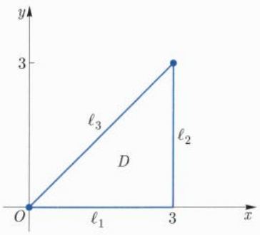

<details>
<summary>text_image</summary>

y
3
ℓ₃
D
ℓ₂
O
ℓ₁
3
x
</details>

图15.8

解 我们只要求出 $f$ 在 $D$ 上的最大值和最小值. 由于 $f$ 连续可微, 其最大值和最小值在边界或驻点取得.

(1) 在边界 $\ell_1: y = 0, 0 \leqslant x \leqslant 3$ 上, 有 $f(x,0) = 4x^3 - 33x$. 该函数在 $[0,3]$ 上有驻点 $\frac{\sqrt{11}}{2}$. 因此, $f$ 在 $\ell_1$ 上可能的最值点为 $(0,0)$, $\left(\frac{\sqrt{11}}{2}, 0\right)$ 以及 $(3,0)$.
(2) 在边界 $\ell_2: x = 3, 0 \leqslant y \leqslant 3$ 上, 有 $f(3, y) = 9 - 120y + 48y^2$. 该函数在 $[0, 3]$ 上有驻点 $\frac{5}{4}$. 因此, $f$ 在 $\ell_2$ 上可能的最值点为 $(3, 0)$, $\left(3, \frac{5}{4}\right)$ 以及 $(3, 3)$.
(3) 在边界 $\ell_3: y = x, 0 \leqslant x \leqslant 3$ 上, 有 $f(x, x) = 12x^3 - 81x$. 该函数在 $[0, 3]$ 上有驻点 $\frac{3}{2}$. 因此, $f$ 在 $\ell_3$ 上可能的最值点为 $(0, 0)$, $\left(\frac{3}{2}, \frac{3}{2}\right)$ 和 $(3, 3)$.
(4) 在 $f$ 定义域的内部, $f$ 可能的最值点必为驻点, 它为以下方程的解:

$$
\left\{ \begin{array}{l} f _ {x} (x, y) = 1 2 x ^ {2} - 1 6 x y + 1 6 y ^ {2} - 3 3 = 0, \\ f _ {y} (x, y) = - 8 x ^ {2} + 3 2 x y - 4 8 = 0. \end{array} \right.
$$

求得 $D$ 内的驻点有 $\left(2, \frac{5}{4}\right)$.

计算得到

$$
f (0, 0) = 0, \quad f (3, 0) = 9, \quad f (3, 3) = 8 1,
$$

$$
f \left(\frac {\sqrt {1 1}}{2}, 0\right) = - 1 1 \sqrt {1 1}, \quad f \left(3, \frac {5}{4}\right) = - 6 6, \quad f \left(\frac {3}{2}, \frac {3}{2}\right) = - 8 1, \quad f \left(2, \frac {5}{4}\right) = - 8 4.
$$

因此, $f$ 在 $D$ 上的取值范围是 $[-84, 81]$.

例 15.5.6 试求下面函数的极值:

(1) $f(x,y)=x^{2}+y^{3}-3y;$

(2) $g(x,y) = (y - x^2)(y - 2x^2)$.

解 (1) 容易算出 $f$ 的驻点: $(0,1), (0,-1)$. 又可以计算其 Hesse 矩阵:

$$
\boldsymbol {H} _ {f} (0, 1) = \left( \begin{array}{c c} 2 & 0 \\ 0 & 6 \end{array} \right), \quad \boldsymbol {H} _ {f} (0, - 1) = \left( \begin{array}{c c} 2 & 0 \\ 0 & - 6 \end{array} \right).
$$

---

15.5 Taylor 公式

283

故 $(0, -1)$ 不是极值点而 $(0, 1)$ 为极小值点, 极小值为 $f(0, 1) = -2$.

(2) 容易算出 $(0,0)$ 是 $g$ 的唯一驻点. 在每一条经过 $(0,0)$ 的直线上, $(0,0)$ 都是极小值点, 但它不是 $g$ 在平面上的极值点.

注意曲面 $z = g(x,y)$ 的几何特点对进一步理解题目结论是有益的.

例 15.5.7 求  $f(x,y)=x^{2}+y^{2}(1+x)^{3}$  的极值.

解 容易求得 $(0,0)$ 为 $f$ 的唯一驻点, 且为极小值点, 但 $f(-2,3) = -5 < f(0,0) = 0$, 因此 $(0,0)$ 不是最小值点. □

本例揭示了多元函数和一元函数不同之处: 一元函数的唯一极值点必为最值点.

例 15.5.8 存在有多个 (甚至无穷多个) 极大值点, 但可能无极小值点的多元函数.

解 可以考察例子 $f(x, y) = (1 + \mathrm{e}^y) \cos x - y \mathrm{e}^y$，直接验证.

例 15.5.9 设  $f \in C^{2}(\mathbb{R}^{n})$ ，如果  $H_{f} \geqslant I_{n}$  总成立，其中  $I_{n}$  为 n 阶单位方阵，证明:f 有唯一的最小值点.

证明 根据 Taylor 公式, f 可在原点处展开为

$$
f (\boldsymbol {x}) = f (\boldsymbol {0}) + \nabla f (\boldsymbol {0}) \cdot \boldsymbol {x} + \frac {1}{2} \boldsymbol {x} \boldsymbol {H} _ {f} (\boldsymbol {\xi}) \boldsymbol {x} ^ {\mathrm{T}}.
$$

由假设得

$$
f (\boldsymbol {x}) \geqslant f (\boldsymbol {0}) + \nabla f (\boldsymbol {0}) \cdot \boldsymbol {x} + \frac {1}{2} \| \boldsymbol {x} \| ^ {2}, \quad \forall \boldsymbol {x} \in \mathbb {R} ^ {n}.
$$

特别地, 当 $\| \pmb{x} \| \to \infty$ 时, $f(\pmb{x}) \to \infty$, 这说明 $f$ 的最小值存在. 设 $\pmb{x}_0$ 为最小值点. 在 $\pmb{x}_0$ 处, $\nabla f(\pmb{x}_0) = 0$, 且 $f$ 的 Taylor 公式形如

$$
f (\boldsymbol {x}) = f (\boldsymbol {x} _ {0}) + \frac {1}{2} (\boldsymbol {x} - \boldsymbol {x} _ {0}) \boldsymbol {H} _ {f} (\boldsymbol {\zeta}) (\boldsymbol {x} - \boldsymbol {x} _ {0}) ^ {\mathrm{T}},
$$

由已知条件得 $f(\pmb {x})\geqslant f(\pmb {x}_0) + \frac{1}{2}\| \pmb {x} - \pmb {x}_0\| ^2$ ，特别地， $\pmb{x_0}$ 为唯一的最小值点.

例 15.5.10 (最小二乘法) 设  $(x_{i}, y_{i})$  ( $i = 1, 2, \cdots, n$ ) 为平面  $R^{2}$  上 n 个互异点，求一条直线  $y = ax + b$ ，使得  $F(a, b) = \sum_{i=1}^{n} (ax_{i} + b - y_{i})^{2}$  最小.

解 $F(a,b)$ 是关于 $(a,b)$ 的光滑函数，其驻点必满足

$$
\frac {\partial F}{\partial a} = 2 \sum_ {i = 1} ^ {n} x _ {i} (a x _ {i} + b - y _ {i}) = 0,
$$

$$
\frac {\partial F}{\partial b} = 2 \sum_ {i = 1} ^ {n} (a x _ {i} + b - y _ {i}) = 0,
$$

可得唯一驻点

$$
a = c ^ {- 1} \left(n \sum_ {i = 1} ^ {n} x _ {i} y _ {i} - \sum_ {i = 1} ^ {n} x _ {i} \sum_ {i = 1} ^ {n} y _ {i}\right),
$$

$$
b = c ^ {- 1} \left(\sum_ {i = 1} ^ {n} x _ {i} ^ {2} \sum_ {i = 1} ^ {n} y _ {i} - \sum_ {i = 1} ^ {n} x _ {i} \sum_ {i = 1} ^ {n} x _ {i} y _ {i}\right),
$$

---

284

第十五章 多元函数微分学及其应用

其中

$$
c = n \sum_ {i = 1} ^ {n} x _ {i} ^ {2} - \left(\sum_ {i = 1} ^ {n} x _ {i}\right) ^ {2} = \frac {1}{2} \sum_ {i \neq j} (x _ {i} - x _ {j}) ^ {2} > 0.
$$

由于当 $\| (a,b)\| \to \infty$ 时 $F(a,b)\to \infty ,F$ 有最小值，从而求出的唯一驻点必为最小值点.此时，所求直线方程可写为

$$
\left| \begin{array}{c c c} x & y & 1 \\ \sum_ {i = 1} ^ {n} x _ {i} & \sum_ {i = 1} ^ {n} y _ {i} & n \\ \sum_ {i = 1} ^ {n} x _ {i} ^ {2} & \sum_ {i = 1} ^ {n} x _ {i} y _ {i} & \sum_ {i = 1} ^ {n} x _ {i} \end{array} \right| = 0.
$$

## 习题 15.5

1. 利用微分作近似计算:

(1) $1.002^{2} \times 2.003^{2} \times 3.004^{3}$; (2) $0.97^{1.05}$.

2. 设 $f$ 为 $C^k$ 函数, 记 $\varphi(t) = f(\boldsymbol{a} + t(\boldsymbol{x} - \boldsymbol{a}))$, 利用数学归纳法证明:

$$
\varphi^ {(k)} (t) = \sum_ {| \alpha | = k} \frac {k !}{\alpha !} D ^ {\alpha} f (\boldsymbol {a} + t (\boldsymbol {x} - \boldsymbol {a})) (\boldsymbol {x} - \boldsymbol {a}) ^ {\alpha}.
$$

3. 求下列函数在指定点处的 Taylor 展开:

(1) $f(x,y) = 2x^{2} - xy - y^{2} - 6x - 3y + 5, (x,y) = (1, -2)$.
(2) $f(x,y,z) = x^{3} + y^{3} + z^{3} - 3xyz,\quad (x,y,z) = (1,1,1).$
(3) $f(x,y) = (1 + x)^{m}(1 + y)^{n},\quad m,n$ 为正整数， $(x,y) = (0,0)$
(4) $f(x,y) = \mathrm{e}^{x + y},\quad (x,y) = (0,0).$

4. 设函数 $f$ 的直到 $m$ 阶的各种偏导数都在 $a$ 处连续, 且在 $a$ 附近, 有

$$
f (x) = \sum_ {k = 0} ^ {m} \sum_ {| \alpha | = k} c _ {\alpha} (\boldsymbol {x} - \boldsymbol {a}) ^ {\alpha} + o (\| \boldsymbol {x} - \boldsymbol {a} \| ^ {m}).
$$

证明: $c_{\alpha} = \frac{1}{\alpha!} D^{\alpha}f(\pmb {a}),\forall |\pmb {\alpha}|\leqslant m.$

5. 对下列函数作 Taylor 展开到指定项:

(1) $f(x,y)=x^{y}$ ，在(1,1)处展开到二次项.
(2) $f(x,y) = \frac{\cos x}{\cos y}$, 在 $(0,0)$ 处展开到二次项.
(3) $f(x,y)=\sin(x^{2}+y^{2})$ ，在(0,0)处展开到六次项.
(4) $f(x,y) = \arctan \frac{y}{1 + x^2}$, 在 $(0,0)$ 处展开到四次项.

6. 将下列多项式在指定点处展开成 Taylor 多项式:

---

15.5 Taylor公式

285

(1) $2x^{2}-xy-y^{2}-6x-3y+5$ 在点 $(1,-2)$ 处.
(2) $x^{3}+y^{3}+z^{3}-3xyz$ 在点 $(1,1,1)$ 处.

7. 考察二次多项式

$$
f (x, y, z) = \left( \begin{array}{c c c} x & y & z \end{array} \right) \left( \begin{array}{c c c} A & D & F \\ D & B & E \\ F & E & C \end{array} \right) \left( \begin{array}{c} x \\ y \\ z \end{array} \right),
$$

将 $f(x + \Delta x, y + \Delta y, z + \Delta z)$ 按 $\Delta x, \Delta y, \Delta z$ 的正整数幂展开.

8. 将  $x^{r}$  (r > 0) 在点 (1, 1) 作 Taylor 展开, 写到二次项.

9. 设函数  $F(x,y)$  在  $(x_{0},y_{0})$  的某邻域内二阶连续可微, 且

$$
\frac {\partial F \left(x _ {0} , y _ {0}\right)}{\partial x} = 0, \quad \frac {\partial F \left(x _ {0} , y _ {0}\right)}{\partial y} > 0, \quad \frac {\partial^ {2} F \left(x _ {0} , y _ {0}\right)}{\partial x ^ {2}} <   0.
$$

设 $y = y(x)$ 是由 $F(x,y) = 0$ 确定的函数. 试讨论上述条件下 $y = y(x)$ 在 $x_0$ 处的极值性.

10. 设 $f$ 为凸域 $D$ 中的可微函数. 证明: $f$ 为凸函数当且仅当

$$
(\nabla f (\boldsymbol {x}) - \nabla f (\boldsymbol {y})) \cdot (\boldsymbol {x} - \boldsymbol {y}) \geqslant 0, \quad \forall \boldsymbol {x}, \boldsymbol {y} \in D.
$$

11. 求下列函数的驻点, 并判断是否为极值点, 是什么类型的极值点:

(1) $f(x,y)=y^{2}(\sin x-x/2);$

(2) $f(x,y)=\cos(x+y)+\sin(x-y);$

(3) $f(x,y)=y^{x};$

(4) $f(x,y)=x/y-xy;$

(5) $f(x,y)=(x^{2}+y^{2})\mathrm{e}^{-x^{2}-y^{2}};$

(6) $f(x,y) = y\mathrm{e}^{-x^2}$

12. 求下列函数的极值:

(1) $f(x,y)=4(x-y)-x^{2}-y^{2};$

(2) $f(x,y)=x^{2}+(y-1)^{2};$

(3) $f(x,y)=x^{2}+xy+y^{2}+x-y+1;$

(4) $f(x,y) = x^{3} + y^{3} - 3xy.$

13. 设 $f(x, y) = 4x^2y - x^4 - 2y^2$，证明 (0,0) 是鞍点。但点 (0,0) 是一元函数 $g(t) = f(t\cos \theta, t\sin \theta)$ 的极大值点。

14. 设 $D \subseteq \mathbb{R}^n$ 为区域, $f \in C^2(D)$. 如果 $\Delta f \geqslant 0$, 证明: $f$ 在 $D$ 内无极大值点, 除非 $f$ 为常值函数.

15. 设  $x^{1}, \cdots, x^{k}$  为  $R^{n}$  中的有限个点. 记  $\varphi(x) = \sum_{i=1}^{k} \|x - x^{i} \|, \psi(x) = \sum_{i=1}^{k} \|x - x^{i} \|^{2}$ . 证明  $\varphi, \psi$  为凸函数, 并求  $\psi$  的最小值点.

16. 求函数 $f(x, y) = xy \sqrt{1 - \frac{x^2}{a^2} - \frac{y^2}{b^2}}$ ($a > 0, b > 0$) 的极值.

17. 设函数 $z(x, y)$ 是有界闭区域 $D$ 上的连续函数, 在 $D$ 内部偏导数存在, 在 $D$ 的边界上其值为 0 , 在 $D$ 的内部满足 $z_{x} + z_{y} = f(z)$, 其中 $f$ 是一个严格单调函数, $f(0) = 0$. 证明: $z(x, y) \equiv 0 ((x, y) \in D)$.

---

286

第十五章 多元函数微分学及其应用

18. 设 $z = f(x, y)$ 是定义在整个平面上的光滑函数, 对每一个 $\alpha$, 定义一元函数 $g_{\alpha}(t) = f(t \cos \alpha, t \sin \alpha)$. 若对任何的 $\alpha$, 有 $\frac{\mathrm{d}g_{\alpha}(0)}{\mathrm{d}t} = 0$, $\frac{\mathrm{d}^2 g_{\alpha}(0)}{\mathrm{d}t^2} > 0$. 证明: 点 $(0, 0)$ 是 $f(x, y)$ 的极小值点.

19. 设 $z = f(x, y)$ 是定义在整个平面上的光滑函数, 对每一个 $\alpha$, 定义一元函数 $g_{\alpha}(t) = f(t \cos \alpha, t \sin \alpha)$. 若对任何的 $\alpha$, 函数 $g_{\alpha}(x)$ 在 $x = 0$ 处都取到极小值. 问: 点 $(0, 0)$ 一定是 $f(x, y)$ 的极小值点吗?

20. 证明: (1) 定义在凸域上的多元凸函数一定是连续函数.

(2) 凸函数的局部极小必为整体极小. 即: 如果 $f(\pmb{x})$ 是开区域 $D \subseteq \mathbb{R}^n$ 上的凸函数, $P_0 \in D$ 是 $f(\pmb{x})$ 的极小值点, 那么它也是 $f(\pmb{x})$ 在 $D$ 上的最小值点.

21. 设点  $\boldsymbol{a}=(a_{1},a_{2},\cdots,a_{n})$  是多元函数  $y=f(x_{1},x_{2},\cdots,x_{n})$  的极大值点，且在点 a 处二阶偏导数  $f_{x_{i}x_{i}}, i=1,2,\cdots,n$  都存在。证明:

$$
\Delta f (a _ {1}, a _ {2}, \dots , a _ {n}) = \sum_ {i = 1} ^ {n} \frac {\partial^ {2} f}{\partial x _ {i} ^ {2}} (a _ {1}, a _ {2}, \dots , a _ {n}) \leqslant 0.
$$

22. 设 $f(x, y, z)$ 是 $C^2$ 的 $n$ 次齐次函数, 证明:

$$
\left(x \frac {\partial}{\partial x} + y \frac {\partial}{\partial y} + z \frac {\partial}{\partial z}\right) ^ {n} f (x, y, z) = n! f (x, y, z).
$$

23. 设有界区域 $D \subset \mathbb{R}^n$ 有光滑边界, 如果 $f(\pmb{x})$ 是 $\overline{D}$ 上的 $C^2$ 函数, 满足 $\Delta f(\pmb{x}) > 0$, 证明: $f(\pmb{x})$ 不可能在 $D$ 的内部达到最大值.

24. 设 $D \subset \mathbb{R}^n$ 是有界闭区域, $u = u(\pmb{x})$ 是 $D$ 内的 $C^2$ 函数, 满足

$$
\Delta u + c u = 0, \quad \text {其中} c <   0 \text {为常数}.
$$

证明: $u$ 在 $D$ 上的正的最大值 (负的最小值) 不可能在 $D$ 的内部达到. 而且, 如果 $u$ 在 $D$ 上连续, 在 $D$ 的边界 $\partial D$ 上为零, 则 $u$ 在 $D$ 上恒为零.

## 15.6 隐函数存在定理

本节考虑由方程 $F(\pmb {x},\pmb {y}) = 0$ 确定的隐函数 $\pmb {y} = \pmb {y}(\pmb {x})$ 的存在性问题以及相应的分析性质.主要包括三个基本定理，隐函数存在定理、隐函数方程组存在定理(隐映射定理)，逆映射存在定理(逆映射定理).三者紧密相关，在数学分析中都具有极其重要的地位和理论意义，同时在相关分支中，有着广泛的应用.

---

15.6 隐函数存在定理

287

## 1. 单个方程的情形

首先, 我们讨论单个方程时隐函数存在的充分条件. 为此, 我们先 “掩耳盗铃” 一下, 分析下面这个夸张的例子:

考虑隐函数 $F(x, y) = ax + by + c = 0$，问何时可由此方程确定出 $y$ 是 $x$ 的函数关系 $y = y(x)$? 即，在 $F = 0$ 限定条件下，在使得 $F$ 有意义的范围内，任给一个 $x$，都能断定存在唯一的一个 $y$ 使得 $F = 0$ 成立.

对于这个具体问题, 答案是显而易见的. 即, 如果 $b \neq 0$, 则可以唯一确定一个函数关系 $y = y(x)$. 而且, 至于 $x$ 是一元变量还是多元变量, 都丝毫不影响 $y$ 是 $x$ 的函数关系. 那么 $b \neq 0$ 这个条件, 在稍微更一般的表达式 $F(x, y) = 0$ 中, 又是如何表现的呢? 事实上, 稍微分析一下可解的本质, 即可发现, 当 $x$ 做微小改变时, 要使得 $y$ 以函数关系依赖于 $x$, 必须导致 $y$ 也产生变动. 把这个表现抽取出来, 即为 $F_y(x, y) \neq 0$.

定理 15.6.1 (隐函数存在定理) 设  $\Omega \subseteq R^{n}$  为区域, F 是定义在  $\Omega \times (a, b)$  上的  $C^{1}$  函数, 设  $x_{0} \in \Omega, y_{0} \in (a, b)$ , 满足

(1) $F(\boldsymbol{x}_{0},y_{0})=0.$
(2) $F_{y}(\boldsymbol{x}_{0}, y_{0}) \neq 0.$

则存在 $\delta > 0$ 以及 $\eta > 0$, 使得对任何 $\pmb{x} \in B_{\delta}(\pmb{x}_0)$, 存在唯一的 $y = \varphi(\pmb{x}) \in (y_0 - \eta, y_0 + \eta)$ 使得

$$
F (\boldsymbol {x}, \varphi (\boldsymbol {x})) \equiv 0.
$$

进一步， $\varphi (\pmb {x})$ 在 $B_{\delta}(\pmb{x}_0)$ 内连续可微，且

$$
\varphi_ {\boldsymbol {x}} (\boldsymbol {x}) = - \frac {F _ {\boldsymbol {x}} (\boldsymbol {x} , \varphi (\boldsymbol {x}))}{F _ {y} (\boldsymbol {x} , \varphi (\boldsymbol {x}))}, \quad \forall \boldsymbol {x} \in B _ {\delta} (\boldsymbol {x} _ {0}). \tag {15.6.1}
$$

注意, 定理中的符号  $\varphi_{\boldsymbol{x}}(\boldsymbol{x})$  和  $F_{\boldsymbol{x}}(\boldsymbol{x}, \varphi(\boldsymbol{x}))$  的含义是指偏导数对应的分量相等. 用分量表示则为:

设  $F(\boldsymbol{x},y)=F(x_{1},x_{2},\cdots,x_{n},y)$ ,  $y=\varphi(\boldsymbol{x})=\varphi(x_{1},x_{2},\cdots,x_{n})$ . 关系式 (15.6.1) 等价于

$$
\frac {\partial y}{\partial x _ {i}} = \varphi_ {x _ {i}} (\boldsymbol {x}) = - \frac {F _ {x _ {i}} (\boldsymbol {x} , \varphi (\boldsymbol {x}))}{F _ {y} (\boldsymbol {x} , \varphi (\boldsymbol {x}))}, \quad i = 1, 2, \dots , n, \forall \boldsymbol {x} \in B _ {\delta} (\boldsymbol {x} _ {0}).
$$

证明 不妨设 $\gamma \equiv F_y(x_0, y_0) > 0$. 由 $F_y$ 的连续性, 存在 $\delta_0 > 0, \eta > 0$ 使得

$$
F _ {y} (\boldsymbol {x}, y) > \frac {\gamma}{2} > 0, \quad \forall (\boldsymbol {x}, y) \in B _ {\delta_ {0}} (\boldsymbol {x} _ {0}) \times [ y _ {0} - \eta , y _ {0} + \eta ]. \tag {15.6.2}
$$

因此， $F(\pmb{x}_0,y_0 + \eta) > F(\pmb{x}_0,y_0) = 0 > F(\pmb{x}_0,y_0 - \eta)$ 进一步，由 $F$ 的连续性，存在$\delta \in (0,\delta_0)$ 使得

$$
F (\boldsymbol {x}, y _ {0} + \eta) > 0 > F (\boldsymbol {x}, y _ {0} - \eta), \quad \forall \boldsymbol {x} \in B _ {\delta} (\boldsymbol {x} _ {0}). \tag {15.6.3}
$$

---

288

第十五章 多元函数微分学及其应用

对于固定的  $\boldsymbol{x} \in B_{\delta}(\boldsymbol{x}_{0})$ ，由介值定理，并注意到  $F(\boldsymbol{x}, y)$  关于 y 在  $[y_{0} - \eta, y_{0} + \eta]$  上严格单增，我们知有唯一的  $\varphi(\boldsymbol{x}) \in (y_{0} - \eta, y_{0} + \eta)$  满足  $F(\boldsymbol{x}, \varphi(\boldsymbol{x})) = 0$ 。进一步，对于  $x_{1}, x_{2} \in B_{\delta}(\boldsymbol{x}_{0})$ ，由 (15.6.2) 式，我们有

$$
\begin{array}{l} \frac {\gamma}{2} | \varphi (\boldsymbol {x} _ {1}) - \varphi (\boldsymbol {x} _ {2}) | \leqslant \left| F (\boldsymbol {x} _ {1}, \varphi (\boldsymbol {x} _ {1})) - F (\boldsymbol {x} _ {1}, \varphi (\boldsymbol {x} _ {2})) \right| \\ = \big | F (\pmb {x} _ {2}, \varphi (\pmb {x} _ {2})) - F (\pmb {x} _ {1}, \varphi (\pmb {x} _ {2})) \big |. \tag {15.6.4} \\ \end{array}
$$

从而由 $F$ 的连续性即得 $\varphi$ 在 $\pmb{x} \in B_{\delta}(\pmb{x}_0)$ 内连续。另一方面，固定 $\pmb{x} \in B_{\delta}(\pmb{x}_0)$，当 $0 < |\Delta \pmb{x}| < \delta - |\pmb{x} - \pmb{x}_0|$ 时，由微分中值定理，存在 $\theta \equiv \theta_{\pmb{x}, \Delta \pmb{x}} \in (0,1)$ 使得

$$
\begin{array}{l} 0 = F (\boldsymbol {x} + \Delta \boldsymbol {x}, \varphi (\boldsymbol {x} + \Delta \boldsymbol {x})) - F (\boldsymbol {x}, \varphi (\boldsymbol {x})) \\ = F _ {\boldsymbol {x}} (\boldsymbol {x} + \theta \Delta \boldsymbol {x}, \varphi (\boldsymbol {x}) + \theta \Delta y) \Delta \boldsymbol {x} + F _ {y} (\boldsymbol {x} + \theta \Delta \boldsymbol {x}, \varphi (\boldsymbol {x}) + \theta \Delta y) \Delta y, \tag {15.6.5} \\ \end{array}
$$

其中  $\Delta y := \varphi(\boldsymbol{x} + \Delta\boldsymbol{x}) - \varphi(\boldsymbol{x})$ . 因此,

$$
\begin{array}{l} \varphi (\boldsymbol {x} + \Delta \boldsymbol {x}) - \varphi (\boldsymbol {x}) = - \frac {F _ {\boldsymbol {x}} (\boldsymbol {x} + \theta \Delta \boldsymbol {x} , \varphi (\boldsymbol {x}) + \theta \Delta y)}{F _ {y} (\boldsymbol {x} + \theta \Delta \boldsymbol {x} , \varphi (\boldsymbol {x}) + \theta \Delta y)} \Delta \boldsymbol {x} \\ = - \frac {F _ {\boldsymbol {x}} (\boldsymbol {x} , \varphi (\boldsymbol {x}))}{F _ {y} (\boldsymbol {x} , \varphi (\boldsymbol {x}))} \Delta \boldsymbol {x} + r (\boldsymbol {x}, \Delta \boldsymbol {x}), \tag {15.6.6} \\ \end{array}
$$

其中

$$
\lim _ {\Delta \boldsymbol {x} \to 0} \frac {| r (\boldsymbol {x} , \Delta \boldsymbol {x}) |}{| \Delta \boldsymbol {x} |} = \lim _ {\Delta \boldsymbol {x} \to 0} \frac {1}{| \Delta \boldsymbol {x} |} \left| \left(\frac {F _ {\boldsymbol {x}} (\boldsymbol {x} + \theta \Delta \boldsymbol {x} , \varphi (\boldsymbol {x}) + \theta \Delta y)}{F _ {y} (\boldsymbol {x} + \theta \Delta \boldsymbol {x} , \varphi (\boldsymbol {x}) + \theta \Delta y)} - \frac {F _ {\boldsymbol {x}} (\boldsymbol {x} , \varphi (\boldsymbol {x}))}{F _ {y} (\boldsymbol {x} , \varphi (\boldsymbol {x}))}\right) \Delta \boldsymbol {x} \right| = 0. \tag {15.6.7}
$$

故 $\varphi$ 在 $B_{\delta}(\pmb{x}_0)$ 内连续可微且(15.6.1)式成立.

注15.6.1 定理的结果表明方程 $F(\pmb{x},y) = 0$ 在 $(\pmb{x}_0,y_0)$ 附近确定（唯一的）一个隐函数 $y = \varphi (\pmb {x})$ .需要强调这里的唯一性是指 $\varphi (\pmb {x})$ 的取值是限制在 $y_{0}$ 的一个邻域内的.在更大的范围内，唯一性自然不一定成立.因此，我们不能说方程 $F(\pmb {x},y) = 0$ 在 $\pmb{x}_0$ 附近唯一地确定了一个隐函数.

例如, 对于方程 $F(x,y) \equiv x^{2} + y^{2} - 1 = 0$, 以及 $(x_0,y_0) = \left(\frac{\sqrt{2}}{2},\frac{\sqrt{2}}{2}\right)$, 可得 $F(x_0,y_0) = 0$ 以及 $F_y(x_0,y_0) \neq 0$. 该方程在 $(x_0,y_0)$ 附近, $x \in (x_0 - \delta, x_0 + \delta)$, 确定一个隐函数 $y(x) = \sqrt{1 - x^2}$. 而方程 $F = 0$ 本身对应于 $x \in (x_0 - \delta, x_0 + \delta)$ 的解并不唯一: $y(x) = \pm \sqrt{1 - x^2}$. 所以如果考虑 $(x_0,y_0)$ 附近的函数关系, 则把 $y(x) = -\sqrt{1 - x^2}$ 排除在外了.

注 15.6.2 当 F 的光滑性不同时, 定理有多种不同的版本. 粗略说来, 如果定理中 F 是  $C^{k}$  光滑函数  $(k=1,2,\cdots,\infty)$ , 那么定理中的  $\varphi(\boldsymbol{x})$  也将是  $C^{k}$  光滑的.

---

15.6 隐函数存在定理

289

另外, 从定理的证明可以看出, 如果仅要求函数 $y = \varphi(\boldsymbol{x})$ 的 (局部) 存在性, 而不关心 $\varphi(\boldsymbol{x})$ 的导数的话, 那么在其他条件不变的情况下, 条件 $F: \Omega \times (a, b) \to \mathbb{R}$ 是 $C^1(\Omega \times (a, b))$ 函数, 可以不要求 $F_{\boldsymbol{x}}(\boldsymbol{x}, y)$ 连续, 甚至可以不存在.

进一步, 定理还可以有相应的 $C^0$ 版本. 即, 如果定理中 $F$ 是 $C^0$ 连续函数, 而且关于 $y$ 严格单调, 则 $\varphi(x)$ 存在且也是连续的. 这里关于 $y$ 严格单调的假设起到 $C^1$ 框架下 $F_y \neq 0$ 的作用.

定理中的条件 $F_{y}(\pmb{x}_{0},y_{0})\neq 0$ 是充分而非必要的.例如，考虑隐函数 $F(x,y) = y^{3} - x^{3} = 0$ 在点 $(x_0,y_0) = (0,0)$ 附近，我们一方面有 $F_{y}(0,0) = 0$ ，但另一方面，方程显然可以确定唯一的函数关系 $y = x$

例 15.6.1 设  $x = x(y, z)$ ,  $y = y(x, z)$ ,  $z = z(x, y)$  都是由  $F(x, y, z) = 0$  确定的隐函数, 假设它们具有连续的偏导数, 试证明:

$$
\frac {\partial x}{\partial y} \frac {\partial y}{\partial z} \frac {\partial z}{\partial x} = - 1, \quad \frac {\partial x}{\partial y} \frac {\partial x}{\partial z} \frac {\partial y}{\partial x} \frac {\partial y}{\partial z} \frac {\partial z}{\partial x} \frac {\partial z}{\partial y} = 1.
$$

证明 由隐函数存在定理, 得

$$
\frac {\partial x}{\partial y} = - \frac {F _ {y}}{F _ {x}}, \quad \frac {\partial y}{\partial z} = - \frac {F _ {z}}{F _ {y}}, \quad \frac {\partial z}{\partial x} = - \frac {F _ {x}}{F _ {z}},
$$

代入即可. 同理可证第二个关系式.

例15.6.2 考虑Kepler方程

$$
y - x - \varepsilon \sin y = 0, \quad 0 <   \varepsilon <   1,
$$

确定的隐函数  $y = f(x)$ ，求  $f'(x)$ .

解 把 $y$ 视为 $x$ 的函数 $y = f(x)$, 即 $f(x) - x - \varepsilon \sin f(x) \equiv 0$. 方程两端对 $x$ 求导数, 得

$$
f ^ {\prime} (x) (1 - \varepsilon \cos f (x)) - 1 = 0.
$$

即

$$
f ^ {\prime} (x) = \frac {1}{1 - \varepsilon \cos f (x)}.
$$

## 2. 方程组的情形

上面对单个方程的隐函数讨论可以推广到多个方程, 即方程组的情况, 或者说向量值函数 (即映射) 的情况. 为了更深刻理解更一般的情况, 我们以线性代数中的方程组为例来说明其基本思想.

---

290

第十五章 多元函数微分学及其应用

考虑由两个方程组成的方程组的求解问题:

$$
\left\{ \begin{array}{l} F (x, u, v) = 0, \\ G (x, u, v) = 0. \end{array} \right.
$$

对比前面讨论的单个方程的情形, 如果我们希望由 $F(x,y) = 0$ 解出 $y$ 关于 $x$ 的函数, 则是通过假设 $F_{y}(x,y) \neq 0$ 来保证的. 现在在多个方程时, $F_{y}(x,y) \neq 0$ 的表现形式如何?

为此, 我们仍然返回到更简单的情况: 设

$$
\left\{ \begin{array}{l} F (x, u, v) = f _ {x} x + a _ {u} u + a _ {v} v, \\ G (x, u, v) = g _ {x} x + b _ {u} u + b _ {v} v, \end{array} \right.
$$

其中 $a_{u}, a_{v}, b_{u}, b_{v}, f_{x}, g_{x}$ 均为常数. 此时我们的问题无异于求解方程组

$$
\left\{ \begin{array}{l} a _ {u} u + a _ {v} v = - f _ {x} x, \\ b _ {u} u + b _ {v} v = - g _ {x} x. \end{array} \right.
$$

由线性代数的理论知, 这个方程组有唯一解的充要条件是其系数行列式

$$
\left| \begin{array}{c c} a _ {u} & a _ {v} \\ b _ {u} & b _ {v} \end{array} \right| = a _ {u} b _ {v} - a _ {v} b _ {u} \neq 0.
$$

注意到

$$
F _ {u} = a _ {u}, \quad F _ {v} = a _ {v}, \quad G _ {u} = b _ {u}, \quad G _ {v} = b _ {v}.
$$

因此我们猜测对于一般的 $F$ 和 $G$, 条件

$$
\left| \begin{array}{c c} F _ {u} & F _ {v} \\ G _ {u} & G _ {v} \end{array} \right| \neq 0
$$

可以保证隐函数方程组的可解性. 自然, 由于是非线性情况, 这里的可解很有可能是局部的. 另外, 我们也看出, 这里的 $x$ 是一元变量还是多元变量, 丝毫不影响 $u, v$ 的可解性. 换句话说, 这里的关键是上面行列式的非零性.

给定可微函数 $F(x,y),G(x,y)$ ，我们称行列式

$$
\left| \begin{array}{c c} F _ {u} & F _ {v} \\ G _ {u} & G _ {v} \end{array} \right|
$$

为 $F, G$ 的 Jacobi 行列式, 记作

$$
J = \frac {\partial (F , G)}{\partial (u , v)} = \left| \begin{array}{c c} F _ {u} & F _ {v} \\ G _ {u} & G _ {v} \end{array} \right|.
$$

---

15.6 隐函数存在定理

291

更一般地, $n$ 个可微函数 $F_{i}(x_{1}, x_{2}, \cdots, x_{n}), i = 1, 2, \cdots, n$ 的 Jacobi 行列式是一个 $n \times n$ 矩阵给出的行列式, 定义为

$$
J = \frac {\partial (F _ {1} , F _ {2} , \cdots , F _ {n})}{\partial (x _ {1} , x _ {2} , \cdots , x _ {n})} = \det \left(\frac {\partial F _ {i}}{\partial x _ {j}}\right).
$$

我们有下面的定理:

定理 15.6.2（隐映射定理） 设  $W \subseteq R^{n} \times R^{m}$  为开集, W 中的点用  $(x, y)$  表示, 其中  $\boldsymbol{x} = (x_{1}, x_{2}, \cdots, x_{n})$ ,  $\boldsymbol{y} = (y_{1}, y_{2}, \cdots, y_{m})$ . 设

$$
\boldsymbol {F} (\boldsymbol {x}, \boldsymbol {y}) = (F _ {1} (\boldsymbol {x}, \boldsymbol {y}), F _ {2} (\boldsymbol {x}, \boldsymbol {y}), \dots , F _ {m} (\boldsymbol {x}, \boldsymbol {y}))
$$

是 $W$ 到 $\mathbb{R}^m$ 的 $C^1$ 映射， $(\pmb{x}_0,\pmb{y}_0)\in W$ ，满足

(i)  $\boldsymbol{F}(\boldsymbol{x}_{0}, \boldsymbol{y}_{0}) = \boldsymbol{0}.$
(ii)  $\det J_{\mathbf{y}}\mathbf{F}(\mathbf{x}_{0},\mathbf{y}_{0})\neq0,$  其中  $J_{\mathbf{y}}\mathbf{F}(\mathbf{x},\mathbf{y})=\left(\frac{\partial F_{i}}{\partial y_{j}}(\mathbf{x},\mathbf{y})\right)_{m\times m}.$

则存在  $x_{0}$  的开邻域  $V \subseteq R^{n}$  以及唯一的  $C^{1}$  映射  $\psi: V \to R^{m}$ ，使得

(1) $\boldsymbol{y}_{0}=\psi(\boldsymbol{x}_{0}),\boldsymbol{F}(\boldsymbol{x},\psi(\boldsymbol{x}))=\boldsymbol{F}(\boldsymbol{x}_{0},\boldsymbol{y}_{0}),\forall\boldsymbol{x}\in V.$
(2) $J\psi (\pmb {x}) = -\left(J_{\pmb{y}}\pmb {F}(\pmb {x},\psi (\pmb {x}))\right)^{-1}J_{\pmb{x}}\pmb {F}(\pmb {x},\psi (\pmb {x}))$ ，其中 $J_{\pmb{x}}\pmb {F}(\pmb {x},\pmb {y}) = \left(\frac{\partial F_i}{\partial x_j} (\pmb {x},\pmb {y})\right)_{m\times n}$

类似于隐函数存在定理, 隐映射定理同样也有  $C^{k}$  版本,  $k = 1, 2, \cdots, \infty$ . 即, 如果  $\boldsymbol{F}(\boldsymbol{x}, \boldsymbol{y}) \in C^{k}$ , 则定理中的映射  $\psi: V \to R^{m}$  也是  $C^{k}$  的.

隐映射定理的证明有多种方法, 常见的有: 对空间维数 $m$ 用数学归纳法, 讨论函数 $\| \boldsymbol{F} \|$ 的极值法、不动点法, 以及先证明逆映射定理然后应用逆映射定理的方法. 我们采用数学归纳法证明, 其特点是相对而言较为初等和直接.

证明 我们对 $m$ 作归纳证明. 事实上, 整个证明的核心思想将在 $m = 2$ 时充分体现, 所以 $m = 2$ 的证明是最本质的. 至于 $m \geqslant 3$ 的证明则仅仅是形式上的复杂和重复. 因此我们只给出 $m = 2$ 的证明.

注意 $m = 2$ 时, 有 $\pmb{y} = (y_{1}, y_{2})$. 记 $\pmb{y}_{0} = (y_{1}^{0}, y_{2}^{0})$. 由于

$$
\frac {\partial (F _ {1} , F _ {2})}{\partial (y _ {1} , y _ {2})} \bigg | _ {(\boldsymbol {x} _ {0}, \boldsymbol {y} _ {0})} \neq 0.
$$

不妨假设 $\frac{\partial F_2}{\partial y_2} (\pmb{x}_0,\pmb{y}_0)\neq 0.$ 由单个方程的隐函数存在定理知， $\exists \delta_1 > 0$ ，方程

$$
F _ {2} (\boldsymbol {x}, y _ {1}, y _ {2}) = 0
$$

在 $B_{\delta_1}(\pmb{x}_0)\times (y_1^0 -\delta_1,y_1^0 +\delta_1)$ 内唯一确定一个函数

$$
y _ {2} = g (\boldsymbol {x}, y _ {1}),
$$

使得满足

$$
\boldsymbol {F} (\boldsymbol {x}, y _ {1}, g (\boldsymbol {x}, y _ {1})) = 0, \quad y _ {2} ^ {0} = g (\boldsymbol {x} _ {0}, y _ {1} ^ {0})
$$

---

292

第十五章 多元函数微分学及其应用

且 $g(\pmb {x},y_1)$ 在该邻域内具有连续偏导数.将 $y_{2} = g(\pmb {x},y_{1})$ 代入

$$
F _ {1} (\boldsymbol {x}, y _ {1}, y _ {2}) = 0,
$$

得到一个关于 $(\pmb{x},y_{1})$ 的方程

$$
H (\boldsymbol {x}, y _ {1}) = F _ {1} (\boldsymbol {x}, y _ {1}, g (\boldsymbol {x}, y _ {1})) = 0.
$$

由于

$$
\begin{array}{l} \frac {\partial H}{\partial y _ {1}} = \frac {\partial F _ {1}}{\partial y _ {1}} + \frac {\partial F _ {1}}{\partial y _ {2}} \cdot \frac {\partial g (\boldsymbol {x} , y _ {1})}{\partial y _ {1}} = \frac {\partial F _ {1}}{\partial y _ {1}} + \frac {\partial F _ {1}}{\partial y _ {2}} \cdot \left(- \frac {\partial F _ {2}}{\partial y _ {1}} / \frac {\partial F _ {2}}{\partial y _ {2}}\right) \\ = \frac {\partial (F _ {1} , F _ {2})}{\partial (y _ {1} , y _ {2})} \cdot \left(\frac {\partial F _ {2}}{\partial y _ {2}}\right) ^ {- 1}. \\ \end{array}
$$

故有

$$
\frac {\partial H (\boldsymbol {x} _ {0} , y _ {1} ^ {0})}{\partial y _ {1}} = \frac {\partial (F _ {1} , F _ {2})}{\partial (y _ {1} , y _ {2})} \cdot \left(\frac {\partial F _ {2}}{\partial y _ {2}}\right) ^ {- 1} \Bigg | _ {(\boldsymbol {x} _ {0}, \boldsymbol {y} _ {0})} \neq 0.
$$

因此 $\exists \delta_0, 0 < \delta_0 < \delta_1$，使得 $H(\pmb{x}, y_1) = 0$ 在 $B_{\delta_0}(\pmb{x}_0)$ 内唯一确定一个函数 $y_1 = f_1(\pmb{x})$ 满足 $y_1^0 = f_1(\pmb{x}_0)$ 且

$$
F _ {1} \big (\boldsymbol {x}, f _ {1} (\boldsymbol {x}), g \big (\boldsymbol {x}, f _ {1} (\boldsymbol {x}) \big) \big) = 0.
$$

记

$$
y _ {1} = f _ {1} (\boldsymbol {x}), \quad y _ {2} = f _ {2} (\boldsymbol {x}) = g (\boldsymbol {x}, f _ {1} (\boldsymbol {x})),
$$

则在 $B_{\delta_0}(\pmb{x}_0)$ 内，成立

$$
\left\{ \begin{array}{l} F _ {1} \big (\boldsymbol {x}, f _ {1} (\boldsymbol {x}), f _ {2} (\boldsymbol {x}) \big) = 0, \\ F _ {2} \big (\boldsymbol {x}, f _ {1} (\boldsymbol {x}), f _ {2} (\boldsymbol {x}) \big) = 0, \end{array} \right.
$$

且  $\boldsymbol{y}_{0}=(f_{1}(\boldsymbol{x}_{0}),f_{2}(\boldsymbol{x}_{0}))$ . 再由  $\boldsymbol{F}(\boldsymbol{x},\boldsymbol{y})$  具有连续的偏导数, 可得  $f_{1}(\boldsymbol{x}), f_{2}(\boldsymbol{x})$  在  $B_{\delta_{0}}(\boldsymbol{x}_{0})$  内具有连续的偏导数.

利用复合函数求导法则, 可得

$$
\left\{ \begin{array}{l} \frac {\partial F _ {1}}{\partial x _ {i}} + \frac {\partial F _ {1}}{\partial y _ {1}} \frac {\partial f _ {1}}{\partial x _ {i}} + \frac {\partial F _ {1}}{\partial y _ {2}} \frac {\partial f _ {2}}{\partial x _ {i}} = 0, \\ \frac {\partial F _ {2}}{\partial x _ {i}} + \frac {\partial F _ {2}}{\partial y _ {1}} \frac {\partial f _ {1}}{\partial x _ {i}} + \frac {\partial F _ {2}}{\partial y _ {2}} \frac {\partial f _ {2}}{\partial x _ {i}} = 0, \end{array} \right.
$$

写成向量形式, 有

$$
\left. \left( \begin{array}{c c c c} \frac {\partial f _ {1}}{\partial x _ {1}} & \frac {\partial f _ {1}}{\partial x _ {2}} & \dots & \frac {\partial f _ {1}}{\partial x _ {n}} \\ \frac {\partial f _ {2}}{\partial x _ {1}} & \frac {\partial f _ {2}}{\partial x _ {2}} & \dots & \frac {\partial f _ {2}}{\partial x _ {n}} \end{array} \right) \right| _ {\boldsymbol {x}} = - \left. \left( \begin{array}{c c} \frac {\partial F _ {1}}{\partial y _ {1}} & \frac {\partial F _ {1}}{\partial y _ {2}} \\ \frac {\partial F _ {2}}{\partial y _ {1}} & \frac {\partial F _ {2}}{\partial y _ {2}} \end{array} \right) ^ {- 1} \right| _ {(\boldsymbol {x}, \boldsymbol {y})} \left. \left( \begin{array}{c c c c} \frac {\partial F _ {1}}{\partial x _ {1}} & \frac {\partial F _ {1}}{\partial x _ {2}} & \dots & \frac {\partial F _ {1}}{\partial x _ {n}} \\ \frac {\partial F _ {2}}{\partial x _ {1}} & \frac {\partial F _ {2}}{\partial x _ {2}} & \dots & \frac {\partial F _ {2}}{\partial x _ {n}} \end{array} \right) \right| _ {\boldsymbol {x}}
$$

---

15.6 隐函数存在定理

293

下面证明隐函数解的唯一性. 假设不然, 由 $F(x, y) = 0$ 在 $B_{\delta_0}(x_0)$ 内还有另外一组方程

$$
y _ {1} = \tilde {f} _ {1} (\boldsymbol {x}), \quad y _ {2} = \tilde {f} _ {2} (\boldsymbol {x})
$$

也满足定理要求和结论, 则有 $f_{i}$ 和 $\tilde{f}_{i} (i = 1,2)$ 有相同的偏导数. 从而它们的差 $f_{i} - \tilde{f}_{i}$ 必为常数, 易知此常数必为零. 因此可得 $f_{i} = \tilde{f}_{i}$. □

例 15.6.3 设  $x^{2} + 2y^{2} + 3z^{2} + xy - z - 9 = 0$ ，求 x = 1, y = -2, z = 1 时  $\frac{\partial z}{\partial x}$ ,  $\frac{\partial z}{\partial y}$ ,  $\frac{\partial^{2}z}{\partial y\partial x}$  的值.

解 令 $F(x,y,z) = x^{2} + 2y^{2} + 3z^{2} + xy - z - 9,$ 则

$$
F (1, - 2, 1) = 0, \quad F _ {z} (1, - 2, 1) = (6 z - 1) | _ {z = 1} = 5 \neq 0,
$$

故 $z$ 可局部地表示为 $x, y$ 的函数, 记为 $z = z(x, y)$. 由隐映射定理, 在 $(1, -2, 1)$ 处, 有

$$
\begin{array}{l} (z _ {x}, z _ {y}) = - F _ {z} ^ {- 1} \cdot (F _ {x}, F _ {y}) \\ = - \left. \frac {1}{5} (2 x + y, 4 y + x) \right| _ {(x, y, z) = (1, - 2, 1)} = \left(0, \frac {7}{5}\right). \\ \end{array}
$$

又因为

$$
z _ {y} = - F _ {z} ^ {- 1} \cdot F _ {y} = - \frac {1}{6 z - 1} (4 y + x),
$$

所以

$$
\frac {\partial^ {2} z}{\partial y \partial x} = \frac {6}{(6 z - 1) ^ {2}} \cdot z _ {x} (4 y + x) - \frac {1}{6 z - 1},
$$

从而 $\frac{\partial^2z}{\partial y\partial x} (1, - 2,1) = -\frac{1}{5}.$

## 3. 逆映射定理

回忆一下:对于一元函数，如果它可微且导数处处非零，则该函数可逆且其逆仍可微。下面我们考虑多元向量值函数类似的问题。

例 15.6.4 设 A 为 n 阶方阵, 如果  $\|A\| < 1$ , 则  $I_{n} - A$  可逆.

事实上, 设  $u \in R^{n}$ , 如果  $(I_{n} - A)u = 0$ , 则  $\|u\| = \|Au\| \leqslant \|A\|\cdot\|u\|$ , 由  $\|A\| < 1$  可知 u = 0. 根据线性代数可知  $I_{n} - A$  可逆.

我们也可从分析学观点来看. 给定  $v \in R^{n}$ ，我们解方程

$$
(I _ {n} - A) \pmb {x} = \pmb {v}, \text {即} \pmb {x} = A \pmb {x} + \pmb {v}.
$$

考虑映射 $\varphi (\pmb {x}) = \pmb {A}\pmb {x} + \pmb{v}$ ，当 $x,y\in \mathbb{R}^n$ 时

$$
\| \varphi (\boldsymbol {x}) - \varphi (\boldsymbol {y}) \| = \| \boldsymbol {A} (\boldsymbol {x} - \boldsymbol {y}) \| \leqslant \| \boldsymbol {A} \| \cdot \| \boldsymbol {x} - \boldsymbol {y} \|,
$$

---

294

第十五章 多元函数微分学及其应用

这说明 $\varphi$ 是 $\mathbb{R}^n$ 到自身的压缩映射. 根据压缩映射原理, $\varphi$ 有唯一的不动点, 即 $I_{n} - A$ 可逆.

这个例子意味着, 恒同映射这样一个可逆映射作一个小的扰动以后仍然为可逆映射. 一般地, 任何可逆线性映射在微扰下仍为可逆映射. 对于向量值函数来说, 要知道它在某一点附近是否可逆, 只要在这一点将它线性化, 看看其微分是否可逆. 这里我们需要对函数加一定的可微性条件. 回顾一下, 一个向量值函数称为 $C^k$ 的是指它的每一个分量都是 $C^k$ 函数. 下面的重要结果也称为向量值函数的反函数定理.

定理 15.6.3 (逆映射定理) 设 $D \subseteq \mathbb{R}^n$ 为开集, $f: D \to \mathbb{R}^n$ 为 $C^k (k \geqslant 1)$ 映射, $x_0 \in D$. 如果 $\det J f(x_0) \neq 0$, 则存在 $x_0$ 的开邻域 $U \subseteq D$ 以及 $y_0 = f(x_0)$ 的开邻域 $V \subseteq \mathbb{R}^n$, 使得 $f|_{U}: U \to V$ 是可逆映射, 且其逆映射 $h: V \to U$, $h(y) = x$ 也是 $C^k$ 的, 并且满足

$$
J \boldsymbol {h} (\boldsymbol {y}) = \left(J \boldsymbol {f} (\boldsymbol {h} (\boldsymbol {y}))\right) ^ {- 1}, \forall \boldsymbol {y} \in V.
$$

证明 不失一般性, 可设 $x_0 = 0, y_0 = 0$. 以 $L$ 记 $\pmb{f}$ 在 $x_0 = 0$ 处的微分, 则 $L$ 可逆, 且 $L^{-1} \circ \pmb{f}$ 在 $x_0$ 处的微分为恒同映射. 如果欲证结论对 $L^{-1} \circ \pmb{f}$ 成立, 则对 $\pmb{f}$ 也成立. 因此, 不妨从一开始就假设 $J\pmb{f}(\pmb{x}_0) = \pmb{I}_n$.

在 $x_0 = 0$ 附近, $\pmb{f}$ 是恒同映射的小扰动:

$$
\boldsymbol {f} (\boldsymbol {x}) = \boldsymbol {x} + \boldsymbol {g} (\boldsymbol {x}), \quad J \boldsymbol {g} (\boldsymbol {0}) = \boldsymbol {0}.
$$

扰动项 $g(x) = f(x) - x$ 为 $C^k$ 映射. 因此, 存在 $\delta > 0$ 使得

$$
\| J \boldsymbol {g} (\boldsymbol {x}) \| \leqslant \frac {1}{2}, \forall \boldsymbol {x} \in \overline {{B _ {\delta} (\boldsymbol {0})}} \subseteq D.
$$

由拟微分中值定理可知

$$
\| \boldsymbol {g} (\boldsymbol {x} _ {1}) - \boldsymbol {g} (\boldsymbol {x} _ {2}) \| \leqslant \frac {1}{2} \| \boldsymbol {x} _ {1} - \boldsymbol {x} _ {2} \|, \forall \boldsymbol {x} _ {1}, \boldsymbol {x} _ {2} \in \overline {{B _ {\delta} (\mathbf {0})}}.
$$

给定 $\pmb{y} \in B_{\delta / 2}(\mathbf{0})$ ，我们在 $B_{\delta}(\mathbf{0})$ 中解方程

$$
\pmb {f} (\pmb {x}) = \pmb {y}, \text {即} \pmb {x} = \pmb {y} - \pmb {g} (\pmb {x}). \tag {15.6.8}
$$

记 $\varphi (\pmb {x}) = \pmb {y} - \pmb {g}(\pmb {x})$ .当 $\pmb {x}\in \overline{B_{\delta}(\mathbf{0})}$ 时

$$
\| \varphi (\boldsymbol {x}) \| \leqslant \| \boldsymbol {y} \| + \| \boldsymbol {g} (\boldsymbol {x}) \| <   \frac {\delta}{2} + \frac {1}{2} \| \boldsymbol {x} \| \leqslant \delta . \tag {15.6.9}
$$

这说明 $\varphi (\overline{B_{\delta}(\mathbf{0})})\subset B_{\delta}(\mathbf{0})$ .当 $x_{1},x_{2}\in \overline{B_{\delta}(\mathbf{0})}$ 时

$$
\| \varphi (\boldsymbol {x} _ {1}) - \varphi (\boldsymbol {x} _ {2}) \| = \| \boldsymbol {g} (\boldsymbol {x} _ {2}) - \boldsymbol {g} (\boldsymbol {x} _ {1}) \| \leqslant \frac {1}{2} \| \boldsymbol {x} _ {1} - \boldsymbol {x} _ {2} \|\cdot
$$

根据压缩映射原理, 方程 (15.6.8) 在 $\overline{B_{\delta}(\mathbf{0})}$ 中有唯一解, 记为 $x_{y}$. 由 (15.6.9) 式可知 $x_{y} \in B_{\delta}(\mathbf{0})$. 令

$$
U = \boldsymbol {f} ^ {- 1} \big (B _ {\delta / 2} (\boldsymbol {0}) \big) \cap B _ {\delta} (\boldsymbol {0}), V = B _ {\delta / 2} (\boldsymbol {0}),
$$

---

15.6 隐函数存在定理

295

则我们已经证明了  $f|_{U}: U \rightarrow V$  是一一映射, 其逆映射  $h(y) = x_{y}$  满足

$$
\boldsymbol {y} - \boldsymbol {g} (\boldsymbol {h} (\boldsymbol {y})) = \boldsymbol {h} (\boldsymbol {y}). \tag {15.6.10}
$$

(1) $h:V\to U$ 是连续映射: 当 $y_{1},y_{2}\in V$ 时

$$
\begin{array}{l} \| \boldsymbol {h} (\boldsymbol {y} _ {1}) - \boldsymbol {h} (\boldsymbol {y} _ {2}) \| \leqslant \| \boldsymbol {y} _ {1} - \boldsymbol {y} _ {2} \| + \| \boldsymbol {g} (\boldsymbol {h} (\boldsymbol {y} _ {1})) - \boldsymbol {g} (\boldsymbol {h} (\boldsymbol {y} _ {2})) \| \\ \leqslant \| \boldsymbol {y} _ {1} - \boldsymbol {y} _ {2} \| + \frac {1}{2} \| \boldsymbol {h} (\boldsymbol {y} _ {1}) - \boldsymbol {h} (\boldsymbol {y} _ {2}) \|, \\ \end{array}
$$

这说明 $\| \pmb {h}(\pmb{y}_1) - \pmb {h}(\pmb{y}_2)\| \leqslant 2\| \pmb {y}_1 - \pmb {y}_2\|$, $\forall \pmb{y}_1, \pmb{y}_2 \in V$.

(2) $h:V\to U$ 是可微映射: 设 $y_{0}\in V$, 则对 $y\in V$, 有

$$
\begin{array}{l} \boldsymbol {h} (\boldsymbol {y}) - \boldsymbol {h} \left(\boldsymbol {y} _ {0}\right) = \left(\boldsymbol {y} - \boldsymbol {y} _ {0}\right) - \left(\boldsymbol {g} \left(\boldsymbol {h} (\boldsymbol {y})\right) - \boldsymbol {g} \left(\boldsymbol {h} \left(\boldsymbol {y} _ {0}\right)\right)\right) \\ = (\boldsymbol {y} - \boldsymbol {y} _ {0}) - J \boldsymbol {g} (\boldsymbol {h} (\boldsymbol {y} _ {0})) \cdot (\boldsymbol {h} (\boldsymbol {y}) - \boldsymbol {h} (\boldsymbol {y} _ {0})) + o \left(\| \boldsymbol {h} (\boldsymbol {y}) - \boldsymbol {h} (\boldsymbol {y} _ {0}) \|\right). \\ \end{array}
$$

利用 $Jf = I_n + Jg$ 和(1)，上式可改写为

$$
J \boldsymbol {f} (\boldsymbol {h} (\boldsymbol {y} _ {0})) \cdot (\boldsymbol {h} (\boldsymbol {y}) - \boldsymbol {h} (\boldsymbol {y} _ {0})) = (\boldsymbol {y} - \boldsymbol {y} _ {0}) + o \big (\| \boldsymbol {y} - \boldsymbol {y} _ {0} \| \big),
$$

因而

$$
\boldsymbol {h} (\boldsymbol {y}) - \boldsymbol {h} (\boldsymbol {y} _ {0}) = \left[ J \boldsymbol {f} (\boldsymbol {h} (\boldsymbol {y} _ {0})) \right] ^ {- 1} \cdot (\boldsymbol {y} - \boldsymbol {y} _ {0}) + o \big (\| \boldsymbol {y} - \boldsymbol {y} _ {0} \| \big).
$$

这说明 h 在  $y_{0}$  处可微.

(3) $h:V\to U$ 为 $C^{k}$ 映射:由(2)可知

$$
J \boldsymbol {h} (\boldsymbol {y}) = \left(J \boldsymbol {f} (\boldsymbol {h} (\boldsymbol {y}))\right) ^ {- 1}, \forall \boldsymbol {y} \in V. \tag {15.6.11}
$$

由  $f \in C^{k}$  知  $Jf \in C^{k-1}$ . 由 (2) 及 (15.6.11) 式可推出 Jh 连续, 即  $h \in C^{1}$ . 再由  $Jf \in C^{k-1}, h \in C^{1}$  及 (15.6.11) 式可推出  $Jh \in C^{1}$  即  $h \in C^{2}$ . 以此类推, 最后我们就得到  $h \in C^{k}$ . □

需要特别强调的是逆映射定理一般来说仅有局部性, 也就是说, 只是在点 $f(x_0)$ 附近才存在逆映射. 换句话说, 即使 $\det J f$ 在 $D$ 上处处非零, 我们也只能断言在 $f(D)$ 中的每一个点的一个局部范围内存在逆映射, 一般不能保证在大范围内成为 $f$ 在 $f(D)$ 上的逆映射, 这与一元函数不同.

例 15.6.5 研究  $f: R^{2} \rightarrow R^{2}$ ,  $f(x, y) = (\mathrm{e}^{x} \cos y, \mathrm{e}^{x} \sin y)$  的逆映射.

解 注意到

$$
\det J \boldsymbol {f} (x, y) = \left| \begin{array}{c c} \mathrm{e} ^ {x} \cos y & - \mathrm{e} ^ {x} \sin y \\ \mathrm{e} ^ {x} \sin y & \mathrm{e} ^ {x} \cos y \end{array} \right| = \mathrm{e} ^ {2 x} \neq 0,
$$

这说明 f 局部可逆. 但 f 不是单射, 因此整体不可逆.

另一方面, 当映射的 Jacobi 矩阵退化时, 映射本身也可能可逆.

---

296

第十五章 多元函数微分学及其应用

例 15.6.6 研究  $f: R^{2} \rightarrow R^{2}$ ,  $f(x, y) = (x^{3}, y^{3})$  的逆映射.

解 显然, $f$ 为光滑映射, 它也是可逆映射. 注意到 $f$ 的逆映射在 $(0,0)$ 处不可微, 这是由 $Jf$ 在 $(0,0)$ 处的退化性所造成的. □

例 15.6.7 设  $f: R^{2} \rightarrow R$  为  $C^{k}(k \geqslant 1)$  函数,  $\frac{\partial f}{\partial y}(x_{0}, y_{0}) \neq 0$ , 在  $(x_{0}, y_{0})$  附近解方程  $f(x, y) = f(x_{0}, y_{0})$ .

解 显然, $(x_0, y_0)$ 是方程的解. 利用逆映射定理, 我们可以在 $(x_0, y_0)$ 附近找到别的解. 为此, 令

$$
\boldsymbol {F}: \mathbb {R} ^ {2} \to \mathbb {R} ^ {2}, \quad \boldsymbol {F} (x, y) = (x, f (x, y)).
$$

在 $(x_{0},y_{0})$ 处,有

$$
\det J \boldsymbol {F} (x _ {0}, y _ {0}) = \left| \begin{array}{c c} 1 & 0 \\ \frac {\partial f}{\partial x} & \frac {\partial f}{\partial y} \end{array} \right| _ {(x _ {0}, y _ {0})} = \frac {\partial f}{\partial y} (x _ {0}, y _ {0}) \neq 0.
$$

由逆映射定理, 在  $(x_{0}, y_{0})$  附近 F 为可逆映射. 于是当 x 在  $x_{0}$  附近时, 记

$$
\boldsymbol {F} ^ {- 1} \big (x, f (x _ {0}, y _ {0}) \big) = \big (\varphi (x), \psi (x) \big),
$$

$\varphi (x),\psi (x)$ 均为 $C^k$ 函数.根据 $\pmb{F}$ 的定义可得

$$
\big (\varphi (x), f (\varphi (x), \psi (x)) \big) = \big (x, f (x _ {0}, y _ {0}) \big),
$$

这说明 $\varphi (x) = x, f(x,\psi (x)) = f(x_0,y_0)$. 对 $x$ 求导还可得到

$$
\frac {\partial f}{\partial x} (x, \psi (x)) + \frac {\partial f}{\partial y} (x, \psi (x)) \cdot \psi^ {\prime} (x) = 0,
$$

从而有

$$
\psi^ {\prime} (x) = - \left(\frac {\partial f}{\partial y} (x, \psi (x))\right) ^ {- 1} \frac {\partial f}{\partial x} (x, \psi (x)).
$$

$y = \psi (x)$ 是由 $f(x,y) = f(x_0,y_0)$ 所决定的隐函数.

关于大范围内逆映射的存在性问题, 我们简单介绍以下一个全局结论. 首先我们给出正则映射的定义.

定义 15.6.1 设开集 $D \subseteq \mathbb{R}^n$, 如果映射 $f: D \to \mathbb{R}^n$ 满足

(1) $f \in C^{1}(D).$
(2) f 是 D 上的单射.
(3)  $\forall x \in D, \det Jf(x) \neq 0,$

则称 f 是 D 上的一个正则映射.

下面的定理表明,正则映射的逆映射也是正则映射.

---

15.6 隐函数存在定理

297

定理 15.6.4 设开集 $D \subseteq \mathbb{R}^n$, 如果映射 $f: D \to \mathbb{R}^n$ 是 $D$ 上的一个正则映射, 则 $\Omega = f(D)$ 是一开集, 且存在由 $\Omega$ 到 $D$ 上的映射 $f^{-1}$ 满足: 对一切 $y \in \Omega$, 有

$$
\boldsymbol {f} \circ \boldsymbol {f} ^ {- 1} (\boldsymbol {y}) = \boldsymbol {y},
$$

并且  $f^{-1} \in C^{1}(\Omega)$ ,

$$
J \boldsymbol {f} ^ {- 1} (\boldsymbol {y}) = \left(J \boldsymbol {f} (\boldsymbol {x})\right) ^ {- 1}, \tag {15.6.12}
$$

其中  $\boldsymbol{x}=\boldsymbol{f}^{-1}(\boldsymbol{y})$ .

证明 由于 f 是单射, 故逆映射  $f^{-1}$  存在, 即下式成立:

$$
\boldsymbol {f} \circ \boldsymbol {f} ^ {- 1} (\boldsymbol {y}) = \boldsymbol {y}.
$$

因为逆映射定理保证了局部逆映射的存在唯一性, 而整体逆映射必然是局部逆映射, 所以 $\pmb{f}^{-1} \in C^{1}(\Omega)$ 和 (15.6.12) 式也都必然成立. 为了证明 $\pmb{f}(D)$ 是开集, 任取 $\pmb{y} \in \Omega$, 存在 $\pmb{x} \in D$ 使得 $\pmb{y} = \pmb{f}(\pmb{x})$, 由定理 15.6.3, 存在 $\pmb{x}$ 的邻域 $U$ 和 $\pmb{y}$ 的邻域 $V$ 满足 $V = \pmb{f}(U)$, 因此 $V = \pmb{f}(U) \subseteq \pmb{f}(D) = \Omega$, 因此 $\pmb{y}$ 是 $\Omega$ 的内点. 由 $\pmb{y}$ 的任意性, 知 $\Omega$ 是开的.

把关系式 (15.6.12) 写成熟悉的矩阵形式, 则有

$$
\left( \begin{array}{c c c} \frac {\partial x _ {1}}{\partial y _ {1}} & \dots & \frac {\partial x _ {1}}{\partial y _ {n}} \\ \vdots & & \vdots \\ \frac {\partial x _ {n}}{\partial y _ {1}} & \dots & \frac {\partial x _ {n}}{\partial y _ {n}} \end{array} \right) = \left( \begin{array}{c c c} \frac {\partial y _ {1}}{\partial x _ {1}} & \dots & \frac {\partial y _ {1}}{\partial x _ {n}} \\ \vdots & & \vdots \\ \frac {\partial y _ {n}}{\partial x _ {1}} & \dots & \frac {\partial y _ {n}}{\partial x _ {n}} \end{array} \right) ^ {- 1}. \tag {15.6.13}
$$

回忆一下前面关于 Jacobi 行列式的记号:

$$
\frac {\partial (y _ {1} , \cdots , y _ {n})}{\partial (x _ {1} , \cdots , x _ {n})} = \det \left( \begin{array}{c c c} \frac {\partial y _ {1}}{\partial x _ {1}} & \dots & \frac {\partial y _ {1}}{\partial x _ {n}} \\ \vdots & & \vdots \\ \frac {\partial y _ {n}}{\partial x _ {1}} & \dots & \frac {\partial y _ {n}}{\partial x _ {n}} \end{array} \right),
$$

我们在 (15.6.13) 式两端取行列式, 可得

$$
\frac {\partial (y _ {1} , \cdots , y _ {n})}{\partial (x _ {1} , \cdots , x _ {n})} = \left(\frac {\partial (x _ {1} , \cdots , x _ {n})}{\partial (y _ {1} , \cdots , y _ {n})}\right) ^ {- 1}. \tag {15.6.14}
$$

例 15.6.8 设  $u=\frac{y^{2}}{x}$ ,  $v=\frac{x^{2}}{y}$ . 试计算  $\frac{\partial(x,y)}{\partial(u,v)}$ .

解 由方程组可以直接计算得到 $\frac{\partial(u,v)}{\partial(x,y)} = \left| \begin{array}{cc}u_x & u_y\\ v_x & v_y \end{array} \right| = -3.$ 根据公式(15.6.14) 可得 $\frac{\partial(x,y)}{\partial(u,v)} = -\frac{1}{3}.$ □

---

298

第十五章 多元函数微分学及其应用

当然, 这是一道可以直接计算的题目, 读者可以通过直接计算和利用公式两种做法来对比一下结果. 进一步, 读者可从上面的讨论中体会一下逆映射的内容与反函数相应内容之间的一般与特殊的关系.

逆映射定理在分析学和其他专业方向上有着深刻的影响和广泛的应用. 我们仅举一些变量替换方面的例子来体会一下它在简化偏微分方程方面的威力.

例15.6.9 设函数 $u = u(t,x)\in C^2$ ，试作变量替换

$$
\xi = x - a t, \quad \eta = x + a t.
$$

将波动方程 $u_{tt} = a^2 u_{xx}$ $(a\neq 0)$ 转化成 $u$ 关于 $\xi ,\eta$ 所满足的方程.

解 直接计算得

$$
\frac {\partial (\xi , \eta)}{\partial (t , x)} = \det \left( \begin{array}{c c} - a & 1 \\ a & 1 \end{array} \right) = - 2 a \neq 0.
$$

从而变量替换是可逆的 (逆映射存在). 易知

$$
\left\{ \begin{array}{l} u _ {x} = u _ {\xi} \xi_ {x} + u _ {\eta} \eta_ {x} = u _ {\xi} + u _ {\eta}, \\ u _ {t} = u _ {\xi} \xi_ {t} + u _ {\eta} \eta_ {t} = a (u _ {\eta} - u _ {\xi}), \end{array} \right.
$$

以及

$$
\left\{ \begin{array}{l} u _ {x x} = u _ {\xi \xi} + u _ {\eta \eta} + 2 u _ {\xi \eta}, \\ u _ {t t} = a ^ {2} (u _ {\xi \xi} + u _ {\eta \eta}) - 2 a ^ {2} u _ {\xi \eta}. \end{array} \right.
$$

因此由 $u_{tt} = a^2 u_{xx}$ 得到 $u_{\xi \eta} = 0$ .后者很容易求得通解:

$$
u (\xi , \eta) = \varphi (\xi) + \psi (\eta),
$$

其中 $\varphi, \psi \in C^2$. 故波动方程 $u_{tt} = a^2 u_{xx}, u \in C^2$, 的通解为

$$
u (t, x) = \varphi (x - a t) + \eta (x + a t).
$$

例15.6.10 假设二元函数 $z = z(x,y)\in C^2$ 且满足二阶偏微分方程

$$
z _ {x x} + 2 z _ {x y} + z _ {y y} = 0.
$$

试通过变量替换

$$
u = x + y, \quad v = x - y,
$$

来计算 w := xy - z 关于 u, v 所满足的微分方程.

解 直接计算可得

$$
\frac {\partial (u , v)}{\partial (x , y)} = \det \left( \begin{array}{c c} 1 & 1 \\ 1 & - 1 \end{array} \right) = - 2.
$$

---

15.6 隐函数存在定理

299

从而变量替换是可逆的, 根据

$$
\left\{ \begin{array}{l} z _ {x} = y - w _ {x} = y - (w _ {u} + w _ {v}), \\ z _ {y} = x - w _ {y} = x - (w _ {u} - w _ {v}) \end{array} \right.
$$

和

$$
\left\{ \begin{array}{l} z _ {x x} = - (w _ {u u} + 2 w _ {u v} + w _ {v v}), \\ z _ {x y} = 1 - (w _ {u u} - w _ {v v}), \\ z _ {y y} = - (w _ {u u} - 2 w _ {u v} + w _ {v v}), \end{array} \right.
$$

可得 $w_{uu} = \frac{1}{2}$


## 习题 15.6

1. 研究下列函数在指定点的邻域内是否可以将 $y$ 解为 $x$ 的函数:

(1) $f(x,y) = x^{2} - y^{2},\quad (x,y) = (0,0).$
(2)  $f(x,y) = \sin(\pi(x+y)) - 1, \quad (x,y) = (1/4,1/4).$
(3) $f(x,y) = xy + \ln (xy) - 1, \quad (x,y) = (1,1)$.
(4) $f(x,y) = x^{5} + y^{5} + xy - 3, (x,y) = (1,1)$.

2. 计算指定点处的偏导数:

(1) $y^{z} - xz^{3} - 1 = 0, \quad \frac{\partial z}{\partial y}(1,2,1).$
(2) $x^{2} + 2y^{2} + 3z^{2} + xy - z = 9,\quad \frac{\partial^{2}z}{\partial x^{2}} (1, - 2,1).$

3. 方程组

$$
x v - 4 y + 2 \mathrm{e} ^ {u} + 3 = 0, \quad 2 x - z - 6 u + v \cos u = 0
$$

在点 $x = -1, y = 1, z = -1, u = 0, v = 1$ 处确定了隐函数 $u = u(x, y, z), v = v(x, y, z)$. 求 $u, v$ 在该点处的 Jacobi 矩阵.

4. 设 $U, V$ 为 $\mathbb{R}^n$ 中的开集, $\pmb{f}: U \to V$ 为可微映射, 且 $\det J\pmb{f}(\pmb{x}) \neq 0, \forall \pmb{x} \in U$. 如果 $\pmb{f}$ 的逆映射存在且连续, 证明: 其逆映射一定也是可微的.

5. 设 $f: \mathbb{R}^n \to \mathbb{R}^n$ 为连续可微的映射, 且

$$
\| \boldsymbol {f} (\boldsymbol {x}) - \boldsymbol {f} (\boldsymbol {y}) \| \geqslant \| \boldsymbol {x} - \boldsymbol {y} \|, \quad \forall \boldsymbol {x}, \boldsymbol {y} \in \mathbb {R} ^ {n}.
$$

证明: $f$ 可逆, 且其逆映射也是连续可微的.

6. 下列方程确定隐函数  $y(x)$ ，计算  $\frac{\mathrm{d}y}{\mathrm{d}x}$ :

(1) $x^{2} + 2xy - y^{2} = a^{2}$.
(2)  $xy - \ln y = 0,$  在点 (0,1) 处.

---

300

第十五章 多元函数微分学及其应用

(3)  $y - \varepsilon \sin y = x,$  常数  $\varepsilon \in (0,1)$ .

7. 从下列方程中计算  $\frac{\partial z}{\partial x}$  和  $\frac{\partial z}{\partial y}$ :

(1) $\mathrm{e}^z - xyz = 0$.

(2) $\frac{x}{z} = \ln \frac{z}{y}$.

(3) $x + y + z = \mathrm{e}^{-(x + y + z)}$, 并对计算的结果作出解释.

(4) $z^{2}y - xz^{3} - 1 = 0$, 在点 (1,2,1) 处.

8. 设 $x = x(y, z)$, $y = y(x, z)$, $z = z(x, y)$ 都是由 $f(x, y, z) = 0$ 确定的隐函数, 并且都具有连续的偏导数. 求证:

$$
\frac {\partial x}{\partial y} \frac {\partial y}{\partial z} \frac {\partial z}{\partial x} = - 1.
$$

9. 将上题推广到 n 元函数, 探讨有没有相应的结论.

10. 设 $F(x - y, y - z, z - x) = 0$, 计算 $\frac{\partial z}{\partial x}$ 和 $\frac{\partial z}{\partial y}$.

11. 设 $F(x + y + z, x^2 + y^2 + z^2) = 0$, 计算 $\frac{\partial z}{\partial x}$ 和 $\frac{\partial z}{\partial y}$.

12. 二元函数 $F$ 在 $\mathbb{R}^2$ 上二次连续可微. 已知曲线 $F(x, y) = 0$ 是“8”字形. 问方程组

$$
\frac {\partial F}{\partial x} (x, y) = 0, \quad \frac {\partial F}{\partial y} (x, y) = 0
$$

在 $\mathbb{R}^2$ 中至少有几组解？

13. 设 $F(x, y) = 0$ 满足隐函数存在定理的条件，即 $F$ 有一阶连续偏导数，$F(x_0, y_0) = 0$，$F_y(x_0, y_0) \neq 0$. 设 $y = y(x)$ 是由此该方程确定的隐函数，满足 $y(x_0) = y_0$，证明:$x_0$ 是 $y(x)$ 的极值点的必要条件是 $F_x(x_0, y_0) = 0$; 如果 $F_{xx}(x_0, y_0) \neq 0$，则 $x_0$ 一定是 $y(x)$ 的极值点.

具体来说, 如果

$$
- \frac {F _ {x x} (x _ {0} , y _ {0})}{F _ {y} (x _ {0} , y _ {0})} > 0,
$$

则 $x_0$ 是隐函数 $y = y(x)$ 的极小值点；如果

$$
- \frac {F _ {x x} (x _ {0} , y _ {0})}{F _ {y} (x _ {0} , y _ {0})} <   0,
$$

则  $x_{0}$  是隐函数  $y = y(x)$  的极大值点.

---

15.7 Lagrange 乘数法 条件极值

301

## 15.7 Lagrange 乘数法 条件极值

下面我们讨论条件极值问题. 所谓条件极值, 通常是指在目标函数的自变量受到某些约束, 只能在定义域的某一范围内变化. 我们先通过简单的场景来推演一下一般情况的处理方法.

给定平面上的一条曲线 $\Sigma$，设其解析式为 $\varphi(x, y) = 0$，我们暂时假设它的条件足够好，使得讨论得以进行。我们的问题是求给定函数 $z = f(x, y)$ 的极值，其中 $(x, y)$ 不能任意选取，必须受限于 $\Sigma$ 上，即必须满足 $\varphi(x, y) = 0$。

一种自然的处理思路是这样的: 如果 $(x_0, y_0) \in \Sigma$ 且是函数 $z = f(x, y)$ 的极值点, 又假设在 $(x_0, y_0)$ 附近从条件 $\varphi(x, y) = 0$ 中能解出 $y = y(x)$ (或者 $x = x(y)$), 那么将 $y = y(x)$ 代入 $z = f(x, y) = f(x, y(x)) = \tilde{f}(x)$, 则 $x_0$ 应该是函数 $\tilde{f}(x)$ 在通常意义下的极值点, 因而满足极值点处的必要条件

$$
\tilde {f} ^ {\prime} (x _ {0}) = \frac {\partial f}{\partial x} + \frac {\partial f}{\partial y} y ^ {\prime} (x _ {0}) = 0. \tag {15.7.1}
$$

由前面的隐函数存在定理我们知道, 要使得能从隐函数 $\varphi(x,y)=0$ 中确定函数关系 $y=y(x)$ 或者 $x=x(y)$, 除了 $\varphi(x,y)$ 满足一定的光滑性外 (比如 $C^{1}$), 还要假设 $\varphi_{y}(x_{0},y_{0})\neq0$ 或者 $\varphi_{x}(x_{0},y_{0})\neq0$. 由于 $x,y$ 角色的完全对等性, 因此上面两者只要有一个成立即可, 而这等价于条件 $(\varphi_{x},\varphi_{y})\neq0$ 即可. 不妨假设 $\varphi_{y}(x_{0},y_{0})\neq0$. 根据隐函数存在定理, $\exists\delta>0$, 使得在 $(x_{0}-\delta,x_{0}+\delta)$ 内存在 $y=y(x)$, 满足 $y_{0}=y(x_{0})$, $\varphi(x,y(x))\equiv0$, 且 $y'(x_{0})=-\frac{\varphi_{x}(x_{0},y_{0})}{\varphi_{y}(x_{0},y_{0})}$.

我们继续上面的分析, 又由 (15.7.1) 式, 知 $y'(x_0) = -\frac{f_x(x_0, y_0)}{f_y(x_0, y_0)}$. 这样一来, 我们得到如下关系式:

$$
\frac {f _ {x} (x _ {0} , y _ {0})}{\varphi_ {x} (x _ {0} , y _ {0})} = \frac {f _ {y} (x _ {0} , y _ {0})}{\varphi_ {y} (x _ {0} , y _ {0})} \quad \Longleftrightarrow \quad \left| \begin{array}{c c} f _ {x} (x _ {0}, y _ {0}) & f _ {y} (x _ {0}, y _ {0}) \\ \varphi_ {x} (x _ {0}, y _ {0}) & \varphi_ {y} (x _ {0}, y _ {0}) \end{array} \right| = 0.
$$

故 $\operatorname{grad} f(x_0, y_0)$ 与 $\operatorname{grad} \varphi(x_0, y_0)$ 线性相关, 即存在 $-\lambda \in \mathbb{R}$, 使得

$$
\mathrm{grad} f (x _ {0}, y _ {0}) = - \lambda \mathrm{grad} \varphi (x _ {0}, y _ {0}).
$$

将其改写为

$$
\left\{ \begin{array}{l} f _ {x} (x _ {0}, y _ {0}) + \lambda \varphi_ {x} (x _ {0}, y _ {0}) = 0, \\ f _ {y} (x _ {0}, y _ {0}) + \lambda \varphi_ {y} (x _ {0}, y _ {0}) = 0. \end{array} \right. \tag {15.7.2}
$$

注意, $(x_{0},y_{0})$ 同时还需要满足 $\varphi(x_{0},y_{0})=0$ .

---

302

第十五章 多元函数微分学及其应用

上述场景有明确的几何意义: 如图 15.9. 从几何上看, 就是在曲线 $\Sigma: \varphi(x, y) = 0$ 上求曲面 $z = f(x, y)$ 的最高点或者最低点. 考虑由曲面定义出的等高线族 $f(x, y) = c$ 与曲线 $\Sigma: \varphi(x, y) = 0$ 的交点, 我们需要寻找的就是使得 $c$ 成为最大或最小的那条等高线. 由于一般来说, 等高线的分布依单参数 $c$ 单调变化, 几何上看, 只有与曲线 $\Sigma$ 相切的那条等高线才有可能是最值曲线. 设切点为 $(x_0, y_0)$, 则切点才有可能是约束条件下函数 $f(x, y)$ 的最值点. 另一方面, 切点的寻求可以考虑两条曲线的法向量, 并令两者成比例得到:

$$
\begin{array}{l} \boldsymbol {n} _ {\varphi} = (\varphi_ {x} (x _ {0}, y _ {0}), \varphi_ {y} (x _ {0}, y _ {0})), \\ \boldsymbol {n} _ {f} = (f _ {x} (x _ {0}, y _ {0}), f _ {y} (x _ {0}, y _ {0})). \\ \end{array}
$$

即

$$
\frac {f _ {x} (x _ {0} , y _ {0})}{\varphi_ {x} (x _ {0} , y _ {0})} = \frac {f _ {y} (x _ {0} , y _ {0})}{\varphi_ {y} (x _ {0} , y _ {0})} = - \lambda .
$$

这就是前面的式子(15.7.2)几何上的解释.


<details>
<summary>text_image</summary>

Σ: φ(x,y) = 0
(c₀, y₀)
c₄
c₃
c₂
c₁
f(x,y) = c
</details>

图15.9 条件极值

我们将上述场景一般化, 可以考虑如下场景下的条件极值问题:

设 $U \subseteq \mathbb{R}^n$ 为开集, $f: U \to \mathbb{R}$ 为可微函数, $\Phi: U \to \mathbb{R}^m (n > m)$ 为 $C^k (k \geqslant 1)$ 映射. 记

$$
\Sigma = \boldsymbol {\Phi} ^ {- 1} (\mathbf {0}) = \{\boldsymbol {x} \in U   |   \boldsymbol {\Phi} (\boldsymbol {x}) = \mathbf {0} \}, \qquad \boldsymbol {\Phi} = (\varphi_ {1}, \dots , \varphi_ {m}).
$$

$f$ 在 $\Sigma$ 上的极值称为条件极值, 方程 $\Phi(x) = 0$ 称为约束条件.

如果对任意  $x \in \Sigma$ ，矩阵  $J\Phi(x)$  的秩均为 m，则称  $\Sigma$  上的点满足 m 个独立的约束条件。此时，利用隐函数存在定理可知  $\Sigma$  为  $R^{n}$  中 n - m 维曲面，且  $\Sigma$  在 x 处的法空间由  $\{\nabla\varphi_{1}(x), \cdots, \nabla\varphi_{m}(x)\}$  张成（必要时，可参考下节多元微分学在几何上的应用），其中  $\varphi_{i}$  是  $\Phi$  的第 i 个分量。如果  $x_{0} \in \Sigma$  为 f 的极值点，则  $\nabla f(x_{0})$  必为  $\Sigma$  在  $x_{0}$  处的法向量。事实上，设  $\gamma(t)$  是  $\Sigma$  上的可微参数曲线， $\gamma(0) = x_{0}$ 。则  $t = t_{0}$  是  $f \circ \gamma(t)$  的极值点，从而是驻点。由 Fermat 引理，成立

$$
\begin{array}{l} \left(f \circ \gamma\right) ^ {\prime} (t _ {0}) = \frac {\mathrm{d}}{\mathrm{d} t} f \Big (x _ {1} (t), \dots , x _ {n} (t) \Big) \Big | _ {t = t _ {0}} \\ = f _ {x _ {1}} (\boldsymbol {x} _ {0}) x _ {1} ^ {\prime} (t _ {0}) + \dots + f _ {x _ {n}} (\boldsymbol {x} _ {0}) x _ {n} ^ {\prime} (t _ {0}) = \nabla f (\boldsymbol {x} _ {0}) \cdot \boldsymbol {\gamma} ^ {\prime} (t _ {0}) = 0. \\ \end{array}
$$

---

15.7 Lagrange 乘数法 条件极值

303

注意到  $\gamma'(t_{0})$  为  $\Sigma$  在  $x_{0}$  处的切向量. 由  $\gamma$  的任意性即知  $\nabla f(x_{0})$  为  $\Sigma$  在  $x_{0}$  处的法向量. 因此, 存在  $\lambda_{1}, \cdots, \lambda_{m} \in R$ , 使得

$$
\nabla f (\boldsymbol {x} _ {0}) = \sum_ {i = 1} ^ {m} \lambda_ {i} \nabla \varphi_ {i} (\boldsymbol {x} _ {0}). \tag {15.7.3}
$$

称  $\boldsymbol{\lambda}=(\lambda_{1},\cdots,\lambda_{m})$  为 Lagrange 乘数.

定理 15.7.1 (Lagrange 乘数法) 设 $f, \Phi$ 如上, $x_0 \in \Sigma$ 为 $f$ 的条件极值点. 如果 $J\Phi(x_0)$ 的秩为 $m$, 则存在 $\lambda = (\lambda_1, \cdots, \lambda_m) \in \mathbb{R}^m$, 使得

$$
\nabla f (\boldsymbol {x} _ {0}) - \boldsymbol {\lambda} \cdot J \boldsymbol {\Phi} (\boldsymbol {x} _ {0}) = \boldsymbol {0}. \tag {15.7.4}
$$

用分量形式表示的话, 即为

$$
\nabla f (\boldsymbol {x} _ {0}) = \lambda_ {1} \nabla \varphi_ {1} (\boldsymbol {x} _ {0}) + \dots + \lambda_ {m} \nabla \varphi_ {m} (\boldsymbol {x} _ {0}). \tag {15.7.5}
$$

证明 不妨设

$$
\frac {\partial (\varphi_ {1} , \cdots , \varphi_ {m})}{\partial (x _ {1} , \cdots , x _ {m})} (\boldsymbol {x} _ {0}) \neq 0.
$$

由隐映射定理, 存在点  $\boldsymbol{z}_{0} = (x_{m+1}^{0}, \cdots, x_{n}^{0})$  的开邻域 V 以及  $C^{k}$  映射  $\psi : V \to R^{m}$  使得

$$
y _ {0} = \psi (z _ {0}), \quad \Phi (\psi (z), z) = 0, \quad \forall   z \in V.
$$

其中  $\boldsymbol{y}_{0}=(x_{1}^{0},\cdots,x_{m}^{0})$ ,  $\boldsymbol{y}=(x_{1},\cdots,x_{m})$ ,  $\boldsymbol{z}=(x_{m+1},\cdots,x_{n})$ ,  $\boldsymbol{x}=(\boldsymbol{y},\boldsymbol{z})\in U.$ 
在  $x_{0}=(y_{0},z_{0})$  处求导, 有

$$
J \psi (\boldsymbol {z} _ {0}) = - (J _ {\boldsymbol {y}} \boldsymbol {\Phi}) ^ {- 1} (\boldsymbol {x} _ {0}) \cdot J _ {\boldsymbol {z}} \boldsymbol {\Phi} (\boldsymbol {x} _ {0}). \tag {15.7.6}
$$

由于 $x_0$ 为 $f$ 的条件极值点, 故 $z_0$ 为 $f(\psi(z), z)$ 的极值点 (驻点), 在 $z_0$ 处求导, 得

$$
J _ {\boldsymbol {y}} f (\boldsymbol {x} _ {0}) \cdot J \psi (\boldsymbol {z} _ {0}) + J _ {\boldsymbol {z}} f (\boldsymbol {x} _ {0}) = \boldsymbol {0}. \tag {15.7.7}
$$

将 (15.7.6) 式代入上式, 得

$$
J _ {z} f (\boldsymbol {x} _ {0}) = J _ {\boldsymbol {y}} f (\boldsymbol {x} _ {0}) \cdot (J _ {\boldsymbol {y}} \boldsymbol {\Phi}) ^ {- 1} (\boldsymbol {x} _ {0}) \cdot J _ {z} \boldsymbol {\Phi} (\boldsymbol {x} _ {0}). \tag {15.7.8}
$$

记 $\lambda = J_{\pmb{y}}f(\pmb{x}_0)\cdot (J_{\pmb{y}}\pmb {\Phi})^{-1}(\pmb {x}_0)$ ，即

$$
J _ {\boldsymbol {y}} f (\boldsymbol {x} _ {0}) = \boldsymbol {\lambda} \cdot J _ {\boldsymbol {y}} \boldsymbol {\Phi} (\boldsymbol {x} _ {0}). \tag {15.7.9}
$$

(15.7.8) 式可用  $\lambda$  改写为

$$
J _ {z} f (\boldsymbol {x} _ {0}) = \boldsymbol {\lambda} \cdot J _ {z} \boldsymbol {\Phi} (\boldsymbol {x} _ {0}). \tag {15.7.10}
$$

(15.7.9) 式和 (15.7.10) 式结合起来就得到 (15.7.4) 式.

□

---

304

第十五章 多元函数微分学及其应用

在实际应用中, (15.7.4) 式通常解释为: 如果  $x_{0}$  为条件极值点, 则  $(\boldsymbol{x}_{0}, \boldsymbol{\lambda})$  为如下辅助函数的驻点:

$$
F (\boldsymbol {x}, \boldsymbol {\lambda}) = f (\boldsymbol {x}) - \sum_ {i = 1} ^ {m} \lambda_ {i} \cdot \varphi_ {i} (\boldsymbol {x}).
$$

例15.7.1 求圆周 $(x - 1)^2 + y^2 = 1$ 上的点与固定点(0,1)的距离的最大值和最小值.

解 在约束条件 $(x - 1)^2 + y^2 - 1 = 0$ 下求距离函数 $d = \sqrt{x^2 + (y - 1)^2}$ 的最大值和最小值. 考虑辅助函数

$$
F (x, y, \lambda) = x ^ {2} + (y - 1) ^ {2} - \lambda ((x - 1) ^ {2} + y ^ {2} - 1),
$$

求其驻点:

$$
F _ {x} = F _ {y} = F _ {\lambda} = 0 \Longleftrightarrow \left\{ \begin{array}{l l} x - \lambda (x - 1) = 0, \\ y - 1 - \lambda y = 0, \\ (x - 1) ^ {2} + y ^ {2} - 1 = 0 \end{array} \right. \Longrightarrow \left\{ \begin{array}{l l} x = \frac {- \lambda}{1 - \lambda}, \\ y = \frac {1}{1 - \lambda}, \\ \lambda = 1 \pm \sqrt {2}. \end{array} \right.
$$

在驻点处 $d^2 = \lambda^2$ ，即 $d = |\lambda|$ .由于 $d$ 在圆周上达到最大值和最小值，故其最大值必为 $\sqrt{2} +1$ ，最小值必为 $\sqrt{2} -1$ □

例 15.7.2 设  $\alpha_{i}>0, x_{i}>0, i=1,\cdots,n.$  证明:

$$
x _ {1} ^ {\alpha_ {1}} \dots x _ {n} ^ {\alpha_ {n}} \leqslant \left(\frac {\alpha_ {1} x _ {1} + \cdots + \alpha_ {n} x _ {n}}{\alpha_ {1} + \cdots + \alpha_ {n}}\right) ^ {\alpha_ {1} + \dots + \alpha_ {n}},
$$

等号成立当且仅当  $x_{1}=x_{2}=\cdots=x_{n}$ .

证明 考虑函数 $f(x_{1},\dots ,x_{n}) = \ln (x_{1}^{\alpha_{1}}\dots x_{n}^{\alpha_{n}}) = \sum_{i = 1}^{n}\alpha_{i}\ln x_{i}$ 在约束条件 $\sum_{i = 1}^{n}\alpha_{i}x_{i} = c(c > 0)$ 下的条件极值.令

$$
F (x, \lambda) = \sum_ {i = 1} ^ {n} \alpha_ {i} \ln x _ {i} - \lambda \Big (\sum_ {i = 1} ^ {n} \alpha_ {i} x _ {i} - c \Big),
$$

求驻点:

$$
F _ {x _ {i}} = F _ {\lambda} = 0 \quad \Longrightarrow \quad \frac {\alpha_ {i}}{x _ {i}} = \lambda \alpha_ {i}, \quad \sum_ {i = 1} ^ {n} \alpha_ {i} x _ {i} - c = 0,
$$

即  $x_{i}=c\left(\sum_{i=1}^{n}\alpha_{i}\right)^{-1}, i=1,2,\cdots,n.$  因为在集合  $D: x_{i} \geqslant 0, \sum_{i=1}^{n} \alpha_{i} x_{i}=c$  的边界上，f 取值为  $-\infty,$  因此 f 在 D 的内部取到最大值，上述唯一驻点必为最大值点，从而

$$
\ln (x _ {1} ^ {\alpha_ {1}} \dots x _ {n} ^ {\alpha_ {n}}) \leqslant \sum_ {i = 1} ^ {n} \alpha_ {i} \ln c \Big (\sum_ {i = 1} ^ {n} \alpha_ {i} \Big) ^ {- 1},
$$

---

15.7 Lagrange 乘数法 条件极值

305

整理以后即得欲证不等式.

由于在Lagrange乘数法中，条件极值问题转化为

$$
F (\boldsymbol {x}) = f (\boldsymbol {x}) - \sum_ {j = 1} ^ {m} \lambda_ {j} \varphi_ {j} (\boldsymbol {x})
$$

的普通极值问题. 当  $x_{0}$  是驻点时,  $\lambda_{j}, j=1,2,\cdots,m$  是 m 个常数, 因此我们利用  $F(\boldsymbol{x})$  在  $x_{0}$  处的 Hesse 矩阵  $\boldsymbol{H}_{F}(\boldsymbol{x}_{0})$  来判定  $x_{0}$  是否为极值点: 可以证明, 当  $\boldsymbol{H}_{F}(\boldsymbol{x}_{0})$  正定时, 条件极值点为极小值点;  $\boldsymbol{H}_{F}(\boldsymbol{x}_{0})$  负定时, 条件极值为极大值点. 值得注意的是当  $\boldsymbol{H}_{F}(\boldsymbol{x}_{0})$  不定时, 对于无条件极值, 此时  $x_{0}$  的极值性不可得知, 但是, 对于条件极值仍可能取到.

例如, 设 $f(x,y) = x^{2} - y^{2}, \varphi(x,y) = y \equiv 0$, 则 $\varphi(x,y) = 0$ 确定直线方程 $y = 0$, 显然 $f(x,0) = x^{2}$ 在 $(0,0)$ 处取极小值 0. 容易算出 $F(x,y) = x^{2} - y^{2} - \lambda y$ 的 Hesse 矩阵在 $(0,0)$ 处为对角矩阵 $\mathrm{diag}(2,-2)$, 这是一个不定矩阵.

另外, 如果约束条件中有不可微点或者退化点, 那么在这些点上, 条件极值要单独考虑. 例如, 考虑函数 $f(x, y) = x^2 + y^2$ 在条件 $\varphi(x, y) = (x - 1)^3 - y^2 = 0$ 限制下的最小值.

记 $F(x,y,\lambda) = f(x,y) - \lambda \varphi (x,y)$ .直接计算可以发现，方程组

$$
F _ {x} (x, y) = 0, \quad F _ {y} (x, y) = 0, \quad \varphi (x, y) = 0
$$

没有解.但是注意到 $f(x,y)$ 本质上是原点到曲线 $\Sigma : \varphi (x,y) = 0$ 上点 $(x,y)$ 的距离（的平方），所以 $f(x,y)$ 显然在曲线 $\Sigma$ 上的尖点(1,0)处有最小值（注意(1,0)处$F_{x}(1,0)\neq 0)$ .见图15.10.


<details>
<summary>text_image</summary>

y
y² = (x - 1)³
O
(1,0)
x
</details>

图15.10 条件极值退化点的情况

## 习题 15.7

1. 求下列函数在指定约束条件下的极值  $(a, b, c > 0)$ :

(1) $f(x,y) = xy, \quad x + y = 1.$

---

306

第十五章 多元函数微分学及其应用

(2)  $f(x,y)=x/a+y/b,\quad x^{2}+y^{2}=1.$
(3) $f(x,y)=x^{2}+y^{2},\quad x/a+y/b=1.$
(4) $f(x,y) = \cos \pi (x + y),\quad x^{2} + y^{2} = 1.$
(5) $f(x,y,z) = x - 2y + 2z, \quad x^2 + y^2 + z^2 = 1.$
(6) $f(x,y,z) = 3x^{2} + 3y^{2} + z^{2},\quad x + y + z = 1.$
(7) $f(x,y,z) = x^{a}y^{b}z^{c},\quad x,y,z\geqslant 0,\quad x + y + z = 1.$

2. 求周长为  $2\ell$  的平面三角形的最大面积.

3. 求圆内接三角形面积最大者.

4. 称一个三角形内接于正方形是指三角形的三个顶点均落在正方形的边界上. 给定一个单位正方形, 试在所有的内接等边三角形中, 求出边长最大和边长最小的等边三角形.

5. 求原点到直线  $2x + 2y + z + 9 = 0,\quad 2x - y - 2z - 18 = 0$  的距离.

6. 求椭圆  $x^{2} + 4y^{2} = 4$  到直线  $x + y = 4$  的距离.

7. 求抛物线  $y = x^{2}$  与直线 x - y - 2 = 0 之间的最短距离.

8. 设 $a > 0$, 求曲线

$$
\left\{ \begin{array}{l} x ^ {2} + y ^ {2} = 2 a x, \\ x ^ {2} + y ^ {2} + x y = a ^ {2} \end{array} \right.
$$

上的点到 xOy 平面的最小距离和最大距离.

9. 求包含在椭圆  $\frac{x^{2}}{a^{2}} + \frac{y^{2}}{b^{2}} = 1$  内各边与坐标轴平行的矩形的最大周长.

10. 求包含在椭球 $\frac{x^2}{a^2} + \frac{y^2}{b^2} + \frac{z^2}{c^2} = 1$ 内各面与坐标面平行的长方体的最大体积、所有这样的长方体的最大表面积, 以及所有这样的长方体的最大棱长.

思考与对比: 它们是同一个长方体吗?

又问: 如果去掉“各面与坐标面平行的长方体”这一假设限制, 上述问题的结论如何?

11. 设 a > 0, 试将 a 分解为 n 个正因子, 使得其倒数之和最小.
12. 给定一个凸四边形, 试在其内求一点 $P$, 使得 $P$ 到四个顶点的距离之平方和最小.

13. 设  $a_{1}, a_{2}, \cdots, a_{n} \geqslant 0$ ，求  $u = \sum_{i=1}^{n} a_{i} x_{i}$  在高维球面  $\sum_{i=1}^{n} x_{i}^{2} = r^{2}$  上的最大值和最小值.

14. 设 $D$ 是由两抛物线 $y = x^{2} - 1, y = -x^{2} + 1$ 所围成的闭域. 试在 $D$ 内求一形如 $\frac{x^2}{a^2} + \frac{y^2}{b^2} = 1$ 的椭圆, 使其面积最大.

15. 设  $a_{1}, a_{2}, \cdots, a_{n}$  均为正实数,  $a_{1} + \cdots + a_{n} = 2000$ . 试确定合适的 n 使得  $a_{1} \cdots a_{n}$  达到最大值. 又若要求所有的  $a_{i}$  均为自然数, 再考虑这个问题.

---

15.8 多元微分学在几何上的应用

307

16. 设 $p > 1$, $\frac{1}{p} + \frac{1}{q} = 1$, 用求条件极值的办法证明 Hölder 不等式

$$
\sum_ {i = 1} ^ {n} u _ {i} v _ {i} \leqslant \left(\sum_ {i = 1} ^ {n} u _ {i} ^ {p}\right) ^ {\frac {1}{p}} \left(\sum_ {i = 1} ^ {n} v _ {i} ^ {q}\right) ^ {\frac {1}{q}}, \quad \forall u _ {i}, v _ {i} \geqslant 0, i = 1, \dots , n.
$$

17. 设  $\boldsymbol{A}=(a_{ij})_{n\times n}$  为 n 阶方阵,  $\boldsymbol{b}=(b_{1},b_{2},\cdots,b_{n})\in\mathbb{R}^{n}$ , 令

$$
f (\boldsymbol {x}) = \boldsymbol {x} \boldsymbol {A} \boldsymbol {x} ^ {\mathrm{T}} + \boldsymbol {b} \boldsymbol {x} = \sum_ {i, j = 1} ^ {n} a _ {i j} x _ {i} x _ {j} + \sum_ {i = 1} ^ {n} b _ {i} x _ {i}, \quad \boldsymbol {x} \in \mathbb {R} ^ {n}.
$$

(1) 分析 f 在  $R^{n}$  上的极值.
(2) 分析 $f$ 在约束条件 $\sum_{i=1}^{n} x_i^2 = 1$ 下的极值.

18. 求函数 $f(x, y) = \sin x + \cos y + \cos (x - y)$ 在正方形 $\left[0, \frac{\pi}{2}\right]^2$ 上的极值.

19. 设 $f(x, y) = 3x^4 - 4x^2y + y^2$. 证明: 限制在每一条过原点的直线上, 原点是 $f$ 的极小值点, 但是函数 $f$ 在原点处不取极小值. 在 $xOy$ 平面上, 画出点集

$$
P = \{(x, y) | f (x, y) > 0 \}, \quad Q = \{(x, y) | f (x, y) <   0 \}.
$$

20. 求由隐函数 $2x^{2} + y^{2} + z^{2} + 2xy - 2x - 2y - 4z + 4 = 0$ 所确定的函数 $z = z(x,y)$ 的极值.

21. (一般情况下的最小二乘法) 设  $(x_{i}, y_{i}) (i = 0, 1, 2, \cdots, n)$  为平面  $R^{2}$  上  $n + 1$  个互异点, 求一个 m (m < n) 次多项式  $Y = a_{0} + a_{1}x + \cdots + a_{m}x^{m}$ , 使得  $F(\boldsymbol{a}) = \sum_{i=0}^{n} (Y_{i} - y_{i})^{2}$  最小, 其中  $\boldsymbol{a} = (a_{0}, \cdots, a_{m}), Y_{i} = a_{0} + a_{1}x_{i} + \cdots + a_{m}x_{i}^{m} (i = 0, 1, \cdots, n)$ .

22. (1) 求把一个等边三角形面积二等分的所有直线段的最短长度.

(2) 求把一个等边三角形面积二等分的所有二折线段的最短长度.
(3) 求把一个等边三角形面积二等分的所有曲线的最短长度.

## 15.8 多元微分学在几何上的应用

在本章最后一节, 我们来讨论一下多元微分学在几何上的应用. 主要包括用解析的方法讨论空间曲线的切线和法平面, 以及曲面的切平面和法线.

## 空间曲线的切线和法平面

$\mathbb{R}^n$ 空间中的一条曲线 $\Gamma$ 是指 $[0,1] \to \mathbb{R}^n$ 的一个连续映射

$$
\Gamma : \gamma (t) = (x _ {1} (t), x _ {2} (t), \dots , x _ {n} (t)), \quad t \in [ 0, 1 ], \tag {15.8.1}
$$

---

308

第十五章 多元函数微分学及其应用

$t$ 称为参数. 当 $n = 2,3$ 时, 即我们熟悉的平面曲线和三维空间曲线.

我们知道, 一般来说, 如果仅仅要求 $\gamma(t)$ 是一个连续映射, 则几何上我们称为连续曲线. 连续曲线有可能是非常复杂的, 比如, 它可以是不可求长的, 可以如 Peano 曲线那样充满平面或空间中某个区域. 不可求长曲线一定是其光滑性不够好, 比如 $\gamma(t)$ 不可能是逐段 $C^1[0,1]$ 的, Peano 曲线中的映射 $\gamma(t)$ 不可能是 $1 - 1$ 的.

由于我们的目的是探讨多元微分学在几何上的应用, 因此在下面的讨论中, 我们约定: 由连续映射 (15.8.1) 给出的曲线 $\Gamma$ 是简单的和可微的. $\Gamma$ 称为简单的是指, $\forall t_1 \in (0,1), t_2 \in [0,1]$, 当 $t_1 \neq t_2$ 时, 都有 $\gamma(t_1) \neq \gamma(t_2)$. 进一步, 若对 $t_1 \neq t_2$, 有 $\gamma(t_1) \neq \gamma(t_2)$, 同时还有 $\gamma(0) = \gamma(1)$, 则 $\Gamma$ 称为一条 Jordan 闭曲线; $\Gamma$ 称为可微的是指 $\gamma(t)$ 作为映射是可微的, 这等价于 $x_i(t) (i=1,2,\cdots,n)$ 是可微函数.

下面我们考虑如何寻求由(15.8.1)给出的曲线 $\Gamma$ 在点 $P_0 = \gamma (t_0)$ 处的切线.由于切线是通过割线的极限状态来定义的，因此，在曲线 $\Gamma$ 上任取一点 $P = \gamma (t)$ ，考虑由 $P$ 与 $P_{0}$ 两点确定的割线 $L_{P_0P}$

$$
\frac {x _ {1} - x _ {\mathrm{i}} (t _ {0})}{x _ {1} (t) - x _ {1} (t _ {0})} = \dots = \frac {x _ {n} - x _ {n} (t _ {0})}{x _ {n} (t) - x _ {n} (t _ {0})},
$$

其中  $(x_{1}, x_{2}, \cdots, x_{n})$  是  $L_{P_{0}P}$  上的动点坐标. 在上式中分母同除以  $t - t_{0}$  并取  $t \rightarrow t_{0}$  的极限, 根据  $\Gamma$  的可微性假设, 有下式成立:

$$
\frac {x _ {1} - x _ {1} (t _ {0})}{x _ {1} ^ {\prime} (t _ {0})} = \dots = \frac {x _ {n} - x _ {n} (t _ {0})}{x _ {n} ^ {\prime} (t _ {0})}.
$$

这就是曲线  $\Gamma$  在  $P_{0}$  处的切线方程.

可以看出

$$
\gamma^ {\prime} (t _ {0}) = (x _ {1} ^ {\prime} (t _ {0}), x _ {2} ^ {\prime} (t _ {0}), \dots , x _ {n} ^ {\prime} (t _ {0}))
$$

恰好为曲线 $\Gamma$ 在 $P_0$ 处的切向量.

我们同时也得到了曲线 $\Gamma$ 在 $P_0$ 处的法平面方程:即过 $P_0$ 点以切向量为法向的平面方程

$$
\gamma^ {\prime} (t _ {0}) \cdot (\boldsymbol {x} - \boldsymbol {x} (t _ {0})) = 0.
$$

例 15.8.1 一元函数图像的切线.设 f 为一元可微函数，令  $\gamma(t)=(t,f(t))$ ，则  $\gamma'(t_{0})=(1,f'(t_{0}))$ ， $\gamma(t)$  在  $t_{0}$  处切线方程为

$$
\frac {x - t _ {0}}{1} = \frac {y - f (t _ {0})}{f ^ {\prime} (t _ {0})},
$$

即 $y = f(t_0) + f'(t_0)(x - t_0)$，这也就是一元函数图像的切线。此时的法平面表现为法线，其表达式为

$$
x - t _ {0} + f ^ {\prime} (t _ {0}) (y - f (t _ {0})) = 0.
$$

---

15.8 多元微分学在几何上的应用

309

例 15.8.2 设 a > 0, 求螺旋线  $\gamma(t) = (a \cos t, a \sin t, t)$  的切线和法平面方程.

解 在 $t = t_0$ 处, $\gamma'(t_0) = (-a\sin t_0, a\cos t_0, 1)$, 故切线方程为

$$
\frac {x - a \cos t _ {0}}{- a \sin t _ {0}} = \frac {y - a \sin t _ {0}}{a \cos t _ {0}} = \frac {z - t _ {0}}{1},
$$

法平面方程化简后为 $z = (a\sin t_0)x - (a\cos t_0)y + t_0.$

作为一种特殊情况, 下面我们讨论三维空间中由两个曲面交线形成的曲线的切线方程. 假设  $F_{1}$  与  $F_{2}$  均为区域  $D \subseteq R^{3}$  上的可微函数, 考虑由方程组

$$
F _ {1} (x, y, z) = 0, \quad F _ {2} (x, y, z) = 0, \quad (x, y, z) \in D
$$

定义的点集.

我们知道, 当

$$
\boldsymbol {F} ^ {\prime} (\boldsymbol {x} _ {0}) = \binom{F _ {1} ^ {\prime} (\boldsymbol {x} _ {0})}{F _ {2} ^ {\prime} (\boldsymbol {x} _ {0})} = \left( \begin{array}{c c c} \frac {\partial F _ {1}}{\partial x} & \frac {\partial F _ {1}}{\partial y} & \frac {\partial F _ {1}}{\partial z} \\ \frac {\partial F _ {2}}{\partial x} & \frac {\partial F _ {2}}{\partial y} & \frac {\partial F _ {2}}{\partial z} \end{array} \right) _ {\boldsymbol {x} _ {0}}
$$

的秩为2时，由隐函数组存在定理，在 $x_0 = (x_0, y_0, z_0)$ 附近，存在两个变量可确定为第三个变量的函数，从而该方程组能确定一条过 $x_0 = (x_0, y_0, z_0)$ 的曲线 $\Gamma$ ，且在 $x_0$ 附近 $\Gamma$ 可以表示为参数形式 $\gamma(t) = (x(t), y(t), z(t)), t \in (a, b)$，其中

$$
\boldsymbol {x} _ {0} = (x _ {0}, y _ {0}, z _ {0}) = \boldsymbol {\gamma} (t _ {0}) = (x (t _ {0}), y (t _ {0}), z (t _ {0})).
$$

一方面我们知道曲线 $\Gamma$ 在点 $x_0$ 处的切向量为 $\gamma'(t_0) = (x'(t_0), y'(t_0), z'(t_0))$, 另一方面, 曲线 $\Gamma$ 是由方程组

$$
F _ {1} (x (t), y (t), z (t)) = 0, \quad F _ {2} (x (t), y (t), z (t)) = 0
$$

确定, 所以, 对方程组关于 t 求导, 可得  $\nabla F_{1}(\boldsymbol{x}_{0}) \cdot \boldsymbol{\gamma}'(t_{0}) = 0$ , 即

$$
\left(\frac {\partial F _ {1} (\boldsymbol {x} _ {0})}{\partial x}, \frac {\partial F _ {1} (\boldsymbol {x} _ {0})}{\partial y}, \frac {\partial F _ {1} (\boldsymbol {x} _ {0})}{\partial z}\right) (x ^ {\prime} (t _ {0}), y ^ {\prime} (t _ {0}), z ^ {\prime} (t _ {0})) = 0.
$$

同理

$$
\left(\frac {\partial F _ {2} (\boldsymbol {x} _ {0})}{\partial x}, \frac {\partial F _ {2} (\boldsymbol {x} _ {0})}{\partial y}, \frac {\partial F _ {2} (\boldsymbol {x} _ {0})}{\partial z}\right) (x ^ {\prime} (t _ {0}), y ^ {\prime} (t _ {0}), z ^ {\prime} (t _ {0})) = 0.
$$

因此 $\Gamma$ 在点 $x_0$ 处的切向量 $\gamma'(t_0)$ 应该与向量 $F_{1}^{\prime}(x_{0})\times F_{2}^{\prime}(x_{0})$ 平行.直接计算可得

$$
F _ {1} ^ {\prime} (\boldsymbol {x} _ {0}) \times F _ {2} ^ {\prime} (\boldsymbol {x} _ {0}) = (A, B, C) = \left(\frac {\partial (F _ {1} , F _ {2})}{\partial (y , z)}, \frac {\partial (F _ {1} , F _ {2})}{\partial (z , x)}, \frac {\partial (F _ {1} , F _ {2})}{\partial (x , y)}\right) _ {\boldsymbol {x} _ {0}}.
$$

---

310

第十五章 多元函数微分学及其应用

所以曲线 $\Gamma$ 在 $x_0$ 处的切线方程为

$$
\frac {x - x _ {0}}{A} = \frac {y - y _ {0}}{B} = \frac {z - z _ {0}}{C},
$$

而法平面方程为

$$
A (x - x _ {0}) + B (y - y _ {0}) + C (z - z _ {0}) = 0.
$$

## 曲面的切平面和法线

下面我们讨论一下三维空间中两种常见情形的曲面的切平面和法线.

## 1. 形如 $F(x, y, z) = 0$ 的曲面

设 $\mathbb{R}^3$ 中的曲面 $S$ 是由方程 $F(x,y,z) = 0$ 给出, 其中函数 $F(x,y,z)$ 是区域 $D \subseteq \mathbb{R}^3$ 上的连续可微函数. 设 $\pmb{x}_0 = (x_0, y_0, z_0) \in D$ 且在曲面 $S$ 上, 即 $F(x_0, y_0, z_0) = 0$. 我们来求过点 $\pmb{x}_0$ 的切平面方程和法线方程.

为此, 在 $S$ 上任取一条过 $\pmb{x}_0$ 的空间光滑曲线 $\Gamma: \gamma(t) = (x(t), y(t), z(t)), t \in (a, b)$. 设 $t_0 \in (a, b)$ 满足 $\gamma(t_0) = \pmb{x}_0$. 故有

$$
F (\gamma (t)) = F (x (t), y (t), z (t)) \equiv 0, \quad \forall t \in (a, b).
$$

将该方程在 $t_0$ 处求导, 可得

$$
\nabla F (\boldsymbol {x} _ {0}) \cdot \boldsymbol {\gamma} ^ {\prime} (t _ {0}) = 0.
$$

这说明满足上述条件的任何一条曲线 $\Gamma$ 在 $x_0$ 处的切向量都与固定向量 $\nabla F(x_0)$ 正交. 如果 $\nabla F(x_0)$ 是非零向量, 那么上式表明曲面 $S$ 过 $x_0$ 的任何光滑曲线的切向量与固定向量 $\nabla F(x_0)$ 正交. 因此, $S$ 上过 $x_0$ 点的任何光滑曲线在该点处的切线都在平面

$$
\pi : \quad \nabla F (\boldsymbol {x} _ {0}) \cdot (\boldsymbol {x} - \boldsymbol {x} _ {0}) = 0
$$

上. 平面 $\pi$ 很自然地被称为曲面 $S$ 在 $\pmb{x}_0$ 处的切平面, 而直线

$$
\ell : \quad \frac {x - x _ {0}}{F _ {x} (\boldsymbol {x} _ {0})} = \frac {y - y _ {0}}{F _ {y} (\boldsymbol {x} _ {0})} = \frac {z - z _ {0}}{F _ {z} (\boldsymbol {x} _ {0})}
$$

称为 S 在  $x_{0}$  处的法线.

## 2. 由参数方程给出的曲面

考虑 $\mathbb{R}^3$ 中由双参数 $(u,v)\in D\subseteq \mathbb{R}^2$ 给出的曲面 $S:\pmb {x} = \pmb {x}(u,v)$ ，其分量形式为

$$
S: \quad x = x (u, v), \quad y = y (u, v), \quad z = z (u, v),
$$

其中 $D$ 是 $\mathbb{R}^2$ 中的区域. 假设所有的分量函数 $x(u,v), y(u,v)$ 和 $z(u,v)$ 都是 $D$ 上的 $C^1(D)$ 函数, 我们来求曲面 $S$ 在点

$$
\boldsymbol {x} _ {0} = (x _ {0}, y _ {0}, z _ {0}) = (x (u _ {0}, v _ {0}), y (u _ {0}, v _ {0}), z (u _ {0}, v _ {0})), \quad (u _ {0}, v _ {0}) \in D
$$

---

15.8 多元微分学在几何上的应用

311

处的切平面与法线方程. 为此, 在 S 上取两条特别的曲线:

$$
\Gamma_ {1}:   \pmb {x} = \pmb {x} (u, v _ {0}) \quad {\text {和}} \quad \Gamma_ {2}:   \pmb {x} = \pmb {x} (u _ {0}, v).
$$

它们在 $x_0$ 处的切向量分别为

$$
\pmb {x} _ {u} ^ {0} = (x _ {u} (u _ {0}, v _ {0}), y _ {u} (u _ {0}, v _ {0}), z _ {u} (u _ {0}, v _ {0})) \quad \text {和} \quad \pmb {x} _ {v} ^ {0} = (x _ {v} (u _ {0}, v _ {0}), y _ {v} (u _ {0}, v _ {0}), z _ {v} (u _ {0}, v _ {0})).
$$

如果它们不平行, 则它们对应的切线将确定 $S$ 在 $\pmb{x}_0$ 处的切平面 $\pi$ 和法向量 $\pmb{n}$.

$$
\boldsymbol {n} = \boldsymbol {x} _ {u} ^ {0} \times \boldsymbol {x} _ {v} ^ {0} = \left| \begin{array}{c c c} \boldsymbol {i} & \boldsymbol {j} & \boldsymbol {k} \\ x _ {u} & y _ {u} & z _ {u} \\ x _ {v} & y _ {v} & z _ {v} \end{array} \right| _ {(u _ {0}, v _ {0})}.
$$

故当

$$
\left( \begin{array}{c c c} x _ {u} & y _ {u} & z _ {u} \\ x _ {v} & y _ {v} & z _ {v} \end{array} \right) _ {(u _ {0}, v _ {0})}
$$

的秩为 2 时, 记

$$
A = \frac {\partial (y , z)}{\partial (u , v)} \Big | _ {(u _ {0}, v _ {0})}, \quad B = \frac {\partial (z , x)}{\partial (u , v)} \Big | _ {(u _ {0}, v _ {0})}, \quad C = \frac {\partial (x , y)}{\partial (u , v)} \Big | _ {(u _ {0}, v _ {0})},
$$

则曲面 $S$ 在 $\pmb{x}_0$ 处的切平面 $\pi$ 的方程与法线 $L$ 的方程分别为

$$
\pi : \quad (A, B, C) \cdot (\boldsymbol {x} - \boldsymbol {x} _ {0}) = A (x - x _ {0}) + B (y - y _ {0}) + C (z - z _ {0}) = 0
$$

和

$$
L: \quad \frac {x - x _ {0}}{A} = \frac {y - y _ {0}}{B} = \frac {z - z _ {0}}{C}.
$$

通常我们又把切平面 $\pi$ 的方程改写为下面行列式的表示形式:

$$
\left| \begin{array}{c c c} x - x _ {0} & y - y _ {0} & z - z _ {0} \\ x _ {u} & y _ {u} & z _ {u} \\ x _ {v} & y _ {v} & z _ {v} \end{array} \right| _ {(u _ {0}, v _ {0})} = 0.
$$

例15.8.3 考虑一种特殊的由显式方程给出的曲面 $S: z = f(x, y), (x, y) \in D \subseteq \mathbb{R}^2$，其中 $f(x, y) \in C^1(D)$. 将其写成参数形式

$$
x = x, \quad y = y, \quad z = f (x, y), \quad (x, y) \in D.
$$

则曲面 $S$ 过点 $P_{0}(x_{0},y_{0},z_{0})$ 的切平面方程可以写成

$$
\left| \begin{array}{c c c} x - x _ {0} & y - y _ {0} & z - z _ {0} \\ 1 & 0 & f _ {x} (x _ {0}, y _ {0}) \\ 0 & 1 & f _ {y} (x _ {0}, y _ {0}) \end{array} \right| = 0,
$$

---

312

第十五章 多元函数微分学及其应用

即

$$
z = z _ {0} + f _ {x} (x _ {0}, y _ {0}) (x - x _ {0}) + f _ {y} (x _ {0}, y _ {0}) (y - y _ {0}).
$$

曲面 $S$ 过点 $P_{0}(x_{0},y_{0},z_{0})$ 的法线方程可以表示为

$$
\frac {x - x _ {0}}{- f _ {x} (x _ {0} , y _ {0})} = \frac {y - y _ {0}}{- f _ {y} (x _ {0} , y _ {0})} = \frac {z - z _ {0}}{1}.
$$

## 习题 15.8

1. 求下列曲线在指定点的切线和法平面方程:

(1) $\sigma(t) = (a\cos t\sin t, b\sin^2 t, c\cos t), \quad t = \frac{\pi}{4}$.
(2)  $\boldsymbol{\sigma}(t)=(t,t^{2},t^{3}),\quad t=t_{0}.$
(3)  $\boldsymbol{\sigma}(t)=(a\cos t,a\sin t),\quad t=t_{0}.$

2. 求下列曲面在指定点的切平面和法线方程:

(1)  $r(u, v) = (u, a \cos v, a \sin v), \quad (u, v) = (u_0, v_0).$
(2) $z = x^{2} + y^{2},\quad (x,y,z) = (1,2,5)$
(3)  $r(u,v) = (a \sin u \cos v, b \sin u \sin v, c \cos u), \quad (u,v) = (u_{0}, v_{0}).$

3. 求下列曲面在指定点的切平面:

(1) $x^{3} + 2xy^{2} - 7z^{3} + 3y + 1 = 0, (x,y,z) = (1,1,1)$.
(2) $(x^{2} + y^{2})^{2} + x^{2} - yz + 7xy + 3x + z^{4} - z = 14,\quad (x,y,z) = (1,1,1).$
(3) $\sin^2 x + \cos (y + z) = \frac{3}{4},\quad (x,y,z) = \left(\frac{\pi}{6},\frac{\pi}{3},0\right)$.
(4) $x^{2} + y^{2} = z^{2} + \sin z, (x,y,z) = (0,0,0)$.

4. 求下列曲线在指定点的切线:

(1) $x^{2} + y^{2} + z^{2} = 3x, \quad 2x - 3y + 5z = 4, \quad (x,y,z) = (1,1,1)$.
(2) $x^{2} + z^{2} = 10, \quad y^{2} + z^{2} = 10, \quad (x,y,z) = (1,1,3)$.
(3) $3x^{2} + 3y^{2} - z^{2} = 32, \quad x^{2} + y^{2} = z^{2}, \quad (x,y,z) = (\sqrt{7},3,4)$.

5. 求出下列曲面在指定点处的法向量和切平面方程:

(1) $x^{2} + y^{2} + z^{2} = 4, \quad P_{0}(1,1,\sqrt{2}).$
(2) $z = \arctan \frac{y}{x},\quad P_0\left(1,1,\frac{\pi}{4}\right).$
(3) $3x^{2}+2y^{2}-2z-1=0,\quad P_{0}(1,1,2).$
(4) $z = y + \ln \frac{x}{z},\quad P_0(1,1,1).$

6. 求出椭球面 $x^{2} + 2y^{2} + 3z^{2} = 21$ 上所有平行于平面 $x + 4y + 6z = 0$ 的切平面.

7. 证明: 曲面  $z = x e^{x/y}$  上所有切平面都通过原点.

8. 定出常数 $\lambda$, 使曲面 $xyz = \lambda$ 与椭球面

$$
\frac {x ^ {2}}{a ^ {2}} + \frac {y ^ {2}}{b ^ {2}} + \frac {z ^ {2}}{c ^ {2}} = 1
$$

---

15.8 多元微分学在几何上的应用

313

在某一点相切, 即有共同的切平面.

9. 两相交曲面在交点处的法向量所夹的角称为这两曲面在该点的夹角. 求柱面 $x^{2} + y^{2} = a^{2}$ 与曲面 $bz = xy$ 的夹角.

10. 求椭球面

$$
\frac {x ^ {2}}{a ^ {2}} + \frac {y ^ {2}}{b ^ {2}} + \frac {z ^ {2}}{c ^ {2}} = 1
$$

上点的法向量与 x 轴和 z 轴夹成等角的点的全体.

11. 求曲面 $x^{2} + y^{2} + z^{2} = x$ 的切平面, 使其垂直于平面 $x - y - z = 2$ 和 $x - y - \frac{z}{2} = 2$.

12. 证明: 曲面 $\sqrt{x + \sqrt{y + \sqrt{z}}} = \sqrt{a} (a > 0)$ 的切平面在各坐标轴上割下的诸线段之和为常数.

13. 证明: 曲面 $F(x - ax, y - bz) = 0$ 的所有切平面与某一直线平行, 其中 $a, b$ 为常数.

14. 证明: 曲面

$$
F \left(\frac {x - a}{z - c}, \frac {y - b}{z - c}\right) = 0
$$

的切平面通过一定点, 其中 a, b, c 为常数.

15. 设  $R^{3}$  中的曲面在柱面坐标下的方程为  $F(r,\theta,z)=0$ ，其中 F 是可微函数。试求  $(r_{0},\theta_{0},z_{0})$  所对应曲面上的点处的切平面与法线方程。

16. 设曲面 $S$ 由 $F(x, y, z) = 0$ 给出, 其中 $F(x, y, z)$ 是区域 $D \subseteq \mathbb{R}^3$ 内的连续可微函数并且当 $(x_0, y_0, z_0) \in D$ 时, $F'(x_0, y_0, z_0) \neq \mathbf{0}$. 证明: 曲面 $S$ 在 $(x_0, y_0, z_0)$ 处的切平面上过 $(x_0, y_0, z_0)$ 的任何一条直线都是曲面上某光滑曲线的切线.

---

## 参考文献

[1] SAYEL A A. The mth ratio test: new convergence tests for series. The American Mathematical Monthly, 2008, 115(6): 514–524.
[2] 波利亚, 舍贵. 数学分析中的问题和定理: 第一卷. 张奠宙, 宋国栋, 等, 译. 上海: 上海科学技术出版社, 1981.
[3] 陈传章, 金福临, 朱学炎, 等. 数学分析: 上册. 2 版. 北京: 高等教育出版社, 1983.
[4] 陈传章, 金福临, 朱学炎, 等. 数学分析: 下册. 2 版. 北京: 高等教育出版社, 1983.
[5] 陈纪修, 於崇华, 金路. 数学分析: 上册. 3 版. 北京: 高等教育出版社, 2019.
[6] 陈纪修, 於崇华, 金路. 数学分析: 下册. 3 版. 北京: 高等教育出版社, 2019.
[7] 陈天权. 数学分析讲义: 第一册. 北京: 北京大学出版社, 2009.
[8] 陈天权. 数学分析讲义: 第二册. 北京: 北京大学出版社, 2010.
[9] 陈天权. 数学分析讲义: 第三册. 北京: 北京大学出版社, 2010.
[10] 程艺, 陈卿, 李平. 数学分析讲义: 第一册. 北京: 高等教育出版社, 2019.
[11] 程艺, 陈卿, 李平. 数学分析讲义: 第二册. 北京: 高等教育出版社, 2020.
[12] 程艺, 陈卿, 李平, 等. 数学分析讲义: 第三册. 北京: 高等教育出版社, 2020.
[13] 常庚哲, 史济怀. 数学分析教程: 上册. 3 版. 合肥: 中国科学技术大学出版社, 2012.
[14] 常庚哲, 史济怀. 数学分析教程: 下册. 3 版. 合肥: 中国科学技术大学出版社, 2013.
[15] 崔尚斌. 数学分析教程: 上册. 北京: 科学出版社, 2013.
[16] 崔尚斌. 数学分析教程: 中册. 北京: 科学出版社, 2013.
[17] 崔尚斌. 数学分析教程: 下册. 北京: 科学出版社, 2013.
[18] 布雷苏. 微积分溯源: 伟大思想的历程. 陈见柯, 林开亮, 叶卢庆, 译. 北京: 人民邮电出版社, 2022.
[19] 丁传松, 李秉彝, 布伦. 实分析导论. 北京: 科学出版社, 1998.
[20] DUNHAM W. 微积分的历程: 从牛顿到勒贝格. 李伯民, 汪军, 张怀勇, 译. 北京: 人民邮电出版社, 2010.

---

参考文献

315

[21] 菲赫金哥尔茨. 微积分学教程 (第 8 版): 第一卷. 杨弢亮, 叶彦谦, 译. 北京: 高等教育出版社, 2006.
[22] 菲赫金哥尔茨. 微积分学教程 (第 8 版): 第二卷. 徐献瑜, 冷生明, 梁文骐, 译. 北京: 高等教育出版社, 2006.
[23] 菲赫金哥尔茨. 微积分学教程 (第 8 版): 第三卷. 路见可, 余家荣, 吴亲仁, 译. 北京: 高等教育出版社, 2006.
[24] 郝兆宽, 杨睿之, 杨跃. 数理逻辑证明及其限度. 上海: 复旦大学出版社, 2014.
[25] 华东师范大学数学系. 数学分析: 上册. 5 版. 北京: 高等教育出版社, 2019.
[26] 华东师范大学数学系. 数学分析: 下册. 5 版. 北京: 高等教育出版社, 2019.
[27] 郁中丹, 刘永平, 王昆扬. 简明数学分析. 2 版. 北京: 高等教育出版社, 2009.
[28] 黄玉民, 李成章. 数学分析. 2 版. 北京: 科学出版社, 2004.
[29] HUNT R A. On the convergence of Fourier series//Proceedings of the Conference on Orthogonal Expansions and Their Continuous Analogues. Carbondale: Southern Illinois University Press, 1968: 235–255.
[30] HUYNH E. A second Raabe's test and other series tests. The American Mathematical Monthly, 2022, 129(9): 865–875.
[31] 吉林大学数学系. 数学分析: 上册. 北京: 人民教育出版社, 1978.
[32] 吉林大学数学系. 数学分析: 中册. 北京: 人民教育出版社, 1978.
[33] 吉林大学数学系. 数学分析: 下册. 北京: 人民教育出版社, 1978.
[34] KOLMOGOROFF A N. Une série de Fourier-Lebesgue divergente presque partout. Fundamenta Mathematicae, 1923(4): 324–328.
[35] KOLMOGOROFF A N. Une série de Fourier-Lebesgue divergente partout. Comptes Rendus de l'Académie des Sciences Paris, 1926, 183: 1327–1328.
[36] KÖRNER T W. Uniqueness for trigonometric series. Annals of Mathematics, 1987, 126(1): 1–34.
[37] 李逸. 基本分析讲义:第一卷 上册. 北京:高等教育出版社，2025.
[38] 李逸. 基本分析讲义:第一卷 下册. 北京:高等教育出版社，2025.
[39] 刘玉琏, 傅沛仁, 林玎, 等. 数学分析讲义: 上册. 5 版. 北京: 高等教育出版社, 2008.
[40] 刘玉琏, 傅沛仁, 林玎, 等. 数学分析讲义: 下册. 5 版. 北京: 高等教育出版社, 2008.
[41] 楼红卫. 数学分析——要点·难点·拓展. 北京: 高等教育出版社, 2020.
[42] 楼红卫. 微积分进阶. 北京: 科学出版社, 2009.
[43] 楼红卫. 数学分析: 上册. 北京: 高等教育出版社, 2022.
[44] 楼红卫. 数学分析: 下册. 北京: 高等教育出版社, 2023.
[45] 楼红卫. 数学分析技巧选讲. 北京: 高等教育出版社, 2022.
[46] 梅加强. 数学分析. 2 版. 北京: 高等教育出版社, 2020.
[47] 欧阳光中, 朱学炎, 秦曾复. 数学分析: 上册. 上海: 上海科学技术出版社, 1983.
[48] 欧阳光中, 朱学炎, 秦曾复. 数学分析: 下册. 上海: 上海科学技术出版社, 1982.
[49] 裴礼文. 数学分析中的典型问题与方法. 3 版. 北京: 高等教育出版社, 2021.

---

316

参考文献

[50] PRUS-WIŚNIOWSKI F. A refinement of Raabe's test. The American Mathematical Monthly, 2008, 115(3): 249–252.
[51] 齐民友. 重温微积分. 北京: 高等教育出版社, 2004.
[52] RUDIN W. 数学分析原理（原书第3版）. 赵慈庚, 蒋铎, 译. 北京: 机械工业出版社, 2004.
[53] SCHRAMM M, TROUTMAN J, WATERMAN D. Segmentally alternating series. The American Mathematical Monthly, 2014, 121(8): 717–722.
[54] 佘志坤. 全国大学生数学竞赛参赛指南. 北京: 科学出版社, 2022.
[55] 余志坤. 全国大学生数学竞赛解析教程（数学专业类）——数学分析:上册. 北京:科学出版社，2024.
[56] STUART C. An inequality involving  $\sin(n)$ . The American Mathematical Monthly, 2018, 125(2): 173–174.
[57] 陶哲轩. 陶哲轩实分析. 王昆扬, 译. 北京: 人民邮电出版社, 2008.
[58] TRENCH W F. Introduction to Real Analysis. Upper Saddle River: Prentice Hall, 2003.
[59] 王昆扬. 数学分析简明教材. 北京: 高等教育出版社, 2015.
[60] WATSON G N. A Treatise on the Theory of Bessel Functions. 2nd ed. Cambridge: Cambridge University Press, 1944.
[61] 伍胜健. 数学分析: 第一册. 北京: 北京大学出版社, 2009.
[62] 伍胜健. 数学分析: 第二册. 北京: 北京大学出版社, 2010.
[63] 伍胜健. 数学分析: 第三册. 北京: 北京大学出版社, 2010.
[64] 小平邦彦. 微积分入门 I: 一元微积分. 裴东河, 译. 北京: 人民邮电出版社, 2008.
[65] 小平邦彦. 微积分入门 II: 多元微积分. 裴东河, 译. 北京: 人民邮电出版社, 2008.
[66] 肖文灿. 集合论初步. 2 版. 北京: 商务印书馆, 1950.
[67] 谢惠民, 恽自求, 易法槐, 等. 数学分析习题课讲义: 上册. 2 版. 北京: 高等教育出版社, 2018.
[68] 谢惠民, 恽自求, 易法槐, 等. 数学分析习题课讲义: 下册. 2 版. 北京: 高等教育出版社, 2019.
[69] 辛钦. 数学分析八讲. 王会林, 齐民友, 译. 北京: 人民邮电出版社, 2010.
[70] 叶怀安. 连续函数列的极限函数的一个性质及其应用. 湖南数学年刊, 1985, 5(2): 87-88.
[71] 张福保, 薛星美. 数学分析 (全三册). 北京: 科学出版社, 2022.
[72] 张锦文. 公理集合论导引. 北京: 科学出版社, 1991.
[73] 张筑生. 数学分析新讲:第一册. 北京: 北京大学出版社, 1990.
[74] 张筑生. 数学分析新讲:第二册. 北京: 北京大学出版社, 1990.
[75] 张筑生. 数学分析新讲:第三册. 北京: 北京大学出版社, 1991.
[76] 周民强. 实变函数论. 3 版. 北京: 北京大学出版社, 2016.
[77] 周民强. 数学分析习题演练: 第一册. 北京: 科学出版社, 2006.
[78] 周民强. 数学分析习题演练: 第二册. 北京: 科学出版社, 2006.
[79] 卓里奇. 数学分析 (第 4 版): 第一卷. 蒋铎, 王昆扬, 周美珂, 等, 译. 北京: 高等教育出版社, 2006.

---

参考文献

317

[80] 卓里奇. 数学分析 (第 4 版): 第二卷. 蒋铎, 钱佩玲, 周美珂, 等, 译. 北京: 高等教育出版社, 2006.
[81] ZYGMUND A. Trigonometric Series. 3rd ed. Cambridge: Cambridge University Press, 2002.

---

## 常用符号

| N | 自然数集 |
| --- | --- |
| $\mathbb{Z},\mathbb{Z}_{+}$ | 整数集,正整数集 |
| $\mathbb{Q},\mathbb{Q}_{+}$ | 有理数域,正有理数集 |
| $\mathbb{R},\mathbb{R}_{+}$ | 实数域,正实数集 |
| $\mathbb{R}^{n}$ | n维欧氏空间 |
| C | 复数域 |
| $\mathbb{C}^{n}$ | n维复空间 |
| $S^{n-1}$ | $\mathbb{R}^{n}$中单位球面,即$\{x\in\mathbb{R}^{n}\mid\\\|x\\\|=1\}$ |
| $\mathbb{S}^{n}$ | n阶实对称矩阵全体 |
| $B_{r}(x)$ | 半径为r,中心在$x\in\mathbb{R}^{n}$的开球 |
| $\overset{\circ}{B}_{r}(x)$ | 半径为r,中心在$x\in\mathbb{R}^{n}$的去心开球 |
| $I_{r}(x)$ | 边长为2r,中心在$x\in\mathbb{R}^{n}$且各边平行于坐标轴的闭方体 |
| $A^{\mathrm{T}},x^{\mathrm{T}}$ | 矩阵A,向量x的转置 |
| $x\cdot y$ | $\mathbb{R}^{n}$中向量x与y的内积,也常用$\langle x,y\rangle,x^{\mathrm{T}}y$表示 |
| $\langle x,y\rangle$ | 内积空间中两个元素x,y的内积 |
| $\\\|x\\\|_{p}$ | $\mathbb{R}^{n}$中向量$x=(x_{1},x_{2},\cdots,x_{n})^{\mathrm{T}}$的p-范数$\left(\sum_{k=1}^{n}\|x_{k}\|^{p}\right)^{\frac{1}{p}}$ |
| $\\\|A\\\|_{p}$ | 方阵$A\in\mathbb{R}^{n\times n}$的诱导范数$\\\|A\\\|_{p}:=\max_{\\\|x\\\|_{p}=1}\\\|Ax\\\|_{p}$ |
| $\\\|x\\\|$ | $\mathbb{R}^{n}$中向量x通常的范数,即$\\\|x\\\|_{2}$ |
| $\\\|A\\\|$ | 方阵$A\in\mathbb{R}^{n\times n}$通常的诱导范数$\\\|A\\\|_{2}$ |
| $\nu(E)$ | $\mathbb{R}^{n}$中Jordan可测集E的Jordan测度(容积)——长度、面积、体积 |
| $a^{+},a^{-}$ | 实数a的正部$(\|a\|+a)/2$与负部$(\|a\|-a)/2$ |
| $a\vee b,a\wedge b$ | 实数a,b的最大值和最小值 |

---

常用符号

319

| Re z, Im z | 复数z=a+bi的实部a和虚部b,其中a,b为实数 |
| --- | --- |
| $\chi E$ | 集合E的特征函数,即在E上取值为1,在其余点上取值为0的函数 |
| ∃ | 存在 |
| ∀ | 对于所有 |
| ≫,≪ | 大大大于,大大小于 |
| a.e. | 几乎处处 |
| s.t. | 使得 |
| ∅ | 空集 |
| ∈,∃ | a∈E和E⇒a均表示a是E的元素 |
| ⊆,⊇ | E⊆F和F⊇E均表示集合E包含于集合F,即F包含E |
| ⊂,⊃ | E⊂F和F⊃E均表示集合E真包含于集合F,即F真包含E |
| ⊂⊂ | 集合的紧包含关系,E⊂⊂F当且仅当$\overline{E}$是F的紧子集 |
| E{φ∈F} | 表示集合{x∈E\|φ(x)∈F}.在E明确的情况下,简记为{φ∈F} |
| f(D) | 当f是映射,D是集合时,表示D的像集{f(x)\|x∈D} |
| ∩ | 集合的交,A∩B表示同时属于A和B的所有元素组成的集合 |
| ∪ | 集合的并,A∪B表示属于A或属于B的所有元素组成的集合 |
| \\ | 集合的差,A\\B表示属于A而不属于B的所有元素组成的集合 |
| C | 集合的补,C E表示在全集X明确的情况下,E的补集X\\E |
| E° | 集合E的内部,即E的内点的全体 |
| E' | 集合E的导集,即E的极限点(聚点)的全体 |
| $\overline{E}$ | 集合E的闭包 |
| ∂E | 集合E的边界 |
| αE+βF | 线性空间中集合的伸缩、代数和与代数差等,表示集合{αx+βy\|x∈E,y∈F} |
| ∑,Π | 连加号,连乘号 |
| [x],{x} | 实数x的整数部分(即不大于x的最大整数)与小数部分(即x-[x]) |
| $\overline{\lim},\underline{\lim}$ | 上极限,下极限 |
| ∫,∫ | 上积分符号,下积分符号 |
| R(I) | 区间I上的Riemann可积函数全体 |
| $\mathcal{R}^p(I)$ | 区间I上正部与负部均p次(广义)可积的函数全体 |
| $C_n^k$ | 在n个不同的元素中选取k个的组合数 |
| $C^\omega(I)$ | 区间I⊆R上的实解析函数全体 |
| $C^k(\Omega)$ | 在Ω上有k阶连续(偏)导数的函数全体 |
| $C_c^k(\Omega)$ | 在Ω上有紧支集且有k阶连续(偏)导数的函数全体 |
| $C^{k,\alpha}(\Omega)$ | 在Ω上k阶(偏)导数满足α次Hölder条件的函数全体 |

---

320

常用符号

| $\mathcal{S}$ | 速降函数全体 |
| --- | --- |
| $\widehat{f},\stackrel{\vee}{f}$ | 函数 $f$ 的 Fourier 变换, Fourier 逆变换 |
| $f*g$ | 函数 $f$ 和 $g$ 的卷积 |
| $\ell_{\infty}$ | 有界实数数列的全体 |
| $\ell_p$ | $1 \leqslant p < +\infty, p$ 次可求和序列的全体 |

---

## 索引

Abel 变换 104

Abel 第二定理 174

Abel 第一定理 171

Abel和 200

Abel 判别法 61, 104, 141

Abel 求和 198

Arzelà 控制收敛定理 156

Bernoulli 数 196

Bernstein定理 185

Bernstein 多项式 180

Bessel函数 179

$C^{k}$  函数 249

Cauchy 判别法 58

Cauchy-Hadamard 定理 172

Cesàro 定理 203

Cesàro 和 199

Cesàro 求和 198

Darboux 上和 4

Darboux下和 4

Dirichlet函数 4

Dirichlet 判别法 60, 104, 141

Euler乘积形式 126

Euler积分 65

Euler-Poisson 积分 64

Frullani 积分 66

Hölder 不等式 124

Jacobi 矩阵 259

Jacobi行列式 259

Jordan 曲线 308

Lagrange乘数法 303

Laplace 算子 276

Lebesgue 数 221

Lebesgue 定理 13

Lipschitz 映射 234

Minkowski 不等式 124

M-判别法 141

Newton-Leibniz 公式 15

p-级数 76

Riemann函数 10

Riemann和 3

Riemann积分 3

Riemann 可积 3

Riemann 重排定理 117

Riemann-ζ 函数 126

---

322

索引

Riemann-Lebesgue 引理 28

Schwarz 不等式 214

Simpson公式 36

Tauber定理 175

Tauber型求和 198

Taylor 公式 274

Taylor 级数 181

Wallis公式 23

Weierstrass 第一逼近定理 205

## B

比较判别法 58

闭集 219

边界 233

边界点 233

标准正交基 216

部分和 70

部分和数列 70

## C

重极限 226

## D

导数极限定理 273

道路连通 229

等比级数 72

等度连续 154

定积分 3

多项式一致逼近 205

多元函数微分中值定理 269

多重指标 274

## F

法平面方程 308

反常积分 54

反函数定理 294

范数不等式 216

方向导数 243

非退化驻点 279

分部积分 21

分割的模 3

## H

和函数 133

弧长参数 40

换元法 20

## J

积分第二中值定理 32

积分第一中值定理 26

级数的交换律 115

级数的结合律 112

级数的重排 115

级数发散 71

级数收敛 71

级数收敛的 Cauchy 准则 73

级数收敛的必要条件 72

级数运算的三律 112

极限函数 133

极值 278

几何级数 72

加括号 112

阶梯函数 9

局部一致收敛 138

矩形公式 34

聚点 225

---

索引

323

绝对收敛 59,102

绝对一致收敛 141

## K

开集 219

控制判别法 77

## L

累次极限 226

连续曲线 39

链式法则 262

临界点 278

零测集 12

## M

幂级数 170

幂级数展开 181

## N

内闭一致收敛 138

内点 232

内积 214

内积空间 214

拟微分中值定理 271

逆映射定理 294

## 0

欧氏空间 214

## P

偏导数 240

平坦函数 183

## Q

切向量 308

区间的分割 2

区域 235

去括号 112

## R

容积 220

## S

三角不等式 216

上积分 6

收敛半径 172

收敛域 133

## T

梯度 247

梯形公式 34

调和级数 71

条件极值 302

条件收敛 59,102

通项 70

凸函数 276

## W

外点 233

微分 245

无穷乘积 125

无穷级数 70

无穷限积分 52

## X

瑕积分 54

下积分 6

---

324

索引

Y

| 一致有界 | 154 |
| --- | --- |
| 隐映射定理 | 291 |
| 优级数 | 77 |
| 有界重排 | 116 |
| 约束条件 | 302 |

Z

| 正项级数 | 75 |
| --- | --- |
| 正则映射 | 296 |
| 直径 | 221 |
| 驻点 | 278 |
| 最小二乘法 | 283 |

---

## 郑重声明

高等教育出版社依法对本书享有专有出版权。任何未经许可的复制、销售行为均违反《中华人民共和国著作权法》，其行为人将承担相应的民事责任和行政责任；构成犯罪的，将被依法追究刑事责任。为了维护市场秩序，保护读者的合法权益，避免读者误用盗版书造成不良后果，我社将配合行政执法部门和司法机关对违法犯罪的单位和个人进行严厉打击。社会各界人士如发现上述侵权行为，希望及时举报，我社将奖励举报有功人员。

反盗版举报电话 (010) 58581999 58582371

反盗版举报邮箱 dd@hep.com.cn

通信地址 北京市西城区德外大街4号
高等教育出版社知识产权与法律事务部

邮政编码 100120

## 读者意见反馈

为收集对教材的意见建议，进一步完善教材编写并做好服务工作，读者可将对本教材的意见建议通过如下渠道反馈至我社。

咨询电话 400-810-0598

反馈邮箱 hepsci@pub.hep.cn

通信地址 北京市朝阳区惠新东街4号富盛大厦1座高等教育出版社理科事业部

邮政编码 100029

## 防伪查询说明

用户购书后刮开封底防伪涂层，使用手机微信等软件扫描二维码，会跳转至防伪查询网页，获得所购图书详细信息。

防伪客服电话 (010) 58582300

---

## 图书在版编目（CIP）数据

数学分析. 中册 / 杨家忠, 梅加强, 楼红卫编著. 北京: 高等教育出版社, 2025.3.--ISBN 978-7-04-063894-3

I. O17

中国国家版本馆 CIP 数据核字第 2025BT0461 号

Shuxue Fenxi

策划编辑 李蕊

责任编辑 田玲

封面设计 王洋

版式设计 童 丹

责任绘图 杨伟露

责任校对 王雨

责任印制 赵义民

出版发行 高等教育出版社

社 址 北京市西城区德外大街4号

邮政编码 100120

购书热线 010-58581118

咨询电话 400-810-0598

网址 http://www.hep.edu.cn

http://www.hep.com.cn

网上订购 http://www.hepmall.com.cn

http://www.hepmall.com

http://www.hepmall.cn

印刷 北京盛通印刷股份有限公司

开 本 787mm×1092mm 1/16

印 张 21

字 数 390千字

版 次 2025年3月第1版

印 次 2025年3月第1次印刷

定 价 55.00 元

本书如有缺页、倒页、脱页等质量问题，

请到所购图书销售部门联系调换

版权所有 侵权必究

物料号 63894-00

---

数学 “101 计划” 已出版教材目录

| 1.《基础复分析》 | 崔贵珍 | 高延 |  |  |
| --- | --- | --- | --- | --- |
| 2.《代数学(一)》 | 李方 | 邓少强 | 冯荣权 | 刘东文 |
| 3.《代数学(二)》 | 李方 | 邓少强 | 冯荣权 | 刘东文 |
| 4.《代数学(三)》 | 冯荣权 | 邓少强 | 李方 | 徐彬斌 |
| 5.《代数学(四)》 | 冯荣权 | 邓少强 | 李方 | 徐彬斌 |
| 6.《代数学(五)》 | 邓少强 | 李方 | 冯荣权 | 常亮 |
| 7.《数学物理方程》 | 雷震 | 王志强 | 华波波 | 曲鹏 黄耿耿 |
| 8.《概率论(上册)》 | 李增沪 | 张梅 | 何辉 |  |
| 9.《概率论(下册)》 | 李增沪 | 张梅 | 何辉 |  |
| 10.《概率论和随机过程 上册》 | 林正炎 | 苏中根 | 张立新 |  |
| 11.《概率论和随机过程 下册》 | 苏中根 |  |  |  |
| 12.《实变函数》 | 程伟 | 吕勇 | 尹会成 |  |
| 13.《泛函分析》 | 王凯 | 姚一隽 | 黄昭波 |  |
| 14.《数论基础》 | 方江学 |  |  |  |
| 15.《基础拓扑学及应用》 | 雷逢春 | 杨志青 | 李风玲 |  |
| 16.《微分几何》 | 黎俊彬 | 袁伟 | 张会春 |  |
| 17.《最优化方法与理论》 | 文再文 | 袁亚湘 |  |  |
| 18.《数理统计》 | 王兆军 | 邹长亮 | 周永道 冯龙 |  |
| 19.《数学分析》数字教材 | 张然 | 王春朋 | 尹景学 |  |
| 20.《微分方程II》 | 周蜀林 |  |  |  |
| 21.《数学分析(上册)》 | 楼红卫 | 杨家忠 | 梅加强 |  |
| 22.《数学分析(中册)》 | 杨家忠 | 梅加强 | 楼红卫 |  |
| 23.《数学分析(下册)》 | 梅加强 | 楼红卫 | 杨家忠 |  |

[QR CODE]

---


---


---

扫一扫 拒真伪
获取增值服务

ISBN 978-7-04-063894-3
9 787040 638943>

定价 55.00 元

---

数学 “101 计划” 之分析学

“101 计划”核心教材数学领域

## 数学分析（下册）

梅加强 楼红卫 杨家忠 编著

## AI赋能

通过智能问答、智慧阅读、知识图谱和资源中心等功能和模块提供学习服务。通过访问 https://ai-101.hep.com.cn/math/fxx，或扫描下方二维码访问平台。如平台部分功能无法在移动端显示，可通过计算机访问使用。


中国教育出版传媒集团

高等教育出版社

---


---


<details>
<summary>natural_image</summary>

Abstract geometric logo with stacked books inside a hexagon (no text or symbols)
</details>

“101计划”核心教材数学领域

---

数学 “101 计划” 之分析学

数学分析（下册）

梅加强 楼红卫 杨家忠 编著

中国教育出版传媒集团

高等教育出版社·北京

---

## 内容提要

本教材根据 “101 计划” 的要求编写。教材的编写基于编者多年的教学经验以及与兄弟院校教师的交流，兼顾了先进性与一定的普适性，注重基础性、思想性以及学科间的融会贯通，精选了例题和习题。

全书共二十一章，包含集合与映射、实数、序列极限、函数极限、连续函数、导数与微分、微分中值定理、不定积分、Riemann 积分、广义积分、数项级数、函数序列与函数项级数、幂级数、多元函数与映射的极限与连续、多元函数微分学及其应用、多元函数的积分学、曲线积分与曲面积分、微分形式简介、场论初步、含参变量积分、Fourier 级数等。

本教材可作为数学类专业数学分析课程的教材或教学参考书，还可供科技工作者参考。

---

## 目录

## 第十六章 多元函数的积分学 1

16.1 二重 Riemann 积分 2

16.2 多重积分及其基本性质 7

16.3 重积分化为累次积分计算 12

16.4 重积分的变量替换 21

16.4.1 仿射变换 21

16.4.2 一般的变量替换 23

16.4.3 极坐标变换 27

16.5 重积分的应用和推广 33

## 第十七章 曲线积分与曲面积分 41

17.1 第一型曲线积分 42

17.2 第二型曲线积分 50

17.3 第一型曲面积分 54

17.4 第二型曲面积分 61

## 第十八章 微分形式简介 67

18.1 各类积分之间的联系 68

18.1.1 Gauss-Green 公式 68

18.1.2 Stokes 公式 76

18.2 外代数和微分形式 80

18.3 拉回映射和外微分运算 87

18.4 Brouwer 不动点定理 91

## 第十九章 场论初步 97

19.1 梯度场和保守场 98

19.2 散度和 Laplace 算子 102

19.3 旋度场 108

---

ii 目录

## 第二十章 含参变量积分 111

20.1 含参变量常义积分及其性质 112

20.2 含参变量广义积分及其一致收敛性 117

20.3 含参变量广义积分的基本性质 122

20.4 Euler 积分 135

## 第二十一章 Fourier 级数 149

21.1 三角级数与 Fourier 级数 150

21.2 Fourier级数的收敛性 156

21.2.1 Fourier 级数部分和的收敛性,
Dirichlet 积分 156

21.2.2 Fourier 级数的 Cesáro 和的
收敛性, Fejér 积分 160

21.2.3 Fourier级数的逐项可积性 162

21.2.4 Fourier级数的逐项可微性 164

21.2.5 Fourier级数的一致收敛性 167

21.2.6 Gibbs 现象 170

21.2.7 例题 172

21.3 平方可积周期函数的 Fourier 级数 174

21.4 Fourier变换 184

21.5 Fourier级数的唯一性 193

## 参考文献 202

## 常用符号 206

## 索引 208

---

## 第十六章

## 多元函数的积分学

---

2

第十六章 多元函数的积分学

在第九章中, 我们讨论了一元函数的 Riemann 积分. 本章讨论多元函数的 Riemann 积分 (重积分). 我们遵循的理论框架和第九章类似, 区别在于一元函数的积分区域是区间, 而多元函数的积分区域就要复杂得多. 另外, 多元函数的积分还有积分次序的交换问题, 多元函数的积分变量替换公式的证明也比一元情形复杂得多. 由于两个变量的函数和更多变量的函数的积分理论并无本质差别, 因此我们从 $\mathbb{R}^2$ 上的积分开始讨论.

## 16.1 二重 Riemann 积分

设 $[a, b]$, $[c, d]$ 分别为 $\mathbb{R}$ 中的区间, 则 $I = [a, b] \times [c, d]$ 为 $\mathbb{R}^2$ 中的矩形, 其直径 $d(I)$ 和容积 (面积) $\nu(I)$ 分别为

$$
d (I) = \sqrt {(b - a) ^ {2} + (d - c) ^ {2}}, \nu (I) = (b - a) (d - c).
$$

设这两个区间分别有分割

$$
\mathrm{P} _ {1}: a = x _ {0} <   x _ {1} <   \dots <   x _ {m} = b, \quad \mathrm{P} _ {2}: c = y _ {0} <   y _ {1} <   \dots <   y _ {n} = d,
$$

则直线 $x = x_{i}$ $(0\leqslant i\leqslant m)$ 和 $y = y_{j}$ $(0\leqslant j\leqslant n)$ 将 $I$ 分成 $mn$ 个小矩形(图16.1)

$$
I _ {i j} = [ x _ {i - 1}, x _ {i} ] \times [ y _ {j - 1}, y _ {j} ], 1 \leqslant i \leqslant m, 1 \leqslant j \leqslant n.
$$

这些小矩形称为 $I$ 的一个分割, 记为 $\mathrm{P} = \mathrm{P}_1 \times \mathrm{P}_2$. 分割 $\mathrm{P}$ 的模定义为 $\| \mathrm{P} \| = \max_{i,j} d(I_{ij})$.


<details>
<summary>text_image</summary>

y
d
c
O a b x
</details>

图 16.1 矩形的分割

定义 16.1.1 (矩形中的 Riemann 积分) 设  $f: I \rightarrow R$  是定义在矩形 I 上的函数 (图 16.2), 如果存在实数  $\alpha$ , 使得任给  $\varepsilon > 0$ , 均存在  $\delta > 0$ , 当  $\|P\| < \delta$  时, 有

$$
\left| \sum_ {i, j} f (\pmb {\xi} _ {i j}) \nu (I _ {i j}) - \alpha \right| <   \varepsilon , \forall \pmb {\xi} _ {i j} \in I _ {i j},
$$

---

16.1 二重 Riemann 积分

3

则称 $f$ 在 $I$ 上Riemann可积，简称可积，记为 $f\in R(I)$ . $\alpha$ 称为 $f$ 在 $I$ 上的积分，记为

$$
\alpha = \int_ {I} f = \iint_ {I} f (x, y)   \mathrm{d} x   \mathrm{d} y.
$$


<details>
<summary>text_image</summary>

f
I
</details>

图 16.2 二重积分

注16.1.1 (1) 我们将 $\sum_{i,j} f(\pmb{\xi}_{ij}) \nu(I_{ij})$ 称为 $f$ 关于分割 $\mathrm{P}$ 的一个Riemann和, 也记为 $S(f, \mathrm{P}, \pmb{\xi})$. 如果 $f$ 可积, 则积分可用极限表示为

$$
\int_ {I} f = \lim _ {\| \mathrm{P} \| \to 0} S (f, \mathrm{P}, \boldsymbol {\xi}).
$$

(2) 与一元函数类似, $f$ 在 $I$ 上 Riemann 可积的必要条件是 $f$ 为 $I$ 上的有界函数.

下面假设 $f$ 为 $I$ 上的有界函数. 我们像对一元函数所做过的那样来讨论 $f$ 可积的充要条件. 记 $M_{ij} = \sup_{p \in I_{ij}} f(p), m_{ij} = \inf_{p \in I_{ij}} f(p)$, 并令

$$
S (\mathrm{P}) = S (\mathrm{P}, f) = \sum_ {i, j} M _ {i j} \nu (I _ {i j}), \quad s (\mathrm{P}) = s (\mathrm{P}, f) = \sum_ {i, j} m _ {i j} \nu (I _ {i j}),
$$

$S(P)$  和  $s(P)$  分别是 f 关于分割 P 的 Darboux 上和与 Darboux 下和. 与一元函数一样, 称

$$
\omega_ {i j} = M _ {i j} - m _ {i j} = \sup _ {p \in I _ {i j}} f (p) - \inf _ {p \in I _ {i j}} f (p)
$$

为 $f$ 在小矩形 ${I}_{ij}$ 上的振幅. $f$ 的上和与下和之差可以表示为

$$
S (\mathrm{P}) - s (\mathrm{P}) = \sum_ {i, j} \omega_ {i j} \nu (I _ {i j}).
$$

如果 $[a, b]$ 的分割 $\mathrm{P}_1'$ 是由 $\mathrm{P}_1$ 通过添加分点得到, $[c, d]$ 的分割 $\mathrm{P}_2'$ 是由 $\mathrm{P}_2$ 通过添加分点得到, 则称 $[a, b] \times [c, d]$ 的分割 $\mathrm{P}' = \mathrm{P}_1' \times \mathrm{P}_2'$ 是 $\mathrm{P} = \mathrm{P}_1 \times \mathrm{P}_2$ 的一个加细. 对于加细分割, 下面命题的证明和一元函数完全类似.

---

4

第十六章 多元函数的积分学

命题 16.1.1 如果  $P'$  是 P 的加细, 则

$$
s (\mathrm{P}) \leqslant s (\mathrm{P} ^ {\prime}) \leqslant S (\mathrm{P} ^ {\prime}) \leqslant S (\mathrm{P}),
$$

即分割加细后下和不减，上和不增.

推论 16.1.2 对于 I 的任何两个分割  $P^{1}, P^{2}$ ，均有  $s(P^{1}) \leqslant S(P^{2})$ .

证明 设 $\mathrm{P}^1 = \mathrm{P}_1\times \mathrm{P}_2,\mathrm{P}^2 = \mathrm{P}_1'\times \mathrm{P}_2'$ ，令

$$
\mathrm{P} = \mathrm{P} ^ {1} \cup \mathrm{P} ^ {2} = (\mathrm{P} _ {1} \cup \mathrm{P} _ {1} ^ {\prime}) \times (\mathrm{P} _ {2} \cup \mathrm{P} _ {2} ^ {\prime}),
$$

则 P 既是  $P^{1}$  的加细, 又是  $P^{2}$  的加细, 因此

$$
s (\mathrm{P} ^ {1}) \leqslant s (\mathrm{P}) \leqslant S (\mathrm{P}) \leqslant S (\mathrm{P} ^ {2}),
$$

这说明下和总是不超过上和.

□

对于有界函数, 它的上和与下和也都是有界的. 因此可以考虑

$$
S (f) = \inf _ {\mathrm{P}} S (\mathrm{P}), \quad s (f) = \sup _ {\mathrm{P}} s (\mathrm{P}).
$$

分别称  $S(f)$ ,  $s(f)$  为 f 的上积分与下积分.

例 16.1.1 求常值函数的积分.

解 如果 $f \equiv c$, 则它在矩形 $I$ 上的任何 Riemann 和均为 $c\nu(I)$, 因此常值函数可积. 同时, 常值函数的上积分和下积分与其积分也相等. $\square$

如果 k 为常数, 则易见  $f + k$  可积当且仅当 f 可积, 且

$$
S (f + k) = S (f) + k \nu (I), s (f + k) = s (f) + k \nu (I).
$$

设 $I = [a,b]\times [c,d],\delta$ 是充分小的正数，记

$$
I ^ {\delta} = (a + \delta , b - \delta) \times (c + \delta , d - \delta),
$$

显然 $0 < \nu(I) - \nu(I^{\delta}) < 2(b - a)\delta + 2(d - c)\delta$.

定理 16.1.3 (Darboux 定理) 设 f 为矩形 I 上的有界函数, 则

$$
\lim _ {\| \mathrm{P} \| \to 0} S (\mathrm{P}) = S (f), \quad \lim _ {\| \mathrm{P} \| \to 0} s (\mathrm{P}) = s (f).
$$

证明 我们以上和为例证明第一个等式. 因为 $f$ 有界, 根据刚才的讨论, 不妨设 $0 \leqslant f \leqslant M$. 任给 $\varepsilon > 0$, 存在分割 $\mathrm{P}' = \{I_{ij}\}$, 使得 $S(\mathrm{P}') < S(f) + \frac{\varepsilon}{2}$. 设 $\delta$ 是充分小的正数, 记 $J_{\delta} = I \setminus \bigcup_{ij} I_{ij}^{\delta}$, 我们要求 $\nu(J_{\delta}) < \varepsilon (2M + 1)^{-1}$. 现在设 $\| \mathrm{P} \| < \delta$, 对于分割

---

16.1 二重 Riemann 积分

5

P 的每一个小矩形来说 (图 16.3), 不难看出, 要么它完全含于 $J_{\delta}$, 要么它完全含于分割 $\mathrm{P}^{\prime}$ 的某个 (开) 矩形之内, 二者必居其一 (也可同时成立). 因此, P 的上和有如下估计:

$$
\begin{array}{l} S (f) \leqslant S (\mathrm{P}) \leqslant M \nu (J _ {\delta}) + S (\mathrm{P} ^ {\prime}) \\ \leqslant M \frac {\varepsilon}{2 M + 1} + S (f) + \frac {\varepsilon}{2} <   S (f) + \varepsilon . \\ \end{array}
$$

这说明  $\lim_{\|P\|\to0}S(P)=S(f).$


<details>
<summary>natural_image</summary>

Grid of 12 empty squares with dashed borders, no text or symbols present
</details>

图16.3 矩形的内缩

有了 Darboux 定理, 下面判断有界函数可积性定理的证明和一元函数就没什么不同了.

定理 16.1.4（可积的充要条件） 设 f 为 I 上的有界函数, 则下列条件等价:

(1)  $f \in R(I)$ ;
(2) f 的上积分和下积分相等;
(3) $\lim_{\| P\| \to 0}\sum_{i,j}\omega_{ij}\nu (I_{ij}) = 0.$

(4) 任给 $\varepsilon > 0$, 存在 $I$ 的某个分割 $\mathrm{P}$, 使得

$$
S (\mathrm{P}) - s (\mathrm{P}) = \sum_ {i, j} \omega_ {i j} \nu (I _ {i j}) <   \varepsilon .
$$

对于二元函数, 下面的结果也是成立的.

定理 16.1.5 (Riemann 定理) 设 f 为 I 上的有界函数, 则  $f \in R(I)$  当且仅当任给  $\varepsilon, \eta > 0$ , 存在 I 的分割 P, 使得

$$
\sum_ {\{(i, j) | \omega_ {i j} \geqslant \eta \}} \nu (I _ {i j}) <   \varepsilon .
$$

因为闭矩形上的连续函数具有一致连续性, 我们立即得到

推论 16.1.6 设 f 为矩形 I 上的连续函数, 则  $f \in R(I)$ .

和一元函数一样, 我们可以用零测集来刻画可积函数. 设 $f$ 是定义在矩形 $I$ 上的有界函数, $x \in  I$. $f$ 在 $x$ 处的振幅定义为

$$
\omega (f, \boldsymbol {x}) = \lim _ {r \to 0 ^ {+}} \sup \{| f (\boldsymbol {x} _ {1}) - f (\boldsymbol {x} _ {2}) |: \boldsymbol {x} _ {1}, \boldsymbol {x} _ {2} \in B _ {r} (\boldsymbol {x}) \cap I \}.
$$

---

6

第十六章 多元函数的积分学

易见, $f$ 在 $\pmb{x}$ 处连续当且仅当 $\omega (f,\pmb {x}) = 0.$ 设 $\delta >0$ ，记

$$
D _ {f} (\delta) = \{\boldsymbol {x} \in I \mid \omega (f, \boldsymbol {x}) \geqslant \delta \},
$$

则 $f$ 的间断点 (不连续点) 全体为 $D_{f} = \bigcup_{n=1}^{\infty} D_{f}(1/n)$.

定理 16.1.7 (Lebesgue 定理) 设 f 为矩形 I 上的有界函数, 则 f 可积  $\Longleftrightarrow f$  的间断点集  $D_{f}$  为零测集.

证明 “$\Longrightarrow$” 只要证明对每一个 $\eta > 0, D_f(\eta)$ 均为零测集即可. 任给 $\varepsilon > 0$, 根据 Riemann 定理, 可取 $I$ 的分割 $\{I_{ij}\}$, 使得振幅满足 $\omega_{ij} \geqslant \eta$ 的小矩形的面积之和小于 $\frac{\varepsilon}{2}$.

设 $\delta > 0$, 记 $J_{\delta} = I \setminus \bigcup_{ij} I_{ij}^{\delta}$, 我们要求 $\nu(J_{\delta}) < \frac{\varepsilon}{2}$. 注意到当 $I_{ij}^{\delta} \cap D_f(\eta) \neq \varnothing$ 时, $\omega_{ij} \geqslant \eta$. 这说明 $D_f(\eta)$ 包含在 $J_{\delta}$ 和 $\{I_{ij} \mid I_{ij}^{\delta} \cap D_f(\eta) \neq \varnothing\}$ 的并集之中, 且它们的面积之和小于 $\varepsilon$. 由零测集的定义即知 $D_f(\eta)$ 为零测集.

“$\Longleftarrow$”设 $D_{f}$ 为零测集. 任给 $\varepsilon, \eta > 0$, 存在至多可数个开矩形 $\{I_{k}\}$, 使得

$$
D _ {f} \subseteq \bigcup_ {k \geqslant 1} I _ {k}, \quad \sum_ {k \geqslant 1} \nu (I _ {k}) <   \varepsilon .
$$

任取 $\pmb{x} \in I \setminus D_f$, 由 $f$ 在 $\pmb{x}$ 处连续可知, 存在 $r > 0$, 使得 $f$ 在 $B_r(\pmb{x}) \cap I$ 中的振幅小于 $\eta$. 显然, $\{B_r(\pmb{x}) \mid \pmb{x} \in I \setminus D_f\}$ 和 $\{I_k\}$ 形成了 $I$ 的开覆盖, 设 $\lambda$ 是它的 Lebesgue 数. 设 $\{I_{ij}\}$ 是 $I$ 的分割, 当它的模小于 $\lambda$ 时, 每一个小矩形要么完全包含于某一个 $B_r(\pmb{x})$ 中, 此时 $f$ 在此小矩形中的振幅小于 $\eta$; 要么小矩形完全包含于某一个 $I_k$ 中. 这说明

$$
\sum_ {\{(i, j) | \omega_ {i j} \geqslant \eta \}} \nu (I _ {i j}) \leqslant \sum_ {k \geqslant 1} \nu (I _ {k}) <   \varepsilon ,
$$

由 Riemann 定理即知 f 可积.

下面的推论是显然的.

推论 16.1.8 (1) 设  $f \in R(I)$ ，矩形  $J \subseteq I$ ，则  $f \in R(J)$ ;

(2) 如果矩形 $I$ 被有限个矩形 $\{J_k\}$ 所覆盖, 且 $f$ 在每个 $J_k$ 上都是可积的, 则 $f \in R(I)$.

## 习题 16.1

1. 设 I 为矩形,  $f, g \in R(I)$ , 证明:  $fg \in R(I)$ .
2. 设 $f \in R[a, b]$, $g \in R[c, d]$, 记 $h(x, y) = f(x)g(y)$. 证明: $h$ 是矩形 $I = [a, b] \times [c, d]$

---

16.2 多重积分及其基本性质

7

上的可积函数, 且

$$
\iint_ {I} h (x, y) \mathrm{d} x \mathrm{d} y = \left(\int_ {a} ^ {b} f (x) \mathrm{d} x\right) \left(\int_ {c} ^ {d} g (y) \mathrm{d} y\right).
$$

3. 计算积分  $\iint_{[0,1]^{2}}\sin(x+y)\mathrm{d}x\mathrm{d}y.$

4. 按照定义证明: 矩形上只有有限个间断点的有界函数是 Riemann 可积的.

5. 在矩形  $[0,1]^{2}$  上定义函数 f 如下:

$$
f (x, y) = \left\{ \begin{array}{l l} \sin \frac {1}{x y}, & x y > 0, \\ 0, & x y = 0. \end{array} \right.
$$

研究 f 在 I 上是否可积.

6. 设 $f$ 是定义在矩形 $I = [a, b] \times [c, d]$ 上的函数, 对于每一个固定的 $x \in [a, b]$, $f(x, y)$ 是关于 $y$ 的单调递增函数, 且对于每一个固定的 $y \in [c, d]$, $f(x, y)$ 是关于 $x$ 的单调递增函数. 证明: $f \in R(I)$.

7. 设非负函数 f 在矩形 I 上可积, 则  $\sqrt{f}$  在 I 上也可积.

8. 设 $f$ 是 $[a, b]$ 中的一元连续函数, $\varphi: I \to [a, b]$ 为矩形 $I$ 上的可积函数, 则复合函数 $f \circ \varphi$ 为矩形 $I$ 上的可积函数.

9. 设 $f \in R[-1,1]$, 当 $x, y \in [0,1]$ 时, 记 $g(x,y) = f(x - y)$. 证明: $g \in R([0,1]^2)$.

10. 设 I, J 为矩形, 且  $I \subseteq J$ . 证明:  $\chi_{I} \in R(J)$ , 且其积分等于 I 的面积.

11. 在矩形 $I = [a, b] \times [c, d]$ 上定义 Dirichlet 函数 $D$ 为: 当 $x, y$ 均为有理数时 $D(x, y) = 1$, 否则 $D(x, y) = 0$. 证明: $D$ 不是矩形 $I$ 上的可积函数.

12. 证明: 矩形不是平面上的零测集.

## 16.2 多重积分及其基本性质

前一节关于二元函数积分的理论可以直接推广至多元函数. 在 $n$ 维欧氏空间 $\mathbb{R}^n$ 中, 考虑定义在 $n$ 维矩形 $I$ 上的函数 $f$, 其中

$$
I = [ a _ {1}, b _ {1} ] \times [ a _ {2}, b _ {2} ] \times \dots \times [ a _ {n}, b _ {n} ],
$$

$I$ 的直径 $d(I)$ 和容积(体积) $\nu (I)$ 分别为

$$
d (I) = \sqrt {(b _ {1} - a _ {1}) ^ {2} + (b _ {2} - a _ {2}) ^ {2} + \cdots + (b _ {n} - a _ {n}) ^ {2}},
$$

$$
\nu (I) = (b _ {1} - a _ {1}) (b _ {2} - a _ {2}) \dots (b _ {n} - a _ {n}).
$$

---

8

第十六章 多元函数的积分学

设区间  $[a_{i}, b_{i}]$  ( $i = 1, 2, \cdots, n$ ) 有分割

$$
\mathrm{P} _ {i}: a _ {i} = x _ {0} ^ {i} <   x _ {1} ^ {i} <   \dots <   x _ {m _ {i}} ^ {i} = b _ {i},
$$

这时超平面  $x_{i}=x_{j}^{i}\left(i=1,2,\cdots,n;j=0,1,\cdots,m_{i}\right)$  将 I 分割成  $m_{1}m_{2}\cdots m_{n}$  个小 n 维矩形

$$
I _ {i _ {1} i _ {2} \dots i _ {n}} = [ x _ {i _ {1} - 1} ^ {1}, x _ {i _ {1}} ^ {1} ] \times [ x _ {i _ {2} - 1} ^ {2}, x _ {i _ {2}} ^ {2} ] \times \dots \times [ x _ {i _ {n} - 1} ^ {n}, x _ {i _ {n}} ^ {n} ],
$$

$$
1 \leqslant i _ {1} \leqslant m _ {1}, 1 \leqslant i _ {2} \leqslant m _ {2}, \dots , 1 \leqslant i _ {n} \leqslant m _ {n}.
$$

这些小矩形所形成的分割记为  $P = P_{1} \times P_{2} \times \cdots \times P_{n}$ ，定义

$$
\| \mathrm{P} \| = \max _ {i _ {1} i _ {2} \dots i _ {n}} d (I _ {i _ {1} i _ {2} \dots i _ {n}}),
$$

称为分割 P 的模.

定义 16.2.1 (n 维矩形上的 Riemann 积分) 设 f 是定义在 n 维矩形 I 上的函数. 如果存在实数  $\alpha$ ，使得任给  $\varepsilon > 0$ ，均存在  $\delta > 0$ ，当  $\|P\| < \delta$  时，有

$$
\left| \sum_ {i _ {1} i _ {2} \dots i _ {n}} f (\pmb {\xi} _ {i _ {1} i _ {2} \dots i _ {n}}) \nu (I _ {i _ {1} i _ {2} \dots i _ {n}}) - \alpha \right| <   \varepsilon , \forall \pmb {\xi} _ {i _ {1} i _ {2} \dots i _ {n}} \in I _ {i _ {1} i _ {2} \dots i _ {n}},
$$

则称 $f$ 在 $I$ 上Riemann可积，简称可积，记为 $f\in R(I)$ . $\alpha$ 称为 $f$ 在 $I$ 上的积分，记为

$$
\alpha = \int_ {I} f = \int_ {I} f (\boldsymbol {x}) \mathrm{d} \boldsymbol {x} = \int \dots \int_ {I} f (x _ {1}, x _ {2}, \dots , x _ {n}) \mathrm{d} x _ {1} \mathrm{d} x _ {2} \dots \mathrm{d} x _ {n}.
$$

矩形上的多元函数的可积性理论与二元函数的可积性理论是完全类似的, 我们不重复叙述. 下面我们将被积区域做一点推广.

定义 16.2.2 (Jordan $^{①}$ 可测集) 设 $A \subset R^{n}$ 为有界集合, I 为包含 A 的矩形. 如果 A 的特征函数 $\chi_{A}$ 在 I 上可积, 则称 A 为 Jordan 可测集, $\chi_{A}$ 在 I 上的积分称为 A 的 Jordan 测度或容积, 记为 $\nu(A)$.

不难看出, 有界集合 $A$ 是否为 Jordan 可测集以及 Jordan 测度的大小与定义中矩形 $I$ 的选取无关. 如果 $A$ 本身就是一个矩形, 则其 Jordan 测度等于矩形的容积.

命题 16.2.1 设  $A \subset R^{n}$  为有界集合, 则 A 为 Jordan 可测集当且仅当其边界  $\partial A$  为零测集.

证明 取矩形 $I \supseteq \bar{A}$, 且 $\bar{A}$ 与 $I$ 的边界不相交. 易见, 特征函数 $\chi_A$ 在 $I$ 中的间断点集恰为 $\partial A$. 由 Lebesgue 定理可知 $A$ 为 Jordan 可测集当且仅当 $\partial A$ 为零测集. □

<small><span class="docvortex-page-footnote" data-block-type="page_footnote" style="color:#6b7280">① Jordan, Marie Ennemond Camille, 1838 年 1 月 5 日—1922 年 1 月 22 日, 法国数学家.</span></small>

---

16.2 多重积分及其基本性质

9

注16.2.1 由 $\partial \bar{A} \subseteq \partial A$ 可知, 当 $A$ 为 Jordan 可测集时, $\bar{A}$ 也为 Jordan 可测集, 并且 $\nu(\bar{A}) = \nu(A)$.

设 $A$ 为Jordan可测集, $f: A \to \mathbb{R}$ 为有界函数, 将 $f$ 零延拓为 $\mathbb{R}^n$ 上的函数 $f_A$ 如下:

$$
f _ {A} (\boldsymbol {x}) = \left\{ \begin{array}{l l} f (\boldsymbol {x}), & \boldsymbol {x} \in A, \\ 0, & \boldsymbol {x} \in \mathbb {R} ^ {n} \setminus A. \end{array} \right.
$$

定义 16.2.3 (Jordan 可测集上的积分) 设 A 和 f 如上, I 为包含 A 的矩形. 如果  $f_{A} \in R(I)$ , 则称 f 在 A 上可积, 记为  $f \in R(A)$ , 其积分定义为  $f_{A}$  在 I 上的积分, 即

$$
\int_ {A} f = \int_ {I} f _ {A}.
$$

这个定义也和矩形 $I$ 的选取无关. 当 $A$ 本身就是矩形时, 这个定义和矩形上积分的定义是一致的. 下面的定理给出了有界函数在 Jordan 可测集上可积的判别条件.

定理 16.2.2 设 $f: A \to \mathbb{R}$ 是定义在 Jordan 可测集 $A$ 上的有界函数. 则 $f \in R(A)$ 当且仅当 $f$ 在 $A$ 中的间断点集为零测集.

证明 取矩形 $I \supseteq \bar{A}$, 且 $\bar{A}$ 与 $I$ 的边界不相交. 由定义, $f \in R(A)$ 当且仅当 $f_{A} \in R(I)$. 根据 Lebesgue 定理, $f_{A} \in R(I)$ 当且仅当 $f_{A}$ 的间断点集为零测集. 因为在 $I \setminus \bar{A}$ 中 $f_{A}$ 为零, 因此 $f_{A}$ 的间断点都在 $\bar{A}$ 中. 又由于 $\partial A$ 为零测集, 故 $f_{A}$ 可积当且仅当 $f_{A}$ 在 $\operatorname{int} A = A \setminus \partial A$ 中的间断点集为零测集. 在 $\operatorname{int} A$ 上 $f_{A} = f$, 因此 $f_{A}$ 可积当且仅当 $f$ 在 $\operatorname{int} A$ 中的间断点集是零测集, 也就是说当且仅当 $f$ 在 $A$ 中的间断点集为零测集.

下面我们考虑积分的基本性质.

命题16.2.3 设 $A \subset \mathbb{R}^n$ 为Jordan可测集, $f, g \in R(A)$, 则 $fg, |f|, \lambda f + \mu g$ 均在 $A$ 上可积, 其中 $\lambda, \mu \in \mathbb{R}$, 且

$$
\int_ {A} (\lambda f + \mu g) = \lambda \int_ {A} f + \mu \int_ {A} g.
$$

当 $f\geqslant g$ 时， $\int_{A}f\geqslant \int_{A}g.$ 特别地，有

$$
\left| \int_ {A} f \right| \leqslant \int_ {A} | f |.
$$

证明 只需在矩形中考虑即可, 留作练习.

命题 16.2.4 设 A, B 均为 Jordan 可测集, 则  $A \cap B$ ,  $A \cup B$  也为 Jordan 可测集, 且

$$
\nu (A \cup B) = \nu (A) + \nu (B) - \nu (A \cap B). \tag {16.2.1}
$$

---

10

第十六章 多元函数的积分学

特别地, $\nu(A \cup B) \leqslant \nu(A) + \nu(B)$. 若 $A \subseteq B$, 则 $B \setminus A$ 也为 Jordan 可测集, 且

$$
\nu (B \setminus A) = \nu (B) - \nu (A). \tag {16.2.2}
$$

特别地, 此时  $\nu(A) \leqslant \nu(B)$ .

证明 由 $\chi_{A\cap B} = \chi_A\chi_B$ 可知 $A\cap B$ 为Jordan可测集.由

$$
\chi_ {A \cup B} = \chi_ {A} + \chi_ {B} - \chi_ {A \cap B}
$$

可知 $A \cup B$ 为 Jordan 可测集, 且 (16.2.1) 式成立. 同理, 当 $A \subseteq B$ 时, 由

$$
\chi_ {B \setminus A} = \chi_ {B} - \chi_ {A}
$$

可知  $B \setminus A$  为 Jordan 可测集, 且 (16.2.2) 式成立.

推论 16.2.5 矩形不是零测集.

证明 设 $\{I_i\}$ 为至多可数个矩形, 它们覆盖了矩形 $I$. 不妨设 $\{I_i\}$ 均为开矩形. 根据有限覆盖定理, 存在有限个 $I_i (i \leqslant k)$ 使得它们仍然覆盖 $I$. 由上述命题可知

$$
\sum_ {i \leqslant k} \nu (I _ {i}) \geqslant \nu \left(\bigcup_ {i \leqslant k} I _ {i}\right) \geqslant \nu (I) > 0,
$$

特别地, I 不可能为零测集.

命题 16.2.6 A 为 Jordan 可测集且 Jordan 测度为零当且仅当任给  $\varepsilon > 0$ ，存在有限个矩形  $\{I_{i}\}$ ，使得

$$
A \subseteq \bigcup_ {i} I _ {i}, \quad \sum_ {i} \nu (I _ {i}) <   \varepsilon . \tag {16.2.3}
$$

证明 设 $\nu(A) = 0$ 取包含 $A$ 的矩形 $I$, 由 $\chi_A$ 在 $I$ 上的积分为零可知, 任给 $\varepsilon > 0$, 存在 $I$ 的分割 $\{I_k\}$, 使得

$$
\sum_ {\{i | A \cap I _ {i} \neq \varnothing \}} \nu (I _ {i}) = \sum_ {k} \left(\sup _ {I _ {k}} \chi_ {A}\right) \nu (I _ {k}) <   \varepsilon ,
$$

这说明 (16.2.3) 式成立.

反之, 如果 (16.2.3) 式对 $A$ 成立, 则对 $\bar{A}$ 也成立, 这说明 $\bar{A}$ 为零测集. 特别地, $\partial A \subseteq \bar{A}$ 为零测集, 从而 $A$ 为 Jordan 可测集. 此时

$$
\nu (A) \leqslant \nu \left(\bigcup_ {i \leqslant k} I _ {i}\right) \leqslant \sum_ {i \leqslant k} \nu (I _ {i}) <   \varepsilon ,
$$

由  $\varepsilon$  的任意性可知  $\nu(A)=0$ .

□

---

16.2 多重积分及其基本性质

11

定理 16.2.7 (积分中值定理) 设 A 为 Jordan 可测集, $f, g \in  R\left( A\right)$ . 如果 g 在 A 上不变号, 则存在 $\mu  \in  \mathbb{R}$ , 使得

$$
\int_ {A} f g = \mu \int_ {A} g,
$$

其中 $\inf_{A}f\leqslant \mu \leqslant \sup_{A}f.$

证明 不妨假设 $g \geqslant 0$, 则

$$
(\inf _ {A} f) g (x) \leqslant f (x) g (x) \leqslant (\sup _ {A} f) g (x), \forall x \in A.
$$

积分可得

$$
(\inf _ {A} f) \int_ {A} g \leqslant \int_ {A} f g \leqslant (\sup _ {A} f) \int_ {A} g,
$$

如果 $\int_{A} g = 0$，则上式表明 $fg$ 在 $A$ 上的积分也为零，此时 $\mu$ 可任意取值。设 $\int_{A} g > 0$ 则

$$
\inf _ {A} f \leqslant \left(\int_ {A} g\right) ^ {- 1} \int_ {A} f g \leqslant \sup _ {A} f,
$$

令

$$
\mu = \left(\int_ {A} g\right) ^ {- 1} \int_ {A} f g,
$$

则  $\mu$  满足定理的要求.

推论 16.2.8 设 A 为 Jordan 可测集,  $f \in C(A)$ ,  $g \in R(A)$  且不变号. 如果 A 为道路连通的闭集, 则存在  $\xi \in A$ , 使得

$$
\int_ {A} f g = f (\pmb {\xi}) \int_ {A} g,
$$

证明 利用积分中值定理和连续函数的介值定理即可.

## 习题16.2

1. 设 $I$ 为 $n$ 维矩形, $J \subseteq I$ 为子矩形. 证明: 当 $f \in R(I)$ 时, 也有 $f \in R(J)$.
2. 设 $A$ 为 Jordan 可测集且 Jordan 测度为零, 则任何有界函数在 $A$ 上均可积且积分为零.
3. 设 $A$ 为 Jordan 可测集, $f, g \in R(A)$, 则 $\max\{f, g\}$ 和 $\min\{f, g\}$ 也在 $A$ 上可积.
4. 设 $A$ 为 Jordan 可测集, $\pmb{b} \in \mathbb{R}^n$, 记 $A + \pmb{b} = \{\pmb{x} + \pmb{b} \mid \pmb{x} \in A\}$. 证明: $A + \pmb{b}$ 也为 Jordan 可测集, 且 $\nu(A + \pmb{b}) = \nu(A)$.
5. 设 $A$ 为 Jordan 可测集, 则 $\bar{A}$ 也为 Jordan 可测集且 $\nu(\bar{A}) = \nu(A)$.

---

12

第十六章 多元函数的积分学

6. 设 A, B 为 Jordan 可测集且  $\nu(A \cap B) = 0$ , f 为  $A \cup B$  上的可积函数, 证明:

$$
\int_ {A \cup B} f = \int_ {A} f + \int_ {B} f.
$$

7. 设  $A_{1}, A_{2}, \cdots, A_{k}$  为 Jordan 可测集, 则  $A_{1} \cup A_{2} \cup \cdots \cup A_{k}$  为 Jordan 可测集, 且

$$
\nu \big (A _ {1} \cup A _ {2} \cup \dots \cup A _ {k} \big) = \sum_ {i = 1} ^ {k} \sum_ {1 \leqslant j _ {1} <   j _ {2} <   \dots <   j _ {i} \leqslant k} (- 1) ^ {i - 1} \nu \big (A _ {j _ {1}} \cap A _ {j _ {2}} \cap \dots \cap A _ {j _ {i}} \big).
$$

8. 设开集 $U$ 为 Jordan 可测集, $f$ 是 $U$ 上的非负连续函数且不恒为零. 证明: $f$ 在 $U$ 上的积分大于零.

9. 设开区域 $\Omega$ 为 Jordan 可测集, $f$ 是 $\Omega$ 上的连续函数. 如果任给 Jordan 可测集 $A \subseteq \Omega$, $f$ 在 $A$ 上的积分均为零, 证明: $f$ 恒等于零.

10. 设开区域 $\Omega$ 为 Jordan 可测集, $f$ 是 $\overline{\Omega}$ 上的连续函数. 如果任给 $\overline{\Omega}$ 上连续而且在 $\partial \Omega$ 上取值为零的函数 $\phi$, 都有

$$
\int_ {\Omega} f \phi = 0,
$$

证明: $f$ 恒等于零.

11. 设 $I$ 为矩形, $f$ 在 $I$ 上可积且积分大于零. 证明: 存在子矩形 $J \subseteq I$, 使得 $f$ 在 $J$ 上处处大于零.

12. 设 $I$ 为矩形, $f$ 在 $I$ 上可积且处处大于零, 证明: $f$ 在 $I$ 上的积分大于零.

13. 利用积分中值定理证明:

$$
1. 9 6 \leqslant \iint_ {| x | + | y | \leqslant 1 0} \frac {\mathrm{d} x \mathrm{d} y}{1 0 0 + \cos^ {2} x + \cos^ {2} y} <   2.
$$

14. 设 $f$ 为连续函数, 求极限

$$
\lim _ {r \to 0 ^ {+}} \frac {1}{\pi r ^ {2}} \iint_ {x ^ {2} + y ^ {2} \leqslant r ^ {2}} f (x, y)   \mathrm{d} x   \mathrm{d} y.
$$

## 16.3 重积分化为累次积分计算

我们现在讨论重积分的一个常用的计算方法, 其特点是将 n 元函数的积分化为 m 元函数的积分, 其中 m < n. 我们先以二重积分化为一元函数的积分为例加以说明.

---

16.3 重积分化为累次积分计算

13

设 $f$ 为矩形 $I = [a,b]\times [c,d]$ 上的有界函数.对于每一个固定的 $x\in [a,b],f(x,y)$ 可以看成区间 $[c,d]$ 上关于 $y$ 的函数，它在 $[c,d]$ 上的下积分和上积分分别记为 $\varphi (x)$ 和$\psi (x)$ ，这样我们就得到了定义在 $[a,b]$ 上的两个有界函数

定理16.3.1 设 $f\in R(I)$ ，则 $\varphi ,\psi \in R[a,b]$ ，且

$$
\int_ {I} f = \int_ {a} ^ {b} \varphi (x)   \mathrm{d} x = \int_ {a} ^ {b} \psi (x)   \mathrm{d} x.
$$

证明 用记号 $\mathrm{P}_1, \mathrm{P}_2$ 分别表示 $[a, b]$ 和 $[c, d]$ 的分割:

$$
\mathrm{P} _ {1}: a = x _ {0} <   x _ {1} <   \dots <   x _ {m} = b, \mathrm{P} _ {2}: c = y _ {0} <   y _ {1} <   \dots <   y _ {n} = d,
$$

$I$ 的相应分割记为 $\mathrm{P} = \mathrm{P}_1\times \mathrm{P}_2$ 因为 $f\in R(I)$ ，故任给 $\varepsilon >0$ ，存在 $\delta >0$ ，当$\| \mathrm{P}_1\| ,\| \mathrm{P}_2\| <  \delta$ 时

$$
\int_ {I} f - \varepsilon <   \sum_ {i, j} f (\pmb {\xi} _ {i j}) \nu (I _ {i j}) <   \int_ {I} f + \varepsilon , \forall \pmb {\xi} _ {i j} \in I _ {i j}.
$$

特别地, 任取  $\xi_{i} \in [x_{i-1}, x_{i}] (i = 1, 2, \cdots, m)$ , 由上式可得

$$
\begin{array}{l} \int_ {I} f - \varepsilon \leqslant \sum_ {i, j} \inf _ {\eta \in [ y _ {j - 1}, y _ {j} ]} f (\xi_ {i}, \eta) \Delta x _ {i} \Delta y _ {j} \\ \leqslant \sum_ {i, j} \sup _ {\eta \in [ y _ {j - 1}, y _ {j} ]} f (\xi_ {i}, \eta) \Delta x _ {i} \Delta y _ {j} \leqslant \int_ {I} f + \varepsilon , \\ \end{array}
$$

因为 $\sum_{j=1}^{n}\inf_{\eta\in[y_{j-1},y_j]}f(\xi_i,\eta)\Delta y_j$ 是函数 $f(\xi_i,y)$ 在 $[c,d]$ 上的 Darboux 下和, 故

$$
\sum_ {j = 1} ^ {n} \inf _ {\eta \in [ y _ {j - 1}, y _ {j} ]} f (\xi_ {i}, \eta) \Delta y _ {j} \leqslant \varphi (\xi_ {i}).
$$

同理

$$
\sum_ {j = 1} ^ {n} \sup _ {\eta \in [ y _ {j - 1}, y _ {j} ]} f (\xi_ {i}, \eta) \Delta y _ {j} \geqslant \psi (\xi_ {i}).
$$

因此我们得到

$$
\int_ {I} f - \varepsilon \leqslant \sum_ {i = 1} ^ {m} \varphi (\xi_ {i}) \Delta x _ {i} \leqslant \sum_ {i = 1} ^ {m} \psi (\xi_ {i}) \Delta x _ {i} \leqslant \int_ {I} f + \varepsilon .
$$

这说明 $\varphi$ 和 $\psi$ 在 $[a, b]$ 上均可积, 且积分等于 $f$ 在 $I$ 上的积分.

推论 16.3.2 设  $f \in R(I)$ . 如果对于每一个  $x \in [a, b]$ ，以 y 为变量的函数  $f(x, y)$  在  $[c, d]$  上均可积，则

$$
\int_ {I} f = \int_ {a} ^ {b} \mathrm{d} x \int_ {c} ^ {d} f (x, y) \mathrm{d} y.
$$

---

14

第十六章 多元函数的积分学

同理, 如果对于每一个 $y \in [c, d]$, 以 $x$ 为变量的函数 $f(x, y)$ 在 $[a, b]$ 上均可积, 则

$$
\int_ {I} f = \int_ {c} ^ {d} \mathrm{d} y \int_ {a} ^ {b} f (x, y) \mathrm{d} x.
$$

推论 16.3.3 设  $f \in C(I)$ ，则有

$$
\int_ {I} f = \int_ {a} ^ {b} \mathrm{d} x \int_ {c} ^ {d} f (x, y) \mathrm{d} y = \int_ {c} ^ {d} \mathrm{d} y \int_ {a} ^ {b} f (x, y) \mathrm{d} x,
$$

为了区别起见, 上式最左边常称为重积分, 右边称为累次积分.

对于多重积分, 类似的结果也成立. 例如, 三重积分在一定条件下可以化为关于二重积分和一重积分的累次积分.

例 16.3.1 设  $I = [0,1] \times [0,1]$ ，计算积分

$$
\iint_ {I} \frac {y \mathrm{d} x \mathrm{d} y}{(1 + x ^ {2} + y ^ {2}) ^ {\frac {3}{2}}}.
$$

解 被积函数是连续函数, 因此重积分可以化为累次积分:

$$
\begin{array}{l} \iint_ {I} \frac {y \mathrm{d} x \mathrm{d} y}{(1 + x ^ {2} + y ^ {2}) ^ {\frac {3}{2}}} = \int_ {0} ^ {1} \mathrm{d} x \int_ {0} ^ {1} \frac {y \mathrm{d} y}{(1 + x ^ {2} + y ^ {2}) ^ {\frac {3}{2}}} \\ = \int_ {0} ^ {1} \left(\frac {1}{\sqrt {1 + x ^ {2}}} - \frac {1}{\sqrt {x ^ {2} + 2}}\right) \mathrm{d} x = \ln \frac {2 + \sqrt {2}}{1 + \sqrt {3}}. \\ \end{array}
$$

例16.3.2 设 $I = [0,1] \times [0,1]$, 计算积分 $\int_{I} f$, 其中

$$
f (x, y) = \left\{ \begin{array}{l l} 1 - x - y, & x + y \leqslant 1, \\ 0, & x + y > 1. \end{array} \right.
$$

解 被积函数是连续函数, 因此重积分可以化为累次积分:

$$
\begin{array}{l} \int_ {I} f = \int_ {0} ^ {1} \mathrm{d} x \int_ {0} ^ {1} f (x, y) \mathrm{d} y \\ = \int_ {0} ^ {1} \mathrm{d} x \int_ {0} ^ {1 - x} (1 - x - y) \mathrm{d} y \\ = \int_ {0} ^ {1} \frac {1}{2} (1 - x) ^ {2} \mathrm{d} x = \frac {1}{6}. \\ \end{array}
$$

例 16.3.3 设  $I = [0,1]^{3} = [0,1] \times [0,1] \times [0,1]$ ，计算积分

$$
\iiint_ {I} \frac {\mathrm{d} x \mathrm{d} y \mathrm{d} z}{(1 + x + y + z) ^ {3}}.
$$

---

16.3 重积分化为累次积分计算

15

解 被积函数是连续函数, 因此重积分可以化为累次积分:

$$
\begin{array}{l} \iiint_ {I} \frac {\mathrm{d} x \mathrm{d} y \mathrm{d} z}{(1 + x + y + z) ^ {3}} = \int_ {0} ^ {1} \mathrm{d} x \int_ {0} ^ {1} \mathrm{d} y \int_ {0} ^ {1} \frac {\mathrm{d} z}{(1 + x + y + z) ^ {3}} \\ = \int_ {0} ^ {1} \mathrm{d} x \int_ {0} ^ {1} \frac {1}{2} \left[ \frac {1}{(1 + x + y) ^ {2}} - \frac {1}{(2 + x + y) ^ {2}} \right] \mathrm{d} y \\ = \int_ {0} ^ {1} \frac {1}{2} \left[ \left(\frac {1}{1 + x} - \frac {1}{2 + x}\right) - \left(\frac {1}{2 + x} - \frac {1}{3 + x}\right) \right] \mathrm{d} x \\ = \frac {1}{2} (5 \ln 2 - 3 \ln 3). \\ \end{array}
$$

现在我们讨论 Jordan 可测集上的重积分化为累次积分的问题, 这往往可以通过考虑矩形上的积分予以解决.

设 $y_{1}(x)\leqslant y_{2}(x)$ 为 $[a,b]$ 上的连续函数(图16.4)，考虑有界集合

$$
A = \{(x, y) \in \mathbb {R} ^ {2} \mid y _ {1} (x) \leqslant y \leqslant y _ {2} (x), a \leqslant x \leqslant b \},
$$

其边界为零测集, 因此 A 为 Jordan 可测集.


<details>
<summary>text_image</summary>

y
y₂(x)
A
y₁(x)
O
a
x
b
x
</details>

图16.4 重积分的投影法

定理 16.3.4 设 $y_{1}, y_{2}$ 和 $A$ 如上, $f \in R(A)$, 且对于每一个 $x \in [a, b]$, 关于 $y$ 的积分 $\int_{y_{1}(x)}^{y_{2}(x)} f(x, y) \mathrm{d}y$ 均存在, 则

$$
\int_ {A} f = \int_ {a} ^ {b} \mathrm{d} x \int_ {y _ {1} (x)} ^ {y _ {2} (x)} f (x, y) \mathrm{d} y.
$$

证明 记 $y_{1}$ 的最小值为 $c, y_{2}$ 的最大值为 $d$, 则 $A \subseteq [a, b] \times [c, d]$. 由 $f \in R(A)$ 可知 $f_{A}$ 在 $[a, b] \times [c, d]$ 上可积. 当 $x \in [a, b]$ 时, $f_{A}(x, y)$ 关于 $y$ 在 $[c, d]$ 上的积分等于 $f(x, y)$ 关于 $y$ 在 $A_{x} = [y_{1}(x), y_{2}(x)]$ 上的积分. 从而有

$$
\begin{array}{l} \int_ {A} f = \int_ {[ a, b ] \times [ c, d ]} f _ {A} = \int_ {a} ^ {b} \mathrm{d} x \int_ {c} ^ {d} f _ {A} (x, y) \mathrm{d} y \\ = \int_ {a} ^ {b} \mathrm{d} x \int_ {y _ {1} (x)} ^ {y _ {2} (x)} f (x, y) \mathrm{d} y. \\ \end{array}
$$

□

---

16

第十六章 多元函数的积分学

同理, 如果 A 形如

$$
\{(x, y) \in \mathbb {R} ^ {2} \mid x _ {1} (y) \leqslant x \leqslant x _ {2} (y), c \leqslant y \leqslant d \},
$$

在类似条件下就有 (图 16.5)

$$
\int_ {A} f = \int_ {c} ^ {d} \mathrm{d} y \int_ {x _ {1} (y)} ^ {x _ {2} (y)} f (x, y) \mathrm{d} x.
$$


<details>
<summary>text_image</summary>

y
d
A
x₁(y)
y
c
O
x₂(y)
</details>

图16.5 向 $y$ 轴的投影

对于一般的 n 重积分, 类似的结果也成立, 我们仅举例说明.

例 16.3.4 计算积分  $I=\iint_{A}x^{2}y^{2}\,dx\,dy$ ，其中 A 是由直线 y=0, x=1 和 y=x 围成的三角形区域 (图 16.6).


<details>
<summary>text_image</summary>

y
y=x
A
O
x=1
1
x
</details>

图 16.6 三角区域投影

解 利用向 x 轴作投影, 得

$$
I = \int_ {0} ^ {1} \mathrm{d} x \int_ {0} ^ {x} x ^ {2} y ^ {2} \mathrm{d} y = \int_ {0} ^ {1} \frac {1}{3} x ^ {5} \mathrm{d} x = \frac {1}{1 8}.
$$

例 16.3.5 计算积分  $I = \iint_{A} y^{2} dx dy$ ，其中 A 是由直线 2x - y - 1 = 0 与抛物线  $x = y^{2}$  所围成的区域.

---

16.3 重积分化为累次积分计算

17

解 如图 16.7(a), 直线 2x - y - 1 = 0 与抛物线  $x = y^{2}$  的交点为  $(1/4, -1/2)$  和  $(1, 1)$ . 利用向 y 轴作投影, 得

$$
I = \int_ {- \frac {1}{2}} ^ {1} \mathrm{d} y \int_ {y ^ {2}} ^ {\frac {y + 1}{2}} y ^ {2} \mathrm{d} x = \int_ {- \frac {1}{2}} ^ {1} \left[ \frac {1}{2} y ^ {2} (y + 1) - y ^ {4} \right] \mathrm{d} y = \frac {6 3}{6 4 0}.
$$


<details>
<summary>text_image</summary>

y
x=\frac{1}{2}(y+1)
1
x=y^2
O
A
-1/2
x
1
</details>

(a)


<details>
<summary>area</summary>

| Point | X | Y |
| --- | --- | --- |
| Intersection (x=0, y=x) | 0 | 0 |
| Intersection (x=1, y=x) | 1 | 1 |
</details>

(b)

图 16.7 直线和抛物线相交区域的投影

例16.3.6 计算积分 $I = \int_0^1\mathrm{d}y\int_{y}^{\sqrt{y}}\frac{\sin x}{x}\mathrm{d}x.$

解 这个积分必须交换次序才行. 如图 16.7(b), 它可以看成连续函数  $\frac{\sin x}{x}$  在由直线 y = x 和抛物线  $y = x^{2}$  所围成的区域中的积分, 因而

$$
I = \int_ {0} ^ {1} \mathrm{d} x \int_ {x ^ {2}} ^ {x} \frac {\sin x}{x} \mathrm{d} y = \int_ {0} ^ {1} \frac {\sin x}{x} (x - x ^ {2}) \mathrm{d} x = 1 - \sin 1.
$$


例 16.3.7 求 n 维单形  $\Delta_{n}(a)$  (a > 0) 的容积, 其中

$$
\Delta_ {n} (a) = \{(x _ {1}, x _ {2}, \dots , x _ {n}) \in \mathbb {R} ^ {n} \mid x _ {1} \geqslant 0, x _ {2} \geqslant 0, \dots , x _ {n} \geqslant 0, x _ {1} + x _ {2} + \dots + x _ {n} \leqslant a \}.
$$

n = 3 的情形见图 16.8.


<details>
<summary>text_image</summary>

y
a
O
x
a
z
a
</details>

图 16.8 三角面的投影

解 被积区域 $\Delta_n(a)$ 可以表示为

$$
\{x \in \mathbb {R} ^ {n} \mid 0 \leqslant x _ {1} \leqslant a, 0 \leqslant x _ {2} \leqslant a - x _ {1}, \dots ,
$$

---

18

第十六章 多元函数的积分学

$$
0 \leqslant x _ {n} \leqslant a - x _ {1} - \dots - x _ {n - 1} \},
$$

因此

$$
\nu (\Delta_ {n} (a)) = \int_ {0} ^ {a} \mathrm{d} x _ {1} \int_ {0} ^ {a - x _ {1}} \mathrm{d} x _ {2} \dots \int_ {0} ^ {a - x _ {1} - \dots - x _ {n - 1}} \mathrm{d} x _ {n}.
$$

在上式右端中对各个一元积分依次做变量替换

$$
y _ {n} = x _ {1} + x _ {2} + \dots + x _ {n}, \dots , y _ {2} = x _ {1} + x _ {2}, y _ {1} = x _ {1},
$$

可得

$$
\begin{array}{l} \nu (\Delta_ {n} (a)) = \int_ {0} ^ {a} \mathrm{d} y _ {1} \int_ {y _ {1}} ^ {a} \mathrm{d} y _ {2} \dots \int_ {y _ {n - 1}} ^ {a} \mathrm{d} y _ {n} \\ = \int_ {0} ^ {a} \mathrm{d} y _ {1} \int_ {y _ {1}} ^ {a} \mathrm{d} y _ {2} \dots \int_ {y _ {n - 2}} ^ {a} (a - y _ {n - 1}) \mathrm{d} y _ {n - 1} \\ = \dots = \frac {1}{(n - 1) !} \int_ {0} ^ {a} (a - y _ {1}) ^ {n - 1} \mathrm{d} y _ {1} \\ = \frac {a ^ {n}}{n !}. \\ \end{array}
$$

注 16.3.1 显然, $\nu(\Delta_{1}(a))=a$ . 利用向 $x_{1}$ 轴作投影可得

$$
\nu (\Delta_ {n} (a)) = \int_ {0} ^ {a} \nu (\Delta_ {n - 1} (a - x _ {1})) \mathrm{d} x _ {1}.
$$

对 $n$ 进行归纳也容易得出 $\nu (\Delta_n(a)) = \frac{1}{n!} a^n.$

## 习题 16.3

1. 计算下列积分:

(1) $\iint_{I} \frac{x^2}{2 - y^2} \, \mathrm{d}x \, \mathrm{d}y, I = [0,1] \times [0,1]$;
(2) $\iint_{I} \sin (x + y) \, \mathrm{d}x \, \mathrm{d}y, I = [0, \pi/2] \times [0, \pi/2]$;
(3) $\iint_{A} \sin x^{2} \, \mathrm{d}x \, \mathrm{d}y$, $A$ 是由 $y = 0$, $x = \sqrt{\pi/2}$, $y = x$ 所围成的区域;
(4) $\iint_{A} \frac{x^2}{y^2} \, \mathrm{d}x \, \mathrm{d}y$, $A$ 是由 $x = 2$, $y = x$ 和 $xy = 1$ 所围成的区域;
(5) $\iint_{A} xy^{2} \, \mathrm{d}x \, \mathrm{d}y$, $A$ 是由 $y^{2} = 2px$, $x = p/2 (p > 0)$ 所围成的区域.

2. 计算下列积分:

(1) $\iiint_{\Omega}(x + y + z)\mathrm{d}x\mathrm{d}y\mathrm{d}z,\Omega$ 为椭球 $\frac{x^2}{a^2} +\frac{y^2}{b^2} +\frac{z^2}{c^2}\leqslant 1;$

---

16.3 重积分化为累次积分计算

19

(2) $\iiint_{\Omega} x^3 yz \, \mathrm{d}x \, \mathrm{d}y \, \mathrm{d}z, \Omega$ 是由曲面 $x^2 + y^2 + z^2 = 1$，平面 $x = 0, y = 0$ 与 $z = 0$ 围成的位于第一卦限的有界区域；

(3) $\iiint_{\Omega} z \, \mathrm{d}x \, \mathrm{d}y \, \mathrm{d}z, \, \Omega$ 由曲面 $z = x^2 + y^2$，平面 $z = 1$ 与 $z = 2$ 围成；
(4) $\iiint_{\Omega}(1 + x^4)\mathrm{d}x\mathrm{d}y\mathrm{d}z,\Omega$ 由曲面 $x^{2} = z^{2} + y^{2}$ ，平面 $x = 2$ 与 $x = 4$ 围成；
(5) $\iiint_{\Omega}(x^2 + y^2) \, \mathrm{d}x \, \mathrm{d}y \, \mathrm{d}z, \Omega$ 由 $z = 16(x^2 + y^2)$, $z = 4(x^2 + y^2)$ 与 $z = 64$ 围成.

3. 求由平面 x=0, x=1, y=0, y=2, z=0 与曲面  $z=xy^{2}$  所围区域的体积.

4. 求由平面 $x = -1, x = 1, y = -1, y = 2, z = 0$ 与曲面 $z = x^2 + y^2$ 所围区域的体积.
5. 计算由曲面  $\left|x\right|+\left|y\right|+\left|z\right|=a\ (a>0)$  所围区域的体积.
6. 求由曲面 $z = xy$, 平面 $z = x + y, x + y = 1, x = 0, y = 0$ 所围区域的体积.
7. 设 $A = \{(x, y, z, w) \mid x, y, z, w \geqslant 0, x + y + z + w \leqslant a\}$, 计算积分

$$
\iiint_ {A} x y z w   \mathrm{d} x   \mathrm{d} y   \mathrm{d} z   \mathrm{d} w.
$$

8. 设 $f \in R[a, b]$，对二元函数 $g(x, y) = [f(x) - f(y)]^2$ 应用重积分化为累次积分进行计算的方法证明:

$$
\left(\int_ {a} ^ {b} f (x) \mathrm{d} x\right) ^ {2} \leqslant (b - a) \int_ {a} ^ {b} f ^ {2} (x) \mathrm{d} x.
$$

9. 设 $f$ 为 $[a, b] \times [a, b]$ 上的连续函数, 证明:

$$
\int_ {a} ^ {b} \mathrm{d} x \int_ {a} ^ {x} f (x, y) \mathrm{d} y = \int_ {a} ^ {b} \mathrm{d} y \int_ {y} ^ {b} f (x, y) \mathrm{d} x.
$$

10. 设  $f \in R[a, b]$ ，证明:

$$
\int_ {a} ^ {b} \mathrm{d} x \int_ {a} ^ {x} f (y) \mathrm{d} y = \int_ {a} ^ {b} f (y) (b - y) \mathrm{d} y.
$$

11. 设  $f \in R[a, b]$ ，证明:

$$
\int_ {a} ^ {b} f (x) \mathrm{d} x \int_ {a} ^ {x} f (y) \mathrm{d} y = \frac {1}{2} \left(\int_ {a} ^ {b} f (x) \mathrm{d} x\right) ^ {2}.
$$

12. 设  $f_{i} \in R[a_{i}, b_{i}]$ ,  $i = 1, 2, \cdots, n$ . 记

$$
F (\boldsymbol {x}) = \prod_ {i = 1} ^ {n} f _ {i} (x _ {i}), \boldsymbol {x} = (x _ {1}, x _ {2}, \dots , x _ {n}) \in I = [ a _ {1}, b _ {1} ] \times [ a _ {2}, b _ {2} ] \times \dots \times [ a _ {n}, b _ {n} ],
$$

证明:

$$
\int_ {I} F (\boldsymbol {x}) \mathrm{d} \boldsymbol {x} = \prod_ {i = 1} ^ {n} \int_ {a _ {i}} ^ {b _ {i}} f _ {i} (x _ {i}) \mathrm{d} x _ {i}.
$$

---

20

第十六章 多元函数的积分学

13. 设 $f \in R[a, b]$, 证明:

$$
\int_ {a} ^ {b} f (x _ {1}) \mathrm{d} x _ {1} \int_ {a} ^ {x _ {1}} f (x _ {2}) \mathrm{d} x _ {2} \dots \int_ {a} ^ {x _ {n - 1}} f (x _ {n}) \mathrm{d} x _ {n} = \frac {1}{n !} \left(\int_ {a} ^ {b} f (x) \mathrm{d} x\right) ^ {n}.
$$

14. 设 $D$ 是 $\mathbb{R}^{n-1}$ 中的紧致 Jordan 可测集, $\varphi, \psi$ 是定义在 $D$ 上的连续函数且 $\varphi \leqslant \psi$. 记

$$
A = \big \{(\boldsymbol {x}, y) \in \mathbb {R} ^ {n - 1} \times \mathbb {R} \mid \boldsymbol {x} \in D, \varphi (\boldsymbol {x}) \leqslant y \leqslant \psi (\boldsymbol {x}) \big \}.
$$

证明: (1) $A$ 为 $\mathbb{R}^n$ 中的紧致 Jordan 可测集, 且

$$
\nu (A) = \int_ {D} \left[ \psi (\boldsymbol {x}) - \varphi (\boldsymbol {x}) \right] \mathrm{d} \boldsymbol {x}.
$$

(2) 若 $f$ 是 $A$ 上的连续函数, 则

$$
\iint_ {A} f (\boldsymbol {x}, y) \mathrm{d} \boldsymbol {x} \mathrm{d} y = \int_ {D} \left(\int_ {\varphi (\boldsymbol {x})} ^ {\psi (\boldsymbol {x})} f (\boldsymbol {x}, y) \mathrm{d} y\right) \mathrm{d} \boldsymbol {x}.
$$

15. 计算下列 $n$ 重积分:

(1) $\int_0^1 x_1\mathrm{d}x_1\int_0^{x_1}x_2\mathrm{d}x_2\dots \int_0^{x_{n - 1}}x_n\mathrm{d}x_n;$
(2)  $\iint\cdots\int_{[0,1]^{n}}\max\{x_{1},x_{2},\cdots,x_{n}\}\mathrm{d}x_{1}\mathrm{d}x_{2}\cdots\mathrm{d}x_{n}.$

16. 在 $[0,1] \times [0,1]$ 上定义函数 $f$ 如下:

$$
f (x, y) = \left\{ \begin{array}{l l} 1, & x \text {为无理数}, \\ 3 y ^ {2}, & x \text {为有理数}. \end{array} \right.
$$

证明: $f$ 不可积，但累次积分 $\int_0^1\mathrm{d}x\int_0^1 f(x,y)\mathrm{d}y$ 存在.

17. 在 $[0,1] \times [0,1]$ 上定义函数 $f$ 如下:

$$
f (x, y) = \left\{ \begin{array}{l l} 0, & x, y \text {都是或都不是无理数}, \\ \frac {1}{p}, & x = \frac {r}{p} \text {为既约分数}, y \text {为无理数}, \\ \frac {1}{q}, & x \text {为无理数}, y = \frac {s}{q} \text {为既约分数}. \end{array} \right.
$$

证明: $f$ 可积，但它的累次积分不存在.

18. 设 $f$ 为 $[a, b]$ 上的非负函数, 记

$$
A _ {f} = \big \{(x, y) \in \mathbb {R} ^ {2} \mid a \leqslant x \leqslant b, 0 \leqslant y \leqslant f (x) \big \}.
$$

证明: $A_{f}$ 为 Jordan 可测集当且仅当 $f$ 可积, 此时 $A_{f}$ 的容积 (面积) 等于 $f$ 在 $[a, b]$ 上的积分.

---

16.4 重积分的变量替换

21

## 16.4 重积分的变量替换

与一元函数的积分类似, 多元函数的积分也有相应的变量替换公式. 我们先考虑仿射变换, 再利用微分学的基本手法将一般的变换线性化并估计误差.

## 16.4.1 仿射变换

设 $\varphi : \mathbb{R}^n \to \mathbb{R}^n$ 为线性变换, 记 $\varphi(\boldsymbol{x}) = \boldsymbol{Q}\boldsymbol{x}$. 设 $I$ 为 $\mathbb{R}^n$ 中的 $n$ 维矩形, 我们先来研究 $\varphi(I)$ 的 Jordan 测度. 若 $\boldsymbol{Q}$ 退化, 则 $\varphi(\mathbb{R}^n)$ 是 $\mathbb{R}^n$ 中的零测集, 此时 $\varphi(I)$ 的 Jordan 测度为零. 下设 $\boldsymbol{Q}$ 非退化, 由 $\partial[\varphi(I)] = \varphi(\partial I)$ 为零测集可知 $\varphi(I)$ 为 Jordan 可测集.

根据线性代数, 非退化线性变换  $\varphi(\boldsymbol{x}) = \boldsymbol{Q}\boldsymbol{x}$  可以分解为有限个如下初等线性变换的复合:

(1) $(x_{1},\cdots,x_{i},\cdots,x_{j},\cdots,x_{n})\mapsto(x_{1},\cdots,x_{j},\cdots,x_{i},\cdots,x_{n})$ ，其中i<j.
(2) $(x_{1},\cdots,x_{i},\cdots,x_{n})\mapsto(x_{1},\cdots,\lambda x_{i},\cdots,x_{n})$ ，其中 $1\leqslant i\leqslant n,\lambda\neq0$ .
(3) $(x_{1},\cdots,x_{i},\cdots,x_{j},\cdots,x_{n})\mapsto(x_{1},\cdots,x_{i},\cdots,x_{j}+x_{i},\cdots,x_{n})$ ，其中i<j.

我们来验证在这三种初等变换下, 均有 $\nu(\varphi(I)) = |\det Q| \nu(I)$. 情形 (1) 和 (2) 比较显然, 我们来看情形 (3), 以 $n = 2$ 为例. 记 $I = [a, b] \times [c, d]$, $(u, v) = \varphi(x, y) = (x, y + x)$, 则 $\varphi(I)$ 可以表示为

$$
\varphi (I) = \{(u, v) \in \mathbb {R} ^ {2} \mid a \leqslant u \leqslant b, c + u \leqslant v \leqslant d + u \},
$$

这是一个平行四边形, 其 Jordan 测度可以用重积分化为累次积分计算:

$$
\nu (\varphi (I)) = \int_ {a} ^ {b} \mathrm{d} u \int_ {c + u} ^ {d + u} \mathrm{d} v = \int_ {a} ^ {b} \mathrm{d} u \int_ {c} ^ {d} \mathrm{d} v = \nu (I).
$$

一般地, 设 $f$ 是 $\mathbb{R}^n$ 中某个 Jordan 可测集上的可积函数. 为了方便起见, 在此 Jordan 可测集外规定 $f$ 为零, 并可以将 $f$ 的积分写成它在整个 $\mathbb{R}^n$ 上的积分. 我们有

引理 16.4.1 设 f 是  $R^{n}$  中某个 Jordan 可测集上的可积函数, Q 是非退化 n 阶方阵, 则

$$
\int_ {\mathbb {R} ^ {n}} f (\boldsymbol {Q} \boldsymbol {x}) \mathrm{d} \boldsymbol {x} = | \det \boldsymbol {Q} | ^ {- 1} \int_ {\mathbb {R} ^ {n}} f (\boldsymbol {x}) \mathrm{d} \boldsymbol {x}. \tag {16.4.1}
$$

证明 如果 $Q = A, B$ 时, 公式 (16.4.1) 对可积函数均成立, 则由 $\det(BA) = (\det B)(\det A)$ 可知公式 (16.4.1) 对 $Q = BA$ 也成立. 因此, 只要对初等变换验证引理成立即可.

---

22

第十六章 多元函数的积分学

取矩形 $I$, 使得 $f$ 在 $I$ 之外为零. 设 $\mathrm{P} = \{I_k\}$ 为 $I$ 的分割, $f$ 在 $I_k$ 中的下确界和上确界分别记为 $m_k$ 和 $M_k$, 则

$$
m _ {k} \nu (Q ^ {- 1} I _ {k}) \leqslant \int_ {Q ^ {- 1} I _ {k}} f (Q x) \mathrm{d} x \leqslant M _ {k} \nu (Q ^ {- 1} I _ {k}).
$$

上式关于 $k$ 求和, 利用之前的讨论可得

$$
| \det Q | ^ {- 1} \sum_ {k} m _ {k} \nu (I _ {k}) \leqslant \int_ {\mathbb {R} ^ {n}} f (Q x) \mathrm{d} x \leqslant | \det Q | ^ {- 1} \sum_ {k} M _ {k} \nu (I _ {k}),
$$

令 P 的模趋于零即得欲证结论.

推论16.4.2 设 $\varphi(x) = Qx + b$ 为仿射变换, $S$ 为 $\mathbb{R}^n$ 中的Jordan可测集, 则 $\nu(\varphi(S)) = |\det Q| \nu(S)$.

证明 不妨设 $b = 0$ 且 $\operatorname{det} Q \neq 0$, 此时 $\varphi(S)$ 为 Jordan 可测集. 在前一引理中, 将 $f$ 取为 $\varphi(S)$ 的特征函数即得欲证结论. □

例 16.4.1 设  $\{v_{i}\}_{i=1}^{n}$  为  $R^{n}$  中的向量, 求如下平行多面体的容积:

$$
P (\boldsymbol {v} _ {1}, \boldsymbol {v} _ {2}, \dots , \boldsymbol {v} _ {n}) = \left\{\sum_ {i = 1} ^ {n} x _ {i} \boldsymbol {v} _ {i} \in \mathbb {R} ^ {n}   \big |   0 \leqslant x _ {i} \leqslant 1, i = 1, 2, \dots , n \right\}.
$$

解 记  $R^{n}$  的标准正交基为  $\{e_{i}\}_{i=1}^{n}$ ，考虑线性变换  $\varphi: R^{n} \rightarrow R^{n}, \varphi(e_{i}) = v_{i}$ . 显然有

$$
\begin{array}{l} P (\boldsymbol {v} _ {1}, \boldsymbol {v} _ {2}, \dots , \boldsymbol {v} _ {n}) = \left\{\sum_ {i = 1} ^ {n} x _ {i} \boldsymbol {v} _ {i} \in \mathbb {R} ^ {n} \mid 0 \leqslant x _ {i} \leqslant 1, i = 1, 2, \dots , n. \right\} \\ = \left\{\varphi \left(\sum_ {i = 1} ^ {n} x _ {i} \boldsymbol {e} _ {i}\right) \in \mathbb {R} ^ {n} \mid 0 \leqslant x _ {i} \leqslant 1, i = 1, 2, \dots , n. \right\} \\ = \varphi (P (\boldsymbol {e} _ {1}, \boldsymbol {e} _ {2}, \dots , \boldsymbol {e} _ {n})). \\ \end{array}
$$

显然， $P(\boldsymbol{e}_{1},\boldsymbol{e}_{2},\cdots,\boldsymbol{e}_{n})=[0,1]^{n}$ ，因此，由上述推论可得

$$
\nu (P (\boldsymbol {v} _ {1}, \boldsymbol {v} _ {2}, \dots , \boldsymbol {v} _ {n})) = | \det \boldsymbol {Q} | \nu ([ 0, 1 ] ^ {n}) = | \det \boldsymbol {Q} |\,
$$

其中 Q 是以  $v_{1}, v_{2}, \cdots, v_{n}$  为列向量的方阵. 例如, 当  $n = 2, \boldsymbol{v}_{1} = (a_{1}, b_{1}), \boldsymbol{v}_{2} = (a_{2}, b_{2})$  时,

$$
\nu (P (\boldsymbol {v} _ {1}, \boldsymbol {v} _ {2})) = | a _ {1} b _ {2} - a _ {2} b _ {1} |,
$$

这是平行四边形的面积公式.

例 16.4.2 设  $\{v_{i}\}_{i=1}^{n}$  为  $R^{n}$  中的向量, 求如下单形的容积:

$$
\Delta (\pmb {v} _ {1}, \pmb {v} _ {2}, \dots , \pmb {v} _ {n}) = \left\{\sum_ {i = 1} ^ {n} x _ {i} \pmb {v} _ {i} \in \mathbb {R} ^ {n} \mid x _ {i} \geqslant 0 (1 \leqslant i \leqslant n), x _ {1} + x _ {2} + \dots + x _ {n} \leqslant 1 \right\}.
$$

---

16.4 重积分的变量替换

23

解 考虑线性变换 $\varphi : \mathbb{R}^n \to \mathbb{R}^n, \varphi(e_i) = v_i$，则

$$
\Delta (\boldsymbol {v} _ {1}, \boldsymbol {v} _ {2}, \dots , \boldsymbol {v} _ {n}) = \varphi (\Delta_ {n} (1)),
$$

由例16.3.7的结果可得

$$
\nu \left(\Delta (\boldsymbol {v} _ {1}, \boldsymbol {v} _ {2}, \dots , \boldsymbol {v} _ {n})\right) = | \det \boldsymbol {P} | \nu \left(\Delta_ {n} (1)\right) = \frac {1}{n !} | \det \boldsymbol {P} |,
$$

其中 P 是以  $v_{1}, v_{2}, \cdots, v_{n}$  为列向量的方阵.

例 16.4.3 求中心为  $x^{0} \in R^{n}$ ，半径为 r 的 n 维球体  $\overline{B_{r}(x^{0})}$  的容积，其中

$$
\overline {{B _ {r} (\boldsymbol {x} ^ {0})}} = \{\boldsymbol {x} \in \mathbb {R} ^ {n} \mid (\boldsymbol {x} - \boldsymbol {x} ^ {0}) \cdot (\boldsymbol {x} - \boldsymbol {x} ^ {0}) \leqslant r ^ {2} \}.
$$

解 根据容积的平移不变性, 不妨设  $x_{0}$  为原点. 半径为 r 的 n 维球体的容积记为  $\omega_{n}(r)$ . 利用伸缩变换可知  $\omega_{n}(r)=\omega_{n}(1)r^{n}$ , 为了方便起见, 记  $\omega_{n}=\omega_{n}(1)$ . 利用投影法可得

$$
\begin{array}{l} \omega_ {n + 1} = \int_ {- 1} ^ {1} \omega_ {n} \left(\sqrt {1 - x _ {1} ^ {2}}\right) \mathrm{d} x _ {1} = \omega_ {n} \int_ {- 1} ^ {1} (1 - x _ {1} ^ {2}) ^ {\frac {n}{2}} \mathrm{d} x _ {1} \\ = 2 \omega_ {n} \int_ {0} ^ {\frac {\pi}{2}} \sin^ {n + 1} t \mathrm{d} t = 2 \omega_ {n} J _ {n + 1}. \\ \end{array}
$$

其中， $J_{n + 1}$ 在例9.4.6中已经计算过:

$$
J _ {2 k} = \frac {(2 k - 1) ! !}{(2 k) ! !} \frac {\pi}{2}, J _ {2 k + 1} = \frac {(2 k) ! !}{(2 k + 1) ! !}, \forall k \geqslant 0.
$$

根据  $\omega_{1}=2$  以及上述递推公式可得

$$
\omega_ {1} = 2, \omega_ {2} = \pi , \omega_ {n + 2} = \omega_ {n} \frac {2 \pi}{n + 2}, \forall n \geqslant 1.
$$

由此进一步得到

$$
\omega_ {2 k} = \frac {(2 \pi) ^ {k}}{(2 k) ! !} = \frac {\pi^ {k}}{k !}, \omega_ {2 k - 1} = \frac {2 ^ {k} \pi^ {k - 1}}{(2 k - 1) ! !}, \forall k \geqslant 1. \tag {16.4.2}
$$

## 16.4.2 一般的变量替换

设 $D$ 为 $\mathbb{R}^n$ 中的开集, $\varphi : D \to \mathbb{R}^n$ 为 $C^1$ 映射. 根据拟微分中值定理, 从局部上看 $\varphi$ 为 Lipschitz 映射, 因此将零测集映为零测集. 假设 $J\varphi$ 处处非退化, $S$ 为 Jordan 可测集且 $\bar{S} \subseteq D$, 则由逆映射定理可知 $\varphi$ 将 $S$ 的内点映为 $\varphi(S)$ 的内点. 由最值定理可知 $\varphi(\bar{S})$ 为有界闭集. 注意

$$
\partial [ \varphi (S) ] = \overline {{\varphi (S)}} \setminus \mathrm{int} [ \varphi (S) ] \subseteq \varphi (\bar {S}) \setminus \varphi (\mathrm{int} S) \subseteq \varphi (\partial S),
$$

---

24

第十六章 多元函数的积分学

这说明 $\varphi(S)$ 仍为 Jordan 可测集. 为了研究 $\varphi(S)$ 的 Jordan 测度, 我们将 $\varphi$ 线性化并做误差估计.

当  $\boldsymbol{x}=(x_{1},x_{2},\cdots,x_{n})\in\mathbb{R}^{n}$  时，记  $|x|_{\infty}=\max\{|x_{1}|,|x_{2}|,\cdots,|x_{n}|\}$ . 若  $u\in R^{n}, r>0$ ，则以 u 为中心，2r 为边长的方体可以表示为  $I_{r}(\boldsymbol{u})=\{\boldsymbol{x}\in\mathbb{R}^{n}\mid|\boldsymbol{x}-\boldsymbol{u}|_{\infty}<r\}$ .

引理 16.4.3 设  $D \subseteq R^{n}$  为开集,  $\varphi: D \to R^{m}$  为  $C^{1}$  映射. 如果  $C \subseteq D$  为紧凸集, 则任给  $\varepsilon > 0$ , 存在  $\delta > 0$ , 使得只要  $v, u \in C$  且  $\|v - u\| < \delta$ , 就有

$$
\| \varphi (\boldsymbol {v}) - \varphi (\boldsymbol {u}) - J \varphi (\boldsymbol {u}) (\boldsymbol {v} - \boldsymbol {u}) \| \leqslant \varepsilon \| \boldsymbol {v} - \boldsymbol {u} \|\cdot
$$

证明 由题设可知 $J\varphi$ 在 $C$ 上一致连续. 因此任给 $\varepsilon > 0$, 存在 $\delta > 0$, 使得只要 $\pmb{u}', \pmb{u} \in C$ 且 $\| \pmb{u}' - \pmb{u} \| < \delta$, 就有 $\| J\varphi(\pmb{u}') - J\varphi(\pmb{u}) \| < \varepsilon$.

暂时固定 $\pmb{u} \in C$。当 $\pmb{x} \in D$ 时，记 $\psi(\pmb{x}) = \varphi(\pmb{x}) - \varphi(\pmb{u}) - J\varphi(\pmb{u})(\pmb{x} - \pmb{u})$，则 $J\psi(\pmb{x}) = J\varphi(\pmb{x}) - J\varphi(\pmb{u})$。当 $\pmb{v} \in C$ 时，由拟微分中值定理可知

$$
\| \psi (\boldsymbol {v}) \| = \| \psi (\boldsymbol {v}) - \psi (\boldsymbol {u}) \| \leqslant \| J \psi (\boldsymbol {\xi}) \| \| \boldsymbol {v} - \boldsymbol {u} \| = \| J \varphi (\boldsymbol {\xi}) - J \varphi (\boldsymbol {u}) \| \| \boldsymbol {v} - \boldsymbol {u} \|,
$$

其中 $\pmb{\xi} = \theta \pmb{v} + (1 - \theta)\pmb{u}\in C,\theta \in (0,1)$ .若 $\| \pmb {v} - \pmb {u}\| <  \delta$ ，则 $\| \pmb {\xi} - \pmb {u}\| = \theta \| \pmb {v} - \pmb {u}\| <  \delta ,$ 因此

$$
\| \varphi (\boldsymbol {v}) - \varphi (\boldsymbol {u}) - J \varphi (\boldsymbol {u}) (\boldsymbol {v} - \boldsymbol {u}) \| = \| \psi (\boldsymbol {v}) \| \leqslant \varepsilon \| \boldsymbol {v} - \boldsymbol {u} \|\cdot
$$

引理 16.4.4 沿用以上记号, 若 C 为 D 中的紧凸集, 则任给  $\varepsilon > 0$ , 存在  $\eta > 0$ , 使得只要  $0 < r < \eta$ ,  $I_{r}(\boldsymbol{u}) \subseteq C$ , 就有

$$
\nu (\varphi (I _ {r} (\boldsymbol {u}))) \leqslant \big [ | \det J \varphi (\boldsymbol {u}) | + O (\varepsilon) \big ] \nu (I _ {r} (\boldsymbol {u})).
$$

证明 给定 $\varepsilon$ 后, 设 $\delta$ 如引理 16.4.3. 取 $\eta = \frac{\delta}{\sqrt{n}}$, 则当 $0 < r < \eta$, $I_r(\boldsymbol{u}) \subseteq C$ 且 $\boldsymbol{v} \in I_r(\boldsymbol{u})$ 时, $\| \boldsymbol{v} - \boldsymbol{u} \| < \sqrt{n} r < \delta$. 因此由引理 16.4.3 可得

$$
\| \varphi (\boldsymbol {v}) - \varphi (\boldsymbol {u}) - J \varphi (\boldsymbol {u}) (\boldsymbol {v} - \boldsymbol {u}) \| <   \varepsilon \| \boldsymbol {v} - \boldsymbol {u} \|\cdot
$$

考虑仿射变换 $L(\pmb {x}) = \left[J\varphi (\pmb {u})\right]^{-1}(\pmb {x} - \varphi (\pmb {u})) + \pmb {u}$ ，则

$$
L \circ \varphi (\boldsymbol {v}) = \boldsymbol {v} + \left[ J \varphi (\boldsymbol {u}) \right] ^ {- 1} \psi (\boldsymbol {v}),
$$

其中 $\psi (\pmb {v}) = \varphi (\pmb {v}) - \varphi (\pmb {u}) - J\varphi (\pmb {u})(\pmb {v} - \pmb {u})$ 当 $v\in I_r(u)$ 时，有

$$
\left| L \circ \varphi (\boldsymbol {v}) - \boldsymbol {u} \right| _ {\infty} \leqslant | \boldsymbol {v} - \boldsymbol {u} | _ {\infty} + \left\| \left[ J \varphi (\boldsymbol {u}) \right] ^ {- 1} \psi (\boldsymbol {v}) \right\| <   r + M \varepsilon \sqrt {n} r,
$$

其中 $M = \max_{C} \| [J\varphi]^{-1}\|$. 这说明

$$
\nu \left(L \circ \varphi (I _ {r} (\boldsymbol {u}))\right) \leqslant (1 + M \varepsilon \sqrt {n}) ^ {n} \nu (I _ {r} (\boldsymbol {u})),
$$

再由推论 16.4.2 即得欲证结论.

□

---

16.4 重积分的变量替换

25

定理 16.4.5（重积分的变量替换） 设 D 为  $R^{n}$  中的开集,  $\varphi: D \rightarrow R^{n}$  为  $C^{1}$  单射, 且  $J\varphi$  处处非退化. 设 S 为 Jordan 可测集,  $\bar{S} \subseteq D$ , f 在  $\varphi(S)$  上可积, 则

$$
\int_ {\varphi (S)} f (\boldsymbol {y}) \mathrm{d} \boldsymbol {y} = \int_ {S} f \circ \varphi (\boldsymbol {x}) | \det J \varphi (\boldsymbol {x}) | \mathrm{d} \boldsymbol {x}. \tag {16.4.3}
$$

特别地，

$$
\nu (\varphi (S)) = \int_ {S} | \det J \varphi (\boldsymbol {x}) |   \mathrm{d} \boldsymbol {x}.
$$

证明 不妨设 $f \geqslant 0$, 且在 $\varphi(S)$ 外规定 $f$ 为零. 取 $\delta > 0$, 使得 $\{\pmb{x} \mid d(\pmb{x}, S) \leqslant \delta\} \subseteq D$. 用一个大的方体包含住 $S$, 将大方体等分为小方体, 使得每一个小方体的直径小于 $\delta$. 此时, 与 $S$ 有非空交的小方体都包含在 $D$ 中, 我们只要在每一个小方体中验证 (16.4.3) 式成立就可以了. 因此, 不妨一开始就设 $S$ 为方体. 任给 $S$ 的等分分割 $\{I_k\}$, 我们有

$$
\int_ {\varphi (S)} f (\boldsymbol {y}) \mathrm{d} \boldsymbol {y} = \sum_ {k} \int_ {\varphi (I _ {k})} f (\boldsymbol {y}) \mathrm{d} \boldsymbol {y} \leqslant \sum_ {k} \left[ \sup _ {\varphi (I _ {k})} f \right] \nu (\varphi (I _ {k})).
$$

任给 $\varepsilon > 0$，当分割的模充分小时，由引理16.4.4可得

$$
\int_ {\varphi (S)} f (\boldsymbol {y}) \mathrm{d} \boldsymbol {y} \leqslant \sum_ {k} \left[ \sup _ {I _ {k}} f \circ \varphi \right] | \det J \varphi (\boldsymbol {\xi} _ {k}) | \nu (I _ {k}) + O (\varepsilon).
$$

容易看出 $f\circ \varphi |\det J\varphi (\pmb {x})|$ 在 $S$ 上可积，由上式可得

$$
\int_ {\varphi (S)} f (\boldsymbol {y}) \mathrm{d} \boldsymbol {y} \leqslant \int_ {S} f \circ \varphi (\boldsymbol {x}) | \det J \varphi (\boldsymbol {x}) | \mathrm{d} \boldsymbol {x} + O (\varepsilon),
$$

这里我们把求和与积分之间的误差也归并到 $O(\varepsilon)$ 项中了.令 $\varepsilon \to 0^{+}$ 可得

$$
\int_ {\varphi (S)} f (\boldsymbol {y}) \mathrm{d} \boldsymbol {y} \leqslant \int_ {S} f \circ \varphi (\boldsymbol {x}) | \det J \varphi (\boldsymbol {x}) | \mathrm{d} \boldsymbol {x}.
$$

根据逆映射定理, $\varphi:D\to\varphi(D)$  可逆. 对  $\varphi^{-1}$  重复上述论证就可得到反过来的不等式,于是欲证结论成立. □

例 16.4.4 设 A 是由 x = 0, y = 0 以及  $x + y = 1$  围成的区域 (图 16.9(a)), 计算积分

$$
I = \iint_ {A} \mathrm{e} ^ {\frac {x - y}{x + y}} \mathrm{d} x \mathrm{d} y.
$$

解 被积区域是一个三角形, 被积函数在 $A \setminus \{(0,0)\}$ 上连续, 在 $A$ 上有界. 我们用线性变换简化被积函数, 令 $x - y = u$, $x + y = v$, 解出

$$
x = \frac {1}{2} (u + v), y = \frac {1}{2} (v - u),
$$

---

26

第十六章 多元函数的积分学

$(x,y)$  关于  $(u,v)$  的 Jacobi 行列式为

$$
\frac {\partial (x , y)}{\partial (u , v)} = \left| \begin{array}{c c} 1 / 2 & 1 / 2 \\ - 1 / 2 & 1 / 2 \end{array} \right| = 1 / 2.
$$

在上述线性变换下, 被积区域变为如下三角形区域 (图 16.9(b))

$$
D = \{(u, v) \in \mathbb {R} ^ {2} \mid u + v \geqslant 0, v - u \geqslant 0, v \leqslant 1 \}.
$$

因此

$$
\begin{array}{l} I = \iint_ {D} \mathrm{e} ^ {\frac {u}{v}} \left| \frac {1}{2} \right| \mathrm{d} u \mathrm{d} v = \frac {1}{2} \int_ {0} ^ {1} \mathrm{d} v \int_ {- v} ^ {v} \mathrm{e} ^ {\frac {u}{v}} \mathrm{d} u \\ = \frac {1}{2} \int_ {0} ^ {1} v \big (\mathrm{e} - \mathrm{e} ^ {- 1} \big) \mathrm{d} v = \frac {1}{4} \big (\mathrm{e} - \mathrm{e} ^ {- 1} \big). \\ \end{array}
$$


<details>
<summary>text_image</summary>

y
1
x+y=1
A
O
1
x
</details>

(a)


<details>
<summary>text_image</summary>

v
1
v+u=0
v=1
D
O
u
v-u=0
</details>

(b)

图16.9 线性变换

例16.4.5 设 $0 < p < q, 0 < a < b$. 抛物线 $y^{2} = px, y^{2} = qx$ 以及双曲线 $xy = a, xy = b$ 围成的区域记为 $A$. 计算积分

$$
I = \iint_ {A} x y \mathrm{d} x \mathrm{d} y.
$$

解 被积区域是一个曲边的四边形 (图 16.10), 为了简化, 我们令 $y^{2} / x = u$, $xy = v$, 则 $(u, v)$ 关于 $(x, y)$ 的 Jacobi 行列式为

$$
\frac {\partial (u , v)}{\partial (x , y)} = \left| \begin{array}{c c} - y ^ {2} / x ^ {2} & 2 y / x \\ y & x \end{array} \right| = - 3 y ^ {2} / x = - 3 u,
$$

因此 $(x,y)$ 关于 $(u,v)$ 的Jacobi行列式为 $-(3u)^{-1}$. 在上述变换下, 被积区域变为矩形 $[p,q] \times [a,b]$, 因此

$$
I = \int_ {p} ^ {q} \mathrm{d} u \int_ {a} ^ {b} v \big | - (3 u) ^ {- 1} \big | \mathrm{d} v = \frac {1}{6} (b ^ {2} - a ^ {2}) \ln \frac {q}{p}.
$$

□

---

16.4 重积分的变量替换

27


<details>
<summary>text_image</summary>

xy=b
y²=qx
xy=a
A
y²=px
O
x
</details>

图 16.10 曲边四边形

## 16.4.3 极坐标变换

我们知道, 在平面 $\mathbb{R}^2$ 上有直角坐标 $(x,y)$ 和极坐标 $(r,\theta)$, 其变换关系为

$$
x = r \cos \theta , y = r \sin \theta , r \geqslant 0, 0 \leqslant \theta \leqslant 2 \pi .
$$

这个变换称为极坐标变换, 其 Jacobi 行列式为

$$
\frac {\partial (x , y)}{\partial (r , \theta)} = \left| \begin{array}{c c} \cos \theta & - r \sin \theta \\ \sin \theta & r \cos \theta \end{array} \right| = r.
$$

这个变换将 $(r, \theta)$ 平面上的矩形 $[0, R] \times [0, 2\pi]$ 变为 $(x, y)$ 平面上的圆 $x^{2} + y^{2} \leqslant R^{2}$. 不过, 这个变换不是一一的, 且在 $r = 0$ 处退化. 尽管如此, 由于此变换在 $(0, +\infty) \times (0, 2\pi)$ 上是一一的且非退化, 因此将定理16.4.5的证明略作改动即知, 积分的变量替换公式对这个变换仍然成立.

例 16.4.6 设 a > 0, 球体  $x^{2} + y^{2} + z^{2} \leqslant a^{2}$  被柱面  $x^{2} + y^{2} = ax$  所截 (图 16.11), 求截出部分的体积.


<details>
<summary>text_image</summary>

(0,0,a)
O
(a,0,0)
</details>

图 16.11 球体与柱面

解 根据截出图形的对称性, 只要考虑第一象限部分的体积即可, 这一部分的体积是函数 $z = \sqrt{a^2 - x^2 - y^2}$ 在半圆 $D = \{(x, y) \in \mathbb{R}^2 \mid y \geqslant 0, x^2 + y^2 \leqslant ax\}$ 上的积分,

---

28

第十六章 多元函数的积分学

因此体积 V 可以用极坐标变换  $x = r \cos \theta, y = r \sin \theta$  计算如下

$$
\begin{array}{l} V = 4 \iint_ {D} \sqrt {a ^ {2} - x ^ {2} - y ^ {2}} \mathrm{d} x \mathrm{d} y \\ = 4 \int_ {0} ^ {\frac {\pi}{2}} \mathrm{d} \theta \int_ {0} ^ {a \cos \theta} \sqrt {a ^ {2} - r ^ {2}} r \mathrm{d} r \\ = \frac {4}{3} a ^ {3} \int_ {0} ^ {\frac {\pi}{2}} (1 - \sin^ {3} \theta) \mathrm{d} \theta = \frac {4}{3} \left(\frac {\pi}{2} - \frac {2}{3}\right) a ^ {3}. \\ \end{array}
$$

例16.4.7 在圆 $D = \{(x,y)\in \mathbb{R}^2 |x^2 +y^2\leqslant R^2\}$ 中计算积分

$$
I = \iint_ {D} \mathrm{e} ^ {- (x ^ {2} + y ^ {2})} \mathrm{d} x \mathrm{d} y.
$$

解 这个积分用直角坐标是不好计算的. 我们用极坐标变换, 此时有

$$
I = \int_ {0} ^ {R} \mathrm{d} r \int_ {0} ^ {2 \pi} \mathrm{e} ^ {- r ^ {2}} r \mathrm{d} \theta = 2 \pi \int_ {0} ^ {R} \mathrm{e} ^ {- r ^ {2}} r \mathrm{d} r = \pi (1 - \mathrm{e} ^ {- R ^ {2}}).
$$

有时, 伸缩变换和极坐标变换可以结合起来使用.

例 16.4.8 求椭圆  $\frac{x^{2}}{a^{2}} + \frac{y^{2}}{b^{2}} = 1 (a, b > 0)$  所包围的面积.

解 作所谓的广义极坐标变换

$$
x = a r \cos \theta , y = b r \sin \theta , r \in [ 0, 1 ], \theta \in [ 0, 2 \pi ],
$$

其 Jacobi 行列式为

$$
\frac {\partial (x , y)}{\partial (r , \theta)} = \left| \begin{array}{c c} a \cos \theta & - a r \sin \theta \\ b \sin \theta & b r \cos \theta \end{array} \right| = a b r,
$$

因此所求面积为

$$
\int_ {0} ^ {1} \mathrm{d} r \int_ {0} ^ {2 \pi} a b r \mathrm{d} \theta = \pi a b.
$$

下面我们考虑  $R^{3}$  中的一些特殊的坐标变换. 首先有如下的柱面坐标变换:

$$
x = r \cos \theta , y = r \sin \theta , z = z,
$$

其 Jacobi 行列式也是 r.

例 16.4.9 设 D 是球面  $x^{2} + y^{2} + z^{2} = 4$  与抛物面  $x^{2} + y^{2} = 3z$  所围成的区域 (图 16.12)，计算积分  $I = \iiint_{D} z \, dx \, dy \, dz$ .


<details>
<summary>text_image</summary>

1
√3
O
</details>

图 16.12 球面与抛物面所围区域

---

16.4 重积分的变量替换

29

解 用柱面坐标变换, 区域 D 变为

$$
A = \{(r, \theta , z) | r ^ {2} + z ^ {2} \leqslant 4, r ^ {2} \leqslant 3 z \},
$$

$A$ 在 $(r,\theta)$ 平面上的投影为区域 $\{0\leqslant r\leqslant \sqrt{3},0\leqslant \theta \leqslant 2\pi \}$. 固定 $(r,\theta),z$ 的变化范围为区间 $[r^2 /3,\sqrt{4 - r^2} ]$ ，因此所求积分为

$$
I = \iiint_ {A} r z \mathrm{d} r \mathrm{d} \theta \mathrm{d} z = \int_ {0} ^ {2 \pi} \mathrm{d} \theta \int_ {0} ^ {\sqrt {3}} r \mathrm{d} r \int_ {\frac {1}{3} r ^ {2}} ^ {\sqrt {4 - r ^ {2}}} z \mathrm{d} z = \frac {1 3}{4} \pi .
$$

与极坐标变换类似, $\mathbb{R}^3$ 中有所谓的球面坐标变换:

$$
x = r \sin \theta \cos \varphi , y = r \sin \theta \sin \varphi , z = r \cos \theta , r \geqslant 0, \theta \in [ 0, \pi ], \varphi \in [ 0, 2 \pi ].
$$

这个变换的 Jacobi 行列式为

$$
\frac {\partial (x , y , z)}{\partial (r , \theta , \varphi)} = \left| \begin{array}{c c c} \sin \theta \cos \varphi & r \cos \theta \cos \varphi & - r \sin \theta \sin \varphi \\ \sin \theta \sin \varphi & r \cos \theta \sin \varphi & r \sin \theta \cos \varphi \\ \cos \theta & - r \sin \theta & 0 \end{array} \right| = r ^ {2} \sin \theta .
$$

球面坐标变换和伸缩变换结合起来称为广义球面坐标变换.

例 16.4.10 设 D 是球面  $x^{2} + y^{2} + z^{2} = R^{2}$  和锥面  $\sqrt{x^{2} + y^{2}} = z$  围成的区域 (图 16.13), 计算积分

$$
I = \iiint_ {D} (x ^ {2} + y ^ {2} + z ^ {2})   \mathrm{d} x   \mathrm{d} y   \mathrm{d} z.
$$


<details>
<summary>text_image</summary>

Geometric diagram of a hemisphere with a cone and labeled point O, showing shaded regions and dashed lines for mathematical analysis.
</details>

图16.13 球面与锥面所围区域

解 用球面坐标变换, 区域 D 变为

$$
A = \{(r, \theta , \varphi) \mid 0 \leqslant r \leqslant R, 0 \leqslant \varphi \leqslant 2 \pi , 0 \leqslant \theta \leqslant \pi / 4 \},
$$

因此

$$
I = \iiint_ {A} r ^ {2} | r ^ {2} \sin \theta | \mathrm{d} r \mathrm{d} \theta \mathrm{d} \varphi = \int_ {0} ^ {R} r ^ {4} \mathrm{d} r \int_ {0} ^ {\frac {\pi}{4}} \sin \theta \mathrm{d} \theta \int_ {0} ^ {2 \pi} \mathrm{d} \varphi = \frac {\pi}{5} (2 - \sqrt {2}) R ^ {5}. \quad \square
$$

例 16.4.11 计算椭球  $\frac{x^{2}}{a^{2}}+\frac{y^{2}}{b^{2}}+\frac{z^{2}}{c^{2}}\leqslant1(a,b,c>0)$  的体积.

---

30

第十六章 多元函数的积分学

解 用广义球面坐标变换:

$$
x = a r \sin \theta \cos \varphi , y = b r \sin \theta \sin \varphi , z = c r \cos \theta,
$$

此变换的 Jacobi 行列式为  $abcr^{2}\sin\theta$ ，积分区域变为

$$
\{(r, \theta , \varphi) \mid r \in [ 0, 1 ], \theta \in [ 0, \pi ], \varphi \in [ 0, 2 \pi ] \},
$$

因此椭球体积为

$$
V = \int_ {0} ^ {1} \mathrm{d} r \int_ {0} ^ {\pi} a b c r ^ {2} \sin \theta \mathrm{d} \theta \int_ {0} ^ {2 \pi} \mathrm{d} \varphi = \frac {4}{3} \pi a b c.
$$

一般地, 在 $\mathbb{R}^n (n\geqslant 3)$ 中也有球面坐标变换

$$
\left\{ \begin{array}{l} x _ {1} = r \cos \theta_ {1}, \\ x _ {2} = r \sin \theta_ {1} \cos \theta_ {2}, \\ x _ {3} = r \sin \theta_ {1} \sin \theta_ {2} \cos \theta_ {3}, \\ \vdots \\ x _ {n - 1} = r \sin \theta_ {1} \sin \theta_ {2} \dots \sin \theta_ {n - 2} \cos \theta_ {n - 1}, \\ x _ {n} = r \sin \theta_ {1} \sin \theta_ {2} \dots \sin \theta_ {n - 2} \sin \theta_ {n - 1}, \end{array} \right.
$$

此变换将矩形

$$
0 \leqslant r \leqslant R, 0 \leqslant \theta_ {1}, \theta_ {2}, \dots , \theta_ {n - 2} \leqslant \pi , 0 \leqslant \theta_ {n - 1} \leqslant 2 \pi,
$$

变为半径为 $R$ 的 $n$ 维 (闭) 球. 此变换的 Jacobi 矩阵有一个特点: 其列向量两两之间互相正交. 利用这一特点不难算出此变换的 Jacobi 行列式为

$$
\frac {\partial (x _ {1} , x _ {2} , \cdots , x _ {n})}{\partial (r , \theta_ {1} , \theta_ {2} , \cdots , \theta_ {n - 1})} = r ^ {n - 1} \sin^ {n - 2} \theta_ {1} \sin^ {n - 3} \theta_ {2} \dots \sin \theta_ {n - 2}.
$$

如果用球面坐标计算 $n$ 维单位球的体积, 则有

$$
\omega_ {n} = \int_ {0} ^ {1} r ^ {n - 1} \mathrm{d} r \iint \dots \int_ {A _ {n}} \sin^ {n - 2} \theta_ {1} \sin^ {n - 3} \theta_ {2} \dots \sin \theta_ {n - 2} \mathrm{d} \theta_ {1} \mathrm{d} \theta_ {2} \dots \mathrm{d} \theta_ {n - 1},
$$

其中

$$
A _ {n} = \{(\theta_ {1}, \theta_ {2}, \dots , \theta_ {n - 1}) | 0 \leqslant \theta_ {1}, \theta_ {2}, \dots , \theta_ {n - 2} \leqslant \pi , 0 \leqslant \theta_ {n - 1} \leqslant 2 \pi \},
$$

因此有

$$
\iint \dots \int_ {A _ {n}} \sin^ {n - 2} \theta_ {1} \sin^ {n - 3} \theta_ {2} \dots \sin \theta_ {n - 2} \mathrm{d} \theta_ {1} \mathrm{d} \theta_ {2} \dots \mathrm{d} \theta_ {n - 1} = n \omega_ {n}, \tag {16.4.4}
$$

此等式在用球面坐标算积分时有用. 以后我们将知道 $n\omega_{n}$ 是 $n - 1$ 维球面的面积

---

16.4 重积分的变量替换

31

例 16.4.12 计算函数  $x^{2}$  在四维球体 B:  $x^{2} + y^{2} + z^{2} + w^{2} \leqslant 1$  上的积分.

解 根据对称性, 有

$$
\iiint_ {B} x ^ {2} \mathrm{d} x \mathrm{d} y \mathrm{d} z \mathrm{d} w = \frac {1}{4} \iiint_ {B} (x ^ {2} + y ^ {2} + z ^ {2} + w ^ {2}) \mathrm{d} x \mathrm{d} y \mathrm{d} z \mathrm{d} w,
$$

再利用四维的球面坐标以及(16.4.4)式, 得

$$
\iiint_ {B} x ^ {2} \mathrm{d} x \mathrm{d} y \mathrm{d} z \mathrm{d} w = \frac {1}{4} \int_ {0} ^ {1} r ^ {5} 4 \omega_ {4} \mathrm{d} r = \frac {1}{6} \omega_ {4} = \frac {1}{1 2} \pi^ {2}.
$$

□

## 习题 16.4

1. 设 $U$ 为 $\mathbb{R}^n$ 中的开集, $\varphi: U \to \mathbb{R}^n$ 为 $C^1$ 映射. 若 $A \subset U$ 为零测集, 证明: $\varphi(A)$ 为零测集.

2. 设 $A \subset \mathbb{R}^n$ 且为 Jordan 可测集, $\lambda \in \mathbb{R}$. 记

$$
\lambda A = \{\lambda \boldsymbol {x} \mid \boldsymbol {x} \in A \},
$$

验证  $\lambda A$  为 Jordan 可测集且  $\nu(\lambda A)=|\lambda|^{n}\nu(A)$ .

3. 设 $a_1b_2 - a_2b_1 \neq 0$, 求曲线

$$
(a _ {1} x + b _ {1} y + c _ {1}) ^ {2} + (a _ {2} x + b _ {2} y + c _ {2}) ^ {2} = 1
$$

在平面上所围区域的面积.

4. 在 $\mathbb{R}^n$ 中求椭球 $\sum_{i=1}^{n} \frac{x_i^2}{a_i^2} \leqslant 1$ 的容积, 其中 $a_i > 0$.

5. 在 $\mathbb{R}^n$ 中求由曲面 $\sum_{i=1}^{n}\left(\sum_{j=1}^{n}a_{ij}x_j\right)^2 = h^2$ 所围成的区域的容积, 其中 $\det(a_{ij}) \neq 0, h > 0$.

6. 在  $R^{n}$  中求由仿射超平面  $\sum_{j=1}^{n} a_{ij} x_{j} = \pm h_{i}, i = 1, 2, \cdots, n$  所围成的区域的容积，其中  $\det(a_{ij}) \neq 0, h_{i} > 0$ .

7. 设 $0 < p < q, 0 < a < b$, 求直线 $x + y = p, x + y = q$ 和 $y = ax, y = bx$ 所围区域的面积.

8. 计算积分  $\iint\cdots\int_{\Delta_{n}(a)}x_{1}x_{2}\cdots x_{n}\mathrm{d}x_{1}\mathrm{d}x_{2}\cdots\mathrm{d}x_{n}$ ，其中  $\Delta_{n}(a)$  为 n 维单形.

9. 计算下列区域的容积  $(a > 0)$ :

(1)  $\{|x| + |y| \leqslant a\}$ ; (2)  $\{|x| + |y| + |z| \leqslant a\}$ ; (3)  $\{|x_{1}| + |x_{2}| + \cdots + |x_{n}| \leqslant a\}$ .

10. 设 $0 < p < q, 0 < a < b$, 求抛物线 $y^{2} = px, y^{2} = qx$ 和 $x^{2} = ay, x^{2} = by$ 所围区域的面积.

---

32

第十六章 多元函数的积分学

11. 计算下列积分:

(1) $\iint_{A}(x - y)\mathrm{d}x\mathrm{d}y$ ， $A$ 由曲线 $y^{2} = 2x$ $x + y = 4,x + y = 12$ 围成；
(2) $\iint_{A}(x^{2} + y^{2})\mathrm{d}x\mathrm{d}y, A$ 由曲线 $x^{2} - y^{2} = 1, x^{2} - y^{2} = 2, xy = 1, xy = 2$ 围成;
(3) $\iint_{A}(x - y^2)\mathrm{d}x\mathrm{d}y, A$ 由曲线 $y = 2, y^2 - y - x = 0, y^2 + 2y - x = 0$ 围成.

12. 计算下列积分  $(a, b > 0)$ :

(1) $\iint_{A}(x^{2} + y^{2})\mathrm{d}x\mathrm{d}y, A = \{(x - a)^{2} + y^{2}\leqslant a^{2}\}$;
(2) $\iiint_{A}(x^{2} + y^{2})\mathrm{d}x\mathrm{d}y\mathrm{d}z, A$ 由 $x^{2} + y^{2} = 2z$ 与 $z = 2$ 围成;
(3) $\iint_{A} \sqrt{x^2 / a^2 + y^2 / b^2} \, \mathrm{d}x \, \mathrm{d}y, A = \left\{x^2 / a^2 + y^2 / b^2 \leqslant 1\right\}$;
(4) $\iint_{A}(x + y)\mathrm{d}x\mathrm{d}y, A = \{x^2 + y^2 \leqslant x + y\}$;

13. 求下列曲面所围区域的体积  $(a, b, c > 0)$ :

(1) $\left(x^{2} / a^{2} + y^{2} / b^{2} + z^{2} / c^{2}\right)^{2} = x^{2} / a^{2} + y^{2} / b^{2};$
(2) $(x^{2} + y^{2} + z^{2})^{2} = az;$
(3) $x^{2} / a^{2} + y^{2} / b^{2} + z / c = 1, z = 0;$
(4) $x^{2} + z^{2} = a^{2}, |x| + |y| = a.$

14. 计算下列积分  $(r, R, a, b, c > 0)$ :

(1) $\iiint_{A} \sqrt{x^2 + y^2 + z^2} \, \mathrm{d}x \, \mathrm{d}y \, \mathrm{d}z, A = \{x^2 + y^2 + z^2 \leqslant R^2\}$;
(2) $\iiint_{A}(x^{2} + y^{2})\mathrm{d}x\mathrm{d}y\mathrm{d}z, A = \{r^{2}\leqslant x^{2} + y^{2} + z^{2}\leqslant R^{2}, z\geqslant 0\}$;
(3) $\iiint_{A} \sqrt{1 - (x^2 / a^2 + y^2 / b^2 + z^2 / c^2)} \, \mathrm{d}x \, \mathrm{d}y \, \mathrm{d}z, A = \left\{x^2 / a^2 + y^2 / b^2 + z^2 / c^2 \leqslant 1\right\}$.

15. 设 $f$ 为一元连续函数, 证明:

$$
\iint_ {| x | + | y | \leqslant 1} f (x + y)   \mathrm{d} x   \mathrm{d} y = \int_ {- 1} ^ {1} f (u)   \mathrm{d} u.
$$

16. 设 $f$ 为一元连续函数, $a, b$ 为常数, 证明:

$$
\iint_ {x ^ {2} + y ^ {2} \leqslant 1} f (a x + b y) \mathrm{d} x \mathrm{d} y = 2 \int_ {- 1} ^ {1} \sqrt {1 - u ^ {2}} f (k u) \mathrm{d} u,
$$

其中 $k = \sqrt{a^2 + b^2}$

17. 设 $f$ 为一元连续函数, $a, b, c$ 为常数, 证明:

$$
\iiint_ {x ^ {2} + y ^ {2} + z ^ {2} \leqslant 1} f (a x + b y + c z) \mathrm{d} x \mathrm{d} y \mathrm{d} z = \pi \int_ {- 1} ^ {1} (1 - u ^ {2}) f (k u) \mathrm{d} u,
$$

---

16.5 重积分的应用和推广

33

其中 $k = \sqrt{a^2 + b^2 + c^2}$

18. 设方阵 A 的 n 个列向量  $\{v^{i}\}$  两两之间互相正交, 则  $|\det A| = \|v^{1}\|\|v^{2}\|\cdots\|v^{n}\|$ . 利用此等式计算  $R^{n}$  中球坐标变换的 Jacobi 行列式.

## 16.5 重积分的应用和推广

我们在前面几节所研究的 Riemann 积分 (重积分) 有两个局限: 一是被积区域必须是 Jordan 可测集, 而 Jordan 可测集是有界集合; 二是被积函数必须是有界函数. 为了克服这两个局限性, 需要对 Riemann 积分做适当的推广.

先考虑被积区域. 设 $A$ 为 $\mathbb{R}^n$ 的子集 (未必有界), 我们要求它的边界 $\partial A$ 为零测集. 这种集合称为容许集. 此时, 对每一个 $k \geqslant 1$, 交集 $A \cap [-k, k]^n$ 是 Jordan 可测集. 事实上, 只要说明其边界为零测集即可, 这可从下式看出:

$$
\partial \big (A \cap [ - k, k ] ^ {n} \big) \subseteq \partial A \cup \partial [ - k, k ] ^ {n}.
$$

定义 $\nu(A) = \lim_{k\to \infty}\nu (A\cap [-k,k]^n)$ ，如果 $\nu (A) <   \infty$ ，则称 $A$ 是广义Jordan可测集， $\nu (A)$ 称为其Jordan测度或容积.

例 16.5.1 研究平面集合  $A=\left\{(x,y)\mid|y|(1+x^{2})\leqslant1\right\}$  的容积.

解 显然, $A \cap [-k, k]^2$ 是 Jordan 可测集, 如图 16.14, 根据对称性, 其容积为

$$
\nu (A \cap [ - k, k ] ^ {2}) = 2 \int_ {- k} ^ {k} \frac {1}{1 + x ^ {2}} \mathrm{d} x = 4 \arctan k.
$$

这说明

$$
\nu (A) = \lim _ {k \to \infty} \nu (A \cap [ - k, k ] ^ {2}) = \lim _ {k \to \infty} 4 \arctan k = 2 \pi,
$$

即 A 的容积为  $2\pi$ .


<details>
<summary>text_image</summary>

y
1
A
O
x
-1
</details>

图16.14 无界区域的容积

一般地, 当 $A$ 为容许集时, $\nu (A\cap [-k,k]^n)$ 关于 $k$ 单调递增, 因此有

命题 16.5.1 设 A 为容许集, 则 A 为广义 Jordan 可测集当且仅当  $\nu(A\cap[-k,k]^{n})$  关于 k 有上界.

---

34

第十六章 多元函数的积分学

我们再注意到, 如果将上述矩形  $[-k, k]^{n}$  换成半径为 k 的球体  $B_{k}(0)$ , 则结论不变. 事实上,  $A \cap B_{k}(0)$  也都是 Jordan 可测集, 由

$$
A \cap \left[ - k / \sqrt {n}, k / \sqrt {n} \right] ^ {n} \subseteq A \cap B _ {k} (0) \subseteq A \cap [ - k, k ] ^ {n}
$$

以及数列极限的夹逼原理知

$$
\lim _ {k \to \infty} \nu (A \cap B _ {k} (0)) = \lim _ {k \to \infty} \nu (A \cap [ - k, k ] ^ {n}).
$$

我们可以将矩形或球体推广为更一般的 Jordan 可测集.

定义 16.5.1 (穷竭) 设 $\{D_i\}$ 为 $\mathbb{R}^n$ 中一列 Jordan 可测集, 满足条件

(1)  $\bar{D}_{i} \subset \operatorname{int} D_{i+1}, \quad \forall i \geqslant 1;$
(2) $\bigcup_{i\geqslant 1}D_i = \mathbb{R}^n,$

则称  $\{D_{i}\}$  为  $R^{n}$  的一个 Jordan 穷竭.

矩形 $\{[-k, k]^n\}$ 和开球体 $\{B_k(0)\}$ 都是 $\mathbb{R}^n$ 的 Jordan 穷竭. 在具体的积分计算中, 往往可以适当地选取 Jordan 穷竭以简化计算. 现在下面的命题就比较明显了.

命题16.5.2 设 $\{D_i\}$ 为 $\mathbb{R}^n$ 的Jordan穷竭, $A$ 为容许集, 则 $A$ 为广义Jordan可测集当且仅当 $\{\nu (A\cap D_i)\}$ 关于 $i$ 有上界, 且 $\nu (A) = \lim_{i\to \infty}\nu (A\cap D_i)$.

类似地, 我们可以把重积分的定义推广到容许集上. 设 $f: A \to \mathbb{R}$ 为定义在容许集 $A$ 上的非负函数. 如果对每一个 $k \geqslant 1$, $f$ 在 $A \cap [-k, k]^n$ 上均可积, 则定义

$$
\int_ {A} f = \lim _ {k \to \infty} \int_ {A \cap [ - k, k ] ^ {n}} f.
$$

当上述极限有限时, 称 $f$ 在 $A$ 上广义可积 (或广义积分收敛), 极限称为 $f$ 的广义积分. 如果极限为无穷, 则称 $f$ 在 $A$ 上的广义积分发散. 下面的命题也是可以立即得到的.

命题16.5.3 设 $A$ 为容许集, $f: A \to \mathbb{R}$ 为非负函数, 则

(1) $f$ 在 $A$ 上广义可积当且仅当积分 $\int_{A\cap [-k,k]^n}f$ 关于 $k$ 有上界;
(2) 设 $\{D_i\}$ 为 $\mathbb{R}^n$ 的 Jordan 穷竭, 则 $f$ 在 $A$ 上广义可积当且仅当 $f$ 在 $A \cap D_i$ 上的积分关于 $i$ 有上界, 此时

$$
\int_ {A} f = \lim _ {i \to \infty} \int_ {A \cap D _ {i}} f.
$$

一般地, 给定容许集上的函数 $f: A \to \mathbb{R}$, 则 $f = f^{+} - f^{-}$, 其中

$$
f ^ {+} = \max \{f, 0 \}, \quad f ^ {-} = \max \{- f, 0 \}.
$$

$f^{+}, f^{-}$ 都是非负函数, 当 $f^{+}$ 和 $f^{-}$ 都在 $A$ 上广义可积时, 我们称 $f$ 在 $A$ 上广义可积, 其广义积分定义为

$$
\int_ {A} f = \int_ {A} f ^ {+} - \int_ {A} f ^ {-}.
$$

---

16.5 重积分的应用和推广

35

注意到 $|f| = f^{+} + f^{-}$, 因此 $f$ 在 $A$ 上广义可积时, $|f|$ 在 $A$ 上也广义可积, 这和一元函数的广义积分不同! 之所以出现这种差别是因为高维欧氏空间中的被积区域可能会非常复杂, 因此对被积函数的要求较高.

和普通的重积分一样, 广义重积分也具有线性性, 关于被积区域的可加性、保序性以及积分中值定理等, 我们不重复叙述.

以下我们计算几个广义重积分的例子.

例 16.5.2 计算函数  $\mathrm{e}^{-(x^{2}+y^{2})}$  在  $R^{2}$  上的广义积分.

解 在圆 $B_{R} = \{x^{2} + y^{2}\leqslant R^{2}\}$ 上, 由前一节极坐标变换的例子, 我们已算出

$$
\iint_ {B _ {R}} \mathrm{e} ^ {- (x ^ {2} + y ^ {2})} \mathrm{d} x \mathrm{d} y = \pi \big (1 - \mathrm{e} ^ {- R ^ {2}} \big),
$$

因此

$$
\iint_ {\mathbb {R} ^ {2}} \mathrm{e} ^ {- (x ^ {2} + y ^ {2})} \mathrm{d} x \mathrm{d} y = \lim _ {R \to + \infty} \iint_ {B _ {R}} \mathrm{e} ^ {- (x ^ {2} + y ^ {2})} \mathrm{d} x \mathrm{d} y = \lim _ {R \to + \infty} \pi \big (1 - \mathrm{e} ^ {- R ^ {2}} \big) = \pi . \quad \square
$$

注 16.5.1 如果我们用矩形区域作穷竭, 则有

$$
\begin{array}{l} \pi = \iint_ {\mathbb {R} ^ {2}} \mathrm{e} ^ {- (x ^ {2} + y ^ {2})} \mathrm{d} x \mathrm{d} y = \lim _ {R \to + \infty} \iint_ {[ - R, R ] ^ {2}} \mathrm{e} ^ {- (x ^ {2} + y ^ {2})} \mathrm{d} x \mathrm{d} y \\ = \lim _ {R \to + \infty} \left[ \int_ {- R} ^ {R} \mathrm{e} ^ {- x ^ {2}} \mathrm{d} x \right] ^ {2}, \\ \end{array}
$$

这就重新得到了概率积分:

$$
\int_ {- \infty} ^ {+ \infty} \mathrm{e} ^ {- x ^ {2}}   \mathrm{d} x = \sqrt {\pi}    \text {或}    \int_ {0} ^ {+ \infty} \mathrm{e} ^ {- x ^ {2}}   \mathrm{d} x = \frac {\sqrt {\pi}}{2}.
$$

例 16.5.3 计算函数  $\mathrm{e}^{-(x_{1}^{2}+x_{2}^{2}+\cdots+x_{n}^{2})}$  在  $R^{n}$  上的广义积分.

解 利用矩形作穷竭以及重积分化为累次积分, 得

$$
\begin{array}{l} \iint \dots \int_ {\mathbb {R} ^ {n}} \mathrm{e} ^ {- (x _ {1} ^ {2} + x _ {2} ^ {2} + \dots + x _ {n} ^ {2})} \mathrm{d} x _ {1} \mathrm{d} x _ {2} \dots \mathrm{d} x _ {n} \\ = \lim _ {R \to + \infty} \iint \dots \int_ {[ - R, R ] ^ {n}} \mathrm{e} ^ {- (x _ {1} ^ {2} + x _ {2} ^ {2} + \dots + x _ {n} ^ {2})} \mathrm{d} x _ {1} \mathrm{d} x _ {2} \dots \mathrm{d} x _ {n} \\ = \lim _ {R \to + \infty} \left[ \int_ {- R} ^ {R} \mathrm{e} ^ {- x ^ {2}} \mathrm{d} x \right] ^ {n} = \pi^ {n / 2}. \\ \end{array}
$$

注 16.5.2 如果我们用球 ${B}_{R}\left( 0\right)$ 作穷竭,利用球面坐标以及前节 (16.4.4)

式可得

$$
\pi^ {n / 2} = \lim _ {R \to + \infty} \int_ {0} ^ {R} \mathrm{e} ^ {- r ^ {2}} r ^ {n - 1} (n \omega_ {n})   \mathrm{d} r.
$$

在上式中作变量替换 $r = \sqrt{t}$ ，并记

$$
\Gamma (x) = \int_ {0} ^ {+ \infty} t ^ {x - 1} \mathrm{e} ^ {- t} \mathrm{d} t (x > 0),
$$

---

36

第十六章 多元函数的积分学

则得到了 $n$ 维单位球体积 $\omega_{n}$ 的另一种表示

$$
\omega_ {n} = \frac {2 \pi^ {n / 2}}{n \Gamma (n / 2)} = \frac {\pi^ {n / 2}}{\Gamma (n / 2 + 1)}. \tag {16.5.1}
$$

广义积分的变量替换公式在一定条件下也是成立的, 我们仅举例说明.

例 16.5.4 设 P 为 n 阶正定对称方阵, 计算函数  $e^{-x^{T}Px}$  在  $R^{n}$  上的广义积分.

解 因为 P 为正定对称方阵, 故存在正交方阵 O, 使得

$$
\boldsymbol {P} = \boldsymbol {O} ^ {\mathrm{T}} \operatorname{diag} \left(\lambda_ {1}, \lambda_ {2}, \dots , \lambda_ {n}\right) \boldsymbol {O}, \text {其中} \lambda_ {i} > 0, i = 1, 2, \dots , n.
$$

利用正交变换 y = Ox, 积分可以化为

$$
\iint \dots \int_ {\mathbb {R} ^ {n}} \mathrm{e} ^ {- \boldsymbol {x} ^ {\mathrm{T}} \boldsymbol {P} \boldsymbol {x}} \mathrm{d} x _ {1} \mathrm{d} x _ {2} \dots \mathrm{d} x _ {n} = \iint \dots \int_ {\mathbb {R} ^ {n}} \mathrm{e} ^ {- (\lambda_ {1} y _ {1} ^ {2} + \lambda_ {2} y _ {2} ^ {2} + \dots + \lambda_ {n} y _ {n} ^ {2})} \mathrm{d} y _ {1} \mathrm{d} y _ {2} \dots \mathrm{d} y _ {n}.
$$

再利用伸缩变换 $t_i = \sqrt{\lambda_i} y_i$ 以及上例，积分为

$$
\begin{array}{l} \iint \dots \int_ {\mathbb {R} ^ {n}} \mathrm{e} ^ {- \boldsymbol {x} ^ {\mathrm{T}} \boldsymbol {P} \boldsymbol {x}} \mathrm{d} x _ {1} \mathrm{d} x _ {2} \dots \mathrm{d} x _ {n} \\ = \iint \dots \int_ {\mathbb {R} ^ {n}} \mathrm{e} ^ {- (t _ {1} ^ {2} + t _ {2} ^ {2} + \dots + t _ {n} ^ {2})} (\lambda_ {1} \lambda_ {2} \dots \lambda_ {n}) ^ {- \frac {1}{2}} \mathrm{d} t _ {1} \mathrm{d} t _ {2} \dots \mathrm{d} t _ {n} = \frac {\pi^ {n / 2}}{\sqrt {\det P}}. \\ \end{array}
$$

下面我们简单讨论如何判断广义积分是收敛还是发散的. 根据命题 16.5.3, 我们有如下比较判别法.

定理 16.5.4 设 g 为定义在容许集 A 上的非负广义可积函数, f 在每一个  $A \cap [-k, k]^{n}$  上均可积, 且当  $\|x\|$  充分大时,  $|f(x)| \leqslant g(x)$ , 则 f 在 A 上广义可积.

显然, 定理中的矩形  $[-k, k]^{n}$  可以换成球体  $B_{k}(0)$ . 记  $r = \|x\|$ , 考虑函数  $r^{-p}$  在区域  $\{r_{0} \leqslant r \leqslant R\} (r_{0} > 0)$  上的积分, 利用球面坐标以及前节 (16.4.4) 式可得

$$
\int_ {r _ {0} \leqslant r \leqslant R} r ^ {- p} = \int_ {r _ {0}} ^ {R} r ^ {n - 1 - p} (n \omega_ {n}) \mathrm{d} r = \frac {n \omega_ {n}}{n - p} \big (R ^ {n - p} - r _ {0} ^ {n - p} \big),
$$

因此当 $p > n$ 时, $r^{-p}$ 在 $\{r \geqslant r_0\}$ 上广义可积. 根据比较判别法, 可得

推论16.5.5 设 $f$ 在每一个 $A \cap B_k(0)$ 上均可积. 如果常数 $p > n$, 且当 $\| \pmb{x} \|$ 充分大时, 成立 $|f(\pmb{x})| \leqslant \| \pmb{x} \|^{-p}$, 则 $f$ 在 $A$ 上广义可积.

类似地可以得到判断广义积分发散的条件, 我们留给读者完成.

下面我们简单介绍无界函数的积分. 设 $A$ 为 $\mathbb{R}^n$ 中的 Jordan 可测集, $p \in A$. 给定非负函数 $f: A \setminus \{p\} \to \mathbb{R}$, 如果 $f$ 在 $p$ 附近无界, 则称 $p$ 为 $f$ 的瑕点. 如果任给 $\varepsilon > 0$, $f$ 在 $A \setminus B_{\varepsilon}(p)$ 中均可积, 则定义极限

$$
\int_ {A} f = \lim _ {\varepsilon \to 0 ^ {+}} \int_ {A \setminus B _ {\varepsilon} (p)} f,
$$

---

16.5 重积分的应用和推广

37

如果极限有限, 则称 $f$ 在 $A$ 上的瑕积分收敛, 否则就称瑕积分发散.

如果 $f$ 是一般的函数, 则考虑 $f^{+}$ 和 $f^{-}$, 当 $f^{+}$ 和 $f^{-}$ 在 $A$ 上的瑕积分都收敛时, 称 $f$ 在 $A$ 上的瑕积分收敛, 此时定义

$$
\int_ {A} f = \int_ {A} f ^ {+} - \int_ {A} f ^ {-}.
$$

如同广义积分的讨论那样, 瑕积分定义中的球体 $B_{\varepsilon}(p)$ 可以换成以 $p$ 为内点的且收缩到 $p$ 的一列 Jordan 可测集. 下面的结果当然也成立.

命题 16.5.6 设 $f: A \setminus \{p\} \to \mathbb{R}$ 为非负函数, 如果 $f$ 在 $A \setminus B_{\varepsilon}(p)$ 上均可积, 且积分 $\int_{A \setminus B_{\varepsilon}(p)} f$ 关于 $\varepsilon$ 有界, 则 $f$ 在 $A$ 上的瑕积分收敛; 反之亦然.

例 16.5.5 研究函数  $\frac{1}{\sqrt{x^{2}+y^{2}}}$  在单位圆  $B_{1}(0)$  上的瑕积分.

解 原点是函数的唯一瑕点, 当 $0 < \varepsilon < 1$ 时, 利用极坐标变换, 有

$$
\iint_ {B _ {1} (0) \setminus B _ {\varepsilon} (0)} \frac {\mathrm{d} x \mathrm{d} y}{\sqrt {x ^ {2} + y ^ {2}}} = \int_ {\varepsilon} ^ {1} \frac {r}{\sqrt {r ^ {2}}} \mathrm{d} r \int_ {0} ^ {2 \pi} \mathrm{d} \theta = 2 \pi (1 - \varepsilon),
$$

因此瑕积分存在且等于 $2\pi$

类似地, 研究函数 $\| \pmb{x} \|^{p}$ 在 $n$ 维球体 $B_{1}(0)$ 上的积分时, 利用球面坐标不难看到, 当 $p > -n$ 时, 瑕积分收敛, 当 $p \leqslant -n$ 时瑕积分发散. 由此可以得到瑕积分的比较判别法, 我们不详述了.

在瑕积分的定义中, 我们也可以考虑不止一个瑕点的情形, 甚至某个子集上的点都可能是 $f$ 的瑕点.

例如, 设 $A$ 为 Jordan 可测集, $S \subseteq A$, $f$ 是定义在 $A \setminus S$ 上的非负函数. 取一列包含 $S$ 的 Jordan 可测集 $\Delta_i$, 使得 $\nu(\Delta_i) \to 0$, 定义

$$
\int_ {A} f = \lim _ {i \to + \infty} \int_ {A \setminus \Delta_ {i}} f.
$$

如果极限有限, 则称 $f$ 在 $A$ 上的瑕积分收敛. 此定义不依赖于 ${\Delta }_{i}$ 的选取.

下面的例子中, 被积函数的瑕点不是孤立点, 但积分仍然有意义.

例 16.5.6 研究函数  $\frac{y}{\sqrt{x}}$  在  $[0,1] \times [0,1]$  上的瑕积分.

解 $\{0\} \times [0,1]$ 是函数 $\frac{y}{\sqrt{x}}$ 的瑕点集, 记 $D_{\varepsilon} = [\varepsilon, 1] \times [0,1]$, 则

$$
\iint_ {D _ {\varepsilon}} \frac {y}{\sqrt {x}} \mathrm{d} x \mathrm{d} y = \int_ {\varepsilon} ^ {1} \frac {\mathrm{d} x}{\sqrt {x}} \int_ {0} ^ {1} y \mathrm{d} y = 1 - \sqrt {\varepsilon},
$$

因此 $\frac{y}{\sqrt{x}}$ 在 $[0,1] \times [0,1]$ 上的瑕积分收敛于 1.

□

---

38

第十六章 多元函数的积分学

对于最一般的区域和最一般的函数, 我们可能会碰到被积区域无界, 且函数有很多瑕点的情形, 这时就要灵活运用以上知识了. 不过, Riemann 积分能够处理的情形仍然相当有限, 在 “实变函数” 课程中将由 Lebesgue 积分来部分地弥补这一不足.

最后我们举几个重积分在物理中应用的例子.

(1) 物体的质量. 设 $A$ 为空间物体, 其密度函数为 $\rho(x, y, z)$, 则它的质量 $m$ 为

$$
m = \iiint_ {A} \rho (x, y, z)   \mathrm{d} x   \mathrm{d} y   \mathrm{d} z.
$$

类似地, 对于密度函数为 $\rho(x, y)$ 的平面薄板, 其质量可以用二重积分来计算.

(2) 物体的质心. 仍设 $A$ 为空间物体, 其密度函数为 $\rho(x, y, z)$, 则它的质心 $(\bar{x}, \bar{y}, \bar{z})$ 的坐标为

$$
\begin{array}{l} \bar {x} = \frac {1}{m} \iiint_ {A} x \rho (x, y, z)   \mathrm{d} x   \mathrm{d} y   \mathrm{d} z, \bar {y} = \frac {1}{m} \iiint_ {A} y \rho (x, y, z)   \mathrm{d} x   \mathrm{d} y   \mathrm{d} z, \\ \bar {z} = \frac {1}{m} \iiint_ {A} z \rho (x, y, z)   \mathrm{d} x   \mathrm{d} y   \mathrm{d} z. \\ \end{array}
$$

(3)转动惯量.物体 $A$ 关于 $x$ 轴， $y$ 轴， $z$ 轴的转动惯量分别为

$$
\begin{array}{l} I _ {x} = \iiint_ {A} (y ^ {2} + z ^ {2}) \rho (x, y, z) \mathrm{d} x \mathrm{d} y \mathrm{d} z, \quad I _ {y} = \iiint_ {A} (x ^ {2} + z ^ {2}) \rho (x, y, z) \mathrm{d} x \mathrm{d} y \mathrm{d} z, \\ I _ {z} = \iiint_ {A} (x ^ {2} + y ^ {2}) \rho (x, y, z)   \mathrm{d} x   \mathrm{d} y   \mathrm{d} z. \\ \end{array}
$$

一般地, 如果 $\ell$ 为空间直线, $(x,y,z)$ 到 $\ell$ 的距离记为 $r(x,y,z)$, 则物体关于 $\ell$ 的转动惯量为

$$
I _ {\ell} = \iiint_ {A} r ^ {2} (x, y, z) \rho (x, y, z) \mathrm{d} x \mathrm{d} y \mathrm{d} z.
$$

(4) 万有引力. 设 $A$ 为如上空间物体, $B$ 为位于 $(x_0, y_0, z_0)$ 处质量为 $m_0$ 的质点, 则由 Newton 万有引力定律, $A$ 对 $B$ 所产生的引力为 $\boldsymbol{F} = (F_x, F_y, F_z)$, 其中

$$
\begin{array}{l} F _ {x} = G m _ {0} \iiint_ {A} \frac {\rho (x , y , z)}{r ^ {3}} (x - x _ {0}) \mathrm{d} x \mathrm{d} y \mathrm{d} z, \quad F _ {y} = G m _ {0} \iiint_ {A} \frac {\rho (x , y , z)}{r ^ {3}} (y - y _ {0}) \mathrm{d} x \mathrm{d} y \mathrm{d} z, \\ F _ {z} = G m _ {0} \iiint_ {A} \frac {\rho (x , y , z)}{r ^ {3}} (z - z _ {0}) \mathrm{d} x \mathrm{d} y \mathrm{d} z, \\ \end{array}
$$

其中， $G$ 为万有引力常量，

$$
r = \sqrt {(z - z _ {0}) ^ {2} + (y - y _ {0}) ^ {2} + (z - z _ {0}) ^ {2}}.
$$

例 16.5.7 有一半径为 R 的球体, 设其密度  $\rho$  为常数, 求其引力场.

解 所谓引力场就是在每一点 $p$ 处单位质量的质点所受的引力. 设 $p$ 点与球心距离为 $l$. 不妨设球心在原点, $p$ 点在 $z$ 轴上, 其坐标为 $(0,0,l)$. 于是 $p$ 处单位质量的质点

---

16.5 重积分的应用和推广

39

所受引力为 $F(p)$, 利用对称性容易看出, $F(p)$ 的 $x, y$ 分量为零. 它的 $z$ 分量 $F(p)_z$ 用球面坐标计算如下:

$$
F (p) _ {z} = G \rho \int_ {0} ^ {R} \mathrm{d} r \int_ {0} ^ {\pi} \frac {r ^ {2} (r \cos \theta - l) \sin \theta}{(r ^ {2} + l ^ {2} - 2 r l \cos \theta) ^ {3 / 2}} \mathrm{d} \theta \int_ {0} ^ {2 \pi} \mathrm{d} \varphi = 2 \pi G \rho \int_ {0} ^ {R} r ^ {2} \varphi (r) \mathrm{d} r,
$$

其中

$$
\varphi (r) = \int_ {0} ^ {\pi} \frac {(r \cos \theta - l) \sin \theta}{(r ^ {2} + l ^ {2} - 2 r l \cos \theta) ^ {3 / 2}}   \mathrm{d} \theta .
$$

对上述积分作换元 $t = (r^2 + l^2 - 2rl\cos \theta)^{1/2}$, 得

$$
\varphi (r) = \frac {1}{2 l ^ {2} r} \int_ {| r - l |} ^ {r + l} \left(\frac {r ^ {2} - l ^ {2}}{t ^ {2}} - 1\right) \mathrm{d} t = \frac {1}{l ^ {2}} \left[ \frac {r - l}{| r - l |} - 1 \right].
$$

当 $r > l$ 时, $\varphi(r) = 0$; 当 $r \leqslant l$ 时, $\varphi(r) = -2l^{-2}$. 因此, 当 $l \geqslant R$ 时,

$$
F (p) _ {z} = 2 \pi G \rho \int_ {0} ^ {R} r ^ {2} (- 2 l ^ {- 2}) \mathrm{d} r = - \frac {4}{3} \pi G \rho R ^ {3} l ^ {- 2};
$$

当 $l \leqslant R$ 时，

$$
F (p) _ {z} = 2 \pi G \rho \int_ {0} ^ {l} r ^ {2} (- 2 l ^ {- 2})   \mathrm{d} r = - \frac {4}{3} \pi G \rho l.
$$

注意到半径为 $r$ 的球质量为 $\frac{4}{3}\pi \rho r^3$. 上述计算结果表明, 当质点位于球外时, 它所受的引力就如同球体的质量完全集中在球心时所受的引力那样; 当质点位于球内时, 位于质点以外的外层球壳对质点的引力抵消了.

## 习题16.5

1. 设 $A \subseteq \mathbb{R}^n$, 如果对每一个 $k \geqslant 1$, $A \cap [-k, k]^n$ 均为 Jordan 可测集, 则其边界 $\partial A$ 为零测集.

2. 设 $A$ 是 Jordan 可测集, $f: A \to \mathbb{R}$ 为有界函数. 如果任给 $\varepsilon > 0$, $f$ 均在 $A \setminus B_{\varepsilon}(\pmb{p})$ 上可积, 则 $f$ 在 $A$ 上可积, 且

$$
\int_ {A} f = \lim _ {\varepsilon \to 0 ^ {+}} \int_ {A \setminus B _ {\varepsilon} (\boldsymbol {p})} f.
$$

3. 设平面集合 $A$ 含有 (极坐标下的) 区域 $\{\alpha \leqslant \theta \leqslant \beta, r \geqslant r_0\}$, 如果函数 $f$ 在 $A$ 上满足不等式 $f(x, y) \geqslant cr^p$, 其中 $c$ 为正常数, $p \geqslant -2$, 则 $f$ 在 $A$ 上的广义积分发散.

4. 如果 $\mathbb{R}^n$ 上的函数 $f$ 在 $\{\| \pmb{x}\| \geqslant r_0\}$ 上满足不等式 $f(\pmb{x})\geqslant \| \pmb{x}\|^{p}$, 则当 $p\geqslant -n$ 时 $f$ 在 $\mathbb{R}^n$ 上的广义积分发散.

5. 如果 $\mathbb{R}^n$ 上的函数 $f$ 在 $\{\| \pmb{x}\| \leqslant r_0\}$ 上满足不等式 $f(\pmb{x})\geqslant \| \pmb{x}\|^{p}$, 则当 $p\leqslant -n$ 时 $f$ 在 $\mathbb{R}^n$ 上的瑕积分发散.

---

40

第十六章 多元函数的积分学

6. 讨论下列积分的敛散性:

(1) $\iint_{\mathbb{R}^2}\frac{\mathrm{d}x\mathrm{d}y}{(1 + |x|^p)(1 + |y|^q)};$
(2) $\iint_{A} \frac{\mathrm{d}x \, \mathrm{d}y}{|x|^p + |y|^q}, A = \{|x| + |y| \geqslant 1\}$;
(3) $\iiint_{A} \frac{\ln (x^2 + y^2 + z^2)}{(x^2 + y^2 + z^2)^p} \, \mathrm{d}x \, \mathrm{d}y \, \mathrm{d}z, A = \{x^2 + y^2 + z^2 \leqslant 1\}$;
(4) $\iint_{A} \frac{\mathrm{d}x \, \mathrm{d}y}{\sqrt{1 - x^2 - y^2}}, A = \{x^2 + y^2 \leqslant 1\}$;
(5) $\iint_{A} \frac{\mathrm{d}x \, \mathrm{d}y}{x^p y^q}, A = \{xy \geqslant 1, x \geqslant 1\}$.

7. 计算下列积分:

(1) $\iint_{x^2 + y^2 \leqslant 1} \ln (x^2 + y^2) \, \mathrm{d}x \, \mathrm{d}y;$

(2) $\iint_{x\geqslant 0,y\geqslant 0}\frac{\mathrm{d}x\mathrm{d}y}{(1 + x + y)^3};$

(3) $\iint_{x\geqslant y\geqslant 0}\mathrm{e}^{-(x + y)}\mathrm{d}x\mathrm{d}y.$

8. 设 A 为 n 阶正定对称方阵,  $b \in R^{n}$ , 计算积分  $\iint\limits_{R^{n}}\cdots\int\limits_{R^{n}}e^{-x^{T}Ax+b\cdot x}dx_{1}dx_{2}\cdots dx_{n}$ .
9. 求半球壳  $\{a^{2} \leqslant x^{2} + y^{2} + z^{2} \leqslant b^{2}, z \geqslant 0\}$  的质心坐标.
10. 设有半径为 $R$ 的球体, 球心位置为 $(0,0,R)$, 密度函数为 $\rho(\boldsymbol{x}) = k\|\boldsymbol{x}\|^{-2}$, 求其质心坐标.
11. 设一质量均匀的物体由抛物面  $z = x^{2} + y^{2}$  和平面 z = 1 围成, 求其质心坐标.
12. 求质量为 m 的均匀长方体  $[0, a] \times [0, b] \times [0, c]$  关于 z 轴的转动惯量.
13. 求质量均匀的球体  $\{x^{2}+y^{2}+z^{2}\leqslant1\}$  关于三个坐标轴的转动惯量.
14. 一圆锥与半球相接围成质量均匀的球锥, 设球的半径为 $R$, 锥的顶角为 $2\alpha$, 计算球锥对其顶点的引力.

---

## 第十七章

## 曲线积分与曲面积分

---

42

第十七章 曲线积分与曲面积分

本章讨论欧氏空间  $R^{n}$  中曲线以及曲面上的积分理论，包括曲线的长度、曲面的面积，以及曲线曲面上函数和向量值函数的积分，这些积分往往有着明显的几何或物理背景.

## 17.1 第一型曲线积分

我们从曲线的长度开始. 在第九章中, 对于 $C^1$ 的平面曲线 $\sigma: [\alpha, \beta] \to \mathbb{R}^2$, 利用折线逼近曲线的办法, 我们定义了其长度为

$$
L (\sigma) = \int_ {\alpha} ^ {\beta} \sqrt {[ x ^ {\prime} (t) ] ^ {2} + [ y ^ {\prime} (t) ] ^ {2}}   \mathrm{d} t.
$$

现在考虑一般的情形. 考虑映射 $\sigma : [\alpha, \beta] \to \mathbb{R}^n$, 它称为 $\mathbb{R}^n$ 中的参数曲线. 我们仍然用折线逼近曲线的办法定义 $\sigma$ 的长度 (图 17.1). 为此, 任取 $[\alpha, \beta]$ 的分割

$$
\mathrm{P}: \alpha = t _ {0} <   t _ {1} <   t _ {2} <   \dots <   t _ {m} = \beta,
$$


<details>
<summary>natural_image</summary>

Abstract blue line drawing resembling a stylized spiral or helical shape (no text or symbols)
</details>

图 17.1 折线逼近

相继用直线段连接曲线上的分点 $\sigma (t_{i - 1})$ 与 $\sigma (t_i)(1\leqslant t\leqslant m)$ ，得到的折线的长度为

$$
L (\sigma ; \mathrm{P}) = \sum_ {i = 1} ^ {m} \| \sigma (t _ {i}) - \sigma (t _ {i - 1}) \|.
$$

如果这些折线的长度有上界, 即

$$
\sup _ {\mathrm{P}} \sum_ {i = 1} ^ {m} \| \sigma (t _ {i}) - \sigma (t _ {i - 1}) \| <   + \infty ,
$$

则称 $\sigma$ 是可求长曲线, 其长度定义为

$$
L (\sigma) = \sup _ {\mathrm{P}} \sum_ {i = 1} ^ {m} \| \sigma (t _ {i}) - \sigma (t _ {i - 1}) \|.
$$

---

17.1 第一型曲线积分

43

从定义可以得到可求长曲线的下列性质:

\- 如果 $\sigma$ 为可求长曲线, 则当 $[\gamma, \delta] \subseteq [\alpha, \beta]$ 时, $\sigma|_{[\gamma, \delta]}$ 也是可求长曲线;

\- 如果 $\sigma$ 为可求长曲线, 则任给 $\gamma \in [\alpha, \beta]$, 均有

$$
L (\sigma) = L (\sigma | _ {[ \alpha , \gamma ]}) + L (\sigma | _ {[ \gamma , \beta ]}).
$$

这是曲线长度的可加性, 利用三角不等式不难加以证明.

如果 $\sigma(t)$ 的每一个分量均为 $C^1$ 函数, 则由 §9.7 节的推导方法可知 $\sigma$ 是可求长曲线, 且其长度可以表示为积分:

$$
L (\sigma) = \int_ {\alpha} ^ {\beta} \| \sigma^ {\prime} (t) \|   \mathrm{d} t.
$$

为了导出一般曲线可求长的充要条件, 我们引入有界变差函数的概念.

定义 17.1.1 (有界变差函数) 设 f 为定义在  $[\alpha, \beta]$  上的函数. 任给分割

$$
\mathrm{P}: \alpha = t _ {0} <   t _ {1} <   t _ {2} <   \dots <   t _ {m} = \beta ,
$$

记

$$
V (f; \mathrm{P}) = \sum_ {i = 1} ^ {m} | f (t _ {i}) - f (t _ {i - 1}) |,
$$

如果 $V(f; \mathrm{P})$ 有不依赖于 $\mathrm{P}$ 的上界, 则称 $f$ 为 $[\alpha, \beta]$ 上的有界变差函数, 它在 $[\alpha, \beta]$ 中的全变差记为

$$
\bigvee_ {\alpha} ^ {\beta} (f) = \sup _ {\mathrm{P}} V (f; \mathrm{P}).
$$

有界变差函数的例子有:

\- 单调函数. 如果 $f$ 为 $[\alpha, \beta]$ 上的单调函数, 例如单调递增, 则任给分割 $\mathrm{P}$, 有

$$
V (f; \mathrm{P}) = \sum_ {i = 1} ^ {m} | f (t _ {i}) - f (t _ {i - 1}) | = \sum_ {i = 1} ^ {m} [ f (t _ {i}) - f (t _ {i - 1}) ] = f (\beta) - f (\alpha),
$$

这说明

$$
\bigvee_ {\alpha} ^ {\beta} (f) = | f (\beta) - f (\alpha) |.
$$

\- Lipschitz 函数. 设 $|f(x) - f(y)| \leqslant L|x - y|$, 则

$$
V (f; \mathrm{P}) = \sum_ {i = 1} ^ {m} | f (t _ {i}) - f (t _ {i - 1}) | \leqslant \sum_ {i = 1} ^ {m} L (t _ {i} - t _ {i - 1}) = L (\beta - \alpha),
$$

因而 $f$ 是有界变差函数.

---

44

第十七章 曲线积分与曲面积分

\- $C^1$ 函数. 根据微分中值定理可以知道, 闭区间上的 $C^1$ 函数都是 Lipschitz 函数, 因而是有界变差函数. 当 $g \in R[\alpha, \beta]$ 时, 记

$$
f (x) = \int_ {\alpha} ^ {x} g (t)   \mathrm{d} t, x \in [ \alpha , \beta ],
$$

则 f 是 Lipschitz 函数, 因此也是有界变差函数.

下面的结果刻画了可求长曲线.

定理 17.1.1 (Jordan 定理) 参数曲线  $\sigma$  为可求长曲线当且仅当其分量均为有界变差函数.

证明 记  $\sigma(t)=(x_{1}(t),x_{2}(t),\cdots,x_{n}(t))$ ,  $t\in[\alpha,\beta]$ . 若  $\sigma$  为可求长曲线, 则任给  $[\alpha,\beta]$  的分割 P, 有

$$
V (x _ {i}; \mathrm{P}) = \sum_ {j = 1} ^ {m} | x _ {i} (t _ {j}) - x _ {i} (t _ {j - 1}) | \leqslant \sum_ {j = 1} ^ {m} \| \sigma (t _ {j}) - \sigma (t _ {j - 1}) \| \leqslant L (\sigma),
$$

这说明  $x_{i}$  为有界变差函数.

反之, 如果每一个 $x_{i}$ 都是有界变差函数, 则

$$
\begin{array}{l} L (\sigma ; \mathrm{P}) = \sum_ {j = 1} ^ {m} \| \sigma (t _ {j}) - \sigma (t _ {j - 1}) \| \\ \leqslant \sum_ {j = 1} ^ {m} \big (| x _ {1} (t _ {j}) - x _ {1} (t _ {j - 1}) | + | x _ {2} (t _ {j}) - x _ {2} (t _ {j - 1}) | + \dots + | x _ {n} (t _ {j}) - x _ {n} (t _ {j - 1}) | \big) \\ = \sum_ {i = 1} ^ {n} V (x _ {i}; \mathrm{P}) \leqslant \sum_ {i = 1} ^ {n} \bigvee_ {\alpha} ^ {\beta} (x _ {i}). \\ \end{array}
$$

这说明  $\sigma$  是可求长曲线.

为了刻画有界变差函数, 我们先来说明

引理17.1.2 设 $\gamma \in (\alpha, \beta)$. 则 $f$ 为 $[\alpha, \beta]$ 上的有界变差函数当且仅当 $f$ 在 $[\alpha, \gamma]$ 和 $[\gamma, \beta]$ 上均为有界变差函数, 此时

$$
\bigvee_ {\alpha} ^ {\beta} (f) = \bigvee_ {\alpha} ^ {\gamma} (f) + \bigvee_ {\gamma} ^ {\beta} (f). \tag {17.1.1}
$$

证明 设 $f$ 为 $[\alpha, \beta]$ 上的有界变差函数, 任取 $[\alpha, \gamma]$ 的分割 $\mathrm{P}_1$ 和 $[\gamma, \beta]$ 的分割 $\mathrm{P}_2$, 有

$$
V \big (f \big | _ {[ a, c ]}; \mathrm{P} _ {1} \big) + V \big (f \big | _ {[ c, b ]}; \mathrm{P} _ {2} \big) = V (f; \mathrm{P} _ {1} \cup \mathrm{P} _ {2}) \leqslant \bigvee_ {\alpha} ^ {\beta} (f),
$$

---

17.1 第一型曲线积分

45

这说明 $f$ 在 $[\alpha, \gamma]$ 和 $[\gamma, \beta]$ 上均为有界变差函数，且

$$
\bigvee_ {\alpha} ^ {\gamma} (f) + \bigvee_ {\gamma} ^ {\beta} (f) \leqslant \bigvee_ {\alpha} ^ {\beta} (f). \tag {17.1.2}
$$

反之, 如果 $f$ 在 $[\alpha, \gamma]$ 和 $[\gamma, \beta]$ 上均为有界变差函数, 则任取 $[\alpha, \beta]$ 的分割 $\mathrm{P}$, 如果 $\gamma$ 不是 $\mathrm{P}$ 的分点, 则添加 $\gamma$ 为分点, 此时

$$
V (f; \mathrm{P}) \leqslant \bigvee_ {\alpha} ^ {\gamma} (f) + \bigvee_ {\gamma} ^ {\beta} (f),
$$

这说明 $f$ 在 $[\alpha, \beta]$ 上也是有界变差函数，且

$$
\bigvee_ {\alpha} ^ {\beta} (f) \leqslant \bigvee_ {\alpha} ^ {\gamma} (f) + \bigvee_ {\gamma} ^ {\beta} (f). \tag {17.1.3}
$$

(17.1.2)式和(17.1.3)式结合起来就得到了(17.1.1)式.


下面的结果刻画了有界变差函数.

定理 17.1.3 f 为有界变差函数当且仅当它是两个单调递增函数之差.

证明 只要证明必要性就可以了. 设 $f$ 为 $[\alpha, \beta]$ 上的有界变差函数, 记

$$
g (x) = \bigvee_ {\alpha} ^ {x} (f), h (x) = g (x) - f (x), x \in [ \alpha , \beta ],
$$

则 $f = g - h$. 由上述引理可知 $g$ 为单调递增函数, 我们来说明 $h$ 也是单调递增的. 为此, 任取 $x, y \in [\alpha, \beta]$, 当 $x < y$ 时, 有

$$
\begin{array}{l} h (y) - h (x) = [ g (y) - g (x) ] - [ f (y) - f (x) ] \\ = \bigvee_ {x} ^ {y} (f) - [ f (y) - f (x) ] \geqslant | f (y) - f (x) | - [ f (y) - f (x) ] \geqslant 0, \\ \end{array}
$$

这说明 h 的确是单调递增函数.


需要注意的是, 可求长参数曲线未必连续. 例如, 定义 $\sigma: [0,1] \to \mathbb{R}^2$ 如下:

$$
\sigma (t) = (0, 0), \quad 0 \leqslant t <   \frac {1}{2}; \quad \sigma (t) = (1, 0), \quad \frac {1}{2} \leqslant t \leqslant 1,
$$

容易验证 $\sigma$ 是可求长参数曲线, 且 $L(\sigma) = 1$. 不过, $\sigma$ 在平面上的像由两个点构成, 这不符合人们对曲线的直观印象. 为了简单起见, 我们通常考虑连续的可求长参数曲线.

引理 17.1.4 设  $\sigma:[\alpha,\beta]\to R^{n}$  为连续的可求长参数曲线, 记

$$
s (t) = L (\sigma | _ {[ \alpha , t ]}), \quad t \in [ \alpha , \beta ],
$$

则 $s$ 是关于 $t$ 的连续函数.

---

46

第十七章 曲线积分与曲面积分

证明 以右连续为例, 设 $\alpha \leqslant t < \beta$, 我们要说明 $s$ 在 $t$ 处右连续. 任给 $\varepsilon > 0$, 由一致连续性可知, 存在 $\eta > 0$, 使得当 $t', t'' \in [\alpha, \beta]$ 且 $|t' - t''| \leqslant \eta$ 时, $\|\sigma(t') - \sigma(t'')\| < \varepsilon$. 由参数曲线长度的定义可知, 存在 $[\alpha, \beta]$ 的分割

$$
\mathrm{P}: \alpha = t _ {0} <   t _ {1} <   t _ {2} <   \dots <   t _ {m} = \beta ,
$$

使得

$$
\sum_ {i = 1} ^ {m} \| \sigma (t _ {i}) - \sigma (t _ {i - 1}) \| > L (\sigma) - \varepsilon .
$$

由三角不等式可知, 添加分点时所得折线的长度不会变小, 因此不妨设  $\|P\|\leqslant\eta$  且  $t=t_{k-1}$ . 此时, 由

$$
L (\sigma) = \sum_ {i = 1} ^ {m} L \big (\sigma | _ {[ t _ {i - 1}, t _ {i} ]} \big) \geqslant \sum_ {j \neq k} \| \sigma (t _ {j}) - \sigma (t _ {j - 1}) \| + L \big (\sigma | _ {[ t _ {k - 1}, t _ {k} ]} \big)
$$

可知

$$
\| \sigma (t _ {k}) - \sigma (t _ {k - 1}) \| > L \big (\sigma \big | _ {[ t _ {k - 1}, t _ {k} ]} \big) - \varepsilon .
$$

记 $\delta = t_k - t_{k-1}$. 则当 $0 < t' - t_{k-1} \leqslant \delta$ 时, 有

$$
L \big (\sigma | _ {[ t _ {k - 1}, t ^ {\prime} ]} \big) \leqslant L \big (\sigma | _ {[ t _ {k - 1}, t _ {k} ]} \big) <   \| \sigma (t _ {k}) - \sigma (t _ {k - 1}) \| + \varepsilon <   2 \varepsilon ,
$$

即 $0 \leqslant s(t') - s(t) < 2\varepsilon$, 这说明 $s$ 在 $t$ 处的确右连续.

我们称 $s(t)$ 为 $\sigma$ 的弧长函数. 如果 $\sigma$ 不在任何子区间上取常值, 则 $s(t)$ 为严格单调递增函数. 当 $\sigma$ 为连续的可求长参数曲线且 $\sigma$ 不在任何子区间上取常值时, $s: [\alpha, \beta] \to [0, L(\sigma)]$ 是连续的严格单调递增函数, 从而可逆, 其反函数记为 $t = t(s)$. 这时, $\tilde{\sigma}(s) = \sigma(t(s))$ 可以看成以 $s$ 为参数的参数曲线, $\tilde{\sigma}$ 和 $\sigma$ 在 $\mathbb{R}^n$ 中具有相同的像, 在不引起混淆时往往不区分它们. 注意

$$
L (\tilde {\sigma} | _ {[ s _ {1}, s _ {2} ]}) = s _ {2} - s _ {1}, \forall 0 \leqslant s _ {1} <   s _ {2} \leqslant L (\sigma).
$$

s 常称为  $\sigma$  的弧长参数.

当 $\sigma$ 为 $C^1$ 参数曲线且 $\| \sigma'(t) \|$ 在任何子区间上均不恒为零（例如，处处非零）时，上一段的讨论对 $\sigma$ 完全适用，此时

$$
s ^ {\prime} (t) = \| \sigma^ {\prime} (t) \| \text {或} \mathrm{d} s = \| \sigma^ {\prime} (t) \| \mathrm{d} t.
$$

下面我们考虑一个物理问题: 已知某线状物质的密度函数为  $\rho$ , 求该物质的质量. 利用 “微元法” 可以将它转化为积分问题. 为此, 用可求长参数曲线  $\sigma : [\alpha, \beta] \to R^{3}$  表示该线状物体. 当  $t \in [\alpha, \beta]$ ,  $\delta t$  充分小时,  $\sigma$  在  $[t, t + \delta t]$  这一小段上的质量记为  $\delta m$ , 则  $\delta m \approx \rho(\sigma(t))\delta s$ , 其中  $\delta s = L(\sigma|_{[t, t + \delta t]})$ . 如果  $\sigma$  为  $C^{1}$  曲线, 则  $\delta s \approx \| \sigma'(t) \| \delta t$ , 因此

$$
\delta m \approx \rho (\sigma (t)) \delta s \approx \rho (\sigma (t)) \| \sigma^ {\prime} (t) \|   \delta t.
$$

---

17.1 第一型曲线积分

47

求和并取极限, 总质量 $m$ 就可以表示为积分

$$
m = \int_ {\alpha} ^ {\beta} \rho (\sigma (t)) \| \sigma^ {\prime} (t) \|   \mathrm{d} t.
$$

类似地, 该物质的质心 $(\bar{x}, \bar{y}, \bar{z})$ 可由如下公式确定:

$$
\bar {x} = \frac {1}{m} \int_ {\alpha} ^ {\beta} x (t) \rho (\sigma (t)) \| \sigma^ {\prime} (t) \| \mathrm{d} t, \bar {y} = \frac {1}{m} \int_ {\alpha} ^ {\beta} y (t) \rho (\sigma (t)) \| \sigma^ {\prime} (t) \| \mathrm{d} t,
$$

$$
\bar {z} = \frac {1}{m} \int_ {\alpha} ^ {\beta} z (t) \rho (\sigma (t)) \| \sigma^ {\prime} (t) \| \mathrm{d} t,
$$

其中  $\sigma(t)=(x(t),y(t),z(t))$ .

一般地, 我们考虑可求长参数曲线上有界函数的积分. 设 $\sigma: [\alpha, \beta] \to \mathbb{R}^n$ 为参数曲线, $f$ 是定义在 $\sigma$ 上的有界函数, 任给 $[\alpha, \beta]$ 的分割 P, 取 $\xi_i \in [t_{i-1}, t_i] (1 \leqslant i \leqslant m)$, 考虑和 $\sum_{i=1}^{m} f(\sigma(\xi_i)) \Delta s_i$, 其中 $\Delta s_i = s(t_i) - s(t_{i-1})$. 如果极限 $\lim_{\|P\| \to 0} \sum_{i=1}^{m} f(\sigma(\xi_i)) \Delta s_i$ 存在且与 $\{\xi_i\}$ 的选取无关, 则称此极限为 $f$ 在 $\sigma$ 上的第一型曲线积分, 记为

$$
\int_ {\sigma} f \mathrm{d} s = \lim _ {\| P \| \to 0} \sum_ {i = 1} ^ {m} f (\sigma (\xi_ {i})) \Delta s _ {i}.
$$

当 $f = 1$ 时，第一型曲线积分也就是曲线的长度.

当曲线 $\sigma$ 的弧长参数存在时, 第一型曲线积分可以转化为 Riemann 积分:

$$
\int_ {\sigma} f \mathrm{d} s = \int_ {0} ^ {L (\sigma)} f (\sigma (s)) \mathrm{d} s;
$$

如果 $\sigma (t)$ 为分段 $C^1$ 曲线, 则 $f$ 在 $\sigma$ 上的第一型曲线积分可以写为

$$
\int_ {\sigma} f \mathrm{d} s = \int_ {\alpha} ^ {\beta} f (\sigma (t)) \| \sigma^ {\prime} (t) \| \mathrm{d} t.
$$

例 17.1.1 设曲线  $\sigma$  是椭圆  $\frac{x^{2}}{a^{2}} + \frac{y^{2}}{b^{2}} = 1$  在第一象限内的部分 (图 17.2)，计算积分  $I = \int_{\sigma} xy \, ds$ .

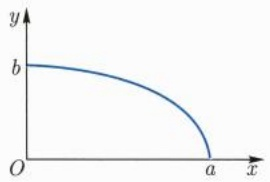

<details>
<summary>text_image</summary>

y
b
O
a x
</details>

图17.2 椭圆

---

48

第十七章 曲线积分与曲面积分

解 $\sigma$ 可以表示为参数曲线:

$$
\sigma (t) = (a \cos t, b \sin t), \quad t \in [ 0, \pi / 2 ].
$$

此时 $\| \sigma'(t)\| = \sqrt{a^2\sin^2t + b^2\cos^2t}$ ，所求积分为

$$
\begin{array}{l} I = \int_ {0} ^ {\frac {\pi}{2}} a \cos t \cdot b \sin t \cdot \sqrt {a ^ {2} \sin^ {2} t + b ^ {2} \cos^ {2} t} \mathrm{d} t \\ = \frac {a b}{2} \int_ {0} ^ {\frac {\pi}{2}} \sin 2 t \sqrt {\frac {a ^ {2} + b ^ {2}}{2} + \frac {b ^ {2} - a ^ {2}}{2} \cos 2 t} \mathrm{d} t \\ = \frac {a b}{4} \int_ {- 1} ^ {1} \sqrt {\frac {a ^ {2} + b ^ {2}}{2} + \frac {b ^ {2} - a ^ {2}}{2} u} \mathrm{d} u \\ = \frac {a b}{3} \frac {a ^ {2} + a b + b ^ {2}}{a + b}. \\ \end{array}
$$

例 17.1.2 设  $\sigma$  是球面  $x^{2} + y^{2} + z^{2} = a^{2}$  被平面  $x + z = a$  所截出的圆 (图 17.3)，计算积分  $\int_{\sigma} xz ds$ .

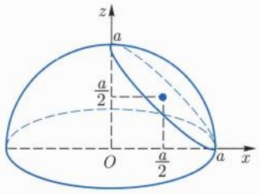

<details>
<summary>text_image</summary>

z
a
a/2
O
a/2
a
x
</details>

图17.3 截面圆

解 先求 $\sigma$ 的方程: 以 $z = a - x$ 代入球面方程得

$$
x ^ {2} + y ^ {2} + (a - x) ^ {2} = a ^ {2},
$$

整理后成为

$$
\left(x - a / 2\right) ^ {2} + y ^ {2} / 2 = (a / 2) ^ {2},
$$

用参数表示为

$$
x (t) = \frac {a}{2} + \frac {a}{2} \cos t, y (t) = \frac {a}{\sqrt {2}} \sin t, z (t) = \frac {a}{2} - \frac {a}{2} \cos t, t \in [ 0, 2 \pi ].
$$

此时

$$
\| \sigma^ {\prime} (t) \| = \sqrt {\left(- a \sin t / 2\right) ^ {2} + \left(a \cos t / \sqrt {2}\right) ^ {2} + \left(a \sin t / 2\right) ^ {2}} = \frac {a}{\sqrt {2}},
$$

从而有

$$
\int_ {\sigma} x z \mathrm{d} s = \int_ {0} ^ {2 \pi} (a / 2) ^ {2} \sin^ {2} t \cdot (a / \sqrt {2}) \mathrm{d} t = \frac {\pi a ^ {3}}{4 \sqrt {2}}.
$$

□

---

17.1 第一型曲线积分

49

## 习题 17.1

1. 设 $\sigma : [\alpha, \beta] \to \mathbb{R}^n$ 为可求长参数曲线, $\phi : [a, b] \to [\alpha, \beta]$ 为连续的可逆映射. 证明: $\sigma \circ \phi$ 和 $\sigma$ 具有相同的长度.

2. 设 $\sigma$ 为连续的可求长参数曲线, 证明: $L(\sigma) = \lim_{\|P\| \to 0} L(\sigma; P)$.

3. 计算下列空间曲线的长度:

(1) $x(t) = t, y(t) = t^2, z(t) = \frac{2}{3} t^3, t \in [0,1]$;
(2) $x(t) = t, y(t) = \ln \sec t, z(t) = \ln (\sec t + \tan t), 0 \leqslant t \leqslant \frac{\pi}{4}$;
(3) $x(t) = a\cos \omega t, y(t) = a\sin \omega t, z(t) = b\omega t, \omega > 0, 0 \leqslant t \leqslant \frac{2\pi}{\omega}$;
(4) $x + y + z = a$ $(|a| < \sqrt{3}), x^2 + y^2 + z^2 = 1.$

4. 计算下列曲线积分  $(a, b > 0)$ :

(1) $\int_{\sigma} y^2 \, \mathrm{d}s$, 其中 $\sigma$ 是摆线的一拱: $x(t) = a(t - \sin t)$, $y(t) = a(1 - \cos t)$, $0 \leqslant t \leqslant 2\pi$;

(2) $\int_{\sigma} y \, \mathrm{d}s$, 其中 $\sigma$ 是抛物线 $y^2 = 2ax$ 从 $(0,0)$ 到 $(2a,2a)$ 的部分;

(3) $\int_{\sigma} \sqrt{x^2 + y^2} \, \mathrm{d}s,$ 其中 $\sigma$ 是圆周 $x^2 + y^2 = ax;$

(4) $\int_{\sigma} y \, \mathrm{d}s$, 其中 $\sigma$ 是椭圆 $\frac{x^2}{a^2} + \frac{y^2}{b^2} = 1$ 在 $x$ 轴上方的部分;

(5) $\int_{\sigma} x^{2} \, \mathrm{d}s$, 其中 $\sigma$ 是圆周 $x^{2} + y^{2} + z^{2} = a^{2}$, $x + y + z = 0$;

(6) $\int_{\sigma}(x + y)\mathrm{d}s,$ 其中 $\sigma$ 是顶点为 $(0,0),(1,0),(0,1)$ 的三角形.

5. 形状为椭圆 $\frac{x^2}{a^2} + \frac{y^2}{b^2} = 1$ 的物质在 $(x, y)$ 处的密度为 $\rho(x, y) = |y|$, 求其质量.

6. 设某种物质均匀分布在摆线 $\sigma(t) = (a(t - \sin t), a(1 - \cos t))$ ($0 \leqslant t \leqslant \pi$) 上, 求该物质的质心.

7. 定义平面参数曲线  $\sigma(x)=(x,y(x))$  为

$$
y (x) = \left\{ \begin{array}{l l} x \cos \frac {1}{x}, & 0 <   x \leqslant \pi / 2, \\ 0, & x = 0. \end{array} \right.
$$

验证  $\sigma$  连续但不是可求长参数曲线.

8. 设 $\sigma : [\alpha, \beta] \to \mathbb{R}^n$ 为连续单射. 如果 $\sigma$ 为可求长参数曲线, 证明:

$$
\lim _ {m \to \infty} \sup \left\{| t ^ {\prime \prime} - t ^ {\prime} | \Big | L (\sigma | _ {[ t ^ {\prime}, t ^ {\prime \prime} ]}) \leqslant \frac {1}{m} \right\} = 0.
$$

9. 设  $f \in C^{1}[\alpha, \beta]$ ，证明:

$$
\bigvee_ {\alpha} ^ {\beta} (f) = \int_ {\alpha} ^ {\beta} | f ^ {\prime} (t) |   \mathrm{d} t.
$$

---

50

第十七章 曲线积分与曲面积分

10. 设 $\sigma : [\alpha, \beta] \to \mathbb{R}^n$ 为连续的可求长参数曲线, $n \geqslant 2$. 证明: $\sigma([\alpha, \beta])$ 为 $\mathbb{R}^n$ 中的零测集, 由此说明Peano曲线不是可求长参数曲线.

## 17.2 第二型曲线积分

我们考虑一个新的物理问题: 设质点在力场 F 中沿一条曲线  $\sigma$  运动, 求力场 F 对该质点所做的功. 我们还是可以用 “微元法” 将这个问题转化为曲线上的一个积分问题. 力场 F 沿  $\sigma|_{[t,t+\delta t]}$  这一小段所做的功记为  $\delta W$ , 则

$$
\delta W \approx \boldsymbol {F} (\sigma (t)) \cdot [ \sigma (t + \delta t) - \sigma (t) ].
$$

当 $\sigma$ 为 $C^1$ 曲线时，

$$
\delta W \approx \boldsymbol {F} (\sigma (t)) \cdot \sigma^ {\prime} (t) \delta t,
$$

于是总的功 $W$ 可以表示为

$$
W = \int_ {\alpha} ^ {\beta} \boldsymbol {F} (\sigma (t)) \cdot \sigma^ {\prime} (t)   \mathrm{d} t.
$$

一般地, 设 $\sigma : [\alpha, \beta] \to \mathbb{R}^n$ 为参数曲线, $F$ 是定义在 $\sigma$ 上取值在 $\mathbb{R}^n$ 中的向量值函数. 任取 $[\alpha, \beta]$ 的一个分割

$$
\mathrm{P}: \alpha = t _ {0} <   t _ {1} <   t _ {2} <   \dots <   t _ {m} = \beta ,
$$

如果极限 $\lim_{\| P\| \to 0}\sum_{j = 1}^{m}\pmb {F}(\sigma (\xi_j))\cdot [\sigma (t_j) - \sigma (t_{j - 1})]$ 存在且与 $\{\xi_j\in [t_{j - 1},t_j]\}$ 的选取无关，则称此极限为 $\pmb{F}$ 沿曲线 $\sigma$ 的第二型曲线积分，记为

$$
\int_ {\sigma} f _ {1} \mathrm{d} x _ {1} + f _ {2} \mathrm{d} x _ {2} + \dots + f _ {n} \mathrm{d} x _ {n} = \int_ {\sigma} \boldsymbol {F} \cdot \mathrm{d} \vec {s},
$$

其中  $\boldsymbol{F}=(f_{1},f_{2},\cdots,f_{n}),\mathrm{d}\vec{s}=(\mathrm{d}x_{1},\mathrm{d}x_{2},\cdots,\mathrm{d}x_{n})$ . 对于分段  $C^{1}$  曲线, 第二型曲线积分可以转化为 Riemann 积分:

$$
\int_ {\sigma} f _ {1} \mathrm{d} x _ {1} + f _ {2} \mathrm{d} x _ {2} + \dots + f _ {n} \mathrm{d} x _ {n} = \int_ {\alpha} ^ {\beta} \boldsymbol {F} (\sigma) \cdot \boldsymbol {\sigma} ^ {\prime} (t) \mathrm{d} t, \tag {17.2.1}
$$

其中  $\sigma'(t)=(x_{1}^{\prime}(t),x_{2}^{\prime}(t),\cdots,x_{n}^{\prime}(t))$  为曲线  $\sigma$  的切向量.

初看起来第二型曲线积分似乎和第一型曲线积分并无本质不同. 但这两类积分有一个重要的区别, 这个区别和曲线的方向有关. 为了说明这一点, 我们考虑曲线的重新参

---

17.2 第二型曲线积分

51

数化. 设 $\phi : [\gamma, \delta] \to [\alpha, \beta]$ 为严格单调的可逆连续映射, 则复合映射 $\sigma \circ \phi : [\gamma, \delta] \to \mathbb{R}^n$ 也是一条参数曲线, 它和 $\sigma$ 的像完全相同, 这两条参数曲线只是选取了不同的参数而已. 如果 $\phi$ 是严格单调递增的, 则称这两个参数是同向的; 如果 $\phi$ 是严格单调递减的, 则称这两个参数是反向的 (不同向).

从定义不难看出, 对于同向的两个参数, 第二曲线积分的值不变; 而对于反向的两个参数, 第二型曲线积分的值正好相差一个符号! 这和第一型曲线积分不同, 比如曲线的长度就不依赖于参数的选取. 因此, 为了使第二型曲线积分有意义, 我们总是要给曲线指定一个方向, 这个方向是由某个参数决定的. 给定了方向的曲线称为有向曲线.

设 $f \in R[a, b]$, 则 $f$ 在 $[a, b]$ 上的 Riemann 积分可视为 $f$ 沿区间 $[a, b]$ 的第二型曲线积分, 其中区间 $[a, b]$ 作为一条曲线, 其方向是参数 $x$ 给出的, 即 $x$ 轴的正向. 我们之所以规定

$$
\int_ {b} ^ {a} f (x) \mathrm{d} x = - \int_ {a} ^ {b} f (x) \mathrm{d} x,
$$

就是因为 $f$ 沿 $[a,b]$ 的相反方向的第二型曲线积分要变一个符号.

如果 $\sigma$ 为一条闭曲线 (环路), 即 $\sigma(\alpha) = \sigma(\beta)$, 则选定了方向以后, 不论从曲线上哪一点出发, 沿此闭曲线的第二型曲线积分的值不变, 这样的积分常记为

$$
\oint_ {\sigma} f _ {1} \mathrm{d} x _ {1} + f _ {2} \mathrm{d} x _ {2} + \dots + f _ {n} \mathrm{d} x _ {n}.
$$

平面上的单位圆周  $S^{1}$  就是一条闭曲线, 如果用参数方程

$$
\sigma (t) = (\cos t, \sin t), \quad t \in [ 0, 2 \pi ]
$$

表示, 则  $S^{1}$  的方向就是所谓逆时针方向.

例17.2.1 计算第二型曲线积分

$$
I = \oint_ {\sigma} \frac {y}{x ^ {2} + y ^ {2}} \mathrm{d} x - \frac {x}{x ^ {2} + y ^ {2}} \mathrm{d} y,
$$

其中  $\sigma$  为圆周  $x^{2} + y^{2} = a^{2}$ ，方向为逆时针方向 (图 17.4).

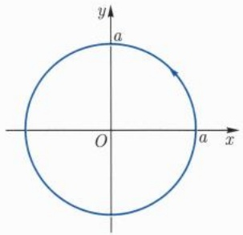

<details>
<summary>text_image</summary>

y
a
O
a
x
</details>

图 17.4 圆周 (逆时针方向)

---

52

第十七章 曲线积分与曲面积分

解 按照给定的方向取 $\sigma$ 的参数方程为

$$
x (t) = a \cos t, y (t) = a \sin t, t \in [ 0, 2 \pi ].
$$

此时有

$$
I = \int_ {0} ^ {2 \pi} \frac {1}{a ^ {2}} \left[ a \sin t (a \cos t) ^ {\prime} - a \cos t (a \sin t) ^ {\prime} \right] \mathrm{d} t = - 2 \pi .
$$

例17.2.2 计算第二型曲线积分

$$
I = \oint_ {\sigma} (y - z)   \mathrm{d} x + (z - x)   \mathrm{d} y + (x - y)   \mathrm{d} z,
$$

其中 $\sigma$ 是圆周 $x^{2} + y^{2} + z^{2} = a^{2}, y = x\tan \alpha (0 <   \alpha <  \pi /2)$ ，从 $x$ 的正向看去， $\sigma$ 的方向是逆时针的(图17.5).

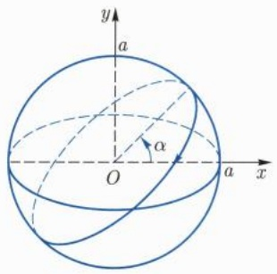

<details>
<summary>text_image</summary>

y
a
α
O
x
a
</details>

图17.5 球面圆

解 根据方向取 $\sigma$ 的参数方程为

$$
x (\theta) = a \cos \theta \cos \alpha , y (\theta) = a \cos \theta \sin \alpha , z (\theta) = a \sin \theta,
$$

其中 $\theta \in [0,2\pi]$. 于是所求积分为

$$
\begin{array}{l} I = \int_ {0} ^ {2 \pi} (a \cos \theta \sin \alpha - a \sin \theta) (- a \sin \theta \cos \alpha) \mathrm{d} \theta + (a \sin \theta - a \cos \theta \cos \alpha) \times \\ (- a \sin \theta \sin \alpha) \mathrm{d} \theta + (a \cos \theta \cos \alpha - a \cos \theta \sin \alpha) a \cos \theta \mathrm{d} \theta \\ = \int_ {0} ^ {2 \pi} a ^ {2} (\cos \alpha - \sin \alpha) \mathrm{d} \theta = 2 \pi a ^ {2} (\cos \alpha - \sin \alpha). \\ \end{array}
$$

例 17.2.3 考虑位于原点处的电荷 q 产生的静电场, 计算单位正电荷沿  $C^{1}$  曲线  $\sigma$  从点  $A = \sigma(\alpha)$  运动到点  $B = \sigma(\beta)$  时电场所做的功 W (图 17.6).

解 根据库仑定律, $(x,y,z)$ 处的单位正电荷在静电场中所受的力为

$$
\boldsymbol {F} = \frac {\kappa q}{r ^ {3}} (x, y, z) = \nabla \phi ,
$$

---

17.2 第二型曲线积分

53

其中 $\kappa$ 为常数, $\phi = -\kappa q / r$, $r = \sqrt{x^2 + y^2 + z^2}$. 因此 $\pmb{F}$ 沿 $\sigma$ 所做的功为

$$
\begin{array}{l} W = \int_ {\alpha} ^ {\beta} \boldsymbol {F} (\sigma) \cdot \sigma^ {\prime} (t) \mathrm{d} t \\ = \int_ {\alpha} ^ {\beta} (\phi \circ \sigma) ^ {\prime} \mathrm{d} t \\ = \frac {\kappa q}{r (\alpha)} - \frac {\kappa q}{r (\beta)}. \\ \end{array}
$$

这说明,静电场所做的功只与电荷的起始位置和终点位置有关,与具体运动路径无关.□

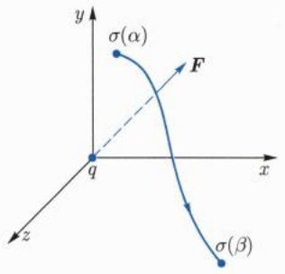

<details>
<summary>text_image</summary>

y
σ(α)
F
q
x
z
σ(β)
</details>

图17.6 电场做功

## 习题 17.2

1. 计算下列第二型曲线积分:

(1) $\int_{\sigma} x \, \mathrm{d}x + y \, \mathrm{d}y + z \, \mathrm{d}z,$ 其中 $\sigma$ 是从 (1,1,1) 到 (2,3,4) 的直线段;
(2) $\int_{\sigma}(x^{2} + y^{2})\mathrm{d}x + (x^{2} - y^{2})\mathrm{d}y,$ 其中 $\sigma$ 是以(1,0)，(2,0)，(2,1)，(1,1)为顶点的正方形，逆时针方向；
(3) $\oint_{\sigma} \frac{(x + y) \, \mathrm{d}x - (x - y) \, \mathrm{d}y}{x^2 + y^2}$, 其中 $\sigma$ 是圆 $x^2 + y^2 = a^2$, 逆时针方向;
(4) $\int_{\sigma}(x^2 - 2xy)\mathrm{d}x + (y^2 - 2xy)\mathrm{d}y,$ 其中 $\sigma$ 是抛物线 $y = x^{2}$ 从 $(-1,1)$ 到(1,1)的一段；
(5) $\oint_{\sigma}(x + y)\mathrm{d}x + (x - y)\mathrm{d}y,$ 其中 $\sigma$ 是椭圆 $\frac{x^2}{a^2} +\frac{y^2}{b^2} = 1,$ 逆时针方向.

2. 计算第二型曲线积分

$$
\int_ {\sigma} (y - z) \mathrm{d} x + (z - x) \mathrm{d} y + (x - y) \mathrm{d} z,
$$

其中 $\sigma$ 是椭圆 $x^{2} + y^{2} = 1, x + z = 1,$ 从 $x$ 的正向看去，$\sigma$ 为顺时针方向.

3. 计算第二型曲线积分

$$
\int_ {\sigma} (y ^ {2} - z ^ {2}) \mathrm{d} x + (z ^ {2} - x ^ {2}) \mathrm{d} y + (x ^ {2} - y ^ {2}) \mathrm{d} z,
$$

---

54

第十七章 曲线积分与曲面积分

其中 $\sigma$ 是球面三角形 $x^{2} + y^{2} + z^{2} = 1, x \geqslant 0, y \geqslant 0, z \geqslant 0$ 的边界，从球外看去，$\sigma$ 为逆时针方向.

4. 计算第二型曲线积分  $\oint_{\sigma}\frac{y\,dx-x\,dy}{x^{2}+y^{2}}$ ，其中  $\sigma$  是椭圆  $\frac{x^{2}}{a^{2}}+\frac{y^{2}}{b^{2}}=1$ ，顺时针方向.

5. 求力场 F 对运动的单位质点所做的功, 此质点沿曲线  $\sigma$  从 A 点运动到 B 点:

(1) $F=(x-2xy^{2},y-2x^{2}y)$ ，其中 $\sigma$ 是平面曲线 $y=x^{2},A=(0,0),B=(1,1);$

(2) $F=(x-y,y-z,z-x)$ ，其中 $\sigma(t)=(t,t^{2},t^{3})$ ， $A=(0,0,0)$ ， $B=(1,1,1)$ .

6. 计算质量为 $m$ 的质点在重力场的作用下沿曲线 $\sigma$ 从点 $A = \sigma(\alpha)$ 运动到点 $B = \sigma(\beta)$ 时所做的功 $W$.

7. 设  $P(x,y)$ ,  $Q(x,y)$  在可求长曲线  $\sigma$  上连续, 证明:

$$
\left| \int_ {\sigma} P (x, y)   \mathrm{d} x + Q (x, y)   \mathrm{d} y \right| \leqslant L (\sigma) M,
$$

其中 $M = \sup_{\sigma}\sqrt{P^2 + Q^2}$

8. 设 $\sigma$ 为圆周 $x^{2} + y^{2} = R^{2}$, 方向为逆时针. 利用上一题证明 $\lim_{R\to +\infty}I_R = 0$, 其中

$$
I _ {R} = \oint_ {\sigma} \frac {y \mathrm{d} x - x \mathrm{d} y}{(x ^ {2} + x y + y ^ {2}) ^ {2}}.
$$

## 17.3 第一型曲面积分

我们从参数曲面的面积开始. 设 $m \leqslant n$, $\Omega$ 为 $\mathbb{R}^m$ 中的开集. 映射 $\varphi: \Omega \to \mathbb{R}^n$ 称为 $\mathbb{R}^n$ 中的参数曲面, 我们想要定义参数曲面的面积.

先从线性映射开始. 设 $\varphi: \mathbb{R}^m \to \mathbb{R}^n$ 为线性映射, $I \subset \mathbb{R}^m$ 为矩形 (图17.7). 如果 $\varphi$ 是退化的 (秩小于 $m$), 则 $\varphi(\mathbb{R}^m)$ 包含在一个维数小于 $m$ 的子向量空间中, 我们自然定义 $\varphi(I)$ 的 $m$ 维容积为零; 如果 $\varphi$ 非退化, 则 $\varphi(\mathbb{R}^m)$ 维数为 $m$, $\varphi(I)$ 为 $m$ 维欧氏空间中的 Jordan 可测集, 我们来计算它的 $m$ 维容积. 以下为了区分不同维数的容积, 我们将 $m$ 维容积称为面积, 并用记号 $\sigma$ 来表示它.

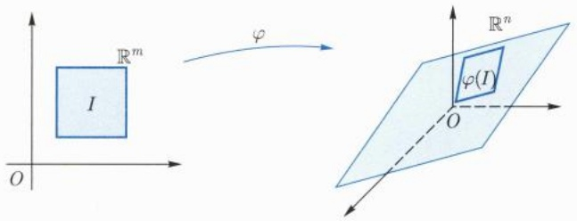

<details>
<summary>text_image</summary>

I
R^m
φ
R^n
φ(I)
O
</details>

图 17.7 矩形在线性映射下的像

---

17.3 第一型曲面积分

55

不妨设 $I = [0,1]^m$ 记 $\pmb{v}_j = \varphi (\pmb{e}_j)$ ，其中 $\{\pmb{e}_j\}_{j = 1}^m$ 为 $\mathbb{R}^m$ 的一组标准基.则

$$
\varphi (I) = \left\{\sum_ {j = 1} ^ {m} x _ {j} \boldsymbol {v} _ {j}   \Big |   0 \leqslant x _ {j} \leqslant 1, j = 1, 2, \dots , m \right\}.
$$

我们要计算 $\varphi (I)$ 的面积. 先看 $m = 2$ 的情形. 此时, $\varphi (I)$ 是由 $\pmb{v}_1, \pmb{v}_2$ 所张成的平行四边形 (图17.8).

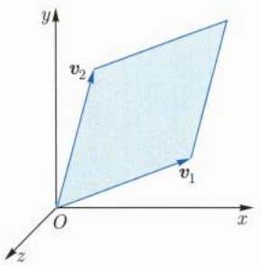

<details>
<summary>text_image</summary>

y
v₂
v₁
O
x
z
</details>

图 17.8 平行四边形

设  $v_{1}, v_{2}$  的夹角为  $\theta$ ，从几何的角度我们就有

$$
\sigma (\varphi (I)) = \| \boldsymbol {v} _ {1} \| \cdot \| \boldsymbol {v} _ {2} \| \cdot \sin \theta .
$$

利用 $\pmb{v}_1\cdot \pmb{v}_2 = \| \pmb {v}_1\| \cdot \| \pmb {v}_2\| \cdot \cos \theta$ 可得

$$
\begin{array}{l} \left| \sigma (\boldsymbol {\varphi} (I)) \right| ^ {2} = \left\| \boldsymbol {v} _ {1} \right\| ^ {2} \cdot \left\| \boldsymbol {v} _ {2} \right\| ^ {2} - \left(\boldsymbol {v} _ {1} \cdot \boldsymbol {v} _ {2}\right) ^ {2} \\ = \det \left(\boldsymbol {v} _ {i} \cdot \boldsymbol {v} _ {j}\right) _ {2 \times 2}. \\ \end{array}
$$

当 n=3 时, 利用外积上式还可表示为  $\sigma(\varphi(I))=\|\boldsymbol{v}_{1}\times\boldsymbol{v}_{2}\|$ .

一般地, 我们断言 $\sigma(\varphi(I)) = \sqrt{\det\left(\boldsymbol{v}_i \cdot \boldsymbol{v}_j\right)_{m \times m}}$. 当 $m = n - 1$ 时, 利用 $\mathbb{R}^n$ 中外积运算的性质还可得到

$$
\sigma (\varphi (I)) = \| \boldsymbol {v} _ {1} \times \boldsymbol {v} _ {2} \times \dots \times \boldsymbol {v} _ {n - 1} \|\cdot
$$

事实上, 以 $\{\pmb{v}_i\}_{i=1}^m$ 为列向量的矩阵记为 $\pmb{A}$. 当 $m = n$ 时, 由例 16.4.1 可知

$$
\sigma (\boldsymbol {\varphi} (I)) = | \det \boldsymbol {A} | = \sqrt {\det (\boldsymbol {A} ^ {\mathrm{T}} \boldsymbol {A})} = \sqrt {\det (\boldsymbol {v} _ {i} \cdot \boldsymbol {v} _ {j}) _ {m \times m}}.
$$

当 $n > m$ 时, 选取正交变换 $\mathbf{O}:\mathbb{R}^n\to \mathbb{R}^n$ ，使得

$$
\{\boldsymbol {O} (\boldsymbol {v} _ {i}) \} _ {i = 1} ^ {m} \subset \mathbb {R} ^ {m} \times \{0 \} \subset \mathbb {R} ^ {n}.
$$

假定面积在正交变换下具有不变性, 则有

$$
\sigma (\varphi (I)) = \sqrt {\det \left(\boldsymbol {O} (\boldsymbol {v} _ {i}) \cdot \boldsymbol {O} (\boldsymbol {v} _ {j})\right) _ {m \times m}} = \sqrt {\det \left(\boldsymbol {v} _ {i} \cdot \boldsymbol {v} _ {j}\right) _ {m \times m}}
$$

---

56

第十七章 曲线积分与曲面积分

一般地, 如果 $\Omega$ 为 $\mathbb{R}^m$ 中的 Jordan 可测集, 则 $\varphi(\Omega)$ 为 $\mathbb{R}^n$ 中一个 $m$ 维子空间中的 Jordan 可测集, 且

$$
\sigma (\boldsymbol {\varphi} (\Omega)) = \sqrt {\det \left(\boldsymbol {A} ^ {\mathrm{T}} \boldsymbol {A}\right)} \sigma (\Omega). \tag {17.3.1}
$$

考虑一般的参数曲面  $\varphi: \Omega \rightarrow R^{n}$ ，我们假设  $\varphi$  是  $C^{1}$  映射。取  $\boldsymbol{x}^{0} = (x_{1}^{0}, x_{2}^{0}, \cdots, x_{m}^{0}) \in \Omega$ ，设  $J\varphi(\boldsymbol{x}^{0})$  非退化（秩为 m），定义  $L: R^{m} \rightarrow R^{n}$  为

$$
\boldsymbol {L} (\boldsymbol {x}) = \varphi (\boldsymbol {x} ^ {0}) + J \varphi (\boldsymbol {x} ^ {0}) (\boldsymbol {x} - \boldsymbol {x} ^ {0}), \quad \boldsymbol {x} \in \mathbb {R} ^ {m}.
$$

在  $x^{0}$  附近取小矩形  $\delta I = [x_{1}^{0}, x_{1}^{0} + \delta u_{1}] \times [x_{2}^{0}, x_{2}^{0} + \delta u_{2}] \times \cdots \times [x_{m}^{0}, x_{m}^{0} + \delta u_{m}]$ ，在  $x^{0}$  附近，由  $\varphi(\boldsymbol{x}) = \boldsymbol{L}(\boldsymbol{x}) + o(\|\boldsymbol{x} - \boldsymbol{x}^{0}\|)$  可得

$$
\delta \sigma = \sigma (\varphi (\delta I)) \approx \sigma (\boldsymbol {L} (\delta I)) = \sqrt {\det [ (J \varphi) ^ {\mathrm{T}} (\boldsymbol {x} ^ {0}) J \varphi (\boldsymbol {x} ^ {0}) ]} \delta u _ {1} \delta u _ {2} \dots \delta u _ {m}.
$$

于是我们自然用积分来表示  $C^{1}$  参数曲面的面积.

定义 17.3.1 (面积公式) 设  $\varphi: \Omega \rightarrow R^{n}$  为非退化的  $C^{1}$  映射,  $\Omega$  为  $R^{m}$  中的 Jordan 可测集, 则  $\varphi(\Omega)$  的面积定义为

$$
\sigma (\varphi (\Omega)) = \int_ {\varphi (\Omega)} \mathrm{d} \sigma = \iint \dots \int_ {\Omega} \sqrt {\det [ (J \varphi) ^ {\mathrm{T}} J \varphi ]} \mathrm{d} u _ {1} \mathrm{d} u _ {2} \dots \mathrm{d} u _ {m}. \tag {17.3.2}
$$

注 17.3.1 (1) 如果 m = 1，则 (17.3.2) 就是  $C^{1}$  曲线的弧长公式.

(2) 与曲线一样, 曲面可以选取不同的参数化. 如果 $\phi: \Omega' \to \Omega$ 是 $C^1$ 的可逆映射, 则 $\varphi \circ \phi: \Omega' \to \mathbb{R}^m$ 也是参数曲面, 它们的面积用 (17.3.2) 式定义出来是一致的.

设  $R^{3}$  中  $C^{1}$  参数曲面由  $\boldsymbol{r}(u,v)=(x(u,v),y(u,v),z(u,v))((u,v)\in D)$  给出，则其面积为

$$
\sigma = \iint_ {D} \| \boldsymbol {r} _ {u} \times \boldsymbol {r} _ {v} \| \mathrm{d} u \mathrm{d} v = \iint_ {D} \sqrt {E G - F ^ {2}} \mathrm{d} u \mathrm{d} v, \tag {17.3.3}
$$

其中

$$
E = \boldsymbol {r} _ {u} \cdot \boldsymbol {r} _ {u} = x _ {u} ^ {2} + y _ {u} ^ {2} + z _ {u} ^ {2}, G = \boldsymbol {r} _ {v} \cdot \boldsymbol {r} _ {v} = x _ {v} ^ {2} + y _ {v} ^ {2} + z _ {v} ^ {2},
$$

$$
F = \boldsymbol {r} _ {u} \cdot \boldsymbol {r} _ {v} = x _ {u} x _ {v} + y _ {u} y _ {v} + z _ {u} z _ {v}.
$$

特别地, 当曲面由方程 $z = f(x, y)$, $((x, y) \in D)$ 给出时, $\boldsymbol{r}_x = (1, 0, f_x)$, $\boldsymbol{r}_y = (0, 1, f_y)$, 此时

$$
E G - F ^ {2} = (1 + f _ {x} ^ {2}) (1 + f _ {y} ^ {2}) - (f _ {x} f _ {y}) ^ {2} = 1 + f _ {x} ^ {2} + f _ {y} ^ {2},
$$

曲面的面积公式成为

$$
\sigma = \iint_ {D} \sqrt {1 + f _ {x} ^ {2} + f _ {y} ^ {2}} \mathrm{d} x \mathrm{d} y. \tag {17.3.4}
$$

---

17.3 第一型曲面积分

57

例 17.3.1 设 a > 0, 求球面  $x^{2} + y^{2} + z^{2} = a^{2}$  的面积.

解 球面的参数表示为

$$
x = a \sin \varphi \cos \theta , y = a \sin \varphi \sin \theta , z = a \cos \varphi , \varphi \in [ 0, \pi ], \theta \in [ 0, 2 \pi ].
$$

此时

$$
\boldsymbol {r} _ {\varphi} = (a \cos \varphi \cos \theta , a \cos \varphi \sin \theta , - a \sin \varphi), \quad \boldsymbol {r} _ {\theta} = (- a \sin \varphi \sin \theta , a \sin \varphi \cos \theta , 0).
$$

由此可以算出 $EG - F^2 = a^4\sin^2\varphi$ ，从而球面的面积为

$$
\sigma = \int_ {0} ^ {2 \pi} \mathrm{d} \theta \int_ {0} ^ {\pi} a ^ {2} \sin \varphi \mathrm{d} \varphi = 4 \pi a ^ {2}.
$$


一般地, 设  $\varphi: \Omega \rightarrow R^{n}$  为超曲面, 其中

$$
\varphi (\boldsymbol {u}) = \varphi (u _ {1}, u _ {2}, \dots , u _ {n - 1}), \quad \boldsymbol {u} = (u _ {1}, u _ {2}, \dots , u _ {n - 1}) \in \Omega .
$$

超曲面的切向量为  $\varphi_{u_{1}},\varphi_{u_{2}},\cdots,\varphi_{u_{n-1}}$ . 根据前面的讨论, 超曲面的面积为

$$
\sigma = \iint \dots \int_ {\Omega} \| \varphi_ {u _ {1}} \times \varphi_ {u _ {2}} \times \dots \times \varphi_ {u _ {n - 1}} \| \mathrm{d} u _ {1} \mathrm{d} u _ {2} \dots \mathrm{d} u _ {n - 1}. \tag {17.3.5}
$$

特别地, 设 $f: D \to \mathbb{R}$ 为 $C^1$ 函数, 其中 $D \subseteq \mathbb{R}^{n-1}$. 则 $\operatorname{graph}(f)$ 为 $\mathbb{R}^n$ 中的超曲面, 其面积公式为

$$
\sigma = \iint \dots \int_ {D} \sqrt {1 + \| \nabla f \| ^ {2}}   \mathrm{d} x _ {1}   \mathrm{d} x _ {2} \dots \mathrm{d} x _ {n - 1}, \tag {17.3.6}
$$

其中  $\nabla f = (f_{x_{1}}, f_{x_{2}}, \cdots, f_{x_{n-1}})$  是 f 的梯度. 事实上, graph(f) 的参数表示为

$$
\varphi (\boldsymbol {x}) = (x _ {1}, x _ {2}, \dots , x _ {n - 1}, f (x _ {1}, x _ {2}, \dots , x _ {n - 1})), \quad \boldsymbol {x} = (x _ {1}, x _ {2}, \dots , x _ {n - 1}) \in D.
$$

此时

$$
\varphi_ {x _ {1}} \times \varphi_ {x _ {2}} \times \dots \times \varphi_ {x _ {n - 1}} = (- 1) ^ {n} (f _ {x _ {1}}, f _ {x _ {2}}, \dots , f _ {x _ {n - 1}}, - 1).
$$

于是 $(17.3.6)$ 式可从 $(17.3.5)$ 式导出.

例 17.3.2 设 a > 0, 求  $\{x_{1} + x_{2} + \cdots + x_{n} = a, x_{i} \geqslant 0, i = 1, 2, \cdots, n\}$  的面积.
解 记

$$
\Delta_ {n - 1} (a) = \left\{x \in \mathbb {R} ^ {n - 1} \mid x _ {1} + x _ {2} + \dots + x _ {n - 1} \leqslant a, x _ {i} \geqslant 0, 1 \leqslant i \leqslant n - 1 \right\},
$$

则所考虑的曲面有如下参数表示:

$$
\varphi : \Delta_ {n - 1} (a) \to \mathbb {R} ^ {n}, \varphi (\boldsymbol {x}) = (\boldsymbol {x}, f (\boldsymbol {x})),
$$

---

58

第十七章 曲线积分与曲面积分

其中  $f(x)=a-x_{1}-\cdots-x_{n-1}$ . 由 (17.3.6) 式可得

$$
\sigma = \int_ {\Delta_ {n - 1} (a)} \sqrt {1 + \| \nabla f \| ^ {2}} \mathrm{d} \boldsymbol {x} = \int_ {\Delta_ {n - 1} (a)} \sqrt {n} \mathrm{d} \boldsymbol {x},
$$

由例16.3.7可得

$$
\sigma = \sqrt {n}   \sigma (\Delta_ {n - 1} (a)) = \frac {\sqrt {n}}{(n - 1) !} a ^ {n - 1}.
$$

例 17.3.3 设 a > 0, 求球面  $x^{2} + y^{2} + z^{2} + w^{2} = a^{2}$  的面积.

解 根据对称性, 只要计算上半球面的面积即可. 上半球面的方程为

$$
w = \sqrt {a ^ {2} - x ^ {2} - y ^ {2} - z ^ {2}}, x ^ {2} + y ^ {2} + z ^ {2} \leqslant a ^ {2},
$$

此时有

$$
1 + \| \nabla w \| ^ {2} = 1 + (- x / w) ^ {2} + (- y / w) ^ {2} + (- z / w) ^ {2} = (a / w) ^ {2}.
$$

根据 (17.3.6) 式可得

$$
\sigma = 2 \iiint_ {x ^ {2} + y ^ {2} + z ^ {2} \leqslant a ^ {2}} \frac {a}{\sqrt {a ^ {2} - x ^ {2} - y ^ {2} - z ^ {2}}} \mathrm{d} x \mathrm{d} y \mathrm{d} z.
$$

利用 $\mathbb{R}^3$ 中的球面坐标可得

$$
\sigma = 2 \int_ {0} ^ {a} \frac {a r ^ {2}}{\sqrt {a ^ {2} - r ^ {2}}} \mathrm{d} r \int_ {0} ^ {\pi} \sin \theta \mathrm{d} \theta \int_ {0} ^ {2 \pi} \mathrm{d} \varphi = 8 \pi \int_ {0} ^ {a} \frac {a r ^ {2}}{\sqrt {a ^ {2} - r ^ {2}}} \mathrm{d} r,
$$

在上式中利用变量代换 $r = a\sin t$ ，最后可得

$$
\sigma = 8 \pi \int_ {0} ^ {\frac {\pi}{2}} a ^ {3} \sin^ {2} t \mathrm{d} t = 2 \pi^ {2} a ^ {3}.
$$

值得指出的是, 我们定义参数曲面面积的方法与定义参数曲线长度的方法似乎有些不同. 参数曲线的长度可以用折线段的长度去逼近. 那么, 能否像参数曲线那样, 通过在参数曲面上取分点, 然后用以分点为顶点的多边形 (比如三角形) 的面积和去逼近参数曲面的面积呢? Schwarz 曾经举过一个例子 (圆柱面) 说明这样的定义方式是行不通的. 对于一般的曲面, 定义面积需要引入 Hausdorff 测度的概念, 进一步的讨论超出了本课程的范围, 有兴趣的读者可以参看几何测度论的著作.

有了参数曲面面积的定义, 我们可以讨论参数曲面上有界函数的积分, 为了简单起见, 只考虑连续函数的情形.

定义 17.3.2 (第一型曲面积分) 设  $\varphi: \Omega \rightarrow R^{n}$  为  $C^{1}$  的参数曲面, f 是定义在  $\Sigma = \varphi(\Omega)$  上的连续函数, 则 f 在  $\Sigma$  上的曲面积分定义为

$$
\int_ {\Sigma} f \mathrm{d} \sigma = \iint \dots \int_ {\Omega} f \circ \varphi \sqrt {\det \left[ (J \varphi) ^ {\mathrm{T}} J \varphi \right]} \mathrm{d} u _ {1} \mathrm{d} u _ {2} \dots \mathrm{d} u _ {m}.
$$

---

17.3 第一型曲面积分

59

第一型曲面积分的物理解释: 分布在曲面上的某种物质, 如果其密度函数为  $\rho$ , 则  $\rho$  在曲面上的积分就是物质的总质量.

例 17.3.4 计算曲面积分  $\int_{\Sigma}\frac{1}{z}d\sigma,$  其中  $\Sigma$  为球面  $x^{2}+y^{2}+z^{2}=a^{2}$  被平面 z=h (0<h<a) 所截下的顶部 (图 17.9).

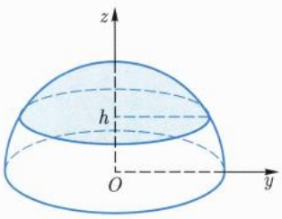

<details>
<summary>text_image</summary>

z
h
O
y
</details>

图17.9 球帽

解 $\Sigma$ 的方程为

$$
z = \sqrt {a ^ {2} - x ^ {2} - y ^ {2}}, x ^ {2} + y ^ {2} \leqslant a ^ {2} - h ^ {2}.
$$

因此

$$
\begin{array}{l} \int_ {\Sigma} \frac {1}{z} \mathrm{d} \sigma = \iint_ {x ^ {2} + y ^ {2} \leqslant a ^ {2} - h ^ {2}} \frac {1}{z} \sqrt {1 + z _ {x} ^ {2} + z _ {y} ^ {2}} \mathrm{d} x \mathrm{d} y \\ = \iint_ {x ^ {2} + y ^ {2} \leqslant a ^ {2} - h ^ {2}} \frac {a}{a ^ {2} - x ^ {2} - y ^ {2}} \mathrm{d} x \mathrm{d} y \\ = \int_ {0} ^ {\sqrt {a ^ {2} - h ^ {2}}} \frac {a r}{a ^ {2} - r ^ {2}} \mathrm{d} r \int_ {0} ^ {2 \pi} \mathrm{d} \theta \\ = 2 \pi a \ln (a / h). \\ \end{array}
$$

例 17.3.5 设抛物面  $z = 2 - (x^{2} + y^{2})$ ,  $z \geqslant 0$  上分布着密度为  $\rho(x, y) = x^{2} + y^{2}$  的物质 (图 17.10), 求该物质的质量.

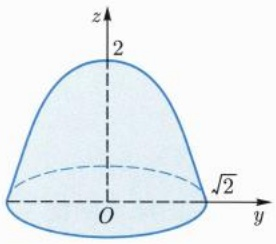

<details>
<summary>text_image</summary>

z
2
O
√2
y
</details>

图17.10 抛物面

解 该物质的质量 $m$ 为 $\rho(x, y) = x^2 + y^2$ 在曲面上的积分，即

$$
m = \iint_ {x ^ {2} + y ^ {2} \leqslant 2} (x ^ {2} + y ^ {2}) \sqrt {1 + z _ {x} ^ {2} + z _ {y} ^ {2}} \mathrm{d} x \mathrm{d} y
$$

---

60

第十七章 曲线积分与曲面积分

$$
\begin{array}{l} = \iint_ {x ^ {2} + y ^ {2} \leqslant 2} (x ^ {2} + y ^ {2}) \sqrt {1 + 4 (x ^ {2} + y ^ {2})} \mathrm{d} x \mathrm{d} y \\ = \int_ {0} ^ {\sqrt {2}} r ^ {2} \sqrt {1 + 4 r ^ {2}} r \mathrm{d} r \int_ {0} ^ {2 \pi} \mathrm{d} \theta \\ = \frac {1 4 9}{3 0} \pi . \\ \end{array}
$$

与重积分类似, 利用第一型曲面积分可以求面状物质的质心、转动惯量、引力等, 我们仅举一例加以说明.

例 17.3.6 设 a > 0，曲面  $\Sigma: x^{2} + y^{2} + z^{2} = a^{2}, x, y, z \geqslant 0$  上均匀分布着某种物质，求该物质的质心.

解 不妨设物质的密度为 1. 曲面的参数表示为

$$
x = a \sin \varphi \cos \theta , y = a \sin \varphi \sin \theta , z = a \cos \varphi , \varphi \in [ 0, \pi / 2 ], \theta \in [ 0, \pi / 2 ].
$$

记质心坐标为 $(\bar{x},\bar{y},\bar{z})$ ，则

$$
\bar {x} = \frac {1}{m} \int_ {\Sigma} x \mathrm{d} \sigma , \bar {y} = \frac {1}{m} \int_ {\Sigma} y \mathrm{d} \sigma , \bar {z} = \frac {1}{m} \int_ {\Sigma} z \mathrm{d} \sigma ,
$$

其中 $m = \sigma (\Sigma) = \frac{1}{2}\pi a^2$ .于是

$$
\bar {x} = \frac {2}{\pi a ^ {2}} \int_ {0} ^ {\frac {\pi}{2}} \mathrm{d} \theta \int_ {0} ^ {\frac {\pi}{2}} a \sin \varphi \cos \theta \cdot a ^ {2} \sin \varphi \mathrm{d} \varphi = \frac {1}{2} a.
$$

利用对称性可得  $\bar{y} = \bar{z} = \frac{1}{2}a.$

## 习题 17.3

1. 用重积分的变量替换公式证明: $C^1$ 参数曲面的面积与参数的选取无关.

2. 设 a > 0, 求 z = axy 包含在圆柱  $x^{2} + y^{2} = a^{2}$  内那部分的面积.

3. 设 a > 0, 计算球面  $x^{2} + y^{2} + z^{2} = a^{2}$  被柱面  $x^{2} + y^{2} = ax$  所截下那部分的面积.

4. 求曲面  $z = \sqrt{2xy}$  被平面  $x + y = 1, x = 1$  及 y = 1 所截下那部分的面积.

5. 设 a > 0, 计算  $R^{n}$  中的曲面  $|x_{1}| + |x_{2}| + \cdots + |x_{n}| = a$  的面积.

6. 设 $a > 0$, 证明: $\mathbb{R}^n$ 中半径为 $a$ 的球面的面积等于 $n\omega_n a^{n-1}$, 其中 $\omega_n$ 是 $\mathbb{R}^n$ 中半径为 1 的球体的容积.

7. 计算下列曲面积分  $(a, b, c > 0)$ :

(1) $\int_{\Sigma}(x + y + z)\mathrm{d}\sigma ,\Sigma$ 为 $x^{2} + y^{2} + z^{2} = a^{2},z\geqslant 0;$
(2) $\int_{\Sigma} \frac{\mathrm{d}\sigma}{(1 + x + y)^2}, \Sigma$ 为 $x + y + z = 1, x, y, z \geqslant 0;$

---

17.4 第二型曲面积分

61

(3) $\int_{\Sigma} \sqrt{x^2 / a^4 + y^2 / b^4 + z^2 / c^4} \, \mathrm{d}\sigma, \Sigma$ 为 $\frac{x^2}{a^2} + \frac{y^2}{b^2} + \frac{z^2}{c^2} = 1;$
(4) $\int_{\Sigma} xyz \, \mathrm{d}\sigma, \Sigma$ 为 $z = x^2 + y^2, z \leqslant 1;$
(5) $\int_{\Sigma}(x^2 + y^2) \, \mathrm{d}\sigma, \Sigma$ 为 $x^2 + y^2 + z^2 = a^2.$

8. 设 a > 0, 某种物质均匀分布在曲面  $z = \sqrt{x^{2} + y^{2}}$  被柱面  $x^{2} + y^{2} = ax$  所割下的部分上, 求该物质的质心.

9. 设球面  $x^{2} + y^{2} + z^{2} = a^{2}$  上分布着密度为  $\rho$  的均匀物质, 求该物质的引力场.

10. 用 $S^2$ 表示球面 $x^{2} + y^{2} + z^{2} = 1$. 当 $f$ 为连续函数, $\alpha, \beta, \gamma \in \mathbb{R}$ 时, 证明如下 Poisson 公式:

$$
\int_ {S ^ {2}} f (\alpha x + \beta y + \gamma z) \mathrm{d} \sigma = 2 \pi \int_ {- 1} ^ {1} f \big (u \sqrt {\alpha^ {2} + \beta^ {2} + \gamma^ {2}} \big) \mathrm{d} u.
$$

## 17.4 第二型曲面积分

我们来考虑一个物理问题: 设空间中有流速为 $V = (P, Q, R)$ 的流体, 求单位时间内该流体通过曲面 $\Sigma$ 的流量. 要计算流量, 必须给曲面指定方向. 我们规定, 曲面在某点的方向是指该点处的一个单位法向量. 指定方向以后, 可用所谓的“微元法”计算流量如下: 任取 $\Sigma$ 的一小片, 其面积记为 $\delta \sigma$, 经过这一小片的流体速度为 $V$, 曲面的单位法向量为 $n$, 则单位时间内通过这一小片曲面的流体的流量 $\delta \Phi$ 为 $V \cdot n \delta \sigma$. 于是单位时间内经过 $\Sigma$ 的流量 $\Phi$ 可以表示为积分

$$
\varPhi = \int_ {\Sigma} \boldsymbol {V} \cdot \boldsymbol {n} \mathrm{d} \sigma = \int_ {\Sigma} \boldsymbol {V} \cdot \mathrm{d} \vec {\sigma}, \tag {17.4.1}
$$

其中  $d\vec{\sigma}=n\,d\sigma$  称为有向面积元.

从 (17.4.1) 式可以看出, 流量与曲面方向的选取有关. 方向的变化可导致流量的数值相差一个正负号. 如果在曲面上存在连续的单位法向量场, 则称该曲面可定向, 否则就称该曲面不可定向. 本节所涉及的曲面都假定是可定向的. 对于可定向曲面, 其定向 (方向) 是指一个连续的单位法向量场 $n$.

为了计算 (17.4.1) 式中的积分, 我们通常要给曲面选取适当的参数表示. 设 $\varphi: D \to \mathbb{R}^3$ 为 $\Sigma$ 的参数表示, 其中

$$
\varphi (u, v) = \big (x (u, v), y (u, v), z (u, v) \big), (u, v) \in D.
$$

记 $N = \varphi_{u} \times \varphi_{v} = (y_{u}z_{v} - z_{u}y_{v}, z_{u}x_{v} - x_{u}z_{v}, x_{u}y_{v} - y_{u}x_{v})$, 则 $N$ 为曲面的法向量. 如果 $N / \| N\| = n$, 则称 $\varphi$ 是与给定定向相容的参数表示. 根据前节中的讨论, 曲面的面

---

62

第十七章 曲线积分与曲面积分

积元可写为 $\mathrm{d}\sigma = \| N\| \mathrm{d}u\mathrm{d}v$ 此时(17.4.1)式可写为

$$
\Phi = \iint_ {D} \boldsymbol {V} \cdot \boldsymbol {N} \mathrm{d} u \mathrm{d} v = \iint_ {D} \left[ P \frac {\partial (y , z)}{\partial (u , v)} + Q \frac {\partial (z , x)}{\partial (u , v)} + R \frac {\partial (x , y)}{\partial (u , v)} \right] \mathrm{d} u \mathrm{d} v. \tag {17.4.2}
$$

另一方面，记

$$
\mathrm{d} \vec {\sigma} = (\mathrm{d} y \land \mathrm{d} z, \mathrm{d} z \land \mathrm{d} x, \mathrm{d} x \land \mathrm{d} y),
$$

其中 $\mathrm{dy}\wedge \mathrm{dz}$ 表示有向面积元 $\mathrm{d}\vec{\sigma}$ 在 $yOz$ 平面上的投影， $\mathrm{dz}\wedge \mathrm{dx}$ 表示 $\mathrm{d}\vec{\sigma}$ 在 $zOx$ 平面上的投影， $\mathrm{dx}\wedge \mathrm{dy}$ 表示 $\mathrm{d}\vec{\sigma}$ 在 $xOy$ 平面上的投影.此时(17.4.1)式也可写为

$$
\varPhi = \int_ {\Sigma} \boldsymbol {V} \cdot \mathrm{d} \vec {\sigma} = \int_ {\Sigma} P \mathrm{d} y \wedge \mathrm{d} z + Q \mathrm{d} z \wedge \mathrm{d} x + R \mathrm{d} x \wedge \mathrm{d} y. \tag {17.4.3}
$$

由 $\mathrm{d}\vec{\sigma} = N\mathrm{d}u\mathrm{d}v$ 可见

$$
\mathrm{d} y \wedge \mathrm{d} z = \frac {\partial (y , z)}{\partial (u , v)} \mathrm{d} u \mathrm{d} v, \mathrm{d} z \wedge \mathrm{d} x = \frac {\partial (z , x)}{\partial (u , v)} \mathrm{d} u \mathrm{d} v, \mathrm{d} x \wedge \mathrm{d} y = \frac {\partial (x , y)}{\partial (u , v)} \mathrm{d} u \mathrm{d} v.
$$

由此也可以看出 (17.4.2) 式和 (17.4.3) 式是一回事. 我们规定以下关系式成立:

$$
\mathrm{d} z \wedge \mathrm{d} y = - \mathrm{d} y \wedge \mathrm{d} z, \quad \mathrm{d} x \wedge \mathrm{d} z = - \mathrm{d} z \wedge \mathrm{d} x, \quad \mathrm{d} y \wedge \mathrm{d} x = - \mathrm{d} x \wedge \mathrm{d} y.
$$

根据以上讨论, 我们可以提出如下定义:

定义 17.4.1 (第二型曲面积分) 设  $\Sigma$  为  $R^{3}$  中的可定向曲面, 其连续的单位法向量场为 n. 对于定义在  $\Sigma$  上的连续向量值函数  $\boldsymbol{X} = (P, Q, R)$ , 定义它在  $\Sigma$  上的第二型曲面积分为

$$
\varPhi = \int_ {\Sigma} \boldsymbol {X} \cdot \mathrm{d} \vec {\sigma} = \int_ {\Sigma} \boldsymbol {X} \cdot \boldsymbol {n} \mathrm{d} \sigma ,
$$

也记为

$$
\Phi = \int_ {\Sigma} P \mathrm{d} y \wedge \mathrm{d} z + Q \mathrm{d} z \wedge \mathrm{d} x + R \mathrm{d} x \wedge \mathrm{d} y.
$$

设 $\varphi$ 是该曲面的与给定定向相容的参数表示:

$$
\varphi (u, v) = \big (x (u, v), y (u, v), z (u, v) \big), (u, v) \in D.
$$

则第二型曲面积分可以化为重积分:

$$
\varPhi = \iint_ {D} \left[ P \frac {\partial (y , z)}{\partial (u , v)} + Q \frac {\partial (z , x)}{\partial (u , v)} + R \frac {\partial (x , y)}{\partial (u , v)} \right] \mathrm{d} u \mathrm{d} v.
$$

如果参数表示 $\varphi$ 与曲面上给定的定向不相容, 则用上式计算第二型曲面积分时要添加一个负号.

记 $n = (\cos \alpha, \cos \beta, \cos \gamma)$, 其中 $\alpha, \beta, \gamma$ 分别是 $n$ 与三个坐标轴的夹角. 当 $\cos \gamma \geqslant 0$, 即 $n$ 和 $z$ 轴的夹角不超过 $\pi / 2$ 时, $n$ 所决定的方向称为参数曲面的上侧方

---

17.4 第二型曲面积分

63

向; 反之, $n$ 所决定的方向称为参数曲面的下侧方向. 对于封闭的曲面, 指向曲面所围区域外部的单位法向量所决定的方向称为参数曲面的外侧方向, 指向曲面所围区域内部的单位法向量所决定的方向称为参数曲面的内侧方向 (图 17.11).


<details>
<summary>text_image</summary>

n
</details>

(a)


<details>
<summary>text_image</summary>

n
n
</details>

(b)

图 17.11 内法向和外法向

例 17.4.1 计算积分  $\int_{\Sigma} xyz \, dx \wedge dy$ ，其中  $\Sigma = \{x^{2} + y^{2} + z^{2} = 1, x \geqslant 0, y \geqslant 0\}$ ，方向为外侧.

解 将曲面分成两部分:

$$
\Sigma_ {1}: z = \sqrt {1 - x ^ {2} - y ^ {2}}, (x, y) \in D = \{x ^ {2} + y ^ {2} \leqslant 1, x \geqslant 0, y \geqslant 0 \},
$$

$$
\Sigma_ {2}: z = - \sqrt {1 - x ^ {2} - y ^ {2}}, (x, y) \in D = \{x ^ {2} + y ^ {2} \leqslant 1, x \geqslant 0, y \geqslant 0 \}.
$$

参数 $(x,y)$ 决定的法向量为 $(1,0,z_x)\times (0,1,z_y) = (-z_x, - z_y,1)$，因此，这个参数在 $\Sigma_{1}$ 上决定的方向就是外侧方向，在 $\Sigma_{2}$ 上决定的方向是内侧方向。于是

$$
\begin{array}{l} \int_ {\Sigma} x y z \mathrm{d} x \wedge \mathrm{d} y = \int_ {\Sigma_ {1}} x y z \mathrm{d} x \wedge \mathrm{d} y + \int_ {\Sigma_ {2}} x y z \mathrm{d} x \wedge \mathrm{d} y \\ = \iint_ {D} x y \sqrt {1 - x ^ {2} - y ^ {2}} \mathrm{d} x \mathrm{d} y - \iint_ {D} x y \left(- \sqrt {1 - x ^ {2} - y ^ {2}}\right) \mathrm{d} x \mathrm{d} y \\ = 2 \int_ {0} ^ {\frac {\pi}{2}} \mathrm{d} \theta \int_ {0} ^ {1} r ^ {3} \sin \theta \cos \theta \sqrt {1 - r ^ {2}} \mathrm{d} r = \frac {2}{1 5}. \\ \end{array}
$$

例17.4.2 计算积分 $\Phi = \int_{\Sigma} x^2 \, \mathrm{d}y \wedge \mathrm{d}z + y^2 \, \mathrm{d}z \wedge \mathrm{d}x + z^2 \, \mathrm{d}x \wedge \mathrm{d}y,$ 其中 $\Sigma$ 为球面 $(x - a)^2 + (y - b)^2 + (z - c)^2 = R^2,$ 方向为外侧.

解 球面的单位外法向量为 $R^{-1}(x - a, y - b, z - c)$, 于是

$$
\varPhi = \int_ {\Sigma} (x ^ {2}, y ^ {2}, z ^ {2}) \cdot R ^ {- 1} (x - a, y - b, z - c)   \mathrm{d} \sigma .
$$

记 $u = x - a, v = y - b, w = z - c, \Sigma' = \{u^2 + v^2 + w^2 = R^2\}$, 则

$$
\Phi = \frac {1}{R} \int_ {\Sigma^ {\prime}} \left(2 a u ^ {2} + 2 b v ^ {2} + 2 c w ^ {2} + \dots\right) \mathrm{d} \sigma ,
$$

---

64

第十七章 曲线积分与曲面积分

其中省略掉的项是关于 u, v, w 的一次幂项和三次幂项，由球面的对称性可知这些项的积分为零。同理， $u^{2}$ ， $v^{2}$ ， $w^{2}$  项的积分都相等，于是

$$
\begin{array}{l} \Phi = \frac {2 a + 2 b + 2 c}{3 R} \int_ {\Sigma^ {\prime}} \left(u ^ {2} + v ^ {2} + w ^ {2}\right) \mathrm{d} \sigma \\ = \frac {2 a + 2 b + 2 c}{3 R} R ^ {2} \cdot \sigma \left(\Sigma^ {\prime}\right) = \frac {2 a + 2 b + 2 c}{3 R} R ^ {2} \cdot 4 \pi R ^ {2} \\ = \frac {8 \pi}{3} (a + b + c) R ^ {3}. \\ \end{array}
$$

第二型积分可以推广到 $\mathbb{R}^n$ 中的可定向曲面上. 以超曲面为例, 设 $\Sigma$ 为 $\mathbb{R}^n$ 中的超曲面, 如果 $\Sigma$ 上存在连续的单位法向量场, 则称 $\Sigma$ 可定向. 我们用一个连续的单位法向量场 $n$ 来表示它的定向. 当 $X$ 为 $\Sigma$ 上的连续向量场时, 它在 $\Sigma$ 上的第二型曲面积分定义为

$$
\Phi = \int_ {\Sigma} \boldsymbol {X} \cdot \boldsymbol {n}   \mathrm{d} \sigma.
$$

记  $\boldsymbol{X}=(f_{1},f_{2},\cdots,f_{n})$ . 设  $\varphi:D\to R^{n}$  为  $\Sigma$  的参数表示, 其中  $D\subset R^{n-1}$ ,

$$
\begin{array}{l} \varphi (u _ {1}, u _ {2}, \dots , u _ {n - 1}) = (x _ {1} (u _ {1}, u _ {2}, \dots , u _ {n - 1}), x _ {2} (u _ {1}, u _ {2}, \dots , u _ {n - 1}), \dots , \\ x _ {n} (u _ {1}, u _ {2}, \dots , u _ {n - 1})), \quad (u _ {1}, u _ {2}, \dots , u _ {n - 1}) \in D. \\ \end{array}
$$

如果法向量  $\varphi_{u_{1}} \times \varphi_{u_{2}} \times \cdots \times \varphi_{u_{n-1}}$  与 n 同向, 则

$$
\begin{array}{l} \Phi = \int_ {D} \boldsymbol {X} \cdot \varphi_ {u _ {1}} \times \varphi_ {u _ {2}} \times \dots \times \varphi_ {u _ {n - 1}} \mathrm{d} u _ {1} \mathrm{d} u _ {2} \dots \mathrm{d} u _ {n - 1} \\ = \int_ {D} \sum_ {i = 1} ^ {n} (- 1) ^ {i - 1} f _ {i} \circ \varphi \frac {\partial \left(x _ {1} , x _ {2} , \cdots , \hat {x} _ {i} , \cdots , x _ {n}\right)}{\partial \left(u _ {1} , u _ {2} , \cdots , u _ {n - 1}\right)} \mathrm{d} u _ {1} \mathrm{d} u _ {2} \dots \mathrm{d} u _ {n - 1}, \\ \end{array}
$$

其中  $\hat{x}_{i}$  表示不含  $x_{i}$  这一项.

## 习题 17.4

1. 计算积分

$$
\Phi = \int_ {\Sigma} x \mathrm{d} y \wedge \mathrm{d} z + y \mathrm{d} z \wedge \mathrm{d} x + z \mathrm{d} x \wedge \mathrm{d} y,
$$

其中 $\Sigma$ 为三角形 $x + y + z = 1, x, y, z \geqslant 0$, 单位法向量与 (1,1,1) 同向.

2. 设某流体的流速为 $V = (yz, zx, xy)$，求该流体流出圆柱体 $x^2 + y^2 \leqslant a^2$，$0 \leqslant z \leqslant h$ 的流量.

3. 设某流体的流速为  $\boldsymbol{V} = (f(x), g(y), h(z))$ ，求该流体流出矩形  $[0, a] \times [0, b] \times [0, c]$  的流量.

---

17.4 第二型曲面积分

65

4. 计算积分

$$
\varPhi = \int_ {\Sigma} x \mathrm{d} y \wedge \mathrm{d} z + y \mathrm{d} z \wedge \mathrm{d} x + z \mathrm{d} x \wedge \mathrm{d} y,
$$

其中 $\Sigma$ 为球面 $(x - a)^2 + (y - b)^2 + (z - c)^2 = R^2$ ，方向为外侧.

5. 计算积分

$$
\varPhi = \int_ {\Sigma} x ^ {3}   \mathrm{d} y \wedge \mathrm{d} z,
$$

其中 $\Sigma$ 为上半椭球面 $\frac{x^2}{a^2} +\frac{y^2}{b^2} +\frac{z^2}{c^2} = 1 (z\geqslant 0)$ ，方向为上侧

6. 计算积分

$$
\Phi = \int_ {\Sigma} y z \mathrm{d} y \wedge \mathrm{d} z + z x \mathrm{d} z \wedge \mathrm{d} x + x y \mathrm{d} x \wedge \mathrm{d} y,
$$

其中  $\Sigma$  为四面体  $x + y + z \leqslant a, x \geqslant 0, y \geqslant 0, z \geqslant 0$  的外侧面.

7. 计算积分

$$
\varPhi = \int_ {\Sigma} x ^ {3} \mathrm{d} y \wedge \mathrm{d} z + y ^ {3} \mathrm{d} z \wedge \mathrm{d} x + z ^ {3} \mathrm{d} x \wedge \mathrm{d} y,
$$

其中  $\Sigma$  为球面  $x^{2}+y^{2}+z^{2}=a^{2}$ ，方向为内侧.

8. 计算积分

$$
\Phi = \int_ {\Sigma} x   \mathrm{d} y \wedge \mathrm{d} z \wedge \mathrm{d} w,
$$

其中  $\Sigma$  为球面  $x^{2}+y^{2}+z^{2}+w^{2}=a^{2}$ ，方向为外侧.

---

## 第十八章

## 微分形式简介

---

68

第十八章 微分形式简介

本章主要讨论曲线积分和曲面积分之间的联系, 得到重要的 Green $^{①}$  公式、Gauss $^{②}$  公式以及 Stokes $^{③}$  公式. 为了统一描述这些公式, 我们将引入微分形式这一新的研究对象, 它们是函数以及向量值函数的推广.

## 18.1 各类积分之间的联系

我们知道, 一元微积分中的 Newton-Leibniz 公式将微分和积分统一在一起, 从计算的角度来看, 它将被积区间上的函数导数的积分化成了区间边界上函数值的差 (代数和). 在多元微积分中也有类似的现象.

## 18.1.1 Gauss-Green 公式

设 $\Omega$ 是 $\mathbb{R}^n$ 中的有界开集, $X$ 是向量场 (向量值函数). 若 $X$ 在 $\bar{\Omega}$ 的某个开邻域上是 $C^1$ 的, 则记 $X \in C^1(\bar{\Omega})$. 类比于 Newton-Leibniz 公式, $X$ 沿 $\partial \Omega$ 的第二型积分应该可以化为 $X$ 的某种导数在 $\Omega$ 上的积分. 为此我们引进散度的概念.

任取 $p \in \Omega$, 当 $r > 0$ 且充分小时, $\overline{B_r(p)} \subset \Omega$. 在球面 $\partial B_r(p)$ 上取单位外法向量场 $n = \frac{1}{r} (x - p)$. 向量场 $X$ 沿该球面的第二型积分可以解释为流速为 $X$ 的流体流出球面的流量. 记

$$
\Phi (r) = \frac {1}{| B _ {r} (\boldsymbol {p}) |} \int_ {\partial B _ {r} (\boldsymbol {p})} \boldsymbol {X} \cdot \boldsymbol {n}   \mathrm{d} \sigma ,
$$

其中 $|B_r(\pmb {p})| = \omega_n r^n$ 是 $B_r(\pmb {p})$ 的容积. $\Phi (r)$ 称为平均流量(通量)密度.记 $\mathrm{div}(\mathbf{X}) =$ $\lim_{r\to 0^{+}}\varPhi (r)$ ，称为 $\pmb{X}$ 在 $\pmb{p}$ 处的流量(通量)密度或散度.我们有

引理 18.1.1 设  $X = (f_{1}, f_{2}, \cdots, f_{n})$  为  $C^{1}$  向量场，则

$$
\mathrm{div} (\boldsymbol {X}) (\boldsymbol {p}) = \mathrm{tr} J \boldsymbol {X} (\boldsymbol {p}) = \sum_ {i = 1} ^ {n} \frac {\partial f _ {i}}{\partial x _ {i}} (\boldsymbol {p}),
$$

其中 JX 是向量值函数 X 的 Jacobi 矩阵.

证明 不妨设 $p = 0$ . 由题设可知

$$
\boldsymbol {X} (\boldsymbol {x}) = \boldsymbol {X} (\boldsymbol {0}) + J \boldsymbol {X} (\boldsymbol {0}) \boldsymbol {x} + o (\| \boldsymbol {x} \|) \quad (\boldsymbol {x} \rightarrow \boldsymbol {0}).
$$

<small><span class="docvortex-page-footnote" data-block-type="page_footnote" style="color:#6b7280">① Green, George, 1793 年 6 月—1841 年 5 月 31 日, 英国数学家.</span></small>

<small><span class="docvortex-page-footnote" data-block-type="page_footnote" style="color:#6b7280">② Gauss, Carolus Fridericus, 1777 年 4 月 30 日—1855 年 2 月 23 日, 德国数学家、物理学家、天文学家.</span></small>

<small><span class="docvortex-page-footnote" data-block-type="page_footnote" style="color:#6b7280">③ Stokes, George Gabriel, 1819 年 8 月 13 日—1903 年 2 月 1 日, 英国数学家、力学家.</span></small>

---

18.1 各类积分之间的联系

69

当 $r\to 0^{+}$ 时，就有

$$
\begin{array}{l} \int_ {\partial B _ {r} (\boldsymbol {p})} \boldsymbol {X} \cdot \boldsymbol {n} \mathrm{d} \sigma = \frac {1}{r} \int_ {\partial B _ {r} (\boldsymbol {0})} \boldsymbol {X} (\boldsymbol {0}) \cdot \boldsymbol {x} \mathrm{d} \sigma + \frac {1}{r} \int_ {\partial B _ {r} (\boldsymbol {0})} \boldsymbol {x} \cdot J \boldsymbol {X} (\boldsymbol {0}) \boldsymbol {x} \mathrm{d} \sigma + o (r ^ {n}) \\ = \sum_ {i = 1} ^ {n} \frac {f _ {i} (\mathbf {0})}{r} \int_ {\partial B _ {r} (\mathbf {0})} x _ {i} \mathrm{d} \sigma + \sum_ {i, j = 1} ^ {n} \frac {\partial_ {j} f _ {i} (\mathbf {0})}{r} \int_ {\partial B _ {r} (\mathbf {0})} x _ {i} x _ {j} \mathrm{d} \sigma + o (r ^ {n}). \\ \end{array}
$$

由球的对称性可知

$$
\int_ {\partial B _ {r} (\mathbf {0})} x _ {i} \mathrm{d} \sigma = 0, \quad \int_ {\partial B _ {r} (\mathbf {0})} x _ {i} x _ {j} \mathrm{d} \sigma = 0 (j \neq i).
$$

同理有

$$
\int_ {\partial B _ {r} (\mathbf {0})} x _ {i} ^ {2} \mathrm{d} \sigma = \frac {1}{n} \int_ {\partial B _ {r} (\mathbf {0})} \| \boldsymbol {x} \| ^ {2} \mathrm{d} \sigma = \omega_ {n} r ^ {n + 1}.
$$

这说明

$$
\int_ {\partial B _ {r} (\boldsymbol {p})} \boldsymbol {X} \cdot \boldsymbol {n} \mathrm{d} \sigma = \omega_ {n} r ^ {n} \sum_ {i = 1} ^ {n} \frac {\partial f _ {i}}{\partial x _ {i}} (\boldsymbol {0}) + o (r ^ {n}) (r \rightarrow 0 ^ {+}).
$$

由此即得欲证结论.

将上述引理中以 p 为中心的球换成以 p 为中心的方体时类似的结论也成立. 我们还可以猜测当 D 是以 p 为内点的小区域时, 也应有

$$
\int_ {\partial D} \boldsymbol {X} \cdot \boldsymbol {n}   \mathrm{d} \sigma \approx \nu (D) \mathrm{div} (\boldsymbol {X}) (\boldsymbol {p}).
$$

一般地, 若能将 $\Omega$ 分割为若干充分小的区域 $\{\Omega_i\}$, 取 $p_i \in \Omega_i$, 则

$$
\int_ {\Omega} \mathrm{div} (\boldsymbol {X}) \mathrm{d} \boldsymbol {x} \approx \sum_ {i} \nu (\varOmega_ {i}) \mathrm{div} (\boldsymbol {X}) (\boldsymbol {p} _ {i}) \approx \sum_ {i} \int_ {\partial \varOmega_ {i}} \boldsymbol {X} \cdot \boldsymbol {n} _ {i} \mathrm{d} \sigma ,
$$

其中 $n_i$ 均为单位外法向量场. 在相邻区域的公共边界上, 由于单位外法向量方向相反, 相应的两个第二型积分会互相抵消, 最终只剩下 $\partial \Omega$ 上的第二型曲面积分. 也就是说, 我们期望得到如下公式:

$$
\int_ {\Omega} \mathrm{div} (\boldsymbol {X}) \mathrm{d} \boldsymbol {x} = \int_ {\partial \Omega} \boldsymbol {X} \cdot \boldsymbol {n} \mathrm{d} \sigma . \tag {18.1.1}
$$

为了验证上式成立, 我们需要对  $\Omega$  施加适当的限制条件.

定义 18.1.1 ( $C^{k}$  边界) 设  $n \geqslant 2, \Omega$  为  $R^{n}$  中的开集. 如果任给  $x_{0} \in \partial \Omega$ , 均存在  $x_{0}$  的开邻域 U, 正数 r, h,  $C^{k}$  函数  $\phi: [-r, r]^{n-1} \rightarrow (-h, h)$ , 以及仿射变换  $\varphi(x) = A(x - x_{0})$ , 其中 A 是行列式为 1 的正交矩阵, 使得

(1) $\phi (\mathbf{0}) = 0$, $\varphi (U) = (-r,r)^{n - 1}\times (-h,h)$;
(2) $\varphi (U\cap \Omega) = D = \{(\pmb {x}^{\prime},x_{n})\mid \pmb{x}^{\prime}\in (-r,r)^{n - 1},\phi (\pmb{x}^{\prime}) <   x_{n} <   h\}$
(3) $\varphi(U \cap \partial\Omega) = \mathrm{graph}(\phi) = \{(\boldsymbol{x}', \phi(\boldsymbol{x}')) \mid \boldsymbol{x}' \in (-r, r)^{n-1}\}$,

则称  $\Omega$  具有  $C^{k}$  边界.

---

70

第十八章 微分形式简介

设 $\Omega$ 为具有 $C^k (k\geqslant 1)$ 边界的开集, 我们先在边界 $\partial \Omega$ 上定义单位外法向量场 $\pmb{n}$. 设 $\pmb{x}_0\in \partial \Omega$ ，记 $\pmb {n}(\pmb {x}_0) = \pmb{A}^{-1}\pmb{\nu}$ ，其中

$$
\nu = \frac {1}{\sqrt {1 + | \nabla \phi (\mathbf {0}) | ^ {2}}} \big (\nabla \phi (\mathbf {0}), - 1 \big).
$$

断言: 存在 $\delta > 0$, 使得当 $0 < t \leqslant \delta$ 时, $t\nu \notin \bar{D}$; 当 $-\delta \leqslant t < 0$ 时 $t\nu \in D$. 事实上, 记 $t\nu = (x', x_n)$, 由 $\phi(0) = 0$ 可得

$$
\begin{array}{l} x _ {n} - \phi (\boldsymbol {x} ^ {\prime}) = x _ {n} - \nabla \phi (\boldsymbol {0}) \cdot \boldsymbol {x} ^ {\prime} + o (t) = (\boldsymbol {x} ^ {\prime}, x _ {n}) \cdot (- \nabla \phi (\boldsymbol {0}), 1) + o (t) \\ = - t \sqrt {1 + | \nabla \phi (\mathbf {0}) | ^ {2}} + o (t) (t \to 0), \\ \end{array}
$$

由此可见上述断言成立.这说明当 $0 < t \leqslant \delta$ 时，$x_0 + tn \notin \bar{\Omega}$；当 $-\delta \leqslant t < 0$ 时，$x_0 + tn \in \Omega$.正是因为如此我们才称法向量 $n$ 指向 $\Omega$ 的外侧方向.由此还可以看出 $n$ 不依赖于 $\varphi$ 的选取.

设 $\Omega$ 是具有 $C^1$ 边界的有界开集, $f \in C^1(\bar{\Omega})$, 为了验证 (18.1.1) 式成立, 我们再来说明 (18.1.1) 式在 $\mathbb{R}^n$ 的平移和旋转变换下具有形式不变性. 以旋转变换 $\psi(x) = Ax$ 为例, 设 $\psi(\Omega') = \Omega$, 由变量替换公式可得

$$
\int_ {\partial \Omega} \boldsymbol {X} \cdot \boldsymbol {n} \mathrm{d} \sigma = \int_ {\partial \Omega^ {\prime}} \boldsymbol {X} (\psi) \cdot \boldsymbol {n} (\psi) \mathrm{d} \sigma^ {\prime} = \int_ {\partial \Omega^ {\prime}} \boldsymbol {X} (\psi) \cdot \psi (\boldsymbol {n} ^ {\prime}) \mathrm{d} \sigma^ {\prime},
$$

其中 $n' = \psi^{-1}(n(\psi))$ 是 $\Omega'$ 在边界上的单位外法向量场. 由于旋转变换保持内积, 我们就有

$$
\int_ {\partial \Omega} \boldsymbol {X} \cdot \boldsymbol {n}   \mathrm{d} \sigma = \int_ {\partial \Omega^ {\prime}} \boldsymbol {X} ^ {\prime} \cdot \boldsymbol {n} ^ {\prime}   \mathrm{d} \sigma^ {\prime},
$$

其中 $X^{\prime} = \psi^{-1}\circ X\circ \psi$ .由链式法则可知

$$
\mathrm{div} (\boldsymbol {X} ^ {\prime}) = \mathrm{tr} J \boldsymbol {X} ^ {\prime} = \mathrm{tr} \left[ \psi^ {- 1} \circ (J \boldsymbol {X}) (\psi) \circ \psi \right] = \mathrm{tr} (J \boldsymbol {X}) (\psi) = \mathrm{div} (\boldsymbol {X}) (\psi).
$$

由变量替换公式可得

$$
\int_ {\Omega} \mathrm{div} (\boldsymbol {X}) \mathrm{d} \boldsymbol {x} = \int_ {\Omega^ {\prime}} \mathrm{div} (\boldsymbol {X} ^ {\prime}) \mathrm{d} \boldsymbol {x} ^ {\prime}.
$$

这说明 (18.1.1) 式对 $\Omega$ 成立当且仅当它对 $\Omega'$ 成立.

由定义 18.1.1 可知  $\partial\Omega$  在局部上为参数超曲面. 为了将局部上的积分整合成  $\Omega$  上的积分, 我们需要用到一个方便的工具, 叫做单位分解.

所谓单位分解, 就是将 1 分解为若干个具有紧支集的函数之和. 其中, 函数 $f$ 的支集 $\operatorname{supp} f$ 定义为

$$
\mathrm{supp} f = \overline {{\{x \mid f (x) \neq 0 \}}}
$$

---

18.1 各类积分之间的联系

71

我们在 $\mathbb{R}$ 上定义偶函数 $\phi(t)$ 如下:

$$
\phi (t) = 1, t \in [ 0, 0. 5 ]; \phi (t) = \frac {(1 - t) ^ {3}}{(t - 0 . 5) ^ {3} + (1 - t) ^ {3}}, 0. 5 <   t \leqslant 1; \phi (t) = 0, t \geqslant 1. \tag {18.1.2}
$$

当 $t < 0$ 时令 $\phi(t) = \phi(-t)$. 容易验证 $\phi$ 是 $C^2$ 函数, 称为 $\mathbb{R}$ 上的鼓包函数.

引理 18.1.2 (单位分解) 设 K 为  $R^{n}$  中的有界闭集,  $\{V_{\alpha}\}$  为 K 的有限开覆盖, 则存在  $R^{n}$  上的非负  $C^{2}$  函数  $\{\phi_{\alpha}\}$ , 使得

$$
0 \leqslant \sum_ {\alpha} \phi_ {\alpha} (\boldsymbol {x}) \leqslant 1, \forall \boldsymbol {x} \in \mathbb {R} ^ {n}; \sum_ {\alpha} \phi_ {\alpha} (\boldsymbol {x}) = 1, \forall \boldsymbol {x} \in K; \operatorname{supp} \phi_ {\alpha} \subset V _ {\alpha}.
$$

$\{\phi_{\alpha}\}$  称为从属于开覆盖  $\{V_{\alpha}\}$  的一个单位分解.

证明 由题设可知, 任给 $\pmb{x} \in K$, 存在 $\alpha$, 使得 $\pmb{x} \in V_{\alpha}$. 取 $\varepsilon_{\pmb{x}} > 0$, 使得 $B_{2\varepsilon_{\pmb{x}}}(\pmb{x}) \subset V_{\alpha}$. 根据有限覆盖定理, 存在有限个小球, 记为 $\{B_{\varepsilon_i / 2}(\pmb{x}^i)\}_{i=1}^k$, 使得它们覆盖了 $K$, 其中 $\pmb{x}^i \in K, \varepsilon_i = \varepsilon_{\pmb{x}^i}$. 记

$$
\phi_ {i} (\boldsymbol {x}) = \phi \big (\varepsilon_ {i} ^ {- 1} \| \boldsymbol {x} - \boldsymbol {x} ^ {i} \| \big), i = 1, 2, \dots , k,
$$

其中 $\phi$ 为上面的一元鼓包函数. 令

$$
\psi_ {1} = \phi_ {1}, \quad \psi_ {i} = (1 - \phi_ {1}) (1 - \phi_ {2}) \dots (1 - \phi_ {i - 1}) \phi_ {i}, \quad i = 2, 3, \dots , k.
$$

显然有

$$
\mathrm{supp}   \psi_ {i} \subset B _ {2 \varepsilon_ {i}} (\boldsymbol {x} ^ {i}), i = 1, 2, \dots , k.
$$

注意到

$$
\psi_ {1} + \psi_ {2} + \dots + \psi_ {k} = 1 - (1 - \phi_ {1}) (1 - \phi_ {2}) \dots (1 - \phi_ {k}).
$$

由 $\{B_{\varepsilon_i / 2}(\pmb{x}^i)\}_{i = 1}^k$ 为 $K$ 的覆盖可知，当 $\pmb {x}\in K$ 时，至少有一个 $\phi_i$ 满足 $\phi_i(\pmb {x}) = 1.$ 于是

$$
\psi_ {1} (\boldsymbol {x}) + \psi_ {2} (\boldsymbol {x}) + \dots + \psi_ {k} (\boldsymbol {x}) = 1, \forall \boldsymbol {x} \in K.
$$

将支集含于 $V_{\alpha}$ 的那些 $\psi_{i}$ 的和记为 $\phi_{\alpha}$ (不重复求和), 则 $\{\phi_{\alpha}\}$ 为满足定理要求的单位分解.

定理 18.1.3 (散度定理) 设  $\Omega$  是  $R^{n}$  中具有  $C^{1}$  边界的有界开集, X 是  $\bar{\Omega}$  上的  $C^{1}$  向量场, n 是  $\Omega$  在边界上的单位外法向量场, 则 (18.1.1) 式成立.

证明 由题设可知 $\partial \Omega$ 是有界闭集, 于是存在有限个满足定义18.1.1中要求的开集 $\{U_k\}_{k=1}^m$, 使得 $\{\Omega, U_k \mid 1 \leqslant k \leqslant m\}$ 为 $\bar{\Omega}$ 的开覆盖. 对此开覆盖应用单位分解引理可以将欲证结论约化为如下两种情形:

---

72

第十八章 微分形式简介

(1) $\operatorname{supp} X \subset \Omega$, 其中 $\operatorname{supp} X = \overline{\{x \mid X(x) \neq 0\}}$, 称为 $X$ 的支集. 在这种情形下, 取 $R > 0$, 使得 $\bar{\Omega} \subset [-R, R]^n$, 我们规定 $X$ 在 $[-R, R]^n \setminus \bar{\Omega}$ 上为零. 此时 $X \in C^1([-R, R]^n)$. 记 $X = (f_1, f_2, \cdots, f_n)$, 由重积分化累次积分可得

$$
\int_ {\Omega} \frac {\partial f _ {i}}{\partial x _ {i}} \mathrm{d} \boldsymbol {x} = \int_ {[ - R, R ] ^ {n}} \frac {\partial f _ {i}}{\partial x _ {i}} \mathrm{d} \boldsymbol {x} = \int_ {[ - R, R ] ^ {n - 1}} f _ {i} | _ {x _ {i} = - R} ^ {x _ {i} = R} \mathrm{d} x _ {1} \dots \widehat {\mathrm{d} x _ {i}} \dots \mathrm{d} x _ {n} = 0.
$$

由此可见 (18.1.1) 式左右两边都等于零.

(2) suppX 包含于某个  $U_{k}$ . 根据 (18.1.1) 式在  $R^{n}$  的平移和旋转变换下的形式不变性, 不妨设  $U_{k}=D$ , 其中 D 如定义 18.1.1 所述. 当  $x_{n}\geqslant h$  时我们规定  $\boldsymbol{X}(\boldsymbol{x})=\boldsymbol{0}$ , 其中  $\boldsymbol{x}=(\boldsymbol{x}^{\prime},x_{n}),\boldsymbol{x}^{\prime}=(x_{1},x_{2},\cdots,x_{n-1})$ .

当 $1 \leqslant i \leqslant n - 1$ 时, 由重积分化累次积分可得

$$
\begin{array}{l} \int_ {\Omega} \frac {\partial f _ {i}}{\partial x _ {i}} \mathrm{d} \boldsymbol {x} = \int_ {D} \frac {\partial f _ {i}}{\partial x _ {i}} \mathrm{d} \boldsymbol {x} = \int_ {[ - R, R ] ^ {n - 1}} \int_ {\phi (\boldsymbol {x} ^ {\prime})} ^ {h} \frac {\partial f _ {i}}{\partial x _ {i}} \mathrm{d} \boldsymbol {x} \\ = \int_ {[ - R, R ] ^ {n - 1}} \int_ {0} ^ {h - \phi (\boldsymbol {x} ^ {\prime})} \frac {\partial f _ {i}}{\partial x _ {i}} (\boldsymbol {x} ^ {\prime}, y + \phi (\boldsymbol {x} ^ {\prime})) \mathrm{d} \boldsymbol {x} ^ {\prime} \mathrm{d} y \\ = \int_ {[ - R, R ] ^ {n - 1}} \int_ {0} ^ {2 h} \frac {\partial f _ {i}}{\partial x _ {i}} (\boldsymbol {x} ^ {\prime}, y + \phi (\boldsymbol {x} ^ {\prime})) \mathrm{d} \boldsymbol {x} ^ {\prime} \mathrm{d} y \\ = \int_ {[ - R, R ] ^ {n - 1}} \int_ {0} ^ {2 h} [ f _ {i} (\boldsymbol {x} ^ {\prime}, y + \phi (\boldsymbol {x} ^ {\prime})) ] _ {x _ {i}} \mathrm{d} \boldsymbol {x} ^ {\prime} \mathrm{d} y - \\ \int_ {[ - R, R ] ^ {n - 1}} \int_ {0} ^ {2 h} [ f _ {i} (\boldsymbol {x} ^ {\prime}, y + \phi (\boldsymbol {x} ^ {\prime})) ] _ {y} \phi_ {x _ {i}} \mathrm{d} \boldsymbol {x} ^ {\prime} \mathrm{d} y \\ = \int_ {[ - R, R ] ^ {n - 2}} \int_ {0} ^ {2 h} [ f _ {i} (\boldsymbol {x} ^ {\prime}, y + \phi (\boldsymbol {x} ^ {\prime})) ] | _ {x _ {i} = - R} ^ {x _ {i} = R} \mathrm{d} x _ {1} \dots \widehat {\mathrm{d} x _ {i}} \dots \mathrm{d} x _ {n - 1} \mathrm{d} y - \\ \int_ {[ - R, R ] ^ {n - 1}} [ f _ {i} (\boldsymbol {x} ^ {\prime}, y + \phi (\boldsymbol {x} ^ {\prime})) ] \big | _ {y = 0} ^ {y = 2 h} \phi_ {x _ {i}} \mathrm{d} \boldsymbol {x} ^ {\prime} \\ = \int_ {[ - R, R ] ^ {n - 1}} f _ {i} (\boldsymbol {x} ^ {\prime}, \phi (\boldsymbol {x} ^ {\prime})) \phi_ {x _ {i}} \mathrm{d} \boldsymbol {x} ^ {\prime}. \\ \end{array}
$$

同理可得

$$
\int_ {\Omega} \frac {\partial f _ {n}}{\partial x _ {n}} \mathrm{d} x = - \int_ {[ - R, R ] ^ {n - 1}} f _ {n} (\boldsymbol {x} ^ {\prime}, \phi (\boldsymbol {x} ^ {\prime})) \mathrm{d} \boldsymbol {x} ^ {\prime}.
$$

由上述计算可得

$$
\begin{array}{l} \int_ {\Omega} \mathrm{div} (\boldsymbol {X}) \mathrm{d} \boldsymbol {x} = \int_ {[ - R, R ] ^ {n - 1}} \boldsymbol {X} (\boldsymbol {x} ^ {\prime}, \phi (\boldsymbol {x} ^ {\prime})) \cdot (\nabla \phi (\boldsymbol {x} ^ {\prime}), - 1) \mathrm{d} \boldsymbol {x} ^ {\prime} \\ = \int_ {[ - R, R ] ^ {n - 1}} \boldsymbol {X} (\boldsymbol {x} ^ {\prime}, \phi (\boldsymbol {x} ^ {\prime})) \cdot \boldsymbol {n} \sqrt {1 + | \nabla \phi (\boldsymbol {x} ^ {\prime}) | ^ {2}} \mathrm{d} \boldsymbol {x} ^ {\prime} \\ = \int_ {\mathrm{graph} (\phi)} \boldsymbol {X} \cdot \boldsymbol {n}   \mathrm{d} \sigma = \int_ {\partial \Omega} \boldsymbol {X} \cdot \boldsymbol {n}   \mathrm{d} \sigma , \\ \end{array}
$$

---

18.1 各类积分之间的联系

73

定理证毕.

散度定理在平面上可以改写为所谓的 Green 公式. 考虑平面  $R^{2}$  上具有  $C^{1}$  边界的有界开集  $\Omega$ .  $R^{2}$  上的标准定向限制在  $\Omega$  上就得到  $\Omega$  的定向.  $\Omega$  的边界  $\partial\Omega$  有所谓的诱导定向. 这个诱导定向定义如下: 设  $(x(t), y(t))$  为  $\partial\Omega$  的一段参数曲线, 则  $(x'(t), y'(t))$  为切向量,  $(y'(t), -x'(t))$  为法向量. 如果  $(y'(t), -x'(t))$  为相对于区域  $\Omega$  的外法向量, 则参数 t 决定的边界方向称为诱导定向, 也称为正向. 直观上看, 从外法向到切向的旋转方向是逆时针的, 这种确定边界定向的方法又称为 “右手法则” (图 18.1(a)).


图 18.1 诱导定向

例 18.1.1 环形区域边界上正向.

如图 18.1(b) 所示, 设 b > a > 0, 平面区域  $\{a^{2} \leqslant x^{2} + y^{2} \leqslant b^{2}\}$  是半径为 b 的大圆盘中挖去一个半径为 a 的小圆盘形成的环形区域. 它的边界由圆周  $\{x^{2} + y^{2} = b^{2}\}$  和  $\{x^{2} + y^{2} = a^{2}\}$  组成. 按照诱导定向的定义, 在大圆  $\{x^{2} + y^{2} = b^{2}\}$  上, 方向是逆时针的; 而在小圆  $\{x^{2} + y^{2} = a^{2}\}$  上, 方向应是顺时针的. □

下面的结果将二重积分和第二型曲线积分联系起来了, 它常称为 Green 公式.

定理 18.1.4 (Green 公式) 设  $\Omega$  为平面上具有  $C^{1}$  边界的有界开集, 边界的定向为诱导定向. 如果 P, Q 为  $\bar{\Omega}$  上的  $C^{1}$  函数, 则

$$
\int_ {\Omega} \left(\frac {\partial Q}{\partial x} - \frac {\partial P}{\partial y}\right) \mathrm{d} x \mathrm{d} y = \int_ {\partial \Omega} P \mathrm{d} x + Q \mathrm{d} y.
$$

证明 取  $\boldsymbol{X}=(Q,-P)$ ，则  $\mathrm{div}(\boldsymbol{X})=\frac{\partial Q}{\partial x}-\frac{\partial P}{\partial y}$ 。若在边界曲线上取弧长参数 s，则单位外法向量可以表示  $\boldsymbol{n}=(y'(s),-x'(s))$ ，此时

$$
P \mathrm{d} x + Q \mathrm{d} y = [ P x ^ {\prime} (s) + Q y ^ {\prime} (s) ] \mathrm{d} s = \boldsymbol {X} \cdot \boldsymbol {n} \mathrm{d} s,
$$

这样散度定理就可以改写成 Green 公式.


注 18.1.1 Green 公式对于那些类似于矩形区域的具有分段  $C^{1}$  边界的区域仍成立.

例 18.1.2 平面简单闭曲线所围区域的面积.

---

74

第十八章 微分形式简介

设 $\gamma(t) = (x(t), y(t))$ ($t \in [\alpha, \beta]$) 为 $\mathbb{R}^2$ 上分段 $C^1$ 的简单闭曲线, 它围成的区域记为 $\Omega$. 在 Green 公式中取 $P(x, y) = -y$, $Q(x, y) = x$, 可得如下面积公式:

$$
\begin{array}{l} \nu (\Omega) = \frac {1}{2} \int_ {\Omega} \left(\frac {\partial Q}{\partial x} - \frac {\partial P}{\partial y}\right) \mathrm{d} x \mathrm{d} y = \frac {1}{2} \int_ {\partial \Omega} P \mathrm{d} x + Q \mathrm{d} y \\ = \frac {1}{2} \int_ {\alpha} ^ {\beta} [ x (t) y ^ {\prime} (t) - x ^ {\prime} (t) y (t) ] \mathrm{d} t, \\ \end{array}
$$

其中, 参数 t 选取的方向是逆时针的.

作为例子, 考虑椭圆  $\frac{x^{2}}{a^{2}} + \frac{y^{2}}{b^{2}} = 1$  所围成的面积. 椭圆的参数方程为

$$
x (t) = a \cos t, y (t) = b \sin t, t \in [ 0, 2 \pi ],
$$

于是其面积为

$$
\nu = \frac {1}{2} \int_ {0} ^ {2 \pi} (a \cos t b \cos t + a \sin t b \sin t) \mathrm{d} t = \pi a b.
$$

例 18.1.3 计算积分  $I = \int_{C} x^{2} y \, dx - xy^{2} \, dy$ ，其中 C 是上半圆  $x^{2} + y^{2} = a^{2}$ ， $y \geqslant 0$ ，取逆时针方向 (图 18.2).


<details>
<summary>text_image</summary>

y
a
-a O a x
</details>

图18.2 上半圆

解 考虑上半圆的边界, 它由 $C$ 以及 $(x,0)$ ($x \in [-a,a]$) 组成, 在上半圆区域上用 Green 公式, 得

$$
I = \int_ {\{x ^ {2} + y ^ {2} \leqslant a ^ {2}, y \geqslant 0 \}} (- x ^ {2} - y ^ {2}) \mathrm{d} x \mathrm{d} y = - \int_ {0} ^ {\pi} \mathrm{d} \theta \int_ {0} ^ {a} r ^ {3} \mathrm{d} r = - \frac {\pi}{4} a ^ {4}.
$$

例 18.1.4 设  $\Omega$  为包含原点的平面有界区域, 其边界为  $C^{1}$  曲线, 取逆时针方向 (图 18.3). 计算积分

$$
I = \int_ {\partial \Omega} \frac {- y \mathrm{d} x}{x ^ {2} + y ^ {2}} + \frac {x \mathrm{d} y}{x ^ {2} + y ^ {2}}.
$$

解 取中心为原点的小圆 $x^{2} + y^{2} = \varepsilon^{2}$, 使得 $B_{\varepsilon}(\mathbf{0}) \subset \Omega$. 小圆上的定向规定为逆时针方向 (从而与诱导定向相反), 其参数表示为 $x = \varepsilon \cos \theta, y = \varepsilon \sin \theta$. 注意到

$$
\frac {\partial}{\partial x} \left(\frac {x}{x ^ {2} + y ^ {2}}\right) + \frac {\partial}{\partial y} \left(\frac {y}{x ^ {2} + y ^ {2}}\right) = 0.
$$

---

18.1 各类积分之间的联系

75

在区域 $\Omega \setminus B_{\varepsilon}(\mathbf{0})$ 中利用Green公式可得

$$
\begin{array}{l} 0 = \int_ {\Omega \backslash B _ {\varepsilon} (\mathbf {0})} \left[ \frac {\partial}{\partial x} \left(\frac {x}{x ^ {2} + y ^ {2}}\right) + \frac {\partial}{\partial y} \left(\frac {y}{x ^ {2} + y ^ {2}}\right) \right] \mathrm{d} x \mathrm{d} y \\ = I - \int_ {\left\{x ^ {2} + y ^ {2} = \varepsilon^ {2} \right\}} \left(\frac {- y \mathrm{d} x}{x ^ {2} + y ^ {2}} + \frac {x \mathrm{d} y}{x ^ {2} + y ^ {2}}\right) \\ = I - \int_ {0} ^ {2 \pi} \mathrm{d} \theta = I - 2 \pi . \\ \end{array}
$$

这说明  $I = 2\pi$ .


<details>
<summary>text_image</summary>

y
Ω
-ε O ε x
</details>

图18.3 有界区域

在三维空间中, 散度定理可以改写为所谓的 Gauss 公式. 设  $\Omega$  为  $R^{3}$  中具有  $C^{1}$  边界的有界开集, 边界的定向取为诱导定向, 即外侧方向. 如下 Gauss 公式将三重积分与第二型曲面积分联系起来了.

定理 18.1.5 (Gauss 公式) 设  $\Omega$  为  $R^{3}$  中具有  $C^{1}$  边界的有界开集, 其边界的定向取为诱导定向. 如果 P, Q, R 为  $\bar{\Omega}$  上的  $C^{1}$  函数, 则

$$
\int_ {\Omega} \left(\frac {\partial P}{\partial x} + \frac {\partial Q}{\partial y} + \frac {\partial R}{\partial z}\right) \mathrm{d} x \mathrm{d} y \mathrm{d} z = \int_ {\partial \Omega} P \mathrm{d} y \wedge \mathrm{d} z + Q \mathrm{d} z \wedge \mathrm{d} x + R \mathrm{d} x \wedge \mathrm{d} y.
$$

证明 在散度定理中取  $\boldsymbol{X}=(P,Q,R)$  即可.

例 18.1.5 曲面所围区域的体积.

设有界区域 $\Omega$ 具有 $C^1$ 边界, 在 Gauss 公式中取 $P = x, Q = y, R = z$ 就得到了如下体积公式

$$
\nu (\varOmega) = \frac {1}{3} \int_ {\partial \varOmega} x   \mathrm{d} y \wedge \mathrm{d} z + y   \mathrm{d} z \wedge \mathrm{d} x + z   \mathrm{d} x \wedge \mathrm{d} y.
$$

例18.1.6 在 $\mathbb{R}^3$ 上, 记 $r = \sqrt{x^2 + y^2 + z^2}$, 计算积分

$$
I = \int_ {\partial \Omega} \frac {x}{r ^ {3}} \mathrm{d} y \wedge \mathrm{d} z + \frac {y}{r ^ {3}} \mathrm{d} z \wedge \mathrm{d} x + \frac {z}{r ^ {3}} \mathrm{d} x \wedge \mathrm{d} y,
$$

其中  $\Omega$  是包含原点在内的有界区域, 其边界取外侧方向.

---

76

第十八章 微分形式简介

解 记 $P = x / r^3, Q = y / r^3, R = z / r^3$，则易验证

$$
\frac {\partial P}{\partial x} + \frac {\partial Q}{\partial y} + \frac {\partial R}{\partial z} = 0.
$$

取以原点为中心的且完全包含于 $\Omega$ 的小球 $B_{\varepsilon} = \{x^{2} + y^{2} + z^{2}\leqslant \varepsilon^{2}\}$ ，小球面的定向取相对于小球体的外侧方向.分别在 $\Omega \setminus B_{\varepsilon}$ 和 $B_{\varepsilon}$ 中应用Gauss公式可得

$$
\begin{array}{l} I = \int_ {\partial B _ {\varepsilon}} \frac {x}{r ^ {3}} \mathrm{d} y \wedge \mathrm{d} z + \frac {y}{r ^ {3}} \mathrm{d} z \wedge \mathrm{d} x + \frac {z}{r ^ {3}} \mathrm{d} x \wedge \mathrm{d} y \\ = \varepsilon^ {- 3} \int_ {\partial B _ {\epsilon}} x \mathrm{d} y \wedge \mathrm{d} z + y \mathrm{d} z \wedge \mathrm{d} x + z \mathrm{d} x \wedge \mathrm{d} y \\ = \varepsilon^ {- 3} 3 \nu (B _ {\varepsilon}) = 4 \pi . \\ \end{array}
$$


例 18.1.7 设  $\Omega$  是  $R^{3}$  上包含原点在内的有界区域, 其边界取外侧方向. 在原点处有电荷 q, 求它生成的电场通过  $\partial\Omega$  的电通量.

解 由库仑定律，电荷所生成的电场为 $F = \kappa \frac{q}{r^3} r$，其中 $r = (x, y, z)$，$r = \sqrt{x^2 + y^2 + z^2}$。计算表明，$\operatorname{div}(F)$ 在原点之外为零。于是，当 $\varepsilon > 0$ 且充分小时，在 $\Omega \setminus B_{\varepsilon}(0)$ 中应用散度定理可得

$$
0 = \int_ {\Omega \setminus B _ {\varepsilon} (\mathbf {0})} \mathrm{div} (\boldsymbol {F})   \mathrm{d} x   \mathrm{d} y   \mathrm{d} z = \int_ {\partial \Omega} \boldsymbol {F} \cdot \boldsymbol {n}   \mathrm{d} \sigma - \int_ {\partial B _ {\varepsilon} (\mathbf {0})} \boldsymbol {F} \cdot \boldsymbol {n}   \mathrm{d} \sigma ,
$$

注意到在球面上, $n=\frac{r}{r}$ ，于是电场F通过曲面 $\partial\Omega$ 的电通量为

$$
\int_ {\partial \Omega} \boldsymbol {F} \cdot \boldsymbol {n} \mathrm{d} \sigma = \int_ {\partial B _ {\varepsilon (\mathbf {0})}} \kappa \frac {q}{\varepsilon^ {2}} \mathrm{d} \sigma = 4 \kappa \pi q.
$$


## 18.1.2 Stokes 公式

设 $\Sigma$ 为 $\mathbb{R}^3$ 中的 $C^2$ 有向曲面, 其边界 $\partial \Sigma$ 由有限条分段 $C^1$ 的简单闭曲线所组成. 我们用“右手法则”在边界上定义诱导定向如下: 边界在曲面上的外法向量与边界的切向量的外积得到的曲面法向量与决定曲面方向的法向量同向. 即如果用右手从曲线外法向到切向作旋转, 则大拇指所指方向为曲面的正法向 (图18.4).


<details>
<summary>text_image</summary>

Ω
Σ
</details>

图18.4 曲面区域

---

18.1 各类积分之间的联系

77

下面的 Stokes 公式将第二型曲面积分与第二型曲线积分联系起来了, 它是平面区域上 Green 公式的推广.

定理 18.1.6 (Stokes 公式) 设  $\Sigma$  为定向曲面, 其边界取诱导定向. 如果 P, Q, R 为  $\bar{\Sigma}$  上的  $C^{1}$  函数, 则

$$
\begin{array}{l} \int_ {\Sigma} \left(\frac {\partial R}{\partial y} - \frac {\partial Q}{\partial z}\right) \mathrm{d} y \wedge \mathrm{d} z + \left(\frac {\partial P}{\partial z} - \frac {\partial R}{\partial x}\right) \mathrm{d} z \wedge \mathrm{d} x + \left(\frac {\partial Q}{\partial x} - \frac {\partial P}{\partial y}\right) \mathrm{d} x \wedge \mathrm{d} y \\ = \int_ {\partial \Sigma} P \mathrm{d} x + Q \mathrm{d} y + R \mathrm{d} z. \\ \end{array}
$$

我们只讨论一个特殊情形: 假定 $r(u, v)$ 是有向曲面 $\Sigma$ 的参数表示, 其中 $(u, v) \in D \subseteq \mathbb{R}^2$. 我们来讨论在参数表示下 Stokes 公式中的两个积分如何变化. 为了方便起见, Stokes 公式的左右两边分别记为 I, II.

记 $r(u,v) = (x(u,v),y(u,v),z(u,v))$ ，则

$$
\mathrm{II} = \int_ {\partial D} S \mathrm{d} u + T \mathrm{d} v,
$$

其中 $S = Px_{u} + Qy_{u} + Rz_{u}, T = Px_{v} + Qy_{v} + Rz_{v}$. 由 Green 公式可得

$$
\mathrm{II} = \iint_ {D} (T _ {u} - S _ {v})   \mathrm{d} u   \mathrm{d} v.
$$

计算表明

$$
T _ {u} - S _ {v} = (P _ {u} x _ {v} - P _ {v} x _ {u}) + (Q _ {u} y _ {v} - Q _ {v} y _ {u}) + (R _ {u} z _ {v} - R _ {v} z _ {u}).
$$

根据复合求导的链式法则, 有

$$
P _ {u} = P _ {x} x _ {u} + P _ {y} y _ {u} + P _ {z} z _ {u}, P _ {v} = P _ {x} x _ {v} + P _ {y} y _ {v} + P _ {z} z _ {v},
$$

关于 $Q, R$ 有完全类似的等式, 将它们代入前式可得

$$
\begin{array}{l} T _ {u} - S _ {v} = P _ {y} \left(y _ {u} x _ {v} - x _ {u} y _ {v}\right) + P _ {z} \left(z _ {u} x _ {v} - x _ {u} z _ {v}\right) + Q _ {x} \left(x _ {u} y _ {v} - y _ {u} x _ {v}\right) + \\ Q _ {z} (z _ {u} y _ {v} - y _ {u} z _ {v}) + R _ {x} (x _ {u} z _ {v} - z _ {u} x _ {v}) + R _ {y} (y _ {u} z _ {v} - z _ {u} y _ {v}), \\ \end{array}
$$

或改写为

$$
T _ {u} - S _ {v} = (R _ {y} - Q _ {z}) \frac {\partial (y , z)}{\partial (u , v)} + (P _ {z} - R _ {x}) \frac {\partial (z , x)}{\partial (u , v)} + (Q _ {x} - P _ {y}) \frac {\partial (x , y)}{\partial (u , v)}.
$$

根据第二型曲面积分的定义可得

$$
\mathrm{I} = \iint_ {D} (T _ {u} - S _ {v})   \mathrm{d} u   \mathrm{d} v.
$$

这说明 I = II, 即 Stokes 公式成立.

---

78

第十八章 微分形式简介

例18.1.8 计算积分 $I = \oint_{C}(x^{2} - y)\mathrm{d}x + (2x + y^{2})\mathrm{d}y + z^{2}\mathrm{d}z,$ 其中 $C = \{|x| + |y| = 1,z = \arctan (x + y)\}$，从 $z$ 轴正向往 $z$ 轴负向看，$C$ 的方向是逆时针的。

解 如果取 $C$ 的参数表示代入表达式进行计算可能会比较复杂. 这里使用一个小技巧: 把 $C$ 视为曲面 $\Sigma = \{z = \arctan (x + y) \mid (x, y) \in D\}$ 的边界, 其中 $D = \{(x, y) \mid |x| + |y| \leqslant 1\}$, 然后利用 Stokes 公式: 取 $P = x^2 - y$, $Q = 2x + y^2$, $R = z^2$, 计算表明

$$
R _ {y} - Q _ {z} = 0, P _ {z} - R _ {x} = 0, Q _ {x} - P _ {y} = 3.
$$

于是

$$
I = \iint_ {\Sigma} 3   \mathrm{d} x \wedge \mathrm{d} y = \iint_ {D} 3   \mathrm{d} x   \mathrm{d} y = 3 \nu (D) = 6.
$$

## 习题18.1

1. 验证由 (18.1.2) 式定义的鼓包函数的确是  $C^{2}$  函数.
2. 能否将  $C^{2}$  的鼓包函数改造成  $C^{3}$  的鼓包函数？请说明如何改造.
3. 设  $(a, b) \subset \mathbb{R}$ ，考虑如下一元函数:

$$
\rho (t) = \left\{ \begin{array}{l l} \mathrm{e} ^ {\frac {1}{(t - a) (b - t)}}, & t \in (a, b), \\ 0, & t \in (- \infty , a ] \cup [ b, + \infty), \end{array} \right.
$$

验证  $\rho\in C^{\infty}(\mathbb{R})$ .

4. 利用 Green 公式计算下列积分:

(1) $\int_{C} xy^{2} \, \mathrm{d}x - x^{2}y \, \mathrm{d}y, C$ 为圆周 $x^{2} + y^{2} = a^{2}$, 取逆时针方向;
(2) $\int_{C}(x + y)\mathrm{d}x - (x - y)\mathrm{d}y, C$ 为椭圆 $\frac{x^2}{a^2} +\frac{y^2}{b^2} = 1,$ 取逆时针方向；
(3) $\int_{C}(x^{2} + y)\mathrm{d}x - (x + y^{2})\mathrm{d}y, C$ 是从(1,1)经过(3,2)到(2,5)再回到(1,1)的三角形边界；
(4) $\int_{C} \mathrm{e}^{x} \sin y \, \mathrm{d}x + \mathrm{e}^{x} \cos y \, \mathrm{d}y$, $C$ 是上半圆周 $x^{2} + y^{2} = ax (y \geqslant 0)$, 取逆时针方向.

5. 利用 Green 公式计算下列曲线所围成的面积 $\left( {a > 0}\right)$ :

(1) 抛物线  $(x+y)^{2}=ax$  和 x 轴;
(2) 双纽线  $(x^{2}+y^{2})^{2}=a^{2}(x^{2}-y^{2})$ ;
(3) $x^{3} + y^{3} = 3axy$.

6. 设 $\Omega$ 为 $\mathbb{R}^n$ 中具有 $C^1$ 边界的有界开集, $\pmb{v}$ 为任意一个固定的向量, 证明:

$$
\int_ {\partial \Omega} \boldsymbol {v} \cdot \boldsymbol {n}   \mathrm{d} \sigma = 0,
$$

其中 n 为  $\partial\Omega$  的单位外法向量.

---

18.1 各类积分之间的联系

79

7. 设 $\Omega$ 为 $\mathbb{R}^n$ 中具有 $C^1$ 边界的有界开集, $u, v$ 为 $\bar{\Omega}$ 上的 $C^2$ 函数. 证明 Green 第一公式:

$$
\int_ {\Omega} v \Delta u \mathrm{d} x = \int_ {\partial \Omega} v \frac {\partial u}{\partial \boldsymbol {n}} \mathrm{d} \sigma - \int_ {\Omega} \nabla u \cdot \nabla v \mathrm{d} x,
$$

其中  $\Delta u = tr \nabla^{2}u, n$  为边界  $\partial\Omega$  上的单位外法向量.

8. 设 $\Omega$ 为 $\mathbb{R}^n$ 中具有 $C^1$ 边界的有界开集, $u, v$ 为 $\bar{\Omega}$ 上的 $C^2$ 函数. 证明 Green 第二公式:

$$
\int_ {\Omega} (v \Delta u - u \Delta v) \mathrm{d} x = \int_ {\partial \Omega} \left(v \frac {\partial u}{\partial \boldsymbol {n}} - u \frac {\partial v}{\partial \boldsymbol {n}}\right) \mathrm{d} \sigma ,
$$

其中 n 为边界  $\partial\Omega$  上的单位外法向量.

9. 设 $u$ 为闭圆盘 $D = \{x^{2} + y^{2} \leqslant 1\}$ 上的 $C^2$ 函数, 且 $\Delta u(x,y) = \mathrm{e}^{-(x^2 +y^2)}$, 证明:

$$
\iint_ {D} \left(x \frac {\partial u}{\partial x} + y \frac {\partial u}{\partial y}\right) \mathrm{d} x \mathrm{d} y = \frac {\pi}{2 \mathrm{e}}.
$$

10. 设 $\Omega$ 为 $\mathbb{R}^3$ 中具有 $C^1$ 边界的有界开集, $(x_0, y_0, z_0) \notin \partial \Omega$. 证明:

$$
\iiint_ {\Omega} \frac {\mathrm{d} x \mathrm{d} y \mathrm{d} z}{r} = \frac {1}{2} \iint_ {\partial \Omega} \frac {\boldsymbol {r} \cdot \mathrm{d} \vec {\sigma}}{r},
$$

其中  $\boldsymbol{r}=(x-x_{0},y-y_{0},z-z_{0}),\boldsymbol{r}=\sqrt{(x-x_{0})^{2}+(y-y_{0})^{2}+(z-z_{0})^{2}}$ ，对下列两种情况进行讨论:

(1) $(x_{0},y_{0},z_{0})\notin\Omega;$

(2) $(x_{0},y_{0},z_{0})\in\Omega$ ，此时令

$$
\iiint_ {\Omega} \frac {\mathrm{d} x \mathrm{d} y \mathrm{d} z}{r} = \lim _ {r \to 0 ^ {+}} \iiint_ {\Omega \setminus B _ {r}} \frac {\mathrm{d} x \mathrm{d} y \mathrm{d} z}{r},
$$

其中  $B_{r}$  是以  $(x_{0}, y_{0}, z_{0})$  为中心，以 r 为半径的球.

11. 利用 Gauss 公式计算下列积分:

(1) $\int_{\Sigma} x^{3} \mathrm{~d}y \wedge \mathrm{d}z + y^{3} \mathrm{~d}z \wedge \mathrm{d}x + z^{3} \mathrm{~d}x \wedge \mathrm{d}y, \Sigma$ 为球面 $x^{2} + y^{2} + z^{2} = a^{2}$, 方向为外侧;

(2) $\int_{\Sigma} x^{2} \mathrm{~d}y \wedge \mathrm{d}z + y^{2} \mathrm{~d}z \wedge \mathrm{d}x + z^{2} \mathrm{~d}x \wedge \mathrm{d}y, \Sigma$ 为矩形区域 $[0, a]^{3}$ 的边界, 方向为外侧;

(3) $\int_{\Sigma}(x - y)\mathrm{d}y\wedge \mathrm{d}z + (y - z)\mathrm{d}z\wedge \mathrm{d}x + (z - x)\mathrm{d}x\wedge \mathrm{d}y,\Sigma$ 为曲面 $z = x^{2} + y^{2}$ $(z\leqslant 1)$ ，方向向下.

12. 计算下列曲面积分:

(1) 设  $\Sigma$  为  $\frac{x^{2}}{a^{2}} + \frac{y^{2}}{b^{2}} + \frac{z^{2}}{c^{2}} = 1 (z \geqslant 0)$ ，方向为下侧，

$$
\iint_ {\Sigma} (x ^ {2} - y ^ {2}) \mathrm{d} y \wedge \mathrm{d} z + (y ^ {2} - z ^ {2}) \mathrm{d} z \wedge \mathrm{d} x + 2 z (y - x) \mathrm{d} x \wedge \mathrm{d} y;
$$

---

80

第十八章 微分形式简介

(2) 设 $\Sigma$ 是由平面 $x + y + z = 1$, $x = 0$, $y = 0$ 和 $z = 0$ 所围成的区域 $\Omega$ 的表面, 方向为外侧,

$$
\iint_ {\Sigma} (x + \cos y) \mathrm{d} y \wedge \mathrm{d} z + (y + \cos z) \mathrm{d} z \wedge \mathrm{d} x + (z + \cos x) \mathrm{d} x \wedge \mathrm{d} y;
$$

(3) 设 $\Sigma$ 为 $\frac{x^2}{a^2} + \frac{y^2}{b^2} + \frac{z^2}{c^2} = 1 (x \geqslant 0)$, 方向为后侧 (即法向量与 $x$ 轴夹角大于或等于 $\frac{\pi}{2}$),

$$
\iint_ {\Sigma} \left(\frac {x ^ {3}}{a ^ {2}} + y z\right) \mathrm{d} y \wedge \mathrm{d} z + \left(\frac {y ^ {3}}{b ^ {2}} + z ^ {3} x ^ {2}\right) \mathrm{d} z \wedge \mathrm{d} x + \left(\frac {z ^ {3}}{c} + x ^ {3} y ^ {3}\right) \mathrm{d} x \wedge \mathrm{d} y.
$$

13. 利用 Stokes 公式计算下列积分:

(1) $\int_{C} y \, \mathrm{d}x + z \, \mathrm{d}y + x \, \mathrm{d}z, C$ 是圆周 $x^{2} + y^{2} + z^{2} = a^{2}, x + y + z = 0$, 从 $x$ 轴看上去圆周的方向是逆时针的;
(2) $\int_{C} y^{2} \mathrm{~d} x + z^{2} \mathrm{~d} y + x^{2} \mathrm{~d} z, C$ 是圆周 $x^{2} + y^{2} + z^{2} = a^{2}, x + y + z = a,$ 从 $x$ 轴看上去圆周的方向是逆时针的;
(3) $\int_{C}(z - y)\mathrm{d}x + (x - z)\mathrm{d}y + (y - x)\mathrm{d}z, C$ 是从 $(a,0,0)$ 经过 $(0,a,0)$ 到 $(0,0,a)$ 再回到 $(a,0,0)$ 的三角形边界；

14. 利用 Stokes 公式计算如下积分:

$$
\oint_ {C} (y ^ {2} + z ^ {2}) \mathrm{d} x + (z ^ {2} + x ^ {2}) \mathrm{d} y + (x ^ {2} + y ^ {2}) \mathrm{d} z,
$$

其中 C 是曲面  $x^{2} + y^{2} + z^{2} = 4x$  与  $x^{2} + y^{2} = 2x$  的交线在  $z \geqslant 0$  的部分, 方向规定为从原点进入第一卦限.

15. 利用 Stokes 公式求力场 $\mathbf{F} = (x + 2y + 4, 4x - 2y, 3x + z)$ 沿椭圆

$$
C: (3 x + 2 y - 5) ^ {2} + (x - y + 1) ^ {2} = a ^ {2} (a > 0), \quad z = 4
$$

所做的功, 其中从 z 轴正轴看去 C 为逆时针方向.

## 18.2 外代数和微分形式

在第二型曲线积分和第二型曲面积分中, 我们遇到了形如 $A \mathrm{~d} x + B \mathrm{~d} y$, $A \mathrm{~d} y \mathrm{~d} z + B \mathrm{~d} z \mathrm{~d} x + C \mathrm{~d} x \mathrm{~d} y$ 之类的表示式. 在微积分发展的早期, 这些表达式被视为 “出现在积分号下面的东西”, 没有赋予它们实在的含义. 它们后来被称为微分形式, 满足特定的运算规则. 为了解释这些运算规则, 我们简要地介绍一下外代数的基本概念.

---

18.2 外代数和微分形式

81

设 $V$ 是实数域上的 $n$ 维向量空间, 其对偶空间 $V^{*}$ 定义为

$$
V ^ {*} = \{\phi : V \to \mathbb {R} \mid \phi \text {为线性函数} \}.
$$

显然, $V^{*}$ 成为实数域上的向量空间, 其维数也等于 $n$. 在 $V$ 中取一组基 $\{\boldsymbol{v}_i\}_{i=1}^n$, 定义 $\{\phi^j\}_{j=1}^n \subset V^{*}$ 为

$$
\phi^ {j} \left(\sum_ {i = 1} ^ {n} \lambda_ {i} \pmb {v} _ {i}\right) = \lambda_ {j}, \text {其中} \lambda_ {i} \in \mathbb {R}, i = 1, 2, \dots , n.
$$

容易验证 $\{\phi^j\}_{j=1}^n$ 是 $V^{*}$ 的一组基, 称为 $\{\pmb{v}_i\}_{i=1}^n$ 的对偶基. 当 $\pmb{v} \in V$, $\phi \in V^{*}$ 时, 我们有

$$
\boldsymbol {v} = \sum_ {i = 1} ^ {n} \phi^ {i} (\boldsymbol {v}) \boldsymbol {v} _ {i}, \quad \phi = \sum_ {j = 1} ^ {n} \phi (\boldsymbol {v} _ {j}) \phi^ {j}. \tag {18.2.1}
$$

设 $\phi, \psi \in V^{*}$, 在 $V$ 上定义二次型 (双线性型) $\phi \otimes \psi$ 如下:

$$
\phi \otimes \psi (\boldsymbol {v}, \boldsymbol {w}) = \phi (\boldsymbol {v}) \psi (\boldsymbol {w}), \forall \boldsymbol {v}, \boldsymbol {w} \in V.
$$

利用上述记号, V 上的任意一个二次型  $\Phi$  都可以表示为

$$
\varPhi = \sum_ {i, j = 1} ^ {n} \varPhi_ {i j} \phi^ {i} \otimes \phi^ {j}, \tag {18.2.2}
$$

其中 $\Phi_{ij} = \Phi (v_i,v_j)$ .内积是我们比较熟悉的二次型，我们知道 $\varPhi$ 为 $V$ 上的内积当且仅当 $\left(\varPhi_{ij}\right)_{n\times n}$ 为正定对称方阵.另一类重要的二次型是反对称(斜对称)二次型.若

$$
\varPhi (\boldsymbol {w}, \boldsymbol {v}) = - \varPhi (\boldsymbol {v}, \boldsymbol {w}), \forall \boldsymbol {v}, \boldsymbol {w} \in V,
$$

则称 $\Phi$ 是反对称的. 此时

$$
\varPhi_ {j i} = - \varPhi_ {i j}, \forall i, j \in \{1, 2, \dots , n \}.
$$

特别地, $\Phi_{ii}=0,\forall i\in\{1,2,\cdots,n\}$ .于是 $\Phi$ 可以表示为

$$
\varPhi = \sum_ {1 \leqslant i <   j \leqslant n} \varPhi_ {i j} \phi^ {i} \wedge \phi^ {j}, \tag {18.2.3}
$$

其中

$$
\phi^ {i} \wedge \phi^ {j} = \phi^ {i} \otimes \phi^ {j} - \phi^ {j} \otimes \phi^ {i}.
$$

$V$ 上反对称二次型的全体构成了一个向量空间, 记为 $\wedge^2 V^*$, 其维数为 $C_n^2$.

---

82

第十八章 微分形式简介

一般地, 若 $2 \leqslant q \leqslant n$, 考虑 $V$ 上的 $q$ 次型, 它们是定义在乘积空间 $V \times \cdots \times V (q$ 个 $V$ 的乘积) 上的函数且关于每一个分量都满足线性性. 例如, 当 $\{\psi^i\}_{i=1}^q \subset V^*$ 时, 定义 $q$ 次型 $\psi^1 \otimes \cdots \otimes \psi^q$ 如下:

$$
\psi^ {1} \otimes \dots \otimes \psi^ {q} (\boldsymbol {w} _ {1}, \dots , \boldsymbol {w} _ {q}) = \psi^ {1} (\boldsymbol {w} _ {1}) \dots \psi^ {q} (\boldsymbol {w} _ {q}), \forall \boldsymbol {w} _ {1}, \dots , \boldsymbol {w} _ {q} \in V.
$$

若 $\Theta$ 为 $V$ 上的 $q$ 次型, 则它可以表示为

$$
\Theta = \sum_ {i _ {1}, \dots , i _ {q} = 1} ^ {n} \Theta_ {i _ {1} \dots i _ {q}} \phi^ {i _ {1}} \otimes \dots \otimes \phi^ {i _ {q}}, \tag {18.2.4}
$$

其中

$$
\Theta_ {i _ {1} \dots i _ {q}} = \Theta (\boldsymbol {v} _ {i _ {1}}, \dots , \boldsymbol {v} _ {i _ {q}}).
$$

若 $\Theta$ 满足反对称性, 即

$$
\Theta (\dots , \boldsymbol {w}, \dots , \boldsymbol {v}, \dots) = - \Theta (\dots , \boldsymbol {v}, \dots , \boldsymbol {w}, \dots), \forall \boldsymbol {v}, \boldsymbol {w} \in V,
$$

则只有  $\{i_{1},\cdots,i_{q}\}$  互不相同时， $\Theta_{i_{1}\cdots i_{q}}$  才可能不为零，且当  $\tau$  为  $\{1,2,\cdots,q\}$  的置换时，有

$$
\Theta_ {i _ {\tau (1)} \dots i _ {\tau (q)}} = (- 1) ^ {\tau} \Theta_ {i _ {1} \dots i _ {q}},
$$

其中当 $\tau$ 为偶置换时 $(-1)^{\tau} = 1$; 当 $\tau$ 为奇置换时 $(-1)^{\tau} = -1$. 于是 $\Theta$ 可以表示为

$$
\Theta = \sum_ {i _ {1} <   \dots <   i _ {q}} \Theta_ {i _ {1} \dots i _ {q}} \phi^ {i _ {1}} \wedge \dots \wedge \phi^ {i _ {q}}, \tag {18.2.5}
$$

其中

$$
\phi^ {i _ {1}} \wedge \dots \wedge \phi^ {i _ {q}} = \sum_ {\tau \in S _ {q}} (- 1) ^ {\tau} \phi^ {i _ {\tau (1)}} \otimes \dots \otimes \phi^ {i _ {\tau (q)}}, \forall i _ {1}, \dots , i _ {q}. \tag {18.2.6}
$$

这里  $S_{q}$  表示  $\{1,2,\cdots,q\}$  的置换群.

$V$ 上具有反对称性的 $q$ 次型的全体构成了一个向量空间, 记为 $\wedge^q V^*$, 其维数为 $\mathrm{C}_n^q$. 为了方便起见, 记 $\wedge^0 V^* = \mathbb{R}, \wedge^1 V^* = V^*$. 记 $\wedge^* V^* = \oplus_{q=0}^n \wedge^q V^*$, 这是一个维数为 $2^n$ 的向量空间, 它上面还有一个外乘法运算 $\wedge$: 若 $\Theta^1 \in \wedge^p V^*, \Theta^2 \in \wedge^q V^*$, 则定义 $\Theta^1 \wedge \Theta^2 \in \wedge^{p+q} V^*$ 为

$$
\Theta^ {1} \wedge \Theta^ {2} = \sum_ {i _ {1} <   \dots <   i _ {p}} \sum_ {j _ {1} <   \dots <   j _ {q}} \Theta_ {i _ {1} \dots i _ {p}} ^ {1} \Theta_ {j _ {1} \dots j _ {q}} ^ {2} \phi^ {i _ {1}} \wedge \dots \wedge \phi^ {i _ {p}} \wedge \phi^ {j _ {1}} \wedge \dots \wedge \phi^ {j _ {q}}. \tag {18.2.7}
$$

从上式可以看出

$$
\Theta^ {1} \wedge \Theta^ {2} = (- 1) ^ {p q} \Theta^ {2} \wedge \Theta^ {1}, \tag {18.2.8}
$$

---

18.2 外代数和微分形式

83

这说明外乘法运算一般不满足交换律. 不过, 外乘法运算满足结合律:

$$
(\Theta^ {1} \wedge \Theta^ {2}) \wedge \Theta^ {3} = \Theta^ {1} \wedge (\Theta^ {2} \wedge \Theta^ {3}),
$$

因此在进行多次外乘法运算时一般省略括号. 当  $\{\psi^{i}\}_{i=1}^{q} \subset V^{*}, \{w_{i}\}_{i=1}^{q} \subset V$  时, 我们有如下计算公式:

$$
(\psi^ {1} \wedge \dots \wedge \psi^ {q}) (\boldsymbol {w} _ {1}, \dots , \boldsymbol {w} _ {q}) = \det \left(\psi^ {i} (\boldsymbol {w} _ {j})\right) _ {q \times q}. \tag {18.2.9}
$$

$^{*}V^{*}$  连同外乘法运算构成了一个代数, 称为 V 上的外代数. 外代数是 Grassmann $^{①}$  在 1844 年所发明的, 不过在之后相当长的一段时间内被忽视了, 很久以后人们才发现它在数学和物理中都有重要的应用.

下面我们将向量空间 $V$ 取为欧氏空间 $\mathbb{R}^n$. 首先有

命题 18.2.1 取  $V = R^{n}$ ，则  $V^{*} = \operatorname{span}\{\mathrm{d}x_{j}(\boldsymbol{p})\}_{j=1}^{n}$ ，其中  $x_{j}$  是  $R^{n}$  上的第 j 个坐标函数，p 是  $R^{n}$  上任意一点.

证明 我们来说明  $\{\mathrm{d}x_{j}(\boldsymbol{p})\}_{j=1}^{n}$  是标准正交基  $\{e_{i}\}_{i=1}^{n}$  的对偶基. 首先我们回顾, 当 f 是  $R^{n}$  上在 p 处可微的函数时, 它在 p 处的梯度  $\nabla f(\boldsymbol{p})$  定义为

$$
\nabla f (\boldsymbol {p}) = \left(\frac {\partial f}{\partial x _ {1}} (\boldsymbol {p}), \dots , \frac {\partial f}{\partial x _ {n}} (\boldsymbol {p})\right).
$$

此时，f 在 p 处的微分  $\mathrm{d}f(\boldsymbol{p})$  可以用梯度表示为

$$
\mathrm{d} f (\boldsymbol {p}): \mathbb {R} ^ {n} \to \mathbb {R}, \boldsymbol {u} \mapsto \nabla f (\boldsymbol {p}) \cdot \boldsymbol {u}.
$$

注意 $\nabla x_{j}\equiv e_{j}$ ，上式表明

$$
\mathrm{d} x _ {j} (\boldsymbol {p}) (\boldsymbol {e} _ {i}) = \boldsymbol {e} _ {j} \cdot \boldsymbol {e} _ {i} = \delta_ {j i} = \left\{ \begin{array}{l l} 1, & i = j, \\ 0, & i \neq j, \end{array} \right.
$$

这说明  $\{\mathrm{d}x_{j}(\boldsymbol{p})\}_{j=1}^{n}$  的确是标准正交基  $\{e_{i}\}_{i=1}^{n}$  的对偶基.

注 18.2.1 从上述证明可以看出  $\mathrm{d}x_{j}(\boldsymbol{p})$  与 p 无关, 下面我们将  $\mathrm{d}x_{j}(\boldsymbol{p})$  简记为  $dx_{j}$ .

由上述讨论可知

$$
\wedge^ {*} \left(\mathbb {R} ^ {n}\right) ^ {*} = \operatorname{span} \{1, \mathrm{d} x _ {i _ {1}} \wedge \dots \wedge \mathrm{d} x _ {i _ {q}} \mid 1 \leqslant i _ {1} <   \dots <   i _ {q} \leqslant n, 1 \leqslant q \leqslant n \}.
$$

为了方便起见, 记  $dx_{I} = dx_{i_{1}} \wedge \cdots \wedge dx_{i_{q}}$ , 其中  $I = \{i_{1}, \cdots, i_{q}\}$ ,  $i_{1} < \cdots < i_{q}$ . 当  $I = \varnothing$  时规定  $dx_{I} = 1$ . 设  $D \subseteq R^{n}$ , 从 D 到  $\wedge^{q}(\mathbb{R}^{n})^{*}$  的映射称为 D 上的 q-形式或 q 次微分形式. 显然, 0-形式就是 D 上的函数.

<small><span class="docvortex-page-footnote" data-block-type="page_footnote" style="color:#6b7280">① Grassmann, Hermann Günther, 1809 年 4 月 15 日—1877 年 9 月 26 日, 德国数学家.</span></small>

---

84

第十八章 微分形式简介

例 18.2.1 可微函数的全微分.

设 f 为 D 上的可微函数, 其全微分 df 定义为

$$
\mathrm{d} f: U \to \left(\mathbb {R} ^ {n}\right) ^ {*}, \boldsymbol {p} \mapsto \mathrm{d} f (\boldsymbol {p}),
$$

这说明 $\mathrm{df}$ 是 $D$ 上的1-形式.由(18.2.1)式可知

$$
\mathrm{d} f (\boldsymbol {p}) = \sum_ {j = 1} ^ {n} \mathrm{d} f (\boldsymbol {p}) (\boldsymbol {e} _ {j}) \mathrm{d} x _ {j} = \sum_ {j = 1} ^ {n} \nabla f (\boldsymbol {p}) \cdot \boldsymbol {e} _ {j} \mathrm{d} x _ {j} = \sum_ {j = 1} ^ {n} \frac {\partial f}{\partial x _ {j}} (\boldsymbol {p}) \mathrm{d} x _ {j},
$$

即 $\mathrm{df}$ 可以表示为

$$
\mathrm{d} f = \sum_ {j = 1} ^ {n} \frac {\partial f}{\partial x _ {j}} \mathrm{d} x _ {j}.
$$

一般地, 设  $\omega$  为 q-形式, 当  $I=\{i_{1},\cdots,i_{q}\}$  时, 记

$$
\omega_ {I} = \omega (\boldsymbol {e} _ {i _ {1}}, \dots , \boldsymbol {e} _ {i _ {q}}),
$$

则 $\omega$ 可以表示为

$$
\omega = \sum_ {I} \omega_ {I} \mathrm{d} x _ {I} = \sum_ {i _ {1} <   \dots <   i _ {q}} \omega_ {i _ {1} \dots i _ {q}} \mathrm{d} x _ {i _ {1}} \wedge \dots \wedge \mathrm{d} x _ {i _ {q}}, \tag {18.2.10}
$$

当  $\omega_{I}$  均为  $C^{k}$  函数时, 称  $\omega$  为  $C^{k}$  的 q-形式.

设 $\omega, \eta$ 为 $q$-形式, 它们逐点相加的和 $\omega + \eta$ 也是 $q$-形式. 类似地, 设 $f, g$ 为函数, 则 $f\omega + g\eta$ 为 $q$-形式, 它在 $x$ 处的值为 $f(x)\omega(x) + g(x)\eta(x)$.

设 $\omega, \eta$ 分别为 $p$-形式和 $q$-形式, 它们可以表示为

$$
\omega = \sum_ {I} \omega_ {I} \mathrm{d} x _ {I}, \eta = \sum_ {J} \eta_ {J} \mathrm{d} x _ {J}.
$$

令

$$
\omega \wedge \eta = \sum_ {I} \sum_ {J} \omega_ {I} \eta_ {J} \mathrm{d} x _ {I} \wedge \mathrm{d} x _ {J},
$$

则 $\omega \wedge \eta$ 为 $(p + q)$ -形式. 下列性质可以直接验证:

\- 设 $\omega_{1},\omega_{2}$ 为 $p$ -形式, $\eta$ 为 $q$ -形式, $f_{1},f_{2}$ 为函数, 则

$$
(f _ {1} \omega_ {1} + f _ {2} \omega_ {2}) \wedge \eta = f _ {1} (\omega_ {1} \wedge \eta) + f _ {2} (\omega_ {2} \wedge \eta).
$$

\- 设 $\omega, \eta$ 分别为 $p$-形式和 $q$-形式, 则

$$
\omega \wedge \eta = (- 1) ^ {p q} \eta \wedge \omega .
$$

---

18.2 外代数和微分形式

85

\- 设 $\omega, \eta, \zeta$ 分别为 $p$-形式, $q$-形式和 $r$-形式, 则

$$
(\omega \land \eta) \land \zeta = \omega \land (\eta \land \zeta),
$$

因此, 上式中的括号通常可以省略.

例 18.2.2 体积形式和坐标变换.

在  $R^{n}$  上, 记  $dx = dx_{1} \wedge \cdots \wedge dx_{n}$ . dx 为 n-形式, 称为  $R^{n}$  的体积形式. 设  $D \subseteq R^{n}$  为开集,  $\varphi : D \to R^{n}$  为可微映射, 它的第 i 个分量记为  $\varphi_{i}$ . 我们有

$$
\begin{array}{l} \mathrm{d} \varphi_ {1} \wedge \dots \wedge \mathrm{d} \varphi_ {n} = \left(\sum_ {j = 1} ^ {n} \frac {\partial \varphi_ {1}}{\partial x _ {j}} \mathrm{d} x _ {j}\right) \wedge \dots \wedge \left(\sum_ {j = 1} ^ {n} \frac {\partial \varphi_ {n}}{\partial x _ {j}} \mathrm{d} x _ {j}\right) \\ = \sum_ {1 \leqslant j _ {1}, \dots , j _ {n} \leqslant n} \frac {\partial \varphi_ {1}}{\partial x _ {j _ {1}}} \dots \frac {\partial \varphi_ {n}}{\partial x _ {j _ {n}}} \mathrm{d} x _ {j _ {1}} \wedge \dots \wedge \mathrm{d} x _ {j _ {n}}. \\ \end{array}
$$

注意到只有  $j_{1},\cdots,j_{n}$  互不相同时  $dx_{j_{1}}\wedge\cdots\wedge dx_{j_{n}}$  才不等于零. 若用  $S_{n}$  表示  $\{1,2,\cdots,n\}$  的置换群, 则

$$
\begin{array}{l} \mathrm{d} \varphi_ {1} \wedge \dots \wedge \mathrm{d} \varphi_ {n} = \sum_ {\tau \in S _ {n}} \frac {\partial \varphi_ {1}}{\partial x _ {\tau (1)}} \dots \frac {\partial \varphi_ {n}}{\partial x _ {\tau (n)}} \mathrm{d} x _ {\tau (1)} \wedge \dots \wedge \mathrm{d} x _ {\tau (n)} \\ = \sum_ {\tau \in S _ {n}} (- 1) ^ {\tau} \frac {\partial \varphi_ {1}}{\partial x _ {\tau (1)}} \dots \frac {\partial \varphi_ {n}}{\partial x _ {\tau (n)}} \mathrm{d} x _ {1} \wedge \dots \wedge \mathrm{d} x _ {n} \\ = \frac {\partial (\varphi_ {1} , \cdots , \varphi_ {n})}{\partial (x _ {1} , \cdots , x _ {n})} \mathrm{d} x _ {1} \wedge \dots \wedge \mathrm{d} x _ {n}. \\ \end{array}
$$

上式和重积分的变量替换公式很像, 区别在于这里的 Jacobi 行列式没有绝对值. □

设 $U \subseteq \mathbb{R}^n$, $\omega$ 是 $U$ 上的 $n$-形式, 它可以表示为

$$
\omega = f (\boldsymbol {x}) \mathrm{d} x _ {1} \wedge \dots \wedge \mathrm{d} x _ {n},
$$

其中 $f$ 是定义在 $U$ 上的函数. 我们规定 $\omega$ 在 $U$ 上的积分等于函数 $f$ 在 $U$ 上的 (广义) Riemann 积分 (假定此积分有意义), 记为

$$
\int_ {U} \omega = \int_ {U} f (\pmb {x}) \mathrm{d} \pmb {x} = \int_ {U} f (\pmb {x}) \mathrm{d} x _ {1} \dots \mathrm{d} x _ {n}.
$$

如果 $\varphi : D \to U$ 是保定向 (Jacobi行列式恒为正) 的微分同胚, 则由变量替换公式可得

$$
\int_ {D} \varphi^ {*} \omega = \int_ {\varphi (D)} \omega = \int_ {U} \omega ,
$$

这称为积分的形式不变性.

---

86

第十八章 微分形式简介

## 习题18.2

1. 设 $V$ 是实数域上的 $n$ 维向量空间, 在 $V$ 中取两组基 $\{\pmb{v}_i\}_{i=1}^n, \{\pmb{w}_j\}_{j=1}^n$, 相应的对偶基分别为 $\{\phi^i\}_{i=1}^n, \{\psi^j\}_{j=1}^n$. 设 $\pmb{w}_j = \sum_{i=1}^{n} a_j^i \pmb{v}_i$, 求两组对偶基之间的转换关系.

2. 沿用上一题中的记号, 设 $\Theta \in \wedge^q V^*$ 可以表示为

$$
\Theta = \sum_ {i _ {1} <   \dots <   i _ {q}} \Theta_ {i _ {1} \dots i _ {q}} \phi^ {i _ {1}} \wedge \dots \wedge \phi^ {i _ {q}}, \quad \Theta = \sum_ {j _ {1} <   \dots <   j _ {q}} \tilde {\Theta} _ {j _ {1} \dots j _ {q}} \psi^ {j _ {1}} \wedge \dots \wedge \psi^ {j _ {q}},
$$

求系数  $\tilde{\Theta}_{j_{1}\cdots j_{q}}$  和  $\Theta_{i_{1}\cdots i_{q}}$  之间的转换关系式.

3. 验证外代数的外乘积运算与向量空间中基的选取无关.

4. 设  $\phi^{1},\cdots,\phi^{q}\in(\mathbb{R}^{n})^{*},\phi^{i}=\sum_{j=1}^{n}a_{j}^{i}\mathrm{d}x_{j}$ . 证明:

$$
\phi^ {1} \wedge \dots \wedge \phi^ {q} = \sum_ {1 \leqslant k _ {1} <   \dots <   k _ {q} \leqslant n} \det \left(a _ {k _ {j}} ^ {i}\right) _ {q \times q} \mathrm{d} x _ {k _ {1}} \wedge \dots \wedge \mathrm{d} x _ {k _ {q}}.
$$

5. 化简下列表达式:

(1) $(x\mathrm{d}x+y\mathrm{d}y)\wedge(z\mathrm{d}z-z\mathrm{d}x);$
(2) $(\mathrm{dx} + \mathrm{dy} + \mathrm{dz}) \wedge (x\mathrm{dx} \wedge \mathrm{dy} - y\mathrm{dy} \wedge \mathrm{dz})$.

6. 设  $\omega = dx_{1} \wedge dx_{2} + dx_{3} \wedge dx_{4}.$

(1) 化简  $\omega \wedge \omega;$
(2) 证明: 不存在两个 1-形式 $\alpha, \beta$, 使得 $\alpha \wedge \beta = \omega$.

7. 设

$$
\begin{array}{l} \omega = x _ {1} \mathrm{d} x _ {2} + x _ {2} \mathrm{d} x _ {3} + x _ {3} \mathrm{d} x _ {1}, \\ \eta = x _ {1} x _ {2} \mathrm{d} x _ {1} \wedge \mathrm{d} x _ {2} + x _ {2} x _ {3} \mathrm{d} x _ {2} \wedge \mathrm{d} x _ {3} + x _ {3} x _ {1} \mathrm{d} x _ {3} \wedge \mathrm{d} x _ {1}. \\ \end{array}
$$

通过计算判断  $\omega \wedge \eta$  与  $\eta \wedge \omega$  是否相同.

8. 设  $(x,y)$  为  $R^{2}$  上的直角坐标,  $(r,\theta)$  为极坐标, 证明:  $dx \wedge dy = r dr \wedge d\theta$ .

9. 设  $(x, y, z)$  为  $R^{3}$  上的直角坐标,  $(r, \theta, \varphi)$  为球坐标, 其中

$$
x = r \sin \theta \cos \varphi , y = r \sin \theta \sin \varphi , z = r \cos \theta,
$$

通过计算证明: $\mathrm{dx} \wedge \mathrm{dy} \wedge \mathrm{dz} = r^{2} \sin \theta \mathrm{dr} \wedge \mathrm{d}\theta \wedge \mathrm{d}\varphi$.

10. 设  $\{f_{i}\}_{i=1}^{n-1}$  为  $R^{n}$  上的  $C^{1}$  函数, 证明:

$$
\mathrm{d} f _ {1} \wedge \dots \wedge \mathrm{d} f _ {n - 1} = \sum_ {j = 1} ^ {n} \frac {\partial (f _ {1} , \cdots , f _ {n - 1})}{\partial (x _ {1} , \cdots , \widehat {x _ {j}} , \cdots , x _ {n})} \mathrm{d} x _ {1} \wedge \dots \wedge \widehat {\mathrm{d} x _ {j}} \wedge \dots \wedge \mathrm{d} x _ {n}.
$$

---

18.3 拉回映射和外微分运算

87

## 18.3 拉回映射和外微分运算

微分形式在坐标变换下的变换规律可以用所谓的拉回映射来描述. 我们仍然从线性代数开始讨论. 设 $L: \mathbb{R}^n \to \mathbb{R}^m$ 为线性映射, 它诱导了相应的对偶空间之间的线性映射 $L^*: (\mathbb{R}^m)^* \to (\mathbb{R}^n)^*$: 当 $\phi \in (\mathbb{R}^m)^*$ 时令 $L^*\phi = \phi \circ L$. 一般地, 设 $\Theta \in \wedge^q(\mathbb{R}^m)^*$, 则定义 $L^*\Theta \in \wedge^q(\mathbb{R}^n)^*$ 为

$$
\boldsymbol {L} ^ {*} \Theta (\boldsymbol {u} ^ {1}, \dots , \boldsymbol {u} ^ {q}) = \Theta \big (\boldsymbol {L} (\boldsymbol {u} ^ {1}), \dots , \boldsymbol {L} (\boldsymbol {u} ^ {q}) \big), \forall \boldsymbol {u} ^ {1}, \dots , \boldsymbol {u} ^ {q} \in \mathbb {R} ^ {n}.
$$

$L^{*}$  称为由 L 所诱导的拉回映射. 当  $\phi^{1},\cdots,\phi^{q}\in\left(\mathbb{R}^{m}\right)^{*}$  时, 显然有

$$
\boldsymbol {L} ^ {*} (\phi^ {1} \otimes \dots \otimes \phi^ {q}) = \boldsymbol {L} ^ {*} \phi^ {1} \otimes \dots \otimes \boldsymbol {L} ^ {*} \phi^ {q}.
$$

由(18.2.6)式可得

$$
\boldsymbol {L} ^ {*} (\phi^ {1} \wedge \dots \wedge \phi^ {q}) = \boldsymbol {L} ^ {*} \phi^ {1} \wedge \dots \wedge \boldsymbol {L} ^ {*} \phi^ {q}.
$$

设 $U \subseteq \mathbb{R}^n$ 为开集, $\varphi: U \to \mathbb{R}^m$ 为可微映射, 它在 $x \in U$ 处的微分记为 $\varphi_{*x} = \mathrm{d}\varphi(x)$. 如果 $\omega$ 为 $\mathbb{R}^m$ 上的 $q$-形式, 则 $\varphi^{*}\omega$ 为 $U$ 上的 $q$-形式, 它在 $x$ 处的值定义为

$$
\varphi_ {* \boldsymbol {x}} ^ {*} [ \omega (\varphi (\boldsymbol {x})) ] \in \wedge^ {q} \left(\mathbb {R} ^ {n}\right) ^ {*}.
$$

$\varphi^{*}$ 称为由 $\varphi$ 所诱导的拉回映射, 它具有下列性质:

- 设 $\omega, \eta$ 均为 $q$-形式, 则 $\varphi^{*}(\omega + \eta) = \varphi^{*}\omega + \varphi^{*}\eta$.
- 设 $\omega$ 为 $q$-形式, $f$ 为函数, 则 $\varphi^{*}(f\omega) = f(\varphi)\varphi^{*}\omega$.
- 设 $f$ 为可微函数, 则 $\varphi^{*}(\mathrm{d}f) = \mathrm{d}[f(\varphi)]$. 事实上, 在任意一点 $\pmb{x}$ 处, 成立

$$
\varphi^ {*} (\mathrm{d} f) (\boldsymbol {x}) = \mathrm{d} f (\varphi (\boldsymbol {x})) \circ \varphi_ {* \boldsymbol {x}} = \mathrm{d} f (\varphi (\boldsymbol {x})) \circ \mathrm{d} \varphi (\boldsymbol {x}) = \mathrm{d} [ f (\varphi) ] (\boldsymbol {x}),
$$

其中我们用到了链式法则.特别地， $\varphi^{*}(\mathrm{d}x_{i})=\mathrm{d}\varphi_{i}$ ，其中  $\varphi_{i}=x_{i}\circ\varphi$  是  $\varphi$  的第 i 个分量.

\- 设 $\omega$ 为 $q$-形式, 由 (18.2.10) 式所表示, 则

$$
\varphi^ {*} \omega = \sum_ {i _ {1} <   \dots <   i _ {q}} \omega_ {i _ {1} \dots i _ {q}} (\varphi) \mathrm{d} \varphi_ {i _ {1}} \wedge \dots \wedge \mathrm{d} \varphi_ {i _ {q}}.
$$

- 设 $\omega, \eta$ 分别为 $p$-形式和 $q$-形式, 则 $\varphi^{*}(\omega \wedge \eta) = \varphi^{*}\omega \wedge \varphi^{*}\eta$.
- 设 $\varphi$ 如上, $\psi: \mathbb{R}^m \to \mathbb{R}^k$ 也为可微映射, $\omega$ 为 $\mathbb{R}^k$ 上的 $q$-形式, 则 $(\psi \circ \varphi)^*\omega = \varphi^*(\psi^*\omega)$.

利用拉回映射, 例 18.2.2 的结果可以简单地写为 $\varphi^{*}(\mathrm{d}\boldsymbol{x}) = (\det J\varphi)\mathrm{d}\boldsymbol{x}$. 特别地, 如果 $\varphi, \psi$ 均为 $\mathbb{R}^n$ 到自身的线性变换, 其矩阵表示分别为 $A, B$, 则

$$
\varphi^ {*} (\mathrm{d} \boldsymbol {x}) = (\det \boldsymbol {A}) \mathrm{d} \boldsymbol {x}, \quad \psi^ {*} (\mathrm{d} \boldsymbol {x}) = (\det \boldsymbol {B}) \mathrm{d} \boldsymbol {x}.
$$

---

88

第十八章 微分形式简介

复合映射  $\psi\circ\varphi$  的矩阵表示为 BA, 因此有

$$
\det (\boldsymbol {B} \boldsymbol {A}) \mathrm{d} \boldsymbol {x} = (\psi \circ \varphi) ^ {*} (\mathrm{d} \boldsymbol {x}) = \varphi^ {*} (\psi^ {*} (\mathrm{d} \boldsymbol {x})) = (\det \boldsymbol {B}) \varphi^ {*} (\mathrm{d} \boldsymbol {x}) = (\det \boldsymbol {B}) (\det \boldsymbol {A}) \mathrm{d} \boldsymbol {x},
$$

这就得到了线性代数中熟知的等式  $\det(B\boldsymbol{A})=(\det\boldsymbol{B})(\det\boldsymbol{A})$ .

我们知道, 给定可微函数 $f$, 它的全微分 $\mathrm{d}f$ 为 1-形式. 给定 $\mathbb{R}^n$ 上的 $q$-形式 $\omega$, 我们要定义一个 $(q + 1)$-形式, 它由 $\omega$ 求导得到, 记为 $\mathrm{d}\omega$.

设 $\omega$ 为 $C^k (k\geqslant 1)$ 的 $q-$ 形式，它可以表示为

$$
\omega = \sum_ {1 \leqslant i _ {1} <   \dots <   i _ {q} \leqslant n} \omega_ {i _ {1} \dots i _ {q}} \mathrm{d} x _ {i _ {1}} \wedge \dots \wedge \mathrm{d} x _ {i _ {q}},
$$

我们定义

$$
\mathrm{d} \omega = \sum_ {1 \leqslant i _ {1} <   \dots <   i _ {q} \leqslant n} \mathrm{d} \omega_ {i _ {1} \dots i _ {q}} \wedge \mathrm{d} x _ {i _ {1}} \wedge \dots \wedge \mathrm{d} x _ {i _ {q}}.
$$

显然, $\mathrm{d}\omega$ 为 $(q + 1)$-形式, 称为 $\omega$ 的外微分. 注意, 当 $q = n$ 时, 规定 $\mathrm{d}\omega = 0$.

例 18.3.1  $R^{2}$  上 1-形式的外微分.

设  $\omega = P(x, y) \, dx + Q(x, y) \, dy$  为  $R^{2}$  上的 1-形式, 则

$$
\begin{array}{l} \mathrm{d} \omega = \mathrm{d} P \wedge \mathrm{d} x + \mathrm{d} Q \wedge \mathrm{d} y \\ = (P _ {x} \mathrm{d} x + P _ {y} \mathrm{d} y) \wedge \mathrm{d} x + (Q _ {x} \mathrm{d} x + Q _ {y} \mathrm{d} y) \wedge \mathrm{d} y \\ = (Q _ {x} - P _ {y}) \mathrm{d} x \wedge \mathrm{d} y, \\ \end{array}
$$

其中我们用到了

$$
\mathrm{d} x \wedge \mathrm{d} x = \mathrm{d} y \wedge \mathrm{d} y = 0, \mathrm{d} y \wedge \mathrm{d} x = - \mathrm{d} x \wedge \mathrm{d} y.
$$

例 18.3.2  $R^{3}$  上 1-形式的外微分.

设 $\omega = P(x,y,z)\mathrm{d}x + Q(x,y,z)\mathrm{d}y + R(x,y,z)\mathrm{d}z$ 为1-形式,则

$$
\begin{array}{l} \mathrm{d} \omega = \mathrm{d} P \wedge \mathrm{d} x + \mathrm{d} Q \wedge \mathrm{d} y + \mathrm{d} R \wedge \mathrm{d} z \\ = (P _ {x} \mathrm{d} x + P _ {y} \mathrm{d} y + P _ {z} \mathrm{d} z) \wedge \mathrm{d} x + (Q _ {x} \mathrm{d} x + Q _ {y} \mathrm{d} y + Q _ {z} \mathrm{d} z) \wedge \mathrm{d} y + \\ (R _ {x} \mathrm{d} x + R _ {y} \mathrm{d} y + R _ {z} \mathrm{d} z) \wedge \mathrm{d} z \\ = (R _ {y} - Q _ {z}) \mathrm{d} y \wedge \mathrm{d} z + (P _ {z} - R _ {x}) \mathrm{d} z \wedge \mathrm{d} x + (Q _ {x} - P _ {y}) \mathrm{d} x \wedge \mathrm{d} y. \\ \end{array}
$$

例 18.3.3  $R^{3}$  上 2-形式的外微分.

设  $R^{3}$  上的 2-形式可以表示为

$$
\omega = P (x, y, z) \mathrm{d} y \wedge \mathrm{d} z + Q (x, y, z) \mathrm{d} z \wedge \mathrm{d} x + R (x, y, z) \mathrm{d} x \wedge \mathrm{d} y,
$$

---

18.3 拉回映射和外微分运算

89

则

$$
\begin{array}{l} \mathrm{d} \omega = \mathrm{d} P \wedge \mathrm{d} y \wedge \mathrm{d} z + \mathrm{d} Q \wedge \mathrm{d} z \wedge \mathrm{d} x + \mathrm{d} R \wedge \mathrm{d} x \wedge \mathrm{d} y \\ = P _ {x} \mathrm{d} x \wedge \mathrm{d} y \wedge \mathrm{d} z + Q _ {y} \mathrm{d} y \wedge \mathrm{d} z \wedge \mathrm{d} x + R _ {z} \mathrm{d} z \wedge \mathrm{d} x \wedge \mathrm{d} y \\ = (P _ {x} + Q _ {y} + R _ {z}) \mathrm{d} x \wedge \mathrm{d} y \wedge \mathrm{d} z. \\ \end{array}
$$

从上述例子可以看出, Green 公式、Gauss 公式和 Stokes 公式可以写成统一的形式:

$$
\int_ {D} \mathrm{d} \omega = \int_ {\partial D} \omega .
$$

我们将 d 称为外微分算子, 它具有以下性质:

- 设 $\omega, \eta$ 为 $q$-形式, $\lambda, \mu \in \mathbb{R}$, 则 $\mathrm{d}(\lambda \omega + \mu \eta) = \lambda \mathrm{d}\omega + \mu \mathrm{d}\eta$.
- 设 $f$ 为函数, $\omega$ 为 $q$-形式, 则 $\mathrm{d}(f\omega) = \mathrm{d}f \wedge \omega + f \mathrm{d}\omega$.
- 设 $\omega, \eta$ 分别为 $p$-形式和 $q$-形式, 则

$$
\mathrm{d} (\omega \wedge \eta) = \mathrm{d} \omega \wedge \eta + (- 1) ^ {p} \omega \wedge \mathrm{d} \eta.
$$

\- $\mathrm{d}^2 = 0$ ，即 $\mathrm{d}(\mathrm{d}\omega) = 0$ 。先考虑0-形式。设 $f$ 为 $C^k (k\geqslant 2)$ 函数，则

$$
\begin{array}{l} \mathrm{d} ^ {2} f = \mathrm{d} (\mathrm{d} f) = \mathrm{d} \left(\sum_ {i = 1} ^ {n} \frac {\partial f}{\partial x _ {i}} \mathrm{d} x _ {i}\right) \\ = \sum_ {i = 1} ^ {n} \mathrm{d} \left(\frac {\partial f}{\partial x _ {i}}\right) \wedge \mathrm{d} x _ {i} = \sum_ {i, j = 1} ^ {n} \frac {\partial^ {2} f}{\partial x _ {i} \partial x _ {j}} \mathrm{d} x _ {j} \wedge \mathrm{d} x _ {i} \\ = \sum_ {i <   j} \left(\frac {\partial^ {2} f}{\partial x _ {i} \partial x _ {j}} - \frac {\partial^ {2} f}{\partial x _ {j} \partial x _ {i}}\right) \mathrm{d} x _ {j} \wedge \mathrm{d} x _ {i} = 0, \\ \end{array}
$$

其中我们用到了求导次序的可交换性.对于 q-形式，以  $\omega = f \, dx_{i_1} \wedge \cdots \wedge dx_{i_q}$  为例，此时

$$
\mathrm{d} \omega = \mathrm{d} f \wedge \mathrm{d} x _ {i _ {1}} \wedge \dots \wedge \mathrm{d} x _ {i _ {q}}.
$$

根据  $d^{2}f=0$  和前一条性质可知  $d^{2}\omega=0$ .

\- $\mathrm{d}(\varphi^{*}\omega) = \varphi^{*}\mathrm{d}\omega$. 仍设 $\omega = f\mathrm{d}x_{i_1}\wedge \dots \wedge \mathrm{d}x_{i_q}$, 则

$$
\mathrm{d} (\varphi^ {*} \omega) = \mathrm{d} (f (\varphi) \mathrm{d} \varphi_ {i _ {1}} \wedge \dots \wedge \mathrm{d} \varphi_ {i _ {q}}) = \mathrm{d} (f (\varphi)) \wedge \mathrm{d} \varphi_ {i _ {1}} \wedge \dots \wedge \mathrm{d} \varphi_ {i _ {q}}.
$$

根据拉回映射的性质,  $\mathrm{d}(f(\varphi))=\varphi^{*}(\mathrm{d}f)$ , 代入上式即得欲证等式.

如果 $\mathrm{d}\omega = 0$ ，则称 $\omega$ 为闭形式；如果 $\omega = \mathrm{d}\eta$ ，则称 $\omega$ 为恰当形式.由 $\mathrm{d}^2 = 0$ 可知恰当形式必为闭形式，反之不然.

例 18.3.4  $R^{2} \setminus \{0\}$  上的一个非恰当的闭形式.

---

90

第十八章 微分形式简介

考虑 $\mathbb{R}^2\setminus \{\mathbf{0}\}$ 上的如下1-形式

$$
\omega = \frac {x}{x ^ {2} + y ^ {2}} \mathrm{d} y - \frac {y}{x ^ {2} + y ^ {2}} \mathrm{d} x,
$$

直接的计算表明 $\mathrm{d}\omega = 0$ ，即 $\omega$ 为闭形式.如果用极坐标 $(r,\theta)$ 表示，则由

$$
\mathrm{d} x = \cos \theta \mathrm{d} r - r \sin \theta \mathrm{d} \theta , \quad \mathrm{d} y = \sin \theta \mathrm{d} r + r \cos \theta \mathrm{d} \theta
$$

可得 $\omega = \mathrm{d}\theta$. 不过, 这个等式并不表明 $\omega$ 是恰当形式, 因为 $\theta$ 不能定义在整个 $\mathbb{R}^2 \setminus \{\mathbf{0}\}$ 上. 事实上, 不存在 $\mathbb{R}^2 \setminus \{\mathbf{0}\}$ 上的函数 $f$, 使得 $\omega = \mathrm{d}f$. (反证法) 如果这样的 $f$ 存在, 则 $\omega$ 沿单位圆周 (逆时针方向) 积分为零. 另一方面, 直接的计算表明此积分等于 $2\pi$. □一般地, 设 $U \subseteq \mathbb{R}^n$ 为开集, 考虑商空间

$$
H _ {d R} ^ {q} (U) = \{U \text {上的} q \text {次闭形式} \} / \{U \text {上的} q \text {次恰当形式} \},
$$

它是实数域上的向量空间 (因而是加法群), 称为 $U$ 的 $q$ 次 de Rham 上同调群. de Rham 上同调群刻画了 $U$ 是否连通或里面有没有洞. 例如, $H_{dR}^{1}(\mathbb{R}^{2} \setminus \{\mathbf{0}\}) = \mathbb{R}$, 这代表着平面上被挖去了一个点. 再如, 虽然 $H_{dR}^{1}(\mathbb{R}^{3} \setminus \{\mathbf{0}\}) = 0$, 但 $H_{dR}^{2}(\mathbb{R}^{3} \setminus \{\mathbf{0}\}) = \mathbb{R}$, 说明空间里面确实有洞.

## 习题18.3

1. 在 $\mathbb{R}^{2n}$ 中定义 2-形式 $\omega$ 为

$$
\omega = \sum_ {i = 1} ^ {n} \mathrm{d} x _ {i} \wedge \mathrm{d} x _ {n + i}.
$$

记  $\omega^{n}=\omega\wedge\cdots\wedge\omega$  (n 个  $\omega$ ), 证明:

$$
\omega^ {n} = (- 1) ^ {\frac {n (n - 1)}{2}} n! \mathrm{d} x _ {1} \wedge \mathrm{d} x _ {2} \wedge \dots \wedge \mathrm{d} x _ {2 n}.
$$

2. 沿用上一题中的记号. 设 $\varphi: \mathbb{R}^{2n} \to \mathbb{R}^{2n}$ 为线性变换, 若 $\varphi^{*}\omega = \omega$, 则称 $\varphi$ 为辛变换. 证明: 辛变换的行列式等于 1.

3. 计算下列微分形式的外微分:

(1) $\omega = y\mathrm{d}x + x\mathrm{d}z;$

(2) $\omega = x^{2}y\mathrm{d}x - yze^{x}\mathrm{d}y;$

(3) $\omega = xy\mathrm{d}y\wedge \mathrm{d}z + yz\mathrm{d}z\wedge \mathrm{d}x + zx\mathrm{d}x\wedge \mathrm{d}y.$

4. 利用 $\mathrm{df} = 0$ 当且仅当 $f$ 为局部常值函数解下列方程:

(1)  $e^{y} \, dx + (xe^{y} + 2y) \, dy = 0;$

(2) $(7x + 3y)\mathrm{d}x + (3x - 5y)\mathrm{d}y = 0.$

5. 设 $\omega$ 为 $p$-形式, $\eta$ 为 $q$-形式, 则

$$
\mathrm{d} (\omega \wedge \eta) = \mathrm{d} \omega \wedge \eta + (- 1) ^ {p} \omega \wedge \mathrm{d} \eta .
$$

---

18.4 Brouwer 不动点定理

91

6. 设 P, Q 是平面区域上的  $C^{2}$  函数且  $P^{2} + Q^{2} \equiv 1$ . 证明: P dQ 是闭的 1-形式.

7. 设  $\{f_{i}\}_{i=1}^{q}$  为  $R^{n}$  上的  $C^{2}$  函数, 证明:  $df_{1} \wedge \cdots \wedge df_{g}$  是闭形式.

8. 构造一个  $(n-1)$ -形式  $\omega$ ，使得

$$
\mathrm{d} \omega = \mathrm{d} x _ {1} \wedge \mathrm{d} x _ {2} \wedge \dots \wedge \mathrm{d} x _ {n}.
$$

9. 设  $\omega = yzdy \wedge dz + zxyzdz \wedge dz + xydx \wedge dy.$

(1) 证明: $\omega$ 是 $\mathbb{R}^3$ 中的闭形式;
(2) 构造一个 1-形式  $\eta$ ，使得  $\omega = d\eta$ .

10. 设  $f: R^{2} \rightarrow R$  为  $C^{2}$  函数, 且  $\Delta f = 0$ . 证明:

(1)  $\omega = \frac{\partial f}{\partial x} dy - \frac{\partial f}{\partial y} dx$  为闭形式;

(2) 存在函数  $g: R^{2} \rightarrow R$ ，使得

$$
\frac {\partial f}{\partial x} = \frac {\partial g}{\partial y}, \quad \frac {\partial f}{\partial y} = - \frac {\partial g}{\partial x}.
$$

## 18.4 Brouwer 不动点定理

我们知道, Green 公式和 Gauss 公式都可以写成散度定理的形式, 它们也可以用微分形式来描述. 下面我们用微分形式的积分来重新表述  $R^{n}$  中的散度定理.

我们先回顾参数超曲面上的积分. 设 $U \subseteq \mathbb{R}^{n-1}$ 为开集, $\psi: U \to \mathbb{R}^n$ 是 $C^1$ 映射. 若 $\psi$ 为单射且 $\operatorname{rank} J\psi \equiv n-1$, 则称 $\Sigma = \psi(U)$ 为参数超曲面, $\psi$ 称为 $\Sigma$ 的一个参数化映射 (参数表示). 若 $\eta$ 在 $\Sigma$ 的某个开邻域中有定义的 $(n-1)$-形式, 则记

$$
\int_ {\Sigma} \eta = \int_ {U} \psi^ {*} \eta .
$$

具体来说, 记  $\eta=\sum_{i=1}^{n}(-1)^{i-1}f_{i}\mathrm{d}x_{1}\wedge\cdots\wedge\widehat{\mathrm{d}x_{i}}\wedge\cdots\wedge\mathrm{d}x_{n}$ , 则

$$
\int_ {\Sigma} \eta = \int_ {U} \sum_ {i = 1} ^ {n} (- 1) ^ {i - 1} f _ {i} (\psi) \frac {\partial (\psi_ {1} , \cdots , \widehat {\psi} _ {i} , \cdots , \psi_ {n})}{\partial (u _ {1} , \cdots , u _ {n - 1})} \mathrm{d} u _ {1} \dots \mathrm{d} u _ {n - 1}, \tag {18.4.1}
$$

其中

$$
\boldsymbol {\psi} (\boldsymbol {u}) = (\psi_ {1} (\boldsymbol {u}), \dots , \psi_ {n} (\boldsymbol {u})), \quad \boldsymbol {u} = (u _ {1}, \dots , u _ {n - 1}) \in U.
$$

记  $\boldsymbol{X}=(f_{1},\cdots,f_{n}),\boldsymbol{N}_{\psi}=\boldsymbol{\psi}_{u_{1}}\times\cdots\times\boldsymbol{\psi}_{u_{n-1}}$ ，则 (18.4.1) 式可以改写为

$$
\int_ {\Sigma} \eta = \int_ {U} \boldsymbol {X} (\psi) \cdot \boldsymbol {N} _ {\psi} \mathrm{d} u _ {1} \dots \mathrm{d} u _ {n - 1}. \tag {18.4.2}
$$

---

92

第十八章 微分形式简介

不过, 上式右边的积分可能会依赖于参数化映射 $\psi$ 的选取. 若 $\phi: D \to U$ 为微分同胚, 记 $\varphi = \psi \circ \phi$, 则由链式法则可知 $N_{\varphi} = N_{\psi} \det J \phi$. 由变量替换公式可知, 当 $\phi$ 保定向时上述积分才具有不变性. 为了让微分形式 $\eta$ 在 $\Sigma$ 上的积分有意义, 我们必须给 $\Sigma$ 规定一个所谓的方向, 它由单位法向量 $n$ 给出. 在利用参数化映射 $\psi$ 定义微分形式的积分时, 我们要求法向量 $N_{\psi}$ 与给定的单位法向量 $n$ 同向, 即 $n = N_{\psi} \| N_{\psi} \|^{-1}$. 否则微分形式的积分会多出一个负号. 当 $N_{\psi}$ 与 $n$ 同向时, (18.4.2) 式可以表示为

$$
\int_ {\Sigma} \eta = \int_ {U} \boldsymbol {X} (\psi) \cdot \boldsymbol {n} (\psi) \| \boldsymbol {N} _ {\psi} \| \mathrm{d} u _ {1} \dots \mathrm{d} u _ {n - 1} = \int_ {\Sigma} \boldsymbol {X} \cdot \boldsymbol {n} \mathrm{d} \sigma , \tag {18.4.3}
$$

其中  $d\sigma$  是  $\Sigma$  上的面积元.

设 $\Omega$ 是 $\mathbb{R}^n$ 中具有 $C^1$ 边界的有界开集, 我们要在 $\partial \Omega$ 上定义微分形式的积分. 由定义18.1.1可知 $\partial \Omega$ 在局部上均为参数超曲面. 利用单位分解可以将局部上的积分整合成 $\Omega$ 上的积分. 设 $\{U_i\}_{i=1}^k$ 为 $\partial \Omega$ 是开覆盖, 使得每一个 $U_i \cap \partial \Omega$ 均为参数超曲面. 此时 $\{\Omega, U_i \mid 1 \leqslant i \leqslant k\}$ 是 $\bar{\Omega}$ 的开覆盖, 取从属于此开覆盖的单位分解 $\{\phi_0, \phi_i \mid 1 \leqslant i \leqslant k\}$. 设 $\eta$ 是在 $\bar{\Omega}$ 的某个开邻域上有定义的 $(n-1)$-形式, 记

$$
\int_ {\partial \Omega} \eta = \sum_ {i = 1} ^ {k} \int_ {U _ {i} \cap \partial \Omega} \phi_ {i} \eta ,
$$

其中 $\Omega$ 的方向由单位外法向量决定. 注意 $\phi_0\eta$ 在 $\partial \Omega$ 上为零, 因此对积分没有贡献. 可以说明, 上述积分不依赖于开覆盖或单位分解的选取.

定理 18.4.1 (Gauss-Green 公式) 设  $\Omega$  是  $R^{n}$  中具有  $C^{1}$  边界的有界开集,  $\eta$  是在  $\bar{\Omega}$  的某个开邻域上的定义的  $C^{1}$  的  $(n-1)$ -形式, 则

$$
\int_ {\Omega} \mathrm{d} \eta = \int_ {\partial \Omega} \eta ,
$$

其中  $\partial\Omega$  的方向由单位外法向量 n 所决定.

证明 记  $\eta=\sum_{i=1}^{n}(-1)^{i-1}f_{i}\mathrm{d}x_{1}\wedge\cdots\wedge\widehat{\mathrm{d}x_{i}}\wedge\cdots\wedge\mathrm{d}x_{n}$ ，则

$$
\mathrm{d} \eta = \mathrm{div} (\boldsymbol {X}) \mathrm{d} x _ {1} \wedge \dots \wedge \mathrm{d} x _ {n},
$$

其中  $\boldsymbol{X}=(f_{1},\cdots,f_{n})$ . 这说明

$$
\int_ {\Omega} \mathrm{d} \eta = \int_ {\Omega} \mathrm{div} (\boldsymbol {X}) \mathrm{d} \boldsymbol {x}.
$$

另一方面，由(18.4.3)式可知

$$
\int_ {\partial \Omega} \eta = \int_ {\partial \Omega} \boldsymbol {X} \cdot \boldsymbol {n}   \mathrm{d} \sigma ,
$$

于是欲证结论化成了散度定理.

□

---

18.4 Brouwer 不动点定理

93

注18.4.1 利用微分形式的积分表述散度定理的好处是容易看出相关积分公式的形式不变性. 若 $\phi : \bar{D} \to \bar{\Omega}$ 为保定向的微分同胚, 则由变量替换公式可知

$$
\int_ {D} \phi^ {*} (\mathrm{d} \eta) = \int_ {\Omega} \mathrm{d} \eta , \quad \int_ {\partial D} \phi^ {*} (\eta) = \int_ {\partial \Omega} \eta ,
$$

利用拉回映射与外微分可以交换次序可知, Gauss-Green 公式在  $\Omega$  上成立当且仅当它在 D 上成立.

下面我们来介绍 Gauss-Green 公式的一个应用. 我们知道, 数学中的很多问题经常转化为解方程, 解方程往往又转化为求不动点. 下面我们利用 Gauss-Green 公式来证明一个重要的不动点定理. 为了便于利用微分学的手段, 我们要用 $C^2$ 函数逼近连续函数. 这里我们用单位分解来做. 以下记 $D$ 为 $\mathbb{R}^n$ 中的单位闭球.

引理18.4.2 设 $\psi : D \to \mathbb{R}^n$ 为连续的向量值函数, 且当 $\pmb{x} \in S^{n-1} = \partial D$ 时 $\psi(\pmb{x}) = \pmb{x}$, 则任给 $\varepsilon > 0$, 存在 $C^2$ 的向量值函数 $\rho: \mathbb{R}^n \to \mathbb{R}^n$, 使得

$$
\rho (\boldsymbol {x}) = \boldsymbol {x}, \forall \| \boldsymbol {x} \| \geqslant 1; \| \rho (\boldsymbol {x}) - \psi (\boldsymbol {x}) \| <   \varepsilon , \forall \boldsymbol {x} \in D.
$$

证明 记 $f(\pmb{x}) = \psi (\pmb {x}) - \pmb{x}$, 则 $f|_{S^{n - 1}} \equiv 0$. 任给 $\varepsilon > 0$, 由 $f$ 在 $D$ 中一致连续可知, 存在 $\delta > 0$, 使得只要 $\| \pmb {x} - \pmb {y} \| \leqslant \delta$, 就有 $\| f(\pmb {x}) - f(\pmb {y}) \| < \frac{\varepsilon}{2}$. 令

$$
g (\boldsymbol {x}) = \left\{ \begin{array}{l l} f ((1 + \delta) \boldsymbol {x}), & \| \boldsymbol {x} \| \leqslant \frac {1}{1 + \delta}, \\ 0, & \| \boldsymbol {x} \| > \frac {1}{1 + \delta}. \end{array} \right.
$$

则当 $\pmb{x} \in D$ 时 $\|g(\pmb{x}) - f(\pmb{x})\| < \frac{\varepsilon}{2}$; 当 $\| \pmb{x} - \pmb{y} \| \leqslant \eta = \frac{\delta}{1 + \delta}$ 时, $\|g(\pmb{x}) - g(\pmb{y})\| < \frac{\varepsilon}{2}$.

根据单位分解引理, 存在有限点集  $\{\boldsymbol{x}^{i}\}_{i=1}^{k} \subset \overline{B_{1-\eta}(0)}$ , 以及相应的  $C^{2}$  函数  $\{\phi_{i}\}$ , 使得 supp  $\phi_{i} \subset B_{\eta}(\boldsymbol{x}^{i})$ , 且

$$
0 \leqslant \sum_ {i = 1} ^ {k} \phi_ {i} \leqslant 1; \quad \sum_ {i = 1} ^ {k} \phi_ {i} (\boldsymbol {x}) = 1, \forall \boldsymbol {x} \in \overline {{B _ {1 - \eta} (0)}}.
$$

令 $h(\pmb {x}) = \sum_{i = 1}^{k}g(\pmb{x}^{i})\phi_{i}(\pmb {x})$ ，则当 $\| \pmb {x}\| \geqslant 1$ 时 $h(\pmb {x}) = 0,$ 且当 $\pmb {x}\in D$ 时

$$
h (\boldsymbol {x}) - g (\boldsymbol {x}) = \sum_ {i = 1} ^ {k} \left[ g (\boldsymbol {x} ^ {i}) - g (\boldsymbol {x}) \right] \phi_ {i} (\boldsymbol {x}).
$$

于是

$$
\| h (\boldsymbol {x}) - g (\boldsymbol {x}) \| \leqslant \sum_ {i = 1} ^ {k} \| g (\boldsymbol {x} ^ {i}) - g (\boldsymbol {x}) \| \phi_ {i} (\boldsymbol {x}).
$$

---

94

第十八章 微分形式简介

上式右端只需要考虑 $\phi_i(\pmb{x}) > 0$ 的项, 此时 $\pmb{x} \in B_{\eta}(\pmb{x}^i)$, 因此 $\|g(\pmb{x}^i) - g(\pmb{x})\| < \frac{\varepsilon}{2}$, 这表明 $\|h(\pmb{x}) - g(\pmb{x})\| < \frac{\varepsilon}{2}$. 记 $\rho(\pmb{x}) = \pmb{x} + h(\pmb{x})$, 则 $\rho$ 是满足要求的 $C^2$ 映射.

引理18.4.3 设 $\rho: D \to \mathbb{R}^n$ 为 $C^2$ 的向量值函数, 如果当 $x \in S^{n-1}$ 时 $\rho(x) = x$, 则 $\rho$ 必有零点.

证明 (反证法) 设 $\rho$ 没有零点. 在 $\mathbb{R}^n \setminus \{0\}$ 上考虑 $(n - 1)$-形式

$$
\Theta_ {0} = \sum_ {i = 1} ^ {n} (- 1) ^ {i - 1} \| \boldsymbol {x} \| ^ {- n} x _ {i}   \mathrm{d} x _ {1} \wedge \dots \wedge \mathrm{d} x _ {i - 1} \wedge \mathrm{d} x _ {i + 1} \wedge \dots \wedge \mathrm{d} x _ {n},
$$

直接的计算表明 $\mathrm{d}\Theta_0 = 0$ 记

$$
\Theta = \boldsymbol {\rho} ^ {*} \Theta_ {0} = \sum_ {i = 1} ^ {n} (- 1) ^ {i - 1} \| \boldsymbol {\rho} \| ^ {- n} \rho_ {i} \mathrm{d} \rho_ {1} \wedge \dots \wedge \mathrm{d} \rho_ {i - 1} \wedge \mathrm{d} \rho_ {i + 1} \wedge \dots \wedge \mathrm{d} \rho_ {n},
$$

其中  $\rho_{i}$  是  $\rho$  的第 i 个分量, 则仍有  $d\Theta = 0$ .

利用 Gauss-Green 公式 (边界取外法向) 以及 $\pmb{\rho}(x) = x$ ($x \in S^{n-1}$) 可得

$$
\begin{array}{l} 0 = \int_ {D} \mathrm{d} \Theta = \int_ {S ^ {n - 1}} \Theta = \int_ {S ^ {n - 1}} \Theta_ {0} \\ = \int_ {S ^ {n - 1}} \sum_ {i = 1} ^ {n} (- 1) ^ {i - 1} x _ {i} \mathrm{d} x _ {1} \wedge \dots \wedge \mathrm{d} x _ {i - 1} \wedge \mathrm{d} x _ {i + 1} \wedge \dots \wedge \mathrm{d} x _ {n} \\ = \int_ {D} n \mathrm{d} x _ {1} \dots \mathrm{d} x _ {n} = n \nu (D) > 0, \\ \end{array}
$$

这就得出了矛盾.

定理 18.4.4 (Brouwer 不动点定理) 设 B 为  $R^{n}$  中的闭球,  $\varphi: B \rightarrow B$  为连续映射, 则  $\varphi$  必有不动点.

证明 (反证法) 不妨设 $B = D$ 为单位闭球. 设 $\varphi$ 没有不动点. 用直线段连接 $\varphi(x)$ 和 $x$, 其延长线交球面于 $\psi(x)$. 容易看出 $\psi: D \to S^{n-1}$ 为连续映射, 且当 $x \in S^{n-1}$ 时 $\psi(x) = x$.

根据引理18.4.2, 存在 $C^2$ 映射 $\rho: D \to \mathbb{R}^n$, 使得

$$
\rho (\boldsymbol {x}) = \boldsymbol {x}, \forall \boldsymbol {x} \in S ^ {n - 1}; \| \rho (\boldsymbol {x}) - \psi (\boldsymbol {x}) \| <   1, \forall \boldsymbol {x} \in D.
$$

根据引理 18.4.3,  $\rho$  有零点, 但这与上面的不等式以及  $\|\psi\| \equiv 1$  相矛盾.

例 18.4.1 设  $\boldsymbol{A} = (a_{ij})_{n \times n}$  为 n 阶实方阵, 如果它的每一元素  $a_{ij}$  都大于零, 则称 A 为正矩阵. 证明: 正矩阵必有正特征值.

证明 当  $\boldsymbol{x}=(x_{1},x_{2},\cdots,x_{n})\in\mathbb{R}^{n}$  时, 记  $|\boldsymbol{x}|_{1}=\sum_{i=1}^{n}|x_{i}|$ . 考虑 n-1 维单形

$$
\Delta_ {n} = \{\boldsymbol {x} \in \mathbb {R} ^ {n} \mid | \boldsymbol {x} | _ {1} = 1, x _ {i} \geqslant 0, i = 1, 2, \dots , n \}.
$$

---

18.4 Brouwer 不动点定理

95

显然, 当  $x \in \Delta_{n}$  时  $|Ax|_{1} > 0$ . 考虑连续映射

$$
\varphi : \Delta_ {n} \to \Delta_ {n}, \quad \boldsymbol {x} \mapsto \boldsymbol {A} \boldsymbol {x} / | \boldsymbol {A} \boldsymbol {x} | _ {1}.
$$

因为 $\Delta_{n}$ 和 $n - 1$ 维单位闭球同胚 (即它们之间存在互逆的连续映射), 我们仍然可以应用 Brouwer 不动点定理得到 $\varphi$ 的不动点, 将此不动点记为 $\xi$, 则 $\xi$ 是 $A$ 的特征向量, $|A\xi|_1$ 就是 $A$ 的正特征值.

## 习题 18.4

1. 在 $\mathbb{R}^n \setminus \{0\}$ 上考虑 $(n - 1)$-形式

$$
\Theta_ {0} = \sum_ {i = 1} ^ {n} (- 1) ^ {i - 1} \| \boldsymbol {x} \| ^ {- n} x _ {i}   \mathrm{d} x _ {1} \wedge \dots \wedge \mathrm{d} x _ {i - 1} \wedge \mathrm{d} x _ {i + 1} \wedge \dots \wedge \mathrm{d} x _ {n},
$$

验证  $d\Theta_{0}=0.$

2. 设 $\Omega$ 是 $\mathbb{R}^n$ 中具有 $C^1$ 边界的有界开集且 $0 \in \Omega$. 计算上一题中的微分形式 $\Theta_0$ 在 $\partial \Omega$ 上的积分, 其中方向取外法向.

3. 设 $f$ 为 $\mathbb{R}^n$ 上具有紧支集的连续函数. 证明: 任给 $\varepsilon, \eta > 0$, 存在 $\mathbb{R}^n$ 上具有紧支集的 $C^2$ 函数 $g$, 使得

$$
| g (\boldsymbol {x}) - f (\boldsymbol {x}) | <   \varepsilon , \forall \boldsymbol {x} \in \mathbb {R} ^ {n}; \operatorname{supp} g \subset \{\boldsymbol {x} \mid d (\boldsymbol {x}, \operatorname{supp} f) <   \eta \}.
$$

4. 设 $f, h$ 为 $\mathbb{R}^n$ 上的连续函数, 且 $h$ 处处为正. 证明: 存在 $\mathbb{R}^n$ 上的 $C^2$ 函数 $g$, 使得 $|g(\pmb{x}) - f(\pmb{x})| < h(\pmb{x}), \forall \pmb{x} \in \mathbb{R}^n$.

5. 设 $D$ 是 $\mathbb{R}^n$ 中的单位闭球, $f: D \to \mathbb{R}^n$ 为连续的向量值函数. 如果 $f(\partial D) \subseteq D$, 证明: $f$ 必有不动点.

6. 设 $U \subseteq \mathbb{R}^n$ 为开集, $\varphi: U \to \mathbb{R}^n$ 在 $\pmb{x}^0$ 处可微. 如果 $\det J\varphi(\pmb{x}^0) \neq 0$, 证明: $\varphi(\pmb{x}^0)$ 是 $\varphi(U)$ 的内点.

7. 设 $D$ 为 $\mathbb{R}^n$ 中的单位闭球, $\rho: D \to \mathbb{R}^n$ 为连续的向量值函数. 如果 $\rho(x) \cdot x \geqslant 0$, $\forall x \in S^{n-1}$, 证明: $\rho$ 必有零点.

8. 设 $\overline{B_r(0)}$ 是 $\mathbb{R}^n$ 中以原点为中心, $r$ 为半径的闭球, $\varphi: \overline{B_r(0)} \to \mathbb{R}^n$ 为连续映射. 如果存在 $\delta \in (0,1)$, 使得只要 $\|x\| = r$, 就有 $\|\varphi(x) - x\| \leqslant \delta r$, 证明:

$$
\varphi (\overline {{B _ {r} (\mathbf {0})}}) \supseteq \overline {{B _ {(1 - \delta) r} (\mathbf {0})}}.
$$

9. 设  $\rho: R^{n} \rightarrow R^{n}$  连续, 且

$$
\lim _ {\boldsymbol {x} \to \infty} \frac {\rho (\boldsymbol {x}) \cdot \boldsymbol {x}}{\| \boldsymbol {x} \|} = + \infty .
$$

证明: $\rho$ 为满射.

---

96

第十八章 微分形式简介

10. 设 $\rho: \mathbb{R}^{n} \to \mathbb{R}^{n}$ 连续, 且存在常数 $C$, 使得

$$
\| \boldsymbol {\rho} (\boldsymbol {x}) - \boldsymbol {x} \| \leqslant C, \forall \boldsymbol {x} \in \mathbb {R} ^ {n},
$$

证明:  $\rho$  为满射.

11. 设  $\varphi: R^{n} \rightarrow R^{n}$  为  $C^{1}$  映射, 且

(1)  $\det J\varphi(\boldsymbol{x}) \neq 0, \forall \boldsymbol{x} \in \mathbb{R}^{n};$
(2) 当  $x \to \infty$  时  $\varphi(x) \to \infty,$

证明: $\varphi$ 为可逆映射, 且其逆映射为 $C^1$ 映射.

---

## 第十九章

## 场论初步

---

98

第十九章 场论初步

我们知道, 物理量大都可以表示为标量 (数量) 或矢量 (向量). 空间中分布的某种物理量在数学上可以表示为标量场 (函数) 或矢量场 (向量场). 例如, 物质的密度函数是标量场, 电场、磁场、重力场都是向量场. 在这一章里, 我们用数学方法讨论场的一些基本性质.

## 19.1 梯度场和保守场

物理中的向量场在数学中就是向量值函数. 为了直观地表示向量场的分布情况, 我们引进向量线的概念. 如果一条曲线 $\sigma$ 在每一点处的切线方向正好与向量场 $X$ 在该点的向量的方向重合, 则称 $\sigma$ 为向量场 $X$ 的向量线. 例如, 静电场的电力线和磁场的磁力线都是向量线.

设 $U$ 为 $\mathbb{R}^n$ 中的开集, $f$ 为定义在 $U$ 上的函数. 如果 $f$ 在 $U$ 上处处可微, 则可以得到 $U$ 上的向量场

$$
\nabla f: U \to \mathbb {R} ^ {n}, \boldsymbol {p} \mapsto \nabla f (\boldsymbol {p}), \forall \boldsymbol {p} \in U.
$$

$\nabla f$  称为 f 的梯度场, 也记为 gradf.

设 $c$ 为一个任意给定的常数, 考虑 $\mathbb{R}^n$ 的子集

$$
\{f = c \} = \{\boldsymbol {x} \in \mathbb {R} ^ {n} \mid f (\boldsymbol {x}) = c \},
$$

称为 $f$ 的一个等值面 $(n = 2$ 时常称为等值线). 若 $f$ 为 $C^1$ 函数且 $\nabla f$ 在等值面上的某一点 $\pmb{p}$ 处不等于零, 则由隐函数定理可知等值面在这一点附近可以表示为参数曲面, 且 $\nabla f(\pmb{p})$ 是该曲面在 $\pmb{p}$ 处的一个法向量. 一般来说梯度场的向量线垂直地穿越等值面.

设 $X$ 为向量场, 如果 $X$ 等于某个函数的梯度场, 则称 $X$ 为有势场, 该函数称为 $X$ 的一个势函数.

命题 19.1.1 设 X 为连续的有势场,  $\sigma$  为分段  $C^{1}$  的连续曲线, 则 X 沿  $\sigma$  的第二型曲线积分只与  $\sigma$  的起始位置和终点位置有关.

证明 取 $\sigma$ 的参数表示 $\sigma = \sigma(t)$, 其中 $t \in [\alpha, \beta]$. 设 $f$ 为 $\pmb{X}$ 的一个势函数, 则

$$
\begin{array}{l} \int_ {\sigma} \boldsymbol {X} \cdot \mathrm{d} \vec {s} = \int_ {\alpha} ^ {\beta} \nabla f (\sigma (t)) \cdot \sigma^ {\prime} (t) \mathrm{d} t \\ = \int_ {\alpha} ^ {\beta} (f \circ \sigma) ^ {\prime} (t) \mathrm{d} t = f (\sigma (\beta)) - f (\sigma (a)), \\ \end{array}
$$

其中我们用到了链式法则和 Newton-Leibniz 公式.

一般地, 若向量场沿曲线的第二型曲线积分只与曲线的两个端点有关, 而与曲线的具体形状无关, 则称这种向量场为保守场.

---

19.1 梯度场和保守场

99

命题 19.1.2 设 X 是定义在区域 D 上的连续向量场, 则 X 为保守场当且仅当它是有势场.

证明 命题19.1.1已经证明了充分性. 下面我们来看必要性, 以 $D \subseteq \mathbb{R}^2$ 为例, 固定一点 $\pmb{p}_0 \in D$. 由例14.5.5可知, 当 $(x, y) \in D$ 时, 在 $D$ 中存在连接 $\pmb{p}_0$ 和 $(x, y)$ 的分段 $C^1$ 的道路 $\sigma$. 定义

$$
\phi (x, y) = \int_ {\sigma} \boldsymbol {X} \cdot \mathrm{d} \vec {s}.
$$

由 $X$ 为保守场可知 $\phi$ 的定义与 $\sigma$ 的选取无关. 我们要说明 $X = \nabla \phi$. 记 $X = (P, Q)$. 设 $(x_0, y_0) \in D$, $\sigma$ 是连接 $p_0$ 和 $(x_0, y_0)$ 的道路. 当 $(x, y_0)$ 在 $(x_0, y_0)$ 附近时, 以直线段 $\tau$ 连接 $(x_0, y_0)$ 和 $(x, y_0)$, 则

$$
\phi (x, y _ {0}) = \int_ {\sigma \cup \tau} \boldsymbol {X} \cdot \mathrm{d} \vec {s} = \phi (x _ {0}, y _ {0}) + \int_ {(x _ {0}, y _ {0})} ^ {(x, y _ {0})} P \mathrm{d} x + Q \mathrm{d} y = \phi (x _ {0}, y _ {0}) + \int_ {x _ {0}} ^ {x} P (t, y _ {0}) \mathrm{d} t.
$$

由微积分基本定理可得 $\frac{\partial\phi}{\partial x} (x_0,y_0) = P(x_0,y_0)$ .同理可证 $\frac{\partial\phi}{\partial y} = Q,$ 因此 $\nabla \phi = \pmb {X}$ □

设 $X = (P, Q)$ 是平面区域 $D$ 上的 $C^1$ 向量场. 若 $X$ 为保守场, 则存在势函数 $\phi$, 此时

$$
Q _ {x} = \phi_ {y x} = \phi_ {x y} = P _ {y}.
$$

反之, 若 $Q_{x} = P_{y}$, 则 $\pmb{X}$ 未必是保守场. 事实上, 在 $\mathbb{R}^2 \setminus \{\mathbf{0}\}$ 上定义的向量场 $\pmb{X}(x, y) = \left(\frac{-y}{x^2 + y^2}, \frac{x}{x^2 + y^2}\right)$ 就是如此. 为了得到正面的结果, 我们引进单连通区域的概念.

设 $D$ 为 $\mathbb{R}^n$ 上的区域, 如果 $D$ 中任何连续闭曲线都可以在 $D$ 中连续地缩成一点, 则称 $D$ 为单连通区域. 换句话说, 如果从单位圆周 $S^1$ 到 $D$ 的连续映射均可以连续地延拓到单位圆盘上, 则称 $D$ 为单连通区域. 等价地说, 如果从矩形的边界到 $D$ 的连续映射均可以连续地延拓到整个矩形上, 则称 $D$ 为单连通区域.

定理 19.1.3 设 D 为  $R^{2}$  上的单连通区域,  $\boldsymbol{X} = (P, Q)$  为 D 上的  $C^{1}$  向量场. 如果  $Q_{x} = P_{y}$ ，则 X 为保守场.

证明 我们模仿上述命题的证明. 固定一点 $p_0 \in D$. 由例14.5.5可知, 当 $(x, y) \in D$ 时, 在 $D$ 中存在连接 $p_0$ 和 $(x, y)$ 的折线段 $\sigma$. 定义

$$
\phi (x, y) = \int_ {\sigma} \boldsymbol {X} \cdot \mathrm{d} \vec {s}.
$$

我们要说明 $\phi (x,y)$ 与道路 $\sigma$ 的选取无关，这样的话由上述命题的证明就可知 $\nabla \phi = X$

设 $\tau$ 是 $D$ 中连接 $\pmb{p}_0$ 和 $(x,y)$ 的另一折线段.由题设可知，存在连续映射 $\psi :[0,1]^2\to D,$ 使得 $\psi (0,\cdot) = \sigma ,\psi (1,\cdot) = \tau$ 且

$$
\psi (\cdot , 0) \equiv p _ {0}, \quad \psi (\cdot , 1) \equiv (x, y).
$$

---

100

第十九章 场论初步

我们要将 $\psi$ 改造成分片光滑的连续映射，从而便于应用Green公式.

由 $\psi ([0,1]^2)$ 为 $D$ 中的有界闭集可知，存在 $\delta >0$ ，使得

$$
\left\{\boldsymbol {u} \in \mathbb {R} ^ {2} \mid d (\boldsymbol {u}, \psi ([ 0, 1 ] ^ {2})) \leqslant \delta \right\} \subset D. \tag {19.1.1}
$$

由 $\psi$ 的一致连续性还可以知道, 当 $m$ 为充分大的正整数时, 每一个 $\psi(I_{ij})$ 的直径均小于 $\delta$, 其中

$$
I _ {i j} = [ s _ {i}, s _ {i + 1} ] \times [ t _ {j}, t _ {j + 1} ], s _ {i} = \frac {i}{m}, t _ {j} = \frac {j}{m}, i, j = 0, 1, \dots , m - 1.
$$

不妨设 $\sigma$ 和 $\tau$ 在每一个小区间 $[t_j, t_{j+1}]$ 上均为直线段. 记 $\pmb{v}_{i,j} = \psi(s_i, t_j)$, 当 $(s, t) \in I_{ij}$ ($0 \leqslant i, j \leqslant m-1$) 时, 令

$$
\begin{array}{l} \varphi (s, t) = m ^ {2} \left(s _ {i + 1} - s\right) \left(t _ {j + 1} - t\right) \boldsymbol {v} _ {i, j} + m ^ {2} \left(s _ {i + 1} - s\right) \left(t - t _ {j}\right) \boldsymbol {v} _ {i, j + 1} + \\ m ^ {2} (s - s _ {i}) \left(t _ {j + 1} - t\right) \boldsymbol {v} _ {i + 1, j} + m ^ {2} (s - s _ {i}) \left(t - t _ {j}\right) \boldsymbol {v} _ {i + 1, j + 1}, \\ \end{array}
$$

这样可以得到一个连续映射 $\varphi :[0,1]^2\to \mathbb{R}^2$ .利用(19.1.1)式容易验证 $\varphi ([0,1]^2)\subset D.$ 注意到 $\varphi (\cdot ,0)\equiv p_0,\varphi (\cdot ,1) = (x,y)$ 且

$$
\varphi (s _ {i}, t _ {j}) = \boldsymbol {v} _ {i, j} = \psi (s _ {i}, t _ {j}), \forall 0 \leqslant i, j \leqslant m.
$$

特别地, $\varphi(0,\cdot)=\sigma,\varphi(1,\cdot)=\tau$.

记 $\omega = P\mathrm{d}x + Q\mathrm{d}y$ ，由题设可知 $\mathrm{d}\omega = 0$ .在每一个小矩形 $I_{ij}$ 上 $\varphi$ 均为光滑映射，且

$$
\mathrm{d} (\varphi^ {*} \omega) = \varphi^ {*} (\mathrm{d} \omega) = 0.
$$

由Green公式可知

$$
\int_ {\partial I _ {i j}} \varphi^ {*} \omega = 0, \forall 0 \leqslant i, j \leqslant m - 1,
$$

其中 $\partial I_{ij}$ 均取逆时针方向. 在两个相邻小矩形的公共边上, 两个第二型积分相互抵消了, 于是有

$$
\int_ {\partial [ 0, 1 ] ^ {2}} \varphi^ {*} \omega = \sum_ {0 \leqslant i, j \leqslant m - 1} \int_ {\partial I _ {i j}} \varphi^ {*} \omega = 0.
$$

由 $\varphi^{*}\omega$ 在 $[0,1]\times \{0\}$ 和 $[0,1]\times \{1\}$ 上为零以及 $\varphi (0,\cdot) = \sigma ,\varphi (1,\cdot) = \tau$ 即可得到

$$
\int_ {\tau} \omega - \int_ {\sigma} \omega = \int_ {\partial [ 0, 1 ] ^ {2}} \varphi^ {*} \omega = 0,
$$

这就得到了欲证结论.

一个自然的问题就是: 已知 $Q_{x} = P_{y}$, 如何求出势函数 $\phi$? 根据上述定理的证明, 我们可以使用积分法, 即沿适当的路径对 $\pmb{X}$ 进行积分从而求出一个势函数. 我们也可以通过解方程组 $\phi_{x} = P, \phi_{y} = Q$ 去求出 $\phi$.

---

19.1 梯度场和保守场

101

例 19.1.1 验证  $\boldsymbol{X}=(3x^{2}-6xy,3y^{2}-3x^{2})$  是  $R^{2}$  上的有势场，并求其势函数.

解 任给 $(x,y)\in \mathbb{R}^2$ ，考虑 $X$ 沿折线 $(0,0) - - -(x,0) - - -(x,y)$ 的积分.注意在第一段上 $y = 0$ ，在第二段上 $x$ 不变，因此

$$
\phi (x, y) = \int_ {(0, 0)} ^ {(x, 0)} (3 x ^ {2} - 0) \mathrm{d} x + \int_ {(x, 0)} ^ {(x, y)} (3 y ^ {2} - 3 x ^ {2}) \mathrm{d} y = x ^ {3} + y ^ {3} - 3 x ^ {2} y.
$$

容易验证这是 $X$ 的一个势函数. 一般的势函数可以写成

$$
u (x, y) = x ^ {3} + y ^ {3} - 3 x ^ {2} y + C,
$$

其中 C 是任意常数.

我们还可以使用凑全微分法去寻找势函数. 注意到 $\nabla \phi = (P, Q)$ 可以改写为

$$
\mathrm{d} \phi = P \mathrm{d} x + Q \mathrm{d} y.
$$

即若能将上式右边的微分形式凑成全微分, 也就可以得到一个势函数.

一般地, 设 $D$ 为 $\mathbb{R}^n$ 上的区域, $\pmb{X}$ 是 $D$ 上的向量场, 记为

$$
\boldsymbol {X} = (f _ {1}, f _ {2}, \dots , f _ {n}) = \sum_ {i = 1} ^ {n} f _ {i} \boldsymbol {e} _ {i},
$$

其中 $\{e_i\}_{i=1}^n$ 为 $\mathbb{R}^n$ 的标准正交基. 定义

$$
X ^ {\flat} = \sum_ {i = 1} ^ {n} f _ {i} \mathrm{d} x _ {i},
$$

称为 $X$ 的对偶1-形式. 例如, 若 $X = \nabla \phi$, 则 $X^{\flat} = \mathrm{d}\phi$. 如果 $X = \nabla \phi$ 为 $C^1$ 的保守场, 则

$$
\mathrm{d} \boldsymbol {X} ^ {\flat} = \mathrm{d} ^ {2} \phi = 0,
$$

即 $X^{\flat}$ 是闭形式. 若 $D$ 为单连通区域, 则用上述定理的证明方法可以证明 $H_{dR}^{1}(D) = \{0\}$, 即闭的 1-形式一定是恰当形式. 这说明在单连通区域上的向量场 $X$ 为保守场当且仅当 $X^{\flat}$ 为闭形式.

## 习题 19.1

1. 在  $R^{n}$  上记  $r = \|x\|$ ，计算  $\nabla r$  和  $\nabla r^{2}$ .

2. 设 f, g 为可微函数,  $\lambda, \mu$  为常数, 证明:

$$
\nabla (\lambda f + \mu g) = \lambda \nabla f + \mu \nabla g, \nabla (f g) = f \nabla g + g \nabla f.
$$

3. 设 $f$ 为可微函数, $\phi$ 为一元可微函数, 证明: $\nabla (\phi (f)) = \phi'(f)\nabla f$.

---

102

第十九章 场论初步

4. 设 $f, g$ 为可微函数, $g \neq 0$, 证明: $\nabla \left(\frac{f}{g}\right) = g^{-2}(g\nabla f - f\nabla g)$.

5. 验证 $X = (2x\cos y - y^2\sin x, 2y\cos x - x^2\sin y)$ 为 $\mathbb{R}^2$ 上的有势场, 并求其势函数.

6. 求函数 $\phi$, 使得 $\mathrm{d}\phi = (4x^3y^3 - 3y^2 + 5)\mathrm{d}x + (3x^4y^2 - 6xy - 4)\mathrm{d}y$.

7. 设 $X = (yz(2x + y + z), xz(x + 2y + z), xy(x + y + 2z))$，验证 $X$ 是 $\mathbb{R}^3$ 上的有势场，并求其势函数。

8. 验证下列积分与路径无关, 并计算其值:

(1) $\int_{\sigma}(x^2 - 2yz)\mathrm{d}x + (y^2 - 2zx)\mathrm{d}y + (z^2 - 2xy)\mathrm{d}z,$ 其中 $\sigma$ 是从 $(0,0,0)$ 到 $(a,b,c)$ 的曲线；

(2) $\int_{\sigma} \frac{x \, \mathrm{d}x + y \, \mathrm{d}y + z \, \mathrm{d}z}{\sqrt{x^2 + y^2 + z^2}}$, 其中 $\sigma$ 是 $\mathbb{R}^3 \setminus \{(0,0,0)\}$ 中从球面 $x^2 + y^2 + z^2 = 1$ 上一点到球面 $x^2 + y^2 + z^2 = 2$ 上一点的曲线.

9. 设 $\Omega$ 为 $\mathbb{R}^n$ 上的区域, $p_0 \in \Omega$, $f$ 为 $\Omega$ 上的 $C^1$ 函数, 证明:

$$
\nabla f (\boldsymbol {p} _ {0}) = \lim _ {r \to 0 ^ {+}} \frac {1}{\nu (B _ {r} (\boldsymbol {p} _ {0}))} \int_ {\partial B _ {r} (\boldsymbol {p} _ {0})} f   \mathrm{d} \vec {\sigma},
$$

其中  $d\vec{\sigma}=n\,d\sigma,\quad n$  为单位外法向量.

10. 设  $\{x_{i}\}_{i=1}^{n}$  为  $R^{n}$  上的直角坐标系, 考虑坐标变换  $\boldsymbol{x} = \varphi(\boldsymbol{u})$ , 其中  $\boldsymbol{u} = (u_{1}, u_{2}, \cdots, u_{n})$ . 设 f 为可微函数, 证明: 在坐标系  $\{u_{i}\}_{i=1}^{n}$  中梯度场  $\nabla f$  可以表示为

$$
\nabla f = \sum_ {i = 1} ^ {n} \frac {\partial f}{\partial u _ {i}} \nabla u _ {i}.
$$

## 19.2 散度和 Laplace 算子

我们首先回顾散度的定义. 设 U 为  $R^{n}$  中的开集,  $\boldsymbol{X} = (f_{1}, f_{2}, \cdots, f_{n})$  是 U 上的  $C^{1}$  向量场, 其散度  $\mathrm{div}(\boldsymbol{X})$  是 U 上的标量场, 在标准直角坐标系中的计算公式为

$$
\operatorname{div} (\boldsymbol {X}) = \sum_ {i = 1} ^ {n} \frac {\partial f _ {i}}{\partial x _ {i}}.
$$

在物理中, 散度也称为通量密度, 它是不依赖于直角坐标系的量.

将梯度和散度结合起来可以得到重要的 Laplace $^{①}$ 算子. 设 U 为 $R^{n}$ 中的开集, f

<small><span class="docvortex-page-footnote" data-block-type="page_footnote" style="color:#6b7280">① Laplace, Pierre-Simon, marquis de, 1749 年 3 月 23 日—1827 年 3 月 5 日, 法国数学家、天文学家.</span></small>

---

19.2 散度和 Laplace 算子

103

是 U 上的  $C^{2}$  函数 (标量场), f 的 Laplace 定义为

$$
\Delta f = \mathrm{div} (\nabla f).
$$

$\Delta$ 称为作用在标量场上的Laplace算子.在直角坐标系 $\{x_{i}\}_{i = 1}^{n}$ 中，显然有

$$
\Delta f = \sum_ {i = 1} ^ {n} \frac {\partial^ {2} f}{\partial x _ {i} ^ {2}}.
$$

如果  $\Delta f = 0$ ，则称 f 为 U 上的调和函数。

例如, 记 $r = \| \boldsymbol{x} \|$, 则当 $n = 2$ 时 $\ln r$ 是 $\mathbb{R}^2 \setminus \{\mathbf{0}\}$ 上的调和函数; $n \geqslant 3$ 时 $r^{2-n}$ 是 $\mathbb{R}^n \setminus \{\mathbf{0}\}$ 上的调和函数. 调和函数具有很多特别的性质, 我们用散度定理来给出所谓的平均值公式.

定理 19.2.1 (平均值公式) 设 f 为 U 上的调和函数, 如果  $\overline{B_{R}(x^{0})} \subset U$ , 则

$$
f (\pmb {x} ^ {0}) = \frac {1}{\nu (B _ {R} (\pmb {x} ^ {0}))} \int_ {B _ {R} (\pmb {x} ^ {0})} f (\pmb {x}) \mathrm{d} \pmb {x}.
$$

证明 不妨设 $x^0 = 0$. 当 $x \in B_R = B_R(0)$ 时, 利用 Newton-Leibniz 公式可得

$$
f (\boldsymbol {x}) - f (\boldsymbol {0}) = \int_ {0} ^ {1} \frac {\mathrm{d}}{\mathrm{d} t} f (t \boldsymbol {x}) \mathrm{d} t = \int_ {0} ^ {1} \nabla f (t \boldsymbol {x}) \cdot \boldsymbol {x} \mathrm{d} t.
$$

积分, 利用散度定理可得

$$
\begin{array}{l} \int_ {B _ {R}} f (\boldsymbol {x}) \mathrm{d} \boldsymbol {x} - \nu (B _ {R}) f (\boldsymbol {0}) \\ = \int_ {0} ^ {1} \mathrm{d} t \int_ {B _ {R}} \nabla f (t \boldsymbol {x}) \cdot \boldsymbol {x} \mathrm{d} \boldsymbol {x} \\ = \int_ {0} ^ {1} \mathrm{d} t \int_ {B _ {R}} \operatorname{div} \left[ \frac {\| \boldsymbol {x} \| ^ {2}}{2} \nabla f (t \boldsymbol {x}) \right] \mathrm{d} \boldsymbol {x} - \int_ {0} ^ {1} \mathrm{d} t \int_ {B _ {R}} \frac {\| \boldsymbol {x} \| ^ {2}}{2} t \Delta f (t \boldsymbol {x}) \mathrm{d} \boldsymbol {x} \\ = \int_ {0} ^ {1} \mathrm{d} t \frac {R ^ {2}}{2} \int_ {\partial B _ {R}} \nabla f (t \boldsymbol {x}) \cdot \boldsymbol {n} \mathrm{d} \sigma \\ = \int_ {0} ^ {1} \mathrm{d} t \frac {R ^ {2}}{2} \int_ {B _ {R}} t \Delta f (t \boldsymbol {x}) \mathrm{d} \boldsymbol {x} = 0, \\ \end{array}
$$

定理证毕.

推论 19.2.2 (Liouville 定理) 设 f 为  $R^{n}$  上的调和函数. 如果  $f \geqslant 0$ , 则 f 必为常值函数. 特别地,  $R^{n}$  上的有界调和函数必为常值函数.

证明 任取 $\pmb{p},\pmb{q}\in \mathbb{R}^n$ ，记 $d = \| \pmb {-}\pmb {q}\|$ .当 $R > 0$ 时，由三角不等式可知 $B_{R}(\pmb {p})\subseteq$ $B_{R + d}(\pmb {q})$ .由平均值不等式以及 $f\geqslant 0$ 可得

$$
f (\boldsymbol {p}) = \frac {1}{\nu (B _ {R} (\boldsymbol {p}))} \int_ {B _ {R} (\boldsymbol {p})} f (\boldsymbol {x}) \mathrm{d} \boldsymbol {x} \leqslant \frac {1}{\nu (B _ {R} (\boldsymbol {p}))} \int_ {B _ {R + d} (\boldsymbol {q})} f (\boldsymbol {x}) \mathrm{d} \boldsymbol {x}
$$

---

104

第十九章 场论初步

$$
= \frac {\nu (B _ {R + d} (\boldsymbol {q}))}{\nu (B _ {R} (\boldsymbol {p}))} f (\boldsymbol {q}) = \left(1 + \frac {d}{R}\right) ^ {n} f (\boldsymbol {q}).
$$

令 $R \to +\infty$ 可得 $f(\pmb{p}) \leqslant f(\pmb{q})$. 交换 $\pmb{p}, \pmb{q}$ 的位置可知 $f(\pmb{q}) \leqslant f(\pmb{p})$, 这说明 $f(\pmb{p}) = f(\pmb{q})$, 因此 $f$ 为常值函数. □

在实际应用中, 我们经常根据需要在空间中选取曲线坐标系. 下面我们来推导曲线坐标系中散度的计算公式. 我们首先利用微分形式重新表述散度: 设 X 如上, 记

$$
\omega = \sum_ {i = 1} ^ {n} (- 1) ^ {i - 1} f _ {i}   \mathrm{d} x _ {1} \wedge \dots \wedge \widehat {\mathrm{d} x _ {i}} \wedge \dots \wedge \mathrm{d} x _ {n},
$$

它是 $U$ 上的 $(n - 1)$-形式, 求外微分可得

$$
\begin{array}{l} \mathrm{d} \omega = \sum_ {i = 1} ^ {n} (- 1) ^ {i - 1} \mathrm{d} f _ {i} \wedge \mathrm{d} x _ {1} \wedge \dots \wedge \widehat {\mathrm{d} x _ {i}} \wedge \dots \wedge \mathrm{d} x _ {n} \\ = \sum_ {i = 1} ^ {n} (- 1) ^ {i - 1} \sum_ {j = 1} ^ {n} \frac {\partial f _ {i}}{\partial x _ {j}} \mathrm{d} x _ {j} \wedge \mathrm{d} x _ {1} \wedge \dots \wedge \widehat {\mathrm{d} x _ {i}} \wedge \dots \wedge \mathrm{d} x _ {n} \\ = \sum_ {i = 1} ^ {n} (- 1) ^ {i - 1} \frac {\partial f _ {i}}{\partial x _ {i}} \mathrm{d} x _ {i} \wedge \mathrm{d} x _ {1} \wedge \dots \wedge \widehat {\mathrm{d} x _ {i}} \wedge \dots \wedge \mathrm{d} x _ {n} \\ = \sum_ {i = 1} ^ {n} \frac {\partial f _ {i}}{\partial x _ {i}} \mathrm{d} x _ {1} \wedge \dots \wedge \mathrm{d} x _ {n} = \operatorname{div} (\boldsymbol {X}) \mathrm{d} \boldsymbol {x}. \\ \end{array}
$$

考虑坐标变换 $x = \varphi(u)$, 其中 $\varphi: D \to U$ 为 $C^2$ 映射, $D$ 为 $\mathbb{R}^n$ 中的开集. 我们要求 $\det J\varphi$ 在 $D$ 上处处非零. 记

$$
\varphi (\boldsymbol {u}) = (\varphi_ {1} (\boldsymbol {u}), \dots , \varphi_ {n} (\boldsymbol {u})), \quad \boldsymbol {u} = (u _ {1}, \dots , u _ {n}) \in D.
$$

利用拉回映射可得

$$
\begin{array}{l} \varphi^ {*} \omega = \sum_ {i = 1} ^ {n} (- 1) ^ {i - 1} f _ {i} (\varphi) \mathrm{d} \varphi_ {1} \wedge \dots \wedge \widehat {\mathrm{d} \varphi_ {i}} \wedge \dots \wedge \mathrm{d} \varphi_ {n} \\ = \sum_ {i, j = 1} ^ {n} (- 1) ^ {i - 1} f _ {i} (\varphi) \frac {\partial \left(\varphi_ {1} \cdots \widehat {\varphi_ {i}} \cdots \varphi_ {n}\right)}{\partial \left(u _ {1} \cdots \widehat {u _ {j}} \cdots u _ {n}\right)} \mathrm{d} u _ {1} \wedge \dots \widehat {\mathrm{d} u _ {j}} \wedge \dots \wedge \mathrm{d} u _ {n} \\ = \sum_ {i, j = 1} ^ {n} (- 1) ^ {j - 1} f _ {i} (\varphi) \varphi_ {i j} \mathrm{d} u _ {1} \wedge \dots \widehat {\mathrm{d} u _ {j}} \wedge \dots \wedge \mathrm{d} u _ {n}, \\ \end{array}
$$

其中

$$
\varphi_ {i j} = (- 1) ^ {i + j} \frac {\partial (\varphi_ {1} \cdots \widehat {\varphi_ {i}} \cdots \varphi_ {n})}{\partial (u _ {1} \cdots \widehat {u _ {j}} \cdots u _ {n})},
$$

它是 Jacobi 矩阵 $J\varphi$ 在 $(i,j)$ 位置的代数余子式. 求外微分可得

$$
\mathrm{d} (\varphi^ {*} \omega) = \sum_ {i, j = 1} ^ {n} \frac {\partial}{\partial u _ {j}} \left[ f _ {i} (\varphi) \varphi_ {i j} \right] \mathrm{d} u _ {1} \wedge \dots \wedge \mathrm{d} u _ {n}.
$$

---

19.2 散度和Laplace算子

105

另一方面, 根据拉回映射与外微分运算可以交换次序可得

$$
\begin{array}{l} \mathrm{d} \left(\varphi^ {*} \omega\right) = \varphi^ {*} (\mathrm{d} \omega) = \varphi^ {*} (\operatorname{div} (\boldsymbol {X}) \mathrm{d} \boldsymbol {x}) \\ = \operatorname{div} (\boldsymbol {X}) (\varphi) \mathrm{d} \varphi_ {1} \wedge \dots \wedge \mathrm{d} \varphi_ {n} \\ = \operatorname{div} (\boldsymbol {X}) (\varphi) \det J \varphi \mathrm{d} u _ {1} \wedge \dots \wedge \mathrm{d} u _ {n}, \\ \end{array}
$$

这说明

$$
\operatorname{div} (\boldsymbol {X}) (\varphi) = \frac {1}{\det J \varphi} \sum_ {i, j = 1} ^ {n} \frac {\partial}{\partial u _ {j}} \left[ f _ {i} (\varphi) \varphi_ {i j} \right]. \tag {19.2.1}
$$

下面我们考虑一种常用的曲线坐标系. 若 $(J\varphi)^{\mathrm{T}}$ 的行向量 $\{\varphi_{u_j}\}_{j=1}^n$ 互相垂直, 则称 $\{u_i\}_{i=1}^n$ 为正交曲线坐标系. 此时

$$
(J \varphi) ^ {\mathrm{T}} J \varphi = \operatorname{diag} \left(h _ {1} ^ {2}, \dots , h _ {n} ^ {2}\right), \tag {19.2.2}
$$

其中

$$
h _ {j} = \| \varphi_ {u _ {j}} \|, j = 1, 2, \dots , n,
$$

$\{h_j\}_{j=1}^n$ 称为坐标系的 $\mathrm{Lamé}^{\text{①}}$ 系数. 由 (19.2.2) 式可知

$$
(J \varphi) ^ {- 1} = \mathrm{diag} \big (h _ {1} ^ {- 2}, \dots , h _ {n} ^ {- 2} \big) (J \varphi) ^ {\mathrm{T}}.
$$

另一方面, 在线性代数中我们知道 $(J\varphi)^{-1} = (\det J\varphi)^{-1}(J\varphi)^*$, 其中 $(J\varphi)^*$ 在 $(i,j)$ 位置的元素等于 $\varphi_{ji}$, 这说明

$$
\varphi_ {i j} = \frac {\det J \varphi}{h _ {j} ^ {2}} \frac {\partial \varphi_ {i}}{\partial u _ {j}}.
$$

代入 (19.2.1) 式可得

$$
\mathrm{div} (\boldsymbol {X}) (\varphi) = \frac {1}{\det J \varphi} \sum_ {j = 1} ^ {n} \frac {\partial}{\partial u _ {j}} \big [ X _ {j} \det J \varphi \big ],
$$

其中

$$
X _ {j} = \frac {1}{h _ {j} ^ {2}} \sum_ {i = 1} ^ {n} f _ {i} (\varphi) \frac {\partial \varphi_ {i}}{\partial u _ {j}}.
$$

注意到  $\det J\varphi = \pm h_{1} \cdots h_{n}$ ，因此也有

$$
\operatorname{div} (\boldsymbol {X}) (\varphi) = \frac {1}{h _ {1} \cdots h _ {n}} \sum_ {j = 1} ^ {n} \frac {\partial}{\partial u _ {j}} \left[ X _ {j} h _ {1} \dots h _ {n} \right]. \tag {19.2.3}
$$

<small><span class="docvortex-page-footnote" data-block-type="page_footnote" style="color:#6b7280">① Lamé, Gabriel, 1795 年 7 月 22 日—1870 年 5 月 1 日, 法国数学家.</span></small>

---

106

第十九章 场论初步

我们断言: 在正交曲线坐标系中 $X$ 可以表示为

$$
\boldsymbol {X} (\varphi) = \sum_ {j = 1} ^ {n} X _ {j} \varphi_ {u _ {j}}. \tag {19.2.4}
$$

事实上，记

$$
\hat {e} _ {j} = \frac {1}{h _ {j}} \varphi_ {u _ {j}}, j = 1, \dots , n,
$$

则 $\{\hat{e}_j\}_{j = 1}^n$ 为标准正交基.由链式法则可得

$$
\boldsymbol {X} (\varphi) \cdot \hat {\boldsymbol {e}} _ {j} = \frac {1}{h _ {j}} \sum_ {i = 1} ^ {n} f _ {i} (\varphi) \boldsymbol {e} _ {i} \cdot \varphi_ {u _ {j}} = \frac {1}{h _ {j}} \sum_ {i = 1} ^ {n} f _ {i} (\varphi) \frac {\partial \varphi_ {i}}{\partial u _ {j}} = h _ {j} X _ {j},
$$

于是

$$
\boldsymbol {X} (\varphi) = \sum_ {j = 1} ^ {n} \big [ \boldsymbol {X} (\varphi) \cdot \hat {\boldsymbol {e}} _ {j} \big ] \hat {\boldsymbol {e}} _ {j} = \sum_ {j = 1} ^ {n} X _ {j} \varphi_ {u _ {j}}.
$$

在正交曲线坐标系中, 我们有

$$
\begin{array}{l} \nabla f (\varphi) = \sum_ {j = 1} ^ {n} \left[ \nabla f (\varphi) \cdot \hat {\boldsymbol {e}} _ {j} \right] \hat {\boldsymbol {e}} _ {j} = \sum_ {j = 1} ^ {n} \frac {1}{h _ {j} ^ {2}} [ \nabla f (\varphi) \cdot \varphi_ {u _ {j}} ] \varphi_ {u _ {j}} \\ = \sum_ {j = 1} ^ {n} \frac {1}{h _ {j} ^ {2}} \frac {\partial f (\varphi)}{\partial u _ {j}} \varphi_ {u _ {j}}. \\ \end{array}
$$

由(19.2.3)式可得

$$
\Delta f (\varphi) = \frac {1}{h _ {1} \cdots h _ {n}} \sum_ {j = 1} ^ {n} \frac {\partial}{\partial u _ {j}} \left[ \frac {h _ {1} \cdots h _ {n}}{h _ {j} ^ {2}} \frac {\partial f (\varphi)}{\partial u _ {j}} \right]. \tag {19.2.5}
$$

这就得到了 Laplace 算子在正交曲线坐标下的表达式.

例 19.2.1 求梯度和 Laplace 算子在平面极坐标下的表达式.

解 平面直角坐标 $(x,y)$ 和极坐标 $(r,\theta)$ 之间的变换关系为

$$
(x, y) = \varphi (r, \theta) = (r \cos \theta , r \sin \theta).
$$

求导可得

$$
\varphi_ {r} = (\cos \theta , \sin \theta), \varphi_ {\theta} = (- r \sin \theta , r \cos \theta).
$$

由此可见极坐标是正交曲线坐标. 其 Lamé 系数为

$$
h _ {1} = \| \varphi_ {r} \| = 1, h _ {2} = \| \varphi_ {\theta} \| = r,
$$

其中设 $f = f(x,y)$ 为平面上的 $C^2$ 函数，其梯度在极坐标中可以表示为

$$
\nabla f = \frac {\partial f}{\partial r} \varphi_ {r} + \frac {1}{r ^ {2}} \frac {\partial f}{\partial \theta} \varphi_ {\theta}.
$$

---

19.2 散度和 Laplace 算子

107

由(19.2.5)式可得

$$
\Delta f = \frac {1}{r} \frac {\partial}{\partial r} \left(r \frac {\partial f}{\partial f}\right) + \frac {1}{r ^ {2}} \frac {\partial^ {2} f}{\partial \theta^ {2}}.
$$

这是平面 Laplace 算子在极坐标下的表达式.

## 习题 19.2

1. 求向量场 $X = (y, zx, xy)$ 通过方体 $[-1, 1]^3$ 的表面的通量, 其中方体表面的方向为外侧.

2. 求向量场 $X = (x^{2}, y^{2}, z^{2})$ 通过球面 $x^{2} + y^{2} + z^{2} = 1, x > 0, y > 0, z > 0$ 的部分的通量, 其中球面的方向为外侧.

3. 求引力场  $F = \kappa r^{-3} r$  的散度, 其中  $\kappa$  为常数,  $\boldsymbol{r} = (x, y, z)$ ,  $r = \sqrt{x^{2} + y^{2} + z^{2}}$ .

4. 求电场  $E = \kappa r^{-3} r$  穿过围绕  $R^{3}$  的坐标原点的任一光滑封闭曲面的电通量, 其中  $\kappa$  为常数.

5. 在  $R^{n}$  上记  $\boldsymbol{r} = (x_{1}, x_{2}, \cdots, x_{n})$ ，求  $\mathrm{div}(\boldsymbol{r})$  和  $\mathrm{div}(r^{-1}\boldsymbol{r})$ .

6. 设 f 为  $C^{1}$  函数, X 为  $C^{1}$  向量场, 证明:

$$
\mathrm{div} (f \boldsymbol {X}) = f \mathrm{div} (\boldsymbol {X}) + \nabla f \cdot \boldsymbol {X}.
$$

7. 验证: 当 $n = 2$ 时, $\ln r$ 是 $\mathbb{R}^2 \setminus \{\mathbf{0}\}$ 上的调和函数; 当 $n \geqslant 3$ 时, $r^{2-n}$ 是 $\mathbb{R}^n \setminus \{\mathbf{0}\}$ 上的调和函数.

8. 设 $f, g$ 为 $C^2$ 函数, 证明:

$$
\operatorname{div} (f \nabla g) = \nabla f \cdot \nabla g + f \Delta g, \Delta (f g) = f \Delta g + g \Delta f + 2 \nabla f \cdot \nabla g.
$$

9. 设 $D \subset \mathbb{R}^n$ 为具有 $C^1$ 边界的有界开集, $\pmb{n}$ 是边界上的单位外法向量. 若 $f, g \in C^2(\bar{D})$, 证明:

$$
\int_ {D} (f \Delta g - g \Delta f) \mathrm{d} x = \int_ {\partial D} \left(f \frac {\partial g}{\partial \boldsymbol {n}} - g \frac {\partial f}{\partial \boldsymbol {n}}\right) \mathrm{d} \sigma .
$$

10. 设 $D \subset \mathbb{R}^n$ 为具有 $C^1$ 边界的有界开集, $f, g \in C^2(\bar{D})$ 且均为调和函数. 若在 $\partial D$ 上 $f = g$, 证明: $f \equiv g$.

11. 设 $D \subset \mathbb{R}^n$ 为具有 $C^1$ 边界的有界区域, $f \in C^2(\bar{D})$ 且为调和函数. 证明: $f$ 在 $D$ 的内部达不到最大值或最小值, 除非 $f$ 恒为常数.

12. 设 $p(z)$ 是复平面上的多项式. 如果 $p(z)$ 没有零点, 则 $\frac{1}{p(z)}$ 的实部和虚部均为有界调和函数, 从而必为常数. 由此推出代数基本定理.

13. 在  $R^{3}$  的球坐标系和柱坐标系中求散度的计算公式.

---

108

第十九章 场论初步

## 19.3 旋度场

设 $U$ 是 $\mathbb{R}^3$ 中的开集, $\pmb{X} = (P, Q, R)$ 为 $U$ 上的 $C^1$ 向量场, 记

$$
\mathrm{rot} (\boldsymbol {X}) = (R _ {y} - Q _ {z}, P _ {z} - R _ {x}, Q _ {x} - P _ {y}),
$$

称为 $X$ 的旋度, 也记为 $\operatorname{curl}(X)$. 为了便于记忆, 上式形式上可以写为

$$
\mathrm{rot} (\boldsymbol {X}) = \nabla \times \boldsymbol {X} = \left| \begin{array}{c c c} \mathbf {i} & \mathbf {j} & \mathbf {k} \\ \partial_ {x} & \partial_ {y} & \partial_ {z} \\ P & Q & R \end{array} \right|,
$$

其中 $\{\mathbf{i},\mathbf{j},\mathbf{k}\} = \{\pmb{e}_1,\pmb{e}_2,\pmb{e}_3\}$ 是 $\mathbb{R}^3$ 的标准正交基， $\nabla = \mathrm{i}\partial_x + \mathrm{j}\partial_y + \mathrm{k}\partial_z$ 称为Hamilton算子，又称Nabla算子.

在物理中, 旋度与环流量的面密度密切相关. 设 $\sigma$ 是 $U$ 中的一条给定方向的闭曲线, 我们称第二型曲线积分

$$
\oint_ {\sigma} \boldsymbol {X} \cdot \mathrm{d} \vec {s}
$$

为向量场 $X$ 沿 $\sigma$ 的环流量. 设 $p_0 \in U, n$ 为单位向量, 以 $p_0$ 为中心, $r$ 为半径作一个垂直于 $n$ 的小圆盘 $D_r$. $D_r$ 的方向由法向量 $n$ 决定, $\partial D_r$ 的方向为诱导定向. 此时, $X$ 沿 $\partial D_r$ 的环流量与 $D_r$ 的面积的比值

$$
\frac {1}{\nu (D _ {r})} \oint_ {\partial D _ {r}} \boldsymbol {X} \cdot \mathrm{d} \vec {s}
$$

表示向量场 $X$ 绕 $\pmb{n}$ 轴旋转的环流量对面积的平均变换率. 当 $r \to 0^{+}$ 时, 此比值的极限反映了向量场 $X$ 绕 $\pmb{n}$ 轴的旋转状况. 为了计算这一极限, 利用Stokes公式和积分中值公式可得

$$
\frac {1}{\nu (D _ {r})} \oint_ {\partial D _ {r}} \boldsymbol {X} \cdot \mathrm{d} \vec {s} = \frac {1}{\nu (D _ {r})} \iint_ {D _ {r}} \mathrm{rot} (\boldsymbol {X}) \cdot \boldsymbol {n} \mathrm{d} \sigma = \mathrm{rot} (\boldsymbol {X}) (\boldsymbol {p}) \cdot \boldsymbol {n},
$$

其中 $\pmb{p} \in \overline{D_r}$. 当 $r \to 0^+$ 时, $\pmb{p} \to \pmb{p}_0$, 于是

$$
\lim _ {r \to 0 ^ {+}} \frac {1}{\nu (D _ {r})} \oint_ {\partial D _ {r}} \boldsymbol {X} \cdot \mathrm{d} \vec {s} = \mathrm{rot} (\boldsymbol {X}) (\boldsymbol {p} _ {0}) \cdot \boldsymbol {n},
$$

这是旋度  $\mathrm{rot}(X)$  在 n 上的投影.

从上述讨论可以看出, 将小圆盘换成一列收缩到  $p_{0}$  的平面小区域时类似的结论也成立. 同时也可以看出, 旋度的定义其实不依赖于直角坐标系 (但依赖于空间的定向). 下面我们在曲线正交坐标系中计算旋度场的表达式.

---

19.3 旋度场

109

引理 19.3.1 设 f 为  $C^{1}$  函数, X 为  $C^{1}$  向量场, 则

$$
\mathrm{rot} (f \boldsymbol {X}) = \nabla f \times \boldsymbol {X} + f \mathrm{rot} (\boldsymbol {X}).
$$

证明 这可以通过直接计算得到, 留作练习.

设  $\{u_{i}\}_{i=1}^{n}$  为曲线正交坐标系, 相应的坐标变换为  $\varphi = \varphi(u)$ , 我们要求  $\det J\varphi > 0$ . 在此曲线坐标系中, 设向量场 X 可以表示为

$$
X = \sum_ {i = 1} ^ {3} X _ {i} \varphi_ {u _ {i}}.
$$

由前一节关于梯度的计算公式可知  $\nabla u_{i}=h_{i}^{-2}\varphi_{u_{i}}$ ，因此有

$$
X = \sum_ {i = 1} ^ {3} X _ {i} h _ {i} ^ {2} \nabla u _ {i},
$$

其中 $\{h_i\}_{i=1}^3$ 为 Lamé 系数. 注意到 $\mathrm{rot}(\nabla u_i) = 0$, 由上述引理可得

$$
\mathrm{rot} (\boldsymbol {X}) = \sum_ {i = 1} ^ {3} \nabla (X _ {i} h _ {i} ^ {2}) \times \nabla u _ {i} = \sum_ {i, j = 1} ^ {3} \frac {\partial (X _ {i} h _ {i} ^ {2})}{\partial u _ {j}} \nabla u _ {j} \times \nabla u _ {i}.
$$

利用 $\{\nabla u_i\}_{i=1}^3$ 互相正交以及 $\det J\varphi > 0$ 不难得出

$$
\nabla u _ {1} \times \nabla u _ {2} = \lambda \varphi_ {u _ {3}}, \nabla u _ {2} \times \nabla u _ {3} = \lambda \varphi_ {u _ {1}}, \nabla u _ {3} \times \nabla u _ {1} = \lambda \varphi_ {u _ {2}},
$$

其中

$$
\lambda = h _ {1} ^ {- 2} h _ {2} ^ {- 2} h _ {3} ^ {- 2} \det J \varphi = (h _ {1} h _ {2} h _ {3}) ^ {- 1}.
$$

这说明

$$
\begin{array}{l} \mathrm{rot} (\boldsymbol {X}) = \frac {\partial_ {u _ {2}} (X _ {3} h _ {3} ^ {2}) - \partial_ {u _ {3}} (X _ {2} h _ {2} ^ {2})}{h _ {1} h _ {2} h _ {3}} \varphi_ {u _ {1}} + \frac {\partial_ {u _ {3}} (X _ {1} h _ {1} ^ {2}) - \partial_ {u _ {1}} (X _ {3} h _ {3} ^ {2})}{h _ {1} h _ {2} h _ {3}} \varphi_ {u _ {2}} + \\ \frac {\partial_ {u _ {1}} (X _ {2} h _ {2} ^ {2}) - \partial_ {u _ {2}} (X _ {1} h _ {1} ^ {2})}{h _ {1} h _ {2} h _ {3}} \varphi_ {u _ {3}}. \\ \end{array}
$$

上式形式上可以写成

$$
\mathrm{rot} (\boldsymbol {X}) = \frac {1}{h _ {1} h _ {2} h _ {3}} \left| \begin{array}{c c c} \varphi_ {u _ {1}} & \varphi_ {u _ {2}} & \varphi_ {u _ {3}} \\ \partial_ {u _ {1}} & \partial_ {u _ {2}} & \partial_ {u _ {3}} \\ X _ {1} h _ {1} ^ {2} & X _ {2} h _ {2} ^ {2} & X _ {3} h _ {3} ^ {2} \end{array} \right|.
$$

---

110

第十九章 场论初步

## 习题 19.3

1. 求下列向量场的旋度:

(1) $X=(y^{2}+z^{2},z^{2}+x^{2},x^{2}+y^{2});$

(2) $X = (2xy, \mathrm{e}^z \sin y, x^2 + y^2 + z^2)$.

2. 给出引理 19.3.1 的详细证明.

3. 设 f 为  $C^{2}$  函数, 证明:  $\mathrm{rot}(\nabla f)=0$ .

4. 设 X 为  $C^{2}$  向量场, 证明:  $\text{div}(\text{rot}(X)) = 0$ .

5. 设 $X, Y$ 为 $C^1$ 向量场, 证明: $\operatorname{div}(\boldsymbol{X} \times \boldsymbol{Y}) = \boldsymbol{Y} \cdot \operatorname{rot}(\boldsymbol{X}) - \boldsymbol{X} \cdot \operatorname{rot}(\boldsymbol{Y})$.

6. 设  $\boldsymbol{X} = (P, Q, R)$  为  $C^{2}$  向量场, 证明:

$$
\mathrm{rot} \big (\mathrm{rot} (\boldsymbol {X}) \big) = \nabla \big (\mathrm{div} (\boldsymbol {X}) \big) - \Delta \boldsymbol {X},
$$

其中  $\Delta X = (\Delta P, \Delta Q, \Delta R)$ .

7. 写出柱面坐标系和球面坐标系中旋度场的计算公式.

8. 设 $\Omega$ 为 $\mathbb{R}^3$ 上的区域, $p_0 \in \Omega$, $X$ 是定义在 $\Omega$ 上的 $C^1$ 向量场. 证明:

$$
\mathrm{rot} (\boldsymbol {X}) (\boldsymbol {p} _ {0}) = \lim _ {r \to 0 ^ {+}} \frac {1}{\nu (B _ {r} (\boldsymbol {p} _ {0}))} \int_ {\partial B _ {r} (\boldsymbol {p} _ {0})} \boldsymbol {n} \times \boldsymbol {X}   \mathrm{d} \sigma ,
$$

其中 n 表示单位外法向量场.

9. 散度为零的场称为无源场. 证明: 矩形区域中的无源场必为旋度场.

10. 旋度为零的场称为无旋场. 证明: 在单连通区域上, 无旋场必为保守场.

---

## 第二十章

## 含参变量积分

---

112

第二十章 含参变量积分

正如函数时常以函数项级数的形式出现, 函数也时常表示为含参变量积分. 本章主要研究的是含参变量积分的基本性质, 包括含参变量积分的连续性、可微性以及可积性.

## 20.1 含参变量常义积分及其性质

本节介绍含参变量常义积分的连续性、可微性、可积性等. 首先, 我们引入 Arzelà $^{①}$  有界收敛定理. 为此, 先引入如下引理. 我们称函数列  $\{f_{n}\}$  在区间  $[a, b]$  上一致有界, 如果存在常数 M > 0, 使得

$$
| f _ {n} (x) | \leqslant M, \quad \forall x \in [ a, b ], n \geqslant 1. \tag {20.1.1}
$$

引理20.1.1 设 $\{f_n\}$ 为 $[a, b]$ 上一致有界的非负函数列，若

$$
\lim _ {n \to + \infty} f _ {n} (x) = 0, \qquad \forall   x \in [ a, b ], \tag {20.1.2}
$$

则

$$
\lim _ {n \to + \infty} \int_ {a} ^ {b} f _ {n} (x) \mathrm{d} x = 0. \tag {20.1.3}
$$

证明 记 $M := \sup_{x \in [a, b], n \geqslant 1} f_n(x)$. 对于 $E \subseteq [a, b]$, 用 $|E|_*$ 表示 $\int_{a}^{b} \chi_E(x) \, \mathrm{d}x$. 当 $\chi_E$ 可积时, 用 $|E|$ 表示 $\int_{a}^{b} \chi_E(x) \, \mathrm{d}x$.

对 $n \geqslant 1$, 定义 $g_{n}(\cdot) := \sup_{k \geqslant n} f_{k}(\cdot)$, 则 $\{g_{n}\}$ 是 $[a, b]$ 上一致有界且单调下降趋于零的函数列. 易见, 要证 (20.1.3) 式, 我们只要证明

$$
\lim _ {n \to + \infty} \int_ {a} ^ {b} g _ {n} (x) \mathrm{d} x = 0. \tag {20.1.4}
$$

如果 (20.1.4) 式不成立, 则 $M > 0$, 且有常数 $\delta > 0$ 使得

$$
\int_ {a} ^ {b} g _ {n} (x) \mathrm{d} x \geqslant 2 (b - a) \delta , \quad \forall n \geqslant 1. \tag {20.1.5}
$$

记 $E_{n}:= \{x\in [a,b]|g_{n}(x)\geqslant \delta \}$ ， $\gamma := \frac{(b - a)\delta}{M},\gamma_n\coloneqq |E_n|_*$ .则

$$
\gamma_ {n} \geqslant \frac {1}{M} \int_ {a} ^ {b} \chi_ {E _ {n}} (x) (g _ {n} (x) - \delta) \mathrm{d} x \geqslant \frac {1}{M} \int_ {a} ^ {b} (g _ {n} (x) - \delta) \mathrm{d} x \geqslant \frac {(b - a) \delta}{M} = \gamma , \quad \forall n \geqslant 1.
$$

<small><span class="docvortex-page-footnote" data-block-type="page_footnote" style="color:#6b7280">① Arzelà, Cesare, 1847 年 3 月 6 日—1912 年 3 月 15 日, 意大利数学家.</span></small>

---

20.1 含参变量常义积分及其性质

113

另一方面, 由 $\{g_n\}$ 的单调性知 $\{E_n\}$ 是一列单调下降的集合, 进而 $\{\gamma_n\}$ 单调下降. 而由 $\{g_n\}$ 在 $[a, b]$ 上处处趋于零得到

$$
\bigcap_ {n \geqslant 1} E _ {n} = \varnothing . \tag {20.1.6}
$$

对每个 $n \geqslant 1$, 有有限个闭区间的并 $F_{n}$ 使得 $F_{n} \subseteq E_{n}$, 且

$$
\gamma_ {n} \geqslant | F _ {n} | \geqslant \gamma_ {n} - \frac {\gamma}{2 ^ {n + 1}}. \tag {20.1.7}
$$

我们有

$$
\begin{array}{l} \left| \bigcap_ {k = 1} ^ {2} F _ {k} \right| = | F _ {2} | + | F _ {1} | - | F _ {1} \cup F _ {2} | \geqslant | F _ {2} | + | F _ {1} | - | E _ {1} | _ {*} \\ \geqslant \gamma_ {2} - \frac {\gamma}{2 ^ {3}} - \frac {\gamma}{2 ^ {2}}, \\ \left| \bigcap_ {k = 1} ^ {3} F _ {k} \right| = | F _ {3} | + \left| \bigcap_ {k = 1} ^ {2} F _ {k} \right| - \left| \left(\bigcap_ {k = 1} ^ {2} F _ {k}\right) \cup F _ {3} \right| \geqslant | F _ {3} | + \left| \bigcap_ {k = 1} ^ {2} F _ {k} \right| - | E _ {2} | _ {*} \\ \geqslant \gamma_ {3} - \frac {\gamma}{2 ^ {4}} - \frac {\gamma}{2 ^ {3}} - \frac {\gamma}{2 ^ {2}}. \\ \end{array}
$$

类似地, 归纳可证

$$
\big | \bigcap_ {k = 1} ^ {n} F _ {k} \big | \geqslant \gamma_ {n} - \sum_ {k = 1} ^ {n} \frac {\gamma}{2 ^ {k + 1}}, \quad \forall n \geqslant 1.
$$

这表明 $\left\{\bigcap_{k=1}^{n} F_k\right\}$ 是非空紧集构成的闭集套. 因此, $\bigcap_{n=1}^{\infty} F_n$ 非空, 这与 (20.1.6) 式矛盾. 引理得证. □

由以上引理, 立即可得 Arzelà 有界收敛定理.

定理 20.1.2 设  $\{f_{n}\}$  为  $[a, b]$  上一致有界的可积函数列, 若

$$
\lim _ {n \to + \infty} f _ {n} (x) = f (x), \quad \forall x \in [ a, b ], \tag {20.1.8}
$$

且 $f$ 也在 $[a,b]$ 上可积，则

$$
\lim _ {n \to + \infty} \int_ {a} ^ {b} f _ {n} (x) \mathrm{d} x = \int_ {a} ^ {b} f (x) \mathrm{d} x. \tag {20.1.9}
$$

证明 由引理 20.1.1,

$$
\varlimsup_ {n \to + \infty} \left| \int_ {a} ^ {b} f _ {n} (x) \mathrm{d} x - \int_ {a} ^ {b} f (x) \mathrm{d} x \right| \leqslant \varliminf_ {n \to + \infty} \int_ {a} ^ {b} \left| f _ {n} (x) - f (x) \right| \mathrm{d} x = 0.
$$

因此, 定理成立.

---

114

第二十章 含参变量积分

关于 Arzelà 定理的其他简捷证明, 可以参见梅加强的《数学分析》[46].

基于 Arzelà 定理, 我们可以建立含参变量常义积分的连续性, 可微性以及累次积分的可交换性. 首先, 结合 Heine 定理, 立即可得连续性定理.

定理 20.1.3 设 $f : [a,b] \times [c,d] \rightarrow  \mathbb{R}$ 有界, ${y}_{0} \in  \left\lbrack  {c,d}\right\rbrack$ ,对每个 $x \in  \left\lbrack  {a,b}\right\rbrack  ,f\left( {x,\cdot  }\right)$ 在 ${y}_{0}$ 处连续,对每个 $y \in  \left\lbrack  {c,d}\right\rbrack  ,f\left( {\cdot ,y}\right)$ 在 $\left\lbrack  {a,b}\right\rbrack$ 上可积,则 $F\left( y\right)  :  = \int  _{a}^{b}f\left( {x,y}\right) \mathrm{d}x$ 在 ${y}_{0}$ 处连续.

作为推论, 立即有

定理 20.1.4 设  $f: [a, b] \times [c, d] \rightarrow R$  有界. 对每个  $x \in [a, b]$ ,  $f(x, \cdot)$  在  $[c, d]$  上连续, 对每个  $y \in [c, d]$ ,  $f(\cdot, y)$  在  $[a, b]$  上可积, 则  $F(y) := \int_{a}^{b} f(x, y) \, dx$  在  $[c, d]$  上连续.

进一步, 关于含参变量常义积分的可微性, 我们有

定理20.1.5 设 $f: [a, b] \times (c, d) \to \mathbb{R}, y_0 \in (c, d)$. 若对每个 $y \in (c, d), f(\cdot, y)$ 在 $[a, b]$ 上可积，对每个 $x \in [a, b], f(x, \cdot)$ 在 $y_0$ 处可微，又 $f_y(\cdot, y_0)$ 在 $[a, b]$ 上可积，且存在 $M > 0$ 使得

$$
\(| f (x, y) - f (x, y _ {0}) | \leqslant M | y - y _ {0} |, \quad \forall (x, y) \in [ a, b ] \times (c, d). \tag {20.1.10}
$$

则 $F(y) := \int_{a}^{b} f(x, y) \, \mathrm{d}x$ 在 $y_0$ 处可微，且

$$
F ^ {\prime} (y _ {0}) = \int_ {a} ^ {b} f _ {y} (x, y _ {0}) \mathrm{d} x. \tag {20.1.11}
$$

证明 由(20.1.10)式以及 $f_{y}(\cdot ,y_{0})$ 的有界性得到

$$
\frac {f (x, y) - f (x, y _ {0}) - f _ {y} (x , y _ {0}) (y - y _ {0})}{| y - y _ {0} |} \tag {20.1.12}
$$

关于 $y \in (c, d) \setminus \{y_0\}$ 一致有界. 又由于

$$
\lim _ {y \to y _ {0}} \frac {f (x , y) - f (x , y _ {0}) - f _ {y} (x , y _ {0}) (y - y _ {0})}{| y - y _ {0} |} = 0, \qquad \forall x \in [ a, b ],
$$

从而由 Arzelà 定理和 Heine 定理得到

$$
\begin{array}{l} \lim _ {y \to y _ {0}} \frac {1}{| y - y _ {0} |} \left(F (y) - F (y _ {0}) - \int_ {a} ^ {b} f _ {y} (x, y _ {0}) (y - y _ {0}) \mathrm{d} x\right) \\ = \lim _ {y \to y _ {0}} \int_ {a} ^ {b} \frac {f (x , y) - f (x , y _ {0}) - f _ {y} (x , y _ {0}) (y - y _ {0})}{| y - y _ {0} |} \mathrm{d} x = 0. \\ \end{array}
$$

即 F 在  $y_{0}$  可微且 (20.1.11) 式成立.

□

---

20.1 含参变量常义积分及其性质

115

定理 20.1.5 结合定理 20.1.4 即得如下推论.

定理 20.1.6 设有 $f : [a, b] \times [c, d] \to \mathbb{R}$. 若对每个 $y \in [c, d]$, $f(\cdot, y)$ 在 $[a, b]$ 上可积, 对每个 $x \in [a, b]$, $f(x, \cdot)$ 在 $[c, d]$ 上 (连续) 可微, 且 $f_y$ 在 $[a, b] \times [c, d]$ 上有界, 对每个 $y \in [c, d]$, $f_y(\cdot, y)$ 在 $[a, b]$ 上可积, 则 $F(y) := \int_a^b f(x, y) \, \mathrm{d}x$ 在 $[c, d]$ 上 (连续) 可微, 且

$$
F ^ {\prime} (y) = \int_ {a} ^ {b} f _ {y} (x, y) \mathrm{d} x. \tag {20.1.13}
$$

证明 任取 $y_0 \in [c, d]$. 由中值定理以及 $f_y$ 在 $[a, b] \times [c, d]$ 上的有界性立即可得 (20.1.10) 式, 从而由定理 20.1.5 得到 $F$ 在 $y_0$ 可微, 且 (20.1.13) 式成立.

若对于固定的 $x \in [a, b]$, $f(x, \cdot)$ 连续可微, 则根据 (20.1.13) 式立即得到 $F'$ 连续. 从而 $F$ 连续可微.

略为令人惊奇的是, 关于累次积分, 有如下的结果.

定理 20.1.7 设函数 f 在  $[a,b]\times[c,d]$  上有界，对于任何  $y\in[c,d]$ ， $f(\cdot,y)$  在  $[a,b]$  上可积，而对于任何  $x\in[a,b]$ ， $f(x,\cdot)$  在  $[c,d]$  上可积。则  $\int_{d}^{c}\mathrm{d}y\int_{a}^{b}f(x,y)\mathrm{d}x$  和  $\int_{a}^{b}\mathrm{d}x\int_{c}^{d}f(x,y)\mathrm{d}y$  都存在，且

$$
\int_ {c} ^ {d} \mathrm{d} y \int_ {a} ^ {b} f (x, y) \mathrm{d} x = \int_ {a} ^ {b} \mathrm{d} x \int_ {c} ^ {d} f (x, y) \mathrm{d} y. \tag {20.1.14}
$$

证明 由假设条件, 我们知 $\int_{c}^{d} f(x, y) \mathrm{~d}y$ 存在且有界. 进一步, 记

$$
I _ {n, k} = \left[ a + \frac {k (b - a)}{n}, a + \frac {(k + 1) (b - a)}{n} \right], \qquad n \geqslant 1; k = 0, 1, \dots , n - 1,
$$

由引理 20.1.1, 我们有

$$
\begin{array}{l} \int_ {a} ^ {\bar {b}} \left(\int_ {c} ^ {d} f (x, y) \mathrm{d} y\right) \mathrm{d} x - \int_ {a} ^ {b} \left(\int_ {c} ^ {d} f (x, y) \mathrm{d} y\right) \mathrm{d} x \\ = \lim _ {n \rightarrow + \infty} \frac {b - a}{n} \sum_ {k = 0} ^ {n - 1} \sup _ {x \in I _ {n, k}} \int_ {c} ^ {d} f (x, y) \mathrm{d} y - \lim _ {n \rightarrow + \infty} \frac {b - a}{n} \sum_ {k = 0} ^ {n - 1} \inf _ {x \in I _ {n, k}} \int_ {c} ^ {d} f (x, y) \mathrm{d} y \\ = \varliminf_ {n \to + \infty} \frac {b - a}{n} \sum_ {k = 0} ^ {n - 1} \sup _ {x \in I _ {n, k}} \int_ {- c} ^ {d} f (x, y) \mathrm{d} y - \varlimsup_ {n \to + \infty} \frac {b - a}{n} \sum_ {k = 0} ^ {n - 1} \inf _ {x \in I _ {n, k}} \int_ {- c} ^ {- d} f (x, y) \mathrm{d} y \\ \leqslant \varliminf_ {n \to + \infty} \int_ {c} ^ {d} \frac {b - a}{n} \sum_ {k = 0} ^ {n - 1} \sup _ {x \in I _ {n, k}} f (x, y) \mathrm{d} y - \varlimsup_ {n \to + \infty} \int_ {c} ^ {\bar {d}} \frac {b - a}{n} \sum_ {k = 0} ^ {n - 1} \inf _ {x \in I _ {n, k}} f (x, y) \mathrm{d} y \\ \leqslant \varliminf_ {n \to + \infty} \left(\int_ {c} ^ {d} \frac {b - a}{n} \sum_ {k = 0} ^ {n - 1} \sup _ {x \in I _ {n, k}} f (x, y) \mathrm{d} y - \int_ {c} ^ {\bar {d}} \frac {b - a}{n} \sum_ {k = 0} ^ {n - 1} \inf _ {x \in I _ {n, k}} f (x, y) \mathrm{d} y\right) \\ \end{array}
$$

---

116

第二十章 含参变量积分

$$
\leqslant \varliminf_ {n \to + \infty} \int_ {- c} ^ {d} \left(\frac {b - a}{n} \sum_ {k = 0} ^ {n - 1} \sup _ {x \in I _ {n, k}} f (x, y) - \frac {b - a}{n} \sum_ {k = 0} ^ {n - 1} \inf _ {x \in I _ {n, k}} f (x, y)\right) \mathrm{d} y = 0.
$$

从而  $\int_{a}^{b}\mathrm{d}x\int_{c}^{d}f(x,y)\mathrm{d}y$  存在.类似地， $\int_{c}^{d}\mathrm{d}y\int_{a}^{b}f(x,y)\mathrm{d}x$  存在.于是由 Arzelà 定理得

$$
\begin{array}{l} \int_ {a} ^ {b} \mathrm{d} x \int_ {c} ^ {d} f (x, y) \mathrm{d} y = \lim _ {n \to + \infty} \frac {b - a}{n} \sum_ {k = 0} ^ {n - 1} \int_ {c} ^ {d} f \left(a + \frac {k (b - a)}{n}, y\right) \mathrm{d} y \\ = \lim _ {n \to + \infty} \int_ {c} ^ {d} \frac {b - a}{n} \sum_ {k = 0} ^ {n - 1} f \left(a + \frac {k (b - a)}{n}, y\right) \mathrm{d} y \\ = \int_ {c} ^ {d} \mathrm{d} y \int_ {a} ^ {b} f (x, y) \mathrm{d} x. \\ \end{array}
$$

即 (20.1.14) 式成立.

总体上, 含参变量常义积分在思想上可以作为含参变量广义积分的特例来讨论. 因此, 在本节中, 我们仅举一个例题. 关于含参变量积分应用进一步的例题可参看本章 20.3 节以及 20.4 节.

例20.1.1 计算 $\lim_{n\to +\infty}n\int_0^\pi \frac{\sin x}{3 + \cos^2x}\sin \frac{x}{n}\mathrm{d}x.$

解 我们有

$$
\begin{array}{l} \left| \frac {n \sin x}{3 + \cos^ {2} x} \sin \frac {x}{n} \right| \leqslant \frac {x \sin x}{3 + \cos^ {2} x} \leqslant \pi , \quad x \in [ 0, \pi ], \\ \lim _ {n \to + \infty} \frac {n \sin x}{3 + \cos^ {2} x} \sin \frac {x}{n} = \frac {x \sin x}{3 + \cos^ {2} x}, \quad x \in [ 0, \pi ]. \\ \end{array}
$$

因此, 由 Arzelà 有界收敛定理得到

$$
\begin{array}{l} \lim _ {n \to + \infty} n \int_ {0} ^ {\pi} \frac {\sin x}{3 + \cos^ {2} x} \sin \frac {x}{n} \mathrm{d} x \\ = \int_ {0} ^ {\pi} \frac {x \sin x}{3 + \cos^ {2} x} \mathrm{d} x = \frac {\pi}{2} \int_ {0} ^ {\pi} \frac {\sin x}{3 + \cos^ {2} x} \mathrm{d} x \\ = \frac {\pi}{2 \sqrt {3}} \arctan \left. \frac {\cos x}{\sqrt {3}} \right| _ {\pi} ^ {0} = \frac {\sqrt {3}}{1 8} \pi^ {2}. \\ \end{array}
$$

## 习题 20.1

1. 求极限: $\lim_{n\to+\infty}\int_{0}^{\frac{\pi}{2}}\frac{\sin^{n}x+\cos^{n}x}{\sin^{n+1}x+\cos^{n+1}x}\mathrm{d}x.$

2. 证明: 若一列一致有界的函数列 $\{f_n\}$ 处处收敛于 $f$, 则

(1) $\lim_{n\to +\infty}\int_{a}^{\bar{b}}f_n(x)\mathrm{d}x\geqslant \int_{a}^{b}f(x)\mathrm{d}x;$ (2) $\varlimsup_{n\to +\infty}\int_{a}^{b}f_{n}(x)\mathrm{d}x\leqslant \int_{a}^{\bar{b}}f(x)\mathrm{d}x.$

---

20.2 含参变量广义积分及其一致收敛性

117

特别地, 当 $f$ 可积时, $\lim_{n\to +\infty}\int_{a}^{b}f_n(x)\mathrm{d}x\leqslant \int_{a}^{b}f(x)\mathrm{d}x\leqslant \lim_{n\to +\infty}\int_{a}^{\bar{b}}f_n(x)\mathrm{d}x.$

3. 说明当 $[a, b]$ 上一致有界的函数列 $\{f_n\}$ 处处收敛到 $f$ 时, 下列两种情形都可能发生:

(1) $\lim_{n\to +\infty}\int_{a}^{\overline{b}}f_n(x)\mathrm{d}x > \int_{a}^{\overline{b}}f(x)\mathrm{d}x;$

(2) $\overline{\lim}_{n\to +\infty}\int_{a}^{\overline{b}}f_n(x)\mathrm{d}x <   \int_{a}^{\overline{b}}f(x)\mathrm{d}x.$

4. 设一列在 $[a, b]$ 上一致有界的可积函数列 $\{f_n\}$ 处处收敛于 $f$, 证明 $\int_{a}^{b} f_n(x) \mathrm{d}x$ 收敛.

5. 设

$$
g (x, y) := \left\{ \begin{array}{l l} {0,} & {x, y \text {均为有理数或均为无理数},} \\ {1,} & {x, y \text {中一个为有理数}, \text {另一个为无理数}.} \end{array} \right.
$$

说明 $\int_0^{\overline{1}}\mathrm{d}x\int_0^1 g(x,y)\mathrm{d}y = 0,$ 而 $\int_0^1\mathrm{d}y\int_0^1 g(x,y)\mathrm{d}x = 1.$

6. 令 $\{a_{n}\}$ 为 $[0,1]$ 中所有有理数的一个排列, 定义

$$
h (x, y) := \left\{ \begin{array}{l l} {1,} & {\text {存在} n \text {使得} x = a _ {n}, y - n \pi \text {为有理数},} \\ {0,} & {\text {其他}.} \end{array} \right.
$$

验证 $\int_0^{\overline{1}}\mathrm{d}x\int_0^{\overline{1}}h(x,y)\mathrm{d}y = 1$ ，而 $\int_0^{\overline{1}}\mathrm{d}y\int_0^{\overline{1}}h(x,y)\mathrm{d}x = 0.$

7. 通过引入参数并利用积分号下求导计算 $\int_0^1\frac{\ln(1 + x)}{1 + x^2}\mathrm{d}x.$

8. 构造 $[0,1]$ 上的函数 $f$, 使得 $\overline{\{(x,f(x))|x\in[0,1]\}} = [0,1]\times [0,1]$.

## 20.2 含参变量广义积分及其一致收敛性

我们在20.1节讨论了含参变量常义积分的性质。对于含参变量广义积分，同样需要考察它们的可积性、连续性和可微性。以含参变量无穷积分的连续性为例，我们来考察什么条件可以保证 $F(y) := \int_{a}^{+\infty} f(x, y) \, \mathrm{d}x$ 连续。

为使 $F$ 连续，对于固定的 $x$ ，假设 $f(x,\cdot)$ 在 $[c,d]$ 上连续是合理的，而对于每个$y\in [c,d]$ ，假设 $f(\cdot ,y)$ 在 $[a, + \infty)$ 上的广义积分收敛则是必需的.若对任何 $A > a,f$ 在 $[a,A]\times [c,d]$ 上有界，则根据定理20.1.4， $\int_{a}^{A}f(x,y)\mathrm{d}x$ 在 $[c,d]$ 上连续.这样，对于

---

118

第二十章 含参变量积分

$y_{0}\in [c,d],$

$$
\begin{array}{l} \overline {{\lim _ {y \to y _ {0}}}} \left| \int_ {a} ^ {+ \infty} f (x, y) \mathrm{d} x - \int_ {a} ^ {+ \infty} f (x, y _ {0}) \mathrm{d} x \right| \\ = \varlimsup_ {y \to y _ {0}} \left| \int_ {A} ^ {+ \infty} f (x, y) \mathrm{d} x - \int_ {A} ^ {+ \infty} f (x, y _ {0}) \mathrm{d} x \right| \\ \leqslant 2 \sup _ {y \in E} \left| \int_ {A} ^ {+ \infty} f (x, y) \mathrm{d} x \right|, \quad \forall A > a. \\ \end{array}
$$

这样, 若

$$
\lim _ {A \to + \infty} \sup _ {y \in [ c, d ]} \left| \int_ {A} ^ {+ \infty} f (x, y) \mathrm{d} x \right| = 0, \tag {20.2.1}
$$

我们便可得到 F 的连续性.

若 (20.2.1) 式成立, 则我们称无穷积分 $\int_{a}^{+\infty} f(x,y) \mathrm{d}x$ 关于 $y \in [c,d]$ 一致收敛. 这等价于, $\forall \varepsilon > 0$, 存在 $X > a$, 使得当 $A \geqslant X$ 时, 对任何 $y \in [c,d]$, 成立 $\left|\int_{A}^{+\infty} f(x,y) \mathrm{d}x\right| \leqslant \varepsilon$.

类似地, 可以定义含参变量瑕积分的一致收敛性. 需要注意的是, 在考虑含参变量瑕积分时, 我们需要把 $\sup_{y \in E} |f(\cdot, y)|$ 的瑕点看作含参变量积分 $\int_{a}^{b} f(x, y) \mathrm{d}x$ 的瑕点. 例如, 对于每个 $\alpha > 0$, 积分 $\int_{0}^{1} \frac{\alpha}{x^2 + \alpha^2} \mathrm{~d}x$ 均无瑕点. 由于 $\sup_{\alpha > 0} \frac{\alpha}{x^2 + \alpha^2} = \frac{1}{2x}$, 需要将 0 点看作含参变量积分 $\int_{0}^{1} \frac{\alpha}{x^2 + \alpha^2} \mathrm{~d}x$ 的瑕点. 具体地, 我们定义如下.

定义 20.2.1 设 f 在  $(a, b] \times I$  上有定义. 若对任何  $\delta \in (0, b - a)$ ，都有

$$
\sup _ {(x, \alpha) \in (a, a + \delta) \times I} | f (x, \alpha) | = + \infty , \tag {20.2.2}
$$

则称 $a$ 点为含参变量积分 $\int_{a}^{b}f(x,\alpha)\mathrm{d}x$ 的一个瑕点.

同样, 可以给出 b 点为瑕点或  $c \in (a, b)$  为瑕点的定义.

对于单纯的无穷积分, 定义含参变量积分的一致收敛性如下.

定义 20.2.2 设 f 是  $[a, +\infty) \times I$  上的函数, 对任何 A > a, f 在  $[a, A] \times I$  上有界, 且对任何  $\alpha \in I$ ,  $f(\cdot, \alpha)$  在  $[a, A]$  上 Riemann 可积. 另一方面, 对每个  $\alpha \in I$ , 无穷积分  $\int_{a}^{+\infty} f(x, \alpha) \, dx$  收敛. 若

$$
\lim _ {A \to + \infty} \sup _ {\alpha \in I} \left| \int_ {A} ^ {+ \infty} f (x, \alpha) \mathrm{d} x \right| = 0, \tag {20.2.3}
$$

则称含参变量无穷积分 $\int_{a}^{+\infty}f(x,\alpha)\mathrm{d}x$ 关于 $\alpha \in I$ 一致收敛.

---

20.2 含参变量广义积分及其一致收敛性

119

对于有单一瑕点的含参变量瑕积分的一致收敛性, 我们作如下定义.

定义 20.2.3 设 f 是  $(a, b] \times I$  上的函数, 对任何  $\delta \in (0, b - a)$ , f 在  $[a + \delta, b] \times I$  上有界, 且对任何  $\alpha \in I$ ,  $f(\cdot, \alpha)$  在  $[a + \delta, b]$  上 Riemann 可积. 另一方面, 对每个  $\alpha \in I$ , 瑕积分  $\int_{a}^{b} f(x, \alpha) \, dx$  收敛. 若

$$
\lim _ {\delta \to 0 ^ {+}} \sup _ {y \in I} \left| \int_ {a} ^ {a + \delta} f (x, y) \mathrm{d} x \right| = 0, \tag {20.2.4}
$$

则称含参变量积分 $\int_{a}^{b}f(x,y)\mathrm{d}x$ 关于 $y\in I$ 一致收敛.

在上面的定义中, 事实上 $a$ 是唯一可能的瑕点, 但不一定就是瑕点. 鉴于某些情形下不容易判断 $a$ 是否是瑕点, 这样定义含参变量积分 $\int_{a}^{b} f(x, y) \mathrm{d}x$ 的一致收敛性对于今后的讨论是有利的.

若含参变量积分在参数集 I 的一个紧子集上一致收敛, 则称该含参变量积分关于  $\alpha \in I$  内闭一致收敛, 也称局部一致收敛.

容易建立含参变量广义积分一致收敛的判别法. 以下以含参变量无穷积分为例叙述相应定理. 为避免重复叙述, 我们引入如下基本条件.

条件 (E) 函数 $f: [a, +\infty) \times I \to \mathbb{R}$ 满足: 对任何 $A > a$, $f$ 在 $[a, A] \times I$ 上有界, 且对每个 $\alpha \in I$, $f(\cdot, \alpha)$ 在 $[a, A]$ 上 Riemann 可积.

含参变量无穷积分一致收敛的 Cauchy 准则可叙述如下:

定理 20.2.1 函数  $f: [a, +\infty) \times I \rightarrow R$  满足条件 (E)，则含参变量无穷积分  $\int_{a}^{+\infty} f(x, \alpha) \, dx$  关于  $\alpha \in I$  一致收敛当且仅当

$$
\lim_ {A \rightarrow + \infty} \sup_ {\substack {A ^ {\prime \prime}, A ^ {\prime} \geqslant A\\\alpha \in I}} \left| \int_ {X ^ {\prime}} ^ {X ^ {\prime \prime}} f (x, \alpha) \mathrm{d} x \right| = 0. \tag{20.2.5}
$$

即:对任何 $\varepsilon > 0$，存在 $A > a$，使得当 $A'' \geqslant A' \geqslant A$ 时，对任何 $\alpha \in I$

$$
\left| \int_ {A ^ {\prime}} ^ {A ^ {\prime \prime}} f (x, \alpha) \mathrm{d} x \right| <   \varepsilon \tag {20.2.6}
$$

成立.

由 Cauchy 准则立即得到如下的 Weierstrass 判别法, 又称大 $M$ 判别法.

定理 20.2.2 函数 $f: [a, +\infty) \times I \to \mathbb{R}$ 满足条件 (E), 若存在绝对可积函数 $M: [a, +\infty) \to \mathbb{R}$ 使得

$$
\(| f (x, \alpha) | \leqslant M (x), \quad \forall (x, \alpha) \in [ a, + \infty) \times I, \tag {20.2.7}
$$

则含参变量无穷积分 $\int_{a}^{+\infty}f(x,\alpha)\mathrm{d}x$ 关于 $\alpha \in I$ 一致收敛.

---

120

第二十章 含参变量积分

注 20.2.1 当使用 Weierstrass 判别法处理含参变量瑕积分时, 不必刻意去关注哪些点是瑕点.

同样, 若在定理 20.2.2 中, 用

$$
| f (x, \alpha) | \leqslant M (x, \alpha), \quad \forall (x, \alpha) \in [ a, + \infty) \times I \tag {20.2.8}
$$

代替 (20.2.7) 式, 而含参变量无穷积分 $\int_{a}^{+\infty} M(x, \alpha) \mathrm{d}x$ 关于 $\alpha \in I$ 一致收敛, 则 $\int_{a}^{+\infty} f(x, \alpha) \mathrm{d}x$ 关于 $\alpha \in I$ 一致收敛.

类似于判断广义积分收敛性的 Abel 判别法和 Dirichlet 判别法, 易建立含参变量广义积分一致收敛性的 Abel 判别法和 Dirichlet 判别法.

定理 20.2.3 设函数 $f,g : \left\lbrack  {a, + \infty }\right)  \times  I \rightarrow  \mathbb{R}$ 满足条件 (E).

(1) (Abel 判别法) 设对每个 $\alpha \in E$, $g(\cdot, \alpha)$ 在 $[a, +\infty)$ 上单调, 且关于 $\alpha \in I$ 一致有界, 即 $g$ 在 $[a, +\infty) \times I$ 上有界. 又设 $\int_{a}^{+\infty} f(x, \alpha) \mathrm{d}x$ 关于 $\alpha \in I$ 一致收敛, 则 $\int_{a}^{+\infty} f(x, \alpha) g(x, \alpha) \mathrm{d}x$ 关于 $\alpha \in I$ 一致收敛.

(2) (Dirichlet 判别法) 若对每个 $\alpha \in I, g(\cdot, \alpha)$ 在 $[a, +\infty)$ 上单调, 且当 $x$ 趋于 $+\infty$ 时, $g(x, \alpha)$ 关于 $\alpha \in I$ 一致趋于零, 即 $\lim_{x \to +\infty} \sup_{\alpha \in I} |g(x, \alpha)| = 0$. 又设对于 $A \in [a, +\infty)$, $\int_{a}^{A} f(x, \alpha) \mathrm{d}x$ 关于 $\alpha \in I$ 一致有界, 则 $\int_{a}^{+\infty} f(x, \alpha) g(x, \alpha) \mathrm{d}x$ 关于 $\alpha \in I$ 一致收敛.

例 20.2.1 考察积分  $\int_{0}^{+\infty}\frac{\alpha}{x^{2}+\alpha^{2}}\mathrm{d}x$  关于  $\alpha>0$  的一致收敛性.

解 易见 0 是该积分唯一的瑕点, 且对任何  $\alpha > 0$ , 积分收敛.

对于 A > 1, 我们有

$$
\sup _ {\alpha > 0} \int_ {A} ^ {+ \infty} \frac {\alpha}{x ^ {2} + \alpha^ {2}} \mathrm{d} x = \sup _ {\alpha > 0} \int_ {\frac {A}{\alpha}} ^ {+ \infty} \frac {1}{x ^ {2} + 1} \mathrm{d} x = \int_ {0} ^ {+ \infty} \frac {1}{x ^ {2} + 1} \mathrm{d} x = \frac {\pi}{2}.
$$

因此, 无穷积分 $\int_{1}^{+\infty}\frac{\alpha}{x^2 + \alpha^2}\mathrm{d}x$ 关于 $\alpha >0$ 非一致收敛.

另一方面, 对于任何 X > 0

$$
\lim _ {A \to + \infty} \sup _ {0 <   \alpha \leqslant X} \int_ {A} ^ {+ \infty} \frac {\alpha}{x ^ {2} + \alpha^ {2}} \mathrm{d} x = \lim _ {A \to + \infty} \int_ {\frac {A}{X}} ^ {+ \infty} \frac {1}{x ^ {2} + 1} \mathrm{d} x = 0.
$$

因此, 无穷积分 $\int_{1}^{+\infty}\frac{\alpha}{x^2 + \alpha^2}\mathrm{d}x$ 关于 $\alpha \in (0,X]$ 一致收敛.

类似地, 对任何 $\alpha_0 > 0$, $\int_{0}^{1} \frac{\alpha}{x^2 + \alpha^2} \mathrm{d}x$ 关于 $\alpha \geqslant \alpha_0$ 一致收敛. 而 $\int_{0}^{1} \frac{\alpha}{x^2 + \alpha^2} \mathrm{d}x$

---

20.2 含参变量广义积分及其一致收敛性

121

关于  $\alpha > 0$  非一致收敛 $^{①}$ .

总之，$\int_{0}^{+\infty}\frac{\alpha}{x^2 + \alpha^2}\mathrm{d}x$ 关于 $\alpha \in (0, + \infty)$ 内闭一致收敛，但非一致收敛.


例20.2.2 考察积分 $\int_0^{+\infty}\frac{\sin x}{x}\mathrm{e}^{-\alpha x}\mathrm{d}x$ 关于 $\alpha \geqslant 0$ 的一致收敛性.

解 由于 $\int_0^{+\infty}\frac{\sin x}{x}\mathrm{d}x$ 收敛且不含 $\alpha$ ，该积分自然关于 $\alpha \geqslant 0$ 一致收敛.

而对于固定的 $\alpha \geqslant 0, \mathrm{e}^{-\alpha x}$ 关于 $x$ 单调. 又 $0 \leqslant \mathrm{e}^{-\alpha x} \leqslant 1$, 因此 $\mathrm{e}^{-\alpha x}$ 在 $[0, +\infty)$ 上关于 $\alpha \geqslant 0$ 一致有界. 于是由Abel判别法, $\int_0^{+\infty} \frac{\sin x}{x} \mathrm{e}^{-\alpha x} \mathrm{d}x$ 关于 $\alpha \geqslant 0$ 一致收敛. □

例 20.2.3 考察积分  $\int_{0}^{+\infty} e^{-\alpha x} \sin x \, dx$  关于  $\alpha > 0$  的一致收敛性.

解 对任何 $A > 0$, $\left|\int_0^A \sin x \, \mathrm{d}x\right| \leqslant 2$. 固定 $\alpha_0 > 0$, 则 $\mathrm{e}^{-\alpha x}$ 是 $(x, \alpha) \in [0, +\infty) \times [\alpha_0, +\infty)$ 的有界函数. 进一步, $\mathrm{e}^{-\alpha x}$ 关于 $x$ 单减, 且当 $x \to +\infty$ 时, 关于 $\alpha \geqslant \alpha_0$ 一致地趋于零. 因此, 由 Dirichlet 判别法, $\int_0^{+\infty} \mathrm{e}^{-\alpha x} \sin x \, \mathrm{d}x$ 关于 $\alpha > \alpha_0$ 一致收敛.

另一方面, 对于任何  $n \geqslant 1$ ,

$$
\sup _ {\alpha > 0} \left| \int_ {n \pi} ^ {(n + 1) \pi} \mathrm{e} ^ {- \alpha x} \sin x \mathrm{d} x \right| = \sup _ {\alpha > 0} \int_ {0} ^ {\pi} \mathrm{e} ^ {- \alpha (x + n \pi)} \sin x \mathrm{d} x \geqslant \sup _ {\alpha > 0} 2 \mathrm{e} ^ {- \alpha (n + 1) \pi} = 2.
$$

因此， $\int_0^{+\infty}\mathrm{e}^{-\alpha x}\sin x\mathrm{d}x$ 关于 $\alpha >0$ 非一致收敛.


例 20.2.4 考察积分  $\int_{0}^{\pi}\ln(1-2\alpha\cos x+\alpha^{2})\mathrm{d}x$  关于  $\alpha\in R$  的一致收敛性.

解 按含参变量积分瑕点的定义, $[0, \pi]$ 中的所有点均为该含参变量积分 (参变量 $\alpha \in \mathbb{R}$) 的瑕点. 对于这种瑕点如此多的含参变量瑕积分, 如何定义一致收敛性是一个问题. 因此, 采用定义 20.2.1 给我们带来一些不便. 但那样定义瑕点还是有必要的.

任取 $x_0 \in [0, \pi]$, 均有

$$
\sup _ {\alpha \in \mathbb {R}} \left| \int_ {[ x _ {0} - \delta , x _ {0} + \delta ]} \ln (1 - 2 \alpha \cos x + \alpha^ {2}) \mathrm{d} x \right| = + \infty , \qquad \forall   \delta > 0.
$$

因此, 认为 $\int_0^\pi \ln (1 - 2\alpha \cos x + \alpha^2) \, \mathrm{d}x$ 关于 $\alpha \in \mathbb{R}$ 非一致收敛是自然的.

本例中, 使 $[0, \pi]$ 中的点都成为瑕点的原因在于 $\alpha$ 的取值无界. 在有界范围内, 即对于 $A > 0$, 当只考虑 $\alpha \in [-A, A]$ 时, 含参变量积分 $\int_{0}^{\pi} \ln (1 - 2\alpha \cos x + \alpha^{2}) \mathrm{d}x$ 可能的瑕点只有 $0, \pi$. 此时, 由

$$
\sin^ {2} x \leqslant 1 - 2 \alpha \cos x + \alpha^ {2} \leqslant (1 + A) ^ {2}, \quad \forall x \in [ 0, \pi ], \alpha \in [ - A, A ]
$$

<small><span class="docvortex-page-footnote" data-block-type="page_footnote" style="color:#6b7280">① 值得注意的是, $\int_0^{+\infty}\frac{\alpha}{x^2 + \alpha^2}\mathrm{d}x = \frac{\pi}{2} (\forall \alpha >0)$</span></small>

---

122

第二十章 含参变量积分

得到

$$
\left| \ln (1 - 2 \alpha \cos x + \alpha^ {2}) \right| \leqslant 2 \ln (1 + A) + 2 \left| \ln \sin x \right|, \quad \forall x \in (0, \pi), \alpha \in [ - A, A ].
$$

由 $\int_0^\pi (2\ln (1 + A) + 2|\ln \sin x|)\mathrm{d}x$ 收敛以及Weierstrass判别法得到 $\int_0^\pi \ln (1 - 2\alpha \cos x + \alpha^2)\mathrm{d}x$ 关于 $\alpha \in [-A,A]$ 一致收敛.

总之, $\int_0^\pi \ln (1 - 2\alpha \cos x + \alpha^2)\mathrm{d}x$ 关于 $\alpha \in \mathbb{R}$ 内闭一致收敛,但非一致收敛. □

## 习题20.2

1. 证明以下含参变量积分关于所考虑的参数内闭一致收敛,但非一致收敛:

(1) $\int_0^{+\infty} x^{\alpha - 1} \mathrm{e}^{-x} \, \mathrm{d}x, \quad \alpha > 0;$
(2) $\int_{0}^{+\infty} x^{\alpha - 1} \mathrm{e}^{-x} \ln^{3} x \, \mathrm{d}x, \quad \alpha > 0;$
(3) $\int_{0}^{1} x^{p-1}(1 - x)^{q-1} \, \mathrm{d}x, \quad p, q > 0;$
(4) $\int_0^1 x^{p - 1}(1 - x)^{q - 1}(\ln x)\ln^2 (1 - x)\mathrm{d}x,\quad p,q > 0;$
(5) $\int_{0}^{+\infty}\alpha \mathrm{e}^{-\alpha x}\mathrm{d}x,\quad \alpha >0;$
(6) $\int_{0}^{+\infty}\alpha \mathrm{e}^{-\alpha^2 x^2}\mathrm{d}x,\quad \alpha >0.$

2. 考察以下含参变量积分关于所考虑的参数的一致收敛性 $^{①}$ :

(1) $\int_0^1\frac{\ln x}{x}\sin \frac{1}{x^\beta}\mathrm{d}x,\quad \beta >0;$
(2) $\int_{0}^{1} x^{\alpha} \sin \frac{1}{x^{\beta}} \, \mathrm{d}x, \quad \alpha > -2, \beta > 0;$
(3) $\int_{1}^{+\infty}\frac{y^2 - x^2}{(x^2 + y^2)^2}\mathrm{d}x,\quad y\in \mathbb{R};$
(4) $\int_0^1\frac{y^2 - x^2}{(x^2 + y^2)^2}\mathrm{d}x,\quad y > 0.$

3. 设 $f \in C(0, +\infty)$, $\int_{0}^{+\infty} t^{\lambda} f(t) \, \mathrm{d}t$ 当 $\lambda = a, \lambda = b$ 时都收敛. 证明: $\int_{0}^{+\infty} t^{\lambda} f(t) \, \mathrm{d}t$ 关于 $\lambda \in [a, b]$ 一致收敛.

4. 考察使得以下积分收敛的参数  $\alpha, p, q$  以及积分一致收敛的范围:

(1) $\int_{0}^{1} x^{\alpha} \sin \left( x^{p} + \frac{1}{x^{q}} \right) \, \mathrm{d}x;$
(2) $\int_{1}^{+\infty} x^{\alpha} \sin \left( x^{p} + \frac{1}{x^{q}} \right) \, \mathrm{d}x.$

5. 试讨论变量代换对于广义积分收敛性与一致收敛性的影响.

## 20.3 含参变量广义积分的基本性质

本节主要介绍含参变量广义积分的连续性, 可微性以及可积性. 我们将主要以含参变量无穷积分为例叙述相关结果.

<small><span class="docvortex-page-footnote" data-block-type="page_footnote" style="color:#6b7280">① 习题中讨论一致收敛性需包括内闭一致收敛性,或者说需要讨论关于一致收敛性能够得到的最好结果.</span></small>

---

20.3 含参变量广义积分的基本性质

123

首先我们将 Arzelà 有界收敛定理推广为如下的控制收敛定理.

定理 20.3.1 设 $\{f_n\}$ 为 $[a, +\infty)$ 上的函数列. 满足如下条件:

(1) 存在 $[a, +\infty)$ 上绝对可积的函数 $\varphi$ (允许个别点上取值为 $+\infty$) 使得

$$
\(| f _ {n} (x) | \leqslant \varphi (x), \quad \forall x \in [ a, + \infty), n \geqslant 1; \tag {20.3.1}
$$

(2)

$$
\lim _ {n \to + \infty} f _ {n} (x) = f (x), \quad \forall x \in [ a, + \infty) \tag {20.3.2}
$$

成立, 其中 $f$ 在一些点上可以取值为 $\pm \infty$;

(3) 在不含  $\varphi$  的瑕点的有界闭区间上,  $f_{n}(n \geqslant 1)$  均 Riemann 可积;
(4) 在不含  $\varphi$  的瑕点的有界闭区间上, f Riemann 可积,

则 $\int_{a}^{+\infty}f_n(x)\mathrm{d}x(n\geqslant 1)$ 以及 $\int_{a}^{+\infty}f(x)\mathrm{d}x$ 均收敛，且

$$
\lim _ {n \to + \infty} \int_ {a} ^ {+ \infty} f _ {n} (x) \mathrm{d} x = \int_ {a} ^ {+ \infty} f (x) \mathrm{d} x. \tag {20.3.3}
$$

证明 不失一般性, 设 $a$ 为 $\varphi$ 唯一可能的瑕点. 从而对任何 $A > c > a$, $\varphi$ 在 $[c, A]$ 上有界. 进而 $\{f_n\}$ 在 $[c, A]$ 上一致有界.

结合 (20.3.1) 式和 (20.3.2) 式可得

$$
| f (x) | \leqslant \varphi (x), \quad \forall x \in [ a, + \infty).
$$

因此, 由 Cauchy 准则, $\int_{a}^{+\infty} f_n(x) \mathrm{d}x (n \geqslant 1)$ 与 $\int_{a}^{+\infty} f(x) \mathrm{d}x$ 均收敛. 进一步, 对于 $A > c > a$, 我们有

$$
\begin{array}{l} \left| \int_ {a} ^ {+ \infty} f _ {n} (x) \mathrm{d} x - \int_ {a} ^ {+ \infty} f (x) \mathrm{d} x \right| \\ \leqslant \left| \int_ {c} ^ {A} f _ {n} (x) \mathrm{d} x - \int_ {c} ^ {A} f (x) \mathrm{d} x \right| + 2 \int_ {A} ^ {+ \infty} \varphi (x) \mathrm{d} x + 2 \int_ {a} ^ {c} \varphi (x) \mathrm{d} x. \\ \end{array}
$$

由 Arzelà 有界收敛定理,

$$
\varlimsup_ {n \to + \infty} \left| \int_ {a} ^ {+ \infty} f _ {n} (x) \mathrm{d} x - \int_ {a} ^ {+ \infty} f (x) \mathrm{d} x \right| \leqslant 2 \int_ {A} ^ {+ \infty} \varphi (x) \mathrm{d} x + 2 \int_ {a} ^ {c} \varphi (x) \mathrm{d} x.
$$

上式中令  $A \rightarrow +\infty, c \rightarrow a^{+}$  即得 (20.3.3) 式.

定理 20.3.1 可以视为 Lebesgue 控制收敛定理的特例. Riemann 积分的一个缺陷是可积函数列的极限函数, 即使有界也不一定可积. 在定理 20.3.1 的条件中, 条件 (1)—(3) 不足以保证 (4) 成立. 而对于 Lebesgue 积分, f 的 Lebesgue 可积性是自然的.

---

124

第二十章 含参变量积分

要保证定理中的 (4) 成立, 一个常用的充分条件是 $\{f_n\}$ 在不包含 $\varphi$ 的瑕点的有界闭集上一致收敛于 $f$. 但时常在应用中, 可以得到 $f$ 的表达式, 从而可以方便地得到它在不含瑕点的有界闭集上的 Riemann 可积性. 此时, 我们就可以方便地运用定理 20.3.1.

定理 20.3.1 中的  $\varphi$  称为控制函数. 控制函数的存在保证了含参变量积分的一致收敛性. 存在控制函数这一条件可以替换为含参变量积分的一致收敛性. 以含参变量无穷积分为例, 我们有如下定理.

定理 20.3.2 设  $\{f_{n}\}$  为  $[a, +\infty)$  上的函数列. 满足如下条件:

(1) 对任何 $A > a, \{f_n\}$ 在 $[a, A]$ 上可积, 且一致有界, $f$ 在 $[a, A]$ 上可积; (2)

$$
\lim _ {n \to + \infty} f _ {n} (x) = f (x), \quad \forall x \in [ a, + \infty) \tag {20.3.4}
$$

成立;

(3) $\int_{a}^{+\infty}f_n(x)\mathrm{d}x$ 关于 $n\geqslant 1$ 一致收敛，

则  $\int_{a}^{+\infty}f(x)\mathrm{d}x$  收敛, 且 (20.3.3) 式成立.

证明 定理的证明与定理20.3.1的证明主要不同在于没有控制函数, $\int_{a}^{+\infty} f(x) \mathrm{d}x$ 的收敛性需要更细致的证明. 对于 $A > a$, 我们有

$$
\begin{array}{l} \int_ {a} ^ {+ \infty} f _ {n} (x) \mathrm{d} x = \int_ {a} ^ {A} f _ {n} (x) \mathrm{d} x + \int_ {A} ^ {+ \infty} f _ {n} (x) \mathrm{d} x \\ \leqslant \int_ {a} ^ {A} f _ {n} (x) \mathrm{d} x + \sup _ {k \geqslant 1} \left| \int_ {A} ^ {+ \infty} f _ {k} (x) \mathrm{d} x \right|, \quad \forall n \geqslant 1. \\ \end{array}
$$

于是, 由 Arzelà 有界收敛定理,

$$
\varlimsup_ {n \to + \infty} \int_ {a} ^ {+ \infty} f _ {n} (x) \mathrm{d} x \leqslant \int_ {a} ^ {A} f (x) \mathrm{d} x + \sup _ {k \geqslant 1} \left| \int_ {A} ^ {+ \infty} f _ {k} (x) \mathrm{d} x \right|.
$$

因此，由一致收敛性， $\lim_{n\to +\infty}\int_{a}^{+\infty}f_n(x)\mathrm{d}x <   + \infty$ ，且

$$
\varlimsup_ {n \to + \infty} \int_ {a} ^ {+ \infty} f _ {n} (x)   \mathrm{d} x \leqslant \varliminf_ {A \to + \infty} \int_ {a} ^ {A} f (x)   \mathrm{d} x.
$$

同理， $\lim_{n\to +\infty}\int_{a}^{+\infty}f_n(x)\mathrm{d}x > - \infty$ ，且

$$
\varliminf_ {n \to + \infty} \int_ {a} ^ {+ \infty} f _ {n} (x)   \mathrm{d} x \geqslant \varlimsup_ {A \to + \infty} \int_ {a} ^ {A} f (x)   \mathrm{d} x.
$$

---

20.3 含参变量广义积分的基本性质

125

于是，必有

$$
\begin{array}{l} \varlimsup_ {n \to + \infty} \int_ {a} ^ {+ \infty} f _ {n} (x) \mathrm{d} x = \varliminf_ {A \to + \infty} \int_ {a} ^ {A} f (x) \mathrm{d} x \\ = \varliminf_ {n \to + \infty} \int_ {a} ^ {+ \infty} f _ {n} (x) \mathrm{d} x = \varlimsup_ {A \to + \infty} \int_ {a} ^ {A} f (x) \mathrm{d} x \in \mathbb {R}. \\ \end{array}
$$

即  $\int_{a}^{+\infty}f(x)\mathrm{d}x$  收敛, 且 (20.3.3) 式成立.

结合 Heine 定理, 由定理 20.3.2 立即可得含参变量积分的连续性定理.

定理 20.3.3 设  $y_{0} \in [c, d]$ ,  $f : [a, +\infty) \times [c, d] \rightarrow R$  满足如下条件:

(1) 对任何 $A > a, f$ 在 $[a, A] \times [c, d]$ 上有界. 进一步, 对任何 $y \in [c, d], f(\cdot, y)$ 在 $[a, A]$ 上可积;
(2) 对每个  $x \in [a, +\infty)$ ,  $f(x, \cdot)$  在  $y_{0}$  处连续;
(3) $\int_{a}^{+\infty} f(x, y) \, \mathrm{d}x$ 关于 $y \in [c, d]$ 一致收敛,
则 $F(y) = \int_{a}^{+\infty}f(x,y)\mathrm{d}x$ 在 $y_0$ 处连续.

类似地, 可以得到如下关于含参变量积分的微分性质.

定理 20.3.4 设  $y_{0} \in [c, d]$ ,  $f : [a, +\infty) \times [c, d] \to R$  满足如下条件:

(1) 对每个  $x \in [a, +\infty)$ ,  $f(x, \cdot)$  在  $[c, d]$  上可微;
(2) 对任何 $A > a, f_y$ 在 $[a, A] \times [c, d]$ 上有界. 进一步, 对任何 $y \in [c, d], f(\cdot, y), f_y(\cdot, y)$ 在 $[a, A]$ 上 Riemann 可积;
(3) $\int_{a}^{+\infty} f(x, y_0) \, \mathrm{d}x$ 收敛;
(4) $\int_{a}^{+\infty}f_{y}(x,y)\mathrm{d}x$ 关于 $y\in [c,d]$ 一致收敛，

则  $\int_{a}^{+\infty}f(x,y)\mathrm{d}x$  关于  $y\in[c,d]$  一致收敛，而  $F(y):=\int_{a}^{+\infty}f(x,y)\mathrm{d}x$  在  $[c,d]$  上可微，且

$$
F ^ {\prime} (y) = \int_ {a} ^ {+ \infty} f _ {y} (x, y) \mathrm{d} x, \quad \forall y \in [ a, b ]. \tag {20.3.5}
$$

证明 由定理20.1.6, 对任何 $A > B > a, y \mapsto \int_{B}^{A} f(x, y) \, \mathrm{d}x$ 在 $[c, d]$ 上可微. 从而, 对任何 $y \in [c, d]$, 我们有 $\xi \in (c, d)$ 使得

$$
\begin{array}{l} \left| \int_ {B} ^ {A} \frac {f (x , y) - f (x , y _ {0})}{y - y _ {0}} \mathrm{d} x \right| = \left| \frac {\int_ {B} ^ {A} f (x , y) \mathrm{d} x - \int_ {B} ^ {A} f (x , y _ {0}) \mathrm{d} x}{y - y _ {0}} \right| \\ = \left| \int_ {B} ^ {A} f _ {y} (x, \xi) \mathrm{d} x \right| \leqslant \sup _ {z \in [ c, d ]} \left| \int_ {B} ^ {A} f _ {y} (x, z) \mathrm{d} x \right|. \\ \end{array}
$$

---

126

第二十章 含参变量积分

由Cauchy准则和 $\int_{a}^{+\infty}f_{y}(x,y)\mathrm{d}x$ 关于 $y\in [c,d]$ 的一致收敛性得到

$$
\int_ {a} ^ {+ \infty} \frac {f (x , y) - f (x , y _ {0})}{y - y _ {0}} \mathrm{d} x
$$

关于 $y \in [c, d] \setminus \{y_0\}$ 一致收敛. 进而又有 $\int_{a}^{+\infty} f(x, y) \, \mathrm{d}x$ 关于 $y \in [c, d]$ 一致收敛.

于是由定理 20.3.3 即得 F 可微且 (20.3.5) 式成立.

对应于单点可微情形, 我们有

定理 20.3.5 设 $y_0 \in [c, d], f: [a, +\infty) \times [c, d] \to \mathbb{R}$ 满足如下条件:

(1) 对每个  $x \in [a, +\infty)$ ,  $f(x, \cdot)$  在  $y_{0}$  处可微;
(2) 对任何 $A > a$, $\frac{f(x,y) - f(x,y_0)}{y - y_0}$ 在 $[a,A] \times ([c,d] \setminus \{y_0\})$ 上有界. 进一步, 对任何 $y \in [c,d]$, $f(\cdot,y), f_y(\cdot,y_0)$ 在 $[a,A]$ 上可积;
(3) $\int_{a}^{+\infty}f(x,y_0)\mathrm{d}x$ 收敛;
(4) $\int_{a}^{+\infty}\frac{f(x,y) - f(x,y_0)}{y - y_0}\mathrm{d}x$ 关于 $y\in [c,d]\setminus \{y_0\}$ 一致收敛,

则 $F(y) := \int_{a}^{+\infty} f(x, y) \, \mathrm{d}x$ 在 $y_0$ 处可微，且

$$
F ^ {\prime} (y _ {0}) = \int_ {a} ^ {+ \infty} f _ {y} (x, y _ {0}) \mathrm{d} x. \tag {20.3.6}
$$

对于含参变量积分的积分, 容易就含参变量广义积分的常义积分得到积分次序的可交换性.

定理 20.3.6 设  $f: [a, +\infty) \times [c, d] \rightarrow R$  满足如下条件:

(1) 对任何 $A > a, f$ 在 $[a, A] \times [c, d]$ 上有界. 对任何 $y \in [c, d], f(\cdot, y)$ 在 $[a, A]$ 上可积;
(2) 对任何  $x \in [a, +\infty)$ ,  $f(x, \cdot)$  在  $[c, d]$  上可积;
(3) $\int_{a}^{+\infty} f(x, y) \, \mathrm{d}x$ 关于 $y \in [c, d]$ 一致收敛.

令 $\varphi(y) := \int_{a}^{+\infty} f(x, y) \, \mathrm{d}x$, $\psi(x) := \int_{c}^{d} f(x, y) \, \mathrm{d}y$, 则 $\int_{a}^{+\infty} \psi(x) \, \mathrm{d}x$ 收敛, $\int_{c}^{d} \varphi(y) \, \mathrm{d}y$ 存在, 且两者相等, 即

$$
\int_ {a} ^ {+ \infty} \mathrm{d} x \int_ {c} ^ {d} f (x, y) \mathrm{d} y = \int_ {c} ^ {d} \mathrm{d} y \int_ {a} ^ {+ \infty} f (x, y) \mathrm{d} x. \tag {20.3.7}
$$

证明 由一致收敛性, 存在 $X > a$ 使得

$$
\left| \varphi (y) \right| \leqslant \left| \int_ {a} ^ {X} f (x, y) \mathrm{d} x \right| + 1, \quad \forall y \in [ c, d ].
$$

---

20.3 含参变量广义积分的基本性质

127

即 $\varphi$ 在 $[c,d]$ 上有界. 事实上, $\varphi$ 有界的结论也包含在以下的证明之中.

任取 A > a，由定理 20.1.7，我们有

$$
\begin{array}{l} \int_ {c} ^ {\bar {d}} \left(\int_ {a} ^ {+ \infty} f (x, y) \mathrm{d} x\right) \mathrm{d} y \leqslant \int_ {c} ^ {d} \left(\int_ {a} ^ {A} f (x, y) \mathrm{d} x\right) \mathrm{d} y + \int_ {c} ^ {\bar {d}} \left(\int_ {A} ^ {+ \infty} f (x, y) \mathrm{d} x\right) \mathrm{d} y \\ \leqslant \int_ {a} ^ {A} \mathrm{d} x \int_ {c} ^ {d} f (x, y) \mathrm{d} y + (d - c) \sup _ {y \in [ c, d ]} \left| \int_ {A} ^ {+ \infty} f (x, y) \mathrm{d} x \right|. \\ \end{array}
$$

由一致收敛性得到

$$
\int_ {c} ^ {\bar {d}} \left(\int_ {a} ^ {+ \infty} f (x, y) \mathrm{d} x\right) \mathrm{d} y \leqslant \varliminf_ {A \to + \infty} \int_ {a} ^ {A} \mathrm{d} x \int_ {c} ^ {d} f (x, y) \mathrm{d} y.
$$

同理，

$$
\int_ {c} ^ {d} \left(\int_ {a} ^ {+ \infty} f (x, y) \mathrm{d} x\right) \mathrm{d} y \geqslant \varlimsup_ {A \to + \infty} \int_ {a} ^ {A} \mathrm{d} x \int_ {c} ^ {d} f (x, y) \mathrm{d} y.
$$

因此，必有

$$
\begin{array}{l} \int_ {c} ^ {\bar {d}} \left(\int_ {a} ^ {+ \infty} f (x, y) \mathrm{d} x\right) \mathrm{d} y = \varliminf_ {A \to + \infty} \int_ {a} ^ {A} \mathrm{d} x \int_ {c} ^ {d} f (x, y) \mathrm{d} y \\ = \int_ {c} ^ {d} \left(\int_ {a} ^ {+ \infty} f (x, y) \mathrm{d} x\right) \mathrm{d} y = \varlimsup_ {A \to + \infty} \int_ {a} ^ {A} \mathrm{d} x \int_ {c} ^ {d} f (x, y) \mathrm{d} y. \\ \end{array}
$$

即 $\int_{a}^{+\infty}\psi (x)\mathrm{d}x$ 收敛， $\int_c^d\varphi (y)\mathrm{d}y$ 存在，且两者相等.

以上证明与定理 20.3.2 的证明非常相似. 事实上, 定理 20.3.6 可以视为定理 20.3.2 的推论.

对于含参变量广义积分的无穷积分, 目前要建立相关定理, 条件繁杂且证明不易. 而今后在 Lebesgue 积分意义下, 在 $f$ Lebesgue 可测的前提下, 只要积分 $\int_{c}^{+\infty} \mathrm{d}y \int_{a}^{+\infty} |f(x,y)| \mathrm{~d}x$ 有限, 便可得 $\int_{c}^{+\infty} \mathrm{d}y \int_{a}^{+\infty} f(x,y) \mathrm{~d}x$ 以及 $\int_{a}^{+\infty} \mathrm{d}x \int_{c}^{+\infty} f(x,y) \mathrm{~d}y$ 均收敛且相等.

因此, 对于含参变量广义积分的无穷积分, 我们暂不讨论一般性的结果. 对于特殊的问题, 先采取特殊问题特殊分析.

容易构造二次无穷积分积分次序不可交换的例子.

例 20.3.1 如图 20.1, 考虑

$$
f (x, y) := \left\{ \begin{array}{l l} 1, & (x, y) \in \bigcup_ {n = 0} ^ {\infty} [ n, n + 1) \times [ n, n + 1), \\ - 1, & (x, y) \in \bigcup_ {n = 0} ^ {\infty} [ n, n + 1) \times [ n + 1, n + 2), \\ 0, & \text {其他.} \end{array} \right. \tag {20.3.8}
$$

---

128

第二十章 含参变量积分


<details>
<summary>partition</summary>

| X | Y |
| --- | --- |
| 0 | 1 |
| 1 | 1 |
| 1 | 2 |
| 1 | 3 |
| 2 | 2 |
| 2 | 3 |
| 2 | 4 |
| 3 | 3 |
| 3 | 4 |
| 3 | 5 |
| 4 | 4 |
| 4 | 5 |
| 5 | 5 |
</details>

图20.1

则易见

$$
\int_ {0} ^ {+ \infty} \mathrm{d} y \int_ {0} ^ {+ \infty} f (x, y) \mathrm{d} x = 1, \quad \int_ {0} ^ {+ \infty} \mathrm{d} x \int_ {0} ^ {+ \infty} f (x, y) \mathrm{d} y = 0.
$$

例20.3.2 计算 $\lim_{n\to +\infty}n^2\int_0^{+\infty}\frac{\cos x^2}{(1 + x + 2x^2)^n}\ln (1 + x)\mathrm{d}x.$

解 作变量代换可得

$$
n ^ {2} \int_ {0} ^ {+ \infty} \frac {\cos x ^ {2}}{(1 + x + 2 x ^ {2}) ^ {n}} \ln (1 + x) \mathrm{d} x = \int_ {0} ^ {+ \infty} \frac {n \cos \frac {x ^ {2}}{n ^ {2}}}{\left(1 + \frac {x}{n} + \frac {2 x ^ {2}}{n ^ {2}}\right) ^ {n}} \ln \left(1 + \frac {x}{n}\right) \mathrm{d} x.
$$

当 $n \geqslant 4$ 时, 有

$$
\left| \frac {n \cos \frac {x ^ {2}}{n ^ {2}}}{\left(1 + \frac {x}{n} + \frac {2 x ^ {2}}{n ^ {2}}\right) ^ {n}} \ln \left(1 + \frac {x}{n}\right) \right| \leqslant \frac {x}{1 + \mathrm{C} _ {n} ^ {3} \frac {x ^ {3}}{n ^ {3}}} \leqslant \frac {x}{1 + \frac {x ^ {3}}{2 4}}, \quad \forall x \in [ 0, + \infty).
$$

而

$$
\lim _ {n \to + \infty} \frac {n \cos \frac {x ^ {2}}{n ^ {2}}}{\left(1 + \frac {x}{n} + \frac {2 x ^ {2}}{n ^ {2}}\right) ^ {n}} \ln \left(1 + \frac {x}{n}\right) = \frac {x}{\mathrm{e} ^ {x}}, \qquad \forall   x \in [ 0, + \infty).
$$

于是，由控制收敛定理得到

$$
\lim _ {n \to + \infty} n ^ {2} \int_ {0} ^ {+ \infty} \frac {\cos x ^ {2}}{(1 + x + 2 x ^ {2}) ^ {n}} \ln (1 + x) \mathrm{d} x = \int_ {0} ^ {+ \infty} x \mathrm{e} ^ {- x} \mathrm{d} x = 1.
$$

利用含参变量积分的性质计算积分是一种常用的方法. 计算的常规方法是首先引入恰当的参数. 在此基础上, 通常的方法是以下三类: 利用积分交换次序, 先积分后求导, 或先求导再积分 (包含求导后得到微分方程).

---

20.3 含参变量广义积分的基本性质

129

例 20.3.3 设 a, b > 0, 计算  $\int_{0}^{1}\frac{x^{b}-x^{a}}{\ln x}dx$ .

解 事实上, 所求积分为常义积分. 我们用两种方法计算.

解法1 注意到 $x^{y}$ 在 $[0,1] \times [a,b]$ 上连续，从而根据二重积分化为累次积分的定理16.3.1,或根据定理20.1.7,我们有

$$
\begin{array}{l} \int_ {0} ^ {1} \frac {x ^ {b} - x ^ {a}}{\ln x} \mathrm{d} x = \int_ {0} ^ {1} \mathrm{d} x \int_ {a} ^ {b} x ^ {y} \mathrm{d} y = \int_ {a} ^ {b} \mathrm{d} y \int_ {0} ^ {1} x ^ {y} \mathrm{d} x \\ = \int_ {a} ^ {b} \frac {1}{y + 1} \mathrm{d} y = \ln \frac {b + 1}{a + 1}. \\ \end{array}
$$

解法 2 固定 a > 0, 记

$$
F (b) = \int_ {0} ^ {1} \frac {x ^ {b} - x ^ {a}}{\ln x} \mathrm{d} x, \qquad b \geqslant a.
$$

则由定理 20.1.6,

$$
F ^ {\prime} (b) = \int_ {0} ^ {1} x ^ {b} \mathrm{d} x = \frac {1}{b + 1}.
$$

于是

$$
F (b) = \ln (b + 1) + C, \quad \forall b \geqslant a.
$$

注意到 $F(a) = 0$ ，得到

$$
F (b) = \ln \frac {b + 1}{a + 1}.
$$

□

不难看到, 在本例中, 这两种方法并无本质区别.

例 20.3.4 计算 Dirichlet 积分  $\int_{0}^{+\infty}\frac{\sin x}{x}dx$ .

解 考虑含参变量积分

$$
f (\alpha) = \int_ {0} ^ {+ \infty} \mathrm{e} ^ {- \alpha x} \frac {\sin x}{x} \mathrm{d} x, \qquad \forall \alpha \geqslant 0.
$$

由于 $\int_0^{+\infty}\mathrm{e}^{-\alpha x}\frac{\sin x}{x}\mathrm{d}x$ 关于 $\alpha \in [0, + \infty)$ 一致收敛，从而由定理20.3.3可得 $f$ 在$[0, + \infty)$ 上连续.

另一方面, 上述积分形式求导后的积分 $\int_{0}^{+\infty}\mathrm{e}^{-\alpha x}\sin x\mathrm{d}x$ 关于 $\alpha \in (0, + \infty)$ 内闭一致收敛, 从而由定理20.3.4可得

$$
f ^ {\prime} (\alpha) = - \int_ {0} ^ {+ \infty} \mathrm{e} ^ {- \alpha x} \sin x \mathrm{d} x = - \frac {1}{1 + \alpha^ {2}}, \quad \forall \alpha > 0.
$$

两边求积分得到

$$
f (\alpha) = - \arctan \alpha + C, \quad \forall \alpha > 0.
$$

---

130

第二十章 含参变量积分

由 $f$ 在 $[0, +\infty)$ 上的连续性, 得到

$$
f (\alpha) = - \arctan \alpha + C, \quad \forall \alpha \geqslant 0.
$$

而由控制收敛定理，

$$
\lim _ {\alpha \to + \infty} f (\alpha) = 0.
$$

从而 $C = \frac{\pi}{2}$ .由此即得

$$
f (\alpha) = \frac {\pi}{2} - \arctan \alpha , \qquad \forall \alpha \geqslant 0.
$$

特别地，

$$
\int_ {0} ^ {+ \infty} \frac {\sin x}{x} \mathrm{d} x = f (0) = \frac {\pi}{2}.
$$

例20.3.5 设 $\alpha \in (-\infty, +\infty)$, 计算 $\int_0^\pi \ln (1 - 2\alpha \cos x + \alpha^2) \, \mathrm{d}x$.

解 在 (13.5.3) 式中, 我们利用幂级数的性质计算过这一积分. 现在我们利用积分的性质来计算. 在例 20.2.4, 我们证明了对任何 $A > 0$, 积分 $\int_{0}^{\pi} \ln(1 - 2\alpha \cos x + \alpha^{2}) \, \mathrm{d}x$ 关于 $\alpha \in [-A, A]$ 一致收敛. 因此,

$$
F (\alpha) := \int_ {0} ^ {\pi} \ln (1 - 2 \alpha \cos x + \alpha^ {2}) \mathrm{d} x
$$

在 R 上连续.

解法1 对 $\int_0^\pi \ln (1 - 2\alpha \cos x + \alpha^2)\mathrm{d}x$ 形式求导, 得到积分 $\int_0^\pi \frac{2\alpha - 2\cos x}{1 - 2\alpha\cos x + \alpha^2}\mathrm{d}x.$ 该积分对于任何固定的 $\alpha \in \mathbb{R}$, 都是常义积分. 但作为含参变量积分, $\forall \delta \in (0,1)$ 以及 $A > 1$, 我们有

$$
\sup _ {x \in (0, \delta), \frac {1}{A} \leqslant \alpha \leqslant A} \left| \frac {2 \alpha - 2 \cos x}{1 - 2 \alpha \cos x + \alpha^ {2}} \right| \geqslant \sup _ {\frac {1}{A} \leqslant \alpha \leqslant A} \left| \frac {2 \alpha - 2}{1 - 2 \alpha + \alpha^ {2}} \right| = + \infty .
$$

因此, $x = 0$ 是含参变量积分 $\int_0^\pi \frac{2\alpha - 2\cos x}{1 - 2\alpha\cos x + \alpha^2}\mathrm{d}x\left(\frac{1}{A}\leqslant \alpha \leqslant A\right)$ 的一个瑕点.同理, $x = \pi$ 是含参变量积分 $\int_0^\pi \frac{2\alpha - 2\cos x}{1 - 2\alpha\cos x + \alpha^2}\mathrm{d}x\left(-A\leqslant \alpha \leqslant -\frac{1}{A}\right)$ 的一个瑕点.进一步,

$$
\begin{array}{l} \sup _ {\frac {1}{A} \leqslant \alpha \leqslant A} \left| \int_ {0} ^ {\delta} \frac {2 \alpha - 2 \cos x}{1 - 2 \alpha \cos x + \alpha^ {2}} \mathrm{d} x \right| \geqslant \sup _ {1 <   \alpha \leqslant A} \int_ {0} ^ {\delta} \frac {2 \alpha - 2 \cos x}{1 - 2 \alpha \cos x + \alpha^ {2}} \mathrm{d} x \\ = \sup _ {1 <   \alpha \leqslant A} \int_ {0} ^ {\delta} \frac {1}{\alpha} \left(1 + \frac {\alpha^ {2} - 1}{1 - 2 \alpha \cos x + \alpha^ {2}}\right) \mathrm{d} x \\ \end{array}
$$

---

20.3 含参变量广义积分的基本性质

131

$$
\begin{array}{l} \geqslant \varlimsup_ {n \rightarrow + \infty} \sup _ {1 <   \alpha \leqslant A} \int_ {0} ^ {\frac {1}{n}} \frac {\alpha - 1}{1 - 2 \alpha \cos x + \alpha^ {2}} \mathrm{d} x \\ \geqslant \lim _ {n \to + \infty} \frac {1}{n ^ {2}} \frac {1}{1 - 2 \left(1 + \frac {1}{n}\right) \cos \frac {1}{n} + \left(1 + \frac {1}{n}\right) ^ {2}} = \frac {1}{2}. \\ \end{array}
$$

因此, $\int_0^\pi \frac{2\alpha - 2\cos x}{1 - 2\alpha\cos x + \alpha^2}\mathrm{d}x$ 关于 $\frac{1}{A}\leqslant \alpha \leqslant A$ 非一致收敛. 这样, 我们不能期望直接通过定理20.3.4得到 $F$ 在1处的可微性. 或即使 $F$ 在1处可微, 也不见得在该处求导和积分可以交换次序①.

另一方面, 任取 $\eta \in (0,1)$, 易见 $\frac{2\alpha - 2\cos x}{1 - 2\alpha\cos x + \alpha^2}$ 在 $(x, \alpha) \in [0, \pi] \times (\mathbb{R} \setminus (1 - \eta, 1 + \eta) \setminus (-1 - \eta, -1 + \eta)$ 上连续. 因此, $F$ 在 $\pm 1$ 之外的点处可微, 且

$$
\begin{array}{l} F ^ {\prime} (\alpha) = \int_ {0} ^ {\pi} \frac {2 \alpha - 2 \cos x}{1 - 2 \alpha \cos x + \alpha^ {2}} \mathrm{d} x = \int_ {0} ^ {+ \infty} \frac {2 \alpha - 2 \frac {1 - t ^ {2}}{1 + t ^ {2}}}{1 - 2 \alpha \frac {1 - t ^ {2}}{1 + t ^ {2}} + \alpha^ {2}} \frac {2}{1 + t ^ {2}} \mathrm{d} t \\ = \int_ {0} ^ {+ \infty} \frac {\alpha - 1 + (\alpha + 1) t ^ {2}}{(\alpha - 1) ^ {2} + (\alpha + 1) ^ {2} t ^ {2}} \frac {4}{1 + t ^ {2}} \mathrm{d} t \\ = \frac {2}{\alpha} \int_ {0} ^ {+ \infty} \left[ \frac {\alpha^ {2} - 1}{(\alpha - 1) ^ {2} + (\alpha + 1) ^ {2} t ^ {2}} + \frac {1}{1 + t ^ {2}} \right] \mathrm{d} t \\ = \frac {2}{\alpha} \left(\arctan \frac {\alpha + 1}{\alpha - 1} t + \arctan t\right) \Big | _ {0} ^ {+ \infty} \\ = \left\{ \begin{array}{l l} \frac {2 \pi}{\alpha}, & \alpha > 1, \\ 0, & \alpha \in (0, 1). \end{array} \right. \\ \end{array}
$$

结合  $F(0)=0$  以及 F 为连续的偶函数, 得到

$$
F (\alpha) = \left\{ \begin{array}{l l} 2 \pi \ln | \alpha |, & | \alpha | > 1, \\ 0, & | \alpha | \leqslant 1. \end{array} \right.
$$

解法 2 接下来, 我们利用对称性来计算这一积分. 我们有

$$
\begin{array}{l} F (\alpha) = F (- \alpha) = \frac {1}{2} (F (\alpha) + F (- \alpha)) \\ = \frac {1}{2} \int_ {0} ^ {\pi} \ln \left((1 + \alpha^ {2}) ^ {2} - 4 \alpha^ {2} \cos^ {2} x\right) \mathrm{d} x \\ = \frac {1}{2} \int_ {0} ^ {\pi} \ln \left((1 + \alpha^ {2}) ^ {2} - 2 \alpha^ {2} \cos 2 x - 2 \alpha^ {2}\right) \mathrm{d} x \\ = \frac {1}{4} \int_ {0} ^ {2 \pi} \ln (1 + \alpha^ {4} - 2 \alpha^ {2} \cos x) \mathrm{d} x \\ \end{array}
$$

<small><span class="docvortex-page-footnote" data-block-type="page_footnote" style="color:#6b7280">① 从最后的结果可以看到, F 在 ±1 处均不可微, 但左、右导数均存在.</span></small>

---

132

第二十章 含参变量积分

$$
\begin{array}{l} = \frac {1}{2} \int_ {0} ^ {\pi} \ln (1 + \alpha^ {4} - 2 \alpha^ {2} \cos x) \mathrm{d} x \\ = \frac {1}{2} F (\alpha^ {2}). \\ \end{array}
$$

由此立即得到  $F(\pm1)=0$  。而反复运用上式则可得

$$
F (\alpha) = \frac {1}{2 ^ {n}} F (\alpha^ {2 ^ {n}}), \qquad \forall | \alpha | <   1, n \geqslant 1.
$$

于是利用 $F$ 的连续性得到

$$
F (\alpha) = \lim _ {n \to + \infty} \frac {1}{2 ^ {n}} F (\alpha^ {2 ^ {n}}) = 0 \cdot F (0) = 0, \quad \forall | \alpha | <   1.
$$

最后, 结合  $F\left(\frac{1}{\alpha}\right) = -2\pi \ln |\alpha| + F(\alpha)$  可得

$$
F (\alpha) = \left\{ \begin{array}{l l} 2 \pi \ln | \alpha |, & | \alpha | > 1, \\ 0, & | \alpha | \leqslant 1. \end{array} \right.
$$

例 20.3.6 计算 Fresnel $^{①}$ 积分  $\int_{0}^{+\infty}\sin x^{2}dx$ .

解 首先, 我们有

$$
\int_ {0} ^ {+ \infty} \mathrm{e} ^ {- t ^ {2} x} \mathrm{d} t = \frac {1}{\sqrt {x}} \int_ {0} ^ {+ \infty} \mathrm{e} ^ {- t ^ {2}} \mathrm{d} t = \frac {\sqrt {\pi}}{2 \sqrt {x}}, \quad \forall x > 0.
$$

因此，

$$
\begin{array}{l} \int_ {0} ^ {+ \infty} \sin x ^ {2} \mathrm{d} x = \int_ {0} ^ {+ \infty} \frac {\sin x}{2 \sqrt {x}} \mathrm{d} x \\ = \frac {1}{\sqrt {\pi}} \int_ {0} ^ {+ \infty} \mathrm{d} x \int_ {0} ^ {+ \infty} \mathrm{e} ^ {- t ^ {2} x} \sin x \mathrm{d} t. \\ \end{array}
$$

易得

$$
\begin{array}{l} \int_ {0} ^ {+ \infty} \mathrm{d} t \int_ {0} ^ {+ \infty} \mathrm{e} ^ {- t ^ {2} x} \sin x \mathrm{d} x = \int_ {0} ^ {+ \infty} \frac {1}{1 + t ^ {4}} \mathrm{d} t = \int_ {1} ^ {+ \infty} \frac {1 + t ^ {2}}{1 + t ^ {4}} \mathrm{d} t \\ = \frac {1}{\sqrt {2}} \arctan \left. \frac {t - t ^ {- 1}}{\sqrt {2}} \right| _ {1} ^ {+ \infty} = \frac {\pi}{2 \sqrt {2}}. \\ \end{array}
$$

为了说明第一式的累次积分可以交换次序, 我们需要利用本例积分的特殊性. 任取 $A > \varepsilon > 0$, 由 Weierstrass 判别法, 含参变量积分 $\int_{0}^{+\infty} \mathrm{e}^{-t^2 x} \sin x \, \mathrm{d}t$ 关于 $x \in [\varepsilon, A]$ 一致收敛, 因此,

$$
\left| \int_ {\varepsilon} ^ {A} \mathrm{d} x \int_ {0} ^ {+ \infty} \mathrm{e} ^ {- t ^ {2} x} \sin x \mathrm{d} t - \int_ {0} ^ {+ \infty} \mathrm{d} t \int_ {0} ^ {+ \infty} \mathrm{e} ^ {- t ^ {2} x} \sin x \mathrm{d} x \right|
$$

<small><span class="docvortex-page-footnote" data-block-type="page_footnote" style="color:#6b7280">① Fresnel, Augustin-Jean, 1788 年 5 月 10 日—1827 年 7 月 14 日, 法国物理学家和铁路工程师.</span></small>

---

20.3 含参变量广义积分的基本性质

133

$$
\begin{array}{l} = \left| \int_ {0} ^ {+ \infty} \mathrm{d} t \int_ {\varepsilon} ^ {A} \mathrm{e} ^ {- t ^ {2} x} \sin x \mathrm{d} x - \int_ {0} ^ {+ \infty} \mathrm{d} t \int_ {0} ^ {+ \infty} \mathrm{e} ^ {- t ^ {2} x} \sin x \mathrm{d} x \right| \\ \leqslant \int_ {0} ^ {+ \infty} \left(\left| \int_ {A} ^ {+ \infty} \mathrm{e} ^ {- t ^ {2} x} \sin x \mathrm{d} x \right| + \left| \int_ {0} ^ {\varepsilon} \mathrm{e} ^ {- t ^ {2} x} \sin x \mathrm{d} x \right|\right) \mathrm{d} t \\ = \int_ {0} ^ {+ \infty} \frac {\left| t ^ {2} \mathrm{e} ^ {- t ^ {2} A} \sin A + \mathrm{e} ^ {- t ^ {2} A} \cos A \right| + \left| - t ^ {2} \mathrm{e} ^ {- t ^ {2} \varepsilon} \sin \varepsilon + 1 - \mathrm{e} ^ {- t ^ {2} \varepsilon} \cos \varepsilon \right|}{t ^ {4} + 1} \mathrm{d} t \\ \leqslant \int_ {0} ^ {+ \infty} \left(\mathrm{e} ^ {- t ^ {2} A} + | \sin \varepsilon | + | 1 - \mathrm{e} ^ {- t ^ {2} \varepsilon} \cos \varepsilon |\right) \frac {t ^ {2} + 1}{t ^ {4} + 1} \mathrm{d} t. \\ \end{array}
$$

上式中令 $A\to +\infty ,\varepsilon \to 0^{+}$ ，由控制收敛定理，即得

$$
\int_ {0} ^ {+ \infty} \mathrm{d} x \int_ {0} ^ {+ \infty} \mathrm{e} ^ {- t ^ {2} x} \sin x \mathrm{d} t = \int_ {0} ^ {+ \infty} \mathrm{d} t \int_ {0} ^ {+ \infty} \mathrm{e} ^ {- t ^ {2} x} \sin x \mathrm{d} x.
$$

最后得到

$$
\int_ {0} ^ {+ \infty} \sin x ^ {2} \mathrm{d} x = \frac {\sqrt {2 \pi}}{4}.
$$

□

## 习题 20.3

1. 对应于定理 20.3.4, 给出并证明含参变量无穷积分被积函数关于参数仅在单点可微时的结果.

2. 对应于定理 20.3.4, 给出可能含有瑕点的含参变量积分可微性的结果并证明.

3. 证明 $\int_{0}^{\pi}\frac{\sin x}{x^{\alpha}(\pi - x)^{2 - \alpha}}\mathrm{d}x$ 是(0,2)区间内关于 $\alpha$ 的无界、连续函数.

4. 计算  $\lim_{n\to+\infty}\int_{0}^{2}\frac{x^{n}\ln x}{1+x^{n}}\mathrm{d}x$ ，并说明计算过程合理.

5. 设 a, b > 0, 利用 Frullani 积分计算  $\int_{0}^{1}\frac{x^{b}-x^{a}}{\ln x}dx$ .

6. 考察以下积分与例 20.3.5 的联系, 并尝试以各种方法计算这些积分:

(1) $\int_{0}^{\frac{\pi}{2}}\ln (a^{2} - \sin^{2}x)\mathrm{d}x,\quad a\geqslant 1;$
(2) $\int_0^\pi \ln (1 + a\cos x)\mathrm{d}x,\quad |a|\leqslant 1;$
(3) $\int_{0}^{\pi}\ln (a^{2}\cos^{2}x + b^{2}\sin^{2}x)\mathrm{d}x,\quad a^{2} + b^{2} > 0.$

7. 证明 $\lim_{\alpha \to +\infty} \int_{0}^{+\infty} \frac{\sin x}{x\sqrt{x}} \mathrm{e}^{-\alpha x} \, \mathrm{d}x = 0.$

8. 计算  $\lim_{n\to+\infty}\int_{0}^{1}\frac{\cos(\pi x)-\mathrm{e}^{-n^{2}x^{2}}}{n\arcsin x}\frac{\mathrm{d}x}{\ln(1+x)}$ ，并说明计算过程成立的理由.

9. 计算  $\lim_{n\to+\infty}\sqrt{n}\int_{0}^{+\infty}\frac{\cos x}{(1+x^{2})^{n}}\mathrm{d}x,$  并说明计算过程的正确性.

---

134

第二十章 含参变量积分

10. 证明或否定: $\lim_{n\to +\infty}\int_{0}^{\pi}\mathrm{e}^{xt}\left[\frac{\cos\left(n + \frac{1}{2}\right)t}{\ln(1 + t)} -\frac{\cos nt}{t}\right]\mathrm{d}t$ 关于 $x\in [0,1]$ 一致收敛于零.

11. 设 $f$ 是 $[0,1)$ 上的连续可微函数, $f(0) = 0, f' \in L^2(0,1)$. 证明: $\int_0^1 \frac{|f(x)|^2}{x^2} \mathrm{d}x \leqslant 4\int_0^1 |f'(x)|^2 \mathrm{d}x$.

12. 设 $f$ 为以 $\pi$ 为周期且在 $[0, \pi]$ 上绝对可积的偶函数. 证明:

(1) $\int_{0}^{+\infty} f(x) \frac{\sin x}{x} \, \mathrm{d}x = \int_{0}^{\frac{\pi}{2}} f(x) \, \mathrm{d}x;$
(2) $\int_{0}^{+\infty} f(x) \left( \frac{\sin x}{x} \right)^{2} \, \mathrm{d}x = \int_{0}^{\frac{\pi}{2}} f(x) \, \mathrm{d}x.$

13. 设 $f$ 为以 $2\pi$ 为周期在 $[0, 2\pi]$ 上绝对可积的偶函数. 证明:

$$
\int_ {0} ^ {+ \infty} f (x) \frac {\sin x}{x} \mathrm{d} x = \frac {1}{2} \int_ {0} ^ {\pi} f (x) (1 + \cos x) \mathrm{d} x.
$$

14. 证明公式 $\int_0^1\frac{1}{x^x}\mathrm{d}x = \sum_{n = 1}^{\infty}\frac{1}{n^n}.$

15. 试利用 $\frac{1}{2} + \sum_{k=1}^{n} \cos kx = \frac{\sin\left(n + \frac{1}{2}\right)x}{2\sin\frac{x}{2}}$ 证明:

$$
\frac {\pi}{2} = \lim _ {n \to + \infty} \int_ {0} ^ {\pi} \frac {\sin \left(n + \frac {1}{2}\right) x}{2 \sin \frac {x}{2}} \mathrm{d} x = \lim _ {n \to + \infty} \int_ {0} ^ {\pi} \frac {\sin \left(n + \frac {1}{2}\right) x}{x} \mathrm{d} x = \int_ {0} ^ {+ \infty} \frac {\sin x}{x} \mathrm{d} x.
$$

16. 设 $a > 0$, 求 $n \to +\infty$ 时 $\int_{n\pi}^{(n+1)\pi} \frac{x}{1 + x^a \sin^2 x} \, \mathrm{d}x$ 的阶.

17. 计算  $\int_{0}^{+\infty}\frac{(1-x^{2})\arctan x^{2}}{x^{4}+4x^{2}+1}\mathrm{d}x.$

18. 设 $a \in [0,1]$, 计算 $\int_{0}^{\frac{\pi}{2}} \ln |a^{2} - \sin^{2} x| \, \mathrm{d}x$.

19. 在例 20.3.1 中, 当  $(x,y)\rightarrow\infty$  时,  $f(x,y)\nrightarrow0$ . 试考虑如下问题:

(1) 设 $\{a_{n}\}, \{b_{n}\}$ 是两个收敛于零的数列,

$$
f (x, y) := \left\{ \begin{array}{l l} a _ {n}, & (x, y) \in [ n, n + 1) \times [ n, n + 1), n \geqslant 0, \\ b _ {n}, & (x, y) \in [ n, n + 1) \times [ n + 1, n + 2), n \geqslant 0, \\ 0, & \text {其他} \end{array} \right.
$$

---

20.4 Euler 积分

135

使得 $\int_0^{+\infty}\mathrm{d}y\int_0^{+\infty}f(x,y)\mathrm{d}x$ 与 $\int_0^{+\infty}\mathrm{d}x\int_0^{+\infty}f(x,y)\mathrm{d}y$ 均收敛.证明:

$$
\int_ {0} ^ {+ \infty} \mathrm{d} y \int_ {0} ^ {+ \infty} f (x, y) \mathrm{d} x = \int_ {0} ^ {+ \infty} \mathrm{d} x \int_ {0} ^ {+ \infty} f (x, y) \mathrm{d} y.
$$

(2) 构造 $f: [0, +\infty) \times [0, +\infty) \to \mathbb{R}$ 使得 $\lim_{(x,y) \to \infty} f(x,y) = 0$，且 $\int_0^{+\infty} \mathrm{d}y \int_0^{+\infty} f(x,y) \, \mathrm{d}x$ 与 $\int_0^{+\infty} \mathrm{d}x \int_0^{+\infty} f(x,y) \, \mathrm{d}y$ 均收敛但不相等.

20. 设 $p > 1, f \in \mathcal{R}^p(0, +\infty)$ 且 $f$ 非负①. 证明 Hardy② 不等式:

$$
\int_ {0} ^ {+ \infty} \left(\frac {1}{x} \int_ {0} ^ {x} f (t) \mathrm{d} t\right) ^ {p} \mathrm{d} x \leqslant \left(\frac {p}{p - 1}\right) ^ {p} \int_ {0} ^ {+ \infty} f ^ {p} (x) \mathrm{d} x,
$$

其中 $\left(\frac{p}{p - 1}\right)^{p}$ 为最佳常数, 且等号成立当且仅当 $\int_0^{+\infty}f(x)\mathrm{d}x = 0.$

21. 设 $p > 1, f \in \mathcal{R}^p(0, +\infty)$ 且 $f$ 非负. 又设 $r > 0, r \neq 1$. 证明 Hardy 不等式的推广:

若 $r > 1$ ，则

$$
\int_ {0} ^ {+ \infty} x ^ {- r} \left(\int_ {0} ^ {x} f (t) \mathrm{d} t\right) ^ {p} \mathrm{d} x \leqslant \left(\frac {p}{r - 1}\right) ^ {p} \int_ {0} ^ {+ \infty} x ^ {p - r} f ^ {p} (x) \mathrm{d} x;
$$

若 $0 < r < 1$ ，则

$$
\int_ {0} ^ {+ \infty} x ^ {- r} \left(\int_ {x} ^ {+ \infty} f (t) \mathrm{d} t\right) ^ {p} \mathrm{d} x \leqslant \left(\frac {p}{1 - r}\right) ^ {p} \int_ {0} ^ {+ \infty} x ^ {p - r} f ^ {p} (x) \mathrm{d} x.
$$

22. 设 $p, q > 1$ 为对偶数, $f \in \mathcal{R}^q(0, +\infty)$ 且 $f$ 非负. 令 $F(f)(x) := \int_{x}^{+\infty} \frac{f(t)}{t} \, \mathrm{d}t$. 利用 Hardy 不等式以及对偶关系证明: $\|F(f)\|_{\mathcal{R}^q(0, +\infty)} \leqslant \frac{p}{p-1} \|f\|_{\mathcal{R}^q(0, +\infty)}$.

## 20.4 Euler 积分

在一些具体积分的计算中, 时常会涉及两类重要的 Euler 积分——Γ (Gamma) 函数与 B (Beta) 函数.

Γ 函数的定义 首先, 引入 Γ 函数. 称函数

$$
\Gamma (s) := \int_ {0} ^ {+ \infty} x ^ {s - 1} \mathrm{e} ^ {- x} \mathrm{d} x, \quad s > 0 \tag {20.4.1}
$$

<small><span class="docvortex-page-footnote" data-block-type="page_footnote" style="color:#6b7280">①  $R^{p}$  与  $\|\cdot\|_{R^{p}}$  等记号的含义, 请参看第二十一章 21.1 节.</span></small>

<small><span class="docvortex-page-footnote" data-block-type="page_footnote" style="color:#6b7280">② Hardy, Godfrey Harold, 1877 年 2 月 7 日 — 1947 年 12 月 1 日, 英国数学家.</span></small>

---

136

第二十章 含参变量积分

为  $\Gamma$  函数, 又称为第二类 Euler 积分.

易见对于任何整数 $k \geqslant 0$, 积分 $\int_{0}^{+\infty} x^{s-1} \mathrm{e}^{-x} \ln^{k} x \, \mathrm{d}x$ 关于 $s \in (0, +\infty)$ 内闭一致收敛, 因此, $\Gamma$ 在 $(0, +\infty)$ 中有任意阶的导数, 且可以积分号下求导.

$\Gamma$ 函数的递推公式 利用分部积分立即得到

$$
\Gamma (s + 1) = s \Gamma (s), \qquad \forall s > 0. \tag {20.4.2}
$$

特别地, 结合  $\Gamma(1)=1$  可得

$$
\Gamma (n + 1) = n!, \qquad \forall   n = 0, 1, \dots . \tag {20.4.3}
$$

利用 (20.4.2) 式, 还可以把 $\Gamma$ 函数的定义域扩大到除了 0 和负整数以外的所有实数.

log-凸性 由 Hölder 不等式, 立即可得 $\Gamma$ 是严格 log-凸的, 即 $\ln \Gamma$ 是严格凸函数:

$$
\begin{array}{l} \Gamma (\alpha x + (1 - \alpha) y) = \int_ {0} ^ {+ \infty} t ^ {\alpha x + (1 - \alpha) y - 1} \mathrm{e} ^ {- t} \mathrm{d} t \\ <   \left(\int_ {0} ^ {+ \infty} t ^ {x - 1} \mathrm{e} ^ {- t} \mathrm{d} t\right) ^ {\alpha} \left(\int_ {0} ^ {+ \infty} t ^ {y - 1} \mathrm{e} ^ {- t} \mathrm{d} t\right) ^ {1 - \alpha} \\ = \Gamma (x) ^ {\alpha} \Gamma (y) ^ {1 - \alpha}, \quad \forall \alpha \in (0, 1), x > y > 0. \tag {20.4.4} \\ \end{array}
$$

自然, 也可以利用

$$
(\ln \Gamma (x)) ^ {\prime \prime} > 0, \quad \forall x > 0. \tag {20.4.5}
$$

利用 log-凸性, 我们有

$$
\left\{ \begin{array}{l l} \Gamma (x + s) \leqslant \Gamma (x) ^ {1 - s} \Gamma (x + 1) ^ {s}, \\ \Gamma (x + 1) \leqslant \Gamma (x + s) ^ {s} \Gamma (x + s + 1) ^ {1 - s}, \end{array} \right. \quad \forall x > 0, s \in [ 0, 1 ]. \tag {20.4.6}
$$

结合递推公式得到

$$
\left(\frac {x}{x + s}\right) ^ {1 - s} \leqslant \frac {\Gamma (x + s)}{\Gamma (x) x ^ {s}} \leqslant 1, \quad \forall x > 0, s \in [ 0, 1 ]. \tag {20.4.7}
$$

因此

$$
\lim _ {x \to + \infty} \frac {\Gamma (x + s)}{\Gamma (x) x ^ {s}} = 1 \tag {20.4.8}
$$

对 $s \in [0,1]$ 成立, 进一步, 利用递推公式 (20.4.2) 可得对任何 $s \in \mathbb{R}$, (20.4.8) 式均成立. 注意到

$$
\Gamma (x + s) = \int_ {0} ^ {+ \infty} t ^ {x + s - 1} \mathrm{e} ^ {- t} \mathrm{d} t = x ^ {x + s} \int_ {0} ^ {+ \infty} t ^ {s - 1} \left(t \mathrm{e} ^ {- t}\right) ^ {x} \mathrm{d} t, \qquad x > 0,   x + s > 0,
$$

---

20.4 Euler 积分

137

我们也可以利用 $te^{-t}$ 在 $(0, +\infty)$ 上恒正且最大值仅在 $t = 1$ 处取得，得到(20.4.8)式:

$$
\lim _ {x \to + \infty} \frac {\Gamma (x + s)}{\Gamma (x) x ^ {s}} = \lim _ {x \to + \infty} \frac {\int_ {0} ^ {+ \infty} t ^ {s - 1} \left(t \mathrm{e} ^ {- t}\right) ^ {x} \mathrm{d} t}{\int_ {0} ^ {+ \infty} t ^ {- 1} \left(t \mathrm{e} ^ {- t}\right) ^ {x} \mathrm{d} t} = 1. \tag {20.4.9}
$$

$\Gamma$ 函数在0点附近的阶利用 $\Gamma$ 函数的递推公式以及在1处的连续性可得

$$
\lim _ {s \to 0 ^ {+}} s \Gamma (s) = \lim _ {s \to 0 ^ {+}} \Gamma (s + 1) = \Gamma (1) = 1,
$$

从而得到  $\Gamma$  函数在 0 点附近的阶:

$$
\Gamma (s) \sim \frac {1}{s}, \qquad s \to 0 ^ {+}. \tag {20.4.10}
$$

Stirling 公式, $\Gamma$ 函数在无穷远处的阶 $\Gamma$ 函数在正无穷远处, 有如下的 Stirling$^{①}$公式:

$$
\Gamma (s + 1) \sim \left(\frac {s}{\mathrm{e}}\right) ^ {s} \sqrt {2 \pi s}, \quad s \rightarrow + \infty . \tag {20.4.11}
$$

证明 对于 $s > 0$ ，依次作变量代换 $t = s(x + 1), x = \frac{y}{\sqrt{s}}$ ，可得

$$
\begin{array}{l} \Gamma (s + 1) = \int_ {0} ^ {+ \infty} t ^ {s} \mathrm{e} ^ {- t} \mathrm{d} t = \frac {s ^ {s + 1}}{\mathrm{e} ^ {s}} \int_ {- 1} ^ {+ \infty} \mathrm{e} ^ {- s (x - \ln (1 + x))} \mathrm{d} x \\ = \frac {s ^ {s} \sqrt {s}}{\mathrm{e} ^ {s}} \int_ {- \sqrt {s}} ^ {+ \infty} \mathrm{e} ^ {- s g (\frac {y}{\sqrt {s}})} \mathrm{d} y, \\ \end{array}
$$

其中

$$
g (x) := x - \ln (1 + x), \quad \forall x \in (- 1, + \infty).
$$

易见 g 在  $(-1, +\infty)$  上非负，且  $g(x) = 0$  当且仅当 x = 0.

另一方面， $\lim_{x\to -1^{+}}\frac{g(x)(|x| + 1)}{x^{2}} = +\infty ,\lim_{x\to 0}\frac{g(x)(|x| + 1)}{x^{2}} = \frac{1}{2},$ 而 $\lim_{x\to +\infty}\frac{g(x)(|x| + 1)}{x^2} =$ 1.由此可得存在常数 $c > 0$ 使得

$$
g (x) \geqslant \frac {c x ^ {2}}{| x | + 1}, \quad \forall   x \in (- 1, + \infty).
$$

特别地, 对于 $s > 1$, 有

$$
s g \left(\frac {y}{\sqrt {s}}\right) \geqslant \frac {c y ^ {2}}{\frac {| y |}{\sqrt {s}} + 1} \geqslant \frac {c y ^ {2}}{| y | + 1}, \quad \forall y \in (- \sqrt {s}, + \infty).
$$

这样，由控制收敛定理得到

<small><span class="docvortex-page-footnote" data-block-type="page_footnote" style="color:#6b7280">① Stirling, James, 1692 年 5 月—1770 年 12 月 5 日, 苏格兰数学家.</span></small>

---

138

第二十章 含参变量积分

$$
\begin{array}{l} \lim _ {s \to + \infty} \frac {e ^ {s}}{s ^ {s} \sqrt {s}} \Gamma (s + 1) = \lim _ {s \to + \infty} \int_ {- \infty} ^ {+ \infty} \mathrm{e} ^ {- s g (\frac {y}{\sqrt {s}})} \chi_ {(- \sqrt {s}, + \infty)} (y) \mathrm{d} y \\ = \int_ {- \infty} ^ {+ \infty} \mathrm{e} ^ {- \frac {y ^ {2}}{2}} \mathrm{d} y = \sqrt {2 \pi}. \\ \end{array}
$$

这就得到了Stirling公式(20.4.11).

作为特例, 我们有离散型的 Stirling 公式

$$
n! \sim \left(\frac {n}{\mathrm{e}}\right) ^ {n} \sqrt {2 \pi n}, \quad n \to + \infty . \tag {20.4.12}
$$

Euler 公式 由递推公式得到

$$
\Gamma (s) = \frac {(n - 1) !}{s (s + 1) \cdots (s + n - 1)} \frac {\Gamma (s + n)}{\Gamma (n)}, \qquad s > 0.
$$

结合 (20.4.8) 式, 我们有如下的 Euler 公式:

$$
\Gamma (s) = \lim _ {n \to + \infty} n ^ {s} \cdot \frac {(n - 1) !}{s (s + 1) \cdots (s + n - 1)}. \tag {20.4.13}
$$

时常, 也用 (20.4.13) 式来定义 $\Gamma(s)$. 相比于 (20.4.1) 式, (20.4.13) 式的适用范围更广, 它对任何不是 0 或负整数的 $s$ 都成立. 这里的 $s$ 还可以是虚数.

Gauss 叠乘定理, 倍元公式 设 $k \geqslant 2$, 则 $\forall s > 0$, 有如下的 Gauss 叠乘定理:

$$
\Gamma (s) \Gamma \left(s + \frac {1}{k}\right) \dots \Gamma \left(s + \frac {k - 1}{k}\right) = (2 \pi) ^ {\frac {k - 1}{2}} k ^ {\frac {1}{2} - k s} \Gamma (k s). \tag {20.4.14}
$$

当 k=2 时, 又称 (20.4.14) 式为 Legendre $^{①}$ 公式、倍元公式.

证明 考虑

$$
\varphi (s) := \frac {\Gamma (s) \Gamma \left(s + \frac {1}{k}\right) \cdots \Gamma \left(s + \frac {k - 1}{k}\right)}{(2 \pi) ^ {\frac {k - 1}{2}} k ^ {\frac {1}{2} - k s} \Gamma (k s)}, \quad \forall s > 0,
$$

则利用递推公式立即可得 $\varphi$ 以 $\frac{1}{k}$ 为周期. 而利用Stirling公式, 可得 $\lim_{s\to +\infty}\varphi (s) = 1.$ 从而 $\varphi \equiv 1.$ 即(20.4.14)式成立. □

Bohr-Mollerup 定理 以下的 Bohr $^{②}$ -Mollerup $^{③}$  定理表明,  $\Gamma$  函数是满足定理中三个条件的唯一解.

<small><span class="docvortex-page-footnote" data-block-type="page_footnote" style="color:#6b7280">① Legendre, Adrien-Marie, 1752 年 9 月 18 日—1833 年 1 月 10 日, 法国数学家.</span></small>

<small><span class="docvortex-page-footnote" data-block-type="page_footnote" style="color:#6b7280">② Bohr, Harald August, 1887 年 4 月 22 日—1951 年 1 月 22 日, 丹麦数学家、足球运动员, 曾于 1908 年代表丹麦国家队参加夏季奥运会并获银牌.</span></small>

<small><span class="docvortex-page-footnote" data-block-type="page_footnote" style="color:#6b7280">③ Mollerup, Johannes, 1872 年 12 月 3 日—1937 年 6 月 27 日, 丹麦数学家.</span></small>

---

20.4 Euler积分

139

定理 20.4.1 满足下述三个条件的函数唯一:

(1)  $\psi(x+1)=x\psi(x);$
(2)  $\ln \psi$  在  $(0, +\infty)$  上为凸函数;
(3)  $\psi(1)=1.$

证明 首先, $\Gamma$ 函数满足定理中的条件. 而把推导 (20.4.6)—(20.4.8) 式和 (20.4.13) 式时的 $\Gamma$ 函数换成 $\psi$, 即得满足定理中条件的 $\psi$ 等于 $\Gamma$ 函数. □

Euler 余元公式 我们有如下重要的余元公式:

$$
\Gamma (s) \Gamma (1 - s) = \frac {\pi}{\sin s \pi}, \quad \forall s \in (0, 1). \tag {20.4.15}
$$

证明 余元公式有很多证明, 其简捷与否同 $\Gamma$ 函数采用何种方式定义有关.

对于  $s \in (0,1)$ ，由 (20.4.13) 式以及如下的 Euler 公式 (参见例 12.3.13):

$$
\sin \pi x = \pi x \prod_ {n = 1} ^ {\infty} \left(1 - \frac {x ^ {2}}{n ^ {2}}\right), \qquad \forall   x \in \mathbb {R}, \tag {20.4.16}
$$

即得余元公式.

$$
\begin{array}{l} \Gamma (s) \Gamma (1 - s) = \lim _ {n \to + \infty} \left[ n \cdot \frac {(n - 1) !}{s (s + 1) \cdots (s + n - 1)} \frac {(n - 1) !}{(1 - s) (2 - s) \cdots (n - s)} \right] \\ = \lim _ {n \to + \infty} \frac {(n !) ^ {2}}{s (1 - s ^ {2}) (2 ^ {2} - s ^ {2}) \cdots (n ^ {2} - s ^ {2})} \\ = \frac {1}{s \prod_ {n = 1} ^ {\infty} \left(1 - \frac {s ^ {2}}{n ^ {2}}\right)} = \frac {\pi}{\sin s \pi}. \\ \end{array}
$$

余元公式的其他证明可以参看 [41].

B 函数的定义 函数

$$
\mathrm{B} (p, q) := \int_ {0} ^ {1} x ^ {p - 1} (1 - x) ^ {q - 1} \mathrm{d} x, \quad \forall p, q > 0 \tag {20.4.17}
$$

称为 B 函数, 又称为第一类 Euler 积分.

易见对任何整数 $k, j \geqslant 0$, 积分 $\int_{0}^{1} x^{p-1}(1-x)^{q-1} \ln^{k} x \ln^{j}(1-x) \mathrm{~d}x$ 关于 $(p,q) \in (0,+\infty) \times (0,+\infty)$ 内闭一致收敛, 因此, $\mathrm{B}(p,q)$ 对任何 $p,q > 0$ 均有定义, 且在定义域内的各阶偏导数均连续.

B 函数和  $\Gamma$  函数的关系 B 函数与  $\Gamma$  函数有如下的关系:

$$
\mathrm{B} (p, q) = \frac {\Gamma (p) \Gamma (q)}{\Gamma (p + q)}, \quad \forall p, q > 0. \tag {20.4.18}
$$

利用这一关系式可以方便地研究 B 函数的其他性质.

---

140

第二十章 含参变量积分

为证明 (20.4.18) 式, 对  $\Gamma(p)=\int_{0}^{+\infty}t^{p-1}\mathrm{e}^{-t}\mathrm{d}t$  作变量代换  $t=x^{2}$  可得

$$
\Gamma (p) = 2 \int_ {0} ^ {+ \infty} x ^ {2 p - 1} \mathrm{e} ^ {- x ^ {2}} \mathrm{d} x.
$$

于是可得

$$
\begin{array}{l} \Gamma (p) \Gamma (q) = 4 \int_ {0} ^ {+ \infty} \mathrm{d} x \int_ {0} ^ {+ \infty} x ^ {2 p - 1} y ^ {2 q - 1} \mathrm{e} ^ {- x ^ {2} - y ^ {2}} \mathrm{d} y \\ = 4 \iint_ {\mathbb {R} _ {+} ^ {2}} x ^ {2 p - 1} y ^ {2 q - 1} \mathrm{e} ^ {- x ^ {2} - y ^ {2}} \mathrm{d} x \mathrm{d} y \\ = 4 \int_ {0} ^ {\frac {\pi}{2}} \mathrm{d} \theta \int_ {0} ^ {+ \infty} r ^ {2 p + 2 q - 1} \mathrm{e} ^ {- r ^ {2}} \cos^ {2 p - 1} \theta \sin^ {2 q - 1} \theta \mathrm{d} r \\ = 2 \Gamma (p + q) \int_ {0} ^ {\frac {\pi}{2}} \cos^ {2 p - 1} \theta \sin^ {2 q - 1} \theta \mathrm{d} \theta \\ = \mathrm{B} (p, q) \Gamma (p + q), \\ \end{array}
$$

其中最后一个等式通过变量代换  $\sin\theta=\sqrt{s}$  得到 (参见例 20.4.1).

## 利用 Euler 积分计算

例20.4.1 设 $p > -1, q > -1$，则

$$
\begin{array}{l} \int_ {0} ^ {\frac {\pi}{2}} \sin^ {p} x \cos^ {q} x \mathrm{d} x = \int_ {0} ^ {1} t ^ {p} (1 - t ^ {2}) ^ {\frac {q - 1}{2}} \mathrm{d} t = \frac {1}{2} \int_ {0} ^ {1} s ^ {\frac {p - 1}{2}} (1 - s) ^ {\frac {q - 1}{2}} \mathrm{d} s \\ = \frac {1}{2} \mathrm{B} \left(\frac {p + 1}{2}, \frac {q + 1}{2}\right) = \frac {1}{2} \frac {\Gamma \left(\frac {p + 1}{2}\right) \Gamma \left(\frac {q + 1}{2}\right)}{\Gamma \left(\frac {p + q}{2} + 1\right)}. \\ \end{array}
$$

结合余元公式可见, 在题设条件下, 若 $p + q$ 为偶数, 则积分可以用初等函数表示出来. 作为特例, 对于 $\alpha \in (0,1)$, 我们有 $\int_{0}^{\frac{\pi}{2}}\tan^{\alpha}x\mathrm{d}x = \frac{1}{2}\Gamma \left(\frac{1 + \alpha}{2}\right)\Gamma \left(\frac{1 - \alpha}{2}\right) = \frac{\pi}{2\cos\frac{\alpha\pi}{2}}.$

例20.4.2 设 $p > -1; q, r > 0; qr > p + 1$，则作变量代换 $t = \frac{1}{1 + x^q}$ 得

$$
\begin{array}{l} \int_ {0} ^ {+ \infty} \frac {x ^ {p}}{(1 + x ^ {q}) ^ {r}} \mathrm{d} x = \int_ {0} ^ {1} \left(\frac {1}{t} - 1\right) ^ {\frac {p}{q}} t ^ {r} \left[ \frac {1}{q} \left(\frac {1}{t} - 1\right) ^ {\frac {1}{q} - 1} \frac {1}{t ^ {2}} \right] \mathrm{d} t \\ = \frac {1}{q} \int_ {0} ^ {1} \left(\frac {1}{t} - 1\right) ^ {\frac {p + 1}{q} - 1} t ^ {r - 2} \mathrm{d} t = \frac {1}{q} \int_ {0} ^ {1} (1 - t) ^ {\frac {p + 1}{q} - 1} t ^ {r - 1 - \frac {p + 1}{q}} \mathrm{d} t \\ \end{array}
$$

---

20.4 Euler积分

141

$$
= \frac {1}{q} \mathrm{B} \left(\frac {p + 1}{q}, r - \frac {p + 1}{q}\right) = \frac {1}{q} \frac {\Gamma \left(\frac {p + 1}{q}\right) \Gamma \left(r - \frac {p + 1}{q}\right)}{\Gamma (r)}.
$$

结合余元公式可见, 在题设条件下, 若 r 为正整数, 则积分可以用初等函数表示出来. 作为特例, 对于  $a \in (0,1)$ , 有

$$
\int_ {0} ^ {+ \infty} \frac {1}{(1 + x) x ^ {a}} \mathrm{d} x = \Gamma (a) \Gamma (1 - a) = \frac {\pi}{\sin a \pi}. \tag {20.4.19}
$$

□

例20.4.3 对于 $\alpha > 0$, 用 Euler 积分表示 $\int_{0}^{1} \frac{x^{\alpha - 1} \ln x}{1 - x} \, \mathrm{d}x$.

解 利用含参变量积分一致收敛性的性质, 以下计算过程是正确的:

$$
\begin{array}{l} \int_ {0} ^ {1} \frac {x ^ {\alpha - 1} \ln x}{1 - x} \mathrm{d} x = \lim _ {\beta \rightarrow 1 ^ {-}} \int_ {0} ^ {1} \frac {x ^ {\alpha - 1} \ln x}{(1 - x) ^ {\beta}} \mathrm{d} x = \lim _ {\beta \rightarrow 1 ^ {-}} \frac {\partial}{\partial \alpha} \int_ {0} ^ {1} \frac {x ^ {\alpha - 1}}{(1 - x) ^ {\beta}} \mathrm{d} x \\ = \lim _ {\beta \rightarrow 1 ^ {-}} \frac {\partial}{\partial \alpha} \mathrm{B} (\alpha , 1 - \beta) = \lim _ {\beta \rightarrow 1 ^ {-}} \frac {\partial}{\partial \alpha} \frac {\Gamma (\alpha) \Gamma (1 - \beta)}{\Gamma (1 + \alpha - \beta)} \\ = \lim _ {\beta \to 1 ^ {-}} \left(\frac {\Gamma^ {\prime} (\alpha) \Gamma (1 - \beta)}{\Gamma (1 + \alpha - \beta)} - \frac {\Gamma (\alpha) \Gamma (1 - \beta) \Gamma^ {\prime} (1 + \alpha - \beta)}{\Gamma^ {2} (1 + \alpha - \beta)}\right) \\ = \lim _ {\beta \to 1 ^ {-}} \frac {\Gamma^ {\prime} (\alpha) \Gamma (1 + \alpha - \beta) - \Gamma (\alpha) \Gamma^ {\prime} (1 + \alpha - \beta)}{1 - \beta} \frac {\Gamma (2 - \beta)}{\Gamma^ {2} (1 + \alpha - \beta)} \\ = \lim _ {\beta \rightarrow 1 ^ {-}} \left(\Gamma^ {\prime} (\alpha) \Gamma^ {\prime} (1 + \alpha - \beta) - \Gamma (\alpha) \Gamma^ {\prime \prime} (1 + \alpha - \beta)\right) \frac {\Gamma (1)}{\Gamma^ {2} (\alpha)} \\ = \frac {(\Gamma^ {\prime} (\alpha)) ^ {2} - \Gamma (\alpha) \Gamma^ {\prime \prime} (\alpha)}{\Gamma^ {2} (\alpha)}. \\ \end{array}
$$

也可以这样计算:

$$
\begin{array}{l} \int_ {0} ^ {1} \frac {x ^ {\alpha - 1} \ln x}{1 - x} \mathrm{d} x = \frac {\mathrm{d}}{\mathrm{d} \alpha} \int_ {0} ^ {1} \frac {x ^ {\alpha - 1} - 1}{1 - x} \mathrm{d} x = \frac {\mathrm{d}}{\mathrm{d} \alpha} \lim _ {\beta \rightarrow 1 ^ {-}} \int_ {0} ^ {1} \frac {x ^ {\alpha - 1} - 1}{(1 - x) ^ {\beta}} \mathrm{d} x \\ = \frac {\mathrm{d}}{\mathrm{d} \alpha} \lim _ {\beta \to 1 ^ {-}} (\mathrm{B} (\alpha , 1 - \beta) - \mathrm{B} (1, 1 - \beta)) \\ = \frac {\mathrm{d}}{\mathrm{d} \alpha} \lim _ {\beta \rightarrow 1 ^ {-}} \left(\frac {\Gamma (\alpha) \Gamma (1 - \beta)}{\Gamma (\alpha + 1 - \beta)} - \frac {\Gamma (1) \Gamma (1 - \beta)}{\Gamma (2 - \beta)}\right) \\ = \frac {\mathrm{d}}{\mathrm{d} \alpha} \lim _ {\beta \rightarrow 1 ^ {-}} \frac {\Gamma (\alpha) \Gamma (2 - \beta) - \Gamma (\alpha + 1 - \beta)}{1 - \beta} \frac {\Gamma (2 - \beta)}{\Gamma (\alpha + 1 - \beta)} \\ = \frac {\mathrm{d}}{\mathrm{d} \alpha} \lim _ {\beta \rightarrow 1 ^ {-}} \left(\Gamma (\alpha) \Gamma^ {\prime} (2 - \beta) - \Gamma^ {\prime} (\alpha + 1 - \beta)\right) \frac {1}{\Gamma (\alpha)} \\ = \frac {\mathrm{d}}{\mathrm{d} \alpha} \left(\Gamma^ {\prime} (1) - \frac {\Gamma^ {\prime} (\alpha)}{\Gamma (\alpha)}\right) \\ = - (\ln \Gamma (\alpha)) ^ {\prime \prime}. \\ \end{array}
$$

---

142

第二十章 含参变量积分

例20.4.4 计算 $\int_0^1\frac{\ln x}{1 - x}\mathrm{d}x.$

解 解法1 利用 $\sum_{n=1}^{\infty} \frac{1}{n^2} = \frac{\pi}{6}$ 可得

$$
\begin{array}{l} \int_ {0} ^ {1} \frac {\ln x}{1 - x} \mathrm{d} x = \int_ {0} ^ {1} \frac {\ln (1 - x)}{x} \mathrm{d} x = - \int_ {0} ^ {1} \sum_ {n = 1} ^ {\infty} \frac {x ^ {n - 1}}{n} \mathrm{d} x \\ = - \sum_ {n = 1} ^ {\infty} \int_ {0} ^ {1} \frac {x ^ {n - 1}}{n} \mathrm{d} x = - \sum_ {n = 1} ^ {\infty} \frac {1}{n ^ {2}} = - \frac {\pi^ {2}}{6}. \\ \end{array}
$$

解法 2 利用例 20.4.3 的结果, 我们有

$$
\begin{array}{l} \int_ {0} ^ {1} \frac {\ln x}{1 - x} \mathrm{d} x = - (\ln \Gamma (\alpha)) ^ {\prime \prime} \bigg | _ {\alpha = 1} = - \frac {1}{2} (\ln \Gamma (1 + \alpha) + \ln \Gamma (1 - \alpha)) ^ {\prime \prime} \bigg | _ {\alpha = 0} \\ = - \frac {1}{2} \lim _ {\alpha \to 0} \left(\ln \frac {\alpha \pi}{\sin \alpha \pi}\right) ^ {\prime \prime} = - \frac {\pi^ {2}}{6}. \\ \end{array}
$$

例 20.4.5 设  $0 < \alpha < 1$ , 计算  $\sum_{n=1}^{\infty} \frac{1}{n^{2} - \alpha^{2}}$ .

解 解法 1 对于固定的  $\alpha \in (0,1)$ ,  $\sum_{n=1}^{\infty}\left(x^{n-\alpha-1}-x^{n+\alpha-1}\right)$  关于  $x \in [0,1]$  一致收敛, 由此可得

$$
\sum_ {n = 1} ^ {\infty} \int_ {0} ^ {1} \left(x ^ {n - \alpha - 1} - x ^ {n + \alpha - 1}\right) \mathrm{d} x = \int_ {0} ^ {1} \frac {x ^ {- \alpha} - x ^ {\alpha}}{1 - x} \mathrm{d} x.
$$

也可以利用控制收敛定理得到上式:

$$
\begin{array}{l} \sum_ {n = 1} ^ {\infty} \int_ {0} ^ {1} \left(x ^ {n - \alpha - 1} - x ^ {n + \alpha - 1}\right) \mathrm{d} x = \lim _ {n \to + \infty} \int_ {0} ^ {1} \sum_ {k = 1} ^ {n} \left(x ^ {k - \alpha - 1} - x ^ {k + \alpha - 1}\right) \mathrm{d} x \\ = \lim _ {n \to + \infty} \int_ {0} ^ {1} \frac {(x ^ {- \alpha} - x ^ {\alpha}) (1 - x ^ {n + 1})}{1 - x} \mathrm{d} x \\ = \int_ {0} ^ {1} \frac {x ^ {- \alpha} - x ^ {\alpha}}{1 - x} \mathrm{d} x. \\ \end{array}
$$

由此利用例20.4.3的结论可得

$$
\begin{array}{l} \sum_ {n = 1} ^ {\infty} \frac {1}{n ^ {2} - \alpha^ {2}} = \frac {1}{2 \alpha} \sum_ {n = 1} ^ {\infty} \left(\frac {1}{n - \alpha} - \frac {1}{n + \alpha}\right) = \frac {1}{2 \alpha} \sum_ {n = 1} ^ {\infty} \int_ {0} ^ {1} \left(x ^ {n - \alpha - 1} - x ^ {n + \alpha - 1}\right) \mathrm{d} x \\ = \frac {1}{2 \alpha} \int_ {0} ^ {1} \frac {x ^ {- \alpha} - x ^ {\alpha}}{1 - x} \mathrm{d} x = \frac {1}{2 \alpha} \int_ {0} ^ {1} \mathrm{d} x \int_ {\alpha} ^ {- \alpha} \frac {x ^ {y} \ln x}{1 - x} \mathrm{d} y \\ = \frac {1}{2 \alpha} \int_ {\alpha} ^ {- \alpha} \mathrm{d} y \int_ {0} ^ {1} \frac {x ^ {y} \ln x}{1 - x} \mathrm{d} x \\ \end{array}
$$

---

20.4 Euler 积分

143

$$
\begin{array}{l} = \frac {1}{2 \alpha} \int_ {- \alpha} ^ {\alpha} \frac {\mathrm{d} ^ {2}}{\mathrm{d} y ^ {2}} \ln \Gamma (1 + y) \mathrm{d} y = \frac {1}{2 \alpha} \frac {\mathrm{d}}{\mathrm{d} \alpha} (\ln \Gamma (1 + \alpha) + \ln \Gamma (1 - \alpha)) \\ = \frac {1}{2 \alpha} \frac {\mathrm{d}}{\mathrm{d} \alpha} \ln \frac {\alpha \pi}{\sin \alpha \pi} = \frac {1}{2 \alpha^ {2}} - \frac {\pi \cot (\alpha \pi)}{2 \alpha}. \tag {20.4.20} \\ \end{array}
$$

解法 2 利用 Euler 公式 (20.4.16), 我们有

$$
\begin{array}{l} \sum_ {n = 1} ^ {\infty} \frac {1}{n ^ {2} - \alpha^ {2}} = - \frac {1}{2 \alpha} \sum_ {n = 1} ^ {\infty} \left(\ln \left(1 - \frac {\alpha^ {2}}{n ^ {2}}\right)\right) ^ {\prime} = - \frac {1}{2 \alpha} \left(\sum_ {n = 1} ^ {\infty} \ln \left(1 - \frac {\alpha^ {2}}{n ^ {2}}\right)\right) ^ {\prime} \\ = - \frac {1}{2 \alpha} \left(\ln \prod_ {n = 1} ^ {\infty} \left(1 - \frac {\alpha^ {2}}{n ^ {2}}\right)\right) ^ {\prime} = - \frac {1}{2 \alpha} \left(\ln \frac {\sin \alpha \pi}{\alpha \pi}\right) ^ {\prime} = \frac {1}{2 \alpha^ {2}} - \frac {\pi \cot (\alpha \pi)}{2 \alpha}. \\ \end{array}
$$

□

通过计算  $\int_{0}^{+\infty}\frac{1}{(1+x)x^{a}}\mathrm{d}x$  得到余元公式 由例20.4.2,

$$
\int_ {0} ^ {+ \infty} \frac {1}{(1 + x) x ^ {a}} \mathrm{d} x = \Gamma (a) \Gamma (1 - a).
$$

若能够直接计算得到 $\int_0^{+\infty}\frac{1}{(1 + x)x^a}\mathrm{d}x$ 的值, 就可以给出余元公式的另一种证明. 事实上, 在例12.3.14中我们已经计算了这个积分. 我们也可以通过计算有理函数的不定积分 $\frac{x^{2m - 1 - n}}{1 + x^{2m}}$ 来计算 $\int_0^{+\infty}\frac{1}{(1 + x)x^{\frac{n}{2m}}}\mathrm{d}x$, 然后利用含参变量积分的连续性得到结果. 今后, 也可以用留数来计算它.

双  $\Gamma$  函数 定义双  $\Gamma$  函数  $\psi$  如下:

$$
\psi (x) := (\ln \Gamma (x)) ^ {\prime}, \quad \forall x > 0. \tag {20.4.21}
$$

该函数也称为  $\psi$  函数 $^{①}$ ，它具有如下性质:

(1) 利用  $\Gamma(x+1)=x\Gamma(x)$  立即得到

$$
\psi (x + 1) = \psi (x) + \frac {1}{x}, \quad x > 0. \tag {20.4.22}
$$

(2) 设 x, y > 0, 则

$$
\psi (x) - \psi (y) = \sum_ {k = 0} ^ {\infty} \left(\frac {1}{y + k} - \frac {1}{x + k}\right). \tag {20.4.23}
$$

证明 利用 (1) 可得

$$
\psi (x + 1) = \frac {1}{x} + \psi (x), \quad \forall x > 0. \tag {20.4.24}
$$

从而  $\forall n \geqslant 1,$

$$
\psi (x) - \psi (y) = \psi (x + 1) - \psi (y + 1) - \left(\frac {1}{x} - \frac {1}{y}\right) = \dots
$$

<small><span class="docvortex-page-footnote" data-block-type="page_footnote" style="color:#6b7280">① 另有多个函数也被称为  $\psi$  函数.</span></small>

---

144

第二十章 含参变量积分

$$
= \psi (x + n) - \psi (y + n) - \sum_ {k = 0} ^ {n - 1} \left(\frac {1}{x + k} - \frac {1}{y + k}\right). \tag {20.4.25}
$$

另一方面, 由于 $\Gamma$ 是 log-凸的, 因此 $\psi$ 单调增加, 所以当 $y \leqslant x \leqslant y + 1$ 时,

$$
\begin{array}{l} 0 \leqslant \psi (x + n) - \psi (y + n) \\ = \frac {1}{x + n - 1} + \psi (x + n - 1) - \psi (y + n) \\ \leqslant \frac {1}{x + n - 1}, \quad \forall n \geqslant 1. \\ \end{array}
$$

由此得到

$$
\lim _ {n \to + \infty} (\psi (x + n) - \psi (y + n)) = 0. \tag {20.4.26}
$$

结合 (20.4.24) 式知 (20.4.26) 式对所有 $x, y > 0$ 成立. 于是, 在 (20.4.25) 式中令 $n \to +\infty$ 即得 (20.4.23) 式. □

(3) 对 (20.4.23) 式关于 x 求导即得

$$
\psi^ {\prime} (x) = \sum_ {n = 0} ^ {\infty} \frac {1}{(n + x) ^ {2}}, \quad x > 0. \tag {20.4.27}
$$

(4) 对 (20.4.27) 式求导得

$$
\psi^ {\prime \prime} (x) = - \sum_ {n = 0} ^ {\infty} \frac {2}{(n + x) ^ {3}}, \quad x > 0. \tag {20.4.28}
$$

(5) 对余元公式 (20.4.15) 两边取对数后求导可得 $^{①}$

$$
\psi (x) - \psi (1 - x) = - \pi \cot \pi x, \quad \forall x \in (0, 1). \tag {20.4.29}
$$

(6) 对 (20.4.14) 式两边取对数后求导可得: 对于  $k \geqslant 2$ ,

$$
\sum_ {j = 0} ^ {k - 1} \psi \left(x + \frac {j}{k}\right) = k (\psi (k x) - \ln k), \quad \forall x > 0 \tag {20.4.30}
$$

成立.

(7) $\Gamma'(1) = \psi(1) = -\gamma$, 其中 $\gamma$ 为 Euler 常数 $\gamma := \lim_{n \to +\infty} \left( \sum_{k=1}^{n} \frac{1}{k} - \ln n \right)$.

证明 我们有

$$
\Gamma^ {\prime} (1) = \psi (1) = \psi (n + 1) - \sum_ {k = 1} ^ {n} \frac {1}{k}, \qquad \forall n \geqslant 1.
$$

另一方面, 因为  $\ln \Gamma(x)$  是凸函数, 可得

$$
\ln \Gamma (x + 1) - \ln \Gamma (x) \leqslant \psi (x + 1) \leqslant \ln \Gamma (x + 2) - \ln \Gamma (x + 1), \quad \forall x > 0.
$$

<small><span class="docvortex-page-footnote" data-block-type="page_footnote" style="color:#6b7280">① 通过其他方式, 比如利用 Fourier 级数得到 (20.4.29) 式, 即可得到余元公式的另一种证明.</span></small>

---

20.4 Euler 积分

145

由此可得

$$
\ln n \leqslant \psi (n + 1) \leqslant \ln (n + 1).
$$

因此，

$$
\ln n - \sum_ {k = 1} ^ {n} \frac {1}{k} \leqslant \Gamma^ {\prime} (1) \leqslant \ln (n + 1) - \sum_ {k = 1} ^ {n} \frac {1}{k}, \quad \forall n \geqslant 1.
$$

在上式中令  $n \rightarrow +\infty$  即得  $\Gamma'(1) = -\gamma$ .

(8) 在 (20.4.30) 式取 $k = 2, x = \frac{1}{2}$, 得到

$$
\psi \left(\frac {1}{2}\right) = \psi (1) - 2 \ln 2 = - 2 \ln 2 - \gamma .
$$

在 (20.4.30) 式取 $k = 3$, $x = \frac{1}{3}$, 得到 $\psi \left(\frac{1}{3}\right) + \psi \left(\frac{2}{3}\right) = -2\gamma - 3\ln 3$. 再在 (20.4.29) 式中取 $x = \frac{1}{3}$ 得到 $\psi \left(\frac{1}{3}\right) - \psi \left(\frac{2}{3}\right) = -\frac{\sqrt{3}\pi}{3}$. 解得

$$
\psi \left(\frac {1}{3}\right) = - \gamma - \frac {3 \ln 3}{2} - \frac {\sqrt {3} \pi}{6},
$$

$$
\psi \left(\frac {2}{3}\right) = - \gamma - \frac {3 \ln 3}{2} + \frac {\sqrt {3} \pi}{6}.
$$

在 (20.4.30) 式取 $k = 4$, $x = \frac{1}{4}$, 得到 $\psi \left(\frac{1}{4}\right) + \psi \left(\frac{3}{4}\right) = -3\gamma - 4\ln 4 - \psi \left(\frac{1}{2}\right)$. 再在 (20.4.29) 式中取 $x = \frac{1}{4}$ 得到 $\psi \left(\frac{1}{4}\right) - \psi \left(\frac{3}{4}\right) = -\pi$. 解得

$$
\psi \left(\frac {1}{4}\right) = - \gamma - 3 \ln 2 - \frac {\pi}{2},
$$

$$
\psi \left(\frac {3}{4}\right) = - \gamma - 3 \ln 2 + \frac {\pi}{2}.
$$

在 (20.4.30) 式取 $k = 6, x = \frac{1}{6}$, 得到 $\psi \left(\frac{1}{6}\right) + \psi \left(\frac{5}{6}\right) = -5\gamma - 6\ln 6 - \psi \left(\frac{1}{3}\right) - \psi \left(\frac{1}{2}\right) - \psi \left(\frac{2}{3}\right)$. 再在 (20.4.29) 式中取 $x = \frac{1}{6}$ 得到 $\psi \left(\frac{1}{6}\right) - \psi \left(\frac{5}{6}\right) = -\sqrt{3}\pi$. 解得

$$
\psi \left(\frac {1}{6}\right) = - \gamma - 2 \ln 2 - \frac {3 \ln 3}{2} - \frac {\sqrt {3} \pi}{2},
$$

$$
\psi \left(\frac {5}{6}\right) = - \gamma - 2 \ln 2 - \frac {3 \ln 3}{2} + \frac {\sqrt {3} \pi}{2}.
$$

利用  $\psi$  函数的性质 (20.4.23)，例 20.4.5 中的级数也可以计算如下:

$$
\begin{array}{l} \sum_ {n = 1} ^ {\infty} \frac {1}{n ^ {2} - \alpha^ {2}} = \frac {1}{2 \alpha} \sum_ {n = 1} ^ {\infty} \left(\frac {1}{n - \alpha} - \frac {1}{n + \alpha}\right) = \frac {1}{2 \alpha} (\psi (1 + \alpha) - \psi (1 - \alpha)) \\ = \frac {1}{2 \alpha} \left(\frac {1}{\alpha} + \psi (\alpha) - \psi (1 - \alpha)\right) = \frac {1}{2 \alpha^ {2}} + \frac {1}{2 \alpha} \frac {\mathrm{d}}{\mathrm{d} \alpha} \ln (\Gamma (\alpha) \Gamma (1 - \alpha)) \\ \end{array}
$$

---

146

第二十章 含参变量积分

$$
= \frac {1}{2 \alpha^ {2}} - \frac {\pi \cot (\alpha \pi)}{2 \alpha}.
$$

复数域内的 $\Gamma$ 函数 容易对实部为正的复数 $z$ 定义 $\Gamma(z)$ 如下:

$$
\Gamma (z) := \int_ {0} ^ {+ \infty} x ^ {z - 1} \mathrm{e} ^ {- x} \mathrm{d} x, \quad \forall z \in \mathbb {C}, \operatorname{Re} z > 0. \tag {20.4.31}
$$

易见  $\Gamma$  函数是  $\{z \in C | Re z > 0\}$  内的解析函数 $^{①}$ . 进一步, 递推公式  $\Gamma(z + 1) = z \Gamma(z)$  对任何满足 Re z > 0 的 z 成立. 由此可以把  $\Gamma$  函数的定义域拓展到区域  $D_{\Gamma} := \{z \in C | z \neq 0, -1, -2, \cdots\}$ . 进而  $\Gamma$  函数是  $D_{\Gamma}$  内的解析函数. 另一方面,  $z \mapsto \frac{\pi}{\sin(z \pi)}$  也是  $D_{\Gamma}$  内的解析函数, 由解析函数的唯一性 $^{②}$ , 即得

$$
\Gamma (z) \Gamma (1 - z) = \frac {\pi}{\sin (z \pi)} \equiv \frac {2 \mathrm{i} \pi}{\mathrm{e} ^ {\mathrm{i} z \pi} - \mathrm{e} ^ {- \mathrm{i} z \pi}}, \quad \forall z \in D _ {\Gamma}. \tag {20.4.32}
$$

利用 (20.4.9) 式的证明方法, 同样可以得到

$$
\lim _ {s \to + \infty} \frac {\Gamma (s + z)}{\Gamma (s) s ^ {z}} = 1, \quad \forall z \in \mathbb {C}. \tag {20.4.33}
$$

例20.4.6 试计算无穷乘积 $\prod_{n=1}^{\infty}\left(1 + \frac{1}{n^4}\right)$.

解 记 $\omega = \mathrm{e}^{\frac{\pi\mathrm{i}}{4}}$ ，由(20.4.33)式，我们有

$$
\begin{array}{l} \prod_ {n = 1} ^ {\infty} \left(1 + \frac {1}{n ^ {4}}\right) = \lim _ {n \to + \infty} \prod_ {k = 1} ^ {n} \frac {(k - \omega) (k + \omega) (k - \mathrm{i} \omega) (k + \mathrm{i} \omega)}{k ^ {4}} \\ = \lim _ {n \to + \infty} \frac {\Gamma (n + 1 - \omega) \Gamma (n + 1 + \omega) \Gamma (n + 1 - \mathrm{i} \omega) \Gamma (n + 1 + \mathrm{i} \omega)}{(n !) ^ {4} \Gamma (1 - \omega) \Gamma (1 + \omega) \Gamma (1 - \mathrm{i} \omega) \Gamma (1 + \mathrm{i} \omega)} \\ = \frac {1}{\Gamma (1 - \omega) \Gamma (1 + \omega) \Gamma (1 - \mathrm{i} \omega) \Gamma (1 + \mathrm{i} \omega)} \\ = \frac {1}{\mathrm{i} \omega^ {2} \Gamma (1 - \omega) \Gamma (\omega) \Gamma (1 - \mathrm{i} \omega) \Gamma (\mathrm{i} \omega)} = \frac {\sin (\omega \pi) \sin (\mathrm{i} \omega \pi)}{\mathrm{i} \omega^ {2} \pi^ {2}} \\ = \frac {\cos ((1 - \mathrm{i}) \omega \pi) - \cos ((1 + \mathrm{i}) \omega \pi)}{- 2 \pi^ {2}} = \frac {\cosh (\sqrt {2} \pi) - \cos (\sqrt {2} \pi)}{2 \pi^ {2}}. \\ \end{array}
$$

## 习题 20.4

1. 求实数 $a$ 的取值范围, 使得积分 $\int_0^{+\infty} \frac{1}{x^a(x+1)(x+2)(x+3)} \, \mathrm{d}x$ 收敛, 并计算该积分.

2. 试计算如下积分:

<small><span class="docvortex-page-footnote" data-block-type="page_footnote" style="color:#6b7280">① 复区域 $D$ 内的复值函数 $g$ 为解析函数, 是指在每一点 $z_0 \in D$, $g$ 在 $z_0$ 的一个小邻域内等于一个幂级数 $\sum_{n=0}^{\infty} c_n (z - z_0)^n$.</span></small>

<small><span class="docvortex-page-footnote" data-block-type="page_footnote" style="color:#6b7280">② 若 $g, h$ 都是复区域 $D$ 内的解析函数，且 $\{z \in D | g(z) = h(z)\}$ 有聚点属于 $D$ ，则易证 $g \equiv h$.</span></small>

---

20.4 Euler积分

147

(1) $\int_0^1\frac{\ln(1 + x)}{x}\mathrm{d}x;$
(2) $\int_0^1\frac{\ln(1 + x^2)}{x}\mathrm{d}x,\quad p,q > 0;$
(3) $\int_{0}^{1}\frac{\ln(1 + x + x^2)}{x}\mathrm{d}x;$
(4) $\int_0^1\frac{\ln(1 - x + x^2)}{x}\mathrm{d}x.$
3. 设 $n \geqslant 2$, 试用多种方法证明 $\prod_{k=0}^{n-1} \sin \left(x + \frac{k\pi}{n}\right) = \frac{\sin nx}{2^{n-1}}$.
4. 设  $n \geqslant 2$ , 证明:  $\prod_{k=1}^{n-1}\sin\frac{k\pi}{n}=\frac{n}{2^{n-1}}$ .
5. 设  $n \geqslant 2$ , 证明:  $\prod_{k=1}^{n-1}\Gamma\left(\frac{k}{n}\right)=\frac{1}{\sqrt{n}}(2\pi)^{\frac{n-1}{2}}$ .
6. 计算  $\int_{0}^{1}\ln\Gamma(x)\mathrm{d}x$ .
7. 设 $f \in C^{1}(\mathbb{R})$ 以 1 为周期, $f(x) + f\left(x + \frac{1}{2}\right) = f(2x)$. 证明: $f \equiv 0$.
8. 给出 (20.4.9) 式、(20.4.33) 式的详细证明过程.
9. 证明: $\int_{0}^{+\infty} \frac{\mathrm{e}^{-x} - \cos x}{x} \, \mathrm{d}x = 0.$
10. 计算  $\int_{0}^{+\infty}\frac{\cos x-\cos x^{2}}{x}dx.$
11. 计算  $\int_{-\infty}^{+\infty}\sin t^{2}\,dt.$
12. 计算 $\lim_{x\to 0^{+}}\sum_{n = 1}^{\infty}\frac{nx^{2}}{1 + n^{3}x^{3}}.$
13. 计算  $\psi'\left(\frac{1}{2}\right)$ .
14. 计算  $\int_{0}^{+\infty}\frac{\ln x\ln(1+x^{2})}{1+x^{2}}\mathrm{d}x.$
15. 计算  $\int_{0}^{+\infty}\frac{\ln x}{x^{2}-1}dx.$

---

## 第二十一章

## Fourier 级数

---

150

第二十一章 Fourier 级数

## 21.1 三角级数与 Fourier 级数

设 $T > 0$ ，形为

$$
\frac {a _ {0}}{2} + \sum_ {n = 1} ^ {\infty} \left(a _ {n} \cos \frac {n \pi x}{T} + b _ {n} \sin \frac {n \pi x}{T}\right) \tag {21.1.1}
$$

的函数项级数, 称为 (周期为 ${2T}$ 的) 三角级数. 函数列

$$
1, \cos \frac {\pi x}{T}, \sin \frac {\pi x}{T}, \cos \frac {2 \pi x}{T}, \sin \frac {2 \pi x}{T}, \cos \frac {3 \pi x}{T}, \sin \frac {3 \pi x}{T}, \dots \tag {21.1.2}
$$

称为  $[-T,T]$  上的基本三角函数系.

对

$$
f (x) = \frac {a _ {0}}{2} + \sum_ {n = 1} ^ {\infty} \left(a _ {n} \cos \frac {n \pi x}{T} + b _ {n} \sin \frac {n \pi x}{T}\right)
$$

形式上作逐项积分, 有

$$
a _ {n} = \frac {1}{T} \int_ {0} ^ {2 T} f (x) \cos \frac {n \pi x}{T} \mathrm{d} x, \quad b _ {n} = \frac {1}{T} \int_ {0} ^ {2 T} f (x) \sin \frac {n \pi x}{T} \mathrm{d} x, \quad n \geqslant 0. \tag {21.1.3}
$$

为保证 (21.1.3) 式有意义, 一般我们假设 $f$ 是 $[0, 2T]$ 上的绝对可积函数. 在本章中, 我们对绝对可积函数的瑕点集作一个界定. 为方便起见, 我们把函数无定义的点也归入瑕点. 在定义广义积分时, 如果在任何有界区间内, 瑕点都只有有限个, 则可以方便地定义广义积分. 进一步, 若任何有界区间内瑕点集只有有限个聚点, 也可以方便地定义广义积分. 鉴于此, 在绝对可积函数的定义中, 我们要求 (允许) 在有界区间内, 瑕点集的导集是有限集, 即瑕点集的导集的导集 (本章中称之为两阶导集) 是空集. 此时, 瑕点集必然是至多可列的.

对于以 $2T$ 为周期且在 $[0,2T]$ 上绝对可积的函数 $f$, 可由 (21.1.3) 式给出一个三角级数 (21.1.1), 我们称之为 $f$ 的 Fourier 级数①, 记作

$$
f (x) \sim \frac {a _ {0}}{2} + \sum_ {n = 1} ^ {\infty} \left(a _ {n} \cos \frac {n \pi x}{T} + b _ {n} \sin \frac {n \pi x}{T}\right). \tag {21.1.4}
$$

此时， $\{a_{n}\}$  和  $\{b_{n}\}$  称为 f 的 Fourier 系数.

通过伸缩变换, 对周期为 $2T$ 的函数的研究可转化为对周期为 $2\pi$ 的函数的研究. 因此, 以下主要考虑 $T = \pi$ 的情形. 此时, (21.1.3) 式与 (21.1.4) 式化为

$$
a _ {n} = \frac {1}{\pi} \int_ {0} ^ {2 \pi} f (x) \cos n x \mathrm{d} x, \quad b _ {n} = \frac {1}{\pi} \int_ {0} ^ {2 T} f (x) \sin n x \mathrm{d} x, \quad n \geqslant 0. \tag {21.1.5}
$$

<small><span class="docvortex-page-footnote" data-block-type="page_footnote" style="color:#6b7280">① 引入Lebesgue积分后，可以把基于Riemann积分的绝对可积性减弱为基于Lebesgue积分的绝对可积性（等价于Lebesgue可积).具体地，对于以 $2T$ 为周期且在 $[0,2T]$ 上Lebesgue可积的函数 $f$ ，称由(21.1.3)式给出的三角级数(21.1.1)为 $f$ 的Fourier级数</span></small>

---

21.1 三角级数与 Fourier 级数

151

$$
f (x) \sim \frac {a _ {0}}{2} + \sum_ {n = 1} ^ {\infty} (a _ {n} \cos n x + b _ {n} \sin n x). \tag {21.1.6}
$$

由于只要给出一个周期上的函数值, 就能够确定周期函数在其他点的函数值, 所以我们经常只给出函数在一个周期的值. 习惯上, 人们在表达函数时, 会给出函数在闭区间 $[0, 2\pi]$ 上 (或 $[- \pi, \pi]$ 上) 的表达式. 若函数在端点的值不相等, 则与周期性矛盾. 我们忽略这一矛盾——因为 (在有界区间内) 改变有限个点上的函数值, 不影响函数的 Fourier 级数.

为方便起见, 对一些函数空间引入如下记号. 若 $f$ 在区间 $I$ 上绝对可积, 记 $f \in \mathcal{R}^1(I)$. 一般地, 对于 $p \in [1, +\infty)$, 若 $(f^+)^p, (f^-)^p \in \mathcal{R}^1(I)$, 则记 $f \in \mathcal{R}^p(I)$, 并称 $f$ 在 $I$ 上 $p$ 次可积, 称 $\| f \|_{\mathcal{R}^p(I)} := \left( \int_I |f(x)|^p \, \mathrm{d}x \right)^{\frac{1}{p}}$ 为 $f$ 在 $I$ 上的 $p$-范数. 对应于 $p = +\infty$, 若 $f$ 在 $I$ 上有界, 且在 $I$ 的有界子区间上 Riemann 可积, 则记 $f \in \mathcal{R}^\infty(I)$, 并定义

$$
\| f \| _ {\infty} \equiv \| f \| _ {\mathcal {R} ^ {\infty} (I)} := \inf \left\{\sup _ {x \in I} | g (x) | \Big | \int_ {I} | f (x) - g (x) | \mathrm{d} x = 0, g \in \mathcal {R} ^ {\infty} (I) \right\}. \tag {21.1.7}
$$

若 I 是有界区间, 则我们有

$$
\| f \| _ {\mathcal {R} ^ {\infty} (I)} = \lim _ {p \to + \infty} \| f \| _ {\mathcal {R} ^ {p} (I)}.
$$

一般地，

$$
\| f \| _ {\mathcal {R} ^ {\infty} (I)} = \lim _ {A \to + \infty} \lim _ {p \to + \infty} \| f \| _ {\mathcal {R} ^ {p} (I \cap [ - A, A ])}
$$

容易证明, 对于 $p \in [1, +\infty]$, 若 $f, g \in \mathcal{R}^p(I)$, $\alpha, \beta \in \mathbb{R}$, 则 $\alpha f + \beta g \in \mathcal{R}^p(I)$. 具体地, 对于 $p \in (1, +\infty)$, 设 $q = \frac{p}{p - 1}$ 为其对偶数, 则利用 Young 不等式, 对于 $f \in \mathcal{R}^p(I), g \in \mathcal{R}^q(I), \|f\|_{\mathcal{R}^p(I)} = \|g\|_{\mathcal{R}^p(I)} = 1$, 可得

$$
\int_ {I} \left| f (x) g (x) \right| \mathrm{d} x \leqslant \int_ {I} \left(\frac {1}{p} \big | f (x) \big | ^ {p} + \frac {1}{q} \big | g (x) \big | ^ {q}\right) \mathrm{d} x = 1.
$$

一般地, 得到积分型的 Hölder 不等式

$$
\left| \int_ {I} f (x) g (x) \mathrm{d} x \right| \leqslant \| f \| _ {\mathcal {R} ^ {p} (I)} \| g \| _ {\mathcal {R} ^ {q} (I)}, \quad \forall f \in \mathcal {R} ^ {p} (I), g \in \mathcal {R} ^ {q} (I). \tag {21.1.8}
$$

基于 Hölder 不等式, 对于  $f_{k} \in \|f\|_{\mathcal{R}^{p}(I)} (k = 1, 2, \cdots, n)$ , 有

$$
\int_ {I} \left(\sum_ {k = 1} ^ {n} \left| f _ {k} (x) \right|\right) ^ {p} \mathrm{d} x = \sum_ {j = 1} ^ {n} \int_ {I} \left(\sum_ {k = 1} ^ {n} \left| f _ {k} (x) \right|\right) ^ {p - 1} \left| f _ {j} (x) \right| \mathrm{d} x
$$

---

152

第二十一章 Fourier级数

$$
\leqslant \sum_ {j = 1} ^ {n} \left(\int_ {I} \left(\sum_ {k = 1} ^ {n} | f _ {k} (x) |\right) ^ {p} \mathrm{d} x\right) ^ {\frac {p - 1}{p}} \left(\int_ {I} | f _ {j} (x) | ^ {p} \mathrm{d} x\right) ^ {\frac {1}{p}}.
$$

由此得到积分型的 Minkowski 不等式

$$
\left\| \sum_ {k = 1} ^ {n} f _ {k} \right\| _ {\mathcal {R} ^ {p} (I)} \leqslant \sum_ {k = 1} ^ {n} \| f _ {k} \| _ {\mathcal {R} ^ {p} (I)}, \quad \forall f _ {k} \in \mathcal {R} ^ {p} (I), 1 \leqslant k \leqslant n. \tag {21.1.9}
$$

易见 Minkowski 不等式中的和式也可以改为无穷级数. 另一方面, 它对于 $p = 1, +\infty$ 也成立. Minkowski 不等式表明 $\| \cdot \|_{\mathcal{R}^p(I)}$ 确实是一个范数①.

进一步, 用 $C_{\#}^{k}(\mathbb{R})$ 表示 $\mathbb{R}$ 中以 $2\pi$ 为周期且 $k$ 阶连续可导的实函数全体, $C_{\#}^{0}(\mathbb{R})$ 简记为 $C_{\#}(\mathbb{R})$. 用 $\mathcal{R}_{\#}^{p}(\mathbb{R})$ 表示 $\mathbb{R}$ 中以 $2\pi$ 为周期且限制在 $[0, 2\pi]$ 上属于 $\mathcal{R}^{p}[0, 2\pi]$ 的实函数全体②.

在不引起混淆的情况下, 我们把 $\mathcal{R}^p[0, 2\pi]$ (或 $\mathcal{R}^p[-\pi, \pi]$) 视为 $\mathcal{R}_{\#}^p(\mathbb{R})$, 也用 $C_{\#}^k[0, 2\pi]$ (或 $C_{\#}^k[-\pi, \pi]$) 表示 $C_{\#}^k(\mathbb{R})$. 例如, $f \in C_{\#}[0, 2\pi]$ 本质上就是 $f \in C[0, 2\pi]$ 且 $f(0) = f(2\pi)$.

类似地, 可引入  $C_{\#}^{k,\alpha}(\mathbb{R})$  等记号.

由 Euler 公式,  $\cos x = \frac{e^{ix} + e^{-ix}}{2}, \sin x = \frac{e^{ix} - e^{-ix}}{2i}$ , 这样, 形式上, 三角级数

$$
\frac {a _ {0}}{2} + \sum_ {n = 1} ^ {\infty} (a _ {n} \cos n x + b _ {n} \sin n x) \tag {21.1.10}
$$

可以化为级数

$$
\sum_ {n = - \infty} ^ {+ \infty} c _ {n} \mathrm{e} ^ {\mathrm{i} n x}, \tag {21.1.11}
$$

其中

$$
c _ {0} := \frac {a _ {0}}{2}, \quad c _ {n} := \frac {a _ {n} - b _ {n} \mathrm{i}}{2}, \quad c _ {- n} := \frac {a _ {n} + b _ {n} \mathrm{i}}{2}, \quad n \geqslant 1. \tag {21.1.12}
$$

(21.1.11) 式称为三角级数 (21.1.10) 的复形式. 复形式具有幂级数形式, 因此, 我们有可能通过幂级数来研究三角级数. 但人们所讨论的三角级数的定义域时常对应相应的幂级数的 (复数域内的) 收敛域的边界, 而幂级数在边界的性质比较复杂, 因此, 直接利用幂级数来研究三角级数通常不是很便利.

当 $f \in \mathcal{R}_{\#}^{1}(\mathbb{R})$ 是偶函数时, 它的Fourier系数满足

$$
a _ {n} = \frac {2}{\pi} \int_ {0} ^ {\pi} f (x) \cos n x \mathrm{d} x, \quad b _ {n} = 0, \quad \forall n \geqslant 0. \tag {21.1.13}
$$

<small><span class="docvortex-page-footnote" data-block-type="page_footnote" style="color:#6b7280">① 对于 $f, g \in \mathcal{R}^p(I)$, 若 $\int_{I} |f(x) - g(x)| \, \mathrm{d}x = 0$, 我们认为 $f$ 与 $g$ 在 $\mathcal{R}^p(I)$ 中是同一个元素.</span></small>

<small><span class="docvortex-page-footnote" data-block-type="page_footnote" style="color:#6b7280">② 将上述各定义中 (基于 Riemann 积分) 的绝对可积性改为 Lebesgue 可积, 则相应的空间记为 $L^{p}(I)$, $L_{\#}^{p}(\mathbb{R})$ 等.</span></small>

---

21.1 三角级数与Fourier级数

153

当 $f \in L_{\#}^{1}(\mathbb{R})$ 是奇函数时, 它的Fourier系数满足

$$
a _ {n} = 0, \quad b _ {n} = \frac {2}{\pi} \int_ {0} ^ {\pi} f (x) \sin n x \mathrm{d} x, \quad \forall n \geqslant 0. \tag {21.1.14}
$$

对于 $f\in \mathcal{R}^1 [0,\pi ]$ ，我们可以将它延拓成以 $2\pi$ 为周期的偶函数

$$
f _ {e} (x) := f (| x |), \quad \forall x \in [ - \pi , \pi ]. \tag {21.1.15}
$$

函数 $f_{e}$ 称为 $f$ 的偶延拓. 它的Fourier级数就只含有余弦项. 当通过偶延拓将 $[0, \pi]$ 上的函数展开成Fourier级数时, 我们简称其为将函数展开成余弦级数. 我们也可以将 $f$ 延拓成以 $2\pi$ 为周期的奇函数

$$
f _ {o} (x) := \operatorname{sgn} (x) f (| x |), \quad \forall x \in [ - \pi , \pi ]. \tag {21.1.16}
$$

函数 $f_{o}$ 称为 $f$ 的奇延拓. 它的Fourier级数就只含有正弦项. 当通过奇延拓将 $[0, \pi]$ 上的函数展开成Fourier级数时, 我们简称其为将函数展开成正弦级数.

例 21.1.1 将  $f(x) := \frac{\pi - x}{2} (x \in [0, 2\pi])$  展开成 Fourier 级数.

解 我们有

$$
a _ {0} = \frac {1}{\pi} \int_ {0} ^ {2 \pi} \frac {\pi - x}{2} \mathrm{d} x = 0, \quad a _ {n} = \frac {1}{\pi} \int_ {0} ^ {2 \pi} \frac {\pi - x}{2} \cos n x \mathrm{d} x = 0, \quad n \geqslant 1,
$$

$$
b _ {n} = \frac {1}{\pi} \int_ {0} ^ {2 \pi} x \sin n x \mathrm{d} x = \frac {1}{n}, \quad n \geqslant 1.
$$

因此，

$$
f (x) \sim \sum_ {n = 1} ^ {+ \infty} \frac {1}{n} \sin n x. \tag {21.1.17}
$$

需要注意的是, 在 (21.1.17) 式中, $f$ 默认为以 $2\pi$ 为周期的函数, 其中 “$\sim$” 不能随便换成 “=” . 如果 $f(x)$ 用其在 $[0, 2\pi]$ 上的表达式 $\frac{\pi - x}{2}$ 代替, 则宜写成

$$
\frac {\pi - x}{2} \sim \sum_ {n = 1} ^ {\infty} \frac {1}{n} \sin n x, \quad x \in [ 0, 2 \pi ]. \tag {21.1.18}
$$

□

例 21.1.2 将  $f(x):=-\ln\left(2\sin\frac{x}{2}\right)$  ( $x\in(0,2\pi)$ ) 展开成 Fourier 级数.

解 由例10.3.7可得

$$
a _ {0} = - \frac {1}{\pi} \int_ {0} ^ {2 \pi} \ln \left(2 \sin \frac {x}{2}\right) \mathrm{d} x = - 2 \ln 2 - \frac {2}{\pi} \int_ {0} ^ {\pi} \ln \sin x \mathrm{d} x = 0.
$$

而对于自然数 $n$ 易得

$$
\int_ {0} ^ {\pi} \frac {\sin (n + 2) x - \sin n x}{\sin x} \mathrm{d} x = 2 \int_ {0} ^ {\pi} \cos (n + 1) x \mathrm{d} x = 0.
$$

---

154

第二十一章 Fourier 级数

于是归纳可得

$$
\int_ {0} ^ {\pi} \frac {\sin (2 n + 1) x}{\sin x} \mathrm{d} x = \pi , \quad n \geqslant 0. \tag {21.1.19}
$$

从而

$$
\begin{array}{l} a _ {n} = - \frac {1}{\pi} \int_ {0} ^ {2 \pi} \ln \left(2 \sin \frac {x}{2}\right) \cos n x \mathrm{d} x = - \frac {2}{\pi} \int_ {0} ^ {\pi} \ln (2 \sin x) \cos 2 n x \mathrm{d} x \\ = \frac {2}{\pi} \int_ {0} ^ {\pi} \frac {\sin 2 n x \cos x}{2 n \sin x} \mathrm{d} x = \frac {1}{2 n \pi} \int_ {0} ^ {\pi} \frac {\sin (2 n + 1) x + \sin (2 n - 1) x}{\sin x} \mathrm{d} x \\ = \frac {1}{n}, \quad n \geqslant 1. \\ \end{array}
$$

另一方面, 注意到 $f$ (以 $2\pi$ 为周期作延拓后) 是偶函数, 可得 $b_{n} = 0 (n \geqslant 1)$. 因此,

$$
f (x) \sim \sum_ {n = 1} ^ {\infty} \frac {\cos n x}{n}.
$$

对于以 $2\pi$ 为周期的复值函数, 同样可以用 (21.1.5) 式和 (21.1.6) 式定义其 Fourier 级数. 简单说来, 复值函数 $f$ 的 Fourier 级数的实部和虚部就是 $f$ 的实部与虚部的 Fourier 级数.

例 21.1.3 设  $\lambda \in C, \lambda \neq 0$ ，将  $f(x) := e^{\lambda x} (x \in [0, 2\pi])$  展开成 Fourier 级数.

解 直接计算得到

$$
a _ {n} = \frac {1}{\pi} \int_ {0} ^ {2 \pi} \mathrm{e} ^ {\lambda x} \cos n x \mathrm{d} x = \frac {\lambda (\mathrm{e} ^ {2 \pi \lambda} - 1)}{\pi (n ^ {2} + \lambda^ {2})}, \quad n \geqslant 0,
$$

$$
b _ {n} = \frac {1}{\pi} \int_ {0} ^ {2 \pi} \mathrm{e} ^ {\lambda x} \sin n x \mathrm{d} x = - \frac {n (\mathrm{e} ^ {2 \pi \lambda} - 1)}{\pi (n ^ {2} + \lambda^ {2})}, \quad n \geqslant 1.
$$

因此，

$$
f (x) \sim \frac {\mathrm{e} ^ {2 \pi \lambda} - 1}{2 \pi \lambda} + \sum_ {n = 1} ^ {\infty} \frac {\mathrm{e} ^ {2 \pi \lambda} - 1}{\pi (n ^ {2} + \lambda^ {2})} (\lambda \cos n x - n \sin n x). \tag {21.1.20}
$$

特别地, 若 $\alpha$ 为非整的实数, $\lambda = \mathrm{i}\alpha$, 则得到

$$
\cos (\alpha x) \sim \frac {\sin (2 \pi \alpha)}{2 \pi \alpha} + \sum_ {n = 1} ^ {\infty} \frac {2 \sin (\pi \alpha)}{\pi (n ^ {2} - \alpha^ {2})} \left[ - \alpha \cos (\pi \alpha) \cos n x + n \sin (\pi \alpha) \sin n x \right],
$$

$$
x \in [ 0, 2 \pi ],
$$

$$
\sin (\alpha x) \sim \frac {\sin^ {2} (\pi \alpha)}{\pi \alpha} + \sum_ {n = 1} ^ {\infty} \frac {2 \sin (\pi \alpha)}{\pi (n ^ {2} - \alpha^ {2})} [ - \alpha \sin (\pi \alpha) \cos n x + n \cos (\pi \alpha) \sin n x ],
$$

$$
x \in [ 0, 2 \pi ].
$$

□

---

21.1 三角级数与 Fourier 级数

155

例 21.1.4 将  $f(x) := \cos x (x \in [0, \pi])$  展开成正弦级数.

解 直接计算得到

$$
b _ {n} = \frac {2}{\pi} \int_ {0} ^ {\pi} \cos x \sin n x \mathrm{d} x = \left\{ \begin{array}{l l} {{\frac {4 n}{(n ^ {2} - 1) \pi}},} & {{n \text {为偶数},}} \\ {{0,}} & {{n \text {为奇数}.}} \end{array} \right.
$$

因此

$$
f (x) \sim \sum_ {n = 1} ^ {\infty} \frac {8 n}{(4 n ^ {2} - 1) \pi} \sin 2 n x.
$$

例 21.1.5 将  $f(x) := \sin x (x \in [0, \pi])$  展开成余弦级数.

解 直接计算得到

$$
a _ {n} = \frac {2}{\pi} \int_ {0} ^ {\pi} \sin x \cos n x \mathrm{d} x = \left\{ \begin{array}{l l} - \frac {4}{(n ^ {2} - 1) \pi}, & n \text {为偶数,} \\ 0, & n \text {为奇数.} \end{array} \right.
$$

因此

$$
f (x) \sim \frac {2}{\pi} - \sum_ {n = 1} ^ {\infty} \frac {4}{(4 n ^ {2} - 1) \pi} \cos 2 n x.
$$

## 习题 21.1

1. 设 $f$ 以 $2\pi$ 为周期, 对于 $x \in [0, 2\pi)$, $f(x) = \chi_{[a,b]}(x)$, 其中 $0 \leqslant a < b < 2\pi$. 试将 $f$ 展开成 Fourier 级数.

2. 试将 $|\cos x|$ 和 $|\sin x|$ 展开成 Fourier 级数.

3. 设 $p, q$ 为对偶数, $f \in \mathcal{R}_{\#}^{p}(\mathbb{R}), g \in \mathcal{R}_{\#}^{q}(\mathbb{R})$. 令

$$
h (x) := \int_ {0} ^ {2 \pi} f (y) g (x - y) \mathrm{d} y, \qquad x \in \mathbb {R}.
$$

证明: $h$ 以 $2\pi$ 为周期. 进一步有, 试用 $f, g$ 的 Fourier 系数表示 $h$ 的 Fourier 系数.

4. 设 $f \in \mathcal{R}_{\#}^{1}(\mathbb{R})$, $h_1(x) := f(-x)$, $h_2(x) := f(x + x_0)(x \in \mathbb{R})$, 其中 $x_0 \in \mathbb{R}$. 试用 $f$ 的 Fourier 系数表示 $h_1$ 和 $h_2$ 的 Fourier 系数.

5. 设 $f(x) := x^2 - x (x \in [0, \pi])$. 试将 $f$ 分别展开成以 $2\pi$ 为周期的余弦级数和正弦级数.

6. 设 $k \geqslant 1, a_{n}, b_{n}$ 为 $f \in C_{\#}^{k}(\mathbb{R})$ 的 Fourier 系数. 证明: $\lim_{n \to +\infty} n^{k} a_{n} = \lim_{n \to +\infty} n^{k} b_{n} = 0$.

---

156

第二十一章 Fourier 级数

7. 给定 $m \geqslant 1$.

(1) 证明: 当 $n \to +\infty$ 时, $m$ 阶三角多项式列

$$
T _ {n} (x) = a _ {n 0} + \sum_ {k = 1} ^ {m} (a _ {n k} \cos k x + b _ {n k} \sin k x)
$$

关于 $x \in [0, 2\pi]$ 一致收敛当且仅当对每个 $k$ ($0 \leqslant k \leqslant m$), $\{a_{nk}\}$ 和 $\{b_{nk}\}$ 均收敛.

(2) 设 $\mathcal{T}_m$ 表示以 $2\pi$ 为周期的 $m$ 阶三角多项式全体. 证明: $\forall f \in C_{\#}(\mathbb{R})$, 存在 $S \in \mathcal{T}_m$, 使得

$$
\max _ {x \in [ 0, 2 \pi ]} | f (x) - S (x) | = \inf _ {T (x) \in \mathcal {T} _ {m}} \max _ {x \in [ 0, 2 \pi ]} | f (x) - T (x) |.
$$

8. 试寻找比习题 6. 更一般的条件使得 $f$ 的 Fourier 系数 ${a}_{n},{b}_{n}$ 满足

$$
\lim _ {n \to + \infty} n ^ {k} a _ {n} = \lim _ {n \to + \infty} n ^ {k} b _ {n} = 0.
$$

## 21.2 Fourier 级数的收敛性

本节主要介绍 Fourier 级数本身的收敛性以及 Cesáro 求和意义下的收敛性. 在此基础上, 进一步讨论逐项可积性, 逐项可微性以及一致收敛性.

## 21.2.1 Fourier 级数部分和的收敛性, Dirichlet 积分

对于 $f\in \mathcal{R}_\#^1 (\mathbb{R})$ ，设其Fourier级数为

$$
f (x) \sim \frac {a _ {0}}{2} + \sum_ {n = 1} ^ {\infty} (a _ {n} \cos n x + b _ {n} \sin n x). \tag {21.2.1}
$$

则利用

$$
\frac {1}{2} + \sum_ {k = 1} ^ {n} \cos n x = \frac {\sin \left(n + \frac {1}{2}\right) x}{2 \sin \frac {x}{2}}, \quad x \neq 2 k \pi , \tag {21.2.2}
$$

可得 $f$ 的Fourier级数部分和的表达式. 具体地, 有

$$
S _ {n} (f; x) := a _ {0} + \sum_ {k = 1} ^ {n} (a _ {k} \cos k x + b _ {k} \sin k x)
$$

---

21.2 Fourier 级数的收敛性

157

$$
\begin{array}{l} = \frac {1}{2 \pi} \int_ {0} ^ {2 \pi} f (\theta) \mathrm{d} \theta + \frac {1}{\pi} \sum_ {k = 1} ^ {n} \left(\int_ {0} ^ {2 \pi} f (\theta) \cos k \theta \mathrm{d} \theta \cos k x + \int_ {0} ^ {2 \pi} f (\theta) \sin k \theta \mathrm{d} \theta \sin k x\right) \\ = \frac {1}{\pi} \int_ {0} ^ {2 \pi} f (\theta) \left(\frac {1}{2} + \sum_ {k = 1} ^ {n} \cos k (\theta - x)\right) \mathrm{d} \theta = \frac {1}{\pi} \int_ {- \pi} ^ {\pi} f (\theta + x) \left(\frac {1}{2} + \sum_ {k = 1} ^ {n} \cos k \theta\right) \mathrm{d} \theta \\ = \frac {1}{\pi} \int_ {- \pi} ^ {\pi} f (\theta + x) \frac {\sin \left(n + \frac {1}{2}\right) \theta}{2 \sin \frac {\theta}{2}} \mathrm{d} \theta (21.2.3) \\ = \frac {1}{\pi} \int_ {0} ^ {\pi} (f (x + \theta) + f (x - \theta)) \frac {\sin \left(n + \frac {1}{2}\right) \theta}{2 \sin \frac {\theta}{2}} \mathrm{d} \theta , \quad \forall n \geqslant 0, x \in \mathbb {R}. (21.2.4) \\ \end{array}
$$

称 (21.2.3) 式中的积分为 Dirichlet 积分, 函数  $\frac{\sin\left(n+\frac{1}{2}\right)\theta}{2\pi\sin\frac{\theta}{2}}$  称为 Dirichlet 核.

在 (21.2.4) 式中令 $f = 1$ (或对 (21.2.2) 式积分, 或利用 (21.1.19) 式) 可得

$$
\frac {1}{\pi} \int_ {0} ^ {\pi} \frac {\sin \left(n + \frac {1}{2}\right) \theta}{\sin \frac {\theta}{2}} \mathrm{d} \theta = 1, \quad \forall n \geqslant 0. \tag {21.2.5}
$$

于是, 对于 $A \in \mathbb{R}$, 我们有

$$
S _ {n} (f; x) - A = \frac {1}{\pi} \int_ {0} ^ {\pi} (f (x + \theta) + f (x - \theta) - 2 A) \frac {\sin \left(n + \frac {1}{2}\right) \theta}{2 \sin \frac {\theta}{2}} \mathrm{d} \theta . \tag {21.2.6}
$$

为处理 Dirichlet 积分, 我们将例 9.5.1 中的 Riemann-Lebesgue 引理推广到 $\mathcal{R}^1(\mathbb{R})$ 中.

引理 21.2.1 设  $f \in R^{1}[a, b]$ ，则

$$
\lim _ {p \to \infty} \int_ {\mathbb {R}} f (x) \cos p x \mathrm{d} x = \lim _ {p \to \infty} \int_ {\mathbb {R}} f (x) \sin p x \mathrm{d} x = 0. \tag {21.2.7}
$$

证明 不失一般性, 设 0 为 f 唯一可能的瑕点, 则由例 9.5.1,

$$
\begin{array}{l} \varlimsup_ {p \to \infty} \left| \int_ {\mathbb {R}} f (x) \cos p x \mathrm{d} x \right| \\ \leqslant \int_ {A} ^ {+ \infty} | f (x) | \mathrm{d} x + \int_ {- \infty} ^ {A} | f (x) | \mathrm{d} x + \int_ {- \varepsilon} ^ {\varepsilon} | f (x) | \mathrm{d} x, \quad \forall A > \varepsilon > 0. \\ \end{array}
$$

令 $A \to +\infty, \varepsilon \to 0^{+}$ 即得 $\lim_{p \to \infty} \int_{\mathbb{R}} f(x) \cos px \, \mathrm{d}x = 0.$ 同理，$\lim_{p \to \infty} \int_{\mathbb{R}} f(x) \sin px \, \mathrm{d}x = 0.$

---

158

第二十一章 Fourier 级数

由 Riemann-Lebesgue 引理和 (21.2.6) 式, 立即可得如下的局部性原理.

定理21.2.2 设 $f \in \mathcal{R}_{\#}^{1}(\mathbb{R})$，则任取 $\delta \in (0, \pi)$，$f$ 的Fourier级数在点 $x$ 处是否收敛及级数的和均只与 $f$ 在 $(x - \delta, x + \delta)$ 内的值有关。

证明 事实上, 我们要证明的就是对于任何 $A \in \mathbb{R}$, 成立

$$
\lim _ {n \to + \infty} \frac {1}{\pi} \int_ {\delta} ^ {\pi} (f (x + \theta) + f (x - \theta) - 2 A) \frac {\sin \left(n + \frac {1}{2}\right) \theta}{2 \sin \frac {\theta}{2}} \mathrm{d} \theta = 0. \tag {21.2.8}
$$

注意到 $\theta \mapsto \frac{f(x + \theta) + f(x - \theta) - 2A}{2\sin\frac{\theta}{2}}$ 在 $[\delta, \pi]$ 上绝对可积, (21.2.8) 式是 Riemann-Lebesgue 引理的直接推论.

以下给出 Fourier 级数在给定点收敛的常用的两个判别法. 首先, 有如下的 Dini-Lipschitz 判别法.

定理 21.2.3 设  $f \in \mathcal{R}_{\#}^{1}(\mathbb{R})$ ,  $x_{0} \in R$ . 若  $f(x_{0}^{+})$  和  $f(x_{0}^{-})$  均存在, 且存在  $\alpha \in (0,1]$  以及 M > 0,  $\delta \in (0,\pi)$ , 使得 f 在  $x_{0}$  处满足如下的 “Hölder 条件”:

$$
\left\{ \begin{array}{l l} \big | f (x) - f (x _ {0} ^ {+}) \big | \leqslant M \big | x - x _ {0} \big | ^ {\alpha}, & \forall   x \in (x _ {0}, x _ {0} + \delta), \\ \big | f (y) - f (x _ {0} ^ {-}) \big | \leqslant M \big | y - x _ {0} \big | ^ {\alpha}, & \forall   y \in (x _ {0} - \delta , x _ {0}). \end{array} \right. \tag {21.2.9}
$$

则

$$
\lim _ {n \to + \infty} S _ {n} (f; x _ {0}) = \frac {f (x _ {0} ^ {+}) + f (x _ {0} ^ {-})}{2}. \tag {21.2.10}
$$

证明 记

$$
g (\theta) = \left(f (x _ {0} + \theta) + f (x _ {0} - \theta) - f (x _ {0} ^ {+}) - f (x _ {0} ^ {-})\right) \frac {1}{2 \sin \frac {\theta}{2}}, \qquad \theta \in (0, \pi ].
$$

则由定理假设, 可见 $g \in \mathcal{R}^{1}[0, \pi]$. 从而, 由 Riemann-Lebesgue 引理

$$
\lim _ {n \to + \infty} \int_ {0} ^ {\pi} g (\theta) \sin \left(n + \frac {1}{2}\right) \theta \mathrm{d} \theta = 0.
$$

因此，

$$
\begin{array}{l} \lim _ {n \to + \infty} S _ {n} (f; x _ {0}) = \lim _ {n \to + \infty} \frac {1}{\pi} \int_ {0} ^ {\pi} (f (x + \theta) + f (x - \theta)) \frac {\sin \left(n + \frac {1}{2}\right) \theta}{2 \sin \frac {\theta}{2}} \mathrm{d} \theta \\ = \lim _ {n \to + \infty} \frac {1}{\pi} \int_ {0} ^ {\pi} \left(f (x _ {0} ^ {+}) + f (x _ {0} ^ {-})\right) \frac {\sin \left(n + \frac {1}{2}\right) \theta}{2 \sin \frac {\theta}{2}} \mathrm{d} \theta = \frac {f (x _ {0} ^ {+}) + f (x _ {0} ^ {-})}{2}. \\ \end{array}
$$

□

---

21.2 Fourier级数的收敛性

159

由积分第二中值定理 (参见定理 9.5.5), 我们可以利用单调性来得到 Fourier 级数收敛性的另一个常用判别法. 首先, 我们给出如下的 Dirichlet 引理.

引理 21.2.4 设 a > 0, f 在  $[0, a]$  上单调, 则

$$
\lim _ {p \to \infty} \int_ {0} ^ {a} \frac {f (x) - f (0 ^ {+})}{x} \sin p x \mathrm{d} x = 0. \tag {21.2.11}
$$

证明 由于 $\int_0^{+\infty}\frac{\sin x}{x}\mathrm{d}x$ 收敛.因此，存在常数 $C > 0$ 使得

$$
\left| \int_ {0} ^ {A} \frac {\sin x}{x} \mathrm{d} x \right| \leqslant C, \quad \forall A > 0. \tag {21.2.12}
$$

任取 $\delta \in (0,a)$ ，由积分第二中值定理，存在 $\xi \in [0,\delta ]$ 使得

$$
\begin{array}{l} \left| \int_ {0} ^ {\delta} \frac {f (x) - f (0 ^ {+})}{x} \sin p x \mathrm{d} x \right| = \left| (f (\delta) - f (0 ^ {+})) \int_ {\xi} ^ {\delta} \frac {\sin p x}{x} \mathrm{d} x \right| \\ = \left| (f (\delta) - f (0 ^ {+})) \int_ {| p | \xi} ^ {| p | \delta} \frac {\sin x}{x} \mathrm{d} x \right| \leqslant 2 C | f (\delta) - f (0 ^ {+}) |. \tag {21.2.13} \\ \end{array}
$$

于是, 注意到 $x \mapsto \frac{f(x) - f(0^+)\}{x}$ 在 $[\delta, a]$ 上可积, 由 Riemann-Lebesgue 引理,

$$
\begin{array}{l} \overline {{\lim _ {p \to \infty}}} \left| \int_ {0} ^ {a} \frac {f (x) - f (0 ^ {+})}{x} \sin p x \mathrm{d} x \right| \\ = \varlimsup_ {p \to \infty} \left| \int_ {0} ^ {\delta} \frac {f (x) - f (0 ^ {+})}{x} \sin p x \mathrm{d} x \right| \leqslant 2 C | f (\delta) - f (0 ^ {+}) |. \\ \end{array}
$$

再令  $\delta \rightarrow 0^{+}$  即得 (21.2.11) 式.

基于上述引理, 立即可得如下的 Dirichlet-Jordan 判别法.

定理 21.2.5 $f \in \mathcal{R}_{\#}^{1}(\mathbb{R}), x_{0} \in \mathbb{R}$. 进一步, 存在 $\delta \in (0, \pi)$, 使得 $f$ 在 $[x_{0} - \delta, x_{0} + \delta]$ 上是两个单调函数之和. 则 (21.2.10) 式成立.

证明 注意到 0 是 $\theta \mapsto \frac{1}{2\sin\frac{\theta}{2}} -\frac{1}{\theta}$ 的可去间断点, 由 (局部性原理和) Riemann-Lebesgue 引理以及 Dirichlet 引理, 可得

$$
\begin{array}{l} \lim _ {n \to + \infty} \left(S _ {n} (f; x _ {0}) - \frac {f (x _ {0} ^ {+}) + f (x _ {0} ^ {-})}{2}\right) \\ = \lim _ {n \to + \infty} \frac {1}{\pi} \int_ {0} ^ {\delta} \left(f (x _ {0} + \theta) + f (x _ {0} - \theta) - f (x _ {0} ^ {+}) - f (x _ {0} ^ {-})\right) \frac {\sin \left(n + \frac {1}{2}\right) \theta}{2 \sin \frac {\theta}{2}} \mathrm{d} \theta \\ \end{array}
$$

---

160

第二十一章 Fourier级数

$$
= \lim _ {n \to + \infty} \frac {1}{\pi} \int_ {0} ^ {\delta} \left(f (x _ {0} + \theta) + f (x _ {0} - \theta) - f (x _ {0} ^ {+}) - f (x _ {0} ^ {-})\right) \frac {\sin \left(n + \frac {1}{2}\right) \theta}{\theta} \mathrm{d} \theta = 0.
$$

即 (21.2.10) 成立.

我们看到, Fourier 级数在一点收敛的条件比较弱. 自然地, 人们提出这样的问题, 若 $f \in \mathcal{R}_{\#}(\mathbb{R})$ 在 $x_0$ 处连续, 是否有 $\lim_{n \to +\infty} S_n(f; x_0) = f(x_0)$? 这一问题的回答是否定的. du Bois-Reymond①于 1876 年给出了连续周期函数的 Fourier 级数在某些点不收敛的例子 (参见 [23]).

## 21.2.2 Fourier 级数的 Cesáro 和的收敛性, Fejér 积分

由于 Cesáro 求和法可提升级数的收敛性, 我们考虑 Fourier 级数的 Cesáro 和. 对 Fourier 级数的部分和作平均, 可得

$$
\sigma_ {n} (f; x) := \frac {1}{n} \sum_ {k = 0} ^ {n - 1} S _ {k} (f; x) = \frac {1}{2 n \pi} \int_ {- \pi} ^ {\pi} f (x + t) \left(\frac {\sin \frac {n t}{2}}{\sin \frac {t}{2}}\right) ^ {2} \mathrm{d} t, \quad n \geqslant 1. \tag {21.2.14}
$$

上式中的积分称为 Fejér $^{②}$  积分，函数  $\frac{1}{2n\pi}\left(\frac{\sin\frac{nt}{2}}{\sin\frac{t}{2}}\right)^{2}$  称为 Fejér 核。在上式中令  $f \equiv 1$  得到

$$
\frac {1}{n \pi} \int_ {0} ^ {\pi} \left(\frac {\sin \frac {n t}{2}}{\sin \frac {t}{2}}\right) ^ {2} \mathrm{d} t = 1, \quad \forall n \geqslant 1. \tag {21.2.15}
$$

我们有如下结果.

定理21.2.6 设 $f \in \mathcal{R}_{\#}^{1}(\mathbb{R}), x_0 \in \mathbb{R}$. 若 $f(x_0^+)$ 与 $f(x_0^-)$ 存在, 则

$$
\lim _ {n \to + \infty} \sigma_ {n} (f; x _ {0}) = \frac {f (x _ {0} ^ {+}) + f (x _ {0} ^ {-})}{2}. \tag {21.2.16}
$$

证明 对于 $r > 0$ ，记 $\omega (r) := \sup_{0 < t \leqslant r} |g(t)|$ ，其中

$$
g (t) := f (x _ {0} + t) + f (x _ {0} - t) - f (x _ {0} ^ {+}) - f (x _ {0} ^ {-}), \qquad t \in [ 0, \pi ].
$$

则 $\lim_{r\to 0^{+}}\omega (r) = 0$ .任取 $\delta \in (0,\pi)$ ，由(21.2.14)—(21.2.15)式可得

$$
\left| \sigma_ {n} (f; x _ {0}) - \frac {f (x _ {0} ^ {+}) + f (x _ {0} ^ {-})}{2} \right| = \frac {1}{2 n \pi} \left| \int_ {0} ^ {\pi} g (t) \left(\frac {\sin \frac {n t}{2}}{\sin \frac {t}{2}}\right) ^ {2} \mathrm{d} t \right|
$$

<small><span class="docvortex-page-footnote" data-block-type="page_footnote" style="color:#6b7280">① du Bois-Reymond, Paul David Gustav, 1831 年 12 月 2 日—1889 年 4 月 7 日, 德国数学家.</span></small>

<small><span class="docvortex-page-footnote" data-block-type="page_footnote" style="color:#6b7280">② Fejér, Lipót (Leopold), 1880 年 2 月 9 日—1959 年 10 月 15 日, 匈牙利数学家.</span></small>

---

21.2 Fourier 级数的收敛性

161

$$
\begin{array}{l} \leqslant \frac {1}{2 n \pi} \int_ {\delta} ^ {\pi} \frac {| g (t) |}{\sin^ {2} \frac {t}{2}} \mathrm{d} t + \frac {\omega (\delta)}{2 n \pi} \int_ {0} ^ {\delta} \left(\frac {\sin \frac {n t}{2}}{\sin \frac {t}{2}}\right) ^ {2} \mathrm{d} t \\ \leqslant \frac {1}{2 n \pi} \int_ {\delta} ^ {\pi} \frac {| g (t) |}{\sin^ {2} \frac {t}{2}} \mathrm{d} t + \omega (\delta). \\ \end{array}
$$

从而

$$
\varlimsup_ {n \to + \infty} \left| \sigma_ {n} (f; x _ {0}) - \frac {f (x _ {0} ^ {+}) + f (x _ {0} ^ {-})}{2} \right| \leqslant \omega (\delta). \tag {21.2.17}
$$

令 $\delta \to 0^{+}$ 即得定理结论.

Fejér 积分之所以在收敛性方面有良好的表现, 在于其具有局部性以及 Fejér 核绝对值的积分的有界性. 即对任何 $\delta \in (0, \pi)$ 和可积函数 $f$,

$$
\lim _ {n \to + \infty} \frac {1}{2 n \pi} \int_ {\delta} ^ {\pi} f (\theta) \left(\frac {\sin \frac {n \theta}{2}}{\sin \frac {\theta}{2}}\right) ^ {2} \mathrm{d} \theta = 0
$$

以及

$$
\sup _ {n \geqslant 1} \frac {1}{2 n \pi} \int_ {0} ^ {\pi} \left| \frac {\sin \frac {n \theta}{2}}{\sin \frac {\theta}{2}} \right| ^ {2} \mathrm{d} \theta <   + \infty
$$

成立.

而 Dirichlet 积分尽管也具有局部性, 其核的绝对值的积分却是无界的, 即

$$
\sup _ {n \geqslant 1} \frac {1}{2 \pi} \int_ {0} ^ {\pi} \left| \frac {\sin \left(n + \frac {1}{2}\right) \theta}{\sin \frac {\theta}{2}} \right| \mathrm{d} \theta = + \infty .
$$

这导致了 Dirichlet 积分在收敛性方面的表现不够好.

由定理21.2.6立即得到

推论21.2.7 设 $f \in C_{\#}(\mathbb{R})$，则

$$
\lim _ {n \to + \infty} \sigma_ {n} (f; x) = f (x), \quad \forall x \in \mathbb {R}. \tag {21.2.18}
$$

从定理21.2.6可见, 对于 $f \in \mathcal{R}_{\#}^{1}(\mathbb{R})$, 以及 $f$ 的连续点 $x_0$, 若在 $x_0$ 处, $\{S_n(f; x_0)\}$ 收敛, 则其极限必为 $f(x_0)$.

那么, 当 $f \in C_{\#}(\mathbb{R})$ 时, 是否有可能在任何点 $x$ 处, $\{S_n(f; x)\}$ 均不收敛? 这一问题的回答是否定的. 事实上, 对于任何 $f \in \mathcal{R}_{\#}^{1}(\mathbb{R})$, 可以证明, 使 $\{S_n(f; \cdot)\}$ 发散的点集是一个零测度集.

---

162

第二十一章 Fourier 级数

Luzin 猜想-Carleson 定理 Luzin $^{①}$ 于 1913 年猜测, 平方可积函数 $^{②}$ 的 Fourier 级数一定几乎处处收敛, 即不收敛点集是一个零测度集.

1922 年 6 月, 尚在上大学的 Kolmogorov $^{③}$ 给出了 Lebesgue 可积函数的 Fourier 级数几乎处处发散的例子, 1926 年他又给出了 Lebesgue 可积函数的 Fourier 级数处处发散的例子 (参见 [34], [35], [81]). 由于这些函数对于任何 p > 1, 都不是 p 次可积的, 因此, Kolmogorov 的反例并没有否定 Luzin 猜想.

直到 1966 年, 才由 Carleson $^{④}$  证明了 Luzin 猜想. 现称这一结果为 Carleson 定理. 其后, Hunt [29] 证明了对于 (Lebesgue 积分意义下的) p 次可积的函数 (p > 1), 其 Fourier 级数几乎处处收敛.

另一方面, 对于 $f \in L_{\#}^{p}(\mathbb{R})$ ($p \in [1, +\infty)$), 易证 $\sigma_n(f; \cdot)$ 在 $f \in L_{\#}^{p}(\mathbb{R})$ 中收敛于 $f(\cdot)$. 由此, 利用泛函分析的知识, 可以证明, 若 $\{S_n(f; \cdot)\}$ 在 $\mathbb{R}$ 上几乎处处收敛, 则一定几乎处处收敛到 $f(\cdot)$.

值得注意的是, Kolmogorov 的反例中的函数不属于 $\mathcal{R}_{\#}^{1}(\mathbb{R})$. 按我们的定义, $\mathcal{R}_{\#}^{1}(\mathbb{R})$ 中的元, 其瑕点集的两阶导集是空集, 由此可得, 对于 $f \in \mathcal{R}_{\#}^{1}(\mathbb{R})$, 存在可列个两两不交的区间 $\{I_k\}$ 使得 $[0, 2\pi] \setminus \bigcup_{k=1}^{\infty} I_k$ 是至多可列集且对任何 $k \geqslant 1$, $f$ 在 $I_k$ 上是有界的, 从而 $f|_{I_k} \in \mathcal{R}^2(I_k)$. 结合局部性原理以及 Carleson 定理, $\{S_n(f; \cdot)\}$ 在 $I_k$ 上几乎处处收敛. 进而 $\{S_n(f; \cdot)\}$ 在 $\mathbb{R}$ 上几乎处处收敛.

另一方面, 根据 Lebesgue 判据, $f$ 在每个 $I_{k}$ 上几乎处处连续, 从而 $f$ 在 $\mathbb{R}$ 上几乎处处连续. 因此, 此时可进一步由定理 21.2.6 直接得到 $\{S_{n}(f; \cdot)\}$ 在 $\mathbb{R}$ 上几乎处处收敛到 $f(\cdot)$.

## 21.2.3 Fourier 级数的逐项可积性

容易由定理 21.2.5 得到 Fourier 级数的逐项可积性.

定理 21.2.8 设 $f \in  {\mathcal{R}}_{\# }^{1}\left( \mathbb{R}\right)$ ,其Fourier级数为(21.2.1). 则 $\mathop{\sum }\limits_{{n = 1}}^{\infty }\frac{{b}_{n}}{n}$ 收敛,且对任何 $x \in  \mathbb{R}$ ,有

$$
\int_ {0} ^ {x} f (t) \mathrm{d} t = \frac {a _ {0} x}{2} + \sum_ {n = 1} ^ {\infty} \int_ {0} ^ {x} (a _ {n} \cos n t + b _ {n} \sin n t) \mathrm{d} t. \tag {21.2.19}
$$

即

$$
\int_ {0} ^ {x} f (t) \mathrm{d} t = \frac {a _ {0} x}{2} + \sum_ {n = 1} ^ {\infty} \frac {b _ {n}}{n} + \sum_ {n = 1} ^ {\infty} \left(- \frac {b _ {n} \cos n x}{n} + \frac {a _ {n} \sin n x}{n}\right) \mathrm{d} t. \tag {21.2.20}
$$

<small><span class="docvortex-page-footnote" data-block-type="page_footnote" style="color:#6b7280">① Лузин, Николай Николаевич, 英文 Lusin (也拼作 Luzin), Nikolai Nikolaevich, 1883 年 12 月 9 日—1950 年 2 月 28 日, 苏联数学家.</span></small>

<small><span class="docvortex-page-footnote" data-block-type="page_footnote" style="color:#6b7280">② 这里指的是 $L_{\#}^{2}(\mathbb{R})$ 中的函数, $L_{\#}^{2}(\mathbb{R})$ 表示以 $2\pi$ 为周期且在 $[0, 2\pi]$ 上在Lebesgue积分意义下平方可积的函数. $\mathcal{R}_{\#}^{2}(\mathbb{R})$ 是 $L_{\#}^{2}(\mathbb{R})$ 的真子集.</span></small>

<small><span class="docvortex-page-footnote" data-block-type="page_footnote" style="color:#6b7280">③ Колмогоров, Андрей Николаевич, 英文 Kolmogorov, Andrey Nikolaevich, 1903 年 4 月 25 日—1987 年 10 月 20 日, 苏联数学家.</span></small>

<small><span class="docvortex-page-footnote" data-block-type="page_footnote" style="color:#6b7280">④ Carleson, Lennart, 1928 年 3 月 18 日—，瑞典数学家.</span></small>

---

21.2 Fourier级数的收敛性

163

证明 记 $g = f - \frac{a_0}{2}$

$$
F (x) := \int_ {0} ^ {x} g (t) \mathrm{d} t, \qquad x \in \mathbb {R}.
$$

则 F 为以  $2\pi$  为周期的连续函数. 进一步,

$$
F (x) = \int_ {0} ^ {x} g ^ {+} (t) \mathrm{d} t - \int_ {0} ^ {x} g ^ {-} (t) \mathrm{d} t, \qquad x \in \mathbb {R}.
$$

因此， $F$ 是一个单调递增函数和一个单调递减函数之和.于是，由定理21.2.5， $F$ 的Fourier级数收敛到 $F$ 设 $F$ 的Fourier级数为:

$$
F (x) \sim \frac {A _ {0}}{2} + \sum_ {n = 1} ^ {\infty} (A _ {n} \cos n x + B _ {n} \sin n x).
$$

利用累次积分交换次序或利用分部积分, 直接计算可得当  $n \geqslant 1$  时,

$$
A _ {n} = \frac {1}{\pi} \int_ {0} ^ {2 \pi} \mathrm{d} x \int_ {0} ^ {x} f (t) \cos n x \mathrm{d} t = - \frac {b _ {n}}{n},
$$

$$
B _ {n} = \frac {1}{\pi} \int_ {0} ^ {2 \pi} \mathrm{d} x \int_ {0} ^ {x} f (t) \sin n x \mathrm{d} t = \frac {a _ {n}}{n}.
$$

于是

$$
\int_ {0} ^ {x} g (t) \mathrm{d} t = \frac {A _ {0}}{2} + \sum_ {n = 1} ^ {\infty} \left(- \frac {b _ {n}}{n} \cos n x + \frac {a _ {n}}{n} \sin n x\right), \quad \forall x \in \mathbb {R}. \tag {21.2.21}
$$

上式中令 $x = 0$ 可得 $\frac{A_0}{2} = \sum_{n=1}^{\infty} \frac{b_n}{n}$. 结合 (21.2.21) 式即得

$$
\int_ {0} ^ {x} g (t) \mathrm{d} t = \sum_ {n = 1} ^ {\infty} \int_ {0} ^ {x} (a _ {n} \cos n t + b _ {n} \sin n t) \mathrm{d} t.
$$

即 (21.2.19) 式及 (21.2.20) 式成立.

由定理 21.2.8 易得存在处处收敛但不是 Fourier 级数的三角级数. 易见, 三角级数  $\sum_{n=2}^{\infty}\frac{\sin nx}{\ln n}$  在 R 上处处收敛, 但由于  $\sum_{n=2}^{\infty}\frac{1}{n\ln n}$  发散,  $\sum_{n=2}^{\infty}\frac{\sin nx}{\ln n}$  不是 Fourier 级数.

可以直接说明该级数的和函数 $S$ 在 $[0,2\pi]$ 上不属于 $\mathcal{R}_{\#}^{1}(\mathbb{R})$。否则，对于 $x \in [0,\pi)$，记 $F(x) := \int_{x}^{\pi} S(t) \, \mathrm{d}t + \sum_{n=2}^{\infty} \frac{(-1)^n}{n \ln n}$，则由内闭一致收敛性，对任何 $x \in (0,\pi)$，有 $F(x) = \sum_{n=2}^{\infty} \frac{\cos nx}{n \ln n}$。进一步，当 $m > 2$ 时，

$$
\int_ {0} ^ {x} F (t) \mathrm{d} t = \lim _ {\varepsilon \to 0 ^ {+}} \int_ {\varepsilon} ^ {x} F (t) \mathrm{d} t = \lim _ {\varepsilon \to 0 ^ {+}} \sum_ {n = 2} ^ {\infty} \frac {\sin n x - \sin n \varepsilon}{n ^ {2} \ln n} = \sum_ {n = 2} ^ {\infty} \frac {\sin n x}{n ^ {2} \ln n},
$$

---

164

第二十一章 Fourier 级数

$$
\int_ {0} ^ {x} \mathrm{d} t \int_ {0} ^ {t} F (s) \mathrm{d} s = \sum_ {n = 2} ^ {\infty} \frac {1 - \cos n x}{n ^ {3} \ln n} \geqslant \sum_ {n = 2} ^ {m} \frac {1 - \cos n x}{n ^ {3} \ln n}.
$$

由 L'Hôpital 法则可得

$$
F (0) = \lim _ {x \to 0 ^ {+}} \frac {2}{x ^ {2}} \int_ {0} ^ {x} \mathrm{d} t \int_ {0} ^ {t} F (s) \mathrm{d} s \geqslant \sum_ {n = 2} ^ {m} \frac {1}{n \ln n}.
$$

令 $m\to +\infty$ ，便有 $F(0)\geqslant +\infty$ ，得到矛盾.因此， $S\notin \mathcal{R}_\#^1 (\mathbb{R})$

那么, 能不能由 $S \notin \mathcal{R}_{\#}^{1}(\mathbb{R})$ 得出 $\sum_{n=2}^{\infty} \frac{\sin nx}{\ln n}$ 不是 Fourier 级数? 由于给出的是具体的三角级数, 这问题的提法不是很恰当. 如果对于一般的三角级数来提相应的问题, 我们可以这样提: 设三角级数 $\frac{a_0}{2} + \sum_{n=1}^{\infty} (a_n \cos nx + b_n \sin nx)$ 处处 (或除去一个两阶导集为空集的集合外) 收敛于 $S(x)$, 则 $S \notin \mathcal{R}_{\#}^{1}(\mathbb{R})$ 是否蕴涵该级数不是 (某个 $f \in \mathcal{R}_{\#}^{1}(\mathbb{R})$ 的) Fourier 级数? 这一问题并不是一个简单的问题.

首先我们给出一个类似问题的相关结果. 若三角级数 $\frac{a_0}{2} + \sum_{n=1}^{\infty} (a_n \cos nx + b_n \sin nx)$ 几乎处处收敛于 $S(x)$ 而 $S \notin L_{\#}^{1}(\mathbb{R})$, 则该级数一定不是某个 $f \in L_{\#}^{1}(\mathbb{R})$ 的 Fourier 级数. 这是因为由 $f \in L_{\#}^{1}(\mathbb{R})$ 可得 $\lim_{n \to +\infty} \int_{0}^{2\pi} |\sigma_n(f; x) - f(x)| \, \mathrm{d}x = 0$. 结合 $S_n(f; \cdot)$ 几乎处处收敛于 $S(\cdot)$ 得到 $S = f$ 几乎处处成立.

回到原问题, 若 $\frac{a_0}{2} + \sum_{n=1}^{\infty} (a_n \cos nx + b_n \sin nx)$ 几乎处处收敛于 $S(x)$, 而对任何 $g \in \mathcal{R}_{\#}^{1}(\mathbb{R})$, $S$ 几乎处处等于 $g$ 都不成立, 则 $\frac{a_0}{2} + \sum_{n=1}^{\infty} (a_n \cos nx + b_n \sin nx)$ 不是某个 $f \in \mathcal{R}_{\#}^{1}(\mathbb{R})$ 的 Fourier 级数.

## 21.2.4 Fourier 级数的逐项可微性

首先, 我们想到的问题是如下问题.

问题1 对于 $f \in \mathcal{R}_{\#}^{1}(\mathbb{R})$ 以及相应的Fourier级数(21.2.1)，若 $f$ 在 $x_0$ 处可导，则 $f'(x_0)$ 是否可由(21.2.1)在 $x_0$ 处逐项求导得到？

这一问题的回答是否定的. 在完整回答这个问题之前, 我们先讨论下一个问题.

问题2设 $f\in \mathcal{R}_\#^1 (\mathbb{R})$ ，且 $f$ 处处可导，或除去一个二阶导集为空集的集合外可导，则 $f^{\prime}$ 的Fourier级数是否可由 $f$ 的Fourier级数(21.2.1)逐项求导得到？

即使 $f \in \mathcal{R}_{\#}^{1}(\mathbb{R})$ 处处可导, 也不一定有 $f' \in \mathcal{R}_{\#}^{1}(\mathbb{R})$, 因此, $f'$ 不一定有 Fourier 级数. 要使得问题有意义, 我们需要进一步假设 $f' \in \mathcal{R}_{\#}^{1}(\mathbb{R})$. 此时, 由定理 21.2.8 即得如下定理.

定理21.2.9 设 $f \in C_{\#}(\mathbb{R})$, $f' \in \mathcal{R}_{\#}^{1}(\mathbb{R})$, 其中 $f'$ 可以在一个两阶导集为空的集合上不存在. 则 $f'$ 的Fourier级数就是 $f$ 的Fourier级数逐项求导得到的级数.

回到问题1, 取 $g \in C_{\#}(\mathbb{R})$ 使得 $g$ 的Fourier级数在点 $x_0$ 处不收敛. 不妨设 $\int_0^{2\pi} g(t) \, \mathrm{d}t = 0$. 令

---

21.2 Fourier级数的收敛性

165

$$
f (x) := \int_ {0} ^ {x} g (t) \mathrm{d} t, \qquad x \in \mathbb {R}.
$$

则 $f \in \mathcal{R}_{\#}(\mathbb{R})$ 处处可导且导函数为 $g$. 此时, $f$ 的 Fourier 级数逐项求导得到 $g$ 的 Fourier 级数. 这表明 $f'(x_0)$ 不可以通过对 $f$ 的 Fourier 级数在 $x_0$ 处逐项求导得到.

我们指出, 可以构造 $g \in C_{\#}(\mathbb{R})$ 使得 $g$ 的 Fourier 级数在事先任意指定的一个可列集上发散.

基于上述讨论, 我们自然地在如下的定理中提出了一个新的问题并给出结论.

定理21.2.10 设 $f \in C_{\#}(\mathbb{R})$ 在一个二阶导集为空集的集合之外可导，且 $f' \in \mathcal{R}_{\#}^{1}(\mathbb{R})$。若 $f$ 在 $x_0$ 处可导且 $\lim_{n \to +\infty} \sigma_n(f'; x_0) = A$，则 $f'(x_0) = A$。

证明 不妨设: $x_0 = 0, f(0) = f'(0) = 0$. 此时有常数 $M > 0$ 使得 $|f(x)| \leqslant M|x| (\forall x \in [-\pi, \pi])$. 而由 Fejér 积分的性质, 有

$$
\lim _ {n \to + \infty} \frac {1}{2 n \pi} \int_ {- \pi} ^ {\pi} \left| \frac {f (t)}{\sin \frac {t}{2}} \right| \frac {\sin^ {2} \frac {n t}{2}}{\sin^ {2} \frac {t}{2}} \mathrm{d} t = \lim _ {t \to 0} \left| \frac {f (t)}{\sin \frac {t}{2}} \right| = 0.
$$

进而由夹逼准则, 有

$$
\lim _ {n \to + \infty} \frac {1}{2 n \pi} \int_ {- \pi} ^ {\pi} f (t) \frac {\sin^ {2} \frac {n t}{2}}{\sin^ {3} \frac {t}{2}} \cos \frac {t}{2} \mathrm{d} t = 0. \tag {21.2.22}
$$

而由 $\lim_{n\to +\infty}\sigma_n(f';0) = A$ 并利用分部积分，可得

$$
\begin{array}{l} \lim _ {n \to + \infty} \frac {1}{4 \pi} \int_ {- \pi} ^ {\pi} f (t) \frac {\sin n t}{\sin^ {2} \frac {t}{2}} \mathrm{d} t \\ = \lim _ {n \to + \infty} \frac {1}{2 n \pi} \int_ {- \pi} ^ {\pi} f (t) \left(\frac {n \sin n t}{2 \sin^ {2} \frac {t}{2}} - \frac {\sin^ {2} \frac {n t}{2}}{\sin^ {3} \frac {t}{2}} \cos \frac {t}{2}\right) \mathrm{d} t \\ = \lim _ {n \to + \infty} \frac {1}{2 n \pi} \int_ {- \pi} ^ {\pi} f ^ {\prime} (t) \left(\frac {\sin \frac {n t}{2}}{\sin \frac {t}{2}}\right) ^ {2} \mathrm{d} t \\ = \lim _ {n \to + \infty} \sigma_ {n} (f ^ {\prime}; 0) = A. \tag {21.2.23} \\ \end{array}
$$

从而由Stolz公式得到

$$
\lim _ {n \to + \infty} \frac {1}{4 n \pi} \int_ {- \pi} ^ {\pi} f (t) \sum_ {k = 1} ^ {n} \frac {\sin k t}{\sin^ {2} \frac {t}{2}} \mathrm{d} t = A.
$$

即

$$
\lim _ {n \to + \infty} \frac {1}{4 n \pi} \int_ {- \pi} ^ {\pi} f (t) \frac {\sin \frac {(n + 1) t}{2} \sin \frac {n t}{2}}{\sin^ {3} \frac {t}{2}} \mathrm{d} t = A.
$$

---

166

第二十一章 Fourier级数

这样, 将  $\sin\frac{(n+1)t}{2}$  用和角公式展开, 并注意到 (21.2.23) 式或直接利用

$$
\left| \frac {f (t)}{8 n \pi} \frac {\sin n t}{\sin^ {2} \frac {t}{2}} \right| \leqslant \frac {M | t |}{8 n \pi} \frac {\sqrt {n | t |}}{\frac {4 t ^ {2}}{\pi^ {2}}} = \frac {M \pi}{3 2 \sqrt {n | t |}}, \quad \forall t \in [ - \pi , \pi ],
$$

再结合 (21.2.22) 式可得

$$
A = \lim _ {n \to + \infty} \frac {1}{4 n \pi} \int_ {- \pi} ^ {\pi} f (t) \left(\frac {\sin^ {2} \frac {n t}{2}}{\sin^ {3} \frac {t}{2}} \cos \frac {t}{2} + \frac {\sin n t}{2 \sin^ {2} \frac {t}{2}}\right) \mathrm{d} t = 0.
$$

这就证明了定理.


有趣的是, 上述定理中关于 $f$ 可微性的条件可以大大减弱. 事实上, Fatou$^{①}$ 给出了如下的结果.

定理21.2.11 设 $f \in \mathcal{R}_{\#}^{1}(\mathbb{R})$，其Fourier级数为 $\frac{a_0}{2} + \sum_{n=1}^{\infty} (a_n \cos nx + b_n \sin nx)$. 若 $f$ 在 $x_0$ 处可导，则 $\lim_{r \to 1^-} \sum_{n=1}^{\infty} n r^n (-a_n \sin nx + b_n \cos nx) = f'(x_0)$. 即 $f$ 的Fourier级数形式求导后的级数在 $x_0$ 处的Abel和为 $f'(x_0)$.

证明 不失一般性, 设 $x_0 = 0$. 由 Riemann 引理, $\{a_n\}$ 和 $\{b_n\}$ 均收敛于零. 因此, 固定 $r \in (0,1)$, 级数 $\frac{a_0}{2} + \sum_{n=1}^{\infty} r^n (a_n \cos nx + b_n \sin nx)$ 关于 $x \in \mathbb{R}$ 一致收敛. 记

$$
F (r, x) := \frac {a _ {0}}{2} + \sum_ {n = 1} ^ {\infty} r ^ {n} (a _ {n} \cos n x + b _ {n} \sin n x), \qquad r \in (0, 1), x \in \mathbb {R}. \tag {21.2.24}
$$

则上式右端可以关于 x 逐项求导, 即

$$
\frac {\partial F}{\partial x} (r, x) := \sum_ {n = 1} ^ {\infty} n r ^ {n} (- a _ {n} \sin n x + b _ {n} \cos n x), \qquad r \in (0, 1), x \in \mathbb {R}. \tag {21.2.25}
$$

我们要证的就是  $\lim_{r\to1^{-}}\frac{\partial F}{\partial x}(r,0)=f'(0)$ .

利用

$$
\begin{array}{l} \frac {1}{2} + \sum_ {n = 1} ^ {\infty} r ^ {n} \cos n t = \frac {1}{2} + \mathrm{Re} \sum_ {n = 1} ^ {\infty} (r \mathrm{e} ^ {\mathrm{i} t}) ^ {n} \\ = \frac {1 - r ^ {2}}{2 (1 - 2 r \cos t + r ^ {2})}, \qquad r \in (- 1, 1), t \in \mathbb {R}, \\ \end{array}
$$

直接计算可得

$$
F (r, x) = \frac {1}{\pi} \int_ {- \pi} ^ {\pi} f (t) \left[ \frac {1}{2} + \sum_ {n = 1} ^ {\infty} r ^ {n} \cos n (t - x) \right] f (t) \mathrm{d} t
$$

<small><span class="docvortex-page-footnote" data-block-type="page_footnote" style="color:#6b7280">① Fatou, Pierre Joseph Louis, 1878 年 2 月 28 日—1929 年 8 月 10 日, 法国数学家.</span></small>

---

21.2 Fourier级数的收敛性

167

$$
= \frac {1}{2 \pi} \int_ {- \pi} ^ {\pi} f (t) \frac {1 - r ^ {2}}{1 - 2 r \cos (t - x) + r ^ {2}} \mathrm{d} t, \quad r \in (- 1, 1), x \in \mathbb {R}. \tag {21.2.26}
$$

易见, (21.2.26) 式右端的积分可以对 $x$ 在积分号下求导, 因此, 有

$$
\begin{array}{l} \frac {\partial F}{\partial x} (r, 0) = \frac {1}{2 \pi} \int_ {- \pi} ^ {\pi} f (t) \frac {2 r (1 - r ^ {2}) \sin (t - x)}{(1 - 2 r \cos (t - x) + r ^ {2}) ^ {2}} \mathrm{d} t \Big | _ {x = 0} \\ = \frac {1}{2 \pi} \int_ {- \pi} ^ {\pi} f (t) \frac {2 r (1 - r ^ {2}) \sin t}{(1 - 2 r \cos t + r ^ {2}) ^ {2}} \mathrm{d} t \\ = \frac {1}{2 \pi} \int_ {- \pi} ^ {\pi} (f (t) - f (0)) \frac {2 r (1 - r ^ {2}) \sin t}{(1 - 2 r \cos t + r ^ {2}) ^ {2}} \mathrm{d} t, \quad r \in (- 1, 1). \tag {21.2.27} \\ \end{array}
$$

在 (21.2.27) 式中取 $f(x) = \sin x$，则对应的 $F(r, x) = r \sin x$，可得

$$
r = \frac {1}{2 \pi} \int_ {- \pi} ^ {\pi} \frac {2 r (1 - r ^ {2}) \sin^ {2} t}{(1 - 2 r \cos t + r ^ {2}) ^ {2}} \mathrm{d} t, \quad r \in (- 1, 1).
$$

因此，

$$
\frac {\partial F}{\partial x} (r, 0) - r f ^ {\prime} (0) = \frac {r}{2 \pi} \int_ {- \pi} ^ {\pi} \left(\frac {f (t) - f (0)}{\sin t} - f ^ {\prime} (0)\right) \frac {2 (1 - r ^ {2}) \sin^ {2} t}{(1 - 2 r \cos t + r ^ {2}) ^ {2}} \mathrm{d} t, \qquad r \in (- 1, 1).
$$

于是，任取 $\delta \in (0,\pi)$ ，由控制收敛定理，

$$
\begin{array}{l} \varlimsup_ {r \to 1 ^ {-}} \left| \frac {\partial F}{\partial x} (r, 0) - f ^ {\prime} (0) \right| = \varlimsup_ {r \to 1 ^ {-}} \left| \frac {\partial F}{\partial x} (r, 0) - r f ^ {\prime} (0) \right| \\ = \varlimsup_ {r \to 1 ^ {-}} \frac {r}{2 \pi} \left| \int_ {- \delta} ^ {\delta} \left(\frac {f (t) - f (0)}{\sin t} - f ^ {\prime} (0)\right) \frac {2 (1 - r ^ {2}) \sin^ {2} t}{(1 - 2 r \cos t + r ^ {2}) ^ {2}} \mathrm{d} t \right| \\ \leqslant \sup _ {0 <   | t | <   \delta} \left| \frac {f (t) - f (0)}{\sin t} - f ^ {\prime} (0) \right| \lim _ {r \rightarrow 1 ^ {-}} \frac {1}{2 \pi} \int_ {- \delta} ^ {\delta} \frac {2 \left(1 - r ^ {2}\right) \sin^ {2} t}{\left(1 - 2 r \cos t + r ^ {2}\right) ^ {2}} \mathrm{d} t \\ = \sup _ {0 <   | t | <   \delta} \left| \frac {f (t) - f (0)}{\sin t} - f ^ {\prime} (0) \right|. \\ \end{array}
$$

上式中令  $\delta \rightarrow 0^{+}$  即得结论.

注意到 Cesáro 可和蕴含 Abel 可和, 因此, 定理 21.2.11 蕴含定理 21.2.10.

## 21.2.5 Fourier级数的一致收敛性

若 $f \in \mathcal{R}_{\#}^{1}(\mathbb{R})$ 的 Fourier 级数一致收敛, 则其和函数 $g$ 连续. 由一致收敛级数的逐项可积性,

$$
\int_ {0} ^ {x} g (t) \mathrm{d} t = \int_ {0} ^ {x} f (t) \mathrm{d} t, \quad \forall x \in \mathbb {R}. \tag {21.2.28}
$$

由此不难证明

$$
\int_ {0} ^ {2 \pi} | f (x) - g (x) | \mathrm{d} x = 0.
$$

---

168

第二十一章 Fourier 级数

这表明此时 $f$ 本质上等于一个连续函数.

对定理 21.2.6 的证明略加修改, 可得连续周期函数 Fourier 级数的 Fejér 积分一致收敛到该函数.

定理 21.2.12 设 $f \in  {C}_{\# }\left( \mathbb{R}\right)$ ,则 ${\sigma }_{n}\left( {f;\cdot  }\right)$ 一致收敛到 $f\left( \cdot  \right)$ .

证明 记 $\omega$ 为 $f$ 的连续模. 任取 $\delta \in (0, \pi)$, 我们有

$$
\begin{array}{l} \left| \sigma_ {n} (f; x) - f (x) \right| = \frac {1}{2 n \pi} \left| \int_ {- \pi} ^ {\pi} (f (x + t) - f (x)) \left(\frac {\sin \frac {n t}{2}}{\sin \frac {t}{2}}\right) ^ {2} \mathrm{d} t \right| \\ \leqslant \frac {\omega (\pi)}{n \pi} \int_ {\delta} ^ {\pi} \frac {1}{\sin^ {2} \frac {t}{2}} \mathrm{d} t + \frac {\omega (\delta)}{n \pi} \int_ {0} ^ {\delta} \left(\frac {\sin \frac {n t}{2}}{\sin \frac {t}{2}}\right) ^ {2} \mathrm{d} t \\ \leqslant \frac {\omega (\pi)}{n \pi} \int_ {\delta} ^ {\pi} \frac {1}{\sin^ {2} \frac {t}{2}} \mathrm{d} t + \omega (\delta). \\ \end{array}
$$

从而

$$
\varlimsup_ {n \to + \infty} \sup _ {x \in \mathbb {R}} | \sigma_ {n} (f; x) - f (x) | \leqslant \omega (\delta). \tag {21.2.29}
$$

在上式中令  $\delta \rightarrow 0^{+}$  即得定理结论.

定理 21.2.12 蕴涵了如下的 Weierstrass 第二逼近定理.

定理 21.2.13 R 上的连续周期函数可用三角多项式一致逼近.

对定理 21.2.3 和 21.2.5 的证明略加修改, 可以建立 Fourier 级数部分和一致收敛性的结果. 首先, 我们来给出关于参变量具有一致性的 Riemann-Lebesgue 引理.

引理21.2.14 设 $g$ 是 $[a, b] \times [c, d]$ 上的连续函数，则

$$
\lim _ {p \to \infty} \sup _ {x \in [ a, b ]} \left| \int_ {c} ^ {d} g (x, t) \sin p t \mathrm{d} t \right| = 0. \tag {21.2.30}
$$

证明 记 $\omega$ 为 $g$ 的连续模. 任取 $m \geqslant 1$, 我们有

$$
\sup _ {x \in [ a, b ]} \left| \int_ {c} ^ {d} g (x, t) \sin p t \mathrm{d} t \right| \leqslant (d - c) \omega \left(\frac {b - a}{m}\right) + \sum_ {k = 1} ^ {m} \left| \int_ {c} ^ {d} g \left(a + \frac {k (b - a)}{m}, t\right) \sin p t \mathrm{d} t \right|.
$$

这样, 由 Riemann-Lebesgue 引理

$$
\varlimsup_ {p \to \infty} \sup _ {x \in [ a, b ]} \left| \int_ {c} ^ {d} g (x, t) \sin p t \mathrm{d} t \right| \leqslant (d - c) \omega \left(\frac {b - a}{m}\right).
$$

最后, 令 $m \to +\infty$ 即得结论.

□

---

21.2 Fourier级数的收敛性

169

定理 21.2.15 设 f 以  $2\pi$  为周期且 Hölder 连续, 则 f 的 Fourier 级数一致收敛到 f.

证明 设 $\alpha \in (0,1], M > 0$ 使得

$$
| f (x) - f (y) | \leqslant M | x - y | ^ {\alpha}, \quad \forall   x, y \in \mathbb {R}.
$$

则任取  $\delta\in(0,\pi)$ ，由引理 21.2.14，

$$
\begin{array}{l} \varlimsup_ {n \to + \infty} \sup _ {x \in [ - \pi , \pi ]} \left| S _ {n} (f; x) - f (x) \right| \\ = \varlimsup_ {n \to + \infty} \sup _ {x \in [ - \pi , \pi ]} \frac {1}{\pi} \left| \int_ {0} ^ {\pi} (f (x + \theta) + f (x - \theta) - 2 f (x)) \frac {\sin \left(n + \frac {1}{2}\right) \theta}{2 \sin \frac {\theta}{2}} \mathrm{d} \theta \right| \\ = \varlimsup_ {n \to + \infty} \sup _ {x \in [ - \pi , \pi ]} \frac {1}{\pi} \left| \int_ {0} ^ {\delta} (f (x + \theta) + f (x - \theta) - 2 f (x)) \frac {\sin \left(n + \frac {1}{2}\right) \theta}{2 \sin \frac {\theta}{2}} \mathrm{d} \theta \right| \\ \leqslant \int_ {0} ^ {\delta} \sup _ {x \in [ - \pi , \pi ]} \frac {| f (x + \theta) + f (x - \theta) - 2 f (x) |}{2 \theta} \mathrm{d} \theta \leqslant M \int_ {0} ^ {\delta} \theta^ {\alpha - 1} \mathrm{d} \theta = \frac {M \delta^ {\alpha}}{\alpha}. \\ \end{array}
$$

令  $\delta \rightarrow 0^{+}$  即得结论.

定理 21.2.16 设  $f \in C_{\#}(\mathbb{R})$ ，且 f 为两个单调函数之和。则 f 的 Fourier 级数一致收敛到 f。

证明 此时 $f$ 必可以表示为一个连续单增函数 $f_{1}$ 与一个连续单减函数 $f_{2}$ 之和. 记

$$
\omega (r):= \sup_{\substack{|x - y|\leqslant r\\ x,y\in [-2\pi ,2\pi ]}}\max_{1\leqslant k\leqslant 2}|f_{k}(x) - f_{k}(y)|,\quad M = \sup_{X > 0}\left|\int_{0}^{X}\frac{\sin x}{x}  \mathrm{d}x\right|.
$$

任取 $\delta \in (0,\pi)$ ，由积分第二中值定理，对于 $x\in [-\pi ,\pi ]$

$$
\left| \int_ {0} ^ {\delta} (f _ {k} (x + \varepsilon \theta) - f _ {k} (x)) \frac {\sin \left(n + \frac {1}{2}\right) \theta}{\theta} \mathrm{d} \theta \right| \leqslant 2 M \omega (\delta), \quad k = 1, 2; \varepsilon = \pm 1 \tag {21.2.31}
$$

成立 (参见 (21.2.13) 式).

于是, 由引理 21.2.14 以及 (21.2.31) 式, 有

$$
\varlimsup_ {n \to + \infty} \sup _ {x \in [ - \pi , \pi ]} \left| S _ {n} (f; x) - f (x) \right|
$$

---

170

第二十一章 Fourier 级数

$$
\begin{array}{l} = \varlimsup_ {n \rightarrow + \infty} \sup _ {x \in [ - \pi , \pi ]} \frac {1}{\pi} \left| \int_ {0} ^ {\pi} (f (x + \theta) + f (x - \theta) - 2 f (x)) \frac {\sin \left(n + \frac {1}{2}\right) \theta}{2 \sin \frac {\theta}{2}} \mathrm{d} \theta \right| \\ = \varlimsup_ {n \rightarrow + \infty} \sup _ {x \in [ - \pi , \pi ]} \frac {1}{\pi} \left| \int_ {0} ^ {\pi} (f (x + \theta) + f (x - \theta) - 2 f (x)) \frac {\sin \left(n + \frac {1}{2}\right) \theta}{\theta} \mathrm{d} \theta \right| \\ = \varlimsup_ {n \to + \infty} \sup _ {x \in [ - \pi , \pi ]} \frac {1}{\pi} \left| \int_ {0} ^ {\delta} (f (x + \theta) + f (x - \theta) - 2 f (x)) \frac {\sin \left(n + \frac {1}{2}\right) \theta}{\theta} \mathrm{d} \theta \right| \\ \leqslant \varlimsup_ {n \rightarrow + \infty} \sup _ {x \in [ - \pi , \pi ]} \sum_ {k = 1} ^ {2} \sum_ {\varepsilon \in \{- 1, 1 \}} \frac {1}{\pi} \left| \int_ {0} ^ {\delta} \left(f _ {k} (x + \varepsilon \theta) - f _ {k} (x)\right) \frac {\sin \left(n + \frac {1}{2}\right) \theta}{\theta} \mathrm{d} \theta \right| \\ \leqslant 8 M \omega (\delta). \\ \end{array}
$$

令 $\delta \to 0^{+}$ 即得结论.


不难看到, 利用定理 21.2.15 和定理 21.2.16 都可以得到 Weierstrass 第二逼近定理.

犹如 du Bois Reymond 指出连续函数的 Fourier 级数不见得在每一点都收敛, Lebesgue 于 1906 年给出了一个连续函数的例子, 其 Fourier 级数处处收敛, 但不一致收敛. Fourier 级数的此类性质称为 Fourier 级数的奇异性. 有兴趣的读者可以参看 [41] 及该书所列文献.

## 21.2.6 Gibbs 现象

设 $f\in \mathcal{R}_{\#}^{1}(\mathbb{R})$ 分段连续可微, 在 $x_0$ 处, $a = f(x_0^-)\leqslant f(x_0^+) = b.$ 若 $\lim_{\substack{n\to +\infty \\ x\to x_0^+}}S_n(f;x) = B>$ $b,\quad \varliminf_{\substack{n\to +\infty \\ x\to x_0^-}}S_n(f;x) = A <   a,$ 则称 $f$ 的Fourier级数在 $x_0$ 处存在Gibbs①现象.

Gibbs 现象由 Wilbraham $^{②}$ 发现 $^{③}$. 但当时未引起注意. 其后 Gibbs 重新发现了这一现象 $^{④}$.

在 $f$ 分段连续可微的假设之下, 若 $f(x_0^-) = f(x_0^+)$, 则类似定理21.2.15的证明, 可得存在 $\delta > 0$ 使得 $\{S_n(f; x)\}$ 关于 $x \in [x_0 - \delta, x_0 + \delta]$ 一致收敛. 因此, 此时不会发生 Gibbs现象. 当 $f(x_0^-) \neq f(x_0^+)$ 时, 则会发生 Gibbs现象. 具体地有如下结果.

<small><span class="docvortex-page-footnote" data-block-type="page_footnote" style="color:#6b7280">① Gibbs, Josiah Willard, 1839 年 2 月 11 日—1903 年 4 月 28 日, 美国物理学家.</span></small>

<small><span class="docvortex-page-footnote" data-block-type="page_footnote" style="color:#6b7280">② Wilbraham, Henry, 1825 年 7 月 25 日—1883 年 2 月 13 日, 英国数学家.</span></small>

<small><span class="docvortex-page-footnote" data-block-type="page_footnote" style="color:#6b7280">③ H. Wilbraham, On a certain periodic function. The Cambridge and Dublin Mathematical Journal, 3(1848), pp.198–201.</span></small>

<small><span class="docvortex-page-footnote" data-block-type="page_footnote" style="color:#6b7280">④ J. W. Gibbs, Fourier's Series. Nature 59(1899), pp. 606.</span></small>

---

21.2 Fourier级数的收敛性

171

定理21.2.17 设 $f \in \mathcal{R}_{\#}^{1}(\mathbb{R})$ 分段连续可微，在 $x_0$ 处，$a = f(x_0^-) < f(x_0^+) = b$. 记 $B = \varlimsup_{\substack{n \to +\infty \\ x \to x_0^+}} S_n(f; x)$，$A = \varliminf_{\substack{n \to +\infty \\ x \to x_0^-}} S_n(f; x)$. 则 $B > b > a > A$，且 $\frac{B - A}{b - a} = 2\ell$，其中

$$
\ell = \frac {1}{\pi} \int_ {0} ^ {\pi} \frac {\sin x}{x} \mathrm{d} x - \frac {1}{2} \approx 0. 0 8 9 4 8 9 8 7 2 2 3 6 0 8 3 6 \dots . \tag {21.2.32}
$$

证明 不妨设 $x_0 = 0, f(0) = b$. 记 $g := f - (b - a)\chi_{[0,\pi]}$. 则 $g(0^-) = g^+(0) = g(0) = a$. 由定理假设, $g$ 分段连续可微且存在 $\delta \in (0,1)$ 使得 $g$ 在 $[-2\delta, 2\delta]$ 上连续. 从而易得 $\{S_n(g; x)\}$ 关于 $x \in [-\delta, \delta]$ 一致收敛到 $g(x)$. 我们有

$$
\begin{array}{l} \varlimsup_ {\substack {n \to + \infty \\ x \to 0 ^ {+}}} S _ {n} (\chi_ {[ 0, \pi ]}; x) = \varlimsup_ {\substack {n \to + \infty \\ x \to 0 ^ {+}}} \frac {1}{\pi} \int_ {- \pi} ^ {\pi} \chi_ {[ 0, \pi ]} (\theta + x) \frac {\sin \frac {(2 n + 1) \theta}{2}}{2 \sin \frac {\theta}{2}} \mathrm{d} \theta \\ = \varlimsup_ {\substack {n \rightarrow + \infty\\x \rightarrow 0 ^ {+}}} \frac {1}{\pi} \int_ {- x} ^ {\pi - x} \frac {\sin \frac {(2 n + 1) \theta}{2}}{2 \sin \frac {\theta}{2}} \mathrm{d} \theta = \varliminf_ {\substack {n \rightarrow + \infty\\x \rightarrow 0 ^ {+}}} \frac {1}{\pi} \int_ {- x} ^ {\pi - x} \frac {\sin \frac {(2 n + 1) \theta}{2}}{\theta} \mathrm{d} \theta \\ = \varlimsup_ {\substack {n \rightarrow + \infty\\x \rightarrow 0 ^ {+}}} \frac {1}{\pi} \left(\int_ {0} ^ {\frac {(2 n + 1) x}{2}} \frac {\sin \theta}{\theta} \mathrm{d} \theta + \int_ {0} ^ {\frac {(2 n + 1) (\pi - x)}{2}} \frac {\sin \theta}{\theta} \mathrm{d} \theta\right) \\ = \varlimsup_ {\substack {n \rightarrow + \infty\\x \rightarrow 0 ^ {+}}} \frac {1}{\pi} \int_ {0} ^ {\frac {(2 n + 1) x}{2}} \frac {\sin \theta}{\theta} \mathrm{d} \theta + \lim_ {\substack {n \rightarrow + \infty\\x \rightarrow 0 ^ {+}}} \frac {1}{\pi} \int_ {0} ^ {\frac {(2 n + 1) (\pi - x)}{2}} \frac {\sin \theta}{\theta} \mathrm{d} \theta \\ = \frac {1}{\pi} \int_ {0} ^ {\pi} \frac {\sin \theta}{\theta} \mathrm{d} \theta + \frac {1}{\pi} \int_ {0} ^ {+ \infty} \frac {\sin \theta}{\theta} \mathrm{d} \theta = 1 + \ell . \\ \end{array}
$$

进而

$$
B = \varlimsup_ {\substack {n \rightarrow + \infty\\x \rightarrow 0 ^ {+}}} S _ {n} (f; x) = \lim_ {\substack {n \rightarrow + \infty\\x \rightarrow 0 ^ {+}}} S _ {n} (g; x) + (b - a) \varliminf_ {\substack {n \rightarrow + \infty\\x \rightarrow 0 ^ {+}}} S _ {n} (\chi_ {[ 0, \pi ]}; x)
$$

$$
= a + (b - a) (1 + \ell) = b + (b - a) \ell .
$$

同理，

$$
\begin{array}{l} \varliminf_ {\substack {n \to + \infty \\ x \to 0 ^ {-}}} S _ {n} (\chi_ {[ 0, \pi ]}; x) = \varliminf_ {\substack {n \to + \infty \\ x \to 0 ^ {-}}} \frac {1}{\pi} \int_ {- \frac {(2 n + 1) x}{2}} ^ {\frac {(2 n + 1) (\pi - x)}{2}} \frac {\sin \theta}{\theta} \mathrm{d} \theta \\ = \frac {1}{\pi} \int_ {\pi} ^ {+ \infty} \frac {\sin \theta}{\theta} \mathrm{d} \theta = \frac {1}{2} - \frac {1}{\pi} \int_ {0} ^ {\pi} \frac {\sin \theta}{\theta} \mathrm{d} \theta = - \ell , \\ A = \varliminf_ {\substack {n \to + \infty \\ x \to 0 ^ {+}}} S _ {n} (f; x) = a - (b - a) \ell . \\ \end{array}
$$

因此, $B > b > a > A$, 且 $\frac{B - A}{b - a} = 2\ell$.

□

---

172

第二十一章 Fourier 级数

## 21.2.7 例题

例 21.2.1 利用例 21.1.1 及定理 21.2.5 或定理 21.2.3, 我们有

$$
\sum_ {n = 1} ^ {\infty} \frac {\sin n x}{n} = \frac {\pi - x}{2}, \quad x \in (0, 2 \pi). \tag {21.2.33}
$$

例 21.2.2 利用例 21.1.2 及定理 21.2.5 或定理 21.2.3, 我们有

$$
\sum_ {n = 1} ^ {\infty} \frac {\cos n x}{n} = - \ln \left(2 \sin \frac {x}{2}\right), \quad x \in (0, 2 \pi). \tag {21.2.34}
$$

例21.2.3 利用Fourier级数计算 $\sum_{n = 1}^{\infty}\frac{1}{n^2},\sum_{n = 1}^{\infty}\frac{1}{n^4}.$

解 对于 $x \in [0, 2\pi]$, 对 (21.2.33) 式利用逐项可积性在 $[0, x]$ 上积分得到

$$
\frac {2 \pi x - x ^ {2}}{4} = \sum_ {n = 1} ^ {\infty} \frac {1 - \cos n x}{n ^ {2}}, \qquad x \in [ 0, 2 \pi ].
$$

上式在 $[0, 2\pi]$ 上积分得到 $\sum_{n=1}^{\infty} \frac{1}{n^{2}} = \frac{\pi^{2}}{6}$. 于是又有

$$
\sum_ {n = 1} ^ {\infty} \frac {\cos n x}{n ^ {2}} = \frac {\pi^ {2}}{6} - \frac {x (2 \pi - x)}{4}, \quad x \in [ 0, 2 \pi ]. \tag {21.2.35}
$$

上式积分两次得到

$$
\sum_ {n = 1} ^ {\infty} \frac {1 - \cos n x}{n ^ {4}} = \frac {x ^ {2} (2 \pi - x) ^ {2}}{4 8}, \quad x \in [ 0, 2 \pi ]. \tag {21.2.36}
$$

对上式在 $[0,2\pi]$ 上积分得到① $\sum_{n = 1}^{\infty}\frac{1}{n^4} = \frac{\pi^4}{90}$.

例21.2.4 设 $\alpha \neq 0$ ，利用Fourier级数计算 $\sum_{n = 1}^{\infty}\frac{1}{n^2 + \alpha^2}$

解 由例21.1.3以及Fourier级数的收敛性, 我们有

$$
\frac {\mathrm{e} ^ {2 \pi \alpha} - 1}{2 \pi \alpha} + \sum_ {n = 1} ^ {\infty} \frac {\alpha (\mathrm{e} ^ {2 \pi \alpha} - 1)}{\pi (n ^ {2} + \alpha^ {2})} = \frac {1 + \mathrm{e} ^ {2 \alpha \pi}}{2}.
$$

即

$$
\sum_ {n = 1} ^ {\infty} \frac {1}{n ^ {2} + \alpha^ {2}} = - \frac {1}{2 \alpha^ {2}} + \frac {\pi}{2 \alpha \tanh (\alpha \pi)}.
$$

<small><span class="docvortex-page-footnote" data-block-type="page_footnote" style="color:#6b7280">① 自然, 也可以在相应公式中代入具体的 x 得到上述结果. 今后, 也可以分别对 (21.2.33) 式和 (21.2.35) 式运用 Parseval 等式得到结果.</span></small>

---

21.2 Fourier 级数的收敛性

173

例21.2.5 设 $\alpha$ 非整, 利用Fourier级数计算 $\sum_{n=1}^{\infty} \frac{1}{n^2 - \alpha^2}$.

解 由例 21.1.3 以及 Fourier 级数的收敛性, 我们有

$$
\frac {\sin (2 \pi \alpha)}{2 \pi \alpha} + \sum_ {n = 1} ^ {\infty} \frac {- 2 \alpha \cos (\pi \alpha) \sin (\pi \alpha)}{\pi (n ^ {2} - \alpha^ {2})} = \frac {1 + \cos (2 \alpha \pi)}{2} = \cos^ {2} (\alpha \pi).
$$

于是

$$
\sum_ {n = 1} ^ {\infty} \frac {1}{n ^ {2} - \alpha^ {2}} = \frac {1}{2 \alpha^ {2}} - \frac {\pi \cot (\alpha \pi)}{2 \alpha}.
$$

在例 20.4.5 中, 我们曾经得到上式对  $\alpha \in (0,1)$  成立.


例 21.2.6 设  $f \in C(\mathbb{R})$  以 1 为周期, 求解热传导方程

$$
\left\{ \begin{array}{l l} u _ {t} (t, x) = u _ {x x} (t, x), & t \geqslant 0,   x \in \mathbb {R}, \\ u (0, x) = f (x), & x \in \mathbb {R} \end{array} \right. \tag {21.2.37}
$$

关于 x 的周期解 $^{①}$ .

解 我们引入分离变量的思想, 尝试寻找形为 $u(t,x) = \sum_{n=0}^{\infty} \psi_n(t)\varphi_n(x)$ 这样的解, 其中, 对于每一个 $n \geqslant 0$, $\psi_n(t)\varphi_n(x)$ 均满足 (21.2.37) 式中的微分方程, 且 $\varphi_n$ 以 1 为周期. 对于每一个非平凡的 $\psi(t)\varphi(x) = \psi_n(t)\varphi_n(x)$, 我们有

$$
\psi^ {\prime} (t) \varphi (x) = \psi (t) \varphi^ {\prime \prime} (x), \qquad t \geqslant 0,   x \in [ 0, 1 ].
$$

于是有常数 $C$ 使得 $\psi'(t) = C\psi(t)$ 以及 $\varphi''(x) = C\varphi(x)$.

易见 $\varphi''(x) = C\varphi(x)$ 有周期为1的非平凡解的充要条件是 $C = -4n^{2}\pi^{2}$，相应地，有 $\varphi(x) = C_1\cos 2n\pi x + C_2\sin 2n\pi x$ 以及 $\psi(t) = C_3\mathrm{e}^{-4n^2\pi^2 t}$.

因此, 我们有方程 (21.2.37) 的形式解:

$$
u (t, x) = a _ {0} + \sum_ {n = 1} ^ {\infty} \mathrm{e} ^ {- 4 n ^ {2} \pi^ {2} t} (a _ {n} \cos 2 n \pi x + b _ {n} \sin 2 n \pi x), \tag {21.2.38}
$$

其中, 根据初值条件,

$$
f (x) = u (0, x) = a _ {0} + \sum_ {n = 1} ^ {\infty} (a _ {n} \cos 2 n \pi x + b _ {n} \sin 2 n \pi x). \tag {21.2.39}
$$

接下来, 我们需要讨论的是在何种条件下, (21.2.38)—(21.2.39) 式给出了方程 (21.2.37) 的唯一解. 对于这一问题, 我们不在本教材中展开讨论.

<small><span class="docvortex-page-footnote" data-block-type="page_footnote" style="color:#6b7280">① Fourier 级数理论正是在研究此类问题时发展起来的.</span></small>

---

174

第二十一章 Fourier 级数

## 习题 21.2

1. 设 $f$ 在 $[0, +\infty)$ 上单调且 $\lim_{x \to +\infty} f(x) = 0$. 证明: $\lim_{n \to +\infty} \int_{0}^{+\infty} f(x) \sin nx \mathrm{d}x = 0$.

2. 设 $n \geqslant 1$, 证明: $\int_{0}^{\frac{\pi}{2}} x \left( \frac{\sin nx}{\sin x} \right)^{4} \mathrm{~d}x < \frac{n^{2}\pi^{2}}{4}$.

3. 设 $f \in C(\mathbb{R})$ 以 1 为周期, $f(x) + f\left(x + \frac{1}{2}\right) = f(2x)$. 若存在 $g \in L^{1}[0,1]$ 使得 $f(x) = f(0) + \int_{0}^{x} g(t) \, \mathrm{d}t$, 证明: $f \equiv 0$.

4. 试推广引理 21.2.14.

5. 推广 Riemann-Lebesgue 引理: 设 $p, q \in [1, +\infty]$ 为对偶数, 即 $\frac{1}{p} + \frac{1}{q} = 1$, $f \in \mathcal{R}^p(\mathbb{R})$. 又设 $T > 0$, $g$ 以 $T$ 为周期, 且 $g \in \mathcal{R}^q[0, T]$. 证明:

$$
\lim _ {p \to \infty} \int_ {\mathbb {R}} f (x) g (p x) \mathrm{d} x = \frac {1}{T} \int_ {0} ^ {T} g (x) \mathrm{d} x \int_ {\mathbb {R}} f (x) \mathrm{d} x.
$$

6. 试考察函数 $f(x) := \sum_{n=2}^{\infty} \frac{\cos nx}{\ln n}$ 在 $[- \pi, \pi]$ 上的可积性.

7. 设 $\alpha \in (0,1)$, 考察函数 $f(x) := \sum_{n=1}^{\infty} \frac{\sin nx}{n^{\alpha}}$ 和 $g(x) := \sum_{n=1}^{\infty} \frac{\cos nx}{n^{\alpha}}$ 在 $x \to 0^{+}$ 时的阶.

8. 设 $f \in C_{\#}[0, 2\pi]$ 的 Fourier 级数为 $\sum_{n=1}^{\infty} (a_n \cos nx + b_n \sin nx)$. 问: $\sum_{n=1}^{\infty} (b_n \cos nx - a_n \sin nx)$ 是不是某个 $g \in C_{\#}[0, 2\pi]$ 的 Fourier 级数?

9. 试讨论如何定义方程 (21.2.37) 的解, 以及在何种条件下, 方程 (21.2.37) 有唯一解, 而 (21.2.38)—(21.2.39) 式给出了方程的解.

10. 设 $f \in \mathcal{R}_{\#}^{1}(\mathbb{R})$ 在 $[0, 2\pi]$ 上可以表示为两个单调函数之和, $\{a_{n}\}, \{b_{n}\}$ 为 $f$ 的 Fourier 系数. 证明: $\{na_{n}\}$ 与 $\{nb_{n}\}$ 有界.

11. 设 $f \in C_{\#}(\mathbb{R})$ 在 $[0, 2\pi]$ 上可以表示为两个单调函数之和, $\{a_n\}, \{b_n\}$ 为 $f$ 的 Fourier 系数. 证明:

$$
\lim _ {n \to + \infty} n a _ {n} = \lim _ {n \to + \infty} n b _ {n} = 0.
$$

## 21.3 平方可积周期函数的 Fourier 级数

对于 $f, g \in \mathcal{R}^2[0, 2\pi]$, 定义

$$
\langle f, g \rangle := \int_ {0} ^ {2 \pi} f (x) g (x) \mathrm{d} x, \tag {21.3.1}
$$

---

21.3 平方可积周期函数的 Fourier 级数

175

称为 $f, g$ (在 $\mathcal{R}^2[0, 2\pi]$ 中) 的内积. 此时, $\mathcal{R}^2[0, 2\pi]$ 构成一个内积空间. 我们把 $\| f \|_2 \equiv \| f \|_{\mathcal{R}^2[0, 2\pi]} := \sqrt{\langle f, f \rangle}$ 称为 $f$ (在 $\mathcal{R}^2[0, 2\pi]$ 中) 的范数.

现考虑 $\mathcal{R}^2 [0,2\pi ]$ 中的函数列 $\{\psi_n\}_{n = 0}^{\infty}$ 若

$$
\langle \psi_ {k}, \psi_ {j} \rangle = \delta_ {k j} \equiv \left\{ \begin{array}{l l} 1, & k = j, \\ 0, & k \neq j, \end{array} \quad k, j \geqslant 0, \right. \tag {21.3.2}
$$

则称  $\{\psi_{n}\}_{n=0}^{\infty}$  为  $R^{2}[0,2\pi]$  中的标准正交（函数）系.

对于 $f\in \mathcal{R}^2 [0,2\pi ]$ ，令

$$
c _ {n} = \left\langle f, \psi_ {n} \right\rangle , \quad n = 0, 1, 2, \dots , \tag {21.3.3}
$$

则称  $\sum_{n=0}^{\infty}c_{n}\psi_{n}$  为 f 对应于  $\{\psi_{n}\}_{n=0}^{\infty}$  的 Fourier 级数,  $\{c_{n}\}$  称为 f 的 Fourier 系数. 对于  $n \geqslant 0$ , 记  $T_{n}(f;x)=\sum_{k=0}^{n}c_{k}\psi_{k}(x)$ .

直接计算, 得到

$$
\int_ {0} ^ {2 \pi} | f (x) | ^ {2} \mathrm{d} x = \int_ {0} ^ {2 \pi} | f (x) - \sum_ {k = 0} ^ {n} c _ {k} \psi_ {k} (x) | ^ {2} \mathrm{d} x + \sum_ {k = 0} ^ {n} | c _ {k} | ^ {2}. \tag {21.3.4}
$$

从而

$$
\sum_ {k = 0} ^ {n} | c _ {k} | ^ {2} \leqslant \int_ {0} ^ {2 \pi} | f (x) | ^ {2} \mathrm{d} x. \tag {21.3.5}
$$

即

$$
\int_ {0} ^ {2 \pi} \left| T _ {n} (f; x) \right| ^ {2} \mathrm{d} x \leqslant \int_ {0} ^ {2 \pi} | f (x) | ^ {2} \mathrm{d} x. \tag {21.3.6}
$$

在 (21.3.5) 式中令 $n \to +\infty$ 即得 Bessel$^{①}$ 不等式:

$$
\sum_ {n = 0} ^ {\infty} | c _ {n} | ^ {2} \leqslant \int_ {0} ^ {2 \pi} | f (x) | ^ {2} \mathrm{d} x. \tag {21.3.7}
$$

另一方面，对于任何数列 $\{\beta_n\}_{n=0}^{\infty}$，在 (21.3.4) 式中用 $f - \sum_{k=0}^{n} \beta_k \psi_k(x)$ 代替 $f$，我们有

$$
\int_ {0} ^ {2 \pi} \left| f (x) - \sum_ {k = 0} ^ {n} \beta_ {k} \psi_ {k} (x) \right| ^ {2} \mathrm{d} x
$$

<small><span class="docvortex-page-footnote" data-block-type="page_footnote" style="color:#6b7280">① Bessel, Friedrich Wilhelm, 1784 年 7 月 22 日—1846 年 3 月 17 日, 德国天文学家、数学家、天体测量学家.</span></small>

---

176

第二十一章 Fourier 级数

$$
\begin{array}{l} = \int_ {0} ^ {2 \pi} | f (x) - \sum_ {k = 0} ^ {n} c _ {k} \psi_ {k} (x) | ^ {2} \mathrm{d} x + \sum_ {k = 0} ^ {n} | c _ {k} - \beta_ {k} | ^ {2} \\ \geqslant \int_ {0} ^ {2 \pi} | f (x) - \sum_ {k = 0} ^ {n} c _ {k} \psi_ {k} (x) | ^ {2} \mathrm{d} x. \tag {21.3.8} \\ \end{array}
$$

这就是说, 若固定 f 以及  $\{\psi_{k}\}_{k=0}^{\infty}$ ，则  $\left\|f-\sum_{k=0}^{n}\beta_{k}\psi_{k}\right\|_{2}$  当且仅当  $\beta_{k}=c_{k}(k=0,1,2,\cdots,n)$  时取得最小值. 我们称这一性质为 Fourier 级数具有的最佳均方逼近性质.

现取  $\psi_{0}(x),\psi_{1}(x),\psi_{2}(x),\cdots$  为

$$
\frac {1}{\sqrt {2 \pi}}, \frac {\sin x}{\sqrt {\pi}}, \frac {\cos x}{\sqrt {\pi}}, \frac {\sin 2 x}{\sqrt {\pi}}, \frac {\cos 2 x}{\sqrt {\pi}}, \dots ,
$$

则 (21.3.6) 式和 (21.3.7) 式成为

$$
\int_ {0} ^ {2 \pi} \left| S _ {n} (f; x) \right| ^ {2} \mathrm{d} x \leqslant \int_ {0} ^ {2 \pi} | f (x) | ^ {2} \mathrm{d} x, \tag {21.3.9}
$$

$$
\frac {a _ {0} ^ {2}}{2} + \sum_ {n = 1} ^ {\infty} \left(a _ {n} ^ {2} + b _ {n} ^ {2}\right) \leqslant \frac {1}{\pi} \int_ {0} ^ {2 \pi} | f (x) | ^ {2} \mathrm{d} x. \tag {21.3.10}
$$

进一步, 可得如下定理.

定理 21.3.1 设  $f, g \in R^{2}[0, 2\pi]$ ，其 Fourier 级数依次为

$$
f (x) \sim \frac {a _ {0}}{2} + \sum_ {n = 1} ^ {\infty} \left(a _ {n} \cos n x + b _ {n} \sin n x\right), \tag {21.3.11}
$$

$$
g (x) \sim \frac {\alpha_ {0}}{2} + \sum_ {n = 1} ^ {\infty} (\alpha_ {n} \cos n x + \beta_ {n} \sin n x). \tag {21.3.12}
$$

则

$$
\lim _ {n \to + \infty} \int_ {0} ^ {2 \pi} | S _ {n} (f; x) - f (x) | ^ {2} \mathrm{d} x = 0, \tag {21.3.13}
$$

$$
\frac {1}{\pi} \int_ {0} ^ {2 \pi} f (x) g (x) \mathrm{d} x = \frac {a _ {0} \alpha_ {0}}{2} + \sum_ {n = 1} ^ {\infty} (a _ {n} \alpha_ {n} + b _ {n} \beta_ {n}). \tag {21.3.14}
$$

特别地, 以下的 Parseval $^{①}$ 等式

$$
\frac {a _ {0} ^ {2}}{2} + \sum_ {n = 1} ^ {\infty} \left(a _ {n} ^ {2} + b _ {n} ^ {2}\right) = \frac {1}{\pi} \int_ {0} ^ {2 \pi} | f (x) | ^ {2} \mathrm{d} x \tag {21.3.15}
$$

成立.

<small><span class="docvortex-page-footnote" data-block-type="page_footnote" style="color:#6b7280">① Parseval des Chénes, Marc-Antoine, 1755 年 4 月 27 日—1836 年 8 月 16 日, 法国数学家.</span></small>

---

21.3 平方可积周期函数的 Fourier 级数

177

证明 任取 $\varepsilon > 0$, 易见有 $F \in C_{\#}[0, 2\pi]$ 使得 $\|f - F\|_2 \leqslant \varepsilon$.

由 Weierstrass 第二逼近定理, 存在以 $2\pi$ 为周期的三角多项式 $P$ 使得 $\max_{x \in [0,2\pi]} |F(x) - P(x)| \leqslant \frac{\varepsilon}{\sqrt{2\pi}}$. 从而 $\|F - P\|_2 \leqslant \varepsilon$. 利用 Minkowski 不等式, 得到 $\|f - P\|_2 \leqslant 2\varepsilon$.

设 P 的次数为 m，则结合最佳均方逼近性质 (参见 (21.3.8))，当  $n \geqslant m$  时，有

$$
\| S _ {n} (f; \cdot) - f (\cdot) \| _ {2} \leqslant \| P - f \| _ {2} \leqslant 2 \varepsilon .
$$

由此可得(21.3.13)式. 不难看到(21.3.15)式与(21.3.13)式等价(参见(21.3.4)式). 最后, 依次用 $f + g$ 和 $f - g$ 代替 $f$ 代入(21.3.15)式, 再将两式相减得到(21.3.14)式. □

## 逐项积分公式的一般化

公式 (21.3.14) 相当于说, 对于 $f, g \in \mathcal{R}^2[0, 2\pi]$, 有

$$
\int_ {0} ^ {2 \pi} f (x) g (x) \mathrm{d} x = \frac {a _ {0}}{2} \int_ {0} ^ {2 \pi} g (t) \mathrm{d} t + \sum_ {n = 1} ^ {\infty} \int_ {0} ^ {2 \pi} (a _ {n} \cos n t + b _ {n} \sin n t) g (t) \mathrm{d} t.
$$

对于 $[a,b]\subseteq [0,2\pi ]$ ，在上式中以 $g\chi_{[a,b]}$ 代替 $g$ 即得

$$
\int_ {a} ^ {b} f (t) g (t) \mathrm{d} t = \frac {a _ {0}}{2} \int_ {a} ^ {b} g (t) \mathrm{d} t + \sum_ {n = 1} ^ {\infty} \int_ {a} ^ {b} (a _ {n} \cos n t + b _ {n} \sin n t) g (t) \mathrm{d} t. \tag {21.3.16}
$$

一般地, 我们希望对于对偶数 $p, q$ 以及 $f \in \mathcal{R}_{\#}^{p}(\mathbb{R})$, $g \in \mathcal{R}_{\log}^{q}(\mathbb{R})$, 同样有逐项积分公式 (21.3.16). 为此, 我们指出, 对于 $1 < p < +\infty$, 有

$$
\lim _ {n \to + \infty} \| S _ {n} (f; \cdot) - f (\cdot) \| _ {p} = 0, \qquad \forall   f \in \mathcal {R} _ {\#} ^ {p} (\mathbb {R}), \tag {21.3.17}
$$

其中

$$
\| f \| _ {p} \equiv \| f \| _ {\mathcal {R} ^ {p} [ 0, 2 \pi ]} = \left(\int_ {0} ^ {2 \pi} | f (x) | ^ {p} \mathrm{d} x\right) ^ {\frac {1}{p}}, \quad \forall f \in \mathcal {R} _ {\#} ^ {p} (\mathbb {R}). \tag {21.3.18}
$$

可以证明 (21.3.17) 式等价于存在常数  $C_{p} > 0$  使得

$$
\| S _ {n} (f; \cdot) \| _ {p} \leqslant C _ {p} \| f \| _ {p}, \quad \forall f \in \mathcal {R} _ {\#} ^ {p} (\mathbb {R}). \tag {21.3.19}
$$

基于上述结果, 可得如下定理.

定理 21.3.2 设 p, q > 1 为对偶数,  $f \in \mathcal{R}_{\#}^{p}(\mathbb{R})$ , 它的 Fourier 级数为 (21.3.11) 式. 又设  $g \in R^{q}[a, b]$ , 则 (21.3.16) 式成立.

证明 不妨设 $[a, b] \subseteq [0, 2\pi]$. 则

$$
\begin{array}{l} \left| \frac {a _ {0}}{2} \int_ {a} ^ {b} g (t) \mathrm{d} t + \sum_ {k = 1} ^ {n} \int_ {a} ^ {b} \left(a _ {k} \cos k t + b _ {k} \sin k t\right) g (t) \mathrm{d} t - \int_ {a} ^ {b} f (t) g (t) \mathrm{d} t \right| \\ = \left| \int_ {a} ^ {b} (f (t) - S _ {n} (f; t)) g (t) \mathrm{d} t \right| \leqslant \| f (\cdot) - S _ {n} (f; \cdot) \| _ {\mathcal {R} ^ {p} [ 0, 2 \pi ]} \| g \| _ {\mathcal {R} ^ {q} [ a, b ]}. \\ \end{array}
$$

令 $n\to +\infty$ 即得(21.3.16)式成立.

□

---

178

第二十一章 Fourier 级数

对于 $p = 1$ (以及 $+\infty$), (21.3.17) 式与 (21.3.19) 式不成立. 但我们可以建立如下结果.

定理 21.3.3 (1) 设 $f \in \mathcal{R}_{\#}^{1}(\mathbb{R})$ 的 Fourier 级数为 (21.3.11). 又设 $g$ 在 $[a, b]$ 上单调, 或存在 $\alpha \in (0, 1)$ 使得 $g \in C^{\alpha}[a, b]$, 则 (21.3.16) 式成立.

(2) 设 $f \in C_{\#}^{\alpha}(\mathbb{R})$ 或 $f$ 在 $[0, 2\pi]$ 上可以表示为两个单调函数之和，$f$ 的 Fourier 级数为 (21.3.11) 式. 又设 $g \in \mathcal{R}^{1}[a, b]$，则 (21.3.16) 式成立.

证明 (1) 不妨设 $f$ 非负. 对于 $x > b$; 补充定义 $g(x) = g(b)$, 对于 $x < a$, 补充定义 $g(x) = g(a)$. 我们有

$$
\begin{array}{l} \int_ {a} ^ {b} \left(S _ {n} (f; x) - f (x)\right) g (x) \mathrm{d} x \\ = \frac {1}{\pi} \int_ {a} ^ {b} \mathrm{d} x \int_ {- \pi} ^ {\pi} (f (x + \theta) - f (x)) g (x) \frac {\sin \left(n + \frac {1}{2}\right) \theta}{2 \sin \frac {\theta}{2}} \mathrm{d} \theta \\ = \frac {1}{\pi} \int_ {- \pi} ^ {\pi} F (\theta) \frac {\sin \left(n + \frac {1}{2}\right) \theta}{2 \sin \frac {\theta}{2}} \mathrm{d} \theta = S _ {n} (F; 0), \\ \end{array}
$$

其中

$$
F (\theta) := \int_ {a} ^ {b} (f (x + \theta) - f (x)) g (x) \mathrm{d} x, \qquad \theta \in \mathbb {R}.
$$

易见 F 是以  $2\pi$  为周期的连续函数. 当  $|\theta| < 1$  时,

$$
\begin{array}{l} F (\theta) = \int_ {a + \theta} ^ {b + \theta} f (x) g (x - \theta) \mathrm{d} x - \int_ {a} ^ {b} f (x) g (x) \mathrm{d} x \\ = \int_ {a - 1} ^ {b + 1} f (x) g (x - \theta) \mathrm{d} x - g (b) \int_ {b + \theta} ^ {b + 1} f (x) \mathrm{d} x - g (a) \int_ {a - 1} ^ {a + \theta} f (x) \mathrm{d} x - \int_ {a} ^ {b} f (x) g (x) \mathrm{d} x, \\ \end{array}
$$

最后一式的第二、第三项关于 $\theta$ 单调, 第四项为常数. 而第一项当 $g$ 单调时单调, 当 $g \in C^{\alpha}[a, b]$ 时, 是 $C^{\alpha}$ 函数. 因此, 由 Dirichlet-Jordan 判别法和 Dini-Lipschitz 判别法, 得到

$$
\lim _ {n \to + \infty} \int_ {a} ^ {b} (S _ {n} (f; x) - f (x)) g (x) \mathrm{d} x = \lim _ {n \to + \infty} S _ {n} (F; 0) = F (0) = 0.
$$

即 (21.3.16) 式成立.

(2) 易见, 只需对 $[a, b] = [0, 2\pi]$ 的情形加以证明. 此时, 设 $g$ 的 Fourier 级数为 (21.3.12) 式, 则由 (1) 的结论可得

$$
\begin{array}{l} \int_ {0} ^ {2 \pi} f (x) g (x) \mathrm{d} x = \frac {\alpha_ {0}}{2} \int_ {0} ^ {2 \pi} f (t) \mathrm{d} t + \sum_ {n = 1} ^ {\infty} \int_ {0} ^ {2 \pi} (\alpha_ {n} \cos n t + \beta_ {n} \sin n t) f (t) \mathrm{d} t \\ = \frac {a _ {0} \alpha_ {0} \pi}{2} + \pi \sum_ {n = 1} ^ {\infty} (a _ {n} \alpha_ {n} + b _ {n} \beta_ {n}) \\ = \frac {a _ {0}}{2} \int_ {0} ^ {2 \pi} g (t) \mathrm{d} t + \sum_ {n = 1} ^ {\infty} \int_ {0} ^ {2 \pi} \left(a _ {n} \cos n t + b _ {n} \sin n t\right) g (t) \mathrm{d} t. \\ \end{array}
$$

结论得证.

□

---

21.3 平方可积周期函数的 Fourier 级数

179

例21.3.1 设 $f \in C_{\#}^{1}[0, 2\pi]$, 证明存在与 $f$ 无关的常数 $C$ 使得

$$
\int_ {0} ^ {2 \pi} \left| f (x) - \frac {1}{2 \pi} \int_ {0} ^ {2 \pi} f (t) \mathrm{d} t \right| ^ {2} \leqslant C \int_ {0} ^ {2 \pi} | f ^ {\prime} (x) | ^ {2} \mathrm{d} x,
$$

其中最佳常数为 C = 1.

证明 设 $f$ 的Fourier级数为

$$
f (x) \sim \frac {a _ {0}}{2} + \sum_ {n = 1} ^ {\infty} (a _ {n} \cos n x + b _ {n} \sin n x).
$$

则

$$
f ^ {\prime} (x) \sim \sum_ {n = 1} ^ {\infty} (n b _ {n} \cos n x - n a _ {n} \sin n x).
$$

由 Parseval 等式,

$$
\begin{array}{l} \int_ {0} ^ {2 \pi} \left| f (x) - \frac {1}{2 \pi} \int_ {0} ^ {2 \pi} f (t) \mathrm{d} t \right| ^ {2} = \pi \sum_ {n = 1} ^ {\infty} \left(a _ {n} ^ {2} + b _ {n} ^ {2}\right) \\ \leqslant \pi \sum_ {n = 1} ^ {\infty} n ^ {2} \left(a _ {n} ^ {2} + b _ {n} ^ {2}\right) = \int_ {0} ^ {2 \pi} | f ^ {\prime} (x) | ^ {2} \mathrm{d} x, \\ \end{array}
$$

其中等式成立当且仅当对任何 $n \geqslant 2, a_{n} = b_{n} = 0$. 因此结论成立.

□

例21.3.2 设 $f \in C_{\#}^{1}[0, 2\pi], f(0) = 0$，证明存在与 $f$ 无关的常数 $C$ 使得

$$
\int_ {0} ^ {2 \pi} \left| f (x) \right| ^ {2} \mathrm{d} x \leqslant C \int_ {0} ^ {2 \pi} | f ^ {\prime} (x) | ^ {2} \mathrm{d} x,
$$

其中最佳常数为 C = 4.

证明 令

$$
g (x) = \left\{ \begin{array}{l l} f (2 x), & x \in [ 0, \pi ], \\ - f (- 2 x), & x \in [ - \pi , 0 ]. \end{array} \right.
$$

则 $g\in C_{\#}^{1}[0,2\pi ],\int_{-\pi}^{\pi}g(t)\mathrm{d}t = 0.$ 由上例的结论，

$$
\int_ {0} ^ {2 \pi} \left| f (x) \right| ^ {2} \mathrm{d} x = \int_ {- \pi} ^ {\pi} \left| g (x) \right| ^ {2} \mathrm{d} x \leqslant \int_ {- \pi} ^ {\pi} \left| g ^ {\prime} (x) \right| ^ {2} \mathrm{d} x = 4 \int_ {0} ^ {2 \pi} \left| f ^ {\prime} (x) \right| ^ {2} \mathrm{d} x.
$$

另一方面, 取 $f(x) = \sin \frac{x}{2} (x \in [0, 2\pi])$ 可见 4 是最佳常数.

□

例 21.3.3 计算  $\int_{0}^{\pi}\ln^{2}\sin x\,dx$ .

---

180

第二十一章 Fourier级数

解 利用例 21.1.2 及 Parseval 等式, 我们有

$$
\int_ {0} ^ {2 \pi} \ln^ {2} \left(2 \sin \frac {x}{2}\right) \mathrm{d} x = \pi \sum_ {n = 1} ^ {\infty} \frac {1}{n ^ {2}} = \frac {\pi^ {3}}{6}.
$$

即

$$
\int_ {0} ^ {\pi} (\ln 2 + \ln \sin x) ^ {2} \mathrm{d} x = \frac {\pi^ {3}}{1 2}.
$$

结合 $\int_0^\pi \ln \sin x\mathrm{d}x = -\pi \ln 2$ 得到

$$
\int_ {0} ^ {\pi} \ln^ {2} \sin x \mathrm{d} x = \frac {\pi^ {3}}{1 2} + \pi \ln^ {2} 2.
$$

## 完备性与完全性

我们引入如下定义.

定义 21.3.1 设 X 是内积空间,  $M \subseteq X$ . 称 M 是 X 中的完备系, 是指 span M 在 X 中稠密, 即对任何  $x \in X$ , 以及  $\varepsilon > 0$ , 存在 M 中元  $x_{1}, x_{2}, \cdots, x_{n}$  的线性组合  $\sum_{k=1}^{n} \alpha_{k} x_{k}$  使得  $\left\|\sum_{k=1}^{n} \alpha_{k} x_{k} - x\right\|_{X} < \varepsilon$ .

称 $\mathcal{M}$ 是 $X$ 中的完全系, 是指 $\mathcal{M}^{\perp} = \{0\}$, 即若 $x \in X$ 使得 $\langle x, y \rangle = 0$ 对任何 $y \in \mathcal{M}$ 成立, 则必有 $x = 0$.

我们主要关心 $X$ 是无限维空间且 $\mathcal{M}$ 为可列集的情形. 设 $\mathcal{M} = \{\varphi_n | n \geqslant 0\}$. 不失一般性, 可设 $\mathcal{M}$ 中任何有限个元是线性无关的. 利用 Gram$^{①}$-Schmidt$^{②}$ 正交化, 可将 $\{\varphi_n | n \geqslant 0\}$ 标准正交化为 $\{\psi_n | n \geqslant 0\}$.

首先有如下定理.

定理 21.3.4 设 X 是内积空间,  $M \equiv \left\{\psi_{n} \mid n \geqslant 0\right\}$  是 X 中的标准正交系. 则 M 是完备系当且仅当对任何  $f \in X$ , Parseval 等式 (21.3.1) 成立.

证明 必要性的证明同定理 21.3.1 的证明. 细节留给读者.

为证明充分性, 任取 $f \in X$, 设其 Fourier 级数为 $\sum_{n=0}^{\infty} c_n \psi_n$. 则由 Parseval 等式,

$$
\| f \| _ {X} ^ {2} = \sum_ {k = 0} ^ {\infty} | c _ {k} | ^ {2}.
$$

而类似于 (21.3.4) 式, 有

$$
\| f - \sum_ {k = 0} ^ {n} c _ {k} \psi_ {k} \| _ {X} ^ {2} = \| f \| _ {X} ^ {2} - \sum_ {k = 0} ^ {n} | c _ {k} | ^ {2}.
$$

令 $n\to +\infty$ ，即得 $\lim_{n\to +\infty}\| f - \sum_{k = 0}^{n}c_k\psi_k\| _X^2 = 0.$ 这就表明 $\mathcal{M}$ 是完备系.

<small><span class="docvortex-page-footnote" data-block-type="page_footnote" style="color:#6b7280">① Gram, Jorgen Pedersen, 1850 年 6 月 27 日—1916 年 4 月 29 日, 丹麦数学家.</span></small>

<small><span class="docvortex-page-footnote" data-block-type="page_footnote" style="color:#6b7280">② Schmidt, Erhard, 1876 年 1 月 13 日—1959 年 12 月 16 日, 德国数学家.</span></small>

---

21.3 平方可积周期函数的 Fourier 级数

181

完备性与完全性有如下关系.

定理 21.3.5 设 X 是内积空间,  $M \subseteq X$ . 若 M 是完备系, 则 M 是完全系.

证明 设 M 是完备系. 设  $f \in X$  使得对任何  $g \in M$ , 有  $\langle f, g \rangle = 0$ . 任取  $\varepsilon > 0$ , 根据 M 是完备系, 有  $g_{1}, g_{2}, \cdots, g_{n} \in M$  以及  $\alpha_{1}, \alpha_{2}, \cdots, \alpha_{n} \in R$  使得  $\left\| f - \sum_{k=1}^{n} \alpha_{k} g_{k} \right\|_{X} < \varepsilon$ . 不妨设  $g_{1}, g_{2}, \cdots, g_{n}$  标准正交. 此时对  $1 \leqslant k \leqslant n, c_{k} = \langle f, g_{k} \rangle = 0$ . 于是由最佳均方逼近性质 (参见 (21.3.8) 式), 有

$$
\| f \| _ {X} ^ {2} = \left\| f - \sum_ {k = 0} ^ {n} c _ {k} g _ {k} \right\| _ {X} ^ {2} \leqslant \left\| f - \sum_ {k = 0} ^ {n} \alpha_ {k} g _ {k} \right\| _ {X} ^ {2} <   \varepsilon^ {2}.
$$

由  $\varepsilon > 0$  的任意性, 得到  $\|f\|_{X} = 0$ . 即 f = 0. 因此, M 是完全系.


由上述定理可见, 标准正交系

$$
\frac {1}{\sqrt {2 \pi}}, \frac {\sin x}{\sqrt {\pi}}, \frac {\cos x}{\sqrt {\pi}}, \frac {\sin 2 x}{\sqrt {\pi}}, \frac {\cos 2 x}{\sqrt {\pi}}, \dots
$$

是  $R^{2}[0,2\pi]$  中的完备系，从而也是完全系。等价地，

$$
1, \sin x, \cos x, \sin 2 x, \cos 2 x, \dots
$$

是  $R^{2}[0,2\pi]$  中的完备系, 从而也是完全系.

如果 X 是完备的, 即 X 中的 Cauchy 列都有极限, 则有

定理 21.3.6 设 X 是完备的内积空间,  $M \subseteq X$ . 若 M 是完全系, 则 M 是完备系.

证明 任取 $f \in X$. 令 $\{f_n\}$ 为 $\inf_{g \in \overline{\operatorname{span} \mathcal{M}}} \|f - g\|_X$ 的极小化序列, 即 $f_n \in \overline{\operatorname{span} \mathcal{M}}$, 且

$$
\lim _ {n \to + \infty} \| f - f _ {n} \| _ {X} = d \equiv \inf _ {g \in \overline {{\operatorname{span} \mathcal {M}}}} \| f - g \| _ {X}.
$$

易见在内积空间中有如下的平行四边形公式

$$
\| x - y \| _ {X} ^ {2} + \| x + y \| _ {X} ^ {2} = 2 \| x \| _ {X} ^ {2} + 2 \| y \| _ {X} ^ {2}, \quad \forall x, y \in X.
$$

特别, 注意到  $\frac{f_{n}+f_{k}}{2}\in\overline{\operatorname{span}\mathcal{M}}$ ,

$$
\begin{array}{l} \| f _ {n} - f _ {k} \| _ {X} ^ {2} = 2 \| f _ {n} \| _ {X} ^ {2} + 2 \| f _ {k} \| _ {X} ^ {2} - 4 \left\| \frac {f _ {n} + f _ {k}}{2} \right\| _ {X} ^ {2} \\ \leqslant 2 \| f _ {n} \| _ {X} ^ {2} + 2 \| f _ {k} \| _ {X} ^ {2} - 4 d ^ {2}, \quad \forall n, k \geqslant 1. \\ \end{array}
$$

因此, $\{f_n\}$ 是 $X$ 中的 Cauchy 列, 进而它有极限, 设为 $\bar{f}$. 则 $\bar{f} \in \overline{\operatorname{span} \mathcal{M}}$, 进而

$$
\| f - \bar {f} \| _ {X} = d \leqslant \| f - g \| _ {X}, \quad \forall g \in \operatorname{span} \mathcal {M}.
$$

特别地, 对任何  $\alpha \in R$ ,

$$
\| f - \bar {f} \| _ {X} \leqslant \| f - (\bar {f} + \alpha g) \| _ {X}, \quad \forall g \in \mathcal {M}.
$$

---

182

第二十一章 Fourier 级数

因此，

$$
\langle f - \bar {f}, g \rangle = - \lim _ {\alpha \to 0} \frac {\| f - (\bar {f} + \alpha g) \| _ {X} ^ {2} - \| f - \bar {f} \| _ {X} ^ {2}}{2 \alpha} = 0, \quad \forall g \in \mathcal {M}.
$$

由于 $\mathcal{M}$ 为完全系, 因此 $f - \bar{f} = 0$, 即 $f = \bar{f} \in \overline{\operatorname{span} \mathcal{M}}$.

总之，$\mathcal{M}$ 必为完备系.

另一方面, 我们有以下结果.

例 21.3.4 证明: 在  $R^{2}[0,2\pi]$  中存在不是完备系的完全系.

证明 证明的思想/本质是寻找一个 $f \in L^{2}[0, 2\pi] \setminus \mathcal{R}^{2}[0, 2\pi]$，则

$$
\mathcal {M} := \left\{g \in \mathcal {R} ^ {2} [ 0, 2 \pi ] \Big | \int_ {0} ^ {2 \pi} f (x) g (x) \mathrm{d} x = 0 \right\}
$$

是 $\mathcal{R}^2 [0,2\pi ]$ 中的完全系，但不是完备系.这里 $\mathcal{M}$ 定义中的积分应该理解为Lebesgue积分，而$f\notin \mathcal{R}^2 [0,2\pi ]$ 理解为不存在一个仅在一个零测度集上与 $f$ 不相等的 $g$ ，使得 $g\in \mathcal{R}^2 [0,2\pi ]$ .相关讨论在Lebesgue积分意义下比较容易.但要限制在 $\mathcal{R}^2 [0,2\pi ]$ 中讨论，就显得比较麻烦

可以证明, 存在 $f \in C_{\#}[0, 2\pi]$ 使得 $f$ 处处可导, 导数有界, 但 $f'$ 的间断点全体不是零测度集, 且

$$
\delta \equiv \int_ {0} ^ {2 \pi} \left| f ^ {\prime} (x) \right| ^ {2} \mathrm{d} x > 0.
$$

不妨设 $\int_0^{2\pi}f(x)\mathrm{d}x = 0,\| f\| _2 = 1.$ 考虑

$$
\mathcal {M} := \left\{g \in C _ {\#} ^ {1} [ 0, 2 \pi ] \Bigg | \int_ {0} ^ {2 \pi} g ^ {\prime} (x) f (x) \mathrm{d} x = 0 \right\}.
$$

易见 M 是线性空间.

(i) 我们要证 $\mathcal{M}$ 不是 $\mathcal{R}^2[0, 2\pi]$ 中的完备系.

对于 $n \geqslant 1$ 以及 $h \in \mathcal{R}_{\#}^{1}(\mathbb{R})$, 记

$$
\Delta_ {n} h (x) = n \left(h \left(x + \frac {1}{n}\right) - h (x)\right), \qquad x \in \mathbb {R}.
$$

则函数列 $\{\Delta_n f(x)\}$ 一致有界. 由引理20.1.1及Arzelá有界收敛定理可得

$$
\lim _ {n \to + \infty} \int_ {0} ^ {2 \pi} \left| \left(f ^ {\prime} (x)\right) ^ {2} - (\Delta_ {n} f (x)) ^ {2} \right| \mathrm{d} x = 0, \tag {21.3.20}
$$

$$
\lim_{\substack{m\to +\infty \\ n\to +\infty}}\int_0^{2\pi}\left|\Delta_nf(x) - \Delta_mf(x)\right|^2  \mathrm{d}x = 0 \tag{21.3.21}
$$

由(21.3.20)式得到

$$
\int_ {0} ^ {2 \pi} \left| f ^ {\prime} (x) \right| ^ {2} \mathrm{d} x \leqslant \varliminf_ {n \to + \infty} \int_ {0} ^ {2 \pi} | \Delta_ {n} f (x) | ^ {2} \mathrm{d} x. \tag {21.3.22}
$$

于是有 $N \geqslant 1$ ，使得

$$
\int_ {0} ^ {2 \pi} | \Delta_ {N} f (x) | ^ {2} \mathrm{d} x \geqslant \frac {\delta}{2},
$$

---

21.3 平方可积周期函数的 Fourier 级数

183

$$
\int_ {0} ^ {2 \pi} \left| \Delta_ {N} f (x) - \Delta_ {m} f (x) \right| ^ {2} \mathrm{d} x \leqslant \frac {\delta}{4}, \quad \forall m \geqslant N.
$$

任取 $\varphi \in \mathcal{M},\| \varphi \|_2 > 0,$ 我们有

$$
\begin{array}{l} \left| \int_ {0} ^ {2 \pi} \varphi (x) \Delta_ {N} f (x) \mathrm{d} x \right| = \left| \int_ {0} ^ {2 \pi} \left(\varphi (x) \Delta_ {N} f (x) + \varphi^ {\prime} (x) f (x)\right) \mathrm{d} x \right| \\ = \lim _ {m \rightarrow + \infty} \left| \int_ {0} ^ {2 \pi} \left(\varphi (x) \Delta_ {N} f (x) + f (x) \Delta_ {m} \varphi \left(x - \frac {1}{m}\right)\right) \mathrm{d} x \right| \\ = \lim _ {m \rightarrow + \infty} \left| \int_ {0} ^ {2 \pi} \varphi (x) \left(\Delta_ {N} f (x) - \Delta_ {m} f (x)\right) \mathrm{d} x \right| \\ \leqslant \varliminf_ {m \to + \infty} \left\| \Delta_ {N} f - \Delta_ {m} f \right\| _ {2} \| \varphi \| _ {2} \\ \leqslant \frac {\sqrt {\delta}}{2} \| \varphi \| _ {2}. \\ \end{array}
$$

于是由 Fourier 级数的最佳均方逼近性质,

$$
\begin{array}{l} \| \Delta_ {N} f - \varphi \| _ {2} ^ {2} \\ \geqslant \left\| \Delta_ {N} f \right\| _ {2} ^ {2} - \frac {1}{\left\| \varphi \right\| _ {2} ^ {2}} \left(\int_ {0} ^ {2 \pi} \varphi (x) \Delta_ {N} f (x) \mathrm{d} x\right) ^ {2} \\ \geqslant \frac {\delta}{2} - \frac {\delta}{4} = \frac {\delta}{4}. \\ \end{array}
$$

这表明 $\Delta_N f$ 不属于 $\overline{\mathcal{M}}$. 即 $\mathcal{M}$ 不是 $\mathcal{R}^2 [0, 2\pi]$ 中的完备系.

(ii) 接下来, 要证明 $\mathcal{M}$ 是完全系. 设 $g \in \mathcal{R}^2[0, 2\pi]$ 满足: 对任何 $\varphi \in \mathcal{M}$, 有

$$
\int_ {0} ^ {2 \pi} g (x) \varphi (x) \mathrm{d} x = 0.
$$

注意到常值函数均属于 $\mathcal{M}$, 可得 $\int_0^{2\pi} g(x) \, \mathrm{d}x = 0$. 记

$$
G (x) := \int_ {0} ^ {x} g (t) \mathrm{d} t, \qquad x \in \mathbb {R},
$$

则 $G\in C_{\#}(\mathbb{R})$ 记 $\alpha = \frac{1}{2\pi}\int_0^{2\pi}G(t)\mathrm{d}t,$

$$
\psi (x) := \int_ {0} ^ {x} \left(G (t) - \alpha - \langle G - \alpha , f \rangle f (t)\right)   \mathrm{d} t, \qquad x \in \mathbb {R},
$$

则 $\psi \in C_{\#}^{1}(\mathbb{R}),\left\langle \psi^{\prime},f\right\rangle = 0.$ 因此， $\psi \in \mathcal{M}$ .从而

$$
\begin{array}{l} 0 = \int_ {0} ^ {2 \pi} g (x) \psi (x) \mathrm{d} x = \int_ {0} ^ {2 \pi} (G (x) - \alpha) \psi^ {\prime} (x) \mathrm{d} x \\ = \int_ {0} ^ {2 \pi} (G (x) - \alpha - \langle G - \alpha , f \rangle f (x)) \psi^ {\prime} (x) \mathrm{d} x \\ = \int_ {0} ^ {2 \pi} (G (x) - \alpha - \langle G - \alpha , f \rangle f (x)) ^ {2} \mathrm{d} x. \\ \end{array}
$$

---

184

第二十一章 Fourier 级数

这意味着

$$
G (x) - \alpha - \langle G - \alpha , f \rangle   f (x) = 0, \quad \forall   x \in \mathbb {R}.
$$

从而

$$
g (x) = \langle G - \alpha , f \rangle   f ^ {\prime} (x), \qquad \forall   x \in \mathbb {R}.
$$

由于 $f' \notin \mathcal{R}^2[0, 2\pi], g \in \mathcal{R}^2[0, 2\pi]$. 因此, 必有 $\langle G - \alpha, f \rangle = 0$. 从而 $g = 0$. 即 $\mathcal{M}$ 是完全系. □ 在例题中, $\mathcal{M}$ 不是可列集, 容易取到 $\mathcal{M}$ 中的点列 $\{\varphi_n | n \geqslant 0\}$ 在 $\mathcal{M}$ 中稠密, 此时, $\{\varphi_n | n \geqslant 0\}$ 仍然是完全系, 但不是完备系.

例 21.3.4 的结论事实上对于一般的不完备内积空间都成立. 即有

定理 21.3.7 设 X 是不完备的内积空间, 则 X 中存在不是完备系的完全系.

## 习题 21.3

1. 按以下步骤对 $C^1$ 平面上的简单闭曲线 $C$, 证明等周不等式 $4\pi S \leqslant L^2$, 其中 $L, S$ 分别为 $C$ 的周长与所围区域的面积. 依次证明:

(1) 设 $s$ 为弧长参数, 令 $t = \frac{2\pi s}{L}$, $C$ 的参数方程为 $x = x(t), y = y(t) (t \in [0, 2\pi])$. 则 $L^2 = 2\pi \int_0^{2\pi} \left(|x'(t)|^2 + |y'(t)|^2\right) \, \mathrm{d}t$.

(2) $S = \frac{1}{2}\int_{0}^{2\pi}(x(t)y'(t) - x'(t)y(t))\mathrm{d}t.$
(3) $4\pi S \leqslant L^2$.

2. 设 $1 \leqslant p < +\infty, f \in \mathcal{R}^p[0, 2\pi]$, 证明: $\lim_{n \to +\infty} \| \sigma_n(f; \cdot) - f(\cdot) \|_{\mathcal{R}^p[0, 2\pi]} = 0$.

3. 对于 $p \in [1, +\infty)$, 证明 (21.3.17) 式与 (21.3.19) 式的等价性.

4. 计算  $\int_{0}^{\frac{\pi}{2}} x \ln(\sin x) \ln(\cos x) \, dx$ .

## 21.4 Fourier 变换

Fourier 级数理论告诉我们可以把一个波 (周期函数) 看成是简谐振动的组合. 通过 Fourier 级数展开, 我们可以把一个波当中某个频率的波给分解出来.

而通过周期延拓, 我们可以把任何有界区间上的函数看作周期函数, 并进行 Fourier 级数展开.

现在, 考虑 $f \in \mathcal{R}^{1}(\mathbb{R})$, 考察当 $T \to +\infty$ 时, $f|_{[-T,T]}$ (视为以 $2T$ 为周期的函数) 的 Fourier 级数与 $f|_{[-T,T]}$ 间的关系. 为简单起见, 以下假设 $f \in C_c^2(\mathbb{R})$.

---

21.4 Fourier变换

185

将 $f|_{[-T,T]}$ 作以 $2T$ 为周期的延拓, 则其Fourier级数的复形式为

$$
\sum_ {n = - \infty} ^ {+ \infty} \left(\frac {1}{2 T} \int_ {- T} ^ {T} f (y) \mathrm{e} ^ {\frac {- \mathrm{i} n \pi y}{T}} \mathrm{d} y\right) \mathrm{e} ^ {\frac {\mathrm{i} n \pi x}{T}}. \tag {21.4.1}
$$

当 $T > 0$ 满足 $\operatorname{supp} f \subset [-T, T]$ 时，以上级数在 $[-T, T]$ 上收敛到 $f|_{[-T, T]}$:

$$
f (x) = \sum_ {n = - \infty} ^ {+ \infty} \frac {1}{2 T} \widehat {f} \left(\frac {n}{2 T}\right) \mathrm{e} ^ {2 \pi \mathrm{i} x \frac {n}{2 T}}, \quad \forall x \in [ - T, T ], \tag {21.4.2}
$$

其中

$$
\widehat {f} (x) \equiv \mathscr {F} (f) (x) := \int_ {\mathbb {R}} f (y) \mathrm{e} ^ {- 2 \pi \mathrm{i} x y} \mathrm{d} y, \quad x \in \mathbb {R}. \tag {21.4.3}
$$

重写 (21.4.2) 式, 有

$$
\begin{array}{l} f (x) = \sum_ {n = - \infty} ^ {+ \infty} \int_ {\frac {n}{2 T}} ^ {\frac {n + 1}{2 T}} \widehat {f} \left(\frac {[ 2 T y ]}{2 T}\right) \mathrm{e} ^ {2 \pi \mathrm{i} x \frac {[ 2 T y ]}{2 T}} \mathrm{d} y \\ = \int_ {\mathbb {R}} \widehat {f} \left(\frac {[ 2 T y ]}{2 T}\right) \mathrm{e} ^ {2 \pi \mathrm{i} x \frac {[ 2 T y ]}{2 T}} \mathrm{d} y, \quad \forall x \in [ - T, T ]. \tag {21.4.4} \\ \end{array}
$$

另一方面, 易见 $\hat{f}$ 连续, 且利用分部积分, 有

$$
\widehat {f} (x) = - \frac {1}{4 \pi^ {2} x ^ {2}} \int_ {\mathbb {R}} f ^ {\prime \prime} (y) \mathrm{e} ^ {- 2 \pi \mathrm{i} x y} \mathrm{d} y, \qquad \forall x \neq 0.
$$

由此, 立即可得存在常数 $C > 0$ 使得

$$
\left| \widehat {f} (x) \right| \leqslant \frac {C}{1 + x ^ {2}}, \quad \forall   x \in \mathbb {R}.
$$

于是在(21.4.4)式中令 $T\to +\infty$ ，由控制收敛定理可得

$$
f (x) = \int_ {\mathbb {R}} \widehat {f} (y) \mathrm{e} ^ {2 \pi \mathrm{i} x y} \mathrm{d} y, \quad \forall x \in \mathbb {R}. \tag {21.4.5}
$$

基于上述讨论, 我们引入如下定义.

定义 21.4.1 设  $f \in \mathcal{R}^{1}(\mathbb{R}; \mathbb{C})$ ，称由 (21.4.3) 式定义的  $\widehat{f} \equiv \mathcal{F}(f)$  为 f 的 Fourier 变换。称下式定义的  $\stackrel{\vee}{f} \equiv \mathcal{F}^{-1}(f)$  为 f 的 Fourier 逆变换:

$$
\stackrel {\vee} {f} (x) = \mathscr {F} ^ {- 1} (f) (x) := \int_ {\mathbb {R}} f (y) \mathrm{e} ^ {2 \pi \mathrm{i} x y} \mathrm{d} y. \tag {21.4.6}
$$

Fourier 变换有着重要的应用, 但完整地介绍 Fourier 变换的性质难以避开 $L^2$ 空间, 这就有待于引入 Lebesgue 积分理论. 本节中, 我们把讨论的范围限制在速降函数空间内, 则可以方便地介绍 Fourier 变换的主要性质. 今后很容易将这些在速降函数空间建

---

186

第二十一章 Fourier 级数

立的结果推广到一般情形. 自然, 某些特定的性质目前也可以在比速降函数类更广的范围内加以建立.

我们称 $\mathbb{R}$ 上无穷次可微的（复值）函数 $\varphi$ 为速降函数，又称为 Schwarz 函数，是指

$$
\sup _ {x \in \mathbb {R}} | x ^ {m} \varphi^ {(n)} (x) | <   + \infty, \quad \forall m, n \geqslant 0. \tag {21.4.7}
$$

这等价于

$$
\lim _ {x \to \infty} x ^ {m} \varphi^ {(n)} (x) = 0, \quad \forall m, n \geqslant 0. \tag {21.4.8}
$$

记速降函数的全体为  $\mathcal{S} \equiv \mathcal{S}(\mathbb{R})$ .

速降函数就是其各阶导数乘任何多项式后, 在无穷远处仍然趋于零的光滑函数. 易见 $C_c^\infty (\mathbb{R};\mathbb{C})\subset \mathcal{S}$. 而 $f(x):= \mathrm{e}^{-x^2}$ 所定义的函数 $f$ 是一个没有紧支集的速降函数. 又速降函数的各阶导数是速降函数, 速降函数乘多项式是速降函数.

类似地可以在 $\mathbb{R}^n$ 中定义Fourier变换以及速降函数.为简单起见，本节仅介绍一维情形的结果.读者完全可以把它们推广到高维情形.

以下定理给出了 Fourier 变换的导数以及导数的 Fourier 变换.

定理 21.4.1 设 $f \in  \mathcal{S}$ ,则 $\widehat{f} \in  \mathcal{S}$ ,且对于自然数 $n$ 成立

$$
\frac {\mathrm{d} ^ {n}}{\mathrm{d} x ^ {n}} \widehat {f} (x) = (- 2 \pi \mathrm{i}) ^ {n} \int_ {\mathbb {R}} y ^ {n} f (y) \mathrm{e} ^ {- 2 \pi \mathrm{i} x y} \mathrm{d} y, \quad \forall x \in \mathbb {R}, \tag {21.4.9}
$$

$$
\mathscr {F} (f ^ {(n)}) (x) = (2 \pi \mathrm{i}) ^ {n} x ^ {n} \widehat {f} (x), \quad \forall x \in \mathbb {R}. \tag {21.4.10}
$$

一般地, 对自然数 $m, n$, 有

$$
x ^ {m} \frac {\mathrm{d} ^ {n}}{\mathrm{d} x ^ {n}} \widehat {f} (x) = \frac {(- 2 \pi \mathrm{i}) ^ {n}}{(2 \pi \mathrm{i}) ^ {m}} \int_ {\mathbb {R}} \frac {\mathrm{d} ^ {m}}{\mathrm{d} y ^ {m}} \left(y ^ {n} f (y)\right) \mathrm{e} ^ {- 2 \pi \mathrm{i} x y} \mathrm{d} y, \quad \forall x \in \mathbb {R}. \tag {21.4.11}
$$

证明 由于 $f \in \mathcal{S}$, 易得存在 $M > 0$ 使得

$$
\left| 2 \pi \mathrm{i} x f (x) \right| \leqslant \frac {M}{x ^ {2} + 1}, \quad \forall x \in \mathbb {R}. \tag {21.4.12}
$$

这样, $\int_{\mathbb{R}}(-2\pi \mathrm{i}y)f(y)\mathrm{e}^{-2\pi \mathrm{i}xy}\mathrm{d}y$ 关于 $x\in \mathbb{R}$ 一致收敛，从而可得

$$
\frac {\mathrm{d}}{\mathrm{d} x} \widehat {f} (x) = \int_ {\mathbb {R}} - 2 \pi \mathrm{i} y f (y) \mathrm{e} ^ {- 2 \pi \mathrm{i} x y} \mathrm{d} y. \tag {21.4.13}
$$

归纳可得 (21.4.9) 式. 同样, 利用分部积分, 可得

$$
\mathcal {F} (f ^ {\prime}) (x) = 2 \pi \mathrm{i} x \widehat {f} (x). \tag {21.4.14}
$$

归纳可得 (21.4.10) 式.结合 (21.4.9)—(21.4.10) 式得到 (21.4.11) 式.由  $f \in S$ ，在 (21.4.11) 式右端的被积函数中， $\frac{\mathrm{d}^{m}}{\mathrm{d}y^{m}}(y^{n}f(y))$  也是速降函数，从而绝对可积.因此， $x^{m}\frac{\mathrm{d}^{n}}{\mathrm{d}x^{m}}\widehat{f}(x)$  有界.从而  $\widehat{f} \in S$ .

---

21.4 Fourier 变换

187

接下来, 我们来证明 (21.4.6) 式确实定义了 $\mathcal{F}$ 的逆变换, 即 (21.4.5) 式对于 $f \in \mathcal{S}$ 成立.

定理 21.4.2 设  $f \in S$ ，则 (21.4.5) 式成立.

证明 前面在 $f \in C_c^2(\mathbb{R};\mathbb{C})$ 情形下对 (21.4.5) 式的证明过程, 完全可以搬过来用在 $f \in \mathcal{S}$ 的情形. 以下, 给出另一个证明.

任取 A > 0,

$$
\begin{array}{l} \int_ {- A} ^ {A} \widehat {f} (y) \mathrm{e} ^ {2 \pi \mathrm{i} x y} \mathrm{d} y = \int_ {- A} ^ {A} \mathrm{d} y \int_ {\mathbb {R}} f (u) \mathrm{e} ^ {2 \pi \mathrm{i} (x - u) y} \mathrm{d} u \\ = \int_ {- A} ^ {A} \mathrm{d} y \int_ {\mathbb {R}} f (x - u) \mathrm{e} ^ {2 \pi \mathrm{i} u y} \mathrm{d} u = \int_ {\mathbb {R}} \mathrm{d} u \int_ {- A} ^ {A} f (x - u) \mathrm{e} ^ {2 \pi \mathrm{i} u y} \mathrm{d} y \\ = \int_ {\mathbb {R}} f (x - u) \frac {\sin (2 \pi A u)}{\pi u} \mathrm{d} u \\ = \int_ {\mathbb {R}} f ^ {\prime} (x - u) \left(\int_ {0} ^ {2 \pi A u} \frac {\sin t}{\pi t} \mathrm{d} t\right) \mathrm{d} u. \tag {21.4.15} \\ \end{array}
$$

在 (21.4.15) 式两端令 $A \to +\infty$，由控制收敛定理即得

$$
\int_ {\mathbb {R}} \widehat {f} (y) \mathrm{e} ^ {2 \pi \mathrm{i} x y} \mathrm{d} y = \int_ {\mathbb {R}} f ^ {\prime} (x - u) \frac {\operatorname{sgn} (u)}{2} \mathrm{d} u = f (x). \tag {21.4.16}
$$

定理得证.

对于 $f\in \mathcal{R}^p (\mathbb{R};\mathbb{C}),g\in \mathcal{R}^q (\mathbb{R};\mathbb{C})$ ，其中 $p,q$ 为对偶数，可以定义 $f$ 和 $g$ 的卷积为

$$
(f * g) (x) := \int_ {\mathbb {R}} f (x - y) g (y) \mathrm{d} y, \quad \forall x \in \mathbb {R}. \tag {21.4.17}
$$

以下定理给出了卷积与 Fourier 变换间的联系.

定理21.4.3 设 $f, g \in \mathcal{S}$, 则

$$
(f * g) ^ {\wedge} (x) = \widehat {f} (x) \widehat {g} (x), \quad \forall x \in \mathbb {R}, \tag {21.4.18}
$$

$$
(f g) ^ {\wedge} (x) = (\widehat {f} * \widehat {g}) (x), \quad \forall x \in \mathbb {R}. \tag {21.4.19}
$$

证明 证明是简单的. 特别, 容易证明以下过程中的积分交换次序是正确的:

$$
\begin{array}{l} (f * g) ^ {\wedge} (x) = \int_ {\mathbb {R}} (f * g) (y) \mathrm{e} ^ {- 2 \pi \mathrm{i} x \cdot y} \mathrm{d} y = \int_ {\mathbb {R}} \mathrm{d} y \int_ {\mathbb {R}} f (y - u) g (u) \mathrm{e} ^ {- 2 \pi \mathrm{i} x \cdot y} \mathrm{d} u \\ = \int_ {\mathbb {R}} \mathrm{d} u \int_ {\mathbb {R}} f (y - u) g (u) \mathrm{e} ^ {- 2 \pi \mathrm{i} x \cdot y} \mathrm{d} y = \int_ {\mathbb {R}} \mathrm{d} u \int_ {\mathbb {R}} f (y) g (u) \mathrm{e} ^ {- 2 \pi \mathrm{i} x \cdot (y + u)} \mathrm{d} y \\ = \widehat {f} (x) \widehat {g} (x). \\ \end{array}
$$

注意到 $\stackrel{\vee}{f}(x) = \widehat{f} (-x)$, 我们有

$$
(f * g) ^ {\vee} (x) = \stackrel {\vee} {f} (x) \stackrel {\vee} {g} (x), \quad \forall   x \in \mathbb {R}. \tag {21.4.20}
$$

---

188

第二十一章 Fourier级数

在 (21.4.20) 式中分别用  $\widehat{f}, \widehat{g}$  代替 f, g, 并取 Fourier 变换, 可得 (21.4.19) 式.

利用上述定理, 可得如下定理. 我们用  $\bar{z}$  表示复数 z 的共轭复数.

定理21.4.4 设 $f, g \in \mathcal{S}$, 则

$$
\int_ {\mathbb {R}} f (x) \overline {{g (x)}} \mathrm{d} x = \int_ {\mathbb {R}} \widehat {f} (x) \overline {{\widehat {g} (x)}} \mathrm{d} x. \tag {21.4.21}
$$

证明 令

$$
h (x) := \overline {{g (- x)}}, \quad \forall   x \in \mathbb {R}.
$$

我们有

$$
\begin{array}{l} \int_ {\mathbb {R}} f (x) \overline {{g (x)}} \mathrm{d} x = \int_ {\mathbb {R}} f (x) h (- x) \mathrm{d} x = (f * h) (0) \\ = \left((f * h) ^ {\wedge}\right) ^ {\vee} (0) = \left(\widehat {f} \widehat {h}\right) ^ {\vee} (0) = \int_ {\mathbb {R}} \widehat {f} (x) \widehat {h} (x) \mathrm{d} x \\ = \int_ {\mathbb {R}} \widehat {f} (x) \overline {{\widehat {g} (x)}} \mathrm{d} x. \\ \end{array}
$$

在上述定理中取 g 为 f 即得 Plancherel $^{①}$  定理:

定理 21.4.5 设  $f \in S$ ，则

$$
\int_ {\mathbb {R}} | f (x) | ^ {2} \mathrm{d} x = \int_ {\mathbb {R}} | \widehat {f} (x) | ^ {2} \mathrm{d} x. \tag {21.4.22}
$$

利用卷积的 Young 不等式 (参见定理 21.4.8), 可得

推论 21.4.6 设整数  $n \geqslant 1, f \in S$ ，则

$$
\| \widehat {f} \| _ {2 n} \leqslant \| f \| _ {\frac {2 n}{2 n - 1}}. \tag {21.4.23}
$$

证明 反复利用 (21.4.31) 式, 我们有

$$
\begin{array}{l} \| \widehat {f} \| _ {2 n} = \| \widehat {f} ^ {n} \| _ {2} ^ {\frac {1}{n}} = \| (\overbrace {f * f * \cdots * f} ^ {n \text {个}}) ^ {\wedge} \| _ {2} ^ {\frac {1}{n}} = \| \overbrace {f * f * \cdots * f} ^ {n \text {个}} \| _ {2} ^ {\frac {1}{n}} \\ \leqslant \| f \| _ {\frac {2 n}{n - 1}} ^ {\frac {1}{n}} \| \overbrace {f * f * \cdots * f} ^ {n - 1 \text {个}} \| _ {\frac {2 n}{n + 1}} ^ {\frac {1}{n}} \leqslant \dots \leqslant \| f \| _ {\frac {2 n}{2 n - 1}}. \\ \end{array}
$$

易见，

$$
\| \widehat {f} \| _ {\infty} \leqslant \| f \| _ {1}, \quad \forall f \in \mathcal {R} ^ {1} (\mathbb {R}; \mathbb {C}). \tag {21.4.24}
$$

利用 (21.4.22) 式与 (21.4.24) 式, 以及插值定理可推广推论 21.4.6 的结果, 得到如下的 Hausdorff $^{②}$ -Young 不等式.

<small><span class="docvortex-page-footnote" data-block-type="page_footnote" style="color:#6b7280">① Plancherel, Michel, 1885 年 1 月 16 日—1967 年 3 月 4 日, 瑞士数学家.</span></small>

<small><span class="docvortex-page-footnote" data-block-type="page_footnote" style="color:#6b7280">② Hausdorff, Felix, 1868 年 11 月 8 日—1942 年 1 月 26 日, 德国数学家.</span></small>

---

21.4 Fourier 变换

189

定理 21.4.7 设 $p \in  \left\lbrack  {1,2}\right\rbrack  ,q$ 为其对偶数,则对于任何 $f \in  S$ ,有

$$
\| \widehat {f} \| _ {q} \leqslant \| f \| _ {p}. \tag {21.4.25}
$$

例21.4.1 计算 $\left(\chi_{[-\frac{1}{2},\frac{1}{2} ]}\right)^{\wedge}$

解

$$
\left(\chi_ {[ - \frac {1}{2}, \frac {1}{2} ]}\right) ^ {\wedge} (x) = \int_ {- \frac {1}{2}} ^ {\frac {1}{2}} \mathrm{e} ^ {- 2 \pi \mathrm{i} x y} \mathrm{d} y = \frac {\sin \pi x}{\pi x}.
$$

例 21.4.2 设  $f(x) := \mathrm{e}^{-\pi x^{2}} (x \in \mathbb{R})$ ，计算  $\widehat{f}$ .

解 解法1

$$
\frac {\mathrm{d}}{\mathrm{d} x} \widehat {f} (x) = - 2 \pi \mathrm{i} \int_ {\mathbb {R}} y \mathrm{e} ^ {- \pi y ^ {2}} \mathrm{e} ^ {- 2 \pi \mathrm{i} x y} \mathrm{d} y = - 2 \pi x \widehat {f} (x), \qquad \forall x \in \mathbb {R}.
$$

因此, 有复常数 C 使得

$$
\widehat {f} (x) = C \mathrm{e} ^ {- \pi x ^ {2}}, \qquad \forall   x \in \mathbb {R}.
$$

结合  $\widehat{f}(0)=1$  得到 C=1. 从而  $\widehat{f}=f$ .

解法2 考虑

$$
g (z) := \int_ {- \infty} ^ {+ \infty} \mathrm{e} ^ {- \pi y ^ {2}} \mathrm{e} ^ {- 2 \pi y z} \mathrm{d} y, \qquad z \in \mathbb {C}.
$$

则 $g$ 是 $\mathbb{C}$ 上的解析函数. 当 $z = x$ 为实数时,

$$
g (x) = \int_ {- \infty} ^ {+ \infty} \mathrm{e} ^ {- \pi (y + x) ^ {2} + \pi x ^ {2}} \mathrm{d} y = \int_ {- \infty} ^ {+ \infty} \mathrm{e} ^ {- \pi y ^ {2} + \pi x ^ {2}} \mathrm{d} y = \mathrm{e} ^ {x ^ {2}}, \quad \forall x \in \mathbb {R}.
$$

于是, 结合 $\mathrm{e}^{z^2}$ 为 $\mathbb{C}$ 上的解析函数以及解析函数的唯一性得到 $g(\mathrm{i}x) = \mathrm{e}^{-\pi x^2} (x \in \mathbb{R})$. 最后, 可得 $\widehat{f}(x) = \mathrm{e}^{-\pi |x|^2}$. 即 $\widehat{f} = f$.

例 21.4.3 (热传导方程的求解) 设  $f \in S$ ，求解热传导方程

$$
\left\{ \begin{array}{l l} u _ {t} (t, x) = u _ {x x} (t, x), & t \geqslant 0,   x \in \mathbb {R}, \\ u (0, x) = f (x), & x \in \mathbb {R}. \end{array} \right. \tag {21.4.26}
$$

解 形式上, 对空间变量作 Fourier 变换, 得到

$$
\left\{ \begin{array}{l l} \widehat {u} _ {t} (t, x) = - 4 \pi^ {2} x ^ {2} \widehat {u} (t, x), & t \geqslant 0,   x \in \mathbb {R}, \\ \widehat {u} (0, x) = \widehat {f} (x), & x \in \mathbb {R}. \end{array} \right.
$$

上式本质上是一个常微分方程, 解得

$$
\widehat {u} (t, x) = \widehat {f} (x) \mathrm{e} ^ {- 4 \pi^ {2} t x ^ {2}}, \qquad t \geqslant 0,   x \in \mathbb {R}.
$$

---

190

第二十一章 Fourier级数

作 Fourier 逆变换并利用例 21.4.2 的结果得到

$$
u (t, x) \int_ {\mathbb {R}} f (x - 2 \sqrt {\pi t} y) \mathrm{e} ^ {- \pi y ^ {2}} \mathrm{d} y, \quad t \geqslant 0, x \in \mathbb {R}. \tag {21.4.27}
$$

进一步, 可以证明上式确实给出了方程 (21.4.26) 的唯一解. 在此, 我们不展开讨论. $\square$

例 21.4.4 设 0 < a < 1,  $ba \geqslant 1$ ，证明级数  $W(x) := \sum_{n=1}^{\infty} a^{n} \cos b^{n} x$  与  $S(x) := \sum_{n=1}^{\infty} a^{n} \sin b^{n} x$  在 R 上处处连续无处可微。特别地， $\sum_{n=1}^{\infty} \frac{\cos 2^{n} x}{2^{n}}$  与  $\sum_{n=1}^{\infty} \frac{\sin 2^{n} x}{2^{n}}$  在 R 上处处连续无处可微。

证明 由函数项级数的一致收敛性的性质, 易见 W, S 在 R 上处处连续.

任取 $C_c^\infty$ 函数 $\psi$ 使得 $\psi(1) = 1$, $\operatorname{supp} \psi \subseteq \left[\frac{1}{b}, b\right]$. 令 $\varphi = \stackrel{\vee}{\psi}$, 则 $\psi, \varphi$ 都是速降函数. 如果对某个 $x_0 \in \mathbb{R}$, $W$ 在 $x_0$ 可导, 则由控制收敛定理,

$$
\begin{array}{l} \lim _ {\varepsilon \to 0 ^ {+}} \int_ {\mathbb {R}} \frac {W (x _ {0} + 2 \pi \varepsilon x) - W (x _ {0})}{2 \pi \varepsilon x} \cdot x \varphi (x) \mathrm{d} x \\ = W ^ {\prime} (x _ {0}) \int_ {\mathbb {R}} x \varphi (x) \mathrm{d} x = - \frac {1}{2 \pi \mathrm{i}} W ^ {\prime} (x _ {0}) \widehat {\varphi} ^ {\prime} (0) = 0. \tag {21.4.28} \\ \end{array}
$$

另一方面，

$$
\begin{array}{l} \int_ {\mathbb {R}} \frac {W (x _ {0} + 2 \pi \varepsilon x) - W (x _ {0})}{2 \pi \varepsilon x} \cdot x \varphi (x) \mathrm{d} x \\ = \frac {1}{2 \pi \varepsilon} \int_ {\mathbb {R}} W (x _ {0} + 2 \pi \varepsilon x) \varphi (x) \mathrm{d} x - \frac {1}{2 \pi \varepsilon} W (x _ {0}) \widehat {\varphi} (0) \\ = \frac {1}{2 \pi \varepsilon} \sum_ {n = 1} ^ {\infty} \int_ {\mathbb {R}} a ^ {n} \varphi (x) \cos \left(b ^ {n} (x _ {0} + 2 \pi \varepsilon x)\right) \mathrm{d} x \\ = \frac {1}{4 \pi \varepsilon} \sum_ {n = 1} ^ {\infty} \int_ {\mathbb {R}} a ^ {n} \left[ \mathrm{e} ^ {\mathrm{i} b ^ {n} (x _ {0} + 2 \pi \varepsilon x)} + \mathrm{e} ^ {- \mathrm{i} b ^ {n} (x _ {0} + 2 \pi \varepsilon x)} \right] \varphi (x) \mathrm{d} x \\ = \frac {1}{4 \pi \varepsilon} \sum_ {n = 1} ^ {\infty} a ^ {n} \left(\mathrm{e} ^ {\mathrm{i} b ^ {n} x _ {0}} \widehat {\varphi} (- b ^ {n} \varepsilon) + \mathrm{e} ^ {- \mathrm{i} b ^ {n} x _ {0}} \widehat {\varphi} (b ^ {n} \varepsilon)\right). \\ \end{array}
$$

上式中对于 $k \geqslant 1$ ，取 $\varepsilon = b^{-k}$ ，则得到

$$
\int_ {\mathbb {R}} \frac {W (x _ {0} + 2 \pi b ^ {- k} x) - W (x _ {0})}{2 \pi b ^ {- k} x} \cdot x \varphi (x) \mathrm{d} x = \frac {b ^ {k}}{4 \pi} a ^ {k} \mathrm{e} ^ {- \mathrm{i} b ^ {k} x _ {0}}. \tag {21.4.29}
$$

结合 (21.4.28) 式和 (21.4.29) 式得到  $\lim_{k\to+\infty}\frac{b^{k}}{4\pi}a^{k}e^{-ib^{k}x_{0}}=0.$

这与  $ab \geqslant 1$  矛盾. 因此 W 无处可微. 同理可证 S 无处可微.

□

---

21.4 Fourier变换

191

例中的函数 $\varphi \in \mathcal{S}$ 不恒为零, 但满足

$$
\int_ {\mathbb {R}} x ^ {n} \varphi (x) \mathrm{d} x = 0, \quad \forall n \geqslant 0.
$$

这与有界区间上的情形不同.

同样可以构造出处处连续但无处 Hölder 连续的函数.

例 21.4.5 证明  $g(x):=\sum_{n=1}^{\infty}\frac{\cos2^{n}x}{n^{2}}$  处处连续但处处不 Hölder 连续.

证明 易证 $g$ 处处连续. 若对某个 $x_0 \in \mathbb{R}$, 存在 $\alpha \in (0,1)$ 使得函数 $g$ 在 $x_0$ 点满足 $\alpha$ 阶 Hölder 条件, 即存在 $\delta > 0$ 以及常数 $C > 0$ 使得

$$
| g (x) - g (x _ {0}) | \leqslant C | x - x _ {0} | ^ {\alpha}, \quad \forall x \in (x _ {0} - \delta , x _ {0} + \delta).
$$

取 $C_c^\infty$ 函数 $\psi$ 使得 $\psi(1) = 1$, $\operatorname{supp} \psi \subseteq \left[\frac{1}{2}, 2\right]$, $\varphi = \stackrel{\vee}{\psi}$. 则当 $\varepsilon$ 在 $(0,1)$ 中变化时,

$$
\int_ {\mathbb {R}} \frac {g (x _ {0} + 2 \pi \varepsilon x) - g (x _ {0})}{| 2 \pi \varepsilon x | ^ {\alpha}} \cdot | x | ^ {\alpha} \varphi (x) \mathrm{d} x
$$

有界. 而另一方面, 当 $k$ 充分大时,

$$
\begin{array}{l} \int_ {\mathbb {R}} \frac {g (x _ {0} + 2 \pi \cdot 2 ^ {- k} x) - g (x _ {0})}{| 2 \pi \cdot 2 ^ {- k} x | ^ {\alpha}} \cdot | x | ^ {\alpha} \varphi (x) \mathrm{d} x \\ = \frac {2 ^ {(k - 1) \alpha}}{\pi^ {\alpha}} \int_ {\mathbb {R}} g (x _ {0} + 2 \pi \cdot 2 ^ {- k} x) \varphi (x) \mathrm{d} x - \frac {2 ^ {(k - 1) \alpha}}{\pi^ {\alpha}} g (x _ {0}) \widehat {\varphi} (0) \\ = \frac {2 ^ {(k - 1) \alpha}}{\pi^ {\alpha}} \sum_ {n = 1} ^ {\infty} \int_ {\mathbb {R}} \frac {\cos \left(2 ^ {n} (x _ {0} + 2 \pi \cdot 2 ^ {- k} x)\right)}{n ^ {2}} \varphi (x) \mathrm{d} x \\ = \frac {2 ^ {(k - 1) \alpha}}{2 \pi^ {\alpha}} \sum_ {n = 1} ^ {\infty} \int_ {\mathbb {R}} \frac {1}{n ^ {2}} \left[ \mathrm{e} ^ {\mathrm{i} 2 ^ {n} (x _ {0} + 2 \pi \cdot 2 ^ {- k} x)} + \mathrm{e} ^ {- \mathrm{i} 2 ^ {n} (x _ {0} + 2 \pi \cdot 2 ^ {- k} x)} \right] \varphi (x) \mathrm{d} x \\ = \frac {2 ^ {(k - 1) \alpha}}{2 \pi^ {\alpha}} \sum_ {n = 1} ^ {\infty} \frac {1}{n ^ {2}} \left(\mathrm{e} ^ {\mathrm{i} 2 ^ {n} x _ {0}} \widehat {\varphi} (- 2 ^ {n - k}) + \mathrm{e} ^ {- \mathrm{i} 2 ^ {n} x _ {0}} \widehat {\varphi} (2 ^ {n - k})\right) \\ = \frac {2 ^ {(k - 1) \alpha}}{2 k ^ {2} \pi^ {\alpha}} \mathrm{e} ^ {- \mathrm{i} 2 ^ {k} x _ {0}} \\ \end{array}
$$

无界. 得到矛盾. 因此, $g$ 处处连续无处 Hölder 连续.

在推论 21.4.6 的证明中, 用到了如下关于卷积的 Young 不等式. 为简单起见, 我们仅在速降函数内考虑该不等式.

定理21.4.8 设 $q, p, r \in [1, +\infty]$ 满足

$$
\frac {1}{q} = \frac {1}{p} + \frac {1}{r} - 1, \tag {21.4.30}
$$

$f,g\in \mathcal{S}$ ，则有

$$
\| f * g \| _ {q} \leqslant \| f \| _ {p} \| g \| _ {r}. \tag {21.4.31}
$$

---

192

第二十一章 Fourier级数

证明 记  $q', p', r'$  为 q, p, r 的对偶数.

由于当 $q, p, r$ 之一为1或 $+\infty$ 时证明是简单的，不妨设 $q, p, r \in (1, +\infty)$. 要证明(21.4.31)式，只要对 $h \in L^{q'}(\mathbb{R}^n)$ 证明

$$
\int_ {\mathbb {R}} (f * g) (x) h (x) \mathrm{d} x \leqslant \| f \| _ {p} \| g \| _ {r} \| h \| _ {q ^ {\prime}}.
$$

即

$$
\int_ {\mathbb {R}} \mathrm{d} x \int_ {\mathbb {R}} f (y - x) g (y) h (x) \mathrm{d} y \leqslant \| f \| _ {p} \| g \| _ {r} \| h \| _ {q ^ {\prime}}. \tag {21.4.32}
$$

不妨设  $\|f\|_{p}=\|g\|_{r}=\|h\|_{q^{\prime}}=1$ . 若

$$
\alpha , \beta , \gamma , u, v, w \in (0, 1), \qquad u + v + w = 1, \tag {21.4.33}
$$

则

$$
\begin{array}{l} f (y - x) g (y) h (x) \\ = f ^ {\alpha} (y - x) g ^ {\beta} (y) f ^ {1 - \alpha} (y - x) h ^ {\gamma} (x) g ^ {1 - \beta} (y) h ^ {1 - \gamma} (x) \\ \leqslant u | f (y - x) | ^ {\frac {\alpha}{u}} | g (y) | ^ {\frac {\beta}{u}} + v | f (y - x) | ^ {\frac {1 - \alpha}{v}} | h (x) | ^ {\frac {\gamma}{v}} + w | g (y) | ^ {\frac {1 - \beta}{w}} | h (x) | ^ {\frac {1 - \gamma}{w}}. \tag {21.4.34} \\ \end{array}
$$

进一步, 若

$$
\frac {\alpha}{u} = \frac {1 - \alpha}{v} = p, \quad \frac {\beta}{u} = \frac {1 - \beta}{w} = r, \quad \frac {\gamma}{v} = \frac {1 - \gamma}{w} = q ^ {\prime}, \tag {21.4.35}
$$

则对 (21.4.34) 式积分即得 (21.4.32) 式. 不难解得 (21.4.33) 式和 (21.4.35) 式的解为

$$
\alpha = \frac {p}{q}, \quad \beta = \frac {r}{q}, \quad \gamma = \frac {q ^ {\prime}}{r ^ {\prime}}, \quad u = \frac {1}{q}, \quad v = \frac {1}{r ^ {\prime}}, \quad w = \frac {1}{p ^ {\prime}}. \tag {21.4.36}
$$

定理由此得证.

## 习题21.4

1. 设 $f \in \mathcal{R}^1(\mathbb{R})$, 试用 $f$ 的 Fourier 变换表示以下函数的 Fourier 变换.

(1)  $g(x) := f(x + x_{0})$ , 其中  $x_{0} \in R$ ;
(2)  $g(x) := f(rx)$ ，其中  $r \neq 0$  为给定实数.

2. 设 $f \in C_c^2(\mathbb{R})$，证明 $\lim_{x \to \infty} |x^2 \widehat{f}(x)| = 0$。进而对于任何 $g \in \mathcal{R}^\infty(\mathbb{R})$，有

$$
\lim _ {T \to + \infty} \sum_ {n = - \infty} ^ {\infty} \frac {1}{T} \widehat {f} \left(\frac {n}{T}\right) g \left(\frac {n}{T}\right) = \int_ {\mathbb {R}} \widehat {f} (x) g (x) \mathrm{d} x.
$$

---

21.5 Fourier级数的唯一性

193

3. 对于

$f \in X_a := \left\{ f \mid f \text{ 为非负偶函数, } \operatorname{supp} f = \left[ -\frac{a}{2}, \frac{a}{2} \right], f \text{ 在 } (-a/2, a/2) \text{ 内 Lipschitz 连续} \right\}$, 证明: $\int_{\mathbb{R}} \widehat{f}(x) \, \mathrm{d}x = f(0)$.

4. 设 $f(x) := \pi \mathrm{e}^{-2\pi |x|} (x \in \mathbb{R})$. 试求 $f$ 的 Fourier 变换.

5. 设 $f \in C^{1}(\mathbb{R})$，且 $\int_{\mathbb{R}} \left( f^{2}(x) + \left( f'(x) \right)^{2} \right) \, \mathrm{d}x = 1$。证明:$\lim_{x \to \infty} f(x) = 0$，且 $\|f\|_{\infty} < \frac{\sqrt{2}}{2}$。

6. 设 $\alpha \in \mathbb{R}$, 计算含参变量积分 $\int_{0}^{+\infty} \frac{\cos(\alpha\pi x)}{1 + x^2} \, \mathrm{d}x, \int_{0}^{+\infty} \frac{x \sin(\alpha\pi x)}{1 + x^2} \, \mathrm{d}x.$

## 21.5 Fourier 级数的唯一性

设  $f \in \mathcal{R}_{\#}^{1}(\mathbb{R})$ ,

$$
f (x) = \frac {a _ {0}}{2} + \sum_ {n = 1} ^ {\infty} (a _ {n} \cos n x + b _ {n} \sin n x) \tag {21.5.1}
$$

$$
= \frac {\alpha_ {0}}{2} + \sum_ {n = 1} ^ {\infty} (\alpha_ {n} \cos n x + \beta_ {n} \sin n x), \quad x \in \mathbb {R}.
$$

自然地, 产生一个问题, 即是否有

$$
a _ {0} = \alpha_ {0}, \quad a _ {n} = \alpha_ {n}, \quad b _ {n} = \beta_ {n}, \quad \forall n \geqslant 1? \tag {21.5.2}
$$

这一问题体现了周期函数展开成三角级数的唯一性问题. 若上述问题的答案是肯定的, 那就产生第二个问题, 即该三角级数是否就是 f 的 Fourier 级数, 即

$$
a _ {n} = \frac {1}{\pi} \int_ {0} ^ {2 \pi} f (x) \cos n x \mathrm{d} x, \quad n = 0, 1, 2, \dots , \tag {21.5.3}
$$

$$
b _ {n} = \frac {1}{\pi} \int_ {0} ^ {2 \pi} f (x) \sin n x \mathrm{d} x, \quad n = 1, 2, \dots \tag {21.5.4}
$$

是否成立？我们称之为 Fourier 级数的唯一性问题.

如果 $f \in \mathcal{R}_{\#}^{1}(\mathbb{R})$ 的Fourier级数处处收敛到 $f$, 那么第一个问题的回答就包含了第二个问题的回答.

然而, 对于一般的 $f \in \mathcal{R}_{\#}^{1}(\mathbb{R})$, 其 Fourier 级数并不一定处处收敛, 而且即使收敛, 也不一定收敛到 $f$. 因此, (在得到第一个问题的肯定回答后) 第二个问题远非平凡.

注意到当 $f$ 缺乏光滑性的时候, 很难做到 (21.5.1) 式处处成立, 因此, 要使得问题更有意义, 对于这两个问题, 我们需要在更弱的条件下来讨论. 另一方面, 为了更好地看清楚问题, 我们来引

---

194

第二十一章 Fourier 级数

入容易与前两个问题混淆的第三个问题: 若 $f \in \mathcal{R}_{\#}^{1}(\mathbb{R})$ 的 Fourier 级数 (除个别点外) 处处收敛到 $g$, 则 $g$ 是否本质上就是 $f$? 确切地讲, 是否就有 $\int_{0}^{2\pi}|g(x) - f(x)| \mathrm{d}x = 0$?

从上面的讨论可见, Fourier 级数的唯一性问题远比函数展开成幂级数的唯一性来得复杂. 本节我们简要介绍相关结果, 有兴趣的读者可以进一步参看文献 [23] 第二十章第三节以及文献 [36].

对于第一个问题, 可以由如下 Cantor-Lebesgue 定理 $^{①}$ 得到解决.

定理21.5.1 设 $E \subset [0, 2\pi]$ 是一个闭的可列集，

$$
\frac {a _ {0}}{2} + \sum_ {n = 1} ^ {\infty} (a _ {n} \cos n x + b _ {n} \sin n x) = 0, \quad \forall   x \in [ 0, 2 \pi ] \setminus E, \tag {21.5.5}
$$

则

$$
a _ {n} = b _ {n} = 0, \qquad \forall n = 1, 2, \dots . \tag {21.5.6}
$$

易见, 上述定理是以下的 du Bois Reymond-Vallée Poussin $^{②}$  定理的特例.

定理 21.5.2 设  $f \in \mathcal{R}_{\#}^{1}(\mathbb{R})$ , E 为可列闭集, f 在  $R \setminus E$  中局部有界. 如果等式 (21.5.1) 对任何  $x \notin E$  成立, 则 (21.5.1) 式右端必为 f 的 Fourier 级数.

定理的证明颇为复杂, 我们先介绍大致的证明思路. 证明的关键困难自然在于不能直接对 (21.5.1) 式逐项积分.

顺便指出, 若集合的二阶导集为空, 则其闭包一定是至多可列的闭集. 但可列闭集的二阶导集不一定为空集.

若定理结论成立, 则由 Riemann-Lebesgue 引理, $\{a_{n}\}$ 和 $\{b_{n}\}$ 均趋于零. 因此, 我们首先应该证明这一点.

接下来, 考虑

$$
G (x) \equiv \sum_ {n = 1} ^ {\infty} \left(\frac {a _ {n}}{n} \sin n x - \frac {b _ {n}}{n} \cos n x\right), \qquad x \in \mathbb {R}
$$

和

$$
F (x) \equiv - \sum_ {n = 1} ^ {\infty} \left(\frac {a _ {n}}{n ^ {2}} \cos n x + \frac {b _ {n}}{n ^ {2}} \sin n x\right), \qquad x \in \mathbb {R}. \tag {21.5.7}
$$

若定理结论成立, 则 $G$ 的 Fourier 系数是 $\left\{-\frac{b_n}{n}\right\}$ 和 $\left\{\frac{a_n}{n}\right\}, F$ 的 Fourier 系数是 $\left\{-\frac{a_n}{n^2}\right\}$ 和 $\left\{-\frac{b_n}{n^2}\right\}$. 且有常数 $C_1, C_2$ 使得

$$
G (x) = \int_ {0} ^ {x} f (t) \mathrm{d} t + C _ {1} - \frac {a _ {0}}{2} x, \qquad x \in \mathbb {R} \tag {21.5.8}
$$

和

$$
F (x) = \int_ {0} ^ {x} \mathrm{d} t \int_ {0} ^ {t} f (s) \mathrm{d} s + C _ {2} + C _ {1} x - \frac {a _ {0}}{4} x ^ {2}, \qquad x \in \mathbb {R}. \tag {21.5.9}
$$

<small><span class="docvortex-page-footnote" data-block-type="page_footnote" style="color:#6b7280">① 值得注意的是, Cantor 正是在研究上述问题时, 发现处理无穷集的重要性, 进而建立了集合论.</span></small>

<small><span class="docvortex-page-footnote" data-block-type="page_footnote" style="color:#6b7280">② de la Vallée Poussin, Charles Jean, 1866 年 8 月 14 日—1962 年 3 月 2 日, 比利时数学家.</span></small>

---

21.5 Fourier级数的唯一性

195

另一方面, 若能够证明 (21.5.8) 式成立且 $G$ 的 Fourier 系数是 $\left\{-\frac{b_n}{n}\right\}$ 和 $\left\{\frac{a_n}{n}\right\}$, 则自然可得 $\{a_n\}$ 和 $\{b_n\}$ 是 $f$ 的 Fourier 系数.

或者, 如果能够证明 (21.5.9) 式成立且 $F$ 的 Fourier 系数是 $\left\{-\frac{a_n}{n^2}\right\}$ 和 $\left\{-\frac{b_n}{n^2}\right\}$, 则同样可得 $\{a_n\}$ 和 $\{b_n\}$ 是 $f$ 的 Fourier 系数.

在 $\{a_{n}\}$ 和 $\{b_{n}\}$ 均趋于零的前提下, 由级数 $\sum_{n=1}^{\infty} \left( \frac{a_{n}}{n^{2}} \cos nx + \frac{b_{n}}{n^{2}} \sin nx \right)$ 的一致收敛性, 可得 $F$ 的 Fourier 系数是 $\left\{-\frac{a_{n}}{n^{2}}\right\}$ 和 $\left\{-\frac{b_{n}}{n^{2}}\right\}$. 但要直接证明 $G$ 的 Fourier 系数是 $\left\{-\frac{b_{n}}{n}\right\}$ 和 $\left\{\frac{a_{n}}{n}\right\}$ 要困难许多. 同样, 直接证明 (21.5.8) 式也要比直接证明 (21.5.9) 式更困难. 因此, 我们将选择证明 (21.5.9) 式. 对此, 若能够通过 (21.5.7) 式得到 $F'' = f$, 就可以得到 (21.5.9) 式. 但这在一般情况下是不能指望的. 幸运的是, 可以用二阶的广义导数在代替二阶导数, 然后得到 (21.5.7) 式. 这是证明的关键. 最后, 由于 (21.5.1) 式在 $E$ 上不一定成立, 因此, 一开始不能直接整体地得到 (21.5.7) 式. 我们需要先在 $\mathbb{R} \setminus E$ 中局部地建立相关结果, 然后再拓展到整个 $\mathbb{R}$.

以下的 Cantor 引理表明在定理条件下, 可以得到 $\{a_{n}\}$ 和 $\{b_{n}\}$ 均趋于零.

引理21.5.3 设 $\sum_{n=1}^{\infty}(a_n\cos nx + b_n\sin nx)$ 在区间 $[a, b]$ 上收敛，则 $\lim_{n \to +\infty} a_n = \lim_{n \to +\infty} b_n = 0$.

证明 记 $A_{n}:= \sqrt{a_{n}^{2} + b_{n}^{2}} (n\geqslant 1)$ ，我们有 $\{\theta_n\}$ 使得

$$
a _ {n} \cos n x + b _ {n} \sin n x = A _ {n} \sin (n x + \theta_ {n}), \quad \forall x \in \mathbb {R}. \tag {21.5.10}
$$

由引理假设, 对于任何  $x \in [a, b]$ ,  $\lim_{n \to +\infty} A_n \sin(nx + \theta_n) = 0$ . 我们要证  $\lim_{n \to +\infty} A_n = 0$ .

如若不然, 则有 $n_1 < n_2 < n_3 < \cdots$ 及 $\varepsilon_0$ 使得对任何 $k \geqslant 1$, 有 $A_{n_k} > \varepsilon_0$. 从而对任何 $x \in [a, b]$, 有

$$
\lim _ {k \to + \infty} \sin (n _ {k} x + \theta_ {n _ {k}}) = 0. \tag {21.5.11}
$$

由 Arzelà 有界收敛定理, 得到

$$
\lim _ {k \to + \infty} \int_ {a} ^ {b} \sin^ {2} (n _ {k} x + \theta_ {n _ {k}}) \mathrm{d} x = 0. \tag {21.5.12}
$$

而另一方面，

$$
\begin{array}{l} \lim _ {k \to + \infty} \int_ {a} ^ {b} \sin^ {2} (n _ {k} x + \theta_ {n _ {k}}) \mathrm{d} x \\ = \lim _ {k \to + \infty} \int_ {a} ^ {b} \frac {1 - \cos 2 (n _ {k} x + \theta_ {n _ {k}})}{2} \mathrm{d} x \\ = \frac {1}{2} \lim _ {k \to + \infty} \left(b - a - \frac {\sin 2 (n _ {k} b + \theta_ {n _ {k}}) - \sin 2 (n _ {k} a + \theta_ {n _ {k}})}{2 n _ {k}}\right) \mathrm{d} x = \frac {b - a}{2}. \\ \end{array}
$$

得到矛盾. 因此, 引理成立.

以下两个引理用于将 $\mathbb{R} \setminus E$ 中建立的局部结果, 连接为整个 $\mathbb{R}$ 上的结果.

---

196

第二十一章 Fourier级数

引理 21.5.4 (Riemann 第二定理) 设  $\lim_{n\to+\infty}c_n=0$ ，则

$$
\lim _ {h \to 0} \sum_ {n = 1} ^ {\infty} \frac {c _ {n} \sin^ {2} n h}{n ^ {2} h} = 0. \tag {21.5.13}
$$

证明 设 $M$ 为 $|c_n|$ 的上界. 任取 $\varepsilon > 0$, 对于 $0 < |h| < \varepsilon$, 记 $N \equiv N_{\varepsilon, h}$ 为 $\frac{\varepsilon}{|h|}$ 的整数部分. 则

$$
\begin{array}{l} \left| \sum_ {n = 1} ^ {\infty} \frac {c _ {n} \sin^ {2} n h}{n ^ {2} h} \right| \leqslant \sum_ {n = 1} ^ {N} \left| \frac {c _ {n} \sin^ {2} n h}{n ^ {2} h} \right| + \sum_ {n = N + 1} ^ {\infty} \left| \frac {c _ {n} \sin^ {2} n h}{n ^ {2} h} \right| \\ \leqslant M N | h | + \sup _ {k \geqslant N} \left| c _ {k} \right| \sum_ {n = N + 1} ^ {\infty} \frac {1}{n ^ {2} | h |} \leqslant M \varepsilon + \frac {\sup _ {k \geqslant N} \left| c _ {k} \right|}{N | h |} \leqslant M \varepsilon + \frac {2 \sup _ {k \geqslant N} \left| c _ {k} \right|}{\varepsilon}. \\ \end{array}
$$

于是注意到  $\lim_{h\to0}N_{\varepsilon,h}=+\infty$ ，我们有

$$
\overline {{\lim _ {h \to 0}}} \left| \sum_ {n = 1} ^ {\infty} \frac {c _ {n} \sin^ {2} n h}{n ^ {2} h} \right| \leqslant M \varepsilon .
$$

由  $\varepsilon > 0$  的任意性, 即得 (21.5.13) 式.


引理 21.5.5 R 中的可列闭集必有孤立点.

证明 设 $E \subset \mathbb{R}$ 为可列闭集, $E = \{x_k | k \geqslant 1\}$. 若 $E$ 没有孤立点, 则 $E$ 中每一点均为其聚点.

于是, 有 $y_{1} \in E$ 使得 $y_{1} \neq x_{1}$. 取 $\delta_{1} = \frac{|y_{1} - x_{1}|}{2}$, 则 $\delta_{1} > 0$, $x_{1} \notin [y_{1} - \delta_{1}, y_{1} + \delta_{1}]$.

进一步，由于 $y_{1}$ 是 $E$ 的聚点，因此，有 $y_{2} \in E \cap (y_{1} - \delta_{1}, y_{1} + \delta_{1})$ 使得 $y_{2} \neq x_{2}$. 取 $\delta_{2} = \frac{1}{2} \min \{|y_{2} - x_{1}|, \delta_{1} - |y_{2} - y_{1}|\}$，则 $0 < \delta_{2} \leqslant \frac{\delta_{1}}{2}, [y_{2} - \delta_{2}, y_{2} + \delta_{2}] \subset [y_{1} - \delta_{1}, y_{1} + \delta_{1}], x_{2} \notin [y_{2} - \delta_{2}, y_{2} + \delta_{2}]$.

一般地, 可取到 $E$ 中点列 $\{y_k\}$ 以及相应的正数列 $\{\delta_k\}$ 使得对任何 $k \geqslant 2$, 有 $0 < \delta_k \leqslant \frac{\delta_{k-1}}{2}, [y_k - \delta_k, y_k + \delta_k] \subset [y_{k-1} - \delta_{k-1}, y_{k-1} + \delta_{k-1}], x_k \notin [y_k - \delta_k, y_k + \delta_k]$.

由闭集套定理, $\{[y_k - \delta_k, y_k + \delta_k]\}$ 有唯一的公共点 $\xi$. 则对任何 $k \geqslant 1$, $\xi \neq x_k$. 从而 $\xi \notin E$. 另一方面, 由于 $E$ 是闭集, 从而 $\xi = \lim_{k \to +\infty} y_k \in E$. 矛盾. 因此, 引理结论成立.

引理 21.5.5 是 Baire $^{①}$ 纲定理的特例. 在引入以下的引理前, 我们考察一种二阶广义导数. 对于函数 g, 如果 $g^{[\prime\prime]}(x):=\lim_{h\to0}\frac{\Delta_{h}^{2}g(x)}{h^{2}}$ 存在, 则称之为 g 在 x 点的二阶广义导数, 其中对于 $h\neq0$,

$$
\Delta_ {h} ^ {2} g (x) := g (x + h) + g (x - h) - 2 g (x).
$$

以下引理用于证明 F 的两阶广义导数为 f.

引理21.5.6 设 $\sum_{n=1}^{\infty} c_n = A$, 则

$$
\lim _ {h \to 0} \sum_ {n = 1} ^ {\infty} c _ {n} \left(\frac {\sin n h}{n h}\right) ^ {2} = A. \tag {21.5.14}
$$

<small><span class="docvortex-page-footnote" data-block-type="page_footnote" style="color:#6b7280">① Baire, René-Louis, 1874 年 1 月 21 日—1932 年 7 月 5 日, 法国数学家.</span></small>

---

21.5 Fourier级数的唯一性

197

证明 不妨设 $A = 0$ ，记 $S_{n} = \sum_{k = 1}^{n}c_{k}(n\geqslant 1)$ .则

$$
\begin{array}{l} \sum_ {n = 1} ^ {\infty} c _ {n} \left(\frac {\sin n h}{n h}\right) ^ {2} = \sum_ {n = 1} ^ {\infty} S _ {n} \left(\frac {\sin n h}{n h}\right) ^ {2} - \sum_ {n = 2} ^ {\infty} S _ {n - 1} \left(\frac {\sin n h}{n h}\right) ^ {2} \\ = \sum_ {n = 1} ^ {\infty} S _ {n} \left[ \left(\frac {\sin n h}{n h}\right) ^ {2} - \left(\frac {\sin (n + 1) h}{(n + 1) h}\right) ^ {2} \right]. \\ \end{array}
$$

于是对任何  $m \geqslant 1$ ,

$$
\begin{array}{l} \varlimsup_ {h \to 0} \left| \sum_ {n = 1} ^ {\infty} c _ {n} \left(\frac {\sin n h}{n h}\right) ^ {2} \right| \leqslant \varlimsup_ {h \to 0} \sum_ {n = m} ^ {\infty} | S _ {n} | \left| \left(\frac {\sin n h}{n h}\right) ^ {2} - \left(\frac {\sin (n + 1) h}{(n + 1) h}\right) ^ {2} \right| \\ \leqslant \sup _ {n \geqslant m} | S _ {n} | \int_ {0} ^ {+ \infty} \left| \frac {\mathrm{d}}{\mathrm{d} t} \left(\frac {\sin t}{t}\right) ^ {2} \right| \mathrm{d} t. \\ \end{array}
$$

注意到  $\int_{0}^{+\infty}\left|\frac{\mathrm{d}}{\mathrm{d}t}\left(\frac{\sin t}{t}\right)^{2}\right|$  dt 收敛, 在上式中令  $m\to+\infty$  即得 (21.5.14) 式.


以下引理用于证明 (21.5.7) 式在 $\mathbb{R} \setminus E$ 中局部成立.

引理21.5.7 设函数 $g \in C[a, b]$，且在区间 $[a, b]$ 内的二阶广义导数 $g^{[n]}$ 存在，且 $m \leqslant g^{[n]} \leqslant M$。则对任何 $h \in \left(0, \frac{b - a}{2}\right)$，当 $a + h \leqslant x \leqslant b - h$ 时，

$$
m \leqslant \frac {\Delta_ {h} ^ {2} g (x)}{h ^ {2}} \leqslant M \tag {21.5.15}
$$

成立.

证明 任取 $x_0 \in (a, b)$, $h > 0$ 满足 $a \leqslant x_0 - h \leqslant x_0 + h \leqslant b$. 考察

$$
\varphi (x) := g (x) - g (x _ {0}) - \frac {g (x _ {0} + h) - g (x _ {0} - h)}{2 h} (x - x _ {0}) - \frac {\Delta_ {h} ^ {2} g (x _ {0})}{h ^ {2}} \frac {(x - x _ {0}) ^ {2}}{2},
$$

则 $\varphi (x_0 + h) = \varphi (x_0) = \varphi (x_0 - h) = 0.$ 因此，$\varphi$ 在 $[x_0 - h, x_0 + h]$ 上的最大值和最小值都可以在 $(x_0 - h, x_0 + h)$ 的内部取到. 设 $\xi, \eta$ 分别为最大值点和最小值点，则

$$
\varphi^ {[ \prime \prime ]} (\xi) \leqslant 0, \quad \varphi^ {[ \prime \prime ]} (\eta) \geqslant 0.
$$

即

$$
g ^ {[ \prime \prime ]} (\xi) \leqslant \frac {\Delta_ {h} ^ {2} g (x _ {0})}{h ^ {2}} \leqslant g ^ {[ \prime \prime ]} (\eta).
$$

从而 (21.5.15) 式成立.


引理21.5.7的证明也可以通过证明 $\frac{Mx^2}{2} -g(x)$ 和 $g(x) - \frac{mx^2}{2}$ 均为凸函数得到.

现在我们来证明定理 21.5.2.

定理 21.5.2 的证明 不妨设  $a_{0}=0$  。对 (21.5.1) 式形式上逐项积分两次，得到由 (21.5.7) 式定义的函数 F。

---

198

第二十一章 Fourier级数

由引理21.5.3, $\{a_{n}\}$ 和 $\{b_n\}$ 均趋于零. 因此, $\sum_{n=1}^{\infty} \left( \frac{a_{n}}{n^{2}} \cos nx + \frac{b_{n}}{n^{2}} \sin nx \right)$ 一致收敛, 从而 $F \in C(\mathbb{R})$. 直接计算得到

$$
\frac {\Delta_ {h} ^ {2} F (x)}{h ^ {2}} = \sum_ {n = 1} ^ {\infty} \frac {a _ {n} \cos n x + b _ {n} \sin n x}{n ^ {2}} \left(\frac {2 \sin \frac {n h}{2}}{h}\right) ^ {2}. \tag {21.5.16}
$$

于是, 由引理 21.5.6, 有 $^{①}$

$$
F ^ {[ \prime \prime ]} (x) = f (x), \qquad \forall   x \in \mathbb {R} \setminus E. \tag {21.5.17}
$$

现考虑区间  $[a, b] \subset R \setminus E$ . 我们要建立以下等式:

$$
\begin{array}{l} F (x) - F (a) - \frac {F (b) - F (a)}{b - a} (x - a) \\ = \int_ {a} ^ {x} (x - s) f (s) \mathrm{d} s - \frac {x - a}{b - a} \int_ {a} ^ {b} (b - s) f (s) \mathrm{d} s, \quad \forall x \in [ a, b ]. \tag {21.5.18} \\ \end{array}
$$

首先, 利用 L'Hôpital 法则易得

$$
\begin{array}{l} \lim _ {h \to 0 ^ {+}} \left(\int_ {a} ^ {x} (x - s) \frac {\Delta_ {h} ^ {2} F (s)}{h ^ {2}} \mathrm{d} s - \frac {x - a}{b - a} \int_ {a} ^ {b} (b - s) \frac {\Delta_ {h} ^ {2} F (s)}{h ^ {2}} \mathrm{d} s\right) \\ = \lim _ {h \to 0 ^ {+}} \frac {1}{h ^ {2}} \left(\int_ {x} ^ {x + h} (x + h - s) F (s) \mathrm{d} s - \int_ {x - h} ^ {x} (x - h - s) F (s) \mathrm{d} s + \right. \\ \int_ {a - h} ^ {a} \frac {(b - x) (a - h - s)}{b - a} F (s) \mathrm{d} s - \int_ {a} ^ {a + h} \frac {(b - x) (a + h - s)}{b - a} F (s) \mathrm{d} s - \\ \frac {x - a}{b - a} \int_ {b} ^ {b + h} (b + h - s) F (s) \mathrm{d} s + \frac {x - a}{b - a} \int_ {b - h} ^ {b} (b - h - s) F (s) \mathrm{d} s\left. \right) \\ = F (x) - F (a) - \frac {F (b) - F (a)}{b - a} (x - a), \quad \forall x \in [ a, b ]. \tag {21.5.19} \\ \end{array}
$$

即 (21.5.19) 式左端的极限等于 (21.5.18) 的左端. 为得到 (21.5.18) 式, 我们要证 (21.5.19) 式左端的极限也等于 (21.5.18) 式的右端. 这只要说明 $\frac{\Delta_h^2 F(x)}{h^2}$ 满足 Arzelà 有界收敛定理的条件. 注意到 $E$ 为闭集, 因此, 存在 $h_0 > 0$ 使得 $[a - h_0, b + h_0]$ 与 $E$ 不交. 又由假设条件, $f$ 在 $[a - h_0, b + h_0]$ 上有界, 设上界为 $M$, 下界为 $m$. 这样, 由引理 21.5.7,

$$
m \leqslant \frac {\Delta_ {h} ^ {2} F (x)}{h ^ {2}} \leqslant M, \quad \forall h \in (0, h _ {0}), x \in [ a, b ]. \tag {21.5.20}
$$

于是, 由 (21.5.17) 式以及 Arzelà 有界收敛定理得到

$$
\begin{array}{l} \lim _ {h \to 0 ^ {+}} \left(\int_ {a} ^ {x} (x - s) \frac {\Delta_ {h} ^ {2} F (s)}{h ^ {2}} \mathrm{d} s - \frac {x - a}{b - a} \int_ {a} ^ {b} (b - s) \frac {\Delta_ {h} ^ {2} F (s)}{h ^ {2}} \mathrm{d} s\right) \\ = \int_ {a} ^ {x} (x - s) f (s) \mathrm{d} s - \frac {x - a}{b - a} \int_ {a} ^ {b} (b - s) f (s) \mathrm{d} s, \quad \forall x \in [ a, b ]. \tag {21.5.21} \\ \end{array}
$$

<small><span class="docvortex-page-footnote" data-block-type="page_footnote" style="color:#6b7280">① (21.5.17) 式称为 Riemann 第一定理.</span></small>

---

21.5 Fourier 级数的唯一性

199

结合 (21.5.19) 式和 (21.5.21) 式, 就得到 (21.5.18) 式. 于是 $F$ 限制在 $[a, b]$ 上连续可导且

$$
F ^ {\prime} (x) - \frac {F (b) - F (a)}{b - a} = \int_ {a} ^ {x} f (s) \mathrm{d} s - \int_ {a} ^ {b} (b - s) f (s) \mathrm{d} s, \quad \forall x \in [ a, b ]. \tag {21.5.22}
$$

进而

$$
F ^ {\prime} (x) - F ^ {\prime} (a) = \int_ {a} ^ {x} f (t) \mathrm{d} t, \quad \forall x \in [ a, b ]. \tag {21.5.23}
$$

由 $f\in \mathcal{R}_{\#}^{1}(\mathbb{R})$ 可见 $F$ 在 $\mathbb{R}\setminus E$ 内连续可导，且对任何 $[\alpha ,\beta ]\subset \mathbb{R}\setminus E,$ 有

$$
F ^ {\prime} (\beta) - F ^ {\prime} (\alpha) = \int_ {\alpha} ^ {\beta} f (t) \mathrm{d} t. \tag {21.5.24}
$$

现设

$$
V := \left\{x \in \mathbb {R}   \big |   \exists   \delta > 0, \text {s.t.} \right. \text {对任意} [ \alpha , \beta ] \subset (x - \delta , x + \delta), (2 1. 5. 2 4) \text {式成立} \left. \right\}.
$$

则 $V$ 为开集, $E^{*} := \mathbb{R} \setminus V \subseteq E$. 我们断言 $V = \mathbb{R}$. 否则 $E^{*}$ 为至多可列的非空闭集. 由引理21.5.5, $E^{*}$ 有孤立点 $\xi$. 进而有 $\alpha, \beta$ 使得 $\alpha < \xi < \beta$, $[\alpha, \xi) \cup (\xi, \beta] \subset V$, 从而由 (21.5.23) 式,

$$
\lim _ {x \to \xi^ {-}} F ^ {\prime} (x) = F ^ {\prime} (\alpha) + \int_ {\alpha} ^ {\xi} f (t) \mathrm{d} t.
$$

结合 F 的连续性以及 L'Hôpital 法则, 可得  $F_{-}^{\prime}(\xi)$  存在, 且

$$
F _ {-} ^ {\prime} (\xi) = F ^ {\prime} (\alpha) + \int_ {\alpha} ^ {\xi} f (t) \mathrm{d} t. \tag {21.5.25}
$$

同理, $F_{+}^{\prime}(\xi)$ 存在,且

$$
F _ {+} ^ {\prime} (\xi) = F ^ {\prime} (\beta) + \int_ {\beta} ^ {\xi} f (t) \mathrm{d} t. \tag {21.5.26}
$$

由 (21.5.16) 式和引理 21.5.4,

$$
\lim _ {h \to 0 ^ {+}} \frac {F (\xi + h) + F (\xi - h) - 2 F (\xi)}{h} = \lim _ {h \to 0} \frac {\Delta_ {h} ^ {2} F (\xi)}{h} = 0.
$$

因此，

$$
F _ {+} ^ {\prime} (\xi) = \lim _ {h \to 0 ^ {+}} \frac {F (\xi + h) - F (\xi)}{h} = \lim _ {h \to 0 ^ {+}} \frac {F (\xi) - \dot {F} (\xi - h)}{h} = F _ {-} ^ {\prime} (\xi).
$$

结合(21.5.25)式—(21.5.26)式可见 $\xi \in V$. 得到矛盾. 因此, $V = \mathbb{R}$. 从而 $F$ 在 $\mathbb{R}$ 上连续可导, 且

$$
F ^ {\prime} (x) - F ^ {\prime} (0) = \int_ {0} ^ {x} f (t) \mathrm{d} t, \quad \forall x \in \mathbb {R}. \tag {21.5.27}
$$

注意到 $F$ 以 $2\pi$ 为周期, 因此 $\int_{0}^{2\pi} f(t) \, \mathrm{d}t = F'(2\pi) - F'(0) = 0$. 于是, 利用分部积分可得

$$
\begin{array}{l} \frac {1}{\pi} \int_ {0} ^ {2 \pi} f (x) \cos n x \mathrm{d} x = \frac {n}{\pi} \int_ {0} ^ {2 \pi} \left(\int_ {0} ^ {x} f (t) \mathrm{d} t\right) \sin n x \mathrm{d} x \\ = \frac {n}{\pi} \int_ {0} ^ {2 \pi} \left(F ^ {\prime} (x) - F ^ {\prime} (0)\right) \sin n x \mathrm{d} x = \frac {n}{\pi} \int_ {0} ^ {2 \pi} F ^ {\prime} (x) \sin n x \mathrm{d} x \\ \end{array}
$$

---

200

第二十一章 Fourier 级数

$$
= - \frac {n ^ {2}}{\pi} \int_ {0} ^ {2 \pi} F (x) \cos n x \mathrm{d} x = a _ {n}, \quad \forall n \geqslant 1.
$$

即 (21.5.3) 式成立. 同理, 可以得到 (21.5.4) 式. 定理得证.

现在我们来回答本节开头提到的第三个问题. 在第二节, 我们谈及了 Luzin 猜想-Calson 定理, 知道 $f \in \mathcal{R}_{\#}^{1}(\mathbb{R})$ 中函数的 Fourier 级数是几乎处处收敛到 $f$ 的. 在这个基础上来看第三个问题, 回答是肯定的. 即有 $\int_{0}^{2\pi}|g(x) - f(x)| \mathrm{d}x = 0$. 然而, 这里的积分需要在 Lebesgue 积分的意义下去理解. 换言之, 当 $f \in \mathcal{R}_{\#}^{1}(\mathbb{R})$ 时, 其 Fourier 级数的和函数 $g$ (若存在) 是否属于 $\mathcal{R}_{\#}^{1}(\mathbb{R})$ 仍然是一个问题. 值得注意的是, Kolmogorov 给出过 Lebesgue 可积函数的 Fourier 级数处处发散的例子, 因此, 在第三个问题中把 $\mathcal{R}_{\#}^{1}(\mathbb{R})$ 换成 $L_{\#}^{1}(\mathbb{R})$ 是两个相当不同的问题. 而对于 $\mathcal{R}_{\#}^{1}(\mathbb{R})$ 中的函数, 我们可以找出一个函数使得它的 Fourier 级数在任何一个预先给定的可列集上发散. 此时 Fourier 级数的和函数可以在一个稠密集上无定义, 从而也无从谈它属于 $\mathcal{R}_{\#}^{1}(\mathbb{R})$. 从中, 我们也可以看到, 如果降低第三个问题的条件, 则可以产生很多不同的问题. 而这些问题在 $\mathcal{R}_{\#}^{1}(\mathbb{R})$ 中讨论通常要比在 $L_{\#}^{1}(\mathbb{R})$ 中讨论更复杂一些. 另一方面, 对第三个问题的上述回答是基于困难的 Calson 定理. 以下我们对相关结论作一个相对简单的证明.

定理21.5.8 设 $E \subset \mathbb{R}$ 的二阶导集为空集, $f \in \mathcal{R}_{\#}^{1}(\mathbb{R})$ 在 $\mathbb{R} \setminus E$ 上收敛到 $g$, 且对于任何有界闭区间 $[a, b] \subset \mathbb{R} \setminus \overline{E}$, $g$ 在 $[a, b]$ 上 Riemann 可积. 则 $g \in \mathcal{R}_{\#}^{1}(\mathbb{R})$, 且

$$
\int_ {0} ^ {2 \pi} | g (x) - f (x) | \mathrm{d} x = 0. \tag {21.5.28}
$$

证明 不妨设 $E$ 包含 $f$ 的所有瑕点. 任取 $\delta \in (0, \pi)$, 则

$$
\begin{array}{l} \| \sigma_ {n} (f; \cdot) - f (\cdot) \| _ {\mathcal {R} ^ {1} [ 0, 2 \pi ]} \\ = \int_ {- \pi} ^ {\pi} \left| \frac {1}{2 n \pi} \int_ {- \pi} ^ {\pi} (f (x + t) - f (x)) \left(\frac {\sin \frac {n t}{2}}{\sin \frac {t}{2}}\right) ^ {2} \mathrm{d} t \right| \mathrm{d} x \\ \leqslant \frac {1}{2 n \pi} \int_ {- \pi} ^ {\pi} \mathrm{d} t \int_ {- \pi} ^ {\pi} | f (x + t) - f (x) | \left(\frac {\sin \frac {n t}{2}}{\sin \frac {t}{2}}\right) ^ {2} \mathrm{d} x \\ \leqslant \frac {1}{2 n \pi} \int_ {\delta <   | t | \leqslant \pi} \left(\frac {\sin \frac {n t}{2}}{\sin \frac {t}{2}}\right) ^ {2} \mathrm{d} t \cdot 2 \| f \| _ {\mathcal {R} ^ {1} [ 0, 2 \pi ]} + \sup _ {| t | \leqslant \delta} \int_ {- \pi} ^ {\pi} | f (x + t) - f (x) | \mathrm{d} x. \\ \end{array}
$$

因此，

$$
\varlimsup_ {n \to + \infty} \| \sigma_ {n} (f; \cdot) - f (\cdot) \| _ {\mathcal {R} ^ {1} [ 0, 2 \pi ]} \leqslant \sup _ {| t | \leqslant \delta} \int_ {- \pi} ^ {\pi} | f (x + t) - f (x) | \mathrm{d} x.
$$

再令 $\delta \to 0^{+}$ 得到 $\lim_{n\to +\infty}\| \sigma_n(f;\cdot) - f(\cdot)\|_{\mathcal{R}^1 [0,2\pi]} = 0.$ 从而对于 $[a,b]\subset \mathbb{R}\setminus \overline{E},$

$$
\lim _ {n \to + \infty} \int_ {a} ^ {b} | \sigma_ {n} (f; x) - f (x) | \mathrm{d} x = 0.
$$

---

21.5 Fourier级数的唯一性

201

这等价于

$$
\lim _ {n \to + \infty} \int_ {a} ^ {b} | \arctan \sigma_ {n} (f; x) - \arctan f (x) | \mathrm{d} x = 0. \tag {21.5.29}
$$

另一方面，由定理假设， $S_{n}(f;\cdot)$ 在 $[a,b]$ 上收敛到 $g(\cdot)$. 从而 $\sigma_n(f;\cdot)$ 在 $[a,b]$ 上收敛到 $g(\cdot)$. 由Arzelà有界收敛定理，

$$
\lim _ {n \to + \infty} \int_ {a} ^ {b} | \arctan \sigma_ {n} (f; x) - \arctan g (x) | \mathrm{d} x = 0. \tag {21.5.30}
$$

因此, 结合 (21.5.29) 式—(21.5.30) 式得到

$$
\int_ {a} ^ {b} | \arctan f (x) - \arctan g (x) | \mathrm{d} x = 0.
$$

这等价于

$$
\int_ {a} ^ {b} | f (x) - g (x) | \mathrm{d} x = 0.
$$

由此即可得到定理结论.


## 习题 21.5

1. 试利用闭区间套定理证明引理 21.5.3.
2. 设函数 $f \in C[a, b]$，且在区间 $[a, b]$ 内的二阶广义导数 $f^{[n]}$ 非负。证明:$f$ 是凸函数。
3. 试构造一个可列闭集使得其二阶导集非空.

---

## 参考文献

[1] SAYEL A A. The mth ratio test: new convergence tests for series. The American Mathematical Monthly, 2008, 115(6): 514–524.
[2] 波利亚, 舍贵. 数学分析中的问题和定理: 第一卷. 张奠宙, 宋国栋, 等, 译. 上海: 上海科学技术出版社, 1981.
[3] 陈传章, 金福临, 朱学炎, 等. 数学分析: 上册. 2 版. 北京: 高等教育出版社, 1983.
[4] 陈传章, 金福临, 朱学炎, 等. 数学分析: 下册. 2 版. 北京: 高等教育出版社, 1983.
[5] 陈纪修, 於崇华, 金路. 数学分析: 上册. 3 版. 北京: 高等教育出版社, 2019.
[6] 陈纪修, 於崇华, 金路. 数学分析: 下册. 3 版. 北京: 高等教育出版社, 2019.
[7] 陈天权. 数学分析讲义: 第一册. 北京: 北京大学出版社, 2009.
[8] 陈天权. 数学分析讲义: 第二册. 北京: 北京大学出版社, 2010.
[9] 陈天权. 数学分析讲义: 第三册. 北京: 北京大学出版社, 2010.
[10] 程艺, 陈卿, 李平. 数学分析讲义: 第一册. 北京: 高等教育出版社, 2019.
[11] 程艺, 陈卿, 李平. 数学分析讲义: 第二册. 北京: 高等教育出版社, 2020.
[12] 程艺, 陈卿, 李平, 等. 数学分析讲义: 第三册. 北京: 高等教育出版社, 2020.
[13] 常庚哲, 史济怀. 数学分析教程: 上册. 3 版. 合肥: 中国科学技术大学出版社, 2012.
[14] 常庚哲, 史济怀. 数学分析教程: 下册. 3 版. 合肥: 中国科学技术大学出版社, 2013.
[15] 崔尚斌. 数学分析教程: 上册. 北京: 科学出版社, 2013.
[16] 崔尚斌. 数学分析教程: 中册. 北京: 科学出版社, 2013.
[17] 崔尚斌. 数学分析教程: 下册. 北京: 科学出版社, 2013.
[18] 布雷苏. 微积分溯源: 伟大思想的历程. 陈见柯, 林开亮, 叶卢庆, 译. 北京: 人民邮电出版社, 2022.
[19] 丁传松, 李秉彝, 布伦. 实分析导论. 北京: 科学出版社, 1998.
[20] DUNHAM W. 微积分的历程: 从牛顿到勒贝格. 李伯民, 汪军, 张怀勇, 译. 北京: 人民邮电出版社, 2010.

---

参考文献

203

[21] 菲赫金哥尔茨. 微积分学教程 (第 8 版): 第一卷. 杨弢亮, 叶彦谦, 译. 北京: 高等教育出版社, 2006.
[22] 菲赫金哥尔茨. 微积分学教程 (第 8 版): 第二卷. 徐献瑜, 冷生明, 梁文骐, 译. 北京: 高等教育出版社, 2006.
[23] 菲赫金哥尔茨. 微积分学教程 (第 8 版): 第三卷. 路见可, 余家荣, 吴亲仁, 译. 北京: 高等教育出版社, 2006.
[24] 郝兆宽, 杨睿之, 杨跃. 数理逻辑证明及其限度. 上海: 复旦大学出版社, 2014.
[25] 华东师范大学数学系. 数学分析: 上册. 5 版. 北京: 高等教育出版社, 2019.
[26] 华东师范大学数学系. 数学分析: 下册. 5 版. 北京: 高等教育出版社, 2019.
[27] 邹中丹, 刘永平, 王昆扬. 简明数学分析. 2 版. 北京: 高等教育出版社, 2009.
[28] 黄玉民, 李成章. 数学分析. 2 版. 北京: 科学出版社, 2004.
[29] HUNT R A. On the convergence of Fourier series//Proceedings of the Conference on Orthogonal Expansions and Their Continuous Analogues. Carbondale: Southern Illinois University Press, 1968: 235–255.
[30] HUYNH E. A second Raabe's test and other series tests. The American Mathematical Monthly, 2022, 129(9): 865–875.
[31] 吉林大学数学系. 数学分析: 上册. 北京: 人民教育出版社, 1978.
[32] 吉林大学数学系. 数学分析: 中册. 北京: 人民教育出版社, 1978.
[33] 吉林大学数学系. 数学分析: 下册. 北京: 人民教育出版社, 1978.
[34] KOLMOGOROFF A N. Une série de Fourier-Lebesgue divergente presque partout. Fundamenta mathematicae, 1923(4): 324–328.
[35] KOLMOGOROFF A N. Une série de Fourier-Lebesgue divergente partout. Comptes Rendus de l'Académie des Sciences Paris, 1926, 183: 1327–1328.
[36] KÖRNER T W. Uniqueness for trigonometric series. Annals of Mathematics, 1987, 126(1): 1–34.
[37] 李逸. 基本分析讲义:第一卷 上册. 北京:高等教育出版社，2025.
[38] 李逸. 基本分析讲义:第一卷 下册. 北京:高等教育出版社，2025.
[39] 刘玉琏, 傅沛仁, 林玎, 等. 数学分析讲义: 上册. 5 版. 北京: 高等教育出版社, 2008.
[40] 刘玉琏, 傅沛仁, 林玎, 等. 数学分析讲义: 下册. 5 版. 北京: 高等教育出版社, 2008.
[41] 楼红卫. 数学分析——要点·难点·拓展. 北京: 高等教育出版社, 2020.
[42] 楼红卫. 微积分进阶. 北京: 科学出版社, 2009.
[43] 楼红卫. 数学分析: 上册. 北京: 高等教育出版社, 2022.
[44] 楼红卫. 数学分析: 下册. 北京: 高等教育出版社, 2023.
[45] 楼红卫. 数学分析技巧选讲. 北京: 高等教育出版社, 2022.
[46] 梅加强. 数学分析. 2 版. 北京: 高等教育出版社, 2020.
[47] 欧阳光中, 朱学炎, 秦曾复. 数学分析: 上册. 上海: 上海科学技术出版社, 1983.
[48] 欧阳光中, 朱学炎, 秦曾复. 数学分析: 下册. 上海: 上海科学技术出版社, 1982.
[49] 裴礼文. 数学分析中的典型问题与方法. 3 版. 北京: 高等教育出版社, 2021.

---

204

参考文献

[50] PRUS-WIŚNIOWSKI F. A refinement of Raabe's test. The American Mathematical Monthly, 2008, 115(3): 249–252.
[51] 齐民友. 重温微积分. 北京: 高等教育出版社, 2004.
[52] RUDIN W. 数学分析原理（原书第3版）. 赵慈庚, 蒋铎, 译. 北京: 机械工业出版社, 2004.
[53] SCHRAMM M, TROUTMAN J, WATERMAN D. Segmentally alternating series. The American Mathematical Monthly, 2014, 121(8): 717–722.
[54] 佘志坤. 全国大学生数学竞赛参赛指南. 北京: 科学出版社, 2022.
[55] 余志坤. 全国大学生数学竞赛解析教程（数学专业类）——数学分析:上册. 北京:科学出版社，2024.
[56] STUART C. An inequality involving  $\sin(n)$ . The American Mathematical Monthly, 2018, 125(2): 173–174.
[57] 陶哲轩. 陶哲轩实分析. 王昆扬, 译. 北京: 人民邮电出版社, 2008.
[58] TRENCH W F. Introduction to Real Analysis. Upper Saddle River: Prentice Hall, 2003.
[59] 王昆扬. 数学分析简明教材. 北京: 高等教育出版社, 2015.
[60] WATSON G N. A Treatise on the Theory of Bessel Functions. 2nd ed. Cambridge: Cambridge University Press, 1944.
[61] 伍胜健. 数学分析: 第一册. 北京: 北京大学出版社, 2009.
[62] 伍胜健. 数学分析: 第二册. 北京: 北京大学出版社, 2010.
[63] 伍胜健. 数学分析: 第三册. 北京: 北京大学出版社, 2010.
[64] 小平邦彦. 微积分入门 I: 一元微积分. 裴东河, 译. 北京: 人民邮电出版社, 2008.
[65] 小平邦彦. 微积分入门 II: 多元微积分. 裴东河, 译. 北京: 人民邮电出版社, 2008.
[66] 肖文灿. 集合论初步. 2 版. 北京: 商务印书馆, 1950.
[67] 谢惠民, 恽自求, 易法槐, 等. 数学分析习题课讲义: 上册. 2 版. 北京: 高等教育出版社, 2018.
[68] 谢惠民, 恽自求, 易法槐, 等. 数学分析习题课讲义: 下册. 2 版. 北京: 高等教育出版社, 2019.
[69] 辛钦. 数学分析八讲. 王会林, 齐民友, 译. 北京: 人民邮电出版社, 2010.
[70] 叶怀安. 连续函数列的极限函数的一个性质及其应用. 湖南数学年刊, 1985, 5(2): 87-88.
[71] 张福保, 薛星美. 数学分析 (全三册). 北京: 科学出版社, 2022.
[72] 张锦文. 公理集合论导引. 北京: 科学出版社, 1991.
[73] 张筑生. 数学分析新讲:第一册. 北京:北京大学出版社，1990.
[74] 张筑生. 数学分析新讲:第二册. 北京:北京大学出版社，1990.
[75] 张筑生. 数学分析新讲:第三册. 北京:北京大学出版社，1991.
[76] 周民强. 实变函数论. 3 版. 北京: 北京大学出版社, 2016.
[77] 周民强. 数学分析习题演练: 第一册. 北京: 科学出版社, 2006.
[78] 周民强. 数学分析习题演练: 第二册. 北京: 科学出版社, 2006.
[79] 卓里奇. 数学分析 (第 4 版): 第一卷. 蒋铎, 王昆扬, 周美珂, 等, 译. 北京: 高等教育出版社, 2006.

---

参考文献

205

[80] 卓里奇. 数学分析 (第 4 版): 第二卷. 蒋铎, 钱佩玲, 周美珂, 等, 译. 北京: 高等教育出版社, 2006.
[81] ZYGMUND A. Trigonometric Series. 3rd. ed. Cambridge: Cambridge University Press, 2002.

---

## 常用符号

| N | 自然数集 |
| --- | --- |
| $\mathbb{Z},\mathbb{Z}_{+}$ | 整数集,正整数集 |
| $\mathbb{Q},\mathbb{Q}_{+}$ | 有理数域,正有理数集 |
| $\mathbb{R},\mathbb{R}_{+}$ | 实数域,正实数集 |
| $\mathbb{R}^{n}$ | n维欧氏空间 |
| C | 复数域 |
| $\mathbb{C}^{n}$ | n维复空间 |
| $S^{n-1}$ | $\mathbb{R}^{n}$中单位球面,即$\{x\in\mathbb{R}^{n}\mid\\\|x\\\|=1\}$ |
| $\mathbb{S}^{n}$ | n阶实对称矩阵全体 |
| $B_{r}(x)$ | 半径为r,中心在$x\in\mathbb{R}^{n}$的开球 |
| $\overset{\circ}{B}_{r}(x)$ | 半径为r,中心在$x\in\mathbb{R}^{n}$的去心开球 |
| $I_{r}(x)$ | 边长为2r,中心在$x\in\mathbb{R}^{n}$且各边平行于坐标轴的闭方体 |
| $A^{\mathrm{T}},x^{\mathrm{T}}$ | 矩阵A,向量x的转置 |
| $x\cdot y$ | $\mathbb{R}^{n}$中向量x与y的内积,也常用$\langle x,y\rangle,x^{\mathrm{T}}y$表示 |
| $\langle x,y\rangle$ | 内积空间中两个元素x,y的内积 |
| $\\\|x\\\|_{p}$ | $\mathbb{R}^{n}$中向量$x=(x_{1},x_{2},\cdots,x_{n})^{\mathrm{T}}$的p-范数$\left(\sum_{k=1}^{n}\|x_{k}\|^{p}\right)^{\frac{1}{p}}$ |
| $\\\|A\\\|_{p}$ | 方阵$A\in\mathbb{R}^{n\times n}$的诱导范数$\\\|A\\\|_{p}:=\max_{\\\|x\\\|_{p}=1}\\\|Ax\\\|_{p}$ |
| $\\\|x\\\|$ | $\mathbb{R}^{n}$中向量x通常的范数,即$\\\|x\\\|_{2}$ |
| $\\\|A\\\|$ | 方阵$A\in\mathbb{R}^{n\times n}$通常的诱导范数$\\\|A\\\|_{2}$ |
| $\nu(E)$ | $\mathbb{R}^{n}$中Jordan可测集E的Jordan测度(容积)——长度、面积、体积 |
| $a^{+},a^{-}$ | 实数a的正部$(\|a\|+a)/2$与负部$(\|a\|-a)/2$ |
| $a\lor b,a\land b$ | 实数a,b的最大值和最小值 |
| Re z,Im z | 复数z=a+bi的实部a和虚部b,其中a,b为实数 |
| $\chi_{E}$ | 集合E的特征函数,即在E上取值为1,在其余点上取值为0的函数 |

---

常用符号

207

| ∃ | 存在 |
| --- | --- |
| ∀ | 对于所有 |
| ≫,≪ | 大大大于, 大大小于 |
| a.e. | 几乎处处 |
| s.t. | 使得 |
| ∅ | 空集 |
| ∈,∃ | a∈E和E⇒a均表示a是E的元素 |
| ⊆,⊃ | E⊆F和F⊇E均表示集合E包含于集合F,即F包含E |
| ⊂,⊃ | E⊂F和F⊃E均表示集合E真包含于集合F,即F真包含E |
| ⊂⊂ | 集合的紧包含关系,E⊂⊂F当且仅当$\overline{E}$是F的紧子集 |
| E{φ∈F} | 表示集合{x∈E\|φ(x)∈F}.在E明确的情况下,简记为{φ∈F} |
| f(D) | 当f是映射,D是集合时,表示D的像集{f(x)\|x∈D} |
| ∩ | 集合的交,A∩B表示同时属于A和B的所有元素组成的集合 |
| ∪ | 集合的并,A∪B表示属于A或属于B的所有元素组成的集合 |
| \\ | 集合的差,A\\B表示属于A而不属于B的所有元素组成的集合 |
| C | 集合的补,C E表示在全集X明确的情况下,E的补集X\\E |
| E° | 集合E的内部,即E的内点的全体 |
| E' | 集合E的导集,即E的极限点(聚点)的全体 |
| $\overline{E}$ | 集合E的闭包 |
| ∂E | 集合E的边界 |
| αE+βF | 线性空间中集合的伸缩、代数和与代数差等,表示集合{αx+βy\|x∈E,y∈F} |
| ∑,Π[x],{x} | 连加号,连乘号 |
| $\overline{\lim},\underline{\lim}$ | 实数x的整数部分(即不大于x的最大整数)与小数部分(即x-[x]) |
| ∫,∫ | 上极限,下极限 |
| R(I) | 上积分符号,下积分符号 |
| $\mathcal{R}^{p}(I)$ | 区间I上的Riemann可积函数全体 |
| $C_{n}^{k}$ | 区间I上正部与负部均p次(广义)可积的函数全体 |
| $C^{\omega}(I)$ | 在n个不同的元素中选取k个的组合数 |
| $C^{k}(\Omega)$ | 在Ω上有k阶连续(偏)导数的函数全体 |
| $C_{c}^{k}(\Omega)$ | 在Ω上有紧支集且有k阶连续(偏)导数的函数全体 |
| $C^{k,\alpha}(\Omega)$ | 在Ω上k阶(偏)导数满足α次Hölder条件的函数全体 |
| S | 速降函数全体 |
| $\widehat{f},\widehat{f}$ | 函数f的Fourier变换,Fourier逆变换 |
| f*g | 函数f和g的卷积 |
| $\ell_{\infty}$ | 有界实数数列的全体 |
| $\ell_{p}$ | 1≤p&lt;+∞,p次可求和序列的全体 |

---

## 索引

| Abel 判别法 | 120 | Fourier 级数 | 150 |
| --- | --- | --- | --- |
| Arzelà 有界收敛定理 | 113 | Fourier 系数 | 150 |
|  |  | Fresnel 积分 | 132 |
| Bessel 不等式 | 175 |  |  |
| Beta 函数 | 135 | Gamma 函数 | 135 |
| Bohr-Mollerup 定理 | 138 | Gauss 叠乘定理 | 138 |
|  |  | Gauss 公式 | 74 |
| $C^k$ 边界 | 68 | Gibbs 现象 | 170 |
| Carleson 定理 | 162 | Green 公式 | 72 |
| Cauchy 准则 | 119 |  |  |
|  |  | Hölder 不等式 | 151 |
| Darboux 上和 | 3 | Hardy 不等式 | 135 |
| Darboux 下和 | 3 | Hausdorff-Young 不等式 | 188 |
| de Rham 上同调群 | 89 |  |  |
| Dini-Lipschitz 判别法 | 158 | Jordan 测度 | 8 |
| Dirichlet 核 | 157 | Jordan 可测集 | 8 |
| Dirichlet 积分 | 156 | Legendre 公式 | 138 |
| Dirichlet 判别法 | 120 | log-凸 | 136 |
| Dirichlet 引理 | 159 | Luzin 猜想 | 162 |
| Dirichlet-Jordan 判别法 | 159 |  |  |
|  |  | Minkowski 不等式 | 152 |
| Euler 公式 | 138 |  |  |
| Euler 积分 | 135 | Parseval 等式 | 176 |
|  |  | Plancherel 定理 | 188 |
| Fejér 核 | 160 | q-形式 | 82 |
| Fejér 积分 | 160 |  |  |
| Fourier 变换 | 184 | Riemann 和 | 3 |

---

索引

209

Riemann 可积 3

Riemann-Lebesgue 引理 157, 168

Schwarz函数 186

Stirling 公式 137

Stokes公式 76

Weierstrass 第二逼近定理 168

Weierstrass 判别法 119

Young 不等式 191

## B

保守场 98

倍元公式 138

标准正交 (函数) 系 175

## C

超曲面 57

重积分的变量替换 25

## D

大 $M$ 判别法 119

单连通区域 99

单位分解 69,70

第二类Euler积分 136

第二型曲面积分 62

第二型曲线积分 50

第一类 Euler 积分 139

第一型曲面积分 58

第一型曲线积分 47

定向 61

## F

分割的模 2

## G

鼓包函数 70

## H

弧长参数 46

## J

奇延拓 153

积分中值定理 11

基本三角函数系 150

极坐标 27

加细 3

局部性原理 158

局部一致收敛 119

卷积 187

## K

可求长曲线 42

控制收敛定理 123

## L

拉回映射 86

## M

面积公式 56

## N

内闭一致收敛 119

## 0

偶延拓 153

---

210

索引

## P

平均值公式 103

平行多面体 22

平行四边形公式 181

## Q

穷竭 34

球面坐标 29

全变差 43

## R

容积 8

容许集 33

## S

三角级数 150

三角级数的复形式 152

散度 67

双 $\Gamma$ 函数 143

速降函数 186

## T

梯度场 98

体积形式 84

调和函数 103

## W

外微分 87

外微分算子 88

完备系 180

完全系 180

微分形式 82

## X

向量线 98

## Y

一致收敛 118

有界变差函数 43

有势场 98

右手法则 72

余元公式 139

## Z

支集 69

柱面坐标 28

最佳均方逼近 176

---

## 郑重声明

高等教育出版社依法对本书享有专有出版权。任何未经许可的复制、销售行为均违反《中华人民共和国著作权法》，其行为人将承担相应的民事责任和行政责任；构成犯罪的，将被依法追究刑事责任。为了维护市场秩序，保护读者的合法权益，避免读者误用盗版书造成不良后果，我社将配合行政执法部门和司法机关对违法犯罪的单位和个人进行严厉打击。社会各界人士如发现上述侵权行为，希望及时举报，我社将奖励举报有功人员。

反盗版举报电话 (010) 58581999 58582371

反盗版举报邮箱 dd@hep.com.cn

通信地址 北京市西城区德外大街4号
高等教育出版社知识产权与法律事务部

邮政编码 100120

## 读者意见反馈

为收集对教材的意见建议，进一步完善教材编写并做好服务工作，读者可将对本教材的意见建议通过如下渠道反馈至我社。

咨询电话 400-810-0598

反馈邮箱 hepsci@pub.hep.cn

通信地址 北京市朝阳区惠新东街4号富盛大厦1座
高等教育出版社理科事业部

邮政编码 100029

## 防伪查询说明

用户购书后刮开封底防伪涂层，使用手机微信等软件扫描二维码，会跳转至防伪查询网页，获得所购图书详细信息。

防伪客服电话 (010) 58582300

---

## 图书在版编目（CIP）数据

数学分析. 下册 / 梅加强, 楼红卫, 杨家忠编著. 北京: 高等教育出版社, 2025.3.--ISBN 978-7-04-063829-5

I. O17

中国国家版本馆 CIP 数据核字第 2024XK2834 号

Shuxue Fenxi

策划编辑 李蕊

责任编辑 李茜

封面设计 王洋

版式设计 童 丹

责任绘图 杨伟露

责任校对 马鑫蕊

责任印制 赵义民

出版发行 高等教育出版社

社 址 北京市西城区德外大街4号

邮政编码 100120

购书热线 010-58581118

咨询电话 400-810-0598

网址 http://www.hep.edu.cn

http://www.hep.com.cn

网上订购 http://www.hepmall.com.cn

http://www.hepmall.com

http://www.hepmall.cn

印刷 北京盛通印刷股份有限公司

开 本 787mm×1092mm 1/16

印 张 13.75

字 数 260 千字

版 次 2025年3月第1版

印 次 2025年3月第1次印刷

定 价 37.80 元

本书如有缺页、倒页、脱页等质量问题

请到所购图书销售部门联系调换

版权所有 侵权必究

物料号 63829-00

---

数学 “101 计划” 已出版教材目录

| 1.《基础复分析》 | 崔贵珍 | 高延 |  |  |
| --- | --- | --- | --- | --- |
| 2.《代数学(一)》 | 李方 | 邓少强 | 冯荣权 | 刘东文 |
| 3.《代数学(二)》 | 李方 | 邓少强 | 冯荣权 | 刘东文 |
| 4.《代数学(三)》 | 冯荣权 | 邓少强 | 李方 | 徐彬斌 |
| 5.《代数学(四)》 | 冯荣权 | 邓少强 | 李方 | 徐彬斌 |
| 6.《代数学(五)》 | 邓少强 | 李方 | 冯荣权 | 常亮 |
| 7.《数学物理方程》 | 雷震 | 王志强 | 华波波 | 曲鹏 黄耿耿 |
| 8.《概率论(上册)》 | 李增沪 | 张梅 | 何辉 |  |
| 9.《概率论(下册)》 | 李增沪 | 张梅 | 何辉 |  |
| 10.《概率论和随机过程 上册》 | 林正炎 | 苏中根 | 张立新 |  |
| 11.《概率论和随机过程 下册》 | 苏中根 |  |  |  |
| 12.《实变函数》 | 程伟 | 吕勇 | 尹会成 |  |
| 13.《泛函分析》 | 王凯 | 姚一隽 | 黄昭波 |  |
| 14.《数论基础》 | 方江学 |  |  |  |
| 15.《基础拓扑学及应用》 | 雷逢春 | 杨志青 | 李风玲 |  |
| 16.《微分几何》 | 黎俊彬 | 袁伟 | 张会春 |  |
| 17.《最优化方法与理论》 | 文再文 | 袁亚湘 |  |  |
| 18.《数理统计》 | 王兆军 | 邹长亮 | 周永道 冯龙 |  |
| 19.《数学分析》数字教材 | 张然 | 王春朋 | 尹景学 |  |
| 20.《微分方程II》 | 周蜀林 |  |  |  |
| 21.《数学分析(上册)》 | 楼红卫 | 杨家忠 | 梅加强 |  |
| 22.《数学分析(中册)》 | 杨家忠 | 梅加强 | 楼红卫 |  |
| 23.《数学分析(下册)》 | 梅加强 | 楼红卫 | 杨家忠 |  |

[QR CODE]

---


---


---

扫一扫二维码获取增值服务

ISBN 978-7-04-063829-5
9 787040 638295>

定价 37.80 元
