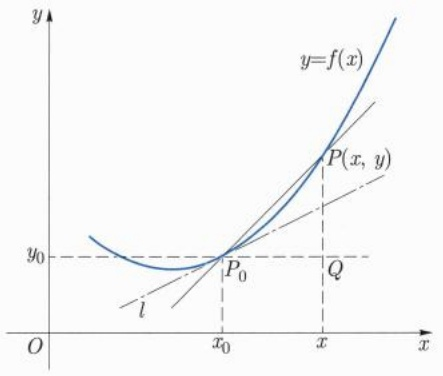
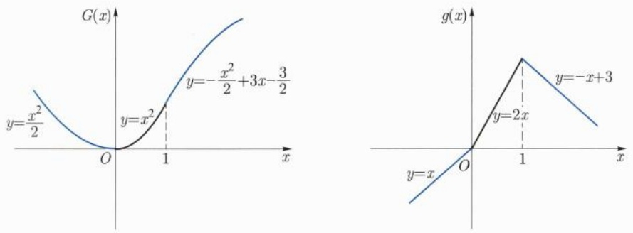
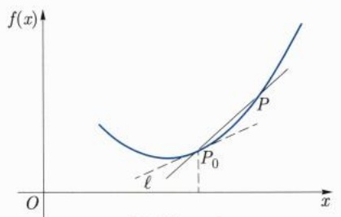
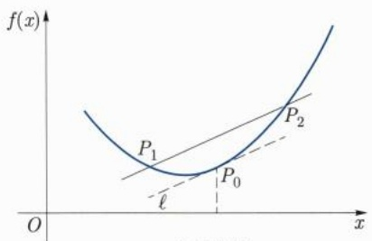
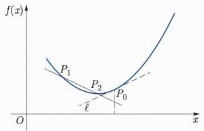
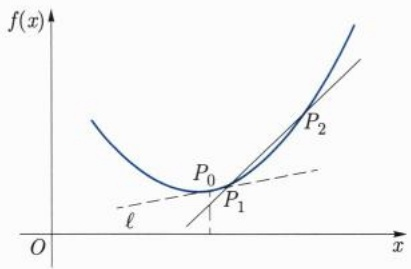
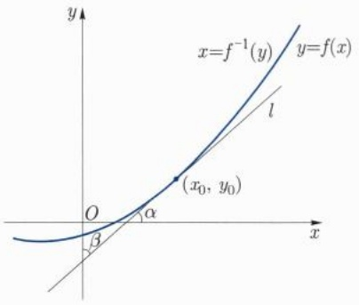
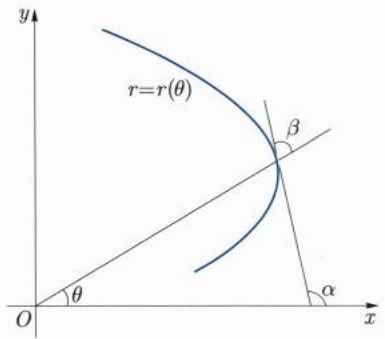
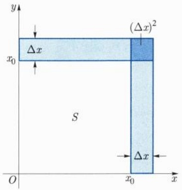
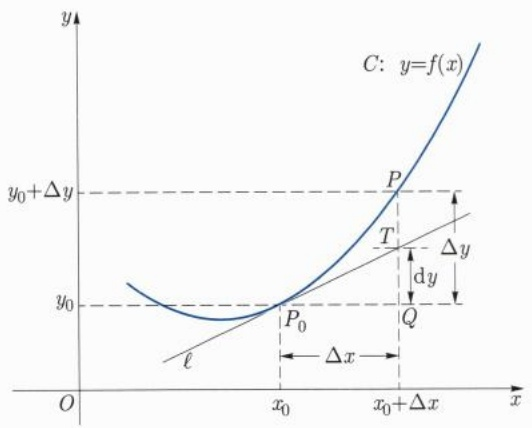

# 上册 / 第六章 导数与微分

原始 PDF 第 140–192 页。

## 第六章

## 导数与微分

---

128

第六章 导数与微分

数学分析的核心内容主要包括微分和积分两部分, 也就是所谓的微积分. 如果我们把微分和积分分别看成是 “微观” 和 “宏观”, 再把前面引入的 “连续” 当作 “中观” 的话, 那么数学分析可以理解为是一门介绍 “微观” “中观” 和 “宏观” 方法的学科. 或者通俗地说, 数学分析是用此 “三观” 来观察和研究函数的学科.

本章我们将着重从“微观”的角度来研究函数, 即所谓的一元函数微分学的内容.

微分的思想萌芽可以追溯到古希腊时期, 当时是在解决具体问题时, 以朴素的、零散的碎片方式表现出来的. 而更接近现代观点的微分学, 比较认可的说法是在 16 世纪前后逐渐形成和发展的. 代表人物和所讨论的问题有 Kepler $^{①}$ 研究的行星运行、Descartes 讨论的曲线的切线、Fermat $^{②}$ 考虑的函数的极值和曲线的切线、Barrow $^{③}$ 通过微分三角形探讨的切线方程等. 这些前期的酝酿, 为后来的代表人物 Newton 和 Leibniz 系统地创立微积分提供了充足的素材和准备. 我们现在介绍的内容, 是经过了 19 世纪的长足发展, 在理论上给予严谨化和进一步的提升、推广和应用后的体系.

顺便提到一点的是, 积分思想的诞生要早于, 至少不迟于, 微分的诞生. 因此, 从历史发展的顺序来说, 微分与积分观念形成的先后与通常教科书中的陈述顺序刚好相反. 本书也将采取先讨论微分再讲述积分的顺序. 这一点其实也不奇怪, 正如大多数分析教材也都是站在 19 世纪数学严谨化之后的角度来讲授的, 而不是完全按时间顺序介绍前人的思想、方法和结论, 然后再逐一打补丁填补不严谨之处.

## 6.1 导数的引入与定义

引入导数这一微分学的核心概念的方式通常有如下两种, 一种是从曾经产生过重大历史影响的两个经典问题入手, 即当初 Newton 和 Leibniz 分别讨论的质点运动的瞬时速度和曲线的切线问题的模型, 然后进行数学抽象和提升; 另一种是跳过对具体问题的介绍, 直接从逻辑上给出严格的数学定义. 这两种方式各有利弊, 完全视读者的知识背景和储备.

对于初学者来说, 也许第一种引入方式较为自然, 也能产生一定的质感, 学习和关注的重点在于如何从介绍朴素的案例的过程中捕捉到数学的本质, 再对其提炼和提升. 第二种引入方法其优点在于简明精练, 主题鲜明.

我们下面采用第一种模式来引入导数. 我们这样做还有一个原因, 就是这两个经典模型的背后代表着学习这门课时两种不同的角度, 一种是分析味道浓郁, 一种几何直观

<small>① Kepler, Johannes, 1571 年 12 月 27 日—1630 年 11 月 15 日, 德国天文学家、物理学家、数学家.</small>

<small>② Fermat, Pierre de, 1601 年 8 月 17 日—1665 年 1 月 12 日, 法国数学家.</small>

<small>③ Barrow, Isaac, 1630 年 10 月 — 1677 年 5 月 4 日, 英国数学家.</small>

---

6.1 导数的引入与定义

129

凸显. 它们均为数学分析中极其重要的理念和方法, 在后面的章节中也能隐约体会到它们在处理问题时带来的不同影响.

我们来讨论下面两个经典模型, 它们正是当年 Newton 和 Leibniz 分别创建微积分时研究的问题. 起源于对质点瞬时速度和曲线切线及其斜率的讨论,

(1) 质点运动学问题: 求质点变速直线运动的瞬时速度.
(2) 几何图形中的切线问题: 求曲线上一点处的切线斜率.

## 1. 质点运动学问题, 非匀速直线运动的瞬时速度

在经典的匀速直线运动框架下，质点的速度定义为质点在单位时间内移动的改变。顾名思义，它应为常值才和匀速直线运动吻合，既不依时间单位长短 $\Delta t$ 的改变而改变，也不依测量时刻 $t$ 的不同而不同。但事实上，严格意义下的匀速直线运动仅仅是一种理想状态。稍微一般的情况应该是非匀速直线运动，以及更一般的曲线变速运动。在此，我们仅重点考虑前者，即质点的非匀速直线运动。

所谓的非匀速直线运动, 是指在给定的时间段 (比如单位时间) 内, 质点运动的位移会有所不同. 这种采用给定时间段去除运动位移改变的计算方法, 是与前面匀速直线运动速度的计算方法兼容的. 这样得到的比值, 称为质点在这段时间的平均速度.

Newton 关于质点运动的瞬时速度, 是在上述平均速度的基础上引入的. 换句话说, 我们将上述时间段的长度取得越来越小, 如果平均速度有极限的话, 就定义为指定质点的瞬时速度. 我们给出如下严格的描述.

设质点在直线 (取为 $x$ 轴) 上运动, 在时刻 $t_0$, 质点的位置为 $x(t_0)$, 那么从时刻 $t_0$ 到时刻 $t_0 + \tau$, 质点的位移变化为

$$
\Delta x = x (t _ {0} + \tau) - x (t _ {0}).
$$

这里我们允许 $\tau < 0$ ，此时可以理解为经过时间段 $-\tau$ 后，质点从位置 $x(t_0 + \tau)$ 到达位置 $x(t_0)$ .质点在 $\tau$ 时间段内的平均速度为

$$
\bar {v} := \frac {\Delta x}{\tau} = \frac {x (t _ {0} + \tau) - x (t _ {0})}{\tau}.
$$

对于固定的非常小的 $\tau$, 可以将它看成是在 $t_0$ 时刻质点速度的一个近似值. 因此, 如果极限

$$
\lim _ {\tau \to 0} \frac {\Delta x}{\tau} = \lim _ {\tau \to 0} \frac {x (t _ {0} + \tau) - x (t _ {0})}{\tau}
$$

存在且有限时, 我们称此极限值为质点在时刻  $t_{0}$  的瞬时速度.

## 2. 曲线切线问题

我们在中学讨论圆的切线时, 曾经把和圆只有一个公共交点的直线称为圆的切线. 对于圆来说, 这种定义切线的方式倒也无妨, 因为这的确是圆的切线所具有的特征, 但

---

130

第六章 导数与微分

这一特征显然不宜当作一般曲线切线的定义. 比如对于抛物线而言, 任何一条平行于抛物线对称轴的直线与抛物线都只有一个交点, 而这些直线显然不能称为抛物线的切线. 由此看出, 对于一般曲线, 我们尚未严谨引入过 “切线” 的概念. 下面我们简要介绍一下 Leibniz 研究曲线切线时所采用的基本思想和方法. 为简单计, 我们假设所讨论的曲线是由显式函数给出的, 即曲线是由形如 $y = f(x)$ 的函数给出的图像.

在曲线 $y = f(x)$ 上，任取一点 $P_0(x_0, y_0), y_0 = f(x_0)$，在点 $P_0$ 附近再在曲线上取一点 $P = (x, y)$. 连接两点 $P$ 与 $P_0$ 作曲线的一条“割线”，则此割线的斜率为

$$
\tan \alpha = \frac {Q P}{P _ {0} Q},
$$

其中 Q 为坐标是  $(x, y_{0})$  的点 (见图 6.1).

line

| Point | x | y |
| --- | --- | --- |
| Intersection (P0) | x0 | y0 |

图6.1

容易看出, 当点 P 沿着曲线向点  $P_{0}$  移动时,

$$
\tan \alpha = \frac {f (x) - f (x _ {0})}{x - x _ {0}}.
$$

割线 $P_0P$ 以及夹角 $\alpha$ 都随着 $P$ 变化而变化. 如果当 $x \to x_0$ 时, $\tan \alpha$ 存在有限的极限 $k$, 即

$$
\lim _ {x \to x _ {0}} \frac {f (x) - f (x _ {0})}{x - x _ {0}} = k,
$$

那么我们很自然地可以把经过点 $P_{0}$ 斜率为 $k$ 的直线定义为曲线 $y = f(x)$ 在点 $P_{0}$ 处的切线 $\ell$. 显然, 如此定义的切线 $\ell$ 有解析表达式

$$
y = y _ {0} + k (x - x _ {0}).
$$

上述两个经典数学模型, 表现形式相去甚远, 但其背后的共同点都是讨论函数的改变量与自变量改变量的比率, 我们将其进行数学上的提炼、抽象和统一处理, 即可引入导数的定义.

---

6.1 导数的引入与定义

131

定义 6.1.1 (导数) 设函数 $y = f\left( x\right)$ 在点 ${x}_{0}$ 附近有定义,如果极限

$$
\lim _ {x \to x _ {0}} \frac {f (x) - f (x _ {0})}{x - x _ {0}} \tag {6.1.1}
$$

存在且有限, 则称 $f(x)$ 在点 $x_0$ 处可导, 并称其极限值为 $f(x)$ 在点 $x_0$ 处的导数, 记为 $f'(x_0)$ 或 $y'(x_0)$.

关于导数符号的几句话: 数学符号的引入通常有其历史背景或文化背景, 或有其内含抑或个人偏好. 导数的记号也不例外. 比如, 上面表示导数的符号' 是 Lagrange $^{①}$  创建的, 最显著的特点是简捷明了,  $f'(x_{0})$  蕴涵着是由函数  $f(x)$  而非另外的函数  $g(x)$  诱导出来的数. 除了 Lagrange 的符号外, 常见的表示导数的符号还有下面 Leibniz 给出的形式:

$$
\left. \frac {\mathrm{d} y}{\mathrm{d} x} \right| _ {x = x _ {0}}, \quad \frac {\mathrm{d} f}{\mathrm{d} x} (x _ {0}), \quad \left. \frac {\mathrm{d} f}{\mathrm{d} x} \right| _ {x = x _ {0}}.
$$

Leibniz 引入的符号初看起来略显啰唆, 当然它传递的信息更多. 当我们讨论的场景稍微复杂时, 比如有多个函数代数运算时, Leibniz 的符号能更清晰地反映出变量间的依赖关系. 不仅如此, 我们还看到这些符号特有的 “分数” 形式, 它更像是两个量的比值. 事实上, 的确如此, 我们对导数的定义稍作形式上的处理, 很快将会看到为什么导数又叫差商的极限了. 在引入微分的概念之后, 这些形式符号被赋予了更深刻的内涵: 导数 $\frac{\mathrm{dy}}{\mathrm{dx}}$ 中的分子和分母可以被看成独立的运算符号, 即微分 $\mathrm{dy}$ 和 $\mathrm{dx}$ 之商了.

除了讨论函数 $f(x)$ 某点 $x_0$ 的可导性外, 我们还经常讨论它在一个集合上的可导性. 对于一个给定的点集 $E \subseteq \mathbb{R}$, 如果 $f(x)$ 在 $E$ 中的每个点都可导, 则称 $f(x)$ 在集合 $E$ 上可导. 当我们的关注点落在函数在集合 $E$ 上的可导性而不是指定点 $x_0$ 的可导性时, 我们常常把 $x_0$ 中的下标去掉, 代之以更灵活和方便的符号 $f'(x)$, 并称之为函数 $f(x)$ 的导函数.

点集 $E \subseteq \mathbb{R}$ 最常见的形式为区间, 包括开区间 $(a, b)$ 和闭区间 $E = [a, b]$ 以及各种组合, 此时我们也说 $f(x)$ 在区间上可导.

我们对定义6.1.1中的导数作一些形式上的处理: 对于固定点 $x_0$ 以及附近的点 $x$, 我们更习惯于将 $x$ 与 $x_0$ 的差用 $\Delta x$ 表示, 类似地, 用 $\Delta f(x)$ 或者 $\Delta y$ 表示相应的函数值的差 $f(x) - f(x_0)$, 即

$$
\Delta x = x - x _ {0}, \qquad \Delta y = f (x) - f (x _ {0}).
$$

于是 $x = x_0 + \Delta x, f(x) = f(x_0) + \Delta y,$ 而 $x\to x_0$ 则等价于 $\Delta x\to 0.$ 表达式（6.1.1）就变成了

$$
f ^ {\prime} (x _ {0}) = \lim _ {\Delta x \to 0} \frac {\Delta y}{\Delta x}. \tag {6.1.2}
$$

<small>① Lagrange, Joseph-Louis, 1736 年 1 月 25 日 — 1813 年 4 月 10 日, 意大利裔法国数学家.</small>

---

132

第六章 导数与微分

注6.1.1 可以看出, 一个函数在给定点的导数本质上是由此函数在该点诱导出的差商的极限来定义的. 因此, 我们这里再次看到了极限的工具地位, 故可以用极限的 $\varepsilon - \delta$ 语言来描述函数的可导性: 如果存在实数 $A \in \mathbb{R}$, 使得 $\forall \varepsilon > 0$, 都存在 $\delta > 0$, 当 $0 < |x - x_0| < \delta$ 时, 成立

$$
\left| \frac {f (x) - f (x _ {0})}{x - x _ {0}} - A \right| <   \varepsilon , \tag {6.1.3}
$$

则称  $f(x)$  在点  $x_{0}$  处可导, 且导数值定义为 A.

这样, 函数在某点的可导性问题就等价于上述极限的存在性问题, 而计算导数则变成了寻求 $A$ 的问题.

例 6.1.1 试求 R 上的常值函数  $f(x) \equiv c$  的导数.

解 $\forall x_0\in \mathbb{R}$ ，由于

$$
\lim _ {x \to x _ {0}} \frac {f (x) - f (x _ {0})}{x - x _ {0}} = \lim _ {x \to x _ {0}} \frac {c - c}{x - x _ {0}} \equiv 0, \tag {6.1.4}
$$

所以

$$
c ^ {\prime} = 0. \tag {6.1.5}
$$

这一结论显然符合我们当初引入导数时的预期: 一个取值不变的函数其变化率应该恒为零. 后面我们还能证明, 如果一个函数, 其变化率处处为零, 那么它就是个常值函数.

例 6.1.2 设 n > 0 为正整数, 试求  $f(x) = x^{n}$  在点  $x_{0}$  处的导数.

解 $\forall x_0\in \mathbb{R}$ ，我们有

$$
\begin{array}{l} \frac {\Delta y}{\Delta x} = \frac {x ^ {n} - x _ {0} ^ {n}}{x - x _ {0}} \\ = x ^ {n - 1} + x ^ {n - 2} x _ {0} + \dots + x _ {0} ^ {n - 1}. \\ \end{array}
$$

因此

$$
f ^ {\prime} (x _ {0}) = \lim _ {x \to x _ {0}} \frac {\Delta y}{\Delta x} = n x _ {0} ^ {n - 1}. \tag {6.1.6}
$$

由于  $x_{0}$  的一般性, 在不强调  $x_{0}$  时, 我们也常常把上式写成

$$
(x ^ {n}) ^ {\prime} = n x ^ {n - 1}. \tag {6.1.7}
$$

完全类似地不难得到, 对于负整数 n, 当 x > 0 时, 也有

$$
(x ^ {n}) ^ {\prime} = n x ^ {n - 1}. \tag {6.1.8}
$$

如果把例 6.1.1 中的常值函数看成是例 6.1.2 中 n = 0 的情况, 并将 (6.1.7) 式右端理解成 0 的话, 那么我们可以把关系式 (6.1.5), (6.1.7), (6.1.8) 合并为统一的表达式.

$$
(x ^ {n}) ^ {\prime} = n x ^ {n - 1}.
$$

---

6.1 导数的引入与定义

133

这里我们默认当 $n < 0$ 时, 仅讨论当 $x > 0$ 时函数的情况.

例 6.1.3 设  $f(x)=|x|$ . 证明  $f(x)$  在  $x_{0}=0$  处不可导.

证明 注意到当 $x > 0$ 时, 有

$$
\lim _ {x \to 0 ^ {+}} \frac {f (x) - f (0)}{x - 0} = \lim _ {x \to 0 ^ {+}} \frac {x}{x} = 1
$$

而当 $x < 0$ 时, 有

$$
\lim _ {x \to 0 ^ {-}} \frac {f (x) - f (0)}{x - 0} = \lim _ {x \to 0 ^ {-}} \frac {- x}{x} = - 1,
$$

所以极限  $\lim_{x\to0}\frac{f(x)-f(0)}{x-0}$  不存在, 因此函数  $f(x)$  在  $x_{0}=0$  处不可导.

完全类似地可以证明如下稍微一般的结论:

例6.1.4 设 $k_{1} \neq k_{2}$, 则“折线”函数

$$
f (x) = \left\{ \begin{array}{l l} k _ {1} (x - x _ {0}), & x \leqslant x _ {0}, \\ k _ {2} (x - x _ {0}), & x \geqslant x _ {0} \end{array} \right.
$$

在折点 $x = x_0$ 处是不可导的.

这一结论符合我们对上述函数在点 $x_0$ 处没切线的直觉:函数在点 $x_0$ 处因为“急转弯”而产生一个“尖点”，哪怕它在“尖点处”连续，也不意味着可导。需要注意的是，这仅仅是几何直觉而非逻辑证明。另一方面，下面的例子告诉我们，一个看似很糟糕的函数，仅在一个点连续，在此点它竟然是可导的（换个角度说，一个函数即使在一点可导，也不能保证存在一个哪怕是充分小的邻域，使得函数在此邻域内连续）。

例6.1.5 试讨论函数

$$
f _ {1} (x) = \left\{ \begin{array}{l l} x, & x \in \mathbb {Q}, \\ - x, & x \notin \mathbb {Q}, \end{array} \right. \quad f _ {2} (x) = \left\{ \begin{array}{l l} x ^ {2}, & x \in \mathbb {Q}, \\ - x ^ {2}, & x \notin \mathbb {Q} \end{array} \right. \tag {6.1.9}
$$

在 x = 0 处的可导性, 如果可导, 求其导数.

解 根据导数的定义, 考虑 ${f}_{1}\left( x\right)$ 在 0 点处差商的极限

$$
\lim _ {x \to 0} \frac {f _ {1} (x) - f _ {1} (0)}{x - 0} = \left\{ \begin{array}{l l} 1, & x \in \mathbb {Q}, \\ - 1, & x \notin \mathbb {Q}, \end{array} \right.
$$

所以极限 $\lim_{x\to 0}\frac{f_1(x) - f_1(0)}{x - 0}$ 不存在.即 $f_{1}(x)$ 在 $x = 0$ 处不可导

另一方面, 根据定义直接计算可得

$$
\lim _ {x \to 0} \frac {f _ {2} (x) - f _ {2} (0)}{x - 0} = 0.
$$

所以  $f_{2}(x)$  在 x=0 处可导, 且  $f_{2}^{\prime}(0)=0$ . 即由函数给出的“曲线”在原点处有切线.

---

134

第六章 导数与微分

这里曲线二字上的引号是在暗示这些函数的图形实在不像通俗意义下的曲线, 因为看起来它的连续性实在太糟糕了. 然而即使如此, $f_{2}(x)$ 在 $x = 0$ 处竟然有“切线”. 与之对应的是 $f_{1}(x)$, 它的定义方式看起来和 $f_{2}(x)$ “同宗同族”, 但是它在 $x = 0$ 处却无法定义出切线. 完全类似地不难证明下面的函数在 $x = 0$ 处都是可导的. 因此, 我们建议读者从 Leibniz 当初引入切线的原始思想和做法出发, 充分体会这些函数可导与不可导的本质, 这对我们理解导数和构造更多的例子或反例颇有益处, 对导数的推广也很有启发.

对于 $k_{1}, k_{2} \in \mathbb{R}$, 函数

$$
g _ {1} (x) = \left\{ \begin{array}{l l} k _ {1} x ^ {2}, & x \in \mathbb {Q}, \\ k _ {2} x ^ {2}, & x \notin \mathbb {Q}, \end{array} \right. \quad g _ {2} (x) = \left\{ \begin{array}{l l} k _ {1} x ^ {2}, & x \leqslant 0, \\ k _ {2} x ^ {2}, & x \geqslant 0 \end{array} \right. \tag {6.1.10}
$$

在 $x = 0$ 处都是可导的.

我们给出个稍微一般些的例子.

例 6.1.6 考察逐段二次函数

$$
G (x) = \left\{ \begin{array}{l l} \frac {1}{2} x ^ {2}, & x \leqslant 0, \\ x ^ {2}, & x \in (0, 1), \\ - \frac {1}{2} x ^ {2} + 3 x - \frac {3}{2}, & x \geqslant 1 \end{array} \right. \tag {6.1.11}
$$

的导函数的存在性.

解 根据导数的定义, 通过直接计算可以得到函数 $G(x)$ 的导函数 (见图6.2)

$$
g (x) = G ^ {\prime} (x) = \left\{ \begin{array}{l l} x, & x \leqslant 0, \\ 2 x, & x \in (0, 1), \\ - x + 3, & x \geqslant 1, \end{array} \right. \tag {6.1.12}
$$

图6.2 例6.1.6中的函数

可以看出, $G(x)$ 在视觉上给出的曲线还算得上是一条光滑曲线, 其导函数 $g(x)$ 所表示的曲线已经是条“折线”了. 如果反过来看这个问题的话, 可以概括为: 一条由逐段线性函数给出的折线, 可以由一条逐段为二次函数的导函数生成. 我们特别指出, $G(x)$ 与

---

6.1 导数的引入与定义

135

$g(x)$  之间的关系在后续章节中将多次应用: 比如函数逼近、连续函数原函数的存在性, 等等. 鉴于此, 我们不厌其烦地再把此例一般化如下, 证明方法完全等同于上例, 不再赘述.

例 6.1.7 设  $G(x)$  是在  $[a, b]$  上由逐段抛物线给出的函数, 如果在两段抛物线的衔接处是可导的, 那么  $g(x) = G'(x)$  是  $[a, b]$  上的逐段线性函数. 即设  $a = x_{0} < x_{1} < x_{2} < \cdots < x_{n} < x_{n+1} = b$ ,

$$
G (x) = \left\{ \begin{array}{l l} A _ {0} + a _ {0} (x - x _ {0}) + \frac {1}{2} b _ {0} (x - x _ {0}) ^ {2}, & x \in [ x _ {0}, x _ {1}), \\ A _ {1} + a _ {1} (x - x _ {1}) + \frac {1}{2} b _ {1} (x - x _ {1}) ^ {2}, & x \in [ x _ {1}, x _ {2}), \\ \dots , \\ A _ {n} + a _ {n} (x - x _ {n}) + \frac {1}{2} b _ {n} (x - x _ {n}) ^ {2}, & x \in [ x _ {n}, x _ {n + 1} ], \end{array} \right.
$$

其中  $A_{0}=G(a)$ ,

$$
a _ {k} = a _ {k - 1} + b _ {k - 1} (x _ {k} - x _ {k - 1}), \quad k = 1, 2, \dots , n, \tag {6.1.13}
$$

$$
A _ {k} = A _ {k - 1} + a _ {k - 1} (x _ {k} - x _ {k - 1}) + \frac {1}{2} b _ {k - 1} (x _ {k} - x _ {k - 1}) ^ {2}, \quad k = 1, 2, \dots , n.
$$

则  $G'(x)$  是  $[a, b]$  上的连续的逐段线性函数:

$$
g (x) = G ^ {\prime} (x) = \left\{ \begin{array}{l l} a _ {0} + b _ {0} (x - x _ {0}), & x \in [ a, x _ {1}), \\ a _ {1} + b _ {1} (x - x _ {1}), & x \in [ x _ {1}, x _ {2}), \\ \dots , \\ a _ {n} + b _ {n} (x - x _ {n}), & x \in [ x _ {n}, b ], \end{array} \right.
$$

上面我们提到过圆的切线可描述为一条与圆周有且仅有一个交点的直线, 下面的例子告诉我们, 一条曲线在某点处的切线与曲线本身可能有非常复杂的交点.

例6.1.8 试计算函数

$$
f (x) = \left\{ \begin{array}{l l} x ^ {2} \sin \frac {1}{x}, & x \neq 0, \\ 0, & x = 0 \end{array} \right. \tag {6.1.14}
$$

在 x = 0 处的导数.

解 由定义直接计算可得 $f'(0) = 0$. 因此函数对应的曲线在 $(0,0)$ 处的切线与 $x$ 轴重合. 注意该切线在 $x = 0$ 的任意小邻域内都与曲线有无穷多个交点, 这在直观上与初等数学中圆的切线与圆周有且仅有一个交点有很大区别.

我们以可导与连续之间的关系这一极其基本的性质结束本节.

定理 6.1.1 若  $f(x)$  在点  $x_{0}$  处可导, 则必有  $f(x)$  在点  $x_{0}$  处连续, 从而在点  $x_{0}$  附近有界, 即存在  $\delta_{0} > 0$ , 使得  $f(x)$  在  $(x_{0} - \delta_{0}, x_{0} + \delta_{0})$  内有界.

---

136

第六章 导数与微分

证明 设 $f(x)$ 在点 $x_0$ 处可导, 则

$$
\lim _ {x \to x _ {0}} f (x) - f (x _ {0}) = \lim _ {x \to x _ {0}} \frac {f (x) - f (x _ {0})}{x - x _ {0}} (x - x _ {0}) = f ^ {\prime} (x _ {0}) \cdot 0 = 0.
$$

即  $f(x)$  在点  $x_{0}$  处连续.

关于函数的连续与可导之间的关系, 在微积分发展历史上, 经历了较为漫长的时间才得以厘清. 人们很早就认识到可导蕴涵着连续, 也知道有 $y = |x|$ 这样的连续函数, “偶尔”会有一些不可导的点. 直到19世纪上半叶, 人们曾一度认为连续函数可导的点应该占主流, 包括Cauchy, Gauss①这些大数学家都持有这种观点, 因为很难想象一个有“很多”不可导点的连续函数会是什么样. Picard②曾这样评论道: 如果Newton和Leibniz知道了连续函数不一定可导, 微分学将无以产生. 这个错觉或误解被德国数学家Weierstrass在1872年所打破, 他构造性地证明了震惊数学界的结论: 存在处处连续处处不可导的函数. 目前我们暂时了解可导与连续的逻辑关系, 在后面章节再系统讨论这方面的内容.

## 习题6.1

1. 变速直线运动可以看作是匀速直线运动的一般化, 进而我们引入了质点作变速直线运动的瞬时速度. 思考一下, 我们为何不直接引入更一般情况的变速曲线运动的瞬时速度?
2. 考虑如下意义下的“尺规作图”:假设给出了一个没有刻度的直角坐标系，给出了坐标系下函数的图像，并被告知是 $y = f(x)$ 的图像。试用尺规作出曲线上的点 $P_0(x_0, f(x_0))$ 处的切线，其中 $f(x)$ 分别为

(1) $f(x)=x^{k}$ ，其中 k 是整数，特别地 k=-1;
(2) 尺规作出椭圆  $\frac{x^{2}}{a^{2}} + \frac{y^{2}}{b^{2}} = 1$  上一点处的切线;
(3)  $f(x) = \sin x;$
(4) $f(x) = \tan x;$
(5) $f(x)=\mathrm{e}^{x};$
(6) $f(x)=\ln x.$

3. 设 $f(x)$ 在点 $x_0$ 处可导, 求极限

$$
\lim _ {h \to 0} \frac {f (x _ {0} + h) - f (x _ {0} - h)}{h}.
$$

<small>① Gauss, Johann Carl Friedrich, 1777 年 4 月 30 日 — 1855 年 2 月 23 日, 德国数学家、物理学家、天文学家、几何学家、大地测量学家.</small>

<small>② Picard, Charles Emile, 1856 年 7 月 24 日 — 1941 年 12 月 11 日, 法国数学家.</small>

---

6.2 单侧导数 Dini 导数 更多的导数

137

4. 设 $f(x)$ 在 $x = 0$ 处连续, 且

$$
\lim _ {x \to 0} \frac {f (2 x) - f (x)}{x} = k.
$$

证明:  $f'(0) = k.$

5. 证明: 可导偶函数的导数为奇函数, 可导奇函数的导数为偶函数, 可导周期函数的导数仍为周期函数.

6. 如果曲线 $\Gamma: y = F(x)$ 在 $x = x_0$ 处有斜率为 $k$ 的切线 $\ell$, 那么将 $\Gamma$ 沿着 $x$ 轴平移 $c$ 得到曲线 $\Gamma_c: y = F(x + c)$. 证明: $\Gamma_c$ 在 $x = x_0 + c$ 处也有斜率为 $k$ 的切线 $\ell_c$, 并写出 $\ell_c$ 的方程.

7. 设  $g(0)=g'(0)=0,$

$$
f (x) = \left\{ \begin{array}{l l} g (x) \sin \frac {1}{x}, & x \neq 0, \\ 0, & x = 0. \end{array} \right.
$$

求  $f'(0)$ .

8. 设 $f$ 是定义在 $\mathbb{R}$ 上的函数, 且对任何 $x_{1}, x_{2} \in \mathbb{R}$, 都有

$$
f (x _ {1} + x _ {2}) = f (x _ {1}) \cdot f (x _ {2}).
$$

若 $f'(0) = 1$ ，证明对任何 $x \in \mathbb{R}$，都有

$$
f ^ {\prime} (x) = f (x).
$$

## 6.2 单侧导数 Dini 导数 更多的导数

本节我们讨论一下导数的推广. 这些概念的推广大多数都是极其自然的, 是基于在引入经典导数时对涉及的最基本要素的本质挖掘.

## 6.2.1 单侧导数

类似于单侧极限, 我们也可以讨论函数在一点处的单侧导数.

定义 6.2.1 (左侧可导) 设函数  $y = f(x)$  在  $(x_{0} - \delta, x_{0}] (\delta > 0)$  上有定义, 如果单侧极限

$$
\lim _ {\Delta x \to 0 ^ {-}} \frac {f (x _ {0} + \Delta x) - f (x _ {0})}{\Delta x} \tag {6.2.1}
$$

---

138

第六章 导数与微分

存在且有限, 则称 $f(x)$ 在点 $x_0$ 处左侧可导, 或简称左可导, 并称其极限值为 $f(x)$ 在点 $x_0$ 处的左导数, 记为 $f_{-}^{\prime}(x_0)$ 或 $y_{-}^{\prime}(x_0)$, 即

$$
f _ {-} ^ {\prime} (x _ {0}) = \lim _ {\Delta x \to 0 ^ {-}} \frac {f (x _ {0} + \Delta x) - f (x _ {0})}{\Delta x}. \tag {6.2.2}
$$

类似地我们可以定义函数 $f(x)$ 在点 $x_0$ 处的右侧可导以及右导数，即

定义 6.2.2 (右侧可导) 设函数  $y = f(x)$  在  $[x_{0}, x_{0} + \delta) (\delta > 0)$  上有定义, 如果单侧极限

$$
\lim _ {\Delta x \to 0 ^ {+}} \frac {f (x _ {0} + \Delta x) - f (x _ {0})}{\Delta x} \tag {6.2.3}
$$

存在且有限, 则称 $f(x)$ 在点 $x_0$ 处右侧可导, 或简称右可导, 并称其极限值为 $f(x)$ 在点 $x_0$ 处的右导数, 记为 $f_{+}^{\prime}(x_0)$ 或 $y_{+}^{\prime}(x_0)$, 即

$$
f _ {+} ^ {\prime} (x _ {0}) = \lim _ {\Delta x \to 0 ^ {+}} \frac {f (x _ {0} + \Delta x) - f (x _ {0})}{\Delta x}. \tag {6.2.4}
$$

左导数、右导数统称为单侧导数.

有了单侧导数的概念后, 当我们说函数 $f(x)$ 在闭区间 $[a, b]$ 上可导时, 则是指函数

(1) 在区间内部的点处均可导;
(2) 在区间端点 $a$ 和 $b$ 处分别右可导和左可导.

由上面两点结合下面的例子, 我们有如下观察和结论:

(1) 如果 $f$ 在区间 $[a, b]$ 上可导, 那么 $f$ 在 $[a, b]$ 的任何子区间上也可导;
(2) 即使 $f$ 在区间 $[a, b]$ 和 $[b, c]$ 上均可导, $f$ 在 $[a, c]$ 上也不一定可导.

例 6.2.1 考虑例 6.1.3 中的函数  $f(x)=|x|$ . 我们知它在 0 点处不可导. 但可以看出在 x=0 处, 函数是左可导和右可导的, 且  $f(x)$  在 0 点的左、右导数分别为

$$
f _ {-} ^ {\prime} (0) = - 1, \quad f _ {+} ^ {\prime} (0) = 1.
$$

回顾和对比极限 (6.1.2) 存在的充要条件是两个单侧极限 (6.2.1) 和 (6.2.3) 存在且相等. 对于单侧导数, 我们有以下类似的结论:

定理 6.2.1 设函数  $f(x)$  在点  $x_{0}$  附近有定义. 则  $f(x)$  在该点可导的充要条件是其两个单侧导数都存在且相等, 即

$$
f _ {-} ^ {\prime} (x _ {0}) = f _ {+} ^ {\prime} (x _ {0}).
$$

此时有

$$
f ^ {\prime} (x _ {0}) = f _ {-} ^ {\prime} (x _ {0}) = f _ {+} ^ {\prime} (x _ {0}).
$$

单侧导数作为导数的一种推广, 在讨论函数在某点处的单侧性质时非常有用.

---

6.2 单侧导数 Dini 导数 更多的导数

139

例6.2.2 设

$$
f (x) = \left\{ \begin{array}{l l} x \sin \frac {1}{x}, & x <   0, \\ x, & x \geqslant 0. \end{array} \right.
$$

试讨论  $f(x)$  在 0 点处的单侧导数.

解 当 $x \to 0^{+}$ 时, 有

$$
\lim _ {x \to 0 ^ {+}} \frac {f (x) - f (0)}{x} = 1.
$$

因此 $f_{+}^{\prime}(0) = 1$

当 $x \to 0^{-}$ 时, 有

$$
\lim _ {x \to 0 ^ {-}} \frac {f (x) - f (0)}{x} = \lim _ {x \to 0 ^ {-}} \sin \frac {1}{x}.
$$

极限不存在, 因此  $f(x)$  在 0 点左导数不存在.

注意到经典导数的本质是通过考虑函数变化率 $\frac{\Delta y}{\Delta x}$ 的极限来研究函数, 自然我们也可以重新审视函数变化率的其他引入方式, 比如上面讨论的单侧导数就是只关注一点处函数左侧或右侧的变化率的极限. 类似地, 我们也可只关注函数变化率的上下极限、左右极限, 或者它们的组合, 从而可以引入各种各样特定的导数. 下面的 Dini① 导数就是其中的一种.

## 6.2.2 Dini 导数

Dini 导数的定义如下:

定义 6.2.3 设  $f(x)$  在点  $x_{0}$  附近有定义, 令

$$
\begin{array}{l} D ^ {+} f (x _ {0}) = \varlimsup_ {\Delta x \to x _ {0} ^ {+}} \frac {f (x) - f (x _ {0})}{x - x _ {0}}, \quad D _ {+} f (x _ {0}) = \varliminf_ {\Delta x \to x _ {0} ^ {+}} \frac {f (x) - f (x _ {0})}{x - x _ {0}}, \\ D ^ {-} f (x _ {0}) = \varlimsup_ {\Delta x \to x _ {0} ^ {-}} \frac {f (x) - f (x _ {0})}{x - x _ {0}}, \quad D _ {-} f (x _ {0}) = \varliminf_ {\Delta x \to x _ {0} ^ {-}} \frac {f (x) - f (x _ {0})}{x - x _ {0}}, \tag {6.2.5} \\ \end{array}
$$

分别称它们为 $f(x)$ 在点 $x_0$ 处的右上导数、右下导数、左上导数、左下导数，统称为Dini导数.

从上下极限的性质可以得到下面的关系式:

$$
\begin{array}{l} D ^ {+} f (x _ {0}) \geqslant D _ {+} f (x _ {0}), \quad D ^ {-} f (x _ {0}) \geqslant D _ {-} f (x _ {0}) \\ D ^ {+} (- f (x _ {0})) = - D _ {+} f (x _ {0}), \quad D ^ {-} (- f (x _ {0})) = - D _ {-} f (x _ {0}). \tag {6.2.6} \\ \end{array}
$$

关于 Dini 导数, 下面与定理 6.2.1 平行的结论成立, 证略.

定理 6.2.2 设函数  $f(x)$  在点  $x_{0}$  的某邻域内有定义, 下列结论成立:

(1) $f(x)$ 在点 $x_0$ 处右可导当且仅当 $D^{+}f(x_{0}) = D_{+}f(x_{0})$ 且均为有限值；

<small>① Dini, Ulisse, 1845 年 11 月 14 日 — 1918 年 10 月 28 日, 意大利数学家.</small>

---

140

第六章 导数与微分

(2) $f(x)$ 在点 $x_0$ 处左可导当且仅当 $D^{-}f(x_0) = D_{-}f(x_0)$ 且均为有限值;
(3) $f(x)$ 在点 $x_0$ 处可导当且仅当四个Dini导数都存在且均为同一个有限值.

例6.2.3 试求函数

$$
f (x) = \left\{ \begin{array}{l l} x, & x \in \mathbb {Q}, \\ - x, & x \notin \mathbb {Q} \end{array} \right. \tag {6.2.7}
$$

在 x = 0 处的 Dini 导数.

解 根据定义直接计算可得

$$
D ^ {+} f (0) = 1, \quad D _ {+} f (0) = - 1, \quad D ^ {-} f (0) = 1, \quad D _ {-} f (0) = - 1.
$$

例6.2.4 试求函数

$$
f (x) = \left\{ \begin{array}{l l} x \sin^ {2} \frac {1}{x}, & x > 0, \\ 0, & x = 0, \\ 2 x \cos^ {2} \frac {1}{x}, & x <   0 \end{array} \right. \tag {6.2.8}
$$

在 x = 0 处的 Dini 导数.

解 考虑区间 $I_{n} = \left[\frac{1}{(2n + 2)\pi},\frac{1}{2n\pi}\right]$, 当 $x\in I_n$ 时, 由于 $\sin \frac{1}{x}$ 和 $\cos \frac{1}{x}$ 可以取遍 $[-1,1]$ 中的所有值, 所以有

$$
D _ {+} f (0) = 0, \quad D ^ {+} f (0) = 1, \quad D _ {-} f (0) = 0, \quad D ^ {-} f (0) = 2.
$$

作为练习读者也可以把 $D^{+}f(x_{0})$ 和 $D^{-}f(x_{0})$ 组合起来得到上导数 $\overline{D} f(x_0)$，把 $D_{+}f(x_{0})$ 和 $D_{-}f(x_{0})$ 组合起来得到下导数 $\underline{D} f(x_0)$。可以证明，满足Lipschitz连续的函数其上下导数分别满足 $\overline{D} f(x) \leqslant L, \underline{D} f(x) \geqslant -L$，其中 $L$ 是关系式 $|f(x_1) - f(x_2)| \leqslant L|x_1 - x_2|$ 中的Lipschitz常数。不难证明，函数 $f(x)$ 在点 $x_0$ 处可导的充要条件是相应点处的上、下导数相等且为有限值。

## 6.2.3 对称导数 Schwarz 型导数

我们再次回到当初 Leibniz 考虑曲线的切线问题. 给定曲线

$$
C := \{(x, y): y = f (x), x \in I \},
$$

曲线上的点 $P_{0}(x_{0},f(x_{0}))\in C$ 处的切线定义如下:任找 $C$ 上的一点 $P(x,y)$ ，考虑由 $P_{0}$ 和 $P$ 决定的割线 $L_{P_0P}$ 以及它的斜率 $k_{P_0P}$ ，如果当 $x\to x_0$ 时， $k_{P_0P}$ 存在有限的极限$k\in \mathbb{R}$ ，我们就称曲线 $C$ 在 $P_{0}$ 点切线存在，它是一条过 $P_{0}$ 点，斜率为 $k$ 的直线 $\ell$ .显然$\ell$ 的方程可以由解析式

$$
\ell : \quad y = k (x - x _ {0}) + f (x _ {0})
$$

---

6.2 单侧导数 Dini 导数 更多的导数

141

表出. 所以切线 $\ell$ 也可以看成是割线 $L_{P_0P}$ 当 $P$ 趋于 $P_0$ 时的极限状态.

我们现在考察引入切线的其他可能. 在上述假设下, 为了讨论点 $P_{0}$ 的切线, 在 $C$ 上任找两个异于 $P_{0}$ 的点 $P_{1}(x_{1}, f(x_{1}))$ 和 $P_{2}(x_{2}, f(x_{2}))$, 考虑由 $P_{1}$ 和 $P_{2}$ 决定的割线 $L_{P_{1}P_{2}}$ 及其斜率 $k_{P_{1}P_{2}}$. 如果当 $x_{1,2} \to x_{0}$ 时, $k_{P_{1}P_{2}}$ 存在有限的极限 $\tilde{k} \in \mathbb{R}$, 那么对应的割线 $L_{P_{1}P_{2}}$ 的极限位置是否可以定义为 $P_{0}$ 点的切线? 这种定义出来的“切线”和经典的切线有何关系? 换句话说, $\tilde{k}$ 和 $k$ 可否相等?

可以看出, 无论是逻辑上还是直观上我们都有理由来这样定义, 因此我们首先把这个想法抽象出来, 给出数学上的统一处理, 然后我们再讨论它们之间的关系.

有两种比较自然的选取割线 $P_{1}P_{2}$ 的方法(见图6.3): 一种是 $P_{1}$ 和 $P_{2}$ 从 $P_{0}$ 的异侧趋于 $P_{0}$, 另一种是 $P_{1}$ 和 $P_{2}$ 从 $P_{0}$ 的同侧趋于 $P_{0}$. 经典的切线恰好是 $P_{1}$ 或 $P_{2}$ 之一固定为 $P_{0}$ 的特殊情况.

text_image

f(x)
P
P₀
ℓ
O
x

(a) 经典导数: $P$ 趋于 $P_{0}$

text_image

f(x)
P₁
P₂
ℓ
P₀
O
x

(b) $P_{1}, P_{2}$ 从异侧趋于 $P_{0}$

text_image

f(x)
P₁
P₂
P₀
ℓ
O
x

(c) $P_{1}, P_{2}$ 从同侧趋于 $P_{0}$

text_image

f(x)
P₀
P₁
ℓ
P₂
O
x

图 6.3 经典导数与推广

定义 6.2.4 设  $\delta > 0, f(x)$  在点  $x_{0}$  的某邻域  $(x_{0} - \delta, x_{0} + \delta)$  内有定义.

(1) 对任意的 $x_{1}, x_{2} \in (x_{0} - \delta, x_{0} + \delta), (x_{1} - x_{0})(x_{2} - x_{0}) < 0$, 如果极限

$$
\lim_{\substack{x_{1}\to x_{0}\\ x_{2}\to x_{0}}}\frac{f(x_{2}) - f(x_{1})}{x_{2} - x_{1}} \tag{6.2.9}
$$

存在且有限, 则称 $f(x)$ 在点 $x_0$ 处 Schwarz$^{\text{①}}$ 型弱可导, 简称 $S$-型弱可导, 并称其极限值为 $f(x)$ 在点 $x_0$ 处的 $S$-弱导数, 记为 $f_w^{[1]}(x_0)$;

<small>① Schwarz, Karl Hermann Amandus, 1843 年 1 月 25 日—1921 年 11 月 30 日, 德国数学家.</small>

---

142

第六章 导数与微分

(2) 对任意的 $x_{1}, x_{2} \in (x_{0} - \delta, x_{0} + \delta), (x_{1} - x_{0})(x_{2} - x_{0}) > 0$, 如果极限

$$
\lim_{\substack{x_{1}\to x_{0}\\ x_{2}\to x_{0}}}\frac{f(x_{2}) - f(x_{1})}{x_{2} - x_{1}} \tag{6.2.10}
$$

存在且有限, 则称 $f(x)$ 在点 $x_0$ 处 Schwarz 型强可导, 简称 $S$-型强可导, 并称其极限值为 $f(x)$ 在点 $x_0$ 处的 $S$-强导数, 记为 $f_s^{[1]}(x_0)$.

注意, 上述定义中的 S-型强、弱可导是非标准用语, 从后面的逻辑关系中, 可以看出, 这些称呼仅仅提供了一种逻辑上的形象理解.

定义中的 $S$ -型弱导数的一种特殊情况就是所谓的 Schwarz 对称导数, 其定义如下.

定义 6.2.5 设  $\delta > 0, f(x)$  在点  $x_{0}$  的某邻域  $(x_{0} - \delta, x_{0} + \delta)$  内有定义, 如果极限

$$
\lim _ {\Delta x \to 0} \frac {f (x _ {0} + \Delta x) - f (x _ {0} - \Delta x)}{2 \Delta x} \tag {6.2.11}
$$

存在且有限, 则称 $f(x)$ 在点 $x_0$ 处 Schwarz 对称可导, 简称 $S$-可导或对称可导, 并将其极限值记为 $f^{[1]}(x_0)$.

易证下面的结论:

例 6.2.5 函数  $f(x)=|x|$  在 x=0 处 Schwarz 对称可导, 且导数为  $f^{[1]}(x_{0})\equiv0$ .

注6.2.1 从上面这个例子可以看出, 一个函数在点 $x_0$ 处 $S$-可导, 它甚至可以是不连续的, 因为我们可以任意改变 $f(x)$ 在 0 点的值而不影响其对称导数值. 因此, 在讨论 $S$-型导数时, 常常加上函数在该点连续的条件.

上面我们仅从切线的几何直观和概念的推广角度引入了 S-型导数, 由于形式上涉及一些二元函数极限的内容, 在此我们不打算作进一步的铺开讨论. 下面给出一个相关结论, 有兴趣的读者可以完善证明并作进一步的思考和讨论.

定理 6.2.3 设函数  $f(x)$  在点  $x_{0}$  附近有定义, 在点  $x_{0}$  处连续, 则下面结论成立:

(1) 如果 $f(x)$ 在点 $x_0$ 处 $S$-型强可导, 则 $f(x)$ 在点 $x_0$ 处可导.
(2) $f(x)$ 在点 $x_0$ 处可导当且仅当 $f(x)$ 在点 $x_0$ 处 $S$-型弱可导. 特别地, $f(x)$ 在点 $x_0$ 处可导蕴涵 $f(x)$ 在点 $x_0$ 处对称可导.
(3) 当  $f(x)$  在点  $x_{0}$  处 S-型强可导时, 三种导数值相等.

下面的例子说明,上述结论反向一般来说均不成立.

例 6.2.6 (1) 考虑函数  $f(x)=|x|$ ，则 f 在 x=0 处对称可导，但并不可导.

(2) 设

$$
f (x) = \left\{ \begin{array}{l l} x ^ {2} \sin \frac {1}{x}, & x \neq 0, \\ 0, & x = 0. \end{array} \right.
$$

则 $f(x)$ 在 $x = 0$ 处可导, $f'(0) = 0$, 但并不 $S$-型强可导. 事实上, 取 $x_{n} = \frac{2}{(2n + 1)\pi}$, 则极限

---

6.2 单侧导数 Dini 导数 更多的导数

143

$$
\lim _ {n \to + \infty} \frac {f (x _ {n + 1}) - f (x _ {n})}{x _ {n + 1} - x _ {n}}
$$

不存在.

除了上面的左右导数、上下导数、强弱导数外, 还可以视具体情况而引入更有针对性的导数. 注意, 这些新概念的引入并不是纯无聊的推广, 而是建立在处理具体问题时, 角度不同但理念相通的基础上的, 都是用微观的思想去看待问题的.

## 习题6.2

1. 判断下列函数在给定点是否存在单侧导数, 并计算:

(1) $f(x)=\sqrt[3]{x}$ 在 x=0 处的右导数;
(2) $f(x)=|x-2|^{3}$ 在 x=2 处的左导数;
(3) $f(x)=\begin{cases}x^{2},&x\geqslant1,\\3-\frac{1}{x},&x<1\end{cases}$ 在 x=1 处的左导数和右导数;
(4) $f(x) = \left\{ \begin{array}{ll}\sqrt{x + 1}, & x\geqslant 0,\\ x^{2} - 1, & x <   0 \end{array} \right.$ 在 $x = 0$ 处的左导数和右导数.

2. 确定常数 $a, b$ 的值, 使得函数

$$
f (x) = \left\{ \begin{array}{l l} x ^ {2}, & x \geqslant 1, \\ a x + b, & x <   1 \end{array} \right.
$$

在 $x = 1$ 处可导.

3. 设 $f(x)$ 在 $x = 0$ 处连续. 证明: 当且仅当极限 $\lim_{x \to 0} \frac{f(x) - f(x - x^3)}{x^3}$ 存在时, 极限 $\lim_{x \to 0} \frac{f(x) - f(0)}{x}$ 存在.

4. 计算下列函数在 x = 0 处的 Dini 导数:

(1) $f(x)=x^{2}\sin\frac{1}{x};$

(2) $f(x) = |x|^{3 / 2}$;

(3) $f(x) = \mathrm{e}^{-|x|^2}$.

5. 判断下列函数在给定点是否存在 Dini 导数, 并计算:

(1) $f(x) = \left\{ \begin{array}{ll}x^{3}, & x\geqslant 0,\\ -x^{3}, & x <   0 \end{array} \right.$ 在 $x = 0$ 处；
(2) $f(x)=\sin x\cos x$ 在 $x=\pi$ 处;
(3) $f(x)=x^{2}\ln|x|$ 在 x=0 处.

6. 判断下列函数在给定点是否存在对称导数, 并计算:

(1) $f(x) = \left\{ \begin{array}{ll}x^{3}, & x\geqslant 0,\\ -x^{3}, & x <   0 \end{array} \right.$ 在 $x = 0$ 处；

---

144

第六章 导数与微分

(2) $f(x)=\sin(x^{2})$ 在 $x=\pi$ 处;
(3) $f(x)=\ln|x^{2}-1|$ 在x=1处;
(4) $f(x) = x^{2}\mathrm{e}^{-|x|}$.

7. 判断下列函数在给定点是否存在 Schwarz 型导数, 并计算:

(1) $f(x)=\begin{cases}x^{3},&x\geqslant0,\\-x^{3},&x<0\end{cases}$ 在 x=0 处;
(2) $f(x) = \cos x^2$ 在 $x = \frac{\pi}{2}$ 处;
(3) $f(x)=\mathrm{e}^{-|x|^3}$ 在 x=0 处;
(4) $f(x)=\arctan x^{3}$ 在x=0处.

8. 证明: 若 $f(x), g(x)$ 在点 $x_0$ 处 Schwarz 型导数存在, 则 $f(x) \pm g(x)$ 在点 $x_0$ 处 Schwarz 型导数也存在, 且有

$$
(f \pm g) ^ {[ 1 ]} (x _ {0}) = f ^ {[ 1 ]} (x _ {0}) \pm g ^ {[ 1 ]} (x _ {0}).
$$

9. 证明:若 $f(x), g(x)$ 在点 $x_0$ 处连续，且 Schwarz 型导数存在，则 $f(x)g(x)$ 和 $\frac{f(x)}{g(x)} (g(x_0) \neq 0)$ 在点 $x_0$ 处 Schwarz 型导数也存在，且有

$$
\begin{array}{l} (f (x) g (x)) ^ {[ 1 ]} \big | _ {x = x _ {0}} = f ^ {[ 1 ]} (x _ {0}) g (x _ {0}) + f (x _ {0}) g ^ {[ 1 ]} (x _ {0}), \\ \left(\frac {f (x)}{g (x)}\right) ^ {[ 1 ]} \Big | _ {x = x _ {0}} = \frac {f ^ {[ 1 ]} (x _ {0}) g (x _ {0}) - f (x _ {0}) g ^ {[ 1 ]} (x _ {0})}{g ^ {2} (x _ {0})}. \\ \end{array}
$$

## 6.3 导数的计算 求导法则

上节我们给出了导数的定义和几种推广, 并且从定义出发讨论了一些简单函数的求导. 对于比较复杂的函数, 如果每次都从定义出发求其导数, 可能是比较烦琐甚至是棘手的. 因此我们有必要试图建立一些求导的基本法则, 利用这些法则可以将所求函数的导数转化为已知函数或已知函数导数之间的代数运算.

## 6.3.1 一些基本初等函数的导数

我们首先给出以下几类最基本初等函数的导数, 至于为何选取这几类函数作为出发点是基于以下原因: 首先通过这些函数导数的计算, 进一步熟悉用定义求导数的基本方法. 然后介绍几种常见的求导法则, 应用这些法则我们即可展示如何用这些最基本的初等函数来求得更多复杂函数的导数.

---

6.3 导数的计算 求导法则

145

例 6.3.1 求下列函数的导数:

$$
y = x ^ {\mu} (x > 0), \quad y = \sin x, \quad y = \cos x, \quad y = \mathrm{e} ^ {x}. \tag {6.3.1}
$$

解 由导数的定义知, 计算一个函数的导数本质上就是计算一个相应的差商的极限, 而这些极限的计算, 要么前面已经提及, 要么计算可以直接给出, 下面我们直接给出结果, 推导细节不再一一赘述.

(1) 考虑 $y = x^{\mu} (x > 0)$ 的导数

$$
(x ^ {\mu}) ^ {\prime} = \lim _ {\Delta x \to 0} \frac {(x + \Delta x) ^ {\mu} - x ^ {\mu}}{\Delta x} = \mu x ^ {\mu - 1}. \tag {6.3.2}
$$

特例: 取  $\mu = \frac{1}{2}$ ，有  $(\sqrt{x})' = \frac{1}{2\sqrt{x}}$ .

(2) 考虑 $y = \sin x$ 的导数

$$
(\sin x) ^ {\prime} = \lim _ {\Delta x \to 0} \frac {\sin (x + \Delta x) - \sin x}{\Delta x} = \cos x.
$$

(3) 完全类似地, 我们可以得到 $y = \cos x$ 的导数.

$$
(\cos x) ^ {\prime} = - \sin x. \tag {6.3.3}
$$

(4) 类似地, 有 $y = \mathrm{e}^{x}$ 的导数

$$
(\mathrm{e} ^ {x}) ^ {\prime} = \lim _ {\Delta x \to 0} \frac {\mathrm{e} ^ {x + \Delta x} - \mathrm{e} ^ {x}}{\Delta x} = \mathrm{e} ^ {x}.
$$

## 6.3.2 求导法则 更多函数的导数

当若干个函数通过某些代数运算得到形式更一般的函数时, 对这些函数的求导通常可以利用导数的代数运算法则来计算. 这些代数运算法则主要包含: 两个函数在四则运算和复合运算下的求导法则, 反函数的求导法则, 以及隐函数、参数方程、极坐标等形式下的求导法则.

## 1. 函数的四则运算求导法则

定理 6.3.1 设函数  $f(x)$ ,  $g(x)$  在点  $x_{0}$  处可导,  $\alpha, \beta \in R$ , 则函数  $\alpha f(x) + \beta g(x)$  以及  $f(x)g(x)$  和  $\frac{f(x)}{g(x)} (g(x) \neq 0)$  均在点  $x_{0}$  处可导, 且在点  $x_{0}$  处成立如下关系:

(1) $(\alpha f(x) + \beta g(x))' = \alpha f'(x) + \beta g'(x)$;
(2) $(f(x)g(x))' = f'(x)g(x) + f(x)g'(x)$;
(3) $\left(\frac{f(x)}{g(x)}\right)' = \frac{f'(x)g(x) - f(x)g'(x)}{g^2(x)}.$

---

146

第六章 导数与微分

证明 (1) 从导数的定义和极限的线性性立得. 注意, 如果取 $\alpha = 1, \beta = \pm 1$, 我们就得到了两个函数和与差的导数.

(2) 考虑  $f(x)g(x)$  差商的极限, 由

$$
f (x) g (x) - f (x _ {0}) g (x _ {0}) = (f (x) - f (x _ {0})) g (x) + f (x _ {0}) (g (x) - g (x _ {0}))
$$

知

$$
\begin{array}{l} (fg)' \bigg |_{x_0} = \lim_{x \to x_0} \frac{f(x)g(x) - f(x_0)g(x_0)}{x - x_0} \\ = \lim _ {x \to x _ {0}} \frac {f (x) - f (x _ {0})}{x - x _ {0}} g (x) + \lim _ {x \to x _ {0}} f (x _ {0}) \frac {g (x) - g (x _ {0})}{x - x _ {0}} \\ = f ^ {\prime} (x _ {0}) g (x _ {0}) + f (x _ {0}) g ^ {\prime} (x _ {0}). \\ \end{array}
$$

这里根据定理 6.1.1, 我们用到了  $f(x)$  和  $g(x)$  在点  $x_{0}$  处的连续性.

(3) 注意到关系式

$$
\frac {1}{x - x _ {0}} \left(\frac {f (x)}{g (x)} - \frac {f (x _ {0})}{g (x _ {0})}\right) = \frac {1}{g (x) g (x _ {0})} \left(\frac {f (x) - f (x _ {0})}{x - x _ {0}} g (x _ {0}) - f (x _ {0}) \frac {g (x) - g (x _ {0})}{x - x _ {0}}\right),
$$

根据假设 $f(x), g(x)$ 在点 $x_0$ 处可导, 故 $g(x)$ 在点 $x_0$ 处连续, 在上式中令 $x \to x_0$, 可得结论.

用代数的语言来解释定理第一条的话, 则是说在 $x_0$ 可导的所有函数的全体形成一个线性空间.

显然, 如果多次使用四则运算, 可以求得任意有限个函数加、减、乘、除后得到的函数的导数. 只不过对于除法而言, 一般并没有特别简捷的表述. 具体来说, 对于加减和乘法, 有下面的结论:

推论 6.3.2 设函数  $f_{k}(x)$  在点  $x_{0}$  处可导,  $\alpha_{k} \in \mathbb{R}(k = 1, 2, \cdots, n)$ , 则  $\sum_{k=1}^{n} \alpha_{k} f_{k}(x)$  和  $f_{1}(x) f_{2}(x) \cdots f_{n}(x)$  均在点  $x_{0}$  处可导, 且在点  $x_{0}$  处成立如下关系:

(1) $\left(\sum_{k=1}^{n}\alpha_k f_k(x)\right)' = \sum_{k=1}^{n}\alpha_k f_k'(x);$
(2) $(f_{1}(x)f_{2}(x)\dots f_{n}(x))^{\prime} = \sum_{k = 1}^{n}f_{1}(x)\dots f_{k - 1}(x)f_{k}^{\prime}(x)f_{k + 1}(x)\dots f_{n}(x).$

例如当 $n = 3$ 时, 有

$$
(f _ {1} (x) f _ {2} (x) f _ {3} (x)) ^ {\prime} = f _ {1} ^ {\prime} (x) f _ {2} (x) f _ {3} (x) + f _ {1} (x) f _ {2} ^ {\prime} (x) f _ {3} (x) + f _ {1} (x) f _ {2} (x) f _ {3} ^ {\prime} (x).
$$

在理解推论 6.3.2 时, 如果联想到能否把有限个函数之和的求导运算推广到无穷多个函数之和, 即是否成立

$$
\Big (\sum_ {k = 1} ^ {\infty} f _ {k} (x) \Big) ^ {\prime} = \sum_ {k = 1} ^ {\infty} f _ {k} ^ {\prime} (x),
$$

---

6.3 导数的计算 求导法则

147

那么这触及数学分析中一个极好的问题. 对此问题, 我们将在函数项级数章节给出系统的分析和讨论.

下面我们利用求导的四则运算法则来计算一些常见函数的导数.

例 6.3.2 求下列函数的导数:

$$
\tan x, \quad \cot x.
$$

解 代之以从定义出发计算它们的导数, 我们可以利用两个函数除法的求导法则来求之.

$$
\begin{array}{l} (\tan x) ^ {\prime} = \left(\frac {\sin x}{\cos x}\right) ^ {\prime} = \frac {(\sin x) ^ {\prime} \cos x - \sin x (\cos x) ^ {\prime}}{\cos^ {2} x} \\ = \frac {1}{\cos^ {2} x} = \sec^ {2} x = 1 + \tan^ {2} x. \\ \end{array}
$$

同理, 有

$$
(\cot x) ^ {\prime} = - \frac {1}{\sin^ {2} x} = - \csc^ {2} x = - (1 + \cot^ {2} x).
$$

注意到我们这里刻意给出了 $\tan x$ 和 $\cot x$ 导数的多种表述形式, 这在后面计算不定积分时常常带来一定的方便. 具体来说, 比如形如 $(\tan x)' = 1 + \tan^2 x$ 的表达式通常蕴涵着看待导数的一个新的角度, 即 $\tan x$ 所在的函数类关于求导封闭, 即 $y'$ 仍然可以用以 $y$ 为变量的某函数表出. 从这个角度来说, $\tan x$ 就属于满足关系式 $y' = 1 + y^2$ 的函数类. 前面讨论过的例子 $y = \mathrm{e}^x$ 就应该属于由关系式 $y' = y$ 确定的函数类中. 这为我们对函数分类提供了一个新的角度.

例6.3.3 求下列函数的导数:

$$
\mathrm{e} ^ {- x}, \qquad \cosh x = \frac {\mathrm{e} ^ {x} + \mathrm{e} ^ {- x}}{2}, \qquad \sinh x = \frac {\mathrm{e} ^ {x} - \mathrm{e} ^ {- x}}{2},
$$

其中 $\cosh x$ 和 $\sinh x$ 分别称为双曲余弦和双曲正弦.

解 我们有

$$
(\mathrm{e} ^ {- x}) ^ {\prime} = \left(\frac {1}{\mathrm{e} ^ {x}}\right) ^ {\prime} = - \frac {\mathrm{e} ^ {x}}{(\mathrm{e} ^ {x}) ^ {2}} = - \mathrm{e} ^ {- x}.
$$

另外两个函数的导数可由 $\mathrm{e}^x$ 和 $\mathrm{e}^{-x}$ 的线性叠加直接求得

$$
(\cosh x) ^ {\prime} = \sinh x, \qquad (\sinh x) ^ {\prime} = \cosh x.
$$

下面的例子是为了熟悉函数乘积的求导法则, 题目稍微涉及一点点复数的内容, 对于不熟悉这部分内容的读者, 可以把所有的计算理解为形式计算, 并不影响对求导法则的理解.

例 6.3.4 设  $x_{1}, x_{2}, \cdots, x_{n}$  是方程  $x^{n}-1=0$  的 n 个 n 次单位根. 计算

$$
\prod_ {i <   j} (x _ {i} - x _ {j}) ^ {2}.
$$

---

148

第六章 导数与微分

解 注意到

$$
x ^ {n} - 1 = (x - x _ {1}) (x - x _ {2}) \dots (x - x _ {n}), \tag {6.3.4}
$$

故有

$$
x _ {1} x _ {2} \dots x _ {n} = (- 1) ^ {n - 1}.
$$

在关系式 (6.3.4) 两端关于 $x$ 求导, 利用求导的四则运算法则, 可得

$$
n x ^ {n - 1} = \sum_ {i} (x - x _ {1}) \dots (x - x _ {i - 1}) (x - x _ {i + 1}) \dots (x - x _ {n}).
$$

在此等式中, 分别取  $x = x_{1}, x_{2}, \cdots, x_{n}$ , 然后将所得到的 n 个关系式相乘, 可得

$$
n ^ {n} (x _ {1} x _ {2} \dots x _ {n}) ^ {n - 1} = (- 1) ^ {n (n - 1) / 2} \prod_ {i <   j} (x _ {i} - x _ {j}) ^ {2}.
$$

结合等式 $x_{1}x_{2}\dots x_{n} = (-1)^{n - 1}$ ，从而有

$$
\prod_ {i <   j} (x _ {i} - x _ {j}) ^ {2} = (- 1) ^ {(n - 1) (n - 2) / 2} n ^ {n}.
$$

## 2. 复合函数求导的“链式法则”

对于复合函数求导, 成立下面所谓的链式法则:

定理 6.3.3 设函数  $\varphi(t)$  在  $t = t_{0}$  处可导, 函数  $f(x)$  在  $x_{0} = \varphi(t_{0})$  处可导, 则复合函数  $f \circ \varphi$  在  $t_{0}$  处可导, 且成立关系式

$$
(f \circ \varphi) ^ {\prime} (t _ {0}) = f ^ {\prime} (x _ {0}) \varphi^ {\prime} (t _ {0}). \tag {6.3.5}
$$

证明 我们先来分析一下复合函数 $f \circ \varphi$ 的差商

$$
\frac {f \circ \varphi (t _ {0} + \Delta t) - f \circ \varphi (t _ {0})}{\Delta t}.
$$

如果 $\varphi (t_0 + \Delta t) - \varphi (t_0)\neq 0$ ，则可将上式改写为

$$
\frac {f \circ \varphi (t _ {0} + \Delta t) - f \circ \varphi (t _ {0})}{\Delta t} = \frac {f \circ \varphi (t _ {0} + \Delta t) - f \circ \varphi (t _ {0})}{\varphi (t _ {0} + \Delta t) - \varphi (t _ {0})} \cdot \frac {\varphi (t _ {0} + \Delta t) - \varphi (t _ {0})}{\Delta t}. \tag {6.3.6}
$$

等式两边取 $\Delta t\to 0$ 的极限，即完成了定理的证明.事实上，这是因为左边的极限就是$(f\circ \varphi)^{\prime}(t_{0})$ 的定义，而右边的两个因子，其极限刚好分别为 $f^{\prime}(x_0)$ 和 $\varphi '(t_0)$

因此剩下的问题则是考虑 $\varphi(t_0 + \Delta t) - \varphi(t_0) = 0$ 的情况, 而这的确可以发生, 即使在 $t_0$ 的任意小邻域内也难以避免. 比如取 $\varphi$ 为例6.1.8中的函数. 则在0点的任意小邻域内, 只要 $n$ 足够大, 都有形如 $\frac{1}{n\pi}$ 的点, 使得 $\varphi\left(\frac{1}{n\pi}\right) - \varphi(0) = 0$.

---

6.3 导数的计算 求导法则

149

为了克服这个问题, 注意到当 $\varphi(t_0 + \Delta t) - \varphi(t_0) = 0$ 时, (6.3.6) 式的左边显然也为 0 , 再看其右边, 第二个因子由于分子为 0 故整个因子也为 0 , 所以右边的问题出在第一个因子的分母上. 鉴于此, 我们对右边第一个因子处理如下:

引入函数

$$
\psi (x) = \left\{ \begin{array}{l l} \frac {f (x) - f (\varphi (t _ {0}))}{x - \varphi (t _ {0})}, & x \neq \varphi (t _ {0}), \\ f ^ {\prime} (\varphi (t _ {0})), & x = \varphi (t _ {0}). \end{array} \right. \tag {6.3.7}
$$

根据 $\psi (x)$ 的定义，注意到 $x_0 = \varphi (t_0)$，显然该函数在点 $x_0$ 处连续，即

$$
\lim _ {x \to x _ {0}} \psi (x) = f ^ {\prime} (x _ {0}) = \psi (x _ {0}).
$$

通过引入上述函数 $\psi (x)$ ，无论 $\varphi (t_0 + \Delta t) - \varphi (t_0)$ 是否为0,(6.3.6)式总可以写为

$$
\frac {f \circ \varphi (t _ {0} + \Delta t) - f \circ \varphi (t _ {0})}{\Delta t} = \psi (\varphi (t)) \cdot \frac {\varphi (t _ {0} + \Delta t) - \varphi (t _ {0})}{\Delta t}.
$$

上式两边令 $t \to t_0$，即得等式 (6.3.5).

复合函数的求导法则常常被称为“链式法则”，但从表达式(6.3.5)中也许并没有体会到它的形象之处。事实上，当我们求任意有限多个函数的复合时，下面推论给出的求导公式就像链条似的，一环套一环，非常形象。另外，在多元函数求导运算时，我们也有相应的链式法则，那里我们越发能体会到这一称呼的直观性。

作为练习, 读者可以证明下面的结论:

推论 6.3.4 设有 n 个函数  $\varphi_{k}(t_{k})\ (k=1,2,\cdots,n)$  满足: $\varphi_{1}(t_{1})$  在  $t_{1}=t_{1,0}$  处可导， $\varphi_{k}(t_{k})$  在  $t_{k,0}=\varphi_{k-1}(t_{k-1,0})\ (k=2,3,\cdots,n)$  处可导。则复合函数  $f=\varphi_{n}\circ\varphi_{n-1}\circ\cdots\circ\varphi_{1}$  在  $t_{1,0}$  处可导，且

$$
f ^ {\prime} (t _ {1, 0}) = (\varphi_ {n} \circ \varphi_ {n - 1} \circ \dots \circ \varphi_ {1}) ^ {\prime} | _ {t _ {1, 0}} = \varphi_ {n} ^ {\prime} (t _ {n, 0}) \varphi_ {n - 1} ^ {\prime} (t _ {n - 1, 0}) \dots \varphi_ {1} ^ {\prime} (t _ {1, 0}).
$$

如果采用 Leibniz 引入的导数符号的话, 上述求导法则可以更形象地写成

$$
\left. \frac {\mathrm{d} f}{\mathrm{d} t _ {1}} \right| _ {t _ {1} = t _ {1, 0}} = \frac {\mathrm{d} \varphi_ {n}}{\mathrm{d} \varphi_ {n - 1}} \cdot \frac {\mathrm{d} \varphi_ {n - 1}}{\mathrm{d} \varphi_ {n - 2}} \dots \frac {\mathrm{d} \varphi_ {2}}{\mathrm{d} \varphi_ {1}} \cdot \left. \frac {\mathrm{d} \varphi_ {1}}{\mathrm{d} t _ {1}} \right| _ {t _ {1} = t _ {1, 0}}
$$

对于等式右边的表达式, 也许对分子分母产生跃跃欲试 “约分” 的想法了. 这的确是 Leibniz 符号的好处之一, 我们在后面讨论函数微分时还将返回这个话题, 并且把这种想法合理化、严谨化.

在实际情况中, 复合函数链式法则可能是所有求导问题中应用频率最高的法则之一. 利用这个法则, 可以极大简便复杂函数的求导. 在具体计算时, 只要分清把哪些变量打包成中间变量, 则不必每次都引入新的中间变量符号了. 在情况复杂时, 可能要层层打包, 操作时把这些包像剥洋葱似的层层解开. 熟练掌握这一方法可以极大缩短计算过程提高求导速度.

---

150

第六章 导数与微分

例 6.3.5 求下列函数的导数:

$$
a ^ {x} (a > 0), \quad \sin^ {2} x, \quad \tan (2 x + 1), \quad \mathrm{e} ^ {- x ^ {2}}, \quad \ln (x + \sqrt {1 + x ^ {2}}).
$$

解 直接应用复合函数求导的链式法则, 可得

$$
(a ^ {x}) ^ {\prime} = (\mathrm{e} ^ {x \ln a}) ^ {\prime} = (\mathrm{e} ^ {x \ln a}) \cdot (x \ln a) ^ {\prime} = a ^ {x} \ln a.
$$

$$
(\sin^ {2} x) ^ {\prime} = 2 \sin x \cdot (\sin x) ^ {\prime} = \sin 2 x.
$$

$$
(\tan (2 x + 1)) ^ {\prime} = \frac {1}{\cos^ {2} (2 x + 1)} \cdot (2 x + 1) ^ {\prime} = \frac {2}{\cos^ {2} (2 x + 1)}.
$$

$$
(\mathrm{e} ^ {- x ^ {2}}) ^ {\prime} = \mathrm{e} ^ {- x ^ {2}} \cdot (- x ^ {2}) ^ {\prime} = - 2 x \mathrm{e} ^ {- x ^ {2}}.
$$

$$
\begin{array}{l} \left(\ln (x + \sqrt {1 + x ^ {2}})\right) ^ {\prime} = \frac {1}{x + \sqrt {1 + x ^ {2}}} \cdot (x + \sqrt {1 + x ^ {2}}) ^ {\prime} \\ = \frac {1}{x + \sqrt {1 + x ^ {2}}} \cdot \left(1 + \frac {x}{\sqrt {1 + x ^ {2}}}\right) \\ = \frac {1}{\sqrt {1 + x ^ {2}}}. \\ \end{array}
$$

## 3. 反函数的求导法则

定理 6.3.5 设函数  $y = f(x)$  在包含点  $x_{0}$  的开区间 I 上严格单调并且连续. 如果  $f(x)$  在点  $x_{0}$  处可导, 且导数  $f'(x_{0}) \neq 0$ , 那么它的反函数  $x = f^{-1}(y)$  在点  $y_{0} = f(x_{0})$  处可导, 并且有

$$
(f ^ {- 1}) ^ {\prime} (y _ {0}) = \frac {1}{f ^ {\prime} (x _ {0})}.
$$

证明 由条件假设知函数 $x = f^{-1}(y)$ 也严格单调并且连续. 于是, 条件“$y \neq y_0$ 且 $y \to y_0$”等价于条件“$x \neq x_0$ 且 $x \to x_0$”, 因此下式成立:

$$
\lim _ {y \to y _ {0}} \frac {f ^ {- 1} (y) - f ^ {- 1} (y _ {0})}{y - y _ {0}} = \lim _ {x \to x _ {0}} \frac {x - x _ {0}}{f (x) - f (x _ {0})} = \lim _ {x \to x _ {0}} \frac {1}{\frac {f (x) - f (x _ {0})}{x - x _ {0}}} = \frac {1}{f ^ {\prime} (x _ {0})}. \quad \square
$$

注 6.3.1 对比一下连续函数章节的内容, 由定理 5.2.4 我们知道: 严格单调的连续函数存在反函数, 且反函数也连续. 现在定理 6.3.5 告诉我们, 一个严格单调的连续函数, 如果它可导, 并且如果它的导数非零, 那么其反函数存在、连续, 并且也可导. 进一步不难证明, 如果原来的函数导函数连续, 那么其反函数的导函数也连续.

我们特意指出这两种情况 (可以形象地描述为一种是  $C^{0}$  情况, 一种是  $C^{1}$  情况), 目的是提醒读者关注以下几点: 一是对高阶导数存在时的相应结论的成立性; 一是在后面多元函数章节, 一些结构上非常相似的结论的成立性.

---

6.3 导数的计算 求导法则

151

需要注意的是, 定理中的条件 $f'(x_0) \neq 0$ 不可缺少, 即使 $y = f(x)$ 在包含点 $x_0$ 的开区间 $I$ 上严格单调、连续、可导也不够. 函数 $y = x^3$ 在 0 点就是一个反例: 其反函数在 0 点附近存在、连续, 但反函数在此点不可导.

显然, 如果上面的条件不但在点 $x_0$ 成立, 而且在区间 $(a, b)$ 内都成立的话, 结论自然对整个区间上的每一个点都成立. 即

推论 6.3.6 如果函数  $y = f(x)$  在区间  $(a, b)$  内严格单调、可导且有非零的导数, 那么它的反函数  $x = f^{-1}(y)$  将在区间  $(\alpha, \beta)$  内可导, 其中

$$
\alpha = \min \left\{x (a ^ {+}), x (b ^ {-}) \right\}, \qquad \beta = \max \left\{x (a ^ {+}), x (b ^ {-}) \right\}.
$$

且有

$$
\frac {\mathrm{d} f ^ {- 1} (y)}{\mathrm{d} y} = \frac {1}{f ^ {\prime} (x)}.
$$

反函数的导数有明确的几何意义. 由于在同一个坐标系里 $y = f(x)$ 和 $x = f^{-1}(y)$ 对应同一条曲线 $C$, 因此在给定点其切线对应同一条直线 $\ell$, 而导数描述的是切线的斜率, 后者是因变量与自变量的比值. 因此当考虑反函数的导数时, 无非就是在计算斜率时把自变量和因变量的角色交换了一下, 而这刚好产生倒数关系. 换句话说, 假设曲线 $C$ 在点 $(x_0, y_0)$ 处的切线 $\ell$ 与 $x$ 轴正向和 $y$ 轴正向的夹角分别为 $\alpha$ 和 $\beta$ 的话, 显然有 $\alpha + \beta = \frac{\pi}{2}$ (见图6.4). 因此有

$$
\tan \alpha = {\frac {1}{\tan \beta}}, \qquad {\text {即}} \quad f ^ {\prime} (x _ {0}) = {\frac {1}{(f ^ {- 1}) ^ {\prime} (y _ {0})}}.
$$

text_image

y
x=f⁻¹(y)
y=f(x)
l
O
α
(x₀, y₀)
β
x

图6.4 反函数的导数

例 6.3.6 计算下列函数的导数:

$$
\ln x, \quad \arcsin x, \quad \arccos x, \quad \arctan x, \quad \operatorname{arccot} x.
$$

解 我们知道 $f(x) = \mathrm{e}^x$ 与 $g(y) = \ln y$ 互为反函数, 因此从 $f'(x) = \mathrm{e}^x$, 由反函数求导法则, 可得

---

152

第六章 导数与微分

$$
g ^ {\prime} (y) = \frac {1}{f ^ {\prime} (g (y))} = \frac {1}{\mathrm{e} ^ {\ln y}} = \frac {1}{y}.
$$

把 $x, y$ 的符号对换一下, 写成更熟悉的表述, 即得

$$
(\ln x) ^ {\prime} = \frac {1}{x}.
$$

道理同上, 注意到 $f(x) = \arcsin x$ 和 $g(y) = \sin y$ 互为反函数, 因此有

$$
f ^ {\prime} (x) = \frac {1}{g ^ {\prime} (f (x))} = \frac {1}{\cos (\arcsin x)} = \frac {1}{\sqrt {1 - x ^ {2}}}.
$$

即

$$
(\arcsin x) ^ {\prime} = \frac {1}{\sqrt {1 - x ^ {2}}}
$$

同理有如下结论:

$$
(\arccos x) ^ {\prime} = - \frac {1}{\sqrt {1 - x ^ {2}}}.
$$

$$
(\arctan x) ^ {\prime} = \frac {1}{1 + x ^ {2}}.
$$

$$
(\operatorname{arccot} x) ^ {\prime} = - \frac {1}{1 + x ^ {2}}.
$$

行文至此, 我们觉得很有必要把前面讨论过的基本初等函数导数给出个列表. 这些函数的导数在数学各个分支中高频出现, 其地位和作用类似于小学里的九九乘法表, 因此有必要熟练记住它们, 这是数学分析课程中为数不多的既要理解、又要熟记的内容.

初等函数导数表

| f | $f'$ | f | $f'$ | f | $f'$ |
| --- | --- | --- | --- | --- | --- |
| c | 0 | $x^{\mu}$ | $\mu x^{\mu-1}$ | $e^{x}$ | $e^{x}$ |
| $a^{x}$ | $a^{x} \ln a$ | $\ln x$ | $\frac{1}{x}$ | $\log_{a} x$ | $\frac{1}{x \ln a}$ |
| $\sin x$ | $\cos x$ | $\cos x$ | $-\sin x$ | $\tan x$ | $\frac{1}{\cos^{2} x}$ |
| $\cot x$ | $-\frac{1}{\sin^{2} x}$ | $\arcsin x$ | $\frac{1}{\sqrt{1-x^{2}}}$ | $\arccos x$ | $-\frac{1}{\sqrt{1-x^{2}}}$ |
| $\arctan x$ | $\frac{1}{1+x^{2}}$ | $\operatorname{arccot} x$ | $-\frac{1}{1+x^{2}}$ |  |  |

## 4. 隐函数的求导

隐函数这个概念是相对显函数而言的. 所谓的显函数, 通常是指因变量 $y$ 可以用自变量 $x$ 的形如 $y = f(x)$ 的表达式给出, 其中 $f$ 是 $x, y$ 间的对应关系. 因此, 顾名思义, 隐函数就是指变量 $x, y$ 之间虽然也存在某种函数关系, 但这个对应关系只能通过形如 $F(x, y) = 0$ 的方程给出, 而不能或不便用显式表出. 比如平面上单位圆周上的点 $(x, y)$ 满足 $x^2 + y^2 = 1$, 比如 $\sin x + \sin xy = \ln y$, 等等.

---

6.3 导数的计算 求导法则

153

这里自然涉及一个基本问题: 既然 $x, y$ 只是通过方程 $F(x, y) = 0$ 给出, 同时又由于我们不能用显式表述出 $y = f(x)$ 的形式, 那么如何得知这个约束条件蕴涵着函数关系? 目前, 我们从理论上还不能给这个问题一个满意回答, 需要把这个基本问题推迟到多元微积分章节去讨论, 在那里我们将给出确定函数关系的条件, 以及函数关系成立的范围.

在本节, 我们的重点是假定通过其他方式已经得知隐式 $F(x, y) = 0$ 确定了一个函数关系 $y = f(x) (x \in I)$, 并且还知道这个函数在点 $x_0$ 处可导, 我们仅仅试图求出这个函数的导数.

这是一个听起来有点天方夜谭的问题: 我们甚至连函数关系都不能显式确定, 又如何谈起计算它的导数. 为此, 我们先考虑一道 “假的隐函数” 题目, 就是说本来可以把 y 用显式表示, 但我们先 “掩耳盗铃” 一番. 这样做的目的是希望从中获取一些感觉, 为后期的一般性讨论提供一些素材.

考虑隐函数 $x^{2} + y^{2} = 1$ ，其中 $x\in (-1,1),y > 0.$ 由于限定了 $y > 0,$ 那么可知这个约束关系的确给出了一个函数关系 $y = f(x)$ .我们欲求 $y = f(x)$ 在点 $x_0$ 的导数$f^{\prime}(x_0)$ .为此，记 $y_{0} = f(x_{0})$ ，即使不知道 $f(x)$ 的表达式， $y_{0}$ 的信息可以从 $F(x_0,y_0) = 0$ 中提取.比如，我们知道 $\left(\frac{3}{5},\frac{4}{5}\right)$ 满足隐函数关系，并不需要知道 $f(x)$ 的表达式

一方面, 我们将 $y = f(x)$ 代入到 $x^{2} + f^{2}(x) = 1$, 两端对其求导, 得

$$
2 x + 2 f (x) f ^ {\prime} (x) = 0.
$$

故

$$
f ^ {\prime} (x _ {0}) = - \frac {x _ {0}}{f (x _ {0})} = - \frac {x _ {0}}{y _ {0}}.
$$

我们强调的是: 在这样一个求导过程中, 并没有用到 $f$ 的具体表示, 却最终得到了一个并没有写出来的函数的导数值. 比如, 在点 $\left(\frac{3}{5}, \frac{4}{5}\right)$ 处, 我们就有 $y'\left(\frac{3}{5}\right) = -\frac{3}{4}$.

现在我们作一个验算: 从原来的“假隐函数”中, 解得 $y = f(x) = \sqrt{1 - x^2}$, 因此

$$
y ^ {\prime} = - \frac {x}{\sqrt {1 - x ^ {2}}} = - \frac {x}{y}.
$$

的确与我们不具体给出 $f(x)$ 的计算结果吻合.

采用上面的思路, 我们再考虑一个由隐函数确定的关系式的求导问题, 此时 $y$ 的确不易用 $x$ 的初等函数表示.

例6.3.7 考虑Kepler方程

$$
y - x - \varepsilon \sin y = 0, \quad 0 <   \varepsilon <   1.
$$

我们用到后面章节的一个断言: 该方程可以确定一个函数关系 $y = y(x)$, 而且 $y(x)$ 可导. 我们的问题是: 试求出 $y'(x)$.

---

154

第六章 导数与微分

解 由假设知

$$
y (x) - x - \varepsilon \sin y (x) = 0,
$$

两端对 x 求导, 得

$$
y ^ {\prime} (x) - 1 - \varepsilon y ^ {\prime} (x) \cos y (x) = 0,
$$

因此有

$$
y ^ {\prime} (x) = \frac {1}{1 - \varepsilon \cos y (x)}.
$$

比如在 $x_0 = 0$ 处, 该隐函数所对应的 $y_0 = 0$, 因此 0 点处的导数为 $y'(0) = \frac{1}{1 - \varepsilon}$.

## 5. 更多的求导法则

利用上面介绍的复合函数和反函数求导法则, 我们给出这些法则的几个具体应用, 主要包括所谓的对数求导法则、参数方程求导法则以及极坐标形式下的求导法则.

## (1) 对数求导法则

对数求导法作为求导的一种具体手法, 主要针对某些特定形式的函数求导. 比如形如 $u(x)^{v(x)}$ 的函数、若干因子相乘或相除的函数或含指数或幂次的函数, 当然还有这些函数的复合或组合. 这一手法最基本的出发点是利用了对数函数的性质: 将乘、除转化为加、减, 幂函数、指数函数转化为乘法, 而后者的计算量通常要小很多. 当然, 也不排除这些函数与前面的隐函数求导等结合起来, 甚至有可能多次取对数.

我们仅举几个例子领略一下这一方法.

例 6.3.8 求下列函数的导数:

$$
f (x) = x ^ {x} (x > 0), \quad g (x) = (\ln x) ^ {\ln x} (x > 1).
$$

解 两端取对数得

$$
\ln f (x) = x \ln x,
$$

两端再关于 $x$ 求导, 得

$$
\frac {f ^ {\prime} (x)}{f (x)} = 1 + \ln x,
$$

从而

$$
(x ^ {x}) ^ {\prime} = x ^ {x} (1 + \ln x).
$$

在等式 $g(x) = (\ln x)^{\ln x}$ 两端取对数，有

$$
\ln g (x) = (\ln x) \cdot \ln (\ln x),
$$

两端求导得

$$
\frac {g ^ {\prime} (x)}{g (x)} = \frac {1}{x} \cdot \ln (\ln x) + \ln x \cdot \frac {1}{\ln x} \cdot \frac {1}{x} = \frac {1}{x} \left(1 + \ln (\ln x)\right),
$$

---

6.3 导数的计算 求导法则

155

所以有

$$
g ^ {\prime} (x) = \frac {1}{x} (\ln x) ^ {\ln x} \left(1 + \ln (\ln x)\right).
$$

作为练习,读者可以通过计算下面函数的导数体会对数求导法的使用场合.

例6.3.9 求函数

$$
y = \frac {(x + a _ {1}) ^ {\alpha_ {1}} (x + a _ {2}) ^ {\alpha_ {2}} \cdots (x + a _ {n}) ^ {\alpha_ {n}}}{(x ^ {2} + b _ {1} x + c _ {1}) ^ {\beta_ {1}} (x ^ {2} + b _ {2} x + c _ {2}) ^ {\beta_ {2}} \cdots (x ^ {2} + b _ {m} x + c _ {m}) ^ {\beta_ {m}}}
$$

的导数.

下面的问题是隐函数与对数求导相结合的例子.

例6.3.10 假设函数 $y = f(x)$ 是由隐函数

$$
x ^ {y} - y ^ {x} + 1 = 0
$$

确定的一个可导函数. 试求 $f'(2)$.

解 方程两端对 $x$ 求导, 得

$$
(\mathrm{e} ^ {y \ln x}) ^ {\prime} - (\mathrm{e} ^ {x \ln y}) ^ {\prime} = 0,
$$

$$
x ^ {y} \left(y ^ {\prime} \ln x + \frac {y}{x}\right) - y ^ {x} \left(\ln y + \frac {x}{y} y ^ {\prime}\right) = 0,
$$

故

$$
y ^ {\prime} = \frac {y ^ {x} \ln y - x ^ {y - 1} y}{x ^ {y} \ln x - y ^ {x - 1} x}.
$$

由于隐函数能够确定一个函数关系 $y = f(x)$，而当 $x = 2$ 时，显然 $y = 3$ 满足隐式关系，因此只能有唯一的 $y = 3$. 所以我们有

$$
f ^ {\prime} (2) = \frac {9 \ln 3 - 1 2}{8 \ln 2 - 6}.
$$

## (2) 参数方程求导法则

我们知道在一定条件下, 参数方程

$$
\left\{ \begin{array}{l l} x = x (t), \\ y = y (t), \end{array} \right. \quad t \in (\alpha , \beta),
$$

可以通过参数 $t$ 来确定 $x, y$ 之间的函数关系 $y = f(x)$. 下面我们对参数方程求导问题作一简要讨论.

首先, 在前面讨论反函数导数时曾经讨论过, 如果 $x(t), y(t)$ 在 $t \in (\alpha, \beta)$ 内严格单调、可导, 且 $\frac{\mathrm{d}}{\mathrm{d}t} x(t) \neq 0$, 则 $x = x(t)$ 在区间 $x \in (a, b)$ 内存在反函数 $t = t(x)$, 其中

$$
a = \min \left\{x (\alpha^ {+}), x (\beta^ {-}) \right\}, \quad b = \max \left\{x (\alpha^ {+}), x (\beta^ {-}) \right\}.
$$

---

156

第六章 导数与微分

将 $t = t(x)$ 代入 $y = y(t)$ 可得函数

$$
y = y (t) = y (t (x)), \quad x \in (a, b).
$$

由复合函数求导法则, 我们有

$$
\frac {\mathrm{d} y}{\mathrm{d} x} = \frac {\mathrm{d} y}{\mathrm{d} t} \cdot \frac {\mathrm{d} t}{\mathrm{d} x} = \frac {y ^ {\prime} (t)}{x ^ {\prime} (t)}.
$$

例6.3.11 求由参数方程 $x = t, y = t^2$ 所确定的函数在 $t = 1$ 处的导数 $\frac{\mathrm{dy}}{\mathrm{dx}}$.

解 考虑到 $x'(t) = 1 \neq 0, y'(t) = 2t$，所以该参数方程确定 $x, y$ 之间的一个函数 $y = y(t(x))$，且

$$
\frac {\mathrm{d} y}{\mathrm{d} x} \bigg | _ {t = 1} = \left. \frac {y ^ {\prime} (t)}{x ^ {\prime} (t)} \right| _ {t = 1} = 2.
$$

当然, 本例中的参数方程非常简单, 故直接得到函数的显式表示 $y = x^2$ 并作验证.

例6.3.12 求由参数方程 $x = \sin t, y = \mathrm{e}^t$ 所确定的函数在 $t = 0$ 处的导数 $\frac{\mathrm{dy}}{\mathrm{dx}}$.

解 考虑到在 $t = 0$ 附近, $x'(t) = \cos t \neq 0$, $y'(0) = 1$, 所以该参数方程确定 $x, y$ 之间的一个函数 $y = y(t(x))$, 且

$$
\left. \frac {\mathrm{d} y}{\mathrm{d} x} \right| _ {t = 0} = \left. \frac {y ^ {\prime} (t)}{x ^ {\prime} (t)} \right| _ {t = 0} = 1.
$$

## (3) 极坐标形式下求导法则

考虑一类特殊的参数方程的求导问题: 设 $r = r(\theta), \theta \in (\alpha, \beta)$ 是一给定的函数, 由此函数可以诱导出参数方程

$$
\left\{ \begin{array}{l l} x = r (\theta) \cos \theta , & \theta \in (\alpha , \beta). \\ y = r (\theta) \sin \theta , \end{array} \right.
$$

假设 $r(\theta)$ 作为 $\theta$ 的函数其导数 $r'(\theta)$ 存在, 在 $\theta_0$ 附近

$$
x ^ {\prime} (\theta_ {0}) = r ^ {\prime} (\theta_ {0}) \cos \theta_ {0} - r (\theta_ {0}) \sin \theta_ {0} \neq 0.
$$

由前面的讨论, 知此时有反函数关系 $\theta = \theta(x)$, 代入 $y = y(\theta) = y(\theta(x))$, 可以进一步计算 $y$ 关于 $x$ 的导数了.

$$
\frac {\mathrm{d} y}{\mathrm{d} x} = \frac {r ^ {\prime} (\theta) \sin \theta + r (\theta) \cos \theta}{r ^ {\prime} (\theta) \cos \theta - r (\theta) \sin \theta},
$$

这就是极坐标形式下函数的求导公式. 我们对等式作一些形式处理:

$$
\frac {\mathrm{d} y}{\mathrm{d} x} = \frac {\tan \theta + \frac {r (\theta)}{r ^ {\prime} (\theta)}}{1 - \tan \theta \frac {r (\theta)}{r ^ {\prime} (\theta)}}.
$$

---

6.3 导数的计算 求导法则

157

注意到导数的几何意义 (见图 6.5) $\frac{dy}{dx}$ 是切线与 x 轴正向的夹角 $\alpha$ 的正切, 即

$$
\frac {\mathrm{d} y}{\mathrm{d} x} = \tan \alpha = \frac {\tan \theta + \frac {r (\theta)}{r ^ {\prime} (\theta)}}{1 - \tan \theta \frac {r (\theta)}{r ^ {\prime} (\theta)}}.
$$

因此, 由此可解出

$$
\frac {r (\theta)}{r ^ {\prime} (\theta)} = \frac {\tan \alpha - \tan \theta}{1 + \tan \alpha \tan \theta} = \tan (\alpha - \theta).
$$

text_image

y
r=r(θ)
β
θ
O
x
α

图6.5 极坐标的导数

例 6.3.13 考虑 Archimedes 螺线在极坐标下的表示

$$
r = \frac {1}{2 \pi} \theta .
$$

容易求得 $\frac{\mathrm{d}r}{\mathrm{d}\theta} = \frac{1}{2\pi}$ 是个常数. 考虑到极坐标的内涵, 这说明在极坐标下 $r$ 关于 $\theta$ 的导数为常数的几何意义就是, 每当 $\theta$ 改变 $\Delta \theta$ 时, $r$ 的改变量都是 $k\Delta \theta$. 特别地, 每当 $\theta$ 逆时针旋转一周增加 $2\pi$ 时, $r$ 便增加 1. 这深刻刻画了 Archimedes 螺线的特点.

如果用直角坐标

$$
\sqrt {x ^ {2} + y ^ {2}} = k \mathrm{e} ^ {\arctan {\frac {y}{x}}}
$$

表述 Archimedes 螺线的话, 形式上要复杂得多. 而此时 $y$ 关于 $x$ 的导数为

$$
\frac {\mathrm{d} y}{\mathrm{d} x} = \frac {x + y}{x - y}.
$$

例6.3.14 考虑双纽线 $r^2 = a^2\cos 2\theta \left(0 < \theta < \frac{\pi}{4}\right)$. 证明: 双纽线的向径与切线的夹角与极角两倍的差是常数.

证明 设向径与切线的夹角为 $\beta$. 则

$$
\tan \beta = \frac {r (\theta)}{r ^ {\prime} (\theta)} = \frac {r ^ {2} (\theta)}{r (\theta) r ^ {\prime} (\theta)} = - \frac {\cos 2 \theta}{\sin 2 \theta} = \tan \left(2 \theta + \frac {\pi}{2}\right).
$$

注意到 $0 < \theta < \frac{\pi}{4}$, 故有 $\beta - 2\theta = \frac{\pi}{2}$.

---

158

第六章 导数与微分

## 习题6.3

1. 求下列函数的导数:

(1) $f(x) = (x + 1)(x + 2)^{2}(x + 3)^{3}$;
(2) $f(x) = (1 + nx^{m})(1 + mx^{n})$;
(3) $f(x) = (ax^{m} + b)^{n}(cx^{n} + d)^{m}$.

2. 求下列函数的导数:

(1) $f(x)=\sqrt{\sin^{2}x};$

(2) $f(x) = \frac{x}{(1 - x)^2(1 + x)}$;
(4) $f(x) = \frac{x \sin x + \cos x}{x \sin x - \cos x}$.

(3) $f(x) = \frac{x^p(1 - x)^q}{1 + x}$;

3. 求下列函数的导数:

(1) $f(x)=\frac{x}{\sqrt{a^{2}+x^{2}}}$;

(2) $f(x) = \arcsin (\cos^2 x)$;

(3) $f(x) = \arcsin x\sqrt{1 - x^2};$

(4) $f(x)=\sqrt{x+\sqrt{x+\sqrt{x}}};$

(5) $f(x) = \mathrm{e}^{ax}\sin bx.$

4. 求下列函数的导数:

(1) $f(x) = (x \sin x)^x$;

(2) $f(x) = x\sqrt{\frac{1 - x}{1 + x}};$

(3) $f(x) = (x)^{a^x}$;

(4) $f(x) = a^{x^n}$;

(5) $f(x) = (\cos x)^{\sin x} + (\sin x)^{\cos x};$

(6) $f(x) = (x + \sqrt{1 + x^2})^n$.

5. 设

$$
f (x) = \cos \left(2 \arctan \left(\sin \left(\operatorname{arccot} \sqrt {\frac {1 - x}{x}}\right)\right)\right),
$$

证明下面四个关系式中有一个成立:

(1) $(1 - x)^{2}f^{\prime}(x) - 2(f(x))^{2} = 0;$
(2) $(1 - x)^{2}f^{\prime}(x) + 2(f(x))^{2} = 0;$
(3) $(1 + x)^{2}f^{\prime}(x) - 2(f(x))^{2} = 0;$
(4) $(1 + x)^{2}f^{\prime}(x) + 2(f(x))^{2} = 0.$

6. 设

$$
y = \frac {1}{4 \sqrt {2}} \ln \frac {x ^ {2} + \sqrt {2} x + 1}{x ^ {2} - \sqrt {2} x + 1} - \frac {1}{2 \sqrt {2}} \arctan \frac {\sqrt {2} x}{x ^ {2} - 1},
$$

求  $y'(x)$ .

7. 求下列由参数方程所确定的函数的导数  $\frac{dy}{dx}$ :

(1) $\left\{\begin{aligned}x&=\cos^{4}t,\\ y&=\sin^{4}t\end{aligned}\right.$ 在 $t=\frac{\pi}{3}$ 处;

---

6.3 导数的计算 求导法则

159

(2) 设  $\left\{\begin{aligned} x &= a(t - \sin t), \\ y &= a(1 - \cos t), \end{aligned}\right.$  求  $\left.\frac{dy}{dx}\right|_{t=\frac{\pi}{2}}, \left.\frac{dy}{dx}\right|_{t=\pi}.$

8. 设 $f(x)$ 可导，求 $y'$:

(1) $y = f(x \sin x)$;

(2) $y = f(\mathrm{e}^x)\mathrm{e}^{f(x)}$;

(3) $y = f(\cos x) \sin x;$

(4) $y = f(f(f(x)))$;

(5)  $y = f(\tan x)$ ;

(6) $y = [f(\ln x)]^n$.

9. 设  $u(x)$ ,  $v(x)$  可导, 求  $y'$ :

(1) $y = \sqrt{u^2(x) + v^2(x)}$;

(2) $y = \sqrt[u]$;

(3) $y = \arctan \frac{u(x)}{v(x)}$;

(4) $y = \frac{u}{v^2}$;

(5) $y = \frac{1}{\sqrt{u^2 + v^2}}$;

(6) $y = u^{\mathrm{e}^{v}}$.

10. 设 $a_{ij}(x)$ 均为可导函数, 试求行列式 $\det(a_{ij}(x))_{n \times n}$ 的导数.

11. 将区间  $(0,1)$  内的实数 x 用十进制无限小数表示为  $x = 0.x_{1}x_{2}x_{3}\cdots, x_{i} \in \{0,1,\cdots,9\}$ . 比如 x = 0.5, 则记为  $x = 0.4999\cdots$ . 定义  $f(x) = 0.x_{1}0x_{2}00x_{3}\cdots$ , 试讨论  $f(x)$  是否有可导的点.

12. 前面曾经引入过 [0,1] 上的 Riemann 函数 (参见习题 5.1 中的题目 2):

$$
R (x) := \left\{ \begin{array}{l l} {1,} & {x = 0,} \\ {\frac {1}{q},} & {x = \frac {p}{q}, \quad \text {其中} p, q \text {为既约整数},} \\ {0,} & {x \text {为无理数}.} \end{array} \right. \tag {6.3.8}
$$

证明 Riemann 函数 $R(x)$ 虽然在无理点连续, 但处处不可导.

13. 设 $R(x)$ 是由 (6.3.8) 式定义的 Riemann 函数. 记 $R_{2}(x) = R^{2}(x), R_{3}(x) = R^{3}(x)$. 证明:

(1)  $R_{2}(x)$  在 [0,1] 上仍然处处不可导;

\*(2) $R_{3}(x)$ 在[0,1]上存在可导的点.

14. 设  $x_{1}, x_{2}, \cdots, x_{n}$  是 n 个两两互异的实数， $y(x) = (x - x_{1})(x - x_{2}) \cdots (x - x_{n})$ ，计算并化简

$$
\sum_ {k = 1} ^ {n} \frac {1}{y ^ {\prime} (x _ {k})}.
$$

进一步, 当  $x_{1}, x_{2}, \cdots, x_{n}$  有相等的情况时, 有可能  $y'(x_{k}) = 0$ , 试给出一个与上面求和式类似的求和表达式.

15. 设  $x_{1}, x_{2}, \cdots, x_{n}$  是 n 个两两互异的实数, 考虑 Vandermonde 行列式

---

160

第六章 导数与微分

$$
y (x) = \left| \begin{array}{c c c c c} 1 & 1 & \dots & 1 & 1 \\ x _ {1} & x _ {2} & \dots & x _ {n} & x \\ x _ {1} ^ {2} & x _ {2} ^ {2} & \dots & x _ {n} ^ {2} & x ^ {2} \\ \vdots & \vdots & & \vdots & \vdots \\ x _ {1} ^ {n} & x _ {2} ^ {n} & \dots & x _ {n} ^ {n} & x ^ {n} \end{array} \right|.
$$

试计算

$$
\sum_ {k = 1} ^ {n} \frac {1}{y ^ {\prime} (x _ {k})}.
$$

16. 证明: 椭圆 $x^{2} + 2y^{2} = C^{2}$ 与抛物线 $y = px^{2}$ 在任一交点处的切线都相互垂直.
17. 证明: 对任意的实数 $a, b, 0 < |a| < 1, |b| > 1$, 椭圆 $\frac{x^2}{a^2} + \frac{y^2}{1 - a^2} = 1$ 与双曲线 $\frac{x^2}{b^2} + \frac{y^2}{1 - b^2} = 1$ 在交点处的切线相互垂直.
18. 证明: 对于任意实数 $c_{1}, c_{2}$, 曲线 $xy = c_{1}$ 与 $x^{2} - y^{2} + 2xy = c_{2}$ 在交点处两曲线切线的夹角是定值 $\frac{\pi}{4}$.
19. 设 $f(x_0) = g(x_0)$, $f(x), g(x)$ 在点 $x_0$ 处均可导, 且有相同的导数 $k$, 证明对于满足条件

$$
\min \{f (x), g (x) \} \leqslant h (x) \leqslant \max \{f (x), g (x) \}
$$

的任一函数  $h(x)$  在  $x_{0}$  处也是可导的, 且导数值等于 k. 试给出其几何直观理解.

20. 设 $f(x)$ 在 $x = 0$ 处可导. 问极限 $\lim_{x \to 0} \frac{f(x) - f(x - x^3)}{x^3}$ 是否一定存在?

21. 设 $f(x)$ 在 $x = 0$ 处连续. 问两极限 $\lim_{x \to 0} \frac{f(x) - f(0)}{x}$ 和 $\lim_{x \to 0} \frac{f(x^3) - f(x^3 - x^5)}{x^5}$ 之间的存在性有没有逻辑关系？

22. 证明在 $\mathbb{R}$ 上不存在可微函数 $f$ 满足

$$
f \circ f (x) = - x ^ {3} + x ^ {2} + 1.
$$

23. 证明在 $\mathbb{R}$ 上不存在可微函数 $f$ 满足

$$
f \circ f (x) = x ^ {2} - 3 x + 3.
$$

---

6.4 函数的微分

161

## 6.4 函数的微分

## 6.4.1 微分的定义 可导与可微的关系

前面我们引入了函数的导数这一基本概念. 函数 $f(x)$ 在点 $x_0$ 处可导是指当自变量作微小改变 $\Delta x = x - x_0$ 时, 函数值的改变量 $\Delta y = f(x) - f(x_0)$ 与自变量改变量 $\Delta x$ 差商 $\Delta y / \Delta x$ 的极限存在且有限. 因此函数可导是指这一差商的极限有一个明确趋势.

微分是与导数紧密相关的另一个概念, 在上述符号和语境下, 微分更侧重于考察当 x 改变  $\Delta x$  时引起的 y 的改变量  $\Delta y$  的大小, 以及特别关注  $\Delta y$  的大小是否与  $\Delta x$  的大小大致稳定在一个比例关系上. 具体来说就是, 对于不同的  $\Delta x$ ,  $\Delta y$  自然可以不同, 但是当  $\Delta x$  比较小时,  $\Delta y$  能否总能 “粗线条” 近似等于  $A\Delta x$ , 其中 A 是常数, “粗线条” 是指两者的误差  $\Delta y - A\Delta x$  相对于基本无穷小量  $\Delta x$  而言, 是可以 “忽略不计” 的高阶无穷小量. 若如此, 则称  $y = f(x)$  在  $x_{0}$  处可微. 我们给出如下严格的定义:

定义 6.4.1 设  $y = f(x)$  在点  $x_{0}$  附近有定义, 如果存在常数 A, 使得

$$
\Delta y = f (x _ {0} + \Delta x) - f (x _ {0}) = A \Delta x + o (\Delta x) \quad (\Delta x \rightarrow 0),
$$

则称 $f(x)$ 在点 $x_0$ 处可微. $A\Delta x$ 构成了 $\Delta y$ 主要部分, 简称 $\Delta y$ 的主部, 常称之为 $y$ 的微分, 记为 $\mathrm{dy}$ 或 $\mathrm{df}(x_0)$. 即当函数 $y = f(x)$ 在点 $x_0$ 处可微时, 有 $\mathrm{dy} = A\Delta x$.

natural_image

Blank white image with a thin blue horizontal line at the top (no text or symbols)

注 6.4.1 (1) 定义中所说的 A 是常数, 是指它相对于  $\Delta x$  而言是常数, 不依赖于  $\Delta x$  的改变而改变. 显然, A 的值是依赖于  $x_{0}$  点的, 即  $A = A(x_{0})$ , 当不刻意强调  $x_{0}$  时, 常写为  $A = A(x)$ .

(2) 考虑到取特殊函数 $y = f(x) = x$ 时, 显然有 $\Delta y = \Delta x$, 所以又有 $\mathrm{dx} = \Delta x$. 因此在微分记号中, 常约定把 $\Delta x$ 记成 $\mathrm{dx}$, 而把一个可微函数的微分记为 $\mathrm{dy} = A\mathrm{dx}$.

我们通过下面具体例子来体会一下微分的几何直观.

例 6.4.1 考虑边长为  $x_{0}$  的正方形的面积  $S = x_{0}^{2}$ ，当边长  $x_{0}$  作一微小改变  $\Delta x$  时，则正方形的面积改变量为

$$
\Delta S = (x _ {0} + \Delta x) ^ {2} - x _ {0} ^ {2} = 2 x _ {0} \Delta x + (\Delta x) ^ {2}. \tag {6.4.1}
$$

从解析式(6.4.1)可以看出, $\Delta S$ 包含两部分, $2x_0\Delta x$ 和 $(\Delta x)^2$. 当 $\Delta x \to 0$ 时, $\Delta S$ 的主部 $\mathrm{d}S = 2x_0\Delta x$, 而误差 $\Delta S - \mathrm{d}S$ 为 $(\Delta x)^2$, 是 $\Delta x$ 的高阶无穷小量. 根据定义, 这说明正方形的面积 $S = x^2$ 是边长 $x$ 的可微函数, 且 $\mathrm{d}S = 2x\mathrm{d}x$.

解析式 (6.4.1) 有明确的几何直观, 从图 6.6 中可以看出 $\Delta S$ 两部分的几何意义: $2x_{0}\Delta x$ 对应的是两个长为 $x_{0}$, 宽为 $\Delta x$ 的浅蓝色长方形的面积, $(\Delta x)^{2}$ 对应的是一个边

---

162

第六章 导数与微分

长为  $\Delta x$  的深蓝色正方形的面积, 它是自变量的改变量  $\Delta x$  的高阶无穷小量.

text_image

y
Δx
x₀
(Δx)²
S
Δx
O
x₀
x

图6.6

关于可微与可导之间的关系, 成立下面的重要定理:

定理 6.4.1 函数 $y = f\left( x\right)$ 在点 ${x}_{0}$ 处可微的充要条件是它在该点处可导.

证明 (必要性) 若 $f(x)$ 在 $x_0$ 处可微, 即存在常数 $A$ 使得

$$
\Delta y = f (x _ {0} + \Delta x) - f (x _ {0}) = A \Delta x + o (\Delta x) \quad (\Delta x \rightarrow 0) \tag {6.4.2}
$$

成立. 从而

$$
\frac {\Delta y}{\Delta x} = A + o (1) \qquad (\Delta x \to 0),
$$

即

$$
\lim _ {\Delta x \to 0} f ^ {\prime} (x _ {0}) = \lim _ {\Delta x \to 0} \frac {\Delta y}{\Delta x} = A.
$$

这表明 $f(x)$ 不但在点 $x_0$ 处可导, 而且其导数值为 $f'(x_0) = A$.

(充分性) 如果  $f(x)$  在  $x_{0}$  处可导, 即

$$
\lim _ {\Delta x \to 0} \frac {f (x _ {0} + \Delta x) - f (x _ {0})}{\Delta x} = f ^ {\prime} (x _ {0}).
$$

用无穷小等价的语言表示, 有

$$
\frac {f (x _ {0} + \Delta x) - f (x _ {0})}{\Delta x} = f ^ {\prime} (x _ {0}) + o (1) \quad (\Delta x \to 0),
$$

从而有关系式 (6.4.2) 成立, 其中 $A = f'(x_0)$, 即

$$
\Delta y = f (x _ {0} + \Delta x) - f (x _ {0}) = f ^ {\prime} (x _ {0}) \Delta x + o (\Delta x) \quad (\Delta x \rightarrow 0).
$$

从而

$$
\mathrm{d} y = f ^ {\prime} (x) \mathrm{d} x. \tag {6.4.3}
$$

□

---

6.4 函数的微分

163

类似于导数值刻画的是切线的斜率, 微分也有相应的几何意义: 给定函数 $y = f(x)$ 以及它对应的曲线 $C$, 设曲线 $C$ 在 $P_0(x_0, f(x_0))$ 处存在切线 $\ell, P(x_0 + \Delta x, f(x_0 + \Delta x))$ 是曲线 $C$ 上 $P_0$ 附近的另一点, 点 $Q(x_0 + \Delta x, f(x_0))$ 和点 $T(x_0 + \Delta x, f(x_0) + f'(x_0)\Delta x)$ 如图 6.7 所示. 则

$$
Q T = \mathrm{d} y = f ^ {\prime} (x _ {0})) \Delta x, \qquad T P = \Delta y - \mathrm{d} y = o (\Delta x) \quad (\Delta x \to 0).
$$

line

| Point | x-coordinate | y-coordinate |
| --- | --- | --- |
| P0 | \(x_0\) | \(y_0\) |
| Q | \(x_0+\Delta x\) | \(y_0+\Delta y\) |
| T | N/A | N/A |

图6.7

所以我们看到如下事实:

(1)  $dx = \Delta x = P_{0}Q$  是自变量的增量;
(2)  $\Delta y = QP$  是函数的增量;
(3)  $\mathrm{d}y = f'(x_{0})\mathrm{d}x = QT$  几何上是切线的增量, 代数上是函数增量的线性主部, 即微分;
(4)  $\Delta y - \mathrm{d}y = o(\Delta x) = TP$  是函数增量与其切线增量的差.

我们知道, Leibniz 引入的导数符号  $\frac{dy}{dx}$  是一个整体记号, 引入微分概念后, 我们可以给导数符号赋予新的内涵: 即可以把它看成分子 dy 与分母 dx 的商从而可以单独参与运算, 类似于  $\frac{3}{5}$  中的 3 和 5. 这一形式上的解脱为我们提供了极大的方便:

$$
\frac {\mathrm{d} y}{\mathrm{d} x} = A \quad \Longleftrightarrow \quad \mathrm{d} y = A \mathrm{d} x.
$$

当然, 如果从形式上来理解微分仅仅是把导数两端乘 dx 得来就过于表象化了. 在后期众多的课程中, 我们将渐渐意识到微分适用的场景将远远超过导数, 具有更强大的威力和更广泛的应用.

微分强调的是在某点附近, 函数的改变量能否剥离出自变量改变量的一个线性主部, 而导数强调的是两个改变量的比值. 可微和可导似乎是看待同一事情 $\Delta y$ 的两个不同角度, 差别不大. 对于一元函数而言的确如此, 即可微等价于可导. 这一等价性对于多元函

---

164

第六章 导数与微分

数而言不再成立, 导数这个概念在一般的情况下不再出现: 当自变量是向量而不再是数域里的元素时, 导数定义中的自变量改变量作为除数已不再有意义, 但它的线性主部仍然具有明确的意义. 因此, 可微这个概念适用的范围更广, 它也将逐渐取代可导这个概念, 在后续课程中展现出微分巨大的威力.

根据可导与可微的关系以及等式(6.4.2)，对于给定的函数 $f(x)$ ，如果已知 $f(x_0)$ 和$f^{\prime}(x_{0})$ 的值，那么利用

$$
\Delta y = f (x _ {0} + \Delta x) - f (x _ {0}) \approx \mathrm{d} y = f ^ {\prime} (x _ {0}) \Delta x
$$

可知

$$
f (x _ {0} + \Delta x) \approx f (x _ {0}) + f ^ {\prime} (x _ {0}) \Delta x.
$$

这给我们提供了计算  $f(x)$  在点  $x_{0}$  附近近似估计的一种方法.

例 6.4.2 试求  $\sqrt{101}$  和  $\sqrt[4]{15}$  的近似值.

解 注意到所求值  $\sqrt{101} = \sqrt{100 + 1} = 10\sqrt{1 + 0.01}$ . 我们首先考察函数  $\sqrt{1 + x}$  在 x = 0 附近的估算.

由于 $(\sqrt{1 + x})' = \frac{1}{2\sqrt{1 + x}}, (\sqrt{1 + x})'|_{x=0} = \frac{1}{2}$. 所以当 $\Delta x$ 非常小时, 有

$$
\sqrt {1 + \Delta x} = 1 + \frac {1}{2} \Delta x + o (\Delta x) \qquad (\Delta x \to 0).
$$

或者说当  $\Delta x$  很小时,

$$
\sqrt {1 + \Delta x} \approx 1 + \frac {1}{2} \Delta x.
$$

取  $\Delta x = 0.01$  时, 可视为  $\Delta x$  比较小, 故有

$$
\sqrt {1 0 1} = 1 0 \sqrt {1 + 0 . 0 1} \approx 1 0 \times (1 + 0. 0 0 5) = 1 0. 0 5.
$$

对于 $\sqrt[4]{15}$ 的计算，我们有如下类似讨论:注意到所求值 $\sqrt[4]{15} = \sqrt[4]{16 - 1} = 2\sqrt[4]{1 - \frac{1}{16}}$。我们首先考察函数 $\sqrt[4]{1 + x}$ 在 $x = 0$ 附近的估算。

由于 $(\sqrt[4]{1 + x})' = \frac{1}{4\sqrt[4]{(1 + x)^3}}, (\sqrt[4]{1 + x})'|_{x=0} = \frac{1}{4}$. 所以当 $\Delta x$ 非常小时, 有

$$
\sqrt [ 4 ]{1 + \Delta x} \approx 1 + \frac {1}{4} \Delta x.
$$

取 $\Delta x = \frac{-1}{16}$ 时, 可视为 $\Delta x$ 比较小, 故有

$$
\sqrt [ 4 ]{1 5} = 2 \sqrt [ 4 ]{1 - \frac {1}{1 6}} \approx 2 \times \left(1 - \frac {1}{6 4}\right) \approx 1. 9 6 8 7 5
$$

(对比精确值 1.96798967 $\cdots$ ).

---

6.4 函数的微分

165

当然在精度要求比较高时, 上述估计还是比较粗略的. 而且上述讨论中, 我们也没有给出 $\Delta x$ 大小的一个标准, 即何时可以把它当作比较小, 何时又不可. 这些误差估计方面的问题在后面进一步的讨论中会逐渐得到解决. 但是, 在很多情况下通过微分给出的粗略预估还是很有益处的. 比如, 考虑下面的例子, 请先给出题目的一个朴素的、直觉上的猜测 (甚至非常粗略的感觉: 是较大的值还是较小的数), 再通过具体计算对比一下两个答案的吻合度.

例 6.4.3 将地球看成是一个半径为  $r = 6.4 \times 10^{6} \, m$  的理想球体.

(1) 在赤道上方围绕赤道拉一圈离地面高度为  $1 \, m$  的电线, 问电线的总长度比赤道的周长长多少米?
(2) 用一个厚度为 $1 \mathrm{~cm}$ 的地毯把地球铺满了, 问地毯外层的表面积比地球的表面积大多少?
(3) 用一个厚度为  $1 \, mm$  的薄膜把地球包起来, 问薄膜的总体积大约是多少? 换句话说, 问当地球的半径增加了  $1 \, mm$  时, 地球体积增加多少?

解 (1) 地球赤道的周长可以通过 $L = 2\pi r$ 来计算, 因此可以把电线离地面的高度当成是地球半径的改变量 $\Delta r = 1 \mathrm{~m}$. 相对于 $r$ 来说, 我们认为 $\Delta r$ 是一个非常小的量. 故电线的长度与赤道的长度的差的主部为

$$
\mathrm{d} L = 2 \pi \mathrm{d} r \approx 6. 2 8 (\mathrm{m}).
$$

考虑到地球之大, 这个差别是微不足道的.

(2) 地球的表面积 $S = 4\pi r^2$ 是 $r$ 的一个可微函数, $\Delta r = 1 \mathrm{~cm} = 0.01 \mathrm{~m}$, 因此所求改变量可以估计如下:

$$
\mathrm{d} S = 8 \pi r \mathrm{d} r = 8 \times 6. 4 \times 1 0 ^ {6} \times 0. 0 1 \pi \approx 1. 6 \times 1 0 ^ {6} (\mathrm{m} ^ {2}).
$$

这大致是说: 在现有的基础上, 如果地球半径增加 1 cm, 则表面积大概相当于增加了 224 个标准足球场 $^{①}$ .

(3) 地球的体积 $V = \frac{4}{3}\pi r^3$ 是 $r$ 的一个可微函数, $\Delta r = 1\mathrm{mm} = 0.001\mathrm{m}$, 因此所求误差量可以估计如下:

$$
\mathrm{d} V = 4 \pi r ^ {2} \mathrm{d} r = 4 \times 6. 4 ^ {2} \times 1 0 ^ {1 2} \times 0. 0 0 1 \pi \approx 5. 1 5 \times 1 0 ^ {1 1} (\mathrm{m} ^ {3}).
$$

这大致是说: 在现有的基础上, 如果地球半径增加 $1 \mathrm{~mm}$, 则地球的体积大概相当于增加了 $10^{10}$ (一百亿) 个容积为 $50 \mathrm{~m}^{3}$ 个集装箱. 相对于 $1 \mathrm{~mm}$ 而言, 这是一个相当可观的数字.

我们换个角度再来讨论例6.4.3中更一般的场景.

<small>① 世界杯决赛足球场尺寸为  $105 \, m \times 68 \, m = 7140 \, m^{2}$ .</small>

---

166

第六章 导数与微分

例 6.4.4 若已知 n 维空间中的半径为 r 的球体体积  $V_{n}$  为

$$
V _ {n} (r) = B _ {n} r ^ {n},
$$

其中 $B_{n}$ 是一个仅仅与 $n$ 有关的常数. 我们来考察当 $r$ 有微小改变时, 体积 $V_{n}(r)$ 的改变.

解 (i) 我们先看一下当 $n = 2$ 时的数学模型. 把比萨饼看成一个理想的半径为 1 的圆盘, 则面积为 $V_{2}(r) = \pi r^{2}|_{r=1} = \pi$. 假设比萨饼卷边宽度为 $\alpha$, 那么卷边占整个比萨的分量为 (假设卷边与内部有相同密度)

$$
\frac {V _ {2} (r) - V _ {2} (r - \alpha)}{V _ {2} (r)} = 2 \alpha - \alpha^ {2}.
$$

如果取  $\alpha = 10\%$ , 则比萨饼边占整个比萨饼大约为 20% (与精确值之间的误差为 1%).

(ii) 再看一下当 $n = 3$ 时的情景, 此时等同于上例中的 (3). 我们换个更通俗一些的场景: 把一个西瓜看成一个单位半径的理想球体, 假设西瓜皮的厚度占总厚度的 $\alpha$, 那么西瓜皮占据整个西瓜的分量为 (假设西瓜皮与西瓜瓤有相同的密度)

$$
3 \alpha - 3 \alpha^ {2} + \alpha^ {3}.
$$

其主部为  $3\alpha$ .

仍取  $\alpha = 10\%$ , 可知西瓜皮占整个西瓜的分量大概为 30%, 误差不超过为 3%. 可以看到, 西瓜皮所占分量还是很大的.

(iii) 对于一般的 n, 考虑 n 维空间中的单位球体, 当去掉一个厚度为  $\alpha$  的球皮时, 缩小的部分占原来整个球体体积的比例为  $\frac{\Delta V_{n}}{V_{n}}$ . 容易算出, 当  $\alpha$  很小时, 此比例的主部为  $n\alpha$ .

基于此, 一个朴素的结论呼之欲出:

思考并证明 对任意给定的 $0 < \delta_0 \ll 1$, 考虑 $n$ 维空间中的一个球皮厚度为 $\delta_0$、质量密度为 1 的单位球体, 则成立: $\forall \varepsilon > 0$, 只要空间维数 $n$ 足够大, 则球皮质量占整个球体质量 $V_n(1)$ 的比可以大于 $1 - \varepsilon$. 即在高维空间中, 球体质量几乎全部集中在球皮上.

有兴趣的读者可以作进一步的思考, 类似的表述还有: 高维球面的质量几乎全部集中在任意一条赤道附近 (注: $n$ 维空间中的半径为 $r$ 的球体的表面积 $S_{n}(r) = nB_{n}r^{n - 1}$).

## 6.4.2 微分法则

我们简要介绍一下微分法则. 所谓的微分法则是指计算微分时可以遵循的方法和规则. 因为从逻辑上我们已经知道函数的可微等价于可导, 我们还知道在函数可微时 $\mathrm{dy} = A\mathrm{dx}$ 中的系数 $A$ 就是 $f'(x)$, 所以前面讨论的几类初等函数的微分可以直接写出来, 在此不再一一列举. 下面先给出常见的微分的四则运算法则.

定理 6.4.2 设  $f(x)$ ,  $g(x)$  在点 x 处可微, 则有

(1)  $\mathrm{d}(f \pm g) = \mathrm{d}f \pm \mathrm{d}g;$
(2)  $\mathrm{d}(fg)=g\mathrm{d}f+f\mathrm{d}g;$
(3) $\mathrm{d}\left(\frac{f}{g}\right) = \frac{g\mathrm{d}f - f\mathrm{d}g}{g^2}$, 其中 $g \neq 0$.

---

6.4 函数的微分

167

例 6.4.5 计算  $y = \arctan x + \frac{1}{2} \ln \frac{1 + x}{1 - x}$  的微分.

解 由

$$
y ^ {\prime} = \frac {1}{1 + x ^ {2}} + \frac {1}{2} \left(\frac {1}{1 + x} + \frac {1}{1 - x}\right) = \frac {1}{1 + x ^ {2}} + \frac {1}{1 - x ^ {2}} = \frac {2}{1 - x ^ {4}}
$$

可得

$$
\mathrm{d} y = \frac {2}{1 - x ^ {4}} \mathrm{d} x.
$$

## 6.4.3 一阶微分的形式不变性

复合函数的求导运算成立特色鲜明的链式法则, 即如果函数 $y = f(u), u = g(x)$ 均在相应的点处可导, 则 $y = f(g(x))$ 也可导, 且

$$
\frac {\mathrm{d} y}{\mathrm{d} x} = (f (g (x))) ^ {\prime} = f ^ {\prime} (g (x)) g ^ {\prime} (x).
$$

所以, 一方面由定理 6.4.1 及等式 (6.4.3), 知

$$
\mathrm{d} y = (f (g (x))) ^ {\prime} \mathrm{d} x = f ^ {\prime} (g (x)) g ^ {\prime} (x) \mathrm{d} x.
$$

另一方面, 两个可导函数 $y = f(u)$ 和 $u = g(x)$ 的微分分别为

$$
\mathrm{d} y = f ^ {\prime} (u) \mathrm{d} u, \quad \mathrm{d} u = g ^ {\prime} (x) \mathrm{d} x.
$$

所以有

$$
\mathrm{d} y = f ^ {\prime} (u) \mathrm{d} u = f ^ {\prime} (u) g ^ {\prime} (x) \mathrm{d} x.
$$

这说明当把 $u$ 作为自变量时，函数 $y = f(u)$ 的微分为 $\mathrm{dy} = f'(u)\mathrm{du}$；而当把 $u$ 当成中间变量时，函数 $y = f(g(x))$ 的微分 $\mathrm{dy} = f'(g(x))g'(x)\mathrm{dx}$ 仍然满足 $\mathrm{dy} = f'(g(x))\mathrm{du} = f'(u)\mathrm{du}$. 这就是所谓的（一阶）微分形式的不变性. 用Leibniz表示导数的记号有

$$
\mathrm{d} y = \frac {\mathrm{d} f (u)}{\mathrm{d} u} \mathrm{d} u = \frac {\mathrm{d} f (g (x))}{\mathrm{d} x} \mathrm{d} x.
$$

下面我们通过一些例子来体会一下一阶微分的形式不变性的灵活应用.

例6.4.6 设

$$
y = \frac {x - a}{1 - a x} \quad (| a | <   1).
$$

证明: 当  $|x| < 1$  时,

$$
\frac {\mathrm{d} y}{1 - y ^ {2}} = \frac {\mathrm{d} x}{1 - x ^ {2}}.
$$

证明 一方面直接计算 $y$ 的微分, 有

$$
\mathrm{d} y = \frac {1 - a ^ {2}}{(1 - a x) ^ {2}} \mathrm{d} x.
$$

---

168

第六章 导数与微分

另一方面

$$
1 - y ^ {2} = 1 - \left(\frac {x - a}{1 - a x}\right) ^ {2} = \frac {(1 - a ^ {2}) (1 - x ^ {2})}{(1 - a x) ^ {2}},
$$

所以有

$$
(1 - y ^ {2}) \mathrm{d} x = \frac {(1 - a ^ {2}) (1 - x ^ {2})}{(1 - a x) ^ {2}} \mathrm{d} x = (1 - x ^ {2}) \mathrm{d} y.
$$

即

$$
\frac {\mathrm{d} y}{1 - y ^ {2}} = \frac {\mathrm{d} x}{1 - x ^ {2}}.
$$

这是一个形式上关于 $x$ 和 $y$ 很对称的微分关系, 在双曲几何等领域有重要作用.

例 6.4.7 设  $x \geqslant 0, y \geqslant 0,$

$$
x ^ {2} = 4 y ^ {2} + 4 y ^ {4}.
$$

证明:

$$
\frac {\mathrm{d} x}{\sqrt {1 + x ^ {2}}} = \frac {2 \mathrm{d} y}{\sqrt {1 + y ^ {2}}}.
$$

证明 由给定的关系式知

$$
x = 2 y \sqrt {1 + y ^ {2}}, \quad \sqrt {1 + x ^ {2}} = 1 + 2 y ^ {2}.
$$

另一方面, 对关系式两边微分, 有

$$
x \mathrm{d} x = 4 (y + 2 y ^ {3}) \mathrm{d} y = 4 y (1 + 2 y ^ {2}) \mathrm{d} y,
$$

故有

$$
2 y \sqrt {1 + y ^ {2}} \mathrm{d} x = 4 y (1 + 2 y ^ {2}) \mathrm{d} y = 4 y \sqrt {1 + x ^ {2}} \mathrm{d} y.
$$

即

$$
\frac {\mathrm{d} x}{\sqrt {1 + x ^ {2}}} = \frac {2 \mathrm{d} y}{\sqrt {1 + y ^ {2}}}.
$$

## 习题 6.4

1. 设 $x^{y} = y^{x}$ ($x > 0$, $y > 0$). 证明: $y(x \ln y - y) \mathrm{d}x = x(y \ln x - x) \mathrm{d}y$.
2. 证明: 如果 $y = \frac{x - a}{1 + ax}$，则 $\frac{\mathrm{d}x}{1 + x^2} = \frac{\mathrm{d}y}{1 + y^2}$.
3. 设 $xy = -1$. 证明: $\frac{\mathrm{d}y}{\sqrt{1 + y^4}} = \frac{\mathrm{d}x}{\sqrt{1 + x^4}}$.

---

6.5 高阶导数

169

4. 证明四次代数曲线 $x^{2} + y^{2} + x^{2}y^{2} = 1$ 满足微分方程 $\frac{\mathrm{dy}}{\sqrt{1 - y^4}} = \frac{\pm\mathrm{dx}}{\sqrt{1 - x^4}}.$
5. 证明四次代数曲线 $x^{2} + y^{2} + c^{2}x^{2}y^{2} = c^{2} + 2xy\sqrt{1 - c^{4}}$ (其中 $c$ 是常数) 满足微分方程 $\frac{\mathrm{dy}}{\sqrt{1 - y^4}} = \frac{\mathrm{dx}}{\sqrt{1 - x^4}}.$
6. 证明五次代数曲线 $(y^{4} - 2y^{2} - 1)x + y^{4} + 2y^{2} - 1 = 0$ 满足微分方程 $\frac{\mathrm{d}x}{\sqrt{1 - x^4}} = \frac{2\mathrm{dy}}{\sqrt{1 - y^4}}.$

(注 验证这些看起来很神奇的关系式成立是不难的, 但显然发现这些关系式应该是一件不平凡的事. 这类问题在经典的微积分发展过程中曾经起到过很重要的作用. 上述关系式中涉及的有关椭圆积分的问题, 等式两端的原函数都是积不出来的, 但它们之间的关系竟然有隐式解, 而且还是代数曲线.)

## 6.5 高阶导数

前面我们曾用质点位移函数 $s(t)$ 的导数 $s'(t)$ 来描述作直线变速运动的质点在 $t_0$ 时刻的瞬时速度. 它刻画的是路程 $s(t)$ 关于 $t$ 的变化率, 即 $s'(t)$. 在不同的点, 质点可能有不同的瞬时速度 $s'(t)$. 如果我们进一步研究瞬时速度的变化率, 那么物理上我们知道这个变化率称为质点的加速度, 而数学上则自然而然地称之为关于路程函数 $s(t)$ 的二阶导数 $(s'(t))'$. 完全类似地, 我们也可以按照 Leibniz 的几何模型来看这个问题: 对于平面曲线 $y = f(x)$, 它的一阶导数 $f'(x)$ 表示曲线上自变量为 $x$ 对应点处的切线斜率 $f'(x)$. 如果我们感兴趣曲线在不同点切线斜率的变化的快慢, 那么本质上我们遇到了和质点运动的加速度同样的数学问题, 即 $f(x)$ 的二阶导数 $(f'(x))'$. 比如, 直观告诉我们 $y = x$ 在不同点处的斜率相同, 而 $y = x^2$ 的斜率随着 $x$ 的增大而增大. 关于切线变化率的几何意义, 我们在后面适当的时候会作专门的讨论.

## 6.5.1 高阶导数的定义

下面我们给出二阶导数的定义. 根据一阶导数的定义, 如果一个函数在某点处可导, 则该函数不但要在该点有定义, 而且在包含该点的某邻域内都要有定义. 换句话说, 函数仅在一点有定义是不能定义该点导数的. 因此, 为了考虑函数 $f'(x)$ 在点 $x_0$ 处的导数, 必须要求函数 $f'(x)$ 在包含点 $x_0$ 的某邻域内有定义, 即 $f(x)$ 不能仅仅在点 $x_0$ 处可导, 而应该在包含点 $x_0$ 的某邻域内 (处处) 可导.

---

170

第六章 导数与微分

定义 6.5.1 设函数 $y = f\left( x\right)$ 在点 ${x}_{0}$ 附近的一个邻域内每一点可导,如果极限

$$
\lim _ {x \to x _ {0}} \frac {f ^ {\prime} (x) - f ^ {\prime} (x _ {0})}{x - x _ {0}} = A \tag {6.5.1}
$$

存在且有限, 则称 $f(x)$ 在点 $x_0$ 处二阶可导 (或二次可导), 记为

$$
A = f ^ {\prime \prime} (x _ {0}) = (f ^ {\prime}) ^ {\prime} (x _ {0}),
$$

或者

$$
y ^ {\prime \prime} = \frac {\mathrm{d} ^ {2} y}{\mathrm{d} x ^ {2}} = \frac {\mathrm{d}}{\mathrm{d} x} \Big (\frac {\mathrm{d} y}{\mathrm{d} x} \Big) \Big | _ {x = x _ {0}}, \quad \frac {\mathrm{d} ^ {2} f (x)}{\mathrm{d} x ^ {2}} = \frac {\mathrm{d}}{\mathrm{d} x} \Big (\frac {\mathrm{d} f (x)}{\mathrm{d} x} \Big) \Big | _ {x = x _ {0}}.
$$

类似地, 我们可以归纳定义函数 $f(x)$ 的三阶导数, $f'''(x) = (f''(x))'$, 以至 $f(x)$ 的 $n$ 阶导数. $f(x)$ 的 $n$ 阶导数定义为 $f(x)$ 的 $n - 1$ 阶导数的导数. 习惯上, 常用符号 $f^{(n)}(x)$ 或 $\frac{\mathrm{d}^n f(x)}{\mathrm{d}x^n}$ 表示, 尤其是当 $n \geqslant 4$ 时.

例6.5.1 设 $y = x^3$ ，求 $y^{(n)}$

解 容易计算出

$$
y ^ {\prime} = 3 x ^ {2}, \quad y ^ {\prime \prime} = (y ^ {\prime}) ^ {\prime} = 6 x, \quad y ^ {\prime \prime \prime} = 6, \quad y ^ {(n)} = 0 (n \geqslant 4).
$$

更一般地, 对于函数 $y = x^{k} (k \in \mathbb{N})$, 则当 $n \leqslant k$ 时, 有

$$
y ^ {(n)} = k (k - 1) \dots (k - n + 1) x ^ {k - n}, \qquad \text {特别地,} \quad y ^ {(k)} = k!.
$$

而当 $n > k$ 时, 有 $y^{(n)} = 0$.

在给出更多的常见函数的高阶导数之前, 我们强调一下用定义求高阶导数的重要性, 尤其对于分段定义的函数.

例6.5.2 设

$$
f (x) = \left\{ \begin{array}{l l} x ^ {2}, & x \in \mathbb {Q}, \\ - x ^ {2}, & x \not \in \mathbb {Q}. \end{array} \right.
$$

试讨论 $f(x)$ 在 $x = 0$ 处二阶导数的存在性.

解 若要考虑 $f''(0)$ 的存在性, 则必须先考虑 $f'(x)$. 根据 $f(x)$ 的具体情况, 这包括两种情况: $x = 0$ 处的导数和 $x \neq 0$ 处的导数.

首先, 根据定义可知 $f(x)$ 在 $x = 0$ 处可导, 且 $f'(0) = 0$. 而对于 $x \neq 0$, 显然 $f(x)$ 在该点处不连续, 因此 $f(x)$ 在 $x \neq 0$ 处不可导. 即在 $x = 0$ 的任何一个邻域内, $f'(x)$ 仅在 $x = 0$ 处有定义, 故 $f''(x)$ 在 $x = 0$ 处不存在.

例6.5.3 设

$$
f (x) = \left\{ \begin{array}{l l} x ^ {3} \sin \frac {1}{x}, & x \neq 0, \\ 0, & x = 0. \end{array} \right.
$$

试讨论 $f(x)$ 在 $x = 0$ 处二阶导数的存在性.

---

6.5 高阶导数

171

解 我们先考察 $f'(x)$ 的情况. 根据导数的定义, 函数在 $x = 0$ 处的导数

$$
f ^ {\prime} (0) = \lim _ {\Delta x \to 0} \frac {f (\Delta x) - f (0)}{\Delta x} = \lim _ {\Delta x \to 0} (\Delta x) ^ {2} \sin \frac {1}{\Delta x} = 0.
$$

在  $x \neq 0$  处  $f(x)$  是初等函数, 其导数为

$$
f ^ {\prime} (x) = 3 x ^ {2} \sin \frac {1}{x} - x \cos \frac {1}{x}.
$$

所以  $f(x)$  满足二阶导数定义的必要条件之一: 在 x=0 的某邻域内每一点均可导.

为了计算 $f(x)$ 在 $x = 0$ 处的二阶导数, 需要考虑极限

$$
\lim _ {\Delta x \to 0} \frac {f ^ {\prime} (\Delta x) - f ^ {\prime} (0)}{\Delta x} = \lim _ {\Delta x \to 0} \left(3 \Delta x \sin \frac {1}{\Delta x} - \cos \frac {1}{\Delta x}\right).
$$

显然, 该极限不存在. 因此虽然 $f'(x)$ 在 $x = 0$ 的某邻域内有定义, 但 $f''(x)$ 在 $x = 0$ 处不存在.

作为对比, 读者可以验证函数

$$
f (x) = \left\{ \begin{array}{l l} x ^ {4} \sin \frac {1}{x}, & x \neq 0, \\ 0, & x = 0. \end{array} \right.
$$

在 x = 0 处二阶可导但三阶不可导.

例6.5.4 考察函数

$$
f (x) = \left\{ \begin{array}{l l} {k _ {1} x ^ {2},} & {x \leqslant 0,} \\ {k _ {2} x ^ {2},} & {x \geqslant 0,} \end{array} \right. \text {其中} k _ {1}, k _ {2} \in \mathbb {R}, k _ {1} \neq k _ {2} \tag {6.5.2}
$$

在 x = 0 处二阶导数的存在性.

解 首先从定义可知该函数在 $x = 0$ 处一阶可导, 且导数 $f'(0) = 0$. 当 $x \neq 0$ 时, 有

$$
f ^ {\prime} (x) = \left\{ \begin{array}{l l} 2 k _ {1} x, & x <   0, \\ 2 k _ {2} x, & x > 0. \end{array} \right.
$$

由于

$$
\lim _ {x \to 0 ^ {-}} \frac {f ^ {\prime} (x) - f ^ {\prime} (0)}{x - 0} = \lim _ {x \to 0 ^ {-}} \frac {2 k _ {1} x}{x} = 2 k _ {1},
$$

$$
\lim _ {x \to 0 ^ {+}} \frac {f ^ {\prime} (x) - f ^ {\prime} (0)}{x - 0} = \lim _ {x \to 0 ^ {+}} \frac {2 k _ {2} x}{x} = 2 k _ {2} \neq 2 k _ {1},
$$

因此  $f''(x)$  在 x = 0 处不存在.

对照一下例 6.1.4 可以发现, 上例中的函数是一个分段抛物线, 在 x = 0 处看起来连续、一阶光滑 (一阶可导), 但它的导函数在 x = 0 处出现了尖点, 从而使得  $f'(x)$  不

---

172

第六章 导数与微分

再可导了. 又比如函数

$$
f (x) = \left\{ \begin{array}{l l} x ^ {4}, & x \leqslant 0, \\ 0, & x \geqslant 0, \end{array} \right.
$$

可以证明 $f'''(x)$ 存在, 但在 $x = 0$ 处已经出现由折线

$$
g (x) = f ^ {\prime \prime \prime} (x) = \left\{ \begin{array}{l l} 2 4 x, & x <   0, \\ 0, & x > 0 \end{array} \right.
$$

产生的尖点了. 所以 $f$ 在 $x = 0$ 处四阶导数不存在.

上面的三个例子为我们提供了二阶导数不存在的三种典型情况: 例 6.5.2 中的函数仅在 $x = 0$ 处有一阶导数, 在其他点函数本身都不连续更不可导; 例 6.5.3 中的函数虽然在 $x = 0$ 的某邻域内每点导数都存在, 但导函数不连续; 而例 6.5.4 中的函数每一点导数都存在, 导函数也连续, 但导函数在某点不再可导.

另外, 例 6.5.4 中的函数给我们一种强烈的暗示, 就是该函数在 x = 0 处的单侧二阶导数都存在, 只是两者不等. 因此, 有兴趣的读者可以就单侧高阶导数的定义和性质开展讨论.

事实上, 类似于一阶导数的多种推广, 读者也可以讨论高阶导数的几种推广, 比如单侧导数、Schwarz 型导数、Dini 导数等, 在此不再一一赘述.

犹如几类基本初等函数的一阶导数的计算和结论在整个数学分析的学习中非常重要, 同样, 很多初等函数的高阶导数也格外重要, 值得重视. 下面我们给出更多的例子, 目的在于熟悉这些函数的高阶导数, 而推导过程较为简捷. 高阶导数更多的计算方法, 在后续章节比如在 L'Hôpital 法则和 Taylor 展开式章节中, 还会有进一步的讨论.

例6.5.5 计算下列函数的 $n$ 阶导数 $y^{(n)}$:

$$
y = \mathrm{e} ^ {a x}, \quad y = \ln (1 + x), \quad y = \sin x, \quad y = \cos x, \quad y = \arctan x.
$$

解 对于 $y = \mathrm{e}^{ax}$ ，有

$$
y ^ {\prime} = a \mathrm{e} ^ {a x}, \quad y ^ {\prime \prime} = a ^ {2} \mathrm{e} ^ {a x}, \quad y ^ {(n)} = a ^ {n} \mathrm{e} ^ {a x}.
$$

对于 $y = \ln (1 + x)$ ，有

$$
y ^ {\prime} = \frac {1}{1 + x}, \quad y ^ {\prime \prime} = \frac {- 1}{(1 + x) ^ {2}}, \quad y ^ {\prime \prime \prime} = \frac {2 !}{(1 + x) ^ {3}}.
$$

不难归纳证明, 对于  $n \geqslant 1$ ,

$$
y ^ {(n)} = (- 1) ^ {n - 1} \frac {(n - 1) !}{(1 + x) ^ {n}}, \text {这里约定} 0! = 1.
$$

---

6.5 高阶导数

173

对于 $y = \sin x$ ，有

$$
y ^ {\prime} = \cos x, \quad y ^ {\prime \prime} = - \sin x, \quad y ^ {\prime \prime \prime} = - \cos x, \quad y ^ {(4)} = \sin x = y.
$$

我们看到  $\sin x$  的四阶导数又循环回到函数本身了, 故可以写出下面的关系:

$$
\sin^ {(n)} x = \sin \left(x + \frac {n \pi}{2}\right).
$$

同理可得

$$
\cos^ {(n)} x = \cos \left(x + \frac {n \pi}{2}\right).
$$

对于 $y = \arctan x$ ，有

$$
y ^ {\prime} = \frac {1}{1 + x ^ {2}} = \frac {1}{1 + \tan^ {2} y} = \cos^ {2} y = \cos y \sin \left(y + \frac {\pi}{2}\right).
$$

所以等式两端求导, 有

$$
y ^ {\prime \prime} = - 2 \cos y \sin y \cdot y ^ {\prime} = \cos^ {2} y \cdot \sin 2 \left(y + \frac {\pi}{2}\right).
$$

可以归纳证明

$$
y ^ {(n)} = (n - 1)! \cos^ {n} y \cdot \sin n \left(y + \frac {\pi}{2}\right).
$$

在结束本段之前, 我们引入一个重要的函数类—— $C^{k}$ 函数类.

定义 6.5.2( $C^{k}$ 函数类) 设 I 是 R 中一区间, f 为定义在 I 上的函数. 如果 $\forall x \in I$, f 在点 x 处 k 阶导数存在且连续, 则称 f 为 I 上的 $C^{k}$ 函数, 记为 $f \in C^{k}(I)$. I 上的连续函数全体记为 $C^{0}(I)$. 如果对任意 $k \geqslant 0$, f 均为 $C^{k}$ 函数, 则称 f 为无限次可微函数或无穷次光滑函数, 记为 $f \in C^{\infty}(I)$. 特别地, 如果 I = R, 有相应的 $f \in C^{k}(\mathbb{R})$.

## 6.5.2 高阶导数的求导法则

函数的高阶导数的计算也有相应的运算法则, 结构上类似于一阶导数的求导法则, 即包括四则运算下的求导法则、复合函数的求导法则、反函数的求导法则、参数方程的求导法则以及隐函数的求导法则等情况.

首先, 两个函数的四则运算下的高阶导数的计算, 成立如下结论: 两个函数和差的高阶导数具有线性叠加性, 乘积的高阶导数满足 Leibniz 公式, 而两个函数商的高阶求导不易写出具体表达式.

定理 6.5.1 设函数 $u\left( x\right) ,v\left( x\right)$ 在 ${x}_{0}$ 点处均 $n$ 次可导,则下面运算法则成立:

(1) $(u\pm v)^{(n)} = u^{(n)}\pm v^{(n)};$
(2) $(u\cdot v)^{(n)} = \sum_{k = 0}^{n}\mathrm{C}_n^k u^{(n - k)}\cdot v^{(k)}$ (Leibniz公式),

其中 $u^{(0)} = u, v^{(0)} = v.$

---

174

第六章 导数与微分

证明 我们只证明函数乘积的 Leibniz 公式, 和与差的情况请读者自己补充. 为此, 考虑数学归纳法.

首先, 当 $n = 1$ 时, 结论显然成立. 假设当 $n > 1$ 时, Leibniz 公式成立, 往证 $n + 1$ 时也成立. 事实上, 我们有

$$
\begin{array}{l} (u \cdot v) ^ {(n + 1)} = ((u \cdot v) ^ {(n)}) ^ {\prime} = \sum_ {k = 0} ^ {n} \mathrm{C} _ {n} ^ {k} \left(u ^ {(n - k)} \cdot v ^ {(k)}\right) ^ {\prime} \\ = \sum_ {k = 0} ^ {n} \mathrm{C} _ {n} ^ {k} \left(u ^ {(n - k + 1)} \cdot v ^ {(k)} + u ^ {(n - k)} \cdot v ^ {(k + 1)}\right) \\ = \mathrm{I} + \mathrm{II}, \\ \end{array}
$$

其中

$$
\mathrm{I} := \sum_ {k = 0} ^ {n} \mathrm{C} _ {n} ^ {k} u ^ {(n - k + 1)} \cdot v ^ {(k)}, \qquad \mathbb {I} := \sum_ {\ell = 0} ^ {n} \mathrm{C} _ {n} ^ {\ell} u ^ {(n - \ell)} \cdot v ^ {(\ell + 1)}.
$$

在Ⅱ中, 令 $\ell = k - 1$, 可得

$$
\mathbb {I} = \sum_ {k = 1} ^ {n + 1} \mathrm{C} _ {n} ^ {k - 1} u ^ {(n + 1 - k)} \cdot v ^ {(k)}.
$$

继续前面的计算, 有

$$
\begin{array}{l} (u \cdot v) ^ {(n + 1)} = \mathrm{I} + \mathrm{II} \\ = u ^ {(n + 1)} \cdot v + \sum_ {k = 1} ^ {n} \left(\mathrm{C} _ {n} ^ {k} + \mathrm{C} _ {n} ^ {k - 1}\right) u ^ {(n + 1 - k)} \cdot v ^ {(k)} + u \cdot v ^ {(n + 1)} \\ = \sum_ {k = 0} ^ {n + 1} \mathrm{C} _ {n + 1} ^ {k} u ^ {(n + 1 - k)} \cdot v ^ {(k)}. \\ \end{array}
$$

其中最后一步用到了恒等式

$$
\mathrm{C} _ {n} ^ {k} + \mathrm{C} _ {n} ^ {k - 1} = \mathrm{C} _ {n + 1} ^ {k}.
$$

注意, 两个函数商的二阶导数的计算可以按照一阶导数的法则进行,

$$
\left(\frac {g}{f}\right) ^ {\prime \prime} = \frac {g ^ {\prime \prime} f ^ {2} - f ^ {\prime \prime} f g - 2 f ^ {\prime} g ^ {\prime} f + 2 f ^ {2} g}{f ^ {3}},
$$

在满足可以形式运算的必要条件下, 表达式已经比较烦琐了.

(1) 复合函数高阶导数的求导法则 关于复合函数高阶导数的求导法则, 可以按照下面的运算法则逐步计算.

设 $f$ 和 $g$ 都是 $n$ 阶可导函数, 且 $g$ 与 $f$ 可以作复合运算 $g(f)$. 那么其复合函数 $h = g(f)$ 也是 $n$ 阶可导的, 且可以按如下方法计算:

$$
h ^ {\prime} (x) = g ^ {\prime} (f) f ^ {\prime} (x);
$$

---

6.5 高阶导数

175

$$
h ^ {\prime \prime} (x) = (h ^ {\prime}) ^ {\prime} = g ^ {\prime \prime} (f) f ^ {2} + g ^ {\prime} (f) f ^ {\prime \prime};
$$

$$
h ^ {\prime \prime \prime} (x) = \left(h ^ {\prime \prime}\right) ^ {\prime} = g ^ {\prime \prime \prime} (f) f ^ {\prime 3} + 3 g ^ {\prime \prime} (f) f ^ {\prime} f ^ {\prime \prime} + g ^ {\prime} (f) f ^ {\prime \prime \prime}.
$$

更高阶的导数可以类似计算, 也可以得到一个与 Leibniz 公式类似的表达式.

(2) 反函数高阶导数的求导法则 参见反函数的一阶求导法则推论 6.3.6.

设函数 $y = f(x)$ 在区间 $(a, b)$ 内严格单调、二阶可导且有非零的导数，那么它的反函数 $x = g(y)$ 在区间 $(\alpha, \beta)$ 内可导，其中

$$
\alpha = \min \left\{x (a ^ {+}), x (b ^ {-}) \right\}, \quad \beta = \max \left\{x (a ^ {+}), x (b ^ {-}) \right\}.
$$

我们已经知道

$$
\frac {\mathrm{d} g (y)}{\mathrm{d} y} = \frac {1}{f ^ {\prime} (x)}.
$$

对此式再次求导, 得

$$
\frac {\mathrm{d} ^ {2} g (y)}{\mathrm{d} y ^ {2}} = \frac {\mathrm{d}}{\mathrm{d} y} \left(\frac {1}{f ^ {\prime} (x)}\right) = \frac {\mathrm{d}}{\mathrm{d} x} \left(\frac {1}{f ^ {\prime} (x)}\right) \frac {\mathrm{d} x}{\mathrm{d} y} = - \frac {f ^ {\prime \prime} (x)}{f ^ {\prime 2} (x)} \cdot \frac {1}{f ^ {\prime} (x)} = - \frac {f ^ {\prime \prime} (x)}{f ^ {\prime 3} (x)}.
$$

反函数更高阶的导数可以类似讨论.

(3) 参数式表示的函数的高阶导数求导法则 设函数 $\varphi(t)$ 和 $\psi(t)$ 在区间 $I = (a, b)$ 内均二阶可导, $\varphi(t)$ 在 $I$ 内严格单调且有非零的导数, $\varphi'(t) \neq 0$. 因此 $\varphi(t)$ 在某区间 $J$ 上有可导的反函数 $t = \varphi^{-1}(x), x \in J$, 其中 $J$ 的定义可参见反函数求导法则中的描述, 而且有 $\frac{\mathrm{d}t}{\mathrm{d}x} = \frac{1}{\varphi'(t)}$.

现在我们计算由参数表达式

$$
x = \varphi (t), \qquad y = \psi (t), \qquad t \in I,
$$

所定义的函数

$$
y = \psi (t) = \psi (\varphi^ {- 1} (x)) = f (x), \quad x \in J
$$

的二阶导数.

我们知道, 该函数的一阶导数由下式给出:

$$
\frac {\mathrm{d} y}{\mathrm{d} x} = f ^ {\prime} (x) = \frac {\psi^ {\prime} (t)}{\varphi^ {\prime} (t)}.
$$

因此

$$
\begin{array}{l} \frac {\mathrm{d} ^ {2} y}{\mathrm{d} x ^ {2}} = \frac {\mathrm{d}}{\mathrm{d} x} \left(\frac {\psi^ {\prime} (t)}{\varphi^ {\prime} (t)}\right) = \frac {\mathrm{d}}{\mathrm{d} t} \left(\frac {\psi^ {\prime} (t)}{\varphi^ {\prime} (t)}\right) \cdot \frac {\mathrm{d} t}{\mathrm{d} x} \\ = \frac {\psi^ {\prime \prime} (t) \varphi^ {\prime} (t) - \psi^ {\prime} (t) \varphi^ {\prime \prime} (t)}{(\varphi^ {\prime} (t)) ^ {2}} \cdot \frac {1}{\varphi^ {\prime} (t)} \\ = \frac {\psi^ {\prime \prime} (t) \varphi^ {\prime} (t) - \psi^ {\prime} (t) \varphi^ {\prime \prime} (t)}{(\varphi^ {\prime} (t)) ^ {3}}. \\ \end{array}
$$

---

176

第六章 导数与微分

需要提醒的是, 参数形式下函数的二阶导数 $\frac{\mathrm{d}^2y}{\mathrm{d}x^2}$ 的最终表达式并不是 $\frac{\psi''(t)}{\varphi''(t)}$. 同时也注意分母不是 $(\varphi'(t))^2$ 而是 $(\varphi'(t))^3$, 这一点很容易出现错误.

有兴趣的读者可以尝试推导一下参数形式下三阶甚至更高阶导数的计算.

(4) 隐函数的高阶导数的求导法则 我们通过一个具体例子来展示一下隐函数方程的高阶导数的计算, 对于隐函数可否确定一个函数关系以及可导的一般性条件, 我们将在多元函数章节详细讨论.

例 6.5.6 设函数  $y = y(x)$  由隐函数方程  $x^{2} + y^{2} = 1 (y > 0)$  给出, 试求  $y'''$ .

解 由一阶微分的方法, 得

$$
x \mathrm{d} x + y \mathrm{d} y = 0.
$$

所以

$$
y ^ {\prime} = - \frac {x}{y}.
$$

在上式两端分别求导, 可得

$$
y ^ {\prime \prime} = - \frac {\mathrm{d}}{\mathrm{d} x} \left(\frac {x}{y}\right) = - \frac {y - x y ^ {\prime}}{y ^ {2}} = - \frac {1}{y ^ {2}} \left(y + \frac {x ^ {2}}{y}\right) = - \frac {1}{y ^ {3}}.
$$

进一步有

$$
y ^ {\prime \prime \prime} = \frac {3 y ^ {\prime}}{y ^ {4}} = - \frac {3 x}{y ^ {5}}.
$$

## 6.5.3 高阶微分

若函数 $y = f(x)$ 在区间 $(a, b)$ 内可微, 则有微分关系 $\mathrm{dy} = f'(x) \mathrm{dx}$, 其中 $f'(x)$ 仍然为 $x$ 的函数, 而 $\mathrm{dx}$ 是一个与 $x$ 无关的量. 因此, 我们仍然可以把 $\mathrm{dy}$ 视为 $x$ 的函数. 如果 $\mathrm{dy}$ 在某点 $x$ 处可微, 那么我们可以继续计算它的一阶微分 $\mathrm{d}(\mathrm{dy})$. 为此, 取自变量的改变量 $\Delta x$ 与原来的改变量相同, 即 $\Delta x = \mathrm{dx}$, 并称为 $y = f(x)$ 的二阶微分, 记为 $\mathrm{d}^2 y$, 即

$$
\mathrm{d} ^ {2} y = \mathrm{d} (\mathrm{d} y) = (f ^ {\prime} (x) \mathrm{d} x) ^ {\prime} \mathrm{d} x = f ^ {\prime \prime} (x) \mathrm{d} x \mathrm{d} x = f ^ {\prime \prime} (x) (\mathrm{d} x) ^ {2} = f ^ {\prime \prime} (x) \mathrm{d} x ^ {2},
$$

其中 $\mathrm{dx}^2 = (\mathrm{dx})^2$

需要注意的是这里的 $\mathrm{dx}$ 与 $x$ 无关, 所以 $(\mathrm{dx})' = 0$, 另外记号 $\mathrm{dx}^2$ 也有点怪异, 它表示 $(\mathrm{dx})^2$ 而不是 $x^2$ 的微分, 如果要表达 $x^2$ 的微分, 必要时采用符号 $\mathrm{d}(x^2) = 2x\mathrm{dx}$.

类似地我们可以定义函数的三阶微分, 即如果函数 $y = f(x)$ 的二阶微分 $\mathrm{d}^2 y$ 在点 $x \in (a, b)$ 处可微, 那么我们就可以计算它的一阶微分 $\mathrm{d}(\mathrm{d}^2 y)$, 特别地, 我们取自变量 $x$ 的改变量与原来的改变量相同, 即 $\Delta x = \mathrm{d}x$, 并称为 $y = f(x)$ 的三阶微分, 记为 $\mathrm{d}^3 y$,

---

6.5 高阶导数

177

即

$$
\mathrm{d} ^ {3} y = \mathrm{d} (\mathrm{d} ^ {2} y) = f ^ {\prime \prime \prime} (x) (\mathrm{d} x) ^ {3} = f ^ {\prime \prime \prime} (x) \mathrm{d} x ^ {3},
$$

其中 $\mathrm{dx}^3 = (\mathrm{dx})^3$

不难看出, 应用数学归纳法, 当 $\mathrm{d}^{n-1}y$ 在点 $x \in (a, b)$ 处可微时, 我们可以作 $\mathrm{d}^{n-1}y$ 的一阶微分, 并取 $x$ 的改变量与原来的改变量相同, 即 $\Delta x = \mathrm{d}x$, 记为 $\mathrm{d}^n y = \mathrm{d}(\mathrm{d}^{n-1}y)$, 称为 $y = f(x)$ 在点 $x$ 处的 $n$ 阶微分. 即

$$
\mathrm{d} ^ {n} y = \mathrm{d} (\mathrm{d} ^ {n - 1} y) = (f ^ {(n - 1)} (x) \mathrm{d} x ^ {n - 1}) ^ {\prime} \mathrm{d} x = f ^ {(n)} (x) \mathrm{d} x ^ {n - 1} \mathrm{d} x = f ^ {(n)} (x) \mathrm{d} x ^ {n},
$$

其中 $\mathrm{dx}^n = (\mathrm{dx})^n$

从上述表达式可以看出高阶微分与高阶导数的关系

$$
\frac {\mathrm{d} ^ {n} y}{\mathrm{d} x ^ {n}} = y ^ {(n)} = f ^ {(n)} (x).
$$

由此也可看出, 计算高阶微分和计算高阶导数本质上的相同之处. 因此, 关于函数 $u(x)$ 和 $v(x)$ 高阶导数的运算法则也同样适用于高阶微分, 我们有下面的定理:

定理 6.5.2 设函数 $u\left( x\right)$ 和 $v\left( x\right)$ 在点 $x$ 处存在 $n$ 阶微分,则下面的关系式成立:

(1) $\mathrm{d}^n (u\pm v) = \mathrm{d}^nu\pm \mathrm{d}^nv;$
(2) $\mathrm{d}^n (u\cdot v) = \sum_{k = 0}^{n}\mathrm{C}_n^k\mathrm{d}^{n - k}u\cdot \mathrm{d}^k v$ (Leibniz公式),

其中 $\mathrm{d}^0 u = u,\quad \mathrm{d}^0 v = v.$

读者可以补充两个函数商的二阶微分表示.

关于复合函数的微分, 我们知道复合函数的一阶微分具有一个极其重要的性质, 即一阶微分的形式不变性. 我们需要强调的是, 对于复合函数的高阶微分形式不变性不再成立.

事实上, 设 $y = f(u)$, 如果 $u$ 是自变量, 则有 $\mathrm{d}^2 y = f''(u) \mathrm{d}^2 u$; 但是如果 $u$ 是中间变量, 当 $u = g(x)$ 时, 一阶微分给出

$$
\mathrm{d} f = f ^ {\prime} (u) \mathrm{d} u = f ^ {\prime} (u) g ^ {\prime} (x) \mathrm{d} x,
$$

而二阶微分有

$$
\mathrm{d} ^ {2} f = \mathrm{d} (f ^ {\prime} (u) \mathrm{d} u) = f ^ {\prime \prime} (u) (g ^ {\prime} (x)) ^ {2} \mathrm{d} x ^ {2} + f ^ {\prime} (u) g ^ {\prime \prime} (x) \mathrm{d} x ^ {2} = f ^ {\prime \prime} (u) \mathrm{d} u ^ {2} + f ^ {\prime} (u) \mathrm{d} ^ {2} u.
$$

等式最右端多出一项 $f'(u)\mathrm{d}^2 u$ 所以当 $\mathrm{d}^2 u\neq 0$ ，即 $g''(x)\neq 0$ 时，二阶微分已经不具有形式不变性了.当然，当 $u$ 是自变量时(本质上是 $u = x$ )， $g^{\prime \prime}(x) = 0$ ，就又回到了$\mathrm{d}^2 y = f''(u)\mathrm{d}u^2$ 了.

---

178

第六章 导数与微分

## 习题 6.5

1. 求下列函数指定阶的导数:

(1) $f(x) = \mathrm{e}^{x}\cos x$ ，求 $f^{(5)}$

(2) $f(x)=x^{2}\ln x+x\ln^{2}x,$ 求 $f'';$

(3) $f(x) = x^{2}\mathrm{e}^{x}$, 求 $f^{(10)}$;

(4) $f(x) = x^{5}\cos x$ ，求 $f^{(50)}$

2. 通过对  $(1+x)^{n}$  求导并利用二项式定理证明:

(1) $\sum_{k=0}^{n} C_n^k k = n 2^{n-1}$;

(2) $\sum_{k=0}^{n} C_n^k k^2 = n(n+1) 2^{n-2}$.

3. 证明: 函数 $y = \cos (n\arccos x)$ 满足

$$
\frac {n \mathrm{d} x}{\sqrt {1 - x ^ {2}}} = \frac {\mathrm{d} y}{\sqrt {1 - y ^ {2}}},
$$

$$
(1 - x ^ {2}) y ^ {\prime \prime} - x y ^ {\prime} + n ^ {2} y = 0.
$$

4. 证明: 任一圆周 $(x - a)^{2} + (y - b)^{2} = c^{2}$ 上的任意一点 $(x, y), y \neq b$ 处的导数、二阶导数和三阶导数都满足关系式:

(1) $\frac{y''}{(\sqrt{1 + y'^2})^3} = c$ ( $c$ 为常数);

(2) $y'''(1+(y')^{2})=3y'(y'')^{2}$.

5. 函数 $y = f(x)$ 的极坐标表示为 $r^2 = \cos 2\theta \left(0 < \theta < \frac{\pi}{4}\right)$，计算 $\frac{\mathrm{d}^2y}{\mathrm{d}x^2}$.

6. 设 $f(x) = x \ln (2^{\frac{1}{x}} + 3^{\frac{1}{x}})$, $x > 0$. 证明: $f'(x) > 0$, $f''(x) > 0$.

7. 设 $P(x)$ 是有 $n$ 个单根的 $n$ 次多项式. 证明: $P'(x)^2 \geqslant P(x)P''(x)$.

8.  $\forall n \geqslant 1$ , 证明下列等式成立:

(1) $(\ln x)^{(n)} = \frac{(-1)^{n - 1}(n - 1)!}{x^n}$;

(2) $(\sin^4 x + \cos^4 x)^{(n)} = 4^{n - 1}\cos \left(4x + \frac{\pi}{2} n\right)$;

(3) $(\mathrm{e}^{ax}\sin bx)^{(n)} = (a^2 +b^2)^{\frac{n}{2}}\mathrm{e}^{ax}\sin (bx + n\varphi)$, 其中 $\varphi$ 满足条件

$$
\sin \varphi = \frac {b}{\sqrt {a ^ {2} + b ^ {2}}}, \quad \cos \varphi = \frac {a}{\sqrt {a ^ {2} + b ^ {2}}}.
$$

9. 设函数 $y = f(x)$ 在点 $x$ 处三阶可导, 且 $f'(x) \neq 0$. 若 $f(x)$ 存在反函数 $x = f^{-1}(y)$, 试用 $f'(x), f''(x)$ 以及 $f'''(x)$ 表示 $(f^{-1})'''(y)$.

10. 设函数

$$
y = x ^ {\alpha} \sin \frac {1}{x ^ {\beta}} \quad (x \neq 0), \qquad y (0) = 0, \qquad \alpha , \beta \in \mathbb {R}.
$$

试讨论函数的连续性、一致连续性、L-连续性、可导性与高阶可导性.

11. 考虑习题 6.3 中的题目 14: 设  $y(x)=(x-x_{1})(x-x_{2})\cdots(x-x_{n})$ ，其中  $x_{1}, x_{2}, \cdots, x_{n}$  是 n 个两两互异的实数。又设  $\xi_{1}, \xi_{2}, \cdots, \xi_{n-1}$  是  $y'(x)=0$  的 n-1 个实根

---

6.5 高阶导数

179

(其存在性下一章将会讨论). 试计算并化简

$$
\sum_ {k = 1} ^ {n - 1} \frac {1}{y ^ {\prime \prime} (\xi_ {k})}.
$$

进一步, 设  $\eta_{1}, \eta_{2}, \cdots, \eta_{n-2}$  是  $y''(x) = 0$  的 n - 2 个实根, 试计算并化简

$$
\sum_ {k = 1} ^ {n - 2} \frac {1}{y ^ {\prime \prime \prime} (\eta_ {k})}.
$$

请给出更一般情况下的描述和讨论.
