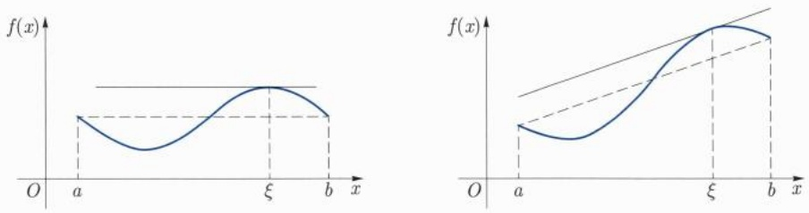
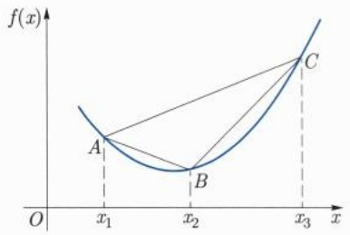
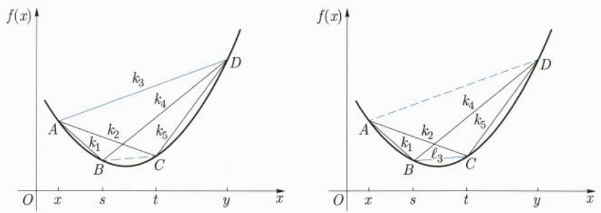
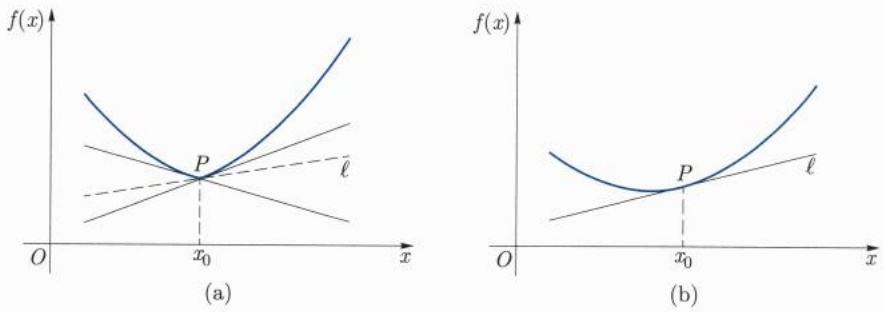
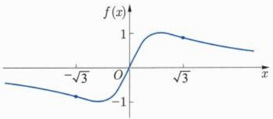
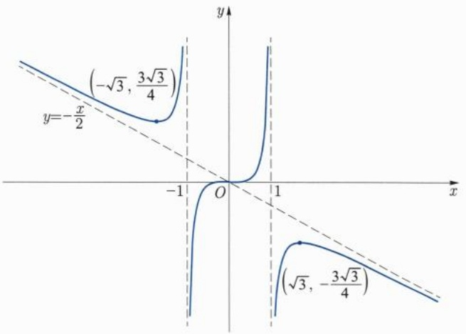

# 上册 / 第七章 微分中值定理

原始 PDF 第 193–254 页。

## 第七章

## 微分中值定理

---

182

第七章 微分中值定理

在建立了实数理论、引入了极限工具后, 我们开始着手研究函数, 这是因为数学分析的主要目的之一就是研究函数各种性质的. 这些性质有的是预设的, 比如是否有界、是否连续、是否单调、是否凹凸、发展趋势如何、光滑性如何、振荡性如何等. 这些性质或者具有明确的几何直观, 或者具有重要的分析属性, 抑或是实际问题的需求. 也有不少重要的性质并不是预设的, 而是随着探讨的深入, 无意中发现的奇异现象、偶得的神奇结论、意想不到的应用, 比如充满平面区域的连续曲线, 处处连续、处处不可微的函数, 周期三蕴涵着混沌等.

本章我们将重点讨论微分中值定理及其应用, 这是分析学中很深刻的一部分内容, 有人甚至将其比喻为微积分的巅峰之作. 我们暂不论此说法的夸张程度, 但多少能反映出微分这个基本概念对研究函数的重要性. 我们先简要梳理一下这部分内容发展的脉络.

首先极限是研究函数局部性质的一个基本工具, 一个函数在一点有极限我们就能得到在该点附近的局部有界性. 因此一个函数在一个区间上处处有极限, 就可以得到在此区间内每点附近都局部有界. 至于是否整体有界, 则需要把 (通常是无穷多) 这些点粘合起来统一考虑, 而前面的有限覆盖好像是为此而生的 $^{①}$ . 这样, 函数是否整体有界就与其极限存在的底层集合是否满足有限覆盖对接上了, 这使得我们再度认识到紧致集这个基本概念的重要性. 连续函数作为不仅极限存在而且极限值等于该点函数值的特殊情况, 自然就有了闭区间上的连续函数必定有界这一重要结论. 进而利用有界必有确界我们又得到了闭区间上的连续函数必能取到最大、最小值. 这里就体现出了局部与整体的联系.

如果我们考虑函数在一点附近函数值的大小, 很自然可以引入极值的概念. 这是一个局部概念. 从技术细节上来说, 如果一个函数在一点可微, 同时又是极值点, 那么无论是从几何直观还是从逻辑推导, 都不难证明该点的导数就应该为零. 这就是著名的 Fermat 引理, 这一结论是后续讨论的技术关键.

基于这个技术核心, 我们将其应用到闭区间上的可微函数, 只要加一点点技术限制, 使得最值点在区间内部达到, 那么最值点就是极值点, 从而这一点处的导数便为零. 这就是 Rolle $^{②}$ 中值定理. 由于 Rolle 中值定理有明确的几何意义, 所以无论从几何上还是分析甚至代数上, 都很自然地推广到著名的 Lagrange 中值定理. 两者本质上是等同的, 但是在应用的灵活性和广泛性上, Lagrange 中值定理都要更方便些. 如果把自变量和因变量都参数化, 我们就可以进一步把 Lagrange 中值定理推广到 Cauchy 中值定理. 这又是一个极其重要的结论, 具有深刻的影响和广泛的应用.

微分中值定理作为研究函数的基本工具, 有着多角度的推广. 一种常见的推广是将经典导数框架下的微分中值定理推广到各种广义的导数, 比如单侧导数、Dini 导数、对称导数等, 得到了更宽泛条件下中值定理的多种版本; 另一种推广是把它们作得更精细,

<small>① 有限覆盖定理远远晚于有界性这个概念, 前者是 19 世纪后半叶由 Heine 提出, 19 世纪 90 年代由 Borel 完善证明的.</small>

<small>② Rolle, Michel, 1652 年 4 月 21 日—1719 年 11 月 8 日, 法国数学家.</small>

---

7.1 微分中值定理

183

表现为把涉及的一阶导数推广到高阶导数, 在表现形式上有 Taylor $^{①}$  展开式之结构; 还有一种推广表现为函数所在的定义域舞台的更一般化, 比如复数域中的微分中值定理、多元函数的微分中值定理、无穷维空间中的微分中值定理、映射的微分中值定理等 $^{②}$ .

微分中值定理的深刻之处在于它建立了函数和导函数之间的某些联系, 是利用导数研究函数的强有力的工具. L'Hôpital 法则当属微分中值定理的直接应用之一, 它为计算不定式极限提供了一种简便的操作方法. Taylor 展开式是微分中值定理的一种推广和细化, 利用 Taylor 展开式, 可以考虑用函数的多项式逼近问题. 另外, 它的不同形式的余项表示给我们估计局部误差和整体误差提供了可能.

## 7.1 微分中值定理

## 7.1.1 Fermat 引理

微分中值定理的建立和证明, 需要用到下面的 Fermat 引理, 因此我们先来介绍这一基本结论. 为此, 我们先给出极值的定义.

定义 7.1.1(极值点、极值) 设 f 是定义在区间 I 上的函数,  $x_{0} \in I$ . 如果存在  $\delta > 0$ , 使得

$$
f (x) \geqslant f (x _ {0}) (f (x) \leqslant f (x _ {0})), \forall x \in (x _ {0} - \delta , x _ {0} + \delta) \cap I,
$$

则称 $x_0$ 为 $f$ 在 $I$ 上的一个极小 (大) 值点, $f(x_0)$ 称为极小 (大) 值.

若在上述定义中，在 $x \neq x_0$ 处不等号严格成立，则称 $f(x_0)$ 为严格极小（大）值。极大值点和极小值点统称为极值点，极大值和极小值统称为极值。

直观上看, 如果函数 $y = f(x)$ 在点 $x_0$ 处取极值, 并且该函数在点 $(x_0, f(x_0))$ 处存在切线, 则该切线应该是水平的. 事实上, 对于函数极值点处的导数, 我们有下面的Fermat引理.

引理 7.1.1 (Fermat 引理) 设函数 f 在点  $x_{0}$  处可导且  $x_{0}$  为极值点, 则  $f'(x_{0}) = 0$ .

证明 不妨设 $f$ 在点 $x_0$ 取得极大值, 则

$$
f ^ {\prime} (x _ {0}) = f _ {+} ^ {\prime} (x _ {0}) = \lim _ {x \to x _ {0} ^ {+}} \frac {f (x) - f (x _ {0})}{x - x _ {0}} \leqslant 0.
$$

<small>① Taylor, Brook, 1685 年 8 月 18 日—1731 年 12 月 29 日, 英国数学家. ② 注意, 不同基空间中的微分中值定理完全对应的表现形式有可能 “不成立”, 比如在复变函数中. 此时, 相应的表现形式可能有些改变, 甚至以不等式的方式出现.</small>

---

184

第七章 微分中值定理

同样有

$$
f ^ {\prime} (x _ {0}) = f _ {-} ^ {\prime} (x _ {0}) = \lim _ {x \to x _ {0} ^ {-}} \frac {f (x) - f (x _ {0})}{x - x _ {0}} \geqslant 0.
$$

因此, $f'(x_0) = 0$.

注7.1.1 使得 $f'(x) = 0$ 的点 $x_0$ 也称为 $f(x)$ 的驻点或可疑点. Fermat 引理告诉我们, 若函数在极值点处可导, 则极值点必为驻点. 反之不一定成立, 比如, $x_0 = 0$ 是函数 $y = x^3$ 的驻点, 因为在该点处导数为零, 但该函数的性质告诉我们, 此驻点并不是极值点. 尽管如此, 在寻找函数的极值点时, 我们仍然可以先把范围缩小到仅考虑驻点和那些导数不存在的点, 因此称驻点为极值的可疑点是很形象的.

灵活运用注解中的逻辑推理, 可以得到一些有趣的结论: 比如函数  $y = R^{3}(x)$ , 其中  $R(x)$  是 Riemann 函数, 如果我们能用其他方法证明该函数在某些无理点处可导, 那么这些点处的导数一定为零, 这是因为它们都是极值点.

## 7.1.2 Rolle 中值定理

由 Fermat 引理, 可以立即得到下面的 Rolle 中值定理.

定理 7.1.2 (Rolle 中值定理) 设函数  $f(x)$  在闭区间  $[a, b]$  上连续，在开区间  $(a, b)$  内可微，且  $f(a) = f(b)$ ，则存在  $\xi \in (a, b)$  使  $f'(\xi) = 0$ .

证明 若 $f$ 为常数, 则结论显然成立. 否则, 存在 $x_0 \in (a, b)$ 使得 $f(x_0) \neq f(a) = f(b)$. 不妨设 $f(x_0) > f(a)$.

由于 $f$ 在 $[a, b]$ 上连续, 因而它在 $[a, b]$ 上有最大值. 设 $\xi \in [a, b]$ 是 $f$ 在 $[a, b]$ 上的最大值点. 则 $f(\xi) \geqslant f(x_0) > f(a) = f(b)$. 从而 $\xi \in (a, b)$. 所以 $\xi$ 是极大值点. 于是由 Fermat 引理得 $f'(\xi) = 0$.

例 7.1.1 考虑 2n 次多项式  $P(x)=x^{n}(1-x)^{n}\ (n\in\mathbb{N})$ . 证明 n 次多项式  $P^{(n)}(x)$  在区间  $(0,1)$  内有 n 个互异的实零点.

证明 首先, 利用 Leibniz 求导法则, 可知 $P^{(n)}(x)$ 是一个 $n$ 次多项式, 且

$$
P ^ {(m)} (x) = (x ^ {n} (1 - x) ^ {n}) ^ {(m)} = \sum_ {i + j = m} \frac {m !}{i ! j !} \frac {n !}{(n - i) !} \frac {n !}{(n - j) !} (- 1) ^ {j} x ^ {n - i} (1 - x) ^ {n - j}.
$$

故当  $m=0,1,2,\cdots,n-1$  时，上式右端的各项中均含有因式  $x(1-x)$ . 因此

$$
P ^ {(m)} (0) = P ^ {(m)} (1) = 0, \quad m = 0, 1, 2, \dots , n - 1.
$$

由 $P(0) = P(1) = 0$ 根据Rolle中值定理知，存在 $\xi \in (0,1)$ 使 $P^{\prime}(\xi) = 0$。注意到 $P^{\prime}(x)$ 在区间 $[0,\xi]$ 与 $[\xi ,1]$ 上也适合Rolle中值定理的条件，因此存在 $\eta_1\in (0,\xi)$ 及$\eta_{2}\in (\xi ,1)$ 使得 $P^{\prime \prime}(\eta_i) = 0,i = 1,2,$ 其中 $0 <   \eta_{1} <   \eta_{2} <   1$

---

7.1 微分中值定理

185

注意导函数 $P''(x)$ 在三个区间 $[0, \eta_1], [\eta_1, \eta_2], [\eta_2, 1]$ 上都满足 Rolle 中值定理的条件, 因此存在三个点 $\zeta_i, 0 < \zeta_1 < \zeta_2 < \zeta_3 < 1$, 使得

$$
P ^ {\prime \prime \prime} (\zeta_ {i}) = 0, \qquad i = 1, 2, 3.
$$

将此过程进行下去, 可得题目的结论.

Rolle 中值定理的几何意义是当可微函数 (允许函数在端点只是连续) 在端点的值相等的时候, 则该函数的曲线一定有一条斜率为零的切线, 即该切线平行于曲线端点的连线. 根据这一几何解释, 旋转坐标就可以得到更一般的结论: 一个可微函数, 其函数图像必定有一条切线平行于曲线端点的连线 (图 7.1). 这就是如下极为重要的 Lagrange 中值定理:

图 7.1 Rolle 中值定理与 Lagrange 中值定理

## 7.1.3 Lagrange 中值定理

定理 7.1.3 设函数 f 在有界闭区间  $[a, b]$  上连续，在开区间  $(a, b)$  内可微。则存在  $\xi \in (a, b)$  使得

$$
f (b) - f (a) = f ^ {\prime} (\xi) (b - a). \tag {7.1.1}
$$

证明 前面的几何直观解释提示我们，可以试图通过构造辅助函数把问题转化为Rolle中值定理的情形.为此,我们设

$$
F (x) = f (x) - k x, \tag {7.1.2}
$$

其中 $k$ 待定使得 $F(x)$ 满足Rolle中值定理的条件: $F(a) = F(b)$ ，即

$$
f (a) - k a = f (b) - k b.
$$

所以, 只要取 $k = \frac{f(b) - f(a)}{b - a}$ 即可. 易见 $F(x)$ 在 $[a, b]$ 上连续, 在 $(a, b)$ 内可微, 于是由 Rolle 中值定理, 存在 $\xi \in (a, b)$ 使得 $F'(\xi) = 0$. 即

$$
f (b) - f (a) = f ^ {\prime} (\xi) (b - a).
$$

□

---

186

第七章 微分中值定理

注7.1.2 显然,证明过程中的 $F\left( x\right)$ 的选取不是唯一的,因为任何一个形如

$$
F (x) := (f (b) - f (a)) x - f (x) (b - a) + c
$$

的函数都满足 Rolle 中值定理的条件, 因此我们可以通过选取适当的 c, 使得  $F(x)$  的表示更 “简捷”:  $F(a) = F(b) = 0$ . 这只要取  $c = -af(b) + bf(a)$  即可, 即

$$
F (x) := (f (b) - f (a)) (x - a) - (f (x) - f (a)) (b - a). \tag {7.1.3}
$$

另外，函数

$$
F (x) := f (x) - \frac {x - a}{b - a} f (b) - \frac {x - b}{a - b} f (a) \tag {7.1.4}
$$

也满足 $F(a) = F(b) = 0$。在后面章节可以看出，函数 $F$ 的这些表达式都有各自的特点。

Lagrange 中值定理的应用非常灵活和广泛, 比如, 利用此定理我们立即可得下面的几个重要结论.

推论7.1.4 设函数 $f(x) \in C[a, b]$, 且在 $(a, b)$ 内可导. 若 $f'(x) = 0$, 则 $f(x) \equiv c$, 其中 $c$ 是一常数.

证明 $\forall x\in [a,b]$ ，在 $[a,x]$ 上应用Lagrange中值定理知，存在 $\xi \in (a,x)$ ，使得

$$
0 = f ^ {\prime} (\xi) = \frac {f (\xi) - f (a)}{x - a}.
$$

由此可得  $f(x) \equiv f(a) = c.$

该推论的结论似乎显然, 但如果不利用 Lagrange 中值定理, 证明似乎并不平凡.

推论7.1.5 设函数 $f(x), g(x) \in C[a, b]$，且在 $(a, b)$ 内均可导。若 $f'(x) = g'(x)$，则 $f(x) = g(x) + c$，其中 $c$ 为常数。

证明 对函数  $f(x)-g(x)$  应用推论 7.1.4 即得.

例7.1.2 设 $y'(x) = \frac{1}{1 + x^2}$, $y(1) = 0$, 证明 $y(x) = \arctan x - \frac{\pi}{4}$.

证明 考虑函数 $f(x) = y(x) - \arctan x$，则有

$$
f ^ {\prime} (x) = y ^ {\prime} (x) - \frac {1}{1 + x ^ {2}} \equiv 0.
$$

故 $f(x) = y(x) - \arctan x \equiv c$. 注意到 $f(1) = -\frac{\pi}{4}$, 所以 $y(x) = \arctan x - \frac{\pi}{4}$.

推论 7.1.6 设函数  $f(x)$  在  $[a, b]$  上连续，在  $(a, b)$  内可导.

(1) 若 $\forall x \in (a, b), f'(x) > 0$, 则 $f$ 在 $[a, b]$ 上严格单增;
(2) 若 $\forall x \in (a, b)$, $f'(x) \geqslant 0$, 则 $f$ 在 $[a, b]$ 上单增.

---

7.1 微分中值定理

187

证明 (1) 如果 $f'(x) > 0$，则对任意 $a \leqslant x_1 < x_2 \leqslant b$，由 Lagrange 中值定理得

$$
f (x _ {2}) - f (x _ {1}) = f ^ {\prime} (\xi) (x _ {2} - x _ {1}) > 0,
$$

可得  $f(x_{2}) > f(x_{1})$ .

(2) 的证明可类似给出.

注 7.1.3 Lagrange 中值定理的另一种常见的表述形式如下.由于等式(7.1.1)等价于形式

$$
f (b) = f (a) + f ^ {\prime} (\xi) (b - a), \tag {7.1.5}
$$

所以, Lagrange 中值定理又称为有限增量定理.

对于等式 (7.1.1) 中的 $\xi \in (a, b)$, 我们更常用 $\xi = a + \theta(b - a)$ 表示, 其中 $\theta \in (0, 1)$. 这一表述方式在 $a, b$ 的大小关系不清楚时更为便利. 这样, 我们又把有限增量公式写成

$$
f (b) = f (a) + f ^ {\prime} (a + \theta (b - a)) (b - a). \tag {7.1.6}
$$

需要强调的是  $\theta$  一般来说是依赖于端点 a, b 的.

例 7.1.3 证明:  $y = \arctan x$  在  $(-\infty, +\infty)$  上一致连续.

证明 任取 $x_{1}, x_{2} \in \mathbb{R} (x_{1} < x_{2})$，在区间 $[x_{1}, x_{2}]$ 上，函数 $\arctan x$ 满足 Lagrange 中值定理的所有条件，因此存在 $\xi \in (x_{1}, x_{2})$，使得

$$
\arctan x _ {1} - \arctan x _ {2} = \frac {1}{1 + \xi^ {2}} (x _ {1} - x _ {2}).
$$

故

$$
\left| \arctan x _ {1} - \arctan x _ {2} \right| \leqslant \left| x _ {1} - x _ {2} \right|.
$$

因此, 立得函数在整个 $\mathbb{R}$ 上的一致连续性.

注7.1.4 由此例还可以看出, 如果 $(a, b)$ 内的一个连续函数有有界的导数, 则该函数在 $(a, b)$ 内一致连续. 对比注7.1.6.

## 7.1.4 Cauchy 中值定理

如果将 Lagrange 中值定理运用到用参数表示的函数, 则可以得到以下的 Cauchy 中值定理.

定理 7.1.7 (Cauchy 中值定理) 设函数  $f(x)$ ,  $g(x)$  在有界闭区间  $[a, b]$  上连续，在开区间  $(a, b)$  内可微. 则存在  $\xi \in (a, b)$  使得

$$
(f (b) - f (a)) g ^ {\prime} (\xi) = (g (b) - g (a)) f ^ {\prime} (\xi). \tag {7.1.7}
$$

---

188

第七章 微分中值定理

特别地, 若 $g'(x) \neq 0$, 则

$$
\frac {f (b) - f (a)}{g (b) - g (a)} = \frac {f ^ {\prime} (\xi)}{g ^ {\prime} (\xi)}. \tag {7.1.8}
$$

证明 类似于定理 7.1.3 的证明, 我们希望构造出一个辅助函数把定理转化为 Rolle 中值定理的情形. 为此, 我们先形式上设

$$
F (x) := f (x) - k g (x), \tag {7.1.9}
$$

其中 k 待定, 使得  $F(a) = F(b)$ , 即

$$
f (a) - k g (a) = f (b) - k g (b).
$$

因此, 取

$$
k = \frac {f (b) - f (a)}{g (b) - g (a)}.
$$

考虑到分母可能为零的情况, 因此, 我们可以取

$$
F (x) := (f (b) - f (a)) (g (x) - g (a)) - (g (b) - g (a)) (f (x) - f (a)), \quad \forall x \in [ a, b ]. \tag {7.1.10}
$$

则 $F(x)$ 在 $[a,b]$ 上连续, 在 $(a,b)$ 内可微, 且 $F(a) = F(b) = 0$. 由 Rolle 中值定理, 存在 $\xi \in (a,b)$ 使得 $F'(\xi) = 0$. 此即 (7.1.7) 式成立.

当  $g'(x) \neq 0$  时, 即 (7.1.8) 式成立.

## 7.1.5 Darboux 介值定理

上面我们介绍了三个经典的微分中值定理. 事实上, 函数的导函数还具有一个重要的性质: 导数的介值性. 我们给出下面的 Darboux 介值定理.

定理 7.1.8 (Darboux 介值定理) 设 f 在  $[a, b]$  上可微，且  $f'(a) < f'(b)$ . 则对任何  $\lambda \in (f'(a), f'(b))$ ，存在  $\xi \in (a, b)$  使得  $f'(\xi) = \lambda$ .

证明 考虑

$$
F (x) := f (x) - \lambda x, \qquad x \in [ a, b ].
$$

则 $F'(a) < 0, F'(b) > 0$. 于是存在 $\delta > 0$ 使得当 $x \in (a, a + \delta)$ 时, $F(x) < F(a)$. 所以 $a$ 不是 $F$ 在 $[a, b]$ 上的最小值点. 同理, $b$ 不是 $F$ 在 $[a, b]$ 上的最小值点.

另一方面, 由于 $F$ 连续, 它在 $[a, b]$ 上有最小值点 $\xi \in [a, b]$, 则 $\xi \in (a, b)$, 从而它是极小值点. 于是由 Fermat 引理, $F'(\xi) = 0$. 即 $f'(\xi) = \lambda$.

注 7.1.5 定理中的假设条件  $f'(a) < f'(b)$  显然是非实质性的，即如果  $f'(a) > f'(b)$ ，则类似可证:对任何介于  $f'(b)$  和  $f'(a)$  之间的实数  $\lambda$ ，都存在  $\xi \in (a, b)$  使得  $f'(\xi) = \lambda$ .

需要强调的是, 虽然 Darboux 介值定理告诉我们一个函数的导函数总是

---

7.1 微分中值定理

189

具有介值性, 这是导函数的一个显著特点, 具有极其重要的应用, 但是这并不是说导函数一定连续. 下面的例子将告诉我们这点. 然而, 由介值性我们可以断定, 导函数如果不连续的话, 那么也一定不会是跳跃间断点或者可去间断点.

另外, 我们看到, 如果一个函数的导函数在某个区间上非零, 那么它要么是恒为正, 要么恒为负; 与之对应的则是原来的函数要么严格单调上升, 要么严格单调下降. 因此, 如果一个函数的导函数非零, 则它一定具有反函数.

关于 Darboux 介值定理更多的性质和应用, 我们在后面还会作进一步的探讨.

例7.1.4 考虑函数

$$
f (x) = \left\{ \begin{array}{l l} x ^ {2} \sin \frac {1}{x}, & x \neq 0, \\ 0, & x = 0. \end{array} \right.
$$

容易得到

$$
f ^ {\prime} (x) = \left\{ \begin{array}{l l} 2 x \sin \frac {1}{x} - \cos \frac {1}{x}, & x \neq 0, \\ 0, & x = 0. \end{array} \right.
$$

由于

$$
\lim _ {n \to + \infty} f ^ {\prime} \left(\frac {1}{2 n \pi}\right) = - 1, \quad \lim _ {n \to + \infty} f ^ {\prime} \left(\frac {1}{(2 n + 1) \pi}\right) = 1,
$$

可知导函数 $f^{\prime}(x)$ 在 $x = 0$ 点不连续.

有了 Darboux 介值定理, 我们回头再看一下 Cauchy 中值定理. 根据注 7.1.5 知, 当 $g'(x) \neq 0$ 时, 根据 Darboux 介值定理, $g'(x)$ 必恒正或恒负, 不妨假设 $g'(x) > 0$. 从而 $g$ 在 $[a, b]$ 上严格单增. 我们可以把 Cauchy 中值定理视为参数方程确定的函数所对应的 Lagrange 中值定理. 具体地, 令 $X = g(x), Y = f(x)$. 则有 $Y = f(g^{-1}(X))$, 即 $Y$ 作为 $X$ 的函数在 $[g(a), g(b)]$ 上连续, 在 $(g(a), g(b))$ 内可微. 因此由 Lagrange 中值定理知存在 $\eta \in (g(a), g(b))$ 使得

$$
Y (g (b)) - Y (g (a)) = \frac {\mathrm{d} Y}{\mathrm{d} X} (\eta) (g (b) - g (a)).
$$

由 $g(x)$ 的连续性和单调性, 存在唯一的 $\xi \in (a, b)$ 使得 $g(\xi) = \eta$. 从而

$$
\begin{array}{l} f (b) - f (a) = Y (g (a)) - Y (g (b)) \\ = \frac {\mathrm{d} Y}{\mathrm{d} X} (g (\xi)) (g (b) - g (a)) = \frac {f ^ {\prime} (\xi)}{g ^ {\prime} (\xi)} (g (b) - g (a)). \\ \end{array}
$$

这就证明了结论.

---

190

第七章 微分中值定理

Cauchy 中值定理有明确的几何意义:设在 XOY 坐标平面上的曲线由参数方程  $X = g(x)$ ,  $Y = f(x)$  给出，其中 f, g 满足定理条件，则存在一点  $\xi \in (a, b)$ ，使得过点  $(g(\xi), f(\xi))$  的切线平行于两端点的连线.

类似于 Lagrange 中值定理, Cauchy 中值定理也常写成如下形式:

$$
\frac {f (b) - f (a)}{g (b) - g (a)} = \frac {f ^ {\prime} (a + \theta (b - a))}{g ^ {\prime} (a + \theta (b - a))}, \quad 0 <   \theta <   1.
$$

上述所有的微分中值定理, 当条件满足 (比如函数足够光滑性) 时, 可以多次应用.

例 7.1.5 设  $f(x)$  在  $(0,1]$  上连续, 在  $(0,1)$  内可导, 且  $\lim_{x\to0^{+}}\sqrt{xf'(x)}=c$ . 证明  $f(x)$  在区间  $(0,1]$  上一致连续.

证明 由假设可知, 存在 $M > 0$ 和 $0 < \delta_0 < 1$, 使得

$$
| \sqrt {x} f ^ {\prime} (x) | \leqslant M, \quad x \in (0, \delta_ {0} ].
$$

任取 $x_{1}, x_{2} \in (0, \delta_{0}], x_{1} < x_{2}$, 根据 Cauchy 中值定理, 知存在一点 $\xi \in (x_{1}, x_{2})$,

$$
\frac {f (x _ {1}) - f (x _ {2})}{\sqrt {x _ {1}} - \sqrt {x _ {2}}} = 2 \sqrt {\xi} f ^ {\prime} (\xi).
$$

于是, 有

$$
| f (x _ {1}) - f (x _ {2}) | <   2 M | \sqrt {x _ {1}} - \sqrt {x _ {2}} |
$$

上式对 $x_{1} = x_{2}$ 时也成立. 注意到

$$
\left| \sqrt {x _ {1}} - \sqrt {x _ {2}} \right| ^ {2} \leqslant \left| x _ {1} - x _ {2} \right|,
$$

故有

$$
| f (x _ {1}) - f (x _ {2}) | <   2 M \sqrt {| x _ {1} - x _ {2} |}.
$$

此关系式蕴涵着函数的一致连续性.

注7.1.6 在本例中, 特别取 $f(x) = \sqrt{x}, x \in (0,1]$, 可以得到下面的结论: 存在导函数无界、非 Lipschitz 连续, 但仍然一致连续的函数. 对比注7.1.4.

## 习题 7.1

1. 试构造一个在 $[0,1]$ 上处处可导但其导数在 $[0,1]$ 上无界的函数.
2. 设 $f(x)$ 在 $[a, b]$ 上连续，在 $(a, b)$ 内可微，且 $f(a) = f(b) = 0$. 证明:存在 $\xi \in (a, b)$，使得 $f'(\xi) = 2f(\xi)$.
3. 设 $f(x)$ 在 $[a, b]$ 上二阶可微, 且 $f(a) = f(b) = 0$, $f_{+}^{\prime}(a)f_{-}^{\prime}(b) > 0$. 证明: 存在 $\xi \in (a, b)$, 使得 $f''(\xi) = 0$.

---

7.1 微分中值定理

191

4. 设一元实函数 $f$ 在 $[a, b]$ 上连续, 在 $(a, b)$ 内可导, $ab > 0$. 证明: 存在 $\xi \in (a, b)$ 使得

$$
\frac {1}{a - b} \left| \begin{array}{c c} a & b \\ f (a) & f (b) \end{array} \right| = f (\xi) - \xi f ^ {\prime} (\xi).
$$

5. 设 $f(x)$ 为 $[a, b]$ 上的三阶可导函数，且 $f(a) = f'(a) = f(b) = 0$. 证明:任给 $c \in [a, b]$，存在 $\xi \in (a, b)$，使得

$$
f (c) = \frac {1}{6} f ^ {(3)} (\xi) (c - a) ^ {2} (c - b).
$$

6. 设函数 $f$ 在区间 $[a, b]$ 上可导, 且存在 $M > 0$, 使得

$$
| f ^ {\prime} (x) | \leqslant M, \quad \forall x \in [ a, b ].
$$

证明:

$$
\left| f (x) - \frac {f (a) + f (b)}{2} \right| \leqslant \frac {1}{2} M (b - a), \quad \forall x \in [ a, b ].
$$

7. 证明: 多项式 $x^{3} - 3x + c$ 在 $[0,1]$ 上不存在两个不同的实根.

8. 证明: Chebyshev $^{①}$ 多项式 $e^{x}\frac{d^{n}}{dx^{n}}(x^{n}e^{-x})$ 有 n 个正的实根.

9. 证明: Legendre $^{②}$ 多项式 $\frac{\mathrm{d}^{n}}{\mathrm{d}x^{n}}(x^{2}-1)^{n}$ 在 $(-1,1)$ 内有 n 个两两互异的实根.

10. 设函数 $f(x)$ 在区间 $[a, b]$ 上连续, 在区间 $(a, b)$ 内可导, $\xi$ 是 $(a, b)$ 内一点. 问是否一定存在 $a_1, b_1 \in (a, b), a_1 < \xi < b_1$, 使得 $f'(\xi) = \frac{f(b_1) - f(a_1)}{b_1 - a_1}$?

进一步, 试着给出一定存在  $a_{1}, b_{1}$  使得上式成立的某些函数类.

11. 设 $f$ 在 $[a, +\infty)$ 上可微, 且

$$
0 \leqslant f ^ {\prime} (x) \leqslant f (x), \quad f (a) = 0, \quad \forall x \in [ a, + \infty).
$$

证明: 在  $[a, +\infty)$  上  $f \equiv 0$ .

12. 设 $f$ 在 $[a, +\infty)$ 上可微, 且

$$
| f ^ {\prime} (x) | \leqslant M | f (x) |, \quad f (a) = 0, M > 0, \forall x \in [ a, + \infty).
$$

证明: 在  $[a, +\infty)$  上  $f(x) \equiv 0$ .

13. 设  $f(x)=a_{1}\sin x+a_{2}\sin 2x+\cdots+a_{n}\sin nx$ ，且  $|f(x)|\leqslant|\sin x|$ ，其中  $a_{1}, a_{2}, \cdots, a_{n}$  为常数。求证: $|a_{1}+2a_{2}+\cdots+na_{n}|\leqslant1$ 。

14. 设 $f(x)$ 在 $[0,1]$ 上连续, 在 $(0,1)$ 内可导. 若 $f(0) = 0$, $f(1) = 1$, 证明: 存在 $\xi_1, \xi_2 \in (0,1)$, $\xi_1 \neq \xi_2$, 使得 $f'(\xi_1)f'(\xi_2) = 1$.

<small>① Чебышёв, Пафнутий Львович, 英文 Chebyshev, Pafnuty Lvovich, 1821 年 5 月 16 日—1894 年 12 月 8 日, 俄国数学家、力学家.</small>

<small>② Legendre, Adrien-Marie, 1752 年 9 月 18 日—1833 年 1 月 10 日, 法国数学家.</small>

---

192

第七章 微分中值定理

15. 设  $f(x)$  在  $[a, b]$  上连续, 在  $(a, b)$  内可导. 记  $S(x)$  为由  $(a, f(a)), (b, f(b)), (x, f(x))$  三点组成的三角形面积, 试对  $S(x)$  应用 Rolle 中值定理证明 Lagrange 中值定理.

16. 设 $f(x), g(x)$ 在 $[a, b]$ 上连续, 在 $(a, b)$ 内可导. 记 $T(x)$ 为由 $(f(a), g(a)), (f(b), g(b)), (f(x), g(x))$ 三点组成的三角形面积, 试对 $T(x)$ 应用 Rolle 中值定理证明 Cauchy 中值定理.

17. 设 $f(x), g(x), h(x)$ 在 $[a, b]$ 上连续, 在 $(a, b)$ 内可导. 证明: 存在 $\xi \in (a, b)$ 使得

$$
\left| \begin{array}{c c c} f ^ {\prime} (\xi) & g ^ {\prime} (\xi) & h ^ {\prime} (\xi) \\ f (a) & g (a) & h (a) \\ f (b) & g (b) & h (b) \end{array} \right| = 0.
$$

18. 设函数 $f$ 在 $[a, b]$ 上连续, 在 $(a, b)$ 内 Schwarz 对称可导, 且 $f(a) = f(b) = 0$, 证明: 存在 $x_1, x_2 \in (a, b)$, 使得

$$
f ^ {[ 1 ]} (x _ {1}) \geqslant 0, f ^ {[ 1 ]} (x _ {2}) \leqslant 0.
$$

19. 设函数 $f$ 在 $[a, b]$ 上连续, 在 $(a, b)$ 内 Schwarz 对称可导, 证明: 存在 $x_1, x_2 \in (a, b)$, 使得

$$
f ^ {[ 1 ]} (x _ {1}) \leqslant \frac {f (b) - f (a)}{b - a} \leqslant f ^ {[ 1 ]} (x _ {2}).
$$

20. 设函数 $f$ 在 $[a, b]$ 上连续, 在 $(a, b)$ 内 Schwarz 对称可导, 且对任意的 $x \in (a, b)$, 有 $g^{[1]}(x) \neq 0$, 证明: 存在 $x_1, x_2 \in (a, b)$, 使得 $g(x)$ 为凸函数,

$$
\frac {f ^ {[ 1 ]} (x _ {1})}{g ^ {[ 1 ]} (x _ {1})} \leqslant \frac {f (b) - f (a)}{g (b) - g (a)} \leqslant \frac {f ^ {[ 1 ]} (x _ {2})}{g ^ {[ 1 ]} (x _ {2})}.
$$

21. (类 Rolle 中值定理) 设 $f$ 在区间 $(a, b)$ ((a, b) 可为无界区间) 内可导. 如果存在 $a_{n}, b_{n} \in (a, b)$ 使得当 $n \to +\infty$ 时 $a_{n} \to a, b_{n} \to b$, 且 $\lim_{n \to +\infty} f(a_{n}) = \lim_{n \to +\infty} f(b_{n}) = \alpha \in \mathbb{R}$, 则存在 $\xi \in (a, b)$, 使得 $f'(\xi) = 0$.

22. (类 Lagrange 中值定理) 设 $f$ 在区间 $(a, b)$ 内可导. 如果存在 $a_{n}, b_{n} \in (a, b)$ 使得当 $n \to +\infty$ 时 $a_{n} \to a, b_{n} \to b$, 且 $\lim_{n \to +\infty} f(a_{n}) = \alpha \in \mathbb{R}, \quad \lim_{n \to +\infty} f(b_{n}) = \beta \in \mathbb{R}$, 则存在 $\xi \in (a, b)$, 使得 $f'(\xi) = \frac{\beta - \alpha}{b - a}$.

23. (Lagrange 二阶微分中值定理) 设 $f$ 在 $[a, b]$ 上可导, 在 $(a, b)$ 内二阶可导. 证明: 存在 $\xi \in (a, b)$, 使得

$$
f ^ {\prime} (b) - f ^ {\prime} (a) = f ^ {\prime \prime} (\xi) (b - a).
$$

24. (Cauchy 二阶微分中值定理) 设 $f, g$ 在 $[a, b]$ 上可导, 在 $(a, b)$ 内均二阶可导, 若 $g''$ 在 $(a, b)$ 内处处非零. 证明: 存在 $\xi \in (a, b)$, 使得

$$
\frac {f ^ {\prime} (b) - f ^ {\prime} (a)}{g ^ {\prime} (b) - g ^ {\prime} (a)} = \frac {f ^ {\prime \prime} (\xi)}{g ^ {\prime \prime} (\xi)}.
$$

---

7.2 L'Hôpital 法则

193

25. 考虑 Darboux 介值定理退化的情形: 设 $f$ 在 $[a, b]$ 上可微, 且 $f'(a) = A = f'(b)$. 试问在 $(a, b)$ 内是否一定存在 $\xi \in (a, b)$ 使得 $f'(\xi) = A$?

26. (Flett 中值定理 $^{①}$ ) 如果  $f(x)$  在  $[a, b]$  上可导，且  $f'(a) = f'(b)$ . 试证明存在  $\xi \in (a, b)$  满足

$$
\frac {f (\xi) - f (a)}{\xi - a} = f ^ {\prime} (\xi),
$$

并给出此关系式的几何解释. 进一步考虑去掉条件  $f'(a) = f'(b)$  时的推广.

27. 试考虑能否将上题推广到类似 Cauchy 中值定理的框架中去, 即考虑两个函数 $f(x)$ 和 $g(x)$ 的情形.

## 7.2 L'Hôpital 法则

L'Hôpital $^{②}$ 法则是计算函数不定式极限的重要工具之一. 粗略说来, L'Hôpital 法则就是把两个函数商的极限转化为求它们的导函数商的极限. 大致说来, 与之对应的 Stolz 公式讨论的是离散型的场景.

我们先界定一下什么样的极限称为不定式的极限. 在计算函数极限时, 我们经常遇到下列两种情形:

(1) 当  $x \rightarrow x_{0}$  时,  $f(x) \rightarrow 0$ ,  $g(x) \rightarrow 0$ ;
(2) 当  $x \rightarrow x_{0}$  时,  $f(x) \rightarrow \infty$ ,  $g(x) \rightarrow \infty$

(其中  $x_{0}$  可以取  $\pm\infty$ ). 然后我们待求的极限可能是下面的组合 (纯粹是形式记号):

$$
\infty - \infty , \quad 0 \cdot \infty , \quad \frac {0}{0}, \quad \frac {\infty}{\infty}, \quad 1 ^ {\infty}, \quad 0 ^ {0}, \quad \infty^ {0}, \dots .
$$

这些形式我们统称为不定式极限.

所有这些不定式极限, 经过简单的变换都可以转化为  $\frac{0}{0}$  型不定式. 比如,

$$
\infty - \infty = \infty \cdot (1 - 1) = \frac {0}{1 / \infty} = \frac {0}{0}, \quad 0 ^ {0} = \mathrm{e} ^ {0 \cdot \ln 0} = \mathrm{e} ^ {\frac {0}{0}}
$$

等.

考虑到在具体应用中, 虽然 $\frac{\infty}{\infty}$ 型也可以转化为 $\frac{0}{0}$ 型, 但在很多场景下, 能直接给出前者相应的 L'Hôpital 法则, 会带来很多方便. 因此, 下面我们仅详细讨论两种不定式极限: $\frac{0}{0}$ 型和 $\frac{\infty}{\infty}$ 型.

<small>① FLETT T M. A mean value theorem. Math. Gazette, 1958, 42: 38-39.</small>

<small>② Marquis de L'Hôpital, Guillaume François Antoine, 1661 年—1704 年 2 月 2 日, 法国数学家.</small>

---

194

第七章 微分中值定理

## 7.2.1 $\frac{0}{0}$ 型极限

定理 7.2.1 (L'Hôpital 法则之一) 设 $f(x), g(x)$ 在 $(a, b)$ 内可导, 且 $g'(x)$ 处处非零. 如果

(1) $\lim_{x\to a^{+}}f(x) = \lim_{x\to a^{+}}g(x) = 0;$
(2) $\lim_{x\to a^{+}}\frac{f'(x)}{g'(x)} = \alpha$ ，其中 $\alpha$ 为实数或 $\pm \infty$

则

$$
\lim _ {x \to a ^ {+}} \frac {f (x)}{g (x)} = \lim _ {x \to a ^ {+}} \frac {f ^ {\prime} (x)}{g ^ {\prime} (x)} = \alpha .
$$

证明 补充定义 $f(a) = g(a) = 0$，则 $f, g$ 在 $[a, b)$ 上连续。由 Cauchy 中值定理，任给 $x \in (a, b)$，存在 $\xi \in (a, x)$，使得

$$
\frac {f (x)}{g (x)} = \frac {f (x) - f (a)}{g (x) - g (a)} = \frac {f ^ {\prime} (\xi)}{g ^ {\prime} (\xi)}.
$$

当 $x \to a^{+}$ 时, 有 $\xi \to a^{+}$, 从而

$$
\lim _ {x \to a ^ {+}} \frac {f (x)}{g (x)} = \lim _ {x \to a ^ {+}} \frac {f ^ {\prime} (\xi)}{g ^ {\prime} (\xi)} = \alpha . \tag {7.2.1}
$$

natural_image

Vertical gradient bar with light blue to white transition, no text or symbols present

注 7.2.1 只要定理条件满足, 则可以多次应用 L'Hôpital 法则. 即如果仍有  $f_{+}^{\prime}(a)=g_{+}^{\prime}(a)=0$ , 则可以利用二次导数继续求极限:

$$
\lim _ {x \to a ^ {+}} \frac {f (x)}{g (x)} = \lim _ {x \to a ^ {+}} \frac {f ^ {\prime} (x)}{g ^ {\prime} (x)} = \lim _ {x \to a ^ {+}} \frac {f ^ {\prime \prime} (x)}{g ^ {\prime \prime} (x)},
$$

高阶导数以此类推. 但是必须注意, 在应用 L'Hôpital 法则时, 必须每一步都要先验证极限 $\lim_{x\to a^{+}}\frac{f'(x)}{g'(x)}$ 是否存在: 如果极限存在, 则可以进行下去; 如果极限不存在, 并不能说明原极限不存在, 只是需要另寻他法.

例7.2.1 考虑极限

$$
\lim _ {x \to \infty} \frac {x - \sin x}{x + \sin x}.
$$

一方面显然该极限为 1, 但是如果盲目使用 L'Hôpital 法则, 就会得到

$$
\lim _ {x \to \infty} \frac {x - \sin x}{x + \sin x} = \lim _ {x \to \infty} \frac {1 - \cos x}{1 + \cos x} = \lim _ {x \to \infty} \frac {\sin x}{- \sin x} = - 1.
$$

注7.2.2 L'Hôpital法则对于区间 $(a,b)$ 为 $(- \infty, b)$ 或 $(a, +\infty)$, 结论仍然成立, 只需考虑变量替换 $x = \frac{1}{t}$ 即可.

例7.2.2 求极限 $\lim_{x\to 0}\frac{\ln(1 + x) - x}{x^2}.$

---

7.2 L'Hôpital 法则

195

解 由 L'Hôpital 法则可得

$$
\lim _ {x \to 0} \frac {\ln (1 + x) - x}{x ^ {2}} = \lim _ {x \to 0} \frac {(1 + x) ^ {- 1} - 1}{2 x} = - \frac {1}{2}.
$$

例 7.2.3 求极限  $\lim_{x\to0}\frac{x-\sin x}{x^{3}}$ .

解 由 L'Hôpital 法则可得

$$
\lim _ {x \to 0} \frac {x - \sin x}{x ^ {3}} = \lim _ {x \to 0} \frac {1 - \cos x}{3 x ^ {2}} = \lim _ {x \to 0} \frac {\sin x}{6 x} = \frac {1}{6}.
$$

在求比较复杂的极限时, 人们常常将适当的等价替换和 L'Hôpital 法则相结合来简化计算. 为了说明问题, 我们略带夸张地考虑下面几个例子, 例 7.2.4 用来说明不作等价替换的话计算可能难以实现; 例 7.2.5 用来说明在适当时候作适当的等价替换能极大简化计算; 而例 7.2.6 则用来说明等价替换必须 “适当”.

例7.2.4 求极限 $\lim_{x\to +\infty}\frac{x}{\sqrt{x^2 + 1}}.$

解 显然等价替换 $\sqrt{x^2 + 1} \sim x$ 可以直接给出题目的答案, 极限为 1. 但如果机械地套用 L'Hôpital 法则, 可得

$$
\lim _ {x \to + \infty} \frac {x}{\sqrt {x ^ {2} + 1}} \stackrel {\mathrm{L'Hôpital}} {\underset {\text {法则}} {=}} \lim _ {x \to + \infty} \frac {\sqrt {x ^ {2} + 1}}{x} \stackrel {\mathrm{L'Hôpital}} {\underset {\text {法则}} {=}} \lim _ {x \to + \infty} \frac {x}{\sqrt {x ^ {2} + 1}} = \dots .
$$

例7.2.5 求极限 $\lim_{x\to 0}\left(\frac{1}{\sin^2x} -\frac{1}{x^2}\right)$

解 注意到

$$
\frac {1}{\sin^ {2} x} - \frac {1}{x ^ {2}} = \frac {(x - \sin x) (x + \sin x)}{(\sin x) ^ {2} x ^ {2}},
$$

利用 $\sin x\sim x(x\to 0)$ 以及例7.2.3的结论 $x - \sin x\sim \frac{x^3}{6} (x\to 0)$ ，可得

$$
\lim _ {x \to 0} \left(\frac {1}{\sin^ {2} x} - \frac {1}{x ^ {2}}\right) = \lim _ {x \to 0} \frac {(x ^ {3} / 6) (x + \sin x)}{x ^ {4}} = \frac {1}{3}. \tag {7.2.2}
$$

例 7.2.6 求极限

$$
\lim _ {x \to 0} \frac {1}{x} \Big ((1 + x) ^ {\frac {1}{x}} - \mathrm{e} \Big).
$$

解 根据 L'Hôpital 法则, 可得

$$
\lim _ {x \to 0} \frac {1}{x} ((1 + x) ^ {\frac {1}{x}} - \mathrm{e}) = \lim _ {x \to 0} (1 + x) ^ {\frac {1}{x}} \Big (\frac {- 1}{x ^ {2}} \ln (1 + x) + \frac {1}{x (1 + x)} \Big). \tag {7.2.3}
$$

由于 $(1 + x)^{\frac{1}{x}}\to \mathrm{e}(x\to 0)$ ，从而只需考虑极限

$$
\lim _ {x \to 0} \frac {x - (1 + x) \ln (1 + x)}{x ^ {2} (1 + x)}.
$$

---

196

第七章 微分中值定理

考虑分母上的等价替换 $1 + x \sim 1 (x \to 0)$, 可以计算极限

$$
\lim _ {x \to 0} \frac {x - (1 + x) \ln (1 + x)}{x ^ {2}}.
$$

对此应用 L'Hôpital 法则, 可得

$$
\lim _ {x \to 0} \frac {x - (1 + x) \ln (1 + x)}{x ^ {2}} = \lim _ {x \to 0} \frac {- \ln (1 + x)}{2 x} = - \frac {1}{2}.
$$

这样一来, 原来的极限为  $-\frac{e}{2}$ .

但是, 如果在 (7.2.3)式中对分母上的  $1 + x$  作等价替换  $1 + x \sim 1 (x \rightarrow 0)$ , 即考虑极限

$$
\lim _ {x \to 0} \left(\frac {- \ln (1 + x)}{x ^ {2}} + \frac {1}{x}\right) = \lim _ {x \to 0} \frac {x - \ln (1 + x)}{x ^ {2}}.
$$

再应用 L'Hôpital 法则, 可得原极限为  $\frac{e}{2}$ . 因此, 上述等价替换至少有一种情况的应用是错误的. 请读者思考一下问题所在. □

L'Hôpital 法则的一个直接应用是可以用来证明下面的导数极限定理, 事实上, 只要注意到定理的条件保证了 L'Hôpital 法则可以实施的充分性, 则立得.

定理 7.2.2（导数极限定理）设 $f(x)$ 在点 $x_0$ 的邻域内连续, 在点 $x_0$ 的去心邻域内可导, 且导函数在点 $x_0$ 处的极限存在, 则 $f(x)$ 在点 $x_0$ 处的导数也存在, 并且等于导函数的极限, 即

$$
\lim _ {x \to x _ {0}} \frac {f (x) - f (x _ {0})}{x - x _ {0}} = \lim _ {x \to x _ {0}} f ^ {\prime} (x)
$$

我们也可以从 Lagrange 中值定理出发, 根据极限定义和最基本的性质, 给出下面这个稍显啰唆的证明.

证明 考虑 $x_0$ 的左半邻域 $x < x_0$, 在 $(x, x_0)$ 内应用Lagrange中值定理, 可得

$$
\lim _ {x \to x _ {0} ^ {-}} \frac {f (x) - f (x _ {0})}{x - x _ {0}} = \lim _ {x \to x _ {0} ^ {-}} f ^ {\prime} (\xi) \qquad (x <   \xi <   x _ {0}).
$$

由假设, 极限 $\lim_{x\to x_0^-}f'(x)$ 存在, 设其极限为 $A$, 即 $\forall \varepsilon > 0, \exists \delta > 0$, 当 $0 < x_0 - x < \delta$ 时, 有 $|f'(x) - A| < \varepsilon$. 所以对满足 $0 < x_0 - x < \delta$ 的 $x$, 都有 $0 < x_0 - \xi < \delta$, 从而 $|f'(\xi) - A| < \varepsilon$, 即 $\lim_{x\to x_0^-}f'(\xi) = A$. 即

$$
\lim _ {x \to x _ {0} ^ {-}} \frac {f (x) - f (x _ {0})}{x - x _ {0}} = A
$$

极限存在, 且

$$
\lim _ {x \to x _ {0} ^ {-}} \frac {f (x) - f (x _ {0})}{x - x _ {0}} = \lim _ {x \to x _ {0} ^ {-}} f ^ {\prime} (\xi) = \lim _ {x \to x _ {0} ^ {-}} f ^ {\prime} (x).
$$

同理, 对右导数有类似的讨论. 再由于  $\lim_{x\to x_{0}^{-}}f'(x)=\lim_{x\to x_{0}^{+}}f'(x)$ , 所以

$$
\lim _ {x \to x _ {0} ^ {-}} \frac {f (x) - f (x _ {0})}{x - x _ {0}} = \lim _ {x \to x _ {0} ^ {+}} \frac {f (x) - f (x _ {0})}{x - x _ {0}}.
$$

---

7.2 L'Hôpital 法则

197

即

$$
\lim _ {x \to x _ {0}} \frac {f (x) - f (x _ {0})}{x - x _ {0}} = \lim _ {x \to x _ {0}} f ^ {\prime} (x).
$$

## 7.2.2 $\frac{\infty}{\infty}$ 型极限

定理 7.2.3 (L'Hôpital 法则之二) 设 $f(x), g(x)$ 在 $a$ 点的 ${\delta }_{0}$ 去心邻域 ${\overset{ \circ  }{B}}_{{\delta }_{0}}\left( a\right)$ , 即 $0 < \left| {x - a}\right|  < {\delta }_{0}\left( {{\delta }_{0} > 0}\right)$ 内可导,且满足

(1) $\lim_{x\to a}g(x) = \infty$;
(2) $g^{\prime}(x)\neq 0,\forall x\in \mathring{B}_{\delta_{0}}(a);$
(3) $\lim_{x\to a}\frac{f'(x)}{g'(x)} = \ell$ ，其中 $\ell$ 为实数或 $\pm \infty$

则 $\lim_{x\to a}\frac{f(x)}{g(x)} = \ell .$

证明 我们只对 $\ell \in \mathbb{R}, x \to a^{+}$ 的情形给以证明, 其他情况的证明完全类似, 请读者自行补充.

根据假设, 对任给  $\varepsilon > 0$ , 存在  $0 < \eta < \delta_{0}$ , 当  $x \in (a, a + \eta)$  时

$$
\ell - \frac {\varepsilon}{4} <   \frac {f ^ {\prime} (x)}{g ^ {\prime} (x)} <   \ell + \frac {\varepsilon}{4}. \tag {7.2.4}
$$

对任意的 $x \in (a, a + \eta)$, 在 $(x, a + \eta)$ 内应用 Cauchy 中值定理, 知存在 $\xi \in (x, a + \eta)$, 使得

$$
\ell - \frac {\varepsilon}{4} <   \frac {f (x) - f (a + \eta)}{g (x) - g (a + \eta)} = \frac {f ^ {\prime} (\xi)}{g ^ {\prime} (\xi)} <   \ell + \frac {\varepsilon}{4}.
$$

现在对 $\frac{f(x)}{g(x)} -\ell$ 进行估计.由于

$$
\frac {f (x)}{g (x)} - \ell = \frac {f (a + \eta) - \ell \cdot g (a + \eta)}{g (x)} + \left(1 - \frac {g (a + \eta)}{g (x)}\right) \cdot \left(\frac {f (x) - f (a + \eta)}{g (x) - g (a + \eta)} - \ell\right).
$$

从而

$$
\left| \frac {f (x)}{g (x)} - \ell \right| \leqslant \left| \frac {f (a + \eta) - \ell \cdot g (a + \eta)}{g (x)} \right| + \left| 1 - \frac {g (a + \eta)}{g (x)} \right| \cdot \frac {\varepsilon}{4}.
$$

根据定理条件 (1) 可知, 当 $x \to a^{+}$ 时, 上述关系式中右端第一个绝对值趋于 0 , 第二个绝对值趋于 1 . 即对前面给定的 $\varepsilon$, 存在 $0 < \delta < \eta$, 使得当 $x \in (a, a + \delta)$ 时

$$
\left| \frac {f (a + \eta) - \ell \cdot g (a + \eta)}{g (x)} \right| <   \frac {\varepsilon}{2}, \quad \left| 1 - \frac {g (a + \eta)}{g (x)} \right| <   2.
$$

这样我们就证明了

$$
\left| \frac {f (x)}{g (x)} - \ell \right| <   \varepsilon .
$$

---

198

第七章 微分中值定理

注7.2.3 定理中的 $a$ 可以为 $\pm \infty$.

我们看到, 所谓的 $\frac{\infty}{\infty}$ 型不定式的极限, 其实并没有要求分子中的函数趋于无穷大, 因此一个夸张的能说明问题的例子是, 极限 $\lim_{x \to \infty} \frac{1}{x}$ 的计算是可以使用 L'Hôpital 法则的.

完全类同于注7.2.1，在应用L'Hôpital法则时，必须每一步都要先验证极限 $\lim_{x\to a}\frac{f'(x)}{g'(x)}$ 是否存在.因此求极限 $\lim_{x\to \infty}\frac{\sin x}{x}$ 时，虽然分母中的函数趋于无穷大，但仍然不宜应用L'Hôpital法则.

例7.2.7 设 $f(x)$ 在 $(a, +\infty)$ 上可微, 若 $\lim_{x \to +\infty} (f'(x) + f(x)) = \alpha \in \mathbb{R}$. 证明: $\lim_{x \to +\infty} f(x) = \alpha$.

证明 可以直接通过计算实现证明

$$
\lim _ {x \to + \infty} f (x) = \lim _ {x \to + \infty} \frac {\mathrm{e} ^ {x} f (x)}{\mathrm{e} ^ {x}} = \lim _ {x \to + \infty} \frac {\left(\mathrm{e} ^ {x} f (x)\right) ^ {\prime}}{\mathrm{e} ^ {x}} = \lim _ {x \to + \infty} \left(f ^ {\prime} (x) + f (x)\right) = \alpha . \quad \square
$$

例7.2.8 设 $f$ 在 $(a, +\infty)$ 上可导.

(1) 如果  $\lim_{x\to+\infty}xf'(x)=\lambda\neq0,$  则  $\lim_{x\to+\infty}f(x)=\infty;$
(2) 如果 $f$ 为有界函数, 且 $f'$ 为单调函数, 则 $\lim_{x \to +\infty} x f'(x) = 0$.

证明 (1) 当 $x \to +\infty$ 时, $\ln x \to +\infty$, 故由 L'Hôpital 法则可得

$$
\lim _ {x \to + \infty} \frac {f (x)}{\ln x} = \lim _ {x \to + \infty} \frac {f ^ {\prime} (x)}{1 / x} = \lim _ {x \to + \infty} x f ^ {\prime} (x) = \lambda ,
$$

特别地， $\lim_{x\to+\infty}f(x)=\infty.$

(2) 由 $f'$ 单调可知, 当 $x$ 充分大时 $f'$ 不变号, 从而 $f$ 也是单调的. 由 $f$ 有界可知极限 $\lim_{x \to +\infty} f(x)$ 存在且有限, 记为 $\beta$. 当 $x$ 充分大时, 根据 Lagrange 定理, 存在 $\xi \in (x/2, x), \zeta \in (x, 2x)$, 使得

$$
f (x) - f (x / 2) = \frac {1}{2} x f ^ {\prime} (\xi), f (2 x) - f (x) = x f ^ {\prime} (\zeta).
$$

由 $\lim_{x\to +\infty}f(x) = \beta$ 可知 $\lim_{x\to +\infty}xf'(\xi) = 0,\lim_{x\to +\infty}xf'(\zeta) = 0.$ 注意到 $xf^{\prime}(x)$ 介于 $xf^{\prime}(\xi)$ 与 $xf^{\prime}(\zeta)$ 之间，从而极限也等于零. □

例7.2.9 求极限 $\lim_{x\to +\infty}\frac{x^{\alpha}}{\mathrm{e}^{x}}$ ，其中 $\alpha >0$

解 这是一个 $\frac{\infty}{\infty}$ 型极限. 应用 L'Hôpital 法则, 可得

$$
\lim _ {x \to + \infty} \frac {x ^ {\alpha}}{\mathrm{e} ^ {x}} = \lim _ {x \to + \infty} \frac {\alpha x ^ {\alpha - 1}}{\mathrm{e} ^ {x}}.
$$

后者仍然有可能是一个 $\frac{\infty}{\infty}$ 型极限 (比如当 $\alpha > 1$ 时). 可以多次应用 L'Hôpital 法则, 直到

$$
\lim _ {x \to + \infty} \frac {x ^ {\alpha}}{\mathrm{e} ^ {x}} = \dots = \lim _ {x \to + \infty} \frac {\alpha (\alpha - 1) \cdots (\alpha - [ \alpha ]) x ^ {\alpha - [ \alpha ] - 1}}{\mathrm{e} ^ {x}} = 0.
$$

---

7.2 L'Hôpital 法则

199

例7.2.10 考虑函数

$$
f (x) = \left\{ \begin{array}{l l} \mathrm{e} ^ {- \frac {1}{x ^ {2}}}, & x \neq 0, \\ 0, & x = 0. \end{array} \right.
$$

证明 $f(x)\in C^{\infty}(\mathbb{R})$ ，即 $f(x)$ 是 $\mathbb{R}$ 上的光滑函数 $(C^k (I)$ 和 $C^\infty (I)$ 见定义6.5.2).

证明 当 $x \neq 0$ 时,

$$
f ^ {\prime} (x) = \frac {2}{x ^ {3}} \mathrm{e} ^ {- \frac {1}{x ^ {2}}}.
$$

当 $x = 0$ 时, 根据导数的定义, 有

$$
f ^ {\prime} (0) = \lim _ {x \to 0} \frac {f (x) - f (0)}{x} = \lim _ {x \to 0} \frac {\mathrm{e} ^ {- \frac {1}{x ^ {2}}}}{x} = \lim _ {t \to \infty} \frac {t}{\mathrm{e} ^ {t ^ {2}}} = \lim _ {t \to \infty} \frac {1}{2 t \mathrm{e} ^ {t ^ {2}}} = 0,
$$

其中中间一步我们作了变量替换 $t = \frac{1}{x}$，最后一步应用了L'Hôpital法则.因此我们证明了 $f(x)\in C^{1}(\mathbb{R})$

在求导的过程中, 可以归纳证明 $f^{(n)}(x)$ 具有形式

$$
f ^ {(n)} (x) = \left\{ \begin{array}{l l} P _ {3 n} \left(\frac {1}{x}\right) \mathrm{e} ^ {- \frac {1}{x ^ {2}}}, & x \neq 0, \\ 0, & x = 0, \end{array} \right.
$$

其中  $P_{k}(t)$  是 t 的 k 次多项式.

下面我们用数学归纳法证明 $f(x) \in C^{n}(\mathbb{R}) (n > 1)$. 前面已证 $n = 1$ 时结论为真. 假设对自然数 $n$ 结论成立, 我们来看 $n + 1$ 时的情形.

当 $x \neq 0$ 时，

$$
f ^ {(n + 1)} (x) = \left(\frac {2}{x ^ {3}} P _ {3 n} \left(\frac {1}{x}\right) - \frac {1}{x ^ {2}} P _ {3 n} ^ {\prime} \left(\frac {1}{x}\right)\right) \mathrm{e} ^ {- \frac {1}{x ^ {2}}} = P _ {3 (n + 1)} \left(\frac {1}{x}\right) \mathrm{e} ^ {- \frac {1}{x ^ {2}}}.
$$

而

$$
f ^ {(n + 1)} (0) = \lim _ {x \to 0} \frac {1}{x} P _ {3 n} \left(\frac {1}{x}\right) \mathrm{e} ^ {- \frac {1}{x ^ {2}}} = \lim _ {t \to \infty} \frac {t P _ {3 n} (t)}{\mathrm{e} ^ {t ^ {2}}} = 0.
$$

故结论成立.

例子中的这个函数 (或者相应的变形) 是数学诸多分支中极其重要的函数, 在以后的章节中我们还会与这个函数打交道. 该函数的一个重要作用之一是可以 “磨光” 一些函数. 比如, 为了把定义在 $(- \infty, 0] \cup [1, +\infty)$ 上的函数

$$
\varPhi (x) = \left\{ \begin{array}{l l} 0, & x \leqslant 0, \\ 1, & x \geqslant 1 \end{array} \right.
$$

---

200

第七章 微分中值定理

在区间 $[0,1]$ 上无穷次光滑地连接起来, 我们可以对例题中的函数适当“加工”, 定义

$$
\varphi (x) = \left\{ \begin{array}{l l} \mathrm{e} ^ {- \frac {1}{x ^ {2}}}, & x > 0, \\ 0, & x \leqslant 0. \end{array} \right.
$$

则 $\varphi (x)\in C^{\infty}(\mathbb{R})$ ，函数 $\varPhi (x) = \frac{\varphi(x)}{\varphi(x) + \varphi(1 - x)}$ 满足要求.

例 7.2.11 设  $f(x) \in C^{2}(\mathbb{R})$ ，满足  $f''(x) + xf'(x) + f(x) = 0$ 。证明: $f(x)$  和  $f'(x)$  均为有界函数。更进一步，成立

$$
\lim _ {x \to + \infty} f (x) = 0, \quad \lim _ {x \to + \infty} f ^ {\prime} (x) = 0.
$$

证明 注意到

$$
f ^ {\prime \prime} (x) + x f ^ {\prime} (x) + f (x) = (f ^ {\prime} (x) + x f (x)) ^ {\prime} = 0,
$$

故有  $f'(x) + xf(x) = c.$  因此,

$$
\lim _ {x \to + \infty} f (x) = \lim _ {x \to + \infty} \frac {f (x) \mathrm{e} ^ {\frac {x ^ {2}}{2}}}{\mathrm{e} ^ {\frac {x ^ {2}}{2}}} = \lim _ {x \to + \infty} \frac {(x f (x) + f ^ {\prime} (x)) \mathrm{e} ^ {\frac {x ^ {2}}{2}}}{x \mathrm{e} ^ {\frac {x ^ {2}}{2}}} = \lim _ {x \to + \infty} \frac {c}{x} = 0.
$$

因此存在实数 $M > 0$ ，使得当 $|x| > M$ 时，有 $|f(x)| < 1$ ，故 $f(x)$ 有界；而当 $|x| \leqslant M$ 时，由 $f(x)$ 的连续性知在 $[-M, M]$ 上也是有界的.

同理, 有

$$
\lim _ {x \to + \infty} f ^ {\prime} (x) = \lim _ {x \to + \infty} \frac {f ^ {\prime} (x) \mathrm{e} ^ {\frac {x ^ {2}}{2}}}{\mathrm{e} ^ {\frac {x ^ {2}}{2}}} = \lim _ {x \to + \infty} \frac {(f ^ {\prime \prime} (x) + x f ^ {\prime} (x)) \mathrm{e} ^ {\frac {x ^ {2}}{2}}}{x \mathrm{e} ^ {\frac {x ^ {2}}{2}}} = \lim _ {x \to + \infty} \frac {- f (x)}{x} = 0.
$$

特别地, $f'(x)$ 在 $\mathbb{R}$ 上也有界.

## 习题 7.2

1. 求下列极限:

(1) $\lim_{x\to 0}\frac{\mathrm{e}^x - 1}{\sin{x}};$
(3) $\lim_{x\to a}\frac{a^x - x^a}{x - a};$
(5) $\lim_{x\to 0}\frac{x\cot x - 1}{x^2};$

2. 求下列极限  $(a, b > 0)$ :

(1) $\lim_{x\to +\infty}\frac{\ln(x\ln x)}{x^a};$
(3) $\lim_{x\to 0}\frac{\mathrm{e}^{ax} - \mathrm{e}^{bx}}{\sin ax - \sin bx};$

(2) $\lim_{x\to 1}x^{\frac{1}{1 - x}};$
(4) $\lim_{x\to 0}(\tan x)^{\frac{1}{x^2}};$
(6) $\lim_{x\to 1}\frac{1 - \sin^2\frac{\pi x}{2}}{1 - x^2}.$
(2) $\lim_{x\to +\infty}x\left(\left(1 + \frac{1}{x}\right)^x -\mathrm{e}\right);$
(4) $\lim_{x\to +\infty}\left(\frac{\pi}{2} -\arctan x\right)^{1 / \ln x}.$

---

7.2 L'Hôpital 法则

201

3. 试分别就 $a \in \{0, \pm 1, \pm \infty\}$, 求极限 $\lim_{x \to a} \left( \frac{a_1^x + a_2^x + \cdots + a_n^x}{n} \right)^{1/x} (a_i \geqslant 0)$.

4. 设  $f(x)$  是一个在点 a 二阶可导的函数, 证明:

$$
\lim _ {h \to 0} \frac {f (a + h) + f (a - h) - 2 f (a)}{h ^ {2}} = f ^ {\prime \prime} (a).
$$

5. 求下列极限:

(1) $\lim_{x\to 0}\frac{1}{x^2}\left(2(1 + x)^{\frac{1}{x}} + \mathrm{e}(x - 2)\right);$
(2) $\lim_{x\to 0}\frac{1}{x^2}\left((1 + \ln (1 + x))^{\frac{1}{\tan x}} + \mathrm{e}(x - 1))\right)$.

6. 设 $\alpha, \beta$ 为方程 $x^{2} + bx + c = 0$ 的两个不同的实根. 求极限

$$
\lim _ {x \to \beta} \frac {\mathrm{e} ^ {2 (x ^ {2} + b x + c)} - 1 - 2 (x ^ {2} + b x + c)}{(x - \beta) ^ {2}}.
$$

7. 设

$$
f (x) = \left\{ \begin{array}{l l} \frac {1}{x} (g (x) - \cos x), & x > 0, \\ a x + b, & x \leqslant 0, \end{array} \right.
$$

其中 $g''(0) = 5, g'(0) = 2, g(0) = 1$. 试确定 $a, b$ 的值, 使得 $f(x)$ 在 $x = 0$ 处可导, 并求 $f'(0)$.

8. 设 $f$ 在 $(a, +\infty)$ 上有定义, 在每一个有界区间内有界 $\lim_{x \to +\infty} \frac{f(x+1)-f(x)}{x^n} = \ell$. 试求极限 $\lim_{x \to +\infty} \frac{f(x)}{x^{n+1}}$.

9. 设 $f$ 是方程

$$
\left\{ \begin{array}{l l} f ^ {\prime \prime} (x) + 3 f ^ {\prime} (x) + 4 f (x) = \frac {4 x ^ {2}}{x ^ {2} + x + 1}, & x \geqslant 0, \\ f (0) = 1, \quad f ^ {\prime} (0) = 2 \end{array} \right.
$$

的解. 证明: $\lim_{x\to +\infty}f''(x) = \lim_{x\to +\infty}f'(x) = 0.$

10. (1) 设 $f$ 在 $[a, +\infty)$ 上二阶可导, 且满足

$$
| f ^ {\prime \prime} (x) | \leqslant M | f (x) |, f (a) = f ^ {\prime} (a) = 0, M > 0, \forall x \in [ a, + \infty).
$$

证明: 在  $[a, +\infty)$  上  $f(x) \equiv 0$ .

(2) 结合 (1) 的条件和结论以及习题 7.1 中题目 12, 能否给出一个更一般的结论?

11. 设 $f$ 在 $\mathbb{R}$ 上连续可微, 且

$$
\forall x \in \mathbb {R}, \quad f (x + 1) - f (x) = f ^ {\prime} (x), \quad \lim _ {x \to + \infty} f ^ {\prime} (x) = c.
$$

证明: $f'(x) \equiv c$.

---

202

第七章 微分中值定理

12. 设 $f$ 在 $\mathbb{R}$ 上可导且 $\forall x \in \mathbb{R}, |f'(x)| < 1$, 又设 $x_0 \in \mathbb{R}, x_{n+1} = f(x_n) (n \geqslant 0)$. 举例说明 $\{x_n\}$ 可能发散.

13. 试求对于任何 $x \in \left(0, \frac{\pi}{2}\right)$ 使得 $x < \frac{\sin x}{\cos^{\alpha} x}$ 都成立的最小的 $\alpha$.

14. 证明: $\forall x \in \left(0, \frac{\pi}{2}\right)$, 有 $\sin x < x < 4\sin \frac{x}{2} - \sin x$.

15. 求使得不等式

$$
\tan x + \alpha \sin x \geqslant (1 + \alpha) x, \quad \forall x \in \left(0, \frac {\pi}{2}\right)
$$

成立的  $\alpha$ .

16. 设  $f(x)$  是 [0,1] 上的可微函数， $f(0)=0,\ f(1)=1$ ,

$$
\lambda_ {1}, \lambda_ {1}, \dots , \lambda_ {n} > 0, \quad \lambda_ {1} + \lambda_ {2} + \dots + \lambda_ {n} = 1.
$$

证明: 区间 [0,1] 上存在 n 个两两互异的实数  $x_{1}, x_{2}, \cdots, x_{n}$  使得  $\sum_{k=1}^{n} \frac{\lambda_{k}}{f'(x_{k})} = 1$ .

17. 设 $f(x)$ 是 $[0,1]$ 上的连续可微函数，$f(0) = 0$，$f(1) = 1$。证明或否定下面的结论:

对任意的  $\varepsilon > 0$ ，都存在自然数 N，以及两两互异的  $x_{1}, x_{2}, \cdots, x_{N} \in (0,1)$  使得

$$
\left| \frac {1}{2 f ^ {\prime} (x _ {1})} + \frac {1}{2 ^ {2} f ^ {\prime} (x _ {2})} + \frac {1}{2 ^ {3} f ^ {\prime} (x _ {3})} + \dots + \frac {1}{2 ^ {N} f ^ {\prime} (x _ {N})} - 1 \right| <   \varepsilon .
$$

18. 设 $f(x)$ 和 $\tilde{f}(x)$ 均为连续可微函数, 满足

$$
f (x _ {1}) = f (x _ {2}) = 0, \quad \tilde {f} (\tilde {x} _ {1}) = \tilde {f} (\tilde {x} _ {2}) = 0,
$$

其中 $x_{1} < x_{2}$, 而 $\tilde{x}_{i} (i = 1,2)$ 是由 $x_{i}$ 向右移动得到的, 且满足 $\tilde{x}_{1} < \tilde{x}_{2}$. 根据 Rolle 中值定理, 应该分别存在 $\xi \in (x_{1}, x_{2})$ 和 $\tilde{\xi} \in (\tilde{x}_{1}, \tilde{x}_{2})$ 使得 $f'(\xi) = 0$ 和 $\tilde{f}'(\tilde{\xi}) = 0$. 问是否一定成立 $\xi < \tilde{\xi}$? 如果成立, 请证明, 如果不成立, 举个反例.

19. 设 $P(x)$ 和 $\tilde{P}(x)$ 均为 $n$ 次首一 (最高阶项系数为 1) 多项式, 均有 $n$ 个实单根,

$$
\begin{array}{l} P (x) = (x - x _ {1}) (x - x _ {2}) \dots (x - x _ {n}), \\ \tilde {P} (x) = (x - \tilde {x} _ {1}) (x - \tilde {x} _ {2}) \dots (x - \tilde {x} _ {n}), \\ \end{array}
$$

其中  $x_{1}<x_{2}<\cdots<x_{n}$ ，而  $\tilde{x}_{i}$  是由  $x_{i}$  向右移动得到的，且满足  $\tilde{x}_{1}<\tilde{x}_{2}<\cdots<\tilde{x}_{n}$ 。记  $P'(x)$  位于  $(x_{i},x_{i+1})$  内的零点为  $\xi_{i};\tilde{P}'(x)$  位于  $(\tilde{x}_{i},\tilde{x}_{i+1})$  内的零点为  $\tilde{\xi}_{i}(i=1,2,\cdots,n-1)$ 。证明: $\tilde{P}'(x)$  的每个零点都分别位于  $P'(x)$  的相应的零点右侧，即  $\xi_{i}<\tilde{\xi}_{i}$ 。

20. 设函数 $f$ 在点 $x_0$ 处二阶可导, 且 $f''(x_0) \neq 0$. 由微分中值定理, 当 $h$ 充分小时, 存在 $\theta = \theta(h) (0 < \theta < 1)$, 使得 $f(x_0 + h) - f(x_0) = f'(x_0 + \theta h)h$. 证明 $\lim_{h \to 0} \theta = \frac{1}{2}$.

---

7.3 Taylor 展开式

203

21. 设  $a_{i} \in R (1 \leqslant i \leqslant n)$ . 求极限  $\lim_{x \to 0} \frac{1}{x^{2}} \left(1 - \cos(a_{1}x) \cos(a_{2}x) \cdots \cos(a_{n}x)\right)$ .

22. 设 $f''(x_0)$ 存在, $f'(x_0) \neq 0$. 求极限 $\lim_{x \to x_0} \left( \frac{1}{f(x) - f(x_0)} - \frac{1}{f'(x_0)(x - x_0)} \right)$.

23. 设 $a_1 \in (0, \pi)$, $a_{n+1} = \sin a_n$ ($n \geqslant 1$). 证明: $\lim_{n \to +\infty} \sqrt{n} a_n = \sqrt{3}$.

24. 设 $f$ 在 0 点的某一邻域内有二阶导数, 且 $f(0) = 0$, 定义 $g(0) = f'(0)$ 且当 $x \neq 0$ 时, $g(x) = \frac{f(x)}{x}$. 求证: $g$ 在该邻域内有连续的导函数.

25. 设 $f$ 在 $(a, +\infty)$ 上可导，若 $\lim_{x \to +\infty} (f(x) + xf'(x) \ln x) = \ell$，证明:$\lim_{x \to +\infty} f(x) = \ell$.

## 7.3 Taylor 展开式

本节我们利用导数和高阶导数来讨论函数的逼近问题. 具体来说, 在前面章节我们考察了无穷小增量公式与有限增量公式, 这些公式借助于线性式 (即一次多项式) 研究可导函数. 现在我们把上述公式推广到用 n 次多项式来研究 n 次可导的函数.

## 7.3.1 带 Peano 型余项的 Taylor 展开式

我们知道, 如果函数 $f(x)$ 在点 $x_0$ 处连续, 则

$$
f (x) - f (x _ {0}) = o (1) \quad (x \to x _ {0}),
$$

即在点 $x_0$ 附近 $f$ 可用常值函数来逼近. 如果 $f(x)$ 在点 $x_0$ 处可导的话, 则

$$
f (x) - \left(f (x _ {0}) + f ^ {\prime} (x _ {0}) (x - x _ {0})\right) = o (x - x _ {0}) \quad (x \to x _ {0}),
$$

即在点 $x_0$ 附近 $f$ 可用线性函数 $T_{1}$ 来逼近, 其中

$$
T _ {1} (x) = f (x _ {0}) + f ^ {\prime} (x _ {0}) (x - x _ {0}).
$$

因此

$$
f (x) = T _ {1} (x) + o (x - x _ {0}) \quad (x \to x _ {0}),
$$

我们先来看一下如果  $f(x)$  在点  $x_{0}$  处二阶可导的情景.

例 7.3.1 设 f 在点  $x_{0}$  处二阶可导, 求极限  $\lim_{h\to0}\frac{1}{h^{2}}\left(f(x_{0}+h)-f(x_{0})-f'(x_{0})h\right)$ .
解 由 L'Hôpital 法则和已知条件可得

$$
\lim _ {h \to 0} \frac {f (x _ {0} + h) - f (x _ {0}) - f ^ {\prime} (x _ {0}) h}{h ^ {2}} = \lim _ {h \to 0} \frac {f ^ {\prime} (x _ {0} + h) - f ^ {\prime} (x _ {0})}{2 h} = \frac {1}{2} f ^ {\prime \prime} (x _ {0}).
$$

---

204

第七章 微分中值定理

记 $x = x_0 + h$ ，则上式表明，如果 $f$ 在点 $x_0$ 处二阶可导，则

$$
f (x) - \left(f (x _ {0}) + f ^ {\prime} (x _ {0}) (x - x _ {0}) + \frac {1}{2} f ^ {\prime \prime} (x _ {0}) (x - x _ {0}) ^ {2}\right) = o ((x - x _ {0}) ^ {2}) \quad (x \to x _ {0}),
$$

即在点 $x_0$ 附近 $f(x)$ 可用二次多项式 $T_{2}$ 来逼近, 其中

$$
T _ {2} (x) = f (x _ {0}) + f ^ {\prime} (x _ {0}) (x - x _ {0}) + \frac {1}{2} f ^ {\prime \prime} (x _ {0}) (x - x _ {0}) ^ {2}.
$$

因此

$$
f (x) = T _ {2} (x) + o ((x - x _ {0}) ^ {2}) \quad (x \to x _ {0}).
$$

现在一个自然的问题是, 对于更一般情况, 如果 $f(x)$ 在点 $x_0$ 处具有 $n$ 阶导数, 是否可以用某个 $n$ 次多项式逼近? 即是否存在 $n$ 次多项式 $T_n(x)$, 使得下面相应的关系式成立:

$$
f (x) = T _ {n} (x) + o ((x - x _ {0}) ^ {n}) \quad (x \to x _ {0}).
$$

进一步, 如果成立的话, 那么  $T_{n}(x)$  的表达式能否给出? 下面的定理对这个问题给出了一个肯定的回答.

定理 7.3.1 (带 Peano 型余项的 Taylor 公式) 设  $f(x)$  在点  $x_{0}$  处 n 阶可导, 则

$$
f (x) = \sum_ {k = 0} ^ {n} \frac {f ^ {(k)} (x _ {0})}{k !} (x - x _ {0}) ^ {k} + o \big ((x - x _ {0}) ^ {n} \big) \quad (x \to x _ {0}), \tag {7.3.1}
$$

其中约定 $f^{(0)}(x) = f(x), (x - x_0)^0 = 1$.

证明 记

$$
T _ {n} (x) = \sum_ {k = 0} ^ {n} \frac {f ^ {(k)} (x _ {0})}{k !} (x - x _ {0}) ^ {k}, \tag {7.3.2}
$$

又记

$$
R _ {n} (x) = f (x) - T _ {n} (x). \tag {7.3.3}
$$

则

$$
R (x _ {0}) = R ^ {\prime} (x _ {0}) = \dots = R ^ {(n)} (x _ {0}) = 0.
$$

反复利用 L'Hôpital 法则可得

$$
\begin{array}{l} \lim _ {x \to x _ {0}} \frac {R (x)}{(x - x _ {0}) ^ {n}} = \lim _ {x \to x _ {0}} \frac {R ^ {\prime} (x)}{n (x - x _ {0}) ^ {n - 1}} = \dots = \lim _ {x \to x _ {0}} \frac {R ^ {(n - 1)} (x)}{n ! (x - x _ {0})} \\ = \lim _ {x \to x _ {0}} \frac {1}{n !} \frac {R ^ {(n - 1)} (x) - R ^ {(n - 1)} (x _ {0})}{x - x _ {0}} = \frac {1}{n !} R ^ {(n)} (x _ {0}) = 0, \\ \end{array}
$$

这说明  $R(x)=o\left((x-x_{0})^{n}\right)\quad(x\rightarrow x_{0}).$

我们给出几个基本概念,并澄清一下它们之间内涵上的异同.

---

7.3 Taylor 展开式

205

定义 7.3.1 (Taylor 多项式、Taylor 展开式、展开式余项) 设  $f(x)$  在点  $x_{0}$  处 n 阶可导, 则称

$$
T _ {n} (x) = \sum_ {k = 0} ^ {n} \frac {f ^ {(k)} (x _ {0})}{k !} (x - x _ {0}) ^ {k}.
$$

为 $f(x)$ 的 $n$ 阶Taylor多项式. 表达式

$$
f (x) = \sum_ {k = 0} ^ {n} \frac {f ^ {(k)} (x _ {0})}{k !} (x - x _ {0}) ^ {k} + o \big ((x - x _ {0}) ^ {n} \big) \quad (x \to x _ {0}), \tag {7.3.4}
$$

称为 $f(x)$ 带 Peano 型余项的 Taylor 公式或称 Taylor 展开式, 称

$$
R _ {n} (x) = f (x) - T _ {n} (x) = o ((x - x _ {0}) ^ {n})
$$

为  $f(x)$  的 Taylor 展开式的余项.

特别地, 当 $x_0 = 0$ 时, $f(x)$ 的 $n$ 阶 Taylor 展开式称为函数的 $n$ 阶 Maclaurin$^{\text{①}}$ 展开式.

换句话说, $f(x)$ 在点 $x_0$ 的 $n$ 阶Taylor多项式 $T_{n}(x)$ 是一个阶数不高于 $n$ 次的多项式, 它与 $f(x)$ 在点 $x_0$ 处的所有不高于 $n$ 阶的导数都相等.

注7.3.1 由定理7.3.1可以看出，如果 $f(x)$ 在点 $x_0$ 处 $n$ 阶可导，且

$$
f ^ {\prime} (x _ {0}) = f ^ {\prime \prime} (x _ {0}) = \dots = f ^ {(n)} (x _ {0}) = 0,
$$

那么带 Peano 型余项的 Taylor 公式为

$$
f (x) = o \big ((x - x _ {0}) ^ {n} \big) \quad (x \to x _ {0}). \tag {7.3.5}
$$

但是, 需要注意的是, 反过来, 如果函数 $f(x)$ 在点 $x_0$ 处有估计式 (7.3.5), 则一般来说, 我们并不能得到 $f(x)$ 在点 $x_0$ 的连续性和可导性. 事实上, 无论多么大的 $n$, 我们只能证明: 假如 $f(x)$ 在点 $x_0$ 处连续, 那么它必定一阶可导, 但不一定二阶可导.

例如

$$
f (x) = \left\{ \begin{array}{l l} 0, & x = 0, \\ x ^ {n + 1} \sin \frac {1}{x ^ {n}}, & x \neq 0. \end{array} \right.
$$

则 $f(x)$ 在0点附近满足 $f(x) = o(x^n)(x\to 0)$ ，但 $f(x)$ 在 $x = 0$ 处的二阶导数并不存在.事实上，如果改变 $f(0) = 0$ 的值，那么 $f$ 在0点都不连续.

<small>① Maclaurin, Colin, 1698 年 2 月 — 1746 年 6 月 14 日, 英国数学家.</small>

---

206

第七章 微分中值定理

换句话说, 上面的注解告诉我们, 如果函数 $f(x)$ 没有高阶导数存在性的假设, 仅凭在点 $x_0$ 附近的估计式

$$
f (x) = P _ {n} (x) + o \big ((x - x _ {0}) ^ {n} \big) \quad (x \to x _ {0}),
$$

其中 $P_{n}(x)$ 是 $n$ 次多项式, 我们不能称 $P_{n}(x)$ 为 $f(x)$ 的Taylor多项式, 也得不到 $f''(x) - P_n''(x)$ 的任何估计, 因为 $f''(x_0)$ 可能根本不存在. 但是, 另一方面, 如果 $f(x)$ 的 $n$ 阶导数存在, 则可以得到两者各阶导数的相等性. 这一重要性质可以概括为下面的结论, 即Taylor展开式的唯一性. 唯一性这个结果为我们计算Taylor展开式提供了极大的灵活和方便; 反过来, 这一特点也为计算某函数在指定点处的高阶导数提供了可能.

引理 7.3.2 设对于常数  $a_{k}, b_{k} (0 \leqslant k \leqslant n)$ ，在点  $x_{0}$  附近有

$$
\sum_ {k = 0} ^ {n} a _ {k} (x - x _ {0}) ^ {k} = \sum_ {k = 0} ^ {n} b _ {k} (x - x _ {0}) ^ {k} + o \big ((x - x _ {0}) ^ {n} \big) \quad (x \to x _ {0}). \tag {7.3.6}
$$

则 $a_{k} = b_{k}$ $(0\leqslant k\leqslant n)$

证明 在 (7.3.6) 式两端令 $x \to x_0$ 即得 $a_0 = b_0$. 进而得到

$$
\sum_ {k = 1} ^ {n} a _ {k} (x - x _ {0}) ^ {k} = \sum_ {k = 1} ^ {n} b _ {k} (x - x _ {0}) ^ {k} + o \big ((x - x _ {0}) ^ {n} \big) \quad (x \to x _ {0}). \tag {7.3.7}
$$

于是, 在 (7.3.7) 式两端除以 $x - x_0$ 后再令 $x \to x_0$ 又可以得到 $a_1 = b_1$. 因此可得对任何 $0 \leqslant k \leqslant n$, $a_k = b_k$. □

我们把上述唯一性结论再以下面的方式重述一下. 证明同上述引理.

定理 7.3.3 (Taylor 公式系数的唯一性) 设  $f(x)$  在点  $x_{0}$  处 n 阶可导, 且

$$
f (x) = \sum_ {k = 0} ^ {n} a _ {k} (x - x _ {0}) ^ {k} + o \big ((x - x _ {0}) ^ {n} \big) (x \to x _ {0}),
$$

则

$$
a _ {k} = \frac {1}{k !} f ^ {(k)} (x _ {0}), k = 0, 1, \dots , n.
$$

例 7.3.2 求  $f(x)=\mathrm{e}^{x}$  的 n 阶 Maclaurin 展开式.

解 注意到  $\left.\frac{d^{n}e^{x}}{dx^{n}}\right|_{x=0}=e^{0}=1\quad(n=0,1,2,\cdots)$ ，所以有

$$
\mathrm{e} ^ {x} = 1 + x + \frac {1}{2 !} x ^ {2} + \dots + \frac {1}{n !} x ^ {n} + o (x ^ {n}) \quad (x \to 0).
$$

例 7.3.3 求  $f(x)=\sin x$  和  $g(x)=\cos x$  的 n 阶 Maclaurin 展开式.

解 通过直接计算不难得到

$$
\sin x = x - \frac {x ^ {3}}{3 !} + \frac {x ^ {5}}{5 !} - \dots + (- 1) ^ {n - 1} \frac {x ^ {2 n - 1}}{(2 n - 1) !} + o (x ^ {2 n}) \quad (x \to 0)
$$

---

7.3 Taylor 展开式

207

和

$$
\cos x = 1 - \frac {x ^ {2}}{2 !} + \frac {x ^ {4}}{4 !} - \dots + (- 1) ^ {n} \frac {x ^ {2 n}}{(2 n) !} + o (x ^ {2 n + 1}) \quad (x \to 0).
$$

例 7.3.4 求  $f(x)=\arctan x$  的 n 阶 Maclaurin 展开式.

解 我们只需计算出 $f(x)$ 在 $x = 0$ 处的各阶导数 $f^{(n)}(0)$ 即可.

由  $(1+x^{2})f'(x)=1$ ，可以在等式两端对 x 求其 n 阶导数，并且利用 Leibniz 公式，得出

$$
(1 + x ^ {2}) f ^ {(n + 1)} (x) + 2 n x f ^ {(n)} (x) + n (n - 1) f ^ {(n - 1)} (x) = 0.
$$

将 x = 0 代入上式, 得

$$
f ^ {(n + 1)} (0) = - (n - 1) n f ^ {(n - 1)} (0).
$$

从而

$$
f ^ {(n)} (0) = \left\{ \begin{array}{l l} {0,} & {n \text {为偶数},} \\ {(- 1) ^ {k} (2 k)!,} & {n = 2 k + 1,} \end{array} \right.
$$

其中  $k=0,1,2,\cdots$ . 所以有

$$
\arctan x = \sum_ {k = 0} ^ {n} \frac {(- 1) ^ {k}}{2 k + 1} x ^ {2 k + 1} + o (x ^ {2 n + 2}) \quad (x \to 0).
$$

例 7.3.5 求下面函数的 n 阶 Maclaurin 展开式:

$$
\ln (1 + x), \quad (1 + x) ^ {\alpha}, \quad \frac {1}{1 + x}, \quad \arcsin x.
$$

我们可以给出类似的讨论和展式表达, 具体计算细节略:

$$
\ln (1 + x) = x - \frac {x ^ {2}}{2} + \frac {x ^ {3}}{3} + \dots + (- 1) ^ {n - 1} \frac {x ^ {n}}{n} + o (x ^ {n}) \quad (x \to 0).
$$

对于 $\alpha \in \mathbb{R}$, 当 $x > -1$, $x \to 0$ 时,

$$
(1 + x) ^ {\alpha} = 1 + \alpha x + \frac {\alpha (\alpha - 1)}{2 !} x ^ {2} + \dots + \frac {\alpha (\alpha - 1) \cdots (\alpha - n + 1)}{n !} x ^ {n} + o (x ^ {n}).
$$

特别地, 当  $\alpha = -1$  时,

$$
\frac {1}{1 + x} = 1 - x + x ^ {2} + \dots + (- 1) ^ {n} x ^ {n} + o (x ^ {n}) \quad (x \to 0).
$$

$$
\arcsin x = x + \frac {1}{3} \frac {1}{2 ! !} x ^ {3} + \frac {1}{5} \frac {3 ! !}{4 ! !} x ^ {5} + \dots + \frac {1}{2 n + 1} \frac {(2 n - 1) ! !}{(2 n) ! !} x ^ {2 n + 1} + o (x ^ {2 n + 2}) \quad (x \to 0).
$$

---

208

第七章 微分中值定理

## 7.3.2 带 Lagrange 型余项的 Taylor 展开式

上面我们讨论了函数在一点附近用多项式逼近的问题, 相应的误差只是定性描述, 而非定量的估计, 所以它只适用于求无穷小量的阶或求极限等问题. 为了研究函数 (比如整个区间内) 的大范围估计, 就需要给出误差的定量描述. 带 Lagrange 型余项的 Taylor 公式可以回答这一问题.

定理 7.3.4 (带 Lagrange 型余项的 Taylor 公式) 设  $f(x)$  在区间  $(a, b)$  内有直到  $n+1$  阶的导数,  $x_{0}, x \in (a, b)$ . 则存在介于 x 与  $x_{0}$  之间的  $\xi$ , 使得

$$
f (x) = T _ {n} (x) + \frac {f ^ {(n + 1)} (\xi)}{(n + 1) !} (x - x _ {0}) ^ {n + 1} \quad (\mathrm{Lagrange} \text {型余项}).
$$

可以看出, 定理中如果 $n = 0$, 刚好是前面讨论过的 Lagrange 中值定理, 因为此时 $T_0(x) = f(x_0)$,

$$
f (x) - T _ {0} (x) = f (x) - f (x _ {0}) = f ^ {\prime} (\xi) (x - x _ {0}).
$$

所以上述定理可以看出是Lagrange中值定理的推广，余项 $R_{n}(x) = f(x) - T_{n}(x)$ 的表达形式也吻合Lagrange中值定理表述的推广.定理余项中的 $\xi$ 又常表示成

$$
\xi = x _ {0} + \theta (x - x _ {0}), \quad \text {其中} \quad 0 <   \theta <   1.
$$

下面给出定理的证明.

证明 可以反复使用 Cauchy 中值定理: 设  $T_{n}$  由 (7.3.2) 式给出的 Taylor 多项式, 则

$$
\begin{array}{l} \frac {f (x) - T _ {n} (x)}{(x - x _ {0}) ^ {n + 1}} = \frac {\left(f (x) - T _ {n} (x)\right) - \left(f (x _ {0}) - T _ {n} (x _ {0})\right)}{(x - x _ {0}) ^ {n + 1} - (x _ {0} - x _ {0}) ^ {n + 1}} \\ = \frac {f ^ {\prime} (\xi_ {1}) - T _ {n} ^ {\prime} (\xi_ {1})}{(n + 1) (\xi_ {1} - x _ {0}) ^ {n}} = \frac {f ^ {\prime \prime} (\xi_ {2}) - T _ {n} ^ {\prime \prime} (\xi_ {2})}{(n + 1) n (\xi_ {2} - x _ {0}) ^ {n - 1}} \\ = \dots = \frac {f ^ {(n)} (\xi_ {n}) - T _ {n} ^ {(n)} (\xi_ {n})}{(n + 1) ! (\xi_ {n} - x _ {0})} = \frac {f ^ {(n + 1)} (\xi)}{(n + 1) !}, \\ \end{array}
$$

其中  $\xi_{1}$  介于  $x_{0}$  与 x 之间,  $\xi_{2}$  介于  $x_{0}$  与  $\xi_{1}$  之间,  $\cdots$ ,  $\xi = \xi_{n+1}$  介于  $x_{0}$  与  $\xi_{n}$  之间. 定理得证. □

下面是几个常见函数的Lagrange型余项表达式.

$$
\mathrm{e} ^ {x} = 1 + \frac {x}{1 !} + \frac {x ^ {2}}{2 !} + \dots + \frac {x ^ {n}}{n !} + \frac {\mathrm{e} ^ {\theta x}}{(n + 1) !} x ^ {n + 1}, \quad x \in \mathbb {R}, 0 <   \theta <   1.
$$

$$
\sin x = x - \frac {x ^ {3}}{3 !} + \frac {x ^ {5}}{5 !} - \dots + (- 1) ^ {n - 1} \frac {x ^ {2 n - 1}}{(2 n - 1) !} + (- 1) ^ {n} \frac {\cos \theta x}{(2 n + 1) !} x ^ {2 n + 1}, x \in \mathbb {R}, 0 <   \theta <   1.
$$

$$
\cos x = 1 - \frac {x ^ {2}}{2 !} + \frac {x ^ {4}}{4 !} - \dots + (- 1) ^ {n} \frac {x ^ {2 n}}{(2 n) !} + (- 1) ^ {n + 1} \frac {\cos \theta x}{(2 n + 2) !} x ^ {2 n + 2}, x \in \mathbb {R}, 0 <   \theta <   1.
$$

---

7.3 Taylor 展开式

209

$$
\ln (1 + x) = x - \frac {x ^ {2}}{2} + \frac {x ^ {3}}{3} + \dots + (- 1) ^ {n - 1} \frac {x ^ {n}}{n} + \frac {(- 1) ^ {n}}{n + 1} \frac {x ^ {n + 1}}{(1 + \theta x) ^ {n + 1}}, | x | <   1, 0 <   \theta <   1.
$$

在上述证明过程中, 我们也不难得到下面的一种余项表示, 称之为 Cauchy 型余项.

定理 7.3.5（带 Cauchy 型余项的 Taylor 公式）设  $f(x)$  在区间  $(a, b)$  内有直到  $n + 1$  阶的导数， $x_{0}, x \in (a, b)$ . 则存在介于 x 与  $x_{0}$  之间的  $\zeta$ ，使得

$$
f (x) = T _ {n} (x) + \frac {f ^ {(n + 1)} (\zeta)}{n !} (x - \zeta) ^ {n} (x - x _ {0}).
$$

只要考虑对函数 $F(t) = T_{n}(t) = \sum_{k=0}^{n}\frac{f^{(k)}(t)}{k!}(x - t)^{k}$ 和 $G(t) = \frac{x - t}{x - x_0}$ 在 $x$ 与 $x_0$ 之间应用Cauchy中值定理即可完成证明.

关于 Taylor 展开式余项更精细的估计方法有待于引入定积分理论后, 通过建立带积分型余项的 Taylor 展开式来实现.

Lagrange 型余项或 Cauchy 型余项的确能让我们对一个函数给出一个多项式逼近，并且能够估计在整个区间上的误差。这使得在应用中非常方便。

例 7.3.6 试用 10 次多项式在  $\left[-\frac{\pi}{2}, \frac{\pi}{2}\right]$  上逼近正弦函数  $\sin x$ ，并给出误差估计.

解 取 $\sin x$ 的 10 阶 Taylor 多项式 $T_{10}(x)$ 作为其逼近多项式

$$
T _ {1 0} (x) = x - \frac {x ^ {3}}{3 !} + \frac {x ^ {5}}{5 !} - \frac {x ^ {7}}{7 !} + \frac {x ^ {9}}{9 !},
$$

则

$$
| \sin x - T _ {1 0} (x) | \leqslant \frac {| x | ^ {1 1}}{1 1 !} \leqslant \frac {\pi^ {1 1}}{2 ^ {1 1} 1 1 !} <   3. 5 9 8 8 \times 1 0 ^ {- 6}.
$$

这个估计在整个区间 $\left[-\frac{\pi}{2},\frac{\pi}{2}\right]$ 上都成立，其精度还是相当高的.

## 习题7.3

1. 计算下列极限:

(1) $\lim_{x\to +\infty}x\left(\left(1 + \frac{1}{x}\right)^x -\mathrm{e}\right);$

(2) $\lim_{x\to +\infty}\left(\frac{\mathrm{e}}{2} x + x^2\left(\left(1 + \frac{1}{x}\right)^x -\mathrm{e}\right)\right);$

(3) $\lim_{x\to 0}(\cos x)^{1 / x^2}$;

(4) $\lim_{x\to 0}\frac{\sin^2x - x^2\cos x}{x^4}.$

2. 计算下列极限:

(1) $\lim_{x\to +\infty}x^{3 / 2}\left(\sqrt{x + 1} +\sqrt{x - 1} +2\sqrt{x}\right);$

(2) $\lim_{x\to 0}\frac{\cos x - \mathrm{e}^{-x^2 / 2}}{x^4};$

(3) $\lim_{x\to +\infty}x\left(\left(1 + \frac{1}{x}\right)^x -\mathrm{e}x\ln \left(1 + \frac{1}{x}\right)\right);$

(4) $\lim_{x\to 0}x\left(\frac{1}{x} -\cot x\right)$.

3. 计算函数 $f(x) = (7 + \cos x)^{\frac{-1}{3}}$ 的带 Peano 型余项的三阶 Maclaurin 展开式.

4. 将 $\sqrt[3]{1 + \sin^4 x}$ 在0点附近展开到 $x^{12}$.

---

210

第七章 微分中值定理

5. 设函数 $f$ 在 $x = 1$ 处有三阶导数, 并满足 $f'(x) = f(f(x))$ 以及 $f(1) = 1$. 试求 $f$ 在 $x = 1$ 处的带 Peano 型余项的三阶 Taylor 展开式.

6. 设  $f(x)=\sin x\sin 2x\sin 3x \cdots \sin nx$ . 试计算  $f^{(n)}(0)$ .

7. 设函数 $y = y(x)$ 在 $x = 0$ 处有五阶导数, $y(0) = 0$, 其反函数 $x = x(y)$ 满足 $x = y - 3y^3 + 5y^5 + o(y^5)$ ($y \to 0$). 试求 $y(x)$ 带 Peano 型余项的五阶 Maclaurin 展开式.

8. 设函数 $y = y(x)$ 在 $x = 1$ 处有三阶导数, $y(1) = 0$, 其反函数 $x = x(y)$ 满足 $x = 1 + y + 3y^2 - 4y^3 + o(y^3)$ ($y \to 0$). 试求 $y(x)$ 在 $x = 1$ 处的带 Peano 型余项的三阶 Taylor 展开式.

9. 设定义在 0 点附近的光滑函数 $y = y(x)$ 满足 $y(0) = 0$ 以及 $x = \tan y - 2y$. 计算 $y(x)$ 在 $x = 0$ 处的带 Peano 型余项的五阶 Taylor 展开式.

10. 设光滑函数 $y = y(x)$ 满足 $x = \sqrt{y - \ln(1 + y)}\mathrm{sgn}(y)$. 试求 $y(x)$ 带 Peano 型余项的二阶 Maclaurin 展开式.

11. 设实数 $a, A, B$ 满足 $\lim_{x \to \infty} \left( A \left( \cos \frac{1}{x} + a \sin \frac{1}{x^2} + 2 \cos \frac{1}{x^3} + \sin \frac{1}{x^4} \right) \right)^{x^4} = B$. 试求 $a, A, B$.

12. 设 $f$ 在原点有二阶导数, 且 $\lim_{x\to 0}\left(\frac{\sin {3}x}{x^3} +\frac{f(x)}{x^2}\right) = 0$. 试求:

(1) $f(0),\quad f'(0),\quad f''(0);$

(2) $\lim_{x\to 0}\frac{f(x) + 3}{x^2}.$

13. 若 $f(x) = \sum_{k=0}^{n+1} a_k x^k + o(x^{n+1}) \quad (x \to 0)$，问是否有

$$
f ^ {\prime} (x) = \sum_ {k = 0} ^ {n} (k + 1) a _ {k + 1} x ^ {k} + o (x ^ {n}) \quad (x \to 0)
$$

成立？如果成立，请证明.如若不然，请举反例并且完善命题成立的条件.

14. 试把 $(- \infty, 0]$ 上的常值函数 $\ell(x) \equiv 0$ 和 $[1, +\infty)$ 上的常值函数 $r(x) \equiv 1$ 通过定义在 $[0, 1]$ 上的函数延拓为 $(- \infty, +\infty)$ 上的 $C^k$ 但不是 $C^{k+1}$ 函数, 其中 $k \geqslant 2$ 为自然数.

15. 设函数 $f$ 在 $\mathbb{R}$ 上有三阶导数, 且 ${M}_{0},{M}_{3} <  + \infty$ , 其中

$$
M _ {m} := \sup _ {x \in \mathbb {R}} | f ^ {(m)} (x) | \quad (m = 0, 1, 2, 3).
$$

证明: 存在与 $f$ 无关的常数 $C > 0$ 使得 $M_2 \leqslant CM_0^{\frac{1}{3}} M_3^{\frac{2}{3}}$.

16. 设 $n \geqslant 1$, 函数 $f$ 在 $\mathbb{R}$ 上有 $n + 1$ 阶导数, 且 $M_0, M_{n+1} < +\infty$, 其中

$$
M _ {m} := \sup _ {x \in \mathbb {R}} | f ^ {(m)} (x) | \quad (m = 0, 1, \dots , n + 1).
$$

证明: 对于 $1 \leqslant m \leqslant n$, 存在与 $f$ 无关的常数 $C_m > 0$ 使得 $M_m \leqslant C_m M_0^{1 - \frac{m}{n+1}} M_{n+1}^{\frac{m}{n+1}}$.

---

7.3 Taylor 展开式

211

17. 设 $f$ 是 $[0, +\infty)$ 上的有界函数，并有三阶导数，且 $\lim_{x \to +\infty} f'''(x) = \alpha$，其中 $\alpha \in \mathbb{R}$.

(1) 证明: $\lim_{x\to +\infty}f''(x) = 0.$
(2) 问是否 $\lim_{x\to +\infty}f'(x) = 0$ 成立？如果假设 $\lim_{x\to +\infty}f(x) = 0,$ 证明: $\lim_{x\to +\infty}f'(x) = 0.$

18. 设 $f \in  {C}^{\infty }\left( \mathbb{R}\right) ,m$ 和 $n$ 为两正整数, $0 < m < n$ . 试讨论下面的问题:

(1) 如果 $\sup_{x\in \mathbb{R}}|f^{(m)}(x)|$ 和 $\sup_{x\in \mathbb{R}}|f^{(n)}(x)|$ 均有界, 证明: 对任意的自然数 $k, m < k < n, \sup_{x\in \mathbb{R}}|f^{(k)(x)}|$ 均有界.

(2) 如果 $\lim_{x\to +\infty}|f^{(m)}(x)|$ 和 $\lim_{x\to +\infty}|f^{(n)}(x)|$ 都存在且有限, 证明: 对任意的自然数 $k, m < k < n$, 极限 $\lim_{x\to +\infty}|f^{(k)}(x)|$ 也存在且有限, 并求其值.

(3) 如果 $\lim_{x\to +\infty}|f^{(m)}(x)|$ 存在且有限, $\sup_{x\in \mathbb{R}}|f^{(n)}(x)|$ 有界, 问对任意的自然数 $k, m < k < n$, 极限 $\lim_{x\to +\infty}|f^{(k)}(x)|$ 是否存在?

(4) 设 k 为正整数, 试分别对 k < m 和 k > n 两种情况, 重新讨论上面问题中的结论是否仍然成立.

19. 设数列 $\{a_{n}\}$ 有界, 满足

$$
\lim _ {n \to + \infty} \left(a _ {n + 2} - 2 a _ {n + 1} + a _ {n}\right) = 0,
$$

问是否有 $\lim_{n\to +\infty}\left(a_{n + 1} - a_n\right) = 0?$

20. 设 $f$ 在 $(-1,1)$ 内有定义, 在 0 点处二阶可导且 $f(0) = 0$. 证明

$$
\lim _ {n \to + \infty} \sum_ {k = - n} ^ {n} f \Big (\frac {k}{n ^ {\frac {3}{2}}} \Big) = \frac {1}{3} f ^ {\prime \prime} (0).
$$

21. 设函数 $f$ 在 $[0, +\infty)$ 上有二阶连续导数, 满足 $f(0) = f'(0) = 0$ 以及

$$
f ^ {\prime \prime} (x) + 3 f ^ {\prime} (x) + 2 f (x) \geqslant 0.
$$

证明: $f(x)\geqslant 0$ $(\forall x\in [0, + \infty))$

22. 设函数 $f$ 在区间 $[-1, 1]$ 上连续, 在 $(-1, 1)$ 内三阶可导. 证明: 存在 $\xi \in (-1, 1)$ 使得

$$
f ^ {\prime \prime \prime} (\xi) = 3 \Big (f (1) - f (- 1) - 2 f ^ {\prime} (0) \Big).
$$

23. 设函数 $f$ 为 $\mathbb{R}$ 上的有界可微函数, 且对任何 $x$ 均有 $|f'(x)| < 1$. 证明: 存在 $M < 1$ 使得对任何 $x \in \mathbb{R}$ 有 $|f(x) - f(0)| \leqslant M|x|$.

进一步, 是否有常数 $K < 1$ 使得对任何 $x, y \in \mathbb{R}$ 均有 $|f(x) - f(y)| \leqslant K|x - y|$?

---

212

第七章 微分中值定理

24. 设函数 $f$ 是 $\mathbb{R}$ 上的连续可微函数, 且 $\forall x \in \mathbb{R}, f'(x) > f(f(x))$. 证明: $\forall x \geqslant 0, f(f(f(x))) \leqslant 0$.

25. 设 $c > \frac{1}{\mathrm{e}}$，证明:不存在在 $\mathbb{R}$ 上为正的可微函数 $f$ 使得 $f'(x) \geqslant f(x + c)$.

若 $0 < c \leqslant \frac{1}{\mathrm{e}}$，试寻找在 $\mathbb{R}$ 上为正的可微函数 $f$ 满足 $f'(x) \geqslant f(x + c)$.

26. 已知 $f(x) \in C^4[0,1]$, $p(x)$ 为三次多项式, 满足

$$
p (0) = f (0), \quad p ^ {\prime} (0) = f ^ {\prime} (0), \quad p (1) = f (1), \quad p ^ {\prime} (1) = f ^ {\prime} (1).
$$

证明:

$$
| f (x) - p (x) | \leqslant \frac {1}{3 8 4} \max | f ^ {(4)} | (x).
$$

27. 设函数  $f(x)$  在 R 上任意次可导，且  $f(0) = f'(0) = \cdots = f^{(k-1)}(0) = 0, f^{(k)}(0) \neq 0$ . 证明:函数  $g(x) = \frac{f(x)}{x^k}$  在 R 上也任意次可导.

## 7.4 Lagrange 插值多项式

插值是数值分析中离散函数逼近的重要方法, 它是在离散数据的基础上通过补插连续函数, 使得这个连续函数通过全部给定的离散数据点 $\{x_{i}, y_{i}\}$. 利用连续函数通过函数在有限个点处的取值状况, 可以估算出函数在其他点处的近似值.

连续函数类的选取可以非常灵活, 但合理的选取标准应该满足简单、方便、光滑性好等特点. 所以多项式函数类无疑应该是插值函数中最自然的函数类之一. 为此, 我们把多项式插值的具体提法明确一下:

给定一组 $n + 1$ 个数据点 $(x_0, y_0), (x_1, y_1), \dots, (x_n, y_n)$，其中 $x_0, x_1, \dots, x_n \in [a, b]$ 两两不同。假设这组数据来自某个（并不知道的）函数关系 $f(x)$，即

$$
y _ {i} = f (x _ {i}), \qquad i = 0, 1, \dots , n.
$$

我们希望寻求一个多项式 $P(x)$ ，它刚好通过这些给定的数据点，即

$$
P (x _ {i}) = y _ {i}, \quad i = 0, 1, \dots , n. \tag {7.4.1}
$$

对于给定的插值数据 $\{(x_i,y_i)\}_{i = 0}^n$ ，满足条件(7.4.1)的多项式 $P(x)$ 称为 $f(x)$ 的插值多项式.

初步分析可以看出, 如果存在满足插值数据的插值多项式 $P(x)$, 一般来说, $P(x)$ 应该有 $n + 1$ 个参数. 所以这又使得我们自然而然地在所有 $n$ 次多项式集合中寻找满足这些条件的 $P_{n}(x)$.

---

7.4 Lagrange插值多项式

213

下面我们构造性寻找满足上述要求的多项式. 为此, 我们先看最简单的情形, 即 $n = 1$. 此时即为两点一次插值. 因此插值多项式就是过这两点的直线 $y = P_{1}(x)$, 即

$$
P _ {1} (x) = \frac {y _ {1} - y _ {0}}{x _ {1} - x _ {0}} x + \frac {x _ {1} y _ {0} - x _ {0} y _ {1}}{x _ {1} - x _ {0}},
$$

将其改写成

$$
P _ {1} (x) = \frac {x - x _ {1}}{x _ {0} - x _ {1}} y _ {0} + \frac {x - x _ {0}}{x _ {1} - x _ {0}} y _ {1}.
$$

记

$$
L _ {0} (x) = \frac {x - x _ {1}}{x _ {0} - x _ {1}}, \qquad L _ {1} (x) = \frac {x - x _ {0}}{x _ {1} - x _ {0}},
$$

则线性插值函数可写成

$$
P _ {1} (x) = L _ {0} (x) y _ {0} + L _ {1} (x) y _ {1}
$$

(对比前面曾经提到过的关系式 (7.1.4) 中的系数函数). 同时, 还有下面的关系式成立:

$$
L _ {i} (x _ {j}) = \delta_ {i j} = \left\{ \begin{array}{l l} 1, & i = j, \\ 0, & i \neq j. \end{array} \right.
$$

我们再来看一下 n = 2 的情形, 即二次多项式插值.

考虑三个插值数据  $\{(x_{0},y_{0}),(x_{1},y_{1}),(x_{2},y_{2})\}$ . 然后直接求解一个三元线性方程组，即可得到  $y=P_{2}(x)$  如下:

$$
P _ {2} (x) = L _ {0} (x) y _ {0} + L _ {1} (x) y _ {1} + L _ {2} (x) y _ {2},
$$

其中

$$
L _ {0} (x) = \frac {(x - x _ {1}) (x - x _ {2})}{(x _ {0} - x _ {1}) (x _ {0} - x _ {2})}, \quad L _ {1} (x) = \frac {(x - x _ {0}) (x - x _ {2})}{(x _ {1} - x _ {0}) (x _ {1} - x _ {2})},
$$

$$
L _ {2} (x) = \frac {(x - x _ {0}) (x - x _ {1})}{(x _ {2} - x _ {0}) (x _ {2} - x _ {1})}.
$$

下面的关系式仍然成立:

$$
L _ {i} (x _ {j}) = \delta_ {i j} = \left\{ \begin{array}{l l} 1, & i = j, \\ 0, & i \neq j. \end{array} \right.
$$

通过上述有明显导向性的讨论, 不难验证具有以下一般性的结论: 对于一般的  $n+1$   $(n \geqslant 2)$  个插值数据, 可以构造出 n 次插值多项式

$$
P _ {n} (x) = \sum_ {i = 0} ^ {n} L _ {i} (x) y _ {i},
$$

---

214

第七章 微分中值定理

其中每个 $L_{i}(x)$ 满足

$$
L _ {i} (x _ {j}) = \delta_ {i j} = \left\{ \begin{array}{l l} 1, & i = j, \\ 0, & i \neq j. \end{array} \right.
$$

注意到只要有 $L_{i}(x_{j}) = \delta_{ij}$, 就有 $P_{n}(x_{j}) = \sum_{i=0}^{n} \delta_{ij} y_{i} = y_{j}$. 所以只需要写出 $L_{i}(x)$ 的表达式即可.

不难发现: 为了使得 $L_{i}(x_{j}) = 0 (i \neq j)$, 那么 $\forall j \neq i, (x - x_{j})$ 都必须是 $L_{i}(x)$ 的一个因式. 所以遍历所有的 $j \neq i, \prod_{j \neq i} (x - x_{j})$ 必须是 $L_{i}(x)$ 的一个因式. 所以有

$$
L _ {i} (x) = k \prod_ {j \neq i} (x - x _ {j}).
$$

另外，从 $L_{i}(x_{i}) = 1$ 知，$k = \left(\prod_{j \neq i} (x_{i} - x_{j})\right)^{-1}$，代入上式即可得到 $L_{i}(x)$ 的表达式:

$$
L _ {i} (x) = \frac {\prod_ {j \neq i} (x - x _ {j})}{\prod_ {j \neq i} (x _ {i} - x _ {j})},
$$

从而得到所求的多项式

$$
P _ {n} (x) = \sum_ {i = 0} ^ {n} L _ {i} (x) y _ {i}.
$$

上述 $L_{i}(x)$ 常被称为Lagrange基函数，$P_{n}(x)$ 称为Lagrange插值多项式.

对于给定的 $[a, b]$ 上的 $n + 1$ 个插值节点 $x_0, x_1, \dots, x_n \in [a, b]$, 引入函数

$$
\omega (x) = (x - x _ {0}) (x - x _ {1}) \dots (x - x _ {n}).
$$

则Lagrange插值多项式也可以写成如下形式:

$$
P _ {n} (x) = \sum_ {i = 0} ^ {n} y _ {i} \frac {\omega (x)}{\omega^ {\prime} (x _ {i})}.
$$

最后, 不难证明 Lagrange 插值多项式的唯一性: 即满足 $n + 1$ 个插值数据的次数不超过 $n$ 次的插值多项式是唯一的.

我们知道, 当初的插值数据是从一个 (未知真实的) 函数 $f(x)$ 获得来的一组数据, 而我们是想通过这些数据恢复原来的 $f(x)$. 由于种种原因, 我们做不到这一点, 于是就索性找最方便的研究的函数类之一 Lagrange 插值多项式. 那么我们这样得到的多项式, 与真实函数 $f(x)$ 实际差别到底有多大?

---

7.4 Lagrange插值多项式

215

这个问题听起来有点突兀: $f(x)$ 是未知的, 仅仅靠若干个插值点来估计 Lagrange 插值多项式与 $f$ 之间的误差, 应该是难以实现, 因为随意改变其他非插值点的值, 都没有改变 Lagrange 插值多项式. 即使是设置了 $f$ 为连续函数这个底线, 仍然是过于自由. 因此, 要回答上面的问题, 我们加上一个光滑性较强的假设: $f(x) \in C^{(n+1)}[a, b]$. 在此假设下, 可以证明 $P_{n}(x)$ 与 $f(x)$ 之间的误差可以估计出来.

定理7.4.1 设被插函数 $f(x) \in C^{(n + 1)}[a,b]$，且插值节点 $x_{i}$ 互不相同，则对任意的 $x \in [a,b]$，都存在 $\xi \in [a,b]$，使得

$$
R _ {n} (x) = f (x) - P _ {n} (x) = \frac {f ^ {(n + 1)} (\xi)}{(n + 1) !} \omega (x) = \frac {f ^ {(n + 1)} (\xi)}{(n + 1) !} \prod_ {i = 0} ^ {n} (x - x _ {i}).
$$

证明 由于

$$
f (x _ {i}) = P _ {n} (x _ {i}), \quad i = 0, 1, 2, \dots , n,
$$

所以这 $n + 1$ 个插值节点都是 $R_{n}(x)$ 的零点，故

$$
R _ {n} (x) = \omega (x) r (x).
$$

我们来寻求 $r(x)$ 的表达式:令

$$
F (t) = f (t) - P _ {n} (t) - \omega (t) r (x).
$$

对任意的  $x \in [a, b] \setminus \{x_{0}, x_{1}, \cdots, x_{n}\}$ ，有

$$
F (x) = 0, \quad F (x _ {i}) = 0, \quad i = 0, 1, 2, \dots , n.
$$

所以 $F(t)$ 至少有 $n + 2$ 个零点, 反复应用 Rolle 中值定理, 可得 $F^{(n + 1)}(t)$ 至少有一个零点 $\xi$, 即

$$
F ^ {(n + 1)} (\xi) = f ^ {(n + 1)} (\xi) - r (x) (n + 1)! = 0.
$$

因此, $r(x) = \frac{f^{(n + 1)}(\xi)}{(n + 1)!}$.

## 习题7.4

1. 已知函数 $f(x)$ 在三点的函数值为

| x | 1.0 | 1.5 | 2.0 |
| --- | --- | --- | --- |
| f(x) | 0.0000 | 0.4055 | 0.6931 |

求它的二次插值多项式 $P_{2}(x)$ ，并用 $P_{2}(x)$ 估算 $f(1.2)$

---

216

第七章 微分中值定理

2. 已知函数 $f(x) = \ln (x)$ 的函数值如下:

| x | 0.4 | 0.5 | 0.6 | 0.7 | 0.8 |
| --- | --- | --- | --- | --- | --- |
| f(x) | -0.9163 | -0.6931 | -0.5108 | -0.3567 | -0.2231 |

试分别用它的一次插值多项式 $P_{1}(x)$ 和二次插值多项式 $P_{2}(x)$ 估算 $\ln (0.52)$ 的近似值.

## 7.5 利用导数研究函数

研究函数可以有多种方法和角度, 这里所谓的利用导数研究函数, 通常是指能直接利用导数的定义和性质、微分中值定理、Taylor 展开式等方面的内容来重点研究函数的极值、最值、单调性、凹凸性等方面的属性.

## 7.5.1 极值与最值

在前面的章节, 我们给出了极值和最值的定义, 引入了驻点、极值点等概念, 给出了可微函数在极值点处导数为零的必要条件, 即 Fermat 引理等重要性质. 下面我们利用导数、微分中值定理和 Taylor 展开式等工具, 对函数的极值性和最值性作进一步的研究.

根据函数光滑性的不同, 我们可以作如下基本的分层分析, 所有结论的证明都非常直接, 留给读者补充.

(1) 如果函数在点 $x_0$ 附近不可导, 这种情况自然不宜归为导数的应用这一节, 此时极值性的确定只得另寻他法, 比如根据函数的具体特点回归到定义讨论.
(2) 如果 $f(x)$ 在点 $x_0$ 的某邻域 $(x_0 - \delta, x_0 + \delta)$ 内连续，在 $(x_0 - \delta, x_0)$ 内 $f'(x) > 0$，在 $(x_0, x_0 + \delta)$ 内 $f'(x) < 0$，那么 $x_0$ 是 $f(x)$ 的严格极大值点。读者可类似给出严格极小值点的情形。一个典型例子是 $f(x) = |x|$，该函数在 $x_0 = 0$ 处取得极小值；如果 $f'(x)$ 在点 $x_0$ 的两个单侧邻域内同号，那么 $x_0$ 不是 $f(x)$ 极值点。比如函数 $f(x) = \left\{ \begin{array}{ll} x, & x < 0, \\ 2x, & x \geqslant 0, \end{array} \right.$，$x_0 = 0$ 处不是其极值点。
(3) 如果 $f(x)$ 在点 $x_0$ 的其实心邻域内可微, 则由 Fermat 引理知, $x_0$ 是极值点的必要条件是 $f'(x_0) = 0$. 换句话说, 如果函数在点 $x_0$ 处导数非零, 则该点一定不是极值点.
(4) 如果 $f(x)$ 在点 $x_0$ 的某实心邻域内有更高阶的可导性, 那么通常我们有更方便

---

7.5 利用导数研究函数

217

的判别极值性的方法. 这就是下面介绍的更一般的结论.

命题7.5.1 设 $f$ 在点 $x_0$ 处 $n$ 阶可导, 且

$$
f ^ {\prime} (x _ {0}) = f ^ {\prime \prime} (x _ {0}) = \dots = f ^ {(n - 1)} (x _ {0}) = 0, \quad f ^ {(n)} (x _ {0}) \neq 0.
$$

则当 $n$ 为偶数时, 如果 $f^{(n)}(x_0) < 0$, 则 $x_0$ 为极大值点; 如果 $f^{(n)}(x_0) > 0$, 则 $x_0$ 为极小值点; 而当 $n$ 为奇数时, $x_0$ 不是极值点.

证明 由已知条件和带 Peano 型余项的 Taylor 公式, 可得

$$
\begin{array}{l} f (x) = f (x _ {0}) + \frac {f ^ {(n)} (x _ {0})}{n !} (x - x _ {0}) ^ {n} + o \big ((x - x _ {0}) ^ {n} \big) \\ = f (x _ {0}) + \left(\frac {1}{n !} f ^ {(n)} (x _ {0}) + o (1)\right) (x - x _ {0}) ^ {n} \quad (x \to x _ {0}). \\ \end{array}
$$

由此看出, 当 $n$ 为偶数时, 上式第二项中的因子 $(x - x_0)^n$ 不变号, 故依 $f^{(n)}$ 的符号可知 $x_0$ 是极大值或极小值点; 而当 $n$ 为奇数时, 由于 $(x - x_0)^n$ 因 $x > x_0$ 还是 $x < x_0$ 而改变符号, 所以 $x_0$ 不是极值点. □

命题7.5.1中一种最常见的情形是 $n = 2$ 如果 $f$ 在点 $x_0$ 的某邻域内二阶连续可导，$x_0$ 是 $f$ 的驻点，即 $f'(x_0) = 0$ ，那么如果 $f''(x_0) \neq 0$ ，我们就称 $x_0$ 为 $f$ 的非退化驻点，否则称之为退化驻点.

对于非退化驻点, 上述命题的具体表现如下:

设 $f'(x_0) = 0$ ，如果 $f''(x_0) > 0$ ，则 $x_0$ 为 $f(x)$ 的极小值点；如果 $f''(x_0) < 0$ ，则 $x_0$ 为 $f(x)$ 的极大值点.

作为命题 7.5.1 的一种完善, 我们考虑下面一种场景: 假设  $x_{0}$  是 f 的退化驻点, 并且在点  $x_{0}$  的某邻域内只有二阶连续导数. 因此, 不允许对 f 继续求其高阶导数, 那么我们可以应用下面的结论:

命题7.5.2 设 $f$ 在点 $x_0$ 某邻域 $V = (x_0 - \delta, x_0 + \delta) (\delta > 0)$ 内二阶连续可导，$f'(x_0) = f''(x_0) = 0$.

(1) 如果  $\forall x \in V \setminus \{x_{0}\}, f''(x) > 0,$  那么  $x_{0}$  为 f 的极小值点;

(2) 如果  $\forall x \in V \setminus \{x_{0}\}, f''(x) < 0,$  那么  $x_{0}$  为 f 的极大值点;

需要注意的是, 即使 $f''(x)$ 在 $x_0$ 的任一邻域内都改变符号, 也不能断定 $x_0$ 就一定不是 $f$ 的极值点. 换句话说, 此时 $x_0$ 仍然有可能是极值点.

证明 (1) 根据 $f$ 的带 Lagrange 型余项的 Taylor 展开式立得

$$
f (x) = f (x _ {0}) + \frac {1}{2} f ^ {\prime \prime} (x _ {0} + \theta (x - x _ {0})) (x - x _ {0}) ^ {2} \geqslant f (x _ {0}).
$$

(2) 的证明完全类似, 略.

---

218

第七章 微分中值定理

例7.5.1 设

$$
f (x) = \left\{ \begin{array}{l l} 0, & x = 0, \\ x ^ {6} \left(2 + \sin \frac {1}{x}\right), & x \neq 0. \end{array} \right.
$$

容易验证 $f'(0) = 0$，故 $x = 0$ 是驻点。直接计算可得 $f''(0) = 0$，所以 $x = 0$ 是退化驻点。又由于当 $x \neq 0$ 时，

$$
f ^ {\prime \prime} (x) = - x ^ {2} \left(\sin \frac {1}{x} + 1 0 x \cos \frac {1}{x} - 3 0 x ^ {2} \sin \frac {1}{x} - 6 0 x ^ {2}\right).
$$

可以看出 $f(x)$ 是二阶连续可微函数, 并且当 $x$ 充分小时 $f''(x)$ 是变号的. 但是, 我们并不能得到 $x = 0$ 不是 $f$ 极值点的结论. 事实上, $x = 0$ 显然是 $f$ 的 (严格) 极小值点: $\forall x \neq 0, f(x) \geqslant x^6 > f(0) = 0$.

有时候, 尽管函数可导甚至无穷次可导, 但判断一个驻点是否为极值点还得依照极值的定义. 比如例 7.2.10 中的函数.

例7.5.2 证明 $x = 0$ 是函数

$$
f (x) = \left\{ \begin{array}{l l} \mathrm{e} ^ {- \frac {1}{x ^ {2}}}, & x \neq 0, \\ 0, & x = 0 \end{array} \right.
$$

的极值点.

证明 由定义可得 $x = 0$ 显然是极小值点, 但如果利用导数的方法, 只能得到 $x = 0$ 是函数的驻点, 由于函数在0点处的各阶导数均为零, 所以命题7.5.1并不适用本例情况. 详证略. $\square$

最后, 我们简要总结一下求函数最值时需要注意的几点:

(1) 计算函数在不可导点处的函数值;
(2) 求出函数所有的驻点, 以及驻点处的函数值;
(3) 计算函数在可能的区间端点处的值;
(4) 把所有这些点的值作比较, 可以得到最值.

例 7.5.3 求 Dirichlet 函数  $D(x)=\left\{\begin{aligned}&1,&x\in\mathbb{Q}\cap[0,1],\\&0,&x\in[0,1]\setminus\mathbb{Q}\end{aligned}\right.$  的极值点和极值.

解 这道题的结论非常容易得到. 从极值的角度来看, 此例给出一个非常有趣的函数, 它在定义域上的每一点都是极值点, 同时又不是常值函数.

例 7.5.4 求函数  $f(x)=x^{x}\quad(x>0)$  的极值和最值, 并判断其极值性.

解 由于 $f'(x) = x^x (1 + \ln x)$，所以函数有唯一驻点 $x_0 = \frac{1}{\mathrm{e}}$. 再由

$$
f ^ {\prime \prime} (x _ {0}) = x ^ {x} \left((1 + \ln x) ^ {2} + \frac {1}{x}\right) \Big | _ {x _ {0}} > 0
$$

---

7.5 利用导数研究函数

219

知 $x_0$ 是函数 $f(x)$ 的极小值点, 极小值为 $\mathrm{e}^{-1 / \mathrm{e}}$.

为了考虑函数的最大、最小值, 直接计算可以得到

$$
\lim _ {x \to 0 ^ {+}} x ^ {x} = 1, \quad \lim _ {x \to + \infty} x ^ {x} = + \infty ,
$$

所以函数在 x > 0 上无最大值, 而最小值就是其唯一的极小值  $e^{-1/e}$ .

例 7.5.5 求函数  $f(x)=(x-3)\sqrt[3]{x^{2}}$  在  $(-1,1)$  上的极值.

解 首先易知 $f(x) \in C(-1,1)$, 且

$$
f ^ {\prime} (x) = \frac {5 x - 6}{3 \sqrt [ 3 ]{x}}.
$$

可得区间 $(-1,1)$ 内有唯一的不可导点 $x_0 = 0$。其次，注意到

$$
f ^ {\prime} (x) > 0 \quad (x <   0), \qquad f ^ {\prime} (x) <   0 \quad (0 <   x <   1)
$$

所以  $x_{0}=0$  是函数  $f(x)$  的极大值点, 极大值为  $f(0)=0$ .

例 7.5.6 求函数  $f(x)=x^{3}-x+1$  在  $[-1,1]$  上的最小值和最大值.

解 因为 $f(x) = x^3 - x + 1$ 为连续函数, 故它在 $[-1, 1]$ 上可以取到最小值和最大值. 为了求函数的驻点, 考虑方程 $f'(x) = 3x^2 - 1 = 0$ 的解为 $x = \pm \frac{1}{\sqrt{3}}$, 因此 $f$ 可能的最值点为 $\pm 1, \pm \frac{1}{\sqrt{3}}$. $f$ 在这些点处的取值如下:

$$
f (- 1) = 1, \quad f (1) = 1, \quad f \Big (\frac {- 1}{\sqrt {3}} \Big) = 1 + \frac {2 \sqrt {3}}{9}, \quad f \Big (\frac {1}{\sqrt {3}} \Big) = 1 - \frac {2 \sqrt {3}}{9}.
$$

所以 f 的最大、小值分别为  $1 + \frac{2\sqrt{3}}{9}$  和  $1 - \frac{2\sqrt{3}}{9}$ .

注意到在本例中, 驻点均为最值点, 但情况并非总是如此.

例 7.5.7 求函数  $f(x)=x^{3}-x^{2}+1$  在  $[-1,2]$  上的最小值和最大值.

解 由 $f'(x) = 3x^2 - 2x = 0$ 求得驻点 $x = 0, \frac{2}{3}$. 因此 $f$ 可能的极值点为 $0, \frac{2}{3}$, 以及区间的两个端点 -1 和 2.

分别计算 $f$ 在这些点的函数值如下:

$$
f (- 1) = - 1, \quad f (0) = 1, \quad f \left(\frac {2}{3}\right) = \frac {2 3}{2 7}, \quad f (2) = 5.
$$

这说明 f 的最小值为 -1, 最大值为 5.

由于 $f''(0) = -2 < 0, f''\left(\frac{2}{3}\right) = 2 > 0,$ 所以利用命题7.5.1可知驻点 $x = 0$ 是极大值点，另一驻点 $x = \frac{2}{3}$ 是极小值点.

下面我们通过具体讨论 Fermat 原理 (光行最速原理), 再借助于导数的应用, 来体会一下微积分的灵活运用. 我们来建立一下 Fermat 原理与最速降线之间的关系.

---

220

第七章 微分中值定理

光学中Fermat原理是说:光总是沿着最省时间的路线传播.所以，在相同的均匀介质中光按直线行进.下面我们推导光线遇到不同介质的界面时，其传播的线路特点，即推导验证所谓的光的折射定律.

例 7.5.8 有两种均匀介质, 以某水平面作为分界面, 如果一束光从介质一中的点 A 射向介质二中的点 B, 试求这束光穿行的路线.

解 我们可以把问题放到平面上来考虑. 设 $A$ 点到界面的距离为 $h_1$ (图7.2), $B$ 点到界面的距离为 $h_2$, $AB$ 两点的水平距离 (平行于分界面的距离) 为 $d$. 设光线在 $C$ 点发生折射, 记 $AC$ 的水平距离为 $x_1, d - x_1 = x_2$, 那么从 $A$ 点到 $B$ 点所需时间是

$$
t = \frac {A C}{v _ {1}} + \frac {C B}{v _ {2}} = \frac {1}{v _ {1}} \sqrt {h _ {1} ^ {2} + x _ {1} ^ {2}} + \frac {1}{v _ {2}} \sqrt {h _ {2} ^ {2} + x _ {2} ^ {2}},
$$

其中 $v_{1}, v_{2}$ 分别是两种介值中光的速度. 求导得 (注意到 $x_{2} = d - x_{1}$)

$$
\frac {\mathrm{d} t}{\mathrm{d} x _ {1}} = \frac {x _ {1}}{v _ {1} \sqrt {h _ {1} ^ {2} + x _ {1} ^ {2}}} - \frac {x _ {2}}{v _ {2} \sqrt {h _ {2} ^ {2} + x _ {2} ^ {2}}}.
$$

text_image

A
h₁
θ₁
C
θ₂
x₁
B
x₂

图 7.2 光行最速原理

注意到耗时最少的路径必须满足 $\frac{\mathrm{d}t}{\mathrm{d}x_1} = 0$ ，故有

$$
\frac {x _ {1}}{v _ {1} \sqrt {h _ {1} ^ {2} + x _ {1} ^ {2}}} = \frac {x _ {2}}{v _ {2} \sqrt {h _ {2} ^ {2} + x _ {2} ^ {2}}},
$$

即

$$
\frac {\sin \theta_ {1}}{v _ {1}} = \frac {\sin \theta_ {2}}{v _ {2}}.
$$

可以直接验证, 此时  $\frac{d^{2}t}{dx_{1}^{2}}>0$ , 因此符合折射定律的路径费时最少.

不难证明,当光线穿过 $n$ 种均匀介值,由 $A$ 点到达 $B$ 点时,下面的公式成立:

$$
\frac {\sin \theta_ {1}}{v _ {1}} = \frac {\sin \theta_ {2}}{v _ {2}} = \dots = \frac {\sin \theta_ {n}}{v _ {n}}.
$$

---

7.5 利用导数研究函数

221

下面我们利用上面这个做法和结论来讨论更一般的情况, 借此展现微积分的最基本理念之一——以直代曲. 在积分理论中我们还会更系统地应用这一基本思想. 有兴趣的读者可以完善下面推导的细节和证明的严谨.

如图 7.3 所示, 给定 A, B 两点 (B 不在 A 的垂直下方), 若不计摩擦力, 问这个质点在重力作用下沿着什么曲线从点 A 滑到 B 点所需时间最短? 这就是经典的最速降线问题.

text_image

A
Δ₁
Δ₂
Δₖ
C
θ
l
Δₙ
y
B
x

图7.3 最速降线

下面我们把最速降线问题转化成Fermat原理的极限状态.为此，我们先建立适当的坐标系:如图所示，以 $A$ 点为坐标系原点，水平方向为 $x$ 轴方向，向下垂直方向为 $y$ 轴方向，建立直角坐标系.

现在我们把 $AB$ 垂直方向等分成 $n$ 个水平的带形区域, 当质点从坐标原点作自由落体滑落时, 如果 $n$ 充分大, 那么可以把质点在第 $k (k = 1,2,\dots ,n)$ 个宽度为 $\Delta_{k}$ 的带形区域内的每点处的速度 $v_{k}$ 看成是均匀的. 当质点从第 $k - 1$ 个带形区域滑落到第 $k$ 个带形区域时, 我们看成质点穿过不同的介值, 其运动规律遵循Fermat原理, 从而有

$$
\frac {\sin \theta_ {k - 1}}{v _ {k - 1}} = \frac {\sin \theta_ {k}}{v _ {k}} = c.
$$

假设曲线 $ACB$ 是所求的最速降线, $C(x,y)$ 是最速降线上的一点, 设 $\ell$ 是最速降线在 $C$ 点的切线, 记 $\theta$ 是 $\ell$ 与垂直线 (平行于 $y$ 轴) 的交角.

如果采用极限的观点, 不难看出, 当 $n \to +\infty$ 时, 一方面我们知道质点在 $C(x, y)$ 处的速度应该与 $\sqrt{y}$ 成正比, 即 $v \sim \sqrt{2gy}$, 其中 $g$ 是重力加速度, 我们可以把 $\sqrt{2gy}$ 看成是质点在 (充分小的带形) 介值中的穿行速度, 因此, 可得

$$
\frac {\sin \theta}{\sqrt {y}} = c. \tag {7.5.1}
$$

我们留给读者验证满足方程（7.5.1）的函数恰巧对应旋轮线（又称摆线）所满足的特性. 所以最速降线就是倒置 $(y \to -y)$ 的旋轮线

$$
x = a (\varphi - \sin \varphi), \quad y = - a (1 - \cos \varphi). \tag {7.5.2}
$$

---

222

第七章 微分中值定理

如图7.4所示.事实上，我们知道经典的旋轮线在 $(x,y)$ 点处的切线斜率为

$$
k := \frac {\mathrm{d} y}{\mathrm{d} x} = \frac {\sin \varphi}{1 - \cos \varphi} = \cot \frac {\varphi}{2}.
$$

text_image

y
x=a(φ-sin φ)
y=a(1-cos φ)
旋轮线
O
x
a
aφ
x=a(φ-sin φ)
y=-a(1-cos φ)
倒置旋轮线
x

图 7.4 旋轮线与倒置旋轮线

另一方面, 此处切线斜率的几何意义给出的表示具有形式

$$
k = \frac {\mathrm{d} y}{\mathrm{d} x} := \tan \alpha .
$$

上式中的  $\alpha$  与  $\varphi$  的关系恰好可以由图 7.3 与图 7.4 中的  $\theta$  与  $\varphi$  的关系反映出来.

注 7.5.1 最速降线问题是 Galileo $^{①}$ 于 1630 年提出的, 历史上曾有诸多数学家给出了不同的做法, 比如影响较大的是 Johann Bernoulli 给出的精妙的解答. 在数学上, 它催生了变分法理论体系的诞生. 最速降线无论在数学上还是物理上都进行过严格的证明.

## 7.5.2 单调性

由于讨论函数的单增与单减并没有任何本质上的不同, 下面我们仅讨论单增的情况, 相应的单减情形下的表述完全平行.

我们曾在推论7.1.6中利用导数给出了函数单调的结论:若在区间 $I$ 上，$f'(x) \geqslant 0$ 则 $f$ 在 $I$ 上单增；若 $f'(x) > 0$ ，则 $f$ 在 $I$ 上严格单增。同时也易知:如果 $f$ 在 $I$ 上单增，则 $f'(x) \geqslant 0$ 。那么接下来很自然的两点思考:一是如果 $\forall x \in I, f'(x) \geqslant 0$ ，则 $f$ 可以严格单增吗？二是 $f$ 在 $I$ 上严格单增，是否也有可能存在导数为0的点，即 $f'(x) \geqslant 0?$ 事实上，这两点在说同一件事，而且可以从函数 $f(x) = x^3$ 中得到答案:“可以”。

下面我们试图给出严格单调与导数符号之间的一个等价关系. 首先有下述性质:

<small>① Galileo, di Vincenzo Bonaulti de Galilei, 1564 年 2 月 15 日 — 1642 年 1 月 8 日, 意大利天文学家.</small>

---

7.5 利用导数研究函数

223

命题7.5.3 设函数 $f(x)$ 在 $[a, b]$ 上连续，在 $(a, b)$ 内除了有限个点外均有正的导数. 则 $f$ 在 $[a, b]$ 上严格单增.

证明 不妨假设 f 除了在有限个点  $x_{1}, x_{2}, \cdots, x_{n}, (a = x_{0} < x_{1} < x_{2} < \cdots < x_{n} < x_{n+1} = b)$  外， $f'(x) > 0$ 。因此有 f 连续，并在区间  $(x_{i}, x_{i+1})(i = 0, 1, \cdots, n)$  内严格单增，得证。

注7.5.2 在定理中提到的有限个点处函数可以可导, 如 $f(x) = x^3$ 在0点; 也可以不可导, 如单增的折线函数在折点处.

定理 7.5.4 设函数 $f\left( x\right)$ 在 $[a,b]$ 上连续, 在 $(a,b)$ 内可导. 则 $f$ 在 $[a,b]$ 上严格单增的充要条件是

(1) 当  $x \in (a, b)$  时,  $f'(x) \geqslant 0;$
(2) 在  $(a, b)$  的任何开子区间上, 导数都不恒为零, 即  $f'(x) \neq 0$ .

证明 事实上, 条件 (1) 的必要性前面已经讨论过, 条件 (2) 的必要性可基于以下事实: 如果函数在某个开区间上导数为零, 则由微分中值定理知, 此时函数在该区间为常数, 故不可能严格单增.

(充分性) 假设定理中的两条件均成立, 则由 (1) 知函数单增. 假如不是严格单增, 则存在 $a \leqslant x_1 < x_2 \leqslant b$, 使得 $f(x_1) = f(x_2)$, 而这蕴涵着在整个区间 $[x_1, x_2]$ 上都有 $f(x_1) = f(x) = f(x_2)$, 故 $f'(x) = 0, x \in (x_1, x_2)$. 与 (2) 矛盾. $\square$

推论7.5.5 设函数 $f(x)$ 在 $[a, b]$ 上连续，在 $(a, b)$ 内可导. 则 $f$ 为单调函数当且仅当 $f'(x)$ 不改变符号.

例 7.5.9 证明: 当  $x \in \left(0, \frac{\pi}{2}\right)$  时,

$$
\frac {2}{\pi} <   \frac {\sin x}{x} <   1. \tag {7.5.3}
$$

证明 定义函数

$$
f (x) = \left\{ \begin{array}{l l} 1, & x = 0, \\ \frac {\sin x}{x}, & x \in \left(0, \frac {\pi}{2} \right]. \end{array} \right.
$$

显然 $f(x)$ 在 $\left[0,\frac{\pi}{2}\right]$ 上连续, 在 $\left(0,\frac{\pi}{2}\right)$ 内可导, 且

$$
f ^ {\prime} (x) = \frac {x \cos x - \sin x}{x ^ {2}} = \frac {\cos x (x - \tan x)}{x ^ {2}} <   0,
$$

从而 $f(x)$ 在 $\left[0, \frac{\pi}{2}\right]$ 上严格单减. 所以当 $x \in \left(0, \frac{\pi}{2}\right)$ 时,

$$
\frac {2}{\pi} = f \left(\frac {\pi}{2}\right) <   \frac {\sin x}{x} = f (x) <   f (0) = 1.
$$

□

---

224

第七章 微分中值定理

不等式 (7.5.3) 的一个常见的等价形式如下:

$$
\frac {2}{\pi} x <   \sin x <   x, \quad x \in \left(0, \frac {\pi}{2}\right).
$$

它表明了 $\sin x$ 在 $\left(0, \frac{\pi}{2}\right)$ 内被夹在两个线性函数之间.

注意, 存在可微函数, 其导函数的正负号改变可以非常复杂, 甚至其驻点可以有聚点.

例7.5.10 考虑函数

$$
f (x) = \left\{ \begin{array}{l l} 0, & x = 0, \\ x ^ {2} \sin \frac {2}{x}, & x \neq 0, \end{array} \right.
$$

则 $x = 0$ 是函数的驻点, 但在 $x = 0$ 的任意一个邻域 $(- \delta, \delta) (\delta > 0)$ 内, 函数 $f$ 都有无穷多个驻点.

如果一个可微函数的所有驻点是孤立的, 那么根据 Darboux 介值定理, 在两个相邻的驻点间, 函数的单调走向是明确的, 即

例 7.5.11 可微函数在两个相邻驻点之间是单调的.

最后我们通过下面的例子强调一下, 如果函数仅在一点的导数大于零, 并不能推出函数在该点邻域内的单调性.

例7.5.12 函数

$$
f (x) = \left\{ \begin{array}{l l} 0, & x = 0, \\ x + x ^ {2} \sin {\frac {2}{x}}, & x \neq 0. \end{array} \right.
$$

则有 $f^{\prime}(0) > 0$ ，但是在任何区间 $(- \delta, \delta) (\delta > 0)$ 内，都有导数小于零的点和子区间，故函数在 $(- \delta, \delta)$ 内并不单增.

对这个例子中的现象进一步挖掘的话, 可以看到问题发生在 $f(x)$ 虽然可导, 但导函数在 $x_0 = 0$ 点失去了连续性. 对于一个导函数在点 $x_0$ 处不连续的函数来说, 一点处导数值的正负条件太弱, 携带的信息量太少. 换句话说, 如果 $f(x)$ 有连续的导数, 且在点 $x_0$ 处导数大于零, 那么该函数在点 $x_0$ 的某邻域内严格单调上升. 不过仅仅一点处的导数大于零这个假设也还是能得到函数的一点点性质的, 即下面的性质成立.

如果 $f(x)$ 在点 $x_0$ 处可导, 且 $f'(x_0) > 0$, 则存在 $\delta_0 > 0$, 使得 $\forall h \in (0, \delta_0)$,

$$
f (x _ {0} - h) <   f (x _ {0}) <   f (x _ {0} + h).
$$

注意这种表述是有别于 $f(x)$ 单调上升的, 因为单调是针对区间上任意两个点的值进行比较的, 而这里仅仅是与 $f(x_0)$ 比较大小, 换句话说, 我们无法比较 $f(x_0 + h_1)$ 和 $f(x_0 + h_2)$ 的大小, 其中 $h_1, h_2 \in (0, \delta_0)$. 鉴于 $f'(x_0) > 0$ 蕴涵着点 $x_0$ 右 (左) 侧的函数值大 (小) 于 $f(x_0)$, 以及类似地, $f'(x_0) < 0$ 蕴涵着点 $x_0$ 右 (左) 侧的函数值小 (大) 于 $f(x_0)$,

---

7.5 利用导数研究函数

225

所以我们也形象地把 $f^{\prime}(x_0) > 0$ (或 $f^{\prime}(x_0) < 0$) 时的这一性质称为函数在一点处的单调性.①

例7.5.13 函数

$$
f (x) = \left\{ \begin{array}{l l} x + x ^ {2}, & x \in \mathbb {Q}, \\ x - x ^ {2}, & x \not \in \mathbb {Q} \end{array} \right.
$$

仅在 $x = 0$ 处连续、可导，$f'(0) = 1 > 0$，尽管 $f(x)$ 不是单调函数，但是在0点的某邻域 $(- \delta, \delta) (\delta > 0)$ 内，有

$$
f (x _ {1}) <   f (0) <   f (x _ {2}), \quad - \delta <   x _ {1} <   0 <   x _ {2} <   \delta .
$$

## 7.5.3 凹凸性

数学分析最主要的任务之一就是研究各类函数, 而至于函数类的划分则有多种方式和标准, 比如按照函数的光滑性是一种常见的分类方法, 按这个分类标准, 函数可以有间断函数、连续函数、可微函数、n次可微函数、无穷光滑函数和解析函数等, 而每一个类别内还可以进一步细分, 比如连续函数可以有 Hölder 连续、一致连续、Lipschitz 连续等. 除了这种分类, 还有其他分类标准下的重要函数类, 比如单调函数、凹凸函数、有界变差函数等.

本节我们将应用导数来重点讨论凹函数和凸函数. 首先我们给出凹凸函数解析形式的定义.

定义 7.5.1(凸函数) 设 f 为定义在区间 I 上的函数. 如果对任意的  $a, b \in I, a \neq b$ , 以及  $t \in (0,1)$ , 均有

$$
f (t a + (1 - t) b) \leqslant t f (a) + (1 - t) f (b), \tag {7.5.4}
$$

则称 $f$ 为 $I$ 中的凸函数 (图7.5), 不等号反向 $\geqslant$ 时称为凹函数. 不等号为严格小于号 $<$ 时称为严格凸函数, 不等号为严格大于号 $>$ 时称为严格凹函数.

line

| X | f(x) |
| --- | --- |
| a | ~0.5 |
| b | ~1.0 |

图7.5 凸函数

<small>① 这仅仅为一种形象陈述, 应该不是一种规范用语.</small>

---

226

第七章 微分中值定理

通常所谓研究函数的凸性是指讨论一个函数是不是凸函数或凹函数.

注意, 不同教材或参考书上关于凹凸函数有不同的称呼, 常见的是把定义 7.5.1 中的凸函数又叫下凸函数, 凹函数称为上凸函数.

由于对凹函数和凸函数可以进行完全平行的讨论, 即无论从形式上还是从结论上, 两者都没有本质的区别, 因此, 下面我们主要讨论凸函数, 所有的结论和过程都可以平行地搬到凹函数.

凸 (凹) 性是函数的一个鲜明的几何特征, 一个定义在区间 $I$ 上的凸函数具有一个最基本的几何直观: 函数图像上任意两点形成的割线段 (不含端点) 都在曲线的上方.

由于函数图像上的任意两点 $(a, f(a)), (b, f(b))$ 确定的线性函数 $\ell(x)$ 满足 $\ell(a) = f(a), \ell(b) = f(b)$，因此可以表示为

$$
\ell (x) = \frac {b - x}{b - a} f (a) + \frac {x - a}{b - a} f (b),
$$

于是凸函数也常采用下面的定义.

定义 7.5.1 定义在区间 I 上的函数 f 称为凸函数, 是指对任意的  $a, b \in I, a \neq b$ , 以及  $x \in (a, b)$ , 均有

$$
f (x) \leqslant \ell (x), \quad \forall x \in (a, b). \tag {7.5.5}
$$

事实上, 可以看出这两种定义之间的关系是通过 $t = \frac{b - x}{b - a}$ 建立的. 因此 $t \in (0,1)$ 的几何意义也非常明确.

另外, 凸函数还可以有如下形式上似乎更一般然而实则等价的定义.

定义 7.5.2 称 f 是区间 I 上的凸函数, 是指对任何  $m \geqslant 2$ , 以及满足  $t_{1} + t_{2} + \cdots + t_{m} = 1$  的  $t_{1}, t_{2}, \cdots, t_{m} \geqslant 0$  以及  $x_{1}, x_{2}, \cdots, x_{m} \in I$ , 成立

$$
f \Big (\sum_ {k = 1} ^ {m} t _ {k} x _ {k} \Big) \leqslant \sum_ {k = 1} ^ {m} t _ {k} f (x _ {k}). \tag {7.5.6}
$$

当 $x_{i}$ 不全等时，上述不等式严格成立，则称 $f$ 为严格凸函数

不等式 (7.5.6) 称为 Jensen 不等式. 这是一个非常实用的不等式: 可以通过选取适当的凸函数 $f(x)$, 适当的 $n$ (最常见的有 $n = 2$ 和一般的 $n$) 以及适当的 $t_k$, 得到或验证诸多有趣的不等式.

命题 7.5.6 定义 7.5.1 与定义 7.5.2 是等价的.

证明 首先, 如果 $f$ 是定义7.5.2下的凸函数, 那么显然 $f$ 在定义7.5.1下也是凸的, 因为只要取 $m = 2$ 即可.

反过来, 如果 $f$ 在定义 7.5.1 下是凸的, 我们用数学归纳法证明 $f$ 在定义 7.5.2 下也是凸的. 显然, $m = 2$ 时已经成立. 假设命题对 $m = k$ 时成立, 我们来看 $m = k + 1$ 时的情况.

---

7.5 利用导数研究函数

227

对任意的  $x_{i} \in I, t_{i} > 0, i = 1, 2, \cdots, k + 1, t_{1} + t_{2} + \cdots + t_{k+1} = 1,$  令

$$
\alpha_ {i} = \frac {t _ {i}}{1 - t _ {k + 1}}, \quad i = 1, 2, \dots , k.
$$

则有  $\alpha_{i}>0, i=1,2,\cdots,k,$  且  $\alpha_{1}+\alpha_{2}+\cdots+\alpha_{k}=1.$  于是由凸函数的定义 7.5.1 和 m=k 时的归纳假设, 可得

$$
f (t _ {1} x _ {1} + \dots + t _ {k} x _ {k} + t _ {k + 1} x _ {k + 1}) = f \big ((1 - t _ {k + 1}) \boldsymbol {x} + t _ {k + 1} x _ {k + 1} \big),
$$

其中  $x = \alpha_{1}x_{1} + \alpha_{2}x_{2} + \cdots + \alpha_{k}x_{k} \in I,$  所以有

$$
f (t _ {1} x _ {1} + \dots + t _ {k} x _ {k} + t _ {k + 1} x _ {k + 1}) \leqslant (1 - t _ {k + 1}) f (\boldsymbol {x}) + t _ {k + 1} f (x _ {k + 1}).
$$

再注意到

$$
f (\boldsymbol {x}) = f (\alpha_ {1} x _ {1} + \alpha_ {2} x _ {2} + \dots + \alpha_ {k} x _ {k}) \leqslant \alpha_ {1} f (x _ {1}) + \alpha_ {2} f (x _ {2}) + \dots + \alpha_ {k} f (x _ {k}),
$$

从而有

$$
f (t _ {1} x _ {1} + \dots + t _ {k} x _ {k} + t _ {k + 1} x _ {k + 1}) \leqslant t _ {1} f (x _ {1}) + \dots + t _ {k} f (x _ {k}) + t _ {k + 1} f (x _ {k + 1}).
$$

结论得证.

有一种弱化版本的凸函数的定义，即所谓的中点凸函数。它对应的定义是在定义7.5.1中，取 $t = \frac{1}{2}$ 的特殊情况。

定义 7.5.3 定义在区间 I 上的函数 f 称为中点凸的, 是指  $\forall x_{1}, x_{2} \in I$ , 都有

$$
f \Big (\frac {x _ {1} + x _ {2}}{2} \Big) \leqslant \frac {1}{2} \big (f (x _ {1}) + f (x _ {2}) \big), \quad \forall x _ {1}, x _ {2} \in I.
$$

可以证明, 中点凸与下面命题中的凸是等价的, 证明留作练习.

命题 7.5.7 设函数  $f(x)$  在区间 I 上有定义. 则  $f(x)$  是区间 I 上的中点凸函数的充要条件是  $\forall x_{1}, x_{2}, \cdots, x_{n} \in I$ , 有

$$
f \Big (\frac {x _ {1} + x _ {2} + \cdots + x _ {n}}{n} \Big) \leqslant \frac {1}{n} \big (f (x _ {1}) + f (x _ {2}) + \dots + f (x _ {n}) \big).
$$

有例子表明, 中点凸定义下的凸函数与定义 7.5.1 中的凸函数是不等价的, 即存在中点凸但不是凸的函数. 但是对于连续函数, 则中点凸等价于凸. 证明留作练习.

命题7.5.8 设 $f(x)$ 是区间 $I$ 上的连续函数. 则它是 (严格) 凸函数当且仅当它是 (严格) 中点凸函数.

一方面, 可以证明在连续性假设下, 中点凸等价于凸, 另一方面 “连续性” 假设还可以适当弱化, 比如下面这个结论成立, 读者可以试着完善证明.

定理 7.5.9 设函数 f 是定义在区间 I 上的函数,  $x_{0} \in I$ . 如果 f 在点  $x_{0}$  附近有界, 则 f 是 I 上的凸函数当且仅当它在 I 上是中点凸函数.

至于能否把“有界”条件变为更弱, 使得中点凸等价于凸仍然成立, 这方面的内容已经超出本书范围. 不过, 我们罗列一个与此有点关联的问题, 不打算作更多的铺开讨论.

---

228

第七章 微分中值定理

注7.5.3 若定义在 $\mathbb{R}$ 上的 $f$ 满足

$$
f (x + y) = f (x) + f (y),
$$

则 $f$ 是一个什么样的函数？

这个问题的答案远非平凡, 该函数的图像可能也远超我们的直观想象. 但是如果对这类函数加上一点点额外的条件, 则可以证明它是个线性函数了. 这些额外条件可以是诸多条件中的一种表现, 比如下面几种条件中的任何一个都能保证函数是线性函数: $^{①}$

(1)  $f(x)$  是连续函数;
(2)  $f(x)$  在一点处连续;
(3) $f(x)$  在某邻域内有界;
(4)  $f(x)$  在某区间单调.

注意凸函数的原始定义并没有要求函数的连续性或可微性 (命题 7.5.8 仅仅在比较两种定义强弱时用到了连续假设), 因此在研究函数凸性时, 一个非常自然的逻辑推理是: 如果仅仅假设函数连续, 那么我们就只能利用与连续有关的性质和结论; 同理, 如果假设函数可导, 那么就可以采用导数的有关性质; 以此类推到高阶可导. 一般来说, 如果函数有一阶或二阶的导数, 那么研究函数的凸性要方便得多.

事实上, 对于凸函数而言, 一个有趣的结论是我们并不需要事先假设函数连续. 这是因为凸性自动蕴涵着函数在区间内点处的连续性, 这是凸函数的一个极具特色的性质 (见下面的定理 7.5.11). 更深入的讨论还可以得到凸函数在任何内点处单侧导数的存在性, 从而得到凸函数可导点的稠密性. 为了深入的讨论, 我们首先给出凸函数的其他等价的刻画, 它们在应用中非常方便.

定理 7.5.10 设 f 为区间 I 上的实函数. 则 f 为 I 上的凸函数等价于以下条件中任意一条: 对 I 中任意的三点  $x_{1} < x_{2} < x_{3}$ ，有

$$
\frac {f (x _ {2}) - f (x _ {1})}{x _ {2} - x _ {1}} \leqslant \frac {f (x _ {3}) - f (x _ {2})}{x _ {3} - x _ {2}}, \tag {7.5.7}
$$

$$
\frac {f (x _ {2}) - f (x _ {1})}{x _ {2} - x _ {1}} \leqslant \frac {f (x _ {3}) - f (x _ {1})}{x _ {3} - x _ {1}}, \tag {7.5.8}
$$

$$
\frac {f (x _ {3}) - f (x _ {1})}{x _ {3} - x _ {1}} \leqslant \frac {f (x _ {3}) - f (x _ {2})}{x _ {3} - x _ {2}}. \tag {7.5.9}
$$

证明 对于 $I$ 中三点 $x_{1} < x_{2} < x_{3}$, 记 $t = \frac{x_3 - x_2}{x_3 - x_1}$, 则 $t \in (0,1)$, 且 $x_{2} = tx_{1} + (1 - t)x_{3}$. 可直接验证不等式

$$
f (x _ {2}) \leqslant t f (x _ {1}) + (1 - t) f (x _ {3})
$$

<small>① f 是 Lebesgue 可测函数也能保证 f 是线性函数.</small>

---

7.5 利用导数研究函数

229

与 $(7.5.7)\sim(7.5.9)$ 式中每一个不等式等价.

注 7.5.4 (1) 定理 7.5.10 中的三个不等式联立起来即为

$$
\frac {f (x _ {2}) - f (x _ {1})}{x _ {2} - x _ {1}} \leqslant \frac {f (x _ {3}) - f (x _ {1})}{x _ {3} - x _ {1}} \leqslant \frac {f (x _ {3}) - f (x _ {2})}{x _ {3} - x _ {2}}. \tag {7.5.10}
$$

即三条弦 $AB, AC, BC$ 的斜率 (图7.6) 有关系

$$
k _ {A B} \leqslant k _ {A C} \leqslant k _ {B C}. \tag {7.5.11}
$$

text_image

f(x)
A
C
O
x₁
x₂
B
x₃
x

图7.6 凸函数与割线斜率

(2) 定理 7.5.10 中的三个不等式本质上是在说同一个几何现象:在由函数  $y = f(x)$  给出的曲线图像  $\{(x, f(x))\}$  上，任取一点  $P(x_{P}, f(x_{P}))$ ，由 P 点任意画出两条射线，交图像于另外两点  $M(x_{M}, f(x_{M}))$  和  $N(x_{N}, f(x_{N}))$ 。那么凸函数的等价说法是，只要 M 点在 N 点的左侧，那么弦 MP 的斜率就不大于弦 PN 的斜率，即

$$
x _ {M} <   x _ {N} \iff k _ {M P} \leqslant k _ {N P}. \tag {7.5.12}
$$

如图 7.6 所示. 这说明了割线斜率的单调性是凸函数的一个基本特征.

可以看出在定理 7.5.10 中, 参照图 7.6, 如果取 P = A, M = B, N = C, 那么 B 点在 C 点的左侧, f 凸等价于  $k_{AB} \leqslant k_{AC}$ , 这就是关系式 (7.5.8).

如果取 P = B, M = A, N = C, 那么 A 点在 C 点的左侧, f 凸等价于  $k_{AB} \leqslant k_{BC}$ , 这就是关系式 (7.5.7).

类似地, 如果取 P = C, M = A, N = B, 那么 A 点在 B 点的左侧, f 凸等价于  $k_{AC} \leqslant k_{BC}$ , 这就是关系式 (7.5.9).

根据上述关系式 (7.5.12), 对于多点 (如图 7.7 是四个点) 的情况, 可以建立多条割线斜率之间的关系式.

例7.5.14 设 $f$ 为区间 $I$ 上的凸函数. 若 $x, y, s, t \in I$ 满足 $x < s < t < y$, 则有

$$
\frac {f (s) - f (x)}{s - x} \leqslant \frac {f (t) - f (x)}{t - x} \leqslant \frac {f (y) - f (x)}{y - x} \leqslant \frac {f (y) - f (s)}{y - s} \leqslant \frac {f (y) - f (t)}{y - t} \tag {7.5.13}
$$

---

230

第七章 微分中值定理

和

$$
\frac {f (s) - f (x)}{s - x} \leqslant \frac {f (t) - f (x)}{t - x} \leqslant \frac {f (t) - f (s)}{t - s} \leqslant \frac {f (y) - f (s)}{y - s} \leqslant \frac {f (y) - f (t)}{y - t}. \tag {7.5.14}
$$

图 7.7 凸函数与割线斜率

证明 只要注意到图 7.7 中点的位置关系, 反复应用关系式(7.5.12), 即可得到割线的斜率之间的关系式:

$$
k _ {1} \leqslant k _ {2} \leqslant k _ {3} \leqslant k _ {4} \leqslant k _ {5}
$$

和

$$
k _ {1} \leqslant k _ {2} \leqslant \ell_ {3} \leqslant k _ {4} \leqslant k _ {5},
$$

其中  $k_{i}(i=1,2,3,4,5)$  和  $\ell_{3}$  都是相应割线的斜率.

需要注意的是,一般来说, $k_{3}$ 和 $\ell_{3}$ 之间不存在必然的大小关系.

## 1. 凸性与连续性的关系

由定理 7.5.10 和关系式(7.5.12)，可以证明凸函数在区间内点是连续的，特别地，开区间上的凸函数是连续的。换句话说，凸函数的间断点充其量发生在区间的端点。这是因为，在端点增加一个凸函数的函数值不会改变其凸性但改变了其连续性。

定理 7.5.11 (凸函数的连续性定理) 设 f 是区间  $(a, b)$  内的凸函数. 则 f 在  $(a, b)$  内连续.

证明 任取 $x_0 \in (a, b)$, 则有 $\delta > 0$ 使得 $[x_0 - 2\delta, x_0 + 2\delta] \subset (a, b)$. 由定理7.5.10, 对任何 $x \in (x_0 - \delta, x_0 + \delta)$, $x \neq x_0$, 有

$$
\frac {f (x _ {0} - \delta) - f (x _ {0} - 2 \delta)}{\delta} \leqslant \frac {f (x) - f (x _ {0})}{x - x _ {0}} \leqslant \frac {f (x _ {0} + 2 \delta) - f (x _ {0} + \delta)}{\delta}.
$$

由此即得  $\lim_{x\to x_{0}}f(x)=f(x_{0})$ . 因此, f 在  $(a,b)$  内连续.

## 2. 凸性与一阶导数的关系

前面我们讨论了割线斜率之间的不等式关系, 容易看出, 在凸函数的图像上任取一点 P, 那么它的左、右侧割线的斜率有一个单调关系和大小关系, 当左侧割线的割点逼

---

7.5 利用导数研究函数

231

近 P 点时, 则一方面斜率是单调上升的, 另一方面又是有上界的, 因为它总不能超过任何一个右侧割线的斜率. 这一观察给出了下面的定理.

## 定理 7.5.12（凸函数单侧导数存在且单侧连续定理）

(1) 开区间上的凸函数在每一点处左右导数均存在;
(2) 开区间上的凸函数在每一点处左导数左连续, 右导数右连续.

具体来说，设 $f$ 是区间 $(a,b)$ 内的凸函数，则 $\forall x\in (a,b)$，$f$ 在点 $x$ 处的左导数 $f_{-}^{\prime}(x)$ 与右导数 $f_{+}^{\prime}(x)$ 均存在，且成立:

(i) 同一点 $x$ 处的左 (右) 导数与左 (右) 割线斜率之间有大小关系

$$
f _ {-} ^ {\prime} (x) \geqslant \frac {f (x) - f (z)}{x - z}, \quad \forall a <   z <   x <   b, \tag {7.5.15}
$$

$$
f _ {+} ^ {\prime} (x) \leqslant \frac {f (y) - f (x)}{y - x}, \quad \forall a <   x <   y <   b; \tag {7.5.16}
$$

(ii) 同一点 $x$ 处左、右导数以及不同点 $x,y$ 处左、右导数之间有大小关系

$$
f _ {-} ^ {\prime} (x) \leqslant f _ {+} ^ {\prime} (x) \leqslant f _ {-} ^ {\prime} (y) \leqslant f _ {+} ^ {\prime} (y), \quad \forall a <   x <   y <   b; \tag {7.5.17}
$$

(iii) 左导数左连续, 右导数右连续, 且

$$
f _ {+} ^ {\prime} (x ^ {-}) = f _ {-} ^ {\prime} (x ^ {-}) = f _ {-} ^ {\prime} (x), \quad f _ {+} ^ {\prime} (x ^ {+}) = f _ {-} ^ {\prime} (x ^ {+}) = f _ {+} ^ {\prime} (x), \quad \forall a <   x <   b, \tag {7.5.18}
$$

即

$$
\lim _ {s \to x ^ {-}} f _ {-} ^ {\prime} (s) = f _ {-} ^ {\prime} (x), \quad \lim _ {t \to x ^ {+}} f _ {+} ^ {\prime} (t) = f _ {+} ^ {\prime} (x). \tag {7.5.19}
$$

证明 我们分以下几步证明.

(i) $\forall x\in (a,b)$ ，我们来证明 $f_{-}^{\prime}(x)$ 与 $f_{+}^{\prime}(x)$ 的存在性.取 $a <   x_0 <   x,$ 并考虑$x <   s <   y <   b.$ 则由定理7.5.10，

$$
\frac {f (x) - f (x _ {0})}{x - x _ {0}} \leqslant \frac {f (s) - f (x)}{s - x} \leqslant \frac {f (y) - f (x)}{y - x}.
$$

这表明 $\frac{f(s) - f(x)}{s - x}$ 关于 $s\in (x,b)$ 单调增加且有下界.因此 $f_{+}^{\prime}(x) = \lim_{s\to x^{+}}\frac{f(s) - f(x)}{s - x}$ 存在，且(7.5.16)式成立.同理可证 $f_{-}^{\prime}(x)$ 存在，且(7.5.15)式成立.

(ii) 我们来证明 $f_{-}^{\prime}(x) \leqslant f_{+}^{\prime}(x)$. 考虑 $a < s < x < t < b$. 则由定理 7.5.10,

$$
\frac {f (s) - f (x)}{s - x} \leqslant \frac {f (t) - f (x)}{t - x}.
$$

令 $s \to x^{-}$ 以及 $t \to x^{+}$ 即得结论.

现在证明对于 $a < x < y < b$ 有 $f_{+}^{\prime}(x) \leqslant f_{-}^{\prime}(y)$. 为此, 考虑 $x < s < t < y$, 则由定理7.5.10,

$$
\frac {f (s) - f (x)}{s - x} \leqslant \frac {f (y) - f (t)}{y - t}.
$$

---

232

第七章 微分中值定理

令 $s \to x^{+}$ 以及 $t \to y^{-}$ 即得结论.

至此，(7.5.17)式中所有不等式得证.

(iii) 最后, 我们来证明 $f_{+}^{\prime}$ 右连续, $f_{-}^{\prime}$ 左连续以及 (7.5.18) 式.

固定 $x \in (a, b)$. 由 (7.5.17) 式, $f_{+}^{\prime}(x^{+}) = \lim_{y \to x^{+}} f_{+}^{\prime}(y)$ 存在, 且 $f_{+}^{\prime}(x^{+}) \geqslant f_{+}^{\prime}(x)$. 另一方面, 考虑 $x < y < s$, 由 (7.5.16) 式,

$$
f _ {+} ^ {\prime} (y) \leqslant \frac {f (s) - f (y)}{s - y}.
$$

因此, 令 $y \to x^{+}$ 得到

$$
f _ {+} ^ {\prime} (x ^ {+}) \leqslant \frac {f (s) - f (x)}{s - x}.
$$

最后, 令 $s \to x^{+}$, 即得 $f_{+}^{\prime}(x^{+}) \leqslant f_{+}^{\prime}(x)$. 总之, 我们得到 $f_{+}^{\prime}(x^{+}) = f_{+}^{\prime}(x)$, 即 $f_{+}^{\prime}$ 右连续. 同理可证 $f_{-}^{\prime}$ 左连续.

最后利用 (7.5.17) 式和夹逼准则即得 (7.5.18) 式.

由上面的定理, 结合单调函数的间断点至多可数, 我们可以得到一个有趣的结论: 凸函数的不可导点至多可数个. 这是继凸函数在开区间上连续后的又一个非常重要的性质和特点.

定理 7.5.13（凸函数可导点的稠密性） 凸函数至多只有可列个不可导的点.

证明 由定理7.5.12知 $f_{+}^{\prime}$ 单调, 因此根据单调函数的间断点至多只有可数个这一基本性质, 可知

(i)  $f_{+}^{\prime}$  的间断点至多可列;

(ii) 当 $x$ 是 $f_{+}^{\prime}$ 的连续点时, 有 $f_{+}^{\prime}(x^{+}) = f_{+}^{\prime}(x) = f_{+}^{\prime}(x^{-})$. 结合 (7.5.18) 式得到

$$
f _ {-} ^ {\prime} (x) = f _ {+} ^ {\prime} (x ^ {-}) = f _ {+} ^ {\prime} (x).
$$

即 $f$ 在 $x$ 点可导.

综上所述, 可得 $f$ 的不可导点至多可列.

## 3. 凸函数的支撑线

下面我们从几何直观方面来探讨一下凸函数的性质.

定理7.5.14 设 $f$ 为定义在区间 $(a, b)$ 内的函数. 则 $f$ 是凸函数当且仅当对任何 $x_0 \in (a, b)$, 存在 $k = k(x_0) \in \mathbb{R}$ 使得

$$
f (x) \geqslant f (x _ {0}) + k (x - x _ {0}), \quad \forall x \in (a, b). \tag {7.5.20}
$$

而 $f$ 是严格凸函数当且仅当对任何 $x_0 \in (a, b)$ 以及 $x \neq x_0$, (7.5.20) 式中严格不等式成立.

---

7.5 利用导数研究函数

233

证明 以下只讨论有关凸的情形, 关于严格凸部分的证明留给读者.

(充分性) 任取 $x_{1}, x_{2} \in (a, b), t \in (0, 1)$, 记 $x_{t} = tx_{1} + (1 - t)x_{2}$. 由假设, 存在 $k \in \mathbb{R}$ 使得

$$
f (x) \geqslant f (x _ {t}) + k (x - x _ {t}), \quad x \in (a, b),
$$

即

$$
f (x _ {t}) \leqslant f (x) - k (x - x _ {t}), \quad x \in (a, b).
$$

特别地，

$$
f (x _ {t}) \leqslant f (x _ {j}) - k (x _ {j} - x _ {t}), \quad j = 1, 2.
$$

从而

$$
\begin{array}{l} f (x _ {t}) \leqslant t \big ((f (x _ {1}) - k (x _ {1} - x _ {t})) + (1 - t) \big ((f (x _ {2}) - k (x _ {2} - x _ {t})) \\ = t f (x _ {1}) + (1 - t) f (x _ {2}). \\ \end{array}
$$

因此, $f$ 为凸函数.

(必要性) 如果 $f$ 为凸函数, 则对任意的 $x_0 \in (a, b)$, $\forall x_1, x_2 \in (a, b)$, $x_1 < x_0 < x_2$. 由凸性假设, $f_{-}'(x_0)$ 和 $f_{+}'(x_0)$ 均存在, 且 $f_{-}'(x_0) \leqslant f_{+}'(x_0)$. 任取 $k \in [f_{-}'(x_0), f_{+}'(x_0)]$ 则有

$$
\frac {f (x _ {1}) - f (x _ {0})}{x _ {1} - x _ {0}} \leqslant f _ {-} ^ {\prime} (x _ {0}) \leqslant k \leqslant f _ {+} ^ {\prime} (x _ {0}) \leqslant \frac {f (x _ {2}) - f (x _ {0})}{x _ {2} - x _ {0}}.
$$

无论 $x_{1} < x_{0}$ 还是 $x_{2} > x_{0}$, 均有

$$
f (x _ {i}) \geqslant f (x _ {0}) + k (x _ {i} - x _ {0}), \quad i = 1, 2.
$$

注 7.5.5 如果记 (7.5.20) 式右端的式子为

$$
\ell (x) = f (x _ {0}) + k (x - x _ {0}),
$$

那么，这是一条过凸函数图像上点 $P(x_0, f(x_0))$ 的直线 $\ell$。关系式 (7.5.20) 是说 $f(x) \geqslant \ell(x)$，它表明凸函数的图像在直线的上方并且有一个接触点 $P(x_0, f(x_0))$。由于凸函数 $f$ 在每个点 $x_0$ 处的左、右导数均存在，且 $f_{-}^{\prime}(x_0) \leqslant f_{+}^{\prime}(x_0)$。存在两种情况:

(1) 如果 $f_{-}^{\prime}(x_0) < f_{+}^{\prime}(x_0)$，即 $f$ 在点 $x_0$ 处不可导，此时，$k$ 可选取为区间 $[f_{-}^{\prime}(x_0), f_{+}^{\prime}(x_0)]$ 上的任一实数。参见图7.8(a).
(2) 如果 $f_{-}^{\prime}(x_0) = f_{+}^{\prime}(x_0)$，即 $f$ 在点 $x_0$ 处可导，此时，取 $k = f'(x_0), \ell$ 刚好是函数在 $(x_0, f(x_0))$ 处的切线。参见图7.8(b).

直线  $\ell$  常称为凸函数在点  $x_{0}$  处的支撑线.

凸函数和 (左、右) 导数之间有如下关系.

---

234

第七章 微分中值定理

图7.8 导数与支撑线

定理 7.5.15 设 f 为定义在区间  $(a, b)$  内的连续函数. 则下列结论成立:

(1) f 是 (严格) 凸函数当且仅当  $f_{+}^{\prime}$  在  $(a, b)$  内存在，且  $f_{+}^{\prime}$  (严格) 单增.
(2) f 是凸函数当且仅当  $f_{+}^{\prime}$  在  $(a,b)$  内存在, 且对任何  $x_{0}\in(a,b)$ , 有

$$
f (x) \geqslant f (x _ {0}) + f _ {+} ^ {\prime} (x _ {0}) (x - x _ {0}), \quad \forall   x \in (a, b). \tag {7.5.21}
$$

而 $f$ 是严格凸函数当且仅当 $f_{+}^{\prime}$ 在 $(a,b)$ 内存在，且对任何 $x_0\in (a,b)$ 以及 $x\neq x_0$ (7.5.21)式中严格不等式成立.

同理, 如果考虑左导数的情况, 有平行于定理 7.5.15 的如下结论.

定理 7.5.15 设 f 为定义在区间  $(a, b)$  内的连续函数. 则下列结论成立:

(1) f 是 (严格) 凸函数当且仅当  $f'_{-}$  在  $(a, b)$  内存在，且  $f'_{-}$  (严格) 单增.
(2) f 是凸函数当且仅当  $f'$  在  $(a, b)$  内存在, 且对任何  $x_{0} \in (a, b)$ , 有

$$
f (x) \geqslant f (x _ {0}) + f _ {-} ^ {\prime} (x _ {0}) (x - x _ {0}), \quad \forall x \in (a, b). \tag {7.5.22}
$$

而 $f$ 是严格凸函数当且仅当 $f_{-}^{\prime}$ 在 $(a,b)$ 内存在，且对任何 $x_0\in (a,b)$ 以及 $x\neq x_0$ (7.5.22)式中严格不等式成立.

特别地, 当一个凸函数可导时, 下面的结论成立.

定理 7.5.15 设 f 为定义在区间  $(a, b)$  内的连续函数. 则下列结论成立:

(1) 若 f 可导, 则 f 是 (严格) 凸函数当且仅当  $f'$  (严格) 单增.
(2) 若 $f$ 可导, 则 $f$ 是凸函数当且仅当曲线在切线之上, 即对任何 $x_0 \in (a, b)$, 有

$$
f (x) \geqslant f (x _ {0}) + f ^ {\prime} (x _ {0}) (x - x _ {0}), \quad \forall x \in (a, b). \tag {7.5.23}
$$

而 $f$ 是严格凸函数当且仅当对任何 $x_0 \in (a, b)$ 以及 $x \neq x_0$, (7.5.23) 式中严格不等式成立.

## 4. 凸性与二阶导数的关系

当函数有较高的光滑度, 比如二阶可导时, 那么根据定理 7.5.15", 有如下方便的判断函数凸性的方法.

---

7.5 利用导数研究函数

235

推论7.5.16 设函数 $f$ 在 $(a, b)$ 内二阶可导. 则 $f$ 是凸函数当且仅当 $f''(x) \geqslant 0$. 如果 $f'' > 0$, 则 $f$ 是严格凸函数.

例 7.5.15 函数  $y = x^{2}$  是 R 上的凸函数, 这是因为  $y'' = 2 > 0$ .

推论中的假设 $f''(x) \geqslant 0$ 也有可能是严格凸. 比如 $y = x^4$, 有 $y'' = 12x^2 \geqslant 0$, 故 $y = x^4$ 是 $\mathbb{R}$ 上的凸函数, 事实上, 它也是 $\mathbb{R}$ 上的严格凸函数, 虽然 $y''(0) = 0$.

## 5. 凸函数的极值与最值

凸函数中有一类平凡凸函数. 如果函数 $f$ 在区间 $I$ 上为线性函数, 则称其为平凡凸函数. 特别地, 常值函数是一类平凡凸函数. 容易看出, 严格凸函数是不可能平凡凸的.

凸函数具有下面的基本性质.

命题 7.5.17 设 f 为区间 I 上的严格凸函数. 则 f 在 I 的内部不可能取得极大值, 也不可能取到最大值.

证明 设 $f$ 在点 $x_0$ 处取得最大值 $M$. 任取 $a, b \in I$, 使得 $a < x_0 < b$. 此时 $x_0$ 可以表示为

$$
x _ {0} = t a + (1 - t) b, \text {其中} t = \frac {b - x _ {0}}{b - a} \in (0, 1).
$$

由严格凸函数的定义可得

$$
M = f (x _ {0}) = f \big (t a + (1 - t) b \big) <   t f (a) + (1 - t) f (b) <   t M + (1 - t) M = M,
$$

矛盾, 故结论成立. 类似地可得极大值的结论.

凸函数的另一个重要的整体性质是极值点必为最值点.

命题 7.5.18 设 f 为区间 I 上的凸函数. 如果 f 在 I 的内部取得极值, 则该点必为最小值点.

证明 设 $f$ 在 $I$ 的内部点 $x_0$ 取得极值. 如果 $x_0$ 为 $f$ 的极大值点, 则由命题7.5.17知 $f$ 为常值函数, 所以 $x_0$ 也是最小值点. 结论成立.

如果 $x_0$ 是 $f$ 的极小值点, 任取 $x > x_0$, 我们断言必有 $f(x) \geqslant f(x_0)$.

事实上, 考虑 f 在  $[x_{0}, x]$  上的最大值点  $x_{1}$ .

(i) 如果  $x_{1}=x$ ，则证明已完成.
(ii) 如果 $x_{1} \in (x_{0}, x)$, 这意味着 $(x_{0}, x)$ 上的最大值点在内部点 $x_{1}$ 处达到, 由命题7.5.17知 $f$ 在 $[x_{0}, x]$ 上是常值函数. 特别地, $f(x) = f(x_{0})$.
(iii) 如果 $x_{1} = x_{0}$, 则 $x_{0}$ 在 $[x_{0}, x]$ 上既是极小值点又是极大值点, 从而存在 $\delta > 0$, 使得 $f$ 在 $[x_{0}, x_{0} + \delta]$ 上取常值. 特别地, $f$ 的极大值在区间内部取到, 仍由命题7.5.17知 $f$ 为常值函数, 从而也有 $f(x) = f(x_{0})$.

同理, 任取 $x < x_0$, 完全类似地可以证明 $f(x) \geqslant f(x_0)$. 故 $x_0$ 是最小值点.

命题 7.5.19 (1) 定义在整个数轴 R 上的凸函数不可能有上界, 除非是常值函数;

(2) 定义在整个数轴 $\mathbb{R}$ 上的凹函数不可能有下界, 除非是常值函数.

---

236

第七章 微分中值定理

证明 我们只证 (1), 凹函数情况的证明完全类似. 假如 $f(x) \leqslant c (\forall x \in \mathbb{R})$, 任取 $a < b$, 设 $x_1 < a, b < x_2$, 则

$$
\frac {f (a) - c}{a - x _ {1}} \leqslant \frac {f (a) - f (x _ {1})}{a - x _ {1}} \leqslant \frac {f (b) - f (a)}{b - a} \leqslant \frac {f (x _ {2}) - f (b)}{x _ {2} - b} \leqslant \frac {c - f (b)}{x _ {2} - b},
$$

在上式中令 $x_{1}\rightarrow -\infty ,x_{2}\rightarrow +\infty$ ，可得

$$
0 \leqslant \frac {f (b) - f (a)}{b - a} \leqslant 0,
$$

即 $f(a) = f(b)$. 由 $a, b$ 的任意性知 $f$ 为常值函数.

根据命题 7.5.19, 可以立得下面一个非常实用的推论.

推论 7.5.20 定义在 R 上的二阶可导的有界函数必至少有一个二阶导数为零的点.

例7.5.16 设 $y = \frac{1}{1 + x^2}$，证明:存在 $\xi \in \mathbb{R}$，使得 $f''(\xi) = 0$.

本题结论的证明可以通过直接计算即可完成. 但对于形式稍微复杂一些的题目, 通过计算的方法来验证二阶导数零点的存在性可能就不是那么容易了. 比如下面的例子.

例7.5.17 设 $P_{n}(x)$ 和 $Q_{m}(x)$ 分别为 $n$ 次和 $m$ 次多项式, $n > m$, $P_{n}(x) = 0$ 无实根. 证明: 至少存在一点 $\xi \in \mathbb{R}$, 使得

$$
(P _ {n} ^ {2} Q _ {m} ^ {\prime \prime} + 2 Q _ {m} (P _ {n} ^ {\prime}) ^ {2}) | _ {\xi} = (P _ {n} Q _ {m} P _ {n} ^ {\prime \prime} + 2 P _ {n} P _ {n} ^ {\prime} Q _ {m} ^ {\prime}) | _ {\xi}.
$$

事实上, 注意到函数 $f(x) = \frac{Q_m(x)}{P_n(x)}$ 是 $\mathbb{R}$ 上的二阶连续可微的有界函数, 因此必至少存在一点 $\xi \in \mathbb{R}$ 使得 $f''(\xi) = 0$, 后者等价于待证的等式.

## 7.5.4 函数的拐点与渐近线

## 1. 函数的拐点

如果函数 $f$ 的凹凸性在某一点 $(x_0, f(x_0))$ 处发生改变, 我们就称这一点为拐点①. 具体地, 有如下定义.

定义7.5.4 设 $f$ 在点 $x_0$ 附近连续, 若存在 $\delta_0 > 0$ 使得 $f$ 在 $[x_0 - \delta_0, x_0]$ 和 $[x_0, x_0 + \delta_0]$ 上的凹凸性刚好改变, 即 $f$ 在 $[x_0 - \delta_0, x_0]$ 上为凸函数 (凹函数), 在 $[x_0, x_0 + \delta_0]$ 上为凹函数 (凸函数), 则称 $(x_0, f(x_0))$ 为 $f$ 的拐点.

命题7.5.21 若 $(x_0, f(x_0))$ 是 $f(x)$ 的拐点，且 $f''(x_0)$ 存在，则 $f''(x_0) = 0$.

证明 因为 $f''(x_0)$ 存在, 所以 $f'(x)$ 在点 $x_0$ 某邻域存在. 由于 $f(x)$ 在点 $x_0$ 的左、右凹凸性改变, 这说明 $f'(x)$ 在点 $x_0$ 的左、右单调性刚好相反, 即 $x_0$ 是 $f'(x)$ 一个极值点. 由Fermat引理知, $f''(x_0) = 0$. $\square$

<small>① 有两种常见的拐点定义, 一种是把拐点定义为函数图像上的点 $(x_0, f(x_0))$, 另一种是把拐点定义为自变量坐标 $x_0$. 我们这里采用前者.</small>

---

7.5 利用导数研究函数

237

类似于利用 Taylor 公式讨论极值问题, 当函数有一定光滑性时, 我们也可以应用 Taylor 公式讨论函数的拐点.

命题 7.5.22 如果  $f(x)$  在点  $x_{0}$  的某邻域内二阶可导,  $f''(x_{0}) = 0$ ,  $f'''(x_{0})$  存在且非零, 则  $(x_{0}, f(x_{0}))$  是  $f(x)$  的拐点.

证明 考虑 $f''(x)$ 的Taylor公式

$$
f ^ {\prime \prime} (x) = f ^ {\prime \prime} (x _ {0}) + f ^ {\prime \prime \prime} (x _ {0}) (x - x _ {0}) + o (x - x _ {0}) = \big (f ^ {\prime \prime \prime} (x _ {0}) + o (1) \big) (x - x _ {0}).
$$

所以当 $|x - x_0| \ll 1$ 时, $f'''(x_0) + o(1)$ 与 $f'''(x_0)$ 有相同符号, 从而 $f''(x)$ 在点 $x_0$ 左、右符号相反, 即 $f(x)$ 在点 $x_0$ 左、右凹凸性相反, 故 $(x_0, f(x_0))$ 是 $f$ 的拐点. □

例7.5.18 试讨论函数

$$
f (x) = \frac {(x - 1) ^ {3}}{(x + 1) ^ {2}}
$$

的拐点.

解 直接计算可知

$$
f ^ {\prime} (x) = \frac {(x - 1) ^ {2} (x + 5)}{(x + 1) ^ {3}}, \quad f ^ {\prime \prime} (x) = \frac {2 4 (x - 1)}{(x + 1) ^ {4}}.
$$

由于 $f''(x)$ 在 $x_0 = 1$ 的左、右符号刚好相反, 所以 (1,0) 是函数的拐点.

## 2. 函数的渐近线

函数有无渐近线是函数的一个重要的直观特征.渐近线的存在性和寻求可以通过极限来定义和给出.具体来说，如果 $\lim_{x\to \pm \infty}f(x) = A$ ，则 $y = A$ 是函数的水平渐近线；如果 $\lim_{x\to x_0^+}f(x) = \infty$ 或者 $\lim_{x\to x_0^-}f(x) = \infty$ ，则 $x = x_0$ 是函数的垂直渐近线；如果 $\lim_{x\to +\infty}\frac{f(x)}{x} = k$ 存在有限，且同时有 $\lim_{x\to +\infty}(f(x) - kx) = b$ 存在有限，则称 $y = kx + b$ 是函数 $f$ 当 $x\to +\infty$ 时的斜渐近线.完全类似可以定义函数 $f$ 当 $x\to -\infty$ 时的斜渐近线.

可以看出, 如果斜渐近线存在, 那么 $k$ 就是渐近线的斜率, $b$ 就是渐近线在 $y$ 轴上的截距.

在讨论渐近线时，应该明确 $x$ 和 $y$ 的渐近方式。比如，应该把 $\infty$ 区分为 $+\infty$ 和 $-\infty$。

例7.5.19 试讨论例7.5.18中的函数

$$
f (x) = \frac {(x - 1) ^ {3}}{(x + 1) ^ {2}}
$$

的渐近线.

解 首先容易看出 $x = -1$ 是函数的一条垂直渐近线, 又

$$
\lim _ {x \to \pm \infty} \frac {f (x)}{x} = 1, \quad \lim _ {x \to \pm \infty} (f (x) - x) = - 5,
$$

---

238

第七章 微分中值定理

因此 y = x - 5 是函数 f 当  $x \to +\infty$  和  $x \to -\infty$  时的共同的斜渐近线.

## 7.5.5 函数作图

说起函数作图, 大家自然想到强大的绘图软件能用极快的速度把众多函数图形准确地画出来. 然而, 用绘图软件画图不是数学分析的核心内容. 我们这里介绍的 “函数作图”, 旨在综合利用我们学过的极限和导数的基本内容, “手工” 绘出函数大致的性态. 也许我们画的图形在尺寸上与真实数据不是那么精准对等, 但如果能把握好几个要素, 我们就能抓住函数的 “灵魂”, 甚至能凸显出我们感兴趣的角度. 这个犹如相机代替不了漫画一样.

那么画好一个函数的图形,需要注意哪些重要因素?我们可以简单罗列如下:函数的定义域、有界性、奇偶性、周期性、单调区间、极值点、凹凸性、拐点、渐近线、一些特殊的点(是否过原点、与坐标轴的交点)等.

下面我们通过具体例子来熟悉一下上述环节.

例 7.5.20 作出函数  $f(x)=\frac{2x}{1+x^{2}}$  的图像.

解 显然 $f$ 是一个奇函数. 求导可得

$$
f ^ {\prime} (x) = \frac {2 (1 - x ^ {2})}{(1 + x ^ {2}) ^ {2}}, \qquad f ^ {\prime \prime} (x) = \frac {4 x (x ^ {2} - 3)}{(1 + x ^ {2}) ^ {3}}.
$$

故得 $x = \pm 1$ 为 $f$ 的驻点, $f$ 在 $(- \infty, -1)$ 上单调递减, 在 $(-1, 1)$ 内单调递增, 在 $(1, +\infty)$ 上单调递减. $f(-1) = -1$ 为 $f$ 的极小值, $f(1) = 1$ 为 $f$ 的极大值.

从 $f''(x) = 0$ 又可以判断出 $(\sqrt{3}, \frac{\sqrt{3}}{2}), (-\sqrt{3}, \frac{-\sqrt{3}}{2})$ 和 $(0,0)$ 均为 $f$ 的拐点. 即 $f$ 在 $(- \infty, -\sqrt{3})$ 上是凹函数, 在 $(- \sqrt{3}, 0)$ 内是凸函数的, 在 $(0, \sqrt{3})$ 内是凹函数, 在 $(\sqrt{3}, +\infty)$ 上又是凸函数.

再者, 由于 $\lim_{x\to \infty}f(x) = 0$, 因此 $y = 0$ 为 $f$ 的渐近线.

其他要素: $f$ 除了过原点外与坐标轴没有其他交点, 函数显然有界 $|f| \leqslant 1$. 综上, 我们可以大致画出函数的图形, 见图 7.9.

line

| X | f(x) |
| --- | --- |
| \(-\sqrt{3}\) | ~-0.8 |
| 0 | 0 |
| \(\sqrt{3}\) | ~0.9 |

图7.9 函数 $f(x) = \frac{2x}{1 + x^2}$ 的图像

例7.5.21 作出函数 $y = f(x) = \frac{x^3}{2(1 - x^2)}$ 的图像.

---

7.5 利用导数研究函数

239

解 通过直接计算不难得到如下结论:

(1) 函数的定义域为  $x \neq \pm 1$ .
(2) 函数是奇函数.
(3) 通过求解 $f'(x) = 0$ 可得函数的驻点 $x = 0, \pm \sqrt{3}$. 进一步可判断出 $x = \sqrt{3}$ 是极大值点, 极大值为 $f(\sqrt{3}) = -\frac{3\sqrt{3}}{4}$. $x = -\sqrt{3}$ 是极小值点, 极小值为 $f(-\sqrt{3}) = \frac{3\sqrt{3}}{4}$.
(4) 通过求解 $f'(x) > 0$ 和 $f'(x) < 0$, 可知 $x$ 分别在区间 $(-\infty, -\sqrt{3}), (-\sqrt{3}, -1), (-1, 0), (0, 1), (1, \sqrt{3}), (\sqrt{3}, +\infty)$ 内时, 函数分别单调递减、单调递增、单调递增、单调递增、单调递增、单调递增、单调递减.
(5) 通过考察 $f''(x)$ 可以得到函数的凹凸性以及拐点: 函数在 (0,1) 内是凸函数, 在 $(1, +\infty)$ 上是凹函数, 在 $(-1,0)$ 内是凹函数, 在 $(- \infty, -1)$ 上是凸函数. (0,0) 是函数的拐点.

由 (4), (5) 可得, 当 $x$ 分别在区间 $(- \infty, -\sqrt{3}), (-\sqrt{3}, -1), (-1, 0), (0, 1), (1, \sqrt{3}), (\sqrt{3}, +\infty)$ 内时, 函数分别单调递减 (凸函数)、单调递增 (凸函数)、单调递增 (凹函数)、单调递增 (凸函数)、单调递增 (凹函数)、单调递减 (凹函数).

(6) 有两条垂直渐近线  $y = \pm1$  和一条斜渐近线  $y = -\frac{1}{2}x$ .

综合上述性质, 可以大致作出函数的图像, 见图 7.10.

contour

| Feature | Coordinates |
| --- | --- |
| Local Maximum | \((-3\sqrt{3}/4)\) |
| Local Minimum | \((-3\sqrt{3}/4)\) |

图7.10 函数 $y = \frac{x^3}{2(1 - x^2)}$ 的图像

## 习题 7.5

1. 证明下列等式:

(1) $\arcsin x + \arccos x = \frac{\pi}{2}, \forall x \in [-1, 1]$;
(2) $2\arctan x + \arcsin \frac{2x}{1 + x^2} = \pi, \forall x \geqslant 1.$

---

240

第七章 微分中值定理

2. 证明下列不等式:

(1) $\tan x > x + \frac{x^3}{3}, \forall x \in \left(0, \frac{\pi}{2}\right)$;
(2) $\frac{2x}{\pi} < \sin x < x, \forall x \in \left(0, \frac{\pi}{2}\right)$;
(3) $x - \frac{x^2}{2} < \ln (1 + x) < x - \frac{x^2}{2(1 + x)},\forall x > 0;$
(4) $ny^{n - 1}(x - y) < x^n -y^n < nx^{n - 1}(x - y)$ $(n > 1)$ ， $\forall x > y > 0$
(5) $\mathrm{e}^x > 1 + x + \frac{x^2}{2!} + \dots + \frac{x^n}{n!}, \forall x > 0;$
(6) $\frac{\tan x}{x} > \frac{x}{\sin x}, \forall x \in \left(0, \frac{\pi}{2}\right)$.

3. 数列  $1, \sqrt{2}, \sqrt[3]{3}, \cdots, \sqrt[n]{n}, \cdots$  中哪一项最大？

4. 证明: 当 $x \in \left[\frac{\pi}{4}, \frac{3\pi}{4}\right]$ 时, 不等式

$$
\frac {2 \sqrt {2}}{3 \pi} \leqslant \frac {\sin x}{x} \leqslant \frac {2 \sqrt {2}}{\pi}
$$

成立.

5. 研究函数 $\frac{1}{\sin x} - \frac{1}{x}$ 的单调性, 其中 $x \in (0, \pi)$.
6. 设 $f(x) \in C[0, +\infty)$. 若 $\forall x \geqslant 0, \forall \delta > 0$, 都存在 $y \in (x, x + \delta)$ 满足 $f(y) \geqslant f(x)$. 证明: $f(x)$ 单调不减.
7. 证明: (严格) 凸函数的极值点就是 (严格) 最值点.
8. 设 $f$ 是 $\mathbb{R}$ 上的连续函数, 且 $|f|$ 是凸函数. 证明: $f$ 至多只有一个拐点.
9. 证明: 有界闭区间上的凸函数必有界.
10. 设 $f$ 在 $[0, +\infty)$ 上连续, 在 $(0, +\infty)$ 上可导. 若 $f(0) = 0$, $f'(x)$ 严格单调递增. 证明: $\frac{f(x)}{x}$ 在 $(0, +\infty)$ 上也严格单调递增.
11. 证明: 任意一个定义在整个 $\mathbb{R}$ 上的严格凸函数都不可能被夹在两条平行直线之间.
12. 设 $\varepsilon_0 > 0, \delta_0 > 0$. 试问: 能否存在一个定义在整个 $\mathbb{R}$ 上的光滑的 $(C^\infty)$ 严格凸函数, 使之位于带形区域

$$
\Omega = \left\{(x, y): \begin{array}{c c} - \varepsilon_ {0} x \leqslant y \leqslant - \varepsilon_ {0} x + \delta_ {0}, & x \leqslant 0 \\ \varepsilon_ {0} x \leqslant y \leqslant \varepsilon_ {0} x + \delta_ {0}, & x \geqslant 0 \end{array} \right\}
$$

内. 如果不可以, 请证明; 如果可以, 请构造一个这样的函数.

13. 证明命题7.5.7: 设函数 $f(x)$ 在区间 $I$ 上有定义. 则 $f(x)$ 是区间 $I$ 上的中点

---

7.5 利用导数研究函数

241

凸函数的充要条件是  $\forall x_{1}, x_{2}, \cdots, x_{n} \in I$ ，有

$$
f \Big (\frac {x _ {1} + x _ {2} + \cdots + x _ {n}}{n} \Big) \leqslant \frac {1}{n} \big (f (x _ {1}) + f (x _ {2}) + \dots + f (x _ {n}) \big).
$$

14. 证明命题7.5.8: 设 $f(x)$ 是区间 $I$ 上的连续函数. 则它是 (严格) 凸函数当且仅当它是 (严格) 中点凸函数.

15. 试讨论函数 $f(x) = -\ln x$ ($x > 0$) 的凹凸性, 并证明不等式

$$
\sqrt [ n ]{a _ {1} a _ {2} \cdots a _ {n}} \leqslant \frac {1}{n} (a _ {1} + a _ {2} + \dots + a _ {n}),
$$

其中  $a_{i}>0, i=1,2,\cdots,n.$

16. 设  $a_{i} > 0, i = 1, 2, \cdots, n$ . 证明不等式

$$
\frac {n}{\frac {1}{a _ {1}} + \frac {1}{a _ {2}} + \cdots + \frac {1}{a _ {n}}} \leqslant \sqrt [ n ]{a _ {1} a _ {2} \cdots a _ {n}}.
$$

17. 设  $a_{i}>0, i=1,2,\cdots,n$ ，且  $\sum_{i=1}^{n}a_{i}=1$ 。证明不等式

$$
x _ {1} ^ {a _ {1}} x _ {2} ^ {a _ {2}} \dots x _ {n} ^ {a _ {n}} \leqslant \sum_ {i = 1} ^ {n} a _ {i} x _ {i}, \quad \forall x _ {i} \geqslant 0,
$$

并求等号成立的条件.

18. 证明: $\mathbb{R}$ 上的严格凸函数不可能有上界, 严格凹函数不可能有下界.

进一步, 任何一条非垂直直线都不可能控制住一个定义在整个 $\mathbb{R}$ 上的严格凸函数. 从而, 如果一个定义在整个 $\mathbb{R}$ 上的二阶光滑函数有界, 必然有一个二阶导数为0的点.

19. 证明: $y'' + a(x)y = 0$, $a(x) \geqslant c > 0$ 在 $\mathbb{R}$ 上的任一非零全局解必有无限多个拐点.

20. 证明或证否: 区间 $(a, b)$ 内的严格凸函数的极值点最多只有一个, 且为最值点.

21. 证明或证否: 凸函数不可能存在两条平行的渐近线. 特别地, $\mathbb{R}$ 上的非平凡凸函数不可能有界.

22. 设 $P_{0}(a, b)$ 为平面上的一定点. 证明: 点 $(x, 0)$ 到 $P_{0}$ 的距离函数是一个凸函数.

23. 设 $f$ 为 $\left( {-\infty , + \infty }\right)$ 上的连续函数. 若对任意 $x \in  \mathbb{R}$ ,均有

$$
\lim _ {h \to 0} \frac {f (x + h) + f (x - h) - 2 f (x)}{h ^ {2}} = 0.
$$

证明:  $f(x)$  为线性函数.

24. 求曲线 $x^{3} + y^{3} = 3xy$ 的渐近线.

25. 作出下列函数的图像:

(1) $f(x)=\sin^{3}x+\cos^{3}x,\ x\in\mathbb{R};$

(2) $f(x) = \frac{1 - 2x}{x^2} + 1, x > 0;$

---

242

第七章 微分中值定理

(3) $f(x) = x^{3} - x^{2} - x + 1, x \in \mathbb{R}$;
(4) $y = x^4 - 2x + 10;$
(5) $f(x) = \mathrm{e}^{-x^2}, x \in \mathbb{R}$;
(6) $f(x) = (2 + x)\mathrm{e}^{\frac{1}{x}}, x \neq 0;$
(7) $f(x) = x^{2} \mathrm{e}^{-x}, x \in \mathbb{R}.$
(8) $y = \ln (1 + x^2)$;
(9) $y = x - \ln (1 + x)$;
(10) $y = \frac{-x}{1 - x^7}$.

26. (1) 是否存在 $\mathbb{R}$ 上的凸函数 $f$, 使得 $f(0) < 0$, 且

$$
\lim _ {| x | \to + \infty} (f (x) - | x |) = 0;
$$

(2) 是否存在 $\mathbb{R}$ 上的凸函数 $f$, 使得 $f(0) > 0$, 且

$$
\lim _ {| x | \to + \infty} (f (x) - | x |) = 0.
$$

27. 设 $f$ 和 $g$ 分别是定义在整个 $\mathbb{R}$ 上的严格凹函数和严格凸函数, 两者图形没有交点. 试讨论下面的结论是否成立:

(1)  $\forall x \in R,$  是否一定成立  $g(x) > f(x).$
(2) 有没有可能成立 $\lim_{x\to +\infty}\left(g(x) - f(x)\right) = 0$ 或者 $\lim_{x\to -\infty}\left(g(x) - f(x)\right) = 0;$
有没有可能成立  $\lim_{x\to+\infty}\left(g(x)-f(x)\right)=0$  且  $\lim_{x\to-\infty}\left(g(x)-f(x)\right)=0$ .

(3) 如果  $\lim_{x\to+\infty}g(x)-f(x)=0$ ，是否必有  $\lim_{x\to-\infty}|g(x)-f(x)|=+\infty;$

如果 $\lim_{x\to -\infty}g(x) - f(x) = 0$ ，是否必有 $\lim_{x\to +\infty}|g(x) - f(x)| = +\infty .$

(4) 如果 $\lim_{x\to +\infty}\left(g(x) - f(x)\right) = 0, g(x) - f(x)$ 是否单调趋于 $0; f$ 与 $g$ 是否一定有相同的渐近线.
(5) 如果 $\lim_{x\to +\infty}g(x) - f(x) = 0$，是否一定存在一条直线 $L$ 把这两个函数的图形分到直线的两侧，且此直线与它们都不相交.
