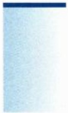
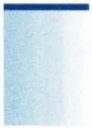

# 上册 / 第八章 不定积分

原始 PDF 第 255–281 页。

## 第八章

## 不定积分

---

244

第八章 不定积分

## 8.1 原函数与不定积分

在前面章节, 我们引入了导数的定义, 介绍了求导数的一些方法, 并且给出了一些基本初等函数的导数. 从运算的角度来看, 就是说给定一个函数 $F(x)$, 如果它是可导的, 那么它就对应一个所谓的导函数 $F'(x) = f(x)$. 在那里函数 $F(x)$ 是已知的, 我们讨论的重点主要放在寻求和研究导函数 $f(x)$ 上. 本章我们将着重考虑上述求导运算的逆运算, 即函数 $f(x)$ 是已知的, 我们关注的是如何寻求 $F(x)$. 与此紧密相关的问题包括 $F(x)$ 的存在性; 如果存在的话, 有多少这样的函数; 以及能否求出这些函数, 如何求出这些函数, 等等. 类似于求导运算, 如果存在这样的 $F(x)$ 使得 $F'(x) = f(x)$, 那么我们通常称 $f(x)$ 是可积的 (这里的可积与后面定积分章节中的可积有所不同), 而把 $F(x)$ 称为 $f(x)$ 的一个原函数. 严格定义如下.

定义 8.1.1 设函数  $f(x)$  在区间 I 上有定义. 如果函数  $F(x)$  在 I 上可导, 且满足

$$
F ^ {\prime} (x) = f (x), \qquad \text {或者} \quad \mathrm{d} F = f (x)   \mathrm{d} x, \quad x \in I,
$$

那么就称 $F$ 为 $f$ 在区间 $I$ 上的一个原函数. 在不强调区间 $I$ 时, 又简称为 $F$ 为 $f$ 的一个原函数.

根据导数的基本性质, 显然原函数具有下面的性质.

定理 8.1.1 设函数  $f(x)$  在区间 I 上有定义.

(1) 如果 $F(x)$ 是 $f(x)$ 在区间 $I$ 上的一个原函数, 那么对于任意的常数 $c \in \mathbb{R}$, 函数

$$
G (x) = F (x) + c
$$

也是 $f(x)$ 的一个原函数；

(2) 如果 $G(x)$ 也是 $f(x)$ 的一个原函数, 那么必有常数 $c$, 使得

$$
G (x) = F (x) + c.
$$

证明 (1) 首先, 对于任意常数 $c$, 由 $F'(x) = f(x)$, 知

$$
G ^ {\prime} (x) = (F (x) + c) ^ {\prime} = F ^ {\prime} (x) = f (x), \quad \forall x \in I.
$$

因此根据原函数的定义, 得  $F(x)+c$  是  $f(x)$  的一个原函数.

(2) 反过来, 如果 $G(x)$ 是 $f(x)$ 的另一个原函数, 则根据导数运算的代数法则, 有

$$
(G (x) - F (x)) ^ {\prime} = G ^ {\prime} (x) - F ^ {\prime} (x) \equiv 0, \quad \forall x \in I.
$$

因而有

$$
G (x) - F (x) = c, \quad \forall x \in I,
$$

---

8.1 原函数与不定积分

245

即

$$
G (x) = F (x) + c.
$$

由定理可知, 如果能求出  $f(x)$  的一个原函数, 则可以得到它所有的原函数, 任意两个原函数之间仅相差一个常数.

该定理有明确的几何直观: 设 $F$ 是给定函数 $f$ 的原函数, $\Gamma: y = F(x)$ 是这样一条曲线, 它在 $x = x_0$ 处有斜率为 $k = f(x_0)$ 的切线 $\ell$. 将 $\Gamma$ 沿着 $y$ 轴向上平移 $c$ 得到曲线 $\Gamma_c: y = F(x) + c$. 则 $\Gamma_c$ 在 $x = x_0$ 处的切线 $\ell_c$ 也对应着 $\ell$ 的平移, 即它们有完全相同的斜率 $k$, 所以 $y = F(x) + c$ 也是 $f(x)$ 的一个原函数. $\Gamma$ 和 $\Gamma_c$ 的切线方程分别为

$$
\ell : \quad y = f (x _ {0}) (x - x _ {0}) + F (x _ {0}), \qquad \ell_ {c}: \quad y = f (x _ {0}) (x - x _ {0}) + F (x _ {0}) + c.
$$

容易看出, 在这一族相互平行的曲线中, 如果要研究某一条过指定点 $(x_0, y_0)$ 的曲线 $\Gamma^*$, 则只需确定出相应的常数 $c = y_0 - F(x_0)$ 即可.

定理8.1.1的一个等价说法是, 如果函数 $f(x)$ 有一个原函数 $F(x)$, 则通过平移得到一族原函数; 反过来, 任何一个原函数都必须在此函数族中, 即 $\{F(x) + c : c \in \mathbb{R}\}$ 的集合恰好由 $f(x)$ 的所有原函数组成. 这样, 我们很自然地可以把这族由 $f(x)$ 生成的函数集合赋予它一个记号

$$
\int f (x) \mathrm{d} x,
$$

并称之为  $f(x)$  的不定积分,  $f(x)$  常称为被积函数.

这里我们需要注意两点: 一是原函数和不定积分是两个概念, 它们之间的关系是元素与集合的从属关系. 不定积分 $\int f(x) \mathrm{d}x$ 代表的不是一个函数, 而是一个由所有具有相同导函数的元素组成的集合, 这个集合中的每一个函数都称为 $f(x)$ 的一个原函数. 二是 $f(x)$ 的不定积分这个称呼以及记号 $\int f(x) \mathrm{d}x$ 现阶段看起来有点突兀, 它们的意义在学到定积分后将会看得更清楚和更深刻, 目前暂时当成一个术语理解即可.

例 8.1.1 求下列不定积分:

$$
\int \sin x \mathrm{d} x, \quad \int x ^ {2} \mathrm{d} x, \quad \int \mathrm{e} ^ {a x} \mathrm{d} x (a \neq 0).
$$

解 下面所有表达式中的 c 均为常数, 不再一一赘述.

由于 $(\cos x)' = -\sin x,$ 所以

$$
\int \sin x   \mathrm{d} x = - \cos x + c.
$$

同理, 我们可以写出另外两个不定积分:

$$
\int x ^ {2} \mathrm{d} x = \frac {1}{3} x ^ {3} + c, \quad \int \mathrm{e} ^ {a x} \mathrm{d} x = \frac {1}{a} \mathrm{e} ^ {a x} + c.
$$

---

246

第八章 不定积分

例8.1.2 试讨论符号函数

$$
\operatorname{sgn} (x) = \left\{ \begin{array}{l l} - 1, & x <   0, \\ 0, & x = 0, \\ 1, & x > 0 \end{array} \right.
$$

在 R 上是否有原函数.

解 我们假设 $\operatorname{sgn}(x)$ 有原函数 $F(x)$, 则

当 $x < 0$ 时, $F'(x) = -1$, 因此 $F(x) = -x + c_1$;

当 $x > 0$ 时, $F'(x) = 1$, 因此 $F(x) = x + c_2$.

由于  $F(x)$  是原函数, 故必须可导, 从而在 x = 0 处连续. 因而必须有  $c_{1} = c_{2} = c$ , 即

$$
F (x) = \left\{ \begin{array}{l l} - x + c, & x <   0, \\ c, & x = 0, \\ x + c, & x > 0. \end{array} \right.
$$

然而这样的  $F(x)$  在 x=0 处不可能可导, 从而  $\mathrm{sgn}(x)$  在 R 上没有原函数. 但请注意,  $\mathrm{sgn}(x)$  在任一不包含原点在内的区间上是有原函数的.

## 习题 8.1

1. 证明: 若 $\int f(x) \, \mathrm{d}x = F(x) + C$, 则

$$
\int f (a x + b) \mathrm{d} x = \frac {1}{a} F (a x + b) + C \quad (a \neq 0).
$$

2. 求下列不定积分:

(1) $\int (2^x + 3^x) \, \mathrm{d}x$;

(2) $\int \tan^2 x \, \mathrm{d}x$;

(3) $\int \frac{2x^2}{1 + x^2} \, \mathrm{d}x$;

(4) $\int \cos^2 x \, \mathrm{d}x$;

(5) $\int \cos x\cos 2x\mathrm{d}x;$

(6) $\int \frac{\cos 2x}{\cos^2 x \sin^2 x} \, \mathrm{d}x;$

(7) $\int \frac{\mathrm{e}^{3x} + 1}{\mathrm{e}^x + 1} \, \mathrm{d}x;$

(8) $\int \frac{\cos 2x}{\cos x - \sin x} \, \mathrm{d}x;$

(9) $\int \sqrt{1 - \sin 2x} \, \mathrm{d}x$.

3. 求下列不定积分:

(1) $\int \mathrm{e}^{-|x|}\mathrm{d}x;$

(2) $\int |x|\mathrm{d}x;$

(3) $\int \max \{1, x^2\} \, \mathrm{d}x$;

(4) $\int |\sin x| \, \mathrm{d}x$.

---

8.2 原函数的存在性

247

4. 设 $f$ 在 $(a, b)$ 内可导, 且 $|f'(x)| \leqslant M, \forall x \in (a, b)$. 证明: 极限 $\lim_{x \to a^+} f(x)$ 和 $\lim_{x \to b^-} f(x)$ 都存在且有限.
5. 设 $f$ 在 $[a, b]$ 上连续, 在 $(a, b)$ 内的左导数存在且恒为零, 证明: $f$ 为常值函数. 对于右导数有类似的结论.
6. 设 f 周期为 T. 则其原函数 F 以 T 为周期当且仅当  $F(T) = F(0)$ .
7. 设 $f$ 为奇函数. 则其原函数为偶函数; 设 $f$ 为偶函数. 则其原函数 $F$ 为奇函数当且仅当 $F(0) = 0$.

## 8.2 原函数的存在性

上节我们给出了原函数的概念和不定积分的定义, 本节我们将讨论不定积分的一个基本问题——原函数的存在性问题. 这个问题包含两个方面, 一是什么样的函数一定有原函数, 二是什么样的函数一定没有原函数. 对于问题的第一个方面, 我们有如下结论.

定理 8.2.1（原函数存在定理） 闭区间 I 上的连续函数必有原函数.

在给出定理证明之前, 我们简单分析一下. 首先, 连续函数原函数的存在性大都放到定积分引入之后, 通过变上限积分直接给出原函数 (见定理 9.3.6). 下面我们给出一个直接的证明.

回顾一下第六章例 6.1.7 中的函数  $g(x)$  和  $G(x)$ . 用原函数的语言重述该例的结论就是, 如果区间 I 上的逐段线性函数  $g(x)$  连续, 则  $g(x)$  有连续的逐段为抛物线的原函数  $G(x)$ . 本定理的证明将主要基于该结论.

给定区间 $I = [a,b]$ 和 $I$ 上的一组分点

$$
a = x _ {0} <   x _ {1} <   x _ {2} <   \dots <   x _ {n} <   x _ {n + 1} = b.
$$

设  $g(x)$  是区间 I 上的形如下式的逐段线性函数:

$$
g (x) = a _ {i} + k _ {i} (x - x _ {i}), \quad x \in [ x _ {i}, x _ {i + 1} ], \quad i = 0, 1, \dots , n.
$$

为了保证 $g(x)$ 的连续性, 有

$$
a _ {i} = a _ {i - 1} + k _ {i - 1} (x _ {i} - x _ {i - 1}) \quad i = 1, 2, \dots , n.
$$

例6.1.7直接给出了函数 $g(x)$ 满足 $G(a) = 0$ 的原函数

$$
G (x) = A _ {i} + a _ {i} (x - x _ {i}) + \frac {k _ {i}}{2} (x - x _ {i}) ^ {2}, \quad x \in [ x _ {i}, x _ {i + 1} ], \quad i = 0, 1, \dots , n,
$$

其中  $A_{0}=0,\quad A_{i}=A_{i-1}+a_{i-1}(x_{i}-x_{i-1})+\frac{k_{i-1}}{2}(x_{i}-x_{i-1})^{2},\quad i=1,2,\cdots,n.$

---

248

第八章 不定积分

证明 不失一般性, 不妨假设 $I = [0,1]$. 设函数 $f(x)$ 是 $I$ 上的连续函数, 我们证明一定存在 $I$ 上的函数 $F(x)$ 使得 $F'(x) = f(x)$ (这里在区间端点处自然理解为单侧导数).

记

$$
\omega (r) = \max_{\substack{x,x^{\prime}\in [0,1]\\ |x - x^{\prime}|\leqslant r}}|f(x) - f(x^{\prime})|,\quad \forall r\geqslant 0.
$$

由于 $f(x)$ 在 $I$ 上连续, 故一致连续, 即 $\lim_{r\to 0^{+}}\omega (r) = \omega (0) = 0.$

任取 $n \geqslant 2$, 定义

$$
f _ {n} (x) = \left\{ \begin{array}{l l} f (0) + n \Big (f \Big (\frac {1}{n} \Big) - f (0) \Big) x, & x \in \left[ 0, \frac {1}{n}\right), \\ f \Big (\frac {1}{n} \Big) + n \Big (f \Big (\frac {2}{n} \Big) - f \Big (\frac {1}{n} \Big) \Big) \Big (x - \frac {1}{n} \Big), & x \in \left[ \frac {1}{n}, \frac {2}{n}\right), \\ \dots , \\ f \Big (\frac {n - 1}{n} \Big) + n \Big (f (1) - f \Big (\frac {n - 1}{n} \Big) \Big) \Big (x - \frac {n - 1}{n} \Big), & x \in \left[ \frac {n - 1}{n}, 1 \right]. \end{array} \right.
$$

则 $f_{n}(x)$ 是[0,1]上的连续的逐段线性函数.根据第六章例6.1.7的结论，知 $f_{n}(x)$ 在 $I$ 上有原函数 $F_{n}(x)$ 且 $F_{n}(0) = 0,F_{n}(x)$ 是一个连续的逐段抛物线函数

显然, $\forall x\in I$ ，有

$$
| f _ {n} (x) - f (x) | \leqslant \omega \Big (\frac {1}{n} \Big).
$$

由Lagrange中值定理, 知存在点 $\xi = \xi(m, n, x) \in (0, 1)$ 使得对任意的自然数 $m, n \geqslant 2$, 有

$$
\begin{array}{l} \left| F _ {m} (x) - F _ {n} (x) \right| = \left| \left(F _ {m} (x) - F _ {n} (x)\right) - \left(\left| F _ {m} (0) - F _ {n} (0) \right|\right) \right| \\ = \left| f _ {m} (\xi) - f _ {n} (\xi) \right| \cdot | x | \leqslant \left| f _ {m} (\xi) - f _ {n} (\xi) \right| \\ \leqslant \left| f _ {m} (\xi) - f (\xi) \right| + \left| f _ {n} (\xi) - f (\xi) \right| \\ \leqslant \omega \left(\frac {1}{m}\right) + \omega \left(\frac {1}{n}\right). \\ \end{array}
$$

由 Cauchy 收敛准则知当 $n \to +\infty$ 时, 有 $F_{n}(x)$ 收敛到某函数 $F(x)$.

对于 $n \geqslant 2$, 利用Lagrange中值定理, 考虑差商

$$
\begin{array}{l} \left| \frac {F _ {n} (x) - F _ {n} (x ^ {\prime})}{x - x ^ {\prime}} - f (x) \right| = | f _ {n} (x + \theta (x - x ^ {\prime})) - f (x) | \\ \leqslant \left| f _ {n} (x + \theta (x - x ^ {\prime})) - f (x + \theta (x - x ^ {\prime})) \right| + \\ \left| f \left(x + \theta \left(x - x ^ {\prime}\right)\right) - f (x) \right| \\ \end{array}
$$

---

8.2 原函数的存在性

249

$$
\leqslant \omega \left(\frac {1}{n}\right) + \omega (| x - x ^ {\prime} |),
$$

这意味着

$$
\left| \frac {F (x) - F (x ^ {\prime})}{x - x ^ {\prime}} - f (x) \right| \leqslant \omega (| x - x ^ {\prime} |).
$$

即  $\forall x \in I, F'(x) = f(x).$

对于本节开头时问题的第二个方面, 即什么样的函数一定没有原函数, 从例题 8.1.2 我们看到符号函数不可能有原函数. 事实上, 我们有下面更一般的结论.

定理 8.2.2 区间 I 上不具有介值性的函数一定不存在原函数.

证明 定理本质上是 Darboux 介值定理的应用: 任何一个可微函数的导函数必具有介值性, 因此不具有介值性的函数是不可能成为一个函数的导函数的. □

注 8.2.1 上面两个定理合起来并没有给出连续函数是有原函数的充要条件。换句话说，我们并没有排除掉不连续函数一定没有原函数这种情况。事实上，下面的例子告诉我们，即使 $f(x)$ 在 $x = 0$ 处不连续，但它仍然可以有原函数。当然，此时的间断点一定不是第一类间断点。

例8.2.1 证明函数

$$
f (x) = \left\{ \begin{array}{l l} 2 x \sin \frac {1}{x ^ {2}} - \frac {2}{x} \cos \frac {1}{x ^ {2}}, & x \neq 0, \\ 0, & x = 0 \end{array} \right.
$$

有原函数

$$
F (x) = \left\{ \begin{array}{l l} x ^ {2} \sin \frac {1}{x ^ {2}}, & x \neq 0, \\ 0, & x = 0. \end{array} \right.
$$

证明 直接验证即可.

事实上, 我们可以利用连续函数必有原函数这一结论, 来给出构造不连续函数仍有原函数的稍微一般的方法. 参见本节习题题目 5.

## 习题8.2

1. 试讨论符号函数 $\operatorname{sgn}(x)$ 和 Dirichlet 函数有没有原函数？
2. 设 $a < c < b, f$ 在 $(a, b)$ 内连续, $F$ 在 $(a, c)$ 与 $(c, b)$ 内均为 $f$ 的原函数, 且 $F$ 在 $(a, b)$ 内连续. 证明: $F$ 是 $f$ 在 $(a, b)$ 内的原函数.
3. 设 $f$ 是区间 $[a, b]$ 上的实连续函数, $F$ 是 $f$ 在区间 $(a, b)$ 内的一个原函数. 证明: $F(a^{+})$ 与 $F(b^{-})$ 存在.
4. 设 $f(x)$ 在 $[a, b]$ 上有界且存在原函数, $g(x)$ 是 $[a, b]$ 上的连续函数. 求证: $f(x)g(x)$ 在 $[a, b]$ 上存在原函数.

---

250

第八章 不定积分

5. 设函数 $f(x)$ 在 $(- \infty, + \infty)$ 上可导，$\lim_{x \to \infty} \frac{f(x)}{x} = 0$。求证:

$$
g (x) = \left\{ \begin{array}{l l} f ^ {\prime} \left(\frac {1}{x}\right), & x \neq 0, \\ 0, & x = 0 \end{array} \right.
$$

在 $(-\infty, +\infty)$ 上有原函数.

6. 在上面的题目 5 中, 特别地, 取 $f_{1}(x) = -\cos x$, $f_{2}(x) = \sin x$, 则满足 $\lim_{x \to \infty} \frac{f_{i}(x)}{x} = 0, i = 1, 2$. 因此, 下面结论成立: 函数

$$
g _ {1} (x) = \left\{ \begin{array}{l l} \sin \frac {1}{x}, & x \neq 0, \\ 0, & x = 0, \end{array} \right. \quad g _ {2} (x) = \left\{ \begin{array}{l l} \cos \frac {1}{x}, & x \neq 0, \\ 0, & x = 0 \end{array} \right.
$$

在 $\mathbb{R}$ 上有原函数. 试证明这个结论. 进一步, 证明 $g_2^2(x)$ 在 $\mathbb{R}$ 上没有原函数.

7. 试问函数

$$
f (x) = \left\{ \begin{array}{l l} \frac {1}{x} \sin \frac {1}{x}, & x > 0, \\ 0, & x = 0 \end{array} \right.
$$

在 $[0, +\infty)$ 上是否有原函数？

8. 设 $F(x)$ 是 $f(x)$ 在 $\mathbb{R}$ 上的一个有下界的原函数. 证明: $\inf_{x \in \mathbb{R}} |f(x)| = 0$.
9. 设函数 $f(x)$ 和 $g(x)$ 在区间 $I$ 上都有原函数. 问 $f(x)g(x)$ 是否在区间 $I$ 上也必有原函数?

## 8.3 不定积分的性质与计算

## 8.3.1 积出来和积不出来

定理 8.2.1告诉我们, 区间 I 上的连续函数一定有原函数, 那么随之而来的问题是: 如何计算一个给定的连续函数的原函数? 事实上, 一个前置的问题是: 一个函数如果有原函数, 原函数总能算出来吗? 这个问题逻辑上非常类同于一个奇数次多项式在实数域上至少有一个实数根和这个根总能算出来吗? 的确, 原函数的存在性和能否表示出来是两个层面的问题.

要回答连续函数的原函数能否表达出来, 首先要明确什么是表达出来. 一个通俗的说法是: 用什么方式表达出来的函数才能称之为被积函数算出来了? 比如, 当我们稍后理解到变上限的定积分也可以表示函数时, 那么 $\int_{a}^{x} \mathrm{e}^{-t^2} \mathrm{d}t$ 就是 $\mathrm{e}^{-t^2}$ 的一个原函数. 我

---

8.3 不定积分的性质与计算

251

们能说它的不定积分能表达出来并且就是 $\int_{a}^{x}\mathrm{e}^{-t^2}\mathrm{d}t + c$ 吗？再比如，如果原函数是由极限，或者由无穷多个函数之和(函数项级数)或之积表示，我们能称这个不定积分的原函数表示出来了吗？基于此，我们对一个函数的原函数能表示出来给一些基本的限定.

被积函数的原函数如果能用基本初等函数, 或者基本初等函数的有限次代数运算 (四则运算、复合运算、反函数运算等), 那么就称为该被积函数能积出来, 即上面所说的表示出来. 否则, 即使原函数存在, 我们通常也称该被积函数积不出来.

要判断一个具体的函数能否积出来不是一件容易的事, 17、18 世纪诸多数学家曾经一度发展了诸多方法和技巧, 直到发现即使是一些表达式非常简捷的初等函数, 也很难求出原函数的表示, 人们才渐渐意识到可能有些函数就是积不出来的!

从理论上考虑一个函数能否积出来的开创性工作是19世纪上半叶由Liouville提出并研究的，后被诸多数学家给以推广。系统的研究需要用到微分代数方面的知识，已经远超本课的范围。有兴趣的读者可以作进一步的延伸阅读，参见文献[60]或追溯一下教学研究方面的论文。

## 1. 几个能积出来的函数

下面我们先给出几个后面学习中经常遇到的能积出来的初等函数以及它们的不定积分, 其正确性可以直接从前面的导数运算中得以验证.

(1) $\int 0\mathrm{d}x = c;$
(2) $\int x^{\mu} \, \mathrm{d}x = \frac{1}{\mu + 1} x^{\mu + 1} + c (\mu \neq -1)$;
(3) $\int \mathrm{e}^{x} \, \mathrm{d}x = \mathrm{e}^{x} + c;$
(4) $\int \frac{1}{x} \, \mathrm{d}x = \ln |x| + c;$
(5) $\int\cos x\,\mathrm{d}x=\sin x+c;$
(6) $\int \sin x\mathrm{d}x = -\cos x + c;$
(7) $\int \sec^2 x \, \mathrm{d}x = \tan x + c;$
(8) $\int \csc^2 x \, \mathrm{d}x = -\cot x + c;$
(9) $\int \frac{1}{\sqrt{1 + x^2}}\mathrm{d}x = \ln (x + \sqrt{1 + x^2}) + c;$
(10) $\int \frac{1}{\sqrt{1 - x^2}}\mathrm{d}x = \arcsin x + c;$
(11) $\int \frac{1}{1 + x^2} \, \mathrm{d}x = \arctan x + c;$
(12) $\int \sinh x \, \mathrm{d}x = \cosh x + c.$

注意, 原函数的表达形式可能不是唯一的, 这种形式上的差别本质上是由于原函数之间可以相差一个常数造成的. 比如上面列表中的不定积分 $\int \frac{1}{\sqrt{1 - x^2}} \mathrm{d}x$ 有原函数 $\arcsin x$, 也可以取 $-\arccos x$ 为原函数. 而 $\int \frac{1}{1 + x^2} \mathrm{d}x$ 可以有原函数 $\arctan x$, 也可以取 $-\operatorname{arccot} x$ 为原函数. 又比如不定积分

$$
I = \int \frac {1}{1 + x ^ {4}} \mathrm{d} x = \frac {\sqrt {2}}{8} \ln \frac {x ^ {2} + \sqrt {2} x + 1}{x ^ {2} - \sqrt {2} x + 1} - \frac {\sqrt {2}}{4} \arctan \frac {\sqrt {2} x}{x ^ {2} - 1} + c,
$$

---

252

第八章 不定积分

也可以表示为

$$
I = \frac {\sqrt {2}}{4} \ln \frac {x ^ {2} + \sqrt {2} x + 1}{\sqrt {1 + x ^ {4}}} + \frac {\sqrt {2}}{4} \left(\arctan (\sqrt {2} x + 1) + \arctan (\sqrt {2} x - 1)\right) + c.
$$

## 2. 几个积不出来的函数

我们下面给出几个著名的积不出来的初等函数, 供读者了解. 这些被积函数很多源于有关学科中的具体背景, 有着广泛的应用和影响, 而且大多数积分还曾被冠以数学家的名字. 也有一些被积函数是根据 Liouville 积不出来的结论刻意构造出来的, 意在营造一种效果: 这些形式上看似很简单的初等函数是根本就积不出来的.

Gauss 积分类型: $\int x^{2n} \mathrm{e}^{-x^2} \, \mathrm{d}x (n \in \mathbb{N})$.

Fresnel $^{①}$  积分:  $\int\sin(x^{2})\mathrm{d}x,\quad\int\cos(x^{2})\mathrm{d}x.$

正弦、余弦积分: $\int \frac{\sin x}{x^n} \, \mathrm{d}x$, $\int \frac{\cos x}{x^n} \, \mathrm{d}x$ ($n \in \mathbb{N}$).

对数积分:

$$
\int \frac {\mathrm{d} t}{\ln t}, \quad \int \frac {\ln t}{1 + x} \mathrm{d} t, \quad \int \frac {\ln x}{x (1 + x)} \mathrm{d} x, \quad \int \frac {\ln x}{1 + x ^ {2}} \mathrm{d} x,
$$

$$
\int \ln (\sin t) \mathrm{d} t, \quad \int \ln (\cos t) \mathrm{d} t, \quad \int \ln (1 + \sin t) \mathrm{d} t, \quad \int \ln (1 + \cos t) \mathrm{d} t.
$$

指数积分: $\int \frac{\mathrm{e}^x}{x}\mathrm{d}x,\quad \int \frac{\mathrm{e}^x}{1 + x}\mathrm{d}x,\quad \int \frac{\mathrm{e}^x}{1 + x^2}\mathrm{d}x,\quad \int \frac{\mathrm{e}^x}{x(1 + x)}\mathrm{d}x.$

椭圆积分: $\int \frac{\mathrm{d}x}{\sqrt{(1 - x^2)(1 - k^2x^2)}}, \quad \int \frac{x^2\mathrm{d}x}{\sqrt{(1 - x^2)(1 - k^2x^2)}} (0 < k^2 < 1).$

事实上, 可以根据一般性结论构造出很多形式简捷但积不出来的函数, 只不过要介绍这些一般性结论需要大量篇幅, 超出课程范围. 比如, Chebyshev 在 19 世纪中叶证明了下面的结论.

定理 8.3.1 形如  $\int x^{m}(a+bx^{n})^{p}\mathrm{d}x$  (m,n,p 均为有理数) 的不定积分能积出来的充要条件是 p,  $\frac{m+1}{n}$ ,  $p+\frac{m+1}{n}$  三者至少有一个是整数.

那么根据这个结论, 我们可以构造下面形式简捷但积不出来的函数 (椭圆积分):

$$
\int \frac {1}{\sqrt {1 - x ^ {3}}} \mathrm{d} x, \quad \int \frac {1}{\sqrt {1 - x ^ {4}}} \mathrm{d} x.
$$

另一方面, 通过调整 $m, n, p$, 又可以断定不定积分

$$
\int \frac {\sqrt {x}}{\sqrt {1 - x ^ {3}}} \mathrm{d} x
$$

是能积出来的, 剩下的就看如何把它积出来了.

<small>① Fresnel, Augustin-Jean, 1788 年 5 月 10 日 — 1827 年 7 月 14 日, 法国物理学家.</small>

---

8.3 不定积分的性质与计算

253

## 8.3.2 不定积分的基本性质

虽然求原函数的初等表示渐渐被直接定性分析原函数所取代, 并且把积不出来的函数当作一种全新的函数来接受并加以研究, 但是, 即使今天我们仍然把寻求原函数的显式表示当作数学分析学习中的基本方法和重要内容, 因为如果被积函数能用初等函数表示出来的话, 在进一步的研究中毕竟还是有其方便之处的. 这一点在学到定积分 Newton-Leibniz 公式时愈发能感悟到不定积分的重要性. 因此, 在本章我们还要详细讨论不定积分的性质以及计算不定积分的常用方法.

首先从微分的性质和不定积分的定义,可以直接推导和验证下面的结论:

(1) 函数 $f(x)$ 的原函数的导数还是 $f(x)$，即

$$
\frac {\mathrm{d}}{\mathrm{d} x} \left(\int f (x) \mathrm{d} x\right) = f (x).
$$

这条性质说明对一个函数先实施积分  $\int$  运算, 再实施微分 d 运算, 其效果刚好抵消, 相当于恒等运算:

$$
\mathrm{d} \circ \int = \mathrm{id}.
$$

(2) 设  $F(x)$  是  $F'(x)$  的一个原函数, 则有

$$
\int F ^ {\prime} (x) \mathrm{d} x = F (x) + c, \quad \int \mathrm{d} F (x) = F (x) + c.
$$

这条性质说明对一个函数先实施微分 d 运算, 再实施积分  $\int$  运算, 其效果是得到了这个函数所在的函数类:

$$
\int \circ \mathrm{d}: f \mapsto f + c.
$$

结合上一条, 我们看到, 微分和积分在抹掉一个常数的意义下是一对逆运算.

(3) 设 k 是常数 ( $k \neq 0$ ), 则

$$
\int k f (x) \mathrm{d} x = k \int f (x) \mathrm{d} x.
$$

(4) 设 $f(x)$ 和 $g(x)$ 在区间 $I$ 上均有原函数, 则 $f(x) + g(x)$ 在 $I$ 上也有原函数, 且

$$
\int (f (x) \pm g (x)) \mathrm{d} x = \int f (x) \mathrm{d} x \pm \int g (x) \mathrm{d} x.
$$

性质 (3) 和 (4) 表明了不定积分运算的线性性.

注8.3.1 在上面式子中, 应该注意以下一点: 当等式两端都含不定积分时,由于每个不定积分都包含一个任意常数项, 所以这类等式应理解为等式左右两端相差一个常数. 也可以理解为其中有一个积分不再是任意原函数, 而是

---

254

第八章 不定积分

在其他积分常数选定之后被确定了.

## 8.3.3 不定积分的运算法则之一: 分部积分法

下面我们介绍计算不定积分时常用的几个法则. 首先求不定积分的一个重要法则是分部积分法, 它的成立本质上是基于两个函数乘积的导数法则.

回顾一下两个函数 $u(x)$ 和 $v(x)$ 乘积的求导法则

$$
\mathrm{d} (u (x) v (x)) = v (x) \mathrm{d} u (x) + u (x) \mathrm{d} v (x),
$$

即

$$
u (x) \mathrm{d} v (x) = \mathrm{d} (u (x) v (x)) - v (x) \mathrm{d} u (x),
$$

从而

$$
\int u (x) \mathrm{d} v (x) = u (x) v (x) - \int v (x) \mathrm{d} u (x).
$$

这就是分部积分法. 我们给出严格的描述.

定理 8.3.2 设 $u\left( x\right)$ 和 $v\left( x\right)$ 均有连续的导函数, 则

$$
\int u (x) v ^ {\prime} (x) \mathrm{d} x = u (x) v (x) - \int u ^ {\prime} (x) v (x) \mathrm{d} x. \tag {8.3.1}
$$

公式 (8.3.1) 在自变量不产生歧义时, 也常简记为

$$
\int u v ^ {\prime} \mathrm{d} x = u v - \int u ^ {\prime} v \mathrm{d} x.
$$

分部积分法是求不定积分时使用频率最高的法则之一, 它特别适合于由两个不同类型函数乘积构成的被积函数的不定积分. 通常情况下, 可以试着先求其中一部分 $v'(x)$ 的积分 $v(x)$, 然后将 $\int u(x)v'(x) \mathrm{d}x$ 转化为求解 $\int v(x)u'(x) \mathrm{d}x$. 通过把 $u$ 和 $v$ 的角色对换, 使得原来不易处理的函数的不定积分对换成相对容易讨论的函数的不定积分. 选择合适的 $u$ 和 $v$ 直接影响计算的效果, 这一点可以通过适量的练习积累一些感觉.

当我们熟练掌握了这个法则后, 可以不必每次都标出函数 u 和 v, 只要心中记住相应函数的变动规则即可. 另外, 分部积分法则可以重复多次使用, 即有如下推广.

定理 8.3.3 设函数  $u(x)$  和  $v(x)$  在区间 I 上均有 n 阶连续的导函数  $u'(x)$ ， $u''(x)$ ， $\cdots$ ， $u^{(n)}(x)$  和  $v'(x)$ ， $v''(x)$ ， $\cdots$ ， $v^{(n)}(x)$ ，则

$$
\int u v ^ {(n)} \mathrm{d} x = u v ^ {(n - 1)} - u ^ {\prime} v ^ {(n - 2)} + u ^ {\prime \prime} v ^ {(n - 3)} + \dots + (- 1) ^ {n} \int u ^ {(n)} v \mathrm{d} x. \tag {8.3.2}
$$

---

8.3 不定积分的性质与计算

255

证明 根据定理 8.3.3, 通过一次分部积分, 可得

$$
\int u v ^ {(n)} \mathrm{d} x = \int u \mathrm{d} v ^ {(n - 1)} = u v ^ {(n - 1)} - \int v ^ {(n - 1)} \mathrm{d} u = u v ^ {(n - 1)} - \int u ^ {\prime} v ^ {(n - 1)} \mathrm{d} x.
$$

类似地, 有

$$
\begin{array}{l} \int u ^ {\prime} v ^ {(n - 1)} \mathrm{d} x = u ^ {\prime} v ^ {(n - 2)} - \int u ^ {\prime \prime} v ^ {(n - 2)} \mathrm{d} x, \\ \int u ^ {\prime \prime} v ^ {(n - 2)} \mathrm{d} x = u ^ {\prime \prime} v ^ {(n - 3)} - \int u ^ {\prime \prime \prime} v ^ {(n - 3)} \mathrm{d} x, \\ \int u ^ {(n - 1)} v ^ {\prime} \mathrm{d} x = u ^ {(n - 1)} v - \int u ^ {(n)} v \mathrm{d} x. \\ \end{array}
$$

...，

整理这些关系式, 即得 (8.3.2) 式.

□

例 8.3.1 求不定积分

$$
I _ {1} = \int x \sin x \mathrm{d} x, \quad I _ {2} = \int \arctan x \mathrm{d} x.
$$

解 设 $v = \cos x, u = x,$ 则

$$
\begin{array}{l} I _ {1} = - \int x \mathrm{d} (\cos x) = - x \cos x + \int \cos x \mathrm{d} x \\ = - x \cos x + \sin x + c. \\ \end{array}
$$

为了计算 $I_{2}$, 可以设 $v = x, u = \arctan x$, 则有

$$
\begin{array}{l} I _ {2} = x \arctan x - \int x \mathrm{d} (\arctan x) \\ = x \arctan x - \int \frac {x}{1 + x ^ {2}} \mathrm{d} x \\ = x \arctan x - \frac {1}{2} \ln (1 + x ^ {2}) + c. \\ \end{array}
$$

例8.3.2 计算不定积分

$$
\int x ^ {n} \ln x \mathrm{d} x.
$$

解 可以取 $u = \ln x, \mathrm{d}v = x^n\mathrm{d}x.$ 于是

$$
\mathrm{d} u = \frac {\mathrm{d} x}{x}, \quad v = \frac {1}{n + 1} x ^ {n + 1}.
$$

因此

$$
\int x ^ {n} \ln x \mathrm{d} x = \frac {1}{n + 1} x ^ {n + 1} \ln x - \frac {1}{n + 1} \int x ^ {n} \mathrm{d} x = \frac {1}{n + 1} x ^ {n + 1} \ln x - \frac {1}{(n + 1) ^ {2}} x ^ {n + 1}.
$$

---

256

第八章 不定积分

例 8.3.3 (反函数的原函数) 设  $f(x)$  有可微的反函数  $f^{-1}(x)$ ,  $F(x)$  为  $f(x)$  的一个原函数, 则

$$
\int f ^ {- 1} (x) \mathrm{d} x = x f ^ {- 1} (x) - F (f ^ {- 1} (x)) + c.
$$

证明 等式右端事实上是通过分部积分得到的, 下面我们给以验证. 为此, 在等式右端关于 $x$ 求导, 得

$$
\begin{array}{l} \frac {\mathrm{d}}{\mathrm{d} x} \left(x f ^ {- 1} (x) - F (f ^ {- 1} (x)) + c\right) \\ = f ^ {- 1} (x) + x \frac {\mathrm{d}}{\mathrm{d} x} f ^ {- 1} (x) - f (f ^ {- 1} (x)) \frac {\mathrm{d}}{\mathrm{d} x} f ^ {- 1} (x) \\ = f ^ {- 1} (x) + x \frac {\mathrm{d}}{\mathrm{d} x} f ^ {- 1} (x) - x \frac {\mathrm{d}}{\mathrm{d} x} f ^ {- 1} (x) = f ^ {- 1} (x). \\ \end{array}
$$

有很多重要的被积函数的不定积分需要多次使用分部积分求得,比如下面的例子.

例 8.3.4 计算不定积分

$$
I _ {n} = \int \frac {1}{(x ^ {2} + 1) ^ {n}} \mathrm{d} x.
$$

解 由

$$
\begin{array}{l} I _ {n} = \frac {x}{(x ^ {2} + 1) ^ {n}} + 2 n \int \frac {x ^ {2}}{(x ^ {2} + 1) ^ {n + 1}} \mathrm{d} x \\ = \frac {x}{(x ^ {2} + 1) ^ {n}} + 2 n I _ {n} - 2 n I _ {n + 1}, \\ \end{array}
$$

得

$$
I _ {n + 1} = \frac {x}{2 n (x ^ {2} + 1) ^ {n}} + \frac {2 n - 1}{2 n} I _ {n}.
$$

然后递推可得到 $I_{n}$ 的一般表达式. 特别地, 有

$$
I _ {2} = \int \frac {\mathrm{d} x}{\left(x ^ {2} + 1\right) ^ {2}} = \frac {x}{2 \left(x ^ {2} + 1\right)} + \frac {1}{2} \arctan x + c.
$$

## 8.3.4 不定积分的运算法则之二:换元积分法

换元积分法是计算不定积分时另一种常用的手法, 它本质上对应于复合函数的求导法则, 是基于一阶微分的形式不变性这一条性质的应用. 具体来说, 我们有

$$
f (u (x)) u ^ {\prime} (x) \mathrm{d} x = f (u) \mathrm{d} u,
$$

其中 $u = u(x)$ .因此，我们有

$$
\int f (u (x)) u ^ {\prime} (x) \mathrm{d} x = \int f (u) \mathrm{d} u. \tag {8.3.3}
$$

---

8.3 不定积分的性质与计算

257

我们通过下面两个例子, 分别说明常见的两种换元积分方法. 它们分别对应关系式 (8.3.3) 中左端和右端之一的不定积分容易计算时的典型做法. 具体来说, 一种情况是左端的不定积分不是一下子能够看出来的, 而右端的不定积分相对容易求得. 此时, 我们需要做的是甄别出哪个因子是 $u'(x)$, 需要确定 $f(u(x))$. 由于我们看到的是乘积 $f(u(x))u'(x)$, 因此, 这种甄别并不平凡, 需要把若干因子 “打包” 成 $u(x)$.

另一种情况则是左端的不定积分容易计算, 而右端的不定积分难以计算. 此时, 我们需要寻找合适的  $u = u(x)$ , 使得右端关于 u 的积分转化为左端关于 x 的积分.

例8.3.5 若 $\int f(u)\mathrm{d}u = F(u) + c.$ 试求不定积分 $\int f(ax + b)\mathrm{d}x$ $(a\neq 0)$

解 初步观察可以发现, 如果把  $ax + b$  打包成复合函数求导中的  $u(x)$ , 那么  $f(ax + b)$  的问题形式上就得到了处理  $f(u(x))$ . 即令  $u = u(x) = ax + b$ , 则  $u'(x) \, dx = a \, dx$ . 由

$$
\int f (u (x)) u ^ {\prime} (x) \mathrm{d} x = \int f (u) \mathrm{d} u,
$$

得

$$
\int f (a x + b) \cdot a \mathrm{d} x = \int f (u) \mathrm{d} u = F (u) + c = F (a x + b) + c.
$$

所以

$$
\int f (a x + b) \mathrm{d} x = \frac {1}{a} F (a x + b) + \tilde {c}.
$$

特别地, 当  $a, b (a \neq 0)$  为某些特定值时, 如下关系式成立:

$$
\int f (a x) \mathrm{d} x = \frac {1}{a} F (a x) + c _ {1}, \quad \int f (x + b) \mathrm{d} x = F (x + b) + c _ {2}.
$$

例 8.3.6 求不定积分  $\int\frac{dx}{\sqrt{a^{2}+x^{2}}}$ ，其中 a>0.

解 这里从被积函数中不易看出哪些因子可以凑在一起打包成 $u(x)$。我们采取另一种尝试, 即能否造出一个 $u(x)$ 来, 同时考虑到 $\mathrm{d}u(x)$ 产生的效果, 使得被积函数变成我们熟悉的函数. 比如, 我们试着用 $x = a \tan t \left( |t| < \frac{\pi}{2} \right)$ 去替换被积函数中的 $x$, 这样一来, 有

$$
\frac {\mathrm{d} x}{\sqrt {a ^ {2} + x ^ {2}}} = \frac {\cos t}{a} \cdot \frac {a \mathrm{d} t}{\cos^ {2} t} = \frac {\mathrm{d} t}{\cos t}.
$$

因此, 我们有

$$
\int \frac {\mathrm{d} x}{\sqrt {a ^ {2} + x ^ {2}}} = \int \frac {\mathrm{d} t}{\cos t} = \int \frac {\cos t   \mathrm{d} t}{\cos^ {2} t} = \int \frac {\mathrm{d} \sin t}{1 - \sin^ {2} t}.
$$

最后这个式子的积分可以通过下面的方式计算出来: 令 $v = \sin t$,

$$
\begin{array}{l} \int \frac {\mathrm{d} \sin t}{1 - \sin^ {2} t} = \int \frac {\mathrm{d} v}{1 - v ^ {2}} = \frac {1}{2} \left(\int \frac {\mathrm{d} v}{1 - v} + \int \frac {\mathrm{d} v}{1 + v}\right) \\ = \frac {1}{2} \ln \left| \frac {1 + v}{1 - v} \right| + c. \\ \end{array}
$$

---

258

第八章 不定积分

注意到  $v = \sin t = \frac{x}{\sqrt{a^{2} + x^{2}}}$ ，所以有

$$
\frac {1 + v}{1 - v} = \frac {1 + \sin t}{1 - \sin t} = \frac {\sqrt {a ^ {2} + x ^ {2}} + x}{\sqrt {a ^ {2} + x ^ {2}} - x} = \frac {1}{a ^ {2}} (x + \sqrt {a ^ {2} + x ^ {2}}) ^ {2}.
$$

最后得到

$$
\int \frac {\mathrm{d} x}{\sqrt {a ^ {2} + x ^ {2}}} = \ln (x + \sqrt {a ^ {2} + x ^ {2}}) + \tilde {c},
$$

其中  $\tilde{c}$  是把原来不定积分中的任意常数 c 和 a 考虑进去后的一个常数.

注8.3.2 形式上与上例中的被积函数相近的还有如下几个不定积分:

$$
\int \frac {\mathrm{d} x}{\sqrt {a ^ {2} - x ^ {2}}}, \quad \int \frac {\mathrm{d} x}{\sqrt {x ^ {2} - a ^ {2}}}, \quad \int \sqrt {a ^ {2} \pm x ^ {2}} \mathrm{d} x, \quad \int \sqrt {x ^ {2} - a ^ {2}} \mathrm{d} x.
$$

它们都是重要的被积函数, 建议读者试试相应的计算.

## 习题8.3

1. 求下列不定积分:

(1) $\int \frac{\mathrm{d}x}{1 + \cos x}$;
(3) $\int \frac{\mathrm{d}x}{\cos^3 x}$.
(5) $\int \sin mx\cos nx\mathrm{d}x;$

2. 求下列不定积分:

(1) $\int \frac{\mathrm{d}x}{\sqrt{x}(1 - x)};$
(3) $\int \sin^3 x\cos x\mathrm{d}x;$
(5) $\int \frac{\mathrm{d}x}{\sqrt{(x - a)(b - x)}};$
(7) $\int (a^2 - x^2)^{-\frac{3}{2}} \mathrm{~d}x;$
(9) $\int x^{5}(1 + x)^{-1}\mathrm{d}x;$

3. 求下列不定积分:

(1) $\int x^{2} \mathrm{e}^{-3x} \, \mathrm{d}x$;
(3) $\int x\sin^{-2}x\mathrm{d}x;$
(5) $\int \sqrt{x(1 - x^3)}\mathrm{d}x;$
(7) $\int x^{2}\arctan x\mathrm{d}x;$

(2) $\int \frac{\mathrm{d}x}{1 + \sin x}$;
(4) $\int \frac{\mathrm{d}x}{\cos^4 x}$.
(6) $\int \sin mx\sin nx\mathrm{d}x.$
(2) $\int x^{-\frac{1}{2}} (1 + x)^{-1} \, \mathrm{d}x$;
(4) $\int \frac{\mathrm{d}x}{a^2\sin^2 x + b^2\cos^2 x}$;
(6) $\int (x^{2} + a^{2})^{-\frac{3}{2}}\mathrm{d}x;$
(8) $\int (\arctan x)^2\mathrm{d}x;$
(10) $\int \frac{\mathrm{d}x}{a\sin x + b\cos x}.$
(2) $\int \cos (\ln x)\mathrm{d}x;$
(4) $\int x^{2}\sin 2x\mathrm{d}x;$
(6) $\int x^{2}\arccos x\mathrm{d}x;$
(8) $\int x^{2}(1 + x^{2})^{-2}\mathrm{d}x;$

---

8.4 几类能积出来的初等函数的不定积分

259

(9) $\int x^{2}\sqrt{a^{2} + x^{2}}\mathrm{d}x;$
(10) $\int \sin x\ln (\tan x)\mathrm{d}x;$
(11) $\int \arctan \sqrt{x} \, \mathrm{d}x$;
(12) $\int \sin^{-2} x \ln (\sin x) \, \mathrm{d}x$;
(13) $\int x^{-2}\arcsin x\mathrm{d}x;$
(14) $\int x\ln \left(\frac{1 + x}{1 - x}\right)\mathrm{d}x;$
(15) $\int \ln (x + \sqrt{1 + x^2})\mathrm{d}x.$

4. 求下列不定积分的递推公式 (m, n 为非负整数):

(1) $\int \sin^n x \, \mathrm{d}x$;

(2) $\int \cos^n x\mathrm{d}x;$

(3) $\int \sin^{-n} x \, \mathrm{d}x$;

(4) $\int \cos^{-n} x \, \mathrm{d}x$;

(5) $\int (\arcsin x)^n\mathrm{d}x;$

(6) $\int (\ln x)^n\mathrm{d}x;$

(7) $\int x^{n} \mathrm{e}^{x} \, \mathrm{d}x$;

(8) $\int \sin^m x\cos^n x\mathrm{d}x;$

(9) $\int x^{n}(1 + x)^{-1}\mathrm{d}x.$

5. 计算  $\int xf''(x) \, dx$ .

## 8.4 几类能积出来的初等函数的不定积分

## 8.4.1 有理函数的不定积分

有理函数是为数不多的能确保积出来的函数类, 我们下面详细介绍一下有理函数类不定积分的求法.

首先, 所谓的有理函数是指形如 $f(x) = \frac{P(x)}{Q(x)}$ 的函数, 其中 $P(x)$ 和 $Q(x)$ 均为实系数多项式. 利用多项式的带余除法, 我们总可以把它写成如下形式:

$$
f (x) = \frac {P (x)}{Q (x)} = P _ {0} (x) + \frac {P _ {1} (x)}{Q (x)},
$$

其中 $P_{0}(x)$ 和 $P_{1}(x)$ 为实系数多项式, 且 $P_{1}(x)$ 的次数低于 $Q(x)$ 的次数. 由于多项式 $P_{0}(x)$ 的不定积分很容易求得, 因此我们仅需考虑 $\frac{P_{1}(x)}{Q(x)}$ 的不定积分. 所以下面我们不妨假设 $f(x) = \frac{P(x)}{Q(x)}$ 已经是既约真分式的有理函数, 即 $P(x)$ 的次数严格低于 $Q(x)$ 的次数, 且两者互素.

下面的定理是代数学中的一个结论, 其证明不难在高等代数教科书中找到, 在此不

---

260

第八章 不定积分

再证明. 需要注意的是以下所有结论都是在实数域内.

定理 8.4.1 设  $f(x)=\frac{P(x)}{Q(x)}$  是一个真分式有理函数, 则

(1) $Q(x)$ 有不可约因子分解

$$
Q (x) = (x - a _ {1}) ^ {k _ {1}} \dots (x - a _ {r}) ^ {k _ {r}} (x ^ {2} + p _ {1} x + q _ {1}) ^ {\ell_ {1}} \dots (x ^ {2} + p _ {s} x + q _ {s}) ^ {\ell_ {s}},
$$

其中  $a_{i}, p_{j}, q_{j}$  为实数,  $k_{i}, \ell_{j}$  为正整数,  $p_{j}^{2} - 4q_{j} < 0, i = 1, 2, \cdots, r, j = 1, 2, \cdots, s.$

(2) $f(x)$ 有分解式

$$
\begin{array}{l} f (x) = \frac {A _ {1 1}}{x - a _ {1}} + \frac {A _ {1 2}}{(x - a _ {1}) ^ {2}} + \dots + \frac {A _ {1 k _ {1}}}{(x - a _ {1}) ^ {k _ {1}}} + \dots + \\ \frac {A _ {r 1}}{x - a _ {r}} + \frac {A _ {r 2}}{(x - a _ {r}) ^ {2}} + \dots + \frac {A _ {r k _ {r}}}{(x - a _ {r}) ^ {k _ {r}}} + \\ \frac {B _ {1 1} x + C _ {1 1}}{x ^ {2} + p _ {1} x + q _ {1}} + \frac {B _ {1 2} x + C _ {1 2}}{(x ^ {2} + p _ {1} x + q _ {1}) ^ {2}} + \dots + \frac {B _ {1 \ell_ {1}} x + C _ {1 \ell_ {1}}}{(x ^ {2} + p _ {1} x + q _ {1}) ^ {\ell_ {1}}} + \dots + \\ \frac {B _ {s 1} x + C _ {s 1}}{x ^ {2} + p _ {s} x + q _ {s}} + \frac {B _ {s 2} x + C _ {s 2}}{(x ^ {2} + p _ {s} x + q _ {s}) ^ {2}} + \dots + \frac {B _ {s \ell_ {s}} x + C _ {s \ell_ {s}}}{(x ^ {2} + p _ {s} x + q _ {s}) ^ {\ell_ {s}}}, \\ \end{array}
$$

其中所有参数  $A_{ij}, B_{ij}, C_{ij}$  均为唯一确定的实数.

根据这个定理容易看出, 所求函数  $f(x)$  的不定积分本质上就是两类函数的不定积分的线性组合:

$$
\frac {A}{(x - a) ^ {k}}, \qquad \frac {B x + C}{(x ^ {2} + p x + q) ^ {\ell}}, \quad \text {其中} p ^ {2} - 4 q <   0.
$$

所以, 我们只需处理这两类积分即可.

首先, 对于不定积分  $\int\frac{A}{(x-a)^{k}}\mathrm{d}x\ (k\in\mathbb{N})$ , 易见有如下结果:

(1) 当 k = 1 时,

$$
\int \frac {A}{(x - a) ^ {k}} \mathrm{d} x = \ln | x - a | + c.
$$

(2) 当 k > 1 时,

$$
\int \frac {A}{(x - a) ^ {k}} \mathrm{d} x = \frac {1}{1 - k} (x - a) ^ {1 - k} + c.
$$

其次, 对于不定积分  $\int\frac{Bx+C}{(x^{2}+px+q)^{\ell}}\mathrm{d}x\ (\ell\in\mathbb{N})$ , 我们作如下处理:

$$
x ^ {2} + p x + q = \left(x + \frac {p}{2}\right) ^ {2} + q - \frac {p ^ {2}}{4} = u ^ {2} + \mu^ {2},
$$

其中 $u = x + \frac{p}{2},\mu^2 = q - \frac{p^2}{4}$ .这样一来，

$$
\int \frac {B x + C}{(x ^ {2} + p x + q) ^ {\ell}} \mathrm{d} x = B \int \frac {u}{(u ^ {2} + \mu^ {2}) ^ {\ell}} \mathrm{d} u + \left(C - \frac {B p}{2}\right) \int \frac {1}{(u ^ {2} + \mu^ {2}) ^ {\ell}} \mathrm{d} u.
$$

---

8.4 几类能积出来的初等函数的不定积分

261

对于第一项积分, 有

1. 当  $\ell = 1$  时,

$$
\int \frac {u}{u ^ {2} + \mu^ {2}} \mathrm{d} u = \frac {1}{2} \ln (u ^ {2} + \mu^ {2}) + c = \frac {1}{2} \ln (x ^ {2} + p x + q) + c.
$$

2. 当 $\ell > 1$ 时,

$$
\int \frac {u}{(u ^ {2} + \mu^ {2}) ^ {\ell}} \mathrm{d} u = \frac {1}{2 (1 - \ell)} (u ^ {2} + \mu^ {2}) ^ {1 - \ell} + c = \frac {1}{2 (1 - \ell)} (x ^ {2} + p x + q) ^ {1 - \ell} + c.
$$

对于第二项积分, 本质上是求不定积分

$$
\int \frac {1}{(u ^ {2} + \mu^ {2}) ^ {\ell}} \mathrm{d} u,
$$

这是前面例 8.3.4 中讨论过的情景.

综上, 原则上我们证明了下面的结论.

定理 8.4.2 有理函数的不定积分能积出来.

定理 8.4.1 给出了有理函数分解的结论, 从而从理论证明了有理函数一定能积出来, 但在具体计算中, 最关键的工作是分解  $Q(x)$  和确定诸多系数. 这是一件理论上思路明了但实际操作中比较烦琐的事情. 为了确定这些系数通常采用待定系数法. 但请注意, 虽然待定系数法本质上是求解线性方程组的问题, 理论上总是可解的, 但最好根据具体情况尝试一下是否有更合适的方法, 而不是墨守成规.

例 8.4.1 求不定积分  $\int\frac{1}{1+x^{3}}dx$ .

解 我们用待定系数法求解. 由于

$$
\frac {1}{1 + x ^ {3}} = \frac {1}{(1 + x) (x ^ {2} - x + 1)} = \frac {A}{x + 1} + \frac {B x + C}{x ^ {2} - x + 1},
$$

消去分母, 得

$$
1 = A (x ^ {2} - x + 1) + (B x + C) (1 + x),
$$

比较两端同次幂的系数, 可得

$$
A + B = 0, \quad - A + B + C = 0, \quad A + C = 1,
$$

有

$$
A = \frac {1}{3}, \quad B = - \frac {1}{3}, \quad C = \frac {2}{3}.
$$

因此

$$
\begin{array}{l} \int \frac {1}{1 + x ^ {3}} \mathrm{d} x = \frac {1}{3} \int \frac {1}{x + 1} \mathrm{d} x + \frac {1}{3} \int \frac {- x + 2}{x ^ {2} - x + 1} \mathrm{d} x \\ = \frac {1}{3} \ln | x + 1 | - \frac {1}{6} \ln (x ^ {2} - x + 1) + \frac {1}{2} \int \frac {1}{x ^ {2} - x + 1} \mathrm{d} x \\ = \frac {1}{3} \ln | x + 1 | - \frac {1}{6} \ln (x ^ {2} - x + 1) + \frac {1}{\sqrt {3}} \arctan \left(\frac {2}{\sqrt {3}} \left(x - \frac {1}{2}\right)\right) + c. \\ \end{array}
$$

---

262

第八章 不定积分

例8.4.2 求不定积分 $I = \int \frac{1}{1 + x^4}\mathrm{d}x.$

解 我们完全可以按照上面例子中同样的做法, 即通过待定系数法进行计算. 考虑到分母的多项式的分解和后续的待定系数, 计算量将会比上一例题大得多. 因此, 我们尝试采用另一种做法, 引入另一个不定积分

$$
J = \int \frac {x ^ {2}}{1 + x ^ {4}} \mathrm{d} x.
$$

我们有

$$
\begin{array}{l} I + J = \int \frac {1 + x ^ {2}}{1 + x ^ {4}} \mathrm{d} x = \int \frac {\frac {1}{x ^ {2}} + 1}{\frac {1}{x ^ {2}} + x ^ {2}} \mathrm{d} x = \int \frac {\mathrm{d} \left(x - \frac {1}{x}\right)}{\left(x - \frac {1}{x}\right) ^ {2} + 2} \\ = \frac {1}{\sqrt {2}} \arctan \left(\frac {\sqrt {2}}{2} \left(x - \frac {1}{x}\right)\right) + c _ {1}. \\ \end{array}
$$

$$
\begin{array}{l} I - J = \int \frac {1 - x ^ {2}}{1 + x ^ {4}} \mathrm{d} x = \int \frac {\frac {1}{x ^ {2}} - 1}{\frac {1}{x ^ {2}} - x ^ {2}} \mathrm{d} x = - \int \frac {\mathrm{d} \left(x + \frac {1}{x}\right)}{\left(x + \frac {1}{x}\right) ^ {2} - 2} \\ = \frac {\sqrt {2}}{4} \left(\ln | x + \frac {1}{x} + \sqrt {2} | - \ln | x + \frac {1}{x} - \sqrt {2} |\right) + c _ {2}. \\ \end{array}
$$

因此，有

$$
I = \frac {\sqrt {2}}{8} \ln \left| \frac {x ^ {2} + \sqrt {2} x + 1}{x ^ {2} - \sqrt {2} x + 1} \right| + \frac {\sqrt {2}}{4} \arctan \left(\frac {\sqrt {2}}{2} \left(x - \frac {1}{x}\right)\right) + c.
$$

例8.4.3 求不定积分 $I = \int \frac{1 + x^4}{x^5 + x^4 - x^3 - x^2} \, \mathrm{d}x.$

解 因为

$$
x ^ {5} + x ^ {4} - x ^ {3} - x ^ {2} = x ^ {2} (x ^ {3} + x ^ {2} - x - 1) = x ^ {2} (x + 1) ^ {2} (x - 1).
$$

所以被积函数可以分解为

$$
\frac {1 + x ^ {4}}{x ^ {5} + x ^ {4} - x ^ {3} - x ^ {2}} = \frac {A}{x} + \frac {B}{x ^ {2}} + \frac {C}{x - 1} + \frac {D}{x + 1} + \frac {E}{(x + 1) ^ {2}}. \tag {8.4.1}
$$

为了确定这些系数, 可以在 (8.4.1) 式两端进行如下运算:

两端乘  $x^{2}$ ，再令 x=0，可得 B=-1。

两端乘 $x - 1$ ，再令 $x = 1$ ，可得 $C = \frac{1}{2}$

两端乘 $(x+1)^{2}$ ，再令x=-1，可得E=-1.

---

8.4 几类能积出来的初等函数的不定积分

263

将 $B = -1, C = \frac{1}{2}, E = -1$ 代入 (8.4.1) 式并整理, 可得

$$
\frac {1 + x ^ {4}}{x ^ {2} (x - 1) (x + 1) ^ {2}} + \frac {1}{(x + 1) ^ {2}} = \frac {A}{x} - \frac {1}{x ^ {2}} + \frac {1}{2 (x - 1)} + \frac {D}{x + 1}. \tag {8.4.2}
$$

(8.4.2) 式两端乘 $x + 1$, 并令 $x \to -1$, 由于等式左端的极限为 $-\frac{1}{2}$, 右端的极限为 $D$, 故得 $D = -\frac{1}{2}$.

最后 (8.4.1) 式两端乘 $x$, 再令 $x \to \infty$, 可得 $A + C + D = 1$, 从而 $A = 1$. 从而得所求不定积分

$$
I = \ln | x | + \frac {1}{x} + \frac {1}{x + 1} + \frac {1}{2} \ln \left| \frac {x - 1}{x + 1} \right| + c.
$$

## 8.4.2 几类可有理化函数的不定积分

本节简要介绍以下几类函数的不定积分:

1. 三角函数有理式的不定积分
2. 形如  $\int R\left(x,\sqrt[p]{\frac{ax+b}{cx+d}},\cdots,\sqrt[q]{\frac{ax+b}{cx+d}}\right)\mathrm{d}x$  的不定积分
3. 形如 $\int R\left(x, \sqrt{ax^2 + bx + c}\right) \mathrm{d}x (a \neq 0)$ 的不定积分
4. 形如 $\int x^{m}(a + bx^{n})^{p}\mathrm{d}x$ 的不定积分

## 1. 三角函数有理式的不定积分

三角函数有理式是指形如 $R(\sin x, \cos x)$ 的函数, 其中 $R(u, v)$ 是二元有理函数, 后者是指两个二元多项式比值的函数, 即

$$
R (u, v) = \frac {P (u , v)}{Q (u , v)},
$$

其中  $P(u,v)$  和  $Q(u,v)$  都是二元多项式函数. 比如

$$
R (\sin x, \cos x) = \frac {1}{2 \sin x + 3 \cos x}
$$

就是三角函数的有理式, 而  $\sin\frac{1}{x}$  和  $\cos\sqrt{x}$  就不属于这类函数.

下面我们简要讨论三角函数有理式的不定积分

$$
I = \int R (\sin x, \cos x) \mathrm{d} x.
$$

我们证明,这类函数总可以通过所谓的万能变换

$$
t = \tan {\frac {x}{2}} \left(- \pi <   x <   \pi\right) \quad \text {或} \quad x = 2 \arctan t
$$

---

264

第八章 不定积分

把它化为有理函数的积分, 从而总是可以积出来.

事实上, 注意到

$$
\sin x = 2 \sin \frac {x}{2} \cos \frac {x}{2} = \frac {2 \tan \frac {x}{2}}{1 + \tan^ {2} \frac {x}{2}} = \frac {2 t}{1 + t ^ {2}},
$$

$$
\cos x = \cos^ {2} \frac {x}{2} - \sin^ {2} \frac {x}{2} = \frac {1 - \tan^ {2} \frac {x}{2}}{1 + \tan^ {2} \frac {x}{2}} = \frac {1 - t ^ {2}}{1 + t ^ {2}},
$$

$$
\mathrm{d} x = \frac {2 \mathrm{d} t}{1 + t ^ {2}}.
$$

于是可把原来的不定积分化为

$$
I = \int R \left(\frac {2 t}{1 + t ^ {2}}, \frac {1 - t ^ {2}}{1 + t ^ {2}}\right) \frac {2 \mathrm{d} t}{1 + t ^ {2}}.
$$

由于有理函数的复合函数还是有理函数, 因此我们得到的关于 t 的被积函数的确是有理函数. 根据前面的讨论, 我们理论上证明了三角函数有理式的不定积分总是能积出来的.

注意, 在实际计算中可以视被积函数的具体情况, 采用灵活的变量替换, 比如 $t = \sin x$, $t = \cos x$, 或者 $t = \tan x$.

例8.4.4 求不定积分 $\int \frac{\mathrm{d}x}{\sin x + 2\cos x + 3}$

解 令 $t = \tan \frac{x}{2}$, 则有

$$
\begin{array}{l} \int \frac {\mathrm{d} x}{\sin x + 2 \cos x + 3} = 2 \int \frac {\mathrm{d} t}{t ^ {2} + 2 t + 5} \\ = 2 \int \frac {\mathrm{d} t}{(t + 1) ^ {2} + 4} = \arctan \frac {t + 1}{2} + c \\ = \arctan \left(\frac {1}{2} \left(1 + \tan \frac {x}{2}\right)\right) + c. \\ \end{array}
$$

例 8.4.5 求下面与著名的 Poisson 核函数有关的不定积分:

$$
\int \frac {(1 - r ^ {2}) \mathrm{d} x}{1 - 2 r \cos x + r ^ {2}}.
$$

该被积函数在后续的分析类课程中会时常遇到.

解 令 $t = \tan \frac{x}{2}$, 则有

$$
\begin{array}{l} \int \frac {(1 - r ^ {2}) \mathrm{d} x}{1 - 2 r \cos x + r ^ {2}} = 2 \int \frac {(1 - r ^ {2}) \mathrm{d} t}{(1 + r ^ {2}) (1 + t ^ {2}) - 2 r (1 - t ^ {2})} \\ = 2 (1 - r ^ {2}) \int \frac {\mathrm{d} t}{(1 - r) ^ {2} + (1 + r) ^ {2} t ^ {2}} \\ = 2 \arctan \left(\frac {1 + r}{1 - r} \tan \frac {x}{2}\right) + c. \\ \end{array}
$$

---

8.4 几类能积出来的初等函数的不定积分

265

2. 形如  $\int R\left(x,\sqrt[p]{\frac{ax+b}{cx+d}},\cdots,\sqrt[q]{\frac{ax+b}{cx+d}}\right)\mathrm{d}x$  的不定积分

设  $R(x_{1}, x_{2}, \cdots, x_{n})$  是关于 n 元变量  $x_{1}, x_{2}, \cdots, x_{n}$  的有理函数, 即可以写成这些变量的两个多项式的比值. 我们研究被积函数形如

$R\left(x,\sqrt[p]{\frac{ax+b}{cx+d}},\cdots,\sqrt[q]{\frac{ax+b}{cx+d}}\right),\quad(p,\cdots,q \text{是大于1的自然数}),\quad ad-bc\neq0$

的不定积分. 注意此时, 被积函数关于 $x$ 而言是无理函数.

处理这类函数积分的基本思路是考虑如下的变量变换: 设 k 为这些自然数  $p, \cdots, q$  的最小公倍数, 令

$$
t = \sqrt [ k ]{\frac {a x + b}{c x + d}},
$$

则

$$
x = \frac {d t ^ {k} - b}{a - c t ^ {k}}, \quad \mathrm{d} x = \frac {a d - b c}{(a - c t ^ {k}) ^ {2}} k t ^ {k - 1} \mathrm{d} t.
$$

从而基于有理函数在复合运算下的封闭性, 可知 R 的不定积分就转化为关于 t 的有理函数的积分, 后者是能积出来的.

例8.4.6 计算不定积分 $I = \int \sqrt[3]{\frac{1 - x}{1 + x}}\frac{\mathrm{d}x}{1 - x}.$

解 我们简要介绍一下思路: 令 $\frac{1 - x}{1 + x} = t^3$, 则可以把原来的不定积分转化为

$$
I = - 3 \int \frac {\mathrm{d} t}{1 + t ^ {3}}.
$$

注意右端的不定积分, 除了相差常数 -3 外, 刚好是例 8.4.1 的情况, 因此

$$
I = - \ln | t + 1 | + \frac {1}{2} \ln (t ^ {2} - t + 1) - \sqrt {3} \arctan \left(\frac {2}{\sqrt {3}} \Big (t - \frac {1}{2} \Big)\right) + c.
$$

最后再将  $t = \sqrt[3]{\frac{1 - x}{1 + x}}$  代入上式即可.

3. 形如 $\int R\left(x, \sqrt{ax^2 + bx + c}\right) \mathrm{d}x (a \neq 0)$ 的不定积分

这里假设  $R(u,v)$  为变量 u,v 的有理函数, 因此, 关于 x 而言则是 x 的无理函数. 注意到

$$
a x ^ {2} + b x + c = a \left(x + \frac {b}{2 a}\right) ^ {2} + c - \frac {b ^ {2}}{4 a} = \pm \left(\sqrt {| a |} \left(x + \frac {b}{2 a}\right)\right) ^ {2} \pm \left(\sqrt {\left| c - \frac {b ^ {2}}{4 a} \right|}\right) ^ {2}.
$$

---

266

第八章 不定积分

令 $u = \sqrt{|a|}\left(x + \frac{b}{2a}\right)$, 则 $\sqrt{ax^2 + bx + c}$ 可以转化为下面三种情况之一:

$$
\sqrt {u ^ {2} + \mu^ {2}}, \quad \sqrt {u ^ {2} - \mu^ {2}}, \quad \sqrt {\mu^ {2} - u ^ {2}}.
$$

被积函数的微分 $R\left(x,\sqrt{ax^2 + bx + c}\right)\mathrm{d}x$ 相应分别转化为

$$
R _ {1} (u, \sqrt {u ^ {2} + \mu^ {2}}) \mathrm{d} u, \quad R _ {2} (u, \sqrt {u ^ {2} - \mu^ {2}}) \mathrm{d} u, \quad R _ {3} (u, \sqrt {\mu^ {2} - u ^ {2}}) \mathrm{d} u.
$$

对于这三种情况, 再分别令

$$
u = \mu \tan t, \qquad u = \mu \sec t, \qquad u = \mu \sin t,
$$

则被积函数表达式就转化为三角函数的有理式, 后者我们已经讨论过了.

形如 $\int R\left(x,\sqrt{ax^2 + bx + c}\right)\mathrm{d}x(a\neq 0)$ 的不定积分还有一种经典的做法就是Euler替换.我们简要介绍如下.

情形 (i) a > 0, 此时令

$$
\sqrt {a x ^ {2} + b x + c} = t - \sqrt {a} x \quad (\text {或} \sqrt {a x ^ {2} + b x + c} = t + \sqrt {a} x),
$$

即所谓的第一种 Euler 替换. 可以得到

$$
b x + c = t ^ {2} - 2 \sqrt {a} t x, \quad x = \frac {t ^ {2} - c}{2 \sqrt {a} t + b},
$$

$$
\sqrt {a x ^ {2} + b x + c} = \frac {\sqrt {a} t ^ {2} + b t + c \sqrt {a}}{2 \sqrt {a} t + b}, \quad \mathrm{d} x = \frac {2 (\sqrt {a} t ^ {2} + b t + c \sqrt {a})}{(2 \sqrt {a} t + b) ^ {2}} \mathrm{d} t.
$$

把这些式子全部代入原不定积分, 得到关于 t 的有理函数的不定积分. 利用前面的讨论, 再求得关于 t 的原函数后, 再把  $t = \sqrt{ax^{2} + bx + c} + \sqrt{ax}$  代入表达式即可.

情形 (ii) c > 0, 此时令

$$
\sqrt {a x ^ {2} + b x + c} = x t + \sqrt {c} \quad (\text {或} \sqrt {a x ^ {2} + b x + c} = x t - \sqrt {c}),
$$

即所谓的第二种 Euler 替换. 可以得到

$$
a x + b = x t ^ {2} + 2 \sqrt {c} t, \quad x = \frac {2 \sqrt {c} t - b}{a - t ^ {2}},
$$

$$
\sqrt {a x ^ {2} + b x + c} = \frac {\sqrt {c} t ^ {2} - b t + \sqrt {c} a}{a - t ^ {2}}, \quad \mathrm{d} x = \frac {2 (\sqrt {c} t ^ {2} - b t + \sqrt {c} a)}{(a - t ^ {2}) ^ {2}} \mathrm{d} t.
$$

情形 (iii) 当二次式 $ax^2 + bx + c$ 有两个互异的实根 $\lambda$ 和 $\mu$ 时, 可以作下面的所谓的第三种 Euler 替换: 由

$$
a x ^ {2} + b x + c = a (x - \lambda) (x - \mu),
$$

---

8.4 几类能积出来的初等函数的不定积分

267

令

$$
\sqrt {a x ^ {2} + b x + c} = t (x - \lambda).
$$

可得

$$
x = \frac {\lambda t ^ {2} - a \mu}{t ^ {2} - a}, \quad \sqrt {a x ^ {2} + b x + c} = \frac {a (\lambda - \mu) t}{t ^ {2} - a}, \quad \mathrm{d} x = \frac {2 a (\mu - \lambda) t}{(t ^ {2} - a) ^ {2}} \mathrm{d} t.
$$

以下可以按照前面情况下的程序讨论即可.

注意, 上面的几种 Euler 替换看起来多少有点突兀, 实则它们有明确的几何背景, 即代数曲线的有理参数化的常用做法. 事实上, 考虑平面二次曲线 $y^{2} = ax^{2} + bx + c$, 取过曲线上的任一点 $P_{0}(x_{0}, y_{0})$ 的割线 $\ell: y - y_{0} = t(x - x_{0})$, 其中 $t$ 是参数, $\ell$ 与曲线交于两点 $P_{0}$ 和 $P(x(t), y(t))$, 满足

$$
y _ {0} ^ {2} = a x _ {0} ^ {2} + b x _ {0} + c, \quad (y _ {0} + t (x - x _ {0})) ^ {2} = a x ^ {2} + b x + c.
$$

整理得

$$
2 y _ {0} t + t ^ {2} (x - x _ {0}) = a (x + x _ {0}) + b,
$$

由此可知  $P(x(t), y(t))$  的坐标为

$$
x (t) = x _ {0} - \frac {2 y _ {0} t - 2 a x _ {0} - b}{t ^ {2} - a}, \quad y (t) = y _ {0} - \frac {(2 y _ {0} t - 2 a x _ {0} - b) t}{t ^ {2} - a}.
$$

然后被积函数就可以化为关于 t 的有理函数从而可以积出来了.

容易看出一种特殊情况, 如果 $c = 0$, 形如 $\int R(x, y) \mathrm{d}x = R(x, \sqrt{ax^2 + bx}) \mathrm{d}x$ 的不定积分, 则可以选 $(x_0, y_0) = (0, 0)$, 从而有有理参数化

$$
x = \frac {b}{t ^ {2} - a}, \quad y = \frac {b t}{t ^ {2} - a}, \quad \mathrm{d} x = \frac {- 2 b t}{(t ^ {2} - a) ^ {2}}.
$$

更一般些, 由二元多项式 $P(x, y) = 0$ 给出的代数曲线, 如果有一个好的有理参数化表达, 那么与此有关的由隐函数确定的不定积分就能积出来. 我们仅举一个例子简单介绍这个做法.

例8.4.7 设 $y = y(x)$ 是方程 $y^{2}(x - y) = x^{2}$ 确定的隐函数. 计算不定积分

$$
\int \frac {1}{y ^ {2}} \mathrm{d} x.
$$

解 由方程看出 $x = 0 \iff y = 0$, 要计算的积分要求 $y \neq 0$.

令 y = tx, t 为参数,  $t \neq 0$ . 代入方程, 则隐函数  $y = y(x)$  可以写成参数方程

$$
\left\{ \begin{array}{l l} x = \frac {1}{t ^ {2} (1 - t)}, \\ y = \frac {1}{t (1 - t)}, \end{array} \right. \quad \text {从而有} \quad \mathrm{d} x = \frac {3 t - 2}{t ^ {3} (1 - t) ^ {2}} \mathrm{d} t.
$$

---

268

第八章 不定积分

利用换元法

$$
\begin{array}{l} \int \frac {1}{y ^ {2}} \mathrm{d} x = \int t ^ {2} (1 - t) ^ {2} \frac {3 t - 2}{t ^ {3} (1 - t) ^ {2}} \mathrm{d} t = \int \left(3 - \frac {2}{t}\right) \mathrm{d} t \\ = 3 t - 2 \ln | t | + c = \frac {3 y}{x} - 2 \ln \left| \frac {y}{x} \right| + c. \\ \end{array}
$$

4. 形如 $\int x^{m}(a + bx^{n})^{p} \mathrm{~d}x$ 的不定积分

这里的常数 $a, b \in \mathbb{R}, m, n, p \in \mathbb{Q}, abnp \neq 0$.

稍微观察一下这个函数的表达式, 不难发现有可能出现根号套根号的情况. 所以我们从尽可能去掉根号这一基本出发点入手, 比如作变换

$$
x ^ {n} = t, \quad x = t ^ {\frac {1}{n}}, \quad \mathrm{d} x = \frac {1}{n} t ^ {\frac {1}{n} - 1} \mathrm{d} t.
$$

所以被积函数的微分表示式为

$$
x ^ {m} (a + b x ^ {n}) ^ {p} \mathrm{d} x = t ^ {\frac {m}{n}} (a + b t) ^ {p} \cdot \frac {1}{n} t ^ {\frac {1}{n} - 1} \mathrm{d} t = \frac {1}{n} t ^ {\frac {m + 1}{n} + p - 1} \left(\frac {a + b t}{t}\right) ^ {p} \mathrm{d} t.
$$

可以看出, 如果

$$
\frac {m + 1}{n} \in \mathbb {Z}, \quad \text {或者} \quad \frac {m + 1}{n} + p \in \mathbb {Z}, \quad \text {或者} \quad p \in \mathbb {Z},
$$

则上面的式子就完全转化为前面已经讨论过的情况. 在微积分早期就已经知道这些情况能积出来. 有趣的是, Chebyshev 在 19 世纪中叶证明了这也是能积出来的所有情况. 换句话说, 我们 (不加证明) 介绍 Chebyshev 的一个结论:

形如 $\int x^{m}(a + bx^{n})^{p}\mathrm{d}x$ （$m, n, p$ 均为有理数）的积分能积出来的充要条件是 $p$, $\frac{m+1}{n}, p + \frac{m+1}{n}$ 三者至少有一个是整数. 根据这个结论, 我们可以构造如下积不出来的不定积分 (椭圆积分):

$$
\int \frac {1}{\sqrt {1 - x ^ {3}}} \mathrm{d} x, \quad \int \frac {1}{\sqrt {1 - x ^ {4}}} \mathrm{d} x.
$$

另一方面, 通过调整 $m, n, p$ 可以知道不定积分

$$
\int \frac {\sqrt {x}}{\sqrt {1 - x ^ {3}}} \mathrm{d} x
$$

是能积出来的, 读者可自行思考.

例8.4.8 求不定积分 $I = \int \frac{\sqrt[3]{1 + \sqrt[4]{x}}}{\sqrt{x}}\mathrm{d}x = \int x^{-\frac{1}{2}}\left(1 + x^{\frac{1}{4}}\right)^{\frac{1}{3}}\mathrm{d}x.$

解 $m = -\frac{1}{2}, n = \frac{1}{4}, p = \frac{1}{3}$. 由于 $\frac{m + 1}{n} = 2 \in \mathbb{Z}$, 所以此积分能积出来. 作变量替换 $t = \sqrt[3]{1 + \sqrt[4]{x}}$, 直接运算可得如下结论:

$$
I = \frac {3}{7} t ^ {4} (4 t ^ {3} - 7) + c.
$$

---

8.4 几类能积出来的初等函数的不定积分

269

再把 $t = t(x)$ 代入即可.

## 习题8.4

1. 求下列不定积分:

(1) $\int \frac{\mathrm{d}x}{(x + 1)(x + 2)^2}$;

(2) $\int \frac{\mathrm{d}x}{x^4 + x^2 + 1}$;

(3) $\int \frac{1 + x^4}{1 + x^6} \, \mathrm{d}x$;

(4) $\int \frac{\mathrm{d}x}{1 + x^3}$;

(5) $\int \frac{x^4\mathrm{d}x}{x^2 + 1}$;

(6) $\int \frac{(x^4 + 1)\mathrm{d}x}{(x^2 + 1)^2}$.

2. 求下列不定积分:

(1) $\int \sin^{-\frac{3}{2}} x \cos^{-\frac{5}{2}} x \, \mathrm{d}x;$

(2) $\int \sin^{-\frac{1}{2}} x \cos^{\frac{1}{2}} x \, \mathrm{d}x;$

(3) $\int \sqrt{1 + \sin x} \, \mathrm{d}x$;

(4) $\int \frac{x + \sin x}{1 + \cos x} \, \mathrm{d}x;$

(5) $\int \frac{\mathrm{d}x}{\sin x - \sin \alpha}$;

(6) $\int \frac{\mathrm{d}x}{\sin(x + a)\cos(x + b)}.$

3. 计算不定积分 $\int \frac{x^2}{(x\sin x + \cos x)^2}\mathrm{d}x.$

4. 设 $y = y(x)$ 是方程 $x^3 + y^3 = x^2 + y^2$ 确定的隐函数, 试计算不定积分 $\int \frac{1}{y^3} \, \mathrm{d}x$.

5. 在承认 $\int \frac{\mathrm{e}^x}{x} \, \mathrm{d}x$ 不是初等函数的前提下, 问 $\int \mathrm{e}^x P_n\left(\frac{1}{x}\right) \, \mathrm{d}x$ 何时为初等函数, 其中 $P_n(x)$ 为 $n$ 次多项式.
