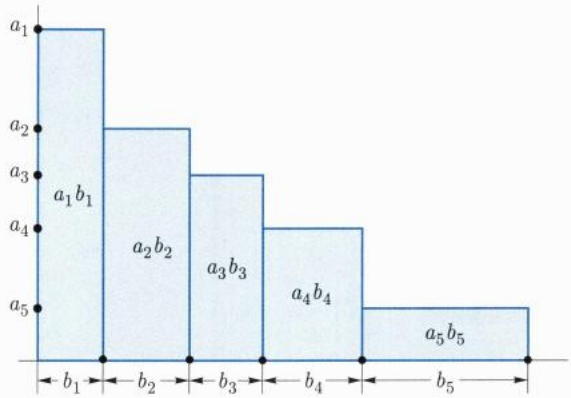
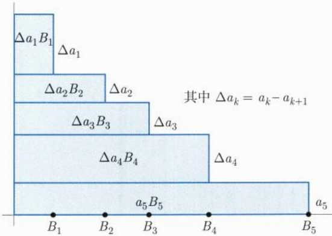

# 中册 / 第十一章 数项级数

原始 PDF 第 375–435 页。

## 第十一章

## 数项级数

---

70

第十一章 数项级数

从本章开始, 我们将陆续讨论数学分析的另一重要板块: (可数) 无穷多个实数或函数的求和问题, 即所谓的无穷级数理论. 无穷级数本质上是利用极限这一强大的分析工具, 把初等数学中有限个元素的求和 (更一般地, 有限个元素的代数运算) 推广到无穷多个元素的求和 (或相应的代数运算).

无穷求和问题是初等数学有限项求和的一种自然推广. 粗略地说, 它有两种主要的表现形式, 一种是离散型求和, 一种是连续型求和. 离散型求和就是下面将要讨论的级数, 而连续型求和主要是与积分和广义积分有关, 在其他章节另有讨论. 离散型求和又大致分成两部分, 一部分是考虑无穷多个数相加的问题, 即所谓的数项级数理论; 另一部分则重点讨论无穷多个函数相加的问题, 即所谓的函数项级数理论.

本章我们主要讨论数项级数. 在引入了级数的收敛发散定义后, 我们将给出级数敛散性的判定方法以及收敛级数的基本性质. 作为本章的主要内容之一, 我们将系统回答实数求和的基本问题, 如果用初等数学的语言表述的话, 就是三律问题: 结合律、交换律, 以及加法对乘法的分配律. 我们得到一个高度概括的充分条件: 对于绝对收敛的级数, 初等数学中有限个元素间的三律运算可以推广到级数.

## 11.1 级数敛散性定义与基本性质

## 11.1.1 级数敛散性定义

数项级数是指可数无穷多个数的相加问题, 它是初等数学中有限个实数相加的自然推广. 本章内容的基本出发点是考虑可数无穷多个实数的求和, 虽然对复数的求和也有平行的结构和相似的理论.

设 $a_1, a_2, \cdots a_n, \cdots$ 为一给定的实数列, 则形式上的求和 (可理解为一个形式记号而已)

$$
\sum_ {n = 1} ^ {+ \infty} a _ {n} = a _ {1} + a _ {2} + \dots + a _ {n} + \dots \tag {11.1.1}
$$

称为无穷级数, $a_{n}$ 称为级数的通项或一般项,

$$
S _ {n} = \sum_ {k = 1} ^ {n} a _ {k} = a _ {1} + a _ {2} + \dots + a _ {n} \tag {11.1.2}
$$

称为级数的第 n 个部分和,  $\{S_{n}\}$  称为级数的部分和序列或部分和数列,

$$
T _ {n} = \sum_ {k = n} ^ {+ \infty} a _ {k} = a _ {n} + a _ {n + 1} + \dots \tag {11.1.3}
$$

---

11.1 级数敛散性定义与基本性质

71

称为级数的第 n 个余项和  $^{①}$ 或简称余和.

形式记号 (11.1.1) 能否赋予实质内涵, 这一问题可以通过级数的收敛和发散这些概念来实现, 而级数的敛散性可以通过部分和数列 $\{S_{n}\}$ 的敛散性来定义, 即

定义 11.1.1 给定形如 (11.1.1) 的级数  $\sum_{n=1}^{+\infty} a_{n}$ ，如果部分和序列  $\{S_{n}\}$  极限存在且为有限  $\lim_{n\to+\infty} S_{n}=S$ ，则称级数 (11.1.1) 收敛，简记为  $\sum_{n=1}^{+\infty} a_{n} \in c$  (convergent)，并称其和为 S，记为

$$
\sum_ {n = 1} ^ {+ \infty} a _ {n} = S. \tag {11.1.4}
$$

否则, 称该级数发散, 简记为 $\sum_{n=1}^{+\infty} a_n \in d$ (divergent). 特别地, 如果数列 $\{S_n\}$ 的极限为无穷, 那么我们称级数 (11.1.1) 发散到无穷 (包括 $-\infty, +\infty$ 或 $\infty$).

级数的收敛或发散属性统称为级数的敛散性, 本章的最主要内容之一就是讨论级数的敛散性以及在收敛情况下级数的性质及级数的求和.

可以看出, 级数的敛散性本质上等价于部分和数列 $\{S_{n}\}$ 极限的存在性. 这样看来, 级数理论好像了无新意. 但事实上, 由于部分和数列构成的特殊形式, 因此相比于一般的数列极限, 对级数的研究有许多独特的方法, 这些方法对一般数列也许并不适用, 或者并非显然可以从序列的研究中得到. 另一方面, 级数也具有很多比一般数列的极限好得多的性质, 某些性质或结论甚至超乎我们的直觉想象.

例 11.1.1 判断级数  $\sum_{n=1}^{+\infty}\frac{1}{n(n+1)}$  的敛散性.

解 考虑其部分和

$$
S _ {n} = \sum_ {k = 1} ^ {n} \frac {1}{k (k + 1)} = \sum_ {k = 1} ^ {n} \left(\frac {1}{k} - \frac {1}{k + 1}\right) = 1 - \frac {1}{n + 1} \rightarrow 1 \quad (n \rightarrow + \infty),
$$

所以原级数收敛, 且其和为 1.

例 11.1.2 形如  $\sum_{n=1}^{+\infty}\frac{1}{n}$  的级数称为调和级数. 试证调和级数发散.

证明 对级数的部分和数列  $\{S_{n}\}$  应用 Cauchy 准则, 有

$$
S _ {2 n} - S _ {n} = \frac {1}{n + 1} + \frac {1}{n + 2} + \dots + \frac {1}{2 n} \geqslant \frac {1}{2 n} + \frac {1}{2 n} + \dots + \frac {1}{2 n} = \frac {1}{2}.
$$

故  $\{S_{n}\}$  发散, 从而原级数发散.

<small>① 有的教材或参考书中余项和可能定义为  $T_{n}=\sum_{k=n+1}^{+\infty}a_{k}=a_{n+1}+a_{n+2}+\cdots$ ，两者没有实质性的区别.</small>

---

72

第十一章 数项级数

例 11.1.3 形如  $\sum_{n=1}^{+\infty} q^{n}$  的级数称为等比级数或几何级数, 试讨论几何级数的敛散性.

解 首先, 如果 $q = 1$, 那么显然有 $S_{n} = n \to +\infty (n \to +\infty)$, 所以原级数发散. 下设 $q \neq 1$, 此时

$$
S _ {n} = \sum_ {k = 1} ^ {n} q ^ {k} = q \cdot \frac {1 - q ^ {n}}{1 - q},
$$

故有

(1) 当  $|q|<1$  时,  $S_{n}\rightarrow\frac{q}{1-q}$   $(n\rightarrow+\infty)$ , 原级数收敛.
(2) 当  $|q| > 1$  时,  $S_{n} \rightarrow \infty$   $(n \rightarrow +\infty)$ , 原级数发散.
(3) 当 $q = -1$ 时, $S_{2n} = 0$, $S_{2n+1} = -1$, 从而 $\{S_n\}$ 无极限, 原级数发散.

## 11.1.2 级数敛散性的基本性质

下面我们先介绍级数敛散性的一些最基本的性质, 更多的性质在后续内容中陆续展开. 首先, 从级数敛散性的定义, 显然下面的结论成立:

定理 11.1.1 对于给定的级数  $\sum_{n=1}^{+\infty}a_{n}$ ，增加、减少或者改变有限项的值均不改变级数的敛散性.

下面的定理是关于一个级数收敛时应该满足的必要条件.

定理 11.1.2（级数收敛的必要条件） 若级数  $\sum_{n=1}^{+\infty}a_{n}$  收敛, 则必有  $\lim_{n\to+\infty}a_{n}=0$ .

证明 利用级数收敛的 Cauchy 准则, 注意到

$$
a _ {n} = S _ {n} - S _ {n - 1} \rightarrow S - S = 0 \quad (n \rightarrow + \infty),
$$

即得结论.

由级数收敛的必要条件, 可以直接看出例 11.1.3 中的级数当 q = -1 时,  $\sum_{n=1}^{+\infty} q^{n}$  是发散的, 因为其通项不趋于 0.

例 11.1.4 判断级数  $\sum_{n=1}^{+\infty}\sin n$  的敛散性.

解 如果级数收敛, 则应该有 $\sin n \to 0 (n \to +\infty)$, 从而也有 $\sin(n+1) \to 0 (n \to +\infty)$. 但另一方面, 由关系式

$$
\sin (n + 1) = \sin n \cdot \cos 1 + \cos n \cdot \sin 1
$$

可得 $\cos n\to 0(n\to +\infty)$ .但这与另一关系式 $\sin^2 n + \cos^2 n = 1$ 矛盾.从而不可能有$\sin n\to 0,$ 故原级数发散. □

---

11.1 级数敛散性定义与基本性质

73

注11.1.1 通项 $a_{n} \to 0 (n \to +\infty)$ 仅仅是级数 $\sum_{n=1}^{+\infty} a_{n}$ 收敛的必要而非充分的条件。换句话说，一般从 $a_{n} \to 0 (n \to +\infty)$ 是推不出相应级数收敛的。例11.1.2中的调和级数就是一个典型的例子。

注意到如果把 Cauchy 准则应用到级数部分和数列  $\{S_{n}\}$  上，则得到级数收敛的 Cauchy 准则:

定理 11.1.3 (级数收敛的充要条件, Cauchy 准则) 级数 $\sum_{n=1}^{+\infty} a_n$ 收敛的充要条件是, $\forall \varepsilon > 0$, 存在自然数 $N = N(\varepsilon)$, 当 $n > N$ 时,

$$
| a _ {n + 1} + a _ {n + 2} + \dots + a _ {n + p} | <   \varepsilon , \quad \forall p \geqslant 1.
$$

证明 只要注意到  $a_{n+1} + a_{n+2} + \cdots + a_{n+p} = S_{n+p} - S_{n}$ ，对  $\{S_{n}\}$  应用 Cauchy 准则即可. □

例 11.1.5 试判断级数  $\sum_{n=1}^{+\infty}\frac{(-1)^{n+1}}{n}$  的敛散性.

这是一道非常经典的交错级数题, 用后面的 Leibniz 判别法很容易得知其收敛性. 这里我们从 Cauchy 准则出发, 直接讨论其收敛性.

解 为了判断该级数的敛散性, 根据 Cauchy 准则, 我们只需考虑对任意的  $\varepsilon > 0$ , 当 n 充分大时, 对任意的自然数 p, 能否成立下面的关系式:

$$
| a _ {n + 1} + a _ {n + 2} + \dots + a _ {n + p} | <   \varepsilon , \quad \forall p \geqslant 1. \tag {11.1.5}
$$

为此, 我们分别考虑 p 为偶数 2m 和奇数  $2m+1$  的情况.

首先注意到当 k > 1 时, 下面的不等式成立:

$$
\frac {1}{k + 1} - \frac {1}{k + 2} = \frac {1}{(k + 1) (k + 2)} <   \frac {1}{k (k + 1)} = \frac {1}{k} - \frac {1}{k + 1} <   \frac {1}{k - 1} - \frac {1}{k}.
$$

(1) 若  $p = 2m, m \geqslant 1.$

$$
\begin{array}{l} \left| \sum_ {k = n + 1} ^ {n + 2 m} \frac {(- 1) ^ {k + 1}}{k} \right| = \left| \sum_ {i = 1} ^ {m} \left(\frac {1}{n + 2 i - 1} - \frac {1}{n + 2 i}\right) \right| \\ <   \left| \sum_ {i = 1} ^ {m} \left(\frac {1}{n + i} - \frac {1}{n + i + 1}\right) \right| = \left| \frac {1}{n + 1} - \frac {1}{n + m + 1} \right| <   \frac {2}{n}. \\ \end{array}
$$

(2) 若 $p = 2m + 1, m \geqslant 1$, 完全类似分析, 把最后一项单独分出来, 可得

$$
\left| \sum_ {k = n + 1} ^ {n + 2 m + 1} \frac {(- 1) ^ {k + 1}}{k} \right| \leqslant \frac {3}{n + 1}.
$$

---

74

第十一章 数项级数

所以, 对任意的 $\varepsilon > 0$, 当 $n$ 充分大时, 对任意的自然数 $p$, 关系式 (11.1.5) 总是成立, 因此原级数收敛. $\square$

注意到级数的敛散性是通过部分和数列定义的, 因此下面的性质是数列极限具有的线性封闭性的直接应用.

## 定理 11.1.4 (收敛级数的线性性)

所有收敛的级数构成一个线性空间, 即, 如果

级数 $\sum_{n=1}^{+\infty} a_n$ 和 $\sum_{n=1}^{+\infty} b_n$ 都收敛, 则 $\forall \alpha, \beta \in \mathbb{R}$, 级数 $\sum_{n=1}^{+\infty} (\alpha a_n + \beta b_n)$ 也收敛, 且其和满足关系式

$$
\sum_ {n = 1} ^ {+ \infty} (\alpha a _ {n} + \beta b _ {n}) = \alpha \sum_ {n = 1} ^ {+ \infty} a _ {n} + \beta \sum_ {n = 1} ^ {+ \infty} b _ {n}.
$$

## 习题 11.1

1. 设级数 $\sum_{n=1}^{+\infty} a_n$ 收敛, 证明:

$$
\lim _ {n \to + \infty} \frac {1}{n} \sum_ {k = 1} ^ {n} k a _ {k} = 0.
$$

2. 讨论级数

$$
\sum_ {n = 1} ^ {+ \infty} \left(\frac {1}{(n + 1) ^ {\alpha} n ^ {\beta}} - \frac {1}{n ^ {\alpha} (n + 1) ^ {\beta}}\right), \qquad \alpha > 0, \beta > 0
$$

的敛散性.

3. 设数列 $\{a_{n}\}, \{b_{n}\}$ 均单调有界, 试讨论级数 $\sum_{n=2}^{+\infty}(a_{n}b_{n-1}-b_{n}a_{n-1})$ 的敛散性.

4. 设 $a_{n} > 0, \{a_{n} - a_{n + 1}\}$ 严格递减. 如果 $\sum_{n=1}^{+\infty} a_{n}$ 收敛, 求证

$$
\lim _ {n \to + \infty} \left(\frac {1}{a _ {n + 1}} - \frac {1}{a _ {n}}\right) = + \infty .
$$

5. 设 $a_{n} \neq 0, \lim_{n \to +\infty} a_{n} = a \neq 0$. 证明:

$$
\sum_ {n = 1} ^ {+ \infty} \left(\frac {1}{a _ {n}} - \frac {1}{a _ {n + 1}}\right) \mathrm{收敛}.
$$

6. 若  $\sum_{n=1}^{+\infty}a_{n}^{2}$  收敛，证明:  $\sum_{n=1}^{+\infty}a_{n}^{3}$  绝对收敛.

---

11.2 正项级数

75

7. 举例说明:

(1) 存在这样的级数:  $\sum_{n=1}^{+\infty}a_{n}$  收敛但  $\sum_{n=1}^{+\infty}a_{n}^{3}$  发散；
(2) 存在这样的级数:  $\sum_{n=1}^{+\infty}a_{n}^{3}$  收敛 但  $\sum_{n=1}^{+\infty}\frac{a_{n}}{n}$  发散. (提示:  $a_{n}=\frac{1}{\ln n}\sqrt[3]{\cos\frac{2n\pi}{3}}$ .)

## 11.2 正项级数

下面我们将转向讨论级数的第一个基本问题: 敛散性问题. 按照由特殊到一般的基本思路, 本节我们先讨论正项级数的敛散性, 然后在下一节再讨论特殊的变号级数——交错级数, 最后讨论任意项级数的敛散性.

根据级数收敛的定义, 我们知道, 它的敛散性本质上等价于部分和数列极限的存在性. 因此, 这几节的主题内容就是给出敛散性的一些判别方法. 而判断级数敛散性的方法众多, 在看待和处理这些判别方法时, 我们没有遵循罗列 “药方”, 陈列越多越好的标准, 而是更侧重于基本的和深刻的判别方法.

定义 11.2.1 若数项级数  $\sum_{n=1}^{+\infty}a_{n}$  的通项  $a_{n}\geqslant0\left(\forall n\geqslant1\right)$ ，则称级数为正项级数。如果  $a_{n}>0$ ，则称级数为严格正项级数。

正项级数最明显的特点之一是部分和数列 $\{S_n\}$ 是单调上升的. 因此下面定理的结论显然, 我们把它列为正项级数的第一个判别标准, 以示其基础性.

定理 11.2.1 正项级数  $\sum_{n=1}^{+\infty}a_{n}$  收敛的充要条件是其部分和数列  $\{S_{n}\}$  有界；如果正项级数发散，则必发散到  $+\infty$ .

例 11.2.1 设  $F_{1}=1, F_{2}=2, F_{n}=F_{n-1}+F_{n-2}, n=3,4,\cdots$  。试讨论级数  $\sum_{n=1}^{+\infty}\frac{1}{F_{n}}$  的敛散性.

解 这是一个正项级数. 我们下面证明该级数的部分和有界. 为此, $\forall n \geqslant 3$, 显然有

$$
F _ {n - 1} <   F _ {n} <   2 F _ {n - 1},
$$

从而有

$$
F _ {n} = F _ {n - 1} + F _ {n - 2} > F _ {n - 1} + \frac {1}{2} F _ {n - 1} = \frac {3}{2} F _ {n - 1}.
$$

故有

$$
\lim _ {n \to + \infty} F _ {n} = + \infty.
$$

---

76

第十一章 数项级数

考虑级数的第  $n (n \geqslant 3)$  个部分和  $S_{n}$  :

$$
S _ {n} \stackrel {\mathrm{记}} {=} \sum_ {k = 3} ^ {n} {\frac {1}{F _ {k}}} <   {\frac {2}{3}} \sum_ {k = 3} ^ {n} {\frac {1}{F _ {k - 1}}} = {\frac {2}{3}} \left({\frac {1}{2}} + \sum_ {k = 3} ^ {n} {\frac {1}{F _ {k}}} - {\frac {1}{F _ {n}}}\right),
$$

即

$$
S _ {n} <   1 + \frac {2}{3} S _ {n} - \frac {2}{3 F _ {n}} \quad \Rightarrow \quad S _ {n} <   3 - 2 \frac {1}{F _ {n}} <   3.
$$

因此, 级数的部分和有界, 所以根据定理 11.2.1, 原级数收敛.

注 11.2.1 定理 11.2.1 是处理正项级数敛散性最基本的方法之一, 很多其他判别法是它的具体表现或推论. 例如, 我们知道单调数列 $\{S_{n}\}$ 有极限的充要条件是它的一个子列 $\{S_{n_k}\}$ 有极限, 利用此性质, 可以很方便地考虑下面的例子.

例 11.2.2 级数  $\sum_{n=1}^{+\infty}\frac{1}{n^{p}}$  通常被称为 p-级数. 证明: 当 p>1 时, p-级数是收敛的.
证明 这是一个正项级数, 考虑其部分和序列的子列  $\{S_{2^{k}-1}\}$ .

$$
\begin{array}{l} S _ {2 ^ {k} - 1} = 1 + \underbrace {\left(\frac {1}{2 ^ {p}} + \frac {1}{3 ^ {p}}\right)} _ {\text {共2项，每项} \leqslant 2 ^ {- p}} + \underbrace {\left(\frac {1}{4 ^ {p}} + \frac {1}{5 ^ {p}} + \frac {1}{6 ^ {p}} + \frac {1}{7 ^ {p}}\right)} _ {\text {共4项，每项} \leqslant 4 ^ {- p}} + \dots + \\ \underbrace {\left(\frac {1}{2 ^ {(k - 1) p}} + \frac {1}{(2 ^ {k - 1} + 1) ^ {p}} + \cdots + \frac {1}{(2 ^ {k} - 1) ^ {p}}\right)} _ {\mathrm{共} 2 ^ {k - 1} \mathrm{项}, \mathrm{每项} \leqslant 2 ^ {- (k - 1) p}} \\ \leqslant \sum_ {i = 1} ^ {k} \frac {1}{2 ^ {(i - 1) p}} \cdot 2 ^ {i - 1} = \sum_ {i = 1} ^ {k} 2 ^ {- (i - 1) (p - 1)} <   \frac {1}{1 - 2 ^ {1 - p}}. \\ \end{array}
$$

所以部分和子列  $\{S_{2^{k}-1}\}$  是有界的, 从而原级数收敛.

借鉴正项级数部分和数列的敛散性等价于其子列的敛散性这一性质, 对于通项单调递减的正项级数, 我们也有下面非常方便的判别法, 也称 Cauchy 判别法.

定理 11.2.2 (Cauchy 判别法) 设非负数列 $\{a_{n}\}$ 单调下降, 则级数 $\sum_{n=1}^{+\infty} a_{n}$ 收敛当且仅当级数 $\sum_{n=0}^{+\infty} 2^{n} a_{2^{n}}$ 收敛.

证明 容易看出, 对于 $n \geqslant 1$, 由 $\{a_{n}\}$ 的单调性与非负性, 我们有

$$
\sum_ {k = 1} ^ {2 ^ {n}} a _ {k} = a _ {1} + \sum_ {j = 1} ^ {n} \sum_ {k = 2 ^ {j - 1} + 1} ^ {2 ^ {j}} a _ {k} \geqslant a _ {1} + \sum_ {j = 1} ^ {n} (2 ^ {j} - 2 ^ {j - 1}) a _ {2 ^ {j}} \geqslant \frac {1}{2} \sum_ {j = 0} ^ {n} 2 ^ {j} a _ {2 ^ {j}},
$$

---

11.2 正项级数

77

以及

$$
\sum_ {k = 1} ^ {2 ^ {n} - 1} a _ {k} = \sum_ {j = 0} ^ {n - 1} \sum_ {k = 2 ^ {j}} ^ {2 ^ {j + 1} - 1} a _ {k} \leqslant \sum_ {j = 0} ^ {n - 1} (2 ^ {j + 1} - 2 ^ {j}) a _ {2 ^ {j}} = \sum_ {j = 0} ^ {n - 1} 2 ^ {j} a _ {2 ^ {j}}.
$$

这表明正项级数 $\sum_{n=1}^{+\infty} a_n$ 与正项级数 $\sum_{n=0}^{+\infty} 2^n a_{2^n}$ 有相同的有界性. 因此它们有相同的收敛性. □

作为例子, 我们应用定理 11.2.2 来判断形如 $\sum_{n=1}^{+\infty} \frac{1}{n^p}$ 和 $\sum_{n=2}^{+\infty} \frac{1}{n \ln^p n}$ 的级数敛散性. 事实上, 对于 $p \geqslant 0$, 由定理 11.2.2, $\sum_{n=1}^{+\infty} \frac{1}{n^p}$ 收敛当且仅当 $\sum_{n=0}^{+\infty} \frac{2^n}{2^{np}}$ 收敛. 因此, 当且仅当 $p > 1$ 时 $\sum_{n=1}^{+\infty} \frac{1}{n^p}$ 收敛.

对于通项为单调递减的正项级数 $\sum_{n=1}^{+\infty} a_n$, 除了上面的 Cauchy 判别法外, 我们还有更一般的处理手法. 即, 如果能找到一个相应的单调下降的非负函数 $f(x)$, 使得 $f(n) = a_n$, 那么, 级数 $\sum_{n=1}^{+\infty} a_n$ 的敛散性就可以与广义积分 $\int_{1}^{+\infty} f(x) \mathrm{d}x$ 的敛散性建立内在的联系, 这就是非常实用的级数收敛的 Cauchy 积分判别法. 我们将在本节后面详细讨论.

## 11.2.1 比较判别法（控制判别法）

判断正项级数敛散性最基本的方法之一是比较判别法, 又称控制判别法. 控制判别法的基本思想是, 选取一个易知其收敛的正项级数 $\sum_{n=1}^{+\infty} b_n$, 并且通项 $b_n$ 控制着 $a_n (a_n \leqslant b_n, n = 1, 2, \cdots)$, 那么 $\sum_{n=1}^{+\infty} b_n$ 的部分和数列单调上升且有界, 所以对应的级数 $\sum_{n=1}^{+\infty} a_n$ 的部分和数列单调上升且 (更) 有界, 从而收敛. 在上面的例 11.2.2 和定理 11.2.2 的证明中, 事实上我们已经应用了比较判别法.

这种由 “大” 级数的收敛控制着 “小” 级数的收敛, 或者 “小” 级数的发散逼着 “大” 级数 “更” 发散的基本做法, 在讨论级数时非常重要, 是分析学中最基本的技巧和方法, 这也是此基本做法被称为控制判别法的原因.

上面的级数  $\sum_{n=1}^{+\infty}b_{n}$  又形象地称为级数  $\sum_{n=1}^{+\infty}a_{n}$  的优级数.

作为基本的练习, 我们把此结论的证明留给读者:

定理 11.2.3 (比较判别法的普通形式)

设 $\sum_{n=1}^{+\infty} a_n$ 和 $\sum_{n=1}^{+\infty} b_n$ 均为正项级数, 如

---

78

第十一章 数项级数

果存在常数 $c > 0$ ，以及某自然数 $n_0$ ，使得当 $n > n_0$ 时，有

$$
a _ {n} \leqslant c \cdot b _ {n}, \tag {11.2.1}
$$

则

(1) 如果  $\sum_{n=1}^{+\infty}b_{n}$  收敛, 则  $\sum_{n=1}^{+\infty}a_{n}$  必收敛.
(2) 如果  $\sum_{n=1}^{+\infty}a_{n}$  发散, 则  $\sum_{n=1}^{+\infty}b_{n}$  必发散.

例 11.2.3 设 q > 1 为正整数,  $\forall n \geqslant 1, a_{n} \in \{0, 1, \cdots, q - 1\}$ , 证明: 级数  $\sum_{n=1}^{+\infty} \frac{a_{n}}{q^{n}}$  收敛, 并且其和介于 0 与 1 之间.

证明 可以看出, 虽然通项 $a_{n}$ 在 0 和 $q - 1$ 之间“随意”取值, 但由于 $a_{n}$ 最大不超过 $q - 1$, 因此粗略的预判可以看出, 此级数本性上被一个公比为 $\frac{1}{q} (< 1)$ 的等比级数所控制, 为此, 我们寻找一个通项为 $b_{n} = (q - 1)\frac{1}{q^{n}}$ 的级数. 容易看出, 以 $b_{n}$ 为通项的级数的确能控制原来的级数. 故有下面的关系式:

$$
0 \leqslant S _ {n} = \sum_ {k = 1} ^ {n} \frac {a _ {k}}{q ^ {k}} \leqslant \sum_ {k = 1} ^ {n} b _ {k} = (q - 1) \sum_ {k = 1} ^ {n} \frac {1}{q ^ {k}} = 1 - \frac {1}{q ^ {n}} <   1.
$$

所以, 原级数收敛, 且其和介于 0 和 1 之间.

如果在本例中, 取 q = 10, 那么  $a_{n} \in \{0, 1, \cdots, 9\}$ . 此时, 十进制表示下的实数  $0.a_{1}a_{2}a_{3}\cdots$  恰好就是上述级数. 例如

$$
s = 0. 3 1 4 1 5 9 2 6 \dots = \frac {3}{1 0} + \frac {1}{1 0 ^ {2}} + \frac {4}{1 0 ^ {3}} + \dots ,
$$

$$
s = 0. 9 9 9 9 9 9 9 \dots = \frac {9}{1 0} + \frac {9}{1 0 ^ {2}} + \frac {9}{1 0 ^ {3}} + \dots = \lim _ {n \to + \infty} \frac {9}{1 0} \cdot \frac {1 - 1 0 ^ {- n}}{1 - 1 0 ^ {- 1}} = 1.
$$

此式也说明了实数表示法的不唯一性.

如果取 q=2 或 q=3，而  $a_{n}$  相应地取值于  $\{0,1\}$  或  $\{0,1,2\}$ ，则得到实数的二进制和三进制表示。它们都是常见的进制，前者广泛应用于计算机和信息领域，后者在处理某些特殊集合，如 Cantor 集合中的元素时，非常方便。

例 11.2.4 试判断下列级数的敛散性:

(1) $\sum_{n=3}^{+\infty} \frac{1}{(\ln n)^{\ln n}}$;

(2) $\sum_{n=3}^{+\infty} \frac{1}{(\ln n)^{\ln(\ln n)}}$.

---

11.2 正项级数

79

解 (1) 考虑级数通项

$$
a _ {n} = \frac {1}{(\ln n) ^ {\ln n}} = \frac {1}{\mathrm{e} ^ {\ln n \cdot \ln (\ln n)}} = \frac {1}{n ^ {\ln (\ln n)}},
$$

当 n 适当大（比如  $n > e^{e^{2}}$ ）时，有  $n^{\ln(\ln n)} > n^{2}$ ，从而有  $a_{n} < \frac{1}{n^{2}}$ 。取优级数  $b_{n} = \frac{1}{n^{2}}$ ，根据前面 p-级数敛散性的结论知  $\sum_{n=1}^{+\infty} b_{n} \in c$ ，从而级数  $\sum_{n=3}^{+\infty} a_{n} \in c$ 。

(2) 注意到显然存在自然数  $n_{0}$ ，当  $n > n_{0}$  时，成立下面的关系式:

$$
\frac {1}{(\ln n) ^ {\ln (\ln n)}} = \frac {1}{\mathrm{e} ^ {(\ln (\ln n)) ^ {2}}} > \frac {1}{\mathrm{e} ^ {\ln n}} = \frac {1}{n},
$$

取 $b_{n} = \frac{1}{n}$, 则由级数 $\sum_{n=1}^{+\infty} b_{n} \in d$, 得知原级数发散.

回到定理 11.2.3, 我们知道关系式 (11.2.1) 等价于不等式  $\frac{a_{n}}{b_{n}} \leqslant c (n > n_{0})$ . 另一方面, 由于一个级数改变其有限项的值并不改变其敛散性, 因此上述不等式只要当 n 充分大时成立即可. 因此我们有下面极限形式的判别法:

推论 11.2.4 (比较判别法的极限形式) 设  $\sum_{n=1}^{+\infty}a_{n}$  和  $\sum_{n=1}^{+\infty}b_{n}$  是两个正项级数, 如果

$$
\lim _ {n \to + \infty} \frac {a _ {n}}{b _ {n}} = \ell ,
$$

那么

(1) 若 $0 < \ell < +\infty$，则 $\sum_{n=1}^{+\infty} a_n$ 和 $\sum_{n=1}^{+\infty} b_n$ 同敛散.
(2) 若 $\ell = 0$, 则当 $\sum_{n=1}^{+\infty} b_n$ 收敛时, $\sum_{n=1}^{+\infty} a_n$ 也收敛.
(3) 若 $\ell = +\infty$，则当 $\sum_{n=1}^{+\infty} b_n$ 发散时，$\sum_{n=1}^{+\infty} a_n$ 也发散.

证明 (1) 设 $0 < \ell < +\infty$ ，则对 $\varepsilon = \frac{\ell}{2} > 0$ ，存在 $N$ ，当 $n > N$ 时，有

$$
\left| \frac {a _ {n}}{b _ {n}} - \ell \right| <   \frac {\ell}{2},
$$

即

$$
\frac {\ell}{2} b _ {n} <   a _ {n} <   \frac {3 \ell}{2} b _ {n}.
$$

故两级数同敛散.

---

80

第十一章 数项级数

(2) 若 $\ell = 0$, 则对 $\varepsilon = 1$, 存在 $N$, 当 $n > N$ 时, 有

$$
0 <   \frac {a _ {n}}{b _ {n}} <   1, \quad \text {即} \quad a _ {n} <   b _ {n}.
$$

故当 $\sum_{n=1}^{+\infty} b_n$ 收敛时, 有 $\sum_{n=1}^{+\infty} a_n$ 收敛.

(3) 本情形是情形 (2) 的对偶, 证明可类似给出.

例 11.2.5 试判断下列级数的敛散性:

(1) $\sum_{n=1}^{+\infty} \frac{n+1}{\sqrt{n^4+1}}$;

(2) $\sum_{n=1}^{+\infty} \frac{n+2}{\sqrt{n^5+1}};$

(3) $\sum_{n=1}^{+\infty}\left(\frac{1}{n}-\ln\left(1+\frac{1}{n}\right)\right).$

解 只要注意到 $n \to +\infty$ 时，

$$
\frac {n + 1}{\sqrt {n ^ {4} + 1}} \sim \frac {1}{n}, \quad \frac {n + 2}{\sqrt {n ^ {5} + 1}} \sim \frac {1}{\sqrt {n ^ {3}}}, \quad \lim _ {n \to + \infty} \left(\frac {1}{n} - \ln \left(1 + \frac {1}{n}\right)\right) / \frac {1}{n ^ {2}} = \frac {1}{2},
$$

则可得第一个级数发散, 第二和第三个级数收敛.

下面我们考虑定理 11.2.3 中关系式 (11.2.1) 和推论 11.2.4 中关系式的极限形式  $\lim_{n\to+\infty}\frac{a_n}{b_n}=\ell$  的一种特殊情况, 即, 考虑数列  $\left\{\frac{a_n}{b_n}\right\}$  单调下降的情况: 如果该数列单调下降, 由于其非负性, 则知其极限  $\ell$  必存在且为有限. 因此级数  $\sum_{n=1}^{+\infty}a_n$  和  $\sum_{n=1}^{+\infty}b_n$  要么同敛散  $(0<\ell<+\infty)$ , 要么后者的收敛蕴涵着前者的收敛  $(\ell=0)$ . 另一方面, 注意到

$$
\left\{\frac {a _ {n}}{b _ {n}} \right\} \text {单调下降} \quad \Longleftrightarrow \quad \frac {a _ {n + 1}}{b _ {n + 1}} \leqslant \frac {a _ {n}}{b _ {n}} \quad \Longleftrightarrow \quad \frac {a _ {n + 1}}{a _ {n}} \leqslant \frac {b _ {n + 1}}{b _ {n}}.
$$

这样, 我们得到下面一种非常实用的判别法:

定理 11.2.5 (比值型比较判别法的普通形式) 设  $\sum_{n=1}^{+\infty} a_{n}$  和  $\sum_{n=1}^{+\infty} b_{n}$  是两个正项级数, 如果存在自然数  $n_{0}$ , 使得当  $n > n_{0}$  时, 有

$$
\frac {a _ {n + 1}}{a _ {n}} \leqslant \frac {b _ {n + 1}}{b _ {n}}, \tag {11.2.2}
$$

那么

(1) 如果  $\sum_{n=1}^{+\infty}b_{n}\in c,$  则  $\sum_{n=1}^{+\infty}a_{n}\in c.$
(2) 如果  $\sum_{n=1}^{+\infty}a_{n}\in d,$  则  $\sum_{n=1}^{+\infty}b_{n}\in d.$

---

11.2 正项级数

81

比值判别法有相应的极限形式, 但此时需要注意的是 (11.2.2) 中的不等号 $\leqslant$ 应该是严格不等号 $<$, 因为很容易看出若取 $a_{n} = \frac{1}{n}, b_{n} = \frac{1}{n^{2}}$, 则两个比值的极限相等, 但敛散性不同. 即有下面的结论:

推论 11.2.6 (比值型比较判别法的极限形式) 设  $\sum_{n=1}^{+\infty}a_{n}$  和  $\sum_{n=1}^{+\infty}b_{n}$  是两个正项级数, 如果

$$
\lim _ {n \to + \infty} \frac {a _ {n + 1}}{a _ {n}} <   \lim _ {n \to + \infty} \frac {b _ {n + 1}}{b _ {n}}, \tag {11.2.3}
$$

那么

(1) 若  $\sum_{n=1}^{+\infty}b_{n}\in c,$  则  $\sum_{n=1}^{+\infty}a_{n}\in c.$
(2) 若  $\sum_{n=1}^{+\infty}a_{n}\in d,$  则  $\sum_{n=1}^{+\infty}b_{n}\in d.$

有时候, 我们也可以将上述推论中的极限改成更一般的上、下极限形式, 结论仍然成立, 证明从略.

推论 11.2.7 (比值型比较判别法的上、下极限形式) 设  $\sum_{n=1}^{+\infty} a_{n}$  和  $\sum_{n=1}^{+\infty} b_{n}$  是两个正项级数, 如果

$$
\varlimsup_ {n \to + \infty} \frac {a _ {n + 1}}{a _ {n}} <   \varliminf_ {n \to + \infty} \frac {b _ {n + 1}}{b _ {n}}, \tag {11.2.4}
$$

那么

(1) 若  $\sum_{n=1}^{+\infty}b_{n}\in c,$  则  $\sum_{n=1}^{+\infty}a_{n}\in c.$
(2) 若  $\sum_{n=1}^{+\infty}a_{n}\in d,$  则  $\sum_{n=1}^{+\infty}b_{n}\in d.$

下面我们讨论定理11.2.5的具体应用，并给出几个实用的判别法.在具体应用定理11.2.5时，我们常把对标级数 $\sum_{n = 1}^{+\infty}b_n$ 选为几何级数 $\sum_{n = 1}^{+\infty}q^n (q > 0)$ 或者 $p$ -级数 $\sum_{n = 1}^{+\infty}\frac{1}{n^p}$ 下面我们就这两种情况分别给予讨论.

## 11.2.2 几何级数为对标级数

如果把对标级数 $\sum_{n=1}^{+\infty} b_n$ 选为几何级数 $\sum_{n=1}^{+\infty} q^n (q > 0)$, 然后把被讨论的级数 $\sum_{n=1}^{+\infty} a_n$ 与之比较, 可以得到一些非常实用的级数敛散性判别法. 而两个级数之间的大小比较, 常见的比较方式有下面两种:

(i) $\frac{a_{n + 1}}{a_n}$ 与 $\frac{b_{n + 1}}{b_n} = q$ 比较； (ii) $\sqrt[n]{a_n}$ 与 $\sqrt[n]{b_n} = q$ 比较. (11.2.5)

---

82

第十一章 数项级数

下面的 d'Alembert 比值判别法和 Cauchy 根值判别法就是根据情况 (i) 和 (ii) 的具体应用得到的.

我们先看 (11.2.5) 中情况 (i) 下的 d'Alembert 比值判别法.

定理 11.2.8 (d'Alembert 比值判别法的普通形式) 设  $\sum_{n=1}^{+\infty} a_{n}$  为一正项级数.

(1) 如果存在自然数 $n_0$, 使得当 $n > n_0$ 时, 有 $\frac{a_{n+1}}{a_n} \leqslant q < 1$, 则级数 $\sum_{n=1}^{+\infty} a_n$ 收敛.
(2) 如果对于充分大的 n, 有  $\frac{a_{n+1}}{a_{n}} \geqslant 1$ , 则级数  $\sum_{n=1}^{+\infty} a_{n}$  发散.

例 11.2.6 设 a > 0, 试讨论级数  $\sum_{n=1}^{+\infty} n! \left(\frac{a}{n}\right)^{n}$  的敛散性.

解 因为

$$
\frac {a _ {n + 1}}{a _ {n}} = \frac {a}{\left(1 + \frac {1}{n}\right) ^ {n}} \rightarrow \frac {a}{\mathrm{e}} \quad (n \rightarrow + \infty).
$$

我们在几何级数通项 $b_{n} = q^{n}$ 中取 $q = \frac{a}{\mathrm{e}}$ ，则有:当 $0 < a < \mathrm{e}$ 时，原级数收敛；当 $a > \mathrm{e}$ 时，原级数发散.

当 $a = \mathrm{e}$ 时，注意到

$$
\frac {a _ {n + 1}}{a _ {n}} = \frac {\mathrm{e}}{\left(1 + \frac {1}{n}\right) ^ {n}} \geqslant 1,
$$

此时通项不趋于0,故级数也发散.

由于通项的前有限项不影响级数的敛散性, 因此, 在应用 d'Alembert 比值判别法定理 11.2.8 时, 直接考虑比值  $\frac{a_{n+1}}{a_{n}}$  的极限往往更方便. 具体来说, 有

推论 11.2.9 (d'Alembert 比值判别法的极限形式) 设  $\sum_{n=1}^{+\infty}a_{n}$  为一正项级数, 且

$$
\lim _ {n \to + \infty} \frac {a _ {n + 1}}{a _ {n}} = q. \tag {11.2.6}
$$

(1) 如果 q < 1, 则级数  $\sum_{n=1}^{+\infty} a_{n}$  收敛.
(2) 如果 q > 1，则级数  $\sum_{n=1}^{+\infty} a_{n}$  发散.

而当 $q = 1$ 时, 是级数收敛和发散的临界值, 一般来说级数 $\sum_{n=1}^{+\infty} a_n$ 的敛散性需要用其他方法做进一步讨论.

---

11.2 正项级数

83

更一般地, 如果 (11.2.6) 式中的极限不存在, 那么代之以考虑它的上、下极限更方便, 即

推论 11.2.10 (d'Alembert 比值判别法的上、下极限形式) 设  $\sum_{n=1}^{+\infty} a_{n}$  为正项级数.

(1) 如果  $\varlimsup_{n\to+\infty}\frac{a_{n+1}}{a_n}=\overline{q}<1$  ，则级数  $\sum_{n=1}^{+\infty}a_n$  收敛.
(2) 如果  $\lim_{n\to+\infty}\frac{a_{n+1}}{a_n}=q>1$ ，则级数  $\sum_{n=1}^{+\infty}a_n$  发散.

证明 (1) 取实数 $\varepsilon > 0$ 满足 $\overline{q} + \varepsilon < 1$, 则存在 $N_{1} > 0$, 使得 $n > N_{1}$ 时, $\frac{a_{n+1}}{a_{n}} < \overline{q} + \varepsilon$. 因此有

$$
a _ {n + 1} = \frac {a _ {n + 1}}{a _ {n}} \frac {a _ {n}}{a _ {n - 1}} \dots \frac {a _ {N _ {1} + 1}}{a _ {N _ {1}}} \cdot a _ {N _ {1}} <   (\bar {q} + \varepsilon) ^ {n} (\bar {q} + \varepsilon) ^ {- N _ {1}} a _ {N _ {1}} = c (\bar {q} + \varepsilon) ^ {n},
$$

其中 $c = a_{N_1}(\bar{q} +\varepsilon)^{-N_1}$ .由于几何级数 $\sum_{n = 1}^{+\infty}(\bar{q} +\varepsilon)^n$ 收敛，得证

(2) 类似 (1) 的证明, 只要取实数 $\varepsilon > 0$ 满足 $q - \varepsilon > 1$, 可证 (2), 证略.

例 11.2.7 设 a 为一给定实数,  $a_{n}=\frac{2^{n}}{1+a^{2^{n}}}$   $n=0,1,\cdots$ . 试判断级数

$$
\sum_ {n = 0} ^ {+ \infty} a _ {n} = \frac {1}{1 + a} + \frac {2}{1 + a ^ {2}} + \frac {4}{1 + a ^ {4}} + \dots
$$

的敛散性.

解 考虑

$$
\frac {a _ {n + 1}}{a _ {n}} = 2 \frac {1 + a ^ {2 ^ {n}}}{1 + a ^ {2 ^ {n + 1}}}.
$$

当 $|a|>1$ 时,

$$
\frac {a _ {n + 1}}{a _ {n}} = 2 \frac {1 + a ^ {2 ^ {n}}}{1 + a ^ {2 ^ {n + 1}}} = 2 \frac {1 + a ^ {- 2 ^ {n}}}{a ^ {2 ^ {n}} + a ^ {- 2 ^ {n}}} \rightarrow 0 \quad (n \rightarrow + \infty).
$$

所以由 d'Alembert 比值判别法知所给级数收敛.

当  $|a| \leqslant 1$  时, 级数通项不趋于 0, 级数发散.

注11.2.2 在推论11.2.10中, 如果 $\underline{q} = \overline{q} = 1$, 那么比值判别法也不能给出敛散的结论, 需要另寻他法. 比如对于调和级数 $\sum_{n=1}^{+\infty} \frac{1}{n}$, d'Alembert比值判别法不是一个有效的方法.

---

84

第十一章 数项级数

注11.2.3 如果在推论11.2.10中 $\varlimsup_{n\to +\infty}\frac{a_{n + 1}}{a_n} = \overline{q} >1$ ，我们得不出发散的结论；类似地，如果 $\lim_{n\to +\infty}\frac{a_{n + 1}}{a_n} = \underline{q} < 1$ ，我们也得不出收敛的结论.参见后面的例11.2.11.事实上，我们很容易通过构造性方法来解释这点:

任取一个收敛的正项级数 $\sum_{n=1}^{+\infty} a_n$, 令

$$
\tilde {a} _ {2 n + 1} = a _ {2 n + 1}, \qquad \tilde {a} _ {2 n} = \min \left\{\frac {1}{2} a _ {2 n}, \frac {1}{2} a _ {2 n + 1} \right\},
$$

则显然级数  $\sum_{n=1}^{+\infty}\tilde{a}_{n}$  收敛, 但  $\varlimsup_{n\to+\infty}\frac{\tilde{a}_{n+1}}{\tilde{a}_{n}}\geqslant2.$

我们再来讨论 (11.2.5) 中情况 (ii) 下的 Cauchy 根值判别法. 即, 在定理 11.2.3 中, 我们仍然选取几何级数 $b_{n} = q^{n}$ ($q > 0$) 作为参照比较的级数, 但现在不是通过考虑相邻两项的比值, 而是直接比较 $a_{n}$ 与 $q^{n}$ 的大小. 基于显然的不等式关系

$$
a _ {n} \leqslant q ^ {n} \quad \Longleftrightarrow \quad \sqrt [ n ]{a _ {n}} \leqslant q,
$$

我们可得下面的根值判别法.

## 定理 11.2.11 (Cauchy 根值判别法的普通形式)

设 $\sum_{n=1}^{+\infty} a_n$ 为一正项级数.

(1) 如果存在自然数 $n_0$, 使得当 $n > n_0$ 时, 有

$$
\sqrt [ n ]{a _ {n}} \leqslant q <   1, \tag {11.2.7}
$$

则级数  $\sum_{n=1}^{+\infty}a_{n}$  收敛.

(2) 如果存在无穷多个 $n$, 使得

$$
\sqrt [ n ]{a _ {n}} \geqslant 1, \tag {11.2.8}
$$

则级数  $\sum_{n=1}^{+\infty}a_{n}$  发散.

注 11.2.4 在断定级数  $\sum_{n=1}^{+\infty}a_{n}$  收敛时, 我们要求对所有充分大的 n, 都满足 (11.2.7) 式; 而在断定级数  $\sum_{n=1}^{+\infty}a_{n}$  发散时, 我们只需要存在无穷多项满足 (11.2.8) 式即可, 因为这足以破坏通项趋于 0 的必要条件了.

Cauchy 根值判别法也有相应的极限形式:

---

11.2 正项级数

85

推论 11.2.12 (Cauchy 根值判别法的极限形式) 设  $\sum_{n=1}^{+\infty}a_{n}$  为一正项级数, 且

$$
\lim _ {n \to + \infty} \sqrt [ n ]{a _ {n}} = q.
$$

(1) 如果 q < 1, 则级数  $\sum_{n=1}^{+\infty} a_{n}$  收敛.
(2) 如果 q > 1 则级数  $\sum_{n=1}^{+\infty} a_{n}$  发散.

当根值列  $\left\{\sqrt[n]{a_{n}}\right\}$  的极限不存在时, 可以通过讨论相应的上极限来判定级数的敛散性.

推论 11.2.13 (Cauchy 根值判别法的上极限形式) 设  $\sum_{n=1}^{+\infty} a_{n}$  为一正项级数, 且

$$
\varlimsup_ {n \to + \infty} \sqrt [ n ]{a _ {n}} = q.
$$

(1) 如果 q < 1, 则级数  $\sum_{n=1}^{+\infty} a_{n}$  收敛.
(2) 如果 q > 1 则级数  $\sum_{n=1}^{+\infty} a_{n}$  发散.

推论 11.2.12 和推论 11.2.13 的证明完全类似于推论 11.2.10 的证明, 我们留给读者完成.

注11.2.5 当用上、下极限值来判别级数的敛散性时，与d'Alembert比值判别法不同之处在于，Cauchy根值判别法只需要考虑上极限即可:这是因为如果存在子列 $\{a_{n_k}\}$，$n_k\sqrt{a_{n_k}} \geqslant 1$，则 $a_{n_k} \geqslant 1$，从而通项 $\{a_n\}$ 有一子列不趋于0，故级数 $\sum_{n=1}^{+\infty} a_n$ 必然发散。而如果上极限 $\bar{q} < 1$，则通项趋于0的速度比几何级数 $\bar{q}^n$ 趋于0的速度还要快，从而级数收敛。所以，根值判别法只需考虑上极限即可。

注 11.2.6 在上述推论中, 如果 q = 1, 类似于比值判别法, 根值判别法也不能给出敛散的结论, 需要另寻他法. 比如对于 p-级数, Cauchy 根值判别法并不是一个有效的方法, 因为对于  $p = \{1, 2\}$ , 都有

$$
\lim _ {n \to + \infty} \sqrt [ n ]{\frac {1}{n ^ {p}}} = 1,
$$

但是 p 的两个不同值对应的级数敛散性刚好不同.

---

86

第十一章 数项级数

例 11.2.8 判断级数  $\sum_{n=1}^{+\infty}\frac{1}{2^{n}}\left(1+\frac{1}{n}\right)^{n^{2}}$  的敛散性.

解 因为

$$
\lim _ {n \to + \infty} \sqrt [ n ]{a _ {n}} = \lim _ {n \to + \infty} \frac {1}{2} \left(1 + \frac {1}{n}\right) ^ {n} = \frac {\mathrm{e}}{2} > 1,
$$

所以由 Cauchy 根值判别法知所给级数发散.

例 11.2.9 设  $a_{2n-1}=\frac{1}{2^{n}}, a_{2n}=\frac{1}{3^{n}}$ ，试讨论级数  $\sum_{n=1}^{+\infty}a_{n}$  的敛散性.

解 由于

$$
\varlimsup_ {n \to + \infty} \sqrt [ n ]{a _ {n}} = \frac {1}{\sqrt {2}} <   1,
$$

故由 Cauchy 根值判别法知所给级数收敛.

例 11.2.10 设 a > 0, 试讨论级数  $\sum_{n=1}^{+\infty}\frac{a^{n}}{1+a^{2n}}$  的敛散性.

解 当 a=1 时, 级数通项  $a_{n}=\frac{1}{2}\nrightarrow0$ , 故原级数发散.

当 $0 < a \neq 1$ 时，

$$
\lim _ {n \to + \infty} \sqrt [ n ]{a _ {n}} = \lim _ {n \to + \infty} \frac {a}{\sqrt [ n ]{1 + a ^ {2 n}}} = \left\{ \begin{array}{l l} a <   1, & a <   1, \\ \frac {1}{a} <   1, & a > 1, \end{array} \right.
$$

所以, 当  $a \neq 1$  时, 原级数收敛.

natural_image

Blank white image with a dark blue horizontal bar at the top (no text or symbols)

注11.2.7 从理论上来说, 凡是能用 d'Alembert 判别法来判别敛散性的级数, 由 Cauchy 判别法也一定可以判别其敛散性, 而反过来则不一定. 这是基于以下事实: 对正项级数 $\sum_{n=1}^{+\infty} a_n (a_n > 0)$, 总成立以下不等式:

$$
\varliminf_ {n \to + \infty} \frac {a _ {n + 1}}{a _ {n}} \leqslant \varliminf_ {n \to + \infty} \sqrt [ n ]{a _ {n}} \leqslant \varlimsup_ {n \to + \infty} \sqrt [ n ]{a _ {n}} \leqslant \varlimsup_ {n \to + \infty} \frac {a _ {n + 1}}{a _ {n}}. \tag {11.2.9}
$$

我们给出 (11.2.9) 式的一个证明, 只考虑最右边的不等式, 最左边的不等式可以类似给出.

不妨设 $\lim_{n\to +\infty}\frac{a_{n + 1}}{a_n} = L < +\infty$ ，则对任何 $\varepsilon >0$ ，存在 $N\geqslant 1$ 使得当 $n\geqslant N$ 时有$\frac{a_{n + 1}}{a_n}\leqslant L + \varepsilon .$ 从而对任何 $n\geqslant N,$ 成立

$$
a _ {n} \leqslant a _ {N} \cdot (L + \varepsilon) ^ {n - N}.
$$

---

11.2 正项级数

87

因此，

$$
\varlimsup_ {n \to + \infty} \sqrt [ n ]{a _ {n}} \leqslant L + \varepsilon .
$$

由 $\varepsilon > 0$ 的任意性得到 $\lim_{n \to +\infty} \sqrt[n]{a_n} \leqslant L$.

例11.2.11 试分别讨论以

(1) $u_{n} = \frac{2 + (-1)^{n}}{2^{n}},$

(2) $v_{n}=\left(\frac{2+(-1)^{n}}{4}\right)^{n}\quad n=1,2,\cdots$

为通项的级数的敛散性.

解 因为

(1) $\varlimsup_{n\to +\infty}\sqrt[n]{u_n} = \frac{1}{2} < 1,$ (2) $\varlimsup_{n\to +\infty}\sqrt[n]{v_n} = \frac{3}{4} < 1,$

所以根据 Cauchy 根值判别法知这两个级数均收敛. 但是如果在本例中应用比值判别法, 则分别有

(1) $\frac{u_{2n}}{u_{2n - 1}} = \frac{1}{2} \cdot \frac{2 + (-1)^{2n}}{2 + (-1)^{2n - 1}} = \frac{3}{2},$

$$
\frac {u _ {2 n + 1}}{u _ {2 n}} = \frac {1}{2} \cdot \frac {2 + (- 1) ^ {2 n + 1}}{2 + (- 1) ^ {2 n}} = \frac {1}{6}.
$$

所以有

$$
\varlimsup_ {n \to + \infty} \frac {u _ {n + 1}}{u _ {n}} = \frac {3}{2}, \quad \varliminf_ {n \to + \infty} \frac {u _ {n + 1}}{u _ {n}} = \frac {1}{6}.
$$

可以看出, d'Alembert 判别法失效.

(2) $\frac{v_{2n}}{v_{2n - 1}} = \frac{1}{4}\cdot \frac{(2 + (-1)^{2n})^{2n}}{(2 + (-1)^{2n - 1})^{2n - 1}} = \frac{1}{4}\cdot 3^{2n},$

$$
\frac {v _ {2 n + 1}}{v _ {2 n}} = \frac {1}{4} \cdot \frac {(2 + (- 1) ^ {2 n + 1}) ^ {2 n + 1}}{(2 + (- 1) ^ {2 n}) ^ {2 n}} = \frac {1}{4} \cdot \frac {1}{3 ^ {2 n}}.
$$

所以有

$$
\varlimsup_ {n \to + \infty} \frac {v _ {n + 1}}{v _ {n}} = + \infty , \quad \varliminf_ {n \to + \infty} \frac {v _ {n + 1}}{v _ {n}} = 0.
$$

同样, d'Alembert 判别法也不能给出敛散性的结论.

需要注意的是, 虽然 Cauchy 根值判别法的适用范围比 d'Alembert 判别法要广泛一些, 但在具体问题中, 还是要充分考虑通项的具体表达形式选取适合的判别法, 而不是一味使用单一方法. 比如形如例 11.2.6 的级数或者以 $a_{n} = n!n^{-n}$ 为通项的级数的敛散性, 用 d'Alembert 比值判别法就要比 Cauchy 根值判别法来得方便.

## 11.2.3 $p$-级数为对标级数

在上面的讨论中我们是基于把 $b_{n}$ 选为几何级数 $q^{n}$ 作为对标级数, 然后具体应用, 得到了 d'Alembert 判别法和 Cauchy 判别法, 这两种判别法都存在一种临界状态 $(q = 1)$.

---

88

第十一章 数项级数

比如在讨论 $p$-级数敛散性时, 两种方法也都不再有效. 下面, 我们再介绍一些其他的判别方法. 为此, 我们选 $b_{n} = \frac{1}{n^{p}}$, 即选 $p$-级数 $\sum_{n=1}^{+\infty} \frac{1}{n^{p}}$ 作为对标级数, 那么, 我们可得到下面的 Raabe 判别法.

定理 11.2.14 (Raabe 判别法的普通形式) 设  $\sum_{n=1}^{+\infty} a_{n}$  为一正项级数.

(1) 如果存在 $r > 1, N > 1$, 使得当 $n > N$ 时, 有 $n\left(\frac{a_n}{a_{n+1}} - 1\right) \geqslant r$, 则级数 $\sum_{n=1}^{+\infty} a_n$ 收敛.

(2) 如果存在 $N > 1$, 使得当 $n > N$ 时, 有

$$
n \left(\frac {a _ {n}}{a _ {n + 1}} - 1\right) \leqslant 1,
$$

则级数  $\sum_{n=1}^{+\infty}a_{n}$  发散.

定理 11.2.15 (Raabe 判别法的极限形式) 设  $\sum_{n=1}^{+\infty}a_{n}$  为一正项级数, 有

$$
\lim _ {n \to + \infty} n \left(\frac {a _ {n}}{a _ {n + 1}} - 1\right) = r,
$$

其中  $r \in [-\infty, +\infty]$ .

(1) 如果 r > 1, 则级数  $\sum_{n=1}^{+\infty} a_{n}$  收敛.
(2) 如果 r < 1, 则级数  $\sum_{n=1}^{+\infty} a_{n}$  发散.
(3) 如果 r = 1，则级数  $\sum_{n=1}^{+\infty} a_{n}$  可能收敛也可能发散.

我们只给出 Raabe 判别法极限形式的证明, 普通形式 Raabe 定理的证明读者可以自行补充. 在给出定理的逻辑验证之前, 我们来分析一下定理中的关系式在说些什么. 因为一旦明白了结论由来的心路过程, 逻辑证明就成为水到渠成的事了.

我们选取 $p$-级数 $b_{n} = \frac{1}{n^{p}}$ 作为比较判别法中的对标级数. 这样, 一方面我们有

$$
\frac {b _ {n}}{b _ {n + 1}} = \frac {(n + 1) ^ {p}}{n ^ {p}} = \left(1 + \frac {1}{n}\right) ^ {p} \cong 1 + \frac {p}{n} \qquad (n \gg 1).
$$

另一方面, 定理中的假设蕴涵着下面的关系式成立:

$$
\lim _ {n \to + \infty} n \left(\frac {a _ {n}}{a _ {n + 1}} - 1\right) = r \quad \Longleftrightarrow \quad \frac {a _ {n}}{a _ {n + 1}} \cong 1 + \frac {r}{n} \quad (n \gg 1).
$$

---

11.2 正项级数

89

可以看出,两个级数通项的比值已经具备了完全相同的表达形式.

为了应用比较判别法, 需要建立 $\frac{a_n}{a_{n+1}}$ 和 $\frac{b_n}{b_{n+1}}$ 之间的大小关系. 具体来说, 如果我们希望级数 $\sum_{n=1}^{+\infty} a_n$ 收敛, 则需要一个收敛的 $p$-级数 $\sum_{n=1}^{+\infty} \frac{1}{n^p}$, 并且有关系式 $\frac{a_n}{a_{n+1}} \geqslant \frac{b_n}{b_{n+1}}$. 这等价于 $p > 1$ 且成立关系式

$$
1 + \frac {r}{n} \cong \frac {a _ {n}}{a _ {n + 1}} \geqslant \frac {b _ {n}}{b _ {n + 1}} \cong 1 + \frac {p}{n} \quad (n \gg 1). \tag {11.2.10}
$$

至此, 情况就非常清楚了: 当定理中的极限值 $r > 1$ 时, 级数 $\sum_{n=1}^{+\infty} a_n$ 的收敛与否取决于在保证关系式 (11.2.10) 成立的条件下, 是否还有余地选取 $p > 1$. 而这一点是显然的, 因为对任意的 $r > 1$, 都有足够多的实数 $p$ 加塞到 1 和 $r$ 之间. 事实上, 我们甚至可以做到: 对于任意实数 $r > 1$, 存在实数 $p$ 和 $q$ 满足 $1 < p < q < r$, 至于在 $p$ 和 $r$ 之间插入一个实数 $q$, 是给逻辑证明中的 $\varepsilon$ 留余地的. 类似的分析表明, 如果定理中的 $r < 1$, 则只要选取 $b_n$ 为调和级数 $(p = 1)$, 即可证明原级数发散了.

证明 (1) 由假设 $\lim_{n\to +\infty}n\left(\frac{a_n}{a_{n + 1}} -1\right) = r > 1,$ 取 $q,1 < q < r,$ 则存在自然数$N_{1}$ ，当 $n\geqslant N_1$ 时，有

$$
\frac {a _ {n}}{a _ {n + 1}} > 1 + \frac {q}{n}.
$$

再取 $p, 1 < p < q < r$. 考虑极限

$$
\lim _ {n \to + \infty} \frac {\left(1 + \frac {1}{n}\right) ^ {p} - 1}{\frac {q}{n}} = \lim _ {x \to 0} \frac {(1 + x) ^ {p} - 1}{q x} = \frac {p}{q} <   1.
$$

因此, 存在 $N_{2} > 0$, 当 $n \geqslant N_{2}$ 时, 有

$$
\left(1 + \frac {1}{n}\right) ^ {p} \leqslant 1 + \frac {q}{n}.
$$

所以, 当 $n > \max \{N_1, N_2\}$ 时, 有

$$
\frac {a _ {n}}{a _ {n + 1}} > 1 + \frac {q}{n} \geqslant \left(1 + \frac {1}{n}\right) ^ {p} = \frac {\frac {1}{n ^ {p}}}{\frac {1}{(n + 1) ^ {p}}} = \frac {b _ {n}}{b _ {n + 1}}.
$$

注意到以 $b_{n}$ 为通项的 $p$-级数当 $p > 1$ 时是收敛的, 故由比较判别法知 $\sum_{n=1}^{+\infty} a_{n}$ 收敛.

---

90

第十一章 数项级数

(2) 如果  $\lim_{n\to+\infty}n\left(\frac{a_n}{a_{n+1}}-1\right)=r<1,$  取 r<q<1, 则存在 N>0, 当 n>N 时,

$$
\frac {a _ {n}}{a _ {n + 1}} <   1 + \frac {q}{n} <   1 + \frac {1}{n} = \frac {\frac {1}{n}}{\frac {1}{n + 1}} = \frac {b _ {n}}{b _ {n + 1}}.
$$

注意到以  $b_{n}=\frac{1}{n}$  为通项的调和级数是发散的, 故由比较判别法知  $\sum_{n=1}^{+\infty}a_{n}$  发散. ☐

例 11.2.12 试讨论下列级数的敛散性:

(1) $\sum_{n=1}^{+\infty} \frac{(2n-1)!!}{(2n)!!}$;

(2) $\sum_{n=1}^{+\infty}\left(\frac{(2n-1)!!}{(2n)!!}\right)^{3}$.

解 记 $u_{n} = \frac{(2n - 1)!!}{(2n)!!}, v_{n} = \left(\frac{(2n - 1)!!}{(2n)!!}\right)^{3}$. 则有

$$
\lim _ {n \to + \infty} \frac {u _ {n + 1}}{u _ {n}} = 1, \quad \lim _ {n \to + \infty} \frac {v _ {n + 1}}{v _ {n}} = 1.
$$

利用Stirling公式 $n! \sim \left(\frac{n}{\mathrm{e}}\right)^n \sqrt{2\pi n}$, 可以证明

$$
\lim _ {n \to + \infty} \sqrt [ n ]{u _ {n}} = 1, \quad \lim _ {n \to + \infty} \sqrt [ n ]{v _ {n}} = 1.
$$

这说明无论用 d'Alembert 比值判别法还是 Cauchy 根值判别法, 都不能确定这两个级数的敛散性.

现在我们用 Raabe 判别法来讨论. 由于

$$
n \left(\frac {u _ {n}}{u _ {n + 1}} - 1\right) = n \left(\frac {2 n + 2}{2 n + 1} - 1\right)\rightarrow \frac {1}{2} \quad (n \rightarrow + \infty),
$$

根据 Raabe 判别法知, 级数 (1) 发散.

同理，

$$
n \left(\frac {v _ {n}}{v _ {n + 1}} - 1\right) = n \left(\left(\frac {2 n + 2}{2 n + 1}\right) ^ {3} - 1\right) = n \cdot \frac {1 2 n ^ {2} + 1 8 n + 7}{(2 n + 1) ^ {3}} \rightarrow \frac {3}{2} \quad (n \rightarrow + \infty),
$$

根据 Raabe 判别法知, 级数 (2) 收敛.

注 11.2.8 类似于注 11.2.7, 可以证明凡是能用 d'Alembert 比值判别法给出敛散答案的级数, 都可以用 Raabe 判别法回答, 所以后者是前者的一个加强版. 尽管如此, Raabe 判别法也有一个临界状态, 即定理 11.2.15 中 r = 1

---

11.2 正项级数

91

时, Raabe 判别法也将无效, 还需另寻他法. 比如, 级数 $\sum_{n=1}^{+\infty} \left( \frac{(2n-1)!!}{(2n)!!} \right)^{2}$ 和 $\sum_{n=2}^{+\infty} \frac{1}{n \ln^{\alpha} n}$ 的敛散性用 Raabe 判别法都无法给出.

当定理 11.2.15 中的极限不存在时, 可以考虑相应的上、下极限, 即有下面更一般的 Raabe 判别法. 读者可以给出相应的证明.

定理 11.2.16 (Raabe 判别法) 设  $\sum_{n=1}^{+\infty}a_{n}$  为一正项级数.

(1) 如果  $\lim_{n\to+\infty}n\left(\frac{a_n}{a_{n+1}}-1\right)=r>1$ ，则级数  $\sum_{n=1}^{+\infty}a_n$  收敛.
(2) 如果  $\lim_{n\to+\infty}n\left(\frac{a_n}{a_{n+1}}-1\right)=\tilde{r}<1$  ，则级数  $\sum_{n=1}^{+\infty}a_n$  发散.

## 11.2.4 其他的对标级数

前面我们把几何级数作为对标级数, 得到了 d'Alembert $^{①}$  比值判别法和 Cauchy 根值判别法. 然后又把 p-级数作为对标级数, 得到了 Raabe $^{②}$  判别法. 我们还看到, Raabe 判别法虽然判别的范围比根值判别法和比值判别法要广泛一些, 但仍然有临界状态, 即判别法失效的情况. 事实上, 后面我们将证明, 对于任何一个收敛的级数, 都可以构造出一个比它收敛得还慢的收敛级数. 因此除非像 Cauchy 准则或者像正项级数部分和序列的有界性这样的充要条件, 任何充分性的判别法都有其解决不了的情况. 换句话说, 任何一个充分性判别法, 都有其局限性, 都只能解决若干类而非全部级数的敛散问题. 尽管如此, 建立一些比 Raabe 更精细的判别法还是很值得的.

事实上, 如果我们选

$$
b _ {n} = \frac {1}{n \ln^ {p} n}, \quad b _ {n} = \frac {1}{n \ln n (\ln \ln n) ^ {p}}, \quad b _ {n} = \frac {1}{n \ln n \ln \ln n (\ln \ln \ln n) ^ {p}}, \quad \dots
$$

作为对标级数的通项, 则可以得到更多的判别法, 比如 Gauss 或 Bertrand 判别法. 这个细化过程是无穷尽的, 不再赘述.

将前面基本的比较法应用到具体的场景, 得到诸多的判别法, 由于大多没有明显的思想上的不同, 因此我们把诸如 Bertrand $^{③}$ 判别法、Gauss 判别法、Kummer $^{④}$ 判别法

<small>① d'Alembert, Jean le Rond, 1717 年 11 月 17 日—1783 年 10 月 29 日, 法国数学家、哲学家.</small>

<small>② Raabe, Joseph Ludwig, 1801 年 5 月 15 日—1859 年 1 月 22 日, 瑞士数学家.</small>

<small>③ Bertrand, Joseph Louis François, 1822 年 3 月 11 日—1900 年 4 月 5 日, 法国数学家、经济学家.</small>

<small>④ Kummer, Ernst Eduard, 1810 年 1 月 29 日—1893 年 5 月 14 日, 德国数学家.</small>

---

92

第十一章 数项级数

等, 都放到后面的习题里, 供读者熟悉一下技术手法. 需要指出的是, Kummer 判别法的思想是来自正项级数收敛的充要条件是其部分和数列有上界, 与这里的比较判别法没有太多直接的联系 (参见《美国数学月刊》102 卷 (1995) 817-818 页中的历史观点).

## 11.2.5 Cauchy 积分判别法

不难看出, 对于形如

$$
\sum_ {n = 3} ^ {+ \infty} \frac {1}{n ^ {p}}, \quad \sum_ {n = 3} ^ {+ \infty} \frac {1}{n ^ {p} \ln^ {q} n}, \quad \sum_ {n = 3} ^ {+ \infty} \frac {1}{n ^ {p} \ln^ {q} n \ln^ {r} \ln n}
$$

的级数, 用前面的比值判别法、根值判别法, 甚至 Raabe 判别法, 都很难确定它们的敛散性. 但这些级数有一个共同的特点, 就是通项为正, 单调下降趋于 0. 对于这类级数, 我们有下面的 Cauchy 积分判别法. 具体说来, 假设 $\{a_{n}\}$ 是一个单调下降趋于 0 的数列, 我们可以任取一个定义在 $[1, +\infty)$ 上的单调下降的连续函数 $f(x)$, 使得 $f(n) = a_{n}$. 从广义积分的基本性质可以看出

$$
\sum_ {n = 2} ^ {+ \infty} a _ {n} \leqslant \int_ {1} ^ {+ \infty} f (x) \mathrm{d} x \leqslant \sum_ {n = 1} ^ {+ \infty} a _ {n}.
$$

因此, 下面的定理成立.

定理 11.2.17 设函数  $f(x)$  在  $[1, +\infty)$  上单调下降，则级数  $\sum_{n=1}^{+\infty} f(n)$  与无穷限广义积分  $\int_{1}^{+\infty} f(x) dx$  同敛散.

证明 对任一自然数 $n$, 当 $n \leqslant x \leqslant n + 1$ 时, 有

$$
f (n + 1) \leqslant f (x) \leqslant f (n).
$$

所以有

$$
a _ {n + 1} = \int_ {n} ^ {n + 1} f (n + 1) \mathrm{d} x \leqslant \int_ {n} ^ {n + 1} f (x) \mathrm{d} x \leqslant \int_ {n} ^ {n + 1} f (n) \mathrm{d} x = a _ {n}.
$$

因此有

$$
\sum_ {n = 2} ^ {+ \infty} a _ {n} \leqslant \int_ {1} ^ {+ \infty} f (x) \mathrm{d} x \leqslant \sum_ {n = 1} ^ {+ \infty} a _ {n}.
$$

故定理结论成立.

例 11.2.13 试讨论下列级数的敛散性:

(1) $\sum_{n=3}^{+\infty} \frac{1}{n^p}$;

(2) $\sum_{n=3}^{+\infty} \frac{1}{n^p \ln^n n}$;

---

11.2 正项级数

93

(3) $\sum_{n=3}^{+\infty} \frac{1}{n^p \ln^q n \ln^r \ln n}$.

解 (1) 选取 $f(x) = \frac{1}{x^p}, x \geqslant 1$. 根据定理 11.2.17 可知广义积分 $\int_{1}^{+\infty} f(x) \mathrm{d}x$ 的敛散性如下: 当 $p \leqslant 1$ 时, 广义积分发散; 当 $p > 1$ 时, 广义积分收敛. 因此, 相应 $p$-级数的敛散性亦然.

(2) 选取 $f(x) = \frac{1}{x^p \ln^q x}$, $x \geqslant a > 1$, 一方面, 我们知道广义积分 $\int_{a}^{+\infty} f(x) \mathrm{d}x$ 的敛散性如下:

(i) 当 p < 1 时, 积分发散;
(ii) 当  $p=1, q \leqslant 1$  时, 积分发散; 当 p = 1, q > 1 时, 积分收敛;
(iii) 当 p > 1 时, 积分收敛.

另一方面, 根据定理 11.2.17, 可知相应级数的敛散性与上面 p, q 的取值相对应.

(3) 可类似讨论, 级数的敛散性如下:
(i) 当 p < 1 时, 级数发散;
(ii) 当 p = 1, q < 1 时, 级数发散;
(iii) 当 p = 1, q > 1 时, 级数收敛;
(iv) 当  $p=1, q=1, r \leqslant 1$  时, 级数发散; 当  $p=1, q=1, r > 1$  时, 级数收敛;
(v) 当 p > 1 时, 级数收敛.

选取适当的不等式放缩, 有时候可以利用 Cauchy 积分判别法, 非常方便地判定通项级别很靠近 $\frac{1}{n^{1 + a_n}} (a_n \to 0, n \to +\infty)$ 的级数的敛散性.

例 11.2.14 证明: 级数  $\sum_{n=1}^{+\infty}\frac{1}{n^{1+\frac{1}{n}}}$  发散.

证明 根据 Cauchy 积分判别法, 考虑广义积分

$$
\int_ {1} ^ {+ \infty} \frac {1}{x ^ {1 + \frac {1}{x}}} \mathrm{d} x = \int_ {0} ^ {+ \infty} \frac {1}{\mathrm{e} ^ {t \mathrm{e} ^ {- t}}} \mathrm{d} t > \int_ {0} ^ {+ \infty} \frac {1}{\mathrm{e} ^ {t / t}} \mathrm{d} t = + \infty ,
$$

其中第一个等式是由变换  $x = e^{t}$  得到.

## 11.2.6 级数敛散的快慢 Abel-Dini 定理

前面我们已经看到, 凡是用几何级数做比较可以判断出收敛性的级数一定也可以用 $p$-级数加以比较来判断出敛散性. 事实上, 对于任何 $q \in [0,1)$, 以及 $p \in \mathbb{R}$, 均有 $\lim_{n \to +\infty} \frac{q^n}{1/n^p} = 0$. 而对于 $q > 1$, 有 $\lim_{n \to +\infty} \frac{q^n}{1/n^p} = +\infty$. 上面的事实可以表示为: 任何一个收敛的 $p$-级数都比任何一个收敛的正项几何级数要收敛得“更慢”, 而任何一个发散的 $p$-级数要比任何一个发散的正项几何级数发散得“更慢”. 同理, $\sum_{n=2}^{+\infty} \frac{1}{n \ln n}$ 是

---

94

第十一章 数项级数

比所有发散的 $p$-级数发散得“更慢”的发散级数, 而 $\sum_{n=2}^{+\infty} \frac{1}{n \ln^2 n}$ 是比所有收敛的 $p$-级数收敛得“更慢”的收敛级数. 当然, 我们也可以用敛散得“更快”来描述, 比如收敛的正项几何级数总是比收敛的 $p$-级数收敛得“更快”. 注意, 并非任意两个级数敛散的速度都可以比较的.

这里关于级数敛散得快慢的定义必须要加以明确了, 否则, 比如级数 $\sum_{n=1}^{+\infty} a_n$ 收敛时, 则级数 $\sum_{n=1}^{+\infty} 2a_n$ 也收敛, 我们能说后者比前者收敛得快或者慢吗? 而且, 比较这两个级数敛散的快慢似乎不是我们感兴趣的话题. 我们给出下面级数敛散快慢的定义. 除非另外说明, 我们这里讨论的级数均指严格正项级数.

定义 11.2.2 设  $\sum_{n=1}^{+\infty}a_{n}$  和  $\sum_{n=1}^{+\infty}b_{n}$  是两个给定的正项级数.

(1) 若两者均收敛, 且 $a_{n} = o(b_{n})$, 则称 $\sum_{n=1}^{+\infty} b_{n}$ 比 $\sum_{n=1}^{+\infty} a_{n}$ 收敛得慢, 或称 $\sum_{n=1}^{+\infty} a_{n}$ 比 $\sum_{n=1}^{+\infty} b_{n}$ 收敛得快.
(2) 若两者均发散, 且 $b_{n} = o(a_{n})$, 则称 $\sum_{n=1}^{+\infty} b_{n}$ 比 $\sum_{n=1}^{+\infty} a_{n}$ 发散得慢, 或称 $\sum_{n=1}^{+\infty} a_{n}$ 比 $\sum_{n=1}^{+\infty} b_{n}$ 发散得快.

关于正项级数敛散性的快慢, 下面结论成立:

定理 11.2.18 (du Bois-Reymond 定理) (1) 对任一收敛的正项级数, 都存在比它收敛得更慢的正项级数.

(2) 对任一发散的正项级数, 都存在比它发散得更慢的正项级数.

定理 11.2.18 可以通过下面 Abel-Dini 定理的构造性证明来完成。为此, 我们介绍下面的 Abel-Dini 定理:

定理 11.2.19 (Abel-Dini 定理) (1) 设正项级数 $\sum_{k=1}^{+\infty} a_k$ 收敛. 则级数 $\sum_{n=1}^{+\infty} \frac{a_n}{T_n^{1+\alpha}}$ 收敛的充要条件是 $\alpha < 0$, 其中 $T_n$ 为级数 $\sum_{k=1}^{+\infty} a_k$ 的第 $n$ 个余式和, 即 $T_n = a_n + a_{n+1} + \cdots$.

(2) 设正项级数  $\sum_{k=1}^{+\infty}a_{k}$  发散. 则  $\sum_{n=1}^{+\infty}\frac{a_{n}}{S_{n}^{1+\alpha}}$  收敛的充要条件是  $\alpha>0$ , 其中  $S_{n}$  为级数  $\sum_{k=1}^{+\infty}a_{k}$  的第 n 个部分和, 即  $S_{n}=a_{1}+a_{2}+\cdots+a_{n}$ .

---

11.2 正项级数

95

证明 (1) 设正项级数  $\sum_{k=1}^{+\infty}a_{k}$  收敛. 记  $a_{0}=0, S_{0}=0, \sum_{k=0}^{+\infty}a_{k}=S.$  由  $T_{n}=S-S_{n-1}$   $(n=1,2,\cdots)$ ，以及  $\{S_{n}\}$  单调上升趋于 S，知  $\{T_{n}\}$  单调下降趋于 0，即

$$
S = T _ {1} \geqslant T _ {2} \geqslant T _ {3} \geqslant \dots , \quad T _ {n} > 0, \quad T _ {n} \rightarrow 0 \quad (n \rightarrow + \infty).
$$

(i) 当 $\alpha \leqslant -1$ 时, 由 $T_{n} \to 0 (n \to +\infty)$ 知, 存在 $N > 0$, 当 $n > N$ 时, $T_{n} < 1$, 故 $\frac{1}{T_{n}^{1+\alpha}} \leqslant 1$. 因此有 $\frac{a_{n}}{T_{n}^{1+\alpha}} \leqslant a_{n}$, 由比较判别法知级数 $\sum_{n=1}^{+\infty} \frac{a_{n}}{T_{n}^{1+\alpha}}$ 收敛.

(ii) 当  $-1 < \alpha < 0, x \in [T_{n+1}, T_n]$  时, 考察广义积分  $\int_{0}^{S} \frac{dx}{x^{1+\alpha}}$  和级数  $\sum_{n=1}^{+\infty} \frac{a_n}{T_n^{1+\alpha}}$ , 注意到  $a_n = T_n - T_{n+1}, \int_{T_{n+1}}^{T_n} \frac{dx}{x^{1+\alpha}} = \frac{a_n}{\xi^{1+\alpha}} \geqslant \frac{a_n}{T_n^{1+\alpha}}$ , 其中  $\xi \in [T_{n+1}, T_n]$ , 知

$$
\sum_ {n = 1} ^ {+ \infty} \frac {a _ {n}}{T _ {n} ^ {1 + \alpha}} \leqslant \sum_ {n = 1} ^ {+ \infty} \int_ {T _ {n + 1}} ^ {T _ {n}} \frac {\mathrm{d} x}{x ^ {1 + \alpha}} \leqslant \int_ {0} ^ {S} \frac {\mathrm{d} x}{x ^ {1 + \alpha}} <   + \infty .
$$

因此, 级数  $\sum_{n=1}^{+\infty}\frac{a_{n}}{T_{n}^{1+\alpha}}$  收敛.

(iii) 当 $\alpha = 0$ 时, 我们用 Cauchy 准则证明级数 $\sum_{n=1}^{+\infty} \frac{a_n}{T_n}$ 发散. 事实上, 我们有

$$
\left| \frac {a _ {n + 1}}{T _ {n + 1}} + \frac {a _ {n + 2}}{T _ {n + 2}} + \dots + \frac {a _ {n + p}}{T _ {n + p}} \right| \geqslant \frac {1}{T _ {n + 1}} | a _ {n + 1} + a _ {n + 2} + \dots + a _ {n + p} | = 1 - \frac {T _ {n + p + 1}}{T _ {n + 1}}.
$$

不论取 $n$ 多么大, 都可以选取这样的 $p$, 使得 $\frac{T_{n+p+1}}{T_{n+1}} < \frac{1}{2}$, 因而

$$
\left| \frac {a _ {n + 1}}{T _ {n + 1}} + \frac {a _ {n + 2}}{T _ {n + 2}} + \dots + \frac {a _ {n + p}}{T _ {n + p}} \right| > \frac {1}{2}.
$$

从而原级数发散.

(iv) 当  $\alpha > 0$  时, 由

$$
\frac {a _ {n}}{T _ {n} ^ {1 + \alpha}} = \frac {a _ {n}}{T _ {n}} \cdot \frac {1}{T _ {n} ^ {\alpha}},
$$

和 $T_{n}\rightarrow 0$ $(n\to +\infty)$ ，知存在 $N > 0$ ，当 $n > N$ 时， $\frac{1}{T_n^\alpha}\geqslant 2,$ 从而有

$$
\frac {a _ {n}}{T _ {n} ^ {1 + \alpha}} \geqslant 2 \frac {a _ {n}}{T _ {n}}.
$$

根据比较判别法知, 原级数发散.

---

96

第十一章 数项级数

(2) 设正项级数 $\sum_{k=1}^{+\infty} a_k$ 发散, 这种情况下定理的证明思路和 (1) 完全类似, 可简述如下.

(i) 当 $\alpha > 0$ 时, 利用 Cauchy 积分判别法, 比较广义积分 $\int_{1}^{+\infty} \frac{\mathrm{d}x}{x^{1 + \alpha}}$ 和级数 $\sum_{n=1}^{+\infty} \frac{a_n}{S_n^{1 + \alpha}}$ 的大小. 由于

$$
\frac {a _ {n}}{S _ {n} ^ {1 + \alpha}} = \frac {S _ {n} - S _ {n - 1}}{S _ {n} ^ {1 + \alpha}} \leqslant \int_ {S _ {n - 1}} ^ {S _ {n}} \frac {\mathrm{d} x}{x ^ {1 + \alpha}} \quad (n = 2, 3, \dots),
$$

故

$$
\sum_ {n = 2} ^ {+ \infty} \frac {a _ {n}}{S _ {n} ^ {1 + \alpha}} \leqslant \int_ {a _ {1}} ^ {+ \infty} \frac {\mathrm{d} x}{x ^ {1 + \alpha}},
$$

而右端的无穷限积分当 $\alpha > 0$ 时收敛, 故 $\sum_{n=1}^{+\infty} \frac{a_n}{S_n^{1+\alpha}}$ 收敛.

(ii) 当 $\alpha = 0$ 时, 我们利用 Cauchy 准则证明级数 $\sum_{n=1}^{+\infty} \frac{a_n}{S_n}$ 发散. 为此, 考虑

$$
\left| \frac {a _ {n + 1}}{S _ {n + 1}} + \frac {a _ {n + 2}}{S _ {n + 2}} + \dots + \frac {a _ {n + p}}{S _ {n + p}} \right| \geqslant \frac {1}{S _ {n + p}} \left| a _ {n + 1} + a _ {n + 2} + \dots + a _ {n + p} \right| = 1 - \frac {S _ {n}}{S _ {n + p}}.
$$

不论取 $n$ 多么大, 都可以选取这样的 $p$, 使得 $\frac{S_n}{S_{n+p}} < \frac{1}{2}$, 因而

$$
\left| \frac {a _ {n + 1}}{S _ {n + 1}} + \frac {a _ {n + 2}}{S _ {n + 2}} + \dots + \frac {a _ {n + p}}{S _ {n + p}} \right| > \frac {1}{2}.
$$

故级数发散.

(iii) 当  $\alpha < 0$  时, 注意到

$$
\frac {a _ {n}}{S _ {n} ^ {1 + \alpha}} = \frac {a _ {n}}{S _ {n}} \cdot S _ {n} ^ {- \alpha}.
$$

由 $S_{n}\rightarrow +\infty (n\to +\infty)$ 且 $\alpha < 0$ ，知，存在 $N > 0$ ，使得当 $n > N$ 时， $S_{n}^{-\alpha} > 2.$ 因此，当 $n > N$ 时， $\frac{a_n}{S_n^{1 + \alpha}} >2\frac{a_n}{S_n}$ 根据比较判别法知，原级数发散. □

作为 Abel-Dini 定理的一个具体案例, 有下面的结论:

例 11.2.15 (1) 若正项级数  $\sum_{n=1}^{+\infty}a_{n}$  收敛,

$$
b _ {n} = \sqrt {T _ {n}} - \sqrt {T _ {n + 1}} = \sqrt {\sum_ {k = n} ^ {+ \infty} a _ {k}} - \sqrt {\sum_ {k = n + 1} ^ {+ \infty} a _ {k}},
$$

---

11.2 正项级数

97

则级数 $\sum_{n=1}^{+\infty} b_n$ 是收敛得比 $\sum_{n=1}^{+\infty} a_n$ 慢的收敛级数.

(2) 若正项级数  $\sum_{n=1}^{+\infty}a_{n}$  发散,

$$
c _ {n} = \sqrt {S _ {n + 1}} - \sqrt {S _ {n}} = \sqrt {\sum_ {k = 1} ^ {n + 1} a _ {k}} - \sqrt {\sum_ {k = 1} ^ {n} a _ {k}},
$$

则级数  $\sum_{n=1}^{+\infty}c_{n}$  是发散得比  $\sum_{n=1}^{+\infty}a_{n}$  慢的发散级数.

证明 例子中的级数相当于定理中 $\alpha = -\frac{1}{2}$ 的情况, 对于这种特殊情况, 可以用下面更直接的方法验证:

(1) $\sum_{k = 1}^{n}b_{k} = \sqrt{T_{1}} -\sqrt{T_{n + 1}} <   \sqrt{T_{1}} = \sqrt{\sum_{n = 1}^{+\infty}a_{n}},$

而且

$$
\frac {a _ {n}}{b _ {n}} = \frac {T _ {n} - T _ {n + 1}}{\sqrt {T _ {n}} - \sqrt {T _ {n + 1}}} = \sqrt {T _ {n}} + \sqrt {T _ {n + 1}} \rightarrow 0 \quad (n \rightarrow + \infty)
$$

结论 (2) 的证明完全类似于 (1) 的思路, 证略.

注11.2.9 前面我们讨论了以几何级数、 $p$-级数、 $\frac{1}{n\ln n}$ 为对标级数，得到的几种重要的判别方法，而Abel-Dini定理告诉我们:任何收敛级数都不可能作为万能的对标级数.换句话说，我们总能找到一些级数，它们的敛散性判别不能以给定的级数为对标级数.

## 习题 11.2

1. 举例说明, 当 $\lim_{n\to +\infty}\sqrt[n]{a_n} = 1$ 时, 正项级数 $\sum_{n=0}^{+\infty} a_n$ 既可能收敛也可能发散.

2. 设  $a_{1} \geqslant a_{2} \geqslant a_{3} \geqslant \cdots \geqslant 0$ . 证明: 若  $\sum_{n=1}^{+\infty} a_{n}$  收敛, 则  $\lim_{n \to +\infty} na_{n} = 0$ .

3. (1) 设 $\{a_{n}\}$ 单调递减趋于零, 级数 $\sum_{n=0}^{+\infty} a_{n}$ 发散, 证明: 级数 $\sum_{n=1}^{+\infty} \min \left\{a_{n}, \frac{1}{n}\right\}$ 也发散.

(2) 设  $\{a_{n}\}$  和  $\{b_{n}\}$  均单调递减趋于零，级数  $\sum_{n=0}^{+\infty}a_{n}$  和  $\sum_{n=0}^{+\infty}b_{n}$  均发散，问级数

---

98

第十一章 数项级数

$\sum_{n=0}^{+\infty}\min\{a_n,b_n\}$ 的敛散性如何？

4. 问是否存在收敛的正项级数, 使得它有无限多项满足条件 $a_{n_k} \geqslant \frac{1}{n_k}$?
5. 设正项级数  $\sum_{n=1}^{+\infty}\dot{a}_{n}$  收敛,  $\lim_{n\to+\infty}na_{n}=a$ . 证明: a=0.
6. 讨论以下级数的敛散性:

$$
\left(\frac {1}{2}\right) ^ {p} + \left(\frac {1 \times 3}{2 \times 4}\right) ^ {p} + \left(\frac {1 \times 3 \times 5}{2 \times 4 \times 6}\right) ^ {p} + \dots .
$$

7. 设  $\alpha > 0$  为一常数, 试研究下面数列当 n 趋于无穷时的阶:

$$
\left\{\frac {1}{1 + \alpha} \times \frac {2}{2 + \alpha} \times \dots \times \frac {n}{n + \alpha} \right\} _ {n = 1} ^ {+ \infty}.
$$

8. 研究级数  $\sum_{n=10}^{+\infty}\frac{1}{n^{p}(\ln n)^{q}(\ln\ln n)^{r}}$  的敛散性, 其中 p, q, r 为实数.
9. 设 $\{a_{n}\}_{n=1}^{+\infty}$ 是单调递减的正项数列, $\sum_{n=1}^{+\infty} a_{n}$ 发散. 证明: $\sum_{n=1}^{+\infty} a_{n} \mathrm{e}^{-\frac{a_{n}}{a_{n+1}}}$ 也发散.

10. 研究下列级数的敛散性:

(1) $\sum_{n=10}^{+\infty} \frac{1}{n^{1+\frac{1}{\ln \ln n}}}$;
(2) $\sum_{n=10}^{+\infty} \frac{1}{n^{1 + \frac{\ln \ln n}{\ln n}}}$;
(3) $\sum_{n=10}^{+\infty} \frac{1}{n^{1+2\frac{\ln \ln n}{\ln n}}}$;
(4) $\sum_{n=10}^{+\infty} \frac{1}{(\ln n)^{\ln n}}$;
(5) $\sum_{n=10}^{+\infty} \frac{1}{(\ln n)^{\ln \ln n}}$;
(6) $\sum_{n=10}^{+\infty} \frac{1}{(\ln \ln n)^{\ln n}}$;
(7) $\sum_{n=10}^{+\infty} \frac{1}{a^{\ln n}}, \quad a > 1;$
(8) $\sum_{n=1}^{+\infty} \frac{1}{n^{\sqrt[n]{n}}}.$

11. 判断下列级数的敛散性:

(1) $\sum_{n=1}^{+\infty} \frac{1}{\sqrt{n + n^2}}$;
(2) $\sum_{n=1}^{+\infty} 2^n \sin \frac{\pi}{3n}$;
(3) $\sum_{n=1}^{+\infty}\left(1 - \cos\frac{1}{n}\right)$;
(4) $\sum_{n=1}^{+\infty} \frac{1}{n} \tan \frac{1}{n}$;
(5) $\sum_{n=1}^{+\infty} \frac{1}{\sqrt{n^3 + 1}}$;
(6) $\sum_{n=1}^{+\infty} \frac{\ln n}{n^p}$.

---

11.2 正项级数

99

12. 判断下列级数的敛散性:

(1) $\sum_{n=1}^{+\infty} \frac{(2n-1)!!}{n!}$;

(2) $\sum_{n=1}^{+\infty} \frac{n!}{n^n}$;

(3) $\sum_{n=1}^{+\infty} \frac{n^2}{2^n}$;

(4) $\sum_{n=1}^{+\infty}\left(\sqrt[n]{a-1}\right)^{p}(a>1)$;

(5) $\sum_{n=1}^{+\infty}\left(1-n\sin\frac{1}{n}\right)^p$;

(6) $\sum_{n=1}^{+\infty}\left(\frac{n}{2n+1}\right)^{n}$.

13. 设 $a_{n} > 0, \sum_{n=1}^{+\infty} a_{n}$ 收敛. 证明:

(1) $\sum_{n=1}^{+\infty}a_{n}^{1-\frac{1}{kn+1}}$ 收敛, 其中 k>0.

(2) 若 $b_{n}$ 满足 $b_{n} \ln n \to 0 (n \to +\infty)$, 证明: $\sum_{n=1}^{+\infty} a_{n}^{1 - b_{n}}$ 收敛.

14. 证明: $\sum_{n=2}^{+\infty} \frac{1}{n^{1+\frac{1}{\ln n}}}$ 发散, $\sum_{n=2}^{+\infty} \frac{1}{n^{1+\frac{1}{\sqrt{\ln n}}}}$ 收敛, $\sum_{n=1}^{+\infty} \frac{1}{n^{1+|\sin n|}}$ 发散.

15. 证明: 调和级数中去掉所有的合数项, 剩下的质数的倒数和仍然发散, 即, 设 $p_1, p_2, \cdots$ 为由质数形成的单调上升数列. 证明: 级数 $\sum_{n=1}^{+\infty} \frac{1}{p_n}$ 发散.

16. 证明: 调和级数中去掉所有含有数字 9 的项, 剩下的和收敛, 即, 设 $A$ 是自然数集合的子集

$$
A = \{n \in \mathbb {N} _ {+} \mid n \text {的十进制表示中不含数字} 9 \},
$$

则级数  $\sum_{n\in A}\frac{1}{n}$  收敛;

17. 证明: (1) 设 $A$ 是自然数集合的子集

$$
A = \{n \in \mathbb {N} _ {+} \mid n \text {的十进制表示中不含字串} 9 9 \},
$$

则级数  $\sum_{n\in A}\frac{1}{n}$  收敛.

(2) 设 $\alpha$ 是一个由给定的数字组成的字串, 比如 $\alpha = 123456789$, $A$ 是自然数集合的子集

$$
A = \{n \in \mathbb {N} _ {+} \mid n \text {的十进制表示中不含字串} \alpha \},
$$

则级数  $\sum_{n\in A}\frac{1}{n}$  收敛.

18. 考虑级数 $\sum_{n=1}^{+\infty} \frac{(n-1)!n!4^n}{(2n)!\sqrt{n}}$ 和 $\sum_{n=1}^{+\infty} \frac{n!(n+1)!4^{n+1}}{(2n+2)!\sqrt{n+1}}$, 可以看出后者通项是前者通项向左平移一位后得到的级数, 因此两者应该有相同的敛散性. 但如果利用 Raabe

---

100

第十一章 数项级数

判别法的普通形式, 可以得到对前者判别法失效而后者发散. 试通过此例分析并证明 Raabe 判别法有下面的推论:

设  $\sum_{n=1}^{+\infty}a_{n}$  为正项级数. 若存在  $\ell>0$ , 当 n 充分大时, 有  $(n-\ell)\left(\frac{a_{n}}{a_{n+1}}-1\right)\leqslant1$ ,
则级数  $\sum_{n=1}^{+\infty}a_{n}$  发散.

19. 设 $\sum_{n=1}^{+\infty} a_n$ 为正项级数, 常数 $\lambda > 0$. 记

$$
r _ {n, 1} = \ln (\lambda n) \left(\frac {a _ {n}}{a _ {2 n}} - 2\right), \quad r _ {n, 2} = \ln (\lambda n) \left(\frac {a _ {n}}{a _ {2 n + 1}} - 2\right),
$$

$$
\bar {r} = \max \left\{\varlimsup_ {n \to + \infty} r _ {n, 1}, \varlimsup_ {n \to + \infty} r _ {n, 2} \right\}, \quad \underline {{r}} = \min \left\{\varliminf_ {n \to + \infty} r _ {n, 1}, \varliminf_ {n \to + \infty} r _ {n, 2} \right\}.
$$

证明:

(1) 当  $\underline{r} > 2 \ln 2$  时, 级数  $\sum_{n=1}^{+\infty} a_{n}$  收敛.
(2) 当  $\bar{r} < 2 \ln 2$  时, 级数  $\sum_{n=1}^{+\infty} a_{n}$  发散.
(3) 当  $\underline{r} \leqslant 2 \ln 2 \leqslant \bar{r}$  时, 判别法失效.

20. 试给出无穷限积分相应的 Abel-Dini 定理.

21. 设 $a_{n} > 0, \sum_{n=1}^{+\infty} a_{n}$ 收敛. 证明: 级数 $\sum_{n=1}^{+\infty} H_{n}, \quad \sum_{n=1}^{+\infty} A_{n}$ 和 $\sum_{n=1}^{+\infty} G_{n}$ 均收敛, 其中

$$
H _ {n} = \frac {1}{\frac {1}{a _ {1}} + \frac {1}{a _ {2}} + \cdots + \frac {1}{a _ {n}}}, \quad A _ {n} = \frac {1}{n} (a _ {1} + a _ {2} + \dots + a _ {n}), \quad G _ {n} = \sqrt [ n ]{a _ {1} a _ {2} \cdots a _ {n}}.
$$

22. 证明: 不可能存在严格正项数列 $\{a_{n}\}$ 使得级数 $\sum_{n=1}^{+\infty} a_{n}$ 与 $\sum_{n=1}^{+\infty} \frac{1}{n^{2} a_{n}}$ 同时收敛.
23. 设 $\alpha > 0$, 证明: 存在严格正项数列 $\{a_{n}\}$ 使得级数 $\sum_{n=1}^{+\infty} a_{n}$ 与 $\sum_{n=1}^{+\infty} \frac{1}{n^{2 + \alpha} a_{n}}$ 同时收敛.
24. 设 $\alpha > 0$, 证明: 存在严格正项数列 $\{a_{n}\}$ 使得级数 $\sum_{n=1}^{+\infty} a_{n}$ 与 $\sum_{n=2}^{+\infty} \frac{1}{n^{2} (\ln^{2 + \alpha} n) a_{n}}$ 同时收敛.
25. 设严格正项级数  $\sum_{n=1}^{+\infty} a_{n}$  收敛,  $\alpha > 0$ , 问下面哪些级数有可能收敛, 哪些级数一

---

11.2 正项级数

101

定发散?

$$
\sum_ {n = 1} ^ {+ \infty} \frac {1}{n ^ {2} a _ {n}}; \quad \sum_ {n = 2} ^ {+ \infty} \frac {1}{(n ^ {2} \ln^ {2} n) a _ {n}}; \quad \sum_ {n = 1} ^ {+ \infty} \frac {1}{n ^ {2 + \alpha} a _ {n}}; \quad \sum_ {n = 2} ^ {+ \infty} \frac {1}{(n ^ {2} \ln^ {2 + \alpha} n) a _ {n}}.
$$

26. 证明: (1) 设正项数列 $\{a_{n}\}$ 单调下降, 则

$$
\lim _ {n \to + \infty} a _ {n} = 0 \Longleftrightarrow \sum_ {n = 1} ^ {+ \infty} \left(1 - \frac {a _ {n + 1}}{a _ {n}}\right) \mathrm{发散}.
$$

(2) 设正项数列 $\{a_{n}\}$ 单调上升, 则 $\{a_{n}\}$ 与 $\sum_{n=1}^{+\infty}\left(1 - \frac{a_n}{a_{n+1}}\right)$ 同敛散, 即 $\{a_{n}\}$ 有上界时, 该级数收敛, 无上界时发散.

(3) 设 $\{S_n\}$ 为正项级数 $\Sigma a_{n}$ 的部分和数列, 则 $\sum_{n=1}^{+\infty} a_{n}$ 与 $\sum_{n=1}^{+\infty} \frac{a_{n}}{S_{n}}$ 同敛散.

27. (Gauss 判别法) 证明: 设 $\sum_{n=1}^{+\infty} a_n$ 为一正项级数. 存在常数 $r, p > 0$ 使得

$$
\frac {a _ {n}}{a _ {n + 1}} = \frac {1}{r} + \frac {p}{n} + O \left(\frac {1}{n ^ {2}}\right).
$$

(1) 若 r < 1, 则级数  $\sum_{n=1}^{+\infty} a_{n}$  收敛, 与 p 的值无关.
(2) 若 r > 1, 则级数  $\sum_{n=1}^{+\infty} a_{n}$  发散, 与 p 的值无关.
(3) 若 r = 1, 则级数的收敛性与 p 的值有关.
(i) 当 p > 1 时, 级数  $\sum_{n=1}^{+\infty} a_{n}$  收敛.
(ii) 当  $p \leqslant 1$  时, 级数  $\sum_{n=1}^{+\infty} a_{n}$  发散.

28. 试讨论下面几何级数的敛散性, 其中 $\alpha, \beta, \gamma, x$ 均为正数:

$$
F (\alpha , \beta , \gamma , x) = 1 + \sum_ {n = 1} ^ {+ \infty} \frac {\alpha (\alpha + 1) \cdots (\alpha + n - 1) \beta (\beta + 1) \cdots (\beta + n - 1)}{n ! \gamma (\gamma + 1) \cdots (\gamma + n - 1)} x ^ {n}.
$$

29. 设 $\Sigma a_{n}$ 是一个发散的正项级数, 考虑以下级数的敛散性:

(1) $\Sigma \frac{a_n}{1 + a_n}$;

(2) $\Sigma \frac{a_n}{1 + n^2 a_n}$;

(3) $\Sigma \frac{a_n}{1 + a_n^2}$;

(4) $\Sigma \frac{a_n}{1 + na_n}$.

---

102

第十一章 数项级数

## 11.3 任意项级数

所谓任意项级数, 也称一般项级数, 是指其通项可正可负的级数. 任意项级数的敛散性也是通过部分和序列极限的存在性来定义的, 但一般来说, 它们敛散性的判定要比正项级数敛散性的判定困难得多. 尽管如此, 其中有一类所谓的绝对收敛的级数, 其收敛性可以通过正项级数收敛性判别法得到. 而且一般来说, 绝对收敛的级数具有较好的代数性质. 为此, 我们先引入定义:

定义11.3.1 若级数 $\sum_{n=1}^{+\infty}|a_n|$ 收敛, 则称级数 $\sum_{n=1}^{+\infty}a_n$ 绝对收敛.

若级数  $\sum_{n=1}^{+\infty}a_{n}$  收敛, 而  $\sum_{n=1}^{+\infty}|a_{n}|$  发散, 则称级数  $\sum_{n=1}^{+\infty}a_{n}$  条件收敛.

需要注意的是收敛、条件收敛和绝对收敛是三个概念, 当我们泛泛地说一个级数收敛时, 通常是指该级数已经收敛了, 但它是条件收敛还是绝对收敛并不明确. 绝对收敛的级数一定不是条件收敛的, 反之, 条件收敛的级数也一定不是绝对收敛的.

下面的结论在讨论任意项级数时格外重要.

定理 11.3.1 绝对收敛的级数一定收敛.

证明 由 Cauchy 准则及不等式 $|a_{n+1} + \cdots + a_{n+p}| \leqslant |a_{n+1}| + \cdots + |a_{n+p}|$ 可得. □

根据定理 11.3.1, 要讨论一个任意项级数的敛散性, 通常可按以下步骤来判断. 一是看通项是否趋于零, 若通项趋于零, 则看它是否绝对收敛, 因为这时我们可以应用前面正项级数的各种判别法; 如果级数绝对收敛, 自然也就收敛. 如果不然, 则需要更细腻的判别方法, 而这正是我们本节讨论的重点.

例 11.3.1 容易证明级数  $\sum_{n=1}^{+\infty}\frac{(-1)^{n}}{n^{2}}$  和  $\sum_{n=1}^{+\infty}\frac{\sin^{3}n}{n\sqrt{n}}$  均收敛, 这是因为两者均绝对收敛.

## 11.3.1 交错级数的敛散性

在任意项级数中, 有一类特殊的任意项级数, 即所谓的交错级数. 形如  $\sum_{n=1}^{+\infty}(-1)^{n+1}a_{n}$ , 其中  $a_{n}>0\ (n=1,2,\cdots)$ , 的级数称为交错级数. 交错级数最显著的特点是其通项正负交错出现. 我们先给出关于交错级数的 Leibniz 定理:

定理 11.3.2 (Leibniz 交错判别法) 设数列 $\{a_{n}\}$ 是单调且趋于零的, 则级数 $\sum_{n=1}^{+\infty}(-1)^{n+1}a_{n}$ 收敛.

---

11.3 任意项级数

103

证明 不妨设 $a_{n}$ 单调递减趋于零, 从而必有 $a_{n} > 0$. 我们考虑该级数的部分和数列的子列 $\{S_{2n}\}$ 和 $\{S_{2n+1}\}$:

一方面, 我们有

$$
S _ {2 (n + 1)} - S _ {2 n} = a _ {2 n + 1} - a _ {2 n + 2} \geqslant 0,
$$

即  $\{S_{2n}\}$  单调上升. 另一方面,

$$
\begin{array}{l} S _ {2 n} = a _ {1} - a _ {2} + a _ {3} - \dots - a _ {2 n - 2} + a _ {2 n - 1} - a _ {2 n} \\ = a _ {1} - (a _ {2} - a _ {3}) - \dots - (a _ {2 n - 2} - a _ {2 n - 1}) - a _ {2 n} \\ \leqslant a _ {1}, \\ \end{array}
$$

所以  $\{S_{2n}\}$  有上界, 故  $\{S_{2n}\}$  有极限  $\ell_{1}$ .

同理, 一方面, 我们有

$$
S _ {2 n + 3} - S _ {2 n + 1} = a _ {2 n + 3} - a _ {2 n + 2} \leqslant 0,
$$

即  $\{S_{2n+1}\}$  单调下降. 另一方面,

$$
\begin{array}{l} S _ {2 n + 1} = a _ {1} - a _ {2} + \dots + a _ {2 n - 1} - a _ {2 n} + a _ {2 n + 1} \\ = (a _ {1} - a _ {2}) + \dots + (a _ {2 n - 1} - a _ {2 n}) + a _ {2 n + 1} \\ \geqslant a _ {2 n + 1}, \\ \end{array}
$$

所以  $\{S_{2n+1}\}$  有下界, 故  $\{S_{2n+1}\}$  有极限  $\ell_{2}$ . 由于

$$
S _ {2 n + 1} - S _ {2 n} = a _ {2 n + 1} \rightarrow 0 \quad (n \rightarrow + \infty),
$$

所以  $\ell_{1}=\ell_{2}$ . 因此级数的部分和数列  $\{S_{n}\}$  收敛, 故原级数收敛.

例 11.3.2 我们知道级数

$$
\sum_ {n = 1} ^ {+ \infty} \frac {1}{n}, \quad \sum_ {n = 1} ^ {+ \infty} \frac {1}{\sqrt {n}}, \quad \sum_ {n = 2} ^ {+ \infty} \frac {1}{\ln n}, \quad \sum_ {n = 3} ^ {+ \infty} \frac {1}{\ln \ln n}
$$

均发散, 但根据 Leibniz 交错判别法知它们对应的交错级数

$$
\sum_ {n = 1} ^ {+ \infty} \frac {(- 1) ^ {n}}{n}, \quad \sum_ {n = 1} ^ {+ \infty} \frac {(- 1) ^ {n}}{\sqrt {n}}, \quad \sum_ {n = 2} ^ {+ \infty} \frac {(- 1) ^ {n}}{\ln n}, \quad \sum_ {n = 3} ^ {+ \infty} \frac {(- 1) ^ {n}}{\ln \ln n}
$$

均收敛, 即这四个级数均为条件收敛级数.

从这些例子可以得到某种直观认识: 即使交错级数通项趋于零的速度远比正项级数通项趋于零的速度慢, 仍然有可能收敛.

---

104

第十一章 数项级数

注 11.3.1 如果交错级数通项趋于零, 但不单调, 则结论不成立. 比如级数

$$
1 - \frac {1}{2} + \frac {1}{3 ^ {2}} - \frac {1}{4} + \frac {1}{5 ^ {2}} - \frac {1}{6} + \frac {1}{7 ^ {2}} - \dots
$$

是交错级数, 通项趋于 0, 但发散.

事实上, 此例很容易一般化: 选两个正项级数, 级数 $\sum_{n=1}^{+\infty} a_n$ 收敛, 级数 $\sum_{n=1}^{+\infty} b_n$ 通项趋于 0 但发散, 则交错级数 $a_1 - b_1 + a_2 - b_2 + \cdots$ 通项趋于 0 且一定发散.

例11.3.3 试讨论交错级数 $\sum_{n=2}^{+\infty} \frac{(-1)^n}{\sqrt{n} + (-1)^n}$ 的敛散性.

解 记 $a_{n} = \frac{(-1)^{n}}{\sqrt{n}}, b_{n} = \frac{(-1)^{n}}{\sqrt{n} + (-1)^{n}}, c_{n} := a_{n} - b_{n} = \frac{1}{n + (-1)^{n}\sqrt{n}}$, 可以看出级数 $\sum_{n=2}^{+\infty} c_{n}$ 发散. 注意到级数 $\sum_{n=2}^{+\infty} a_{n}$ 收敛, 知原级数 $\sum_{n=2}^{+\infty} b_{n}$ 发散.

注意到当  $n \rightarrow +\infty$  时,  $a_{n}$  与  $b_{n}$  是等价无穷小, 但以它们为通项的交错级数的敛散性完全不同, 因此本例告诉我们, 在讨论任意项级数敛散性时, 利用等价无穷小代换判断敛散性需要格外小心!

## 11.3.2 Abel 变换、Abel 判别法和 Dirichlet 判别法

在讨论广义积分收敛时, 我们曾经介绍过 Abel 判别法和 Dirichlet 判别法 (简称 A-D 判别法), 这是两个针对形如 $\int_{I} f(x) g(x) \mathrm{d}x$ (其中 $I$ 可以是无穷限区间或者是有界闭区间时 $f(x) g(x)$ 有瑕点) 的广义积分敛散性的判别法. 类似于广义积分, 在考虑形如 $\sum_{n=1}^{+\infty} a_n b_n$ 的任意项级数敛散性时, 也有相应的 A-D 判别法.

A-D 判别法是分析学中两种基本的技术手法, 有着广泛的应用. 事实上, 在后续章节内容中, 我们还会多次遇到这两种判别法. A-D 判别法虽然是两种不同的表现形式, 但它们本质上遵循着同一种基本思想. 具体来说, 就是在研究形如 $\sum_{n=1}^{+\infty} a_n b_n$ 或 $\int_I f(x) g(x) \mathrm{d}x$ 的敛散性时, 两个因子乘积的效果决定了它们的敛散性: 因此, 如果两因子是强强搭配, 则级数或广义积分可以收敛, 甚至绝对收敛; 但如果是强弱搭配, 则需要考虑两者间的协调问题. 形象地说, 当一个因子条件较强, 另一因子条件则可以适当放宽. 反之亦然, 此时仍有可能收敛或条件收敛; 当两者条件都比较弱时, 一般来说需要考虑两者间特殊的搭配, 此时也许能得到某种弱形式下的性质.

---

11.3 任意项级数

105

A-D 判别法均源于 Abel 变换, 后者逐渐演变成一种基本手法和思想. Abel 变换朴素的改变求和方式的直观做法对 Lebesgue 积分的诞生等诸多领域都有直接的影响. 在前面定积分章节证明积分第二中值定理时, 也有不少参考书中将 Abel 变换的手法应用到相应的 Riemann 和上. 下面我们再简单介绍一下 Abel 变换.

## 1. Abel 变换

定理 11.3.3 (Abel 变换) 设  $a_{1}, a_{2}, \cdots, a_{n}$  和  $b_{1}, b_{2}, \cdots, b_{n}$  为两组给定的实数，则有

$$
\sum_ {i = 1} ^ {n} a _ {i} b _ {i} = \sum_ {i = 1} ^ {n - 1} \left(a _ {i} - a _ {i + 1}\right) B _ {i} + a _ {n} B _ {n}, \tag {11.3.1}
$$

其中  $B_{i}=b_{1}+b_{2}+\cdots+b_{i},\quad i=1,2,\cdots,n.$

证法1 为方便起见, 记 $B_{0} = 0$. 由 $b_{i} = B_{i} - B_{i-1}$, 于是有

$$
\begin{array}{l} \sum_ {i = 1} ^ {n} a _ {i} b _ {i} = \sum_ {i = 1} ^ {n} a _ {i} (B _ {i} - B _ {i - 1}) = \sum_ {i = 1} ^ {n} a _ {i} B _ {i} - \sum_ {i = 1} ^ {n} a _ {i} B _ {i - 1} \\ = \sum_ {i = 1} ^ {n} a _ {i} B _ {i} - \sum_ {i = 0} ^ {n - 1} a _ {i + 1} B _ {i} = \sum_ {i = 1} ^ {n - 1} (a _ {i} - a _ {i + 1}) B _ {i} + a _ {n} B _ {n}. \\ \end{array}
$$

Abel 变换的正确性可以通过逻辑直接验证, 然后它的几何直观性更值得体会和思考. 图 11.1 是 Abel 变换的一个示意图 (为方便起见, 我们假设  $a_{1} > a_{2} > \cdots > a_{n} > 0$ ,  $b_{i} > 0$ . 这些假设丝毫不影响 Abel 变换的基本思想).

可以看出, Abel 变换 (11.3.1) 的两端恰恰对应的是计算图中阴影部分面积的两种模式.

证法 2 我们给出 Abel 变换的一种代数处理: 分别把  $a_{1}, a_{2}, \cdots, a_{n}$  和  $b_{1}, b_{2}, \cdots, b_{n}$  看成两个 n 维向量,

$$
\boldsymbol {\alpha} _ {0} = (a _ {1}, a _ {2}, \dots , a _ {n}), \quad \boldsymbol {\beta} _ {0} = (b _ {1}, b _ {2}, \dots , b _ {n}).
$$

则方程 (11.3.1) 的左端即为 $\alpha_0$ 和 $\beta_0$ 的内积, 即

$$
\sum_ {i = 1} ^ {n} a _ {i} b _ {i} = (\boldsymbol {\alpha} _ {0}, \boldsymbol {\beta} _ {0}).
$$

任取一个 $n \times n$ 非奇异矩阵 $\pmb{M}$, 记 $\pmb{M}^{-1}$ 为其逆. 则有

$$
\left(\boldsymbol {\alpha} _ {0}, \boldsymbol {\beta} _ {0}\right) = \left(\boldsymbol {\alpha} _ {0} \boldsymbol {M}, \boldsymbol {\beta} _ {0} (\boldsymbol {M} ^ {- 1}) ^ {\mathrm{T}}\right) = \left(\boldsymbol {\alpha} _ {1}, \boldsymbol {\beta} _ {1}\right),
$$

其中 $\alpha_{1} = \alpha_{0}M, \beta_{1} = \beta_{0}(M^{-1})^{\mathrm{T}}, (M^{-1})^{\mathrm{T}}$ 是 $M^{-1}$ 的转置.

---

106

第十一章 数项级数

bar

| Interval | Value |
| --- | --- |
| 1 | a1 |
| 2 | a2 |
| 3 | a3 |
| 4 | a4 |
| 5 | a5 |

(a) Abel 变换示意图，等式 (11.3.1) 左端

area

| Level | Difference \((\Delta a_k)\) |
| --- | --- |
| B_1 | \(\Delta a_1\) |
| B_2 | \(\Delta a_2\) |
| B_3 | \(\Delta a_3\) |
| B_4 | \(\Delta a_4\) |
| B_5 | a_5 |

(b) Abel 变换示意图，等式 (11.3.1) 右端

图11.1

直接验证, 选取下面的矩阵 M, 即可得到经典的 Abel 变换 (11.3.1).

$$
M = \left( \begin{array}{c c c c c} 1 & 0 & 0 & \dots & 0 \\ - 1 & 1 & 0 & \dots & 0 \\ 0 & - 1 & 1 & \dots & 0 \\ \vdots & \vdots & \vdots & & \vdots \\ 0 & 0 & 0 & - 1 & 1 \end{array} \right), \quad M ^ {- 1} = \left( \begin{array}{c c c c c} 1 & 0 & 0 & \dots & 0 \\ 1 & 1 & 0 & \dots & 0 \\ 1 & 1 & 1 & \dots & 0 \\ \vdots & \vdots & \vdots & & \vdots \\ 1 & 1 & 1 & 1 & 1 \end{array} \right).
$$

事实上, 可以看出 (注意, 我们已约定  $a_{n+1}=0$ ):

$$
\begin{array}{l} \boldsymbol {\alpha} _ {1} = \boldsymbol {\alpha} _ {0} \boldsymbol {M} = (a _ {1} - a _ {2}, a _ {2} - a _ {3}, \dots , a _ {n - 1} - a _ {n}, a _ {n}) \\ = (\Delta a _ {1}, \Delta a _ {2}, \dots , \Delta a _ {n}). \\ \boldsymbol {\beta} _ {1} = \boldsymbol {\beta} _ {0} (\boldsymbol {M} ^ {- 1}) ^ {\mathrm{T}} = (b _ {1}, b _ {1} + b _ {2}, \dots , b _ {1} + \dots + b _ {n}) \\ = (B _ {1}, B _ {2}, \dots , B _ {n}). \\ \end{array}
$$

$$
\begin{array}{l} \boldsymbol {\beta} _ {1} = \boldsymbol {\beta} _ {0} (\boldsymbol {M} ^ {- 1}) ^ {\mathrm{T}} = (b _ {1}, b _ {1} + b _ {2}, \dots , b _ {1} + \dots + b _ {n}) \\ = (B _ {1}, B _ {2}, \dots , B _ {n}). \\ \end{array}
$$

从而 $(\alpha_{1},\beta_{1})$ 刚好给出了关系式(11.3.1)的右端.

---

11.3 任意项级数

107

上述证明给我们提供了一种更灵活和方便的代数手法, 是进一步深刻理解 Abel 变换的新的角度. 可以看到, 由于矩阵 M 的选取具有极大的自由度, 因此, 我们可以很容易通过选取 M 而将经典的 Abel 变换推广到非常一般的场景. 另外, 这一手法还为我们引入二阶、三阶等高阶 Abel 变换提供了可能.

比如我们可以很自然地引入二阶 Abel 变换:

$$
\left(\boldsymbol {\alpha} _ {0}, \boldsymbol {\beta} _ {0}\right) = \left(\boldsymbol {\alpha} _ {0} \boldsymbol {M} ^ {2}, \boldsymbol {\beta} _ {0} (\boldsymbol {M} ^ {- 2}) ^ {\mathrm{T}}\right) = \left(\boldsymbol {\alpha} _ {2}, \boldsymbol {\beta} _ {2}\right),
$$

其中  $\alpha_{2}=\alpha_{0}M^{2},\beta_{2}=\beta_{0}(M^{-2})^{\mathrm{T}}.$

$$
M ^ {2} = \left( \begin{array}{c c c c c c} 1 & 0 & 0 & \dots & 0 & 0 \\ - 2 & 1 & 0 & \dots & 0 & 0 \\ 1 & - 2 & 1 & \dots & 0 & 0 \\ 0 & 1 & - 2 & \dots & 0 & 0 \\ \vdots & \vdots & \vdots & & \vdots & \vdots \\ 0 & 0 & 0 & \dots & 1 & 0 \\ 0 & 0 & 0 & \dots & - 2 & 1 \end{array} \right),
$$

$$
M ^ {- 2} = \left( \begin{array}{c c c c c} 1 & 0 & 0 & \dots & 0 \\ 2 & 1 & 0 & \dots & 0 \\ 3 & 2 & 1 & \dots & 0 \\ \vdots & \vdots & \vdots & & \vdots \\ n & n - 1 & n - 2 & \dots & 1 \end{array} \right).
$$

可以看出, 内积 $(\alpha_{2}, \beta_{2})$ 刚好给出了等式 (11.3.1) 中的右端.

## 2. Abel 判别法和 Dirichlet 判别法

由 Abel 变换, 易得如下判别法.

定理 11.3.4 (Abel 判别法、Dirichlet 判别法) 设级数  $\sum_{n=1}^{+\infty} a_{n}$  的部分和  $\{S_{n}\}$

有界, 数列 $\{b_n\}$ 单调有界. 则下面两条件之一满足时, 必有级数 $\sum_{n=1}^{+\infty} a_n b_n$ 收敛.

(1) (Abel 判别法) 如果 $\{S_n\}$ 收敛, 则 $\sum_{n=1}^{+\infty} a_n b_n$ 收敛.
(2) (Dirichlet 判别法) 如果 $\{b_n\}$ 收敛到零, 则 $\sum_{n=1}^{+\infty} a_n b_n$ 收敛.

证明 由 Abel 变换, 对于  $m > n \geqslant 1$ ,

$$
\sum_ {k = n + 1} ^ {m} a _ {k} b _ {k} = (S _ {m} - S _ {n}) b _ {m} + \sum_ {k = n + 1} ^ {m - 1} (S _ {k} - S _ {n}) (b _ {k} - b _ {k + 1}).
$$

---

108

第十一章 数项级数

故当 $\{b_n\}$ 单调时, 对于 $m > n \geqslant N \geqslant 1$, 有

$$
\begin{array}{l} \left| \sum_ {k = n + 1} ^ {m} a _ {k} b _ {k} \right| \leqslant \left(| b _ {m} | + \sum_ {k = n + 1} ^ {m - 1} | b _ {k} - b _ {k + 1} |\right) \sup _ {k, j \geqslant N} | S _ {k} - S _ {j} | \\ \leqslant \left(| b _ {m} | + | b _ {n + 1} - b _ {m} |\right) \sup _ {k, j \geqslant N} | S _ {k} - S _ {j} | \tag {11.3.2} \\ \leqslant 3 \sup _ {k \geqslant N} \left| b _ {k} \right| \cdot \sup _ {k, j \geqslant N} \left| S _ {k} - S _ {j} \right|. \\ \end{array}
$$

根据假设, 由 $\{S_n\}, \{b_n\}$ 的有界性, 无论是 $\{S_n\}$ 收敛还是 $\{b_n\}$ 收敛到 0, 均可推得

$$
\lim _ {N \to + \infty} \sup _ {m, n \geqslant N} \left| \sum_ {k = n + 1} ^ {m} a _ {k} b _ {k} \right| = 0.
$$

从而由 Cauchy 准则,  $\sum_{n=1}^{+\infty}a_{n}b_{n}$  收敛.

可以看出关于交错级数的 Leibniz 定理 11.3.2 是 A-D 判别法的直接推论, 这只要取 $a_{n} = (-1)^{n}$ 即可. 事实上, 我们还可以有更一般的结论, 为此, 先引入一个类似于周期函数的概念:

定义11.3.2 无穷数列 $\{\lambda_n\}$ 称为周期数列, 是指存在自然数 $k$, 以及某 $n_0$, 使得 $\lambda_{n+k} = \lambda_n (n \geqslant n_0)$ 成立, 满足此性质的最小正整数 $k$ 称为该数列的周期.

$$
A := \lambda_ {n _ {0} + 1} + \lambda_ {n _ {0} + 2} + \dots + \lambda_ {n _ {0} + k}
$$

称为周期数列的周期值.

例 11.3.4 (1) 数列  $\{(-1)^{n}\}$  是一个周期为 2, 周期值为 0 的周期数列.

(2) 数列  $1, \frac{1}{2}, -2, 1, \frac{1}{2}, -2, 1, \frac{1}{2}, -2, \cdots$  是一个周期为 3，周期值为  $-\frac{1}{2}$  的周期数列。经典的 Leibniz 判别法可以重述如下:

Leibniz 定理:设  $\{a_{n}\}$  是一个周期为 2，周期值为 0 的数列， $\{b_{n}\}$  是单调且趋于零的数列，则级数  $\sum_{n=1}^{+\infty}a_{n}b_{n}$  收敛.

推论 11.3.5 (Leibniz 判别法的推广) 设数列  $\{b_{n}\}$  单调且趋于零,  $\{a_{n}\}$  是一个周期为 k, 周期值为 A 的数列.

(1) 如果 A = 0，则级数  $\sum_{n=1}^{+\infty} a_{n} b_{n}$  收敛.
(2) 如果 $A \neq 0$, 则级数 $\sum_{n=1}^{+\infty} a_n b_n$ 与 $\sum_{n=1}^{+\infty} b_n$ 同敛散.

证明 (1) 若 $A = 0$, 则显然级数 $\sum_{n=1}^{+\infty} a_n$ 的部分和总是有界的, 此时根据 Dirichlet 判别法知结论成立.

---

11.3 任意项级数

109

(2) 若 $A \neq 0$, 则一方面数列 $\{\tilde{a}_n\}$, $\tilde{a}_n = a_n - \frac{A}{k}$, 是一个周期为 $k$, 周期值为 0 的数列, 因此, 根据 (1), 知级数 $\sum_{n=1}^{+\infty} \tilde{a}_nb_n$ 收敛, 记其和为 $\tilde{S}$. 另一方面, 若记

$$
S _ {n} = \sum_ {i = 1} ^ {n} a _ {i} b _ {i}, \qquad B _ {n} = \sum_ {i = 1} ^ {n} b _ {i}, \qquad \tilde {S} _ {n} = \sum_ {i = 1} ^ {n} \tilde {a} _ {i} b _ {i},
$$

则有

$$
\tilde {S} _ {n} = \sum_ {i = 1} ^ {n} \left(a _ {i} - \frac {A}{k}\right) b _ {i} = S _ {n} - \frac {A}{k} B _ {n} \rightarrow \tilde {S} \quad (n \rightarrow + \infty),
$$

因此  $\{S_{n}\}$  与  $\{B_{n}\}$  同敛散.

例 11.3.5 (1) 数列 1,2,-3,1,2,-3, $\cdots$ 是一个周期为 3，周期值为 0 的数列，数列 $\{a_{n}\}$ 单调趋于 0，故级数 $\sum_{n=0}^{+\infty}(a_{3n+1}+2a_{3n+2}-3a_{3n+3})$ 收敛.

(2) 数列 1, 2, -2, 1, 2, -2, … 是一个周期为 3，周期值为 1 的数列，设  $\{a_{n}\}$  为单调趋于 0 的数列，则级数  $\sum_{n=0}^{+\infty}(a_{3n+1} + 2a_{3n+2} - 2a_{3n+3})$  与级数  $\sum_{n=1}^{+\infty}a_{n}$  同敛散.

读者可能已经注意到该推论在连续型框架下的相似表述了. 换句话说, 在讨论定积分 (广义积分) 时, 我们也有类似的结论, 而且在实际应用中, 经常遇到被积函数中含有 $\sin x, \cos x, \sin^2 x$ 等因子的场景. 在那里, 我们经常利用这些因子函数的周期性以及一个周期上的周期值是否为 0 这些性质.

作为例子, 我们仅列举下面的结果形成对比. 证明细节略.

例 11.3.6 设  $f(x)$  在  $[0, +\infty)$  上单调趋于 0,  $g(x)$  为  $(-\infty, +\infty)$  内的周期为 T 的连续函数.

(1) 若  $\int_{0}^{T} g(x) \, dx = 0$ ，则  $\int_{0}^{+\infty} f(x)g(x) \, dx$  收敛；
(2) 若  $\int_{0}^{T} g(x) \, dx \neq 0$ ，则  $\int_{0}^{+\infty} f(x) \, dx$  收敛的充要条件是  $\int_{0}^{+\infty} f(x) g(x) \, dx$  收敛.
作为特例，有下面的结论:

例 11.3.7 下面两个广义积分的结论成立:

$$
\int_ {1} ^ {+ \infty} {\frac {\sin x}{x}}   \mathrm{d} x   \text {收敛}; \qquad \int_ {1} ^ {+ \infty} {\frac {\sin^ {2} x}{x}}   \mathrm{d} x   \text {发散}.
$$

这是因为  $\sin x$  与  $\sin^{2}x$  均作为周期函数, 前者在一个周期上的积分为零, 而后者非零, 同时又有当  $x \to +\infty$  时,  $\frac{1}{x}$  单调下降趋于零.

下面我们也对 Abel 和 Dirichlet 判别法给出一些推广. 为此, 对级数 $\sum_{n=1}^{+\infty} a_n b_n$ 的部

---

110

第十一章 数项级数

分和作 Abel 变换, 当  $n \geqslant 2$  时, 有

$$
\sum_ {k = 1} ^ {n} a _ {k} b _ {k} = S _ {n} b _ {n} - \sum_ {k = 1} ^ {n - 1} S _ {k} \big (b _ {k + 1} - b _ {k} \big).
$$

注意到在定理 11.3.4 中, 只要数列 $\{a_{n}\}, \{b_{n}\}$ 满足 Abel 判别法的条件或 Dirichlet 判别法的条件之一, 都有 $\{S_{n}b_{n}\}$ 收敛. 另一方面, 由于 $\{S_{n}\}$ 的有界性和 $\{b_{n}\}$ 的单调有界性, 上式右端第二项成立

$$
\sum_ {k = 1} ^ {n} | S _ {k} \big (b _ {k + 1} - b _ {k} \big) | \leqslant M \sum_ {k = 1} ^ {n} | b _ {k + 1} - b _ {k} | = M | b _ {n + 1} - b _ {1} | \rightarrow | b - b _ {1} | M,
$$

其中 $b$ 为 $\{b_n\}$ 的极限, 所以级数 $\sum_{k=1}^{+\infty} S_k (b_{k+1} - b_k)$ 总是绝对收敛, 从而 $\sum_{n=1}^{+\infty} a_n b_n$ 收敛. 故我们有下面推广的 Abel 和 Dirichlet 判别法:

定理 11.3.6 设级数  $\sum_{n=1}^{+\infty}a_{n}$  的部分和有界, 数列  $\{b_{n}\}$  有界且级数  $\sum_{n=1}^{+\infty}(b_{n}-b_{n+1})$  绝对收敛.

(1) (Abel 判别法的推广) 若级数  $\sum_{n=1}^{+\infty}a_{n}$  收敛, 则级数  $\sum_{n=1}^{+\infty}a_{n}b_{n}$  收敛.
(2) (Dirichlet 判别法的推广) 若 $\{b_n\}$ 收敛到零, 则级数 $\sum_{n=1}^{+\infty} a_n b_n$ 收敛.

例 11.3.8 讨论  $\sum_{n=1}^{+\infty}\frac{\sin nx}{n^{\alpha}}$  的敛散性.

解 一方面, 显然只需考虑 $x \in [0, 2\pi)$, 另一方面, 当 $x = 0, \pi$ 时级数绝对收敛. 因此, 以下只考虑 $x \in (0, \pi) \cup (\pi, 2\pi)$.

(1)  $\alpha \leqslant 0$ : 此时不难证明通项不趋于零, 因此级数发散.
(2)  $\alpha > 1$ : 此时易见级数绝对收敛.
(3) $0 < \alpha \leqslant 1$: 此时,

$$
2 \sin \frac {x}{2} \sum_ {k = 1} ^ {n} \sin k x = \sum_ {k = 1} ^ {n} \left(\cos \frac {(2 k - 1) x}{2} - \cos \frac {(2 k + 1) x}{2}\right) = \cos \frac {x}{2} - \cos \frac {(2 n + 1) x}{2}.
$$

因此， $\left|\sum_{k=1}^{n}\sin kx\right|\leqslant\frac{1}{\left|\sin\frac{x}{2}\right|}$ ，即级数 $\sum_{n=1}^{+\infty}\sin nx$ 的部分和有界，由Dirichlet判别法知，原级数收敛。另一方面，

$$
\sum_ {n = 1} ^ {+ \infty} \left| \frac {\sin n x}{n ^ {\alpha}} \right| \geqslant \sum_ {n = 1} ^ {+ \infty} \frac {\sin^ {2} n x}{n ^ {\alpha}} = \sum_ {n = 1} ^ {+ \infty} \frac {1 - \cos 2 n x}{2 n ^ {\alpha}}.
$$

类似地可证 $\sum_{n=1}^{+\infty} \frac{\cos 2nx}{n^{\alpha}}$ 收敛, 由于 $\sum_{n=1}^{+\infty} \frac{1}{n^{\alpha}}$ 发散, 因此 $\sum_{n=1}^{+\infty} \left| \frac{\sin nx}{n^{\alpha}} \right|$ 发散. 所以原级数

---

11.3 任意项级数

111

$\sum_{n=1}^{+\infty}\frac{\sin nx}{n^{\alpha}}$ 条件收敛.

## 习题 11.3

1. 讨论下列级数的敛散性:

(1) $\sum_{n=1}^{+\infty} \frac{(-1)^{[\sqrt{n}]}}{\sqrt{n}}$;

(2) $\sum_{n=2}^{+\infty} \frac{(-1)^{[\sqrt{n}]}}{n}$;

(3) $\sum_{n=2}^{+\infty} \frac{(-1)^n}{\sqrt{n} + (-1)^n}$;

(4) $\sum_{n=2}^{+\infty} \frac{(-1)^{[\sqrt{n}]}}{\sqrt{n+(-1)^n}};$

(5) $\sum_{n=2}^{+\infty} \frac{(-1)^n}{\sqrt{n} + (-1)^{\lceil \sqrt{n} \rceil}};$

(6) $\sum_{n=2}^{+\infty} \frac{(-1)^{[\sqrt{n}]}}{\sqrt{n+(-1)^{[\sqrt{n}]]}}.$

2. 若对任一趋于 0 的序列 $\{x_{n}\}$, 级数 $\sum_{n=1}^{+\infty} a_{n} x_{n}$ 均收敛, 证明: 级数 $\sum_{n=1}^{+\infty} |a_{n}|$ 收敛.

3. 证明:对于任意满足 $\sum_{n=1}^{+\infty} a_n^2 = +\infty$ 的数列 $\{a_n\}$，都存在数列 $\{b_n\}$ 满足 $\sum_{n=1}^{+\infty} b_n^2 < +\infty$，但 $\sum_{n=1}^{+\infty} a_n b_n = +\infty$.

4. 设序列 $\{a_{n}\}$ 单调且 $\lim_{n\to +\infty}a_n = 0.$ 证明:

(1) 若级数  $\sum_{n=1}^{+\infty}a_{n}$  收敛, 则级数  $\sum_{n=1}^{+\infty}a_{n}\sin nx$  和  $\sum_{n=1}^{+\infty}a_{n}\cos nx$  对一切 x 均绝对收敛.

(2) 若级数  $\sum_{n=1}^{+\infty}a_{n}$  发散, 则级数  $\sum_{n=1}^{+\infty}a_{n}\sin nx$  和  $\sum_{n=1}^{+\infty}a_{n}\cos nx$  对一切 x 均条件收敛.

5. 设 $\sum_{n=1}^{+\infty} a_n$ 是一个条件收敛的级数, 其前 $n$ 项部分和 $S_n$ 具有分解 $S_n = S_n^+ + S_n^-$, 其中 $S_n^+$ 与 $S_n^-$ 分别为正项之和与负项之和. 证明极限 $\lim_{n \to +\infty} \frac{S_n^+}{S_n^-}$ 存在并求之.

6. 设 $b_{n} > 0, \lim_{n\to +\infty} n\left(\frac{b_{n}}{b_{n+1}} - 1\right) > 0.$ 证明: $\sum_{n=1}^{+\infty} (-1)^{n} b_{n}$ 收敛.

7. 设 $m$ 是一给定的自然数, 数列 $\{a_{n}\}$ 单调趋于零, 试讨论级数 $\sum_{n=1}^{+\infty} a_{n} \sin \frac{n^{2}}{2m+1} \pi$ 的敛散性.

8. 如果 $\sum_{n=1}^{+\infty}\left|a_n - a_{n+1}\right| < +\infty$, 那么级数 $\sum_{n=1}^{+\infty}a_n$ 称为是有界变差的. 证明: 级数

---

112

第十一章 数项级数

$\sum_{n=1}^{+\infty} a_n$ 是有界变差的充要条件是对任意收敛级数 $\sum_{n=1}^{+\infty} b_n$, 都有 $\sum_{n=1}^{+\infty} a_n b_n$ 收敛.

9. 设 m 为自然数. 证明: 级数  $\sum_{n=1}^{+\infty}\frac{|\sin n^{m}|}{n}$  发散.

10. 证明: 级数 $\sum_{n=1}^{+\infty} \frac{\sin n^2}{n}$ 条件收敛.

## 11.4 绝对收敛级数与条件收敛级数的代数性质

级数考虑的是可数无穷多个实数的求和, 可以看成是有限个实数和的推广. 当级数收敛时, 我们可以理解为给定的无穷多个实数是可以求和的. 由于无限求和是通过极限来实现的, 因此有限个实数间代数运算的某些性质在取极限过程中可能不再被继承. 本节我们将重点讨论级数运算过程中结合律、交换律和分配律是否成立的问题 (简称 “三律”). 换句话说, 我们感兴趣于在什么情况下, 对于无穷次运算这三律仍然成立, 以及如果这三律不能成立, 又会出现什么样的现象. 一个可以高度概况的充分条件就是绝对收敛的级数继承代数运算的三律. 下面我们详细解释这句话的具体含义.

## 11.4.1 级数运算的结合律

所谓级数的结合律, 就是我们通常所说的级数的加括号或去括号, 是指对于给定的级数 $\sum_{n=1}^{+\infty} a_n$, 在保持级数通项位置次序不变的前提下, 对其若干项加括号, 得到级数

$$
(a _ {1} + \dots + a _ {n _ {1}}) + (a _ {n _ {1} + 1} + \dots + a _ {n _ {2}}) + \dots + (a _ {n _ {k} + 1} + \dots + a _ {n _ {k + 1}}) + \dots = \sum_ {k = 1} ^ {+ \infty} \tilde {a} _ {k},
$$

其中  $\tilde{a}_{k}=a_{n_{k-1}+1}+\cdots+a_{n_{k}}, n_{0}=0, k=1,2,\cdots,$  即  $\tilde{a}_{k}$  是原级数的第 k 个括号内的项之和. 级数  $\sum_{k=1}^{+\infty}\tilde{a}_{k}$  称为原级数加括号后得到的级数.

对于级数的加括号运算, 有下面重要的结论: 收敛级数任意添加括号不会改变级数的收敛性, 也不改变级数的和. 具体来说, 即

定理 11.4.1 (加括号法则) 设级数 $\sum_{n=1}^{+\infty} a_n$ 收敛, 则加括号后的级数仍然收敛, 并且与原级数有相等的和.

---

11.4 绝对收敛级数与条件收敛级数的代数性质

113

证明 设原级数的部分和序列为  $A_{1}, A_{2}, \cdots$ ，加括号后的级数的部分和序列为  $\tilde{A}_{1}, \tilde{A}_{2}, \cdots$ 。则显然有

$$
\tilde {A} _ {1} = A _ {n _ {1}}, \quad \tilde {A} _ {2} = A _ {n _ {2}}, \dots
$$

即 $\{\tilde{A}_k\}$ 是数列 $\{A_n\}$ 的子列. 因此, 当 $\{A_n\}$ 收敛时, 其子列 $\{\tilde{A}_k\}$ 必收敛且收敛于同一个值. □

注 11.4.1 (1) 对于发散的级数, 上述结论不成立, 即发散级数加括号后有可能收敛, 比如典型的反例是级数 $1 - 1 + 1 - 1 + \cdots$. 由于该级数通项不趋于 0 , 故发散. 但每两项加一个括号, 得到的新级数是收敛的. 当然, 如果加括号后的级数发散, 原级数必然发散.

(2) 可以构造更复杂的反例: 存在通项趋于 0 的发散级数, 使得适当加括号后收敛. 只不过对这样的级数, 添加的括号一定具有如下特点: 对任意的自然数 $N$, 一定存在一个括号, 其括号内的项数大于 $N$. 而且也一定存在这样的括号, 其括号内的所有项不可能同号.
(3) 对于正项级数或不变号级数, 定理的逆命题也成立. 这是基于如下事实: 不变号级数的部分和数列是单调的, 而单调数列如果存在一个子列收敛, 则原数列也必定收敛并且有与子列相同的极限.

下面我们对注 11.4.1 中涉及的问题做进一步的讨论. 注中第 (1) 条告诉我们, 如果一个级数本身就是通过加括号得到的, 那么一般来说, 我们是不能去括号的. 换句话说, 去括号有可能使得收敛级数变成发散级数. 但我们有下面的定理, 这个定理也部分回答了注中第 (2) 条的问题.

定理 11.4.2 (去括号法则 1) 设  $\lim_{n\to+\infty}a_n = 0$ ，如果  $\sum_{n=1}^{+\infty}a_n$  加括号后的级数  $\sum_{n=1}^{+\infty}\tilde{a}_n$  收敛，且所有括号长度有一致的上界 N (即括号内的项数一致有界)，则去掉括号后的原级数  $\sum_{n=1}^{+\infty}a_n$  也一定收敛，且和不变.

在给出严格的逻辑证明之前, 我们看看这定理在说什么. 为了证明级数 $\sum_{n=1}^{+\infty} a_n$ 收敛, 可以考察其部分和的 Cauchy 列, 即当 $n \gg 1$ 时, $\forall p > 0$, 是否有 $|a_{n+1} + \cdots + a_{n+p}|$ 充分小. 这点还是比较显然的, 事实上, 这 $p$ 个项可以分成三部分: 第一部分是前头的若干项, 它们没有构成一个完整的括号, 这些项充其量只有 $N$ 项, 由于 $\lim_{n \to +\infty} a_n = 0$, 故这些项之和可以做到充分小. 第二部分是中间的 (大部分) 项, 它们形成若干个完整的括号, 从而对应着级数 $\sum_{n=1}^{+\infty} \tilde{a}_n$ 中的若干项, 这些项的估计恰好满足该级数部分和序列

---

114

第十一章 数项级数

的 Cauchy 准则, 因此也可以做到充分小. 同理, 第三部分是最后的若干项, 它们也没有构成一个完整的括号, 这些项充其量不超过 $N$, 所以也可以做到充分小. 因此, 这 $p$ 个项之和, 只要 $n$ 充分大, 在定理条件假设下, 是可以任意小的.

证明 由于 $\tilde{a}_k = a_{n_{k-1}+1} + a_{n_{k-1}+2} + \cdots + a_{n_k}, |n_k - n_{k-1}| \leqslant N, k = 1, 2, \cdots,$ 根据假设, 级数 $\sum_{n=1}^{+\infty} \tilde{a}_n$ 的部分和数列 $\{\tilde{S}_k\}$ 收敛到 $\tilde{S}$, 于是 $\forall \varepsilon > 0, k \gg 1$ 时, $\forall p > 0$, 有

$$
\begin{array}{l} | \tilde {S} _ {k + p} - \tilde {S} _ {k} | = | \tilde {a} _ {k + 1} + \dots + \tilde {a} _ {k + p} | \\ = \left| \left(a _ {n _ {k} + 1} + \dots + a _ {n _ {k + 1}}\right) + \dots + \left(a _ {n _ {k + p - 1} + 1} + \dots + a _ {n _ {k + p}}\right) \right| \\ <   \varepsilon . \tag {11.4.1} \\ \end{array}
$$

记 $S_{n}$ 为级数 $\sum_{n=1}^{+\infty} a_{n}$ 的部分和. 则数列 $\{\tilde{S}_{k}\}$ 是数列 $\{S_{n}\}$ 的一个子列. 我们往证数列 $\{S_{n}\}$ 也收敛, 且收敛到 $\tilde{S}$. 为此, 考虑

$$
| S _ {n} - \tilde {S} _ {k} | = | S _ {n} - S _ {n _ {k}} | = | \mathrm{第一部分} | + | \mathrm{第二部分} | + | \mathrm{第三部分} |, \tag {11.4.2}
$$

其中第一部分和第三部分是级数 $\sum_{n = 1}^{+\infty}a_n$ 中还不够形成一个完整括号的项，因此

$$
| \text {第一部分} | \leqslant N \cdot \max _ {n _ {k} + 1 <   m \leqslant n _ {k + 1}} \{| a _ {m} | \}.
$$

由于 $\lim_{n\to +\infty}a_n = 0$ ，因此，只要 $n\gg 1,k\gg 1$ ，第一部分就可以小于 $\varepsilon$

同理, 第三部分也可以小于 $\varepsilon$.

第二部分是由级数 $\sum_{n=1}^{+\infty} a_n$ 中若干个完整的括号构成, 即它们是 $\sum_{n=1}^{+\infty} \tilde{a}_n$ 中若干项. 因此, 只要 $n \gg 1, k \gg 1$, 则根据 (11.4.1) 式知这一部分也可以小于 $\varepsilon$. 从而根据 Cauchy 准则以及 (11.4.2) 式, 我们不但证明了级数 $\sum_{n=1}^{+\infty} a_n$ 收敛, 还证明了它与级数 $\sum_{n=1}^{+\infty} \tilde{a}_n$ 有相同的和.

关于级数的去括号, 还有下面的定理成立.

定理 11.4.3 (去括号法则 2) 设级数 $\sum_{n=1}^{+\infty} \tilde{a}_{n}$ 是由级数 $\sum_{n=1}^{+\infty} a_{n}$ 加括号后而得, 其中 $\tilde{a}_{n}$ 是原级数的第 $n$ 个括号内的项. 假定对每个 $n$, $\tilde{a}_{n}$ 中的各项都具有相同的符号, 则 $\sum_{n=1}^{+\infty} a_{n}$ 与级数 $\sum_{n=1}^{+\infty} \tilde{a}_{n}$ 有相同的敛散性, 并且当级数收敛时, 两者有相同的和.

我们给出这个定理证明的要点分析. 技术细节读者可参考定理 11.4.2 加以补充.

---

11.4 绝对收敛级数与条件收敛级数的代数性质

115

首先若  $\sum_{n=1}^{+\infty}a_{n}$  收敛, 则根据定理 11.4.1 知级数  $\sum_{n=1}^{+\infty}\tilde{a}_{n}$  也收敛. 相反方向的结论, 证明思路非常类似于定理 11.4.2 的证明过程, 我们只需估计当  $n \gg 1$  时,  $\forall p > 0$ , 是否有  $|a_{n+1} + \cdots + a_{n+p}|$  充分小. 将此和式分成三部分: 第一部分是前面还没有形成一个完整  $\tilde{a}_{n}$  的若干项, 第二部分是中间形成完整  $\tilde{a}_{n}$  的项, 第三部分还是没有形成一个完整  $\tilde{a}_{n}$  的项. 显然有

$$
| a _ {n + 1} + \dots + a _ {n + p} | \leqslant | \text {第一部分} | + | \text {第二部分} | + | \text {第三部分} |.
$$

首先第二部分可以对级数 $\sum_{n=1}^{+\infty} \tilde{a}_n$ 应用 Cauchy 准则, 因此可以得到它的估计. 即, 如果级数收敛, 则可以使得第二部分充分小.

对于第一部分, 我们在它的首项前面补充若干项, 使得成为一个完整的括号, 即成为某一项  $\tilde{a}_{m}$ . 由于括号内的项具有相同的正负性, 因此,

$$
| \mathrm{第一部分} | \leqslant | \mathrm{对应的一个完整的括号} | = | \tilde {a} _ {m} |,
$$

其中 $\tilde{a}_m$ 是级数 $\sum_{n=1}^{+\infty} \tilde{a}_n$ 中的一项. 因此, 只要该级数收敛, 通项就必然趋于 0 , 所以这一项可以做到充分小.

同理, 对于第三部分, 可以类似讨论.

## 11.4.2 级数运算的交换律

我们知道, 有限个实数的加法满足交换律, 即被加项可以任意交换求和次序而不影响其和. 但是, 当无限多个数相加, 即级数求和时, 一般说来, 如果任意交换求和次序的话, 有可能改变原级数的敛散性, 而且即使收敛, 其和也有可能改变. 由于显然如果只交换级数中有限多项的次序, 则既不改变级数的收敛性, 也不会改变它的和, 因此, 除非特别声明, 当说交换级数的求和次序时, 我们默认是指改变无穷多项的求和次序.

我们首先定义正整数集 $N_{+}$ 的重排:

集合 $\mathbb{N}_{+}$ 的一个重排是指 $\mathbb{N}_{+}$ 到 $\mathbb{N}_{+}$ 的一个一一对应, 记此对应关系为 $\varphi(n), n \in \mathbb{N}_{+}$. 在上下文清楚时, 我们也简称“重排 $\varphi(n)$”“重排 $\psi(n)$”等.

级数的重排可以通过 $\mathbb{N}_{+}$ 的重排来刻画: 称级数 $\sum_{n=1}^{+\infty} b_{n}$ 是级数 $\sum_{n=1}^{+\infty} a_{n}$ 的一个重排, 是指存在 $\mathbb{N}_{+}$ 的一个重排 $\varphi(n)$, 使得 $b_{n} = a_{\varphi(n)}$. 即 $\sum_{n=1}^{+\infty} b_{n} = \sum_{n=1}^{+\infty} a_{\varphi(n)}$.

我们看到, 重排 $\varphi(n)$ 的效果是把原来位于 $n$ 处的项“搬”到了位置 $\varphi(n)$. 因此, 我们可以很形象地通过 $|\varphi(n) - n|$ 的大小确定位置 $n$ 处的项被搬动的远近. 如果存在

---

116

第十一章 数项级数

实数 $M > 0$ ，使得对任意的 $n\in \mathbb{N}_{+}$ ，都有 $|\varphi (n) - n| < M$ ，则称 $\varphi (n)$ 是一个有界重排

级数重排的直观理解就是原来级数中的每一项都搬家了(原地不动称之为“平凡搬家”),而有界重排则是指级数的每一项被搬到了离“老家”最远不超过M的“新家”.关于有界重排,成立下面有趣的结论:

定理 11.4.4（有界重排法则） 级数的有界重排既不改变其敛散性，在收敛的情况下也不改变其和.

证明 设级数 $\sum_{n=1}^{+\infty} a_n$ 收敛, $\varphi(n)$ 是 $\mathbb{N}_+$ 的一个有界重排. 我们证明级数 $\sum_{n=1}^{+\infty} a_{\varphi(n)}$ 收敛, 并且和不变. 事实上, 设对任意的 $n$, 有 $|\varphi(n) - n| \leqslant M$, 其中 $M$ 是一个正整数. 因为 $\sum_{n=1}^{+\infty} a_n$ 收敛, 所以有 $\lim_{n \to +\infty} a_n = 0$, 从而有 $\lim_{n \to +\infty} \sum_{i=-M}^{M} |a_{n+i}| = 0$. 设 $\{S_n\}$ 和 $\{S_n'\}$ 分别为级数 $\sum_{n=1}^{+\infty} a_n$ 和 $\sum_{n=1}^{+\infty} a_{\varphi(n)}$ 的部分和数列. 则有 $|S_n - S_n'| \leqslant \sum_{i=-M}^{M} |a_{n+i}| \to 0 (n \to +\infty)$. 因此 $\lim_{n \to +\infty} S_n = \lim_{n \to +\infty} S_n'$.

同理, 若  $\sum_{n=1}^{+\infty}a_{\varphi(n)}$  收敛, 则通过考虑有界重排  $\varphi^{-1}(n)$  可知级数  $\sum_{n=1}^{+\infty}a_{n}$  收敛.

反之, 如果级数 $\sum_{n=1}^{+\infty} a_n$ 发散, 则其有界重排 $\sum_{n=1}^{+\infty} a_{\varphi(n)}$ 也必然发散. 因若不然, 根据上述论证, 经过有界重排 $\varphi^{-1}(n)$ 后的级数 $\sum_{n=1}^{+\infty} a_n$ 仍收敛, 与假设矛盾. □

绝对收敛级数的重排成立下面的重要结论, 无须有界性假设.

定理 11.4.5 绝对收敛级数的任意重排仍绝对收敛, 且其和不变.

证明 设 $\sum_{n=1}^{+\infty} a_n$ 绝对收敛, $\sum_{n=1}^{+\infty} a_{\varphi(n)}$ 是它的一个重排.

对于 $n \geqslant 1$, 令 $N_{n}$ 为使得 $\{k|1 \leqslant k \leqslant N\} \subseteq E_{n} := \{\varphi(k)|1 \leqslant k \leqslant n\}$ 的最大的 $N$, 若 $1 \notin E_{n}$, 规定 $N_{n}$ 为零. 根据重排的定义, 可得 $\lim_{n \to +\infty} N_{n} = +\infty$.

我们有

$$
\left| \sum_ {k = 1} ^ {n} a _ {\varphi (k)} - \sum_ {k = 1} ^ {N _ {n}} a _ {k} \right| \leqslant \sum_ {k = N _ {n} + 1} ^ {+ \infty} | a _ {k} |.
$$

于是由 $\sum_{n=1}^{+\infty} a_n$ 的绝对收敛性得到

$$
\lim _ {n \to + \infty} \sum_ {k = 1} ^ {n} a _ {\varphi (k)} = \lim _ {n \to + \infty} \sum_ {k = 1} ^ {N _ {n}} a _ {k}.
$$

即 $\sum_{n=1}^{+\infty} a_{\varphi(n)}$ 收敛且和为 $\sum_{n=1}^{+\infty} a_n$.

---

11.4 绝对收敛级数与条件收敛级数的代数性质

117

同理, $\sum_{n=1}^{+\infty}|a_{\varphi(n)}|$ 收敛到 $\sum_{n=1}^{+\infty}|a_n|$. 即重排级数 $\sum_{n=1}^{+\infty}a_{\varphi(n)}$ 绝对收敛, 且和不变. $\square$

条件收敛级数的重排就没有上述定理中那么强的结论了, 当然我们也可以说条件收敛级数的重排可以产生更为丰富的现象. 具体来说, 条件收敛的级数, 重排有可能改变其敛散性, 而且即使在收敛的情况下, 重排后的级数的和通常也很 “脆弱”, 严重依赖于重排的方式.

我们先讨论一下条件收敛的级数的基本性质:

命题 11.4.6 设级数  $\sum_{n=1}^{+\infty}a_{n}$  条件收敛, 则其正、负项部分构成的级数均发散: 即

$$
\sum_ {n = 1} ^ {+ \infty} a _ {n} ^ {+} = \sum_ {n = 1} ^ {+ \infty} a _ {n} ^ {-} = + \infty ,
$$

其中

$$
a _ {n} ^ {+} = \left\{ \begin{array}{l l} a _ {n}, & a _ {n} \geqslant 0, \\ 0, & a _ {n} <   0, \end{array} \right. \quad a _ {n} ^ {-} = \left\{ \begin{array}{l l} 0, & a _ {n} \geqslant 0, \\ - a _ {n}, & a _ {n} <   0. \end{array} \right.
$$

证明 注意到 $a_{n}^{\pm} = \frac{1}{2} (|a_{n}| \pm a_{n}) \geqslant 0$，以及 $\sum_{n=1}^{+\infty} a_{n} \in c, \sum_{n=1}^{+\infty} |a_{n}| \in d,$ 故 $\sum_{n=1}^{+\infty} a_{n}^{\pm}$ 均发散到 $+\infty$.

定理 11.4.7 (Riemann 重排定理) 设  $\sum_{n=1}^{+\infty} a_{n}$  条件收敛, 则该级数经重排后可以

(1) 收敛到事先给定的任何实数  $\mu$ .
(2) 发散到  $\pm\infty$ ，或者使部分和数列的上、下极限收敛到事先给定的任意两个不同的实数.

下面我们只给出 (1) 的证明, (2) 的证明思路完全类似. 首先我们捋一下证明思路: 对于任意给定的实数 $\mu$ (不妨假设 $\mu > 0$), 我们依序选取级数中的正项, 对其求和, 因为正项部分和发散到 $+\infty$, 所以加到适当的时候必有正项部分和大于 $\mu$. 一旦其和大于 $\mu$, 我们就开始按负项的出场顺序依次加上负项, 由于负项部分和发散到 $-\infty$, 故加到适当时候, 上述之和必定不再大于 $\mu$. 一旦其和不大于 $\mu$, 我们就再从上次停止的正项处添加下一个正项, 直到其和再次大于 $\mu$, 将此过程一直进行下去, 使得其和围绕着 $\mu$ 上下振荡. 因为原级数收敛, 所以通项趋于零, 因此偏离 $\mu$ 的振幅趋于零, 即如此构造的正负相间的部分和序列极限为 $\mu$. 显然这是原级数的一个重排. 下面我们给出严格的证明.

证明 设 $\{a_{n}\}$ 中第 $k$ 个非负数为 $b_{k}$, 第 $j$ 个负数为 $-c_{j}$. 则

$$
\lim _ {n \to + \infty} b _ {n} = \lim _ {n \to + \infty} c _ {n} = 0, \tag {11.4.3}
$$

$$
\sum_ {n = 1} ^ {+ \infty} b _ {n} = \sum_ {n = 1} ^ {+ \infty} c _ {n} = + \infty . \tag {11.4.4}
$$

---

118

第十一章 数项级数

对于任意实数  $\mu\in\mathbb{R}$  (不妨  $\mu\geqslant0$ ), 取  $a_{n_{1}}$  为  $b_{1}$ . 若已经选定  $a_{n_{1}},a_{n_{2}},\cdots,a_{n_{m}}$   $(m\geqslant1)$ , 记  $S_{m}:=\sum_{j=1}^{m}a_{n_{j}}$ .

(i) 当  $S_{m} \geqslant \mu$  时, 选数列  $\{-c_{n}\}$  中未被取走的元素中的第一个为  $a_{n_{m+1}}$ .
(ii) 当  $S_{m} < \mu$  时, 选数列  $\{b_{n}\}$  中未被取走的元素中的第一个为  $a_{n_{m+1}}$ .

由于 (11.4.4) 式, $a_{n_k}$ 不可能一直在 $\{b_n\}$ 中选, 或一直在 $\{-c_n\}$ 中选. 因此, $\sum_{k=1}^{+\infty} a_{n_k}$ 为 $\sum_{n=1}^{+\infty} a_n$ 的重排.

进一步, 设 $N_{m}$ 是使得 $\{S_{k} | N \leqslant k \leqslant m\}$ 与 $(-\infty, \mu)$ 和 $[\mu, +\infty)$ 的交均非空的最大的 $N$ (这样的 $N$ 不存在时, $N_{m} := 1$), 则 $\lim_{m \to +\infty} N_{m} = +\infty$. 易见当 $k > m$ 时, 成立

$$
- \inf _ {j \geqslant N _ {m}} a _ {n _ {j}} ^ {-} \leqslant S _ {k} - \mu \leqslant \sup _ {j \geqslant N _ {m}} a _ {n _ {j}} ^ {+}.
$$

由此即得  $\sum_{k=1}^{+\infty}a_{n_{k}}$  收敛到  $\mu$ .

例 11.4.1 构造条件收敛级数  $\sum_{n=1}^{+\infty}\frac{(-1)^{n+1}}{n}$  的一个重排, 使得重排后的级数收敛到  $\frac{3}{2}\ln2$ .

解 注意到

$$
1 + \frac {1}{2} + \dots + \frac {1}{n} = \ln n + \gamma + \varepsilon_ {n}, \tag {11.4.5}
$$

其中  $\gamma$  是 Euler 常数,  $\varepsilon_{n} \rightarrow 0 (n \rightarrow +\infty)$ . 考虑如下重排级数:

$$
1 + \frac {1}{3} - \frac {1}{2} + \frac {1}{5} + \frac {1}{7} - \frac {1}{4} + \dots + \frac {1}{4 n - 3} + \frac {1}{4 n - 1} - \frac {1}{2 n} + \dots , \tag {11.4.6}
$$

记此级数的部分和为 $\tilde{S}_n$ .则

$$
\begin{array}{l} \tilde {S} _ {3 n} = \sum_ {k = 1} ^ {n} \left(\frac {1}{4 k - 3} + \frac {1}{4 k - 1} - \frac {1}{2 k}\right) \\ = \sum_ {k = 1} ^ {4 n} \frac {1}{k} - \sum_ {k = 1} ^ {n} \left(\frac {1}{4 k - 2} + \frac {1}{4 k} + \frac {1}{2 k}\right) \\ = \sum_ {k = 1} ^ {4 n} \frac {1}{k} - \frac {1}{2} \left(\sum_ {k = 1} ^ {2 n} \frac {1}{k} - \frac {1}{2} \sum_ {k = 1} ^ {n} \frac {1}{k}\right) - \frac {3}{4} \sum_ {k = 1} ^ {n} \frac {1}{k}. \\ \end{array}
$$

将关系式 (11.4.5) 代入到上面表达式中, 可得

$$
\tilde {S} _ {3 n} \rightarrow \frac {3}{2} \ln 2 \qquad (n \rightarrow + \infty).
$$

---

11.4 绝对收敛级数与条件收敛级数的代数性质

119

又因为

$$
\tilde {S} _ {3 n + 1} = \tilde {S} _ {3 n} + \frac {1}{4 n + 1} \rightarrow \frac {3}{2} \ln 2 \quad (n \rightarrow + \infty),
$$

$$
\tilde {S} _ {3 n + 2} = \tilde {S} _ {3 n + 1} + \frac {1}{4 n + 3} \rightarrow \frac {3}{2} \ln 2 \quad (n \rightarrow + \infty),
$$

所以重排后的级数收敛到给定的值  $\frac{3}{2}\ln2$ .

注 11.4.2 此例中的重排级数 (11.4.6) 初看起来有点神奇, 其实它的构造过程本质上就是定理 11.4.7 证明过程的具体实现. 另外, 收敛于给定实数  $\mu$  的重排显然不是唯一的.

## 11.4.3 级数运算的分配律

我们知道两个有限和 $\sum_{n=1}^{N} a_n$ 和 $\sum_{n=1}^{M} b_n$ 的乘积满足加法和乘法的分配律, 其值等于一切可能的形如 $a_i b_j$ 的项的和

$$
\left(\sum_{n = 1}^{N}a_{n}\right)\cdot \left(\sum_{n = 1}^{M}b_{n}\right) = \sum_{\substack{1\leqslant i\leqslant N\\ 1\leqslant j\leqslant M}}a_{i}b_{j}.
$$

同时, 我们也知道收敛级数对于实数  $\lambda$  的分配律也成立:

$$
\lambda \cdot \left(\sum_ {n = 1} ^ {+ \infty} a _ {n}\right) = \sum_ {n = 1} ^ {+ \infty} \lambda \cdot a _ {n}.
$$

由这两点, 进一步可得

$$
(b_{1} + b_{2} + \dots +b_{N})\cdot \sum a_{n} = \sum_{\substack{1\leqslant n <   + \infty \\ 1\leqslant i\leqslant N}}a_{n}b_{i}.
$$

一个自然的问题是如果两个无穷级数相乘, 是否也有分配律成立. 下面我们给出一些讨论.

首先可以看出, 两个级数 $\sum_{n=1}^{+\infty} a_n$ 和 $\sum_{n=1}^{+\infty} b_n$ 形式上的分配律给出了所有形如 $a_i b_j$ 的项, 把这些项排成一个无穷阶矩阵的形式

$$
\left( \begin{array}{c c c c c} a _ {1} b _ {1} & a _ {1} b _ {2} & \dots & a _ {1} b _ {n} & \dots \\ a _ {2} b _ {1} & a _ {2} b _ {2} & \dots & a _ {2} b _ {n} & \dots \\ \vdots & \vdots & & \vdots \\ a _ {n} b _ {1} & a _ {n} b _ {2} & \dots & a _ {n} b _ {n} & \dots \\ \vdots & \vdots & & \vdots \end{array} \right).
$$

---

120

第十一章 数项级数

我们感兴趣的是这些项相加时的敛散性, 以及收敛时其和与求和次序的依赖关系.

把这矩阵中的无穷多个元素排序然后相加, 显然有无穷多种排序方式. 常用的排序方式包括正方形法和对角线法.

正方形排序法是指如下求和方式:记 $\sum_{n=1}^{+\infty} a_n$ 和 $\sum_{n=1}^{+\infty} b_n$ 的乘积为 $\sum_{n=1}^{+\infty} d_n$，其中

$$
\begin{array}{l} d _ {n} = a _ {1} b _ {n} + a _ {2} b _ {n} + \dots + a _ {n} b _ {n} + a _ {n} b _ {n - 1} + \dots + a _ {n} b _ {1} \\ = \sum_ {k = 1} ^ {n - 1} a _ {k} b _ {n} + \sum_ {k = 1} ^ {n - 1} b _ {k} a _ {n} + a _ {n} b _ {n}, \quad n = 1, 2, \dots . \\ \end{array}
$$

可以看出, $d_{n}$ 相当于在无穷矩阵中, 把元素 $a_{n}b_{n}$ 所在行的左边的所有元素与所在列的上方的所有元素加起来得到的和. 而部分和 $D_{n} = d_{1} + d_{2} + \dots + d_{n}$ 相当于在无穷矩阵中把元素 $a_{n}b_{n}$ 处左上角的 $n^{2}$ 个元素加起来.

分别记 $\sum_{n=1}^{+\infty} a_n, \sum_{n=1}^{+\infty} b_n$ 和 $\sum_{n=1}^{+\infty} d_n$ 的部分和分别为 $A_n, B_n$ 和 $D_n$, 则有 $D_n = A_n \cdot B_n$. 因此, 当 $\sum_{n=1}^{+\infty} a_n$ 与 $\sum_{n=1}^{+\infty} b_n$ 都收敛时, $\sum_{n=1}^{+\infty} d_n$ 也收敛, 且

$$
\sum_ {n = 1} ^ {+ \infty} d _ {n} = \left(\sum_ {n = 1} ^ {+ \infty} a _ {n}\right) \left(\sum_ {n = 1} ^ {+ \infty} b _ {n}\right). \tag {11.4.7}
$$

对角线排序法源于 Cauchy 研究幂级数乘法时产生的一种自然的求和方式. 考虑两个幂级数  $\sum_{n=0}^{+\infty} u_{n} x^{n}$  和  $\sum_{n=0}^{+\infty} v_{n} x^{n}$  的乘积, 形式上有

$$
\sum_ {n = 0} ^ {+ \infty} u _ {n} x ^ {n} \cdot \sum_ {n = 0} ^ {+ \infty} v _ {n} x ^ {n} = \sum_ {n = 0} ^ {+ \infty} w _ {n} x ^ {n}, \quad \text {其中} \quad w _ {n} = \sum_ {k = 0} ^ {n} u _ {k} v _ {n - k}, \quad n = 0, 1, 2, \dots .
$$

我们称幂级数  $\sum_{n=0}^{+\infty}w_{n}x^{n}$  为幂级数  $\sum_{n=0}^{+\infty}u_{n}x^{n}$  和  $\sum_{n=0}^{+\infty}v_{n}x^{n}$  的 Cauchy 乘积. 基于此, 更一般地, 对于级数  $\sum_{n=1}^{+\infty}a_{n}$  和  $\sum_{n=1}^{+\infty}b_{n}$ , 我们定义  $\sum_{n=1}^{+\infty}c_{n}$  为它们的 Cauchy 乘积级数, 其中  $c_{n}=a_{1}b_{n}+a_{2}b_{n-1}+\cdots+a_{n}b_{1}, n=1,2,\cdots$ .

可以看出, Cauchy 乘积级数的通项 $c_{n}$ 刚好是无穷矩阵中, 从右上角 $a_{1}b_{n}$ 到左下角 $a_{n}b_{1}$ 第 $n$ 个对角线上的 $n$ 个元素之和.

关于级数的分配律, 下面的定理成立:

定理 11.4.8 (Cauchy 定理) 设级数 $\sum_{n=1}^{+\infty} a_n$ 与 $\sum_{n=1}^{+\infty} b_n$ 均绝对收敛, 则其乘积矩阵中所有元素所构成的任何级数也绝对收敛, 并且它的和为 $\left(\sum_{n=1}^{+\infty} a_n\right)\left(\sum_{n=1}^{+\infty} b_n\right)$.

---

11.4 绝对收敛级数与条件收敛级数的代数性质

121

证明 设 $\sum_{n=1}^{+\infty} a_{k_n} b_{j_n}$ 是上面无穷矩阵中元素的某种次序的求和, 该级数的第 $n$ 项 $a_{k_n} b_{j_n}$ 为矩阵中的某一元素. 记

$$
M _ {n} = \max _ {1 \leqslant i \leqslant n} \{k _ {i}, j _ {i} \},
$$

则显然 $\sum_{i=1}^{n}|a_{k_i}b_{j_i}|$ 表示无穷矩阵中若干个元素取绝对值之后的和, 它应该不超过此矩阵中下标最大元素 $a_{M_n}b_{M_n}$ 左上角 $M_n^2$ 个元素取绝对值之后的和. 即

$$
\sum_ {i = 1} ^ {n} | a _ {k _ {i}} b _ {j _ {i}} | \leqslant \sum_ {k = 1} ^ {M _ {n}} | a _ {k} | \cdot \sum_ {j = 1} ^ {M _ {n}} | b _ {j} | \leqslant \sum_ {k = 1} ^ {+ \infty} | a _ {k} | \cdot \sum_ {j = 1} ^ {+ \infty} | b _ {j} |.
$$

因此级数 $\sum_{i=1}^{+\infty}\left|a_{k_i}b_{j_i}\right|$ 绝对收敛. 故根据定理 11.4.5, 它的任何一个重排也绝对收敛并且和不变. 从前面的讨论可知, 当我们取特殊的正方形排序法时, (11.4.7) 式成立, 因此定理得证. □

例 11.4.2 级数  $\sum_{n=0}^{+\infty}\frac{x^{n}}{n!}$  对任意实数 x 均绝对收敛, 因此, 将这样的两个级数  $\sum_{n=0}^{+\infty}\frac{x^{n}}{n!}$  和  $\sum_{n=0}^{+\infty}\frac{y^{n}}{n!}$  相乘, 然后取 Cauchy 乘积级数可得

$$
\left(\sum_ {n = 0} ^ {+ \infty} \frac {x ^ {n}}{n !}\right) \cdot \left(\sum_ {m = 0} ^ {+ \infty} \frac {y ^ {m}}{m !}\right) = \sum_ {\ell = 0} ^ {+ \infty} \left(\sum_ {k = 0} ^ {\ell} \frac {x ^ {k} y ^ {\ell - k}}{k ! (\ell - k) !}\right) = \sum_ {\ell = 0} ^ {+ \infty} \frac {(x + y) ^ {\ell}}{\ell !}.
$$

因此, 我们得到

$$
\mathrm{e} ^ {x + y} = \mathrm{e} ^ {x} \cdot \mathrm{e} ^ {y}.
$$

如果在定理 11.4.8 中条件减弱为两个级数中只有一个级数绝对收敛, 另一个收敛, 那么一般来说, 我们得不到定理 11.4.8 那么强的结论, 但可以得到某些特殊排序求和时的收敛, 比如 Cauchy 乘积级数收敛. 事实上, 我们有下面的 Mertens $^{①}$ 定理, 为此, 我们先证明一个引理:

引理 11.4.9 若  $\lim_{n\to+\infty}\beta_{n}=0,\sum_{n=1}^{+\infty}a_{n}$  绝对收敛, 设  $\gamma_{n}=a_{1}\beta_{n}+a_{2}\beta_{n-1}+\cdots+a_{n}\beta_{1}$ ，则  $\lim_{n\to+\infty}\gamma_{n}=0$ .

证明 事实上, 由 $\lim_{n\to +\infty}\beta_n = 0$ 知该数列有界, 即存在 $M > 0$ 使得对所有的 $n$, $|\beta_n| \leqslant M$, 而且 $\forall \varepsilon > 0$, $\exists N_1 > 0$ 当 $n > N_1$ 时, $|\beta_n| < \varepsilon$.

又由级数  $\sum_{n=1}^{+\infty}|a_{n}|$  收敛, 记其和为  $\tilde{A}$ , 知  $\tilde{A}<+\infty$ , 且  $\exists N_{2}>0$ , 使得  $n>N_{2}$  时,

<small>① Mertens, Franciszek, 1840 年 3 月 20 日—1927 年 3 月 5 日, 波兰—奥地利数学家.</small>

---

122

第十一章 数项级数

$$
| a _ {n + 1} | + | a _ {n + 2} | + \dots + | a _ {n + p} | <   \varepsilon , \quad \forall p > 0.
$$

现在取 $n > N_{1} + N_{2}$ ，则有 $n - N_{2} > N_{1}$ ，且

$$
\begin{array}{l} \left| \gamma_ {n} \right| = \left| a _ {1} \beta_ {n} + a _ {2} \beta_ {n - 1} + \dots + a _ {n} \beta_ {1} \right| \\ \leqslant (| a _ {1} | | \beta_ {n} | + \dots + | a _ {N _ {2} + 1} | | \beta_ {n - N _ {2}} |) + (| a _ {N _ {2} + 2} | | \beta_ {n - N _ {2} - 1} | + \dots + | a _ {n} | | \beta_ {1} |) \\ \leqslant (| a _ {1} | + \dots + | a _ {N _ {2} + 1} |) \varepsilon + M (| a _ {N _ {2} + 2} | + \dots + | a _ {n} |) \\ \leqslant (\tilde {A} + M) \varepsilon . \\ \end{array}
$$

定理 11.4.10 (Mertens 定理) 设级数  $\sum_{n=1}^{+\infty} a_{n}$  绝对收敛, 其和为 A,  $\sum_{n=1}^{+\infty} b_{n}$  收

敛, 其和为 $B$. 则 Cauchy 乘积级数 $\sum_{n=1}^{+\infty} c_n$ 收敛, 且其和为 $AB$, 其中

$$
c _ {n} = a _ {1} b _ {n} + a _ {2} b _ {n - 1} + \dots + a _ {n} b _ {1}.
$$

证明 设

$$
A _ {n} = \sum_ {k = 1} ^ {n} a _ {k}, \quad B _ {n} = \sum_ {k = 1} ^ {n} b _ {k}, \quad C _ {n} = \sum_ {k = 1} ^ {n} c _ {k}.
$$

则有

$$
\lim _ {n \to + \infty} A _ {n} = A, \quad \lim _ {n \to + \infty} B _ {n} = B.
$$

令 $\beta_{n} = B - \sum_{k = 1}^{n}b_{k}$ ，显然有 $\lim_{n\to +\infty}\beta_n = 0.$ 考虑

$$
C _ {n} = \sum_ {k = 1} ^ {n} c _ {k} = a _ {1} b _ {1} + (a _ {1} b _ {2} + a _ {2} b _ {1}) + \dots + (a _ {1} b _ {n} + \dots + a _ {n} b _ {1}),
$$

将等式右端重新组合可得

$$
C _ {n} = a _ {1} B _ {n} + a _ {2} B _ {n - 1} + \dots + a _ {n} B _ {1}. \tag {11.4.8}
$$

因此, 有

$$
\begin{array}{l} C _ {n} = a _ {1} (B - \beta_ {n}) + a _ {2} (B - \beta_ {n - 1}) + \dots + a _ {n} (B - \beta_ {1}) \\ = (a _ {1} + a _ {2} + \dots + a _ {n}) B - (a _ {1} \beta_ {n} + a _ {2} \beta_ {n - 1} + \dots + a _ {n} \beta_ {1}) \\ \rightarrow A B - 0 = A B \quad (n \rightarrow + \infty). \\ \end{array}
$$

其中, 最后一步我们利用了引理 11.4.9, 定理得证.

注11.4.3 定理11.4.10中的条件“ $\sum_{n = 1}^{+\infty}a_n$ 绝对收敛， $\sum_{n = 1}^{+\infty}b_n$ 收敛”是保证Cauchy乘积级数收敛的充分而非必要条件.

---

11.4 绝对收敛级数与条件收敛级数的代数性质

123

事实上, 存在两个条件收敛的级数, 它们的 Cauchy 乘积级数绝对收敛. 下面我们仅给出结论, 其证明需要一点幂级数的基本知识, 我们放到例 13.5.9 中给出.

例 11.4.3 存在两个条件收敛的级数, 它们的 Cauchy 乘积级数绝对收敛.

我们需要强调指出, 一般情况下 Mertens 定理 11.4.10 的条件也很难再减弱了, 换句话说, 两个均条件收敛的级数已经不能保证其 Cauchy 乘积级数的收敛性了.

例 11.4.4 存在两个条件收敛的级数, 其 Cauchy 乘积级数发散.

解 考虑通项为  $a_{n}=\frac{(-1)^{n}}{\sqrt{n+1}}\quad(n=0,1,\cdots)$  的级数, 可以证明其自身相乘的 Cauchy 乘积级数  $\sum_{n=0}^{+\infty}c_{n}$  发散, 其中  $c_{n}=\sum_{k=0}^{n}a_{k}a_{n-k}$ . 这是因为

$$
| c _ {n} | = \sum_ {k = 0} ^ {n} \frac {1}{\sqrt {(n - k + 1) (k + 1)}} \geqslant \sum_ {k = 0} ^ {n} \frac {1}{\frac {n + 2}{2}} = \frac {2 (n + 1)}{n + 2} \geqslant 1,
$$

故 $\sum_{n=0}^{+\infty} c_n$ 发散. 这里我们应用了不等式 $\sqrt{a(b-a)} \leqslant \frac{b}{2}$, 其中 $b \geqslant a > 0$.

该例表明, 两个条件收敛的级数其 Cauchy 乘积级数有可能不收敛, 但是一个有意思的结论是, 假如其 Cauchy 乘积级数收敛, 那么它的值一定等于两个条件级数和的乘积, 即

定理 11.4.11 (Abel 定理) 设  $\sum_{n=1}^{+\infty}a_{n}=A$  和  $\sum_{n=1}^{+\infty}b_{n}=B$  均为收敛级数, 如果

它们的 Cauchy 乘积级数  $\sum_{n=1}^{+\infty}c_{n}=C$  也收敛, 其中  $c_{n}=a_{1}b_{n}+a_{2}b_{n-1}+\cdots+a_{n}b_{1}$ , 则必成立

$$
C = A B.
$$

证明 我们将用到数列极限的两个经典结论, 此处证略: 如果

$$
\lim _ {n \to + \infty} \alpha_ {n} = \alpha , \quad \lim _ {n \to + \infty} \beta_ {n} = \beta,
$$

则

$$
\lim _ {n \to + \infty} \frac {\alpha_ {1} + \alpha_ {2} + \cdots + \alpha_ {n}}{n} = \alpha . \tag {11.4.9}
$$

$$
\lim _ {n \to + \infty} \frac {\alpha_ {1} \beta_ {n} + \alpha_ {2} \beta_ {n - 1} + \cdots + \alpha_ {n} \beta_ {1}}{n} = \alpha \beta . \tag {11.4.10}
$$

记级数 $\sum_{n=1}^{+\infty} a_n, \sum_{n=1}^{+\infty} b_n$ 和 $\sum_{n=1}^{+\infty} c_n$ 的第 $n$ 个部分和分别为 $A_n, B_n$ 和 $C_n$, 则由关系式 (11.4.8) 得

$$
\sum_ {n = 1} ^ {N} C _ {n} = A _ {1} B _ {N} + \dots + A _ {N} B _ {1}.
$$

这等价于

$$
\frac {1}{N} \sum_ {n = 1} ^ {N} C _ {n} = \frac {A _ {1} B _ {N} + \cdots + A _ {N} B _ {1}}{N}.
$$

---

124

第十一章 数项级数

上式两端取 $N\to +\infty$ 的极限，再注意到结论(11.4.9)式和(11.4.10)式，可得 $C = AB$ □

最后我们举例说明另一类极端, 算是从另一个角度理解相关内容: 类似于两个发散级数的和有可能收敛一样, 两个发散级数的 Cauchy 乘积级数也有可能收敛. 读者可以验证下面两个发散级数的 Cauchy 乘积级数收敛.

$$
\sum a _ {n} = 1 - 1 + 1 - 1 + \dots , \quad \sum b _ {n} = 1 + \left(2 + \frac {1}{2}\right) + \left(2 ^ {2} + \frac {1}{2 ^ {2}}\right) + \left(2 ^ {3} + \frac {1}{2 ^ {3}}\right) + \dots .
$$

## 习题11.4

1. 问是否存在这样的级数: 通项趋于零, 加括号时收敛, 去括号后发散? 如果不存在, 给出证明; 如果存在, 试构造一个.
2. 证明: 如果两个通项不恒为零的正项级数, 一个收敛一个发散, 则两者的 Cauchy 乘积级数必然发散.
3. 试构造两个级数  $\sum_{n=1}^{+\infty}a_{n}$  和  $\sum_{n=1}^{+\infty}b_{n}$ ，其一绝对收敛，另一个条件收敛，但正方形乘积求和的级数  $\sum_{n=1}^{+\infty}d_{n}$  发散，其中  $d_{n}=a_{1}b_{n}+a_{2}b_{n}+\cdots+a_{n}b_{n}+a_{n}b_{n-1}+\cdots+a_{n}b_{1}$ .
4. (Hölder 不等式) 设 $p > 1$, $\frac{1}{p} + \frac{1}{q} = 1$, $\sum_{k=1}^{+\infty}|x_k|^p$ 和 $\sum_{k=1}^{+\infty}|y_k|^q$ 均收敛, 证明: $\sum_{k=1}^{+\infty}|x_k y_k|$ 也收敛, 且

$$
\sum_ {k = 1} ^ {+ \infty} | x _ {k} y _ {k} | \leqslant \left(\sum_ {k = 1} ^ {+ \infty} | x _ {k} | ^ {p}\right) ^ {\frac {1}{p}} \left(\sum_ {k = 1} ^ {+ \infty} | y _ {k} | ^ {q}\right) ^ {\frac {1}{q}}.
$$

5. (Minkowski 不等式) 设 $p > 1$, $\sum_{k=1}^{+\infty}|x_k|^p$ 和 $\sum_{k=1}^{+\infty}|y_k|^p$ 均收敛, 证明:

$$
\left(\sum_ {k = 1} ^ {+ \infty} | x _ {k} + y _ {k} | ^ {p}\right) ^ {\frac {1}{p}} \leqslant \left(\sum_ {k = 1} ^ {+ \infty} | x _ {k} | ^ {p}\right) ^ {\frac {1}{p}} + \left(\sum_ {k = 1} ^ {+ \infty} | y _ {k} | ^ {p}\right) ^ {\frac {1}{p}}.
$$

6. 设 $1 \leqslant p < +\infty$, 定义

$$
\ell_ {p} := \left\{(a _ {1}, a _ {2}, \dots) \Bigg | \sum_ {n = 1} ^ {+ \infty} | a _ {n} | ^ {p} <   + \infty \right\},
$$

$\ell_{+\infty}:=\{(a_{1},a_{2},\cdots)\mid \sup |a_{i}| < + \infty \}$ 是所有有界数列构成的集合.

证明:(1) 在通常的数列加法和数乘意义下，对所有的 $1 \leqslant p \leqslant +\infty$ ，集合 $\ell_p$ 形成一个线性空间.

---

11.5 无穷乘积

125

(2) 如果 p < q, 证明:  $\ell_{p} \subsetneq \ell_{q}$ .

## 11.5 无穷乘积

本节我们简要讨论一下无穷多个实数相乘的问题.

给定实数列 $\{a_{n}\}$, 形式乘积

$$
a _ {1} \cdot a _ {2} \dots a _ {n} \dots
$$

为由数列 $\{a_{n}\}$ 定义的无穷乘积. 记

$$
T _ {n} = \prod_ {k = 1} ^ {n} a _ {k}, \quad n = 1, 2, \dots ,
$$

称之为该数列的第 $n$ 个部分积, $a_{n}$ 称为无穷乘积的通项. 由于乘法的一个显著特点是只要有一个因子为0, 则乘积为0, 因此给定序列中我们默认所有项非零.

定义 11.5.1 设  $\{a_{n}\}$  是一个给定数列, 如果其部分积数列  $\{T_{n}\}$  极限  $\lim_{n\to+\infty}T_{n}=a$  存在有限且非零, 则称无穷乘积  $\prod_{n=1}^{+\infty}a_{n}$  收敛. 并记为  $\prod_{n=1}^{+\infty}a_{n}=a$ . 否则, 如果极限不存在, 或者存在但等于零, 则称无穷乘积发散.

例11.5.1 证明:无穷乘积 $\prod_{n=2}^{+\infty}\left(1 - \frac{1}{n^2}\right)$ 是收敛的.

证明 直接计算, 有

$$
T _ {n} = \prod_ {k = 2} ^ {n} \left(1 - \frac {1}{k ^ {2}}\right) = \prod_ {k = 2} ^ {n} \left(1 - \frac {1}{k}\right)\left(1 + \frac {1}{k}\right) = \frac {1}{2} \cdot \frac {n + 1}{n} \rightarrow \frac {1}{2} \quad (n \rightarrow + \infty).\quad \square
$$

定理 11.5.1 无穷乘积  $\prod_{n=1}^{+\infty}a_{n}$  收敛的必要条件是  $\lim_{n\to+\infty}a_{n}=1$ .

证明 证明可以由

$$
a _ {n} = \frac {T _ {n}}{T _ {n - 1}} \rightarrow \frac {a}{a} = 1 \quad (n \rightarrow + \infty)
$$

得到.

由此定理可知, 对于收敛的无穷乘积, $\forall \varepsilon > 0$, 当 $n$ 充分大时, 有 $0 < 1 - \varepsilon < a_n < 1 + \varepsilon$. 又由于改变前面有限多项 (不能变为 0), 不改变无穷乘积的收敛性, 因此我们不

---

126

第十一章 数项级数

妨假设无穷乘积的通项均为正数. 这样, 可以把无穷乘积的形式改写为 $\prod_{n=1}^{+\infty}(1 + a_n)$. 随之而来的结论是: 若无穷乘积 $\prod_{n=1}^{+\infty}(1 + a_n)$ 收敛, 则必有 $\lim_{n\to +\infty}a_n = 0$.

定理 11.5.2 设 $a_{n} > -1$, 无穷乘积 $\prod_{n=1}^{+\infty}(1 + a_{n})$ 收敛的充要条件是无穷级数 $\sum_{n=1}^{+\infty}\ln(1 + a_{n})$ 收敛. 如果分别收敛到 $T$ 和 $S$, 那么 $T = \mathrm{e}^{S}$.

证明 只要注意到定理中的无穷乘积的部分积 $T_{n}$ 和无穷级数的部分和 $S_{n}$ 之间成立关系 $T_{n} = \mathrm{e}^{S_{n}}$ 即得结论. □

定理 11.5.3 (1) 若存在某  $n_{0} > 0$  使得  $n > n_{0}$  时, 有  $a_{n} > 0$  (或  $a_{n} < 0$ ), 则无穷乘积  $\prod_{n=1}^{+\infty}(1 + a_{n})$  与无穷级数  $\sum_{n=1}^{+\infty}a_{n}$  同敛散.

(2) 如果级数  $\sum_{n=1}^{+\infty}a_{n}$  和  $\sum_{n=1}^{+\infty}a_{n}^{2}$  均收敛, 则无穷乘积  $\prod_{n=1}^{+\infty}(1+a_{n})$  也收敛.

证明 (1) 只要注意到 $\lim_{n\to +\infty}\frac{\ln(1 + a_n)}{a_n} = 1$ 可知级数 $\sum_{n=1}^{+\infty}\ln(1 + a_n)$ 与 $\sum_{n=1}^{+\infty}a_n$ 同敛散.

(2) 注意到 $a_{n} \neq 0$ 时, $\lim_{n \to +\infty} \frac{a_{n} - \ln(1 + a_{n})}{a_{n}^{2}} = \frac{1}{2}$ 以及定理11.5.2即可.

例11.5.2 计算无穷乘积 $\prod_{n=1}^{+\infty} \cos \frac{x}{2^n}, x \neq 0$.

解 注意到 $T_{n} = \prod_{k=1}^{n} \cos \frac{x}{2^{k}} = \frac{\sin x}{2^{n} \sin \frac{x}{2^{n}}} \rightarrow \frac{\sin x}{x} (n \rightarrow +\infty)$. 可得 $\prod_{n=1}^{+\infty} \cos \frac{x}{2^{n}} = \frac{\sin x}{x}$. 特别地, 取 $x = \frac{\pi}{2}$, 成立下面的等式:

$$
\frac {2}{\pi} = \sqrt {\frac {1}{2}} \cdot \sqrt {\frac {1}{2} + \frac {1}{2} \sqrt {\frac {1}{2}}} \cdot \sqrt {\frac {1}{2} + \frac {1}{2} \sqrt {\frac {1}{2} + \frac {1}{2} \sqrt {\frac {1}{2}}}} \dots .
$$

例 11.5.3 (Riemann- $\zeta$ 函数的 Euler 乘积形式) 设 $\zeta(s)=\sum_{n=1}^{+\infty}\frac{1}{n^{s}},\{p_{n}\}$ 是全体素数组成的数列. 证明:

$$
\zeta (s) = \prod_ {n = 1} ^ {+ \infty} \left(1 - \frac {1}{p _ {n} ^ {s}}\right) ^ {- 1}.
$$

证明 根据级数敛散性判别法知函数 $\zeta(s)$ 在 $s > 1$ 时有定义. 设 $s > 1, p$ 为素数, 则有如下展开式:

$$
\left(1 - \frac {1}{p ^ {s}}\right) ^ {- 1} = 1 + \frac {1}{p ^ {s}} + \dots + \frac {1}{p ^ {n s}} + \dots .
$$

---

11.5 无穷乘积

127

对任意正整数 N > 1, 取所有不超过 N 的素数  $p_{1} = 2, p_{2} = 3, \cdots, p_{k} \leqslant N$ ，将其分别代入上述展开式并做这 k 个级数的乘积，这样可得到一个形式级数，该级数包含了所有如下形式的项: $\frac{1}{2^{n_{1}s}} \cdot \frac{1}{3^{n_{2}s}} \cdots \frac{1}{p_{k}^{n_{k}s}}$ ，其中  $n_{1}, \cdots, n_{k}$  为非负整数，且对指定的  $n_{1}, \cdots, n_{k}$ ，该形式的项只出现一次。由整数的因子分解定理，任一正整数 n < N 都存在唯一因式分解  $n = 2^{n_{1}} \cdot 3^{n_{2}} \cdots p_{k}^{n_{k}}$ 。注意到  $N \to +\infty \Leftrightarrow k \to +\infty$ ，故得

$$
0 <   \sum_ {n = 1} ^ {+ \infty} \frac {1}{n ^ {s}} - \prod_ {i = 1} ^ {k} \left(1 - \frac {1}{p _ {i} ^ {s}}\right) ^ {- 1} <   \sum_ {n > N} \frac {1}{n ^ {s}} \rightarrow 0 (N \rightarrow + \infty).
$$

例 11.5.4 (Euler 定理) 设  $\{p_{n}\}$  是由所有素数所组成的数列. 证明:无穷乘积  $\prod_{n=1}^{+\infty}\left(1-\frac{1}{p_{n}}\right)^{-1}$  和级数  $\sum_{n=1}^{+\infty}\frac{1}{p_{n}}$  均发散.

证明 取正整数 N > 1, 记所有不超过 N 的素数为  $\{p_{1}, p_{2}, \cdots, p_{k}\}$  ( $p_{1} = 2, p_{2} = 3, \cdots, p_{k} \leqslant N$ ), 则有

$$
\prod_ {i = 1} ^ {k} \left(1 - \frac {1}{p _ {i}}\right) ^ {- 1} \geqslant \sum_ {n = 1} ^ {N} \frac {1}{n},
$$

故

$$
\prod_ {n = 1} ^ {+ \infty} \left(1 - \frac {1}{p _ {n}}\right) ^ {- 1} = + \infty ,
$$

所以原无穷乘积发散. 又从上式可得

$$
\sum_ {n = 1} ^ {+ \infty} \ln \left(1 - \frac {1}{p _ {n}}\right) = - \infty ,
$$

注意到 $\ln (1 - x)\sim -x(x\to 0)$ ，可得 $\sum_{n = 1}^{+\infty}\frac{1}{p_n} = +\infty .$

注 11.5.1 (1) 由上面例子的结论, 我们可以证明素数一定有无穷多. 事实上, 假如不然, 设  $P_{N}$  是最大素数, 则对任意的 s > 1 有

$$
\frac {1}{\zeta (s)} = \prod_ {n = 1} ^ {N} \left(1 - \frac {1}{p _ {n} ^ {s}}\right).
$$

注意等式右端仅有有限项相乘, 因此, 在上式两端取 $s \to 1^{+}$ 的极限, 得

$$
\prod_ {n = 1} ^ {N} \left(1 - \frac {1}{p _ {n} ^ {s}}\right)\rightarrow \prod_ {n = 1} ^ {N} \left(1 - \frac {1}{p _ {n}}\right) > 0 \quad (s \rightarrow 1 ^ {+}).
$$

但是另一方面， $\lim_{s\to1^{+}}\frac{1}{\zeta(s)}=0,$  矛盾.

(2) 比较例 11.5.4 中的结论  $\sum_{n=1}^{+\infty}\frac{1}{p_{n}} = +\infty$  与级数  $\sum_{n=1}^{+\infty}\frac{1}{n^{2}} = \frac{\pi^{2}}{6}$ ，可以看出在所有正整数中，素数并不稀少，甚至比平方数还要“多”.

---

128

第十一章 数项级数

## 习题 11.5

1. (Cauchy 准则) 证明: 无穷乘积 $\prod_{n=1}^{+\infty} a_n$ 收敛当且仅当对任意的 $\varepsilon > 0$, 存在 $N > 0$, 使得对任意的 $n \geqslant N$, 任意的 $p \geqslant 0$, 都有

$$
\left| a _ {n} a _ {n + 1} \dots a _ {n + p} - 1 \right| <   \varepsilon .
$$

2. 证明下列等式:

(1) $\prod_{n=2}^{+\infty} \frac{n^3 - 1}{n^3 + 1} = \frac{2}{3}$;

(2) $\prod_{n=2}^{+\infty}\left(1 - \frac{2}{n(n+1)}\right) = \frac{1}{3};$

(3) $\prod_{n=0}^{+\infty}\left(1 + \left(\frac{1}{2}\right)^n\right) = 2.$

3. 试用 Wallis 公式证明:

(1) $\prod_{n=1}^{+\infty}\left(1 - \frac{1}{4n^2}\right) = \frac{2}{\pi};$

(2) $\prod_{n=1}^{+\infty}\left(1 - \frac{1}{(2n+1)^2}\right) = \frac{\pi}{4}.$

4. 讨论下列无穷乘积的敛散性:

(1) $\prod_{n=1}^{+\infty} \frac{1}{n}$;

(2) $\prod_{n=1}^{+\infty} \frac{(n+1)^2}{n(n+2)}$;

(3) $\prod_{n=1}^{+\infty}\sqrt{1 + \frac{1}{n}}.$

5. 讨论下列无穷乘积的敛散性:

(1) $\prod_{n=1}^{+\infty} \frac{n}{\sqrt{n^2 + 1}}$;

(2) $\prod_{n=2}^{+\infty}\left(\frac{n^2-1}{n^2+1}\right)^p$, $p$ 为任意实数;

(3) $\prod_{n=1}^{+\infty}\sqrt{\ln(n+x)-\ln n}, x \neq 0, -1, -2, \cdots.$

6. 证明: 若级数 $\sum_{n=1}^{+\infty} a_n^2 < +\infty$, 则 $\prod_{n=1}^{+\infty} \cos a_n$ 收敛.

7. 能否由  $\prod_{n=1}^{+\infty} p_{n} \prod_{n=1}^{+\infty} q_{n}$  的敛散性, 得出下列乘积的敛散性?

$$
\prod_ {n = 1} ^ {+ \infty} (p _ {n} + q _ {n}); \quad \prod_ {n = 1} ^ {+ \infty} p _ {n} q _ {n}; \quad \prod_ {n = 1} ^ {+ \infty} \frac {p _ {n}}{q _ {n}}.
$$

8. 设

$$
a _ {n} = \left\{ \begin{array}{l l} - \frac {1}{\sqrt {k}}, & n = 2 k - 1, \\ \frac {1}{k} + \frac {1}{k} + \frac {1}{k \sqrt {k}}, & n = 2 k, \end{array} \right.
$$

---

11.5 无穷乘积

129

证明: $\sum_{n=1}^{+\infty} a_n, \sum_{n=1}^{+\infty} a_n^2$ 都发散, 但 $\prod_{n=1}^{+\infty} (1 + a_n)$ 收敛.

9. 证明:

$$
\prod_ {n = 1} ^ {+ \infty} \frac {1}{\mathrm{e}} \left(1 + \frac {1}{n}\right) ^ {n} = 0,
$$

并由此证明:

$$
\lim _ {n \to \infty} \frac {n ^ {n}}{n !} \mathrm{e} ^ {- n} = 0.
$$

10. 设 $|a_{n}| < \frac{\pi}{4}$，级数 $\sum_{n=1}^{+\infty} a_{n}$ 绝对收敛. 证明: 无穷乘积

$$
\prod_ {n = 1} ^ {+ \infty} \tan \left(\frac {\pi}{4} + a _ {n}\right)
$$

收敛.
