# 下册 / 第十六章 多元函数的积分学

原始 PDF 第 643–682 页。

## 第十六章

## 多元函数的积分学

---

2

第十六章 多元函数的积分学

在第九章中, 我们讨论了一元函数的 Riemann 积分. 本章讨论多元函数的 Riemann 积分 (重积分). 我们遵循的理论框架和第九章类似, 区别在于一元函数的积分区域是区间, 而多元函数的积分区域就要复杂得多. 另外, 多元函数的积分还有积分次序的交换问题, 多元函数的积分变量替换公式的证明也比一元情形复杂得多. 由于两个变量的函数和更多变量的函数的积分理论并无本质差别, 因此我们从 $\mathbb{R}^2$ 上的积分开始讨论.

## 16.1 二重 Riemann 积分

设 $[a, b]$, $[c, d]$ 分别为 $\mathbb{R}$ 中的区间, 则 $I = [a, b] \times [c, d]$ 为 $\mathbb{R}^2$ 中的矩形, 其直径 $d(I)$ 和容积 (面积) $\nu(I)$ 分别为

$$
d (I) = \sqrt {(b - a) ^ {2} + (d - c) ^ {2}}, \nu (I) = (b - a) (d - c).
$$

设这两个区间分别有分割

$$
\mathrm{P} _ {1}: a = x _ {0} <   x _ {1} <   \dots <   x _ {m} = b, \quad \mathrm{P} _ {2}: c = y _ {0} <   y _ {1} <   \dots <   y _ {n} = d,
$$

则直线 $x = x_{i}$ $(0\leqslant i\leqslant m)$ 和 $y = y_{j}$ $(0\leqslant j\leqslant n)$ 将 $I$ 分成 $mn$ 个小矩形(图16.1)

$$
I _ {i j} = [ x _ {i - 1}, x _ {i} ] \times [ y _ {j - 1}, y _ {j} ], 1 \leqslant i \leqslant m, 1 \leqslant j \leqslant n.
$$

这些小矩形称为 $I$ 的一个分割, 记为 $\mathrm{P} = \mathrm{P}_1 \times \mathrm{P}_2$. 分割 $\mathrm{P}$ 的模定义为 $\| \mathrm{P} \| = \max_{i,j} d(I_{ij})$.

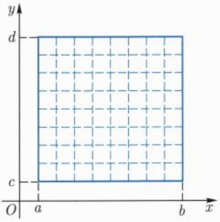

text_image

y
d
c
O a b x

图 16.1 矩形的分割

定义 16.1.1 (矩形中的 Riemann 积分) 设  $f: I \rightarrow R$  是定义在矩形 I 上的函数 (图 16.2), 如果存在实数  $\alpha$ , 使得任给  $\varepsilon > 0$ , 均存在  $\delta > 0$ , 当  $\|P\| < \delta$  时, 有

$$
\left| \sum_ {i, j} f (\pmb {\xi} _ {i j}) \nu (I _ {i j}) - \alpha \right| <   \varepsilon , \forall \pmb {\xi} _ {i j} \in I _ {i j},
$$

---

16.1 二重 Riemann 积分

3

则称 $f$ 在 $I$ 上Riemann可积，简称可积，记为 $f\in R(I)$ . $\alpha$ 称为 $f$ 在 $I$ 上的积分，记为

$$
\alpha = \int_ {I} f = \iint_ {I} f (x, y)   \mathrm{d} x   \mathrm{d} y.
$$

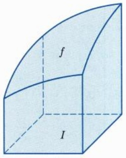

text_image

f
I

图 16.2 二重积分

注16.1.1 (1) 我们将 $\sum_{i,j} f(\pmb{\xi}_{ij}) \nu(I_{ij})$ 称为 $f$ 关于分割 $\mathrm{P}$ 的一个Riemann和, 也记为 $S(f, \mathrm{P}, \pmb{\xi})$. 如果 $f$ 可积, 则积分可用极限表示为

$$
\int_ {I} f = \lim _ {\| \mathrm{P} \| \to 0} S (f, \mathrm{P}, \boldsymbol {\xi}).
$$

(2) 与一元函数类似, $f$ 在 $I$ 上 Riemann 可积的必要条件是 $f$ 为 $I$ 上的有界函数.

下面假设 $f$ 为 $I$ 上的有界函数. 我们像对一元函数所做过的那样来讨论 $f$ 可积的充要条件. 记 $M_{ij} = \sup_{p \in I_{ij}} f(p), m_{ij} = \inf_{p \in I_{ij}} f(p)$, 并令

$$
S (\mathrm{P}) = S (\mathrm{P}, f) = \sum_ {i, j} M _ {i j} \nu (I _ {i j}), \quad s (\mathrm{P}) = s (\mathrm{P}, f) = \sum_ {i, j} m _ {i j} \nu (I _ {i j}),
$$

$S(P)$  和  $s(P)$  分别是 f 关于分割 P 的 Darboux 上和与 Darboux 下和. 与一元函数一样, 称

$$
\omega_ {i j} = M _ {i j} - m _ {i j} = \sup _ {p \in I _ {i j}} f (p) - \inf _ {p \in I _ {i j}} f (p)
$$

为 $f$ 在小矩形 ${I}_{ij}$ 上的振幅. $f$ 的上和与下和之差可以表示为

$$
S (\mathrm{P}) - s (\mathrm{P}) = \sum_ {i, j} \omega_ {i j} \nu (I _ {i j}).
$$

如果 $[a, b]$ 的分割 $\mathrm{P}_1'$ 是由 $\mathrm{P}_1$ 通过添加分点得到, $[c, d]$ 的分割 $\mathrm{P}_2'$ 是由 $\mathrm{P}_2$ 通过添加分点得到, 则称 $[a, b] \times [c, d]$ 的分割 $\mathrm{P}' = \mathrm{P}_1' \times \mathrm{P}_2'$ 是 $\mathrm{P} = \mathrm{P}_1 \times \mathrm{P}_2$ 的一个加细. 对于加细分割, 下面命题的证明和一元函数完全类似.

---

4

第十六章 多元函数的积分学

命题 16.1.1 如果  $P'$  是 P 的加细, 则

$$
s (\mathrm{P}) \leqslant s (\mathrm{P} ^ {\prime}) \leqslant S (\mathrm{P} ^ {\prime}) \leqslant S (\mathrm{P}),
$$

即分割加细后下和不减，上和不增.

推论 16.1.2 对于 I 的任何两个分割  $P^{1}, P^{2}$ ，均有  $s(P^{1}) \leqslant S(P^{2})$ .

证明 设 $\mathrm{P}^1 = \mathrm{P}_1\times \mathrm{P}_2,\mathrm{P}^2 = \mathrm{P}_1'\times \mathrm{P}_2'$ ，令

$$
\mathrm{P} = \mathrm{P} ^ {1} \cup \mathrm{P} ^ {2} = (\mathrm{P} _ {1} \cup \mathrm{P} _ {1} ^ {\prime}) \times (\mathrm{P} _ {2} \cup \mathrm{P} _ {2} ^ {\prime}),
$$

则 P 既是  $P^{1}$  的加细, 又是  $P^{2}$  的加细, 因此

$$
s (\mathrm{P} ^ {1}) \leqslant s (\mathrm{P}) \leqslant S (\mathrm{P}) \leqslant S (\mathrm{P} ^ {2}),
$$

这说明下和总是不超过上和.

□

对于有界函数, 它的上和与下和也都是有界的. 因此可以考虑

$$
S (f) = \inf _ {\mathrm{P}} S (\mathrm{P}), \quad s (f) = \sup _ {\mathrm{P}} s (\mathrm{P}).
$$

分别称  $S(f)$ ,  $s(f)$  为 f 的上积分与下积分.

例 16.1.1 求常值函数的积分.

解 如果 $f \equiv c$, 则它在矩形 $I$ 上的任何 Riemann 和均为 $c\nu(I)$, 因此常值函数可积. 同时, 常值函数的上积分和下积分与其积分也相等. $\square$

如果 k 为常数, 则易见  $f + k$  可积当且仅当 f 可积, 且

$$
S (f + k) = S (f) + k \nu (I), s (f + k) = s (f) + k \nu (I).
$$

设 $I = [a,b]\times [c,d],\delta$ 是充分小的正数，记

$$
I ^ {\delta} = (a + \delta , b - \delta) \times (c + \delta , d - \delta),
$$

显然 $0 < \nu(I) - \nu(I^{\delta}) < 2(b - a)\delta + 2(d - c)\delta$.

定理 16.1.3 (Darboux 定理) 设 f 为矩形 I 上的有界函数, 则

$$
\lim _ {\| \mathrm{P} \| \to 0} S (\mathrm{P}) = S (f), \quad \lim _ {\| \mathrm{P} \| \to 0} s (\mathrm{P}) = s (f).
$$

证明 我们以上和为例证明第一个等式. 因为 $f$ 有界, 根据刚才的讨论, 不妨设 $0 \leqslant f \leqslant M$. 任给 $\varepsilon > 0$, 存在分割 $\mathrm{P}' = \{I_{ij}\}$, 使得 $S(\mathrm{P}') < S(f) + \frac{\varepsilon}{2}$. 设 $\delta$ 是充分小的正数, 记 $J_{\delta} = I \setminus \bigcup_{ij} I_{ij}^{\delta}$, 我们要求 $\nu(J_{\delta}) < \varepsilon (2M + 1)^{-1}$. 现在设 $\| \mathrm{P} \| < \delta$, 对于分割

---

16.1 二重 Riemann 积分

5

P 的每一个小矩形来说 (图 16.3), 不难看出, 要么它完全含于 $J_{\delta}$, 要么它完全含于分割 $\mathrm{P}^{\prime}$ 的某个 (开) 矩形之内, 二者必居其一 (也可同时成立). 因此, P 的上和有如下估计:

$$
\begin{array}{l} S (f) \leqslant S (\mathrm{P}) \leqslant M \nu (J _ {\delta}) + S (\mathrm{P} ^ {\prime}) \\ \leqslant M \frac {\varepsilon}{2 M + 1} + S (f) + \frac {\varepsilon}{2} <   S (f) + \varepsilon . \\ \end{array}
$$

这说明  $\lim_{\|P\|\to0}S(P)=S(f).$

natural_image

Grid of 12 empty squares with dashed borders, no text or symbols present

图16.3 矩形的内缩

有了 Darboux 定理, 下面判断有界函数可积性定理的证明和一元函数就没什么不同了.

定理 16.1.4（可积的充要条件） 设 f 为 I 上的有界函数, 则下列条件等价:

(1)  $f \in R(I)$ ;
(2) f 的上积分和下积分相等;
(3) $\lim_{\| P\| \to 0}\sum_{i,j}\omega_{ij}\nu (I_{ij}) = 0.$

(4) 任给 $\varepsilon > 0$, 存在 $I$ 的某个分割 $\mathrm{P}$, 使得

$$
S (\mathrm{P}) - s (\mathrm{P}) = \sum_ {i, j} \omega_ {i j} \nu (I _ {i j}) <   \varepsilon .
$$

对于二元函数, 下面的结果也是成立的.

定理 16.1.5 (Riemann 定理) 设 f 为 I 上的有界函数, 则  $f \in R(I)$  当且仅当任给  $\varepsilon, \eta > 0$ , 存在 I 的分割 P, 使得

$$
\sum_ {\{(i, j) | \omega_ {i j} \geqslant \eta \}} \nu (I _ {i j}) <   \varepsilon .
$$

因为闭矩形上的连续函数具有一致连续性, 我们立即得到

推论 16.1.6 设 f 为矩形 I 上的连续函数, 则  $f \in R(I)$ .

和一元函数一样, 我们可以用零测集来刻画可积函数. 设 $f$ 是定义在矩形 $I$ 上的有界函数, $x \in  I$. $f$ 在 $x$ 处的振幅定义为

$$
\omega (f, \boldsymbol {x}) = \lim _ {r \to 0 ^ {+}} \sup \{| f (\boldsymbol {x} _ {1}) - f (\boldsymbol {x} _ {2}) |: \boldsymbol {x} _ {1}, \boldsymbol {x} _ {2} \in B _ {r} (\boldsymbol {x}) \cap I \}.
$$

---

6

第十六章 多元函数的积分学

易见, $f$ 在 $\pmb{x}$ 处连续当且仅当 $\omega (f,\pmb {x}) = 0.$ 设 $\delta >0$ ，记

$$
D _ {f} (\delta) = \{\boldsymbol {x} \in I \mid \omega (f, \boldsymbol {x}) \geqslant \delta \},
$$

则 $f$ 的间断点 (不连续点) 全体为 $D_{f} = \bigcup_{n=1}^{\infty} D_{f}(1/n)$.

定理 16.1.7 (Lebesgue 定理) 设 f 为矩形 I 上的有界函数, 则 f 可积  $\Longleftrightarrow f$  的间断点集  $D_{f}$  为零测集.

证明 “$\Longrightarrow$” 只要证明对每一个 $\eta > 0, D_f(\eta)$ 均为零测集即可. 任给 $\varepsilon > 0$, 根据 Riemann 定理, 可取 $I$ 的分割 $\{I_{ij}\}$, 使得振幅满足 $\omega_{ij} \geqslant \eta$ 的小矩形的面积之和小于 $\frac{\varepsilon}{2}$.

设 $\delta > 0$, 记 $J_{\delta} = I \setminus \bigcup_{ij} I_{ij}^{\delta}$, 我们要求 $\nu(J_{\delta}) < \frac{\varepsilon}{2}$. 注意到当 $I_{ij}^{\delta} \cap D_f(\eta) \neq \varnothing$ 时, $\omega_{ij} \geqslant \eta$. 这说明 $D_f(\eta)$ 包含在 $J_{\delta}$ 和 $\{I_{ij} \mid I_{ij}^{\delta} \cap D_f(\eta) \neq \varnothing\}$ 的并集之中, 且它们的面积之和小于 $\varepsilon$. 由零测集的定义即知 $D_f(\eta)$ 为零测集.

“$\Longleftarrow$”设 $D_{f}$ 为零测集. 任给 $\varepsilon, \eta > 0$, 存在至多可数个开矩形 $\{I_{k}\}$, 使得

$$
D _ {f} \subseteq \bigcup_ {k \geqslant 1} I _ {k}, \quad \sum_ {k \geqslant 1} \nu (I _ {k}) <   \varepsilon .
$$

任取 $\pmb{x} \in I \setminus D_f$, 由 $f$ 在 $\pmb{x}$ 处连续可知, 存在 $r > 0$, 使得 $f$ 在 $B_r(\pmb{x}) \cap I$ 中的振幅小于 $\eta$. 显然, $\{B_r(\pmb{x}) \mid \pmb{x} \in I \setminus D_f\}$ 和 $\{I_k\}$ 形成了 $I$ 的开覆盖, 设 $\lambda$ 是它的 Lebesgue 数. 设 $\{I_{ij}\}$ 是 $I$ 的分割, 当它的模小于 $\lambda$ 时, 每一个小矩形要么完全包含于某一个 $B_r(\pmb{x})$ 中, 此时 $f$ 在此小矩形中的振幅小于 $\eta$; 要么小矩形完全包含于某一个 $I_k$ 中. 这说明

$$
\sum_ {\{(i, j) | \omega_ {i j} \geqslant \eta \}} \nu (I _ {i j}) \leqslant \sum_ {k \geqslant 1} \nu (I _ {k}) <   \varepsilon ,
$$

由 Riemann 定理即知 f 可积.

下面的推论是显然的.

推论 16.1.8 (1) 设  $f \in R(I)$ ，矩形  $J \subseteq I$ ，则  $f \in R(J)$ ;

(2) 如果矩形 $I$ 被有限个矩形 $\{J_k\}$ 所覆盖, 且 $f$ 在每个 $J_k$ 上都是可积的, 则 $f \in R(I)$.

## 习题 16.1

1. 设 I 为矩形,  $f, g \in R(I)$ , 证明:  $fg \in R(I)$ .
2. 设 $f \in R[a, b]$, $g \in R[c, d]$, 记 $h(x, y) = f(x)g(y)$. 证明: $h$ 是矩形 $I = [a, b] \times [c, d]$

---

16.2 多重积分及其基本性质

7

上的可积函数, 且

$$
\iint_ {I} h (x, y) \mathrm{d} x \mathrm{d} y = \left(\int_ {a} ^ {b} f (x) \mathrm{d} x\right) \left(\int_ {c} ^ {d} g (y) \mathrm{d} y\right).
$$

3. 计算积分  $\iint_{[0,1]^{2}}\sin(x+y)\mathrm{d}x\mathrm{d}y.$

4. 按照定义证明: 矩形上只有有限个间断点的有界函数是 Riemann 可积的.

5. 在矩形  $[0,1]^{2}$  上定义函数 f 如下:

$$
f (x, y) = \left\{ \begin{array}{l l} \sin \frac {1}{x y}, & x y > 0, \\ 0, & x y = 0. \end{array} \right.
$$

研究 f 在 I 上是否可积.

6. 设 $f$ 是定义在矩形 $I = [a, b] \times [c, d]$ 上的函数, 对于每一个固定的 $x \in [a, b]$, $f(x, y)$ 是关于 $y$ 的单调递增函数, 且对于每一个固定的 $y \in [c, d]$, $f(x, y)$ 是关于 $x$ 的单调递增函数. 证明: $f \in R(I)$.

7. 设非负函数 f 在矩形 I 上可积, 则  $\sqrt{f}$  在 I 上也可积.

8. 设 $f$ 是 $[a, b]$ 中的一元连续函数, $\varphi: I \to [a, b]$ 为矩形 $I$ 上的可积函数, 则复合函数 $f \circ \varphi$ 为矩形 $I$ 上的可积函数.

9. 设 $f \in R[-1,1]$, 当 $x, y \in [0,1]$ 时, 记 $g(x,y) = f(x - y)$. 证明: $g \in R([0,1]^2)$.

10. 设 I, J 为矩形, 且  $I \subseteq J$ . 证明:  $\chi_{I} \in R(J)$ , 且其积分等于 I 的面积.

11. 在矩形 $I = [a, b] \times [c, d]$ 上定义 Dirichlet 函数 $D$ 为: 当 $x, y$ 均为有理数时 $D(x, y) = 1$, 否则 $D(x, y) = 0$. 证明: $D$ 不是矩形 $I$ 上的可积函数.

12. 证明: 矩形不是平面上的零测集.

## 16.2 多重积分及其基本性质

前一节关于二元函数积分的理论可以直接推广至多元函数. 在 $n$ 维欧氏空间 $\mathbb{R}^n$ 中, 考虑定义在 $n$ 维矩形 $I$ 上的函数 $f$, 其中

$$
I = [ a _ {1}, b _ {1} ] \times [ a _ {2}, b _ {2} ] \times \dots \times [ a _ {n}, b _ {n} ],
$$

$I$ 的直径 $d(I)$ 和容积(体积) $\nu (I)$ 分别为

$$
d (I) = \sqrt {(b _ {1} - a _ {1}) ^ {2} + (b _ {2} - a _ {2}) ^ {2} + \cdots + (b _ {n} - a _ {n}) ^ {2}},
$$

$$
\nu (I) = (b _ {1} - a _ {1}) (b _ {2} - a _ {2}) \dots (b _ {n} - a _ {n}).
$$

---

8

第十六章 多元函数的积分学

设区间  $[a_{i}, b_{i}]$  ( $i = 1, 2, \cdots, n$ ) 有分割

$$
\mathrm{P} _ {i}: a _ {i} = x _ {0} ^ {i} <   x _ {1} ^ {i} <   \dots <   x _ {m _ {i}} ^ {i} = b _ {i},
$$

这时超平面  $x_{i}=x_{j}^{i}\left(i=1,2,\cdots,n;j=0,1,\cdots,m_{i}\right)$  将 I 分割成  $m_{1}m_{2}\cdots m_{n}$  个小 n 维矩形

$$
I _ {i _ {1} i _ {2} \dots i _ {n}} = [ x _ {i _ {1} - 1} ^ {1}, x _ {i _ {1}} ^ {1} ] \times [ x _ {i _ {2} - 1} ^ {2}, x _ {i _ {2}} ^ {2} ] \times \dots \times [ x _ {i _ {n} - 1} ^ {n}, x _ {i _ {n}} ^ {n} ],
$$

$$
1 \leqslant i _ {1} \leqslant m _ {1}, 1 \leqslant i _ {2} \leqslant m _ {2}, \dots , 1 \leqslant i _ {n} \leqslant m _ {n}.
$$

这些小矩形所形成的分割记为  $P = P_{1} \times P_{2} \times \cdots \times P_{n}$ ，定义

$$
\| \mathrm{P} \| = \max _ {i _ {1} i _ {2} \dots i _ {n}} d (I _ {i _ {1} i _ {2} \dots i _ {n}}),
$$

称为分割 P 的模.

定义 16.2.1 (n 维矩形上的 Riemann 积分) 设 f 是定义在 n 维矩形 I 上的函数. 如果存在实数  $\alpha$ ，使得任给  $\varepsilon > 0$ ，均存在  $\delta > 0$ ，当  $\|P\| < \delta$  时，有

$$
\left| \sum_ {i _ {1} i _ {2} \dots i _ {n}} f (\pmb {\xi} _ {i _ {1} i _ {2} \dots i _ {n}}) \nu (I _ {i _ {1} i _ {2} \dots i _ {n}}) - \alpha \right| <   \varepsilon , \forall \pmb {\xi} _ {i _ {1} i _ {2} \dots i _ {n}} \in I _ {i _ {1} i _ {2} \dots i _ {n}},
$$

则称 $f$ 在 $I$ 上Riemann可积，简称可积，记为 $f\in R(I)$ . $\alpha$ 称为 $f$ 在 $I$ 上的积分，记为

$$
\alpha = \int_ {I} f = \int_ {I} f (\boldsymbol {x}) \mathrm{d} \boldsymbol {x} = \int \dots \int_ {I} f (x _ {1}, x _ {2}, \dots , x _ {n}) \mathrm{d} x _ {1} \mathrm{d} x _ {2} \dots \mathrm{d} x _ {n}.
$$

矩形上的多元函数的可积性理论与二元函数的可积性理论是完全类似的, 我们不重复叙述. 下面我们将被积区域做一点推广.

定义 16.2.2 (Jordan $^{①}$ 可测集) 设 $A \subset R^{n}$ 为有界集合, I 为包含 A 的矩形. 如果 A 的特征函数 $\chi_{A}$ 在 I 上可积, 则称 A 为 Jordan 可测集, $\chi_{A}$ 在 I 上的积分称为 A 的 Jordan 测度或容积, 记为 $\nu(A)$.

不难看出, 有界集合 $A$ 是否为 Jordan 可测集以及 Jordan 测度的大小与定义中矩形 $I$ 的选取无关. 如果 $A$ 本身就是一个矩形, 则其 Jordan 测度等于矩形的容积.

命题 16.2.1 设  $A \subset R^{n}$  为有界集合, 则 A 为 Jordan 可测集当且仅当其边界  $\partial A$  为零测集.

证明 取矩形 $I \supseteq \bar{A}$, 且 $\bar{A}$ 与 $I$ 的边界不相交. 易见, 特征函数 $\chi_A$ 在 $I$ 中的间断点集恰为 $\partial A$. 由 Lebesgue 定理可知 $A$ 为 Jordan 可测集当且仅当 $\partial A$ 为零测集. □

<small>① Jordan, Marie Ennemond Camille, 1838 年 1 月 5 日—1922 年 1 月 22 日, 法国数学家.</small>

---

16.2 多重积分及其基本性质

9

注16.2.1 由 $\partial \bar{A} \subseteq \partial A$ 可知, 当 $A$ 为 Jordan 可测集时, $\bar{A}$ 也为 Jordan 可测集, 并且 $\nu(\bar{A}) = \nu(A)$.

设 $A$ 为Jordan可测集, $f: A \to \mathbb{R}$ 为有界函数, 将 $f$ 零延拓为 $\mathbb{R}^n$ 上的函数 $f_A$ 如下:

$$
f _ {A} (\boldsymbol {x}) = \left\{ \begin{array}{l l} f (\boldsymbol {x}), & \boldsymbol {x} \in A, \\ 0, & \boldsymbol {x} \in \mathbb {R} ^ {n} \setminus A. \end{array} \right.
$$

定义 16.2.3 (Jordan 可测集上的积分) 设 A 和 f 如上, I 为包含 A 的矩形. 如果  $f_{A} \in R(I)$ , 则称 f 在 A 上可积, 记为  $f \in R(A)$ , 其积分定义为  $f_{A}$  在 I 上的积分, 即

$$
\int_ {A} f = \int_ {I} f _ {A}.
$$

这个定义也和矩形 $I$ 的选取无关. 当 $A$ 本身就是矩形时, 这个定义和矩形上积分的定义是一致的. 下面的定理给出了有界函数在 Jordan 可测集上可积的判别条件.

定理 16.2.2 设 $f: A \to \mathbb{R}$ 是定义在 Jordan 可测集 $A$ 上的有界函数. 则 $f \in R(A)$ 当且仅当 $f$ 在 $A$ 中的间断点集为零测集.

证明 取矩形 $I \supseteq \bar{A}$, 且 $\bar{A}$ 与 $I$ 的边界不相交. 由定义, $f \in R(A)$ 当且仅当 $f_{A} \in R(I)$. 根据 Lebesgue 定理, $f_{A} \in R(I)$ 当且仅当 $f_{A}$ 的间断点集为零测集. 因为在 $I \setminus \bar{A}$ 中 $f_{A}$ 为零, 因此 $f_{A}$ 的间断点都在 $\bar{A}$ 中. 又由于 $\partial A$ 为零测集, 故 $f_{A}$ 可积当且仅当 $f_{A}$ 在 $\operatorname{int} A = A \setminus \partial A$ 中的间断点集为零测集. 在 $\operatorname{int} A$ 上 $f_{A} = f$, 因此 $f_{A}$ 可积当且仅当 $f$ 在 $\operatorname{int} A$ 中的间断点集是零测集, 也就是说当且仅当 $f$ 在 $A$ 中的间断点集为零测集.

下面我们考虑积分的基本性质.

命题16.2.3 设 $A \subset \mathbb{R}^n$ 为Jordan可测集, $f, g \in R(A)$, 则 $fg, |f|, \lambda f + \mu g$ 均在 $A$ 上可积, 其中 $\lambda, \mu \in \mathbb{R}$, 且

$$
\int_ {A} (\lambda f + \mu g) = \lambda \int_ {A} f + \mu \int_ {A} g.
$$

当 $f\geqslant g$ 时， $\int_{A}f\geqslant \int_{A}g.$ 特别地，有

$$
\left| \int_ {A} f \right| \leqslant \int_ {A} | f |.
$$

证明 只需在矩形中考虑即可, 留作练习.

命题 16.2.4 设 A, B 均为 Jordan 可测集, 则  $A \cap B$ ,  $A \cup B$  也为 Jordan 可测集, 且

$$
\nu (A \cup B) = \nu (A) + \nu (B) - \nu (A \cap B). \tag {16.2.1}
$$

---

10

第十六章 多元函数的积分学

特别地, $\nu(A \cup B) \leqslant \nu(A) + \nu(B)$. 若 $A \subseteq B$, 则 $B \setminus A$ 也为 Jordan 可测集, 且

$$
\nu (B \setminus A) = \nu (B) - \nu (A). \tag {16.2.2}
$$

特别地, 此时  $\nu(A) \leqslant \nu(B)$ .

证明 由 $\chi_{A\cap B} = \chi_A\chi_B$ 可知 $A\cap B$ 为Jordan可测集.由

$$
\chi_ {A \cup B} = \chi_ {A} + \chi_ {B} - \chi_ {A \cap B}
$$

可知 $A \cup B$ 为 Jordan 可测集, 且 (16.2.1) 式成立. 同理, 当 $A \subseteq B$ 时, 由

$$
\chi_ {B \setminus A} = \chi_ {B} - \chi_ {A}
$$

可知  $B \setminus A$  为 Jordan 可测集, 且 (16.2.2) 式成立.

推论 16.2.5 矩形不是零测集.

证明 设 $\{I_i\}$ 为至多可数个矩形, 它们覆盖了矩形 $I$. 不妨设 $\{I_i\}$ 均为开矩形. 根据有限覆盖定理, 存在有限个 $I_i (i \leqslant k)$ 使得它们仍然覆盖 $I$. 由上述命题可知

$$
\sum_ {i \leqslant k} \nu (I _ {i}) \geqslant \nu \left(\bigcup_ {i \leqslant k} I _ {i}\right) \geqslant \nu (I) > 0,
$$

特别地, I 不可能为零测集.

命题 16.2.6 A 为 Jordan 可测集且 Jordan 测度为零当且仅当任给  $\varepsilon > 0$ ，存在有限个矩形  $\{I_{i}\}$ ，使得

$$
A \subseteq \bigcup_ {i} I _ {i}, \quad \sum_ {i} \nu (I _ {i}) <   \varepsilon . \tag {16.2.3}
$$

证明 设 $\nu(A) = 0$ 取包含 $A$ 的矩形 $I$, 由 $\chi_A$ 在 $I$ 上的积分为零可知, 任给 $\varepsilon > 0$, 存在 $I$ 的分割 $\{I_k\}$, 使得

$$
\sum_ {\{i | A \cap I _ {i} \neq \varnothing \}} \nu (I _ {i}) = \sum_ {k} \left(\sup _ {I _ {k}} \chi_ {A}\right) \nu (I _ {k}) <   \varepsilon ,
$$

这说明 (16.2.3) 式成立.

反之, 如果 (16.2.3) 式对 $A$ 成立, 则对 $\bar{A}$ 也成立, 这说明 $\bar{A}$ 为零测集. 特别地, $\partial A \subseteq \bar{A}$ 为零测集, 从而 $A$ 为 Jordan 可测集. 此时

$$
\nu (A) \leqslant \nu \left(\bigcup_ {i \leqslant k} I _ {i}\right) \leqslant \sum_ {i \leqslant k} \nu (I _ {i}) <   \varepsilon ,
$$

由  $\varepsilon$  的任意性可知  $\nu(A)=0$ .

□

---

16.2 多重积分及其基本性质

11

定理 16.2.7 (积分中值定理) 设 A 为 Jordan 可测集, $f, g \in  R\left( A\right)$ . 如果 g 在 A 上不变号, 则存在 $\mu  \in  \mathbb{R}$ , 使得

$$
\int_ {A} f g = \mu \int_ {A} g,
$$

其中 $\inf_{A}f\leqslant \mu \leqslant \sup_{A}f.$

证明 不妨假设 $g \geqslant 0$, 则

$$
(\inf _ {A} f) g (x) \leqslant f (x) g (x) \leqslant (\sup _ {A} f) g (x), \forall x \in A.
$$

积分可得

$$
(\inf _ {A} f) \int_ {A} g \leqslant \int_ {A} f g \leqslant (\sup _ {A} f) \int_ {A} g,
$$

如果 $\int_{A} g = 0$，则上式表明 $fg$ 在 $A$ 上的积分也为零，此时 $\mu$ 可任意取值。设 $\int_{A} g > 0$ 则

$$
\inf _ {A} f \leqslant \left(\int_ {A} g\right) ^ {- 1} \int_ {A} f g \leqslant \sup _ {A} f,
$$

令

$$
\mu = \left(\int_ {A} g\right) ^ {- 1} \int_ {A} f g,
$$

则  $\mu$  满足定理的要求.

推论 16.2.8 设 A 为 Jordan 可测集,  $f \in C(A)$ ,  $g \in R(A)$  且不变号. 如果 A 为道路连通的闭集, 则存在  $\xi \in A$ , 使得

$$
\int_ {A} f g = f (\pmb {\xi}) \int_ {A} g,
$$

证明 利用积分中值定理和连续函数的介值定理即可.

## 习题16.2

1. 设 $I$ 为 $n$ 维矩形, $J \subseteq I$ 为子矩形. 证明: 当 $f \in R(I)$ 时, 也有 $f \in R(J)$.
2. 设 $A$ 为 Jordan 可测集且 Jordan 测度为零, 则任何有界函数在 $A$ 上均可积且积分为零.
3. 设 $A$ 为 Jordan 可测集, $f, g \in R(A)$, 则 $\max\{f, g\}$ 和 $\min\{f, g\}$ 也在 $A$ 上可积.
4. 设 $A$ 为 Jordan 可测集, $\pmb{b} \in \mathbb{R}^n$, 记 $A + \pmb{b} = \{\pmb{x} + \pmb{b} \mid \pmb{x} \in A\}$. 证明: $A + \pmb{b}$ 也为 Jordan 可测集, 且 $\nu(A + \pmb{b}) = \nu(A)$.
5. 设 $A$ 为 Jordan 可测集, 则 $\bar{A}$ 也为 Jordan 可测集且 $\nu(\bar{A}) = \nu(A)$.

---

12

第十六章 多元函数的积分学

6. 设 A, B 为 Jordan 可测集且  $\nu(A \cap B) = 0$ , f 为  $A \cup B$  上的可积函数, 证明:

$$
\int_ {A \cup B} f = \int_ {A} f + \int_ {B} f.
$$

7. 设  $A_{1}, A_{2}, \cdots, A_{k}$  为 Jordan 可测集, 则  $A_{1} \cup A_{2} \cup \cdots \cup A_{k}$  为 Jordan 可测集, 且

$$
\nu \big (A _ {1} \cup A _ {2} \cup \dots \cup A _ {k} \big) = \sum_ {i = 1} ^ {k} \sum_ {1 \leqslant j _ {1} <   j _ {2} <   \dots <   j _ {i} \leqslant k} (- 1) ^ {i - 1} \nu \big (A _ {j _ {1}} \cap A _ {j _ {2}} \cap \dots \cap A _ {j _ {i}} \big).
$$

8. 设开集 $U$ 为 Jordan 可测集, $f$ 是 $U$ 上的非负连续函数且不恒为零. 证明: $f$ 在 $U$ 上的积分大于零.

9. 设开区域 $\Omega$ 为 Jordan 可测集, $f$ 是 $\Omega$ 上的连续函数. 如果任给 Jordan 可测集 $A \subseteq \Omega$, $f$ 在 $A$ 上的积分均为零, 证明: $f$ 恒等于零.

10. 设开区域 $\Omega$ 为 Jordan 可测集, $f$ 是 $\overline{\Omega}$ 上的连续函数. 如果任给 $\overline{\Omega}$ 上连续而且在 $\partial \Omega$ 上取值为零的函数 $\phi$, 都有

$$
\int_ {\Omega} f \phi = 0,
$$

证明: $f$ 恒等于零.

11. 设 $I$ 为矩形, $f$ 在 $I$ 上可积且积分大于零. 证明: 存在子矩形 $J \subseteq I$, 使得 $f$ 在 $J$ 上处处大于零.

12. 设 $I$ 为矩形, $f$ 在 $I$ 上可积且处处大于零, 证明: $f$ 在 $I$ 上的积分大于零.

13. 利用积分中值定理证明:

$$
1. 9 6 \leqslant \iint_ {| x | + | y | \leqslant 1 0} \frac {\mathrm{d} x \mathrm{d} y}{1 0 0 + \cos^ {2} x + \cos^ {2} y} <   2.
$$

14. 设 $f$ 为连续函数, 求极限

$$
\lim _ {r \to 0 ^ {+}} \frac {1}{\pi r ^ {2}} \iint_ {x ^ {2} + y ^ {2} \leqslant r ^ {2}} f (x, y)   \mathrm{d} x   \mathrm{d} y.
$$

## 16.3 重积分化为累次积分计算

我们现在讨论重积分的一个常用的计算方法, 其特点是将 n 元函数的积分化为 m 元函数的积分, 其中 m < n. 我们先以二重积分化为一元函数的积分为例加以说明.

---

16.3 重积分化为累次积分计算

13

设 $f$ 为矩形 $I = [a,b]\times [c,d]$ 上的有界函数.对于每一个固定的 $x\in [a,b],f(x,y)$ 可以看成区间 $[c,d]$ 上关于 $y$ 的函数，它在 $[c,d]$ 上的下积分和上积分分别记为 $\varphi (x)$ 和$\psi (x)$ ，这样我们就得到了定义在 $[a,b]$ 上的两个有界函数

定理16.3.1 设 $f\in R(I)$ ，则 $\varphi ,\psi \in R[a,b]$ ，且

$$
\int_ {I} f = \int_ {a} ^ {b} \varphi (x)   \mathrm{d} x = \int_ {a} ^ {b} \psi (x)   \mathrm{d} x.
$$

证明 用记号 $\mathrm{P}_1, \mathrm{P}_2$ 分别表示 $[a, b]$ 和 $[c, d]$ 的分割:

$$
\mathrm{P} _ {1}: a = x _ {0} <   x _ {1} <   \dots <   x _ {m} = b, \mathrm{P} _ {2}: c = y _ {0} <   y _ {1} <   \dots <   y _ {n} = d,
$$

$I$ 的相应分割记为 $\mathrm{P} = \mathrm{P}_1\times \mathrm{P}_2$ 因为 $f\in R(I)$ ，故任给 $\varepsilon >0$ ，存在 $\delta >0$ ，当$\| \mathrm{P}_1\| ,\| \mathrm{P}_2\| <  \delta$ 时

$$
\int_ {I} f - \varepsilon <   \sum_ {i, j} f (\pmb {\xi} _ {i j}) \nu (I _ {i j}) <   \int_ {I} f + \varepsilon , \forall \pmb {\xi} _ {i j} \in I _ {i j}.
$$

特别地, 任取  $\xi_{i} \in [x_{i-1}, x_{i}] (i = 1, 2, \cdots, m)$ , 由上式可得

$$
\begin{array}{l} \int_ {I} f - \varepsilon \leqslant \sum_ {i, j} \inf _ {\eta \in [ y _ {j - 1}, y _ {j} ]} f (\xi_ {i}, \eta) \Delta x _ {i} \Delta y _ {j} \\ \leqslant \sum_ {i, j} \sup _ {\eta \in [ y _ {j - 1}, y _ {j} ]} f (\xi_ {i}, \eta) \Delta x _ {i} \Delta y _ {j} \leqslant \int_ {I} f + \varepsilon , \\ \end{array}
$$

因为 $\sum_{j=1}^{n}\inf_{\eta\in[y_{j-1},y_j]}f(\xi_i,\eta)\Delta y_j$ 是函数 $f(\xi_i,y)$ 在 $[c,d]$ 上的 Darboux 下和, 故

$$
\sum_ {j = 1} ^ {n} \inf _ {\eta \in [ y _ {j - 1}, y _ {j} ]} f (\xi_ {i}, \eta) \Delta y _ {j} \leqslant \varphi (\xi_ {i}).
$$

同理

$$
\sum_ {j = 1} ^ {n} \sup _ {\eta \in [ y _ {j - 1}, y _ {j} ]} f (\xi_ {i}, \eta) \Delta y _ {j} \geqslant \psi (\xi_ {i}).
$$

因此我们得到

$$
\int_ {I} f - \varepsilon \leqslant \sum_ {i = 1} ^ {m} \varphi (\xi_ {i}) \Delta x _ {i} \leqslant \sum_ {i = 1} ^ {m} \psi (\xi_ {i}) \Delta x _ {i} \leqslant \int_ {I} f + \varepsilon .
$$

这说明 $\varphi$ 和 $\psi$ 在 $[a, b]$ 上均可积, 且积分等于 $f$ 在 $I$ 上的积分.

推论 16.3.2 设  $f \in R(I)$ . 如果对于每一个  $x \in [a, b]$ ，以 y 为变量的函数  $f(x, y)$  在  $[c, d]$  上均可积，则

$$
\int_ {I} f = \int_ {a} ^ {b} \mathrm{d} x \int_ {c} ^ {d} f (x, y) \mathrm{d} y.
$$

---

14

第十六章 多元函数的积分学

同理, 如果对于每一个 $y \in [c, d]$, 以 $x$ 为变量的函数 $f(x, y)$ 在 $[a, b]$ 上均可积, 则

$$
\int_ {I} f = \int_ {c} ^ {d} \mathrm{d} y \int_ {a} ^ {b} f (x, y) \mathrm{d} x.
$$

推论 16.3.3 设  $f \in C(I)$ ，则有

$$
\int_ {I} f = \int_ {a} ^ {b} \mathrm{d} x \int_ {c} ^ {d} f (x, y) \mathrm{d} y = \int_ {c} ^ {d} \mathrm{d} y \int_ {a} ^ {b} f (x, y) \mathrm{d} x,
$$

为了区别起见, 上式最左边常称为重积分, 右边称为累次积分.

对于多重积分, 类似的结果也成立. 例如, 三重积分在一定条件下可以化为关于二重积分和一重积分的累次积分.

例 16.3.1 设  $I = [0,1] \times [0,1]$ ，计算积分

$$
\iint_ {I} \frac {y \mathrm{d} x \mathrm{d} y}{(1 + x ^ {2} + y ^ {2}) ^ {\frac {3}{2}}}.
$$

解 被积函数是连续函数, 因此重积分可以化为累次积分:

$$
\begin{array}{l} \iint_ {I} \frac {y \mathrm{d} x \mathrm{d} y}{(1 + x ^ {2} + y ^ {2}) ^ {\frac {3}{2}}} = \int_ {0} ^ {1} \mathrm{d} x \int_ {0} ^ {1} \frac {y \mathrm{d} y}{(1 + x ^ {2} + y ^ {2}) ^ {\frac {3}{2}}} \\ = \int_ {0} ^ {1} \left(\frac {1}{\sqrt {1 + x ^ {2}}} - \frac {1}{\sqrt {x ^ {2} + 2}}\right) \mathrm{d} x = \ln \frac {2 + \sqrt {2}}{1 + \sqrt {3}}. \\ \end{array}
$$

例16.3.2 设 $I = [0,1] \times [0,1]$, 计算积分 $\int_{I} f$, 其中

$$
f (x, y) = \left\{ \begin{array}{l l} 1 - x - y, & x + y \leqslant 1, \\ 0, & x + y > 1. \end{array} \right.
$$

解 被积函数是连续函数, 因此重积分可以化为累次积分:

$$
\begin{array}{l} \int_ {I} f = \int_ {0} ^ {1} \mathrm{d} x \int_ {0} ^ {1} f (x, y) \mathrm{d} y \\ = \int_ {0} ^ {1} \mathrm{d} x \int_ {0} ^ {1 - x} (1 - x - y) \mathrm{d} y \\ = \int_ {0} ^ {1} \frac {1}{2} (1 - x) ^ {2} \mathrm{d} x = \frac {1}{6}. \\ \end{array}
$$

例 16.3.3 设  $I = [0,1]^{3} = [0,1] \times [0,1] \times [0,1]$ ，计算积分

$$
\iiint_ {I} \frac {\mathrm{d} x \mathrm{d} y \mathrm{d} z}{(1 + x + y + z) ^ {3}}.
$$

---

16.3 重积分化为累次积分计算

15

解 被积函数是连续函数, 因此重积分可以化为累次积分:

$$
\begin{array}{l} \iiint_ {I} \frac {\mathrm{d} x \mathrm{d} y \mathrm{d} z}{(1 + x + y + z) ^ {3}} = \int_ {0} ^ {1} \mathrm{d} x \int_ {0} ^ {1} \mathrm{d} y \int_ {0} ^ {1} \frac {\mathrm{d} z}{(1 + x + y + z) ^ {3}} \\ = \int_ {0} ^ {1} \mathrm{d} x \int_ {0} ^ {1} \frac {1}{2} \left[ \frac {1}{(1 + x + y) ^ {2}} - \frac {1}{(2 + x + y) ^ {2}} \right] \mathrm{d} y \\ = \int_ {0} ^ {1} \frac {1}{2} \left[ \left(\frac {1}{1 + x} - \frac {1}{2 + x}\right) - \left(\frac {1}{2 + x} - \frac {1}{3 + x}\right) \right] \mathrm{d} x \\ = \frac {1}{2} (5 \ln 2 - 3 \ln 3). \\ \end{array}
$$

现在我们讨论 Jordan 可测集上的重积分化为累次积分的问题, 这往往可以通过考虑矩形上的积分予以解决.

设 $y_{1}(x)\leqslant y_{2}(x)$ 为 $[a,b]$ 上的连续函数(图16.4)，考虑有界集合

$$
A = \{(x, y) \in \mathbb {R} ^ {2} \mid y _ {1} (x) \leqslant y \leqslant y _ {2} (x), a \leqslant x \leqslant b \},
$$

其边界为零测集, 因此 A 为 Jordan 可测集.

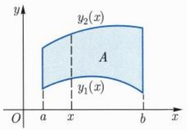

text_image

y
y₂(x)
A
y₁(x)
O
a
x
b
x

图16.4 重积分的投影法

定理 16.3.4 设 $y_{1}, y_{2}$ 和 $A$ 如上, $f \in R(A)$, 且对于每一个 $x \in [a, b]$, 关于 $y$ 的积分 $\int_{y_{1}(x)}^{y_{2}(x)} f(x, y) \mathrm{d}y$ 均存在, 则

$$
\int_ {A} f = \int_ {a} ^ {b} \mathrm{d} x \int_ {y _ {1} (x)} ^ {y _ {2} (x)} f (x, y) \mathrm{d} y.
$$

证明 记 $y_{1}$ 的最小值为 $c, y_{2}$ 的最大值为 $d$, 则 $A \subseteq [a, b] \times [c, d]$. 由 $f \in R(A)$ 可知 $f_{A}$ 在 $[a, b] \times [c, d]$ 上可积. 当 $x \in [a, b]$ 时, $f_{A}(x, y)$ 关于 $y$ 在 $[c, d]$ 上的积分等于 $f(x, y)$ 关于 $y$ 在 $A_{x} = [y_{1}(x), y_{2}(x)]$ 上的积分. 从而有

$$
\begin{array}{l} \int_ {A} f = \int_ {[ a, b ] \times [ c, d ]} f _ {A} = \int_ {a} ^ {b} \mathrm{d} x \int_ {c} ^ {d} f _ {A} (x, y) \mathrm{d} y \\ = \int_ {a} ^ {b} \mathrm{d} x \int_ {y _ {1} (x)} ^ {y _ {2} (x)} f (x, y) \mathrm{d} y. \\ \end{array}
$$

□

---

16

第十六章 多元函数的积分学

同理, 如果 A 形如

$$
\{(x, y) \in \mathbb {R} ^ {2} \mid x _ {1} (y) \leqslant x \leqslant x _ {2} (y), c \leqslant y \leqslant d \},
$$

在类似条件下就有 (图 16.5)

$$
\int_ {A} f = \int_ {c} ^ {d} \mathrm{d} y \int_ {x _ {1} (y)} ^ {x _ {2} (y)} f (x, y) \mathrm{d} x.
$$

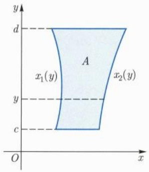

text_image

y
d
A
x₁(y)
y
c
O
x₂(y)

图16.5 向 $y$ 轴的投影

对于一般的 n 重积分, 类似的结果也成立, 我们仅举例说明.

例 16.3.4 计算积分  $I=\iint_{A}x^{2}y^{2}\,dx\,dy$ ，其中 A 是由直线 y=0, x=1 和 y=x 围成的三角形区域 (图 16.6).

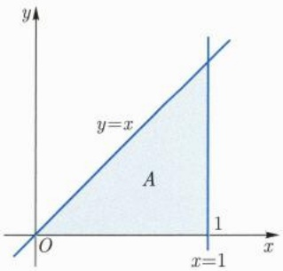

text_image

y
y=x
A
O
x=1
1
x

图 16.6 三角区域投影

解 利用向 x 轴作投影, 得

$$
I = \int_ {0} ^ {1} \mathrm{d} x \int_ {0} ^ {x} x ^ {2} y ^ {2} \mathrm{d} y = \int_ {0} ^ {1} \frac {1}{3} x ^ {5} \mathrm{d} x = \frac {1}{1 8}.
$$

例 16.3.5 计算积分  $I = \iint_{A} y^{2} dx dy$ ，其中 A 是由直线 2x - y - 1 = 0 与抛物线  $x = y^{2}$  所围成的区域.

---

16.3 重积分化为累次积分计算

17

解 如图 16.7(a), 直线 2x - y - 1 = 0 与抛物线  $x = y^{2}$  的交点为  $(1/4, -1/2)$  和  $(1, 1)$ . 利用向 y 轴作投影, 得

$$
I = \int_ {- \frac {1}{2}} ^ {1} \mathrm{d} y \int_ {y ^ {2}} ^ {\frac {y + 1}{2}} y ^ {2} \mathrm{d} x = \int_ {- \frac {1}{2}} ^ {1} \left[ \frac {1}{2} y ^ {2} (y + 1) - y ^ {4} \right] \mathrm{d} y = \frac {6 3}{6 4 0}.
$$

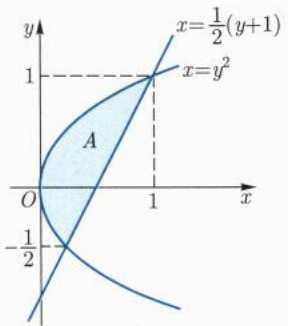

text_image

y
x=\frac{1}{2}(y+1)
1
x=y^2
O
A
-1/2
x
1

(a)

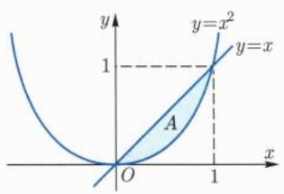

area

| Point | X | Y |
| --- | --- | --- |
| Intersection (x=0, y=x) | 0 | 0 |
| Intersection (x=1, y=x) | 1 | 1 |

(b)

图 16.7 直线和抛物线相交区域的投影

例16.3.6 计算积分 $I = \int_0^1\mathrm{d}y\int_{y}^{\sqrt{y}}\frac{\sin x}{x}\mathrm{d}x.$

解 这个积分必须交换次序才行. 如图 16.7(b), 它可以看成连续函数  $\frac{\sin x}{x}$  在由直线 y = x 和抛物线  $y = x^{2}$  所围成的区域中的积分, 因而

$$
I = \int_ {0} ^ {1} \mathrm{d} x \int_ {x ^ {2}} ^ {x} \frac {\sin x}{x} \mathrm{d} y = \int_ {0} ^ {1} \frac {\sin x}{x} (x - x ^ {2}) \mathrm{d} x = 1 - \sin 1.
$$

例 16.3.7 求 n 维单形  $\Delta_{n}(a)$  (a > 0) 的容积, 其中

$$
\Delta_ {n} (a) = \{(x _ {1}, x _ {2}, \dots , x _ {n}) \in \mathbb {R} ^ {n} \mid x _ {1} \geqslant 0, x _ {2} \geqslant 0, \dots , x _ {n} \geqslant 0, x _ {1} + x _ {2} + \dots + x _ {n} \leqslant a \}.
$$

n = 3 的情形见图 16.8.

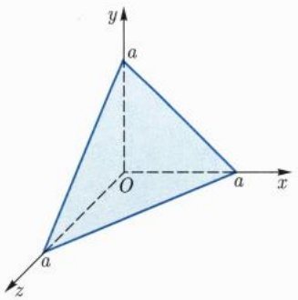

text_image

y
a
O
x
a
z
a

图 16.8 三角面的投影

解 被积区域 $\Delta_n(a)$ 可以表示为

$$
\{x \in \mathbb {R} ^ {n} \mid 0 \leqslant x _ {1} \leqslant a, 0 \leqslant x _ {2} \leqslant a - x _ {1}, \dots ,
$$

---

18

第十六章 多元函数的积分学

$$
0 \leqslant x _ {n} \leqslant a - x _ {1} - \dots - x _ {n - 1} \},
$$

因此

$$
\nu (\Delta_ {n} (a)) = \int_ {0} ^ {a} \mathrm{d} x _ {1} \int_ {0} ^ {a - x _ {1}} \mathrm{d} x _ {2} \dots \int_ {0} ^ {a - x _ {1} - \dots - x _ {n - 1}} \mathrm{d} x _ {n}.
$$

在上式右端中对各个一元积分依次做变量替换

$$
y _ {n} = x _ {1} + x _ {2} + \dots + x _ {n}, \dots , y _ {2} = x _ {1} + x _ {2}, y _ {1} = x _ {1},
$$

可得

$$
\begin{array}{l} \nu (\Delta_ {n} (a)) = \int_ {0} ^ {a} \mathrm{d} y _ {1} \int_ {y _ {1}} ^ {a} \mathrm{d} y _ {2} \dots \int_ {y _ {n - 1}} ^ {a} \mathrm{d} y _ {n} \\ = \int_ {0} ^ {a} \mathrm{d} y _ {1} \int_ {y _ {1}} ^ {a} \mathrm{d} y _ {2} \dots \int_ {y _ {n - 2}} ^ {a} (a - y _ {n - 1}) \mathrm{d} y _ {n - 1} \\ = \dots = \frac {1}{(n - 1) !} \int_ {0} ^ {a} (a - y _ {1}) ^ {n - 1} \mathrm{d} y _ {1} \\ = \frac {a ^ {n}}{n !}. \\ \end{array}
$$

注 16.3.1 显然, $\nu(\Delta_{1}(a))=a$ . 利用向 $x_{1}$ 轴作投影可得

$$
\nu (\Delta_ {n} (a)) = \int_ {0} ^ {a} \nu (\Delta_ {n - 1} (a - x _ {1})) \mathrm{d} x _ {1}.
$$

对 $n$ 进行归纳也容易得出 $\nu (\Delta_n(a)) = \frac{1}{n!} a^n.$

## 习题 16.3

1. 计算下列积分:

(1) $\iint_{I} \frac{x^2}{2 - y^2} \, \mathrm{d}x \, \mathrm{d}y, I = [0,1] \times [0,1]$;
(2) $\iint_{I} \sin (x + y) \, \mathrm{d}x \, \mathrm{d}y, I = [0, \pi/2] \times [0, \pi/2]$;
(3) $\iint_{A} \sin x^{2} \, \mathrm{d}x \, \mathrm{d}y$, $A$ 是由 $y = 0$, $x = \sqrt{\pi/2}$, $y = x$ 所围成的区域;
(4) $\iint_{A} \frac{x^2}{y^2} \, \mathrm{d}x \, \mathrm{d}y$, $A$ 是由 $x = 2$, $y = x$ 和 $xy = 1$ 所围成的区域;
(5) $\iint_{A} xy^{2} \, \mathrm{d}x \, \mathrm{d}y$, $A$ 是由 $y^{2} = 2px$, $x = p/2 (p > 0)$ 所围成的区域.

2. 计算下列积分:

(1) $\iiint_{\Omega}(x + y + z)\mathrm{d}x\mathrm{d}y\mathrm{d}z,\Omega$ 为椭球 $\frac{x^2}{a^2} +\frac{y^2}{b^2} +\frac{z^2}{c^2}\leqslant 1;$

---

16.3 重积分化为累次积分计算

19

(2) $\iiint_{\Omega} x^3 yz \, \mathrm{d}x \, \mathrm{d}y \, \mathrm{d}z, \Omega$ 是由曲面 $x^2 + y^2 + z^2 = 1$，平面 $x = 0, y = 0$ 与 $z = 0$ 围成的位于第一卦限的有界区域；

(3) $\iiint_{\Omega} z \, \mathrm{d}x \, \mathrm{d}y \, \mathrm{d}z, \, \Omega$ 由曲面 $z = x^2 + y^2$，平面 $z = 1$ 与 $z = 2$ 围成；
(4) $\iiint_{\Omega}(1 + x^4)\mathrm{d}x\mathrm{d}y\mathrm{d}z,\Omega$ 由曲面 $x^{2} = z^{2} + y^{2}$ ，平面 $x = 2$ 与 $x = 4$ 围成；
(5) $\iiint_{\Omega}(x^2 + y^2) \, \mathrm{d}x \, \mathrm{d}y \, \mathrm{d}z, \Omega$ 由 $z = 16(x^2 + y^2)$, $z = 4(x^2 + y^2)$ 与 $z = 64$ 围成.

3. 求由平面 x=0, x=1, y=0, y=2, z=0 与曲面  $z=xy^{2}$  所围区域的体积.

4. 求由平面 $x = -1, x = 1, y = -1, y = 2, z = 0$ 与曲面 $z = x^2 + y^2$ 所围区域的体积.
5. 计算由曲面  $\left|x\right|+\left|y\right|+\left|z\right|=a\ (a>0)$  所围区域的体积.
6. 求由曲面 $z = xy$, 平面 $z = x + y, x + y = 1, x = 0, y = 0$ 所围区域的体积.
7. 设 $A = \{(x, y, z, w) \mid x, y, z, w \geqslant 0, x + y + z + w \leqslant a\}$, 计算积分

$$
\iiint_ {A} x y z w   \mathrm{d} x   \mathrm{d} y   \mathrm{d} z   \mathrm{d} w.
$$

8. 设 $f \in R[a, b]$，对二元函数 $g(x, y) = [f(x) - f(y)]^2$ 应用重积分化为累次积分进行计算的方法证明:

$$
\left(\int_ {a} ^ {b} f (x) \mathrm{d} x\right) ^ {2} \leqslant (b - a) \int_ {a} ^ {b} f ^ {2} (x) \mathrm{d} x.
$$

9. 设 $f$ 为 $[a, b] \times [a, b]$ 上的连续函数, 证明:

$$
\int_ {a} ^ {b} \mathrm{d} x \int_ {a} ^ {x} f (x, y) \mathrm{d} y = \int_ {a} ^ {b} \mathrm{d} y \int_ {y} ^ {b} f (x, y) \mathrm{d} x.
$$

10. 设  $f \in R[a, b]$ ，证明:

$$
\int_ {a} ^ {b} \mathrm{d} x \int_ {a} ^ {x} f (y) \mathrm{d} y = \int_ {a} ^ {b} f (y) (b - y) \mathrm{d} y.
$$

11. 设  $f \in R[a, b]$ ，证明:

$$
\int_ {a} ^ {b} f (x) \mathrm{d} x \int_ {a} ^ {x} f (y) \mathrm{d} y = \frac {1}{2} \left(\int_ {a} ^ {b} f (x) \mathrm{d} x\right) ^ {2}.
$$

12. 设  $f_{i} \in R[a_{i}, b_{i}]$ ,  $i = 1, 2, \cdots, n$ . 记

$$
F (\boldsymbol {x}) = \prod_ {i = 1} ^ {n} f _ {i} (x _ {i}), \boldsymbol {x} = (x _ {1}, x _ {2}, \dots , x _ {n}) \in I = [ a _ {1}, b _ {1} ] \times [ a _ {2}, b _ {2} ] \times \dots \times [ a _ {n}, b _ {n} ],
$$

证明:

$$
\int_ {I} F (\boldsymbol {x}) \mathrm{d} \boldsymbol {x} = \prod_ {i = 1} ^ {n} \int_ {a _ {i}} ^ {b _ {i}} f _ {i} (x _ {i}) \mathrm{d} x _ {i}.
$$

---

20

第十六章 多元函数的积分学

13. 设 $f \in R[a, b]$, 证明:

$$
\int_ {a} ^ {b} f (x _ {1}) \mathrm{d} x _ {1} \int_ {a} ^ {x _ {1}} f (x _ {2}) \mathrm{d} x _ {2} \dots \int_ {a} ^ {x _ {n - 1}} f (x _ {n}) \mathrm{d} x _ {n} = \frac {1}{n !} \left(\int_ {a} ^ {b} f (x) \mathrm{d} x\right) ^ {n}.
$$

14. 设 $D$ 是 $\mathbb{R}^{n-1}$ 中的紧致 Jordan 可测集, $\varphi, \psi$ 是定义在 $D$ 上的连续函数且 $\varphi \leqslant \psi$. 记

$$
A = \big \{(\boldsymbol {x}, y) \in \mathbb {R} ^ {n - 1} \times \mathbb {R} \mid \boldsymbol {x} \in D, \varphi (\boldsymbol {x}) \leqslant y \leqslant \psi (\boldsymbol {x}) \big \}.
$$

证明: (1) $A$ 为 $\mathbb{R}^n$ 中的紧致 Jordan 可测集, 且

$$
\nu (A) = \int_ {D} \left[ \psi (\boldsymbol {x}) - \varphi (\boldsymbol {x}) \right] \mathrm{d} \boldsymbol {x}.
$$

(2) 若 $f$ 是 $A$ 上的连续函数, 则

$$
\iint_ {A} f (\boldsymbol {x}, y) \mathrm{d} \boldsymbol {x} \mathrm{d} y = \int_ {D} \left(\int_ {\varphi (\boldsymbol {x})} ^ {\psi (\boldsymbol {x})} f (\boldsymbol {x}, y) \mathrm{d} y\right) \mathrm{d} \boldsymbol {x}.
$$

15. 计算下列 $n$ 重积分:

(1) $\int_0^1 x_1\mathrm{d}x_1\int_0^{x_1}x_2\mathrm{d}x_2\dots \int_0^{x_{n - 1}}x_n\mathrm{d}x_n;$
(2)  $\iint\cdots\int_{[0,1]^{n}}\max\{x_{1},x_{2},\cdots,x_{n}\}\mathrm{d}x_{1}\mathrm{d}x_{2}\cdots\mathrm{d}x_{n}.$

16. 在 $[0,1] \times [0,1]$ 上定义函数 $f$ 如下:

$$
f (x, y) = \left\{ \begin{array}{l l} 1, & x \text {为无理数}, \\ 3 y ^ {2}, & x \text {为有理数}. \end{array} \right.
$$

证明: $f$ 不可积，但累次积分 $\int_0^1\mathrm{d}x\int_0^1 f(x,y)\mathrm{d}y$ 存在.

17. 在 $[0,1] \times [0,1]$ 上定义函数 $f$ 如下:

$$
f (x, y) = \left\{ \begin{array}{l l} 0, & x, y \text {都是或都不是无理数}, \\ \frac {1}{p}, & x = \frac {r}{p} \text {为既约分数}, y \text {为无理数}, \\ \frac {1}{q}, & x \text {为无理数}, y = \frac {s}{q} \text {为既约分数}. \end{array} \right.
$$

证明: $f$ 可积，但它的累次积分不存在.

18. 设 $f$ 为 $[a, b]$ 上的非负函数, 记

$$
A _ {f} = \big \{(x, y) \in \mathbb {R} ^ {2} \mid a \leqslant x \leqslant b, 0 \leqslant y \leqslant f (x) \big \}.
$$

证明: $A_{f}$ 为 Jordan 可测集当且仅当 $f$ 可积, 此时 $A_{f}$ 的容积 (面积) 等于 $f$ 在 $[a, b]$ 上的积分.

---

16.4 重积分的变量替换

21

## 16.4 重积分的变量替换

与一元函数的积分类似, 多元函数的积分也有相应的变量替换公式. 我们先考虑仿射变换, 再利用微分学的基本手法将一般的变换线性化并估计误差.

## 16.4.1 仿射变换

设 $\varphi : \mathbb{R}^n \to \mathbb{R}^n$ 为线性变换, 记 $\varphi(\boldsymbol{x}) = \boldsymbol{Q}\boldsymbol{x}$. 设 $I$ 为 $\mathbb{R}^n$ 中的 $n$ 维矩形, 我们先来研究 $\varphi(I)$ 的 Jordan 测度. 若 $\boldsymbol{Q}$ 退化, 则 $\varphi(\mathbb{R}^n)$ 是 $\mathbb{R}^n$ 中的零测集, 此时 $\varphi(I)$ 的 Jordan 测度为零. 下设 $\boldsymbol{Q}$ 非退化, 由 $\partial[\varphi(I)] = \varphi(\partial I)$ 为零测集可知 $\varphi(I)$ 为 Jordan 可测集.

根据线性代数, 非退化线性变换  $\varphi(\boldsymbol{x}) = \boldsymbol{Q}\boldsymbol{x}$  可以分解为有限个如下初等线性变换的复合:

(1) $(x_{1},\cdots,x_{i},\cdots,x_{j},\cdots,x_{n})\mapsto(x_{1},\cdots,x_{j},\cdots,x_{i},\cdots,x_{n})$ ，其中i<j.
(2) $(x_{1},\cdots,x_{i},\cdots,x_{n})\mapsto(x_{1},\cdots,\lambda x_{i},\cdots,x_{n})$ ，其中 $1\leqslant i\leqslant n,\lambda\neq0$ .
(3) $(x_{1},\cdots,x_{i},\cdots,x_{j},\cdots,x_{n})\mapsto(x_{1},\cdots,x_{i},\cdots,x_{j}+x_{i},\cdots,x_{n})$ ，其中i<j.

我们来验证在这三种初等变换下, 均有 $\nu(\varphi(I)) = |\det Q| \nu(I)$. 情形 (1) 和 (2) 比较显然, 我们来看情形 (3), 以 $n = 2$ 为例. 记 $I = [a, b] \times [c, d]$, $(u, v) = \varphi(x, y) = (x, y + x)$, 则 $\varphi(I)$ 可以表示为

$$
\varphi (I) = \{(u, v) \in \mathbb {R} ^ {2} \mid a \leqslant u \leqslant b, c + u \leqslant v \leqslant d + u \},
$$

这是一个平行四边形, 其 Jordan 测度可以用重积分化为累次积分计算:

$$
\nu (\varphi (I)) = \int_ {a} ^ {b} \mathrm{d} u \int_ {c + u} ^ {d + u} \mathrm{d} v = \int_ {a} ^ {b} \mathrm{d} u \int_ {c} ^ {d} \mathrm{d} v = \nu (I).
$$

一般地, 设 $f$ 是 $\mathbb{R}^n$ 中某个 Jordan 可测集上的可积函数. 为了方便起见, 在此 Jordan 可测集外规定 $f$ 为零, 并可以将 $f$ 的积分写成它在整个 $\mathbb{R}^n$ 上的积分. 我们有

引理 16.4.1 设 f 是  $R^{n}$  中某个 Jordan 可测集上的可积函数, Q 是非退化 n 阶方阵, 则

$$
\int_ {\mathbb {R} ^ {n}} f (\boldsymbol {Q} \boldsymbol {x}) \mathrm{d} \boldsymbol {x} = | \det \boldsymbol {Q} | ^ {- 1} \int_ {\mathbb {R} ^ {n}} f (\boldsymbol {x}) \mathrm{d} \boldsymbol {x}. \tag {16.4.1}
$$

证明 如果 $Q = A, B$ 时, 公式 (16.4.1) 对可积函数均成立, 则由 $\det(BA) = (\det B)(\det A)$ 可知公式 (16.4.1) 对 $Q = BA$ 也成立. 因此, 只要对初等变换验证引理成立即可.

---

22

第十六章 多元函数的积分学

取矩形 $I$, 使得 $f$ 在 $I$ 之外为零. 设 $\mathrm{P} = \{I_k\}$ 为 $I$ 的分割, $f$ 在 $I_k$ 中的下确界和上确界分别记为 $m_k$ 和 $M_k$, 则

$$
m _ {k} \nu (Q ^ {- 1} I _ {k}) \leqslant \int_ {Q ^ {- 1} I _ {k}} f (Q x) \mathrm{d} x \leqslant M _ {k} \nu (Q ^ {- 1} I _ {k}).
$$

上式关于 $k$ 求和, 利用之前的讨论可得

$$
| \det Q | ^ {- 1} \sum_ {k} m _ {k} \nu (I _ {k}) \leqslant \int_ {\mathbb {R} ^ {n}} f (Q x) \mathrm{d} x \leqslant | \det Q | ^ {- 1} \sum_ {k} M _ {k} \nu (I _ {k}),
$$

令 P 的模趋于零即得欲证结论.

推论16.4.2 设 $\varphi(x) = Qx + b$ 为仿射变换, $S$ 为 $\mathbb{R}^n$ 中的Jordan可测集, 则 $\nu(\varphi(S)) = |\det Q| \nu(S)$.

证明 不妨设 $b = 0$ 且 $\operatorname{det} Q \neq 0$, 此时 $\varphi(S)$ 为 Jordan 可测集. 在前一引理中, 将 $f$ 取为 $\varphi(S)$ 的特征函数即得欲证结论. □

例 16.4.1 设  $\{v_{i}\}_{i=1}^{n}$  为  $R^{n}$  中的向量, 求如下平行多面体的容积:

$$
P (\boldsymbol {v} _ {1}, \boldsymbol {v} _ {2}, \dots , \boldsymbol {v} _ {n}) = \left\{\sum_ {i = 1} ^ {n} x _ {i} \boldsymbol {v} _ {i} \in \mathbb {R} ^ {n}   \big |   0 \leqslant x _ {i} \leqslant 1, i = 1, 2, \dots , n \right\}.
$$

解 记  $R^{n}$  的标准正交基为  $\{e_{i}\}_{i=1}^{n}$ ，考虑线性变换  $\varphi: R^{n} \rightarrow R^{n}, \varphi(e_{i}) = v_{i}$ . 显然有

$$
\begin{array}{l} P (\boldsymbol {v} _ {1}, \boldsymbol {v} _ {2}, \dots , \boldsymbol {v} _ {n}) = \left\{\sum_ {i = 1} ^ {n} x _ {i} \boldsymbol {v} _ {i} \in \mathbb {R} ^ {n} \mid 0 \leqslant x _ {i} \leqslant 1, i = 1, 2, \dots , n. \right\} \\ = \left\{\varphi \left(\sum_ {i = 1} ^ {n} x _ {i} \boldsymbol {e} _ {i}\right) \in \mathbb {R} ^ {n} \mid 0 \leqslant x _ {i} \leqslant 1, i = 1, 2, \dots , n. \right\} \\ = \varphi (P (\boldsymbol {e} _ {1}, \boldsymbol {e} _ {2}, \dots , \boldsymbol {e} _ {n})). \\ \end{array}
$$

显然， $P(\boldsymbol{e}_{1},\boldsymbol{e}_{2},\cdots,\boldsymbol{e}_{n})=[0,1]^{n}$ ，因此，由上述推论可得

$$
\nu (P (\boldsymbol {v} _ {1}, \boldsymbol {v} _ {2}, \dots , \boldsymbol {v} _ {n})) = | \det \boldsymbol {Q} | \nu ([ 0, 1 ] ^ {n}) = | \det \boldsymbol {Q} |\,
$$

其中 Q 是以  $v_{1}, v_{2}, \cdots, v_{n}$  为列向量的方阵. 例如, 当  $n = 2, \boldsymbol{v}_{1} = (a_{1}, b_{1}), \boldsymbol{v}_{2} = (a_{2}, b_{2})$  时,

$$
\nu (P (\boldsymbol {v} _ {1}, \boldsymbol {v} _ {2})) = | a _ {1} b _ {2} - a _ {2} b _ {1} |,
$$

这是平行四边形的面积公式.

例 16.4.2 设  $\{v_{i}\}_{i=1}^{n}$  为  $R^{n}$  中的向量, 求如下单形的容积:

$$
\Delta (\pmb {v} _ {1}, \pmb {v} _ {2}, \dots , \pmb {v} _ {n}) = \left\{\sum_ {i = 1} ^ {n} x _ {i} \pmb {v} _ {i} \in \mathbb {R} ^ {n} \mid x _ {i} \geqslant 0 (1 \leqslant i \leqslant n), x _ {1} + x _ {2} + \dots + x _ {n} \leqslant 1 \right\}.
$$

---

16.4 重积分的变量替换

23

解 考虑线性变换 $\varphi : \mathbb{R}^n \to \mathbb{R}^n, \varphi(e_i) = v_i$，则

$$
\Delta (\boldsymbol {v} _ {1}, \boldsymbol {v} _ {2}, \dots , \boldsymbol {v} _ {n}) = \varphi (\Delta_ {n} (1)),
$$

由例16.3.7的结果可得

$$
\nu \left(\Delta (\boldsymbol {v} _ {1}, \boldsymbol {v} _ {2}, \dots , \boldsymbol {v} _ {n})\right) = | \det \boldsymbol {P} | \nu \left(\Delta_ {n} (1)\right) = \frac {1}{n !} | \det \boldsymbol {P} |,
$$

其中 P 是以  $v_{1}, v_{2}, \cdots, v_{n}$  为列向量的方阵.

例 16.4.3 求中心为  $x^{0} \in R^{n}$ ，半径为 r 的 n 维球体  $\overline{B_{r}(x^{0})}$  的容积，其中

$$
\overline {{B _ {r} (\boldsymbol {x} ^ {0})}} = \{\boldsymbol {x} \in \mathbb {R} ^ {n} \mid (\boldsymbol {x} - \boldsymbol {x} ^ {0}) \cdot (\boldsymbol {x} - \boldsymbol {x} ^ {0}) \leqslant r ^ {2} \}.
$$

解 根据容积的平移不变性, 不妨设  $x_{0}$  为原点. 半径为 r 的 n 维球体的容积记为  $\omega_{n}(r)$ . 利用伸缩变换可知  $\omega_{n}(r)=\omega_{n}(1)r^{n}$ , 为了方便起见, 记  $\omega_{n}=\omega_{n}(1)$ . 利用投影法可得

$$
\begin{array}{l} \omega_ {n + 1} = \int_ {- 1} ^ {1} \omega_ {n} \left(\sqrt {1 - x _ {1} ^ {2}}\right) \mathrm{d} x _ {1} = \omega_ {n} \int_ {- 1} ^ {1} (1 - x _ {1} ^ {2}) ^ {\frac {n}{2}} \mathrm{d} x _ {1} \\ = 2 \omega_ {n} \int_ {0} ^ {\frac {\pi}{2}} \sin^ {n + 1} t \mathrm{d} t = 2 \omega_ {n} J _ {n + 1}. \\ \end{array}
$$

其中， $J_{n + 1}$ 在例9.4.6中已经计算过:

$$
J _ {2 k} = \frac {(2 k - 1) ! !}{(2 k) ! !} \frac {\pi}{2}, J _ {2 k + 1} = \frac {(2 k) ! !}{(2 k + 1) ! !}, \forall k \geqslant 0.
$$

根据  $\omega_{1}=2$  以及上述递推公式可得

$$
\omega_ {1} = 2, \omega_ {2} = \pi , \omega_ {n + 2} = \omega_ {n} \frac {2 \pi}{n + 2}, \forall n \geqslant 1.
$$

由此进一步得到

$$
\omega_ {2 k} = \frac {(2 \pi) ^ {k}}{(2 k) ! !} = \frac {\pi^ {k}}{k !}, \omega_ {2 k - 1} = \frac {2 ^ {k} \pi^ {k - 1}}{(2 k - 1) ! !}, \forall k \geqslant 1. \tag {16.4.2}
$$

## 16.4.2 一般的变量替换

设 $D$ 为 $\mathbb{R}^n$ 中的开集, $\varphi : D \to \mathbb{R}^n$ 为 $C^1$ 映射. 根据拟微分中值定理, 从局部上看 $\varphi$ 为 Lipschitz 映射, 因此将零测集映为零测集. 假设 $J\varphi$ 处处非退化, $S$ 为 Jordan 可测集且 $\bar{S} \subseteq D$, 则由逆映射定理可知 $\varphi$ 将 $S$ 的内点映为 $\varphi(S)$ 的内点. 由最值定理可知 $\varphi(\bar{S})$ 为有界闭集. 注意

$$
\partial [ \varphi (S) ] = \overline {{\varphi (S)}} \setminus \mathrm{int} [ \varphi (S) ] \subseteq \varphi (\bar {S}) \setminus \varphi (\mathrm{int} S) \subseteq \varphi (\partial S),
$$

---

24

第十六章 多元函数的积分学

这说明 $\varphi(S)$ 仍为 Jordan 可测集. 为了研究 $\varphi(S)$ 的 Jordan 测度, 我们将 $\varphi$ 线性化并做误差估计.

当  $\boldsymbol{x}=(x_{1},x_{2},\cdots,x_{n})\in\mathbb{R}^{n}$  时，记  $|x|_{\infty}=\max\{|x_{1}|,|x_{2}|,\cdots,|x_{n}|\}$ . 若  $u\in R^{n}, r>0$ ，则以 u 为中心，2r 为边长的方体可以表示为  $I_{r}(\boldsymbol{u})=\{\boldsymbol{x}\in\mathbb{R}^{n}\mid|\boldsymbol{x}-\boldsymbol{u}|_{\infty}<r\}$ .

引理 16.4.3 设  $D \subseteq R^{n}$  为开集,  $\varphi: D \to R^{m}$  为  $C^{1}$  映射. 如果  $C \subseteq D$  为紧凸集, 则任给  $\varepsilon > 0$ , 存在  $\delta > 0$ , 使得只要  $v, u \in C$  且  $\|v - u\| < \delta$ , 就有

$$
\| \varphi (\boldsymbol {v}) - \varphi (\boldsymbol {u}) - J \varphi (\boldsymbol {u}) (\boldsymbol {v} - \boldsymbol {u}) \| \leqslant \varepsilon \| \boldsymbol {v} - \boldsymbol {u} \|\cdot
$$

证明 由题设可知 $J\varphi$ 在 $C$ 上一致连续. 因此任给 $\varepsilon > 0$, 存在 $\delta > 0$, 使得只要 $\pmb{u}', \pmb{u} \in C$ 且 $\| \pmb{u}' - \pmb{u} \| < \delta$, 就有 $\| J\varphi(\pmb{u}') - J\varphi(\pmb{u}) \| < \varepsilon$.

暂时固定 $\pmb{u} \in C$。当 $\pmb{x} \in D$ 时，记 $\psi(\pmb{x}) = \varphi(\pmb{x}) - \varphi(\pmb{u}) - J\varphi(\pmb{u})(\pmb{x} - \pmb{u})$，则 $J\psi(\pmb{x}) = J\varphi(\pmb{x}) - J\varphi(\pmb{u})$。当 $\pmb{v} \in C$ 时，由拟微分中值定理可知

$$
\| \psi (\boldsymbol {v}) \| = \| \psi (\boldsymbol {v}) - \psi (\boldsymbol {u}) \| \leqslant \| J \psi (\boldsymbol {\xi}) \| \| \boldsymbol {v} - \boldsymbol {u} \| = \| J \varphi (\boldsymbol {\xi}) - J \varphi (\boldsymbol {u}) \| \| \boldsymbol {v} - \boldsymbol {u} \|,
$$

其中 $\pmb{\xi} = \theta \pmb{v} + (1 - \theta)\pmb{u}\in C,\theta \in (0,1)$ .若 $\| \pmb {v} - \pmb {u}\| <  \delta$ ，则 $\| \pmb {\xi} - \pmb {u}\| = \theta \| \pmb {v} - \pmb {u}\| <  \delta ,$ 因此

$$
\| \varphi (\boldsymbol {v}) - \varphi (\boldsymbol {u}) - J \varphi (\boldsymbol {u}) (\boldsymbol {v} - \boldsymbol {u}) \| = \| \psi (\boldsymbol {v}) \| \leqslant \varepsilon \| \boldsymbol {v} - \boldsymbol {u} \|\cdot
$$

引理 16.4.4 沿用以上记号, 若 C 为 D 中的紧凸集, 则任给  $\varepsilon > 0$ , 存在  $\eta > 0$ , 使得只要  $0 < r < \eta$ ,  $I_{r}(\boldsymbol{u}) \subseteq C$ , 就有

$$
\nu (\varphi (I _ {r} (\boldsymbol {u}))) \leqslant \big [ | \det J \varphi (\boldsymbol {u}) | + O (\varepsilon) \big ] \nu (I _ {r} (\boldsymbol {u})).
$$

证明 给定 $\varepsilon$ 后, 设 $\delta$ 如引理 16.4.3. 取 $\eta = \frac{\delta}{\sqrt{n}}$, 则当 $0 < r < \eta$, $I_r(\boldsymbol{u}) \subseteq C$ 且 $\boldsymbol{v} \in I_r(\boldsymbol{u})$ 时, $\| \boldsymbol{v} - \boldsymbol{u} \| < \sqrt{n} r < \delta$. 因此由引理 16.4.3 可得

$$
\| \varphi (\boldsymbol {v}) - \varphi (\boldsymbol {u}) - J \varphi (\boldsymbol {u}) (\boldsymbol {v} - \boldsymbol {u}) \| <   \varepsilon \| \boldsymbol {v} - \boldsymbol {u} \|\cdot
$$

考虑仿射变换 $L(\pmb {x}) = \left[J\varphi (\pmb {u})\right]^{-1}(\pmb {x} - \varphi (\pmb {u})) + \pmb {u}$ ，则

$$
L \circ \varphi (\boldsymbol {v}) = \boldsymbol {v} + \left[ J \varphi (\boldsymbol {u}) \right] ^ {- 1} \psi (\boldsymbol {v}),
$$

其中 $\psi (\pmb {v}) = \varphi (\pmb {v}) - \varphi (\pmb {u}) - J\varphi (\pmb {u})(\pmb {v} - \pmb {u})$ 当 $v\in I_r(u)$ 时，有

$$
\left| L \circ \varphi (\boldsymbol {v}) - \boldsymbol {u} \right| _ {\infty} \leqslant | \boldsymbol {v} - \boldsymbol {u} | _ {\infty} + \left\| \left[ J \varphi (\boldsymbol {u}) \right] ^ {- 1} \psi (\boldsymbol {v}) \right\| <   r + M \varepsilon \sqrt {n} r,
$$

其中 $M = \max_{C} \| [J\varphi]^{-1}\|$. 这说明

$$
\nu \left(L \circ \varphi (I _ {r} (\boldsymbol {u}))\right) \leqslant (1 + M \varepsilon \sqrt {n}) ^ {n} \nu (I _ {r} (\boldsymbol {u})),
$$

再由推论 16.4.2 即得欲证结论.

□

---

16.4 重积分的变量替换

25

定理 16.4.5（重积分的变量替换） 设 D 为  $R^{n}$  中的开集,  $\varphi: D \rightarrow R^{n}$  为  $C^{1}$  单射, 且  $J\varphi$  处处非退化. 设 S 为 Jordan 可测集,  $\bar{S} \subseteq D$ , f 在  $\varphi(S)$  上可积, 则

$$
\int_ {\varphi (S)} f (\boldsymbol {y}) \mathrm{d} \boldsymbol {y} = \int_ {S} f \circ \varphi (\boldsymbol {x}) | \det J \varphi (\boldsymbol {x}) | \mathrm{d} \boldsymbol {x}. \tag {16.4.3}
$$

特别地，

$$
\nu (\varphi (S)) = \int_ {S} | \det J \varphi (\boldsymbol {x}) |   \mathrm{d} \boldsymbol {x}.
$$

证明 不妨设 $f \geqslant 0$, 且在 $\varphi(S)$ 外规定 $f$ 为零. 取 $\delta > 0$, 使得 $\{\pmb{x} \mid d(\pmb{x}, S) \leqslant \delta\} \subseteq D$. 用一个大的方体包含住 $S$, 将大方体等分为小方体, 使得每一个小方体的直径小于 $\delta$. 此时, 与 $S$ 有非空交的小方体都包含在 $D$ 中, 我们只要在每一个小方体中验证 (16.4.3) 式成立就可以了. 因此, 不妨一开始就设 $S$ 为方体. 任给 $S$ 的等分分割 $\{I_k\}$, 我们有

$$
\int_ {\varphi (S)} f (\boldsymbol {y}) \mathrm{d} \boldsymbol {y} = \sum_ {k} \int_ {\varphi (I _ {k})} f (\boldsymbol {y}) \mathrm{d} \boldsymbol {y} \leqslant \sum_ {k} \left[ \sup _ {\varphi (I _ {k})} f \right] \nu (\varphi (I _ {k})).
$$

任给 $\varepsilon > 0$，当分割的模充分小时，由引理16.4.4可得

$$
\int_ {\varphi (S)} f (\boldsymbol {y}) \mathrm{d} \boldsymbol {y} \leqslant \sum_ {k} \left[ \sup _ {I _ {k}} f \circ \varphi \right] | \det J \varphi (\boldsymbol {\xi} _ {k}) | \nu (I _ {k}) + O (\varepsilon).
$$

容易看出 $f\circ \varphi |\det J\varphi (\pmb {x})|$ 在 $S$ 上可积，由上式可得

$$
\int_ {\varphi (S)} f (\boldsymbol {y}) \mathrm{d} \boldsymbol {y} \leqslant \int_ {S} f \circ \varphi (\boldsymbol {x}) | \det J \varphi (\boldsymbol {x}) | \mathrm{d} \boldsymbol {x} + O (\varepsilon),
$$

这里我们把求和与积分之间的误差也归并到 $O(\varepsilon)$ 项中了.令 $\varepsilon \to 0^{+}$ 可得

$$
\int_ {\varphi (S)} f (\boldsymbol {y}) \mathrm{d} \boldsymbol {y} \leqslant \int_ {S} f \circ \varphi (\boldsymbol {x}) | \det J \varphi (\boldsymbol {x}) | \mathrm{d} \boldsymbol {x}.
$$

根据逆映射定理, $\varphi:D\to\varphi(D)$  可逆. 对  $\varphi^{-1}$  重复上述论证就可得到反过来的不等式,于是欲证结论成立. □

例 16.4.4 设 A 是由 x = 0, y = 0 以及  $x + y = 1$  围成的区域 (图 16.9(a)), 计算积分

$$
I = \iint_ {A} \mathrm{e} ^ {\frac {x - y}{x + y}} \mathrm{d} x \mathrm{d} y.
$$

解 被积区域是一个三角形, 被积函数在 $A \setminus \{(0,0)\}$ 上连续, 在 $A$ 上有界. 我们用线性变换简化被积函数, 令 $x - y = u$, $x + y = v$, 解出

$$
x = \frac {1}{2} (u + v), y = \frac {1}{2} (v - u),
$$

---

26

第十六章 多元函数的积分学

$(x,y)$  关于  $(u,v)$  的 Jacobi 行列式为

$$
\frac {\partial (x , y)}{\partial (u , v)} = \left| \begin{array}{c c} 1 / 2 & 1 / 2 \\ - 1 / 2 & 1 / 2 \end{array} \right| = 1 / 2.
$$

在上述线性变换下, 被积区域变为如下三角形区域 (图 16.9(b))

$$
D = \{(u, v) \in \mathbb {R} ^ {2} \mid u + v \geqslant 0, v - u \geqslant 0, v \leqslant 1 \}.
$$

因此

$$
\begin{array}{l} I = \iint_ {D} \mathrm{e} ^ {\frac {u}{v}} \left| \frac {1}{2} \right| \mathrm{d} u \mathrm{d} v = \frac {1}{2} \int_ {0} ^ {1} \mathrm{d} v \int_ {- v} ^ {v} \mathrm{e} ^ {\frac {u}{v}} \mathrm{d} u \\ = \frac {1}{2} \int_ {0} ^ {1} v \big (\mathrm{e} - \mathrm{e} ^ {- 1} \big) \mathrm{d} v = \frac {1}{4} \big (\mathrm{e} - \mathrm{e} ^ {- 1} \big). \\ \end{array}
$$

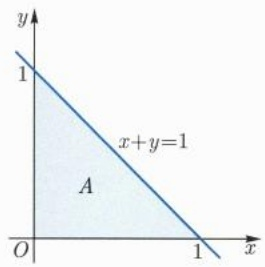

text_image

y
1
x+y=1
A
O
1
x

(a)

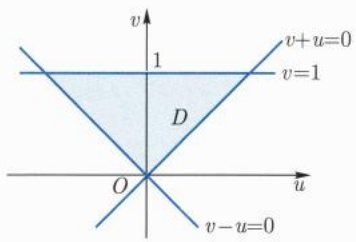

text_image

v
1
v+u=0
v=1
D
O
u
v-u=0

(b)

图16.9 线性变换

例16.4.5 设 $0 < p < q, 0 < a < b$. 抛物线 $y^{2} = px, y^{2} = qx$ 以及双曲线 $xy = a, xy = b$ 围成的区域记为 $A$. 计算积分

$$
I = \iint_ {A} x y \mathrm{d} x \mathrm{d} y.
$$

解 被积区域是一个曲边的四边形 (图 16.10), 为了简化, 我们令 $y^{2} / x = u$, $xy = v$, 则 $(u, v)$ 关于 $(x, y)$ 的 Jacobi 行列式为

$$
\frac {\partial (u , v)}{\partial (x , y)} = \left| \begin{array}{c c} - y ^ {2} / x ^ {2} & 2 y / x \\ y & x \end{array} \right| = - 3 y ^ {2} / x = - 3 u,
$$

因此 $(x,y)$ 关于 $(u,v)$ 的Jacobi行列式为 $-(3u)^{-1}$. 在上述变换下, 被积区域变为矩形 $[p,q] \times [a,b]$, 因此

$$
I = \int_ {p} ^ {q} \mathrm{d} u \int_ {a} ^ {b} v \big | - (3 u) ^ {- 1} \big | \mathrm{d} v = \frac {1}{6} (b ^ {2} - a ^ {2}) \ln \frac {q}{p}.
$$

□

---

16.4 重积分的变量替换

27

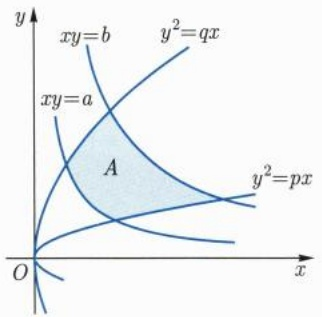

text_image

xy=b
y²=qx
xy=a
A
y²=px
O
x

图 16.10 曲边四边形

## 16.4.3 极坐标变换

我们知道, 在平面 $\mathbb{R}^2$ 上有直角坐标 $(x,y)$ 和极坐标 $(r,\theta)$, 其变换关系为

$$
x = r \cos \theta , y = r \sin \theta , r \geqslant 0, 0 \leqslant \theta \leqslant 2 \pi .
$$

这个变换称为极坐标变换, 其 Jacobi 行列式为

$$
\frac {\partial (x , y)}{\partial (r , \theta)} = \left| \begin{array}{c c} \cos \theta & - r \sin \theta \\ \sin \theta & r \cos \theta \end{array} \right| = r.
$$

这个变换将 $(r, \theta)$ 平面上的矩形 $[0, R] \times [0, 2\pi]$ 变为 $(x, y)$ 平面上的圆 $x^{2} + y^{2} \leqslant R^{2}$. 不过, 这个变换不是一一的, 且在 $r = 0$ 处退化. 尽管如此, 由于此变换在 $(0, +\infty) \times (0, 2\pi)$ 上是一一的且非退化, 因此将定理16.4.5的证明略作改动即知, 积分的变量替换公式对这个变换仍然成立.

例 16.4.6 设 a > 0, 球体  $x^{2} + y^{2} + z^{2} \leqslant a^{2}$  被柱面  $x^{2} + y^{2} = ax$  所截 (图 16.11), 求截出部分的体积.

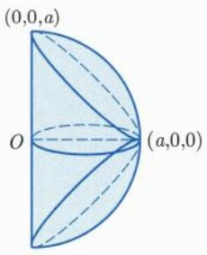

text_image

(0,0,a)
O
(a,0,0)

图 16.11 球体与柱面

解 根据截出图形的对称性, 只要考虑第一象限部分的体积即可, 这一部分的体积是函数 $z = \sqrt{a^2 - x^2 - y^2}$ 在半圆 $D = \{(x, y) \in \mathbb{R}^2 \mid y \geqslant 0, x^2 + y^2 \leqslant ax\}$ 上的积分,

---

28

第十六章 多元函数的积分学

因此体积 V 可以用极坐标变换  $x = r \cos \theta, y = r \sin \theta$  计算如下

$$
\begin{array}{l} V = 4 \iint_ {D} \sqrt {a ^ {2} - x ^ {2} - y ^ {2}} \mathrm{d} x \mathrm{d} y \\ = 4 \int_ {0} ^ {\frac {\pi}{2}} \mathrm{d} \theta \int_ {0} ^ {a \cos \theta} \sqrt {a ^ {2} - r ^ {2}} r \mathrm{d} r \\ = \frac {4}{3} a ^ {3} \int_ {0} ^ {\frac {\pi}{2}} (1 - \sin^ {3} \theta) \mathrm{d} \theta = \frac {4}{3} \left(\frac {\pi}{2} - \frac {2}{3}\right) a ^ {3}. \\ \end{array}
$$

例16.4.7 在圆 $D = \{(x,y)\in \mathbb{R}^2 |x^2 +y^2\leqslant R^2\}$ 中计算积分

$$
I = \iint_ {D} \mathrm{e} ^ {- (x ^ {2} + y ^ {2})} \mathrm{d} x \mathrm{d} y.
$$

解 这个积分用直角坐标是不好计算的. 我们用极坐标变换, 此时有

$$
I = \int_ {0} ^ {R} \mathrm{d} r \int_ {0} ^ {2 \pi} \mathrm{e} ^ {- r ^ {2}} r \mathrm{d} \theta = 2 \pi \int_ {0} ^ {R} \mathrm{e} ^ {- r ^ {2}} r \mathrm{d} r = \pi (1 - \mathrm{e} ^ {- R ^ {2}}).
$$

有时, 伸缩变换和极坐标变换可以结合起来使用.

例 16.4.8 求椭圆  $\frac{x^{2}}{a^{2}} + \frac{y^{2}}{b^{2}} = 1 (a, b > 0)$  所包围的面积.

解 作所谓的广义极坐标变换

$$
x = a r \cos \theta , y = b r \sin \theta , r \in [ 0, 1 ], \theta \in [ 0, 2 \pi ],
$$

其 Jacobi 行列式为

$$
\frac {\partial (x , y)}{\partial (r , \theta)} = \left| \begin{array}{c c} a \cos \theta & - a r \sin \theta \\ b \sin \theta & b r \cos \theta \end{array} \right| = a b r,
$$

因此所求面积为

$$
\int_ {0} ^ {1} \mathrm{d} r \int_ {0} ^ {2 \pi} a b r \mathrm{d} \theta = \pi a b.
$$

下面我们考虑  $R^{3}$  中的一些特殊的坐标变换. 首先有如下的柱面坐标变换:

$$
x = r \cos \theta , y = r \sin \theta , z = z,
$$

其 Jacobi 行列式也是 r.

例 16.4.9 设 D 是球面  $x^{2} + y^{2} + z^{2} = 4$  与抛物面  $x^{2} + y^{2} = 3z$  所围成的区域 (图 16.12)，计算积分  $I = \iiint_{D} z \, dx \, dy \, dz$ .

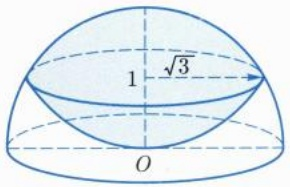

text_image

1
√3
O

图 16.12 球面与抛物面所围区域

---

16.4 重积分的变量替换

29

解 用柱面坐标变换, 区域 D 变为

$$
A = \{(r, \theta , z) | r ^ {2} + z ^ {2} \leqslant 4, r ^ {2} \leqslant 3 z \},
$$

$A$ 在 $(r,\theta)$ 平面上的投影为区域 $\{0\leqslant r\leqslant \sqrt{3},0\leqslant \theta \leqslant 2\pi \}$. 固定 $(r,\theta),z$ 的变化范围为区间 $[r^2 /3,\sqrt{4 - r^2} ]$ ，因此所求积分为

$$
I = \iiint_ {A} r z \mathrm{d} r \mathrm{d} \theta \mathrm{d} z = \int_ {0} ^ {2 \pi} \mathrm{d} \theta \int_ {0} ^ {\sqrt {3}} r \mathrm{d} r \int_ {\frac {1}{3} r ^ {2}} ^ {\sqrt {4 - r ^ {2}}} z \mathrm{d} z = \frac {1 3}{4} \pi .
$$

与极坐标变换类似, $\mathbb{R}^3$ 中有所谓的球面坐标变换:

$$
x = r \sin \theta \cos \varphi , y = r \sin \theta \sin \varphi , z = r \cos \theta , r \geqslant 0, \theta \in [ 0, \pi ], \varphi \in [ 0, 2 \pi ].
$$

这个变换的 Jacobi 行列式为

$$
\frac {\partial (x , y , z)}{\partial (r , \theta , \varphi)} = \left| \begin{array}{c c c} \sin \theta \cos \varphi & r \cos \theta \cos \varphi & - r \sin \theta \sin \varphi \\ \sin \theta \sin \varphi & r \cos \theta \sin \varphi & r \sin \theta \cos \varphi \\ \cos \theta & - r \sin \theta & 0 \end{array} \right| = r ^ {2} \sin \theta .
$$

球面坐标变换和伸缩变换结合起来称为广义球面坐标变换.

例 16.4.10 设 D 是球面  $x^{2} + y^{2} + z^{2} = R^{2}$  和锥面  $\sqrt{x^{2} + y^{2}} = z$  围成的区域 (图 16.13), 计算积分

$$
I = \iiint_ {D} (x ^ {2} + y ^ {2} + z ^ {2})   \mathrm{d} x   \mathrm{d} y   \mathrm{d} z.
$$

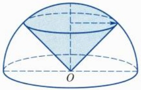

text_image

Geometric diagram of a hemisphere with a cone and labeled point O, showing shaded regions and dashed lines for mathematical analysis.

图16.13 球面与锥面所围区域

解 用球面坐标变换, 区域 D 变为

$$
A = \{(r, \theta , \varphi) \mid 0 \leqslant r \leqslant R, 0 \leqslant \varphi \leqslant 2 \pi , 0 \leqslant \theta \leqslant \pi / 4 \},
$$

因此

$$
I = \iiint_ {A} r ^ {2} | r ^ {2} \sin \theta | \mathrm{d} r \mathrm{d} \theta \mathrm{d} \varphi = \int_ {0} ^ {R} r ^ {4} \mathrm{d} r \int_ {0} ^ {\frac {\pi}{4}} \sin \theta \mathrm{d} \theta \int_ {0} ^ {2 \pi} \mathrm{d} \varphi = \frac {\pi}{5} (2 - \sqrt {2}) R ^ {5}. \quad \square
$$

例 16.4.11 计算椭球  $\frac{x^{2}}{a^{2}}+\frac{y^{2}}{b^{2}}+\frac{z^{2}}{c^{2}}\leqslant1(a,b,c>0)$  的体积.

---

30

第十六章 多元函数的积分学

解 用广义球面坐标变换:

$$
x = a r \sin \theta \cos \varphi , y = b r \sin \theta \sin \varphi , z = c r \cos \theta,
$$

此变换的 Jacobi 行列式为  $abcr^{2}\sin\theta$ ，积分区域变为

$$
\{(r, \theta , \varphi) \mid r \in [ 0, 1 ], \theta \in [ 0, \pi ], \varphi \in [ 0, 2 \pi ] \},
$$

因此椭球体积为

$$
V = \int_ {0} ^ {1} \mathrm{d} r \int_ {0} ^ {\pi} a b c r ^ {2} \sin \theta \mathrm{d} \theta \int_ {0} ^ {2 \pi} \mathrm{d} \varphi = \frac {4}{3} \pi a b c.
$$

一般地, 在 $\mathbb{R}^n (n\geqslant 3)$ 中也有球面坐标变换

$$
\left\{ \begin{array}{l} x _ {1} = r \cos \theta_ {1}, \\ x _ {2} = r \sin \theta_ {1} \cos \theta_ {2}, \\ x _ {3} = r \sin \theta_ {1} \sin \theta_ {2} \cos \theta_ {3}, \\ \vdots \\ x _ {n - 1} = r \sin \theta_ {1} \sin \theta_ {2} \dots \sin \theta_ {n - 2} \cos \theta_ {n - 1}, \\ x _ {n} = r \sin \theta_ {1} \sin \theta_ {2} \dots \sin \theta_ {n - 2} \sin \theta_ {n - 1}, \end{array} \right.
$$

此变换将矩形

$$
0 \leqslant r \leqslant R, 0 \leqslant \theta_ {1}, \theta_ {2}, \dots , \theta_ {n - 2} \leqslant \pi , 0 \leqslant \theta_ {n - 1} \leqslant 2 \pi,
$$

变为半径为 $R$ 的 $n$ 维 (闭) 球. 此变换的 Jacobi 矩阵有一个特点: 其列向量两两之间互相正交. 利用这一特点不难算出此变换的 Jacobi 行列式为

$$
\frac {\partial (x _ {1} , x _ {2} , \cdots , x _ {n})}{\partial (r , \theta_ {1} , \theta_ {2} , \cdots , \theta_ {n - 1})} = r ^ {n - 1} \sin^ {n - 2} \theta_ {1} \sin^ {n - 3} \theta_ {2} \dots \sin \theta_ {n - 2}.
$$

如果用球面坐标计算 $n$ 维单位球的体积, 则有

$$
\omega_ {n} = \int_ {0} ^ {1} r ^ {n - 1} \mathrm{d} r \iint \dots \int_ {A _ {n}} \sin^ {n - 2} \theta_ {1} \sin^ {n - 3} \theta_ {2} \dots \sin \theta_ {n - 2} \mathrm{d} \theta_ {1} \mathrm{d} \theta_ {2} \dots \mathrm{d} \theta_ {n - 1},
$$

其中

$$
A _ {n} = \{(\theta_ {1}, \theta_ {2}, \dots , \theta_ {n - 1}) | 0 \leqslant \theta_ {1}, \theta_ {2}, \dots , \theta_ {n - 2} \leqslant \pi , 0 \leqslant \theta_ {n - 1} \leqslant 2 \pi \},
$$

因此有

$$
\iint \dots \int_ {A _ {n}} \sin^ {n - 2} \theta_ {1} \sin^ {n - 3} \theta_ {2} \dots \sin \theta_ {n - 2} \mathrm{d} \theta_ {1} \mathrm{d} \theta_ {2} \dots \mathrm{d} \theta_ {n - 1} = n \omega_ {n}, \tag {16.4.4}
$$

此等式在用球面坐标算积分时有用. 以后我们将知道 $n\omega_{n}$ 是 $n - 1$ 维球面的面积

---

16.4 重积分的变量替换

31

例 16.4.12 计算函数  $x^{2}$  在四维球体 B:  $x^{2} + y^{2} + z^{2} + w^{2} \leqslant 1$  上的积分.

解 根据对称性, 有

$$
\iiint_ {B} x ^ {2} \mathrm{d} x \mathrm{d} y \mathrm{d} z \mathrm{d} w = \frac {1}{4} \iiint_ {B} (x ^ {2} + y ^ {2} + z ^ {2} + w ^ {2}) \mathrm{d} x \mathrm{d} y \mathrm{d} z \mathrm{d} w,
$$

再利用四维的球面坐标以及(16.4.4)式, 得

$$
\iiint_ {B} x ^ {2} \mathrm{d} x \mathrm{d} y \mathrm{d} z \mathrm{d} w = \frac {1}{4} \int_ {0} ^ {1} r ^ {5} 4 \omega_ {4} \mathrm{d} r = \frac {1}{6} \omega_ {4} = \frac {1}{1 2} \pi^ {2}.
$$

□

## 习题 16.4

1. 设 $U$ 为 $\mathbb{R}^n$ 中的开集, $\varphi: U \to \mathbb{R}^n$ 为 $C^1$ 映射. 若 $A \subset U$ 为零测集, 证明: $\varphi(A)$ 为零测集.

2. 设 $A \subset \mathbb{R}^n$ 且为 Jordan 可测集, $\lambda \in \mathbb{R}$. 记

$$
\lambda A = \{\lambda \boldsymbol {x} \mid \boldsymbol {x} \in A \},
$$

验证  $\lambda A$  为 Jordan 可测集且  $\nu(\lambda A)=|\lambda|^{n}\nu(A)$ .

3. 设 $a_1b_2 - a_2b_1 \neq 0$, 求曲线

$$
(a _ {1} x + b _ {1} y + c _ {1}) ^ {2} + (a _ {2} x + b _ {2} y + c _ {2}) ^ {2} = 1
$$

在平面上所围区域的面积.

4. 在 $\mathbb{R}^n$ 中求椭球 $\sum_{i=1}^{n} \frac{x_i^2}{a_i^2} \leqslant 1$ 的容积, 其中 $a_i > 0$.

5. 在 $\mathbb{R}^n$ 中求由曲面 $\sum_{i=1}^{n}\left(\sum_{j=1}^{n}a_{ij}x_j\right)^2 = h^2$ 所围成的区域的容积, 其中 $\det(a_{ij}) \neq 0, h > 0$.

6. 在  $R^{n}$  中求由仿射超平面  $\sum_{j=1}^{n} a_{ij} x_{j} = \pm h_{i}, i = 1, 2, \cdots, n$  所围成的区域的容积，其中  $\det(a_{ij}) \neq 0, h_{i} > 0$ .

7. 设 $0 < p < q, 0 < a < b$, 求直线 $x + y = p, x + y = q$ 和 $y = ax, y = bx$ 所围区域的面积.

8. 计算积分  $\iint\cdots\int_{\Delta_{n}(a)}x_{1}x_{2}\cdots x_{n}\mathrm{d}x_{1}\mathrm{d}x_{2}\cdots\mathrm{d}x_{n}$ ，其中  $\Delta_{n}(a)$  为 n 维单形.

9. 计算下列区域的容积  $(a > 0)$ :

(1)  $\{|x| + |y| \leqslant a\}$ ; (2)  $\{|x| + |y| + |z| \leqslant a\}$ ; (3)  $\{|x_{1}| + |x_{2}| + \cdots + |x_{n}| \leqslant a\}$ .

10. 设 $0 < p < q, 0 < a < b$, 求抛物线 $y^{2} = px, y^{2} = qx$ 和 $x^{2} = ay, x^{2} = by$ 所围区域的面积.

---

32

第十六章 多元函数的积分学

11. 计算下列积分:

(1) $\iint_{A}(x - y)\mathrm{d}x\mathrm{d}y$ ， $A$ 由曲线 $y^{2} = 2x$ $x + y = 4,x + y = 12$ 围成；
(2) $\iint_{A}(x^{2} + y^{2})\mathrm{d}x\mathrm{d}y, A$ 由曲线 $x^{2} - y^{2} = 1, x^{2} - y^{2} = 2, xy = 1, xy = 2$ 围成;
(3) $\iint_{A}(x - y^2)\mathrm{d}x\mathrm{d}y, A$ 由曲线 $y = 2, y^2 - y - x = 0, y^2 + 2y - x = 0$ 围成.

12. 计算下列积分  $(a, b > 0)$ :

(1) $\iint_{A}(x^{2} + y^{2})\mathrm{d}x\mathrm{d}y, A = \{(x - a)^{2} + y^{2}\leqslant a^{2}\}$;
(2) $\iiint_{A}(x^{2} + y^{2})\mathrm{d}x\mathrm{d}y\mathrm{d}z, A$ 由 $x^{2} + y^{2} = 2z$ 与 $z = 2$ 围成;
(3) $\iint_{A} \sqrt{x^2 / a^2 + y^2 / b^2} \, \mathrm{d}x \, \mathrm{d}y, A = \left\{x^2 / a^2 + y^2 / b^2 \leqslant 1\right\}$;
(4) $\iint_{A}(x + y)\mathrm{d}x\mathrm{d}y, A = \{x^2 + y^2 \leqslant x + y\}$;

13. 求下列曲面所围区域的体积  $(a, b, c > 0)$ :

(1) $\left(x^{2} / a^{2} + y^{2} / b^{2} + z^{2} / c^{2}\right)^{2} = x^{2} / a^{2} + y^{2} / b^{2};$
(2) $(x^{2} + y^{2} + z^{2})^{2} = az;$
(3) $x^{2} / a^{2} + y^{2} / b^{2} + z / c = 1, z = 0;$
(4) $x^{2} + z^{2} = a^{2}, |x| + |y| = a.$

14. 计算下列积分  $(r, R, a, b, c > 0)$ :

(1) $\iiint_{A} \sqrt{x^2 + y^2 + z^2} \, \mathrm{d}x \, \mathrm{d}y \, \mathrm{d}z, A = \{x^2 + y^2 + z^2 \leqslant R^2\}$;
(2) $\iiint_{A}(x^{2} + y^{2})\mathrm{d}x\mathrm{d}y\mathrm{d}z, A = \{r^{2}\leqslant x^{2} + y^{2} + z^{2}\leqslant R^{2}, z\geqslant 0\}$;
(3) $\iiint_{A} \sqrt{1 - (x^2 / a^2 + y^2 / b^2 + z^2 / c^2)} \, \mathrm{d}x \, \mathrm{d}y \, \mathrm{d}z, A = \left\{x^2 / a^2 + y^2 / b^2 + z^2 / c^2 \leqslant 1\right\}$.

15. 设 $f$ 为一元连续函数, 证明:

$$
\iint_ {| x | + | y | \leqslant 1} f (x + y)   \mathrm{d} x   \mathrm{d} y = \int_ {- 1} ^ {1} f (u)   \mathrm{d} u.
$$

16. 设 $f$ 为一元连续函数, $a, b$ 为常数, 证明:

$$
\iint_ {x ^ {2} + y ^ {2} \leqslant 1} f (a x + b y) \mathrm{d} x \mathrm{d} y = 2 \int_ {- 1} ^ {1} \sqrt {1 - u ^ {2}} f (k u) \mathrm{d} u,
$$

其中 $k = \sqrt{a^2 + b^2}$

17. 设 $f$ 为一元连续函数, $a, b, c$ 为常数, 证明:

$$
\iiint_ {x ^ {2} + y ^ {2} + z ^ {2} \leqslant 1} f (a x + b y + c z) \mathrm{d} x \mathrm{d} y \mathrm{d} z = \pi \int_ {- 1} ^ {1} (1 - u ^ {2}) f (k u) \mathrm{d} u,
$$

---

16.5 重积分的应用和推广

33

其中 $k = \sqrt{a^2 + b^2 + c^2}$

18. 设方阵 A 的 n 个列向量  $\{v^{i}\}$  两两之间互相正交, 则  $|\det A| = \|v^{1}\|\|v^{2}\|\cdots\|v^{n}\|$ . 利用此等式计算  $R^{n}$  中球坐标变换的 Jacobi 行列式.

## 16.5 重积分的应用和推广

我们在前面几节所研究的 Riemann 积分 (重积分) 有两个局限: 一是被积区域必须是 Jordan 可测集, 而 Jordan 可测集是有界集合; 二是被积函数必须是有界函数. 为了克服这两个局限性, 需要对 Riemann 积分做适当的推广.

先考虑被积区域. 设 $A$ 为 $\mathbb{R}^n$ 的子集 (未必有界), 我们要求它的边界 $\partial A$ 为零测集. 这种集合称为容许集. 此时, 对每一个 $k \geqslant 1$, 交集 $A \cap [-k, k]^n$ 是 Jordan 可测集. 事实上, 只要说明其边界为零测集即可, 这可从下式看出:

$$
\partial \big (A \cap [ - k, k ] ^ {n} \big) \subseteq \partial A \cup \partial [ - k, k ] ^ {n}.
$$

定义 $\nu(A) = \lim_{k\to \infty}\nu (A\cap [-k,k]^n)$ ，如果 $\nu (A) <   \infty$ ，则称 $A$ 是广义Jordan可测集， $\nu (A)$ 称为其Jordan测度或容积.

例 16.5.1 研究平面集合  $A=\left\{(x,y)\mid|y|(1+x^{2})\leqslant1\right\}$  的容积.

解 显然, $A \cap [-k, k]^2$ 是 Jordan 可测集, 如图 16.14, 根据对称性, 其容积为

$$
\nu (A \cap [ - k, k ] ^ {2}) = 2 \int_ {- k} ^ {k} \frac {1}{1 + x ^ {2}} \mathrm{d} x = 4 \arctan k.
$$

这说明

$$
\nu (A) = \lim _ {k \to \infty} \nu (A \cap [ - k, k ] ^ {2}) = \lim _ {k \to \infty} 4 \arctan k = 2 \pi,
$$

即 A 的容积为  $2\pi$ .

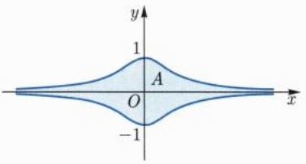

text_image

y
1
A
O
x
-1

图16.14 无界区域的容积

一般地, 当 $A$ 为容许集时, $\nu (A\cap [-k,k]^n)$ 关于 $k$ 单调递增, 因此有

命题 16.5.1 设 A 为容许集, 则 A 为广义 Jordan 可测集当且仅当  $\nu(A\cap[-k,k]^{n})$  关于 k 有上界.

---

34

第十六章 多元函数的积分学

我们再注意到, 如果将上述矩形  $[-k, k]^{n}$  换成半径为 k 的球体  $B_{k}(0)$ , 则结论不变. 事实上,  $A \cap B_{k}(0)$  也都是 Jordan 可测集, 由

$$
A \cap \left[ - k / \sqrt {n}, k / \sqrt {n} \right] ^ {n} \subseteq A \cap B _ {k} (0) \subseteq A \cap [ - k, k ] ^ {n}
$$

以及数列极限的夹逼原理知

$$
\lim _ {k \to \infty} \nu (A \cap B _ {k} (0)) = \lim _ {k \to \infty} \nu (A \cap [ - k, k ] ^ {n}).
$$

我们可以将矩形或球体推广为更一般的 Jordan 可测集.

定义 16.5.1 (穷竭) 设 $\{D_i\}$ 为 $\mathbb{R}^n$ 中一列 Jordan 可测集, 满足条件

(1)  $\bar{D}_{i} \subset \operatorname{int} D_{i+1}, \quad \forall i \geqslant 1;$
(2) $\bigcup_{i\geqslant 1}D_i = \mathbb{R}^n,$

则称  $\{D_{i}\}$  为  $R^{n}$  的一个 Jordan 穷竭.

矩形 $\{[-k, k]^n\}$ 和开球体 $\{B_k(0)\}$ 都是 $\mathbb{R}^n$ 的 Jordan 穷竭. 在具体的积分计算中, 往往可以适当地选取 Jordan 穷竭以简化计算. 现在下面的命题就比较明显了.

命题16.5.2 设 $\{D_i\}$ 为 $\mathbb{R}^n$ 的Jordan穷竭, $A$ 为容许集, 则 $A$ 为广义Jordan可测集当且仅当 $\{\nu (A\cap D_i)\}$ 关于 $i$ 有上界, 且 $\nu (A) = \lim_{i\to \infty}\nu (A\cap D_i)$.

类似地, 我们可以把重积分的定义推广到容许集上. 设 $f: A \to \mathbb{R}$ 为定义在容许集 $A$ 上的非负函数. 如果对每一个 $k \geqslant 1$, $f$ 在 $A \cap [-k, k]^n$ 上均可积, 则定义

$$
\int_ {A} f = \lim _ {k \to \infty} \int_ {A \cap [ - k, k ] ^ {n}} f.
$$

当上述极限有限时, 称 $f$ 在 $A$ 上广义可积 (或广义积分收敛), 极限称为 $f$ 的广义积分. 如果极限为无穷, 则称 $f$ 在 $A$ 上的广义积分发散. 下面的命题也是可以立即得到的.

命题16.5.3 设 $A$ 为容许集, $f: A \to \mathbb{R}$ 为非负函数, 则

(1) $f$ 在 $A$ 上广义可积当且仅当积分 $\int_{A\cap [-k,k]^n}f$ 关于 $k$ 有上界;
(2) 设 $\{D_i\}$ 为 $\mathbb{R}^n$ 的 Jordan 穷竭, 则 $f$ 在 $A$ 上广义可积当且仅当 $f$ 在 $A \cap D_i$ 上的积分关于 $i$ 有上界, 此时

$$
\int_ {A} f = \lim _ {i \to \infty} \int_ {A \cap D _ {i}} f.
$$

一般地, 给定容许集上的函数 $f: A \to \mathbb{R}$, 则 $f = f^{+} - f^{-}$, 其中

$$
f ^ {+} = \max \{f, 0 \}, \quad f ^ {-} = \max \{- f, 0 \}.
$$

$f^{+}, f^{-}$ 都是非负函数, 当 $f^{+}$ 和 $f^{-}$ 都在 $A$ 上广义可积时, 我们称 $f$ 在 $A$ 上广义可积, 其广义积分定义为

$$
\int_ {A} f = \int_ {A} f ^ {+} - \int_ {A} f ^ {-}.
$$

---

16.5 重积分的应用和推广

35

注意到 $|f| = f^{+} + f^{-}$, 因此 $f$ 在 $A$ 上广义可积时, $|f|$ 在 $A$ 上也广义可积, 这和一元函数的广义积分不同! 之所以出现这种差别是因为高维欧氏空间中的被积区域可能会非常复杂, 因此对被积函数的要求较高.

和普通的重积分一样, 广义重积分也具有线性性, 关于被积区域的可加性、保序性以及积分中值定理等, 我们不重复叙述.

以下我们计算几个广义重积分的例子.

例 16.5.2 计算函数  $\mathrm{e}^{-(x^{2}+y^{2})}$  在  $R^{2}$  上的广义积分.

解 在圆 $B_{R} = \{x^{2} + y^{2}\leqslant R^{2}\}$ 上, 由前一节极坐标变换的例子, 我们已算出

$$
\iint_ {B _ {R}} \mathrm{e} ^ {- (x ^ {2} + y ^ {2})} \mathrm{d} x \mathrm{d} y = \pi \big (1 - \mathrm{e} ^ {- R ^ {2}} \big),
$$

因此

$$
\iint_ {\mathbb {R} ^ {2}} \mathrm{e} ^ {- (x ^ {2} + y ^ {2})} \mathrm{d} x \mathrm{d} y = \lim _ {R \to + \infty} \iint_ {B _ {R}} \mathrm{e} ^ {- (x ^ {2} + y ^ {2})} \mathrm{d} x \mathrm{d} y = \lim _ {R \to + \infty} \pi \big (1 - \mathrm{e} ^ {- R ^ {2}} \big) = \pi . \quad \square
$$

注 16.5.1 如果我们用矩形区域作穷竭, 则有

$$
\begin{array}{l} \pi = \iint_ {\mathbb {R} ^ {2}} \mathrm{e} ^ {- (x ^ {2} + y ^ {2})} \mathrm{d} x \mathrm{d} y = \lim _ {R \to + \infty} \iint_ {[ - R, R ] ^ {2}} \mathrm{e} ^ {- (x ^ {2} + y ^ {2})} \mathrm{d} x \mathrm{d} y \\ = \lim _ {R \to + \infty} \left[ \int_ {- R} ^ {R} \mathrm{e} ^ {- x ^ {2}} \mathrm{d} x \right] ^ {2}, \\ \end{array}
$$

这就重新得到了概率积分:

$$
\int_ {- \infty} ^ {+ \infty} \mathrm{e} ^ {- x ^ {2}}   \mathrm{d} x = \sqrt {\pi}    \text {或}    \int_ {0} ^ {+ \infty} \mathrm{e} ^ {- x ^ {2}}   \mathrm{d} x = \frac {\sqrt {\pi}}{2}.
$$

例 16.5.3 计算函数  $\mathrm{e}^{-(x_{1}^{2}+x_{2}^{2}+\cdots+x_{n}^{2})}$  在  $R^{n}$  上的广义积分.

解 利用矩形作穷竭以及重积分化为累次积分, 得

$$
\begin{array}{l} \iint \dots \int_ {\mathbb {R} ^ {n}} \mathrm{e} ^ {- (x _ {1} ^ {2} + x _ {2} ^ {2} + \dots + x _ {n} ^ {2})} \mathrm{d} x _ {1} \mathrm{d} x _ {2} \dots \mathrm{d} x _ {n} \\ = \lim _ {R \to + \infty} \iint \dots \int_ {[ - R, R ] ^ {n}} \mathrm{e} ^ {- (x _ {1} ^ {2} + x _ {2} ^ {2} + \dots + x _ {n} ^ {2})} \mathrm{d} x _ {1} \mathrm{d} x _ {2} \dots \mathrm{d} x _ {n} \\ = \lim _ {R \to + \infty} \left[ \int_ {- R} ^ {R} \mathrm{e} ^ {- x ^ {2}} \mathrm{d} x \right] ^ {n} = \pi^ {n / 2}. \\ \end{array}
$$

注 16.5.2 如果我们用球 ${B}_{R}\left( 0\right)$ 作穷竭,利用球面坐标以及前节 (16.4.4)

式可得

$$
\pi^ {n / 2} = \lim _ {R \to + \infty} \int_ {0} ^ {R} \mathrm{e} ^ {- r ^ {2}} r ^ {n - 1} (n \omega_ {n})   \mathrm{d} r.
$$

在上式中作变量替换 $r = \sqrt{t}$ ，并记

$$
\Gamma (x) = \int_ {0} ^ {+ \infty} t ^ {x - 1} \mathrm{e} ^ {- t} \mathrm{d} t (x > 0),
$$

---

36

第十六章 多元函数的积分学

则得到了 $n$ 维单位球体积 $\omega_{n}$ 的另一种表示

$$
\omega_ {n} = \frac {2 \pi^ {n / 2}}{n \Gamma (n / 2)} = \frac {\pi^ {n / 2}}{\Gamma (n / 2 + 1)}. \tag {16.5.1}
$$

广义积分的变量替换公式在一定条件下也是成立的, 我们仅举例说明.

例 16.5.4 设 P 为 n 阶正定对称方阵, 计算函数  $e^{-x^{T}Px}$  在  $R^{n}$  上的广义积分.

解 因为 P 为正定对称方阵, 故存在正交方阵 O, 使得

$$
\boldsymbol {P} = \boldsymbol {O} ^ {\mathrm{T}} \operatorname{diag} \left(\lambda_ {1}, \lambda_ {2}, \dots , \lambda_ {n}\right) \boldsymbol {O}, \text {其中} \lambda_ {i} > 0, i = 1, 2, \dots , n.
$$

利用正交变换 y = Ox, 积分可以化为

$$
\iint \dots \int_ {\mathbb {R} ^ {n}} \mathrm{e} ^ {- \boldsymbol {x} ^ {\mathrm{T}} \boldsymbol {P} \boldsymbol {x}} \mathrm{d} x _ {1} \mathrm{d} x _ {2} \dots \mathrm{d} x _ {n} = \iint \dots \int_ {\mathbb {R} ^ {n}} \mathrm{e} ^ {- (\lambda_ {1} y _ {1} ^ {2} + \lambda_ {2} y _ {2} ^ {2} + \dots + \lambda_ {n} y _ {n} ^ {2})} \mathrm{d} y _ {1} \mathrm{d} y _ {2} \dots \mathrm{d} y _ {n}.
$$

再利用伸缩变换 $t_i = \sqrt{\lambda_i} y_i$ 以及上例，积分为

$$
\begin{array}{l} \iint \dots \int_ {\mathbb {R} ^ {n}} \mathrm{e} ^ {- \boldsymbol {x} ^ {\mathrm{T}} \boldsymbol {P} \boldsymbol {x}} \mathrm{d} x _ {1} \mathrm{d} x _ {2} \dots \mathrm{d} x _ {n} \\ = \iint \dots \int_ {\mathbb {R} ^ {n}} \mathrm{e} ^ {- (t _ {1} ^ {2} + t _ {2} ^ {2} + \dots + t _ {n} ^ {2})} (\lambda_ {1} \lambda_ {2} \dots \lambda_ {n}) ^ {- \frac {1}{2}} \mathrm{d} t _ {1} \mathrm{d} t _ {2} \dots \mathrm{d} t _ {n} = \frac {\pi^ {n / 2}}{\sqrt {\det P}}. \\ \end{array}
$$

下面我们简单讨论如何判断广义积分是收敛还是发散的. 根据命题 16.5.3, 我们有如下比较判别法.

定理 16.5.4 设 g 为定义在容许集 A 上的非负广义可积函数, f 在每一个  $A \cap [-k, k]^{n}$  上均可积, 且当  $\|x\|$  充分大时,  $|f(x)| \leqslant g(x)$ , 则 f 在 A 上广义可积.

显然, 定理中的矩形  $[-k, k]^{n}$  可以换成球体  $B_{k}(0)$ . 记  $r = \|x\|$ , 考虑函数  $r^{-p}$  在区域  $\{r_{0} \leqslant r \leqslant R\} (r_{0} > 0)$  上的积分, 利用球面坐标以及前节 (16.4.4) 式可得

$$
\int_ {r _ {0} \leqslant r \leqslant R} r ^ {- p} = \int_ {r _ {0}} ^ {R} r ^ {n - 1 - p} (n \omega_ {n}) \mathrm{d} r = \frac {n \omega_ {n}}{n - p} \big (R ^ {n - p} - r _ {0} ^ {n - p} \big),
$$

因此当 $p > n$ 时, $r^{-p}$ 在 $\{r \geqslant r_0\}$ 上广义可积. 根据比较判别法, 可得

推论16.5.5 设 $f$ 在每一个 $A \cap B_k(0)$ 上均可积. 如果常数 $p > n$, 且当 $\| \pmb{x} \|$ 充分大时, 成立 $|f(\pmb{x})| \leqslant \| \pmb{x} \|^{-p}$, 则 $f$ 在 $A$ 上广义可积.

类似地可以得到判断广义积分发散的条件, 我们留给读者完成.

下面我们简单介绍无界函数的积分. 设 $A$ 为 $\mathbb{R}^n$ 中的 Jordan 可测集, $p \in A$. 给定非负函数 $f: A \setminus \{p\} \to \mathbb{R}$, 如果 $f$ 在 $p$ 附近无界, 则称 $p$ 为 $f$ 的瑕点. 如果任给 $\varepsilon > 0$, $f$ 在 $A \setminus B_{\varepsilon}(p)$ 中均可积, 则定义极限

$$
\int_ {A} f = \lim _ {\varepsilon \to 0 ^ {+}} \int_ {A \setminus B _ {\varepsilon} (p)} f,
$$

---

16.5 重积分的应用和推广

37

如果极限有限, 则称 $f$ 在 $A$ 上的瑕积分收敛, 否则就称瑕积分发散.

如果 $f$ 是一般的函数, 则考虑 $f^{+}$ 和 $f^{-}$, 当 $f^{+}$ 和 $f^{-}$ 在 $A$ 上的瑕积分都收敛时, 称 $f$ 在 $A$ 上的瑕积分收敛, 此时定义

$$
\int_ {A} f = \int_ {A} f ^ {+} - \int_ {A} f ^ {-}.
$$

如同广义积分的讨论那样, 瑕积分定义中的球体 $B_{\varepsilon}(p)$ 可以换成以 $p$ 为内点的且收缩到 $p$ 的一列 Jordan 可测集. 下面的结果当然也成立.

命题 16.5.6 设 $f: A \setminus \{p\} \to \mathbb{R}$ 为非负函数, 如果 $f$ 在 $A \setminus B_{\varepsilon}(p)$ 上均可积, 且积分 $\int_{A \setminus B_{\varepsilon}(p)} f$ 关于 $\varepsilon$ 有界, 则 $f$ 在 $A$ 上的瑕积分收敛; 反之亦然.

例 16.5.5 研究函数  $\frac{1}{\sqrt{x^{2}+y^{2}}}$  在单位圆  $B_{1}(0)$  上的瑕积分.

解 原点是函数的唯一瑕点, 当 $0 < \varepsilon < 1$ 时, 利用极坐标变换, 有

$$
\iint_ {B _ {1} (0) \setminus B _ {\varepsilon} (0)} \frac {\mathrm{d} x \mathrm{d} y}{\sqrt {x ^ {2} + y ^ {2}}} = \int_ {\varepsilon} ^ {1} \frac {r}{\sqrt {r ^ {2}}} \mathrm{d} r \int_ {0} ^ {2 \pi} \mathrm{d} \theta = 2 \pi (1 - \varepsilon),
$$

因此瑕积分存在且等于 $2\pi$

类似地, 研究函数 $\| \pmb{x} \|^{p}$ 在 $n$ 维球体 $B_{1}(0)$ 上的积分时, 利用球面坐标不难看到, 当 $p > -n$ 时, 瑕积分收敛, 当 $p \leqslant -n$ 时瑕积分发散. 由此可以得到瑕积分的比较判别法, 我们不详述了.

在瑕积分的定义中, 我们也可以考虑不止一个瑕点的情形, 甚至某个子集上的点都可能是 $f$ 的瑕点.

例如, 设 $A$ 为 Jordan 可测集, $S \subseteq A$, $f$ 是定义在 $A \setminus S$ 上的非负函数. 取一列包含 $S$ 的 Jordan 可测集 $\Delta_i$, 使得 $\nu(\Delta_i) \to 0$, 定义

$$
\int_ {A} f = \lim _ {i \to + \infty} \int_ {A \setminus \Delta_ {i}} f.
$$

如果极限有限, 则称 $f$ 在 $A$ 上的瑕积分收敛. 此定义不依赖于 ${\Delta }_{i}$ 的选取.

下面的例子中, 被积函数的瑕点不是孤立点, 但积分仍然有意义.

例 16.5.6 研究函数  $\frac{y}{\sqrt{x}}$  在  $[0,1] \times [0,1]$  上的瑕积分.

解 $\{0\} \times [0,1]$ 是函数 $\frac{y}{\sqrt{x}}$ 的瑕点集, 记 $D_{\varepsilon} = [\varepsilon, 1] \times [0,1]$, 则

$$
\iint_ {D _ {\varepsilon}} \frac {y}{\sqrt {x}} \mathrm{d} x \mathrm{d} y = \int_ {\varepsilon} ^ {1} \frac {\mathrm{d} x}{\sqrt {x}} \int_ {0} ^ {1} y \mathrm{d} y = 1 - \sqrt {\varepsilon},
$$

因此 $\frac{y}{\sqrt{x}}$ 在 $[0,1] \times [0,1]$ 上的瑕积分收敛于 1.

□

---

38

第十六章 多元函数的积分学

对于最一般的区域和最一般的函数, 我们可能会碰到被积区域无界, 且函数有很多瑕点的情形, 这时就要灵活运用以上知识了. 不过, Riemann 积分能够处理的情形仍然相当有限, 在 “实变函数” 课程中将由 Lebesgue 积分来部分地弥补这一不足.

最后我们举几个重积分在物理中应用的例子.

(1) 物体的质量. 设 $A$ 为空间物体, 其密度函数为 $\rho(x, y, z)$, 则它的质量 $m$ 为

$$
m = \iiint_ {A} \rho (x, y, z)   \mathrm{d} x   \mathrm{d} y   \mathrm{d} z.
$$

类似地, 对于密度函数为 $\rho(x, y)$ 的平面薄板, 其质量可以用二重积分来计算.

(2) 物体的质心. 仍设 $A$ 为空间物体, 其密度函数为 $\rho(x, y, z)$, 则它的质心 $(\bar{x}, \bar{y}, \bar{z})$ 的坐标为

$$
\begin{array}{l} \bar {x} = \frac {1}{m} \iiint_ {A} x \rho (x, y, z)   \mathrm{d} x   \mathrm{d} y   \mathrm{d} z, \bar {y} = \frac {1}{m} \iiint_ {A} y \rho (x, y, z)   \mathrm{d} x   \mathrm{d} y   \mathrm{d} z, \\ \bar {z} = \frac {1}{m} \iiint_ {A} z \rho (x, y, z)   \mathrm{d} x   \mathrm{d} y   \mathrm{d} z. \\ \end{array}
$$

(3)转动惯量.物体 $A$ 关于 $x$ 轴， $y$ 轴， $z$ 轴的转动惯量分别为

$$
\begin{array}{l} I _ {x} = \iiint_ {A} (y ^ {2} + z ^ {2}) \rho (x, y, z) \mathrm{d} x \mathrm{d} y \mathrm{d} z, \quad I _ {y} = \iiint_ {A} (x ^ {2} + z ^ {2}) \rho (x, y, z) \mathrm{d} x \mathrm{d} y \mathrm{d} z, \\ I _ {z} = \iiint_ {A} (x ^ {2} + y ^ {2}) \rho (x, y, z)   \mathrm{d} x   \mathrm{d} y   \mathrm{d} z. \\ \end{array}
$$

一般地, 如果 $\ell$ 为空间直线, $(x,y,z)$ 到 $\ell$ 的距离记为 $r(x,y,z)$, 则物体关于 $\ell$ 的转动惯量为

$$
I _ {\ell} = \iiint_ {A} r ^ {2} (x, y, z) \rho (x, y, z) \mathrm{d} x \mathrm{d} y \mathrm{d} z.
$$

(4) 万有引力. 设 $A$ 为如上空间物体, $B$ 为位于 $(x_0, y_0, z_0)$ 处质量为 $m_0$ 的质点, 则由 Newton 万有引力定律, $A$ 对 $B$ 所产生的引力为 $\boldsymbol{F} = (F_x, F_y, F_z)$, 其中

$$
\begin{array}{l} F _ {x} = G m _ {0} \iiint_ {A} \frac {\rho (x , y , z)}{r ^ {3}} (x - x _ {0}) \mathrm{d} x \mathrm{d} y \mathrm{d} z, \quad F _ {y} = G m _ {0} \iiint_ {A} \frac {\rho (x , y , z)}{r ^ {3}} (y - y _ {0}) \mathrm{d} x \mathrm{d} y \mathrm{d} z, \\ F _ {z} = G m _ {0} \iiint_ {A} \frac {\rho (x , y , z)}{r ^ {3}} (z - z _ {0}) \mathrm{d} x \mathrm{d} y \mathrm{d} z, \\ \end{array}
$$

其中， $G$ 为万有引力常量，

$$
r = \sqrt {(z - z _ {0}) ^ {2} + (y - y _ {0}) ^ {2} + (z - z _ {0}) ^ {2}}.
$$

例 16.5.7 有一半径为 R 的球体, 设其密度  $\rho$  为常数, 求其引力场.

解 所谓引力场就是在每一点 $p$ 处单位质量的质点所受的引力. 设 $p$ 点与球心距离为 $l$. 不妨设球心在原点, $p$ 点在 $z$ 轴上, 其坐标为 $(0,0,l)$. 于是 $p$ 处单位质量的质点

---

16.5 重积分的应用和推广

39

所受引力为 $F(p)$, 利用对称性容易看出, $F(p)$ 的 $x, y$ 分量为零. 它的 $z$ 分量 $F(p)_z$ 用球面坐标计算如下:

$$
F (p) _ {z} = G \rho \int_ {0} ^ {R} \mathrm{d} r \int_ {0} ^ {\pi} \frac {r ^ {2} (r \cos \theta - l) \sin \theta}{(r ^ {2} + l ^ {2} - 2 r l \cos \theta) ^ {3 / 2}} \mathrm{d} \theta \int_ {0} ^ {2 \pi} \mathrm{d} \varphi = 2 \pi G \rho \int_ {0} ^ {R} r ^ {2} \varphi (r) \mathrm{d} r,
$$

其中

$$
\varphi (r) = \int_ {0} ^ {\pi} \frac {(r \cos \theta - l) \sin \theta}{(r ^ {2} + l ^ {2} - 2 r l \cos \theta) ^ {3 / 2}}   \mathrm{d} \theta .
$$

对上述积分作换元 $t = (r^2 + l^2 - 2rl\cos \theta)^{1/2}$, 得

$$
\varphi (r) = \frac {1}{2 l ^ {2} r} \int_ {| r - l |} ^ {r + l} \left(\frac {r ^ {2} - l ^ {2}}{t ^ {2}} - 1\right) \mathrm{d} t = \frac {1}{l ^ {2}} \left[ \frac {r - l}{| r - l |} - 1 \right].
$$

当 $r > l$ 时, $\varphi(r) = 0$; 当 $r \leqslant l$ 时, $\varphi(r) = -2l^{-2}$. 因此, 当 $l \geqslant R$ 时,

$$
F (p) _ {z} = 2 \pi G \rho \int_ {0} ^ {R} r ^ {2} (- 2 l ^ {- 2}) \mathrm{d} r = - \frac {4}{3} \pi G \rho R ^ {3} l ^ {- 2};
$$

当 $l \leqslant R$ 时，

$$
F (p) _ {z} = 2 \pi G \rho \int_ {0} ^ {l} r ^ {2} (- 2 l ^ {- 2})   \mathrm{d} r = - \frac {4}{3} \pi G \rho l.
$$

注意到半径为 $r$ 的球质量为 $\frac{4}{3}\pi \rho r^3$. 上述计算结果表明, 当质点位于球外时, 它所受的引力就如同球体的质量完全集中在球心时所受的引力那样; 当质点位于球内时, 位于质点以外的外层球壳对质点的引力抵消了.

## 习题16.5

1. 设 $A \subseteq \mathbb{R}^n$, 如果对每一个 $k \geqslant 1$, $A \cap [-k, k]^n$ 均为 Jordan 可测集, 则其边界 $\partial A$ 为零测集.

2. 设 $A$ 是 Jordan 可测集, $f: A \to \mathbb{R}$ 为有界函数. 如果任给 $\varepsilon > 0$, $f$ 均在 $A \setminus B_{\varepsilon}(\pmb{p})$ 上可积, 则 $f$ 在 $A$ 上可积, 且

$$
\int_ {A} f = \lim _ {\varepsilon \to 0 ^ {+}} \int_ {A \setminus B _ {\varepsilon} (\boldsymbol {p})} f.
$$

3. 设平面集合 $A$ 含有 (极坐标下的) 区域 $\{\alpha \leqslant \theta \leqslant \beta, r \geqslant r_0\}$, 如果函数 $f$ 在 $A$ 上满足不等式 $f(x, y) \geqslant cr^p$, 其中 $c$ 为正常数, $p \geqslant -2$, 则 $f$ 在 $A$ 上的广义积分发散.

4. 如果 $\mathbb{R}^n$ 上的函数 $f$ 在 $\{\| \pmb{x}\| \geqslant r_0\}$ 上满足不等式 $f(\pmb{x})\geqslant \| \pmb{x}\|^{p}$, 则当 $p\geqslant -n$ 时 $f$ 在 $\mathbb{R}^n$ 上的广义积分发散.

5. 如果 $\mathbb{R}^n$ 上的函数 $f$ 在 $\{\| \pmb{x}\| \leqslant r_0\}$ 上满足不等式 $f(\pmb{x})\geqslant \| \pmb{x}\|^{p}$, 则当 $p\leqslant -n$ 时 $f$ 在 $\mathbb{R}^n$ 上的瑕积分发散.

---

40

第十六章 多元函数的积分学

6. 讨论下列积分的敛散性:

(1) $\iint_{\mathbb{R}^2}\frac{\mathrm{d}x\mathrm{d}y}{(1 + |x|^p)(1 + |y|^q)};$
(2) $\iint_{A} \frac{\mathrm{d}x \, \mathrm{d}y}{|x|^p + |y|^q}, A = \{|x| + |y| \geqslant 1\}$;
(3) $\iiint_{A} \frac{\ln (x^2 + y^2 + z^2)}{(x^2 + y^2 + z^2)^p} \, \mathrm{d}x \, \mathrm{d}y \, \mathrm{d}z, A = \{x^2 + y^2 + z^2 \leqslant 1\}$;
(4) $\iint_{A} \frac{\mathrm{d}x \, \mathrm{d}y}{\sqrt{1 - x^2 - y^2}}, A = \{x^2 + y^2 \leqslant 1\}$;
(5) $\iint_{A} \frac{\mathrm{d}x \, \mathrm{d}y}{x^p y^q}, A = \{xy \geqslant 1, x \geqslant 1\}$.

7. 计算下列积分:

(1) $\iint_{x^2 + y^2 \leqslant 1} \ln (x^2 + y^2) \, \mathrm{d}x \, \mathrm{d}y;$

(2) $\iint_{x\geqslant 0,y\geqslant 0}\frac{\mathrm{d}x\mathrm{d}y}{(1 + x + y)^3};$

(3) $\iint_{x\geqslant y\geqslant 0}\mathrm{e}^{-(x + y)}\mathrm{d}x\mathrm{d}y.$

8. 设 A 为 n 阶正定对称方阵,  $b \in R^{n}$ , 计算积分  $\iint\limits_{R^{n}}\cdots\int\limits_{R^{n}}e^{-x^{T}Ax+b\cdot x}dx_{1}dx_{2}\cdots dx_{n}$ .
9. 求半球壳  $\{a^{2} \leqslant x^{2} + y^{2} + z^{2} \leqslant b^{2}, z \geqslant 0\}$  的质心坐标.
10. 设有半径为 $R$ 的球体, 球心位置为 $(0,0,R)$, 密度函数为 $\rho(\boldsymbol{x}) = k\|\boldsymbol{x}\|^{-2}$, 求其质心坐标.
11. 设一质量均匀的物体由抛物面  $z = x^{2} + y^{2}$  和平面 z = 1 围成, 求其质心坐标.
12. 求质量为 m 的均匀长方体  $[0, a] \times [0, b] \times [0, c]$  关于 z 轴的转动惯量.
13. 求质量均匀的球体  $\{x^{2}+y^{2}+z^{2}\leqslant1\}$  关于三个坐标轴的转动惯量.
14. 一圆锥与半球相接围成质量均匀的球锥, 设球的半径为 $R$, 锥的顶角为 $2\alpha$, 计算球锥对其顶点的引力.
