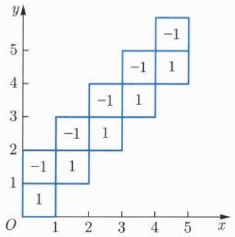

# 下册 / 第二十章 含参变量积分

原始 PDF 第 752–788 页。

## 第二十章

## 含参变量积分

---

112

第二十章 含参变量积分

正如函数时常以函数项级数的形式出现, 函数也时常表示为含参变量积分. 本章主要研究的是含参变量积分的基本性质, 包括含参变量积分的连续性、可微性以及可积性.

## 20.1 含参变量常义积分及其性质

本节介绍含参变量常义积分的连续性、可微性、可积性等. 首先, 我们引入 Arzelà $^{①}$  有界收敛定理. 为此, 先引入如下引理. 我们称函数列  $\{f_{n}\}$  在区间  $[a, b]$  上一致有界, 如果存在常数 M > 0, 使得

$$
| f _ {n} (x) | \leqslant M, \quad \forall x \in [ a, b ], n \geqslant 1. \tag {20.1.1}
$$

引理20.1.1 设 $\{f_n\}$ 为 $[a, b]$ 上一致有界的非负函数列，若

$$
\lim _ {n \to + \infty} f _ {n} (x) = 0, \qquad \forall   x \in [ a, b ], \tag {20.1.2}
$$

则

$$
\lim _ {n \to + \infty} \int_ {a} ^ {b} f _ {n} (x) \mathrm{d} x = 0. \tag {20.1.3}
$$

证明 记 $M := \sup_{x \in [a, b], n \geqslant 1} f_n(x)$. 对于 $E \subseteq [a, b]$, 用 $|E|_*$ 表示 $\int_{a}^{b} \chi_E(x) \, \mathrm{d}x$. 当 $\chi_E$ 可积时, 用 $|E|$ 表示 $\int_{a}^{b} \chi_E(x) \, \mathrm{d}x$.

对 $n \geqslant 1$, 定义 $g_{n}(\cdot) := \sup_{k \geqslant n} f_{k}(\cdot)$, 则 $\{g_{n}\}$ 是 $[a, b]$ 上一致有界且单调下降趋于零的函数列. 易见, 要证 (20.1.3) 式, 我们只要证明

$$
\lim _ {n \to + \infty} \int_ {a} ^ {b} g _ {n} (x) \mathrm{d} x = 0. \tag {20.1.4}
$$

如果 (20.1.4) 式不成立, 则 $M > 0$, 且有常数 $\delta > 0$ 使得

$$
\int_ {a} ^ {b} g _ {n} (x) \mathrm{d} x \geqslant 2 (b - a) \delta , \quad \forall n \geqslant 1. \tag {20.1.5}
$$

记 $E_{n}:= \{x\in [a,b]|g_{n}(x)\geqslant \delta \}$ ， $\gamma := \frac{(b - a)\delta}{M},\gamma_n\coloneqq |E_n|_*$ .则

$$
\gamma_ {n} \geqslant \frac {1}{M} \int_ {a} ^ {b} \chi_ {E _ {n}} (x) (g _ {n} (x) - \delta) \mathrm{d} x \geqslant \frac {1}{M} \int_ {a} ^ {b} (g _ {n} (x) - \delta) \mathrm{d} x \geqslant \frac {(b - a) \delta}{M} = \gamma , \quad \forall n \geqslant 1.
$$

<small>① Arzelà, Cesare, 1847 年 3 月 6 日—1912 年 3 月 15 日, 意大利数学家.</small>

---

20.1 含参变量常义积分及其性质

113

另一方面, 由 $\{g_n\}$ 的单调性知 $\{E_n\}$ 是一列单调下降的集合, 进而 $\{\gamma_n\}$ 单调下降. 而由 $\{g_n\}$ 在 $[a, b]$ 上处处趋于零得到

$$
\bigcap_ {n \geqslant 1} E _ {n} = \varnothing . \tag {20.1.6}
$$

对每个 $n \geqslant 1$, 有有限个闭区间的并 $F_{n}$ 使得 $F_{n} \subseteq E_{n}$, 且

$$
\gamma_ {n} \geqslant | F _ {n} | \geqslant \gamma_ {n} - \frac {\gamma}{2 ^ {n + 1}}. \tag {20.1.7}
$$

我们有

$$
\begin{array}{l} \left| \bigcap_ {k = 1} ^ {2} F _ {k} \right| = | F _ {2} | + | F _ {1} | - | F _ {1} \cup F _ {2} | \geqslant | F _ {2} | + | F _ {1} | - | E _ {1} | _ {*} \\ \geqslant \gamma_ {2} - \frac {\gamma}{2 ^ {3}} - \frac {\gamma}{2 ^ {2}}, \\ \left| \bigcap_ {k = 1} ^ {3} F _ {k} \right| = | F _ {3} | + \left| \bigcap_ {k = 1} ^ {2} F _ {k} \right| - \left| \left(\bigcap_ {k = 1} ^ {2} F _ {k}\right) \cup F _ {3} \right| \geqslant | F _ {3} | + \left| \bigcap_ {k = 1} ^ {2} F _ {k} \right| - | E _ {2} | _ {*} \\ \geqslant \gamma_ {3} - \frac {\gamma}{2 ^ {4}} - \frac {\gamma}{2 ^ {3}} - \frac {\gamma}{2 ^ {2}}. \\ \end{array}
$$

类似地, 归纳可证

$$
\big | \bigcap_ {k = 1} ^ {n} F _ {k} \big | \geqslant \gamma_ {n} - \sum_ {k = 1} ^ {n} \frac {\gamma}{2 ^ {k + 1}}, \quad \forall n \geqslant 1.
$$

这表明 $\left\{\bigcap_{k=1}^{n} F_k\right\}$ 是非空紧集构成的闭集套. 因此, $\bigcap_{n=1}^{\infty} F_n$ 非空, 这与 (20.1.6) 式矛盾. 引理得证. □

由以上引理, 立即可得 Arzelà 有界收敛定理.

定理 20.1.2 设  $\{f_{n}\}$  为  $[a, b]$  上一致有界的可积函数列, 若

$$
\lim _ {n \to + \infty} f _ {n} (x) = f (x), \quad \forall x \in [ a, b ], \tag {20.1.8}
$$

且 $f$ 也在 $[a,b]$ 上可积，则

$$
\lim _ {n \to + \infty} \int_ {a} ^ {b} f _ {n} (x) \mathrm{d} x = \int_ {a} ^ {b} f (x) \mathrm{d} x. \tag {20.1.9}
$$

证明 由引理 20.1.1,

$$
\varlimsup_ {n \to + \infty} \left| \int_ {a} ^ {b} f _ {n} (x) \mathrm{d} x - \int_ {a} ^ {b} f (x) \mathrm{d} x \right| \leqslant \varliminf_ {n \to + \infty} \int_ {a} ^ {b} \left| f _ {n} (x) - f (x) \right| \mathrm{d} x = 0.
$$

因此, 定理成立.

---

114

第二十章 含参变量积分

关于 Arzelà 定理的其他简捷证明, 可以参见梅加强的《数学分析》[46].

基于 Arzelà 定理, 我们可以建立含参变量常义积分的连续性, 可微性以及累次积分的可交换性. 首先, 结合 Heine 定理, 立即可得连续性定理.

定理 20.1.3 设 $f : [a,b] \times [c,d] \rightarrow  \mathbb{R}$ 有界, ${y}_{0} \in  \left\lbrack  {c,d}\right\rbrack$ ,对每个 $x \in  \left\lbrack  {a,b}\right\rbrack  ,f\left( {x,\cdot  }\right)$ 在 ${y}_{0}$ 处连续,对每个 $y \in  \left\lbrack  {c,d}\right\rbrack  ,f\left( {\cdot ,y}\right)$ 在 $\left\lbrack  {a,b}\right\rbrack$ 上可积,则 $F\left( y\right)  :  = \int  _{a}^{b}f\left( {x,y}\right) \mathrm{d}x$ 在 ${y}_{0}$ 处连续.

作为推论, 立即有

定理 20.1.4 设  $f: [a, b] \times [c, d] \rightarrow R$  有界. 对每个  $x \in [a, b]$ ,  $f(x, \cdot)$  在  $[c, d]$  上连续, 对每个  $y \in [c, d]$ ,  $f(\cdot, y)$  在  $[a, b]$  上可积, 则  $F(y) := \int_{a}^{b} f(x, y) \, dx$  在  $[c, d]$  上连续.

进一步, 关于含参变量常义积分的可微性, 我们有

定理20.1.5 设 $f: [a, b] \times (c, d) \to \mathbb{R}, y_0 \in (c, d)$. 若对每个 $y \in (c, d), f(\cdot, y)$ 在 $[a, b]$ 上可积，对每个 $x \in [a, b], f(x, \cdot)$ 在 $y_0$ 处可微，又 $f_y(\cdot, y_0)$ 在 $[a, b]$ 上可积，且存在 $M > 0$ 使得

$$
\(| f (x, y) - f (x, y _ {0}) | \leqslant M | y - y _ {0} |, \quad \forall (x, y) \in [ a, b ] \times (c, d). \tag {20.1.10}
$$

则 $F(y) := \int_{a}^{b} f(x, y) \, \mathrm{d}x$ 在 $y_0$ 处可微，且

$$
F ^ {\prime} (y _ {0}) = \int_ {a} ^ {b} f _ {y} (x, y _ {0}) \mathrm{d} x. \tag {20.1.11}
$$

证明 由(20.1.10)式以及 $f_{y}(\cdot ,y_{0})$ 的有界性得到

$$
\frac {f (x, y) - f (x, y _ {0}) - f _ {y} (x , y _ {0}) (y - y _ {0})}{| y - y _ {0} |} \tag {20.1.12}
$$

关于 $y \in (c, d) \setminus \{y_0\}$ 一致有界. 又由于

$$
\lim _ {y \to y _ {0}} \frac {f (x , y) - f (x , y _ {0}) - f _ {y} (x , y _ {0}) (y - y _ {0})}{| y - y _ {0} |} = 0, \qquad \forall x \in [ a, b ],
$$

从而由 Arzelà 定理和 Heine 定理得到

$$
\begin{array}{l} \lim _ {y \to y _ {0}} \frac {1}{| y - y _ {0} |} \left(F (y) - F (y _ {0}) - \int_ {a} ^ {b} f _ {y} (x, y _ {0}) (y - y _ {0}) \mathrm{d} x\right) \\ = \lim _ {y \to y _ {0}} \int_ {a} ^ {b} \frac {f (x , y) - f (x , y _ {0}) - f _ {y} (x , y _ {0}) (y - y _ {0})}{| y - y _ {0} |} \mathrm{d} x = 0. \\ \end{array}
$$

即 F 在  $y_{0}$  可微且 (20.1.11) 式成立.

□

---

20.1 含参变量常义积分及其性质

115

定理 20.1.5 结合定理 20.1.4 即得如下推论.

定理 20.1.6 设有 $f : [a, b] \times [c, d] \to \mathbb{R}$. 若对每个 $y \in [c, d]$, $f(\cdot, y)$ 在 $[a, b]$ 上可积, 对每个 $x \in [a, b]$, $f(x, \cdot)$ 在 $[c, d]$ 上 (连续) 可微, 且 $f_y$ 在 $[a, b] \times [c, d]$ 上有界, 对每个 $y \in [c, d]$, $f_y(\cdot, y)$ 在 $[a, b]$ 上可积, 则 $F(y) := \int_a^b f(x, y) \, \mathrm{d}x$ 在 $[c, d]$ 上 (连续) 可微, 且

$$
F ^ {\prime} (y) = \int_ {a} ^ {b} f _ {y} (x, y) \mathrm{d} x. \tag {20.1.13}
$$

证明 任取 $y_0 \in [c, d]$. 由中值定理以及 $f_y$ 在 $[a, b] \times [c, d]$ 上的有界性立即可得 (20.1.10) 式, 从而由定理 20.1.5 得到 $F$ 在 $y_0$ 可微, 且 (20.1.13) 式成立.

若对于固定的 $x \in [a, b]$, $f(x, \cdot)$ 连续可微, 则根据 (20.1.13) 式立即得到 $F'$ 连续. 从而 $F$ 连续可微.

略为令人惊奇的是, 关于累次积分, 有如下的结果.

定理 20.1.7 设函数 f 在  $[a,b]\times[c,d]$  上有界，对于任何  $y\in[c,d]$ ， $f(\cdot,y)$  在  $[a,b]$  上可积，而对于任何  $x\in[a,b]$ ， $f(x,\cdot)$  在  $[c,d]$  上可积。则  $\int_{d}^{c}\mathrm{d}y\int_{a}^{b}f(x,y)\mathrm{d}x$  和  $\int_{a}^{b}\mathrm{d}x\int_{c}^{d}f(x,y)\mathrm{d}y$  都存在，且

$$
\int_ {c} ^ {d} \mathrm{d} y \int_ {a} ^ {b} f (x, y) \mathrm{d} x = \int_ {a} ^ {b} \mathrm{d} x \int_ {c} ^ {d} f (x, y) \mathrm{d} y. \tag {20.1.14}
$$

证明 由假设条件, 我们知 $\int_{c}^{d} f(x, y) \mathrm{~d}y$ 存在且有界. 进一步, 记

$$
I _ {n, k} = \left[ a + \frac {k (b - a)}{n}, a + \frac {(k + 1) (b - a)}{n} \right], \qquad n \geqslant 1; k = 0, 1, \dots , n - 1,
$$

由引理 20.1.1, 我们有

$$
\begin{array}{l} \int_ {a} ^ {\bar {b}} \left(\int_ {c} ^ {d} f (x, y) \mathrm{d} y\right) \mathrm{d} x - \int_ {a} ^ {b} \left(\int_ {c} ^ {d} f (x, y) \mathrm{d} y\right) \mathrm{d} x \\ = \lim _ {n \rightarrow + \infty} \frac {b - a}{n} \sum_ {k = 0} ^ {n - 1} \sup _ {x \in I _ {n, k}} \int_ {c} ^ {d} f (x, y) \mathrm{d} y - \lim _ {n \rightarrow + \infty} \frac {b - a}{n} \sum_ {k = 0} ^ {n - 1} \inf _ {x \in I _ {n, k}} \int_ {c} ^ {d} f (x, y) \mathrm{d} y \\ = \varliminf_ {n \to + \infty} \frac {b - a}{n} \sum_ {k = 0} ^ {n - 1} \sup _ {x \in I _ {n, k}} \int_ {- c} ^ {d} f (x, y) \mathrm{d} y - \varlimsup_ {n \to + \infty} \frac {b - a}{n} \sum_ {k = 0} ^ {n - 1} \inf _ {x \in I _ {n, k}} \int_ {- c} ^ {- d} f (x, y) \mathrm{d} y \\ \leqslant \varliminf_ {n \to + \infty} \int_ {c} ^ {d} \frac {b - a}{n} \sum_ {k = 0} ^ {n - 1} \sup _ {x \in I _ {n, k}} f (x, y) \mathrm{d} y - \varlimsup_ {n \to + \infty} \int_ {c} ^ {\bar {d}} \frac {b - a}{n} \sum_ {k = 0} ^ {n - 1} \inf _ {x \in I _ {n, k}} f (x, y) \mathrm{d} y \\ \leqslant \varliminf_ {n \to + \infty} \left(\int_ {c} ^ {d} \frac {b - a}{n} \sum_ {k = 0} ^ {n - 1} \sup _ {x \in I _ {n, k}} f (x, y) \mathrm{d} y - \int_ {c} ^ {\bar {d}} \frac {b - a}{n} \sum_ {k = 0} ^ {n - 1} \inf _ {x \in I _ {n, k}} f (x, y) \mathrm{d} y\right) \\ \end{array}
$$

---

116

第二十章 含参变量积分

$$
\leqslant \varliminf_ {n \to + \infty} \int_ {- c} ^ {d} \left(\frac {b - a}{n} \sum_ {k = 0} ^ {n - 1} \sup _ {x \in I _ {n, k}} f (x, y) - \frac {b - a}{n} \sum_ {k = 0} ^ {n - 1} \inf _ {x \in I _ {n, k}} f (x, y)\right) \mathrm{d} y = 0.
$$

从而  $\int_{a}^{b}\mathrm{d}x\int_{c}^{d}f(x,y)\mathrm{d}y$  存在.类似地， $\int_{c}^{d}\mathrm{d}y\int_{a}^{b}f(x,y)\mathrm{d}x$  存在.于是由 Arzelà 定理得

$$
\begin{array}{l} \int_ {a} ^ {b} \mathrm{d} x \int_ {c} ^ {d} f (x, y) \mathrm{d} y = \lim _ {n \to + \infty} \frac {b - a}{n} \sum_ {k = 0} ^ {n - 1} \int_ {c} ^ {d} f \left(a + \frac {k (b - a)}{n}, y\right) \mathrm{d} y \\ = \lim _ {n \to + \infty} \int_ {c} ^ {d} \frac {b - a}{n} \sum_ {k = 0} ^ {n - 1} f \left(a + \frac {k (b - a)}{n}, y\right) \mathrm{d} y \\ = \int_ {c} ^ {d} \mathrm{d} y \int_ {a} ^ {b} f (x, y) \mathrm{d} x. \\ \end{array}
$$

即 (20.1.14) 式成立.

总体上, 含参变量常义积分在思想上可以作为含参变量广义积分的特例来讨论. 因此, 在本节中, 我们仅举一个例题. 关于含参变量积分应用进一步的例题可参看本章 20.3 节以及 20.4 节.

例20.1.1 计算 $\lim_{n\to +\infty}n\int_0^\pi \frac{\sin x}{3 + \cos^2x}\sin \frac{x}{n}\mathrm{d}x.$

解 我们有

$$
\begin{array}{l} \left| \frac {n \sin x}{3 + \cos^ {2} x} \sin \frac {x}{n} \right| \leqslant \frac {x \sin x}{3 + \cos^ {2} x} \leqslant \pi , \quad x \in [ 0, \pi ], \\ \lim _ {n \to + \infty} \frac {n \sin x}{3 + \cos^ {2} x} \sin \frac {x}{n} = \frac {x \sin x}{3 + \cos^ {2} x}, \quad x \in [ 0, \pi ]. \\ \end{array}
$$

因此, 由 Arzelà 有界收敛定理得到

$$
\begin{array}{l} \lim _ {n \to + \infty} n \int_ {0} ^ {\pi} \frac {\sin x}{3 + \cos^ {2} x} \sin \frac {x}{n} \mathrm{d} x \\ = \int_ {0} ^ {\pi} \frac {x \sin x}{3 + \cos^ {2} x} \mathrm{d} x = \frac {\pi}{2} \int_ {0} ^ {\pi} \frac {\sin x}{3 + \cos^ {2} x} \mathrm{d} x \\ = \frac {\pi}{2 \sqrt {3}} \arctan \left. \frac {\cos x}{\sqrt {3}} \right| _ {\pi} ^ {0} = \frac {\sqrt {3}}{1 8} \pi^ {2}. \\ \end{array}
$$

## 习题 20.1

1. 求极限: $\lim_{n\to+\infty}\int_{0}^{\frac{\pi}{2}}\frac{\sin^{n}x+\cos^{n}x}{\sin^{n+1}x+\cos^{n+1}x}\mathrm{d}x.$

2. 证明: 若一列一致有界的函数列 $\{f_n\}$ 处处收敛于 $f$, 则

(1) $\lim_{n\to +\infty}\int_{a}^{\bar{b}}f_n(x)\mathrm{d}x\geqslant \int_{a}^{b}f(x)\mathrm{d}x;$ (2) $\varlimsup_{n\to +\infty}\int_{a}^{b}f_{n}(x)\mathrm{d}x\leqslant \int_{a}^{\bar{b}}f(x)\mathrm{d}x.$

---

20.2 含参变量广义积分及其一致收敛性

117

特别地, 当 $f$ 可积时, $\lim_{n\to +\infty}\int_{a}^{b}f_n(x)\mathrm{d}x\leqslant \int_{a}^{b}f(x)\mathrm{d}x\leqslant \lim_{n\to +\infty}\int_{a}^{\bar{b}}f_n(x)\mathrm{d}x.$

3. 说明当 $[a, b]$ 上一致有界的函数列 $\{f_n\}$ 处处收敛到 $f$ 时, 下列两种情形都可能发生:

(1) $\lim_{n\to +\infty}\int_{a}^{\overline{b}}f_n(x)\mathrm{d}x > \int_{a}^{\overline{b}}f(x)\mathrm{d}x;$

(2) $\overline{\lim}_{n\to +\infty}\int_{a}^{\overline{b}}f_n(x)\mathrm{d}x <   \int_{a}^{\overline{b}}f(x)\mathrm{d}x.$

4. 设一列在 $[a, b]$ 上一致有界的可积函数列 $\{f_n\}$ 处处收敛于 $f$, 证明 $\int_{a}^{b} f_n(x) \mathrm{d}x$ 收敛.

5. 设

$$
g (x, y) := \left\{ \begin{array}{l l} {0,} & {x, y \text {均为有理数或均为无理数},} \\ {1,} & {x, y \text {中一个为有理数}, \text {另一个为无理数}.} \end{array} \right.
$$

说明 $\int_0^{\overline{1}}\mathrm{d}x\int_0^1 g(x,y)\mathrm{d}y = 0,$ 而 $\int_0^1\mathrm{d}y\int_0^1 g(x,y)\mathrm{d}x = 1.$

6. 令 $\{a_{n}\}$ 为 $[0,1]$ 中所有有理数的一个排列, 定义

$$
h (x, y) := \left\{ \begin{array}{l l} {1,} & {\text {存在} n \text {使得} x = a _ {n}, y - n \pi \text {为有理数},} \\ {0,} & {\text {其他}.} \end{array} \right.
$$

验证 $\int_0^{\overline{1}}\mathrm{d}x\int_0^{\overline{1}}h(x,y)\mathrm{d}y = 1$ ，而 $\int_0^{\overline{1}}\mathrm{d}y\int_0^{\overline{1}}h(x,y)\mathrm{d}x = 0.$

7. 通过引入参数并利用积分号下求导计算 $\int_0^1\frac{\ln(1 + x)}{1 + x^2}\mathrm{d}x.$

8. 构造 $[0,1]$ 上的函数 $f$, 使得 $\overline{\{(x,f(x))|x\in[0,1]\}} = [0,1]\times [0,1]$.

## 20.2 含参变量广义积分及其一致收敛性

我们在20.1节讨论了含参变量常义积分的性质。对于含参变量广义积分，同样需要考察它们的可积性、连续性和可微性。以含参变量无穷积分的连续性为例，我们来考察什么条件可以保证 $F(y) := \int_{a}^{+\infty} f(x, y) \, \mathrm{d}x$ 连续。

为使 $F$ 连续，对于固定的 $x$ ，假设 $f(x,\cdot)$ 在 $[c,d]$ 上连续是合理的，而对于每个$y\in [c,d]$ ，假设 $f(\cdot ,y)$ 在 $[a, + \infty)$ 上的广义积分收敛则是必需的.若对任何 $A > a,f$ 在 $[a,A]\times [c,d]$ 上有界，则根据定理20.1.4， $\int_{a}^{A}f(x,y)\mathrm{d}x$ 在 $[c,d]$ 上连续.这样，对于

---

118

第二十章 含参变量积分

$y_{0}\in [c,d],$

$$
\begin{array}{l} \overline {{\lim _ {y \to y _ {0}}}} \left| \int_ {a} ^ {+ \infty} f (x, y) \mathrm{d} x - \int_ {a} ^ {+ \infty} f (x, y _ {0}) \mathrm{d} x \right| \\ = \varlimsup_ {y \to y _ {0}} \left| \int_ {A} ^ {+ \infty} f (x, y) \mathrm{d} x - \int_ {A} ^ {+ \infty} f (x, y _ {0}) \mathrm{d} x \right| \\ \leqslant 2 \sup _ {y \in E} \left| \int_ {A} ^ {+ \infty} f (x, y) \mathrm{d} x \right|, \quad \forall A > a. \\ \end{array}
$$

这样, 若

$$
\lim _ {A \to + \infty} \sup _ {y \in [ c, d ]} \left| \int_ {A} ^ {+ \infty} f (x, y) \mathrm{d} x \right| = 0, \tag {20.2.1}
$$

我们便可得到 F 的连续性.

若 (20.2.1) 式成立, 则我们称无穷积分 $\int_{a}^{+\infty} f(x,y) \mathrm{d}x$ 关于 $y \in [c,d]$ 一致收敛. 这等价于, $\forall \varepsilon > 0$, 存在 $X > a$, 使得当 $A \geqslant X$ 时, 对任何 $y \in [c,d]$, 成立 $\left|\int_{A}^{+\infty} f(x,y) \mathrm{d}x\right| \leqslant \varepsilon$.

类似地, 可以定义含参变量瑕积分的一致收敛性. 需要注意的是, 在考虑含参变量瑕积分时, 我们需要把 $\sup_{y \in E} |f(\cdot, y)|$ 的瑕点看作含参变量积分 $\int_{a}^{b} f(x, y) \mathrm{d}x$ 的瑕点. 例如, 对于每个 $\alpha > 0$, 积分 $\int_{0}^{1} \frac{\alpha}{x^2 + \alpha^2} \mathrm{~d}x$ 均无瑕点. 由于 $\sup_{\alpha > 0} \frac{\alpha}{x^2 + \alpha^2} = \frac{1}{2x}$, 需要将 0 点看作含参变量积分 $\int_{0}^{1} \frac{\alpha}{x^2 + \alpha^2} \mathrm{~d}x$ 的瑕点. 具体地, 我们定义如下.

定义 20.2.1 设 f 在  $(a, b] \times I$  上有定义. 若对任何  $\delta \in (0, b - a)$ ，都有

$$
\sup _ {(x, \alpha) \in (a, a + \delta) \times I} | f (x, \alpha) | = + \infty , \tag {20.2.2}
$$

则称 $a$ 点为含参变量积分 $\int_{a}^{b}f(x,\alpha)\mathrm{d}x$ 的一个瑕点.

同样, 可以给出 b 点为瑕点或  $c \in (a, b)$  为瑕点的定义.

对于单纯的无穷积分, 定义含参变量积分的一致收敛性如下.

定义 20.2.2 设 f 是  $[a, +\infty) \times I$  上的函数, 对任何 A > a, f 在  $[a, A] \times I$  上有界, 且对任何  $\alpha \in I$ ,  $f(\cdot, \alpha)$  在  $[a, A]$  上 Riemann 可积. 另一方面, 对每个  $\alpha \in I$ , 无穷积分  $\int_{a}^{+\infty} f(x, \alpha) \, dx$  收敛. 若

$$
\lim _ {A \to + \infty} \sup _ {\alpha \in I} \left| \int_ {A} ^ {+ \infty} f (x, \alpha) \mathrm{d} x \right| = 0, \tag {20.2.3}
$$

则称含参变量无穷积分 $\int_{a}^{+\infty}f(x,\alpha)\mathrm{d}x$ 关于 $\alpha \in I$ 一致收敛.

---

20.2 含参变量广义积分及其一致收敛性

119

对于有单一瑕点的含参变量瑕积分的一致收敛性, 我们作如下定义.

定义 20.2.3 设 f 是  $(a, b] \times I$  上的函数, 对任何  $\delta \in (0, b - a)$ , f 在  $[a + \delta, b] \times I$  上有界, 且对任何  $\alpha \in I$ ,  $f(\cdot, \alpha)$  在  $[a + \delta, b]$  上 Riemann 可积. 另一方面, 对每个  $\alpha \in I$ , 瑕积分  $\int_{a}^{b} f(x, \alpha) \, dx$  收敛. 若

$$
\lim _ {\delta \to 0 ^ {+}} \sup _ {y \in I} \left| \int_ {a} ^ {a + \delta} f (x, y) \mathrm{d} x \right| = 0, \tag {20.2.4}
$$

则称含参变量积分 $\int_{a}^{b}f(x,y)\mathrm{d}x$ 关于 $y\in I$ 一致收敛.

在上面的定义中, 事实上 $a$ 是唯一可能的瑕点, 但不一定就是瑕点. 鉴于某些情形下不容易判断 $a$ 是否是瑕点, 这样定义含参变量积分 $\int_{a}^{b} f(x, y) \mathrm{d}x$ 的一致收敛性对于今后的讨论是有利的.

若含参变量积分在参数集 I 的一个紧子集上一致收敛, 则称该含参变量积分关于  $\alpha \in I$  内闭一致收敛, 也称局部一致收敛.

容易建立含参变量广义积分一致收敛的判别法. 以下以含参变量无穷积分为例叙述相应定理. 为避免重复叙述, 我们引入如下基本条件.

条件 (E) 函数 $f: [a, +\infty) \times I \to \mathbb{R}$ 满足: 对任何 $A > a$, $f$ 在 $[a, A] \times I$ 上有界, 且对每个 $\alpha \in I$, $f(\cdot, \alpha)$ 在 $[a, A]$ 上 Riemann 可积.

含参变量无穷积分一致收敛的 Cauchy 准则可叙述如下:

定理 20.2.1 函数  $f: [a, +\infty) \times I \rightarrow R$  满足条件 (E)，则含参变量无穷积分  $\int_{a}^{+\infty} f(x, \alpha) \, dx$  关于  $\alpha \in I$  一致收敛当且仅当

$$
\lim_ {A \rightarrow + \infty} \sup_ {\substack {A ^ {\prime \prime}, A ^ {\prime} \geqslant A\\\alpha \in I}} \left| \int_ {X ^ {\prime}} ^ {X ^ {\prime \prime}} f (x, \alpha) \mathrm{d} x \right| = 0. \tag{20.2.5}
$$

即:对任何 $\varepsilon > 0$，存在 $A > a$，使得当 $A'' \geqslant A' \geqslant A$ 时，对任何 $\alpha \in I$

$$
\left| \int_ {A ^ {\prime}} ^ {A ^ {\prime \prime}} f (x, \alpha) \mathrm{d} x \right| <   \varepsilon \tag {20.2.6}
$$

成立.

由 Cauchy 准则立即得到如下的 Weierstrass 判别法, 又称大 $M$ 判别法.

定理 20.2.2 函数 $f: [a, +\infty) \times I \to \mathbb{R}$ 满足条件 (E), 若存在绝对可积函数 $M: [a, +\infty) \to \mathbb{R}$ 使得

$$
\(| f (x, \alpha) | \leqslant M (x), \quad \forall (x, \alpha) \in [ a, + \infty) \times I, \tag {20.2.7}
$$

则含参变量无穷积分 $\int_{a}^{+\infty}f(x,\alpha)\mathrm{d}x$ 关于 $\alpha \in I$ 一致收敛.

---

120

第二十章 含参变量积分

注 20.2.1 当使用 Weierstrass 判别法处理含参变量瑕积分时, 不必刻意去关注哪些点是瑕点.

同样, 若在定理 20.2.2 中, 用

$$
| f (x, \alpha) | \leqslant M (x, \alpha), \quad \forall (x, \alpha) \in [ a, + \infty) \times I \tag {20.2.8}
$$

代替 (20.2.7) 式, 而含参变量无穷积分 $\int_{a}^{+\infty} M(x, \alpha) \mathrm{d}x$ 关于 $\alpha \in I$ 一致收敛, 则 $\int_{a}^{+\infty} f(x, \alpha) \mathrm{d}x$ 关于 $\alpha \in I$ 一致收敛.

类似于判断广义积分收敛性的 Abel 判别法和 Dirichlet 判别法, 易建立含参变量广义积分一致收敛性的 Abel 判别法和 Dirichlet 判别法.

定理 20.2.3 设函数 $f,g : \left\lbrack  {a, + \infty }\right)  \times  I \rightarrow  \mathbb{R}$ 满足条件 (E).

(1) (Abel 判别法) 设对每个 $\alpha \in E$, $g(\cdot, \alpha)$ 在 $[a, +\infty)$ 上单调, 且关于 $\alpha \in I$ 一致有界, 即 $g$ 在 $[a, +\infty) \times I$ 上有界. 又设 $\int_{a}^{+\infty} f(x, \alpha) \mathrm{d}x$ 关于 $\alpha \in I$ 一致收敛, 则 $\int_{a}^{+\infty} f(x, \alpha) g(x, \alpha) \mathrm{d}x$ 关于 $\alpha \in I$ 一致收敛.

(2) (Dirichlet 判别法) 若对每个 $\alpha \in I, g(\cdot, \alpha)$ 在 $[a, +\infty)$ 上单调, 且当 $x$ 趋于 $+\infty$ 时, $g(x, \alpha)$ 关于 $\alpha \in I$ 一致趋于零, 即 $\lim_{x \to +\infty} \sup_{\alpha \in I} |g(x, \alpha)| = 0$. 又设对于 $A \in [a, +\infty)$, $\int_{a}^{A} f(x, \alpha) \mathrm{d}x$ 关于 $\alpha \in I$ 一致有界, 则 $\int_{a}^{+\infty} f(x, \alpha) g(x, \alpha) \mathrm{d}x$ 关于 $\alpha \in I$ 一致收敛.

例 20.2.1 考察积分  $\int_{0}^{+\infty}\frac{\alpha}{x^{2}+\alpha^{2}}\mathrm{d}x$  关于  $\alpha>0$  的一致收敛性.

解 易见 0 是该积分唯一的瑕点, 且对任何  $\alpha > 0$ , 积分收敛.

对于 A > 1, 我们有

$$
\sup _ {\alpha > 0} \int_ {A} ^ {+ \infty} \frac {\alpha}{x ^ {2} + \alpha^ {2}} \mathrm{d} x = \sup _ {\alpha > 0} \int_ {\frac {A}{\alpha}} ^ {+ \infty} \frac {1}{x ^ {2} + 1} \mathrm{d} x = \int_ {0} ^ {+ \infty} \frac {1}{x ^ {2} + 1} \mathrm{d} x = \frac {\pi}{2}.
$$

因此, 无穷积分 $\int_{1}^{+\infty}\frac{\alpha}{x^2 + \alpha^2}\mathrm{d}x$ 关于 $\alpha >0$ 非一致收敛.

另一方面, 对于任何 X > 0

$$
\lim _ {A \to + \infty} \sup _ {0 <   \alpha \leqslant X} \int_ {A} ^ {+ \infty} \frac {\alpha}{x ^ {2} + \alpha^ {2}} \mathrm{d} x = \lim _ {A \to + \infty} \int_ {\frac {A}{X}} ^ {+ \infty} \frac {1}{x ^ {2} + 1} \mathrm{d} x = 0.
$$

因此, 无穷积分 $\int_{1}^{+\infty}\frac{\alpha}{x^2 + \alpha^2}\mathrm{d}x$ 关于 $\alpha \in (0,X]$ 一致收敛.

类似地, 对任何 $\alpha_0 > 0$, $\int_{0}^{1} \frac{\alpha}{x^2 + \alpha^2} \mathrm{d}x$ 关于 $\alpha \geqslant \alpha_0$ 一致收敛. 而 $\int_{0}^{1} \frac{\alpha}{x^2 + \alpha^2} \mathrm{d}x$

---

20.2 含参变量广义积分及其一致收敛性

121

关于  $\alpha > 0$  非一致收敛 $^{①}$ .

总之，$\int_{0}^{+\infty}\frac{\alpha}{x^2 + \alpha^2}\mathrm{d}x$ 关于 $\alpha \in (0, + \infty)$ 内闭一致收敛，但非一致收敛.

例20.2.2 考察积分 $\int_0^{+\infty}\frac{\sin x}{x}\mathrm{e}^{-\alpha x}\mathrm{d}x$ 关于 $\alpha \geqslant 0$ 的一致收敛性.

解 由于 $\int_0^{+\infty}\frac{\sin x}{x}\mathrm{d}x$ 收敛且不含 $\alpha$ ，该积分自然关于 $\alpha \geqslant 0$ 一致收敛.

而对于固定的 $\alpha \geqslant 0, \mathrm{e}^{-\alpha x}$ 关于 $x$ 单调. 又 $0 \leqslant \mathrm{e}^{-\alpha x} \leqslant 1$, 因此 $\mathrm{e}^{-\alpha x}$ 在 $[0, +\infty)$ 上关于 $\alpha \geqslant 0$ 一致有界. 于是由Abel判别法, $\int_0^{+\infty} \frac{\sin x}{x} \mathrm{e}^{-\alpha x} \mathrm{d}x$ 关于 $\alpha \geqslant 0$ 一致收敛. □

例 20.2.3 考察积分  $\int_{0}^{+\infty} e^{-\alpha x} \sin x \, dx$  关于  $\alpha > 0$  的一致收敛性.

解 对任何 $A > 0$, $\left|\int_0^A \sin x \, \mathrm{d}x\right| \leqslant 2$. 固定 $\alpha_0 > 0$, 则 $\mathrm{e}^{-\alpha x}$ 是 $(x, \alpha) \in [0, +\infty) \times [\alpha_0, +\infty)$ 的有界函数. 进一步, $\mathrm{e}^{-\alpha x}$ 关于 $x$ 单减, 且当 $x \to +\infty$ 时, 关于 $\alpha \geqslant \alpha_0$ 一致地趋于零. 因此, 由 Dirichlet 判别法, $\int_0^{+\infty} \mathrm{e}^{-\alpha x} \sin x \, \mathrm{d}x$ 关于 $\alpha > \alpha_0$ 一致收敛.

另一方面, 对于任何  $n \geqslant 1$ ,

$$
\sup _ {\alpha > 0} \left| \int_ {n \pi} ^ {(n + 1) \pi} \mathrm{e} ^ {- \alpha x} \sin x \mathrm{d} x \right| = \sup _ {\alpha > 0} \int_ {0} ^ {\pi} \mathrm{e} ^ {- \alpha (x + n \pi)} \sin x \mathrm{d} x \geqslant \sup _ {\alpha > 0} 2 \mathrm{e} ^ {- \alpha (n + 1) \pi} = 2.
$$

因此， $\int_0^{+\infty}\mathrm{e}^{-\alpha x}\sin x\mathrm{d}x$ 关于 $\alpha >0$ 非一致收敛.

例 20.2.4 考察积分  $\int_{0}^{\pi}\ln(1-2\alpha\cos x+\alpha^{2})\mathrm{d}x$  关于  $\alpha\in R$  的一致收敛性.

解 按含参变量积分瑕点的定义, $[0, \pi]$ 中的所有点均为该含参变量积分 (参变量 $\alpha \in \mathbb{R}$) 的瑕点. 对于这种瑕点如此多的含参变量瑕积分, 如何定义一致收敛性是一个问题. 因此, 采用定义 20.2.1 给我们带来一些不便. 但那样定义瑕点还是有必要的.

任取 $x_0 \in [0, \pi]$, 均有

$$
\sup _ {\alpha \in \mathbb {R}} \left| \int_ {[ x _ {0} - \delta , x _ {0} + \delta ]} \ln (1 - 2 \alpha \cos x + \alpha^ {2}) \mathrm{d} x \right| = + \infty , \qquad \forall   \delta > 0.
$$

因此, 认为 $\int_0^\pi \ln (1 - 2\alpha \cos x + \alpha^2) \, \mathrm{d}x$ 关于 $\alpha \in \mathbb{R}$ 非一致收敛是自然的.

本例中, 使 $[0, \pi]$ 中的点都成为瑕点的原因在于 $\alpha$ 的取值无界. 在有界范围内, 即对于 $A > 0$, 当只考虑 $\alpha \in [-A, A]$ 时, 含参变量积分 $\int_{0}^{\pi} \ln (1 - 2\alpha \cos x + \alpha^{2}) \mathrm{d}x$ 可能的瑕点只有 $0, \pi$. 此时, 由

$$
\sin^ {2} x \leqslant 1 - 2 \alpha \cos x + \alpha^ {2} \leqslant (1 + A) ^ {2}, \quad \forall x \in [ 0, \pi ], \alpha \in [ - A, A ]
$$

<small>① 值得注意的是, $\int_0^{+\infty}\frac{\alpha}{x^2 + \alpha^2}\mathrm{d}x = \frac{\pi}{2} (\forall \alpha >0)$</small>

---

122

第二十章 含参变量积分

得到

$$
\left| \ln (1 - 2 \alpha \cos x + \alpha^ {2}) \right| \leqslant 2 \ln (1 + A) + 2 \left| \ln \sin x \right|, \quad \forall x \in (0, \pi), \alpha \in [ - A, A ].
$$

由 $\int_0^\pi (2\ln (1 + A) + 2|\ln \sin x|)\mathrm{d}x$ 收敛以及Weierstrass判别法得到 $\int_0^\pi \ln (1 - 2\alpha \cos x + \alpha^2)\mathrm{d}x$ 关于 $\alpha \in [-A,A]$ 一致收敛.

总之, $\int_0^\pi \ln (1 - 2\alpha \cos x + \alpha^2)\mathrm{d}x$ 关于 $\alpha \in \mathbb{R}$ 内闭一致收敛,但非一致收敛. □

## 习题20.2

1. 证明以下含参变量积分关于所考虑的参数内闭一致收敛,但非一致收敛:

(1) $\int_0^{+\infty} x^{\alpha - 1} \mathrm{e}^{-x} \, \mathrm{d}x, \quad \alpha > 0;$
(2) $\int_{0}^{+\infty} x^{\alpha - 1} \mathrm{e}^{-x} \ln^{3} x \, \mathrm{d}x, \quad \alpha > 0;$
(3) $\int_{0}^{1} x^{p-1}(1 - x)^{q-1} \, \mathrm{d}x, \quad p, q > 0;$
(4) $\int_0^1 x^{p - 1}(1 - x)^{q - 1}(\ln x)\ln^2 (1 - x)\mathrm{d}x,\quad p,q > 0;$
(5) $\int_{0}^{+\infty}\alpha \mathrm{e}^{-\alpha x}\mathrm{d}x,\quad \alpha >0;$
(6) $\int_{0}^{+\infty}\alpha \mathrm{e}^{-\alpha^2 x^2}\mathrm{d}x,\quad \alpha >0.$

2. 考察以下含参变量积分关于所考虑的参数的一致收敛性 $^{①}$ :

(1) $\int_0^1\frac{\ln x}{x}\sin \frac{1}{x^\beta}\mathrm{d}x,\quad \beta >0;$
(2) $\int_{0}^{1} x^{\alpha} \sin \frac{1}{x^{\beta}} \, \mathrm{d}x, \quad \alpha > -2, \beta > 0;$
(3) $\int_{1}^{+\infty}\frac{y^2 - x^2}{(x^2 + y^2)^2}\mathrm{d}x,\quad y\in \mathbb{R};$
(4) $\int_0^1\frac{y^2 - x^2}{(x^2 + y^2)^2}\mathrm{d}x,\quad y > 0.$

3. 设 $f \in C(0, +\infty)$, $\int_{0}^{+\infty} t^{\lambda} f(t) \, \mathrm{d}t$ 当 $\lambda = a, \lambda = b$ 时都收敛. 证明: $\int_{0}^{+\infty} t^{\lambda} f(t) \, \mathrm{d}t$ 关于 $\lambda \in [a, b]$ 一致收敛.

4. 考察使得以下积分收敛的参数  $\alpha, p, q$  以及积分一致收敛的范围:

(1) $\int_{0}^{1} x^{\alpha} \sin \left( x^{p} + \frac{1}{x^{q}} \right) \, \mathrm{d}x;$
(2) $\int_{1}^{+\infty} x^{\alpha} \sin \left( x^{p} + \frac{1}{x^{q}} \right) \, \mathrm{d}x.$

5. 试讨论变量代换对于广义积分收敛性与一致收敛性的影响.

## 20.3 含参变量广义积分的基本性质

本节主要介绍含参变量广义积分的连续性, 可微性以及可积性. 我们将主要以含参变量无穷积分为例叙述相关结果.

<small>① 习题中讨论一致收敛性需包括内闭一致收敛性,或者说需要讨论关于一致收敛性能够得到的最好结果.</small>

---

20.3 含参变量广义积分的基本性质

123

首先我们将 Arzelà 有界收敛定理推广为如下的控制收敛定理.

定理 20.3.1 设 $\{f_n\}$ 为 $[a, +\infty)$ 上的函数列. 满足如下条件:

(1) 存在 $[a, +\infty)$ 上绝对可积的函数 $\varphi$ (允许个别点上取值为 $+\infty$) 使得

$$
\(| f _ {n} (x) | \leqslant \varphi (x), \quad \forall x \in [ a, + \infty), n \geqslant 1; \tag {20.3.1}
$$

(2)

$$
\lim _ {n \to + \infty} f _ {n} (x) = f (x), \quad \forall x \in [ a, + \infty) \tag {20.3.2}
$$

成立, 其中 $f$ 在一些点上可以取值为 $\pm \infty$;

(3) 在不含  $\varphi$  的瑕点的有界闭区间上,  $f_{n}(n \geqslant 1)$  均 Riemann 可积;
(4) 在不含  $\varphi$  的瑕点的有界闭区间上, f Riemann 可积,

则 $\int_{a}^{+\infty}f_n(x)\mathrm{d}x(n\geqslant 1)$ 以及 $\int_{a}^{+\infty}f(x)\mathrm{d}x$ 均收敛，且

$$
\lim _ {n \to + \infty} \int_ {a} ^ {+ \infty} f _ {n} (x) \mathrm{d} x = \int_ {a} ^ {+ \infty} f (x) \mathrm{d} x. \tag {20.3.3}
$$

证明 不失一般性, 设 $a$ 为 $\varphi$ 唯一可能的瑕点. 从而对任何 $A > c > a$, $\varphi$ 在 $[c, A]$ 上有界. 进而 $\{f_n\}$ 在 $[c, A]$ 上一致有界.

结合 (20.3.1) 式和 (20.3.2) 式可得

$$
| f (x) | \leqslant \varphi (x), \quad \forall x \in [ a, + \infty).
$$

因此, 由 Cauchy 准则, $\int_{a}^{+\infty} f_n(x) \mathrm{d}x (n \geqslant 1)$ 与 $\int_{a}^{+\infty} f(x) \mathrm{d}x$ 均收敛. 进一步, 对于 $A > c > a$, 我们有

$$
\begin{array}{l} \left| \int_ {a} ^ {+ \infty} f _ {n} (x) \mathrm{d} x - \int_ {a} ^ {+ \infty} f (x) \mathrm{d} x \right| \\ \leqslant \left| \int_ {c} ^ {A} f _ {n} (x) \mathrm{d} x - \int_ {c} ^ {A} f (x) \mathrm{d} x \right| + 2 \int_ {A} ^ {+ \infty} \varphi (x) \mathrm{d} x + 2 \int_ {a} ^ {c} \varphi (x) \mathrm{d} x. \\ \end{array}
$$

由 Arzelà 有界收敛定理,

$$
\varlimsup_ {n \to + \infty} \left| \int_ {a} ^ {+ \infty} f _ {n} (x) \mathrm{d} x - \int_ {a} ^ {+ \infty} f (x) \mathrm{d} x \right| \leqslant 2 \int_ {A} ^ {+ \infty} \varphi (x) \mathrm{d} x + 2 \int_ {a} ^ {c} \varphi (x) \mathrm{d} x.
$$

上式中令  $A \rightarrow +\infty, c \rightarrow a^{+}$  即得 (20.3.3) 式.

定理 20.3.1 可以视为 Lebesgue 控制收敛定理的特例. Riemann 积分的一个缺陷是可积函数列的极限函数, 即使有界也不一定可积. 在定理 20.3.1 的条件中, 条件 (1)—(3) 不足以保证 (4) 成立. 而对于 Lebesgue 积分, f 的 Lebesgue 可积性是自然的.

---

124

第二十章 含参变量积分

要保证定理中的 (4) 成立, 一个常用的充分条件是 $\{f_n\}$ 在不包含 $\varphi$ 的瑕点的有界闭集上一致收敛于 $f$. 但时常在应用中, 可以得到 $f$ 的表达式, 从而可以方便地得到它在不含瑕点的有界闭集上的 Riemann 可积性. 此时, 我们就可以方便地运用定理 20.3.1.

定理 20.3.1 中的  $\varphi$  称为控制函数. 控制函数的存在保证了含参变量积分的一致收敛性. 存在控制函数这一条件可以替换为含参变量积分的一致收敛性. 以含参变量无穷积分为例, 我们有如下定理.

定理 20.3.2 设  $\{f_{n}\}$  为  $[a, +\infty)$  上的函数列. 满足如下条件:

(1) 对任何 $A > a, \{f_n\}$ 在 $[a, A]$ 上可积, 且一致有界, $f$ 在 $[a, A]$ 上可积; (2)

$$
\lim _ {n \to + \infty} f _ {n} (x) = f (x), \quad \forall x \in [ a, + \infty) \tag {20.3.4}
$$

成立;

(3) $\int_{a}^{+\infty}f_n(x)\mathrm{d}x$ 关于 $n\geqslant 1$ 一致收敛，

则  $\int_{a}^{+\infty}f(x)\mathrm{d}x$  收敛, 且 (20.3.3) 式成立.

证明 定理的证明与定理20.3.1的证明主要不同在于没有控制函数, $\int_{a}^{+\infty} f(x) \mathrm{d}x$ 的收敛性需要更细致的证明. 对于 $A > a$, 我们有

$$
\begin{array}{l} \int_ {a} ^ {+ \infty} f _ {n} (x) \mathrm{d} x = \int_ {a} ^ {A} f _ {n} (x) \mathrm{d} x + \int_ {A} ^ {+ \infty} f _ {n} (x) \mathrm{d} x \\ \leqslant \int_ {a} ^ {A} f _ {n} (x) \mathrm{d} x + \sup _ {k \geqslant 1} \left| \int_ {A} ^ {+ \infty} f _ {k} (x) \mathrm{d} x \right|, \quad \forall n \geqslant 1. \\ \end{array}
$$

于是, 由 Arzelà 有界收敛定理,

$$
\varlimsup_ {n \to + \infty} \int_ {a} ^ {+ \infty} f _ {n} (x) \mathrm{d} x \leqslant \int_ {a} ^ {A} f (x) \mathrm{d} x + \sup _ {k \geqslant 1} \left| \int_ {A} ^ {+ \infty} f _ {k} (x) \mathrm{d} x \right|.
$$

因此，由一致收敛性， $\lim_{n\to +\infty}\int_{a}^{+\infty}f_n(x)\mathrm{d}x <   + \infty$ ，且

$$
\varlimsup_ {n \to + \infty} \int_ {a} ^ {+ \infty} f _ {n} (x)   \mathrm{d} x \leqslant \varliminf_ {A \to + \infty} \int_ {a} ^ {A} f (x)   \mathrm{d} x.
$$

同理， $\lim_{n\to +\infty}\int_{a}^{+\infty}f_n(x)\mathrm{d}x > - \infty$ ，且

$$
\varliminf_ {n \to + \infty} \int_ {a} ^ {+ \infty} f _ {n} (x)   \mathrm{d} x \geqslant \varlimsup_ {A \to + \infty} \int_ {a} ^ {A} f (x)   \mathrm{d} x.
$$

---

20.3 含参变量广义积分的基本性质

125

于是，必有

$$
\begin{array}{l} \varlimsup_ {n \to + \infty} \int_ {a} ^ {+ \infty} f _ {n} (x) \mathrm{d} x = \varliminf_ {A \to + \infty} \int_ {a} ^ {A} f (x) \mathrm{d} x \\ = \varliminf_ {n \to + \infty} \int_ {a} ^ {+ \infty} f _ {n} (x) \mathrm{d} x = \varlimsup_ {A \to + \infty} \int_ {a} ^ {A} f (x) \mathrm{d} x \in \mathbb {R}. \\ \end{array}
$$

即  $\int_{a}^{+\infty}f(x)\mathrm{d}x$  收敛, 且 (20.3.3) 式成立.

结合 Heine 定理, 由定理 20.3.2 立即可得含参变量积分的连续性定理.

定理 20.3.3 设  $y_{0} \in [c, d]$ ,  $f : [a, +\infty) \times [c, d] \rightarrow R$  满足如下条件:

(1) 对任何 $A > a, f$ 在 $[a, A] \times [c, d]$ 上有界. 进一步, 对任何 $y \in [c, d], f(\cdot, y)$ 在 $[a, A]$ 上可积;
(2) 对每个  $x \in [a, +\infty)$ ,  $f(x, \cdot)$  在  $y_{0}$  处连续;
(3) $\int_{a}^{+\infty} f(x, y) \, \mathrm{d}x$ 关于 $y \in [c, d]$ 一致收敛,
则 $F(y) = \int_{a}^{+\infty}f(x,y)\mathrm{d}x$ 在 $y_0$ 处连续.

类似地, 可以得到如下关于含参变量积分的微分性质.

定理 20.3.4 设  $y_{0} \in [c, d]$ ,  $f : [a, +\infty) \times [c, d] \to R$  满足如下条件:

(1) 对每个  $x \in [a, +\infty)$ ,  $f(x, \cdot)$  在  $[c, d]$  上可微;
(2) 对任何 $A > a, f_y$ 在 $[a, A] \times [c, d]$ 上有界. 进一步, 对任何 $y \in [c, d], f(\cdot, y), f_y(\cdot, y)$ 在 $[a, A]$ 上 Riemann 可积;
(3) $\int_{a}^{+\infty} f(x, y_0) \, \mathrm{d}x$ 收敛;
(4) $\int_{a}^{+\infty}f_{y}(x,y)\mathrm{d}x$ 关于 $y\in [c,d]$ 一致收敛，

则  $\int_{a}^{+\infty}f(x,y)\mathrm{d}x$  关于  $y\in[c,d]$  一致收敛，而  $F(y):=\int_{a}^{+\infty}f(x,y)\mathrm{d}x$  在  $[c,d]$  上可微，且

$$
F ^ {\prime} (y) = \int_ {a} ^ {+ \infty} f _ {y} (x, y) \mathrm{d} x, \quad \forall y \in [ a, b ]. \tag {20.3.5}
$$

证明 由定理20.1.6, 对任何 $A > B > a, y \mapsto \int_{B}^{A} f(x, y) \, \mathrm{d}x$ 在 $[c, d]$ 上可微. 从而, 对任何 $y \in [c, d]$, 我们有 $\xi \in (c, d)$ 使得

$$
\begin{array}{l} \left| \int_ {B} ^ {A} \frac {f (x , y) - f (x , y _ {0})}{y - y _ {0}} \mathrm{d} x \right| = \left| \frac {\int_ {B} ^ {A} f (x , y) \mathrm{d} x - \int_ {B} ^ {A} f (x , y _ {0}) \mathrm{d} x}{y - y _ {0}} \right| \\ = \left| \int_ {B} ^ {A} f _ {y} (x, \xi) \mathrm{d} x \right| \leqslant \sup _ {z \in [ c, d ]} \left| \int_ {B} ^ {A} f _ {y} (x, z) \mathrm{d} x \right|. \\ \end{array}
$$

---

126

第二十章 含参变量积分

由Cauchy准则和 $\int_{a}^{+\infty}f_{y}(x,y)\mathrm{d}x$ 关于 $y\in [c,d]$ 的一致收敛性得到

$$
\int_ {a} ^ {+ \infty} \frac {f (x , y) - f (x , y _ {0})}{y - y _ {0}} \mathrm{d} x
$$

关于 $y \in [c, d] \setminus \{y_0\}$ 一致收敛. 进而又有 $\int_{a}^{+\infty} f(x, y) \, \mathrm{d}x$ 关于 $y \in [c, d]$ 一致收敛.

于是由定理 20.3.3 即得 F 可微且 (20.3.5) 式成立.

对应于单点可微情形, 我们有

定理 20.3.5 设 $y_0 \in [c, d], f: [a, +\infty) \times [c, d] \to \mathbb{R}$ 满足如下条件:

(1) 对每个  $x \in [a, +\infty)$ ,  $f(x, \cdot)$  在  $y_{0}$  处可微;
(2) 对任何 $A > a$, $\frac{f(x,y) - f(x,y_0)}{y - y_0}$ 在 $[a,A] \times ([c,d] \setminus \{y_0\})$ 上有界. 进一步, 对任何 $y \in [c,d]$, $f(\cdot,y), f_y(\cdot,y_0)$ 在 $[a,A]$ 上可积;
(3) $\int_{a}^{+\infty}f(x,y_0)\mathrm{d}x$ 收敛;
(4) $\int_{a}^{+\infty}\frac{f(x,y) - f(x,y_0)}{y - y_0}\mathrm{d}x$ 关于 $y\in [c,d]\setminus \{y_0\}$ 一致收敛,

则 $F(y) := \int_{a}^{+\infty} f(x, y) \, \mathrm{d}x$ 在 $y_0$ 处可微，且

$$
F ^ {\prime} (y _ {0}) = \int_ {a} ^ {+ \infty} f _ {y} (x, y _ {0}) \mathrm{d} x. \tag {20.3.6}
$$

对于含参变量积分的积分, 容易就含参变量广义积分的常义积分得到积分次序的可交换性.

定理 20.3.6 设  $f: [a, +\infty) \times [c, d] \rightarrow R$  满足如下条件:

(1) 对任何 $A > a, f$ 在 $[a, A] \times [c, d]$ 上有界. 对任何 $y \in [c, d], f(\cdot, y)$ 在 $[a, A]$ 上可积;
(2) 对任何  $x \in [a, +\infty)$ ,  $f(x, \cdot)$  在  $[c, d]$  上可积;
(3) $\int_{a}^{+\infty} f(x, y) \, \mathrm{d}x$ 关于 $y \in [c, d]$ 一致收敛.

令 $\varphi(y) := \int_{a}^{+\infty} f(x, y) \, \mathrm{d}x$, $\psi(x) := \int_{c}^{d} f(x, y) \, \mathrm{d}y$, 则 $\int_{a}^{+\infty} \psi(x) \, \mathrm{d}x$ 收敛, $\int_{c}^{d} \varphi(y) \, \mathrm{d}y$ 存在, 且两者相等, 即

$$
\int_ {a} ^ {+ \infty} \mathrm{d} x \int_ {c} ^ {d} f (x, y) \mathrm{d} y = \int_ {c} ^ {d} \mathrm{d} y \int_ {a} ^ {+ \infty} f (x, y) \mathrm{d} x. \tag {20.3.7}
$$

证明 由一致收敛性, 存在 $X > a$ 使得

$$
\left| \varphi (y) \right| \leqslant \left| \int_ {a} ^ {X} f (x, y) \mathrm{d} x \right| + 1, \quad \forall y \in [ c, d ].
$$

---

20.3 含参变量广义积分的基本性质

127

即 $\varphi$ 在 $[c,d]$ 上有界. 事实上, $\varphi$ 有界的结论也包含在以下的证明之中.

任取 A > a，由定理 20.1.7，我们有

$$
\begin{array}{l} \int_ {c} ^ {\bar {d}} \left(\int_ {a} ^ {+ \infty} f (x, y) \mathrm{d} x\right) \mathrm{d} y \leqslant \int_ {c} ^ {d} \left(\int_ {a} ^ {A} f (x, y) \mathrm{d} x\right) \mathrm{d} y + \int_ {c} ^ {\bar {d}} \left(\int_ {A} ^ {+ \infty} f (x, y) \mathrm{d} x\right) \mathrm{d} y \\ \leqslant \int_ {a} ^ {A} \mathrm{d} x \int_ {c} ^ {d} f (x, y) \mathrm{d} y + (d - c) \sup _ {y \in [ c, d ]} \left| \int_ {A} ^ {+ \infty} f (x, y) \mathrm{d} x \right|. \\ \end{array}
$$

由一致收敛性得到

$$
\int_ {c} ^ {\bar {d}} \left(\int_ {a} ^ {+ \infty} f (x, y) \mathrm{d} x\right) \mathrm{d} y \leqslant \varliminf_ {A \to + \infty} \int_ {a} ^ {A} \mathrm{d} x \int_ {c} ^ {d} f (x, y) \mathrm{d} y.
$$

同理，

$$
\int_ {c} ^ {d} \left(\int_ {a} ^ {+ \infty} f (x, y) \mathrm{d} x\right) \mathrm{d} y \geqslant \varlimsup_ {A \to + \infty} \int_ {a} ^ {A} \mathrm{d} x \int_ {c} ^ {d} f (x, y) \mathrm{d} y.
$$

因此，必有

$$
\begin{array}{l} \int_ {c} ^ {\bar {d}} \left(\int_ {a} ^ {+ \infty} f (x, y) \mathrm{d} x\right) \mathrm{d} y = \varliminf_ {A \to + \infty} \int_ {a} ^ {A} \mathrm{d} x \int_ {c} ^ {d} f (x, y) \mathrm{d} y \\ = \int_ {c} ^ {d} \left(\int_ {a} ^ {+ \infty} f (x, y) \mathrm{d} x\right) \mathrm{d} y = \varlimsup_ {A \to + \infty} \int_ {a} ^ {A} \mathrm{d} x \int_ {c} ^ {d} f (x, y) \mathrm{d} y. \\ \end{array}
$$

即 $\int_{a}^{+\infty}\psi (x)\mathrm{d}x$ 收敛， $\int_c^d\varphi (y)\mathrm{d}y$ 存在，且两者相等.

以上证明与定理 20.3.2 的证明非常相似. 事实上, 定理 20.3.6 可以视为定理 20.3.2 的推论.

对于含参变量广义积分的无穷积分, 目前要建立相关定理, 条件繁杂且证明不易. 而今后在 Lebesgue 积分意义下, 在 $f$ Lebesgue 可测的前提下, 只要积分 $\int_{c}^{+\infty} \mathrm{d}y \int_{a}^{+\infty} |f(x,y)| \mathrm{~d}x$ 有限, 便可得 $\int_{c}^{+\infty} \mathrm{d}y \int_{a}^{+\infty} f(x,y) \mathrm{~d}x$ 以及 $\int_{a}^{+\infty} \mathrm{d}x \int_{c}^{+\infty} f(x,y) \mathrm{~d}y$ 均收敛且相等.

因此, 对于含参变量广义积分的无穷积分, 我们暂不讨论一般性的结果. 对于特殊的问题, 先采取特殊问题特殊分析.

容易构造二次无穷积分积分次序不可交换的例子.

例 20.3.1 如图 20.1, 考虑

$$
f (x, y) := \left\{ \begin{array}{l l} 1, & (x, y) \in \bigcup_ {n = 0} ^ {\infty} [ n, n + 1) \times [ n, n + 1), \\ - 1, & (x, y) \in \bigcup_ {n = 0} ^ {\infty} [ n, n + 1) \times [ n + 1, n + 2), \\ 0, & \text {其他.} \end{array} \right. \tag {20.3.8}
$$

---

128

第二十章 含参变量积分

partition

| X | Y |
| --- | --- |
| 0 | 1 |
| 1 | 1 |
| 1 | 2 |
| 1 | 3 |
| 2 | 2 |
| 2 | 3 |
| 2 | 4 |
| 3 | 3 |
| 3 | 4 |
| 3 | 5 |
| 4 | 4 |
| 4 | 5 |
| 5 | 5 |

图20.1

则易见

$$
\int_ {0} ^ {+ \infty} \mathrm{d} y \int_ {0} ^ {+ \infty} f (x, y) \mathrm{d} x = 1, \quad \int_ {0} ^ {+ \infty} \mathrm{d} x \int_ {0} ^ {+ \infty} f (x, y) \mathrm{d} y = 0.
$$

例20.3.2 计算 $\lim_{n\to +\infty}n^2\int_0^{+\infty}\frac{\cos x^2}{(1 + x + 2x^2)^n}\ln (1 + x)\mathrm{d}x.$

解 作变量代换可得

$$
n ^ {2} \int_ {0} ^ {+ \infty} \frac {\cos x ^ {2}}{(1 + x + 2 x ^ {2}) ^ {n}} \ln (1 + x) \mathrm{d} x = \int_ {0} ^ {+ \infty} \frac {n \cos \frac {x ^ {2}}{n ^ {2}}}{\left(1 + \frac {x}{n} + \frac {2 x ^ {2}}{n ^ {2}}\right) ^ {n}} \ln \left(1 + \frac {x}{n}\right) \mathrm{d} x.
$$

当 $n \geqslant 4$ 时, 有

$$
\left| \frac {n \cos \frac {x ^ {2}}{n ^ {2}}}{\left(1 + \frac {x}{n} + \frac {2 x ^ {2}}{n ^ {2}}\right) ^ {n}} \ln \left(1 + \frac {x}{n}\right) \right| \leqslant \frac {x}{1 + \mathrm{C} _ {n} ^ {3} \frac {x ^ {3}}{n ^ {3}}} \leqslant \frac {x}{1 + \frac {x ^ {3}}{2 4}}, \quad \forall x \in [ 0, + \infty).
$$

而

$$
\lim _ {n \to + \infty} \frac {n \cos \frac {x ^ {2}}{n ^ {2}}}{\left(1 + \frac {x}{n} + \frac {2 x ^ {2}}{n ^ {2}}\right) ^ {n}} \ln \left(1 + \frac {x}{n}\right) = \frac {x}{\mathrm{e} ^ {x}}, \qquad \forall   x \in [ 0, + \infty).
$$

于是，由控制收敛定理得到

$$
\lim _ {n \to + \infty} n ^ {2} \int_ {0} ^ {+ \infty} \frac {\cos x ^ {2}}{(1 + x + 2 x ^ {2}) ^ {n}} \ln (1 + x) \mathrm{d} x = \int_ {0} ^ {+ \infty} x \mathrm{e} ^ {- x} \mathrm{d} x = 1.
$$

利用含参变量积分的性质计算积分是一种常用的方法. 计算的常规方法是首先引入恰当的参数. 在此基础上, 通常的方法是以下三类: 利用积分交换次序, 先积分后求导, 或先求导再积分 (包含求导后得到微分方程).

---

20.3 含参变量广义积分的基本性质

129

例 20.3.3 设 a, b > 0, 计算  $\int_{0}^{1}\frac{x^{b}-x^{a}}{\ln x}dx$ .

解 事实上, 所求积分为常义积分. 我们用两种方法计算.

解法1 注意到 $x^{y}$ 在 $[0,1] \times [a,b]$ 上连续，从而根据二重积分化为累次积分的定理16.3.1,或根据定理20.1.7,我们有

$$
\begin{array}{l} \int_ {0} ^ {1} \frac {x ^ {b} - x ^ {a}}{\ln x} \mathrm{d} x = \int_ {0} ^ {1} \mathrm{d} x \int_ {a} ^ {b} x ^ {y} \mathrm{d} y = \int_ {a} ^ {b} \mathrm{d} y \int_ {0} ^ {1} x ^ {y} \mathrm{d} x \\ = \int_ {a} ^ {b} \frac {1}{y + 1} \mathrm{d} y = \ln \frac {b + 1}{a + 1}. \\ \end{array}
$$

解法 2 固定 a > 0, 记

$$
F (b) = \int_ {0} ^ {1} \frac {x ^ {b} - x ^ {a}}{\ln x} \mathrm{d} x, \qquad b \geqslant a.
$$

则由定理 20.1.6,

$$
F ^ {\prime} (b) = \int_ {0} ^ {1} x ^ {b} \mathrm{d} x = \frac {1}{b + 1}.
$$

于是

$$
F (b) = \ln (b + 1) + C, \quad \forall b \geqslant a.
$$

注意到 $F(a) = 0$ ，得到

$$
F (b) = \ln \frac {b + 1}{a + 1}.
$$

□

不难看到, 在本例中, 这两种方法并无本质区别.

例 20.3.4 计算 Dirichlet 积分  $\int_{0}^{+\infty}\frac{\sin x}{x}dx$ .

解 考虑含参变量积分

$$
f (\alpha) = \int_ {0} ^ {+ \infty} \mathrm{e} ^ {- \alpha x} \frac {\sin x}{x} \mathrm{d} x, \qquad \forall \alpha \geqslant 0.
$$

由于 $\int_0^{+\infty}\mathrm{e}^{-\alpha x}\frac{\sin x}{x}\mathrm{d}x$ 关于 $\alpha \in [0, + \infty)$ 一致收敛，从而由定理20.3.3可得 $f$ 在$[0, + \infty)$ 上连续.

另一方面, 上述积分形式求导后的积分 $\int_{0}^{+\infty}\mathrm{e}^{-\alpha x}\sin x\mathrm{d}x$ 关于 $\alpha \in (0, + \infty)$ 内闭一致收敛, 从而由定理20.3.4可得

$$
f ^ {\prime} (\alpha) = - \int_ {0} ^ {+ \infty} \mathrm{e} ^ {- \alpha x} \sin x \mathrm{d} x = - \frac {1}{1 + \alpha^ {2}}, \quad \forall \alpha > 0.
$$

两边求积分得到

$$
f (\alpha) = - \arctan \alpha + C, \quad \forall \alpha > 0.
$$

---

130

第二十章 含参变量积分

由 $f$ 在 $[0, +\infty)$ 上的连续性, 得到

$$
f (\alpha) = - \arctan \alpha + C, \quad \forall \alpha \geqslant 0.
$$

而由控制收敛定理，

$$
\lim _ {\alpha \to + \infty} f (\alpha) = 0.
$$

从而 $C = \frac{\pi}{2}$ .由此即得

$$
f (\alpha) = \frac {\pi}{2} - \arctan \alpha , \qquad \forall \alpha \geqslant 0.
$$

特别地，

$$
\int_ {0} ^ {+ \infty} \frac {\sin x}{x} \mathrm{d} x = f (0) = \frac {\pi}{2}.
$$

例20.3.5 设 $\alpha \in (-\infty, +\infty)$, 计算 $\int_0^\pi \ln (1 - 2\alpha \cos x + \alpha^2) \, \mathrm{d}x$.

解 在 (13.5.3) 式中, 我们利用幂级数的性质计算过这一积分. 现在我们利用积分的性质来计算. 在例 20.2.4, 我们证明了对任何 $A > 0$, 积分 $\int_{0}^{\pi} \ln(1 - 2\alpha \cos x + \alpha^{2}) \, \mathrm{d}x$ 关于 $\alpha \in [-A, A]$ 一致收敛. 因此,

$$
F (\alpha) := \int_ {0} ^ {\pi} \ln (1 - 2 \alpha \cos x + \alpha^ {2}) \mathrm{d} x
$$

在 R 上连续.

解法1 对 $\int_0^\pi \ln (1 - 2\alpha \cos x + \alpha^2)\mathrm{d}x$ 形式求导, 得到积分 $\int_0^\pi \frac{2\alpha - 2\cos x}{1 - 2\alpha\cos x + \alpha^2}\mathrm{d}x.$ 该积分对于任何固定的 $\alpha \in \mathbb{R}$, 都是常义积分. 但作为含参变量积分, $\forall \delta \in (0,1)$ 以及 $A > 1$, 我们有

$$
\sup _ {x \in (0, \delta), \frac {1}{A} \leqslant \alpha \leqslant A} \left| \frac {2 \alpha - 2 \cos x}{1 - 2 \alpha \cos x + \alpha^ {2}} \right| \geqslant \sup _ {\frac {1}{A} \leqslant \alpha \leqslant A} \left| \frac {2 \alpha - 2}{1 - 2 \alpha + \alpha^ {2}} \right| = + \infty .
$$

因此, $x = 0$ 是含参变量积分 $\int_0^\pi \frac{2\alpha - 2\cos x}{1 - 2\alpha\cos x + \alpha^2}\mathrm{d}x\left(\frac{1}{A}\leqslant \alpha \leqslant A\right)$ 的一个瑕点.同理, $x = \pi$ 是含参变量积分 $\int_0^\pi \frac{2\alpha - 2\cos x}{1 - 2\alpha\cos x + \alpha^2}\mathrm{d}x\left(-A\leqslant \alpha \leqslant -\frac{1}{A}\right)$ 的一个瑕点.进一步,

$$
\begin{array}{l} \sup _ {\frac {1}{A} \leqslant \alpha \leqslant A} \left| \int_ {0} ^ {\delta} \frac {2 \alpha - 2 \cos x}{1 - 2 \alpha \cos x + \alpha^ {2}} \mathrm{d} x \right| \geqslant \sup _ {1 <   \alpha \leqslant A} \int_ {0} ^ {\delta} \frac {2 \alpha - 2 \cos x}{1 - 2 \alpha \cos x + \alpha^ {2}} \mathrm{d} x \\ = \sup _ {1 <   \alpha \leqslant A} \int_ {0} ^ {\delta} \frac {1}{\alpha} \left(1 + \frac {\alpha^ {2} - 1}{1 - 2 \alpha \cos x + \alpha^ {2}}\right) \mathrm{d} x \\ \end{array}
$$

---

20.3 含参变量广义积分的基本性质

131

$$
\begin{array}{l} \geqslant \varlimsup_ {n \rightarrow + \infty} \sup _ {1 <   \alpha \leqslant A} \int_ {0} ^ {\frac {1}{n}} \frac {\alpha - 1}{1 - 2 \alpha \cos x + \alpha^ {2}} \mathrm{d} x \\ \geqslant \lim _ {n \to + \infty} \frac {1}{n ^ {2}} \frac {1}{1 - 2 \left(1 + \frac {1}{n}\right) \cos \frac {1}{n} + \left(1 + \frac {1}{n}\right) ^ {2}} = \frac {1}{2}. \\ \end{array}
$$

因此, $\int_0^\pi \frac{2\alpha - 2\cos x}{1 - 2\alpha\cos x + \alpha^2}\mathrm{d}x$ 关于 $\frac{1}{A}\leqslant \alpha \leqslant A$ 非一致收敛. 这样, 我们不能期望直接通过定理20.3.4得到 $F$ 在1处的可微性. 或即使 $F$ 在1处可微, 也不见得在该处求导和积分可以交换次序①.

另一方面, 任取 $\eta \in (0,1)$, 易见 $\frac{2\alpha - 2\cos x}{1 - 2\alpha\cos x + \alpha^2}$ 在 $(x, \alpha) \in [0, \pi] \times (\mathbb{R} \setminus (1 - \eta, 1 + \eta) \setminus (-1 - \eta, -1 + \eta)$ 上连续. 因此, $F$ 在 $\pm 1$ 之外的点处可微, 且

$$
\begin{array}{l} F ^ {\prime} (\alpha) = \int_ {0} ^ {\pi} \frac {2 \alpha - 2 \cos x}{1 - 2 \alpha \cos x + \alpha^ {2}} \mathrm{d} x = \int_ {0} ^ {+ \infty} \frac {2 \alpha - 2 \frac {1 - t ^ {2}}{1 + t ^ {2}}}{1 - 2 \alpha \frac {1 - t ^ {2}}{1 + t ^ {2}} + \alpha^ {2}} \frac {2}{1 + t ^ {2}} \mathrm{d} t \\ = \int_ {0} ^ {+ \infty} \frac {\alpha - 1 + (\alpha + 1) t ^ {2}}{(\alpha - 1) ^ {2} + (\alpha + 1) ^ {2} t ^ {2}} \frac {4}{1 + t ^ {2}} \mathrm{d} t \\ = \frac {2}{\alpha} \int_ {0} ^ {+ \infty} \left[ \frac {\alpha^ {2} - 1}{(\alpha - 1) ^ {2} + (\alpha + 1) ^ {2} t ^ {2}} + \frac {1}{1 + t ^ {2}} \right] \mathrm{d} t \\ = \frac {2}{\alpha} \left(\arctan \frac {\alpha + 1}{\alpha - 1} t + \arctan t\right) \Big | _ {0} ^ {+ \infty} \\ = \left\{ \begin{array}{l l} \frac {2 \pi}{\alpha}, & \alpha > 1, \\ 0, & \alpha \in (0, 1). \end{array} \right. \\ \end{array}
$$

结合  $F(0)=0$  以及 F 为连续的偶函数, 得到

$$
F (\alpha) = \left\{ \begin{array}{l l} 2 \pi \ln | \alpha |, & | \alpha | > 1, \\ 0, & | \alpha | \leqslant 1. \end{array} \right.
$$

解法 2 接下来, 我们利用对称性来计算这一积分. 我们有

$$
\begin{array}{l} F (\alpha) = F (- \alpha) = \frac {1}{2} (F (\alpha) + F (- \alpha)) \\ = \frac {1}{2} \int_ {0} ^ {\pi} \ln \left((1 + \alpha^ {2}) ^ {2} - 4 \alpha^ {2} \cos^ {2} x\right) \mathrm{d} x \\ = \frac {1}{2} \int_ {0} ^ {\pi} \ln \left((1 + \alpha^ {2}) ^ {2} - 2 \alpha^ {2} \cos 2 x - 2 \alpha^ {2}\right) \mathrm{d} x \\ = \frac {1}{4} \int_ {0} ^ {2 \pi} \ln (1 + \alpha^ {4} - 2 \alpha^ {2} \cos x) \mathrm{d} x \\ \end{array}
$$

<small>① 从最后的结果可以看到, F 在 ±1 处均不可微, 但左、右导数均存在.</small>

---

132

第二十章 含参变量积分

$$
\begin{array}{l} = \frac {1}{2} \int_ {0} ^ {\pi} \ln (1 + \alpha^ {4} - 2 \alpha^ {2} \cos x) \mathrm{d} x \\ = \frac {1}{2} F (\alpha^ {2}). \\ \end{array}
$$

由此立即得到  $F(\pm1)=0$  。而反复运用上式则可得

$$
F (\alpha) = \frac {1}{2 ^ {n}} F (\alpha^ {2 ^ {n}}), \qquad \forall | \alpha | <   1, n \geqslant 1.
$$

于是利用 $F$ 的连续性得到

$$
F (\alpha) = \lim _ {n \to + \infty} \frac {1}{2 ^ {n}} F (\alpha^ {2 ^ {n}}) = 0 \cdot F (0) = 0, \quad \forall | \alpha | <   1.
$$

最后, 结合  $F\left(\frac{1}{\alpha}\right) = -2\pi \ln |\alpha| + F(\alpha)$  可得

$$
F (\alpha) = \left\{ \begin{array}{l l} 2 \pi \ln | \alpha |, & | \alpha | > 1, \\ 0, & | \alpha | \leqslant 1. \end{array} \right.
$$

例 20.3.6 计算 Fresnel $^{①}$ 积分  $\int_{0}^{+\infty}\sin x^{2}dx$ .

解 首先, 我们有

$$
\int_ {0} ^ {+ \infty} \mathrm{e} ^ {- t ^ {2} x} \mathrm{d} t = \frac {1}{\sqrt {x}} \int_ {0} ^ {+ \infty} \mathrm{e} ^ {- t ^ {2}} \mathrm{d} t = \frac {\sqrt {\pi}}{2 \sqrt {x}}, \quad \forall x > 0.
$$

因此，

$$
\begin{array}{l} \int_ {0} ^ {+ \infty} \sin x ^ {2} \mathrm{d} x = \int_ {0} ^ {+ \infty} \frac {\sin x}{2 \sqrt {x}} \mathrm{d} x \\ = \frac {1}{\sqrt {\pi}} \int_ {0} ^ {+ \infty} \mathrm{d} x \int_ {0} ^ {+ \infty} \mathrm{e} ^ {- t ^ {2} x} \sin x \mathrm{d} t. \\ \end{array}
$$

易得

$$
\begin{array}{l} \int_ {0} ^ {+ \infty} \mathrm{d} t \int_ {0} ^ {+ \infty} \mathrm{e} ^ {- t ^ {2} x} \sin x \mathrm{d} x = \int_ {0} ^ {+ \infty} \frac {1}{1 + t ^ {4}} \mathrm{d} t = \int_ {1} ^ {+ \infty} \frac {1 + t ^ {2}}{1 + t ^ {4}} \mathrm{d} t \\ = \frac {1}{\sqrt {2}} \arctan \left. \frac {t - t ^ {- 1}}{\sqrt {2}} \right| _ {1} ^ {+ \infty} = \frac {\pi}{2 \sqrt {2}}. \\ \end{array}
$$

为了说明第一式的累次积分可以交换次序, 我们需要利用本例积分的特殊性. 任取 $A > \varepsilon > 0$, 由 Weierstrass 判别法, 含参变量积分 $\int_{0}^{+\infty} \mathrm{e}^{-t^2 x} \sin x \, \mathrm{d}t$ 关于 $x \in [\varepsilon, A]$ 一致收敛, 因此,

$$
\left| \int_ {\varepsilon} ^ {A} \mathrm{d} x \int_ {0} ^ {+ \infty} \mathrm{e} ^ {- t ^ {2} x} \sin x \mathrm{d} t - \int_ {0} ^ {+ \infty} \mathrm{d} t \int_ {0} ^ {+ \infty} \mathrm{e} ^ {- t ^ {2} x} \sin x \mathrm{d} x \right|
$$

<small>① Fresnel, Augustin-Jean, 1788 年 5 月 10 日—1827 年 7 月 14 日, 法国物理学家和铁路工程师.</small>

---

20.3 含参变量广义积分的基本性质

133

$$
\begin{array}{l} = \left| \int_ {0} ^ {+ \infty} \mathrm{d} t \int_ {\varepsilon} ^ {A} \mathrm{e} ^ {- t ^ {2} x} \sin x \mathrm{d} x - \int_ {0} ^ {+ \infty} \mathrm{d} t \int_ {0} ^ {+ \infty} \mathrm{e} ^ {- t ^ {2} x} \sin x \mathrm{d} x \right| \\ \leqslant \int_ {0} ^ {+ \infty} \left(\left| \int_ {A} ^ {+ \infty} \mathrm{e} ^ {- t ^ {2} x} \sin x \mathrm{d} x \right| + \left| \int_ {0} ^ {\varepsilon} \mathrm{e} ^ {- t ^ {2} x} \sin x \mathrm{d} x \right|\right) \mathrm{d} t \\ = \int_ {0} ^ {+ \infty} \frac {\left| t ^ {2} \mathrm{e} ^ {- t ^ {2} A} \sin A + \mathrm{e} ^ {- t ^ {2} A} \cos A \right| + \left| - t ^ {2} \mathrm{e} ^ {- t ^ {2} \varepsilon} \sin \varepsilon + 1 - \mathrm{e} ^ {- t ^ {2} \varepsilon} \cos \varepsilon \right|}{t ^ {4} + 1} \mathrm{d} t \\ \leqslant \int_ {0} ^ {+ \infty} \left(\mathrm{e} ^ {- t ^ {2} A} + | \sin \varepsilon | + | 1 - \mathrm{e} ^ {- t ^ {2} \varepsilon} \cos \varepsilon |\right) \frac {t ^ {2} + 1}{t ^ {4} + 1} \mathrm{d} t. \\ \end{array}
$$

上式中令 $A\to +\infty ,\varepsilon \to 0^{+}$ ，由控制收敛定理，即得

$$
\int_ {0} ^ {+ \infty} \mathrm{d} x \int_ {0} ^ {+ \infty} \mathrm{e} ^ {- t ^ {2} x} \sin x \mathrm{d} t = \int_ {0} ^ {+ \infty} \mathrm{d} t \int_ {0} ^ {+ \infty} \mathrm{e} ^ {- t ^ {2} x} \sin x \mathrm{d} x.
$$

最后得到

$$
\int_ {0} ^ {+ \infty} \sin x ^ {2} \mathrm{d} x = \frac {\sqrt {2 \pi}}{4}.
$$

□

## 习题 20.3

1. 对应于定理 20.3.4, 给出并证明含参变量无穷积分被积函数关于参数仅在单点可微时的结果.

2. 对应于定理 20.3.4, 给出可能含有瑕点的含参变量积分可微性的结果并证明.

3. 证明 $\int_{0}^{\pi}\frac{\sin x}{x^{\alpha}(\pi - x)^{2 - \alpha}}\mathrm{d}x$ 是(0,2)区间内关于 $\alpha$ 的无界、连续函数.

4. 计算  $\lim_{n\to+\infty}\int_{0}^{2}\frac{x^{n}\ln x}{1+x^{n}}\mathrm{d}x$ ，并说明计算过程合理.

5. 设 a, b > 0, 利用 Frullani 积分计算  $\int_{0}^{1}\frac{x^{b}-x^{a}}{\ln x}dx$ .

6. 考察以下积分与例 20.3.5 的联系, 并尝试以各种方法计算这些积分:

(1) $\int_{0}^{\frac{\pi}{2}}\ln (a^{2} - \sin^{2}x)\mathrm{d}x,\quad a\geqslant 1;$
(2) $\int_0^\pi \ln (1 + a\cos x)\mathrm{d}x,\quad |a|\leqslant 1;$
(3) $\int_{0}^{\pi}\ln (a^{2}\cos^{2}x + b^{2}\sin^{2}x)\mathrm{d}x,\quad a^{2} + b^{2} > 0.$

7. 证明 $\lim_{\alpha \to +\infty} \int_{0}^{+\infty} \frac{\sin x}{x\sqrt{x}} \mathrm{e}^{-\alpha x} \, \mathrm{d}x = 0.$

8. 计算  $\lim_{n\to+\infty}\int_{0}^{1}\frac{\cos(\pi x)-\mathrm{e}^{-n^{2}x^{2}}}{n\arcsin x}\frac{\mathrm{d}x}{\ln(1+x)}$ ，并说明计算过程成立的理由.

9. 计算  $\lim_{n\to+\infty}\sqrt{n}\int_{0}^{+\infty}\frac{\cos x}{(1+x^{2})^{n}}\mathrm{d}x,$  并说明计算过程的正确性.

---

134

第二十章 含参变量积分

10. 证明或否定: $\lim_{n\to +\infty}\int_{0}^{\pi}\mathrm{e}^{xt}\left[\frac{\cos\left(n + \frac{1}{2}\right)t}{\ln(1 + t)} -\frac{\cos nt}{t}\right]\mathrm{d}t$ 关于 $x\in [0,1]$ 一致收敛于零.

11. 设 $f$ 是 $[0,1)$ 上的连续可微函数, $f(0) = 0, f' \in L^2(0,1)$. 证明: $\int_0^1 \frac{|f(x)|^2}{x^2} \mathrm{d}x \leqslant 4\int_0^1 |f'(x)|^2 \mathrm{d}x$.

12. 设 $f$ 为以 $\pi$ 为周期且在 $[0, \pi]$ 上绝对可积的偶函数. 证明:

(1) $\int_{0}^{+\infty} f(x) \frac{\sin x}{x} \, \mathrm{d}x = \int_{0}^{\frac{\pi}{2}} f(x) \, \mathrm{d}x;$
(2) $\int_{0}^{+\infty} f(x) \left( \frac{\sin x}{x} \right)^{2} \, \mathrm{d}x = \int_{0}^{\frac{\pi}{2}} f(x) \, \mathrm{d}x.$

13. 设 $f$ 为以 $2\pi$ 为周期在 $[0, 2\pi]$ 上绝对可积的偶函数. 证明:

$$
\int_ {0} ^ {+ \infty} f (x) \frac {\sin x}{x} \mathrm{d} x = \frac {1}{2} \int_ {0} ^ {\pi} f (x) (1 + \cos x) \mathrm{d} x.
$$

14. 证明公式 $\int_0^1\frac{1}{x^x}\mathrm{d}x = \sum_{n = 1}^{\infty}\frac{1}{n^n}.$

15. 试利用 $\frac{1}{2} + \sum_{k=1}^{n} \cos kx = \frac{\sin\left(n + \frac{1}{2}\right)x}{2\sin\frac{x}{2}}$ 证明:

$$
\frac {\pi}{2} = \lim _ {n \to + \infty} \int_ {0} ^ {\pi} \frac {\sin \left(n + \frac {1}{2}\right) x}{2 \sin \frac {x}{2}} \mathrm{d} x = \lim _ {n \to + \infty} \int_ {0} ^ {\pi} \frac {\sin \left(n + \frac {1}{2}\right) x}{x} \mathrm{d} x = \int_ {0} ^ {+ \infty} \frac {\sin x}{x} \mathrm{d} x.
$$

16. 设 $a > 0$, 求 $n \to +\infty$ 时 $\int_{n\pi}^{(n+1)\pi} \frac{x}{1 + x^a \sin^2 x} \, \mathrm{d}x$ 的阶.

17. 计算  $\int_{0}^{+\infty}\frac{(1-x^{2})\arctan x^{2}}{x^{4}+4x^{2}+1}\mathrm{d}x.$

18. 设 $a \in [0,1]$, 计算 $\int_{0}^{\frac{\pi}{2}} \ln |a^{2} - \sin^{2} x| \, \mathrm{d}x$.

19. 在例 20.3.1 中, 当  $(x,y)\rightarrow\infty$  时,  $f(x,y)\nrightarrow0$ . 试考虑如下问题:

(1) 设 $\{a_{n}\}, \{b_{n}\}$ 是两个收敛于零的数列,

$$
f (x, y) := \left\{ \begin{array}{l l} a _ {n}, & (x, y) \in [ n, n + 1) \times [ n, n + 1), n \geqslant 0, \\ b _ {n}, & (x, y) \in [ n, n + 1) \times [ n + 1, n + 2), n \geqslant 0, \\ 0, & \text {其他} \end{array} \right.
$$

---

20.4 Euler 积分

135

使得 $\int_0^{+\infty}\mathrm{d}y\int_0^{+\infty}f(x,y)\mathrm{d}x$ 与 $\int_0^{+\infty}\mathrm{d}x\int_0^{+\infty}f(x,y)\mathrm{d}y$ 均收敛.证明:

$$
\int_ {0} ^ {+ \infty} \mathrm{d} y \int_ {0} ^ {+ \infty} f (x, y) \mathrm{d} x = \int_ {0} ^ {+ \infty} \mathrm{d} x \int_ {0} ^ {+ \infty} f (x, y) \mathrm{d} y.
$$

(2) 构造 $f: [0, +\infty) \times [0, +\infty) \to \mathbb{R}$ 使得 $\lim_{(x,y) \to \infty} f(x,y) = 0$，且 $\int_0^{+\infty} \mathrm{d}y \int_0^{+\infty} f(x,y) \, \mathrm{d}x$ 与 $\int_0^{+\infty} \mathrm{d}x \int_0^{+\infty} f(x,y) \, \mathrm{d}y$ 均收敛但不相等.

20. 设 $p > 1, f \in \mathcal{R}^p(0, +\infty)$ 且 $f$ 非负①. 证明 Hardy② 不等式:

$$
\int_ {0} ^ {+ \infty} \left(\frac {1}{x} \int_ {0} ^ {x} f (t) \mathrm{d} t\right) ^ {p} \mathrm{d} x \leqslant \left(\frac {p}{p - 1}\right) ^ {p} \int_ {0} ^ {+ \infty} f ^ {p} (x) \mathrm{d} x,
$$

其中 $\left(\frac{p}{p - 1}\right)^{p}$ 为最佳常数, 且等号成立当且仅当 $\int_0^{+\infty}f(x)\mathrm{d}x = 0.$

21. 设 $p > 1, f \in \mathcal{R}^p(0, +\infty)$ 且 $f$ 非负. 又设 $r > 0, r \neq 1$. 证明 Hardy 不等式的推广:

若 $r > 1$ ，则

$$
\int_ {0} ^ {+ \infty} x ^ {- r} \left(\int_ {0} ^ {x} f (t) \mathrm{d} t\right) ^ {p} \mathrm{d} x \leqslant \left(\frac {p}{r - 1}\right) ^ {p} \int_ {0} ^ {+ \infty} x ^ {p - r} f ^ {p} (x) \mathrm{d} x;
$$

若 $0 < r < 1$ ，则

$$
\int_ {0} ^ {+ \infty} x ^ {- r} \left(\int_ {x} ^ {+ \infty} f (t) \mathrm{d} t\right) ^ {p} \mathrm{d} x \leqslant \left(\frac {p}{1 - r}\right) ^ {p} \int_ {0} ^ {+ \infty} x ^ {p - r} f ^ {p} (x) \mathrm{d} x.
$$

22. 设 $p, q > 1$ 为对偶数, $f \in \mathcal{R}^q(0, +\infty)$ 且 $f$ 非负. 令 $F(f)(x) := \int_{x}^{+\infty} \frac{f(t)}{t} \, \mathrm{d}t$. 利用 Hardy 不等式以及对偶关系证明: $\|F(f)\|_{\mathcal{R}^q(0, +\infty)} \leqslant \frac{p}{p-1} \|f\|_{\mathcal{R}^q(0, +\infty)}$.

## 20.4 Euler 积分

在一些具体积分的计算中, 时常会涉及两类重要的 Euler 积分——Γ (Gamma) 函数与 B (Beta) 函数.

Γ 函数的定义 首先, 引入 Γ 函数. 称函数

$$
\Gamma (s) := \int_ {0} ^ {+ \infty} x ^ {s - 1} \mathrm{e} ^ {- x} \mathrm{d} x, \quad s > 0 \tag {20.4.1}
$$

<small>①  $R^{p}$  与  $\|\cdot\|_{R^{p}}$  等记号的含义, 请参看第二十一章 21.1 节.</small>

<small>② Hardy, Godfrey Harold, 1877 年 2 月 7 日 — 1947 年 12 月 1 日, 英国数学家.</small>

---

136

第二十章 含参变量积分

为  $\Gamma$  函数, 又称为第二类 Euler 积分.

易见对于任何整数 $k \geqslant 0$, 积分 $\int_{0}^{+\infty} x^{s-1} \mathrm{e}^{-x} \ln^{k} x \, \mathrm{d}x$ 关于 $s \in (0, +\infty)$ 内闭一致收敛, 因此, $\Gamma$ 在 $(0, +\infty)$ 中有任意阶的导数, 且可以积分号下求导.

$\Gamma$ 函数的递推公式 利用分部积分立即得到

$$
\Gamma (s + 1) = s \Gamma (s), \qquad \forall s > 0. \tag {20.4.2}
$$

特别地, 结合  $\Gamma(1)=1$  可得

$$
\Gamma (n + 1) = n!, \qquad \forall   n = 0, 1, \dots . \tag {20.4.3}
$$

利用 (20.4.2) 式, 还可以把 $\Gamma$ 函数的定义域扩大到除了 0 和负整数以外的所有实数.

log-凸性 由 Hölder 不等式, 立即可得 $\Gamma$ 是严格 log-凸的, 即 $\ln \Gamma$ 是严格凸函数:

$$
\begin{array}{l} \Gamma (\alpha x + (1 - \alpha) y) = \int_ {0} ^ {+ \infty} t ^ {\alpha x + (1 - \alpha) y - 1} \mathrm{e} ^ {- t} \mathrm{d} t \\ <   \left(\int_ {0} ^ {+ \infty} t ^ {x - 1} \mathrm{e} ^ {- t} \mathrm{d} t\right) ^ {\alpha} \left(\int_ {0} ^ {+ \infty} t ^ {y - 1} \mathrm{e} ^ {- t} \mathrm{d} t\right) ^ {1 - \alpha} \\ = \Gamma (x) ^ {\alpha} \Gamma (y) ^ {1 - \alpha}, \quad \forall \alpha \in (0, 1), x > y > 0. \tag {20.4.4} \\ \end{array}
$$

自然, 也可以利用

$$
(\ln \Gamma (x)) ^ {\prime \prime} > 0, \quad \forall x > 0. \tag {20.4.5}
$$

利用 log-凸性, 我们有

$$
\left\{ \begin{array}{l l} \Gamma (x + s) \leqslant \Gamma (x) ^ {1 - s} \Gamma (x + 1) ^ {s}, \\ \Gamma (x + 1) \leqslant \Gamma (x + s) ^ {s} \Gamma (x + s + 1) ^ {1 - s}, \end{array} \right. \quad \forall x > 0, s \in [ 0, 1 ]. \tag {20.4.6}
$$

结合递推公式得到

$$
\left(\frac {x}{x + s}\right) ^ {1 - s} \leqslant \frac {\Gamma (x + s)}{\Gamma (x) x ^ {s}} \leqslant 1, \quad \forall x > 0, s \in [ 0, 1 ]. \tag {20.4.7}
$$

因此

$$
\lim _ {x \to + \infty} \frac {\Gamma (x + s)}{\Gamma (x) x ^ {s}} = 1 \tag {20.4.8}
$$

对 $s \in [0,1]$ 成立, 进一步, 利用递推公式 (20.4.2) 可得对任何 $s \in \mathbb{R}$, (20.4.8) 式均成立. 注意到

$$
\Gamma (x + s) = \int_ {0} ^ {+ \infty} t ^ {x + s - 1} \mathrm{e} ^ {- t} \mathrm{d} t = x ^ {x + s} \int_ {0} ^ {+ \infty} t ^ {s - 1} \left(t \mathrm{e} ^ {- t}\right) ^ {x} \mathrm{d} t, \qquad x > 0,   x + s > 0,
$$

---

20.4 Euler 积分

137

我们也可以利用 $te^{-t}$ 在 $(0, +\infty)$ 上恒正且最大值仅在 $t = 1$ 处取得，得到(20.4.8)式:

$$
\lim _ {x \to + \infty} \frac {\Gamma (x + s)}{\Gamma (x) x ^ {s}} = \lim _ {x \to + \infty} \frac {\int_ {0} ^ {+ \infty} t ^ {s - 1} \left(t \mathrm{e} ^ {- t}\right) ^ {x} \mathrm{d} t}{\int_ {0} ^ {+ \infty} t ^ {- 1} \left(t \mathrm{e} ^ {- t}\right) ^ {x} \mathrm{d} t} = 1. \tag {20.4.9}
$$

$\Gamma$ 函数在0点附近的阶利用 $\Gamma$ 函数的递推公式以及在1处的连续性可得

$$
\lim _ {s \to 0 ^ {+}} s \Gamma (s) = \lim _ {s \to 0 ^ {+}} \Gamma (s + 1) = \Gamma (1) = 1,
$$

从而得到  $\Gamma$  函数在 0 点附近的阶:

$$
\Gamma (s) \sim \frac {1}{s}, \qquad s \to 0 ^ {+}. \tag {20.4.10}
$$

Stirling 公式, $\Gamma$ 函数在无穷远处的阶 $\Gamma$ 函数在正无穷远处, 有如下的 Stirling$^{①}$公式:

$$
\Gamma (s + 1) \sim \left(\frac {s}{\mathrm{e}}\right) ^ {s} \sqrt {2 \pi s}, \quad s \rightarrow + \infty . \tag {20.4.11}
$$

证明 对于 $s > 0$ ，依次作变量代换 $t = s(x + 1), x = \frac{y}{\sqrt{s}}$ ，可得

$$
\begin{array}{l} \Gamma (s + 1) = \int_ {0} ^ {+ \infty} t ^ {s} \mathrm{e} ^ {- t} \mathrm{d} t = \frac {s ^ {s + 1}}{\mathrm{e} ^ {s}} \int_ {- 1} ^ {+ \infty} \mathrm{e} ^ {- s (x - \ln (1 + x))} \mathrm{d} x \\ = \frac {s ^ {s} \sqrt {s}}{\mathrm{e} ^ {s}} \int_ {- \sqrt {s}} ^ {+ \infty} \mathrm{e} ^ {- s g (\frac {y}{\sqrt {s}})} \mathrm{d} y, \\ \end{array}
$$

其中

$$
g (x) := x - \ln (1 + x), \quad \forall x \in (- 1, + \infty).
$$

易见 g 在  $(-1, +\infty)$  上非负，且  $g(x) = 0$  当且仅当 x = 0.

另一方面， $\lim_{x\to -1^{+}}\frac{g(x)(|x| + 1)}{x^{2}} = +\infty ,\lim_{x\to 0}\frac{g(x)(|x| + 1)}{x^{2}} = \frac{1}{2},$ 而 $\lim_{x\to +\infty}\frac{g(x)(|x| + 1)}{x^2} =$ 1.由此可得存在常数 $c > 0$ 使得

$$
g (x) \geqslant \frac {c x ^ {2}}{| x | + 1}, \quad \forall   x \in (- 1, + \infty).
$$

特别地, 对于 $s > 1$, 有

$$
s g \left(\frac {y}{\sqrt {s}}\right) \geqslant \frac {c y ^ {2}}{\frac {| y |}{\sqrt {s}} + 1} \geqslant \frac {c y ^ {2}}{| y | + 1}, \quad \forall y \in (- \sqrt {s}, + \infty).
$$

这样，由控制收敛定理得到

<small>① Stirling, James, 1692 年 5 月—1770 年 12 月 5 日, 苏格兰数学家.</small>

---

138

第二十章 含参变量积分

$$
\begin{array}{l} \lim _ {s \to + \infty} \frac {e ^ {s}}{s ^ {s} \sqrt {s}} \Gamma (s + 1) = \lim _ {s \to + \infty} \int_ {- \infty} ^ {+ \infty} \mathrm{e} ^ {- s g (\frac {y}{\sqrt {s}})} \chi_ {(- \sqrt {s}, + \infty)} (y) \mathrm{d} y \\ = \int_ {- \infty} ^ {+ \infty} \mathrm{e} ^ {- \frac {y ^ {2}}{2}} \mathrm{d} y = \sqrt {2 \pi}. \\ \end{array}
$$

这就得到了Stirling公式(20.4.11).

作为特例, 我们有离散型的 Stirling 公式

$$
n! \sim \left(\frac {n}{\mathrm{e}}\right) ^ {n} \sqrt {2 \pi n}, \quad n \to + \infty . \tag {20.4.12}
$$

Euler 公式 由递推公式得到

$$
\Gamma (s) = \frac {(n - 1) !}{s (s + 1) \cdots (s + n - 1)} \frac {\Gamma (s + n)}{\Gamma (n)}, \qquad s > 0.
$$

结合 (20.4.8) 式, 我们有如下的 Euler 公式:

$$
\Gamma (s) = \lim _ {n \to + \infty} n ^ {s} \cdot \frac {(n - 1) !}{s (s + 1) \cdots (s + n - 1)}. \tag {20.4.13}
$$

时常, 也用 (20.4.13) 式来定义 $\Gamma(s)$. 相比于 (20.4.1) 式, (20.4.13) 式的适用范围更广, 它对任何不是 0 或负整数的 $s$ 都成立. 这里的 $s$ 还可以是虚数.

Gauss 叠乘定理, 倍元公式 设 $k \geqslant 2$, 则 $\forall s > 0$, 有如下的 Gauss 叠乘定理:

$$
\Gamma (s) \Gamma \left(s + \frac {1}{k}\right) \dots \Gamma \left(s + \frac {k - 1}{k}\right) = (2 \pi) ^ {\frac {k - 1}{2}} k ^ {\frac {1}{2} - k s} \Gamma (k s). \tag {20.4.14}
$$

当 k=2 时, 又称 (20.4.14) 式为 Legendre $^{①}$ 公式、倍元公式.

证明 考虑

$$
\varphi (s) := \frac {\Gamma (s) \Gamma \left(s + \frac {1}{k}\right) \cdots \Gamma \left(s + \frac {k - 1}{k}\right)}{(2 \pi) ^ {\frac {k - 1}{2}} k ^ {\frac {1}{2} - k s} \Gamma (k s)}, \quad \forall s > 0,
$$

则利用递推公式立即可得 $\varphi$ 以 $\frac{1}{k}$ 为周期. 而利用Stirling公式, 可得 $\lim_{s\to +\infty}\varphi (s) = 1.$ 从而 $\varphi \equiv 1.$ 即(20.4.14)式成立. □

Bohr-Mollerup 定理 以下的 Bohr $^{②}$ -Mollerup $^{③}$  定理表明,  $\Gamma$  函数是满足定理中三个条件的唯一解.

<small>① Legendre, Adrien-Marie, 1752 年 9 月 18 日—1833 年 1 月 10 日, 法国数学家.</small>

<small>② Bohr, Harald August, 1887 年 4 月 22 日—1951 年 1 月 22 日, 丹麦数学家、足球运动员, 曾于 1908 年代表丹麦国家队参加夏季奥运会并获银牌.</small>

<small>③ Mollerup, Johannes, 1872 年 12 月 3 日—1937 年 6 月 27 日, 丹麦数学家.</small>

---

20.4 Euler积分

139

定理 20.4.1 满足下述三个条件的函数唯一:

(1)  $\psi(x+1)=x\psi(x);$
(2)  $\ln \psi$  在  $(0, +\infty)$  上为凸函数;
(3)  $\psi(1)=1.$

证明 首先, $\Gamma$ 函数满足定理中的条件. 而把推导 (20.4.6)—(20.4.8) 式和 (20.4.13) 式时的 $\Gamma$ 函数换成 $\psi$, 即得满足定理中条件的 $\psi$ 等于 $\Gamma$ 函数. □

Euler 余元公式 我们有如下重要的余元公式:

$$
\Gamma (s) \Gamma (1 - s) = \frac {\pi}{\sin s \pi}, \quad \forall s \in (0, 1). \tag {20.4.15}
$$

证明 余元公式有很多证明, 其简捷与否同 $\Gamma$ 函数采用何种方式定义有关.

对于  $s \in (0,1)$ ，由 (20.4.13) 式以及如下的 Euler 公式 (参见例 12.3.13):

$$
\sin \pi x = \pi x \prod_ {n = 1} ^ {\infty} \left(1 - \frac {x ^ {2}}{n ^ {2}}\right), \qquad \forall   x \in \mathbb {R}, \tag {20.4.16}
$$

即得余元公式.

$$
\begin{array}{l} \Gamma (s) \Gamma (1 - s) = \lim _ {n \to + \infty} \left[ n \cdot \frac {(n - 1) !}{s (s + 1) \cdots (s + n - 1)} \frac {(n - 1) !}{(1 - s) (2 - s) \cdots (n - s)} \right] \\ = \lim _ {n \to + \infty} \frac {(n !) ^ {2}}{s (1 - s ^ {2}) (2 ^ {2} - s ^ {2}) \cdots (n ^ {2} - s ^ {2})} \\ = \frac {1}{s \prod_ {n = 1} ^ {\infty} \left(1 - \frac {s ^ {2}}{n ^ {2}}\right)} = \frac {\pi}{\sin s \pi}. \\ \end{array}
$$

余元公式的其他证明可以参看 [41].

B 函数的定义 函数

$$
\mathrm{B} (p, q) := \int_ {0} ^ {1} x ^ {p - 1} (1 - x) ^ {q - 1} \mathrm{d} x, \quad \forall p, q > 0 \tag {20.4.17}
$$

称为 B 函数, 又称为第一类 Euler 积分.

易见对任何整数 $k, j \geqslant 0$, 积分 $\int_{0}^{1} x^{p-1}(1-x)^{q-1} \ln^{k} x \ln^{j}(1-x) \mathrm{~d}x$ 关于 $(p,q) \in (0,+\infty) \times (0,+\infty)$ 内闭一致收敛, 因此, $\mathrm{B}(p,q)$ 对任何 $p,q > 0$ 均有定义, 且在定义域内的各阶偏导数均连续.

B 函数和  $\Gamma$  函数的关系 B 函数与  $\Gamma$  函数有如下的关系:

$$
\mathrm{B} (p, q) = \frac {\Gamma (p) \Gamma (q)}{\Gamma (p + q)}, \quad \forall p, q > 0. \tag {20.4.18}
$$

利用这一关系式可以方便地研究 B 函数的其他性质.

---

140

第二十章 含参变量积分

为证明 (20.4.18) 式, 对  $\Gamma(p)=\int_{0}^{+\infty}t^{p-1}\mathrm{e}^{-t}\mathrm{d}t$  作变量代换  $t=x^{2}$  可得

$$
\Gamma (p) = 2 \int_ {0} ^ {+ \infty} x ^ {2 p - 1} \mathrm{e} ^ {- x ^ {2}} \mathrm{d} x.
$$

于是可得

$$
\begin{array}{l} \Gamma (p) \Gamma (q) = 4 \int_ {0} ^ {+ \infty} \mathrm{d} x \int_ {0} ^ {+ \infty} x ^ {2 p - 1} y ^ {2 q - 1} \mathrm{e} ^ {- x ^ {2} - y ^ {2}} \mathrm{d} y \\ = 4 \iint_ {\mathbb {R} _ {+} ^ {2}} x ^ {2 p - 1} y ^ {2 q - 1} \mathrm{e} ^ {- x ^ {2} - y ^ {2}} \mathrm{d} x \mathrm{d} y \\ = 4 \int_ {0} ^ {\frac {\pi}{2}} \mathrm{d} \theta \int_ {0} ^ {+ \infty} r ^ {2 p + 2 q - 1} \mathrm{e} ^ {- r ^ {2}} \cos^ {2 p - 1} \theta \sin^ {2 q - 1} \theta \mathrm{d} r \\ = 2 \Gamma (p + q) \int_ {0} ^ {\frac {\pi}{2}} \cos^ {2 p - 1} \theta \sin^ {2 q - 1} \theta \mathrm{d} \theta \\ = \mathrm{B} (p, q) \Gamma (p + q), \\ \end{array}
$$

其中最后一个等式通过变量代换  $\sin\theta=\sqrt{s}$  得到 (参见例 20.4.1).

## 利用 Euler 积分计算

例20.4.1 设 $p > -1, q > -1$，则

$$
\begin{array}{l} \int_ {0} ^ {\frac {\pi}{2}} \sin^ {p} x \cos^ {q} x \mathrm{d} x = \int_ {0} ^ {1} t ^ {p} (1 - t ^ {2}) ^ {\frac {q - 1}{2}} \mathrm{d} t = \frac {1}{2} \int_ {0} ^ {1} s ^ {\frac {p - 1}{2}} (1 - s) ^ {\frac {q - 1}{2}} \mathrm{d} s \\ = \frac {1}{2} \mathrm{B} \left(\frac {p + 1}{2}, \frac {q + 1}{2}\right) = \frac {1}{2} \frac {\Gamma \left(\frac {p + 1}{2}\right) \Gamma \left(\frac {q + 1}{2}\right)}{\Gamma \left(\frac {p + q}{2} + 1\right)}. \\ \end{array}
$$

结合余元公式可见, 在题设条件下, 若 $p + q$ 为偶数, 则积分可以用初等函数表示出来. 作为特例, 对于 $\alpha \in (0,1)$, 我们有 $\int_{0}^{\frac{\pi}{2}}\tan^{\alpha}x\mathrm{d}x = \frac{1}{2}\Gamma \left(\frac{1 + \alpha}{2}\right)\Gamma \left(\frac{1 - \alpha}{2}\right) = \frac{\pi}{2\cos\frac{\alpha\pi}{2}}.$

例20.4.2 设 $p > -1; q, r > 0; qr > p + 1$，则作变量代换 $t = \frac{1}{1 + x^q}$ 得

$$
\begin{array}{l} \int_ {0} ^ {+ \infty} \frac {x ^ {p}}{(1 + x ^ {q}) ^ {r}} \mathrm{d} x = \int_ {0} ^ {1} \left(\frac {1}{t} - 1\right) ^ {\frac {p}{q}} t ^ {r} \left[ \frac {1}{q} \left(\frac {1}{t} - 1\right) ^ {\frac {1}{q} - 1} \frac {1}{t ^ {2}} \right] \mathrm{d} t \\ = \frac {1}{q} \int_ {0} ^ {1} \left(\frac {1}{t} - 1\right) ^ {\frac {p + 1}{q} - 1} t ^ {r - 2} \mathrm{d} t = \frac {1}{q} \int_ {0} ^ {1} (1 - t) ^ {\frac {p + 1}{q} - 1} t ^ {r - 1 - \frac {p + 1}{q}} \mathrm{d} t \\ \end{array}
$$

---

20.4 Euler积分

141

$$
= \frac {1}{q} \mathrm{B} \left(\frac {p + 1}{q}, r - \frac {p + 1}{q}\right) = \frac {1}{q} \frac {\Gamma \left(\frac {p + 1}{q}\right) \Gamma \left(r - \frac {p + 1}{q}\right)}{\Gamma (r)}.
$$

结合余元公式可见, 在题设条件下, 若 r 为正整数, 则积分可以用初等函数表示出来. 作为特例, 对于  $a \in (0,1)$ , 有

$$
\int_ {0} ^ {+ \infty} \frac {1}{(1 + x) x ^ {a}} \mathrm{d} x = \Gamma (a) \Gamma (1 - a) = \frac {\pi}{\sin a \pi}. \tag {20.4.19}
$$

□

例20.4.3 对于 $\alpha > 0$, 用 Euler 积分表示 $\int_{0}^{1} \frac{x^{\alpha - 1} \ln x}{1 - x} \, \mathrm{d}x$.

解 利用含参变量积分一致收敛性的性质, 以下计算过程是正确的:

$$
\begin{array}{l} \int_ {0} ^ {1} \frac {x ^ {\alpha - 1} \ln x}{1 - x} \mathrm{d} x = \lim _ {\beta \rightarrow 1 ^ {-}} \int_ {0} ^ {1} \frac {x ^ {\alpha - 1} \ln x}{(1 - x) ^ {\beta}} \mathrm{d} x = \lim _ {\beta \rightarrow 1 ^ {-}} \frac {\partial}{\partial \alpha} \int_ {0} ^ {1} \frac {x ^ {\alpha - 1}}{(1 - x) ^ {\beta}} \mathrm{d} x \\ = \lim _ {\beta \rightarrow 1 ^ {-}} \frac {\partial}{\partial \alpha} \mathrm{B} (\alpha , 1 - \beta) = \lim _ {\beta \rightarrow 1 ^ {-}} \frac {\partial}{\partial \alpha} \frac {\Gamma (\alpha) \Gamma (1 - \beta)}{\Gamma (1 + \alpha - \beta)} \\ = \lim _ {\beta \to 1 ^ {-}} \left(\frac {\Gamma^ {\prime} (\alpha) \Gamma (1 - \beta)}{\Gamma (1 + \alpha - \beta)} - \frac {\Gamma (\alpha) \Gamma (1 - \beta) \Gamma^ {\prime} (1 + \alpha - \beta)}{\Gamma^ {2} (1 + \alpha - \beta)}\right) \\ = \lim _ {\beta \to 1 ^ {-}} \frac {\Gamma^ {\prime} (\alpha) \Gamma (1 + \alpha - \beta) - \Gamma (\alpha) \Gamma^ {\prime} (1 + \alpha - \beta)}{1 - \beta} \frac {\Gamma (2 - \beta)}{\Gamma^ {2} (1 + \alpha - \beta)} \\ = \lim _ {\beta \rightarrow 1 ^ {-}} \left(\Gamma^ {\prime} (\alpha) \Gamma^ {\prime} (1 + \alpha - \beta) - \Gamma (\alpha) \Gamma^ {\prime \prime} (1 + \alpha - \beta)\right) \frac {\Gamma (1)}{\Gamma^ {2} (\alpha)} \\ = \frac {(\Gamma^ {\prime} (\alpha)) ^ {2} - \Gamma (\alpha) \Gamma^ {\prime \prime} (\alpha)}{\Gamma^ {2} (\alpha)}. \\ \end{array}
$$

也可以这样计算:

$$
\begin{array}{l} \int_ {0} ^ {1} \frac {x ^ {\alpha - 1} \ln x}{1 - x} \mathrm{d} x = \frac {\mathrm{d}}{\mathrm{d} \alpha} \int_ {0} ^ {1} \frac {x ^ {\alpha - 1} - 1}{1 - x} \mathrm{d} x = \frac {\mathrm{d}}{\mathrm{d} \alpha} \lim _ {\beta \rightarrow 1 ^ {-}} \int_ {0} ^ {1} \frac {x ^ {\alpha - 1} - 1}{(1 - x) ^ {\beta}} \mathrm{d} x \\ = \frac {\mathrm{d}}{\mathrm{d} \alpha} \lim _ {\beta \to 1 ^ {-}} (\mathrm{B} (\alpha , 1 - \beta) - \mathrm{B} (1, 1 - \beta)) \\ = \frac {\mathrm{d}}{\mathrm{d} \alpha} \lim _ {\beta \rightarrow 1 ^ {-}} \left(\frac {\Gamma (\alpha) \Gamma (1 - \beta)}{\Gamma (\alpha + 1 - \beta)} - \frac {\Gamma (1) \Gamma (1 - \beta)}{\Gamma (2 - \beta)}\right) \\ = \frac {\mathrm{d}}{\mathrm{d} \alpha} \lim _ {\beta \rightarrow 1 ^ {-}} \frac {\Gamma (\alpha) \Gamma (2 - \beta) - \Gamma (\alpha + 1 - \beta)}{1 - \beta} \frac {\Gamma (2 - \beta)}{\Gamma (\alpha + 1 - \beta)} \\ = \frac {\mathrm{d}}{\mathrm{d} \alpha} \lim _ {\beta \rightarrow 1 ^ {-}} \left(\Gamma (\alpha) \Gamma^ {\prime} (2 - \beta) - \Gamma^ {\prime} (\alpha + 1 - \beta)\right) \frac {1}{\Gamma (\alpha)} \\ = \frac {\mathrm{d}}{\mathrm{d} \alpha} \left(\Gamma^ {\prime} (1) - \frac {\Gamma^ {\prime} (\alpha)}{\Gamma (\alpha)}\right) \\ = - (\ln \Gamma (\alpha)) ^ {\prime \prime}. \\ \end{array}
$$

---

142

第二十章 含参变量积分

例20.4.4 计算 $\int_0^1\frac{\ln x}{1 - x}\mathrm{d}x.$

解 解法1 利用 $\sum_{n=1}^{\infty} \frac{1}{n^2} = \frac{\pi}{6}$ 可得

$$
\begin{array}{l} \int_ {0} ^ {1} \frac {\ln x}{1 - x} \mathrm{d} x = \int_ {0} ^ {1} \frac {\ln (1 - x)}{x} \mathrm{d} x = - \int_ {0} ^ {1} \sum_ {n = 1} ^ {\infty} \frac {x ^ {n - 1}}{n} \mathrm{d} x \\ = - \sum_ {n = 1} ^ {\infty} \int_ {0} ^ {1} \frac {x ^ {n - 1}}{n} \mathrm{d} x = - \sum_ {n = 1} ^ {\infty} \frac {1}{n ^ {2}} = - \frac {\pi^ {2}}{6}. \\ \end{array}
$$

解法 2 利用例 20.4.3 的结果, 我们有

$$
\begin{array}{l} \int_ {0} ^ {1} \frac {\ln x}{1 - x} \mathrm{d} x = - (\ln \Gamma (\alpha)) ^ {\prime \prime} \bigg | _ {\alpha = 1} = - \frac {1}{2} (\ln \Gamma (1 + \alpha) + \ln \Gamma (1 - \alpha)) ^ {\prime \prime} \bigg | _ {\alpha = 0} \\ = - \frac {1}{2} \lim _ {\alpha \to 0} \left(\ln \frac {\alpha \pi}{\sin \alpha \pi}\right) ^ {\prime \prime} = - \frac {\pi^ {2}}{6}. \\ \end{array}
$$

例 20.4.5 设  $0 < \alpha < 1$ , 计算  $\sum_{n=1}^{\infty} \frac{1}{n^{2} - \alpha^{2}}$ .

解 解法 1 对于固定的  $\alpha \in (0,1)$ ,  $\sum_{n=1}^{\infty}\left(x^{n-\alpha-1}-x^{n+\alpha-1}\right)$  关于  $x \in [0,1]$  一致收敛, 由此可得

$$
\sum_ {n = 1} ^ {\infty} \int_ {0} ^ {1} \left(x ^ {n - \alpha - 1} - x ^ {n + \alpha - 1}\right) \mathrm{d} x = \int_ {0} ^ {1} \frac {x ^ {- \alpha} - x ^ {\alpha}}{1 - x} \mathrm{d} x.
$$

也可以利用控制收敛定理得到上式:

$$
\begin{array}{l} \sum_ {n = 1} ^ {\infty} \int_ {0} ^ {1} \left(x ^ {n - \alpha - 1} - x ^ {n + \alpha - 1}\right) \mathrm{d} x = \lim _ {n \to + \infty} \int_ {0} ^ {1} \sum_ {k = 1} ^ {n} \left(x ^ {k - \alpha - 1} - x ^ {k + \alpha - 1}\right) \mathrm{d} x \\ = \lim _ {n \to + \infty} \int_ {0} ^ {1} \frac {(x ^ {- \alpha} - x ^ {\alpha}) (1 - x ^ {n + 1})}{1 - x} \mathrm{d} x \\ = \int_ {0} ^ {1} \frac {x ^ {- \alpha} - x ^ {\alpha}}{1 - x} \mathrm{d} x. \\ \end{array}
$$

由此利用例20.4.3的结论可得

$$
\begin{array}{l} \sum_ {n = 1} ^ {\infty} \frac {1}{n ^ {2} - \alpha^ {2}} = \frac {1}{2 \alpha} \sum_ {n = 1} ^ {\infty} \left(\frac {1}{n - \alpha} - \frac {1}{n + \alpha}\right) = \frac {1}{2 \alpha} \sum_ {n = 1} ^ {\infty} \int_ {0} ^ {1} \left(x ^ {n - \alpha - 1} - x ^ {n + \alpha - 1}\right) \mathrm{d} x \\ = \frac {1}{2 \alpha} \int_ {0} ^ {1} \frac {x ^ {- \alpha} - x ^ {\alpha}}{1 - x} \mathrm{d} x = \frac {1}{2 \alpha} \int_ {0} ^ {1} \mathrm{d} x \int_ {\alpha} ^ {- \alpha} \frac {x ^ {y} \ln x}{1 - x} \mathrm{d} y \\ = \frac {1}{2 \alpha} \int_ {\alpha} ^ {- \alpha} \mathrm{d} y \int_ {0} ^ {1} \frac {x ^ {y} \ln x}{1 - x} \mathrm{d} x \\ \end{array}
$$

---

20.4 Euler 积分

143

$$
\begin{array}{l} = \frac {1}{2 \alpha} \int_ {- \alpha} ^ {\alpha} \frac {\mathrm{d} ^ {2}}{\mathrm{d} y ^ {2}} \ln \Gamma (1 + y) \mathrm{d} y = \frac {1}{2 \alpha} \frac {\mathrm{d}}{\mathrm{d} \alpha} (\ln \Gamma (1 + \alpha) + \ln \Gamma (1 - \alpha)) \\ = \frac {1}{2 \alpha} \frac {\mathrm{d}}{\mathrm{d} \alpha} \ln \frac {\alpha \pi}{\sin \alpha \pi} = \frac {1}{2 \alpha^ {2}} - \frac {\pi \cot (\alpha \pi)}{2 \alpha}. \tag {20.4.20} \\ \end{array}
$$

解法 2 利用 Euler 公式 (20.4.16), 我们有

$$
\begin{array}{l} \sum_ {n = 1} ^ {\infty} \frac {1}{n ^ {2} - \alpha^ {2}} = - \frac {1}{2 \alpha} \sum_ {n = 1} ^ {\infty} \left(\ln \left(1 - \frac {\alpha^ {2}}{n ^ {2}}\right)\right) ^ {\prime} = - \frac {1}{2 \alpha} \left(\sum_ {n = 1} ^ {\infty} \ln \left(1 - \frac {\alpha^ {2}}{n ^ {2}}\right)\right) ^ {\prime} \\ = - \frac {1}{2 \alpha} \left(\ln \prod_ {n = 1} ^ {\infty} \left(1 - \frac {\alpha^ {2}}{n ^ {2}}\right)\right) ^ {\prime} = - \frac {1}{2 \alpha} \left(\ln \frac {\sin \alpha \pi}{\alpha \pi}\right) ^ {\prime} = \frac {1}{2 \alpha^ {2}} - \frac {\pi \cot (\alpha \pi)}{2 \alpha}. \\ \end{array}
$$

□

通过计算  $\int_{0}^{+\infty}\frac{1}{(1+x)x^{a}}\mathrm{d}x$  得到余元公式 由例20.4.2,

$$
\int_ {0} ^ {+ \infty} \frac {1}{(1 + x) x ^ {a}} \mathrm{d} x = \Gamma (a) \Gamma (1 - a).
$$

若能够直接计算得到 $\int_0^{+\infty}\frac{1}{(1 + x)x^a}\mathrm{d}x$ 的值, 就可以给出余元公式的另一种证明. 事实上, 在例12.3.14中我们已经计算了这个积分. 我们也可以通过计算有理函数的不定积分 $\frac{x^{2m - 1 - n}}{1 + x^{2m}}$ 来计算 $\int_0^{+\infty}\frac{1}{(1 + x)x^{\frac{n}{2m}}}\mathrm{d}x$, 然后利用含参变量积分的连续性得到结果. 今后, 也可以用留数来计算它.

双  $\Gamma$  函数 定义双  $\Gamma$  函数  $\psi$  如下:

$$
\psi (x) := (\ln \Gamma (x)) ^ {\prime}, \quad \forall x > 0. \tag {20.4.21}
$$

该函数也称为  $\psi$  函数 $^{①}$ ，它具有如下性质:

(1) 利用  $\Gamma(x+1)=x\Gamma(x)$  立即得到

$$
\psi (x + 1) = \psi (x) + \frac {1}{x}, \quad x > 0. \tag {20.4.22}
$$

(2) 设 x, y > 0, 则

$$
\psi (x) - \psi (y) = \sum_ {k = 0} ^ {\infty} \left(\frac {1}{y + k} - \frac {1}{x + k}\right). \tag {20.4.23}
$$

证明 利用 (1) 可得

$$
\psi (x + 1) = \frac {1}{x} + \psi (x), \quad \forall x > 0. \tag {20.4.24}
$$

从而  $\forall n \geqslant 1,$

$$
\psi (x) - \psi (y) = \psi (x + 1) - \psi (y + 1) - \left(\frac {1}{x} - \frac {1}{y}\right) = \dots
$$

<small>① 另有多个函数也被称为  $\psi$  函数.</small>

---

144

第二十章 含参变量积分

$$
= \psi (x + n) - \psi (y + n) - \sum_ {k = 0} ^ {n - 1} \left(\frac {1}{x + k} - \frac {1}{y + k}\right). \tag {20.4.25}
$$

另一方面, 由于 $\Gamma$ 是 log-凸的, 因此 $\psi$ 单调增加, 所以当 $y \leqslant x \leqslant y + 1$ 时,

$$
\begin{array}{l} 0 \leqslant \psi (x + n) - \psi (y + n) \\ = \frac {1}{x + n - 1} + \psi (x + n - 1) - \psi (y + n) \\ \leqslant \frac {1}{x + n - 1}, \quad \forall n \geqslant 1. \\ \end{array}
$$

由此得到

$$
\lim _ {n \to + \infty} (\psi (x + n) - \psi (y + n)) = 0. \tag {20.4.26}
$$

结合 (20.4.24) 式知 (20.4.26) 式对所有 $x, y > 0$ 成立. 于是, 在 (20.4.25) 式中令 $n \to +\infty$ 即得 (20.4.23) 式. □

(3) 对 (20.4.23) 式关于 x 求导即得

$$
\psi^ {\prime} (x) = \sum_ {n = 0} ^ {\infty} \frac {1}{(n + x) ^ {2}}, \quad x > 0. \tag {20.4.27}
$$

(4) 对 (20.4.27) 式求导得

$$
\psi^ {\prime \prime} (x) = - \sum_ {n = 0} ^ {\infty} \frac {2}{(n + x) ^ {3}}, \quad x > 0. \tag {20.4.28}
$$

(5) 对余元公式 (20.4.15) 两边取对数后求导可得 $^{①}$

$$
\psi (x) - \psi (1 - x) = - \pi \cot \pi x, \quad \forall x \in (0, 1). \tag {20.4.29}
$$

(6) 对 (20.4.14) 式两边取对数后求导可得: 对于  $k \geqslant 2$ ,

$$
\sum_ {j = 0} ^ {k - 1} \psi \left(x + \frac {j}{k}\right) = k (\psi (k x) - \ln k), \quad \forall x > 0 \tag {20.4.30}
$$

成立.

(7) $\Gamma'(1) = \psi(1) = -\gamma$, 其中 $\gamma$ 为 Euler 常数 $\gamma := \lim_{n \to +\infty} \left( \sum_{k=1}^{n} \frac{1}{k} - \ln n \right)$.

证明 我们有

$$
\Gamma^ {\prime} (1) = \psi (1) = \psi (n + 1) - \sum_ {k = 1} ^ {n} \frac {1}{k}, \qquad \forall n \geqslant 1.
$$

另一方面, 因为  $\ln \Gamma(x)$  是凸函数, 可得

$$
\ln \Gamma (x + 1) - \ln \Gamma (x) \leqslant \psi (x + 1) \leqslant \ln \Gamma (x + 2) - \ln \Gamma (x + 1), \quad \forall x > 0.
$$

<small>① 通过其他方式, 比如利用 Fourier 级数得到 (20.4.29) 式, 即可得到余元公式的另一种证明.</small>

---

20.4 Euler 积分

145

由此可得

$$
\ln n \leqslant \psi (n + 1) \leqslant \ln (n + 1).
$$

因此，

$$
\ln n - \sum_ {k = 1} ^ {n} \frac {1}{k} \leqslant \Gamma^ {\prime} (1) \leqslant \ln (n + 1) - \sum_ {k = 1} ^ {n} \frac {1}{k}, \quad \forall n \geqslant 1.
$$

在上式中令  $n \rightarrow +\infty$  即得  $\Gamma'(1) = -\gamma$ .

(8) 在 (20.4.30) 式取 $k = 2, x = \frac{1}{2}$, 得到

$$
\psi \left(\frac {1}{2}\right) = \psi (1) - 2 \ln 2 = - 2 \ln 2 - \gamma .
$$

在 (20.4.30) 式取 $k = 3$, $x = \frac{1}{3}$, 得到 $\psi \left(\frac{1}{3}\right) + \psi \left(\frac{2}{3}\right) = -2\gamma - 3\ln 3$. 再在 (20.4.29) 式中取 $x = \frac{1}{3}$ 得到 $\psi \left(\frac{1}{3}\right) - \psi \left(\frac{2}{3}\right) = -\frac{\sqrt{3}\pi}{3}$. 解得

$$
\psi \left(\frac {1}{3}\right) = - \gamma - \frac {3 \ln 3}{2} - \frac {\sqrt {3} \pi}{6},
$$

$$
\psi \left(\frac {2}{3}\right) = - \gamma - \frac {3 \ln 3}{2} + \frac {\sqrt {3} \pi}{6}.
$$

在 (20.4.30) 式取 $k = 4$, $x = \frac{1}{4}$, 得到 $\psi \left(\frac{1}{4}\right) + \psi \left(\frac{3}{4}\right) = -3\gamma - 4\ln 4 - \psi \left(\frac{1}{2}\right)$. 再在 (20.4.29) 式中取 $x = \frac{1}{4}$ 得到 $\psi \left(\frac{1}{4}\right) - \psi \left(\frac{3}{4}\right) = -\pi$. 解得

$$
\psi \left(\frac {1}{4}\right) = - \gamma - 3 \ln 2 - \frac {\pi}{2},
$$

$$
\psi \left(\frac {3}{4}\right) = - \gamma - 3 \ln 2 + \frac {\pi}{2}.
$$

在 (20.4.30) 式取 $k = 6, x = \frac{1}{6}$, 得到 $\psi \left(\frac{1}{6}\right) + \psi \left(\frac{5}{6}\right) = -5\gamma - 6\ln 6 - \psi \left(\frac{1}{3}\right) - \psi \left(\frac{1}{2}\right) - \psi \left(\frac{2}{3}\right)$. 再在 (20.4.29) 式中取 $x = \frac{1}{6}$ 得到 $\psi \left(\frac{1}{6}\right) - \psi \left(\frac{5}{6}\right) = -\sqrt{3}\pi$. 解得

$$
\psi \left(\frac {1}{6}\right) = - \gamma - 2 \ln 2 - \frac {3 \ln 3}{2} - \frac {\sqrt {3} \pi}{2},
$$

$$
\psi \left(\frac {5}{6}\right) = - \gamma - 2 \ln 2 - \frac {3 \ln 3}{2} + \frac {\sqrt {3} \pi}{2}.
$$

利用  $\psi$  函数的性质 (20.4.23)，例 20.4.5 中的级数也可以计算如下:

$$
\begin{array}{l} \sum_ {n = 1} ^ {\infty} \frac {1}{n ^ {2} - \alpha^ {2}} = \frac {1}{2 \alpha} \sum_ {n = 1} ^ {\infty} \left(\frac {1}{n - \alpha} - \frac {1}{n + \alpha}\right) = \frac {1}{2 \alpha} (\psi (1 + \alpha) - \psi (1 - \alpha)) \\ = \frac {1}{2 \alpha} \left(\frac {1}{\alpha} + \psi (\alpha) - \psi (1 - \alpha)\right) = \frac {1}{2 \alpha^ {2}} + \frac {1}{2 \alpha} \frac {\mathrm{d}}{\mathrm{d} \alpha} \ln (\Gamma (\alpha) \Gamma (1 - \alpha)) \\ \end{array}
$$

---

146

第二十章 含参变量积分

$$
= \frac {1}{2 \alpha^ {2}} - \frac {\pi \cot (\alpha \pi)}{2 \alpha}.
$$

复数域内的 $\Gamma$ 函数 容易对实部为正的复数 $z$ 定义 $\Gamma(z)$ 如下:

$$
\Gamma (z) := \int_ {0} ^ {+ \infty} x ^ {z - 1} \mathrm{e} ^ {- x} \mathrm{d} x, \quad \forall z \in \mathbb {C}, \operatorname{Re} z > 0. \tag {20.4.31}
$$

易见  $\Gamma$  函数是  $\{z \in C | Re z > 0\}$  内的解析函数 $^{①}$ . 进一步, 递推公式  $\Gamma(z + 1) = z \Gamma(z)$  对任何满足 Re z > 0 的 z 成立. 由此可以把  $\Gamma$  函数的定义域拓展到区域  $D_{\Gamma} := \{z \in C | z \neq 0, -1, -2, \cdots\}$ . 进而  $\Gamma$  函数是  $D_{\Gamma}$  内的解析函数. 另一方面,  $z \mapsto \frac{\pi}{\sin(z \pi)}$  也是  $D_{\Gamma}$  内的解析函数, 由解析函数的唯一性 $^{②}$ , 即得

$$
\Gamma (z) \Gamma (1 - z) = \frac {\pi}{\sin (z \pi)} \equiv \frac {2 \mathrm{i} \pi}{\mathrm{e} ^ {\mathrm{i} z \pi} - \mathrm{e} ^ {- \mathrm{i} z \pi}}, \quad \forall z \in D _ {\Gamma}. \tag {20.4.32}
$$

利用 (20.4.9) 式的证明方法, 同样可以得到

$$
\lim _ {s \to + \infty} \frac {\Gamma (s + z)}{\Gamma (s) s ^ {z}} = 1, \quad \forall z \in \mathbb {C}. \tag {20.4.33}
$$

例20.4.6 试计算无穷乘积 $\prod_{n=1}^{\infty}\left(1 + \frac{1}{n^4}\right)$.

解 记 $\omega = \mathrm{e}^{\frac{\pi\mathrm{i}}{4}}$ ，由(20.4.33)式，我们有

$$
\begin{array}{l} \prod_ {n = 1} ^ {\infty} \left(1 + \frac {1}{n ^ {4}}\right) = \lim _ {n \to + \infty} \prod_ {k = 1} ^ {n} \frac {(k - \omega) (k + \omega) (k - \mathrm{i} \omega) (k + \mathrm{i} \omega)}{k ^ {4}} \\ = \lim _ {n \to + \infty} \frac {\Gamma (n + 1 - \omega) \Gamma (n + 1 + \omega) \Gamma (n + 1 - \mathrm{i} \omega) \Gamma (n + 1 + \mathrm{i} \omega)}{(n !) ^ {4} \Gamma (1 - \omega) \Gamma (1 + \omega) \Gamma (1 - \mathrm{i} \omega) \Gamma (1 + \mathrm{i} \omega)} \\ = \frac {1}{\Gamma (1 - \omega) \Gamma (1 + \omega) \Gamma (1 - \mathrm{i} \omega) \Gamma (1 + \mathrm{i} \omega)} \\ = \frac {1}{\mathrm{i} \omega^ {2} \Gamma (1 - \omega) \Gamma (\omega) \Gamma (1 - \mathrm{i} \omega) \Gamma (\mathrm{i} \omega)} = \frac {\sin (\omega \pi) \sin (\mathrm{i} \omega \pi)}{\mathrm{i} \omega^ {2} \pi^ {2}} \\ = \frac {\cos ((1 - \mathrm{i}) \omega \pi) - \cos ((1 + \mathrm{i}) \omega \pi)}{- 2 \pi^ {2}} = \frac {\cosh (\sqrt {2} \pi) - \cos (\sqrt {2} \pi)}{2 \pi^ {2}}. \\ \end{array}
$$

## 习题 20.4

1. 求实数 $a$ 的取值范围, 使得积分 $\int_0^{+\infty} \frac{1}{x^a(x+1)(x+2)(x+3)} \, \mathrm{d}x$ 收敛, 并计算该积分.

2. 试计算如下积分:

<small>① 复区域 $D$ 内的复值函数 $g$ 为解析函数, 是指在每一点 $z_0 \in D$, $g$ 在 $z_0$ 的一个小邻域内等于一个幂级数 $\sum_{n=0}^{\infty} c_n (z - z_0)^n$.</small>

<small>② 若 $g, h$ 都是复区域 $D$ 内的解析函数，且 $\{z \in D | g(z) = h(z)\}$ 有聚点属于 $D$ ，则易证 $g \equiv h$.</small>

---

20.4 Euler积分

147

(1) $\int_0^1\frac{\ln(1 + x)}{x}\mathrm{d}x;$
(2) $\int_0^1\frac{\ln(1 + x^2)}{x}\mathrm{d}x,\quad p,q > 0;$
(3) $\int_{0}^{1}\frac{\ln(1 + x + x^2)}{x}\mathrm{d}x;$
(4) $\int_0^1\frac{\ln(1 - x + x^2)}{x}\mathrm{d}x.$
3. 设 $n \geqslant 2$, 试用多种方法证明 $\prod_{k=0}^{n-1} \sin \left(x + \frac{k\pi}{n}\right) = \frac{\sin nx}{2^{n-1}}$.
4. 设  $n \geqslant 2$ , 证明:  $\prod_{k=1}^{n-1}\sin\frac{k\pi}{n}=\frac{n}{2^{n-1}}$ .
5. 设  $n \geqslant 2$ , 证明:  $\prod_{k=1}^{n-1}\Gamma\left(\frac{k}{n}\right)=\frac{1}{\sqrt{n}}(2\pi)^{\frac{n-1}{2}}$ .
6. 计算  $\int_{0}^{1}\ln\Gamma(x)\mathrm{d}x$ .
7. 设 $f \in C^{1}(\mathbb{R})$ 以 1 为周期, $f(x) + f\left(x + \frac{1}{2}\right) = f(2x)$. 证明: $f \equiv 0$.
8. 给出 (20.4.9) 式、(20.4.33) 式的详细证明过程.
9. 证明: $\int_{0}^{+\infty} \frac{\mathrm{e}^{-x} - \cos x}{x} \, \mathrm{d}x = 0.$
10. 计算  $\int_{0}^{+\infty}\frac{\cos x-\cos x^{2}}{x}dx.$
11. 计算  $\int_{-\infty}^{+\infty}\sin t^{2}\,dt.$
12. 计算 $\lim_{x\to 0^{+}}\sum_{n = 1}^{\infty}\frac{nx^{2}}{1 + n^{3}x^{3}}.$
13. 计算  $\psi'\left(\frac{1}{2}\right)$ .
14. 计算  $\int_{0}^{+\infty}\frac{\ln x\ln(1+x^{2})}{1+x^{2}}\mathrm{d}x.$
15. 计算  $\int_{0}^{+\infty}\frac{\ln x}{x^{2}-1}dx.$
