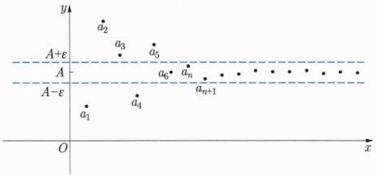
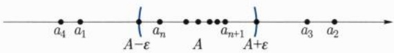

因此, $0^{*}$ 就是 $\widetilde{\mathbb{R}}$ 的零元. 特别地, $1^{*}$ 不是 $\widetilde{\mathbb{R}}$ 的零元, 从而它在 $\widetilde{\mathbb{R}}$ 中有逆元 $\tilde{\beta}$. 类似地, 我们有

$$
\tilde {I} = \tilde {\beta} \cdot 1 ^ {*} = \tilde {\beta} \cdot (1 ^ {*} \cdot 1 ^ {*}) = (\tilde {\beta} \cdot 1 ^ {*}) \cdot 1 ^ {*} = \tilde {I} \cdot 1 ^ {*} = 1 ^ {*}.
$$

即  $1^{*}$  是  $\widetilde{R}$  的单位元.

任取 $\tilde{\sigma} \in \widetilde{\mathbb{R}}$. 由 (C1), 存在正整数 $n$ 使得 $n^{*} > \tilde{\sigma}$ 以及 $n^{*} > -\tilde{\sigma}$. 因此, $\tilde{\sigma} > -n^{*}$.

现在令 $E := \{\alpha \in \mathbb{R} | \alpha \leqslant \tilde{\sigma}\}$. 则 $E$ 是 $\mathbb{R}$ 中的非空上有界集. 因此, 它在 $\mathbb{R}$ 中有上确界 $\beta = \sup_{\mathbb{R}} E$.

如果 $\tilde{\sigma} >\beta$ ，则 $\tilde{\sigma} -\beta >0^{*}$ .由(C1)，存在正整数 $m$ 使得 $m(\tilde{\sigma} -\beta) > 1^{*} = m\cdot \left(\frac{1}{m}\right)^{*}$ 于是，由(MO)易得 $\tilde{\sigma} -\beta \geqslant \left(\frac{1}{m}\right)^{*}$ .即 $\tilde{\sigma}\geqslant \left(\frac{1}{m}\right)^{*} + \beta .$ 所以 $\left(\frac{1}{m}\right)^{*} + \beta \in E.$ 这与 $\beta$ 为 $E$ 在 $\mathbb{R}$ 中的上确界矛盾.

类似地, 如果 $\tilde{\sigma} < \beta$, 则 $\beta - \tilde{\sigma} > 0^{*}$. 由 (C1), 存在正整数 $m$ 使得 $m(\beta - \tilde{\sigma}) > 1^{*}$. 这蕴涵了对任何 $\gamma \in E$, 成立 $\beta - \left(\frac{1}{m}\right)^{*} \geqslant \tilde{\sigma} \geqslant \gamma$. 同样与 $\beta$ 的定义矛盾.

因此, $\tilde{\sigma} = \beta$. 这就证明了 $\tilde{\mathbb{R}} = \mathbb{R}$, 即 (C2) 成立.

至此, 我们完成了实数系的构造. 接下来, 有理数的称呼将用于称呼有理分割, 而将无理分割称为无理数.

等价于上确界存在定理, 我们有下确界存在定理:

定理 2.3.5 R 中任何非空下有界集均有下确界.

若非空集 $E$ 无上界, 则记 $\sup E = +\infty$, 若 $E$ 无下界, 则记 $\inf E = -\infty$. 易见, 对于非空集 $E, F$, 我们有

$$
\inf E \leqslant \sup E, \tag {2.3.10}
$$

以及

$$
E \subseteq F \Longrightarrow \inf F \leqslant \inf E, \quad \sup E \leqslant \sup F. \tag {2.3.11}
$$

另一方面, 通常规定 $\sup \varnothing = -\infty, \inf \varnothing = +\infty$. 我们看到对于空集, (2.3.10) 式不成立. 构造实数系的其他典型方法

Weierstrass $^{①}$ 很早就认识到, 要使分析具备牢靠的基础, 必须建立严格的实数理论. 他于 1857 年开始讲授解析函数论等课程, 总要在第一阶段花很多时间阐明他关于实数的理论. 稍后, Méray $^{②}$, Cantor, Dedekind 以及 Heine $^{③}$ 分别于 1869, 1871, 1872, 1872 年各自独立地给出了无理数的定义, 建立了严格的实数理论.

历史上, Wallis $^{④}$ 于 1696 年将有理数与无限循环小数等同, 而 Stolz $^{⑤}$ 则于 1886 年提出将十进制无限非循环小数作为无理数的定义, 但未建立起一个满意的实数理论. 如今, 人们知道在小数中先引入序, 在此基础上建立上确界定理, 再来定义加法和乘法, 同样不难用小数来构造实数. 只是这一构造过程不如人们所期望的那么简捷. 有兴趣的读者也可以对本节用 Dedekind 分割构造实数的过程略加改写, 就可以得到用小数构造实数的过程.

<small>① Weierstrass, Karl Theodor Wilhelm, 1815 年 10 月 31 日—1897 年 2 月 19 日, 德国数学家.</small>

<small>② Méray, Hugues Charles Robert, 1835 年 11 月 12 日—1911 年 2 月 2 日, 法国数学家.</small>

<small>③ Heine, Heinrich Eduard, 1821 年 3 月 16 日—1881 年 10 月 21 日, 德国数学家.</small>

<small>④ Wallis, John, 1616 年 11 月 23 日—1703 年 10 月 28 日, 英国数学家.</small>

<small>⑤ Stolz, Otto, 1842 年 7 月 3 日—1905 年 11 月 23 日, 奥地利数学家.</small>

从有理数扩充到实数, 以 Weierstrass, Dedekind 和 Cantor 的工作最具代表性. 关于它们的简单介绍, 读者可以参见文献 [41, 43].

## 实数系的唯一性

人们用多种方法建立了实数系, 那么不同的方法会不会构造出本质上不同的实数系来呢? 很幸运, 回答是否定的. 事实上, 若用其他方法建立了一个实数系 $(\mathbb{R}^{*}, \oplus, \otimes, \preceq)$, 即它满足实数系公理 (F), (O) 和 (C), 则 $(\mathbb{R}^{*}, \oplus, \otimes, \preceq)$ 必然与之前构造的实数系 $(\mathbb{R}, +, \cdot, \leqslant)$ 序同构. 即存在一个双射 $T: \mathbb{R} \to \mathbb{R}^{*}$ 使得

(1)  $\forall x, y \in R, T(x + y) = T(x) \oplus T(y)$  成立;
(2)  $\forall x, y \in R, T(x \cdot y) = T(x) \otimes T(y)$  成立;
(3) 若 $x \in \mathbb{R}, x \geqslant 0$, 则 $T(x) \geqslant \theta$, 这里 $\theta$ 表示 $\mathbb{R}^*$ 中的零元.

由上述性质, 可以看到 $\mathbb{R}$ 中元素之间的四则运算、序关系与对应的元素在 $\mathbb{R}^*$ 中的四则运算、序关系完全一样. 而实数的其他即将引入的运算都是在序和四则运算的基础上引入的. 所以可以把 $\mathbb{R}$ 和 $\mathbb{R}^*$ 看作是一样的. 这样的 $T$ 称为“序同构”.

有兴趣的读者可参见文献[41,43].

## 2.4 实数系一些概念的回顾

基于已经建立的实数理论, 我们对实数的 $p$ 进制表示、算术几何不等式、基本初等函数的定义等作一个回顾.

## 实数的十进制表示

对于实数 $x$, 称 $[x] := \max \{n \in \mathbb{Z} | n \leqslant x\}$ 为 $x$ 的整数部分, 称 $\{x\} := x - [x]$ 为 $x$ 的小数部分. 请读者说明它们定义的合理性.

接下来, 我们来引入十进制小数.

首先, 对于实数 $x \geqslant 0$, 令 $m := [x]$, 以及对于整数 $k \geqslant 1$, 称

$$
a _ {k} := [ 1 0 ^ {k} x ] - 1 0 \cdot [ 1 0 ^ {k - 1} x ]
$$

为 x 的十进制小数的第 k 位小数. 此时,  $a_{k}$  取值于  $0,1,2,\cdots,9$ , 且成立

$$
x = \sup _ {k \geqslant 1} \left(m + \frac {a _ {1}}{1 0} + \frac {a _ {2}}{1 0 ^ {2}} + \dots + \frac {a _ {k}}{1 0 ^ {k}}\right). \tag {2.4.1}
$$

我们记 $x = m.a_{1}a_{2}\dots a_{k}\dots$ ，并称之为 $x$ 的十进制表示.而称 $-m.a_1a_2\dots a_k\dots$ 为 $-x$ 的十进制表示.

一般地, 若对某个 $k \geqslant 1$, 当 $j \geqslant k$ 时, 总有 $a_{j} = 0$, 则简记 $m.a_{1}a_{2} \cdots a_{k} \cdots$ 为 $m.a_{1}a_{2} \cdots a_{k-1}$. 相应实数称为有限小数.

若存在正整数 $n$, 以及某个 $k \geqslant 1$, 使得当 $j \geqslant k$ 时成立 $a_{j+n} = a_j$, 则记 $m.a_1a_2 \cdots a_k \cdots = m.a_1 \cdots a_{k-1}\dot{a}_k\dot{a}_{k+1} \cdots\dot{a}_{k+n-1}$ 并称 $a_k a_{k+1} \cdots a_{k+n-1}$ 为 (长为 $n$ 的) 循环节.

另一方面, 对于非负实数 $m$ 以及取值于 $0,1,2,\cdots,9$ 的 $a_1,a_2,\cdots,m.a_1a_2\cdots a_k\cdots$ 是否给出了一个实数? 按上确界存在定理, 不难看到, 可由 (2.4.1) 式给出一个实数. 问题是这一实数的小数表示是否就是 $m.a_1a_2\cdots a_k\cdots$?

容易证明, 当且仅当 9 不是 $m.a_{1}a_{2}\cdots a_{k}\cdots$ 的循环节时, 回答是肯定的.

但时常, 当 $m.a_{1}a_{2}\cdots a_{k}\cdots$ 以9为循环节时, 我们认为它就是按(2.4.1)式得到的实数. 这样, $0.\dot{9}=1$. 而有限小数都会有两个不同的表示, 一个是有限小数的形式, 另一个是以9为循环节的形式. 这在讨论中需要引起注意.

## 实数的 $p$ 进制表示

同样, 对于整数 $p \geqslant 2$, 可以定义实数的 $p$ 进制表示.

考虑 $x \geqslant 0$. 若 $x \leqslant 1$, 令 $N \equiv N_x := 0$. 若 $x > 1$, 由二项展开式, 对于 $n = [x] + 1$, 可得 $p^n \geqslant (p - 1 + 1)^n \geqslant n > x$. 因此, 注意到 $p^0 = 1 < x$, 此时可定义 $N \equiv N_x$ 为使得 $p^n \geqslant x$ 的最小整数 $n$. 即 $N$ 满足 $p^{N-1} < x \leqslant p^N$. 对于整数 $k \leqslant N$, 定义①

$$
a _ {k} := [ p ^ {- k} x ] - p \cdot [ p ^ {- k - 1} x ].
$$

则

$$
x = \sup _ {- \infty <   m \leqslant N} \sum_ {k = m} ^ {N} a _ {k} p ^ {k} = \sup _ {m \geqslant 1} \Big (\sum_ {k = 0} ^ {N} a _ {k} p ^ {k} + \sum_ {j = 1} ^ {m} \frac {a _ {- j}}{p ^ {j}} \Big). \tag {2.4.2}
$$

我们记 $x = a_{N}a_{N - 1}\dots a_{0}.a_{-1}a_{-2}\dots a_{-k}\dots_{p}$ ，并称之为 $x$ 的 $p$ 进制表示.而称 $x = -a_{N}a_{N - 1}\dots a_{0}.a_{-1}a_{-2}\dots a_{-k}\dots_{p}$ 为 $-x$ 的 $p$ 进制表示.

由于我们熟悉十进制表示. 当 p > 10 时, 采用上述表述方法, 就需要引入新的字符表示  $10, 11, \cdots, p - 1$ . 自然很不方便. 今后, 我们可以把 (2.4.2) 式中的 x 表示成无穷级数

$$
x = \sum_ {k = - \infty} ^ {N} a _ {k} p ^ {k} = \sum_ {k = 0} ^ {N} a _ {k} p ^ {k} + \sum_ {j = 1} ^ {\infty} \frac {a _ {- j}}{p ^ {j}}. \tag {2.4.3}
$$

对于 $p$ 进制数, 同样可以定义循环节. 时常, 若循环节为 $p - 1$, 则按 (2.4.2) 式来定义该数.

不难看到, $p$ 进制下的有限小数不见得是十进制下的有限小数. 反之亦然. 但 $p$ 进制下的有限小数或无限循环小数一定也是十进制下的有限小数或无限小数, 反之亦然. 事实上, 对任何整数 $p \geqslant 2$, $p$ 进制下的有限小数和无限循环小数的全体就是所有有理数.

<small>① 上面定义实数的十进制表示, 也应该如此处理整数部分.</small>

## $n$ 次方根

有了上确界存在定理, 我们可以定义 n 次方根.

定理 2.4.1 设 a > 0 ，而 n 为正整数，则方程  $x^{n} = a$  有唯一的正解.

证明 由于 $t > s > 0$ 蕴涵 $t^n > s^n$, 因此, 方程 $x^n = a$ 的正解若存在, 必然唯一.

现考虑集合  $E_{a} := \{y | y > 0, y^{n} \leqslant a\}$ .

取 $s = \frac{a}{1 + a}$, 则 $0 < s < 1$, 从而 $s^n < s < a$, 即 $s \in E_a$, 因此 $E_a$ 非空. 另一方面, $(1 + a)^n \geqslant 1 + a > a$, 因此 $1 + a$ 是 $E_a$ 的一个上界. 这样, $x := \sup E_a$ 存在且 $\frac{a}{1 + a} \leqslant x \leqslant 1 + a$. 下证 $x^n = a$.

若 $x^n < a$ ，取 $\varepsilon = \frac{a - x^n}{(2 + a)^n}$ ，则 $\varepsilon \in (0,1)$ ，从而

$$
(x + \varepsilon) ^ {n} = \sum_ {k = 0} ^ {n} \mathrm{C} _ {n} ^ {k} \varepsilon^ {k} x ^ {n - k} \leqslant x ^ {n} + \varepsilon \sum_ {k = 1} ^ {n} \mathrm{C} _ {n} ^ {k} x ^ {k} <   x ^ {n} + \varepsilon (2 + a) ^ {n} = a.
$$

所以 $x + \varepsilon \in E_a$ ，与 $x$ 为 $E_{a}$ 的上确界矛盾.

若 $x^n > a$. 取 $\varepsilon = \frac{x^n - a}{(2 + a)^n}$, 则 $0 < \varepsilon < 1$ 且 $x - \varepsilon > 0$. 进一步,

$$
(x - \varepsilon) ^ {n} = \sum_ {k = 0} ^ {n} \mathrm{C} _ {n} ^ {k} (- \varepsilon) ^ {k} x ^ {n - k} \geqslant x ^ {n} - \varepsilon \sum_ {k = 1} ^ {n} \mathrm{C} _ {n} ^ {k} x ^ {k} > x ^ {n} - \varepsilon (2 + a) ^ {n} = a.
$$

因此, $x - \varepsilon$ 是 $E_{a}$ 的一个上界, 与 $x$ 为 $E_{a}$ 的上确界矛盾.

这就证明了 $x^n = a$.

定义 2.4.1 设  $a \geqslant 0$ ，对于正整数  $n \geqslant 2$ ，称方程  $x^{n} = a$  的唯一非负实根为 a 的 n 次方根，记作  $a^{\frac{1}{n}}$  或  $\sqrt[n]{a}$ 。 $\sqrt[2]{a}$  简记为  $\sqrt{a}$ 。

## 实数指数幂

在 $n$ 次方根的基础上, 对于正数 $a$ 以及有理数 $q$, 我们可以定义 $a^q$ 并建立相应的性质. 另外, 也可以对某些特殊的 $q$, 当 $a = 0$ 或 $a < 0$ 时, 定义 $a^q$.

进一步, 可以定义实数指数幂与对数并建立相关性质. 具体细节参见本节习题 9\~15.

以上过程较为烦琐. 今后, 我们还将利用极限来定义实数指数幂与对数 (参见第五章第 5 节).

## 三角函数与反三角函数

我们称幂函数、指数函数、对数函数、三角函数与反三角函数为基本初等函数. 要从分析上严格地定义三角函数及反三角函数, 一般有三个途径: 利用定积分、利用微分方程以及利用极限或级数. 有兴趣的读者可参见文献 [43]. 在第五章第 5 节, 我们介绍如何用极限或级数来定义三角函数.

## 算术几何平均不等式

接下来, 建立如下的算术几何平均不等式.

命题 2.4.2 设  $n \geqslant 2, a_{1}, a_{2}, \cdots, a_{n} \geqslant 0$ ，则

$$
\sqrt [ n ]{\prod_ {k = 1} ^ {n} a _ {k}} \leqslant \frac {1}{n} \sum_ {k = 1} ^ {n} a _ {k}. \tag {2.4.4}
$$

且等号成立当且仅当  $a_{1}=a_{2}=\cdots=a_{n}$ .

不等式左端称为  $a_{1}, a_{2}, \cdots, a_{n}$  的几何平均，右端称为  $a_{1}, a_{2}, \cdots, a_{n}$  的算术平均.

证明 我们分三步加以证明.

(i) $n = 2$ 的情形. 设 $a_1, a_2 \geqslant 0$, 则

$$
a _ {1} - 2 \sqrt {a _ {1} a _ {2}} + a _ {2} = (\sqrt {a _ {1}} - \sqrt {a _ {2}}) ^ {2} \geqslant 0.
$$

从而 (2.4.4) 式成立, 且等号成立当且仅当 $a_1 = a_2$.

(ii)  $n = 2^{k} \quad (k \geqslant 1)$  的情形. 设对某个  $k \geqslant 1$ , 当  $n = 2^{k}$  时命题 2.4.2 成立. 记  $m = 2^{k}$ . 则对于  $a_{1}, a_{2}, \cdots, a_{2m} \geqslant 0$ , 我们有

$$
\sqrt [ 2 m ]{\prod_ {j = 1} ^ {2 m} a _ {j}} = \sqrt [ m ]{\prod_ {j = 1} ^ {m} \sqrt {a _ {j} a _ {m + j}}} \leqslant \frac {1}{m} \sum_ {j = 1} ^ {m} \sqrt {a _ {j} a _ {m + j}},
$$

且等号成立当且仅当  $a_{1}a_{m+1}=a_{2}a_{m+2}=\cdots=a_{m}a_{2m}$ . 由 (i),

$$
\frac {1}{m} \sum_ {j = 1} ^ {m} \sqrt {a _ {j} a _ {m + j}} \leqslant \frac {1}{2 m} \sum_ {j = 1} ^ {2 m} a _ {j},
$$

且等号成立当且仅当 $a_1 = a_{m + 1},a_2 = a_{m + 2},\dots ,a_m = a_{2m}$ 都成立.总之，

$$
\sqrt [ 2 m ]{\prod_ {j = 1} ^ {2 m} a _ {j}} \leqslant \frac {1}{2 m} \sum_ {j = 1} ^ {2 m} a _ {j},
$$

且等号成立当且仅当  $a_{1}=a_{2}=\cdots=a_{2m}$ . 即命题 2.4.2 当  $n=2^{k+1}$  时也成立.

结合 (i), 由数学归纳法得到对任何 $k \geqslant 1$, 命题2.4.2当 $n = 2^k$ 时成立.

(iii)  $n \geqslant 2$  的一般情形. 一般地, 对于  $n \geqslant 2$ , 有  $k \geqslant 1$  使得  $2^{k} \leqslant n < 2^{k+1}$ . 记  $m = 2^{k}$ , 由 (ii), 不妨设 m < n < 2m. 对于  $a_{1}, a_{2}, \cdots, a_{n} \geqslant 0$ , 令  $A = \frac{1}{n} \sum_{j=1}^{n} a_{j}$ . 当 A = 0 时,  $a_{1} = a_{2} = \cdots = a_{n} = 0$ , 命题自然成立. 下设 A > 0. 令  $a_{n+1} = a_{n+2} = \cdots = a_{2m} = A$ , 我们有

$$
\sqrt [ n ]{\prod_ {j = 1} ^ {n} a _ {j}} = \frac {1}{A ^ {\frac {2 m - n}{n}}} \left[ \left(\prod_ {j = 1} ^ {2 m} a _ {j}\right) ^ {\frac {1}{2 m}} \right] ^ {\frac {2 m}{n}} \leqslant \frac {1}{A ^ {\frac {2 m - n}{n}}} \left(\frac {1}{2 m} \sum_ {j = 1} ^ {2 m} a _ {j}\right) ^ {\frac {2 m}{n}} = A,
$$

且等号成立当且仅当  $a_{1}=a_{2}=\cdots=a_{n}=A$ . 这就证明了命题.

## Young 不等式

我们来把算术几何平均不等式推广为 Young $^{①}$ 不等式. 若 $1 \leqslant p, q \leqslant +\infty$ 满足 $\frac{1}{p} + \frac{1}{q} = 1$, 则称 p, q 为对偶数.

定理 2.4.3 设 $p,q \in  \left( {1, + \infty }\right)$ 为对偶数. 则对任何 $a,b > 0$ ,有 ${}^{\text{②}}$

$$
a b \leqslant \frac {1}{p} a ^ {p} + \frac {1}{q} b ^ {q}. \tag {2.4.5}
$$

证明 令 $A = \frac{a}{(ab)^{\frac{1}{p}}}$. 则 $\frac{b}{(ab)^{\frac{1}{q}}} = \frac{1}{A}$. 因此, (2.4.5) 式等价于

$$
1 \leqslant \frac {1}{p} A ^ {p} + \frac {1}{q} \frac {1}{A ^ {q}}. \tag {2.4.6}
$$

不妨设 $A \geqslant 1$. 任取 $m > p$. 令 $k = \left[\frac{m}{p}\right] + 1$. 则 $\frac{1}{p} \leqslant \frac{k}{m} \leqslant \frac{1}{p} + \frac{1}{m}, \frac{1}{q} \geqslant \frac{m - k}{m}$. 从而利用算术几何平均不等式, 可得

$$
\begin{array}{l} \frac {1}{m} A ^ {p} + \frac {1}{p} A ^ {p} + \frac {1}{q} \frac {1}{A ^ {q}} \geqslant \frac {k}{m} A ^ {\frac {m}{k}} + \frac {m - k}{m} \frac {1}{A ^ {\frac {m}{m - k}}} \\ \geqslant \left(\left(A ^ {\frac {m}{k}}\right) ^ {k} \left(\frac {1}{A ^ {\frac {m}{m - k}}}\right) ^ {m - k}\right) ^ {\frac {1}{m}} = 1. \\ \end{array}
$$

由 m > p 的任意性即得 (2.4.6) 式. 定理得证.

利用 Young 不等式易得如下定理.

定理 2.4.4 设  $x \geqslant 0$ ，则

$$
(1 + x) ^ {\alpha} - 1 \leqslant \alpha x, \quad \forall \alpha \in (0, 1 ], x \geqslant 0. \tag {2.4.7}
$$

$$
(1 + x) ^ {\alpha} - 1 \geqslant \alpha x, \quad \forall \alpha \geqslant 1, x \geqslant 0. \tag {2.4.8}
$$

$$
(1 + x) ^ {\alpha} - 1 \geqslant \frac {\alpha x}{1 + x}, \quad \forall \alpha \geqslant 0, x \geqslant 0. \tag {2.4.9}
$$

进一步，以上三个不等式是等价的.

## 习题2

1. 证明: 对任何整数 $p \geqslant 2, p$ 进制下的有限小数和无限循环小数的全体就是所有有理数.

<small>① Young, William Henry, 1863 年 10 月 20 日—1942 年 7 月 7 日, 英国数学家. Young, Grace Chisholm, 1868 年 3 月 15 日—1944 年 3 月 29 日, 英国数学家. 两者为夫妻, 合作进行数学研究.</small>

<small>② 今后可以证明 (2.4.5) 式中, 等号成立当且仅当 $a = b^{q - 1}$.</small>

2. Rudin 在其《数学分析原理》 $^{[52]}$  一书中使用了变换  $q = p + \frac{2 - p^{2}}{p + 2} = \frac{2 + 2p}{p + 2}$ . 验证:

(1) 若 p > 0, 且  $p^{2} < 2$ , 则 q > p 且  $q^{2} < 2$ ;
(2) 若 p > 0, 且  $p^{2} > 2$ , 则 0 < q < p 且  $q^{2} > 2$ .

3. 试求使变换 $q = p + \frac{2 - p^2}{ap + b}$ 具有习题 2 中性质 (1)\~(2) 的所有有理数对 $(a, b)$.
4. 证明无理数在实数集中的稠密性: 对任何 $x \in \mathbb{R}$, 以及 $\varepsilon > 0$, 存在无理数 $y$ 使得 $|y - x| < \varepsilon$.
5. 设 $a > 0$, 而 $n$ 为正整数. 证明: $\min \{a, 1\} \leqslant a^{\frac{1}{n}} \leqslant \max \{a, 1\}$.
6. 设  $n \geqslant 2, \alpha_{1}, \alpha_{2}, \cdots, \alpha_{n} \geqslant 0$ ，满足  $\alpha_{1} + \alpha_{2} + \cdots + \alpha_{n} = 1$ 。证明:对于  $x_{1}, x_{2}, \cdots, x_{n} > 0$ ，有  $x_{1}^{\alpha_{1}} x_{2}^{\alpha_{2}} \cdots x_{n}^{\alpha_{n}} \leqslant \alpha_{1} x_{1} + \alpha_{2} x_{2} + \cdots + \alpha_{n} x_{n}$ 。
7. 证明定理 2.4.4.
8. 设 $I$ 是一个非空指标集, 对 $I$ 中每一个元 $\alpha$, 都对应两个实数 $x_{\alpha}$ 以及 $y_{\alpha}$. 我们习惯将 $\sup \{x_{\alpha} | \alpha \in I\}$ 和 $\inf \{x_{\alpha} | \alpha \in I\}$ 写成 $\sup_{\alpha \in I} x_{\alpha}$ 和 $\inf_{\alpha \in I} x_{\alpha}$. 证明: 在广义实数系中,

(1) $\inf_{\alpha \in I}(-x_{\alpha}) = -\sup_{\alpha \in I}x_{\alpha};$

(2) 对以下所列的每一个不等式:

$$
\begin{array}{l} \inf _ {\alpha \in I} x _ {\alpha} + \inf _ {\alpha \in I} y _ {\alpha} \leqslant \inf _ {\alpha \in I} (x _ {\alpha} + y _ {\alpha}) \leqslant \sup _ {\alpha \in I} x _ {\alpha} + \inf _ {\alpha \in I} y _ {\alpha} \\ \leqslant \sup _ {\alpha \in I} (x _ {\alpha} + y _ {\alpha}) \leqslant \sup _ {\alpha \in I} x _ {\alpha} + \sup _ {\alpha \in I} y _ {\alpha}, \\ \end{array}
$$

若其两端在广义实数系中都有意义, 则该不等式成立;

(3) 若 $x_{\alpha} > 0 (\forall \alpha \in I)$, 并在此种情形规定 $\frac{1}{0} = +\infty$, 我们有

$$
\sup _ {\alpha \in I} \frac {1}{x _ {\alpha}} = \frac {1}{\inf _ {\alpha \in I} x _ {\alpha}};
$$

(4) 设  $x_{\alpha} > 0, y_{\alpha} > 0 (\forall \alpha \in I)$ . 对以下所列的每一个不等式:

$$
\begin{array}{l} \inf _ {\alpha \in I} x _ {\alpha} \inf _ {\alpha \in I} y _ {\alpha} \leqslant \inf _ {\alpha \in I} (x _ {\alpha} y _ {\alpha}) \leqslant \sup _ {\alpha \in I} x _ {\alpha} \inf _ {\alpha \in I} y _ {\alpha}, \\ \leqslant \sup _ {\alpha \in I} (x _ {\alpha} y _ {\alpha}) \leqslant \sup _ {\alpha \in I} x _ {\alpha} \sup _ {\alpha \in I} y _ {\alpha}, \\ \end{array}
$$

若其两端在广义实数系中都有意义, 则该不等式成立.

9. 对于 $a > 0$ 以及有理数 $\frac{m}{n}$, 其中 $m, n$ 为既约整数, $n > 0$. 当 $m \neq 1$ 时, 定义

$$
a ^ {\frac {m}{n}} := \left(a ^ {m}\right) ^ {\frac {1}{n}}.
$$

自然, 当 $m = 1$ 时, 上式也成立. 进一步, 当 $n = 2k + 1$ 为奇数时, 定义

$$
\left(- a\right) ^ {\frac {m}{2 k + 1}} := \left(- 1\right) ^ {m} a ^ {\frac {m}{2 k + 1}}.
$$

下设 $a, b > 0$，且 $p, q$ 为有理数，证明:

(1) $(a^p)^q = a^{pq}$;

(2) $a^p a^q = a^{p + q}$;

(3) $a^p b^p = (ab)^p$;

(4) 若 a > 1, p > 0, 则  $a^{p} > 1$ ;

(5) 若 a > 1, 则  $a^{p}$  关于  $p \in Q$  严格单增;

(6) 设 $a > 1$, 对于任何 $b \in \mathbb{R}$, $\sup \{a^p | p < b\} = \inf \{a^p | p > b\}$ 成立.

10. 设  $a \geqslant 1$ ，且 b 为无理数，定义

$$
a ^ {b} := \sup \left\{a ^ {p} | p \leqslant b \right\}.
$$

证明: 当 b 为有理数时上式也成立.

进一步, 当 0 < a < 1 时, 定义  $a^{b} = (a^{-1})^{-b}$ .

11. 设 $a, b > 0$, 且 $x, y \in \mathbb{R}$, 证明:

(1) $(a^x)^y = a^{xy}$;
(2) $a^{x}a^{y}=a^{x+y};$
(3) $a^x b^x = (ab)^x$;

(4) 若 a > 1, x > 0, 则  $a^{x} > 1$ ;

(5) 若 a > 1, 则  $a^{x}$  关于  $x \in R$  严格单增;

(6) 若 0 < a < 1, 则  $a^{x}$  关于  $x \in R$  严格单减.

12. 设 $a > 0, a \neq 1, b > 0$, 证明有唯一的实数 $x$ 满足 $a^x = b$. 该实数称为以 $a$ 为底以 $b$ 为真数的对数. 记作 $\log_a b$. 在底 $a$ 明确的情况下, 可以简写为 $\log b$. $\log_{10} b$ 记作 $\lg b$, 称为常用对数, $\log_e b$ 记作 $\ln b$, 称为自然对数, 其中常数 $e$ 在3.3.2小节定义.

13. 设 $a, b, x > 0, a \neq 1, b \neq 1$. 证明: $\log_a x = \frac{\log_b x}{\log_b a}$.

14. 证明: 当 $a > 1$ 时, $\log_a x$ 关于 $x > 0$ 严格单增; 当 $0 < a < 1$ 时, $\log_a x$ 关于 $x > 0$ 严格单减.

15. 设 $a, x, y > 0, a \neq 1$, 证明: $\log_a(xy) = \log_a x + \log_a y$.

## 第三章

## 序列极限

极限贯穿整个数学分析课程, 学习数学分析是一个从理解简单的极限到理解复杂的极限的不断深入的过程.

## 3.1 数列极限

所谓实数列, 是指一个从正整数集映到实数集的函数 $a: \mathbb{N}_+ \to \mathbb{R}$. 若记 $a(n)$ 为 $a_n$, 则我们用 $\{a_n\}$ 表示该数列, $a_n$ 称为数列的一般项或通项. 通常, 我们也把数列 $\{a_n\}$ 写成

$$
a _ {1}, a _ {2}, \dots , a _ {n}, a _ {n + 1}, \dots . \tag {3.1.1}
$$

必要时, 对于整数 $m$, 我们用 $\{a_{n}\}_{m}^{\infty}$ 表示数列

$$
a _ {m}, a _ {m + 1}, a _ {m + 2}, \dots , a _ {n}, a _ {n + 1}, \dots . \tag {3.1.2}
$$

我们定义数列极限如下:

定义 3.1.1 设有数列  $\{a_{n}\}$  与给定常数 A, 如果对任意  $\varepsilon > 0$ , 都存在  $N \geqslant 1$ , 使得当  $n \geqslant N$  时, 有

$$
\left| a _ {n} - A \right| <   \varepsilon , \tag {3.1.3}
$$

则称数列 $\{a_{n}\}$ 收敛于① $A$ 或极限存在, $A$ 称为 $\{a_{n}\}$ 的极限, 记作②

$$
\lim _ {n \rightarrow + \infty} a _ {n} = A \tag {3.1.4}
$$

或

$$
a _ {n} \rightarrow A, \quad \text {当} n \rightarrow + \infty \text {时}. \tag {3.1.5}
$$

当  $\{a_{n}\}$  不收敛时, 我们就称它是发散的.

通俗地讲, $\{a_{n}\}$ 的极限为 $A$, 就是只要 $n$ 足够大, $a_{n}$ 与 $A$ 要多接近就有多接近. 体现在直角坐标系中, 就是当 $n$ 足够大时, $(n, a_{n})$ 都落在带形 $(- \infty, +\infty) \times (A - \varepsilon, A + \varepsilon)$ 上, 如图3.1所示. 也可以这样理解 $\{a_{n}\}$ 的极限为 $A$: 无论 $\varepsilon > 0$ 有多小, 数列 $\{a_{n}\}$ 中都只有有限项落在区间 $(A - \varepsilon, A + \varepsilon)$ 之外, 如图3.2所示.

对于数列 $\{a_{n}\}$, 可形成一个新的数列 $\left\{\sum_{k=1}^{n} a_{k}\right\}$, 我们用 $\sum_{n=1}^{\infty} a_{n}$ 表示, 称为无穷级数或级数. 若 $\left\{\sum_{k=1}^{n} a_{k}\right\}$ 收敛到 $A$, 则称级数 $\sum_{n=1}^{\infty} a_{n}$ 收敛到 $A$, 又称级数的和为 $A$. $\sum_{k=1}^{n} a_{k}$ 称为级数的部分和. 易见, $\lim_{n \to +\infty} a_{n} = 0$ 是级数 $\sum_{n=1}^{\infty} a_{n}$ 收敛的必要条件.

<small>① “收敛于 A” 也时常说成 “趋于 A”.</small>

<small>② 鉴于数列极限中的 n 通常为自然数或正整数,  $n \rightarrow +\infty$  时常写为  $n \rightarrow \infty$ .</small>

scatter

| Point | x (approx) | y (approx) |
| --- | --- | --- |
| a1 | ~0.5 | ~-2.5 |
| a2 | ~1.5 | ~7.5 |
| a3 | ~2.5 | ~4.5 |
| a4 | ~3.5 | ~-1.5 |
| a5 | ~4.5 | ~6.0 |
| a6 | ~5.5 | ~-0.5 |
| an | ~6.5 | ~-0.5 |
| an+1 | ~7.5 | ~-1.0 |
| Unlabeled 1 | ~8.5 | ~-0.5 |
| Unlabeled 2 | ~9.5 | ~-0.5 |
| Unlabeled 3 | ~10.5 | ~-0.5 |
| Unlabeled 4 | ~11.5 | ~-0.5 |
| Unlabeled 5 | ~12.5 | ~-0.5 |
| Unlabeled 6 | ~13.5 | ~-0.5 |
| Unlabeled 7 | ~14.5 | ~-0.5 |
| Unlabeled 8 | ~15.5 | ~-0.5 |
| Unlabeled 9 | ~16.5 | ~-0.5 |
| Unlabeled 10 | ~17.5 | ~-0.5 |
| Unlabeled 11 | ~18.5 | ~-0.5 |
| Unlabeled 12 | ~19.5 | ~-0.5 |
| Unlabeled 13 | ~20.5 | ~-0.5 |
| Unlabeled 14 | ~21.5 | ~-0.5 |
| Unlabeled 15 | ~22.5 | ~-0.5 |
| Unlabeled 16 | ~23.5 | ~-0.5 |
| Unlabeled 17 | ~24.5 | ~-0.5 |
| Unlabeled 18 | ~25.5 | ~-0.5 |
| Unlabeled 19 | ~26.5 | ~-0.5 |
| Unlabeled 20 | ~27.5 | ~-0.5 |
| Unlabeled 21 | ~28.5 | ~-0.5 |
| Unlabeled 22 | ~29.5 | ~-0.5 |
| Unlabeled 23 | ~30.5 | ~-0.5 |
| Unlabeled 24 | ~31.5 | ~-0.5 |
| Unlabeled 25 | ~32.5 | ~-0.5 |
| Unlabeled 26 | ~33.5 | ~-0.5 |
| Unlabeled 27 | ~34.5 | ~-0.5 |
| Unlabeled 28 | ~35.5 | ~-0.5 |
| Unlabeled 29 | ~36.5 | ~-0.5 |
| Unlabeled 30 | ~37.5 | ~-0.5 |
| Unlabeled 31 | ~38.5 | ~-0.5 |
| Unlabeled 32 | ~39.5 | ~-0.5 |
| Unlabeled 33 | ~40.5 | ~-0.5 |
| Unlabeled 34 | ~41.5 | ~-0.5 |
| Unlabeled 35 | ~42.5 | ~-0.5 |
| Unlabeled 36 | ~43.5 | ~-0.5 |
| Unlabeled 37 | ~44.5 | ~-0.5 |
| Unlabeled 38 | ~45.5 | ~-0.5 |
| Unlabeled 39 | ~46.5 | ~-0.5 |
| Unlabeled 40 | ~47.5 | ~-0.5 |
| Unlabeled 41 | ~48.5 | ~-0.5 |
| Unlabeled 42 | ~49.5 | ~-0.5 |
| Unlabeled 43 | ~50.5 | ~-0.5 |
| Unlabeled 44 | ~51.5 | ~-0.5 |
| Unlabeled 45 | ~52.5 | ~-0.5 |
| Unlabeled 46 | ~53.5 | ~-0.5 |
| Unlabeled 47 | ~54.5 | ~-0.5 |
| Unlabeled 48 | ~55.5 | ~-0.5 |
| Unlabeled 49 | ~56.5 | ~-0.5 |
| Unlabeled 50 | ~57.5 | ~-0.5 |
| Unlabeled 51 | ~58.5 | ~-0.5 |
| Unlabeled 52 | ~59.5 | ~-0.5 |
| Unlabeled 53 | ~60.5 | ~-0.5 |
| Unlabeled 54 | ~61.5 | ~-0.5 |
| Unlabeled 55 | ~62.5 | ~-0.5 |
| Unlabeled 56 | ~63.5 | ~-0.5 |
| Unlabeled 57 | ~64.5 | ~-0.5 |
| Unlabeled 58 | ~65.5 | ~-0.5 |
| Unlabeled 59 | ~66.5 | ~-0.5 |
| Unlabeled 60 | ~67.5 | ~-0.5 |
| Unlabeled 61 | ~68.5 | ~-0.5 |
| Unlabeled 62 | ~69.5 | ~-0.5 |
| Unlabeled 63 | ~70.5 | ~-0.5 |
| Unlabeled 64 | ~71.5 | ~-0.5 |
| Unlabeled 65 | ~72.5 | ~-0.5 |
| Unlabeled 66 | ~73.5 | ~-0.5 |
| Unlabeled 67 | ~74.5 | ~-0.5 |
| Unlabeled 68 | ~75.5 | ~-0.5 |
| Unlabeled 69 | ~76.5 | ~-0.5 |
| Unlabeled 70 | ~77.5 | ~-0.5 |
| Unlabeled 71 | ~78.5 | ~-0.5 |
| Unlabeled 72 | ~79.5 | ~-0.5 |
| Unlabeled 73 | ~80.5 | ~-0.5 |
| Unlabeled 74 | ~81.5 | ~-0.5 |
| Unlabeled 75 | ~82.5 | ~-0.5 |
| Unlabeled 76 | ~83.5 | ~-0.5 |
| Unlabeled 77 | ~84.5 | ~-0.5 |
| Unlabeled 78 | ~85.5 | ~-0.5 |
| Unlabeled 79 | ~86.5 | ~-0.5 |
| Unlabeled 80 | ~87.5 | ~-0.5 |
| Unlabeled 81 | ~88.5 | ~-0.5 |
| Unlabeled 82 | ~89.5 | ~-0.5 |
| Unlabeled 83 | ~90.5 | ~-0.5 |
| Unlabeled 84 | ~91.5 | ~-0.5 |
| Unlabeled 85 | ~92.5 | ~-0.5 |
| Unlabeled 86 | ~93.5 | ~-0.5 |
| Unlabeled 87 | ~94.5 | ~-0.5 |
| Unlabeled 88 | ~95.5 | ~-0.5 |
| Unlabeled 89 | ~96.5 | ~-0.5 |
| Unlabeled 90 | ~97.5 | ~-0.5 |
| Unlabeled 91 | ~98.5 | ~-0.5 |
| Unlabeled 92 | ~99.5 | ~-0.5 |

图3.1

text_image

a₄ a₁
A−ε aₙ A Aₙ₊₁ A+ε a₃ a₂

图3.2

类似地, 由数列 $\{a_{n}\}$ 形成的另一个数列 $\left\{\prod_{k=1}^{n} a_{k}\right\}$ 称为无穷乘积, 用 $\prod_{n=1}^{\infty} a_{n}$ 表示. 若 $\left\{\prod_{k=1}^{n} a_{k}\right\}$ 收敛到实数 $A \neq 0$, 则称无穷乘积 $\prod_{n=1}^{\infty} a_{n}$ 收敛到 $A$, 又称作乘积为 $A$. $\prod_{k=1}^{n} a_{k}$ 称为无穷乘积的部分积. 易见, $\lim_{n \to +\infty} a_{n} = 1$ 是无穷乘积 $\prod_{n=1}^{\infty} a_{n}$ 收敛的必要条件.

用定义说明极限存在关键是找到合适的 N. 满足要求的 N 并不唯一. 许多初学者习惯于寻找使不等式 (3.1.3) 成立的那个最小的 N. 但这是没有必要的. 正确的思路是用尽量简单的方法找一个正确的简单的 N.

例3.1.1 证明 $\lim_{n\to +\infty}\frac{n}{2n + 1} = \frac{1}{2}$

证明 $\forall \varepsilon > 0$, 要使得

$$
\left| \frac {n}{2 n + 1} - \frac {1}{2} \right| <   \varepsilon ,
$$

即

$$
2 (2 n + 1) > \frac {1}{\varepsilon},
$$

只要

$$
n \geqslant \left[ \frac {1}{\varepsilon} \right].
$$

取 $N = \left[\frac{1}{\varepsilon}\right]$, 则当 $n \geqslant N$ 时, 有

$$
\left| \frac {n}{2 n + 1} - \frac {1}{2} \right| <   \varepsilon .
$$

于是, 根据极限的定义, 得到  $\lim_{n\to+\infty}\frac{n}{2n+1}=\frac{1}{2}$ .

当 $\varepsilon > 1$ 时, 上面所取的 $N = 0$, 不符合极限定义中 $N \geqslant 1$ 的条件. 为此, 我们可以用取 $N = \left[\frac{1}{\varepsilon}\right] + 1$ 来代替原先的取法.

另一方面, 极限定义中之所以要求 $N \geqslant 1$, 是因为数列定义中的起始项对应于 $n = 1$. 但这不是本质的. 在 (3.1.2) 式中, 数列的起始项对应于整数 $n = m$, 此时极限定义中的 “$N \geqslant 1$” 自然应修改为 “$N \geqslant m$”.

在例 3.1.1 中, 我们不妨认为数列的起始项对应于 n = 0 的项  $\frac{0}{0 + 1} = 0$ . 这样, 就不必刻意去要求  $N \geqslant 1$ .

当情况更为复杂时, 较大的 $\varepsilon$ 反而造成一些麻烦. 为此, 可限制 $\varepsilon$ 取值于 $(0, \delta_0)$, 其中 $\delta_0$ 是一个预先给定的正数. 换言之, 极限定义中的 “$\forall \varepsilon > 0$”, 可以替换为 “$\forall \varepsilon \in (0,1)$” 或 “$\forall \varepsilon \in \left(0, \frac{1}{2}\right)$” 等.

例 3.1.2 设 a > 1, 证明  $\lim_{n \to +\infty} \sqrt[n]{a} = 1$ .

证明 $\forall \varepsilon > 0,$ 要使得

$$
\left| \sqrt [ n ]{a} - 1 \right| <   \varepsilon ,
$$

即

$$
a <   (1 + \varepsilon) ^ {n} = 1 + n \varepsilon + \mathrm{C} _ {n} ^ {2} \varepsilon^ {2} + \dots + \mathrm{C} _ {n} ^ {n} \varepsilon^ {n},
$$

只要

$$
a <   n \varepsilon .
$$

取 $N = \left[\frac{a}{\varepsilon}\right] + 1$ ，则当 $n \geqslant N$ 时，有

$$
\left| \sqrt [ n ]{a} - 1 \right| <   \varepsilon .
$$

于是, 根据极限的定义, 得到  $\lim_{n\to+\infty}\sqrt[n]{a}=1$ .

例 3.1.3 证明  $\lim_{n\to+\infty}\sqrt[n]{n}=1$ .

证明 $\forall \varepsilon > 0,$ 要使得

$$
\left| \sqrt [ n ]{n} - 1 \right| <   \varepsilon ,
$$

即

$$
n <   (1 + \varepsilon) ^ {n} = 1 + n \varepsilon + \mathrm{C} _ {n} ^ {2} \varepsilon^ {2} + \dots + \mathrm{C} _ {n} ^ {n} \varepsilon^ {n},
$$

只要 $n \geqslant 2$ ，且

$$
n <   \frac {n (n - 1)}{2} \varepsilon^ {2}. \tag {3.1.6}
$$

这只要 $n \geqslant 2$ ，且

$$
n > \frac {2}{\varepsilon^ {2}} + 1.
$$

取 $N = \left[\frac{2}{\varepsilon^2}\right] + 2,$ 则当 $n\geqslant N$ 时，有

$$
\left| \sqrt [ n ]{n} - 1 \right| <   \varepsilon .
$$

于是, 根据极限的定义, 得到 $\lim_{n\to +\infty}\sqrt[n]{n} = 1$.

在上面的讨论中, 为了 $(1 + \varepsilon)^n$ 的展开式出现 (3.1.6) 式中的 $\frac{n(n - 1)}{2}\varepsilon^2$, 我们附加了 $n \geqslant 2$ 的要求. 事实上, 即使 $n < 2$, 认为 $(1 + \varepsilon)^n$ 的展开式中含有 $\frac{n(n - 1)}{2}\varepsilon^2$ 也并无不妥. 而在默认 $n \geqslant 0$ 时, $(1 + \varepsilon)^n \geqslant \frac{n(n - 1)}{2}\varepsilon^2$ 也总是成立. 因此, $n \geqslant 2$ 这个要求可以不用专门提.

例3.1.4 设 $q \in (-1, 1)$. 证明 $\lim_{n \to +\infty} q^n = 0$.

证明 $\forall \varepsilon > 0,$ 要使得

$$
\left| q ^ {n} \right| <   \varepsilon ,
$$

即

$$
n \lg | q | <   \lg \varepsilon ,
$$

亦即

$$
n > \frac {\lg \varepsilon}{\lg | q |},
$$

可取 $N = \left[\frac{\lg\varepsilon}{\lg|q|}\right] + 1,$ 则当 $n\geqslant N$ 时，有

$$
\left| q ^ {n} \right| <   \varepsilon .
$$

于是, 根据极限的定义, 得到  $\lim_{n\to+\infty}q^{n}=0$ .

例 3.1.5 证明  $\lim_{n\to+\infty}\frac{10n^{3}-456n^{2}+123n-89}{2n^{3}-99n^{2}+7n-8}=5.$

证明 任取 $\varepsilon \in (0,1)$, 要使得

$$
\left| \frac {1 0 n ^ {3} - 4 5 6 n ^ {2} + 1 2 3 n - 8 9}{2 n ^ {3} - 9 9 n ^ {2} + 7 n - 8} - 5 \right| <   \varepsilon ,
$$

即

$$
\left| \frac {3 9 n ^ {2} + 8 8 n - 4 9}{2 n ^ {3} - 9 9 n ^ {2} + 7 n - 8} \right| <   \varepsilon ,
$$

只要 $n \geqslant 100$ ，且

$$
\frac {4 0 n ^ {2}}{n ^ {3}} <   \varepsilon .
$$

取 $N = \left[\frac{100}{\varepsilon}\right]$, 则当 $n \geqslant N$ 时, 有

$$
\left| \frac {1 0 n ^ {3} - 4 5 6 n ^ {2} + 1 2 3 n - 8 9}{2 n ^ {3} - 9 9 n ^ {2} + 7 n - 8} - 5 \right| <   \varepsilon .
$$

于是, 根据极限的定义, 得到  $\lim_{n\to+\infty}\frac{10n^{3}-456n^{2}+123n-89}{2n^{3}-99n^{2}+7n-8}=5.$

注3.1.1 在很多场合, 严格地按照极限定义的形式进行讨论会显得很不方便. 因此, 我们需要熟悉与定义3.1.1等价的陈述. 例如, $\lim_{n\to +\infty}a_n = A$ 等价于:

$\forall \varepsilon \in (0,1),\exists N\geqslant 10,$ 使得当 $n\geqslant 100N$ 时，有

$$
| a _ {n} - A | \leqslant 1 0 0 0 \varepsilon . \tag {3.1.7}
$$

一般地, 对于固定的  $\varepsilon_{0}>0, N_{0}\geqslant1$ , 以及 M>0,  $\lim_{n\to+\infty}a_{n}=A$  等价于:
 $\forall\varepsilon\in(0,\varepsilon_{0})$  (亦可改为  $(0,\varepsilon_{0}]$ ),  $\exists N\geqslant N_{0}$  (亦可改为  $N>N_{0}$ ), 使得当  $n\geqslant N$  (亦可改为 n>N) 时, 有

$$
| a _ {n} - A | <   M \varepsilon \qquad (\text {亦可改为} \quad | a _ {n} - A | \leqslant M \varepsilon). \tag {3.1.8}
$$

现在我们来考察收敛数列的基本性质. 首先, 我们来给出唯一性、有界性、保序性和保号性.

定理 3.1.1 设数列  $\{a_{n}\}$  收敛到 A.

(1) (保号性) 若 A > 0, 则存在  $N \geqslant 1$ , 使得当  $n \geqslant N$  时, 有  $a_{n} > 0$ .

一般地, 若 A > B, 则存在  $N \geqslant 1$ , 使得当  $n \geqslant N$  时, 有  $a_{n} > B$ .

特别地, 若 A > 0, 则存在  $N \geqslant 1$ , 使得当  $n \geqslant N$  时, 有  $a_{n} > \frac{A}{2}$ .

(2) (保序性) 若数列 $\{b_n\}$ 收敛到 $B$, 而从某一项开始, 有 $a_n \geqslant b_n$, 则 $A \geqslant B$.
(3) (唯一性) 若  $\{a_{n}\}$  同时收敛到 B, 则 A = B.
(4) (有界性)  $\{a_{n}\}$  有界.

证明 (1) 只要证明 A > B 时的一般结论.

取 $\varepsilon_0 = A - B$ ，则 $\varepsilon_0 > 0$ 根据极限定义，存在 $N\geqslant 1$ ，使得当 $n\geqslant N$ 时，有$|a_n - A| <   \varepsilon_0.$ 此时， $a_{n} > A - \varepsilon_{0} = B.$

(2) 若结论不真, 则 $A < B$. 易见 $\lim_{n \to +\infty} (-a_n) = -A$. 由 (1) 以及

$$
\lim _ {n \to + \infty} b _ {n} = B > \frac {A + B}{2}
$$

可得, 存在  $N_{1} \geqslant 1$  使得当  $n \geqslant N_{1}$  时, 有  $b_{n} > \frac{A + B}{2}$ .

同样地, 由 (1) 以及

$$
\lim _ {n \to + \infty} \left(- a _ {n}\right) = - A > - \frac {A + B}{2}
$$

可得, 存在  $N_{2} \geqslant 1$ , 使得当  $n \geqslant N_{2}$  时, 有  $-a_{n} > -\frac{A + B}{2}$ .

取  $N = N_{1} + N_{2}$ ，则当  $n \geqslant N$  时，有

$$
b _ {n} - a _ {n} > \frac {A + B}{2} - \frac {A + B}{2} = 0.
$$

与假设矛盾. 因此  $A \geqslant B$ .

(3) 取 $\{b_n\}$ 为 $\{a_n\}$, 由 (2), 立即得到 $A \geqslant B$ 与 $B \geqslant A$ 同时成立. 因此, $A = B$.

(4) 由极限定义, 存在 $N \geqslant 1$, 使得当 $n \geqslant N$ 时, 有 $|a_n - A| < \varepsilon_0 = 1$. 此时 $|a_n| < |A| + 1$. 取 $M = \sum_{k=1}^{n} |a_k| + |A| + 1$, 则对于任何 $n \geqslant 1$, 有 $|a_n| \leqslant M$. 即证 $\{a_n\}$ 有界.

这里需要注意 (4) 的结果还基于数列的每一项都是实数. 例如, 不能由 $\lim_{n\to +\infty}\frac{n + 1}{n - 100} = 1$ 得出存在 $M > 0$ 使得对任何 $n \geqslant 1$ 有 $\left|\frac{n + 1}{n - 100}\right| \leqslant M$, 进而 $|n - 100| \geqslant \frac{n + 1}{M}$.

在今后的讨论中, 夹逼准则是一个简单而非常有用的定理.

定理 3.1.2 设数列  $\{x_{n}\},\{y_{n}\}$  和  $\{z_{n}\}$  满足如下条件:

$$
y _ {n} \leqslant x _ {n} \leqslant z _ {n}, \quad \forall n \geqslant 1.
$$

若

$$
\lim _ {n \to + \infty} y _ {n} = \lim _ {n \to + \infty} z _ {n} = A.
$$

则

$$
\lim _ {n \to + \infty} x _ {n} = A. \tag {3.1.9}
$$

证明 $\forall \varepsilon > 0,$ 由 $\lim_{n\to +\infty}y_n = A$ 可得, 存在 $N \geqslant 1$, 使得当 $n \geqslant N$ 时, 有

$$
A - \varepsilon <   y _ {n} <   A + \varepsilon .
$$

对于上述 $^{①}$   $\varepsilon$ , 由  $\lim_{n\to+\infty}z_n=A$  可得, 存在 $^{②}\widetilde{N}\geqslant1$ , 使得当  $n\geqslant\widetilde{N}$  时, 有

$$
A - \varepsilon <   z _ {n} <   A + \varepsilon .
$$

取 $M = \max \left\{N, \widetilde{N}\right\}$, 则当 $n \geqslant M$ 时, 有

$$
A - \varepsilon <   y _ {n} \leqslant x _ {n} \leqslant z _ {n} <   A + \varepsilon .
$$

因此, 由极限定义可见  $\lim_{n\to+\infty}x_{n}=A.$

注3.1.2 如果像定理3.1.1(2)的证明中那样, 把在上面证明中的 $N, \widetilde{N}, M$ 依次用 $N_{1}, N_{2}, N$ 代替, 则证明的可读性会更好. 如何选择符号, 是我们在叙述中需要留意的. 尤其遵循符号使用上一些通行的习惯是值得鼓励的.

<small>① “ $\forall\varepsilon>0$ ” 在前面已经出现过，意味着此时  $\varepsilon$  已经确定，因此，不能再使用 “ $\forall\varepsilon>0$ ”.</small>

<small>② 同样地，“存在 $N \geqslant 1$”在前面已经出现过，意味着此时 $N$ 也已经确定，因此，不能再使用“存在 $N \geqslant 1$”，而应该另换一个字符表示另一个可能不同的值.</small>

另一方面，在有一定的熟练度以后，可以跳过 $N_{1}, N_{2}$ 而直接给出 $N$。例如，在定理3.1.2的证明中，可以这样写:$\forall \varepsilon > 0$，由 $\lim_{n \to +\infty} y_n = \lim_{n \to +\infty} z_n = A$，可得存在 $N \geqslant 1$，使得当 $n \geqslant N$ 时，有

$$
\left| y _ {n} - A \right| <   \varepsilon , \quad \left| z _ {n} - A \right| <   \varepsilon .
$$

在今后的证明中, 我们将逐步略过一些证明细节.

注 3.1.3 根据数列极限的定义, 数列极限是否存在以及值为多少, 与数列的前有限项无关. 因此, 我们在考虑数列极限的时候, 只需要关心 n 充分大时的项. 我们用记号 “≫”, 表示 “大大大于”. 通常使用的是 “n ≫ 1”, 其含义是 n 充分大, 即对于某个给定的 (通常是在证明之初待定的) N ≥ 1, 有 n ≥ N.

类似地, 对于 “大大小于” 符号, “ $0 < \varepsilon \ll 1$ ” 表示正数  $\varepsilon$  足够小, 即 “对于某个给定的 (通常是在证明之初待定的)  $\delta > 0$ , 有  $0 < \varepsilon < \delta$ ”.

最后, 我们给出关于极限四则运算的性质.

定理3.1.3 设 $\lim_{n\to +\infty}a_n = A,\lim_{n\to +\infty}b_n = B.$

(1) 设 $\alpha, \beta \in \mathbb{R}$ 为常数, 则

$$
\lim _ {n \to + \infty} (\alpha a _ {n} + \beta b _ {n}) = \alpha A + \beta B;
$$

(2) $\lim_{n\to +\infty}(a_nb_n) = AB;$
(3) 若 $B \neq 0$, 则 $\lim_{n \to +\infty} \frac{a_n}{b_n} = \frac{A}{B}$.

证明 (1) 对于任何 $\varepsilon > 0$, 由 $\lim_{n \to +\infty} a_n = A$ 可得, 存在 $N_1 \geqslant 1$, 使得当 $n \geqslant N_1$ 时, 有①

$$
| a _ {n} - A | <   \frac {\varepsilon}{1 + | \alpha | + | \beta |}. \tag {3.1.10}
$$

另一方面, 由 $\lim_{n\to +\infty}b_n = B$ 可得, 对上述 $\varepsilon$, 存在 $N_2 \geqslant 1$, 使得当 $n \geqslant N_2$ 时, 有

$$
| b _ {n} - B | <   \frac {\varepsilon}{1 + | \alpha | + | \beta |}. \tag {3.1.11}
$$

取 $N = N_{1} + N_{2}$, 则当 $n \geqslant N$ 时, (3.1.10) 式与 (3.1.11) 式同时成立. 此时,

$$
\left| \alpha a _ {n} + \beta b _ {n} - (\alpha A + \beta B) \right| \leqslant | \alpha | \left| a _ {n} - A \right| + | \beta | \left| b _ {n} - B \right| <   \varepsilon . \tag {3.1.12}
$$

因此, 由极限定义得到 $\lim_{n\to +\infty}(\alpha a_n + \beta b_n) = \alpha A + \beta B.$

<small>① 采用含有1的 $1 + |\alpha| + |\beta|$ 是考虑到 $\alpha = \beta = 0$ 这种特殊情形.</small>