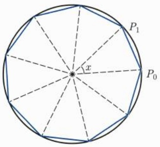

再令 $n\to +\infty$ 即得

$$
\varliminf_ {n \to + \infty} \frac {x _ {n} - x _ {n + 1}}{y _ {n} - y _ {n + 1}} \leqslant \varliminf_ {n \to + \infty} \frac {x _ {n}}{y _ {n}} \leqslant \varlimsup_ {n \to + \infty} \frac {x _ {n}}{y _ {n}} \leqslant \varlimsup_ {n \to + \infty} \frac {x _ {n} - x _ {n + 1}}{y _ {n} - y _ {n + 1}}.
$$

因此定理成立.

例3.4.1 设实数列 $\{a_{n}\}$ 满足 $a_{n} \neq -1$ 以及 $a_{n+1} = \frac{2}{a_{n} + 1} (n \geqslant 1)$. 试讨论 $\{a_{n}\}$ 的收敛性及其极限.

解 本例可以仿例 3.3.2 分情形加以讨论, 但相关讨论较为烦琐. 而采用上、下极限则会简捷许多.

记 $f(x) = \frac{2}{x + 1}, L = \varlimsup_{n\to +\infty}a_n, \ell = \varliminf_{n\to +\infty}a_n.$

由于 $a_{n} \neq -1$，而 $f(-3) = -1$，因此 $a_{n} \neq -3$。另一方面，$f(x) > 0$ 的解集为 $(-1, +\infty)$，而 $f(x) > -1$ 的解集，亦即 $f(f(x)) > 0$ 的解集为 $(- \infty, -3) \cup (-1, +\infty)$。

情形1 存在 $N \geqslant 1$ 使得 $a_{N} > -1$ 或者 $a_{N} < -3$.

此时, 可得当 $n \geqslant N + 2$ 时, 有 $a_{n} = f(f(a_{n - 2})) > 0$. 进一步, 归纳可得

$$
\frac {2}{3} \leqslant a _ {n} \leqslant 2, \quad \forall n \geqslant N + 4.
$$

从而 $\frac{2}{3} \leqslant \ell \leqslant L \leqslant 2$. 对递推式两边分别求上极限和下极限得到

$$
L = \frac {2}{\ell + 1}, \quad \ell = \frac {2}{L + 1}.
$$

由此可得 $L = \ell = 1$ .从而 $\lim_{n\to +\infty}a_n = 1.$

情形 2 对任何  $n \geqslant 1$  成立 -3 <  $a_{n} < -1$ . 此时  $-3 \leqslant \ell \leqslant L \leqslant -1$ . 对递推式两边分别求上极限和下极限得到

$$
L = \frac {2}{\ell + 1}, \quad \ell = \frac {2}{L + 1}, \tag {3.4.5}
$$

其中当 $L = -1$ 时, $\frac{2}{L + 1}$ 理解为 $-\infty$, 当 $\ell = -1$ 时, $\frac{2}{\ell + 1}$ 理解为 $-\infty$. 这事实上表明 $L < -1$. 这一点也可以从 $f(a_n) > -3$ 解得 $a_n < -\frac{5}{3}$ 或 $a_n > -1$ (舍去) 得到.

由(3.4.5)式和 $\ell \leqslant L\leqslant -1$ 解得 $L = \ell = -2$ 因此 $\lim_{n\to +\infty}a_n = -2.$

总之, 无论哪种情形, 都可得 $\{a_{n}\}$ 收敛. 且极限为 1 或 -2.

例3.4.2 设正数序列 $\{x_{n}\}$ 满足 $x_{m + n} \leqslant \frac{mx_m + nx_n}{m + n} (\forall m, n \geqslant 1)$. 求证: $\lim_{n \to +\infty} x_n$ 存在.

证明 归纳可证 $0 < x_{n} \leqslant x_{1} (\forall n \geqslant 1)$. 一般地, 有

$$
x _ {m n} \leqslant x _ {n}, \quad \forall m, n \geqslant 1.
$$

先固定 $n \geqslant 1$, 对于 $m \geqslant n$, 作带余除法, 得到 $m = k_m n + j_m$, 其中 $k_m, j_m$ 为整数, $0 \leqslant j_m \leqslant n - 1$. 则 $\lim_{m \to +\infty} \frac{k_m n}{m} = 1$. 补充定义 $x_0 = 0$. 则

$$
x _ {m} \leqslant \frac {k _ {m} n x _ {k _ {m} n} + j _ {m} x _ {j _ {m}}}{m} \leqslant \frac {k _ {m} n x _ {n} + j _ {m} x _ {1}}{m}.
$$

上式中令 $m\to +\infty$ ，两端取上极限，得到

$$
\varlimsup_ {m \to + \infty} x _ {m} \leqslant x _ {n}, \quad \forall n \geqslant 1.
$$

再令 $n\to +\infty$ ，两端取下极限，得到

$$
\varlimsup_ {m \to + \infty} x _ {m} \leqslant \varliminf_ {n \to + \infty} x _ {n}.
$$

从而

$$
\varlimsup_ {n \to + \infty} x _ {n} = \varliminf_ {n \to + \infty} x _ {n} \leqslant x _ {1},
$$

即  $\lim_{n\to+\infty}x_{n}$  存在.

□

例3.4.3 设 $a_0, a_1 > 0, a_{n+2} = \frac{1}{a_n} + \frac{2}{a_{n+1}} (n \geqslant 0)$. 证明: $\lim_{n \to +\infty} a_n = \sqrt{3}$.

证明 令 $M = \max \left\{a_0, a_1, \frac{3}{a_0}, \frac{3}{a_1}\right\}$. 则归纳可证 $\frac{3}{M} \leqslant a_n \leqslant M (n \geqslant 0)$. 于是 $\{a_n\}$ 的上、下极限 $L, \ell$ 满足 $\frac{3}{M} \leqslant \ell \leqslant L \leqslant M$. 在递推公式两端取下极限可得 $\ell \geqslant \frac{3}{L}$. 而两端取上极限可得 $L \leqslant \frac{3}{\ell}$. 两者结合得到 $L\ell = 3$.

由上极限的性质, 存在 $\{a_{n}\}$ 的子列 $\{a_{k_n + 3}\}$ 使得 $\lim_{k\to +\infty}a_{k_n + 3} = L$. 进一步, 由致密性定理, $\{a_{k_n + 2}\}$ 有子列收敛. 不失一般性, 不妨设 $\{a_{k_n + 2}\}$ 本身收敛, 极限为 $x$. 类似地, 不妨设 $\{a_{k_n + 1}\}$ 和 $\{a_{k_n}\}$ 也收敛①, 极限依次为 $y, z$. 则 $\ell \leqslant x, y, z \leqslant L$. 由递推公式得

$$
L = \frac {2}{x} + \frac {1}{y} \leqslant \frac {2}{\ell} + \frac {1}{\ell} = L.
$$

因此, 必有 $x = y = \ell$. 类似地,

$$
\ell = x = \frac {2}{y} + \frac {1}{z} \geqslant \frac {2}{L} + \frac {1}{L} = \ell .
$$

所以 $y = z = L$. 特别地, 可得 $L = y = \ell$. 结合 $L\ell = 3$ 以及 $\ell \geqslant 0$ 得到 $L = \ell = \sqrt{3}$. 这就证明了 $\lim_{n \to +\infty} a_n = \sqrt{3}$. □

<small>① 以上相当于证明或利用了 $\mathbb{R}^3$ 中有界列有收敛子列. 一般地, 对于任何正整数 $m, \mathbb{R}^m$ 中的有界列有收敛子列.</small>

## 习题3.4

1. 若  $x_{n}>0\ (n=1,2,\cdots)$ ，且  $\varlimsup_{n\to+\infty}x_{n}\cdot\varlimsup_{n\to+\infty}\frac{1}{x_{n}}=1$ 。证明序列  $\{x_{n}\}$  收敛。

2. 设  $\{x_{n}\}$  满足  $0 \leqslant x_{m+n} \leqslant x_{m} \cdot x_{n} (\forall m, n \geqslant 1)$ . 证明:  $\{\sqrt[n]{x_{n}}\}$  收敛.

3. 举例说明, 在习题 2 中,  $\{\sqrt[n]{x_{n}}\}$  可以没有单调性.

4. 设 $\{a_{n}\}$ 满足 $a_{m} + a_{n} - 1 \leqslant a_{m+n} \leqslant a_{m} + a_{n} + 1 (\forall m, n \geqslant 1)$. 求证:

(1) $\lim_{n\to +\infty}\frac{a_n}{n}$ 存在;

(2) 设  $\lim_{n\to+\infty}\frac{a_{n}}{n}=q$ ，则  $nq-1\leqslant a_{n}\leqslant nq+1\quad(n\geqslant1)$ .

5. 设  $r \in (0,1)$ ,  $x_{0} = 0$ ,  $x_{n+1} = r(1 - x_{n}^{2}) (n = 0, 1, 2, \cdots)$ . 试研究  $\{x_{n}\}$  的敛散性.

6. 设 0 < q < 1,  $\{a_{n}\}$ ,  $\{b_{n}\}$  满足  $a_{n} = b_{n} - qa_{n+1} (n = 1, 2, \cdots)$ ，且  $\{a_{n}\}$ ,  $\{b_{n}\}$  有界. 求证:  $\lim_{n \to +\infty} b_{n}$  存在的充要条件是  $\lim_{n \to +\infty} a_{n}$  存在.

7. 在习题 6 中当  $q \notin (0,1)$  时, 结论会怎样?

8. 设 $a_{n} \geqslant 0$ 满足 $a_{n+1} \leqslant a_{n} + \frac{1}{n^{2}}$. 证明: $\{a_{n}\}$ 收敛.

9. 利用上、下极限证明 $\mathbb{R}$ 中的 Cauchy 收敛准则.

10. 证明: 在例 3.4.1 中, 若 $\lim_{n\to +\infty}a_n = -2$, 则 $a_1 = -2$.

11. 推广习题 2 和习题 4.

12. 设  $\{x_{n}\}$  是正数列, 证明  $\lim_{n\to+\infty}n\left(\frac{1+x_{n+1}}{x_{n}}-1\right)\geqslant1$ .

13. 设 $f$ 是 $\mathbb{R}$ 上周期为 1 的实函数, 满足: $\forall x, y \in \mathbb{R}, x \neq y$, 有 $|f(x) - f(y)| < |x - y|$. 任取 $x_0 \in \mathbb{R}$, 定义 $x_{n+1} = f(x_n) (n \geqslant 0)$. 证明: $\{x_n\}$ 收敛, 且极限不依赖于 $x_0$ 的选择.

## 第四章

## 函数极限

## 4.1 函数极限

首先, 引入函数极限的定义. 若 $V$ 是 $x_0$ 的一个邻域, 则称 $V \setminus \{x_0\}$ 为 $x_0$ 的去心邻域.

定义 4.1.1 设函数 f 在  $x_{0}$  的一个去心邻域内有定义, A 为给定常数. 如果对任何  $\varepsilon > 0$ , 存在  $\delta > 0$ , 使得当  $0 < |x - x_{0}| < \delta$  时, 有

$$
| f (x) - A | <   \varepsilon ,
$$

则称 $f(x)$ 当 $x$ 趋于 $x_0$ 时的极限为 $A$, 记作 $\lim_{x\to x_0}f(x) = A$, 或 $f(x)\rightarrow A(x\to x_0)$, 或

$$
f (x) \rightarrow A, \quad x \rightarrow x _ {0}.
$$

例4.1.1 从定义出发证明 $\lim_{x\to 1}\frac{x^3 - 3x^2 + x + 1}{2x^2 - x - 1} = -\frac{2}{3}.$

证明 对于 $x \neq 1, -\frac{1}{2}$, 我们有

$$
\begin{array}{l} \left| \frac {x ^ {3} - 3 x ^ {2} + x + 1}{2 x ^ {2} - x - 1} + \frac {2}{3} \right| = \left| \frac {(x - 1) (x ^ {2} - 2 x - 1)}{(x - 1) (2 x + 1)} + \frac {2}{3} \right| \\ = \left| \frac {x ^ {2} - 2 x - 1}{2 x + 1} + \frac {2}{3} \right| = \left| \frac {3 x ^ {2} - 2 x - 1}{3 (2 x + 1)} \right| \\ = \left| \frac {(x - 1) (3 x + 1)}{3 (2 x + 1)} \right|. \\ \end{array}
$$

于是, $\forall \varepsilon > 0$, 取 $\delta = \min \left\{1, \frac{\varepsilon}{3}\right\}$, 则 $\delta > 0$, 而当 $0 < |x - 1| < \delta$ 时, 有 $0 < x < 2$. 从而

$$
\left| \frac {x ^ {3} - 3 x ^ {2} + x + 1}{2 x ^ {2} - x - 1} + \frac {2}{3} \right| = \frac {3 x + 1}{3 (2 x + 1)} | x - 1 | <   \frac {7}{3} | x - 1 | <   \varepsilon .
$$

因此, 由极限定义, 得到 $\lim_{x\to 1}\frac{x^3 - 3x^2 + x + 1}{2x^2 - x - 1} = -\frac{2}{3}$.

例 4.1.2 利用极限定义证明:  $\lim_{x\to0}\ln(1+x)=0$ .

证明 对任何 $\varepsilon \in (0,1)$, $|\ln(1 + x)| < \varepsilon$ 等价于 $\mathrm{e}^{-\varepsilon} - 1 < x < \mathrm{e}^{\varepsilon} - 1$. 取 $\delta = \min \left\{\mathrm{e}^{\varepsilon} - 1, 1 - \mathrm{e}^{-\varepsilon}\right\}$. 则 $\delta > 0$, 而当 $|x| < \delta$ 时, 就有 $|\ln(1 + x)| < \varepsilon$. 因此, $\lim_{x \to 0} \ln(1 + x) = 0$.

将函数极限与数列极限作对比, 可以帮助我们更好地掌握函数极限的性质.

首先, 类似于定理 3.1.1, 我们有

定理 4.1.1 设函数 f 在  $x_{0}$  的一个去心邻域内有定义， $\lim_{x\to x_{0}}f(x)=A$ .

(1) (保号性) 若 A > 0, 则存在  $\delta > 0$ , 使得当  $0 < |x - x_{0}| < \delta$  时, 有  $f(x) > 0$ .

一般地, 若 A > B, 则存在  $\delta > 0$ , 使得当  $0 < |x - x_{0}| < \delta$  时, 有  $f(x) > B$ .

特别地, 若 $A > 0$, 则存在 $\delta > 0$, 使得当 $0 < |x - x_0| < \delta$ 时, 有 $f(x) > \frac{A}{2}$.

(2) (保序性) 设函数 $g$ 在 $x_0$ 的一个去心邻域内有定义, 且存在 $\delta > 0$ 使得对任何满足 $0 < |x - x_0| < \delta$ 的 $x$, 有 $f(x) \geqslant g(x)$. 若 $\lim_{x \to x_0} g(x) = B$, 则 $A \geqslant B$.

(3) (唯一性) 若  $\lim_{x\to x_{0}}f(x)=B,$  则 A=B.

(4) (局部有界性) 存在 $\delta > 0$ 使得 $f$ 在 $(x_0 - \delta, x_0) \cup (x_0, x_0 + \delta)$ 内有界.

定理的证明与定理 3.1.1 的证明完全类似, 我们把它留给读者. 在收敛数列有界性的证明中, 我们首先从  $\lim_{n\to+\infty}a_n=A$  得到存在  $N\geqslant1$ , 使得当  $n\geqslant N$  时有  $|a_n-A|\leqslant1$ , 这同我们从  $\lim_{x\to x_0}f(x)=A$  得到存在  $\delta>0$ , 使得当  $0<|x-x_0|<\delta$  时有  $|f(x)-A|\leqslant1$  一样. 但区别之处在于  $a_N$  前面的项  $a_1,a_2,\cdots,a_{N-1}$  是有限项, 从而必有界. 而 f 在  $(x_0-\delta,x_0+\delta)$  之外有无限多项, 因此, 只能得到 f 在  $x_0$  附近的局部有界性, 而不能简单地得到 f 在定义域内的整体有界性.

而与数列极限存在与否以及极限值与数列的前几项无关一样，函数极限 $\lim_{x\to x_0}f(x)$ 存在与否以及极限值为多少也只与 $f$ 在 $(x_0 - \delta ,x_0)\cup (x_0,x_0 + \delta)$ 内的值有关.

同样地, 如同定理 3.1.3, 可建立函数极限的四则运算的性质. 我们把证明留给读者.

定理 4.1.2 设函数 f, g 在  $x_{0}$  的一个去心邻域内有定义， $\lim_{x\to x_{0}}f(x)=A,\quad\lim_{x\to x_{0}}g(x)=B.$

(1) 设  $\alpha, \beta$  为常数, 则

$$
\lim _ {x \to x _ {0}} \left(\alpha f (x) + \beta g (x)\right) = \alpha A + \beta B;
$$

(2) $\lim_{x\to x_0}\left(f(x)g(x)\right) = AB;$

(3) 若  $B \neq 0$ ，则  $\lim_{x \to x_{0}} \frac{f(x)}{g(x)} = \frac{A}{B}$ .

函数极限与数列极限有着紧密的联系. 利用如下的 Heine 定理, 可以通过研究数列极限来得到函数极限的性质.

定理 4.1.3 设函数 f 在  $x_{0}$  的一个去心邻域 V 内有定义. 则  $\lim_{x\to x_{0}}f(x)=A$  当且仅当对 V 中任何趋于  $x_{0}$  的点列 $^{①}\{x_{n}\}$ ，有  $\lim_{n\to+\infty}f(x_{n})=A$ .

证明 我们有 $\delta_0 > 0$ 使得 $(x_0 - \delta_0, x_0) \cup (x_0, x_0 + \delta_0) \subseteq V$.

(必要性) 设 $\lim_{x\to x_0}f(x) = A$，且 $\{x_n\}$ 是 $V$ 中趋于 $x_0$ 的一个点列。则 $\forall \varepsilon > 0$，存在 $\delta \in (0, \delta_0)$，使得当 $0 < |x - x_0| < \delta$ 时，有 $|f(x) - A| < \varepsilon$。而对于上述 $\delta > 0$，存在 $N \geqslant 1$，使得当 $n \geqslant N$ 时，有 $|x_n - x_0| < \delta$。注意到 $x_n \neq x_0$，可得此时有 $|f(x_n) - A| < \varepsilon$。因此，$\lim_{n\to +\infty}f(x_n) = A$。

(充分性) 若 $\lim_{x\to x_0}f(x)\neq A$ (这里包括 $\lim_{x\to x_0}f(x)$ 不存在的情形), 则存在 $\varepsilon_0 > 0$, 使得对任何 $\delta \in (0,\delta_0)$, 都有 $x\in (x_0 - \delta ,x_0)\cup (x_0,x_0 + \delta)$ 使得 $|f(x) - A|\geqslant \varepsilon_0$. 特别地,对任何 $n \geqslant 1$, 存在 $x_{n} \in \left(x_{0} - \frac{1}{n}, x_{0}\right) \cup \left(x_{0}, x_{0} + \frac{1}{n}\right)$ 满足 $|f(x_{n}) - A| \geqslant \varepsilon_{0}$. 这表明 $\{x_{n}\}$ 是 $V$ 中趋于 $x_{0}$ 的点列, 而 $\{f(x_{n})\}$ 不收敛于 $A$. 得到矛盾.

<small>① 注意 V 不含  $x_{0}$ ，若 V 是  $x_{0}$  的邻域而不是去心邻域，则  $\{x_{n}\}$  需要不取  $x_{0}$ .</small>

注 4.1.1 若对  $(x_{0}-\delta_{0},x_{0})\cup(x_{0},x_{0}+\delta_{0})$  中任意趋于  $x_{0}$  的点列  $\{x_{n}\}$ ， $\lim_{n\to+\infty}f(x_{n})$  都存在，则易见极限值必然与点列  $\{x_{n}\}$  的选取无关，从而得到  $\lim_{x\to x_{0}}f(x)$  存在.

换言之, Heine 定理可以描述为: $\lim_{x\to x_0}f(x)$ 存在当且仅当对任何趋于 $x_0$ 而不取 $x_0$ 的点列 $\{x_n\}$, 极限 $\lim_{n\to +\infty}f(x_n)$ 都存在.

类似于数列极限, 我们可以给出  $\lim_{x\to x_{0}}f(x)=+\infty,\quad\lim_{x\to x_{0}}f(x)=-\infty$  以及  $\lim_{x\to x_{0}}f(x)=\infty$  的定义.

这样, 在定理 4.1.3 中, 把 A 换成  $+\infty, -\infty$  或  $\infty$  时, 结论也成立.

如果在考察 $x \to x_0$ 时, 只需要考察 $x > x_0$ 的情况, 就需要引入单侧极限. 具体地, 设 $\delta_0 > 0$, $f$ 在 $(x_0, x_0 + \delta_0)$ 内有定义, $A$ 为给定实数, 则 $f$ 在 $x_0$ 处的右 (侧) 极限 $\lim_{x \to x_0^+} f(x) = A$ 定义为

$\forall\varepsilon>0,$  存在  $\delta\in(0,\delta_{0})$  使得当  $0<x-x_{0}<\delta$  时, 有  $|f(x)-A|<\varepsilon.$

时常记  $\lim_{x\to x_{0}^{+}}f(x)$  为  $f(x_{0}^{+})$ .

类似地定义 f 在  $x_{0}$  处的左 (侧) 极限  $f(x_{0}^{-}) \equiv \lim_{x \to x_{0}^{-}} f(x)$ .

易见， $\lim_{x\to x_0}f(x) = A$ 当且仅当 $\lim_{x\to x_0^+}f(x) = \lim_{x\to x_0^-}f(x) = A.$

我们也可以考虑自变量趋于无穷的函数极限，请读者自行给出相关定义（参见习题4).

可以对一般集合上的函数引入极限.

定义4.1.2 设 $E \subseteq \mathbb{R}, x_0 \in E'$, $f$ 在 $E$ 上有定义. 则 $\lim_{\substack{x \to x_0 \\ x \in E}} f(x) = A$ 定义为

$\forall \varepsilon > 0$ ，存在 $\delta > 0$ ，使得当 $0 < |x - x_0| < \delta$ ，且 $x \in E$ 时，有 $|f(x) - A| < \varepsilon$

这样, 当 $f$ 在 $x_0$ 的一个 (去心) 邻域 $V$ 内有定义, 则 $f$ 在点 $x_0$ 处的右极限 $\lim_{x \to x_0^+} f(x)$ 是 $\lim_{x \to x_0 \atop x \in (x_0, +\infty) \cap V} f(x)$. 而 $f$ 在点 $x_0$ 处的左极限 $\lim_{x \to x_0^-} f(x)$ 是 $\lim_{x \to x_0 \atop x \in (-\infty, x_0) \cap V} f(x)$. 数列极限 $\lim_{n \to +\infty} a_n$ 其实就是 $\lim_{\substack{x \to +\infty \\ x \in \mathbb{N}_+}} a_x$.

对于一般集合 E 上的函数以及  $x_{0} \in E'$ ，对应于极限四则运算以及 Heine 定理，只要把定理条件中  $x_{0}$  的去心邻域换成 E，定理 4.1.2 和定理 4.1.3 仍成立.

对于函数极限, 同样可以引入上、下极限.

定义 4.1.3 设 f 在  $x_{0}$  的一个去心邻域 V 内有定义, 则 f 在点  $x_{0}$  处的上、下极限依次定义为

$$
\varlimsup_ {x \to x _ {0}} f (x) := \lim _ {\delta \to 0 ^ {+}} \sup _ {0 <   | x - x _ {0} | <   \delta} f (x), \quad \varliminf_ {x \to x _ {0}} f (x) := \lim _ {\delta \to 0 ^ {+}} \inf _ {0 <   | x - x _ {0} | <   \delta} f (x).
$$

自然可以对单侧极限引入上、下极限. 请读者仿照数列上、下极限的性质, 建立函数上、下极限的性质.

另一方面, 对于函数, 类似地定义无穷小量、无穷大量, 并引入 $o, O, \sim$ 等记号, 在此不再赘述.

## 习题4.1

1. 设 a > 0, 利用函数极限定义证明  $\lim_{x \to a} \sqrt{x} = \sqrt{a}$ .
2. 计算极限  $\lim_{x\to2}\left(\frac{7x^{3}-2x^{2}-17x-19}{2x^{3}+3xx^{2}-11x-6}-\frac{1}{2x^{2}-3x-2}\right)$ .
3. 设 $\psi, \varphi$ 为定义在 $(0, +\infty)$ 上的周期函数, 满足 $\lim_{x \to +\infty} \left( \psi(x) - \varphi(x) \right) = 0$. 证明: $\psi \equiv \varphi$.
4. 抽取下表中的几个极限类型, 写出相关的定义 (其中 $a, A$ 为实数)、Cauchy 收敛准则和 Heine 定理.

| 自变量变化 | 极限值 | 自变量变化 | 极限值 |
| --- | --- | --- | --- |
| $x \rightarrow a$ | $A$ | $x \rightarrow a^{+}$ | $A$ |
| $x \rightarrow a^{-}$ | $A$ | $x \rightarrow a$ | $+\infty$ |
| $x \rightarrow a^{+}$ | $+\infty$ | $x \rightarrow a^{-}$ | $+\infty$ |
| $x \rightarrow a$ | $-\infty$ | $x \rightarrow a^{+}$ | $-\infty$ |
| $x \rightarrow a^{-}$ | $-\infty$ | $x \rightarrow a$ | $\infty$ |
| $x \rightarrow a^{+}$ | $\infty$ | $x \rightarrow a^{-}$ | $\infty$ |
| $x \rightarrow \infty$ | $A$ | $x \rightarrow +\infty$ | $A$ |
| $x \rightarrow -\infty$ | $A$ | $x \rightarrow \infty$ | $+\infty$ |
| $x \rightarrow +\infty$ | $+\infty$ | $x \rightarrow -\infty$ | $+\infty$ |
| $x \rightarrow \infty$ | $-\infty$ | $x \rightarrow +\infty$ | $-\infty$ |
| $x \rightarrow -\infty$ | $-\infty$ | $x \rightarrow \infty$ | $\infty$ |
| $x \rightarrow +\infty$ | $\infty$ | $x \rightarrow -\infty$ | $\infty$ |

5. 设 $a_0, a_1, \ell, \alpha$ 为正数, $a_1 \neq a_0$, $a_{n+1} = \frac{(\ell + n^\alpha)a_n^2}{\ell a_n + n^\alpha a_{n-1}} (n \geqslant 1)$. 证明:

(1) 若  $\alpha < 1$ ，则  $\{a_{n}\}$  有正的极限；
(2) 若  $\alpha = 1, \ell > 1$ ，则  $\{a_{n}\}$  有正的极限；
(3) 若  $\alpha > 1$ ，则  $\{a_{n}\}$  发散或极限为零；

(4) 若  $\alpha = \ell = 1$ ，则  $\{a_{n}\}$  发散或极限为零.

## 4.2 基本定理与函数极限

我们将之前与极限相关的基本定理与其他一些定理, 与函数极限作一个联结.

函数极限的 Cauchy 收敛准则可以表述如下.

定理 4.2.1 设函数 f 在  $x_{0}$  的一个去心邻域 V 内有定义. 则  $\lim_{x\to x_{0}}f(x)$  存在当且仅当:  $\forall\varepsilon>0,$  存在  $\delta>0,$  使得当  $x,y\in(x_{0}-\delta,x_{0})\cup(x_{0},x_{0}+\delta)$  时, 有  $|f(x)-f(y)|<\varepsilon.$ 
同数列极限一样, Cauchy 收敛准则相当于说  $\lim_{x\to x_{0}}f(x)$  存在当且仅当

$$
\lim_{\delta \to 0^{+}}\sup_{\substack{|x - x_{0}| <   \delta ,|y - x_{0}| <   \delta \\ x,y\in V}}|f(x) - f(y)| = 0. \tag{4.2.1}
$$

证明 由极限定义容易得到必要性. 细节留给读者. 下证充分性.

设 (4.2.1) 式成立. 任取 $V$ 中趋于 $x_0$ 的点列 $\{x_n\}$. 则由 (4.2.1) 式, $\{f(x_n)\}$ 是 Cauchy 列, 从而它收敛. 由 Heine 定理 (以及注 4.1.1), $\lim_{x \to x_0} f(x)$ 存在. $\square$

对于函数极限, 同样有夹逼准则.

定理 4.2.2 设  $\delta > 0$ ，在  $(x_{0} - \delta, x_{0}) \cup (x_{0}, x_{0} + \delta)$  内有  $\psi \leqslant f \leqslant \psi$ 。若  $\lim_{x \to x_{0}} \psi(x) = \lim_{x \to x_{0}} \varphi(x) = A$ ，则  $\lim_{x \to x_{0}} f(x) = A$ 。

对应于单调收敛定理, 结合数列极限的单调收敛定理与 Heine 定理, 可得

定理 4.2.3 设 f 在  $(x_{0}, x_{0} + \delta)$  内单调有界，则  $\lim_{x \to x_{0}^{+}} f(x)$  存在.

这里要注意的是 $f$ 在 $(x_0 - \delta, x_0) \cup (x_0, x_0 + \delta)$ 内单调有界只能推出 $\lim_{x \to x_0^+} f(x)$ 和 $\lim_{x \to x_0^-} f(x)$ 都存在，但不能推出 $\lim_{x \to x_0} f(x)$ 存在.

对应于致密性定理, 以下结果是平凡的.

定理 4.2.4 设  $\delta > 0, f$  在  $(x_{0}, x_{0} + \delta)$  内有界，则存在  $(x_{0}, x_{0} + \delta)$  内趋于  $x_{0}$  的点列  $\{x_{n}\}$  使得  $\{f(x_{n})\}$  收敛.

在致密性定理的运用方面, 如下结果体现了唯一性对于存在性的重要意义, 其思想广泛运用于数学的许多学科.

定理4.2.5 设 $\delta > 0, f$ 在 $(x_0, x_0 + \delta)$ 内有界, $A$ 给定. 对于 $(x_0, x_0 + \delta)$ 内趋于 $x_0$ 的点列 $\{x_n\}$, 只要 $\{f(x_n)\}$ 收敛, 就有 $\lim_{n \to +\infty} f(x_n) = A$. 则 $\lim_{x \to x_0^+} f(x) = A$.

证明 若 $\lim_{x\to x_0^+}f(x)\neq A$ (这里包括 $\lim_{x\to x_0^+}f(x)$ 不存在的情形), 则存在 $\varepsilon_0 > 0$, 使得对任何 $n\geqslant \frac{1}{\delta}$, 存在 $x_{n}\in \left(x_{0},x_{0} + \frac{1}{n}\right)$ 使得 $|f(x_n) - A|\geqslant \varepsilon_0$. 因 $f$ 在 $(x_0,x_0 + \delta)$ 内有界, 因此, $\{f(x_n)\}$ 有界, 从而有收敛子列. 不妨设 $\{f(x_n)\}$ 本身收敛. 注意到 $\{x_n\}$ 是各项异于 $x_0$ 而收敛于 $x_0$ 的点列, 根据定理假设, 有 $\lim_{n\to +\infty}f(x_n) = A$. 这与 $|f(x_n) - A| \geqslant \varepsilon_0$ 矛盾. 因此, 必有 $\lim_{x\to x_0^+}f(x) = A$.

事实上, 在例 3.3.5 中, 我们正是利用定理 4.2.5 的思想来解决问题的.

对应于 Stolz 公式, 我们给出如下结果.

定理 4.2.6 设 f, g 在  $(a, +\infty)$  内局部有界, 且

(1) 对于任何 x > a, 有  $g(x + 1) > g(x)$ ;
(2) $\lim_{x\to +\infty}g(x) = +\infty,$

则

$$
\varliminf_ {x \to + \infty} \frac {f (x + 1) - f (x)}{g (x + 1) - g (x)} \leqslant \varliminf_ {x \to + \infty} \frac {f (x)}{g (x)} \leqslant \varlimsup_ {x \to + \infty} \frac {f (x)}{g (x)} \leqslant \varlimsup_ {x \to + \infty} \frac {f (x + 1) - f (x)}{g (x + 1) - g (x)}. \tag {4.2.2}
$$

我们把证明留给读者.

## 习题4.2

1. 证明 $\lim_{n\to +\infty}n\sum_{k = 1}^{n}\left|\sqrt{1 + \frac{2k}{n^3}} -1 - \frac{k}{n^3}\right| = 0$ 并由此计算 $\lim_{n\to +\infty}n\sum_{k = 1}^{n}\left(\sqrt{1 + \frac{2k}{n^3}} -1\right)$.
2. 设数列 $\{x_{n}\}, \{y_{n}\}$ 满足

$$
\left\{ \begin{array}{l} x _ {n} ^ {2} + y _ {n} ^ {2} + 2 y _ {n} = 1 + \ln \frac {n + 1}{n}, \\ x _ {n} + \Big (1 + \frac {1}{3 n} \Big) y _ {n} = \frac {1}{\sqrt [ n ]{n}}. \end{array} \right.
$$

证明  $\{x_{n}\},\{y_{n}\}$  收敛并求极限.

3. 设  $\alpha \in R$ , 计算  $\lim_{x \to 0} \frac{(1 + x)^{\alpha} - 1}{x}$ .
4. 仿照习题 1 编写一个习题.
5. 证明定理 4.2.6.

## 4.3 几个基础性的函数极限

本节中, 我们将给出数列极限中一些重要极限的相应结果, 并简单介绍极限 $\lim_{x\to 0}\frac{\sin x}{x}$. 首先, 由例3.1.2导出相关的结果.

例 4.3.1 设 a > 0, 证明:  $\lim_{x \to 0} a^{x} = 1$ ,  $\lim_{x \to \infty} a^{\frac{1}{x}} = 1$ .

证明 先设  $a \geqslant 1$ ，则当 x > 1 时，

$$
1 \leqslant a ^ {\frac {1}{x}} \leqslant a ^ {\frac {1}{[ x ]}}.
$$

于是, 由 $\lim_{x\to +\infty}a^{\frac{1}{[x]}} = \lim_{n\to +\infty}a^{\frac{1}{n}} = 1$ 以及夹逼准则, 得到 $\lim_{x\to +\infty}a^{\frac{1}{x}} = 1$. 进一步,

$$
\lim _ {x \to - \infty} a ^ {\frac {1}{x}} = \lim _ {x \to + \infty} \frac {1}{a ^ {\frac {1}{x}}} = 1.
$$

因此， $\lim_{x\to\infty}a^{\frac{1}{x}}=1.$

当 0 < a < 1 时,

$$
\lim _ {x \to \infty} a ^ {\frac {1}{x}} = \lim _ {x \to \infty} \frac {1}{(1 / a) ^ {\frac {1}{x}}} = 1.
$$

这表明对任何 $a > 0$ 成立 $\lim_{x\to \infty}a^{\frac{1}{x}} = 1.$ 这等价于 $\lim_{x\to 0}a^x = 1.$

接下来是例 3.1.3 对应的极限.

例4.3.2 证明: $\lim_{x\to +\infty}x^{\frac{1}{x}} = 1,\quad \lim_{x\to 0^{+}}x^{x} = 1.$

证明 对于 $x > 2$, 我们有 $1 \leqslant x^{\frac{1}{x}} \leqslant ([x]^2)^{\frac{1}{[x]}} = ([x])^{\frac{2}{[x]}}$. 由此结合 $\lim_{n \to +\infty} n^{\frac{1}{n}} = 1$ 即得 $\lim_{x \to +\infty} x^{\frac{1}{x}} = 1$. 这又相当于 $\lim_{x \to 0^+} \frac{1}{x^x} = 1$, 亦即 $\lim_{x \to 0^+} x^x = 1$.

自然, 例 4.3.1 的结果可以由例 4.3.2 和夹逼准则得到. 类似地, 由例 3.1.4 可得

例 4.3.3 设 0 < q < 1, 则  $\lim_{x \to +\infty} q^{x} = 0$ .

我们把本例的证明留给读者.

在定理 3.3.3 中, 我们给出了重要极限  $e = \lim_{n \to +\infty} \left(1 + \frac{1}{n}\right)^n$  的存在性. 现在, 我们将它推广到连续变量情形.

例 4.3.4 证明:

$$
\lim _ {x \to \infty} \left(1 + \frac {1}{x}\right) ^ {x} = \lim _ {x \to 0} (1 + x) ^ {\frac {1}{x}} = \mathrm{e}. \tag {4.3.1}
$$

证明 对于 $x > 1$ ，我们有

$$
\left(1 + \frac {1}{[ x ] + 1}\right) ^ {[ x ]} <   \left(1 + \frac {1}{x}\right) ^ {x} <   \left(1 + \frac {1}{[ x ]}\right) ^ {[ x ] + 1}.
$$

由 e 的定义, 可得

$$
\lim _ {x \to + \infty} \left(1 + \frac {1}{[ x ] + 1}\right) ^ {[ x ]} = \lim _ {x \to + \infty} \left(1 + \frac {1}{[ x ] + 1}\right) ^ {[ x ] + 1} = \lim _ {n \to + \infty} \left(1 + \frac {1}{n + 1}\right) ^ {n + 1} = \mathrm{e}
$$

以及

$$
\lim _ {x \to + \infty} \left(1 + \frac {1}{[ x ]}\right) ^ {[ x ] + 1} = \lim _ {x \to + \infty} \left(1 + \frac {1}{[ x ]}\right) ^ {[ x ]} = \lim _ {n \to + \infty} \left(1 + \frac {1}{n}\right) ^ {n} = \mathrm{e}.
$$

从而由夹逼准则得到

$$
\lim _ {x \to + \infty} \left(1 + \frac {1}{x}\right) ^ {x} = \mathrm{e}. \tag {4.3.2}
$$

进而

$$
\lim _ {x \to - \infty} \left(1 + \frac {1}{x}\right) ^ {x} = \lim _ {x \to + \infty} \left(1 - \frac {1}{x}\right) ^ {- x} = \lim _ {x \to + \infty} \left(1 + \frac {1}{x - 1}\right) ^ {x} = \lim _ {x \to + \infty} \left(1 + \frac {1}{x - 1}\right) ^ {x - 1} = \mathrm{e}.
$$

上式结合 (4.3.2) 式即得

$$
\lim _ {x \to \infty} \left(1 + \frac {1}{x}\right) ^ {x} = \mathrm{e}.
$$

等价地, 有

$$
\lim _ {x \to 0} (1 + x) ^ {\frac {1}{x}} = \mathrm{e}. \tag * {\square}
$$

类似地, 利用 (3.3.7) 式或 (3.3.6) 式可得

$$
\lim _ {x \to 0} \frac {\ln (1 + x)}{x} = 1. \tag {4.3.3}
$$

而利用定理2.4.4, 可以得到 $\forall \alpha \in (0,1]$, 有

$$
\frac {\alpha}{1 + x} \leqslant \frac {(1 + x) ^ {\alpha} - 1}{x} \leqslant \alpha , \quad x > 0.
$$

于是由夹逼准则得到

$$
\lim _ {x \to 0 ^ {+}} \frac {(1 + x) ^ {\alpha} - 1}{x} = \alpha .
$$

容易把上述结果推广为 $\forall \alpha \in \mathbb{R}$ ，有

$$
\lim _ {x \to 0} \frac {(1 + x) ^ {\alpha} - 1}{x} = \alpha . \tag {4.3.4}
$$

之后,我们将利用连续性,结合其他极限得到它们. 目前,把它们的详细证明留给读者.

前面的例子中, 涉及的函数是幂函数、指数函数与对数函数. 要考察三角函数与反三角函数, 尤其是今后考察这些函数的导数时, 就自然地会涉及极限  $\lim_{x\to0}\frac{\sin x}{x}$ .

在分析上要严格地定义三角函数, 通常有三种方式. 其一与弧度相关, 是利用单位圆周上圆弧的弧长来引入弧度, 这需要用到定积分; 其二是利用微分方程来定义; 其三则是利用极限或级数来定义 (有兴趣的读者可以参见文献 [43,44]). 总的说来, 在介绍这些知识之前, 三角函数是没有严格定义过的, 其相关性质自然也还没有严格地建立起来.

由于三角函数和反三角函数可以在接下来的讨论中提供丰富的例子, 因此我们将在承认相关知识的情况下使用它们. 而在第五章第 5 节, 我们将介绍如何利用极限或级数来严格地定义三角函数.

在中学, $\sin x$ 中的 $x$ 是弧度. 当单位圆周的一段弧的弧长为 $x$ 时, 对应的圆心角的弧度就是 $x$. 曲线的弧长通过折线长度的极限来定义. 特别地, 单位圆周的长度是内接多边形周长的极限. 换言之, 如图 4.1 所示, 记 $P_{0}P_{1}$ 的弧长为 $x$, 直线段 $P_{0}P_{1}$ 的长为 $|P_{0}P_{1}|$, 则弧长的定义相当于说, $\lim_{x \to 0^{+}} \frac{|P_{0}P_{1}|}{x} = 1$. 注意到 $|P_{0}P_{1}| = 2\sin \frac{x}{2}$. 因此, $\lim_{x \to 0^{+}} \frac{2\sin \frac{x}{2}}{x} = 1$. 即

$$
\lim _ {x \to 0 ^ {+}} \frac {\sin x}{x} = 1. \tag {4.3.5}
$$

也就是说, 在把 $x$ 理解为弧度时, (4.3.5) 式本质上是一种定义. 由于 $\sin$ 是奇函数, 由 (4.3.5) 式又可得

$$
\lim _ {x \to 0} \frac {\sin x}{x} = 1. \tag {4.3.6}
$$

text_image

P₁
x
P₀

图4.1

## 习题4.3

1. 给出例 4.3.3 的证明.
2. 详细证明 (4.3.3) 式.
3. 设 $E \subseteq \mathbb{R}, f: E \to \mathbb{R}, x_0 \in E'$. 证明: $\lim_{\substack{x \to x_0 \\ x \in E}} f(x)$ 存在当且仅当对 $E \setminus \{x_0\}$ 中任何趋于 $x_0$ 的点列 $\{x_n\}$, 极限 $\lim_{n \to +\infty} f(x_n)$ 存在.
4. 证明对于 $x \neq 0$, 有 $\prod_{n=1}^{\infty} \cos \frac{x}{2^n} = \frac{\sin x}{x}$. 特别地, 有 Viète 公式: $\prod_{n=2}^{\infty} \cos \frac{\pi}{2^n} = \frac{2}{\pi}$.

## 第五章

## 连续函数

人们研究的数学问题一般都是多种运算相互作用的情形, 连续函数体现了极限运算与取函数值这两种运算的可交换性. 连续性也体现了函数的取值所受到的一种制约.

## 5.1 连续函数

首先, 引入函数连续性的定义.

定义 5.1.1 设  $\delta > 0, f$  在  $(x_{0} - \delta, x_{0} + \delta)$  内有定义. 若  $\lim_{x \to x_{0}} f(x) = f(x_{0})$ ，则称 f 在点  $x_{0}$  处连续.

若区间 I 上的函数 f 在 I 上每一点处连续 $^{①}$ ，则称 f 在 I 上连续.

连续的本质就是求极限和求函数值可以交换次序. 具体地, $f$ 在点 $x_0$ 处连续即为

$$
\lim _ {x \to x _ {0}} f (x) = f (\lim _ {x \to x _ {0}} x).
$$

另一方面, 将条件分解可见 $f$ 在点 $x_0$ 处连续当且仅当

$$
\lim _ {x \to x _ {0} ^ {+}} f (x) = f (x _ {0}) = \lim _ {x \to x _ {0} ^ {-}} f (x). \tag {5.1.1}
$$

这样, 考察 $f$ 在点 $x_0$ 处的左极限、右极限与函数值三者之间的关系, 就得到不连续点的分类.

定义 5.1.2 设  $\delta > 0, f$  的定义域包含  $(x_{0} - \delta, x_{0}) \cup (x_{0}, x_{0} + \delta)$ . 若 f 在点  $x_{0}$  处不连续或无定义，则称  $x_{0}$  为 f 的不连续点，又称为间断点. 进一步，

(1) 若 $f(x_0^+)$, $f(x_0^-)$ 均存在, 但不相等, 则称 $x_0$ 为第一类间断点, 又称为跳跃间断点;
(2) 若 $f(x_0^+)$ 和 $f(x_0^-)$ 中至少一个不存在，则称 $x_0$ 为第二类间断点；
(3) 若 $f(x_0^+)$, $f(x_0^-)$ 均存在且相等, 但不等于 $f(x_0)$ 或 $f(x_0)$ 不存在, 则称 $x_0$ 为第三类间断点, 又称可去间断点.

对于第二类间断点, 若函数在点 $x_0$ 附近有界, 则称 $x_0$ 为振荡间断点; 若 $\lim_{x \to x_0} f(x) = \infty$, 则称 $x_0$ 为无穷间断点.

对应于函数的连续性, 结合定理 4.1.3, 有如下的 Heine 定理.

定理5.1.1 设 $f$ 在 $(a, b)$ 内有定义, $x_0 \in (a, b)$. 则 $f$ 在点 $x_0$ 处连续当且仅当对 $(a, b)$ 内任何趋于 $x_0$ 的点列 $\{x_n\}$, 有 $\lim_{n \to +\infty} f(x_n) = f(x_0)$.

如果 (5.1.1) 式中左边的等式或右边的等式成立, 则称 $f$ 具有单侧的连续性. 具体地, 定义如下:

<small>① 若 $I$ 包含左端点 $a$, 则 $f$ 在点 $a$ 处右连续; 若 $I$ 包含右端点 $b$, 则 $f$ 在点 $b$ 处左连续. 左、右连续的定义见定义 5.1.3.</small>

定义 5.1.3 设  $\delta > 0$ .

(1) 若 $f$ 在 $[x_0, x_0 + \delta)$ 上有定义, 且 $\lim_{x \to x_0^+} f(x) = f(x_0)$, 则称 $f$ 在点 $x_0$ 处右连续;
(2) 若 $f$ 在 $(x_0 - \delta, x_0]$ 上有定义, 且 $\lim_{x \to x_0^-} f(x) = f(x_0)$, 则称 $f$ 在点 $x_0$ 处左连续.

这样, $f$ 在点 $x_0$ 处连续, 当且仅当 $f$ 在点 $x_0$ 处既是左连续的, 又是右连续的.

而结合极限的定义, 可得 $f$ 在点 $x_0$ 处连续当且仅当 $\forall \varepsilon > 0$, 存在 $\delta > 0$, 使得当 $x \in (x_0 - \delta, x_0 + \delta)$ 时, 有 $|f(x) - f(x_0)| < \varepsilon$.

我们可以用此方法来定义一般集合 E 上函数的连续性.

定义 5.1.4 设  $E \subseteq R$ .

(1) 设 $x_0 \in E$, 若 $\forall \varepsilon > 0$, 存在 $\delta > 0$, 使得当 $x \in (x_0 - \delta, x_0 + \delta) \cap E$ 时, 有 $|f(x) - f(x_0)| < \varepsilon$, 则称 $f$ 在点 $x_0$ 处连续;
(2) 若 $f$ 在 $E$ 的任何点处都连续, 则称 $f$ 在 $E$ 上连续;
(3) 设 $x_0 \in \overline{E}$, 若 $x_0 \notin E$ 或 $f$ 在点 $x_0$ 处不是连续的, 则称 $x_0$ 是 $f$ 的不连续点, 又称间断点;
(4) 若 $F \subseteq E$, 而 $f|_{F}$ 在点 $x_0$ 处连续, 则称 $f$ 限制在 $F$ 上在点 $x_0$ 处连续.

在定义 5.1.4 中, f 在点  $x_{0} \in E$  处连续, 有两种情形. 其一是  $x_{0}$  是孤立点. 即定义 5.1.4 规定了函数在定义域的孤立点是连续的. 其二是  $x_{0}$  为 E 的聚点, 且  $\lim_{\substack{x \to x_{0} \\ x \in E}} f(x) = f(x_{0})$ .

$f$ 在点 $x_0$ 处右连续, 相当于 $f|_{[x_0, x_0 + \delta)}$ 在点 $x_0$ 处连续.

引入定义 5.1.4 的好处是明显的. 例如按定义 5.1.4, 若 f 在闭区间  $[a, b]$  上连续, 则在左端点 a 处恰好就是之前要求的右连续, 而在右端点 b 处就是左连续. 今后在  $R^{n}$  的子集上考虑函数的连续性时, 这一定义更能给我们的讨论带来方便.

一般情形下的 Heine 定理可以表述如下:

定理 5.1.2 设 f 是 E 上的函数,  $x_{0} \in E$ . 则 f 在点  $x_{0}$  处连续当且仅当对 E 中任何趋于  $x_{0}$  的点列  $\{x_{n}\}$ , 有  $\lim_{n \to +\infty} f(x_{n}) = f(x_{0})$ .

定理 5.1.1 与定理 5.1.2 与函数极限的 Heine 定理稍有区别的地方是, 定理 5.1.1 与定理 5.1.2 中的点列  $\{x_{n}\}$  可以取  $x_{0}$ . 另一方面, 定理 5.1.2 也适用于  $x_{0}$  为 E 的孤立点的情形.

## 习题5.1

1. 证明 Dirichlet 函数

$$
D (x) := \left\{ \begin{array}{l l} 1, & x \in \mathbb {Q}, \\ 0, & x \notin \mathbb {Q} \end{array} \right.
$$

在 R 上处处不连续.

2. 考虑 [0,1] 上的 Riemann $^{①}$  函数

<small>① Riemann, Georg Friedrich Bernhard, 1826 年 9 月 17 日—1866 年 7 月 20 日, 德国数学家.</small>