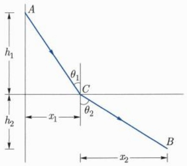
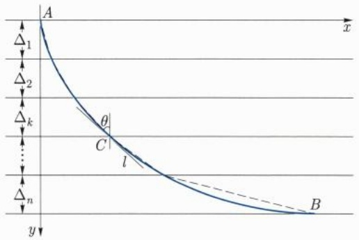
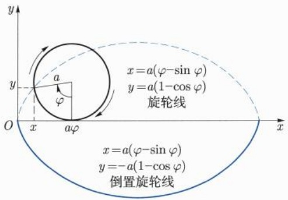
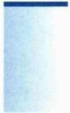
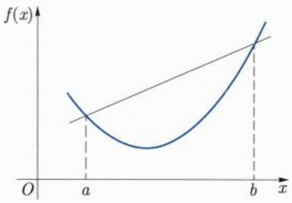

下面我们构造性寻找满足上述要求的多项式. 为此, 我们先看最简单的情形, 即 $n = 1$. 此时即为两点一次插值. 因此插值多项式就是过这两点的直线 $y = P_{1}(x)$, 即

$$
P _ {1} (x) = \frac {y _ {1} - y _ {0}}{x _ {1} - x _ {0}} x + \frac {x _ {1} y _ {0} - x _ {0} y _ {1}}{x _ {1} - x _ {0}},
$$

将其改写成

$$
P _ {1} (x) = \frac {x - x _ {1}}{x _ {0} - x _ {1}} y _ {0} + \frac {x - x _ {0}}{x _ {1} - x _ {0}} y _ {1}.
$$

记

$$
L _ {0} (x) = \frac {x - x _ {1}}{x _ {0} - x _ {1}}, \qquad L _ {1} (x) = \frac {x - x _ {0}}{x _ {1} - x _ {0}},
$$

则线性插值函数可写成

$$
P _ {1} (x) = L _ {0} (x) y _ {0} + L _ {1} (x) y _ {1}
$$

(对比前面曾经提到过的关系式 (7.1.4) 中的系数函数). 同时, 还有下面的关系式成立:

$$
L _ {i} (x _ {j}) = \delta_ {i j} = \left\{ \begin{array}{l l} 1, & i = j, \\ 0, & i \neq j. \end{array} \right.
$$

我们再来看一下 n = 2 的情形, 即二次多项式插值.

考虑三个插值数据  $\{(x_{0},y_{0}),(x_{1},y_{1}),(x_{2},y_{2})\}$ . 然后直接求解一个三元线性方程组，即可得到  $y=P_{2}(x)$  如下:

$$
P _ {2} (x) = L _ {0} (x) y _ {0} + L _ {1} (x) y _ {1} + L _ {2} (x) y _ {2},
$$

其中

$$
L _ {0} (x) = \frac {(x - x _ {1}) (x - x _ {2})}{(x _ {0} - x _ {1}) (x _ {0} - x _ {2})}, \quad L _ {1} (x) = \frac {(x - x _ {0}) (x - x _ {2})}{(x _ {1} - x _ {0}) (x _ {1} - x _ {2})},
$$

$$
L _ {2} (x) = \frac {(x - x _ {0}) (x - x _ {1})}{(x _ {2} - x _ {0}) (x _ {2} - x _ {1})}.
$$

下面的关系式仍然成立:

$$
L _ {i} (x _ {j}) = \delta_ {i j} = \left\{ \begin{array}{l l} 1, & i = j, \\ 0, & i \neq j. \end{array} \right.
$$

通过上述有明显导向性的讨论, 不难验证具有以下一般性的结论: 对于一般的  $n+1$   $(n \geqslant 2)$  个插值数据, 可以构造出 n 次插值多项式

$$
P _ {n} (x) = \sum_ {i = 0} ^ {n} L _ {i} (x) y _ {i},
$$

其中每个 $L_{i}(x)$ 满足

$$
L _ {i} (x _ {j}) = \delta_ {i j} = \left\{ \begin{array}{l l} 1, & i = j, \\ 0, & i \neq j. \end{array} \right.
$$

注意到只要有 $L_{i}(x_{j}) = \delta_{ij}$, 就有 $P_{n}(x_{j}) = \sum_{i=0}^{n} \delta_{ij} y_{i} = y_{j}$. 所以只需要写出 $L_{i}(x)$ 的表达式即可.

不难发现: 为了使得 $L_{i}(x_{j}) = 0 (i \neq j)$, 那么 $\forall j \neq i, (x - x_{j})$ 都必须是 $L_{i}(x)$ 的一个因式. 所以遍历所有的 $j \neq i, \prod_{j \neq i} (x - x_{j})$ 必须是 $L_{i}(x)$ 的一个因式. 所以有

$$
L _ {i} (x) = k \prod_ {j \neq i} (x - x _ {j}).
$$

另外，从 $L_{i}(x_{i}) = 1$ 知，$k = \left(\prod_{j \neq i} (x_{i} - x_{j})\right)^{-1}$，代入上式即可得到 $L_{i}(x)$ 的表达式:

$$
L _ {i} (x) = \frac {\prod_ {j \neq i} (x - x _ {j})}{\prod_ {j \neq i} (x _ {i} - x _ {j})},
$$

从而得到所求的多项式

$$
P _ {n} (x) = \sum_ {i = 0} ^ {n} L _ {i} (x) y _ {i}.
$$

上述 $L_{i}(x)$ 常被称为Lagrange基函数，$P_{n}(x)$ 称为Lagrange插值多项式.

对于给定的 $[a, b]$ 上的 $n + 1$ 个插值节点 $x_0, x_1, \dots, x_n \in [a, b]$, 引入函数

$$
\omega (x) = (x - x _ {0}) (x - x _ {1}) \dots (x - x _ {n}).
$$

则Lagrange插值多项式也可以写成如下形式:

$$
P _ {n} (x) = \sum_ {i = 0} ^ {n} y _ {i} \frac {\omega (x)}{\omega^ {\prime} (x _ {i})}.
$$

最后, 不难证明 Lagrange 插值多项式的唯一性: 即满足 $n + 1$ 个插值数据的次数不超过 $n$ 次的插值多项式是唯一的.

我们知道, 当初的插值数据是从一个 (未知真实的) 函数 $f(x)$ 获得来的一组数据, 而我们是想通过这些数据恢复原来的 $f(x)$. 由于种种原因, 我们做不到这一点, 于是就索性找最方便的研究的函数类之一 Lagrange 插值多项式. 那么我们这样得到的多项式, 与真实函数 $f(x)$ 实际差别到底有多大?

这个问题听起来有点突兀: $f(x)$ 是未知的, 仅仅靠若干个插值点来估计 Lagrange 插值多项式与 $f$ 之间的误差, 应该是难以实现, 因为随意改变其他非插值点的值, 都没有改变 Lagrange 插值多项式. 即使是设置了 $f$ 为连续函数这个底线, 仍然是过于自由. 因此, 要回答上面的问题, 我们加上一个光滑性较强的假设: $f(x) \in C^{(n+1)}[a, b]$. 在此假设下, 可以证明 $P_{n}(x)$ 与 $f(x)$ 之间的误差可以估计出来.

定理7.4.1 设被插函数 $f(x) \in C^{(n + 1)}[a,b]$，且插值节点 $x_{i}$ 互不相同，则对任意的 $x \in [a,b]$，都存在 $\xi \in [a,b]$，使得

$$
R _ {n} (x) = f (x) - P _ {n} (x) = \frac {f ^ {(n + 1)} (\xi)}{(n + 1) !} \omega (x) = \frac {f ^ {(n + 1)} (\xi)}{(n + 1) !} \prod_ {i = 0} ^ {n} (x - x _ {i}).
$$

证明 由于

$$
f (x _ {i}) = P _ {n} (x _ {i}), \quad i = 0, 1, 2, \dots , n,
$$

所以这 $n + 1$ 个插值节点都是 $R_{n}(x)$ 的零点，故

$$
R _ {n} (x) = \omega (x) r (x).
$$

我们来寻求 $r(x)$ 的表达式:令

$$
F (t) = f (t) - P _ {n} (t) - \omega (t) r (x).
$$

对任意的  $x \in [a, b] \setminus \{x_{0}, x_{1}, \cdots, x_{n}\}$ ，有

$$
F (x) = 0, \quad F (x _ {i}) = 0, \quad i = 0, 1, 2, \dots , n.
$$

所以 $F(t)$ 至少有 $n + 2$ 个零点, 反复应用 Rolle 中值定理, 可得 $F^{(n + 1)}(t)$ 至少有一个零点 $\xi$, 即

$$
F ^ {(n + 1)} (\xi) = f ^ {(n + 1)} (\xi) - r (x) (n + 1)! = 0.
$$

因此, $r(x) = \frac{f^{(n + 1)}(\xi)}{(n + 1)!}$.

## 习题7.4

1. 已知函数 $f(x)$ 在三点的函数值为

| x | 1.0 | 1.5 | 2.0 |
| --- | --- | --- | --- |
| f(x) | 0.0000 | 0.4055 | 0.6931 |

求它的二次插值多项式 $P_{2}(x)$ ，并用 $P_{2}(x)$ 估算 $f(1.2)$

2. 已知函数 $f(x) = \ln (x)$ 的函数值如下:

| x | 0.4 | 0.5 | 0.6 | 0.7 | 0.8 |
| --- | --- | --- | --- | --- | --- |
| f(x) | -0.9163 | -0.6931 | -0.5108 | -0.3567 | -0.2231 |

试分别用它的一次插值多项式 $P_{1}(x)$ 和二次插值多项式 $P_{2}(x)$ 估算 $\ln (0.52)$ 的近似值.

## 7.5 利用导数研究函数

研究函数可以有多种方法和角度, 这里所谓的利用导数研究函数, 通常是指能直接利用导数的定义和性质、微分中值定理、Taylor 展开式等方面的内容来重点研究函数的极值、最值、单调性、凹凸性等方面的属性.

## 7.5.1 极值与最值

在前面的章节, 我们给出了极值和最值的定义, 引入了驻点、极值点等概念, 给出了可微函数在极值点处导数为零的必要条件, 即 Fermat 引理等重要性质. 下面我们利用导数、微分中值定理和 Taylor 展开式等工具, 对函数的极值性和最值性作进一步的研究.

根据函数光滑性的不同, 我们可以作如下基本的分层分析, 所有结论的证明都非常直接, 留给读者补充.

(1) 如果函数在点 $x_0$ 附近不可导, 这种情况自然不宜归为导数的应用这一节, 此时极值性的确定只得另寻他法, 比如根据函数的具体特点回归到定义讨论.
(2) 如果 $f(x)$ 在点 $x_0$ 的某邻域 $(x_0 - \delta, x_0 + \delta)$ 内连续，在 $(x_0 - \delta, x_0)$ 内 $f'(x) > 0$，在 $(x_0, x_0 + \delta)$ 内 $f'(x) < 0$，那么 $x_0$ 是 $f(x)$ 的严格极大值点。读者可类似给出严格极小值点的情形。一个典型例子是 $f(x) = |x|$，该函数在 $x_0 = 0$ 处取得极小值；如果 $f'(x)$ 在点 $x_0$ 的两个单侧邻域内同号，那么 $x_0$ 不是 $f(x)$ 极值点。比如函数 $f(x) = \left\{ \begin{array}{ll} x, & x < 0, \\ 2x, & x \geqslant 0, \end{array} \right.$，$x_0 = 0$ 处不是其极值点。
(3) 如果 $f(x)$ 在点 $x_0$ 的其实心邻域内可微, 则由 Fermat 引理知, $x_0$ 是极值点的必要条件是 $f'(x_0) = 0$. 换句话说, 如果函数在点 $x_0$ 处导数非零, 则该点一定不是极值点.
(4) 如果 $f(x)$ 在点 $x_0$ 的某实心邻域内有更高阶的可导性, 那么通常我们有更方便

的判别极值性的方法. 这就是下面介绍的更一般的结论.

命题7.5.1 设 $f$ 在点 $x_0$ 处 $n$ 阶可导, 且

$$
f ^ {\prime} (x _ {0}) = f ^ {\prime \prime} (x _ {0}) = \dots = f ^ {(n - 1)} (x _ {0}) = 0, \quad f ^ {(n)} (x _ {0}) \neq 0.
$$

则当 $n$ 为偶数时, 如果 $f^{(n)}(x_0) < 0$, 则 $x_0$ 为极大值点; 如果 $f^{(n)}(x_0) > 0$, 则 $x_0$ 为极小值点; 而当 $n$ 为奇数时, $x_0$ 不是极值点.

证明 由已知条件和带 Peano 型余项的 Taylor 公式, 可得

$$
\begin{array}{l} f (x) = f (x _ {0}) + \frac {f ^ {(n)} (x _ {0})}{n !} (x - x _ {0}) ^ {n} + o \big ((x - x _ {0}) ^ {n} \big) \\ = f (x _ {0}) + \left(\frac {1}{n !} f ^ {(n)} (x _ {0}) + o (1)\right) (x - x _ {0}) ^ {n} \quad (x \to x _ {0}). \\ \end{array}
$$

由此看出, 当 $n$ 为偶数时, 上式第二项中的因子 $(x - x_0)^n$ 不变号, 故依 $f^{(n)}$ 的符号可知 $x_0$ 是极大值或极小值点; 而当 $n$ 为奇数时, 由于 $(x - x_0)^n$ 因 $x > x_0$ 还是 $x < x_0$ 而改变符号, 所以 $x_0$ 不是极值点. □

命题7.5.1中一种最常见的情形是 $n = 2$ 如果 $f$ 在点 $x_0$ 的某邻域内二阶连续可导，$x_0$ 是 $f$ 的驻点，即 $f'(x_0) = 0$ ，那么如果 $f''(x_0) \neq 0$ ，我们就称 $x_0$ 为 $f$ 的非退化驻点，否则称之为退化驻点.

对于非退化驻点, 上述命题的具体表现如下:

设 $f'(x_0) = 0$ ，如果 $f''(x_0) > 0$ ，则 $x_0$ 为 $f(x)$ 的极小值点；如果 $f''(x_0) < 0$ ，则 $x_0$ 为 $f(x)$ 的极大值点.

作为命题 7.5.1 的一种完善, 我们考虑下面一种场景: 假设  $x_{0}$  是 f 的退化驻点, 并且在点  $x_{0}$  的某邻域内只有二阶连续导数. 因此, 不允许对 f 继续求其高阶导数, 那么我们可以应用下面的结论:

命题7.5.2 设 $f$ 在点 $x_0$ 某邻域 $V = (x_0 - \delta, x_0 + \delta) (\delta > 0)$ 内二阶连续可导，$f'(x_0) = f''(x_0) = 0$.

(1) 如果  $\forall x \in V \setminus \{x_{0}\}, f''(x) > 0,$  那么  $x_{0}$  为 f 的极小值点;

(2) 如果  $\forall x \in V \setminus \{x_{0}\}, f''(x) < 0,$  那么  $x_{0}$  为 f 的极大值点;

需要注意的是, 即使 $f''(x)$ 在 $x_0$ 的任一邻域内都改变符号, 也不能断定 $x_0$ 就一定不是 $f$ 的极值点. 换句话说, 此时 $x_0$ 仍然有可能是极值点.

证明 (1) 根据 $f$ 的带 Lagrange 型余项的 Taylor 展开式立得

$$
f (x) = f (x _ {0}) + \frac {1}{2} f ^ {\prime \prime} (x _ {0} + \theta (x - x _ {0})) (x - x _ {0}) ^ {2} \geqslant f (x _ {0}).
$$

(2) 的证明完全类似, 略.

例7.5.1 设

$$
f (x) = \left\{ \begin{array}{l l} 0, & x = 0, \\ x ^ {6} \left(2 + \sin \frac {1}{x}\right), & x \neq 0. \end{array} \right.
$$

容易验证 $f'(0) = 0$，故 $x = 0$ 是驻点。直接计算可得 $f''(0) = 0$，所以 $x = 0$ 是退化驻点。又由于当 $x \neq 0$ 时，

$$
f ^ {\prime \prime} (x) = - x ^ {2} \left(\sin \frac {1}{x} + 1 0 x \cos \frac {1}{x} - 3 0 x ^ {2} \sin \frac {1}{x} - 6 0 x ^ {2}\right).
$$

可以看出 $f(x)$ 是二阶连续可微函数, 并且当 $x$ 充分小时 $f''(x)$ 是变号的. 但是, 我们并不能得到 $x = 0$ 不是 $f$ 极值点的结论. 事实上, $x = 0$ 显然是 $f$ 的 (严格) 极小值点: $\forall x \neq 0, f(x) \geqslant x^6 > f(0) = 0$.

有时候, 尽管函数可导甚至无穷次可导, 但判断一个驻点是否为极值点还得依照极值的定义. 比如例 7.2.10 中的函数.

例7.5.2 证明 $x = 0$ 是函数

$$
f (x) = \left\{ \begin{array}{l l} \mathrm{e} ^ {- \frac {1}{x ^ {2}}}, & x \neq 0, \\ 0, & x = 0 \end{array} \right.
$$

的极值点.

证明 由定义可得 $x = 0$ 显然是极小值点, 但如果利用导数的方法, 只能得到 $x = 0$ 是函数的驻点, 由于函数在0点处的各阶导数均为零, 所以命题7.5.1并不适用本例情况. 详证略. $\square$

最后, 我们简要总结一下求函数最值时需要注意的几点:

(1) 计算函数在不可导点处的函数值;
(2) 求出函数所有的驻点, 以及驻点处的函数值;
(3) 计算函数在可能的区间端点处的值;
(4) 把所有这些点的值作比较, 可以得到最值.

例 7.5.3 求 Dirichlet 函数  $D(x)=\left\{\begin{aligned}&1,&x\in\mathbb{Q}\cap[0,1],\\&0,&x\in[0,1]\setminus\mathbb{Q}\end{aligned}\right.$  的极值点和极值.

解 这道题的结论非常容易得到. 从极值的角度来看, 此例给出一个非常有趣的函数, 它在定义域上的每一点都是极值点, 同时又不是常值函数.

例 7.5.4 求函数  $f(x)=x^{x}\quad(x>0)$  的极值和最值, 并判断其极值性.

解 由于 $f'(x) = x^x (1 + \ln x)$，所以函数有唯一驻点 $x_0 = \frac{1}{\mathrm{e}}$. 再由

$$
f ^ {\prime \prime} (x _ {0}) = x ^ {x} \left((1 + \ln x) ^ {2} + \frac {1}{x}\right) \Big | _ {x _ {0}} > 0
$$

知 $x_0$ 是函数 $f(x)$ 的极小值点, 极小值为 $\mathrm{e}^{-1 / \mathrm{e}}$.

为了考虑函数的最大、最小值, 直接计算可以得到

$$
\lim _ {x \to 0 ^ {+}} x ^ {x} = 1, \quad \lim _ {x \to + \infty} x ^ {x} = + \infty ,
$$

所以函数在 x > 0 上无最大值, 而最小值就是其唯一的极小值  $e^{-1/e}$ .

例 7.5.5 求函数  $f(x)=(x-3)\sqrt[3]{x^{2}}$  在  $(-1,1)$  上的极值.

解 首先易知 $f(x) \in C(-1,1)$, 且

$$
f ^ {\prime} (x) = \frac {5 x - 6}{3 \sqrt [ 3 ]{x}}.
$$

可得区间 $(-1,1)$ 内有唯一的不可导点 $x_0 = 0$。其次，注意到

$$
f ^ {\prime} (x) > 0 \quad (x <   0), \qquad f ^ {\prime} (x) <   0 \quad (0 <   x <   1)
$$

所以  $x_{0}=0$  是函数  $f(x)$  的极大值点, 极大值为  $f(0)=0$ .

例 7.5.6 求函数  $f(x)=x^{3}-x+1$  在  $[-1,1]$  上的最小值和最大值.

解 因为 $f(x) = x^3 - x + 1$ 为连续函数, 故它在 $[-1, 1]$ 上可以取到最小值和最大值. 为了求函数的驻点, 考虑方程 $f'(x) = 3x^2 - 1 = 0$ 的解为 $x = \pm \frac{1}{\sqrt{3}}$, 因此 $f$ 可能的最值点为 $\pm 1, \pm \frac{1}{\sqrt{3}}$. $f$ 在这些点处的取值如下:

$$
f (- 1) = 1, \quad f (1) = 1, \quad f \Big (\frac {- 1}{\sqrt {3}} \Big) = 1 + \frac {2 \sqrt {3}}{9}, \quad f \Big (\frac {1}{\sqrt {3}} \Big) = 1 - \frac {2 \sqrt {3}}{9}.
$$

所以 f 的最大、小值分别为  $1 + \frac{2\sqrt{3}}{9}$  和  $1 - \frac{2\sqrt{3}}{9}$ .

注意到在本例中, 驻点均为最值点, 但情况并非总是如此.

例 7.5.7 求函数  $f(x)=x^{3}-x^{2}+1$  在  $[-1,2]$  上的最小值和最大值.

解 由 $f'(x) = 3x^2 - 2x = 0$ 求得驻点 $x = 0, \frac{2}{3}$. 因此 $f$ 可能的极值点为 $0, \frac{2}{3}$, 以及区间的两个端点 -1 和 2.

分别计算 $f$ 在这些点的函数值如下:

$$
f (- 1) = - 1, \quad f (0) = 1, \quad f \left(\frac {2}{3}\right) = \frac {2 3}{2 7}, \quad f (2) = 5.
$$

这说明 f 的最小值为 -1, 最大值为 5.

由于 $f''(0) = -2 < 0, f''\left(\frac{2}{3}\right) = 2 > 0,$ 所以利用命题7.5.1可知驻点 $x = 0$ 是极大值点，另一驻点 $x = \frac{2}{3}$ 是极小值点.

下面我们通过具体讨论 Fermat 原理 (光行最速原理), 再借助于导数的应用, 来体会一下微积分的灵活运用. 我们来建立一下 Fermat 原理与最速降线之间的关系.

光学中Fermat原理是说:光总是沿着最省时间的路线传播.所以，在相同的均匀介质中光按直线行进.下面我们推导光线遇到不同介质的界面时，其传播的线路特点，即推导验证所谓的光的折射定律.

例 7.5.8 有两种均匀介质, 以某水平面作为分界面, 如果一束光从介质一中的点 A 射向介质二中的点 B, 试求这束光穿行的路线.

解 我们可以把问题放到平面上来考虑. 设 $A$ 点到界面的距离为 $h_1$ (图7.2), $B$ 点到界面的距离为 $h_2$, $AB$ 两点的水平距离 (平行于分界面的距离) 为 $d$. 设光线在 $C$ 点发生折射, 记 $AC$ 的水平距离为 $x_1, d - x_1 = x_2$, 那么从 $A$ 点到 $B$ 点所需时间是

$$
t = \frac {A C}{v _ {1}} + \frac {C B}{v _ {2}} = \frac {1}{v _ {1}} \sqrt {h _ {1} ^ {2} + x _ {1} ^ {2}} + \frac {1}{v _ {2}} \sqrt {h _ {2} ^ {2} + x _ {2} ^ {2}},
$$

其中 $v_{1}, v_{2}$ 分别是两种介值中光的速度. 求导得 (注意到 $x_{2} = d - x_{1}$)

$$
\frac {\mathrm{d} t}{\mathrm{d} x _ {1}} = \frac {x _ {1}}{v _ {1} \sqrt {h _ {1} ^ {2} + x _ {1} ^ {2}}} - \frac {x _ {2}}{v _ {2} \sqrt {h _ {2} ^ {2} + x _ {2} ^ {2}}}.
$$

text_image

A
h₁
θ₁
C
θ₂
x₁
B
x₂

图 7.2 光行最速原理

注意到耗时最少的路径必须满足 $\frac{\mathrm{d}t}{\mathrm{d}x_1} = 0$ ，故有

$$
\frac {x _ {1}}{v _ {1} \sqrt {h _ {1} ^ {2} + x _ {1} ^ {2}}} = \frac {x _ {2}}{v _ {2} \sqrt {h _ {2} ^ {2} + x _ {2} ^ {2}}},
$$

即

$$
\frac {\sin \theta_ {1}}{v _ {1}} = \frac {\sin \theta_ {2}}{v _ {2}}.
$$

可以直接验证, 此时  $\frac{d^{2}t}{dx_{1}^{2}}>0$ , 因此符合折射定律的路径费时最少.

不难证明,当光线穿过 $n$ 种均匀介值,由 $A$ 点到达 $B$ 点时,下面的公式成立:

$$
\frac {\sin \theta_ {1}}{v _ {1}} = \frac {\sin \theta_ {2}}{v _ {2}} = \dots = \frac {\sin \theta_ {n}}{v _ {n}}.
$$

下面我们利用上面这个做法和结论来讨论更一般的情况, 借此展现微积分的最基本理念之一——以直代曲. 在积分理论中我们还会更系统地应用这一基本思想. 有兴趣的读者可以完善下面推导的细节和证明的严谨.

如图 7.3 所示, 给定 A, B 两点 (B 不在 A 的垂直下方), 若不计摩擦力, 问这个质点在重力作用下沿着什么曲线从点 A 滑到 B 点所需时间最短? 这就是经典的最速降线问题.

text_image

A
Δ₁
Δ₂
Δₖ
C
θ
l
Δₙ
y
B
x

图7.3 最速降线

下面我们把最速降线问题转化成Fermat原理的极限状态.为此，我们先建立适当的坐标系:如图所示，以 $A$ 点为坐标系原点，水平方向为 $x$ 轴方向，向下垂直方向为 $y$ 轴方向，建立直角坐标系.

现在我们把 $AB$ 垂直方向等分成 $n$ 个水平的带形区域, 当质点从坐标原点作自由落体滑落时, 如果 $n$ 充分大, 那么可以把质点在第 $k (k = 1,2,\dots ,n)$ 个宽度为 $\Delta_{k}$ 的带形区域内的每点处的速度 $v_{k}$ 看成是均匀的. 当质点从第 $k - 1$ 个带形区域滑落到第 $k$ 个带形区域时, 我们看成质点穿过不同的介值, 其运动规律遵循Fermat原理, 从而有

$$
\frac {\sin \theta_ {k - 1}}{v _ {k - 1}} = \frac {\sin \theta_ {k}}{v _ {k}} = c.
$$

假设曲线 $ACB$ 是所求的最速降线, $C(x,y)$ 是最速降线上的一点, 设 $\ell$ 是最速降线在 $C$ 点的切线, 记 $\theta$ 是 $\ell$ 与垂直线 (平行于 $y$ 轴) 的交角.

如果采用极限的观点, 不难看出, 当 $n \to +\infty$ 时, 一方面我们知道质点在 $C(x, y)$ 处的速度应该与 $\sqrt{y}$ 成正比, 即 $v \sim \sqrt{2gy}$, 其中 $g$ 是重力加速度, 我们可以把 $\sqrt{2gy}$ 看成是质点在 (充分小的带形) 介值中的穿行速度, 因此, 可得

$$
\frac {\sin \theta}{\sqrt {y}} = c. \tag {7.5.1}
$$

我们留给读者验证满足方程（7.5.1）的函数恰巧对应旋轮线（又称摆线）所满足的特性. 所以最速降线就是倒置 $(y \to -y)$ 的旋轮线

$$
x = a (\varphi - \sin \varphi), \quad y = - a (1 - \cos \varphi). \tag {7.5.2}
$$

如图7.4所示.事实上，我们知道经典的旋轮线在 $(x,y)$ 点处的切线斜率为

$$
k := \frac {\mathrm{d} y}{\mathrm{d} x} = \frac {\sin \varphi}{1 - \cos \varphi} = \cot \frac {\varphi}{2}.
$$

text_image

y
x=a(φ-sin φ)
y=a(1-cos φ)
旋轮线
O
x
a
aφ
x=a(φ-sin φ)
y=-a(1-cos φ)
倒置旋轮线
x

图 7.4 旋轮线与倒置旋轮线

另一方面, 此处切线斜率的几何意义给出的表示具有形式

$$
k = \frac {\mathrm{d} y}{\mathrm{d} x} := \tan \alpha .
$$

上式中的  $\alpha$  与  $\varphi$  的关系恰好可以由图 7.3 与图 7.4 中的  $\theta$  与  $\varphi$  的关系反映出来.

注 7.5.1 最速降线问题是 Galileo $^{①}$ 于 1630 年提出的, 历史上曾有诸多数学家给出了不同的做法, 比如影响较大的是 Johann Bernoulli 给出的精妙的解答. 在数学上, 它催生了变分法理论体系的诞生. 最速降线无论在数学上还是物理上都进行过严格的证明.

## 7.5.2 单调性

由于讨论函数的单增与单减并没有任何本质上的不同, 下面我们仅讨论单增的情况, 相应的单减情形下的表述完全平行.

我们曾在推论7.1.6中利用导数给出了函数单调的结论:若在区间 $I$ 上，$f'(x) \geqslant 0$ 则 $f$ 在 $I$ 上单增；若 $f'(x) > 0$ ，则 $f$ 在 $I$ 上严格单增。同时也易知:如果 $f$ 在 $I$ 上单增，则 $f'(x) \geqslant 0$ 。那么接下来很自然的两点思考:一是如果 $\forall x \in I, f'(x) \geqslant 0$ ，则 $f$ 可以严格单增吗？二是 $f$ 在 $I$ 上严格单增，是否也有可能存在导数为0的点，即 $f'(x) \geqslant 0?$ 事实上，这两点在说同一件事，而且可以从函数 $f(x) = x^3$ 中得到答案:“可以”。

下面我们试图给出严格单调与导数符号之间的一个等价关系. 首先有下述性质:

<small>① Galileo, di Vincenzo Bonaulti de Galilei, 1564 年 2 月 15 日 — 1642 年 1 月 8 日, 意大利天文学家.</small>

命题7.5.3 设函数 $f(x)$ 在 $[a, b]$ 上连续，在 $(a, b)$ 内除了有限个点外均有正的导数. 则 $f$ 在 $[a, b]$ 上严格单增.

证明 不妨假设 f 除了在有限个点  $x_{1}, x_{2}, \cdots, x_{n}, (a = x_{0} < x_{1} < x_{2} < \cdots < x_{n} < x_{n+1} = b)$  外， $f'(x) > 0$ 。因此有 f 连续，并在区间  $(x_{i}, x_{i+1})(i = 0, 1, \cdots, n)$  内严格单增，得证。

注7.5.2 在定理中提到的有限个点处函数可以可导, 如 $f(x) = x^3$ 在0点; 也可以不可导, 如单增的折线函数在折点处.

定理 7.5.4 设函数 $f\left( x\right)$ 在 $[a,b]$ 上连续, 在 $(a,b)$ 内可导. 则 $f$ 在 $[a,b]$ 上严格单增的充要条件是

(1) 当  $x \in (a, b)$  时,  $f'(x) \geqslant 0;$
(2) 在  $(a, b)$  的任何开子区间上, 导数都不恒为零, 即  $f'(x) \neq 0$ .

证明 事实上, 条件 (1) 的必要性前面已经讨论过, 条件 (2) 的必要性可基于以下事实: 如果函数在某个开区间上导数为零, 则由微分中值定理知, 此时函数在该区间为常数, 故不可能严格单增.

(充分性) 假设定理中的两条件均成立, 则由 (1) 知函数单增. 假如不是严格单增, 则存在 $a \leqslant x_1 < x_2 \leqslant b$, 使得 $f(x_1) = f(x_2)$, 而这蕴涵着在整个区间 $[x_1, x_2]$ 上都有 $f(x_1) = f(x) = f(x_2)$, 故 $f'(x) = 0, x \in (x_1, x_2)$. 与 (2) 矛盾. $\square$

推论7.5.5 设函数 $f(x)$ 在 $[a, b]$ 上连续，在 $(a, b)$ 内可导. 则 $f$ 为单调函数当且仅当 $f'(x)$ 不改变符号.

例 7.5.9 证明: 当  $x \in \left(0, \frac{\pi}{2}\right)$  时,

$$
\frac {2}{\pi} <   \frac {\sin x}{x} <   1. \tag {7.5.3}
$$

证明 定义函数

$$
f (x) = \left\{ \begin{array}{l l} 1, & x = 0, \\ \frac {\sin x}{x}, & x \in \left(0, \frac {\pi}{2} \right]. \end{array} \right.
$$

显然 $f(x)$ 在 $\left[0,\frac{\pi}{2}\right]$ 上连续, 在 $\left(0,\frac{\pi}{2}\right)$ 内可导, 且

$$
f ^ {\prime} (x) = \frac {x \cos x - \sin x}{x ^ {2}} = \frac {\cos x (x - \tan x)}{x ^ {2}} <   0,
$$

从而 $f(x)$ 在 $\left[0, \frac{\pi}{2}\right]$ 上严格单减. 所以当 $x \in \left(0, \frac{\pi}{2}\right)$ 时,

$$
\frac {2}{\pi} = f \left(\frac {\pi}{2}\right) <   \frac {\sin x}{x} = f (x) <   f (0) = 1.
$$

□

不等式 (7.5.3) 的一个常见的等价形式如下:

$$
\frac {2}{\pi} x <   \sin x <   x, \quad x \in \left(0, \frac {\pi}{2}\right).
$$

它表明了 $\sin x$ 在 $\left(0, \frac{\pi}{2}\right)$ 内被夹在两个线性函数之间.

注意, 存在可微函数, 其导函数的正负号改变可以非常复杂, 甚至其驻点可以有聚点.

例7.5.10 考虑函数

$$
f (x) = \left\{ \begin{array}{l l} 0, & x = 0, \\ x ^ {2} \sin \frac {2}{x}, & x \neq 0, \end{array} \right.
$$

则 $x = 0$ 是函数的驻点, 但在 $x = 0$ 的任意一个邻域 $(- \delta, \delta) (\delta > 0)$ 内, 函数 $f$ 都有无穷多个驻点.

如果一个可微函数的所有驻点是孤立的, 那么根据 Darboux 介值定理, 在两个相邻的驻点间, 函数的单调走向是明确的, 即

例 7.5.11 可微函数在两个相邻驻点之间是单调的.

最后我们通过下面的例子强调一下, 如果函数仅在一点的导数大于零, 并不能推出函数在该点邻域内的单调性.

例7.5.12 函数

$$
f (x) = \left\{ \begin{array}{l l} 0, & x = 0, \\ x + x ^ {2} \sin {\frac {2}{x}}, & x \neq 0. \end{array} \right.
$$

则有 $f^{\prime}(0) > 0$ ，但是在任何区间 $(- \delta, \delta) (\delta > 0)$ 内，都有导数小于零的点和子区间，故函数在 $(- \delta, \delta)$ 内并不单增.

对这个例子中的现象进一步挖掘的话, 可以看到问题发生在 $f(x)$ 虽然可导, 但导函数在 $x_0 = 0$ 点失去了连续性. 对于一个导函数在点 $x_0$ 处不连续的函数来说, 一点处导数值的正负条件太弱, 携带的信息量太少. 换句话说, 如果 $f(x)$ 有连续的导数, 且在点 $x_0$ 处导数大于零, 那么该函数在点 $x_0$ 的某邻域内严格单调上升. 不过仅仅一点处的导数大于零这个假设也还是能得到函数的一点点性质的, 即下面的性质成立.

如果 $f(x)$ 在点 $x_0$ 处可导, 且 $f'(x_0) > 0$, 则存在 $\delta_0 > 0$, 使得 $\forall h \in (0, \delta_0)$,

$$
f (x _ {0} - h) <   f (x _ {0}) <   f (x _ {0} + h).
$$

注意这种表述是有别于 $f(x)$ 单调上升的, 因为单调是针对区间上任意两个点的值进行比较的, 而这里仅仅是与 $f(x_0)$ 比较大小, 换句话说, 我们无法比较 $f(x_0 + h_1)$ 和 $f(x_0 + h_2)$ 的大小, 其中 $h_1, h_2 \in (0, \delta_0)$. 鉴于 $f'(x_0) > 0$ 蕴涵着点 $x_0$ 右 (左) 侧的函数值大 (小) 于 $f(x_0)$, 以及类似地, $f'(x_0) < 0$ 蕴涵着点 $x_0$ 右 (左) 侧的函数值小 (大) 于 $f(x_0)$,所以我们也形象地把 $f^{\prime}(x_0) > 0$ (或 $f^{\prime}(x_0) < 0$) 时的这一性质称为函数在一点处的单调性.①

例7.5.13 函数

$$
f (x) = \left\{ \begin{array}{l l} x + x ^ {2}, & x \in \mathbb {Q}, \\ x - x ^ {2}, & x \not \in \mathbb {Q} \end{array} \right.
$$

仅在 $x = 0$ 处连续、可导，$f'(0) = 1 > 0$，尽管 $f(x)$ 不是单调函数，但是在0点的某邻域 $(- \delta, \delta) (\delta > 0)$ 内，有

$$
f (x _ {1}) <   f (0) <   f (x _ {2}), \quad - \delta <   x _ {1} <   0 <   x _ {2} <   \delta .
$$

## 7.5.3 凹凸性

数学分析最主要的任务之一就是研究各类函数, 而至于函数类的划分则有多种方式和标准, 比如按照函数的光滑性是一种常见的分类方法, 按这个分类标准, 函数可以有间断函数、连续函数、可微函数、n次可微函数、无穷光滑函数和解析函数等, 而每一个类别内还可以进一步细分, 比如连续函数可以有 Hölder 连续、一致连续、Lipschitz 连续等. 除了这种分类, 还有其他分类标准下的重要函数类, 比如单调函数、凹凸函数、有界变差函数等.

本节我们将应用导数来重点讨论凹函数和凸函数. 首先我们给出凹凸函数解析形式的定义.

定义 7.5.1(凸函数) 设 f 为定义在区间 I 上的函数. 如果对任意的  $a, b \in I, a \neq b$ , 以及  $t \in (0,1)$ , 均有

$$
f (t a + (1 - t) b) \leqslant t f (a) + (1 - t) f (b), \tag {7.5.4}
$$

则称 $f$ 为 $I$ 中的凸函数 (图7.5), 不等号反向 $\geqslant$ 时称为凹函数. 不等号为严格小于号 $<$ 时称为严格凸函数, 不等号为严格大于号 $>$ 时称为严格凹函数.

line

| X | f(x) |
| --- | --- |
| a | ~0.5 |
| b | ~1.0 |

图7.5 凸函数

<small>① 这仅仅为一种形象陈述, 应该不是一种规范用语.</small>

通常所谓研究函数的凸性是指讨论一个函数是不是凸函数或凹函数.

注意, 不同教材或参考书上关于凹凸函数有不同的称呼, 常见的是把定义 7.5.1 中的凸函数又叫下凸函数, 凹函数称为上凸函数.

由于对凹函数和凸函数可以进行完全平行的讨论, 即无论从形式上还是从结论上, 两者都没有本质的区别, 因此, 下面我们主要讨论凸函数, 所有的结论和过程都可以平行地搬到凹函数.

凸 (凹) 性是函数的一个鲜明的几何特征, 一个定义在区间 $I$ 上的凸函数具有一个最基本的几何直观: 函数图像上任意两点形成的割线段 (不含端点) 都在曲线的上方.

由于函数图像上的任意两点 $(a, f(a)), (b, f(b))$ 确定的线性函数 $\ell(x)$ 满足 $\ell(a) = f(a), \ell(b) = f(b)$，因此可以表示为

$$
\ell (x) = \frac {b - x}{b - a} f (a) + \frac {x - a}{b - a} f (b),
$$

于是凸函数也常采用下面的定义.

定义 7.5.1 定义在区间 I 上的函数 f 称为凸函数, 是指对任意的  $a, b \in I, a \neq b$ , 以及  $x \in (a, b)$ , 均有

$$
f (x) \leqslant \ell (x), \quad \forall x \in (a, b). \tag {7.5.5}
$$

事实上, 可以看出这两种定义之间的关系是通过 $t = \frac{b - x}{b - a}$ 建立的. 因此 $t \in (0,1)$ 的几何意义也非常明确.

另外, 凸函数还可以有如下形式上似乎更一般然而实则等价的定义.

定义 7.5.2 称 f 是区间 I 上的凸函数, 是指对任何  $m \geqslant 2$ , 以及满足  $t_{1} + t_{2} + \cdots + t_{m} = 1$  的  $t_{1}, t_{2}, \cdots, t_{m} \geqslant 0$  以及  $x_{1}, x_{2}, \cdots, x_{m} \in I$ , 成立

$$
f \Big (\sum_ {k = 1} ^ {m} t _ {k} x _ {k} \Big) \leqslant \sum_ {k = 1} ^ {m} t _ {k} f (x _ {k}). \tag {7.5.6}
$$

当 $x_{i}$ 不全等时，上述不等式严格成立，则称 $f$ 为严格凸函数

不等式 (7.5.6) 称为 Jensen 不等式. 这是一个非常实用的不等式: 可以通过选取适当的凸函数 $f(x)$, 适当的 $n$ (最常见的有 $n = 2$ 和一般的 $n$) 以及适当的 $t_k$, 得到或验证诸多有趣的不等式.

命题 7.5.6 定义 7.5.1 与定义 7.5.2 是等价的.

证明 首先, 如果 $f$ 是定义7.5.2下的凸函数, 那么显然 $f$ 在定义7.5.1下也是凸的, 因为只要取 $m = 2$ 即可.

反过来, 如果 $f$ 在定义 7.5.1 下是凸的, 我们用数学归纳法证明 $f$ 在定义 7.5.2 下也是凸的. 显然, $m = 2$ 时已经成立. 假设命题对 $m = k$ 时成立, 我们来看 $m = k + 1$ 时的情况.

对任意的  $x_{i} \in I, t_{i} > 0, i = 1, 2, \cdots, k + 1, t_{1} + t_{2} + \cdots + t_{k+1} = 1,$  令

$$
\alpha_ {i} = \frac {t _ {i}}{1 - t _ {k + 1}}, \quad i = 1, 2, \dots , k.
$$

则有  $\alpha_{i}>0, i=1,2,\cdots,k,$  且  $\alpha_{1}+\alpha_{2}+\cdots+\alpha_{k}=1.$  于是由凸函数的定义 7.5.1 和 m=k 时的归纳假设, 可得

$$
f (t _ {1} x _ {1} + \dots + t _ {k} x _ {k} + t _ {k + 1} x _ {k + 1}) = f \big ((1 - t _ {k + 1}) \boldsymbol {x} + t _ {k + 1} x _ {k + 1} \big),
$$

其中  $x = \alpha_{1}x_{1} + \alpha_{2}x_{2} + \cdots + \alpha_{k}x_{k} \in I,$  所以有

$$
f (t _ {1} x _ {1} + \dots + t _ {k} x _ {k} + t _ {k + 1} x _ {k + 1}) \leqslant (1 - t _ {k + 1}) f (\boldsymbol {x}) + t _ {k + 1} f (x _ {k + 1}).
$$

再注意到

$$
f (\boldsymbol {x}) = f (\alpha_ {1} x _ {1} + \alpha_ {2} x _ {2} + \dots + \alpha_ {k} x _ {k}) \leqslant \alpha_ {1} f (x _ {1}) + \alpha_ {2} f (x _ {2}) + \dots + \alpha_ {k} f (x _ {k}),
$$

从而有

$$
f (t _ {1} x _ {1} + \dots + t _ {k} x _ {k} + t _ {k + 1} x _ {k + 1}) \leqslant t _ {1} f (x _ {1}) + \dots + t _ {k} f (x _ {k}) + t _ {k + 1} f (x _ {k + 1}).
$$

结论得证.

有一种弱化版本的凸函数的定义，即所谓的中点凸函数。它对应的定义是在定义7.5.1中，取 $t = \frac{1}{2}$ 的特殊情况。

定义 7.5.3 定义在区间 I 上的函数 f 称为中点凸的, 是指  $\forall x_{1}, x_{2} \in I$ , 都有

$$
f \Big (\frac {x _ {1} + x _ {2}}{2} \Big) \leqslant \frac {1}{2} \big (f (x _ {1}) + f (x _ {2}) \big), \quad \forall x _ {1}, x _ {2} \in I.
$$

可以证明, 中点凸与下面命题中的凸是等价的, 证明留作练习.

命题 7.5.7 设函数  $f(x)$  在区间 I 上有定义. 则  $f(x)$  是区间 I 上的中点凸函数的充要条件是  $\forall x_{1}, x_{2}, \cdots, x_{n} \in I$ , 有

$$
f \Big (\frac {x _ {1} + x _ {2} + \cdots + x _ {n}}{n} \Big) \leqslant \frac {1}{n} \big (f (x _ {1}) + f (x _ {2}) + \dots + f (x _ {n}) \big).
$$

有例子表明, 中点凸定义下的凸函数与定义 7.5.1 中的凸函数是不等价的, 即存在中点凸但不是凸的函数. 但是对于连续函数, 则中点凸等价于凸. 证明留作练习.

命题7.5.8 设 $f(x)$ 是区间 $I$ 上的连续函数. 则它是 (严格) 凸函数当且仅当它是 (严格) 中点凸函数.

一方面, 可以证明在连续性假设下, 中点凸等价于凸, 另一方面 “连续性” 假设还可以适当弱化, 比如下面这个结论成立, 读者可以试着完善证明.

定理 7.5.9 设函数 f 是定义在区间 I 上的函数,  $x_{0} \in I$ . 如果 f 在点  $x_{0}$  附近有界, 则 f 是 I 上的凸函数当且仅当它在 I 上是中点凸函数.

至于能否把“有界”条件变为更弱, 使得中点凸等价于凸仍然成立, 这方面的内容已经超出本书范围. 不过, 我们罗列一个与此有点关联的问题, 不打算作更多的铺开讨论.

注7.5.3 若定义在 $\mathbb{R}$ 上的 $f$ 满足

$$
f (x + y) = f (x) + f (y),
$$

则 $f$ 是一个什么样的函数？

这个问题的答案远非平凡, 该函数的图像可能也远超我们的直观想象. 但是如果对这类函数加上一点点额外的条件, 则可以证明它是个线性函数了. 这些额外条件可以是诸多条件中的一种表现, 比如下面几种条件中的任何一个都能保证函数是线性函数: $^{①}$

(1)  $f(x)$  是连续函数;
(2)  $f(x)$  在一点处连续;
(3) $f(x)$  在某邻域内有界;
(4)  $f(x)$  在某区间单调.

注意凸函数的原始定义并没有要求函数的连续性或可微性 (命题 7.5.8 仅仅在比较两种定义强弱时用到了连续假设), 因此在研究函数凸性时, 一个非常自然的逻辑推理是: 如果仅仅假设函数连续, 那么我们就只能利用与连续有关的性质和结论; 同理, 如果假设函数可导, 那么就可以采用导数的有关性质; 以此类推到高阶可导. 一般来说, 如果函数有一阶或二阶的导数, 那么研究函数的凸性要方便得多.

事实上, 对于凸函数而言, 一个有趣的结论是我们并不需要事先假设函数连续. 这是因为凸性自动蕴涵着函数在区间内点处的连续性, 这是凸函数的一个极具特色的性质 (见下面的定理 7.5.11). 更深入的讨论还可以得到凸函数在任何内点处单侧导数的存在性, 从而得到凸函数可导点的稠密性. 为了深入的讨论, 我们首先给出凸函数的其他等价的刻画, 它们在应用中非常方便.

定理 7.5.10 设 f 为区间 I 上的实函数. 则 f 为 I 上的凸函数等价于以下条件中任意一条: 对 I 中任意的三点  $x_{1} < x_{2} < x_{3}$ ，有

$$
\frac {f (x _ {2}) - f (x _ {1})}{x _ {2} - x _ {1}} \leqslant \frac {f (x _ {3}) - f (x _ {2})}{x _ {3} - x _ {2}}, \tag {7.5.7}
$$

$$
\frac {f (x _ {2}) - f (x _ {1})}{x _ {2} - x _ {1}} \leqslant \frac {f (x _ {3}) - f (x _ {1})}{x _ {3} - x _ {1}}, \tag {7.5.8}
$$

$$
\frac {f (x _ {3}) - f (x _ {1})}{x _ {3} - x _ {1}} \leqslant \frac {f (x _ {3}) - f (x _ {2})}{x _ {3} - x _ {2}}. \tag {7.5.9}
$$

证明 对于 $I$ 中三点 $x_{1} < x_{2} < x_{3}$, 记 $t = \frac{x_3 - x_2}{x_3 - x_1}$, 则 $t \in (0,1)$, 且 $x_{2} = tx_{1} + (1 - t)x_{3}$. 可直接验证不等式

$$
f (x _ {2}) \leqslant t f (x _ {1}) + (1 - t) f (x _ {3})
$$

<small>① f 是 Lebesgue 可测函数也能保证 f 是线性函数.</small>