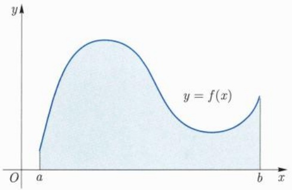
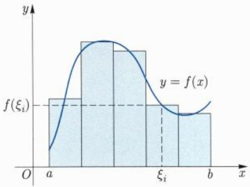
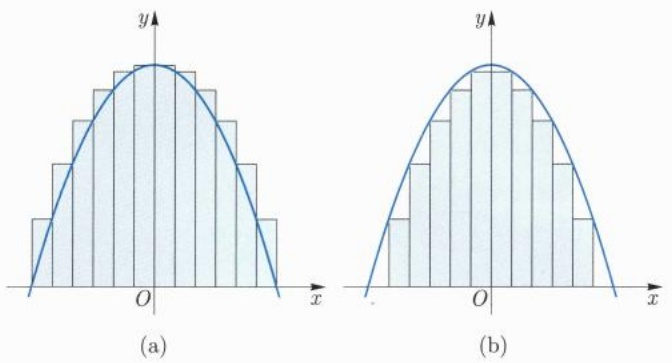

## 内容提要

本教材根据 “101 计划” 的要求编写。教材的编写基于编者多年的教学经验以及与兄弟院校教师的交流，兼顾了先进性与一定的普适性，注重基础性、思想性以及学科间的融会贯通，精选了例题和习题。

全书共二十一章，包含集合与映射、实数、序列极限、函数极限、连续函数、导数与微分、微分中值定理、不定积分、Riemann 积分、广义积分、数项级数、函数序列与函数项级数、幂级数、多元函数与映射的极限与连续、多元函数微分学及其应用、多元函数的积分学、曲线积分与曲面积分、微分形式简介、场论初步、含参变量积分、Fourier 级数等。

本教材可作为数学类专业数学分析课程的教材或教学参考书，还可供科技工作者参考。

## 目录

## 第九章 Riemann积分 1

9.1 Riemann积分的定义与函数的可积性 2
9.2 可积性的进一步刻画 10
9.3 微积分基本定理 15
9.4 积分的计算 20
9.5 积分的进一步性质 26
9.6 积分的近似计算 33
9.7 积分的应用 38

9.7.1 曲线的长度 39
9.7.2 简单图形的面积 41
9.7.3 简单立体的体积 44
9.7.4 物理应用举例 45

## 第十章 广义积分 51

10.1 积分的推广 52
10.2 广义积分的收敛判别法 57
10.3 广义积分的几个例子 63

## 第十一章 数项级数 69

11.1 级数敛散性定义与基本性质 70

11.1.1 级数敛散性定义 70
11.1.2 级数敛散性的基本性质 72

11.2 正项级数 75

11.2.1 比较判别法（控制判别法） 77
11.2.2 几何级数为对标级数 81
11.2.3 p-级数为对标级数 87
11.2.4 其他的对标级数 91

11.2.5 Cauchy积分判别法 92

11.2.6 级数敛散的快慢 Abel-Dini
定理 93

11.3 任意项级数 102

11.3.1 交错级数的敛散性 102

11.3.2 Abel 变换、Abel 判别法和 Dirichlet 判别法 104

11.4 绝对收敛级数与条件收敛级数的代数性质 112

11.4.1 级数运算的结合律 112

11.4.2 级数运算的交换律 115

11.4.3 级数运算的分配律 119

11.5 无穷乘积 125

第十二章 函数序列与函数项级数 131

12.1 函数列与函数项级数的基本问题 132

12.1.1 逐点收敛与一致收敛 132

12.1.2 极限函数的基本问题 139

12.2 一致收敛的判别法则 141

12.3 极限函数的分析性质 146

12.3.1 极限函数的连续性 146

12.3.2 极限函数的可积性 155

12.3.3 极限函数的可微性 158

第十三章 幂级数 169

13.1 幂级数的收敛半径与收敛域 170

13.2 幂级数在收敛域内的性质 173

13.2.1 和函数的连续性 174

13.2.2 和函数的可微性 176

13.2.3 和函数的可积性 178

13.3 Taylor展开式 181

13.4 初等函数的幂级数展开 190

13.5 幂级数的代数运算 192

13.6 连续函数的多项式逼近 205

13.7 Peano 曲线 210

第十四章 多元函数与映射的极限与连续 213

14.1 欧氏空间上的内积和外积 214

14.2 欧氏空间的拓扑 219
14.3 多元函数的极限 224
14.4 连续映射的整体性质 229
14.5 Lipschitz 映射和零测集 232

## 第十五章 多元函数微分学及其应用 239

15.1 偏导数与方向导数 240
15.2 映射的微分 258
15.3 多元函数求导 复合函数链式法则 261
15.4 微分中值定理 269
15.5 Taylor公式 273
15.6 隐函数存在定理 286
15.7 Lagrange 乘数法 条件极值 301
15.8 多元微分学在几何上的应用 307

## 参考文献 314

## 常用符号 318

## 索引 321

## 第九章

## Riemann 积分

积分源于求弧长、面积、体积等几何问题. 物理学中求变速运动的位移问题, 求非均匀物质的质量问题等也可以转化为计算积分. 在微积分发明的早期, 人们一般认为积分是求导的逆运算, 积分本身没有独立的定义. 1821 年, Cauchy 给出了连续函数积分的定义. 1854 年, Riemann $^{①}$  在研究 Fourier $^{②}$  级数的一篇论文中给出了有界函数积分的定义. Darboux 和 Lebesgue 进一步研究了可积函数的刻画, 他们分别于 1875 年和 1904 年证明了可积函数就是 “几乎处处” 连续的有界函数.

## 9.1 Riemann 积分的定义与函数的可积性

设 $f$ 是定义在闭区间 $[a, b]$ 上的函数 (不一定连续), 考虑平面上由直线 $x = a, x = b, y = 0$ 及曲线 $y = f(x)$ 所围成的曲边梯形 (图9.1). 为了计算它的面积, 我们将曲边梯形分成若干部分, 每一部分可以近似地看成是小矩形, 这些小矩形的面积之和可以当作曲边梯形面积的近似值.

text_image

y
y = f(x)
O a b x

图 9.1 曲边梯形的面积

具体说来, 我们在 $[a, b]$ 中取 $n + 1$ 个点, 依次记为 $a = x_0 < x_1 < \dots < x_n = b$, 它们将 $[a, b]$ 分成 $n$ 个小区间 $\Delta_i = [x_{i-1}, x_i] (1 \leqslant i \leqslant n)$, 这些小区间构成了 $[a, b]$ 的一个分割, 也称为分划, 记为

$$
\mathrm{P}: a = x _ {0} <   x _ {1} <   \dots <   x _ {n} = b.
$$

第 $i$ 个曲边小梯形的面积约等于 $f(\xi_i)\Delta x_i$ ，其中 $\xi_{i}\in [x_{i - 1},x_{i}],\Delta x_{i} = x_{i} - x_{i - 1}$ 整个曲边梯形的面积约等于

$$
\sum_ {i = 1} ^ {n} f (\xi_ {i}) \Delta x _ {i},
$$

<small>① Riemann, Georg Friedrich Bernhard, 1826 年 9 月 17 日—1866 年 7 月 20 日, 德国数学家.</small>

<small>② Fourier, Jean Baptiste Joseph, 1768 年 3 月 21 日—1830 年 5 月 16 日, 法国数学家、物理学家.</small>

上式称为 $f$ 的一个Riemann和或积分和(图9.2).

histogram

| X-axis | Frequency |
| --- | --- |
| a | \(f(\xi_i)\) |
| \(\xi_i\) | \(f(\xi_i)\) |

图9.2 Riemann和

我们期望当分割越来越细时, Riemann 和越来越接近曲边梯形的面积. 为了描述分割的精细程度, 记

$$
\| \mathrm{P} \| = \max _ {1 \leqslant i \leqslant n} \{\Delta x _ {i} \},
$$

称为分割 P 的模.

定义 9.1.1 (Riemann 积分) 设 f 是定义在区间  $[a, b]$  上的函数. 如果存在实数 I, 使得任给  $\varepsilon > 0$ , 均存在  $\delta > 0$ , 只要分割 P 满足  $\|P\| < \delta$ , 就有

$$
\left| \sum_ {i = 1} ^ {n} f (\xi_ {i}) \Delta x _ {i} - I \right| <   \varepsilon , \forall \xi_ {i} \in [ x _ {i - 1}, x _ {i} ], i = 1, 2, \dots , n,
$$

则称 $f$ 在 $[a,b]$ 上Riemann可积(简称可积), $I$ 称为 $f$ 在 $[a,b]$ 上的（定）积分，记为

$$
\int_ {a} ^ {b} f (x) \mathrm{d} x = I = \lim _ {\| \mathrm{P} \| \to 0} \sum_ {i = 1} ^ {n} f (\xi_ {i}) \Delta x _ {i}.
$$

注 9.1.1 在上述积分表达式中, $[a,b]$ 称为积分区间, a,b 分别为积分下限与积分上限, f 为被积函数, x 为积分变量. 注意, 定积分与变量 x 的表示方法无关, 即

$$
\int_ {a} ^ {b} f (x) \mathrm{d} x = \int_ {a} ^ {b} f (t) \mathrm{d} t.
$$

例 9.1.1 设  $c \in R, f \equiv c,$  求 f 在  $[a, b]$  上的积分.

解 当 $f \equiv c$ 时, 其 Riemann 和形如

$$
\sum_ {i = 1} ^ {n} f (\xi_ {i}) \Delta x _ {i} = \sum_ {i = 1} ^ {n} c (x _ {i} - x _ {i - 1}) = c (x _ {n} - x _ {0}) = c (b - a),
$$

这说明

$$
\int_ {a} ^ {b} c \mathrm{d} x = c (b - a).
$$

□

为了方便起见, 我们用  $f \in R[a, b]$  表示 f 在  $[a, b]$  上 Riemann 可积. 下面我们来研究什么样的函数是可积的.

定理 9.1.1（可积的必要条件） 设  $f \in R[a, b]$ ，则 f 在  $[a, b]$  上有界，反之不然.

证明 设 $f \in R[a, b]$, 记 $I$ 为其积分. 在积分的定义中, 取 $\varepsilon = 1$, 此时存在相应的 $\delta > 0$. 取定正整数 $n > \frac{b - a}{\delta}$, 对区间 $[a, b]$ 作 $n$ 等分, 则

$$
\left| \frac {b - a}{n} \sum_ {i = 1} ^ {n} f (\xi_ {i}) - I \right| <   1, \forall \xi_ {i} \in [ x _ {i - 1}, x _ {i} ], i = 1, 2, \dots , n.
$$

特别地, 当 $1 \leqslant i \leqslant n, j \neq i$ 时, 取 $\xi_{j} = x_{j}$, 则有

$$
| f (\xi_ {i}) | <   \sum_ {j \neq i} | f (x _ {j}) | + \frac {n}{b - a} (1 + | I |), \forall \xi_ {i} \in [ x _ {i - 1}, x _ {i} ].
$$

这说明 $f$ 在每一小区间 $[x_{i - 1},x_i]$ 上均有界，从而是 $[a,b]$ 上的有界函数

反之, 我们考虑在有理数上取值为 1, 在无理数上取值为 0 的 Dirichlet 函数 $D(x)$. 任给一个分割, 当 $\xi_{i}$ 都取 $[x_{i-1}, x_{i}]$ 中的无理数时, 积分和为 0; 当 $\xi_{i}$ 都取 $[x_{i-1}, x_{i}]$ 中的有理数时, 积分和为 1. 因此 $D(x)$ 的积分和没有极限. □

以下我们考虑有界函数可积的条件.如同研究有界数列的收敛性可以考虑上极限和下极限一样,我们考虑有界函数Riemann和的“最大”值和“最小”值.对于分割

$$
\mathrm{P}: a = x _ {0} <   x _ {1} <   \dots <   x _ {n} = b,
$$

记 $M_{i} = \sup_{x\in [x_{i - 1},x_{i}]}f(x),m_{i} = \inf_{x\in [x_{i - 1},x_{i}]}f(x)$ ，令

$$
S = \sum_ {i = 1} ^ {n} M _ {i} \Delta x _ {i}, s = \sum_ {i = 1} ^ {n} m _ {i} \Delta x _ {i},
$$

我们称 $S$ 为 $f$ 关于 $\mathrm{P}$ 的 Darboux 上和, 简称上和 (图 9.3(a)), 也记为 $S(\mathrm{P})$ 或 $S(\mathrm{P}, f)$; 而 $s$ 称为 Darboux 下和, 简称下和 (图 9.3(b)), 也记为 $s(\mathrm{P})$ 或 $s(\mathrm{P}, f)$.

图 9.3 上和与下和

显然, 任何 Riemann 和总是介于下和与上和之间. 记

$$
\omega_ {i} = \omega_ {i} (f) = \sup _ {x \in [ x _ {i - 1}, x _ {i} ]} f (x) - \inf _ {x \in [ x _ {i - 1}, x _ {i} ]} f (x),
$$

称为 $f$ 在 $[x_{i - 1},x_i]$ 上的振幅.由定义，上和与下和之差可以表示为

$$
S - s = \sum_ {i = 1} ^ {n} \omega_ {i} \Delta x _ {i}.
$$

设 $f$ 为 $[a, b]$ 上的有界函数, 其上确界和下确界分别记为 $M, m$. 下面的引理给出了上和与下和关于分割的单调性质, 这与数列的情形类似.

引理 9.1.2 设分割 P' 是从 P 添加 k 个分点得到的, 则有

$$
S (\mathrm{P}) \geqslant S (\mathrm{P} ^ {\prime}) \geqslant S (\mathrm{P}) - (M - m) k \| \mathrm{P} \|,
$$

$$
s (\mathrm{P}) \leqslant s (\mathrm{P} ^ {\prime}) \leqslant s (\mathrm{P}) + (M - m) k \| \mathrm{P} \|.
$$

特别地, 往给定的分割增加新的分点时, 下和不减, 上和不增.

证明 以 $k = 1$ 的情形为例. 此时, 设新添加的分点为 $\bar{x}$, 则 $\bar{x}$ 必落在某个小区间 $(x_{j-1}, x_j)$ 内. 由上和的定义,

$$
S (\mathrm{P}) = \sum_ {i = 1} ^ {n} M _ {i} \Delta x _ {i} = M _ {j} \Delta x _ {j} + \sum_ {i \neq j} M _ {i} \Delta x _ {i},
$$

$$
S (\mathrm{P} ^ {\prime}) = M _ {j} ^ {\prime} (\bar {x} - x _ {j - 1}) + M _ {j} ^ {\prime \prime} (x _ {j} - \bar {x}) + \sum_ {i \neq j} M _ {i} \Delta x _ {i},
$$

这里 $M_j'$ 和 $M_j''$ 分别是 $f$ 在区间 $[x_{j-1},\bar{x}]$ 和 $[\bar{x},x_j]$ 上的上确界. 由 $M_j' \leqslant M_j, M_j'' \leqslant M_j$ 可得

$$
\begin{array}{l} 0 \leqslant S (\mathrm{P}) - S \left(\mathrm{P} ^ {\prime}\right) = \left(M _ {j} - M _ {j} ^ {\prime}\right) \left(\bar {x} - x _ {j - 1}\right) + \left(M _ {j} - M _ {j} ^ {\prime \prime}\right) \left(x _ {j} - \bar {x}\right) \\ \leqslant (M - m) (\bar {x} - x _ {j - 1}) + (M - m) (x _ {j} - \bar {x}) \\ = (M - m) \Delta x _ {j} \leqslant (M - m) \| \mathrm{P} \|. \\ \end{array}
$$

下和的情形可类似地证明.

推论 9.1.3 对于任意两个分割  $P_{1}$  及  $P_{2}$ ，均有  $s(\mathrm{P}_{1}) \leqslant S(\mathrm{P}_{2})$ .

证明 用 $\mathrm{P}_1 \cup \mathrm{P}_2$ 表示将 $\mathrm{P}_1$ 和 $\mathrm{P}_2$ 的所有分点合并后得到的分割 (重复的分点只取一次), 则 $\mathrm{P}_1 \cup \mathrm{P}_2$ 既可以看成由 $\mathrm{P}_1$ 添加分点, 又可以看作从 $\mathrm{P}_2$ 添加分点得到的分割. 由刚才的引理即得

$$
s (\mathrm{P} _ {1}) \leqslant s (\mathrm{P} _ {1} \cup \mathrm{P} _ {2}) \leqslant S (\mathrm{P} _ {1} \cup \mathrm{P} _ {2}) \leqslant S (\mathrm{P} _ {2}).
$$

下面的定理可以跟有界数列或有界函数的上、下极限的存在性作对比.

定理 9.1.4 (Darboux)  $\lim_{\|P\|\to0}S(P)=\inf_{P}S(P),\quad\lim_{\|P\|\to0}s(P)=\sup_{P}s(P).$

证明 根据定义, 总有如下估计:

$$
m (b - a) \leqslant s (\mathrm{P}) \leqslant S (\mathrm{P}) \leqslant M (b - a),
$$

这说明  $\inf_{P} S(P)$  和  $\sup_{P} s(P)$  都存在.

根据确界的定义, 任给 $\varepsilon > 0$, 存在分割 $\mathrm{P}'$, 使得

$$
S (\mathrm{P} ^ {\prime}) <   \inf _ {\mathrm{P}} S (\mathrm{P}) + \frac {\varepsilon}{2}.
$$

设 $\mathrm{P}^{\prime}$ 由 $k$ 个分点构成. 对于任意另一分割 $\mathrm{P}, \mathrm{P} \cup \mathrm{P}^{\prime}$ 至多比 $\mathrm{P}$ 多 $k$ 个分点. 由引理9.1.2可得

$$
S (\mathrm{P}) - (M - m) k \| \mathrm{P} \| \leqslant S (\mathrm{P} \cup \mathrm{P} ^ {\prime}) \leqslant S (\mathrm{P} ^ {\prime}) <   \inf _ {\mathrm{P}} S (\mathrm{P}) + \frac {\varepsilon}{2}.
$$

于是, 当  $\|P\| < \delta = \frac{\varepsilon}{2(M - m + 1)k}$  时,

$$
\begin{array}{l} \inf _ {\mathrm{P}} S (\mathrm{P}) \leqslant S (\mathrm{P}) \leqslant \frac {(M - m) k \varepsilon}{2 (M - m + 1) k} + \inf _ {\mathrm{P}} S (\mathrm{P}) + \frac {\varepsilon}{2} \\ <   \inf _ {\mathrm{P}} S (\mathrm{P}) + \varepsilon , \\ \end{array}
$$

这就证明了上和的极限等式. 下和的极限同理可证.

我们称 $\inf_{\mathrm{P}}S(\mathrm{P})$ 为 $f$ 在 $[a,b]$ 上的上积分, $\sup_{\mathrm{P}}s(\mathrm{P})$ 为 $f$ 在 $[a,b]$ 上的下积分, 分别记为

$$
\int_ {a} ^ {\bar {b}} f (x) \mathrm{d} x = \inf _ {\mathrm{P}} S (\mathrm{P}), \quad \int_ {a} ^ {b} f (x) \mathrm{d} x = \sup _ {\mathrm{P}} s (\mathrm{P}).
$$

Riemann 和 Darboux 关于函数可积性的结果反映在下面的重要定理中.

定理 9.1.5 (可积的充要条件) 设 f 为  $[a, b]$  上的有界函数, 则以下命题等价:

(1) $f \in R[a, b]$.
(2) f 在  $[a, b]$  上的上积分和下积分相等.
(3) $\lim_{\| \mathrm{P}\| \to 0}\sum_{i = 1}^{n}\omega_{i}\Delta x_{i} = 0.$

(4) 任给 $\varepsilon > 0$, 存在 $[a, b]$ 的某个分割 $P$, 使得

$$
S (\mathrm{P}) - s (\mathrm{P}) = \sum_ {i = 1} ^ {n} \omega_ {i} \Delta x _ {i} <   \varepsilon .
$$

证明 (1) $\Longrightarrow$ (2): 设 $f \in R[a, b]$, 其积分记为 $I$. 于是任给 $\varepsilon > 0$, 存在 $\delta > 0$, 当 $\|P\| < \delta$ 时

$$
I - \varepsilon <   \sum_ {i = 1} ^ {n} f (\xi_ {i}) \Delta x _ {i} <   I + \varepsilon .
$$

特别地, 我们有

$$
\begin{array}{l} I - \varepsilon \leqslant \sum_ {i = 1} ^ {n} \inf _ {x \in [ x _ {i - 1}, x _ {i} ]} f (x) \Delta x _ {i} = s (\mathrm{P}) \\ \leqslant \sum_ {i = 1} ^ {n} \sup _ {x \in \left[ x _ {i - 1}, x _ {i} \right]} f (x) \Delta x _ {i} = S (\mathrm{P}) \\ \leqslant I + \varepsilon, \\ \end{array}
$$

这说明 $\lim_{\| \mathrm{P}\| \to 0}s(\mathrm{P}) = \lim_{\| \mathrm{P}\| \to 0}S(\mathrm{P}) = I.$ 由Darboux定理即知 $f$ 的上、下积分相等.

(2) $\Longrightarrow$ (1): 设 $\sup_{\mathrm{P}} s(\mathrm{P}) = \inf_{\mathrm{P}} S(\mathrm{P}) = I$. 由 Darboux 定理, 任给 $\varepsilon > 0$, 存在 $\delta > 0$, 当 $\| \mathrm{P} \| < \delta$ 时, 有

$$
I - \varepsilon <   s (\mathrm{P}) \leqslant \sum_ {i = 1} ^ {n} f (\xi_ {i}) \Delta x _ {i} \leqslant S (\mathrm{P}) <   I + \varepsilon ,
$$

这说明 $\lim_{\| \mathrm{P}\| \to 0}\sum_{i = 1}^{n}f(\xi_i)\Delta x_i = I,$ 也就是说 $f$ 在 $[a,b]$ 上可积且积分为 $I$

(2)  $\Longleftrightarrow$  (3): 这可由 Darboux 定理及下式得到,

$$
\lim _ {\| \mathrm{P} \| \to 0} \sum_ {i = 1} ^ {n} \omega_ {i} \Delta x _ {i} = \lim _ {\| \mathrm{P} \| \to 0} (S (\mathrm{P}) - s (\mathrm{P})) = \inf _ {\mathrm{P}} S (\mathrm{P}) - \sup _ {\mathrm{P}} s (\mathrm{P}).
$$

(3) $\Longrightarrow$ (4): 这是显然的.
(4)  $\Longrightarrow$  (2): 如果存在分割 P, 使得  $S(\mathrm{P}) - s(\mathrm{P}) < \varepsilon$ , 则由

$$
s (\mathrm{P}) \leqslant \sup _ {\mathrm{P} ^ {\prime}} s (\mathrm{P} ^ {\prime}) \leqslant \inf _ {\mathrm{P} ^ {\prime}} S (\mathrm{P} ^ {\prime}) \leqslant S (\mathrm{P})
$$

可知

$$
0 \leqslant \inf _ {\mathrm{P} ^ {\prime}} S (\mathrm{P} ^ {\prime}) - \sup _ {\mathrm{P} ^ {\prime}} s (\mathrm{P} ^ {\prime}) \leqslant S (\mathrm{P}) - s (\mathrm{P}) <   \varepsilon .
$$

由 $\varepsilon$ 的任意性即知 $f$ 的上积分与下积分相等.

推论 9.1.6 (1) 设  $[\alpha, \beta] \subseteq [a, b]$ ，若  $f \in R[a, b]$ ，则  $f \in R[\alpha, \beta]$ .

(2) 设 $c \in (a, b)$, 若 $f \in R[a, c]$ 且 $f \in R[c, b]$, 则 $f \in R[a, b]$.

证明 (1) 由上述定理中的 (3), 任给 $\varepsilon > 0$, 存在 $\delta > 0$, 当 $[a, b]$ 的分割 $\mathbf{P}$ 满足 $\| \mathbf{P} \| < \delta$ 时, $\sum_{i=1}^{n} \omega_i \Delta x_i < \varepsilon$. 取 $[\alpha, \beta]$ 的一个分割 $\mathrm{P}'$, 使得 $\| \mathrm{P}' \| < \delta$. 显然, 可构造 $[a, b]$ 的分割 $\mathbf{P}$, 使得 $\mathbf{P}$ 是 $\mathrm{P}'$ 通过添加 $[a, b] \setminus [\alpha, \beta]$ 中的分点得到, 且 $\| \mathbf{P} \| < \delta$. 此时 $f$ 在 $[\alpha, \beta]$ 中的上和与下和之差不超过 $f$ 在 $[a, b]$ 中的上和与下和之差, 从而小于 $\varepsilon$. 由上述定理中的 (4) 即知 $f$ 在 $[\alpha, \beta]$ 上可积.

(2) 用上述定理中的 (4) 很容易证明, 略.

命题 9.1.7 (可积函数的运算性质) 设  $f, g \in R[a, b]$ ,  $\lambda, \mu \in R$ , 则有

(1) $\lambda f + \mu g \in R[a, b]$.
(2) $fg \in R[a, b]$.
(3) $|f|, |g| \in R[a, b]$. 如果 $|g|$ 有正下界, 则 $f / g \in R[a, b]$ 也成立.

证明 (1) 这可以从积分的定义直接得出.

(2) 根据定理 9.1.1, 存在 K > 0, 使得  $|f|, |g| \leqslant K$  处处成立. 由定理 9.1.5 (3), 任给  $\varepsilon > 0$ , 存在  $\delta > 0$ , 当  $\|P\| < \delta$  时,

$$
\sum_ {i = 1} ^ {n} \omega_ {i} (f) \Delta x _ {i} <   \frac {\varepsilon}{2 K + 1}, \quad \sum_ {i = 1} ^ {n} \omega_ {i} (g) \Delta x _ {i} <   \frac {\varepsilon}{2 K + 1}.
$$

当 $x, y \in [x_{i-1}, x_i]$ 时，

$$
\begin{array}{l} \left| f (x) g (x) - f (y) g (y) \right| \leqslant \left| f (x) (g (x) - g (y)) \right| + \left| (f (x) - f (y)) g (y) \right| \\ \leqslant K (\omega_ {i} (g) + \omega_ {i} (f)), \\ \end{array}
$$

这说明 $\omega_{i}(fg) \leqslant K(\omega_{i}(g) + \omega_{i}(f))$，从而有

$$
\begin{array}{l} \sum_ {i = 1} ^ {n} \omega_ {i} (f g) \Delta x _ {i} \leqslant K \sum_ {i = 1} ^ {n} (\omega_ {i} (f) + \omega_ {i} (g)) \Delta x _ {i} \\ <   \frac {K \varepsilon}{2 K + 1} + \frac {K \varepsilon}{2 K + 1} <   \varepsilon . \\ \end{array}
$$

由定理 9.1.5 知 fg 可积.

(3) 由 $\omega_{i}(|f|) \leqslant \omega_{i}(f)$ 可知 $|f|$ 可积. 当 $|g|$ 有正下界时, 不妨设 $|g| \geqslant L > 0$. 此时, 由

$$
\left| \frac {1}{g (x)} - \frac {1}{g (y)} \right| = \frac {| g (x) - g (y) |}{| g (x) g (y) |}
$$

可得 $\omega_{i}(1 / g)\leqslant L^{-2}\omega_{i}(g)$ ，由此可知 $1 / g$ 可积.再由(2）即知 $f / g$ 可积

命题 9.1.8 (可积函数类) (1) 若有界函数 f 只在  $[a, b]$  上的有限个点处不连续，则 f 可积.

(2) 若 f 为  $[a, b]$  上的单调函数, 则 f 可积.

证明 (1) 我们用定理 9.1.5 (4) 来证明. 设  $\bar{x}_{k} (k=1,2,\cdots,N)$  为 f 的间断点. 任给  $\varepsilon>0$ , 取  $0<\rho<\frac{\varepsilon}{4(M-m+1)N}$ , 使得  $\{(\bar{x}_{k}-\rho,\bar{x}_{k}+\rho)\}$  互不相交. 去掉这些开区间后, [a,b] 剩下的部分由有限个闭区间组成, 且 f 在这些闭区间中连续. 根据一致连续性的 Cantor 定理, 可以取这些闭区间的分割, 使得 f 在每个闭区间上的振幅均小于  $\frac{\varepsilon}{2(b-a)}$ . 这些闭区间的分割连同  $\{[\bar{x}_{k}-\rho,\bar{x}_{k}+\rho]\cap[a,b]\}$  构成了 [a,b] 的分割, 记

为 P. 对于此分割, 有

$$
\begin{array}{l} S (\mathrm{P}) - s (\mathrm{P}) \leqslant \frac {\varepsilon}{2 (b - a)} (b - a) + (M - m) \sum_ {i = 1} ^ {N} 2 \rho \\ \leqslant \frac {\varepsilon}{2} + (M - m) \frac {2 N \varepsilon}{4 (M - m + 1) N} <   \varepsilon . \\ \end{array}
$$

由定理 9.1.5 (4) 知 f 可积.

(2) 不妨设 $f$ 单调递增. 任给 $\varepsilon > 0$, 取 $[a, b]$ 的分割 $\mathrm{P}$, 使得 $\| \mathrm{P} \| < \frac{\varepsilon}{f(b) - f(a) + 1}$, 则

$$
\begin{array}{l} \sum_ {i = 1} ^ {n} \omega_ {i} \Delta x _ {i} = \sum_ {i = 1} ^ {n} (f (x _ {i}) - f (x _ {i - 1})) \Delta x _ {i} \\ \leqslant \sum_ {i = 1} ^ {n} \left(f (x _ {i}) - f (x _ {i - 1})\right) \frac {\varepsilon}{f (b) - f (a) + 1} \\ = (f (x _ {n}) - f (x _ {0})) \frac {\varepsilon}{f (b) - f (a) + 1} \\ = (f (b) - f (a)) \frac {\varepsilon}{f (b) - f (a) + 1} <   \varepsilon , \\ \end{array}
$$

由定理 9.1.5 (4) 知 f 可积.

设 $f$ 为 $[a,b]$ 上定义的函数, 如果存在 $[a,b]$ 的分割

$$
\mathrm{P}: a = x _ {0} <   x _ {1} <   x _ {2} <   \dots <   x _ {n} = b,
$$

使得 $f$ 在每一个小区间 $(x_{i - 1},x_i)$ 内均为常数，则称 $f$ 为阶梯函数. 阶梯函数最多只有有限个间断点，因此是可积函数.

## 习题 9.1

1. 利用积分的几何含义写出下列积分的值:

(1) $\int_{a}^{b}\left|x - \frac{a + b}{2}\right|\mathrm{d}x;$

(2) $\int_{a}^{b}\sqrt{(x - a)(b - x)}\mathrm{d}x.$

2. 设 $f \in R[a, b]$, 证明:

$$
\int_ {a} ^ {b} f (x) \mathrm{d} x = \lim _ {n \to \infty} \frac {b - a}{n} \sum_ {k = 1} ^ {n} f \Big (a + \frac {k}{n} (b - a) \Big).
$$

3. 设 $b > a > 0, f \in R[a, b]$, 证明:

$$
\int_ {a} ^ {b} f (x) \mathrm{d} x = \lim _ {n \to \infty} \frac {\ln b - \ln a}{n} \sum_ {k = 1} ^ {n} a ^ {\frac {n - k}{n}} b ^ {\frac {k}{n}} f \big (a ^ {\frac {n - k}{n}} b ^ {\frac {k}{n}} \big).
$$

4. 设 b > a > 0, 用定义计算下列积分:

(1) $\int_{a}^{b} x \, \mathrm{d}x$;

(2) $\int_{a}^{b}\frac{1}{x^2}\mathrm{d}x.$

5. 判断下列函数在  $[0,1]$  上的可积性:

(1) $f(x) = \left\{ \begin{array}{ll} - 1, & x\in \mathbb{Q},\\ 1, & x\in \mathbb{R}\setminus \mathbb{Q}; \end{array} \right.$

(2) $f(x) = \left\{ \begin{array}{ll}x, & x\in \mathbb{Q},\\ 0, & x\in \mathbb{R}\setminus \mathbb{Q}; \end{array} \right.$

(3) $f(x) = \left\{ \begin{array}{ll}\operatorname {sgn}\Big(\sin \frac{\pi}{x}\Big), & x\neq 0,\\ 0, & x = 0; \end{array} \right.$

(4) $f(x) = \left\{ \begin{array}{ll}\frac{1}{x} -\left[\frac{1}{x}\right], & x\neq 0,\\ 0, & x = 0. \end{array} \right.$

6. 设 $f \in R[a, b], c \in \mathbb{R}$, 证明:

$$
\int_ {a - c} ^ {b - c} f (x + c) \mathrm{d} x = \int_ {a} ^ {b} f (x) \mathrm{d} x.
$$

7. 设 $f \in R[a, b]$, $g$ 与 $f$ 只在有限个点处取值不同, 证明: $g \in R[a, b]$, 且

$$
\int_ {a} ^ {b} f (x) \mathrm{d} x = \int_ {a} ^ {b} g (x) \mathrm{d} x.
$$

8. 设 $f$ 是定义在 $[a, b]$ 上的函数，记 $f^{+} = \max\{f, 0\}$，$f^{-} = \max\{-f, 0\}$. 证明:$f \in R[a, b]$ 当且仅当 $f^{+}, f^{-} \in R[a, b]$.

9. 设 $f, g \in R[a, b]$, 证明: $\max \{f, g\}, \min \{f, g\} \in R[a, b]$.

10. 设 $f \in R[a, b]$, 证明: $\mathrm{e}^f \in R[a, b]$.

11. 设 $f \in R[a, b]$ 且 $f \geqslant c > 0$, 证明: $\ln f \in R[a, b]$.

12. 设 $f$ 为 $[a, b]$ 上的有界函数, 证明: 如果其间断点集 $D_f$ 只有有限个聚点, 则 $f \in R[a, b]$.

## 9.2 可积性的进一步刻画

从前一节中的讨论我们知道, 只有有限个间断点的有界函数必为可积函数. 在积分理论发展的早期, 人们认为这已经是关于可积性判断的最好的结果之一. 后来 Riemann 出人意料地用级数构造了一个具有可数个间断点的可积函数. 另一个具有类似特点的函数是 Riemann 函数 $R$, 它在 $[0,1]$ 上定义为

$$
R (x) = \left\{ \begin{array}{l l} { \frac {1}{q},} & {x =  \frac {p}{q} \in (0, 1), p, q \text {为互素的正整数},} \\ {1,} & {x = 0, 1,} \\ {0,} & {x \in (0, 1) \text {为无理数}.} \end{array} \right.
$$

显然, $0 \leqslant R(x) \leqslant 1$. 任给 $\varepsilon > 0$, 当 $\frac{1}{q} \geqslant \frac{\varepsilon}{2}$, 即 $q \leqslant \frac{2}{\varepsilon}$ 时, $[0,1]$ 中形如 $\frac{p}{q}$ 的既约分数不超过 $N = N(\varepsilon)$ 个. 取 $\delta = \frac{\varepsilon}{4N}$, 对于 $\|P\| < \delta$ 的任意分割, 包含上述既约分数的小区间至多只有 $2N$ 个, 在其余的小区间上 $R(x)$ 的取值均小于 $\frac{\varepsilon}{2}$, 因此

$$
0 \leqslant \sum_ {i} R (\xi_ {i}) \Delta x _ {i} \leqslant 2 N \| \mathrm{P} \| + \frac {\varepsilon}{2} \sum_ {i} \Delta x _ {i} \leqslant \varepsilon ,
$$

这说明 $R$ 在 $[0,1]$ 上可积, 且积分为零. 注意, $R$ 具有可数个间断点, 事实上它在有理点处均不连续.

从上面的讨论中可以体会到, 要说明一个有界函数 $f$ 为可积函数, 我们只要找到某个分割, 使得要么 $f$ 在此分割中的小区间上的振幅很小, 要么振幅较大的那些小区间的总长度很小. 这可以总结为下面的结果.

定理 9.2.1 (Riemann) 设 f 为  $[a, b]$  上的有界函数, 则 f 可积当且仅当任给  $\varepsilon$ ,  $\eta > 0$ , 存在  $[a, b]$  的某个分割 P, 使得

$$
\sum_ {\{i | \omega_ {i} \geqslant \eta \}} \Delta x _ {i} <   \varepsilon .
$$

证明 (必要性) 设 $f$ 可积. 由定理9.1.5(4), 任给 $\varepsilon, \eta > 0$, 存在分割 $\mathrm{P}$, 使得

$$
\sum_ {i = 1} ^ {n} \omega_ {i} \Delta x _ {i} <   \varepsilon \eta .
$$

这说明

$$
\eta \sum_ {\{i | \omega_ {i} \geqslant \eta \}} \Delta x _ {i} \leqslant \sum_ {i = 1} ^ {n} \omega_ {i} \Delta x _ {i} <   \varepsilon \eta ,
$$

即有 $\sum_{\{i|\omega_i\geqslant \eta \}}\Delta x_i <   \varepsilon .$

(充分性) 由已知条件, 任给 $\varepsilon > 0$, 存在 $[a, b]$ 的分割 P, 使得

$$
\sum_ {\{i | \omega_ {i} \geqslant \frac {\varepsilon}{2 (b - a)} \}} \Delta x _ {i} <   \frac {\varepsilon}{2 (M - m + 1)}.
$$

对于这个分割, 有

$$
\sum_ {i = 1} ^ {n} \omega_ {i} \Delta x _ {i} = \sum_ {\{i | \omega_ {i} <   \frac {\epsilon}{2 (b - a)} \}} \omega_ {i} \Delta x _ {i} + \sum_ {\{i | \omega_ {i} \geqslant \frac {\epsilon}{2 (b - a)} \}} \omega_ {i} \Delta x _ {i}
$$

$$
\begin{array}{l} \leqslant \frac {\varepsilon}{2 (b - a)} \sum_ {\{i | \omega_ {i} <   \frac {\varepsilon}{2 (b - a)} \}} \Delta x _ {i} + (M - m) \sum_ {\{i | \omega_ {i} \geqslant \frac {\varepsilon}{2 (b - a)} \}} \Delta x _ {i} \\ \leqslant \frac {\varepsilon}{2 (b - a)} (b - a) + \frac {(M - m) \varepsilon}{2 (M - m + 1)} <   \varepsilon . \\ \end{array}
$$

由定理 9.1.5 (4) 知 f 可积.

例9.2.1 设 $f \in C[a, b]$, $\varphi \in R[\alpha, \beta]$ 且 $\varphi([\alpha, \beta]) \subseteq [a, b]$. 证明: $f \circ \varphi \in R[\alpha, \beta]$.

证明 由 Cantor 定理, 任给 $\varepsilon > 0$, 存在 $\delta > 0$, 当 $x, y \in [a, b]$ 且 $|x - y| < \delta$ 时, $|f(x) - f(y)| < \frac{\varepsilon}{2(\beta - \alpha)}$. 因为 $\varphi$ 在 $[\alpha, \beta]$ 上可积, 由定理 9.2.1, 存在 $[\alpha, \beta]$ 的分割

$$
\mathrm{P}: \alpha = t _ {0} <   t _ {1} <   \dots <   t _ {m} = \beta,
$$

使得 $\sum_{\{i|\omega_i(\varphi)\geqslant \delta \}}\Delta t_i <   \frac{\varepsilon}{4K + 1}$ ，其中 $K$ 是 $|f|$ 在 $[a,b]$ 上的最大值.于是

$$
\begin{array}{l} \sum_ {i = 1} ^ {m} \omega_ {i} (f \circ \varphi) \Delta t _ {i} = \sum_ {\{i | \omega_ {i} (\varphi) \geqslant \delta \}} \omega_ {i} (f \circ \varphi) \Delta t _ {i} + \sum_ {\{i | \omega_ {i} (\varphi) <   \delta \}} \omega_ {i} (f \circ \varphi) \Delta t _ {i} \\ \leqslant 2 K \sum_ {\{i | \omega_ {i} (\varphi) \geqslant \delta \}} \Delta t _ {i} + \frac {\varepsilon}{2 (\beta - \alpha)} \sum_ {\{i | \omega_ {i} (\varphi) <   \delta \}} \Delta t _ {i} \\ \leqslant 2 K \frac {\varepsilon}{4 K + 1} + \frac {\varepsilon}{2 (\beta - \alpha)} (\beta - \alpha) <   \varepsilon . \\ \end{array}
$$

由定理 9.1.5 (4) 可知  $f \circ \varphi$  在  $[\alpha, \beta]$  上可积.

我们知道, 函数在某一点处是否连续可以用它在这一点处的振幅是否为零来刻画. 上述 Riemann 定理提醒我们, 可积函数振幅较大的地方不会太多, 因此可积函数不会有太多的间断点. 为了准确地刻画这种现象, 我们引入如下定义.

定义 9.2.1 (零测集) 设  $A \subseteq R$ ，如果任给  $\varepsilon > 0$ ，均存在覆盖 A 的至多可数个开区间  $\{I_{i}\}$ ，使得

$$
\sum_ {i \geqslant 1} | I _ {i} | \leqslant \varepsilon ,
$$

则称 A 为零测集.

例 9.2.2 证明: (1) 有限集是零测集. (2) 可数集是零测集. (3) 零测集的子集仍为零测集. (4) 可数个零测集之并仍为零测集.

证明 (1) 设 $A = \{x_{i}\}_{i=1}^{n}$ 为有限点集, 任给 $\varepsilon > 0$, 记

$$
I _ {i} = \left(x _ {i} - \frac {\varepsilon}{2 n}, x _ {i} + \frac {\varepsilon}{2 n}\right), i = 1, 2, \dots , n.
$$

显然, $\{I_i\}$ 组成了 $A$ 的一个覆盖, 且这些开区间的长度之和为

$$
\sum_ {i = 1} ^ {n} | I _ {i} | = \sum_ {i = 1} ^ {n} 2 \frac {\varepsilon}{2 n} = \varepsilon ,
$$