证明 任给 $\varepsilon > 0$, 取阶梯函数 $g$, 使得

$$
\int_ {a} ^ {b} | f (x) - g (x) | \mathrm{d} x <   \frac {1}{2} \varepsilon .
$$

此时

$$
\left| \int_ {a} ^ {b} f (x) \sin \lambda x \mathrm{d} x - \int_ {a} ^ {b} g (x) \sin \lambda x \mathrm{d} x \right| \leqslant \int_ {a} ^ {b} | f (x) - g (x) | \mathrm{d} x <   \frac {1}{2} \varepsilon . \tag {9.5.7}
$$

设阶梯函数 $g$ 在 $(x_{i - 1},x_i)$ 中取值为 $c_{i}$ $(1\leqslant i\leqslant m)$ ，则

$$
\int_ {a} ^ {b} g (x) \sin \lambda x \mathrm{d} x = \sum_ {i = 1} ^ {m} \int_ {x _ {i - 1}} ^ {x _ {i}} c _ {i} \sin \lambda x \mathrm{d} x = \sum_ {i = 1} ^ {m} (\cos (\lambda x _ {i - 1}) - \cos (\lambda x _ {i})) c _ {i} / \lambda .
$$

记 $M = \max \{|c_i| \mid 1 \leqslant i \leqslant m\}$, 上式表明

$$
\left| \int_ {a} ^ {b} g (x) \sin \lambda x \mathrm{d} x \right| \leqslant 2 m M / \lambda . \tag {9.5.8}
$$

当 $\lambda > 4mM\varepsilon^{-1}$ 时, 就有

$$
\left| \int_ {a} ^ {b} f (x) \sin \lambda x \mathrm{d} x \right| \leqslant \frac {1}{2} \varepsilon + 2 m M / \lambda <   \varepsilon ,
$$

这说明 (9.5.6) 中第一式成立.

我们也可以用分段线性逼近来做, 以 (9.5.6) 中第二式为例. 任给 $\varepsilon > 0$, 取连续的分段线性函数 $h$, 使得

$$
\int_ {a} ^ {b} | f (x) - h (x) | \mathrm{d} x <   \frac {1}{2} \varepsilon .
$$

此时

$$
\left| \int_ {a} ^ {b} f (x) \cos \lambda x \mathrm{d} x - \int_ {a} ^ {b} h (x) \cos \lambda x \mathrm{d} x \right| \leqslant \int_ {a} ^ {b} | f (x) - h (x) | \mathrm{d} x <   \frac {1}{2} \varepsilon . \tag {9.5.9}
$$

利用分部积分可得

$$
\int_ {a} ^ {b} h (x) \cos \lambda x \mathrm{d} x = h (x) \frac {\sin \lambda x}{\lambda} \Big | _ {a} ^ {b} - \int_ {a} ^ {b} h ^ {\prime} (x) \frac {\sin \lambda x}{\lambda} \mathrm{d} x,
$$

当  $\lambda$  充分大时, 上式右端的绝对值小于  $\frac{1}{2}\varepsilon$ . 剩下的证明与前一段相同, 不再重复. □
其次, 利用分段线性逼近还可以将分部积分公式做一点推广.

定理 9.5.4（分部积分之二） 设  $f, g \in R[a, b]$ ,  $C_{1}, C_{2} \in R$ . 当  $x \in [a, b]$  时，记

$$
F (x) = \int_ {a} ^ {x} f (t) \mathrm{d} t + C _ {1}, G (x) = \int_ {a} ^ {x} g (t) \mathrm{d} t + C _ {2},
$$

则有

$$
\int_ {a} ^ {b} F (x) g (x) \mathrm{d} x = F G \Big | _ {a} ^ {b} - \int_ {a} ^ {b} f (x) G (x) \mathrm{d} x.
$$

证明 如果 $f, g \in C[a, b]$, 则 $F, G \in C^{1}[a, b]$, 欲证等式可从之前的分部积分公式直接得到. 一般地, 我们分别取 $f, g$ 的分段线性逼近 $\{f_{n}\}, \{g_{n}\}$, 使得

$$
\int_ {a} ^ {b} | f _ {n} (x) - f (x) | \mathrm{d} x <   \frac {1}{n}, \quad \int_ {a} ^ {b} | g _ {n} (x) - g (x) | \mathrm{d} x <   \frac {1}{n}.
$$

当 $x \in [a, b]$ 时, 记

$$
F _ {n} (x) = \int_ {a} ^ {x} f _ {n} (t) \mathrm{d} t + C _ {1}, G _ {n} (x) = \int_ {a} ^ {x} g _ {n} (t) \mathrm{d} t + C _ {2}.
$$

由 $f_{n}, g_{n}$ 连续可得

$$
\int_ {a} ^ {b} F _ {n} (x) g _ {n} (x) \mathrm{d} x = F _ {n} G _ {n} \Big | _ {a} ^ {b} - \int_ {a} ^ {b} f _ {n} (x) G _ {n} (x) \mathrm{d} x. \tag {9.5.10}
$$

当 $n \to +\infty$ 时, 我们来研究上式中的各项如何变化. 首先, 不妨设 $f, g, f_n, g_n, F_n, G_n$ 在 $[a, b]$ 上的绝对值均不超过 $M$. 此时有

$$
\begin{array}{l} \left| F _ {n} (x) G _ {n} (x) - F (x) G (x) \right| \leqslant \left| F _ {n} (x) \left(G _ {n} (x) - G (x)\right) \right| + \left| \left(F _ {n} (x) - F (x)\right) G (x) \right| \\ \leqslant M \left| \int_ {a} ^ {x} \left(g _ {n} (t) - g (t)\right) \mathrm{d} t \right| + M \left| \int_ {a} ^ {x} \left(f _ {n} (t) - f (t)\right) \mathrm{d} t \right| \\ \leqslant M \int_ {a} ^ {b} | g _ {n} (t) - g (t) | \mathrm{d} t + M \int_ {a} ^ {b} | f _ {n} (t) - f (t) | \mathrm{d} t \\ <   2 M / n. \\ \end{array}
$$

(9.5.10) 式中其余的项可以类似地做估计.令  $n \rightarrow +\infty$  就由 (9.5.10) 式得到了欲证等式. □

利用分部积分还可以得到积分中值定理的另一种表现形式. 先看一个例子.

例 9.5.3 设  $\beta \geqslant 0, b > a > 0,$  证明:

$$
\left| \int_ {a} ^ {b} \mathrm{e} ^ {- \beta x} \frac {\sin x}{x} \mathrm{d} x \right| \leqslant \frac {2}{a}.
$$

证明 记 $g(x) = \frac{1}{x}\mathrm{e}^{-\beta x}$，利用分部积分可得

$$
\int_ {a} ^ {b} \mathrm{e} ^ {- \beta x} \frac {\sin x}{x} \mathrm{d} x = g (x) (- \cos x) \Big | _ {a} ^ {b} + \int_ {a} ^ {b} g ^ {\prime} (x) \cos x \mathrm{d} x.
$$

注意到 $g$ 在 $[a,b]$ 上是单调递减函数, $g' \leqslant 0$. 由积分第一中值定理, 存在 $\theta \in [a,b]$, 使得

$$
\begin{array}{l} \int_ {a} ^ {b} \mathrm{e} ^ {- \beta x} \frac {\sin x}{x} \mathrm{d} x = g (a) \cos a - g (b) \cos b + \cos \theta \int_ {a} ^ {b} g ^ {\prime} (x) \mathrm{d} x \\ = g (a) \cos a - g (b) \cos b + \cos \theta (g (b) - g (a)) \\ = (g (a) - g (b)) (\cos a - \cos \theta) + g (b) (\cos a - \cos b), \\ \end{array}
$$

这说明

$$
\left| \int_ {a} ^ {b} \mathrm{e} ^ {- \beta x} \frac {\sin x}{x} \mathrm{d} x \right| \leqslant 2 (g (a) - g (b)) + 2 g (b) = 2 g (a) \leqslant \frac {2}{a}.
$$

此例中的方法可以做如下推广.

定理 9.5.5 (Weierstrass) 设 $f \in R[a, b]$, $g$ 为 $[a, b]$ 上的单调函数, 则存在 $\xi \in [a, b]$, 使得

$$
\int_ {a} ^ {b} f (x) g (x) \mathrm{d} x = g (a) \int_ {a} ^ {\xi} f (x) \mathrm{d} x + g (b) \int_ {\xi} ^ {b} f (x) \mathrm{d} x. \tag {9.5.11}
$$

证明 设 $F$ 由 (9.3.3) 式所定义. 取 $g$ 的连续分段线性逼近 $\{g_n\}$, 由分部积分之二可得

$$
\begin{array}{l} \int_ {a} ^ {b} f (x) g (x) \mathrm{d} x = \lim _ {n \to + \infty} \int_ {a} ^ {b} f (x) g _ {n} (x) \mathrm{d} x \\ = \lim _ {n \to + \infty} \left(F g _ {n} \Big | _ {a} ^ {b} - \int_ {a} ^ {b} F (x) g _ {n} ^ {\prime} (x) \mathrm{d} x\right) \\ = \lim _ {n \to + \infty} \left(F (b) g (b) - F (a) g (a) - \int_ {a} ^ {b} F (x) g _ {n} ^ {\prime} (x)   \mathrm{d} x\right). \\ \end{array}
$$

根据 $g_{n}$ 的构造, 当 $g$ 为单调函数时, $g_{n}$ 也同样是单调函数. 此时, 由积分第一中值定理, 存在 $\xi_{n} \in [a, b]$, 使得

$$
\int_ {a} ^ {b} F (x) g _ {n} ^ {\prime} (x) \mathrm{d} x = F (\xi_ {n}) \int_ {a} ^ {b} g _ {n} ^ {\prime} (x) \mathrm{d} x = F (\xi_ {n}) (g _ {n} (b) - g _ {n} (a)) = F (\xi_ {n}) (g (b) - g (a)).
$$

根据 Bolzano 定理, $\{\xi_n\}$ 存在收敛子列, 不妨设它自身收敛于 $\xi \in [a, b]$, 则

$$
\begin{array}{l} \int_ {a} ^ {b} f (x) g (x) \mathrm{d} x = \lim _ {n \to + \infty} (F (b) g (b) - F (a) g (a) - F (\xi_ {n}) (g (b) - g (a))) \\ = F (b) g (b) - F (a) g (a) - F (\xi) (g (b) - g (a)) \\ = g (a) (F (\xi) - F (a)) + g (b) (F (b) - F (\xi)) \\ = g (a) \int_ {a} ^ {\xi} f (x) \mathrm{d} x + g (b) \int_ {\xi} ^ {b} f (x) \mathrm{d} x. \\ \end{array}
$$

推论 9.5.6 (Bonnet $^{①}$ ) 设  $f \in R[a, b]$ , g 为非负函数.

(1) 如果 $g$ 在 $[a, b]$ 上单调递减, 则存在 $\zeta \in [a, b]$ 使得

$$
\int_ {a} ^ {b} f (x) g (x) \mathrm{d} x = g (a) \int_ {a} ^ {\zeta} f (x) \mathrm{d} x. \tag {9.5.12}
$$

<small>① Bonnet, Pierre Ossian, 1819 年 12 月 22 日—1892 年 6 月 22 日, 法国数学家.</small>

(2) 如果 $g$ 在 $[a, b]$ 上单调递增, 则存在 $\eta \in [a, b]$ 使得

$$
\int_ {a} ^ {b} f (x) g (x) \mathrm{d} x = g (b) \int_ {\eta} ^ {b} f (x) \mathrm{d} x. \tag {9.5.13}
$$

证明 (1) 由题设可知, 若强制规定 $g$ 在 $b$ 处的值为零, 则既不影响 $g$ 的单调性也不影响 $fg$ 的积分, 此时直接应用 Weierstrass 定理即得欲证结论.

(2) 留作练习.

注 9.5.2 Weierstrass 定理和 Bonnet 定理统称为积分第二中值定理, 在对积分做估计的时候它们颇为有用.

## 习题9.5

1. 设 $f \in R[a, b]$, 证明: 存在 $\xi \in [a, b]$, 使得

$$
\int_ {a} ^ {\xi} f (x) \mathrm{d} x = \int_ {\xi} ^ {b} f (x) \mathrm{d} x.
$$

2. 设 $f \in R[a, b]$, 记

$$
F (x) = \int_ {a} ^ {x} f (t)   \mathrm{d} t, \forall x \in [ a, b ],
$$

证明:

$$
\int_ {a} ^ {b} F (x) \mathrm{d} x = \int_ {a} ^ {b} (b - x) f (x) \mathrm{d} x.
$$

3. 沿用上一题中的记号, 证明:

$$
\int_ {a} ^ {b} F ^ {2} (x) \mathrm{d} x = 2 \int_ {a} ^ {b} (b - x) f (x) F (x) \mathrm{d} x.
$$

4. 证明:

(1) $\lim_{n\to +\infty}\int_{0}^{\frac{\pi}{2}}\sin^n x\mathrm{d}x = 0;$

(2) $\lim_{n\to +\infty}\int_{n}^{n + p}\frac{\cos x}{x}\mathrm{d}x = 0 (p > 0).$

5. 设 $f$ 为 $[0, 2\pi]$ 上的单调递减函数, $n$ 为正整数, 证明:

$$
\int_ {0} ^ {2 \pi} f (x) \sin n x \mathrm{d} x \geqslant 0.
$$

6. 记

$$
f (x) = \int_ {x} ^ {x + 1} \sin t ^ {2}   \mathrm{d} t.
$$

证明: 当 x > 0 时  $|f(x)| < \frac{1}{x}$ .

7. 设 $f \in R[c, d], [a, b] \subset (c, d)$, 证明:

$$
\lim _ {h \to 0} \int_ {a} ^ {b} | f (x + h) - f (x) |   \mathrm{d} x = 0.
$$

8. 设 $f \in C[a, b]$, 证明:

$$
\lim _ {n \to + \infty} \left(\int_ {a} ^ {b} | f (x) | ^ {n}   \mathrm{d} x\right) ^ {\frac {1}{n}} = \max _ {a \leqslant x \leqslant b} | f (x) |.
$$

9. 设 $f \in R[a, b]$, $g$ 是以 $T$ 为周期的周期函数且 $g \in R[0, T]$, 证明:

$$
\lim _ {\lambda \to + \infty} \int_ {a} ^ {b} f (x) g (\lambda x)   \mathrm{d} x = \frac {1}{T} \left(\int_ {a} ^ {b} f (x)   \mathrm{d} x\right) \left(\int_ {0} ^ {T} g (x)   \mathrm{d} x\right).
$$

10. 设 $f$ 是定义在 $[a, b]$ 上的函数, 证明: $f \in R[a, b]$ 当且仅当任给 $\varepsilon > 0$, 存在 $g, h \in C[a, b]$, 使得 $g \leqslant f \leqslant h$, 且

$$
\int_ {a} ^ {b} (h (x) - g (x)) \mathrm{d} x <   \varepsilon .
$$

## 9.6 积分的近似计算

虽然利用 Newton-Leibniz 公式可以很方便地算出很多积分, 但如果被积函数的原函数缺乏显式表达式, 或者被积函数比较复杂, 人们往往使用近似计算方法来估计积分的值.

## 1. 矩形公式

设 $f \in R[a, b]$. 取 $c \in [a, b]$, 我们可以近似地用矩形的面积 $f(c)(b - a)$ 来估算 $f$ 在 $[a, b]$ 上的积分. 为了估计误差, 设 $f$ 可导, 且 $|f'(x)| \leqslant M_1, \forall x \in (a, b)$. 由微分中值定理可得

$$
\begin{array}{l} \left| \int_ {a} ^ {b} f (x) \mathrm{d} x - f (c) (b - a) \right| = \left| \int_ {a} ^ {b} (f (x) - f (c)) \mathrm{d} x \right| = \left| \int_ {a} ^ {b} f ^ {\prime} (\xi) (x - c) \mathrm{d} x \right| \\ \leqslant \int_ {a} ^ {b} | f ^ {\prime} (\xi) | | x - c | \mathrm{d} x \leqslant M _ {1} \int_ {a} ^ {b} | x - c | \mathrm{d} x \\ = \frac {1}{2} M _ {1} \left((c - a) ^ {2} + (b - c) ^ {2}\right). \\ \end{array}
$$

取 $c = \frac{1}{2} (a + b)$ 可得

$$
\left| \int_ {a} ^ {b} f (x) \mathrm{d} x - f \Big (\frac {a + b}{2} \Big) (b - a) \right| \leqslant \frac {1}{4} M _ {1} (b - a) ^ {2}. \tag {9.6.1}
$$

若 $f$ 为一次函数, 则上式左端为零 (即误差为零), 而右端并不能反映出这一点. 为此我们进一步设 $f$ 二阶可导, 且 $|f''(x)| \leqslant M_2, \forall x \in (a, b)$. 将 $f$ 在 $\frac{1}{2} (a + b)$ 处做Taylor展开可得

$$
f (x) = f \Big (\frac {a + b}{2} \Big) + f ^ {\prime} \Big (\frac {a + b}{2} \Big) \Big (x - \frac {a + b}{2} \Big) + \frac {1}{2} f ^ {\prime \prime} (\xi) \Big (x - \frac {a + b}{2} \Big) ^ {2},
$$

两边积分, 得

$$
\int_ {a} ^ {b} f (x) \mathrm{d} x = f \Big (\frac {a + b}{2} \Big) (b - a) + \frac {1}{2} \int_ {a} ^ {b} f ^ {\prime \prime} (\xi) \Big (x - \frac {a + b}{2} \Big) ^ {2} \mathrm{d} x,
$$

因此有

$$
\left| \int_ {a} ^ {b} f (x) \mathrm{d} x - f \left(\frac {a + b}{2}\right) (b - a) \right| \leqslant \frac {1}{2} M _ {2} \int_ {a} ^ {b} \left(x - \frac {a + b}{2}\right) ^ {2} \mathrm{d} x = \frac {1}{2 4} M _ {2} (b - a) ^ {3}. \tag {9.6.2}
$$

一般地, 我们将区间 $[a, b]$ 作 $n$ 等分, 在每一个小区间上均用矩形面积去逼近积分, 令

$$
R _ {n} = \sum_ {i = 1} ^ {n} f \left(\frac {x _ {i - 1} + x _ {i}}{2}\right) \frac {b - a}{n} = \frac {b - a}{n} \sum_ {i = 1} ^ {n} f \left(a + \frac {2 i - 1}{2 n} (b - a)\right), \tag {9.6.3}
$$

这样就得到了 $f$ 在 $[a,b]$ 上积分的近似值, 称为 $f$ 在 $[a,b]$ 上的矩形公式. 当 $f$ 可导时, 误差估计为

$$
\left| \int_ {a} ^ {b} f (x) \mathrm{d} x - R _ {n} \right| \leqslant \sum_ {i = 1} ^ {n} \frac {1}{4} M _ {1} \Big (\frac {b - a}{n} \Big) ^ {2} = \frac {M _ {1}}{4 n} (b - a) ^ {2}; \tag {9.6.4}
$$

当 $f$ 二阶可导时, 误差估计为

$$
\left| \int_ {a} ^ {b} f (x) \mathrm{d} x - R _ {n} \right| \leqslant \sum_ {i = 1} ^ {n} \frac {1}{2 4} M _ {2} \Big (\frac {b - a}{n} \Big) ^ {3} = \frac {M _ {2}}{2 4 n ^ {2}} (b - a) ^ {3}. \tag {9.6.5}
$$

## 2. 梯形公式

设 $f\in C[a,b]$ .记

$$
\ell (x) = \frac {x - b}{a - b} f (a) + \frac {x - a}{b - a} f (b), \forall x \in [ a, b ].
$$

我们有

$$
\int_ {a} ^ {b} f (x) \mathrm{d} x \approx \int_ {a} ^ {b} \ell (x) \mathrm{d} x = \frac {f (a) + f (b)}{2} (b - a),
$$

这称为梯形公式. 为了估计误差, 我们先证明一个引理.

引理9.6.1 设 $g \in C[a, b]$. 如果 $g$ 在 $(a, b)$ 中二阶可导且 $g(a) = g(b) = 0$, 则任给 $c \in [a, b]$, 存在 $\xi \in (a, b)$, 使得

$$
g (c) = \frac {1}{2} g ^ {\prime \prime} (\xi) (c - a) (c - b). \tag {9.6.6}
$$

证明 不妨设 $c \in (a, b)$, 令

$$
h (x) = g (x) - \frac {g (c)}{(c - a) (c - b)} (x - a) (x - b), x \in [ a, b ].
$$

此时 $h(a) = h(c) = h(b) = 0$。由Rolle定理可知，存在 $\xi_1 \in (a, c)$，$\xi_2 \in (c, b)$，使得 $h'(\xi_1) = 0$，$h'(\xi_2) = 0$。对 $h'$ 应用Rolle定理可得 $\xi \in (\xi_1, \xi_2)$，使得 $h''(\xi) = 0$。简单的计算表明

$$
h ^ {\prime \prime} (\xi) = g ^ {\prime \prime} (\xi) - \frac {2 g (c)}{(c - a) (c - b)},
$$

整理以后即得欲证结论.

如果 $f$ 二阶可导, 且 $|f''(x)| \leqslant M_2$, $\forall x \in (a, b)$, 则对 $g = f - \ell$ 应用上述引理可知

$$
| f (x) - \ell (x) | \leqslant \frac {1}{2} M _ {2} (x - a) (b - x), \forall x \in [ a, b ].
$$

积分可得如下误差估计:

$$
\left| \int_ {a} ^ {b} f (x) \mathrm{d} x - \frac {f (a) + f (b)}{2} (b - a) \right| \leqslant \frac {1}{2} M _ {2} \int_ {a} ^ {b} (x - a) (b - x) \mathrm{d} x = \frac {M _ {2}}{1 2} (b - a) ^ {3}. \tag {9.6.7}
$$

将区间  $[a, b]$  作 n 等分, 在每一个小区间上均用梯形面积去逼近积分, 则得到 f 的如下梯形公式:

$$
T _ {n} = \sum_ {i = 1} ^ {n} \frac {f (x _ {i - 1}) + f (x _ {i})}{2} \frac {b - a}{n} = \frac {b - a}{n} \left(\sum_ {i = 1} ^ {n - 1} f \left(a + \frac {i}{n} (b - a)\right) + \frac {f (a) + f (b)}{2}\right). \tag {9.6.8}
$$

相应地有误差估计

$$
\left| \int_ {a} ^ {b} f (x) \mathrm{d} x - T _ {n} \right| \leqslant \sum_ {i = 1} ^ {n} \frac {1}{1 2} M _ {2} \Big (\frac {b - a}{n} \Big) ^ {3} = \frac {M _ {2}}{1 2 n ^ {2}} (b - a) ^ {3}. \tag {9.6.9}
$$

## 3. Simpson $^{①}$ 公式

设 $f$ 三阶可导, 且 $|f'''(x)| \leqslant M_3, \forall x \in [a, b]$. 考虑经过平面上三点

$$
(a, f (a)), \quad \Big (\frac {a + b}{2}, f \Big (\frac {a + b}{2} \Big) \Big), \quad (b, f (b))
$$

的抛物线, 即考虑满足条件

$$
p _ {2} (a) = f (a), p _ {2} \Big (\frac {a + b}{2} \Big) = f \Big (\frac {a + b}{2} \Big), p _ {2} (b) = f (b)
$$

的二次插值多项式, 其表达式为

$$
p _ {2} (x) = \frac {\left(x - \frac {a + b}{2}\right) (x - b)}{\left(a - \frac {a + b}{2}\right) (a - b)} f (a) + \frac {(x - a) (x - b)}{\left(\frac {a + b}{2} - a\right) \left(\frac {a + b}{2} - b\right)} f \left(\frac {a + b}{2}\right) +
$$

<small>① Simpson, Thomas, 1710 年 8 月 20 日—1761 年 5 月 14 日, 英国数学家.</small>

$$
\frac {(x - a) \left(x - \frac {a + b}{2}\right)}{(b - a) \left(b - \frac {a + b}{2}\right)} f (b),
$$

直接的计算表明

$$
\int_ {a} ^ {b} p _ {2} (x) \mathrm{d} x = \frac {b - a}{6} \left(f (a) + 4 f \left(\frac {a + b}{2}\right) + f (b)\right),
$$

这是 $f$ 积分的近似值, 称为一次抛物线公式或 Simpson 公式. 为了较好地估计误差, 下面假设 $f$ 四阶可导. 我们选定常数 $\mu$, 使得函数

$$
g (x) = f (x) - p _ {2} (x) - \mu (x - a) \left(x - \frac {a + b}{2}\right) (x - b)
$$

在 $\frac{a + b}{2}$ 处的导数为零. 设 $c \neq a, \frac{a + b}{2}, b$. 考虑辅助函数

$$
F (x) = g (x) - \frac {g (c)}{(c - a) \left(c - \frac {a + b}{2}\right) ^ {2} (c - b)} (x - a) \left(x - \frac {a + b}{2}\right) ^ {2} (x - b),
$$

此时 $F$ 以 $a, \frac{a + b}{2}, b, c$ 为零点, $F^{\prime}\left(\frac{a + b}{2}\right) = 0$. 由 Rolle 定理可知, $F^{\prime}$ 存在三个不同的零点 $\xi_1, \xi_2, \xi_3$, 且这三个点与 $\frac{a + b}{2}$ 也不相同. 因此对 $F^{\prime}$ 继续重复使用 Rolle 定理, 就得到一个 $\xi$, 使得 $F^{(4)}(\xi) = 0$. 即

$$
f ^ {(4)} (\xi) - \frac {g (c)}{(c - a) \left(c - \frac {a + b}{2}\right) ^ {2} (c - b)} 4! = 0,
$$

上式可以改写为 (c 换成 x)

$$
g (x) = \frac {1}{2 4} f ^ {(4)} (\xi) (x - a) \Big (x - \frac {a + b}{2} \Big) ^ {2} (x - b),
$$

积分可得

$$
\begin{array}{l} \int_ {a} ^ {b} f (x) \mathrm{d} x - \frac {b - a}{6} \left(f (a) + 4 f \left(\frac {a + b}{2}\right) + f (b)\right) \\ = \frac {1}{2 4} \int_ {a} ^ {b} f ^ {(4)} (\xi) (x - a) \left(x - \frac {a + b}{2}\right) ^ {2} (x - b) \mathrm{d} x. \\ \end{array}
$$

如果 $|f^{(4)}|\leqslant M_4$ ，则有下面的误差估计:

$$
\left| \int_ {a} ^ {b} f (x) \mathrm{d} x - \frac {b - a}{6} \left(f (a) + 4 f \left(\frac {a + b}{2}\right) + f (b)\right) \right|
$$

$$
\leqslant \frac {1}{2 4} M _ {4} \int_ {a} ^ {b} (x - a) \left(x - \frac {a + b}{2}\right) ^ {2} (b - x) \mathrm{d} x = \frac {M _ {4}}{1 8 0 \times 2 ^ {4}} (b - a) ^ {5}. \tag {9.6.10}
$$

我们可以将区间 $[a, b]$ 作 $n$ 等分, 在每个小区间上用抛物线做逼近得到一般的 Simpson 公式:

$$
S _ {n} = \sum_ {i = 1} ^ {n} \frac {b - a}{6 n} \left(f (x _ {i - 1}) + 4 f \left(\frac {x _ {i - 1} + x _ {i}}{2}\right) + f (x _ {i})\right). \tag {9.6.11}
$$

误差估计为

$$
\left| \int_ {a} ^ {b} f (x) \mathrm{d} x - S _ {n} \right| \leqslant \frac {M _ {4}}{1 8 0 (2 n) ^ {4}} (b - a) ^ {5}. \tag {9.6.12}
$$

还可以用高阶多项式去逼近被积函数, 从而得到积分的其他近似计算公式, 读者可参考其他专门著作, 我们不再赘述.

例9.6.1 计算积分 $\frac{\pi}{4} = \int_0^1\frac{1}{1 + x^2}\mathrm{d}x$ 的近似值.

解 以 $n = 2$ 为例. 用矩形公式计算积分的近似值为

$$
R _ {2} = \frac {1}{2} \Big (f \Big (\frac {1}{4} \Big) + f \Big (\frac {3}{4} \Big) \Big) = \frac {3 3 6}{4 2 5} \approx 0. 7 9 1;
$$

用梯形公式计算积分的近似值为

$$
T _ {2} = \frac {1}{2} \Big (\frac {1}{2} f (0) + f \Big (\frac {1}{2} \Big) + \frac {1}{2} f (1) \Big) = \frac {3 1}{4 0} = 0. 7 7 5;
$$

用 Simpson 公式计算积分的近似值为

$$
\begin{array}{l} S _ {2} = \frac {1}{1 2} \left(f (0) + 4 f \left(\frac {1}{4}\right) + 2 f \left(\frac {1}{2}\right) + 4 f \left(\frac {3}{4}\right) + f (1)\right) \\ = \frac {8 0 1 1}{1 0 2 0 0} \approx 0. 7 8 5 3 9. \\ \end{array}
$$

利用数学归纳法可以将函数 $f(x) = \frac{1}{1 + x^2}$ 的四阶导数表示为

$$
f ^ {(4)} (x) = (\arctan x) ^ {(5)} = 2 4 \cos^ {5} (\arctan x) \sin 5 \Bigl (\arctan x + \frac {\pi}{2} \Bigr),
$$

这说明 $\left| {f}^{\left( 4\right) }\right|  \leq  {24}$ . 于是 $n = 2$ 时 Simpson 公式的误差要小于

$$
\frac {2 4}{1 8 0 \times 4 ^ {4}} = \frac {1}{1 9 2 0} <   0. 0 0 0 5.
$$

## 习题9.6

1. 分别用矩形公式、梯形公式和 Simpson 公式计算积分 $\ln 2 = \int_{1}^{2} \frac{\mathrm{d}x}{x}$ 的近似值, 要求误差小于 $10^{-2}$.

2. Simpson 公式计算积分 $\int_{0}^{1} \mathrm{e}^{-x^{2}} \, \mathrm{d}x$ 的近似值, 要求误差小于 $10^{-4}$.

3. 分别用 $n = 10$ 时的梯形公式和 Simpson 公式计算积分 $\int_{0}^{1} \frac{\mathrm{d}x}{\sqrt{1 + x^3}}$ 的近似值, 并估计误差.

4. 证明: 矩形公式和梯形公式之间满足关系式 $R_{n} = 2T_{2n} - T_{n}$.

5. 证明: 矩形公式、梯形公式和 Simpson 公式之间满足关系式

$$
S _ {n} = \frac {2}{3} R _ {n} + \frac {1}{3} T _ {n}.
$$

6. 设 $f \in C^{1}[a, b]$, 且 $|f'| \leqslant M$. 证明:

$$
\left| \int_ {a} ^ {b} f (x) \mathrm{d} x - \frac {f (a) + f (b)}{2} (b - a) \right| \leqslant \frac {1}{4} M (b - a) ^ {2}.
$$

7. 设 $f \in C^{2}[a, b]$, 证明: 存在 $\xi \in (a, b)$, 使得

$$
\int_ {a} ^ {b} f (x) \mathrm{d} x = (b - a) f \left(\frac {a + b}{2}\right) + \frac {1}{2 4} (b - a) ^ {3} f ^ {\prime \prime} (\xi).
$$

8. 设 $f \in C^4[a, b]$, 用分部积分证明:

$$
\begin{array}{l} \int_ {a} ^ {b} f (x) \mathrm{d} x - \frac {f (a) + f (b)}{2} (b - a) \\ = \frac {1}{2 4} \int_ {a} ^ {b} f ^ {(4)} (x) (x - a) ^ {2} (x - b) ^ {2} \mathrm{d} x - \frac {1}{1 2} (b - a) ^ {2} (f ^ {\prime} (b) - f ^ {\prime} (a)). \\ \end{array}
$$

9. 是否存在常数 $C$, 使得对于满足条件 $|f^{(3)}| \leqslant M$ 的每一个函数 $f$, 均有如下估计:

$$
\left| \int_ {a} ^ {b} f (x) \mathrm{d} x - \frac {f (a) + f (b)}{2} (b - a) \right| \leqslant C M (b - a) ^ {4}?
$$

请说明理由.

10. 设 $f$ 在 $[a, b]$ 上三阶可导, 请用 $f$ 的三阶导数对 Simpson 公式做误差估计.

## 9.7 积分的应用

许多实际的应用问题都可以转化为积分。我们以几何中求弧长、面积、体积以及物理中求功、力矩、转动惯量等为例说明怎样将问题转化为积分的形式并计算出相应的积分。

## 9.7.1 曲线的长度

设 $I = [\alpha, \beta]$, $\sigma$ 是从 $I$ 到平面的映射, 用分量表示为

$$
\sigma (t) = (x (t), y (t)), t \in I.
$$

如果 $x, y \in C(I)$, 则称 $\sigma$ 为 $\mathbb{R}^2$ 上的连续曲线. 如果 $x, y \in C^1(I)$, 则称 $\sigma$ 为 $C^1$ 曲线.

设 $\sigma$ 为 $C^1$ 曲线, 我们想求它的弧长. 为此, 在 $\sigma$ 上取相邻的两点 $\sigma(t), \sigma(t + \delta t)$, 这两点之间的弧长 $\delta s$ 约等于连接这两点的直线段的长度:

$$
\begin{array}{l} \delta s \approx \sqrt {(x (t + \delta t) - x (t)) ^ {2} + (y (t + \delta t) - y (t)) ^ {2}} \\ \approx \left((x ^ {\prime} (t)) ^ {2} + (y ^ {\prime} (t)) ^ {2}\right) ^ {\frac {1}{2}} \delta t. \\ \end{array}
$$

将 $\sigma$ 分成若干小段, 将每一段的弧长相加, 得到的总弧长可以转化为如下积分:

$$
L (\sigma) = \int_ {\alpha} ^ {\beta} \left((x ^ {\prime} (t)) ^ {2} + (y ^ {\prime} (t)) ^ {2}\right) ^ {\frac {1}{2}} \mathrm{d} t.
$$

这种局部分析方法常称为微元法. 下面我们再补充一些推导细节. 将  $[\alpha, \beta]$  分割为  $\alpha = t_{0} < t_{1} < \cdots < t_{n} = \beta$ , 点  $(x(t_{i}), y(t_{i}))$  把曲线分成若干段, 每一段的长度可以近似地用直线段的长度表示 (图 9.4), 即

$$
L (\sigma) \approx \sum_ {i = 1} ^ {n} \sqrt {(x (t _ {i}) - x (t _ {i - 1})) ^ {2} + (y (t _ {i}) - y (t _ {i - 1})) ^ {2}}.
$$

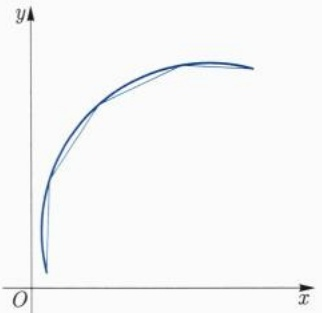

line

| X | Y |
| --- | --- |
| 0 | 0 |
| ~1.5 | ~0.2 |
| ~3.5 | ~0.8 |
| ~6.5 | ~0.95 |
| ~8.5 | ~0.98 |

图 9.4 曲线的长度

由Lagrange微分中值定理，存在 $\xi_{i},\eta_{i}\in (t_{i - 1},t_{i})$ ，使得

$$
x (t _ {i}) - x (t _ {i - 1}) = x ^ {\prime} (\xi_ {i}) (t _ {i} - t _ {i - 1}), y (t _ {i}) - y (t _ {i - 1}) = y ^ {\prime} (\eta_ {i}) (t _ {i} - t _ {i - 1}),
$$

从而有

$$
\sqrt {(x (t _ {i}) - x (t _ {i - 1})) ^ {2} + (y (t _ {i}) - y (t _ {i - 1})) ^ {2}} = \sqrt {(x ^ {\prime} (\xi_ {i})) ^ {2} + (y ^ {\prime} (\eta_ {i})) ^ {2}} \Delta t _ {i}.
$$

利用不等式 $\left|\sqrt{a^2 + b^2} -\sqrt{a^2 + c^2}\right|\leqslant |b - c|$ 可得

$$
\left| \sqrt {(x ^ {\prime} (\xi_ {i})) ^ {2} + (y ^ {\prime} (\eta_ {i})) ^ {2}} \Delta t _ {i} - \sqrt {(x ^ {\prime} (\xi_ {i})) ^ {2} + (y ^ {\prime} (\xi_ {i})) ^ {2}} \Delta t _ {i} \right| \leqslant | y ^ {\prime} (\eta_ {i}) - y ^ {\prime} (\xi_ {i}) | \Delta t _ {i},
$$

而当 $\| \mathrm{P}\| = \max \{|t_i - t_{i - 1}|\} \to 0$ 时

$$
\sum_ {i = 1} ^ {n} | y ^ {\prime} (\eta_ {i}) - y ^ {\prime} (\xi_ {i}) | \Delta t _ {i} \leqslant \sum_ {i = 1} ^ {n} \omega_ {i} (y ^ {\prime}) \Delta t _ {i} \rightarrow 0,
$$

因此有

$$
\begin{array}{l} L (\sigma) = \lim _ {\| P \| \rightarrow 0} \sum_ {i = 1} ^ {n} \sqrt {(x (t _ {i}) - x (t _ {i - 1})) ^ {2} + (y (t _ {i}) - y (t _ {i - 1})) ^ {2}} \\ = \lim _ {\| P \| \rightarrow 0} \sum_ {i = 1} ^ {n} \sqrt {\left(x ^ {\prime} \left(\xi_ {i}\right)\right) ^ {2} + \left(y ^ {\prime} \left(\xi_ {i}\right)\right) ^ {2}} \Delta t _ {i} \\ = \int_ {\alpha} ^ {\beta} \left((x ^ {\prime} (t)) ^ {2} + (y ^ {\prime} (t)) ^ {2}\right) ^ {\frac {1}{2}} \mathrm{d} t. \\ \end{array}
$$

只要 $x^{\prime},y^{\prime}$ 在 $[\alpha ,\beta ]$ 中可积，上述推导就是成立的.记 $\sigma '(t) = (x'(t),y'(t))$ ，称为 $\sigma$ 的切向量. $\sigma$ 的弧长就等于其切向量长度的积分.如果切向量处处非零，令

$$
\varphi (t) = \int_ {\alpha} ^ {t} \| \sigma^ {\prime} (u) \| \mathrm{d} u = \int_ {\alpha} ^ {t} \big ((x ^ {\prime} (u)) ^ {2} + (y ^ {\prime} (u)) ^ {2} \big) ^ {\frac {1}{2}} \mathrm{d} u, t \in [ \alpha , \beta ].
$$

则 $\varphi : [\alpha, \beta] \to [0, L(\sigma)]$ 是严格单调递增函数，从而可逆，其反函数记为 $t = \psi(s)$. 记 $\tilde{\sigma}(s) = \sigma(\psi(s)), s \in [0, L(\sigma)]$. 根据反函数的求导公式可得

$$
\tilde {\sigma} ^ {\prime} (s) = \sigma^ {\prime} (\psi (s)) \psi^ {\prime} (s) = \sigma^ {\prime} (\psi (s)) / \varphi^ {\prime} (t) = \sigma^ {\prime} (t) / \| \sigma^ {\prime} (t) \|,
$$

这说明  $\|\tilde{\sigma}^{\prime}(s)\|=1$ ，此时，s 称为  $\tilde{\sigma}$  的弧长参数.

例 9.7.1 求平面上半径为 r 的圆周的周长.

解 设圆心为 $(a, b)$, 则该圆周可以用参数表示为

$$
x (t) = a + r \cos t, y (t) = b + r \sin t, t \in [ 0, 2 \pi ].
$$

此时 $(x'(t))^2 + (y'(t))^2 \equiv r^2$，这说明圆周的周长为

$$
L = \int_ {0} ^ {2 \pi} r \mathrm{d} t = 2 \pi r.
$$

例 9.7.2 设 a > 0, 求摆线  $(x(t), y(t)) = (a(t - \sin t), a(1 - \cos t))$  一拱的长度 (图 9.5).

解 我们求 $t \in [0, 2\pi]$ 时曲线的长度:

$$
\begin{array}{l} L = \int_ {0} ^ {2 \pi} \left((x ^ {\prime} (t)) ^ {2} + (y ^ {\prime} (t)) ^ {2}\right) ^ {\frac {1}{2}} \mathrm{d} t \\ = \int_ {0} ^ {2 \pi} a \big ((1 - \cos t) ^ {2} + \sin^ {2} t \big) ^ {\frac {1}{2}} \mathrm{d} t \\ = 2 a \int_ {0} ^ {2 \pi} \sin \frac {t}{2} \mathrm{d} t = 8 a. \\ \end{array}
$$

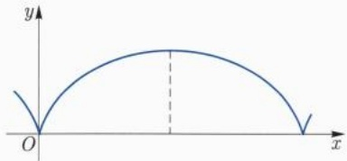

text_image

y
O
x

图9.5 摆线

## 9.7.2 简单图形的面积

(1) 设 $f \in C[a, b]$, 如果 $f > 0$, 则由 $y = f(x)$, $x = a$, $x = b$ ($a < b$) 与 $y = 0$ 围成的曲边梯形的面积为

$$
S = \int_ {a} ^ {b} f (x) \mathrm{d} x.
$$

一般地, 当 $f$ 变号时, 上式仍有意义, 称为代数面积, 而

$$
S = \int_ {a} ^ {b} | f (x) | \mathrm{d} x
$$

才是几何面积 (图 9.6(a)). 更一般地, 由  $y = f_{2}(x)$ ,  $y = f_{1}(x)$  以及 x = a, x = b 围成的图形 (图 9.6(b)) 的面积为

$$
S = \int_ {a} ^ {b} | f _ {2} (x) - f _ {1} (x) | \mathrm{d} x. \tag {9.7.1}
$$

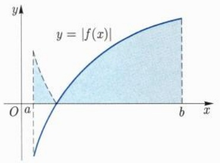

text_image

y
y = |f(x|)
O a b x

(a)

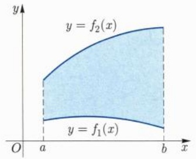

text_image

y
y = f₂(x)
O a b x
y = f₁(x)

(b)

图 9.6 函数图像围成的图形

例 9.7.3 设 a, b > 0, 求椭圆  $\frac{x^{2}}{a^{2}} + \frac{y^{2}}{b^{2}} = 1$  所围成的图形面积.

解 由图形的对称性, 有

$$
S = 4 \int_ {0} ^ {a} b \sqrt {1 - \frac {x ^ {2}}{a ^ {2}}} \mathrm{d} x = 4 b \int_ {0} ^ {\frac {\pi}{2}} \sqrt {1 - \sin^ {2} t} a \cos t \mathrm{d} t = 4 a b \int_ {0} ^ {\frac {\pi}{2}} \cos^ {2} t \mathrm{d} t = \pi a b. \quad \square
$$

(2) 设  $\sigma$  为平面曲线, 由极坐标方程

$$
r = r (\theta), \quad \theta \in [ \alpha , \beta ]
$$

给出 (图 9.7), 其中  $r(\theta)$  关于  $\theta$  连续,  $\beta - \alpha \leqslant 2\pi$ . 由  $\sigma$ ,  $\theta = \alpha$ ,  $\theta = \beta$  所围成的图形面积为

$$
S = \lim _ {\| \mathrm{P} \| \to 0} \sum_ {i = 1} ^ {m} \frac {1}{2} r ^ {2} (\xi_ {i}) \Delta \theta_ {i} = \frac {1}{2} \int_ {\alpha} ^ {\beta} r ^ {2} (\theta) \mathrm{d} \theta . \tag {9.7.2}
$$

这个公式是通过使用扇形的面积之和逼近图形面积得到的.

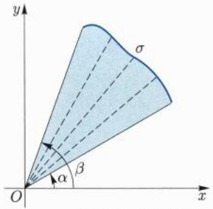

text_image

y
σ
α
β
O
x

图9.7 极坐标中的曲线

例 9.7.4 设 a > 0, 求双纽线  $(x^{2} + y^{2})^{2} = a^{2}(x^{2} - y^{2})$  所围成的图形面积.

解 用极坐标  $x = r \cos \theta, y = r \sin \theta$  代入方程, 得

$$
r ^ {2} = a ^ {2} \cos 2 \theta , \quad \theta \in \left[ - \frac {\pi}{4}, \frac {\pi}{4} \right] \cup \left[ \frac {3 \pi}{4}, \frac {5 \pi}{4} \right].
$$

由图形的对称性 (图 9.8) 可得所求面积为

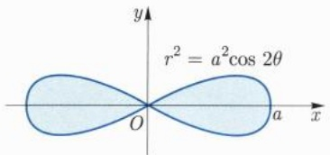

text_image

r² = a²cos 2θ
O
a
x
y

图9.8 双纽线

$$
S = 4 \cdot \frac {1}{2} \int_ {0} ^ {\frac {\pi}{4}} r ^ {2} (\theta)   \mathrm{d} \theta = 2 a ^ {2} \int_ {0} ^ {\frac {\pi}{4}} \cos 2 \theta   \mathrm{d} \theta = a ^ {2}. \quad \square
$$

(3) 如果曲线 $\sigma$ 由 $\sigma(t) = (x(t), y(t)), t \in [\alpha, \beta]$ 给出, 其中 $y(t) \geqslant 0$, $x$ 关于 $t$ 单调递增, $x([\alpha, \beta]) = [a, b]$. 则 $\sigma$ 与 $x = a$, $x = b$ 以及 $y = 0$ 围成的曲边梯形 (图9.9(a)) 的面积为

$$
S = \int_ {\alpha} ^ {\beta} y (t) x ^ {\prime} (t)   \mathrm{d} t.
$$

这个公式仍然是通过使用矩形面积之和去逼近曲边梯形得到. 一般地, 如果只设 $x$ 是单调的, 则面积公式为

$$
S = \int_ {\alpha} ^ {\beta} | y (t) x ^ {\prime} (t) |   \mathrm{d} t.
$$

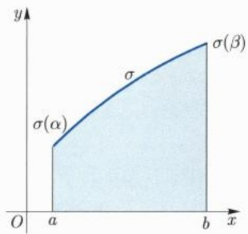

text_image

y
σ(α)
σ
σ(β)
O
a
b
x

(a)

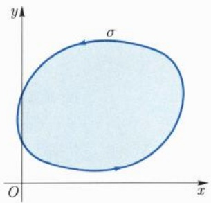

text_image

y
σ
O
x

(b)

图 9.9 曲线围成的图形

如果 $\sigma$ 在 $t = \alpha, \beta$ 处以外无其他自相交点，则称 $\sigma$ 为简单闭曲线 (图9.9(b))，它所围成的图形的面积为

$$
S = \left| \int_ {\alpha} ^ {\beta} y (t) x ^ {\prime} (t) \mathrm{d} t \right| = \left| \int_ {\alpha} ^ {\beta} x (t) y ^ {\prime} (t) \mathrm{d} t \right|, \tag {9.7.3}
$$

因为

$$
\begin{array}{l} \int_ {\alpha} ^ {\beta} y (t) x ^ {\prime} (t) \mathrm{d} t = y x \Big | _ {\alpha} ^ {\beta} - \int_ {\alpha} ^ {\beta} y ^ {\prime} (t) x (t) \mathrm{d} t \\ = - \int_ {\alpha} ^ {\beta} y ^ {\prime} (t) x (t) \mathrm{d} t, \\ \end{array}
$$

所以这个面积公式也可以改写为

$$
S = \frac {1}{2} \left| \int_ {\alpha} ^ {\beta} (y (t) x ^ {\prime} (t) - y ^ {\prime} (t) x (t)) \mathrm{d} t \right|. \tag {9.7.4}
$$

这个公式其实是 Green 公式的推论, 见第十八章.

(4) 旋转曲面的面积

设 $\sigma$ 为平面曲线

$$
\sigma (t) = (x (t), y (t)), t \in [ \alpha , \beta ], y (t) \geqslant 0.
$$

$\sigma$  绕 x 轴旋转所得曲面 (图 9.10) 的面积为

$$
S = \int_ {\alpha} ^ {\beta} 2 \pi y (t) \big ((x ^ {\prime} (t)) ^ {2} + (y ^ {\prime} (t)) ^ {2} \big) ^ {\frac {1}{2}} \mathrm{d} t.
$$

这个公式可推导如下:取 $[\alpha, \beta]$ 的一个分割，在分点 $t_{i-1}, t_i$ 之间的曲线段经过旋转后所形成的曲面的面积约等于圆台的面积，这一部分圆台的面积为

$$
\pi (y (t _ {i - 1}) + y (t _ {i})) \sqrt {(x (t _ {i}) - x (t _ {i - 1})) ^ {2} + (y (t _ {i}) - y (t _ {i - 1})) ^ {2}},
$$

因此

$$
S \approx \sum_ {i = 1} ^ {n} \pi (y (t _ {i - 1}) + y (t _ {i})) \sqrt {(x (t _ {i}) - x (t _ {i - 1})) ^ {2} + (y (t _ {i}) - y (t _ {i - 1})) ^ {2}},
$$

和曲线弧长公式的推导过程类似, 当分割的模趋于零时, 我们近似地有

$$
y (t _ {i - 1}) + y (t _ {i}) \approx 2 y (\xi_ {i}) \quad (\xi_ {i} \in [ t _ {i - 1}, t _ {i} ]),
$$

以及

$$
\sqrt {(x (t _ {i}) - x (t _ {i - 1})) ^ {2} + (y (t _ {i}) - y (t _ {i - 1})) ^ {2}} \approx \sqrt {(x ^ {\prime} (\xi_ {i})) ^ {2} + (y ^ {\prime} (\xi_ {i})) ^ {2}} \Delta t _ {i},
$$

当分割的模趋于零时, 近似逼近所引起的这些误差之和趋于零. 因此有

$$
\begin{array}{l} S = \lim _ {\| \mathrm{P} \| \to 0} \sum_ {i = 1} ^ {n} 2 \pi y (\xi_ {i}) \big ((x ^ {\prime} (\xi_ {i})) ^ {2} + (y ^ {\prime} (\xi_ {i})) ^ {2} \big) ^ {\frac {1}{2}} \Delta t _ {i} \\ = \int_ {\alpha} ^ {\beta} 2 \pi y (t) \big ((x ^ {\prime} (t)) ^ {2} + (y ^ {\prime} (t)) ^ {2} \big) ^ {\frac {1}{2}} \mathrm{d} t. \\ \end{array}
$$

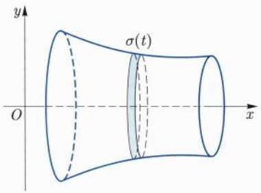

text_image

y
σ(t)
O
x

图9.10 旋转曲面

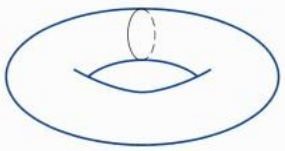

natural_image

Simple line drawing of a human eye within an oval shape (no text or symbols)

图 9.11 环面 (轮胎面)

例 9.7.5 设 b > a > 0, 将圆周  $(x - b)^{2} + y^{2} = a^{2}$  绕 y 轴旋转, 求所得旋转曲面 (图 9.11) 的面积.

解 圆周的参数方程为

$$
x (t) = b + a \cos t, y (t) = a \sin t, t \in [ 0, 2 \pi ].
$$

故旋转曲面 (轮胎面) 面积为

$$
\begin{array}{l} S = \int_ {0} ^ {2 \pi} 2 \pi (b + a \cos t) (a ^ {2} \sin^ {2} t + a ^ {2} \cos^ {2} t) ^ {\frac {1}{2}} \mathrm{d} t \\ = 2 \pi a \int_ {0} ^ {2 \pi} (b + a \cos t) \mathrm{d} t = 4 \pi^ {2} a b. \\ \end{array}
$$

## 9.7.3 简单立体的体积

## (1) 平行截面之间的立体体积

设 $\Omega$ 为 $\mathbb{R}^3$ 中一块物体, 夹在平面 $x = a$ 与 $x = b (a < b)$ 之间 (图9.12(a)). 记 $S(x)$ 为 $x \in [a, b]$ 处垂直于 $x$ 轴的平面截 $\Omega$ 的截面面积函数. 如果 $S(x)$ 关于 $x$ 连续, 则 $\Omega$ 的体积为

$$
V = \int_ {a} ^ {b} S (x) \mathrm{d} x. \tag {9.7.5}
$$

这个公式是重积分化累次积分的特例, 见第十六章. 特别地, 如果两块物体 $\Omega_{A}$ 和 $\Omega_{B}$ 的截面面积函数相等, 则其体积相同 (图 9.12(b)). 这是公元 5 到 6 世纪由祖暅 (祖冲之之子) 在刘徽思想的基础上所发现的事实, 17 世纪时 Cavalieri$^{①}$ 也发现了这样的事实.

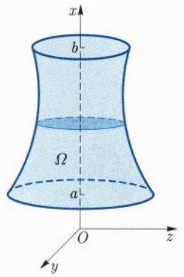

text_image

x
b
Ω
a
O
z
y

(a)

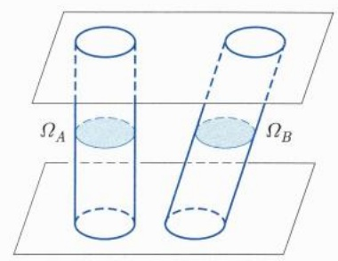

text_image

Ω_A
Ω_B

(b)

图9.12 简单立体图形

例 9.7.6 设 a, b, c > 0, 求椭球体  $\frac{x^{2}}{a^{2}} + \frac{y^{2}}{b^{2}} + \frac{z^{2}}{c^{2}} \leqslant 1$  (图 9.13) 的体积.

<small>① Cavalieri, Bonaventura Francesco, 1598 年—1647 年 11 月 30 日, 意大利数学家.</small>