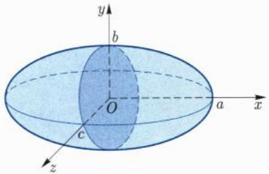
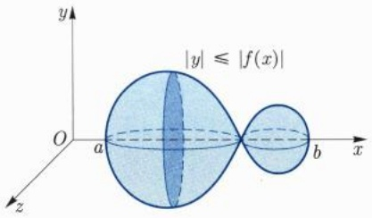
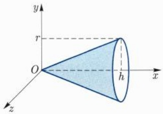
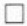

解 固定 $x \in (-a, a)$, 它的截面为椭圆面

$$
\frac {y ^ {2}}{b ^ {2}} + \frac {z ^ {2}}{c ^ {2}} \leqslant 1 - \frac {x ^ {2}}{a ^ {2}},
$$

截面面积为

$$
\begin{array}{l} S (x) = \pi b \Big (1 - \frac {x ^ {2}}{a ^ {2}} \Big) ^ {\frac {1}{2}} c \Big (1 - \frac {x ^ {2}}{a ^ {2}} \Big) ^ {\frac {1}{2}} \\ = \pi b c \Big (1 - \frac {x ^ {2}}{a ^ {2}} \Big), \\ \end{array}
$$

故椭球体的体积为

$$
V = \int_ {- a} ^ {a} S (x) \mathrm{d} x = \int_ {- a} ^ {a} \pi b c \Big (1 - \frac {x ^ {2}}{a ^ {2}} \Big) \mathrm{d} x = \frac {4}{3} \pi a b c.
$$

text_image

y
b
O
a
x
c
z

图9.13 椭球体

## (2) 旋转体的体积

设 $f \in C[a, b]$, $\Omega$ 是由平面图形 $\{(x, y) | a \leqslant x \leqslant b, 0 \leqslant |y| \leqslant |f(x)|\}$ 绕 $x$ 轴旋转一周所得的旋转体 (图9.14). 该旋转体在 $x \in [a, b]$ 处的截面为圆盘, 其面积为 $S(x) = \pi f^2(x)$. 因此 $\Omega$ 的体积为

$$
V = \int_ {a} ^ {b} S (x)   \mathrm{d} x = \pi \int_ {a} ^ {b} f ^ {2} (x)   \mathrm{d} x.
$$

例 9.7.7 求高为 h, 底半径为 r 的圆锥体 (图 9.15) 的体积.

解 由上面的体积公式可得

$$
V = \pi \int_ {0} ^ {h} \left(\frac {r}{h} x\right) ^ {2} \mathrm{d} x = \frac {1}{3} \pi r ^ {2} h.
$$

text_image

|y| ≤ |f(x)|
O
a
b
x
y
z

图9.14 旋转体

text_image

y
r
O
h
x
z

图9.15 圆锥体

## 9.7.4 物理应用举例

例 9.7.8 设某线状物质分布在区间  $[a, a + l]$  上, 其中 a, l > 0. 设该物质的线密度为  $\rho(x) = x - a$ , 求位于原点的质量为 m 的质点所受该物质的引力.

解 取位于 $[x, x + \delta x]$ 的一小段物质, 其质量 $\delta M$ 约等于 $\rho(x)\delta x$, 它对质点的引力为

$$
\delta F \approx \frac {G m \delta M}{x ^ {2}} \approx \frac {G m (x - a)}{x ^ {2}} \delta x,
$$

其中 $G$ 为引力常量. 于是质点所受到的总的引力为

$$
\begin{array}{l} F = \int_ {a} ^ {a + l} \frac {G m (x - a)}{x ^ {2}} \mathrm{d} x = G m \int_ {a} ^ {a + l} \left(\frac {1}{x} - \frac {a}{x ^ {2}}\right) \mathrm{d} x \\ = G m \Big (\ln \frac {a + l}{a} - \frac {l}{a + l} \Big). \\ \end{array}
$$

例 9.7.9 设轻质弹簧一端固定, 将另一端从平衡位置拉伸一小段, 求所需要做的功.

解 设平衡位置为原点, 拉伸长度为 $l$. 当 $x \in [0, l]$ 时, 弹簧的拉力为 $F = \kappa x$, 其中 $\kappa$ 为弹簧的弹性系数. 从 $x$ 拉伸一小段到 $x + \delta x$ 时, 所需要做的功 $\delta W$ 约等于 $F \delta x$. 因此总的功为

$$
W = \int_ {0} ^ {l} F \mathrm{d} x = \int_ {0} ^ {l} \kappa x \mathrm{d} x = \frac {1}{2} \kappa l ^ {2}.
$$

设质量为 $m$ 的质点绕某定轴 $\ell$ 旋转, 转动的角速度 $\omega$ 为常数, 则质点的动能为

$$
E = \frac {1}{2} m v ^ {2} = \frac {1}{2} m r ^ {2} \omega^ {2} = \frac {1}{2} I _ {\ell} \omega^ {2},
$$

其中 $r$ 是质点到定轴的距离, $I_{\ell} = mr^{2}$, 称为质点对轴 $\ell$ 的转动惯量.

例 9.7.10 设平面上有某线状物质, 其坐标用参数表示为  $x = x(t)$ ,  $y = y(t)$ ,  $t \in [\alpha, \beta]$ . 设该物质的线密度为  $\rho(t)$ , 求该物质关于 x 轴以及 y 轴的转动惯量.

解 取参数位于  $[t, t + \delta t]$  的一小段物质, 其质量  $\delta m$  约等于  $\rho(t)\delta s$ , 其中  $\delta s$  是这一小段物质的长度:

$$
\delta s \approx \sqrt {(x ^ {\prime} (t)) ^ {2} + (y ^ {\prime} (t)) ^ {2}} \delta t.
$$

这一小段物质关于 $x$ 轴的转动惯量 ${\delta }{I}_{x}$ 约等于

$$
\delta I _ {x} \approx (\delta m) y ^ {2} (t) \approx \rho (t) y ^ {2} (t) \sqrt {(x ^ {\prime} (t)) ^ {2} + (y ^ {\prime} (t)) ^ {2}} \delta t,
$$

这说明该物质关于 $x$ 轴的转动惯量为

$$
I _ {x} = \int_ {\alpha} ^ {\beta} \rho (t) y ^ {2} (t) \sqrt {(x ^ {\prime} (t)) ^ {2} + (y ^ {\prime} (t)) ^ {2}}   \mathrm{d} t.
$$

同理, 它关于 $y$ 轴的转动惯量为

$$
I _ {y} = \int_ {\alpha} ^ {\beta} \rho (t) x ^ {2} (t) \sqrt {(x ^ {\prime} (t)) ^ {2} + (y ^ {\prime} (t)) ^ {2}}   \mathrm{d} t.
$$

例 9.7.11 设线状物质如前例所述, 求其质量和质心.

解 根据前例中的讨论我们可以知道,该物质的总质量为

$$
M = \int_ {\alpha} ^ {\beta} \rho (t) \sqrt {(x ^ {\prime} (t)) ^ {2} + (y ^ {\prime} (t)) ^ {2}}   \mathrm{d} t.
$$

该物质关于 $x, y$ 轴的静力矩分别为

$$
M _ {x} = \int_ {\alpha} ^ {\beta} y (t) \rho (t) \sqrt {(x ^ {\prime} (t)) ^ {2} + (y ^ {\prime} (t)) ^ {2}}   \mathrm{d} t, M _ {y} = \int_ {\alpha} ^ {\beta} x (t) \rho (t) \sqrt {(x ^ {\prime} (t)) ^ {2} + (y ^ {\prime} (t)) ^ {2}}   \mathrm{d} t.
$$

于是质心坐标 $\bar{x},\bar{y}$ 分别为

$$
\bar {x} = \frac {M _ {y}}{M} = \frac {1}{M} \int_ {\alpha} ^ {\beta} x (t) \rho (t) \sqrt {(x ^ {\prime} (t)) ^ {2} + (y ^ {\prime} (t)) ^ {2}}   \mathrm{d} t,
$$

$$
\bar {y} = \frac {M _ {x}}{M} = \frac {1}{M} \int_ {\alpha} ^ {\beta} y (t) \rho (t) \sqrt {(x ^ {\prime} (t)) ^ {2} + (y ^ {\prime} (t)) ^ {2}}   \mathrm{d} t.
$$

□

特别地, 当上述线状物质均匀分布时, 不妨设 $\rho \equiv 1$, 物质的长度为 $l$, 则

$$
\bar {x} = \frac {1}{l} \int_ {0} ^ {l} x \mathrm{d} s, \bar {y} = \frac {1}{l} \int_ {0} ^ {l} y \mathrm{d} s,
$$

其中 $\mathrm{ds} = \sqrt{(x'(t))^2 + (y'(t))^2}\mathrm{dt}$ 上式中的第二个等式可以改写为

$$
2 \pi \bar {y} l = 2 \pi \int_ {0} ^ {l} y \mathrm{d} s,
$$

上式右边表示旋转面的面积, 由此得到

## 定理 9.7.1 (Guldin $^{①}$ 第一定理)

平面曲线绕平面上不与其相交的轴旋转一周，

所得旋转面的面积等于该曲线的质心绕同一轴旋转所产生的圆周长乘该曲线的弧长.

类似于曲线的情形, 我们也可以处理面状物质的静力矩和质心. 为了方便起见, 设物质的面密度恒为 1, 其形状为曲边四边形:

$$
a \leqslant x \leqslant b, 0 \leqslant g (x) \leqslant y \leqslant f (x).
$$

取小区间 $[x, x + \delta x]$, 将相应的曲边梯形底长为 $\delta x$, 高为 $f(x) - g(x)$ 的小矩形, 其质量 $\delta m$ 约等于 $(f(x) - g(x))\delta x$, 因此总质量为

$$
M = \int_ {a} ^ {b} (f (x) - g (x))   \mathrm{d} x.
$$

小矩形关于 $y$ 轴的静力矩为

$$
\delta M _ {y} \approx x \delta m \approx x (f (x) - g (x)) \delta x,
$$

<small>① Guldin, Paul, 1577 年 6 月 12 日—1643 年 12 月 3 日, 瑞士数学家.</small>

关于 $x$ 轴的静力矩为

$$
\delta M _ {x} \approx \frac {1}{2} (f (x) + g (x)) \delta m \approx \frac {1}{2} \big (f ^ {2} (x) - g ^ {2} (x) \big) \delta x.
$$

因此质心坐标为

$$
\begin{array}{l} \bar {x} = \frac {M _ {y}}{M} = \frac {1}{M} \int_ {a} ^ {b} x (f (x) - g (x))   \mathrm{d} x, \\ \bar {y} = \frac {M _ {x}}{M} = \frac {1}{2 M} \int_ {a} ^ {b} \left(f ^ {2} (x) - g ^ {2} (x)\right) \mathrm{d} x. \\ \end{array}
$$

由上式还可得到

$$
2 \pi \bar {y} M = \pi \int_ {a} ^ {b} \left(f ^ {2} (x) - g ^ {2} (x)\right) \mathrm{d} x,
$$

上式左端的 $M$ 为曲边梯形的面积, 右端是旋转体的体积. 由此可得

定理 9.7.2 (Guldin 第二定理) 平面图形绕此平面上不与其内部相交的轴旋转一周, 所得旋转体的体积等于该平面图形的质心绕同一轴旋转所产生的圆周长乘该平面图形的面积.

## 习题 9.7

1. 求下列曲线的弧长:

(1) $y = x^{\frac{3}{2}}, 0 \leqslant x \leqslant 4;$
(2) $x = \mathrm{e}^{t}\cos t, y = \mathrm{e}^{t}\sin t, t \in [0, 2\pi]$;
(3) $r = a(1 + \cos \theta), a > 0, \theta \in [0, 2\pi]$;
(4) $y^{2}=2ax,\quad a>0,\quad0\leqslant x\leqslant a.$

2. 求下列曲线所围成图形的面积:

(1) $y^{2}=ax,\quad y=\frac{1}{a}x^{2},\quad a>0;$
(2) $y^{2}=2x,\quad x=5;$
(3) $x^{2} + 9y^{2} = 1$;
(4) $y = x(x - 1)(x - 2), y = 0;$
(5) $r = a(1 - \cos \theta), a > 0, \theta \in [0, 2\pi]$;
(6) $x = a\cos^3 t, y = a\sin^3 t, a > 0, t \in [0, 2\pi]$;

3. 求下列旋转面的面积:

(1) $y = \tan x$ 绕 $x$ 轴, $x \in \left[0, \frac{\pi}{4}\right]$;
(2) $x = a(t - \sin t), y = a(1 - \cos t)$ 绕直线 $y = a, a > 0, t \in \left[\frac{\pi}{2}, \frac{3\pi}{2}\right]$;
(3) $x = a\cos^3 t, y = a\sin^3 t$ 绕 $x$ 轴, $a > 0$;
(4) $r^{2}=a^{2}\cos2\theta$ 绕射线 $\theta=\frac{\pi}{4}$.

4. 求下列曲面所围成的体积:

(1) $x + y + z^2 = 1$, $x = 0$, $y = 0$;
(2) $2z = x^{2} + y^{2}, x^{2} + y^{2} + z^{2} = 3;$
(3) $x^{2} + y^{2} = a^{2}, y^{2} + z^{2} = a^{2}, a > 0;$
(4) $x^{2} + y^{2} + z^{2} + xy + yz + zx = a^{2}, a > 0.$

5. 求下列旋转体的体积:

(1)  $x = a(t - \sin t)$ ,  $y = a(1 - \cos t)$ ,  $t \in [0, 2\pi]$  绕 x 轴旋转所围成的旋转体;
(2) $(x-a)^{2}+y^{2}=b^{2}\quad(a>b>0)$ 的内部绕y轴旋转所围成的旋转体;
(3)  $y^{2}=2ax\ (a>0)$  绕  $x=b\ (b>0)$  旋转所围成的旋转体;
(4)  $y = \sin x, \quad x \in [0, \pi]$  绕 x 轴旋转所围成的旋转体.

6. 将质量为 m 的物体从地球表面提升到高度为 h 的位置, 需要做多少功?

7. 求下列曲线的质量 (设线密度为 1) 与质心坐标:

(1)  $y = 1 - x^{2}, \quad x \in [-1, 1];$
(2) $x = a(t - \sin t)$, $y = a(1 - \cos t)$, $a > 0$, $t \in [0, 2\pi]$.

8. 求下列平面图形的质心:

(1) $0 \leqslant y \leqslant \sqrt{a^2 - x^2}, a > 0$;
(2) $ax = y^2$, $ay = x^2$ 所围图形, $a > 0$.

9. 利用 Guldin 定理求轮胎面的表面积.

10. 设 $a, b, n$ 为正整数, 记 $f(x) = \frac{1}{n!} x^n (a - bx)^n$.

(1) 当  $0 \leqslant k \leqslant 2n$  时, 验证  $f^{(k)}(x)$  在 x = 0 和  $x = \frac{a}{b}$  处取值均为整数;
(2) 若  $\pi$  可以表示为既约分数  $\frac{a}{b}$ ，利用 (1) 和分部积分证明积分  $\int_{0}^{\pi} f(x) \sin x \, dx$  必为整数；
(3) 由此利用反证法证明  $\pi$  不是有理数.

## 第十章

## 广义积分

在前一章中, 我们用极限定义了 Riemann 积分:

$$
\int_ {a} ^ {b} f (x) \mathrm{d} x = \lim _ {\| \mathrm{P} \| \to 0} \sum_ {i = 1} ^ {n} f (\xi_ {i}) \Delta x _ {i},
$$

其中 $[a, b]$ 为有界闭区间, 被积函数 $f$ 必须是有界函数. 在实际应用中, 这样的要求往往太强了. 下面我们在一定的条件下适当降低关于积分区间和被积函数的要求.

## 10.1 积分的推广

考虑平面曲线 $y = \frac{1}{x}, x \in [1, +\infty)$. 将该曲线绕 $x$ 轴旋转一周, 所得旋转体是无界的, 我们来说明它具有有限的体积. 当 $B > 1$ 时, 该旋转体介于 $x = 1$ 和 $x = B$ 的部分的体积为

$$
V _ {B} = \int_ {1} ^ {B} \pi \Big (\frac {1}{x} \Big) ^ {2} \mathrm{d} x = \pi - \frac {\pi}{B},
$$

这说明整个旋转体的体积为

$$
V = \lim _ {B \to + \infty} V _ {B} = \pi .
$$

一般地, 为了考虑无穷区间上的积分, 我们引入如下定义:

定义 10.1.1 (无穷限积分) 设 f 是定义在  $[a, +\infty)$  上的函数. 如果 f 在任何有界区间  $[a, B]$  上都是 Riemann 可积的, 且极限

$$
\lim _ {B \to + \infty} \int_ {a} ^ {B} f (x)   \mathrm{d} x
$$

存在 (且有限), 则称无穷限积分  $\int_{a}^{+\infty} f(x) \, dx$  存在或收敛, 记为

$$
\int_ {a} ^ {+ \infty} f (x)   \mathrm{d} x = \lim _ {B \to + \infty} \int_ {a} ^ {B} f (x)   \mathrm{d} x,
$$

否则就称无穷限积分 $\int_{a}^{+\infty}f(x)\mathrm{d}x$ 不存在或发散.

类似地, 我们也可以定义无穷限积分

$$
\int_ {- \infty} ^ {a} f (x)   \mathrm{d} x = \lim _ {A \to - \infty} \int_ {A} ^ {a} f (x)   \mathrm{d} x.
$$

设 $f$ 定义在 $\mathbb{R}$ 上, 如果存在 $a \in \mathbb{R}$, 使得 $\int_{-\infty}^{a} f(x) \mathrm{d}x$ 和 $\int_{a}^{+\infty} f(x) \mathrm{d}x$ 均收敛, 则称 $\int_{-\infty}^{+\infty} f(x) \mathrm{d}x$ 收敛, 并定义

$$
\int_ {- \infty} ^ {+ \infty} f (x) \mathrm{d} x = \int_ {- \infty} ^ {a} f (x) \mathrm{d} x + \int_ {a} ^ {+ \infty} f (x) \mathrm{d} x.
$$

利用积分关于区间的可加性质容易验证此定义与 $a$ 的选取无关. 需要注意的是, 利用极限

$$
\lim _ {A \to + \infty} \int_ {- A} ^ {A} f (x)   \mathrm{d} x
$$

也可以定义 $f$ 在 $(-\infty, +\infty)$ 上的一种积分, 称为 Cauchy 主值积分, 记为

$$
(V. P.) \int_ {- \infty} ^ {+ \infty} f (x) \mathrm{d} x = \lim _ {A \to + \infty} \int_ {- A} ^ {A} f (x) \mathrm{d} x.
$$

它和前一种定义不是等价的. 例如 $f(x) = x$ 的 Cauchy 主值积分为零, 但它在 $\mathbb{R}$ 上的无穷限积分是发散的.

从无穷限积分的定义立即得到如下的基本判别法:

(无穷限积分的 Cauchy 准则) f 在  $[a, +\infty)$  上的无穷限积分收敛当且仅当任给  $\varepsilon > 0$ ，存在  $M = M(\varepsilon)$ ，使得当 B > A > M 时，

$$
\left| \int_ {A} ^ {B} f (x) \mathrm{d} x \right| <   \varepsilon .
$$

对于 $(-∞,a]$ 和 $(-∞,+∞)$ 上的无穷限积分也有完全类似的基本判别法.

例 10.1.1 讨论无穷限积分  $\int_{1}^{+\infty}\frac{1}{x^{p}}\mathrm{d}x\left(p\in\mathbb{R}\right)$  的敛散性.

解 当 A > 1 时,

$$
\int_ {1} ^ {A} \frac {1}{x ^ {p}}   \mathrm{d} x = \left\{ \begin{array}{l l} \ln A, & p = 1, \\ \frac {1}{1 - p} (A ^ {1 - p} - 1), & p \neq 1. \end{array} \right.
$$

因此只有 $p > 1$ 时无穷限积分才是收敛的, 此时

$$
\int_ {1} ^ {+ \infty} \frac {1}{x ^ {p}} \mathrm{d} x = \lim _ {A \to + \infty} \frac {1}{1 - p} (A ^ {1 - p} - 1) = \frac {1}{p - 1}.
$$

一般地, 如果连续函数 $f$ 在 $[a, +\infty)$ 上存在原函数 $F$, 则由微积分基本定理可知

$$
\lim _ {A \to + \infty} \int_ {a} ^ {A} f (x)   \mathrm{d} x = \lim _ {A \to + \infty} F (A) - F (a),
$$

即此时无穷限积分是否收敛与极限  $\lim_{A\to+\infty}F(A)$  是否存在是一致的.

例10.1.2 计算无穷限积分 $\int_{-\infty}^{+\infty}\frac{1}{1 + x^2}\mathrm{d}x.$

解 $\frac{1}{1 + x^2}$ 的原函数为 $\arctan x$ ，因此

$$
\begin{array}{l} \int_ {- \infty} ^ {+ \infty} \frac {1}{1 + x ^ {2}} \mathrm{d} x = \int_ {- \infty} ^ {0} \frac {1}{1 + x ^ {2}} \mathrm{d} x + \int_ {0} ^ {+ \infty} \frac {1}{1 + x ^ {2}} \mathrm{d} x \\ = \arctan x \big | _ {- \infty} ^ {0} + \arctan x \big | _ {0} ^ {+ \infty} \\ = \frac {\pi}{2} + \frac {\pi}{2} = \pi . \\ \end{array}
$$

和无穷限积分类似, 我们也可以利用极限来处理无界函数的积分.

定义 10.1.2 (瑕积分) 设函数 f 在  $(a, b]$  上有定义, 且任给  $a' \in (a, b)$ , 均有  $f \in R[a', b]$ . 如果极限

$$
\lim _ {a ^ {\prime} \to a ^ {+}} \int_ {a ^ {\prime}} ^ {b} f (x)   \mathrm{d} x
$$

存在 (且有限), 则称瑕积分 $\int_{a}^{b} f(x) \, \mathrm{d}x$ 存在或收敛, 记为

$$
\int_ {a} ^ {b} f (x) \mathrm{d} x = \lim _ {a ^ {\prime} \to a ^ {+}} \int_ {a ^ {\prime}} ^ {b} f (x) \mathrm{d} x,
$$

否则就称瑕积分 $\int_{a}^{b}f(x)\mathrm{d}x$ 不存在或发散.

不难看出, 若 $f \in R[a, b]$, 则 $f$ 的瑕积分等于其 Riemann 积分. 如果 $f$ 在某一点附近无界, 则称该点为 $f$ 的瑕点. 当 $b$ 为 $f$ 的瑕点时, 可以在 $[a, b)$ 上定义瑕积分如下:

$$
\int_ {a} ^ {b} f (x) \mathrm{d} x = \lim _ {b ^ {\prime} \to b ^ {-}} \int_ {a} ^ {b ^ {\prime}} f (x) \mathrm{d} x.
$$

设 $c \in (a, b)$ 为 $f$ 在 $[a, b]$ 上的唯一瑕点, 则定义

$$
\int_ {a} ^ {b} f (x) \mathrm{d} x = \int_ {a} ^ {c} f (x) \mathrm{d} x + \int_ {c} ^ {b} f (x) \mathrm{d} x,
$$

前提是上式右边的两个瑕积分均收敛. 当瑕点不止一个时也可类似地定义瑕积分, 瑕积分的收敛性仍有和无穷限积分类似的基本判别法.

如果一个函数既是无界的, 定义域又是无限区间, 则通过适当地分割区间, 可以把上面两种积分, 即无穷限积分和瑕积分结合起来, 得到的积分统称广义积分, 又称反常积分.

例10.1.3 讨论积分 $\int_0^1\frac{1}{x^p}\mathrm{d}x(p\in \mathbb{R})$ 的敛散性.

解 当 $0 < a < 1$ 时,

$$
\int_ {a} ^ {1} \frac {1}{x ^ {p}} \mathrm{d} x = \left\{ \begin{array}{l l} - \ln a, & p = 1, \\ \frac {1}{1 - p} (1 - a ^ {1 - p}), & p \neq 1. \end{array} \right.
$$

因此只有 $p < 1$ 时积分才是收敛的, 此时

$$
\int_ {0} ^ {1} \frac {1}{x ^ {p}} \mathrm{d} x = \lim _ {a \to 0 ^ {+}} \frac {1}{1 - p} (1 - a ^ {1 - p}) = \frac {1}{1 - p}.
$$

例 10.1.4 计算积分  $\int_{-1}^{1}\frac{1}{\sqrt{1-x^{2}}}\mathrm{d}x.$

解 被积函数有两个瑕点 ±1. 我们有

$$
\begin{array}{l} \int_ {- 1} ^ {1} \frac {1}{\sqrt {1 - x ^ {2}}} \mathrm{d} x = \int_ {- 1} ^ {0} \frac {1}{\sqrt {1 - x ^ {2}}} \mathrm{d} x + \int_ {0} ^ {1} \frac {1}{\sqrt {1 - x ^ {2}}} \mathrm{d} x \\ = \arcsin x \big | _ {- 1} ^ {0} + \arcsin x \big | _ {0} ^ {1} \\ = \frac {\pi}{2} + \frac {\pi}{2} = \pi . \\ \end{array}
$$

广义积分具有和 Riemann 积分类似的性质, 一些运算法则, 例如分部积分、换元法等也可以直接推广过来. 例如, 我们有

定理 10.1.1 设 u, v 在  $[a, +\infty)$  上可导且  $u', v'$  在每一个有界的闭子区间  $[a, B]$  上均可积，则

$$
\int_ {a} ^ {+ \infty} u (x) v ^ {\prime} (x) \mathrm{d} x = u v \Big | _ {a} ^ {+ \infty} - \int_ {a} ^ {+ \infty} u ^ {\prime} (x) v (x) \mathrm{d} x,
$$

即上式右端有意义时, 其左端也有意义且等于右端的值.

证明 当 $B > a$ 时,由通常的分部积分公式可得

$$
\int_ {a} ^ {B} u (x) v ^ {\prime} (x) \mathrm{d} x = u v \Big | _ {a} ^ {B} - \int_ {a} ^ {B} u ^ {\prime} (x) v (x) \mathrm{d} x,
$$

令  $B \rightarrow +\infty$  即得欲证结论.

定理 10.1.2 设  $f \in C(a, b)$ ,  $\varphi$  是  $(\alpha, \beta)$  上严格单调的可导函数, 且  $\varphi'$  在  $(\alpha, \beta)$  的任何闭子区间上均可积. 若  $\varphi((\alpha, \beta)) \subseteq (a, b)$ , 且  $\varphi(\alpha^{+}) = a$ ,  $\varphi(\beta^{-}) = b$ , 则

$$
\int_ {a} ^ {b} f (x) \mathrm{d} x = \int_ {\alpha} ^ {\beta} f (\varphi (t)) \varphi^ {\prime} (t) \mathrm{d} t,
$$

即上式右端有意义时, 左端也有意义且等于右端的值.

证明 任取 $[a', b'] \subseteq (a, b)$，利用介值定理，我们可以选取 $\alpha', \beta' \in (\alpha, \beta)$，使得 $\varphi(\alpha') = a', \varphi(\beta') = b'$。由通常的换元法可得

$$
\int_ {\varphi (\alpha^ {\prime})} ^ {\varphi (\beta^ {\prime})} f (x) \mathrm{d} x = \int_ {\alpha^ {\prime}} ^ {\beta^ {\prime}} f (\varphi (t)) \varphi^ {\prime} (t) \mathrm{d} t.
$$

令 $a^{\prime}\rightarrow a^{+},b^{\prime}\rightarrow b^{-}$ ，由 $\varphi$ 严格单调可知 $\alpha^{\prime}\to \alpha^{+},\beta^{\prime}\to \beta^{-}$ ，由此即得欲证结论. □

例 10.1.5 计算积分  $\int_{0}^{1}\ln x dx$ .

解 利用 $\lim_{x\to 0^{+}}x\ln x = 0$ 得

$$
\int_ {0} ^ {1} \ln x \mathrm{d} x = x \ln x \Big | _ {0} ^ {1} - \int_ {0} ^ {1} x \cdot \frac {1}{x} \mathrm{d} x = - 1.
$$

例 10.1.6 讨论积分  $\int_{0}^{+\infty}\cos x^{2}dx$  的敛散性.

解 只要讨论被积函数在 $[1, +\infty)$ 上的积分就可以了. 作变换 $x = \sqrt{t}$ 可得

$$
\int_ {1} ^ {+ \infty} \cos x ^ {2} \mathrm{d} x = \frac {1}{2} \int_ {1} ^ {+ \infty} \frac {\cos t}{\sqrt {t}} \mathrm{d} t.
$$

我们利用分部积分和 Cauchy 准则来判断积分的收敛性:

$$
\begin{array}{l} \left| \int_ {A} ^ {B} \frac {\cos t}{\sqrt {t}} \mathrm{d} t \right| = \left| \frac {\sin t}{\sqrt {t}} \right| _ {A} ^ {B} + \frac {1}{2} \int_ {A} ^ {B} \frac {\sin t}{t ^ {\frac {3}{2}}} \mathrm{d} t \\ \leqslant \frac {1}{\sqrt {A}} + \frac {1}{\sqrt {B}} + \frac {1}{2} \int_ {A} ^ {B} t ^ {- \frac {3}{2}} \mathrm{d} t = \frac {2}{\sqrt {A}} \rightarrow 0 (B > A \rightarrow + \infty). \\ \end{array}
$$

这说明积分是收敛的.

注 10.1.1 这个例子也告诉我们，f 在  $[a, +\infty)$  上的积分存在并不意味着  $f(x) \to 0 (x \to +\infty)$ .

## 习题 10.1

1. 设 $f$ 为 $[a, b]$ 上的有界函数. 如果任给 $a' \in (a, b)$, 均有 $f \in R[a', b]$, 证明: $f \in R[a, b]$, 且

$$
\lim _ {a ^ {\prime} \to a ^ {+}} \int_ {a ^ {\prime}} ^ {b} f (x)   \mathrm{d} x = \int_ {a} ^ {b} f (x)   \mathrm{d} x.
$$

2. 证明:

$$
\frac {\pi}{2 \sqrt {2}} <   \int_ {0} ^ {1} \frac {\mathrm{d} x}{\sqrt {1 - x ^ {4}}} <   \frac {\pi}{2}.
$$

3. 计算下列无穷限积分:

(1) $\int_{2}^{+\infty}\frac{\mathrm{d}x}{x(\ln x)^{2}};$

(2) $\int_{1}^{+\infty}\frac{\ln x}{x^2}\mathrm{d}x;$

(3) $\int_{\mathrm{e}^2}^{+\infty}\frac{\mathrm{d}x}{x\ln x\ln^2(\ln x)};$

(4) $\int_{1}^{+\infty}\frac{\mathrm{d}x}{x(1 + x)};$

(5) $\int_0^{+\infty}\frac{\mathrm{d}x}{(x + 2)(x + 3)};$

(6) $\int_{0}^{+\infty}\frac{\mathrm{d}x}{x^2 + 2x + 2}.$

4. 计算下列瑕积分:

(1) $\int_0^1\frac{x^3\mathrm{d}x}{\sqrt{1 - x^2}};$

(2) $\int_{-1}^{1}\frac{x\mathrm{d}x}{\sqrt{1 - x^2}};$

(3) $\int_{-1}^{1} \frac{\arcsin x}{\sqrt{1 - x^2}} \, \mathrm{d}x;$

(4) $\int_0^1\frac{\mathrm{d}x}{(2 - x)\sqrt{1 - x}};$

(5) $\int_{\alpha}^{\beta}\frac{x\mathrm{d}x}{\sqrt{(x - \alpha)(\beta - x)}};$

(6) $\int_0^1\frac{\arcsin\sqrt{x}}{\sqrt{x(1 - x)}}\mathrm{d}x.$

5. 讨论下列广义积分的敛散性:

(1) $\int_{0}^{+\infty}|\cos x^2 |\mathrm{d}x;$

(2) $\int_0^{+\infty}\frac{\mathrm{d}x}{\mathrm{e}^x\sqrt{x}}.$

6. 讨论下列瑕积分的敛散性:

(1) $\int_0^1\frac{\mathrm{d}x}{\sqrt{x}};$

(2) $\int_0^1\frac{\ln x}{1 - x}\mathrm{d}x;$

(3) $\int_0^2\frac{\mathrm{d}x}{(x - 1)^2}.$

7. 设 $g \leqslant f \leqslant h$ 且 $g, h$ 在 $[a, +\infty)$ 上的无穷限积分都收敛, 证明: $f$ 在 $[a, +\infty)$ 上的无穷限积分也收敛.

8. 设 $f$ 为单调递减函数且它在 $[a, +\infty)$ 上的无穷限积分收敛, 证明: $\lim_{x \to +\infty} x f(x) = 0$.

9. 设 $f$ 在 $[a, +\infty)$ 上的无穷限积分收敛, 且 $f$ 一致连续, 证明: $\lim_{x \to +\infty} f(x) = 0$.

10. 举例说明, 当 $f$ 为正连续函数且它在 $[a, +\infty)$ 上的无穷限积分收敛时, 未必有 $\lim_{x \to +\infty} f(x) = 0$.

11. 设 f 为  $(0,1]$  上的单调递减函数, 证明:

$$
\int_ {0} ^ {1} f (x) \mathrm{d} x = \lim _ {n \to + \infty} \frac {1}{n} \sum_ {k = 1} ^ {n} f \left(\frac {k}{n}\right).
$$

12. 利用上一题证明: $\lim_{n\to +\infty}\frac{\sqrt[n]{n!}}{n} = \frac{1}{\mathrm{e}}.$

## 10.2 广义积分的收敛判别法

我们知道 Cauchy 准则可以用来判断广义积分的敛散性. 下面我们进一步介绍其他的几个判别法. 首先研究非负函数, 注意到如果 $f$ 非负且在有界区间上均可积, 则积分 $\int_{a}^{B} f(x) \mathrm{d}x$ 关于 $B$ 单调递增, 因此其极限存在当且仅当它有上界, 这就得到了非负函数无穷限积分的如下判别法:

定理 10.2.1 设  $f \geqslant 0$  且在有界区间  $[a, B]$  上均可积，则无穷限积分  $\int_{a}^{+\infty} f(x) \, dx$ 
收敛当且仅当

$$
F (B) = \int_ {a} ^ {B} f (x)   \mathrm{d} x
$$

关于  $B \in [a, +\infty)$  有界；对瑕积分有完全类似的结果.

由此又得到如下的比较判别法:

定理 10.2.2 设 $0 \leqslant f \leqslant M g$, 其中 $M > 0$ 为常数. 如果 $f, g$ 在有界区间 $[a, B]$ 上均可积, 则当无穷限积分 $\int_{a}^{+\infty} g(x) \mathrm{d}x$ 收敛时, 无穷限积分 $\int_{a}^{+\infty} f(x) \mathrm{d}x$ 也收敛; 当无穷限积分 $\int_{a}^{+\infty} f(x) \mathrm{d}x$ 发散时, 无穷限积分 $\int_{a}^{+\infty} g(x) \mathrm{d}x$ 也发散; 瑕积分有完全类似的结果.

证明 令

$$
F (B) = \int_ {a} ^ {B} f (x)   \mathrm{d} x, G (B) = \int_ {a} ^ {B} g (x)   \mathrm{d} x,
$$

则 $0 \leqslant F(B) \leqslant M \cdot G(B), \forall B \in [a, +\infty)$. 因此, 当 $G(B)$ 有界时 $F(B)$ 也有界, 当 $F(B)$ 无界时 $G(B)$ 也无界. □

注 10.2.1 (1) 通常利用极限去找 M. 如果极限  $l = \lim_{x \to +\infty} \frac{f(x)}{g(x)}$  存在，则当  $0 < l < +\infty$  时，无穷限积分  $\int_{a}^{+\infty} f(x) \, dx$  和  $\int_{a}^{+\infty} g(x) \, dx$  同时收敛或发散；当 l = 0 时，如果  $\int_{a}^{+\infty} g(x) \, dx$  收敛，则  $\int_{a}^{+\infty} f(x) \, dx$  也收敛；当  $l = +\infty$  时，如果  $\int_{a}^{+\infty} g(x) \, dx$  发散，则  $\int_{a}^{+\infty} f(x) \, dx$  也发散.

(2) 我们可以将函数 f 与  $x^{-p}$  比较, 则得到如下的 Cauchy 判别法:

(i) 如果 p > 1，且存在常数 C > 0，使得

$$
0 \leqslant f (x) \leqslant \frac {C}{x ^ {p}} (\forall x \geqslant x _ {0}),
$$

则 $\int_{a}^{+\infty}f(x)\mathrm{d}x$ 收敛；

(ii) 如果 $p \leqslant 1$, 且存在常数 $C > 0$, 使得

$$
f (x) \geqslant \frac {C}{x ^ {p}} (\forall x \geqslant x _ {0}),
$$

则 $\int_{a}^{+\infty}f(x)\mathrm{d}x$ 发散；

通常利用极限取寻找 C. 设极限  $\lim_{x\to+\infty}x^{p}f(x)=l$  存在, 则

(iii) 如果 $p > 1, 0 \leqslant l < +\infty$，则 $\int_{a}^{+\infty} f(x) \, \mathrm{d}x$ 收敛；

(iv) 如果 $p \leqslant 1, 0 < l \leqslant +\infty$，则 $\int_{a}^{+\infty} f(x) \, \mathrm{d}x$ 发散.

(3) 类似地, 考虑以 $a$ 为瑕点的瑕积分 $\int_{a}^{b} f(x) \mathrm{d}x$, 有

(i) 如果 $p < 1$, 且存在常数 $C > 0$, 使得 $0 \leqslant f(x) \leqslant C(x - a)^{-p}$, 则瑕积分 $\int_{a}^{b} f(x) \, \mathrm{d}x$ 收敛;

(ii) 如果 $p \geqslant 1$, 且存在常数 $C > 0$, 使得 $f(x) \geqslant C(x - a)^{-p}$, 则瑕积分 $\int_{a}^{b} f(x) \, \mathrm{d}x$ 发散;

我们往往通过求极限去寻找 $C$ 设 $\lim_{x\to a^{+}}(x - a)^{p}f(x) = l$ 存在, 则

(iii) 如果 $p < 1, 0 \leqslant l < +\infty$，则瑕积分 $\int_{a}^{b} f(x) \, \mathrm{d}x$ 收敛；

(iv) 如果 $p \geqslant 1, 0 < l \leqslant +\infty$，则瑕积分 $\int_{a}^{b} f(x) \, \mathrm{d}x$ 发散.

例 10.2.1 判别积分  $\int_{1}^{+\infty}\frac{1}{x\sqrt{x^{2}+x+1}}\mathrm{d}x$  的敛散性.

解 因为

$$
0 \leqslant \frac {1}{x \sqrt {x ^ {2} + x + 1}} \leqslant x ^ {- 2}, \forall x \geqslant 1,
$$

所以积分是收敛的.

例 10.2.2 判别积分  $\int_{1}^{+\infty} x^{a} e^{-x} dx (a \in R)$  的敛散性.

解 因为

$$
\lim _ {x \to + \infty} x ^ {2} x ^ {a} \mathrm{e} ^ {- x} = \lim _ {x \to + \infty} \frac {x ^ {2 + a}}{\mathrm{e} ^ {x}} = 0,
$$

所以积分是收敛的.

例 10.2.3 判别积分  $\int_{1}^{+\infty}\frac{1}{x(1+\ln x)}\mathrm{d}x$  的敛散性.

解 被积函数有原函数 $F(x) = \ln (1 + \ln x)$，由 Newton-Leibniz 公式易见积分是发散的.

这里要提醒读者注意, 比较判别法只适用于不变号的函数. 对于变号函数的广义积分, 有时可以化为非负函数的积分来判断它是否收敛.

设 $f$ 为函数, 记

$$
f ^ {+} (x) = \max \{0, f (x) \}, \quad f ^ {-} (x) = \max \{0, - f (x) \},
$$

则 $f^{+}$ 和 $f^{-}$ 均为非负函数, 且 $f = f^{+} - f^{-}$. 因此, 当 $f^{+}$ 和 $f^{-}$ 的广义积分均收敛时, $f$ 的广义积分也收敛, 此时称 $f$ 的广义积分绝对收敛, 采用这个称呼的部分原因是 $|f| = f^{+} + f^{-}$ 的广义积分的确是收敛的. 如果 $f$ 的广义积分收敛, 但 $|f|$ 的广义积分发散, 则称 $f$ 的广义积分条件收敛.

设 f, g 在有界区间  $[a, B]$  上均可积, 且

$$
| f (x) | \leqslant g (x), \forall x \geqslant x _ {0},
$$

则当积分 $\int_{a}^{+\infty}g(x)\mathrm{d}x$ 收敛时，积分 $\int_{a}^{+\infty}f(x)\mathrm{d}x$ 绝对收敛.这只要注意到 $f^{+}\leqslant g,$ $f^{-}\leqslant g$ 并利用比较判别法即可.

例10.2.4 判别积分 $\int_{1}^{+\infty}\frac{\cos x}{x^p}\mathrm{d}x$ $(p > 1)$ 是否绝对收敛.

解 因为

$$
\left| \frac {\cos x}{x ^ {p}} \right| \leqslant x ^ {- p}, \forall x \geqslant 1,
$$

而 $p > 1$ 时 $x^{-p}$ 积分收敛, 所以原积分是绝对收敛的.

例 10.2.5 判别积分  $\int_{1}^{+\infty}\cos(x^{p})\mathrm{d}x\ (p>1)$  的敛散性, 若收敛则判断它是否绝对收敛.

解 利用变量代换 $x = t^{\frac{1}{p}}$ 以及前节最后例子中的办法不难看出积分是收敛的. 另一方面, 注意到

$$
\left| \cos (x ^ {p}) \right| \geqslant \cos^ {2} (x ^ {p}) = \frac {1}{2} \big (1 + \cos (2 x ^ {p}) \big),
$$

函数 $\cos (2x^{p})$ 的无穷限积分是收敛的, 因此 $|\cos (x^p)|$ 在 $[1, +\infty)$ 上的无穷限积分是发散的.

对于两个函数乘积的广义积分, 在某些情形下利用积分第二中值公式可以判断积分是否条件收敛.

定理 10.2.3 (Dirichlet) 设当 B > a 时函数 f, g 在有界区间  $[a, B]$  上均可积，如果积分  $F(B) = \int_{a}^{B} f(x) \, dx$  关于  $B \in [a, +\infty)$  有界，函数 g 在  $[a, +\infty)$  上单调，且  $\lim_{x \to +\infty} g(x) = 0$ ，则无穷限积分  $\int_{a}^{+\infty} f(x) g(x) \, dx$  收敛.

证明 设 $|F(B)| \leqslant C, \forall B \geqslant a$. 则当 $B \geqslant A \geqslant a$ 时, 有

$$
\left| \int_ {A} ^ {B} f (x) \mathrm{d} x \right| = \left| \int_ {a} ^ {B} f (x) \mathrm{d} x - \int_ {a} ^ {A} f (x) \mathrm{d} x \right| \leqslant 2 C,
$$

又因为 $\lim_{x\to +\infty}g(x) = 0$ ，所以任给 $\varepsilon >0$ ，存在 $M > a$ ，使得当 $x > M$ 时

$$
| g (x) | \leqslant \frac {\varepsilon}{4 C}.
$$

由积分第二中值定理, 当 B > A > M 时, 有

$$
\begin{array}{l} \left| \int_ {A} ^ {B} f (x) g (x) \mathrm{d} x \right| = \left| g (A) \int_ {A} ^ {\xi} f (x) \mathrm{d} x + g (B) \int_ {\xi} ^ {B} f (x) \mathrm{d} x \right| \\ \leqslant \frac {\varepsilon}{4 C} \left| \int_ {A} ^ {\xi} f (x) \mathrm{d} x \right| + \frac {\varepsilon}{4 C} \left| \int_ {\xi} ^ {B} f (x) \mathrm{d} x \right| \\ \leqslant \frac {\varepsilon}{4 C} 2 C + \frac {\varepsilon}{4 C} 2 C = \varepsilon . \\ \end{array}
$$

由 Cauchy 准则即得欲证结论.

□

例10.2.6 判断积分 $\int_0^{+\infty}\frac{\sin x}{x^p}\mathrm{d}x$ （ $0 <   p <   2$ )的敛散性.

解 因为

$$
\lim _ {x \to 0 ^ {+}} x ^ {p - 1} \frac {\sin x}{x ^ {p}} = 1,
$$

所以在 $(0,1]$ 上 $\frac{\sin x}{x^p}$ 的瑕积分的敛散性和 $x^{1 - p}$ 的瑕积分的敛散性一致，而当 $p < 2$ 时 $x^{1 - p}$ 在 $(0,1]$ 上的瑕积分收敛. 下面只要判断 $\frac{\sin x}{x^p}$ 在 $[1, +\infty)$ 上的无穷限积分的敛散性即可. 由于积分 $\int_{1}^{A}\sin x\mathrm{d}x$ 显然有界，而 $\frac{1}{x^p} (p > 0)$ 在 $[1, +\infty)$ 上单调地趋于零，故由Dirichlet判别法知原积分是收敛的. □

定理 10.2.4 (Abel) 设当 B > a 时函数 f, g 在有界区间  $[a, B]$  上均可积，如果积分  $\int_{a}^{+\infty} f(x) \, dx$  收敛，且 g 在  $[a, +\infty)$  上单调有界，则积分  $\int_{a}^{+\infty} f(x) g(x) \, dx$  也收敛.

证明 由题设可知 $F(B) = \int_{a}^{B} f(x) \, \mathrm{d}x$ 关于 $B \in [a, +\infty)$ 有界. 由 $g$ 单调有界可知极限 $\lim_{x \to +\infty} g(x)$ 存在, 记为 $\alpha$. 此时, $fg$ 可以写成

$$
f g = f \cdot (g - \alpha) + \alpha f (x).
$$

由 Dirichlet 判别法可知  $f \cdot (g - \alpha)$  的积分收敛, 从而 fg 的积分也收敛.

这些判别法对于瑕积分也有完全类似的表达形式, 我们不再赘述.

例 10.2.7 设  $a \geqslant 0$ ，研究积分  $\int_{0}^{+\infty} e^{-ax} \frac{\sin x}{x} dx$  的敛散性.

解 函数 $\mathrm{e}^{-ax}$ 在 $[0, +\infty)$ 上单调递减且有界，函数 $\frac{\sin x}{x}$ 在 $[0, +\infty)$ 上的积分收敛，因此由Abel判别法知原积分收敛. □

例 10.2.8 判断积分  $\int_{1}^{+\infty}\frac{\sin x}{x^{p}}\arctan x\,dx\ (p>0)$  的敛散性.

解 令 $f(x) = \frac{\sin x}{x^p}$, $g(x) = \arctan x$, 则 $f$ 在 $[1, +\infty)$ 上的积分收敛, 而 $g$ 在 $[1, +\infty)$ 上单调有界, 故由 Abel 判别法知原积分收敛. □

## 习题 10.2

1. 研究下列无穷限积分的敛散性:

(1) $\int_{1}^{+\infty}\frac{\mathrm{d}x}{\sqrt[3]{x^4 + 1}};$

(2) $\int_0^{+\infty}\frac{\mathrm{d}x}{1 + \sqrt{x}};$

(3) $\int_0^{+\infty}\frac{x^3\mathrm{d}x}{\sqrt{1 + x^7}};$

(4) $\int_0^{+\infty}\frac{\sin^2x}{\sqrt{x}}\mathrm{d}x;$

(5) $\int_{1}^{+\infty}\frac{x\arctan x}{1 + x^3}\mathrm{d}x;$

(6) $\int_{1}^{+\infty}\frac{x^2\mathrm{d}x}{\sqrt{1 + x^6}};$