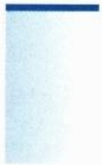

(7) $\int_0^{+\infty}\frac{\cos x}{1 + x^2}\mathrm{d}x;$
(8) $\int_{1}^{+\infty}\frac{\ln(1 + x)}{x^n}\mathrm{d}x;$
(9) $\int_{1}^{+\infty}\frac{\pi / 2 - \arctan x}{x}\mathrm{d}x.$

2. 研究下列瑕积分的敛散性:

(1) $\int_0^1\frac{\mathrm{d}x}{\sqrt[3]{1 - x^3}};$
(2) $\int_0^1\frac{\mathrm{d}x}{\sqrt{x}\ln x};$
(3) $\int_0^1\frac{\mathrm{d}x}{\sqrt{1 - x^4}};$
(4) $\int_0^\pi \frac{\mathrm{d}x}{\sqrt{\sin x}};$
(5) $\int_0^1\frac{1 - \cos x}{x^p}\mathrm{d}x;$
(6) $\int_0^1\frac{1}{\ln x}\mathrm{d}x;$
(7) $\int_0^1\frac{1}{x^p}\sin \frac{1}{x}\mathrm{d}x;$
(8) $\int_0^1\frac{\ln x}{1 - x^2}\mathrm{d}x;$
(9) $\int_0^1\frac{x^{p - 1} - x^{q - 1}}{\ln x}\mathrm{d}x.$

3. 研究下列积分的绝对收敛性和条件收敛性:

(1) $\int_{1}^{+\infty}\frac{\sin\sqrt{x}}{x}\mathrm{d}x;$
(2) $\int_{1}^{+\infty}\frac{\cos x}{x}\mathrm{d}x;$
(3) $\int_{\mathrm{e}}^{+\infty}\frac{\ln(\ln x)}{\ln x}\sin x\mathrm{d}x;$
(4) $\int_{0}^{+\infty}\frac{\sqrt{x}\sin x}{1 + x}\mathrm{d}x;$
(5) $\int_{1}^{+\infty}\frac{\sin\frac{1}{x}}{x}\mathrm{d}x;$
(6) $\int_{1}^{+\infty} (\ln x)^{p} \frac{\sin x}{x} \, \mathrm{d}x.$

4. 判别下列积分的敛散性:

(1) $\int_0^{+\infty}\sin (x^p)\mathrm{d}x;$
(2) $\int_{0}^{+\infty}\frac{\cos x}{x^p}\mathrm{d}x;$
(3) $\int_{0}^{+\infty}\frac{1 - \cos x}{x}\mathrm{e}^{-x}\mathrm{d}x;$
(4) $\int_{1}^{+\infty}\frac{\mathrm{d}x}{x^p\ln^q x};$
(5) $\int_{0}^{+\infty}\frac{\sin x\cos\frac{1}{x}}{x^p}\mathrm{d}x;$
(6) $\int_{0}^{+\infty}\frac{\cos x\sin\frac{1}{x}}{x^p}\mathrm{d}x.$

5. 设 $f \in C[1, +\infty)$, 如果 $\int_{1}^{+\infty} f^{2}(x) \mathrm{d}x$ 收敛, 证明: $\int_{1}^{+\infty} \frac{f(x)}{x} \mathrm{d}x$ 绝对收敛.

6. 设 $b > 0$ 时 $f$ 在有界区间 $(0, b)$ 上的积分均收敛, 且 $\lim_{x \to +\infty} f(x) = 0$. 证明:

$$
\lim _ {b \to + \infty} \frac {1}{b} \int_ {0} ^ {b} f (x)   \mathrm{d} x = 0.
$$

7. 设 $f \in C[0, +\infty)$，如果 $f$ 处处为正且 $\int_{0}^{+\infty} \frac{\mathrm{d}x}{f(x)}$ 收敛，证明:

$$
\lim _ {b \to + \infty} \frac {1}{b ^ {2}} \int_ {0} ^ {b} f (x)   \mathrm{d} x = + \infty .
$$

8. 设 $f$ 在 $[0, +\infty)$ 上单调递减地趋于零, 证明: 积分

$$
\int_ {0} ^ {+ \infty} f (x)   \mathrm{d} x \quad \text {与} \quad \int_ {0} ^ {+ \infty} f (x)   \sin^ {2} x   \mathrm{d} x
$$

同时收敛或发散.

9. 设  $\gamma$  为 Euler 常数, 证明:

$$
\int_ {1} ^ {+ \infty} \left(\frac {1}{[ x ]} - \frac {1}{x}\right) \mathrm{d} x = \gamma .
$$

10. 研究广义积分  $\int_{0}^{+\infty}\frac{dx}{1+x^{4}\sin^{2}x}$  的敛散性.

11. 设 p > 0, 研究广义积分  $\int_{1}^{+\infty}\frac{\sin x}{x^{p} + \sin x}dx$  的敛散性.

12. 设 $p \in \mathbb{R}$, 研究广义积分 $\int_{0}^{+\infty} \frac{\sin\left(x + \frac{1}{x}\right)}{x^p} \, \mathrm{d}x$ 的敛散性.

## 10.3 广义积分的几个例子

我们来计算几个常见的广义积分.

例 10.3.1 计算积分  $I=\int_{0}^{+\infty}\mathrm{e}^{-ax}\sin bx\,\mathrm{d}x$  (a>0).

解 利用分部积分可以计算出被积函数的一个原函数

$$
F (x) = - \frac {a \sin b x + b \cos b x}{a ^ {2} + b ^ {2}} \mathrm{e} ^ {- a x},
$$

因此, 由 Newton-Leibniz 公式, 有

$$
I = F (+ \infty) - F (0) = - F (0) = \frac {b}{a ^ {2} + b ^ {2}}.
$$

例 10.3.2 计算积分  $I=\int_{0}^{+\infty}\frac{1}{1+x^{4}}\mathrm{d}x.$

解 令 $x = \frac{1}{t}$ 可得

$$
I = \int_ {0} ^ {+ \infty} \frac {t ^ {- 2} \mathrm{d} t}{1 + t ^ {- 4}} = \int_ {0} ^ {+ \infty} \frac {t ^ {2} \mathrm{d} t}{1 + t ^ {4}},
$$

这说明

$$
2 I = \int_ {0} ^ {+ \infty} \frac {1 + x ^ {2}}{1 + x ^ {4}} \mathrm{d} x = \int_ {0} ^ {+ \infty} \frac {1 + x ^ {- 2}}{x ^ {2} + x ^ {- 2}} \mathrm{d} x
$$

$$
\begin{array}{l} = \int_ {0} ^ {+ \infty} \frac {(x - 1 / x) ^ {\prime} \mathrm{d} x}{(x - 1 / x) ^ {2} + 2} = \int_ {- \infty} ^ {+ \infty} \frac {\mathrm{d} u}{u ^ {2} + 2} \\ = \frac {1}{\sqrt {2}} \arctan \left. \frac {u}{\sqrt {2}} \right| _ {- \infty} ^ {+ \infty} = \frac {\pi}{\sqrt {2}}. \\ \end{array}
$$

这说明  $I=\frac{\pi}{2\sqrt{2}}$ .

例 10.3.3 设 n 为非负整数, 计算积分  $I_{n}=\int_{0}^{+\infty}x^{n}e^{-x}dx$ .

解 当 $n = 0$ 时, $I_0 = -\mathrm{e}^{-x}|_0^{+\infty} = 1$. 当 $n \geqslant 1$ 时, 由分部积分可得

$$
\begin{array}{l} I _ {n} = \int_ {0} ^ {+ \infty} x ^ {n} \mathrm{e} ^ {- x} \mathrm{d} x = - \mathrm{e} ^ {- x} x ^ {n} \Big | _ {0} ^ {+ \infty} + n \int_ {0} ^ {+ \infty} x ^ {n - 1} \mathrm{e} ^ {- x} \mathrm{d} x \\ = n \int_ {0} ^ {+ \infty} x ^ {n - 1} \mathrm{e} ^ {- x} \mathrm{d} x = n I _ {n - 1}, \\ \end{array}
$$

这说明  $I_{n}=n!$ .

例 10.3.4 设 n 为正整数, 计算积分  $I_{n}=\int_{0}^{+\infty}\frac{1}{(1+x^{2})^{n}}\mathrm{d}x.$

解 当 $n = 1$ 时, $I_{1} = \arctan x\big|_{0}^{+\infty} = \frac{\pi}{2}$. 当 $n \geqslant 2$ 时,

$$
\begin{array}{l} I _ {n} = \int_ {0} ^ {+ \infty} \frac {1}{(1 + x ^ {2}) ^ {n}} \mathrm{d} x = \int_ {0} ^ {+ \infty} \frac {1 + x ^ {2} - x ^ {2}}{(1 + x ^ {2}) ^ {n}} \mathrm{d} x \\ = I _ {n - 1} - \int_ {0} ^ {+ \infty} \frac {x ^ {2} \mathrm{d} x}{(1 + x ^ {2}) ^ {n}} \\ = I _ {n - 1} + \frac {1}{2 (n - 1)} \frac {x}{(1 + x ^ {2}) ^ {n - 1}} \Big | _ {0} ^ {+ \infty} - \frac {1}{2 (n - 1)} \int_ {0} ^ {+ \infty} \frac {1}{(1 + x ^ {2}) ^ {n - 1}} \mathrm{d} x \\ = \frac {2 n - 3}{2 n - 2} I _ {n - 1}. \\ \end{array}
$$

这说明 $I_{n} = \frac{\pi}{2}\frac{(2n - 3)!!}{(2n - 2)!!}$.

注 10.3.1 也可以利用变换  $x = \tan t$  化为例 9.4.6.

例 10.3.5 计算 Euler-Poisson $^{①}$ 积分  $\int_{0}^{+\infty} e^{-x^{2}} dx$ .

解 从不等式 $\mathrm{e}^t\geqslant 1 + t$ 可得 $1 - x^{2}\leqslant \mathrm{e}^{-x^{2}}\leqslant (1 + x^{2})^{-1}$ 当 $n\geqslant 1$ 时，就有

$$
\int_ {0} ^ {1} (1 - x ^ {2}) ^ {n} \mathrm{d} x \leqslant \int_ {0} ^ {1} \mathrm{e} ^ {- n x ^ {2}} \mathrm{d} x \leqslant \int_ {0} ^ {+ \infty} \mathrm{e} ^ {- n x ^ {2}} \mathrm{d} x \leqslant \int_ {0} ^ {+ \infty} \frac {\mathrm{d} x}{(1 + x ^ {2}) ^ {n}},
$$

<small>① Poisson, Siméon Denis, 1781 年 6 月 21 日—1840 年 4 月 25 日, 法国数学家、物理学家.</small>

上式左边利用变量代换 $x = \cos t$ 以及例9.4.6, 中间利用 $x = \frac{t}{\sqrt{n}}$, 右边利用前一例, 最后得到

$$
\frac {(2 n) ! !}{(2 n + 1) ! !} \leqslant \frac {1}{\sqrt {n}} \int_ {0} ^ {+ \infty} \mathrm{e} ^ {- t ^ {2}} \mathrm{d} t \leqslant \frac {\pi}{2} \frac {(2 n - 3) ! !}{(2 n - 2) ! !},
$$

两边乘 $\sqrt{n}$, 再利用 Wallis 公式不难看出, 当 $n \to \infty$ 时, 左右极限均为 $\frac{\sqrt{\pi}}{2}$, 这说明

$$
\int_ {0} ^ {+ \infty} \mathrm{e} ^ {- t ^ {2}} \mathrm{d} t = \frac {\sqrt {\pi}}{2}. \tag {10.3.1}
$$

例 10.3.6 计算积分  $\int_{0}^{+\infty}\frac{\sin^{2}x}{x^{2}}\mathrm{d}x.$

解 当 $n \geqslant 0$ 时, 利用等式 $\sin (2n + 1)x - \sin (2n - 1)x = 2\sin x\cos 2nx$ 易得

$$
\int_ {0} ^ {\frac {\pi}{2}} \frac {\sin (2 n + 1) x}{\sin x} \mathrm{d} x = \frac {\pi}{2}. \tag {10.3.2}
$$

再利用等式 $\sin^2 nx - \sin^2 (n - 1)x = \sin (2n - 1)x\sin x$ 可得

$$
\int_ {0} ^ {\frac {\pi}{2}} \frac {\sin^ {2} n x}{\sin^ {2} x} \mathrm{d} x = \sum_ {k = 1} ^ {n} \int_ {0} ^ {\frac {\pi}{2}} \frac {\sin (2 k - 1) x}{\sin x} \mathrm{d} x = \frac {\pi}{2} n. \tag {10.3.3}
$$

当 $x \in \left(0, \frac{\pi}{2}\right)$ 时, 注意到

$$
0 <   \frac {1}{\sin^ {2} x} - \frac {1}{x ^ {2}} = 1 + \frac {1}{\tan^ {2} x} - \frac {1}{x ^ {2}} <   1, \tag {10.3.4}
$$

这说明

$$
\begin{array}{l} \int_ {0} ^ {+ \infty} \frac {\sin^ {2} x}{x ^ {2}} \mathrm{d} x = \lim _ {n \to + \infty} \int_ {0} ^ {\frac {\pi}{2} n} \frac {\sin^ {2} x}{x ^ {2}} \mathrm{d} x = \lim _ {n \to + \infty} \frac {1}{n} \int_ {0} ^ {\frac {\pi}{2}} \frac {\sin^ {2} n x}{x ^ {2}} \mathrm{d} x \\ = \lim _ {n \to + \infty} \frac {1}{n} \int_ {0} ^ {\frac {\pi}{2}} \sin^ {2} n x \left(\frac {1}{x ^ {2}} - \frac {1}{\sin^ {2} x}\right) \mathrm{d} x + \lim _ {n \to + \infty} \frac {1}{n} \int_ {0} ^ {\frac {\pi}{2}} \frac {\sin^ {2} n x}{\sin^ {2} x} \mathrm{d} x \\ = 0 + \frac {\pi}{2} = \frac {\pi}{2}. \\ \end{array}
$$

例10.3.7 计算Euler积分 $I = \int_0^{\frac{\pi}{2}}\ln \sin x\mathrm{d}x.$

解 令 $x = \frac{\pi}{2} - t$ 可得

$$
I = \int_ {0} ^ {\frac {\pi}{2}} \ln \cos t   \mathrm{d} t,
$$

这说明

$$
\begin{array}{l} 2 I = \int_ {0} ^ {\frac {\pi}{2}} \ln (\sin t \cos t) \mathrm{d} t = \int_ {0} ^ {\frac {\pi}{2}} \ln \sin 2 t \mathrm{d} t - \frac {\pi}{2} \ln 2 \\ = \frac {1}{2} \int_ {0} ^ {\pi} \ln \sin x \mathrm{d} x - \frac {\pi}{2} \ln 2. \\ \end{array}
$$

在 $\left[\frac{\pi}{2},\pi \right]$ 中令 $x = \pi -t$ 可得

$$
\int_ {\frac {\pi}{2}} ^ {\pi} \ln \sin x   \mathrm{d} x = I,
$$

这说明 $2I = I - \frac{\pi}{2}\ln 2$ ，即 $I = -\frac{\pi}{2}\ln 2.$

例10.3.8 设 $f$ 是定义在 $(0, +\infty)$ 上的函数, 如果任给 $b > a > 0$, 积分 $\int_{a}^{b} \frac{f(x)}{x} \mathrm{d}x$ 均存在, 且

$$
\lim _ {x \to 0 ^ {+}} f (x) = L, \quad \lim _ {x \to + \infty} f (x) = M,
$$

求Frullani积分 $I = \int_0^{+\infty}\frac{f(\alpha x) - f(\beta x)}{x}\mathrm{d}x$ ，其中 $\alpha ,\beta >0$

解 不妨设 $\alpha >\beta$ .任给 $b > a > 0$ ，利用换元法以及积分第一中值定理可得

$$
\begin{array}{l} \int_ {a} ^ {b} \frac {f (\alpha x) - f (\beta x)}{x} \mathrm{d} x = \int_ {a} ^ {b} \frac {f (\alpha x)}{x} \mathrm{d} x - \int_ {a} ^ {b} \frac {f (\beta x)}{x} \mathrm{d} x \\ = \int_ {a \alpha} ^ {b \alpha} \frac {f (y)}{y} \mathrm{d} y - \int_ {a \beta} ^ {b \beta} \frac {f (y)}{y} \mathrm{d} y \\ = \int_ {b \beta} ^ {b \alpha} \frac {f (y)}{y} \mathrm{d} y - \int_ {a \beta} ^ {a \alpha} \frac {f (y)}{y} \mathrm{d} y \\ = \lambda \int_ {b \beta} ^ {b \alpha} \frac {1}{y} \mathrm{d} y - \mu \int_ {a \beta} ^ {a \alpha} \frac {1}{y} \mathrm{d} y \\ = \lambda \ln \frac {\alpha}{\beta} - \mu \ln \frac {\alpha}{\beta}, \\ \end{array}
$$

其中

$$
\inf _ {[ b \beta , b \alpha ]} f \leqslant \lambda \leqslant \sup _ {[ b \beta , b \alpha ]} f, \quad \inf _ {[ a \beta , a \alpha ]} f \leqslant \mu \leqslant \sup _ {[ a \beta , a \alpha ]} f.
$$

令 $a \to 0^{+}, b \to +\infty$ 即得 $I = (M - L) \ln \frac{\alpha}{\beta}$.

## 习题 10.3

1. 设 a > 0, 计算积分  $\int_{0}^{+\infty} e^{-ax} \cos bx \, dx$ .

2. 设 n 为正整数, a > 0, 计算下列积分:

(1) $\int_0^{+\infty}x^{2n - 1}\mathrm{e}^{-x^2}\mathrm{d}x;$

(2) $\int_0^{+\infty}\frac{\mathrm{d}x}{(x^2 + a^2)^n};$

(3) $\int_{0}^{+\infty}\mathrm{e}^{-ax}\sin^{n}x\mathrm{d}x.$

3. 计算积分 $I = \int_{0}^{+\infty} \frac{1}{1 + x^6} \, \mathrm{d}x$.

4. 利用例 10.3.6 证明:  $\int_{0}^{+\infty}\frac{\sin x}{x}dx=\frac{\pi}{2}.$

5. 计算下列积分:

(1) $\int_0^\pi x\ln \sin x\mathrm{d}x;$

(2) $\int_{0}^{\frac{\pi}{2}} x \cot x \, \mathrm{d}x$;

(3) $\int_0^1\frac{\arcsin x}{x}\mathrm{d}x;$

(4) $\int_{0}^{\pi}\frac{x\sin x}{1 - \cos x}\mathrm{d}x;$

(5) $\int_{0}^{\frac{\pi}{2}}\frac{x^2}{\sin^2x}\mathrm{d}x;$

(6) $\int_0^\pi \frac{x^2}{1 - \cos x} \, \mathrm{d}x.$

6. 设 $\alpha \in \mathbb{R}$, 计算下列积分:

(1) $\int_0^{+\infty}\frac{\mathrm{d}x}{(1 + x^2)(1 + x^\alpha)};$

(2) $\int_0^{+\infty}\frac{\ln x}{1 + x^2}\mathrm{d}x.$

7. 计算积分  $\int_{0}^{\frac{\pi}{2}}\left(\sqrt{\tan x}+\sqrt{\cot x}\right)\mathrm{d}x.$

8. 设广义积分  $\int_{0}^{+\infty} f(x^{2}) \, dx$  收敛, a, b > 0, 证明:

$$
\int_ {0} ^ {+ \infty} f \left((a x - b / x) ^ {2}\right) \mathrm{d} x = \frac {1}{a} \int_ {0} ^ {+ \infty} f (y ^ {2}) \mathrm{d} y.
$$

9. 设 $f \in C(-\infty, +\infty)$, 且

$$
\lim _ {x \to - \infty} f (x) = L, \quad \lim _ {x \to + \infty} f (x) = M.
$$

当  $\alpha > 0$  时, 证明: 积分

$$
\int_ {- \infty} ^ {+ \infty} (f (x + \alpha) - f (x)) \mathrm{d} x
$$

收敛, 并计算它的值.

10. 设 $f \in C[0, +\infty)$, 且积分 $\int_{1}^{+\infty} \frac{f(x)}{x} \mathrm{~d} x$ 收敛. 当 $\alpha, \beta > 0$ 时, 证明:

$$
\int_ {0} ^ {+ \infty} \frac {f (\alpha x) - f (\beta x)}{x} \mathrm{d} x = f (0) \ln \frac {\beta}{\alpha}.
$$

11. 设 $f \in C(0, +\infty)$, $\lim_{x \to +\infty} f(x) = M$ 存在, 且积分 $\int_{0}^{1} \frac{f(x)}{x} \, \mathrm{d}x$ 收敛. 当 $\alpha, \beta > 0$ 时, 证明:

$$
\int_ {0} ^ {+ \infty} \frac {f (\alpha x) - f (\beta x)}{x} \mathrm{d} x = M \ln \frac {\beta}{\alpha}.
$$

12. 设  $\alpha, \beta > 0$ , 计算下列积分:

(1) $\int_0^{+\infty}\frac{\mathrm{e}^{-\alpha x} - \mathrm{e}^{-\beta x}}{x}\mathrm{d}x;$

(2) $\int_0^{+\infty}\frac{\cos(\alpha x) - \cos(\beta x)}{x}\mathrm{d}x.$

## 第十一章

## 数项级数

从本章开始, 我们将陆续讨论数学分析的另一重要板块: (可数) 无穷多个实数或函数的求和问题, 即所谓的无穷级数理论. 无穷级数本质上是利用极限这一强大的分析工具, 把初等数学中有限个元素的求和 (更一般地, 有限个元素的代数运算) 推广到无穷多个元素的求和 (或相应的代数运算).

无穷求和问题是初等数学有限项求和的一种自然推广. 粗略地说, 它有两种主要的表现形式, 一种是离散型求和, 一种是连续型求和. 离散型求和就是下面将要讨论的级数, 而连续型求和主要是与积分和广义积分有关, 在其他章节另有讨论. 离散型求和又大致分成两部分, 一部分是考虑无穷多个数相加的问题, 即所谓的数项级数理论; 另一部分则重点讨论无穷多个函数相加的问题, 即所谓的函数项级数理论.

本章我们主要讨论数项级数. 在引入了级数的收敛发散定义后, 我们将给出级数敛散性的判定方法以及收敛级数的基本性质. 作为本章的主要内容之一, 我们将系统回答实数求和的基本问题, 如果用初等数学的语言表述的话, 就是三律问题: 结合律、交换律, 以及加法对乘法的分配律. 我们得到一个高度概括的充分条件: 对于绝对收敛的级数, 初等数学中有限个元素间的三律运算可以推广到级数.

## 11.1 级数敛散性定义与基本性质

## 11.1.1 级数敛散性定义

数项级数是指可数无穷多个数的相加问题, 它是初等数学中有限个实数相加的自然推广. 本章内容的基本出发点是考虑可数无穷多个实数的求和, 虽然对复数的求和也有平行的结构和相似的理论.

设 $a_1, a_2, \cdots a_n, \cdots$ 为一给定的实数列, 则形式上的求和 (可理解为一个形式记号而已)

$$
\sum_ {n = 1} ^ {+ \infty} a _ {n} = a _ {1} + a _ {2} + \dots + a _ {n} + \dots \tag {11.1.1}
$$

称为无穷级数, $a_{n}$ 称为级数的通项或一般项,

$$
S _ {n} = \sum_ {k = 1} ^ {n} a _ {k} = a _ {1} + a _ {2} + \dots + a _ {n} \tag {11.1.2}
$$

称为级数的第 n 个部分和,  $\{S_{n}\}$  称为级数的部分和序列或部分和数列,

$$
T _ {n} = \sum_ {k = n} ^ {+ \infty} a _ {k} = a _ {n} + a _ {n + 1} + \dots \tag {11.1.3}
$$

称为级数的第 n 个余项和  $^{①}$ 或简称余和.

形式记号 (11.1.1) 能否赋予实质内涵, 这一问题可以通过级数的收敛和发散这些概念来实现, 而级数的敛散性可以通过部分和数列 $\{S_{n}\}$ 的敛散性来定义, 即

定义 11.1.1 给定形如 (11.1.1) 的级数  $\sum_{n=1}^{+\infty} a_{n}$ ，如果部分和序列  $\{S_{n}\}$  极限存在且为有限  $\lim_{n\to+\infty} S_{n}=S$ ，则称级数 (11.1.1) 收敛，简记为  $\sum_{n=1}^{+\infty} a_{n} \in c$  (convergent)，并称其和为 S，记为

$$
\sum_ {n = 1} ^ {+ \infty} a _ {n} = S. \tag {11.1.4}
$$

否则, 称该级数发散, 简记为 $\sum_{n=1}^{+\infty} a_n \in d$ (divergent). 特别地, 如果数列 $\{S_n\}$ 的极限为无穷, 那么我们称级数 (11.1.1) 发散到无穷 (包括 $-\infty, +\infty$ 或 $\infty$).

级数的收敛或发散属性统称为级数的敛散性, 本章的最主要内容之一就是讨论级数的敛散性以及在收敛情况下级数的性质及级数的求和.

可以看出, 级数的敛散性本质上等价于部分和数列 $\{S_{n}\}$ 极限的存在性. 这样看来, 级数理论好像了无新意. 但事实上, 由于部分和数列构成的特殊形式, 因此相比于一般的数列极限, 对级数的研究有许多独特的方法, 这些方法对一般数列也许并不适用, 或者并非显然可以从序列的研究中得到. 另一方面, 级数也具有很多比一般数列的极限好得多的性质, 某些性质或结论甚至超乎我们的直觉想象.

例 11.1.1 判断级数  $\sum_{n=1}^{+\infty}\frac{1}{n(n+1)}$  的敛散性.

解 考虑其部分和

$$
S _ {n} = \sum_ {k = 1} ^ {n} \frac {1}{k (k + 1)} = \sum_ {k = 1} ^ {n} \left(\frac {1}{k} - \frac {1}{k + 1}\right) = 1 - \frac {1}{n + 1} \rightarrow 1 \quad (n \rightarrow + \infty),
$$

所以原级数收敛, 且其和为 1.

例 11.1.2 形如  $\sum_{n=1}^{+\infty}\frac{1}{n}$  的级数称为调和级数. 试证调和级数发散.

证明 对级数的部分和数列  $\{S_{n}\}$  应用 Cauchy 准则, 有

$$
S _ {2 n} - S _ {n} = \frac {1}{n + 1} + \frac {1}{n + 2} + \dots + \frac {1}{2 n} \geqslant \frac {1}{2 n} + \frac {1}{2 n} + \dots + \frac {1}{2 n} = \frac {1}{2}.
$$

故  $\{S_{n}\}$  发散, 从而原级数发散.

<small>① 有的教材或参考书中余项和可能定义为  $T_{n}=\sum_{k=n+1}^{+\infty}a_{k}=a_{n+1}+a_{n+2}+\cdots$ ，两者没有实质性的区别.</small>

例 11.1.3 形如  $\sum_{n=1}^{+\infty} q^{n}$  的级数称为等比级数或几何级数, 试讨论几何级数的敛散性.

解 首先, 如果 $q = 1$, 那么显然有 $S_{n} = n \to +\infty (n \to +\infty)$, 所以原级数发散. 下设 $q \neq 1$, 此时

$$
S _ {n} = \sum_ {k = 1} ^ {n} q ^ {k} = q \cdot \frac {1 - q ^ {n}}{1 - q},
$$

故有

(1) 当  $|q|<1$  时,  $S_{n}\rightarrow\frac{q}{1-q}$   $(n\rightarrow+\infty)$ , 原级数收敛.
(2) 当  $|q| > 1$  时,  $S_{n} \rightarrow \infty$   $(n \rightarrow +\infty)$ , 原级数发散.
(3) 当 $q = -1$ 时, $S_{2n} = 0$, $S_{2n+1} = -1$, 从而 $\{S_n\}$ 无极限, 原级数发散.

## 11.1.2 级数敛散性的基本性质

下面我们先介绍级数敛散性的一些最基本的性质, 更多的性质在后续内容中陆续展开. 首先, 从级数敛散性的定义, 显然下面的结论成立:

定理 11.1.1 对于给定的级数  $\sum_{n=1}^{+\infty}a_{n}$ ，增加、减少或者改变有限项的值均不改变级数的敛散性.

下面的定理是关于一个级数收敛时应该满足的必要条件.

定理 11.1.2（级数收敛的必要条件） 若级数  $\sum_{n=1}^{+\infty}a_{n}$  收敛, 则必有  $\lim_{n\to+\infty}a_{n}=0$ .

证明 利用级数收敛的 Cauchy 准则, 注意到

$$
a _ {n} = S _ {n} - S _ {n - 1} \rightarrow S - S = 0 \quad (n \rightarrow + \infty),
$$

即得结论.

由级数收敛的必要条件, 可以直接看出例 11.1.3 中的级数当 q = -1 时,  $\sum_{n=1}^{+\infty} q^{n}$  是发散的, 因为其通项不趋于 0.

例 11.1.4 判断级数  $\sum_{n=1}^{+\infty}\sin n$  的敛散性.

解 如果级数收敛, 则应该有 $\sin n \to 0 (n \to +\infty)$, 从而也有 $\sin(n+1) \to 0 (n \to +\infty)$. 但另一方面, 由关系式

$$
\sin (n + 1) = \sin n \cdot \cos 1 + \cos n \cdot \sin 1
$$

可得 $\cos n\to 0(n\to +\infty)$ .但这与另一关系式 $\sin^2 n + \cos^2 n = 1$ 矛盾.从而不可能有$\sin n\to 0,$ 故原级数发散. □注11.1.1 通项 $a_{n} \to 0 (n \to +\infty)$ 仅仅是级数 $\sum_{n=1}^{+\infty} a_{n}$ 收敛的必要而非充分的条件。换句话说，一般从 $a_{n} \to 0 (n \to +\infty)$ 是推不出相应级数收敛的。例11.1.2中的调和级数就是一个典型的例子。

注意到如果把 Cauchy 准则应用到级数部分和数列  $\{S_{n}\}$  上，则得到级数收敛的 Cauchy 准则:

定理 11.1.3 (级数收敛的充要条件, Cauchy 准则) 级数 $\sum_{n=1}^{+\infty} a_n$ 收敛的充要条件是, $\forall \varepsilon > 0$, 存在自然数 $N = N(\varepsilon)$, 当 $n > N$ 时,

$$
| a _ {n + 1} + a _ {n + 2} + \dots + a _ {n + p} | <   \varepsilon , \quad \forall p \geqslant 1.
$$

证明 只要注意到  $a_{n+1} + a_{n+2} + \cdots + a_{n+p} = S_{n+p} - S_{n}$ ，对  $\{S_{n}\}$  应用 Cauchy 准则即可. □

例 11.1.5 试判断级数  $\sum_{n=1}^{+\infty}\frac{(-1)^{n+1}}{n}$  的敛散性.

这是一道非常经典的交错级数题, 用后面的 Leibniz 判别法很容易得知其收敛性. 这里我们从 Cauchy 准则出发, 直接讨论其收敛性.

解 为了判断该级数的敛散性, 根据 Cauchy 准则, 我们只需考虑对任意的  $\varepsilon > 0$ , 当 n 充分大时, 对任意的自然数 p, 能否成立下面的关系式:

$$
| a _ {n + 1} + a _ {n + 2} + \dots + a _ {n + p} | <   \varepsilon , \quad \forall p \geqslant 1. \tag {11.1.5}
$$

为此, 我们分别考虑 p 为偶数 2m 和奇数  $2m+1$  的情况.

首先注意到当 k > 1 时, 下面的不等式成立:

$$
\frac {1}{k + 1} - \frac {1}{k + 2} = \frac {1}{(k + 1) (k + 2)} <   \frac {1}{k (k + 1)} = \frac {1}{k} - \frac {1}{k + 1} <   \frac {1}{k - 1} - \frac {1}{k}.
$$

(1) 若  $p = 2m, m \geqslant 1.$

$$
\begin{array}{l} \left| \sum_ {k = n + 1} ^ {n + 2 m} \frac {(- 1) ^ {k + 1}}{k} \right| = \left| \sum_ {i = 1} ^ {m} \left(\frac {1}{n + 2 i - 1} - \frac {1}{n + 2 i}\right) \right| \\ <   \left| \sum_ {i = 1} ^ {m} \left(\frac {1}{n + i} - \frac {1}{n + i + 1}\right) \right| = \left| \frac {1}{n + 1} - \frac {1}{n + m + 1} \right| <   \frac {2}{n}. \\ \end{array}
$$

(2) 若 $p = 2m + 1, m \geqslant 1$, 完全类似分析, 把最后一项单独分出来, 可得

$$
\left| \sum_ {k = n + 1} ^ {n + 2 m + 1} \frac {(- 1) ^ {k + 1}}{k} \right| \leqslant \frac {3}{n + 1}.
$$

所以, 对任意的 $\varepsilon > 0$, 当 $n$ 充分大时, 对任意的自然数 $p$, 关系式 (11.1.5) 总是成立, 因此原级数收敛. $\square$

注意到级数的敛散性是通过部分和数列定义的, 因此下面的性质是数列极限具有的线性封闭性的直接应用.

## 定理 11.1.4 (收敛级数的线性性)

所有收敛的级数构成一个线性空间, 即, 如果

级数 $\sum_{n=1}^{+\infty} a_n$ 和 $\sum_{n=1}^{+\infty} b_n$ 都收敛, 则 $\forall \alpha, \beta \in \mathbb{R}$, 级数 $\sum_{n=1}^{+\infty} (\alpha a_n + \beta b_n)$ 也收敛, 且其和满足关系式

$$
\sum_ {n = 1} ^ {+ \infty} (\alpha a _ {n} + \beta b _ {n}) = \alpha \sum_ {n = 1} ^ {+ \infty} a _ {n} + \beta \sum_ {n = 1} ^ {+ \infty} b _ {n}.
$$

## 习题 11.1

1. 设级数 $\sum_{n=1}^{+\infty} a_n$ 收敛, 证明:

$$
\lim _ {n \to + \infty} \frac {1}{n} \sum_ {k = 1} ^ {n} k a _ {k} = 0.
$$

2. 讨论级数

$$
\sum_ {n = 1} ^ {+ \infty} \left(\frac {1}{(n + 1) ^ {\alpha} n ^ {\beta}} - \frac {1}{n ^ {\alpha} (n + 1) ^ {\beta}}\right), \qquad \alpha > 0, \beta > 0
$$

的敛散性.

3. 设数列 $\{a_{n}\}, \{b_{n}\}$ 均单调有界, 试讨论级数 $\sum_{n=2}^{+\infty}(a_{n}b_{n-1}-b_{n}a_{n-1})$ 的敛散性.

4. 设 $a_{n} > 0, \{a_{n} - a_{n + 1}\}$ 严格递减. 如果 $\sum_{n=1}^{+\infty} a_{n}$ 收敛, 求证

$$
\lim _ {n \to + \infty} \left(\frac {1}{a _ {n + 1}} - \frac {1}{a _ {n}}\right) = + \infty .
$$

5. 设 $a_{n} \neq 0, \lim_{n \to +\infty} a_{n} = a \neq 0$. 证明:

$$
\sum_ {n = 1} ^ {+ \infty} \left(\frac {1}{a _ {n}} - \frac {1}{a _ {n + 1}}\right) \mathrm{收敛}.
$$

6. 若  $\sum_{n=1}^{+\infty}a_{n}^{2}$  收敛，证明:  $\sum_{n=1}^{+\infty}a_{n}^{3}$  绝对收敛.

7. 举例说明:

(1) 存在这样的级数:  $\sum_{n=1}^{+\infty}a_{n}$  收敛但  $\sum_{n=1}^{+\infty}a_{n}^{3}$  发散；
(2) 存在这样的级数:  $\sum_{n=1}^{+\infty}a_{n}^{3}$  收敛 但  $\sum_{n=1}^{+\infty}\frac{a_{n}}{n}$  发散. (提示:  $a_{n}=\frac{1}{\ln n}\sqrt[3]{\cos\frac{2n\pi}{3}}$ .)

## 11.2 正项级数

下面我们将转向讨论级数的第一个基本问题: 敛散性问题. 按照由特殊到一般的基本思路, 本节我们先讨论正项级数的敛散性, 然后在下一节再讨论特殊的变号级数——交错级数, 最后讨论任意项级数的敛散性.

根据级数收敛的定义, 我们知道, 它的敛散性本质上等价于部分和数列极限的存在性. 因此, 这几节的主题内容就是给出敛散性的一些判别方法. 而判断级数敛散性的方法众多, 在看待和处理这些判别方法时, 我们没有遵循罗列 “药方”, 陈列越多越好的标准, 而是更侧重于基本的和深刻的判别方法.

定义 11.2.1 若数项级数  $\sum_{n=1}^{+\infty}a_{n}$  的通项  $a_{n}\geqslant0\left(\forall n\geqslant1\right)$ ，则称级数为正项级数。如果  $a_{n}>0$ ，则称级数为严格正项级数。

正项级数最明显的特点之一是部分和数列 $\{S_n\}$ 是单调上升的. 因此下面定理的结论显然, 我们把它列为正项级数的第一个判别标准, 以示其基础性.

定理 11.2.1 正项级数  $\sum_{n=1}^{+\infty}a_{n}$  收敛的充要条件是其部分和数列  $\{S_{n}\}$  有界；如果正项级数发散，则必发散到  $+\infty$ .

例 11.2.1 设  $F_{1}=1, F_{2}=2, F_{n}=F_{n-1}+F_{n-2}, n=3,4,\cdots$  。试讨论级数  $\sum_{n=1}^{+\infty}\frac{1}{F_{n}}$  的敛散性.

解 这是一个正项级数. 我们下面证明该级数的部分和有界. 为此, $\forall n \geqslant 3$, 显然有

$$
F _ {n - 1} <   F _ {n} <   2 F _ {n - 1},
$$

从而有

$$
F _ {n} = F _ {n - 1} + F _ {n - 2} > F _ {n - 1} + \frac {1}{2} F _ {n - 1} = \frac {3}{2} F _ {n - 1}.
$$

故有

$$
\lim _ {n \to + \infty} F _ {n} = + \infty.
$$

考虑级数的第  $n (n \geqslant 3)$  个部分和  $S_{n}$  :

$$
S _ {n} \stackrel {\mathrm{记}} {=} \sum_ {k = 3} ^ {n} {\frac {1}{F _ {k}}} <   {\frac {2}{3}} \sum_ {k = 3} ^ {n} {\frac {1}{F _ {k - 1}}} = {\frac {2}{3}} \left({\frac {1}{2}} + \sum_ {k = 3} ^ {n} {\frac {1}{F _ {k}}} - {\frac {1}{F _ {n}}}\right),
$$

即

$$
S _ {n} <   1 + \frac {2}{3} S _ {n} - \frac {2}{3 F _ {n}} \quad \Rightarrow \quad S _ {n} <   3 - 2 \frac {1}{F _ {n}} <   3.
$$

因此, 级数的部分和有界, 所以根据定理 11.2.1, 原级数收敛.

注 11.2.1 定理 11.2.1 是处理正项级数敛散性最基本的方法之一, 很多其他判别法是它的具体表现或推论. 例如, 我们知道单调数列 $\{S_{n}\}$ 有极限的充要条件是它的一个子列 $\{S_{n_k}\}$ 有极限, 利用此性质, 可以很方便地考虑下面的例子.

例 11.2.2 级数  $\sum_{n=1}^{+\infty}\frac{1}{n^{p}}$  通常被称为 p-级数. 证明: 当 p>1 时, p-级数是收敛的.
证明 这是一个正项级数, 考虑其部分和序列的子列  $\{S_{2^{k}-1}\}$ .

$$
\begin{array}{l} S _ {2 ^ {k} - 1} = 1 + \underbrace {\left(\frac {1}{2 ^ {p}} + \frac {1}{3 ^ {p}}\right)} _ {\text {共2项，每项} \leqslant 2 ^ {- p}} + \underbrace {\left(\frac {1}{4 ^ {p}} + \frac {1}{5 ^ {p}} + \frac {1}{6 ^ {p}} + \frac {1}{7 ^ {p}}\right)} _ {\text {共4项，每项} \leqslant 4 ^ {- p}} + \dots + \\ \underbrace {\left(\frac {1}{2 ^ {(k - 1) p}} + \frac {1}{(2 ^ {k - 1} + 1) ^ {p}} + \cdots + \frac {1}{(2 ^ {k} - 1) ^ {p}}\right)} _ {\mathrm{共} 2 ^ {k - 1} \mathrm{项}, \mathrm{每项} \leqslant 2 ^ {- (k - 1) p}} \\ \leqslant \sum_ {i = 1} ^ {k} \frac {1}{2 ^ {(i - 1) p}} \cdot 2 ^ {i - 1} = \sum_ {i = 1} ^ {k} 2 ^ {- (i - 1) (p - 1)} <   \frac {1}{1 - 2 ^ {1 - p}}. \\ \end{array}
$$

所以部分和子列  $\{S_{2^{k}-1}\}$  是有界的, 从而原级数收敛.

借鉴正项级数部分和数列的敛散性等价于其子列的敛散性这一性质, 对于通项单调递减的正项级数, 我们也有下面非常方便的判别法, 也称 Cauchy 判别法.

定理 11.2.2 (Cauchy 判别法) 设非负数列 $\{a_{n}\}$ 单调下降, 则级数 $\sum_{n=1}^{+\infty} a_{n}$ 收敛当且仅当级数 $\sum_{n=0}^{+\infty} 2^{n} a_{2^{n}}$ 收敛.

证明 容易看出, 对于 $n \geqslant 1$, 由 $\{a_{n}\}$ 的单调性与非负性, 我们有

$$
\sum_ {k = 1} ^ {2 ^ {n}} a _ {k} = a _ {1} + \sum_ {j = 1} ^ {n} \sum_ {k = 2 ^ {j - 1} + 1} ^ {2 ^ {j}} a _ {k} \geqslant a _ {1} + \sum_ {j = 1} ^ {n} (2 ^ {j} - 2 ^ {j - 1}) a _ {2 ^ {j}} \geqslant \frac {1}{2} \sum_ {j = 0} ^ {n} 2 ^ {j} a _ {2 ^ {j}},
$$

以及

$$
\sum_ {k = 1} ^ {2 ^ {n} - 1} a _ {k} = \sum_ {j = 0} ^ {n - 1} \sum_ {k = 2 ^ {j}} ^ {2 ^ {j + 1} - 1} a _ {k} \leqslant \sum_ {j = 0} ^ {n - 1} (2 ^ {j + 1} - 2 ^ {j}) a _ {2 ^ {j}} = \sum_ {j = 0} ^ {n - 1} 2 ^ {j} a _ {2 ^ {j}}.
$$

这表明正项级数 $\sum_{n=1}^{+\infty} a_n$ 与正项级数 $\sum_{n=0}^{+\infty} 2^n a_{2^n}$ 有相同的有界性. 因此它们有相同的收敛性. □

作为例子, 我们应用定理 11.2.2 来判断形如 $\sum_{n=1}^{+\infty} \frac{1}{n^p}$ 和 $\sum_{n=2}^{+\infty} \frac{1}{n \ln^p n}$ 的级数敛散性. 事实上, 对于 $p \geqslant 0$, 由定理 11.2.2, $\sum_{n=1}^{+\infty} \frac{1}{n^p}$ 收敛当且仅当 $\sum_{n=0}^{+\infty} \frac{2^n}{2^{np}}$ 收敛. 因此, 当且仅当 $p > 1$ 时 $\sum_{n=1}^{+\infty} \frac{1}{n^p}$ 收敛.

对于通项为单调递减的正项级数 $\sum_{n=1}^{+\infty} a_n$, 除了上面的 Cauchy 判别法外, 我们还有更一般的处理手法. 即, 如果能找到一个相应的单调下降的非负函数 $f(x)$, 使得 $f(n) = a_n$, 那么, 级数 $\sum_{n=1}^{+\infty} a_n$ 的敛散性就可以与广义积分 $\int_{1}^{+\infty} f(x) \mathrm{d}x$ 的敛散性建立内在的联系, 这就是非常实用的级数收敛的 Cauchy 积分判别法. 我们将在本节后面详细讨论.

## 11.2.1 比较判别法（控制判别法）

判断正项级数敛散性最基本的方法之一是比较判别法, 又称控制判别法. 控制判别法的基本思想是, 选取一个易知其收敛的正项级数 $\sum_{n=1}^{+\infty} b_n$, 并且通项 $b_n$ 控制着 $a_n (a_n \leqslant b_n, n = 1, 2, \cdots)$, 那么 $\sum_{n=1}^{+\infty} b_n$ 的部分和数列单调上升且有界, 所以对应的级数 $\sum_{n=1}^{+\infty} a_n$ 的部分和数列单调上升且 (更) 有界, 从而收敛. 在上面的例 11.2.2 和定理 11.2.2 的证明中, 事实上我们已经应用了比较判别法.

这种由 “大” 级数的收敛控制着 “小” 级数的收敛, 或者 “小” 级数的发散逼着 “大” 级数 “更” 发散的基本做法, 在讨论级数时非常重要, 是分析学中最基本的技巧和方法, 这也是此基本做法被称为控制判别法的原因.

上面的级数  $\sum_{n=1}^{+\infty}b_{n}$  又形象地称为级数  $\sum_{n=1}^{+\infty}a_{n}$  的优级数.

作为基本的练习, 我们把此结论的证明留给读者:

定理 11.2.3 (比较判别法的普通形式)

设 $\sum_{n=1}^{+\infty} a_n$ 和 $\sum_{n=1}^{+\infty} b_n$ 均为正项级数, 如

果存在常数 $c > 0$ ，以及某自然数 $n_0$ ，使得当 $n > n_0$ 时，有

$$
a _ {n} \leqslant c \cdot b _ {n}, \tag {11.2.1}
$$

则

(1) 如果  $\sum_{n=1}^{+\infty}b_{n}$  收敛, 则  $\sum_{n=1}^{+\infty}a_{n}$  必收敛.
(2) 如果  $\sum_{n=1}^{+\infty}a_{n}$  发散, 则  $\sum_{n=1}^{+\infty}b_{n}$  必发散.

例 11.2.3 设 q > 1 为正整数,  $\forall n \geqslant 1, a_{n} \in \{0, 1, \cdots, q - 1\}$ , 证明: 级数  $\sum_{n=1}^{+\infty} \frac{a_{n}}{q^{n}}$  收敛, 并且其和介于 0 与 1 之间.

证明 可以看出, 虽然通项 $a_{n}$ 在 0 和 $q - 1$ 之间“随意”取值, 但由于 $a_{n}$ 最大不超过 $q - 1$, 因此粗略的预判可以看出, 此级数本性上被一个公比为 $\frac{1}{q} (< 1)$ 的等比级数所控制, 为此, 我们寻找一个通项为 $b_{n} = (q - 1)\frac{1}{q^{n}}$ 的级数. 容易看出, 以 $b_{n}$ 为通项的级数的确能控制原来的级数. 故有下面的关系式:

$$
0 \leqslant S _ {n} = \sum_ {k = 1} ^ {n} \frac {a _ {k}}{q ^ {k}} \leqslant \sum_ {k = 1} ^ {n} b _ {k} = (q - 1) \sum_ {k = 1} ^ {n} \frac {1}{q ^ {k}} = 1 - \frac {1}{q ^ {n}} <   1.
$$

所以, 原级数收敛, 且其和介于 0 和 1 之间.

如果在本例中, 取 q = 10, 那么  $a_{n} \in \{0, 1, \cdots, 9\}$ . 此时, 十进制表示下的实数  $0.a_{1}a_{2}a_{3}\cdots$  恰好就是上述级数. 例如

$$
s = 0. 3 1 4 1 5 9 2 6 \dots = \frac {3}{1 0} + \frac {1}{1 0 ^ {2}} + \frac {4}{1 0 ^ {3}} + \dots ,
$$

$$
s = 0. 9 9 9 9 9 9 9 \dots = \frac {9}{1 0} + \frac {9}{1 0 ^ {2}} + \frac {9}{1 0 ^ {3}} + \dots = \lim _ {n \to + \infty} \frac {9}{1 0} \cdot \frac {1 - 1 0 ^ {- n}}{1 - 1 0 ^ {- 1}} = 1.
$$

此式也说明了实数表示法的不唯一性.

如果取 q=2 或 q=3，而  $a_{n}$  相应地取值于  $\{0,1\}$  或  $\{0,1,2\}$ ，则得到实数的二进制和三进制表示。它们都是常见的进制，前者广泛应用于计算机和信息领域，后者在处理某些特殊集合，如 Cantor 集合中的元素时，非常方便。

例 11.2.4 试判断下列级数的敛散性:

(1) $\sum_{n=3}^{+\infty} \frac{1}{(\ln n)^{\ln n}}$;

(2) $\sum_{n=3}^{+\infty} \frac{1}{(\ln n)^{\ln(\ln n)}}$.