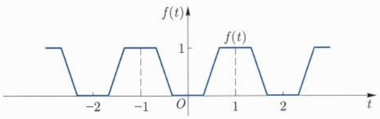

(7) 闭区间 $[a, b]$ 上的逐段线性函数 $g(x)$ 一定可以写成

$$
g (x) = g (a) + \sum_ {i = 1} ^ {n} \lambda_ {i} L (x - c _ {i})
$$

形式, 其中  $L(x)=\frac{1}{2}(|x|+x)=\max\{x,0\}, c_{i}$  为折线的转折点.

(8) 若函数  $\xi_{k}(x)$  ( $k=1,2,\cdots,K$ ) 在  $[a,b]$  上能被多项式一致逼近，则  $\sum_{k=1}^{K}\lambda_{k}\xi_{k}(x)$  在  $[a,b]$  上也能被多项式一致逼近. □

## 习题 13.6

1. 按照下列步骤给出 Weierstrass 逼近定理的另一个证明:

(1) 设 $c_{n} = \int_{-1}^{1}(1 - x^{2})^{n}\mathrm{d}x$, 证明: $c_{n} < \sqrt{\pi n}$.

(2) 设 $f$ 是 $[0,1]$ 上的连续函数, 并且 $f(0) = f(1) = 0$. 当 $x \in [0,1]$ 时, 定义 $f(x) = 0$. 记 $Q_{n}(t) = c_{n}(1 - t^{2})^{n}$. 证明:

$$
P _ {n} (x) = \int_ {0} ^ {1} f (x + t) Q _ {n} (t) \mathrm{d} t, \quad 0 \leqslant x \leqslant 1
$$

是一个多项式, 而且

$$
\lim _ {n \to + \infty} P _ {n} (x) = f (x)
$$

在 $[0,1]$ 上一致收敛成立.

(3) 当 $f(0) \neq 0$ 或 $f(1) \neq 0$ 的条件不成立时, 证明 Weierstrass 逼近定理.

2. 设 $f$ 在 $[0,1]$ 上连续, 证明:

$$
\lim _ {n \to + \infty} \frac {1}{2 ^ {n}} \sum_ {k = 0} ^ {n} (- 1) ^ {k} C _ {n} ^ {k} f \left(\frac {k}{n}\right) = 0.
$$

3. 设 $f$ 是 $[a, b]$ 上的连续函数, 如果

$$
\int_ {a} ^ {b} f (x) x ^ {n} \mathrm{d} x = 0, \quad n = 0, 1, 2, \dots ,
$$

证明: $f$ 在 $[a, b]$ 上恒等于 0.

4. 若 $f$ 在 $(-\infty, +\infty)$ 中能用多项式一致逼近, 证明: $f$ 必为一多项式.

5. 设 $f$ 在 $[0,1]$ 上有定义, $B_{n}(f,x)$ 是函数 $f$ 的 $n$ 阶 Bernstein 多项式 (见习题 13.2 中 8 的表达式 (13.2.7)). 证明:

(1) (端点插值性) $B_{n}(f,0) = f(0), B_{n}(f,1) = f(1)$.

(2) (保序性) 如果 $f(t) \geqslant 0 (t \in [0,1])$, 则 $B_{n}(f,x) \geqslant 0$; 如果 $f(t) > 0 (t \in [0,1])$, 则 $B_{n}(f,x) > 0$.

(3) (保有界性) 如果 $m \leqslant f(t) \leqslant M (t \in [0,1])$, 则 $m \leqslant B_n(f,x) \leqslant M$.
(4) (保凸性) 如果 f 是  $[0,1]$  上的凸函数, 那么  $B_{n}(f,x)$  也是凸函数.

6. 设 $f$ 在 $[0,1]$ 上可导, 证明:

$$
B _ {n} ^ {\prime} (f, x) = n \sum_ {k = 0} ^ {n - 1} \left(f \left(\frac {k + 1}{n}\right) - f \left(\frac {k}{n}\right)\right) \mathrm{C} _ {n - 1} ^ {k} x ^ {k} (1 - x) ^ {n - k - 1}.
$$

进一步, $B_{n}(f,x)$ 具有 $C^1$ 收敛性, 即, 如果 $f \in C^{1}[0,1]$, 则 $B_{n}^{\prime}(f,x)$ 一致收敛于 $f'(x)$.

更一般地， $B_{n}(f,x)$ 具有 $C^m$ 收敛性，即，对于 $m\geqslant 1$ ，如果 $f\in C^{m}[0,1]$ ，则$B_{n}^{(m)}(f,x)$ 一致收敛于 $f^{(m)}(x)$

7. 设 $\alpha \in (0,1], L > 0, f$ 在 $[0,1]$ 上有定义, 满足 $\alpha$ 阶 Hölder 连续

$$
| f (x) - f (y) | \leqslant L | x - y | ^ {\alpha}, \quad \forall x, y \in [ 0, 1 ].
$$

设 $B_{n}(f,x)$ 是函数 $f$ 的 $n$ 阶 Bernstein 多项式. 证明:

(1) $\forall x\in [0,1]$ ，成立

$$
| f (x) - B _ {n} (f, x) | \leqslant L \Big (\frac {1}{n} x (1 - x) \Big) ^ {\alpha / 2} \leqslant L n ^ {- \alpha / 2}.
$$

(2) $B_{n}(f,x)$ 在[0,1]上也满足 $\alpha$ 阶 Hölder 连续,且具有相同的系数L:

$$
| B _ {n} (f, x) - B _ {n} (f, y) | \leqslant L | x - y | ^ {\alpha}, \quad \forall x, y \in [ 0, 1 ].
$$

8. 设 $f(x)$ 在一个无穷区间可被多项式逼近, 证明: $f(x)$ 必是一个多项式.

9. 设  $f(x)$  在  $(a, b)$  可被多项式逼近, 证明:  $f(x)$  在  $(a, b)$  一致连续.

10. 设 $f \in C[1, +\infty)$，且存在 $\lim_{x \to +\infty} f(x) = c$，证明:对任给 $\varepsilon > 0$，存在多项式 $P(x)$，使得 $|f(x) - P(1/x)| < \varepsilon, x \geqslant 1$.

11. 设 $f \in C[0, +\infty)$，且存在 $\lim_{x \to +\infty} f(x) = c$，证明:对任给 $\varepsilon > 0$，存在多项式 $P(x)$，使得 $|f(x) - P(\mathrm{e}^{-x})| < \varepsilon, x \geqslant 0$.

12. 设 $f \in  C\left\lbrack  {a,b}\right\rbrack$ ,试证明: 存在多项式

$$
P _ {1} (x) \leqslant P _ {2} (x) \leqslant \dots \leqslant P _ {n} (x) \leqslant \dots
$$

使得  $\{P_{n}(x)\}$  在  $[a,b]$  上一致收敛到  $f(x)$ .

## 13.7 Peano 曲线

Peano 曲线又称 Hilbert 曲线, 是 Peano 于 1890 年首次发现的一件令人惊异的事实: 存在一条能够填满整个正方形的连续曲线. Peano 曲线的发现, 是数学史上的一件影响深远的事件, 它表明从低维到高维的连续映射的像集未必是零测集, 甚至一度引起对空间维数定义的基本思考. 后来, 人们就把能填满整个平面区域的连续曲线统称为 Peano 曲线. 下面我们简要介绍的一种构造 Peano 曲线的方法, 这是由 I. J. Schoenberg 在 1938 年给出的. 在 Schoenberg 的构造中, 他利用了实数的 $p$ 进制小数展开 $(p = 2,3)$.

考虑连续函数

$$
f (t) = \left\{ \begin{array}{l l} 0, & t \in [ 0, 1 / 3 ], \\ 3 t - 1, & t \in (1 / 3, 2 / 3 ], \\ 1, & t \in (2 / 3, 1 ]. \end{array} \right.
$$

将 f 延拓为 R 中周期为 2 的偶函数 (图 13.1).

$$
f (t) = f (t + 2), \quad f (t) = f (- t), \quad t \in \mathbb {R}.
$$

line

| t | f(t) |
| --- | --- |
| -3 | 1 |
| -2.5 | 0 |
| -2 | 0 |
| -1.5 | 1 |
| -1 | 1 |
| -0.5 | 0 |
| 0 | 0 |
| 0.5 | 1 |
| 1 | 1 |
| 1.5 | 0 |
| 2 | 0 |
| 2.5 | 1 |

图13.1 锯齿函数

令

$$
x (t) = \sum_ {n = 0} ^ {+ \infty} \frac {f (3 ^ {2 n} t)}{2 ^ {n + 1}}, \quad y (t) = \sum_ {n = 0} ^ {+ \infty} \frac {f (3 ^ {2 n + 1} t)}{2 ^ {n + 1}}, \quad t \in [ 0, 1 ].
$$

由于 $0 \leqslant f(x) \leqslant 1$，故这两个级数均一致收敛，从而 $x(t), y(t)$ 连续，

$$
\sigma (t) = (x (t), y (t)): I \to I \times I \quad (I = [ 0, 1 ])
$$

为连续曲线.

对任意点 $(a,b)\in I^2$ ，设 $a$ 与 $b$ 的二进制表示分别为

$$
a = \sum_ {n = 1} ^ {+ \infty} \frac {a _ {n}}{2 ^ {n}}, \quad b = \sum_ {n = 1} ^ {+ \infty} \frac {b _ {n}}{2 ^ {n}}, \tag {13.7.1}
$$

其中  $a_{n}, b_{n} \in \{0,1\} (\forall n \geqslant 1)$ ，定义实数  $\tilde{t}$  如下:

$$
0 \leqslant \tilde {t} := \frac {2 a _ {1}}{3} + \frac {2 b _ {1}}{3 ^ {2}} + \frac {2 a _ {2}}{3 ^ {3}} + \frac {2 b _ {2}}{3 ^ {4}} + \dots + \frac {2 a _ {n}}{3 ^ {2 n - 1}} + \frac {2 b _ {n}}{3 ^ {2 n}} + \dots \leqslant 2 \sum_ {n = 1} ^ {+ \infty} \frac {1}{3 ^ {n}} = 1. \tag {13.7.2}
$$

我们断言, 曲线 $\sigma$ 可以覆盖正方形 $I^{2}$, 即可以证明, $\forall (a, b) \in I^{2}$, 具有表示式 (13.7.1), 则由 (13.7.2) 给出的 $\tilde{t}$ 便满足 $a = x(\tilde{t}), b = y(\tilde{t})$. 事实上,

$$
\begin{array}{l} 3 ^ {2 n - 2} \tilde {t} = 3 ^ {2 n - 3} \cdot 2 a _ {1} + 3 ^ {2 n - 4} \cdot 2 b _ {1} + 3 ^ {2 n - 5} \cdot 2 a _ {2} + \dots + \frac {2 a _ {n}}{3} + \frac {2 b _ {n}}{3 ^ {2}} + \dots \\ = 2 \times N + \frac {2 a _ {n}}{3} + \tilde {a}, \\ \end{array}
$$

其中 $N \in \mathbb{N}$, $\tilde{a}$ 为 $\frac{2a_n}{3}$ 之后级数的余项之和. 满足 $0 \leqslant \tilde{a} \leqslant \sum_{n=2}^{+\infty} \frac{2}{3^n} = \frac{1}{3}$, 故有

$$
f (3 ^ {2 n - 2} \tilde {t}) = f \left(2 N + \frac {2 a _ {n}}{3} + \tilde {a}\right) = f \left(\frac {2 a _ {n}}{3} + \tilde {a}\right).
$$

若 $a_{n} = 0$ ，则 $0\leqslant \frac{2a_n}{3} +\tilde{a}\leqslant \frac{1}{3}$ 故 $f(3^{2n - 2}\tilde{t}) = f\left(\frac{2a_n}{3} +\tilde{a}\right) = 0 = a_n.$

若 $a_{n} = 1$ ，则 $\frac{2}{3}\leqslant \frac{2a_n}{3} +\tilde{a}\leqslant 1,$ 故 $f(3^{2n - 2}\tilde{t}) = f\left(\frac{2a_n}{3} +\tilde{a}\right) = 1 = a_n.$

同理有 $f(3^{2n - 1}\tilde{t}) = b_n$ ，从而有

$$
x (\tilde {t}) = a, \quad y (\tilde {t}) = b.
$$

证毕.

从证明中可以看出, 对于一个三进制表示的实数  $\tilde{t}$ , 连续函数  $x(t), y(t)$  事实上起到了把数对  $(a, b)$  分别从  $\tilde{t}$  中过滤出来的作用.

## 习题 13.7

1. 证明: 空间连续曲线

$$
\left\{ \begin{array}{l} x (t) = \sum_ {n = 1} ^ {+ \infty} \varphi (3 ^ {n} t - 3 ^ {n - 1}) \frac {1}{2 ^ {n}}, \\ y (t) = \sum_ {n = 1} ^ {+ \infty} \varphi (3 ^ {n} t - 2 \cdot 3 ^ {n - 1}) \frac {1}{2 ^ {n}}, \quad t \in [ 0, 1 ], \\ z (t) = \sum_ {n = 1} ^ {+ \infty} \varphi (3 ^ {n} t) \frac {1}{2 ^ {n}} \end{array} \right.
$$

能填满整个立方体 $[0,1]^3$ ，其中 $\varphi$ 在 $I = [0,1]$ 上定义如下:

$$
\varphi (t) = \left\{ \begin{array}{l l} 0, & t \in \left[ 0, \frac {1}{3} \right], \\ 3 t - 1, & t \in \left(\frac {1}{3}, \frac {2}{3} \right], \\ 1, & t \in \left(\frac {2}{3}, 1 \right]. \end{array} \right.
$$

## 第十四章

## 多元函数与映射的极限与连续

从这一章开始我们要研究多个变量的函数. 我们知道, 一元函数的诸多性质都依赖于实数的性质. 为了研究多个变量的函数, 我们要首先研究其定义域的基本性质.

## 14.1 欧氏空间上的内积和外积

一元函数是指以 $\mathbb{R}$ 的子集为定义域的函数. 当变化因素不止一个时, 我们就要考虑定义在一般欧氏空间中的函数. 设 $n$ 为正整数, 记

$$
\mathbb {R} ^ {n} = \{(a _ {1}, a _ {2}, \dots , a _ {n}) \mid a _ {i} \in \mathbb {R}, i = 1, 2, \dots , n \},
$$

它是由 n 元有序实数组构成的集合. 以显然的方式,  $R^{n}$  成为 R 上的向量空间, 称为 n 维欧氏空间.  $a_{i}$  称为向量  $(a_{1}, a_{2}, \cdots, a_{n})$  的第 i 个坐标.

以 $\mathbb{R}^n$ 的子集为定义域的函数称为 $n$ 元函数, $n > 1$ 时统称多元函数. 为了研究多元函数, 我们首先要研究 $\mathbb{R}^n$ 的性质, 这可以与 $\mathbb{R}$ 的性质做对比. 比如, 为了比较两个实数的大小, 我们可以考虑它们之间差的绝对值. 从几何上看, 这个绝对值可以认为是这两个实数在直线上所代表的两个点之间的距离. 为了方便起见, $\mathbb{R}^n$ 中的向量 ($n$ 元实数组) 也称为 $\mathbb{R}^n$ 中的点. 给定 $\mathbb{R}^n$ 中的两个点 (向量), 怎样定义它们之间的距离 (夹角)? 为了定义距离和夹角, 我们引入如下概念.

定义 14.1.1 (内积) 设 V 是实数域 R 上的向量空间, 如果函数  $g: V \times V \rightarrow R$  满足以下条件:

(1) 任给  $v \in V$ ，均有  $g(v, v) \geqslant 0$ ，且  $g(v, v) = 0 \Longleftrightarrow v = 0$ （正定性）.
(2) 任给  $u, v \in V$ ，均有  $g(u, v) = g(v, u)$  （对称性）.
(3) 任给 $\alpha, \beta \in \mathbb{R}, \pmb{u}, \pmb{v}, \pmb{w} \in V$, 均有

$$
g (\alpha \pmb {u} + \beta \pmb {v}, \pmb {w}) = \alpha g (\pmb {u}, \pmb {w}) + \beta g (\pmb {v}, \pmb {w}) (\text {线性性}),
$$

则称 g 为 V 上的内积,  $(V, g)$  称为内积空间.

我们常用 $\langle ,\rangle$ 表示内积, 比如 $\langle \pmb {u},\pmb {v}\rangle = g(\pmb {u},\pmb {v})$ 表示 $\pmb {u},\pmb{v}$ 之间的内积. 有了内积就可以定义向量的长度和向量之间的夹角. 设 $\pmb {u}\in V$, 记 $\| \pmb {u}\| = \sqrt{\langle\pmb{u},\pmb{u}\rangle}$, 称为 $\pmb{u}$ 的范数或长度.

定理 14.1.1 (Schwarz $^{①}$ 不等式) 设 $(V, \langle, \rangle)$ 为内积空间, $u, v \in V$, 则

$$
| \langle \boldsymbol {u}, \boldsymbol {v} \rangle | \leqslant \| \boldsymbol {u} \| \cdot \| \boldsymbol {v} \|,
$$

等号成立当且仅当 u, v 线性相关.

<small>① Schwarz, Hermann Amandus, 1843 年 1 月 25 日—1921 年 11 月 30 日, 德国数学家.</small>

证明 当 u = 0 (或 v = 0) 时, 由内积的线性性可得

$$
\langle \mathbf {0}, \boldsymbol {v} \rangle = \langle 0 \cdot \mathbf {0}, \boldsymbol {v} \rangle = 0 \langle \mathbf {0}, \boldsymbol {v} \rangle = 0,
$$

此时不等式自然成立. 下设  $u, v \neq 0$ , 当  $t \in R$  时, 根据内积的定义, 我们有

$$
\langle \boldsymbol {u}, \boldsymbol {u} \rangle - 2 t \langle \boldsymbol {u}, \boldsymbol {v} \rangle + t ^ {2} \langle \boldsymbol {v}, \boldsymbol {v} \rangle = \langle \boldsymbol {u} - t \boldsymbol {v}, \boldsymbol {u} - t \boldsymbol {v} \rangle \geqslant 0,
$$

上式是关于 $t$ 的一元二次函数, 因此其判别式非正:

$$
\Delta = 4 \langle \boldsymbol {u}, \boldsymbol {v} \rangle^ {2} - 4 \langle \boldsymbol {u}, \boldsymbol {u} \rangle \langle \boldsymbol {v}, \boldsymbol {v} \rangle \leqslant 0,
$$

等号成立的条件留作练习.

注 14.1.1 当  $\langle v, v \rangle \geqslant 0$  恒成立时 Schwarz 不等式成立.

根据 Schwarz 不等式, 当 u, v 为非零向量时, 可以取  $\theta(u, v) \in [0, \pi]$ , 使得

$$
\cos \theta (\boldsymbol {u}, \boldsymbol {v}) = \frac {\langle \boldsymbol {u} , \boldsymbol {v} \rangle}{\| \boldsymbol {u} \| \| \boldsymbol {v} \|},
$$

$\theta(\boldsymbol{u},\boldsymbol{v})$  称为 u,v 之间的夹角, 也记为  $\angle(\boldsymbol{u},\boldsymbol{v})$ .

例 14.1.1  $R^{n}$  中的标准内积和范数.

设  $u, v \in R^{n}$ ，记  $\boldsymbol{u} = (u_{1}, u_{2}, \cdots, u_{n})$ ， $\boldsymbol{v} = (v_{1}, v_{2}, \cdots, v_{n})$ ，定义

$$
\langle \boldsymbol {u}, \boldsymbol {v} \rangle = \boldsymbol {u} \cdot \boldsymbol {v} = \sum_ {i = 1} ^ {n} u _ {i} v _ {i},
$$

容易看出 $\langle ,\rangle$ 为 $\mathbb{R}^n$ 中的内积, 称为标准内积或欧氏内积. 此时, $\pmb{u}$ 的范数为

$$
\| \boldsymbol {u} \| = \sqrt {u _ {1} ^ {2} + u _ {2} ^ {2} + \cdots + u _ {n} ^ {2}}.
$$

当 n=1 时, 范数也就是绝对值.

例 14.1.2 矩阵空间中的内积和范数.

用 $M_{m \times n}$ 表示 $m \times n$ 实矩阵的全体构成的向量空间. 设 $\mathbf{A}, \mathbf{B} \in M_{m \times n}$, 定义

$$
\langle \boldsymbol {A}, \boldsymbol {B} \rangle = \mathrm{tr} \big (\boldsymbol {A} \boldsymbol {B} ^ {\mathrm{T}} \big),
$$

不难验证 $\langle ,\rangle$ 为 $M_{m\times n}$ 中的内积.若 $\pmb {A} = (a_{ij})_{m\times n}$ ，则其范数可以表示为

$$
\| \boldsymbol {A} \| = \left(\sum_ {i = 1} ^ {m} \sum_ {j = 1} ^ {n} a _ {i j} ^ {2}\right) ^ {\frac {1}{2}}.
$$

需要注意的是, 在参与矩阵的乘法运算时, 我们经常把  $R^{n}$  中的向量视为列向量. 下面的结果建立了矩阵的范数和向量的范数之间的联系.

引理 14.1.2 (范数不等式) 设  $b \in R^{n}$ ,  $A = (a_{ij})_{m \times n}$ ，则  $\|Ab\| \leqslant \|A\| \|b\|$ .

证明 我们把矩阵 A 的第 i 行记为  $a^{i}$ ，则 Ab 用列向量表示为

$$
\boldsymbol {A} \boldsymbol {b} = \left(\boldsymbol {a} ^ {1} \cdot \boldsymbol {b}, \boldsymbol {a} ^ {2} \cdot \boldsymbol {b}, \dots , \boldsymbol {a} ^ {m} \cdot \boldsymbol {b}\right) ^ {\mathrm{T}}.
$$

根据 Schwarz 不等式可得

$$
\| \boldsymbol {A} \boldsymbol {b} \| ^ {2} = \sum_ {i = 1} ^ {m} \left(\boldsymbol {a} ^ {i} \cdot \boldsymbol {b}\right) ^ {2} \leqslant \sum_ {i = 1} ^ {m} \| \boldsymbol {a} ^ {i} \| ^ {2} \| \boldsymbol {b} \| ^ {2} = \| \boldsymbol {A} \| ^ {2} \| \boldsymbol {b} \| ^ {2}.
$$

将上式两边开方即得欲证结论.

有了范数就可以定义距离. 设  $(V, \langle, \rangle)$  为内积空间,  $u, v \in V$ . 记  $d(u, v) = \|u - v\|$ , 称为 u, v 之间的距离.

命题 14.1.3 (三角不等式) 设  $(V, \langle, \rangle)$  为内积空间,  $x, y, z \in V$ , 则有

$$
d (\boldsymbol {x}, \boldsymbol {z}) \leqslant d (\boldsymbol {x}, \boldsymbol {y}) + d (\boldsymbol {y}, \boldsymbol {z}).
$$

证明 我们先证明绝对值不等式: 任给 $\pmb{u}, \pmb{v} \in V$, 均有

$$
\| \boldsymbol {u} + \boldsymbol {v} \| \leqslant \| \boldsymbol {u} \| + \| \boldsymbol {v} \|. \tag {14.1.1}
$$

事实上, 根据 Schwarz 不等式, 有

$$
\begin{array}{l} \| \boldsymbol {u} + \boldsymbol {v} \| ^ {2} = \langle \boldsymbol {u} + \boldsymbol {v}, \boldsymbol {u} + \boldsymbol {v} \rangle = \langle \boldsymbol {u}, \boldsymbol {u} \rangle + 2 \langle \boldsymbol {u}, \boldsymbol {v} \rangle + \langle \boldsymbol {v}, \boldsymbol {v} \rangle \\ \leqslant \| \boldsymbol {u} \| ^ {2} + 2 \| \boldsymbol {u} \| \| \boldsymbol {v} \| + \| \boldsymbol {v} \| ^ {2} = (\| \boldsymbol {u} \| + \| \boldsymbol {v} \|) ^ {2}. \\ \end{array}
$$

将上式两边开方即得绝对值不等式. 当 $x, y, z \in V$ 时, 利用绝对值不等式可得

$$
\begin{array}{l} d (\boldsymbol {x}, \boldsymbol {z}) = \| \boldsymbol {x} - \boldsymbol {z} \| = \| (\boldsymbol {x} - \boldsymbol {y}) + (\boldsymbol {y} - \boldsymbol {z}) \| \\ \leqslant \| \boldsymbol {x} - \boldsymbol {y} \| + \| \boldsymbol {y} - \boldsymbol {z} \| = d (\boldsymbol {x}, \boldsymbol {y}) + d (\boldsymbol {y}, \boldsymbol {z}). \\ \end{array}
$$

设 $\pmb{u},\pmb{v}\in \mathbb{R}^n$ ，若 $\pmb {u}\cdot \pmb {v} = 0$ ，则称 $\pmb {u},\pmb{v}$ 互相垂直(正交)，记为 $\pmb {u}\perp \pmb{v}$ .第 $i$ 个坐标为1,其余坐标为零的向量记为 $e_i$ ，我们将 $\{e_i\}_{i = 1}^n$ 称为 $\mathbb{R}^n$ 中的标准正交基.

在  $R^{n}$  中给定 n-1 个向量  $v^{1}, v^{2}, \cdots, v^{n-1}$ ，我们要构造另一个向量 w，使得 w 与  $v^{i}$  均垂直。为此，记  $\boldsymbol{v}^{i} = (v_{1}^{i}, \cdots, v_{n}^{i})$ ，考虑线性函数  $\ell: R^{n} \to R$ :

$$
\ell (\boldsymbol {x}) = \left| \begin{array}{c c c} x _ {1} & \dots & x _ {n} \\ v _ {1} ^ {1} & \dots & v _ {n} ^ {1} \\ \vdots & & \vdots \\ v _ {1} ^ {n - 1} & \dots & v _ {n} ^ {n - 1} \end{array} \right|, \quad \forall \boldsymbol {x} = (x _ {1}, x _ {2}, \dots , x _ {n}).
$$

按照行列式的定义, $\ell (\pmb {x})$ 可以表示为

$$
\ell (\boldsymbol {x}) = \boldsymbol {x} \cdot \boldsymbol {w} = \sum_ {i = 1} ^ {n} x _ {i} w _ {i}, \tag {14.1.2}
$$

其中  $\boldsymbol{w}=(w_{1},w_{2},\cdots,w_{n})$ ，且

$$
w _ {i} = (- 1) ^ {i - 1} \left| \begin{array}{c c c c c c} v _ {1} ^ {1} & \dots & v _ {i - 1} ^ {1} & v _ {i + 1} ^ {1} & \dots & v _ {n} ^ {1} \\ \vdots & & \vdots & \vdots & & \vdots \\ v _ {1} ^ {n - 1} & \dots & v _ {i - 1} ^ {n - 1} & v _ {i + 1} ^ {n - 1} & \dots & v _ {n} ^ {n - 1} \end{array} \right|, i = 1, 2, \dots , n. \tag {14.1.3}
$$

由  $\ell(\boldsymbol{x})$  的定义易见  $\ell(\boldsymbol{v}^{i})=0\ (1\leqslant i\leqslant n-1)$ . 再由 (14.1.2) 可知 w 的确与  $v^{i}$  都垂直.
我们称 w 是  $v^{1}, v^{2}, \cdots, v^{n-1}$  的外积, 记为

$$
\boldsymbol {w} = \boldsymbol {v} ^ {1} \times \boldsymbol {v} ^ {2} \times \dots \times \boldsymbol {v} ^ {n - 1}.
$$

外积还具有下列性质:

\- $\{\pmb{v}^i\}_{i=1}^{n-1}$ 线性相关当且仅当 $\pmb{v}^1 \times \pmb{v}^2 \times \dots \times \pmb{v}^{n-1} = \mathbf{0}$. 事实上, 如果 $\{\pmb{v}^i\}_{i=1}^{n-1}$ 线性相关, 则 $\ell(\pmb{x}) \equiv 0$, 从而 $\| \pmb{w} \|^2 = \ell(\pmb{w}) = 0$; 另一方面, 如果 $\{\pmb{v}^i\}_{i=1}^{n-1}$ 线性无关, 则可以将它们扩充为 $\mathbb{R}^n$ 中的一组基 $\{\pmb{u}, \pmb{v}_i \mid 1 \leqslant i \leqslant n-1\}$. 此时 $\ell(\pmb{u}) \neq 0$, 即 $\pmb{u} \cdot \pmb{w} \neq 0$, 特别地 $\pmb{w} \neq \mathbf{0}$.

\- 外积关于每一个分量 $\pmb{v}^i$ 都是线性的, 即任给 $\lambda, \mu \in \mathbb{R}$ 以及向量 $\pmb{v}^i, \tilde{\pmb{v}}^i$, 有

$$
\boldsymbol {v} ^ {1} \times \dots \times \left(\lambda \boldsymbol {v} ^ {i} + \mu \tilde {\boldsymbol {v}} ^ {i}\right) \times \dots \times \boldsymbol {v} ^ {n - 1} = \lambda \boldsymbol {v} ^ {1} \times \dots \times \boldsymbol {v} ^ {i} \times \dots \times \boldsymbol {v} ^ {n - 1} +
$$

$$
\mu \boldsymbol {v} ^ {1} \times \dots \times \tilde {\boldsymbol {v}} ^ {i} \times \dots \times \boldsymbol {v} ^ {n - 1}
$$

\- 当 $i < j$ 时, 交换 $\pmb{v}^i$ 和 $\pmb{v}^j$ 的位置以后外积变一个符号, 即

$$
\boldsymbol {v} ^ {1} \times \dots \times \boldsymbol {v} ^ {j} \times \dots \times \boldsymbol {v} ^ {i} \times \dots \times \boldsymbol {v} ^ {n - 1} = - \boldsymbol {v} ^ {1} \times \dots \times \boldsymbol {v} ^ {i} \times \dots \times \boldsymbol {v} ^ {j} \times \dots \times \boldsymbol {v} ^ {n - 1}.
$$

一般地, 设  $\sigma$  为  $\{1,\cdots,n-1\}$  的置换, 则

$$
\boldsymbol {v} ^ {\sigma (1)} \times \dots \times \boldsymbol {v} ^ {\sigma (n - 1)} = (- 1) ^ {\sigma} \boldsymbol {v} ^ {1} \times \dots \times \boldsymbol {v} ^ {n - 1},
$$

其中 $\sigma$ 为偶置换时 $(-1)^{\sigma} = 1, \sigma$ 为奇置换时 $(-1)^{\sigma} = -1$.

\- $\| \pmb{v}^{1}\times \dots \times \pmb{v}^{n - 1}\| = \left(\det \left(\pmb{v}^{i}\cdot \pmb{v}^{j}\right)_{(n - 1)\times (n - 1)}\right)^{\frac{1}{2}}$ .事实上，当 $\{\pmb{v}^i\}_{i = 1}^{n - 1}$ 线性相关时 $\pmb {w} = \mathbf{0},\det \left(\pmb {v}^{i}\cdot \pmb{v}^{j}\right)_{(n - 1)\times (n - 1)} = 0;$ 当 $\{\pmb{v}^i\}_{i = 1}^{n - 1}$ 线性无关时，利用 $\| \pmb {w}\| ^2 = \ell (\pmb {w})$ 以

及 $\pmb{v}^i\cdot \pmb {w} = 0$ 可得

$$
\begin{array}{l} \| \boldsymbol {w} \| ^ {4} = \det \left(\left( \begin{array}{c} \boldsymbol {w} \\ \boldsymbol {v} ^ {1} \\ \vdots \\ \boldsymbol {v} ^ {n - 1} \end{array} \right) \left( \begin{array}{c} \boldsymbol {w} \\ \boldsymbol {v} ^ {1} \\ \vdots \\ \boldsymbol {v} ^ {n - 1} \end{array} \right) ^ {\mathrm{T}}\right) = \det \left( \begin{array}{c c} \boldsymbol {w} \cdot \boldsymbol {w} & 0 \\ 0 & (\boldsymbol {v} ^ {i} \cdot \boldsymbol {v} ^ {j}) _ {(n - 1) \times (n - 1)} \end{array} \right) \\ = \| \boldsymbol {w} \| ^ {2} \det \left(\boldsymbol {v} ^ {i} \cdot \boldsymbol {v} ^ {j}\right) _ {(n - 1) \times (n - 1)}, \\ \end{array}
$$

这说明  $\left\|w\right\|^{2}=\det\left(v^{i}\cdot v^{j}\right)_{(n-1)\times(n-1)}$ .

\- 若  $\{e_{i}\}_{i=1}^{n}$  为  $R^{n}$  中的标准正交基, 则  $e_{1} \times \cdots \times e_{i-1} \times e_{i+1} \times \cdots \times e_{n} = (-1)^{i-1} e_{i}$ .

## 习题 14.1

1. 我们用 $C[a, b]$ 表示 $[a, b]$ 上连续函数的全体构成的空间. 设 $f, g \in C[a, b]$, 定义

$$
\langle f, g \rangle = \int_ {a} ^ {b} f (x) g (x) \mathrm{d} x,
$$

验证 $\langle,\rangle$ 是 $C[a,b]$ 上的内积.

2. 设 $\langle ,\rangle$ 为向量空间 $V$ 上的内积, $\pmb{u}, \pmb{v} \in V, \pmb{v} \neq \mathbf{0}$. 在不等式

$$
\langle \boldsymbol {u} - t \boldsymbol {v}, \boldsymbol {u} - t \boldsymbol {v} \rangle \geqslant 0
$$

中代入  $t=\frac{\langle u,v\rangle}{\langle v,v\rangle}$  从而证明 Schwarz 不等式.

3. 设 $(V, \langle, \rangle)$ 为内积空间, 证明如下的余弦公式:

$$
\| \boldsymbol {u} - \boldsymbol {v} \| ^ {2} = \| \boldsymbol {u} \| ^ {2} + \| \boldsymbol {v} \| ^ {2} - 2 \| \boldsymbol {u} \| \| \boldsymbol {v} \| \cos \theta (\boldsymbol {u}, \boldsymbol {v}), \forall \boldsymbol {u}, \boldsymbol {v} \in V.
$$

4. 设 $(V, \langle , \rangle)$ 为内积空间, 证明如下的平行四边形公式:

$$
\| \boldsymbol {u} + \boldsymbol {v} \| ^ {2} + \| \boldsymbol {u} - \boldsymbol {v} \| ^ {2} = 2 \big (\| \boldsymbol {u} \| ^ {2} + \| \boldsymbol {v} \| ^ {2} \big), \forall \boldsymbol {u}, \boldsymbol {v} \in V.
$$

5. 设 $\pmb{u} \in \mathbb{R}^n$, 证明: $\| \pmb{u} \| = \max \{\pmb{u} \cdot \pmb{v} \mid \pmb{v} \in S^{n-1}\}$, 其中 $S^{n-1} = \{\pmb{x} \in \mathbb{R}^n \mid \| \pmb{x} \| = 1\}$.

6. 设  $\boldsymbol{x}=(x_{1},x_{2},\cdots,x_{n})\in\mathbb{R}^{n}$ ，证明:

(1) 存在常数  $K_{1}, K_{2} > 0$ , 使得

$$
K _ {1} \sum_ {i = 1} ^ {n} | x _ {i} | \leqslant \| \boldsymbol {x} \| \leqslant K _ {2} \sum_ {i = 1} ^ {n} | x _ {i} |.
$$

(2) 存在常数 $M_{1}, M_{2} > 0$, 使得

$$
M _ {1} \max _ {1 \leqslant i \leqslant n} | x _ {i} | \leqslant \| \boldsymbol {x} \| \leqslant M _ {2} \max _ {1 \leqslant i \leqslant n} | x _ {i} |.
$$

7. 设 $A, B$ 为 $n$ 阶实方阵, 证明: $\|AB\| \leqslant \|A\| \|B\|$.
8. 设 A 为 n 阶实方阵. 若  $\|A\| < 1$ , 证明:  $I_{n} - A$  可逆, 其中  $I_{n}$  是 n 阶单位矩阵.
9. 设  $u, v, w \in R^{3}$ ，证明: $(\boldsymbol{u} \times \boldsymbol{v}) \times \boldsymbol{w} + (\boldsymbol{v} \times \boldsymbol{w}) \times \boldsymbol{u} + (\boldsymbol{w} \times \boldsymbol{u}) \times \boldsymbol{v} = \boldsymbol{0}$ .

10. 当 $f \in C[0,1]$ 时, 记 $|f|_{\infty} = \max \{|f(x)| \mid x \in [0,1]\}$. 问: $|\cdot|_{\infty}$ 是否为某个内积的范数? 请说明理由.

## 14.2 欧氏空间的拓扑

通过一元函数的学习, 我们知道无论是函数的极限还是连续性等性质都与实数的基本性质密切相关. 类似地, 多元函数的性质和欧氏空间的基本性质密切相关, 下面我们就来介绍欧氏空间的基本拓扑性质.

设 $\pmb{x} \in \mathbb{R}^n, r > 0$. 记 $B_r(\pmb{x}) = \{\pmb{y} \in \mathbb{R}^n \mid d(\pmb{y}, \pmb{x}) < r\}$, 称为以 $\pmb{x}$ 为中心 (球心), $r$ 为半径的开球.

开集: 设 $U \subseteq \mathbb{R}^n$. 如果任给 $\pmb{x} \in U$, 均存在 $r > 0$, 使得 $B_r(\pmb{x}) \subseteq U$, 则称 $U$ 为 $\mathbb{R}^n$ 中的开集. 注意, 空集是开集. 当然, 整个 $\mathbb{R}^n$ 也是开集.

闭集: 如果一个集合在  $R^{n}$  中的补集是开集, 则称该集合为  $R^{n}$  中的闭集. 空集以及整个  $R^{n}$  都是闭集.

例 14.2.1 开集的简单例子.

我们先来说明开球 $B_r(\pmb{x})$ 是开集.事实上，若 $\pmb{y} \in B_r(\pmb{x})$ ，记 $r' = r - d(\pmb{y}, \pmb{x})$ 则 $r' > 0$ 当 $\pmb{z} \in B_{r'}(\pmb{y})$ 时，由三角不等式可得

$$
d (\boldsymbol {z}, \boldsymbol {x}) \leqslant d (\boldsymbol {z}, \boldsymbol {y}) + d (\boldsymbol {y}, \boldsymbol {x}) <   r ^ {\prime} + d (\boldsymbol {y}, \boldsymbol {x}) = r,
$$

即 $z \in B_r(x)$, 这说明 $B_{r'}(y) \subseteq B_r(x)$, 由开集的定义即知 $B_r(x)$ 是开集.

设 $(a_{i},b_{i})\ (i=1,2,\cdots,n)$ 均为 R 中的开区间, 记

$$
I = \prod_ {i = 1} ^ {n} (a _ {i}, b _ {i}) = \{(x _ {1}, x _ {2}, \dots , x _ {n}) \in \mathbb {R} ^ {n} \mid a _ {i} <   x _ {i} <   b _ {i}, 1 \leqslant i \leqslant n \},
$$

称为 $n$ 维开矩形. 我们来说明开矩形是开集. 事实上, 若 $\pmb{x} \in I$, 记

$$
r = \min \{x _ {i} - a _ {i}, b _ {i} - x _ {i} \mid 1 \leqslant i \leqslant n \},
$$

则 r > 0. 当  $\boldsymbol{y} = (y_{1}, y_{2}, \cdots, y_{n}) \in B_{r}(\boldsymbol{x})$  时, 由

$$
| y _ {i} - x _ {i} | \leqslant d (\boldsymbol {y}, \boldsymbol {x}) <   r \leqslant \min \{x _ {i} - a _ {i}, b _ {i} - x _ {i} \}
$$

可知 $a_{i} < y_{i} < b_{i}, \forall 1 \leqslant i \leqslant n$. 这说明 $\pmb{y} \in I$, 即 $B_{r}(\pmb{x}) \subseteq I$, 于是由开集的定义即知 $I$ 是开集.

例14.2.2 闭集的简单例子.

设 $x \in \mathbb{R}^n, r > 0$. 记 $\overline{B_r(x)} = \{\boldsymbol{y} \in \mathbb{R}^n \mid d(\boldsymbol{y}, \boldsymbol{x}) = \| \boldsymbol{y} - \boldsymbol{x} \| \leqslant r\}$, 称为以 $x$ 为中心 (球心), $r$ 为半径的闭球. 我们来说明闭球是闭集. 事实上, 若 $y \notin \overline{B_r(x)}$, 记 $r' = d(\boldsymbol{y}, \boldsymbol{x}) - r$, 则 $r' > 0$, 由三角不等式可知 $B_{r'}(\boldsymbol{y}) \subseteq \mathbb{R}^n \setminus \overline{B_r(x)}$, 由定义可知 $\mathbb{R}^n \setminus \overline{B_r(x)}$ 为开集, 即 $\overline{B_r(x)}$ 是闭集.

设 $[a_i, b_i]$ ($i = 1, 2, \dots, n$) 均为 $\mathbb{R}$ 中的闭区间，记

$$
I = \prod_ {i = 1} ^ {n} [ a _ {i}, b _ {i} ] = \{(x _ {1}, x _ {2}, \dots , x _ {n}) \in \mathbb {R} ^ {n} \mid a _ {i} \leqslant x _ {i} \leqslant b _ {i}, 1 \leqslant i \leqslant n \},
$$

称为 $n$ 维(闭)矩形. 记 $\nu (I) = \prod_{i = 1}^{n}(b_i - a_i)$, 称为 $I$ 的容积. 记

$$
d (I) = \left[ (b _ {1} - a _ {1}) ^ {2} + (b _ {2} - a _ {2}) ^ {2} + \dots + (b _ {n} - a _ {n}) ^ {2} \right] ^ {\frac {1}{2}},
$$

称为 $I$ 的直径. 容易验证 $d(I) = \max \{d(\pmb{x},\pmb{y})\mid \pmb {x},\pmb {y}\in I\}$.

我们来说明 $I$ 是闭集. 事实上, 若 $\pmb{y} = (y_1, y_2, \dots, y_n) \notin I$, 则存在 $i$, 使得 $y_i \notin [a_i, b_i]$. 不妨设 $y_i < a_i$, 记 $r = a_i - y_i$, 则 $r > 0$. 当 $\pmb{z} = (z_1, z_2, \dots, z_n) \in B_r(\pmb{y})$ 时,

$$
a _ {i} - z _ {i} = r + y _ {i} - z _ {i} \geqslant r - \| \boldsymbol {y} - \boldsymbol {z} \| > 0,
$$

即 $z \notin I$, 这说明 $B_r(y) \subseteq \mathbb{R}^n \setminus I$, 因此 $\mathbb{R}^n \setminus I$ 是开集, $I$ 是闭集.

为了刻画开集和闭集, 我们引进点列极限的概念: 设 $\{\pmb{u}_i\}_{i=1}^{+\infty} \subseteq \mathbb{R}^n$, $\pmb{u} \in \mathbb{R}^n$. 如果 $\lim_{i \to +\infty} d(\pmb{u}_i, \pmb{u}) = \lim_{i \to +\infty} \| \pmb{u}_i - \pmb{u} \| = 0$, 则称点列 $\{\pmb{u}_i\}$ 收敛于 $\pmb{u}$, 或 $\{\pmb{u}_i\}$ 以 $\pmb{u}$ 为极限. 由三角不等式可知, 极限具有唯一性. 若 $\{\pmb{u}_i\}$ 为收敛点列, 其极限可记为 $\lim_{i \to +\infty} \pmb{u}_i$.

命题 14.2.1 (1) 设  $\{u_{i}\}$  收敛于 u. 若 u 属于开集 U, 则存在 N, 使得当 i > N 时  $u_{i}$  均属于 U.

(2) C 为闭集  $\Longleftrightarrow$  C 中任何收敛点列的极限仍属于 C.

证明 (1) 由 $U$ 为开集可知, 存在 $r > 0$, 使得 $B_r(\pmb{u}) \subseteq U$. 由极限的定义可知, 存在 $N$, 使得当 $i > N$ 时 $d(\pmb{u}_i, \pmb{u}) < r$, 即 $\pmb{u}_i \in B_r(\pmb{u}) \subseteq U$.

(2) “$\Longrightarrow$” 设 $\{\pmb{u}_i\}$ 为闭集 $C$ 中的收敛点列, 其极限为 $\pmb{u}$. 若 $\pmb{u} \notin C$, 则由 $C$ 为闭集可知, 存在 $r > 0$, 使得 $B_r(\pmb{u}) \subseteq \mathbb{R}^n \setminus C$. 由 (1) 可知, 当 $i$ 充分大时 $\pmb{u}_i \in \mathbb{R}^n \setminus C$, 这与 $\{\pmb{u}_i\} \subseteq C$ 相矛盾.

“$\Longleftarrow$”我们来说明 $\mathbb{R}^n \setminus C$ 是开集. 设 $\pmb{u} \in \mathbb{R}^n \setminus C$, 我们要说明存在 $i \geqslant 1$, 使得 $B_{\frac{1}{i}}(\pmb{u}) \subseteq \mathbb{R}^n \setminus C$. (反证法) 若不然, 则对每一个正整数 $i$, 均存在 $\pmb{u}_i \in B_{\frac{1}{i}}(\pmb{u}) \cap C$. 此时 $\{\pmb{u}_i\}$ 收敛于 $\pmb{u}$, 这与题设相矛盾.

下面我们将数列极限的重要结果推广到点列极限的情形.

定理 14.2.2 (Bolzano) 设  $\{u_{i}\} \subseteq R^{n}$ ，如果  $\{\|u_{i}\|\}$  有界，则  $\{u_{i}\}$  必有收敛子列.

证明 以 $n = 2$ 为例. 记 $\pmb{u}_i = (x_i, y_i)$, 则由 $|x_i|, |y_i| \leqslant \| \pmb{u}_i\|$ 可知 $\{x_i\}, \{y_i\}$ 均为有界数列. 于是 $\{x_i\}$ 存在收敛子列, 不妨设它本身收敛于 $x_0$. 注意 $\{y_i\}$ 也有收敛子列, 比如 $\{y_{ij}\}$ 收敛于 $y_0$. 记 $\pmb{u}_0 = (x_0, y_0)$, 由

$$
\| \boldsymbol {u} _ {i _ {j}} - \boldsymbol {u} _ {0} \| = \sqrt {(x _ {i _ {j}} - x _ {0}) ^ {2} + (y _ {i _ {j}} - y _ {0}) ^ {2}} \leqslant | x _ {i _ {j}} - x _ {0} | + | y _ {i _ {j}} - y _ {0} |
$$

即知  $\{u_{i_{j}}\}$  收敛于  $u_{0}$ .

引理 14.2.3 (Lebesgue 覆盖引理) 设  $\{U_{\alpha}\}$  为  $R^{n}$  中的一族开集, 若它们的并集包含闭矩形 I, 则存在  $\lambda > 0$ , 使得每一个包含于 I 且直径小于  $\lambda$  的矩形均包含于某一个  $U_{\alpha}$  中.

证明 (反证法) 若结论不对, 则对每一个正整数 $i$, 均存在直径小于 $\frac{1}{i}$ 矩形 $I_i \subseteq I$, 使得 $I_i$ 不包含于任何一个 $U_\alpha$ 中. 取 $\boldsymbol{u}_i \in I_i$, 则 $\{\boldsymbol{u}_i\} \subseteq I$, 从而存在收敛子列. 不妨设它本身收敛于 $\boldsymbol{u}_0$, 则 $\boldsymbol{u}_0 \in I$. 由题设, $\boldsymbol{u}_0$ 属于某个 $U_\alpha$. 由于 $U_\alpha$ 为开集, 故存在 $r > 0$, 使得 $B_r(\boldsymbol{u}_0) \subseteq U_\alpha$. 取 $N > \frac{2}{r}$, 使得当 $i > N$ 时, $d(\boldsymbol{u}_i, \boldsymbol{u}_0) < \frac{r}{2}$. 此时, 任给 $\boldsymbol{u} \in I_i$, 有

$$
d (\pmb {u}, \pmb {u} _ {0}) \leqslant d (\pmb {u}, \pmb {u} _ {i}) + d (\pmb {u} _ {i}, \pmb {u} _ {0}) \leqslant d (I _ {i}) + \frac {r}{2} <   \frac {1}{i} + \frac {r}{2} <   r,
$$

即 $\pmb{u} \in B_r(\pmb{u}_0)$, 从而 $I_i \subseteq B_r(\pmb{u}_0) \subseteq U_\alpha$, 这与 $I_i$ 的选取相矛盾.

为了叙述起来方便起见, 我们引进覆盖的概念. 若一族集合 $\{U_{\alpha}\}$ 的并集包含集合 $S$, 则称 $\{U_{\alpha}\}$ 是 $S$ 的一个覆盖; 每一个 $U_{\alpha}$ 都是开集的覆盖称为开覆盖.

定理 14.2.4 (有限覆盖定理) 设 $\{U_{\alpha}\}$ 为闭矩形 $I$ 的开覆盖, 则可以从这一族开集中选取有限个 $U_{\alpha}$, 使得它们的并集仍然包含 $I$.

证明 设 $\lambda$ 是前一引理中的正数 (称为 Lebesgue 数). 取正整数 $m > \frac{d(I)}{\lambda}$. 将 $I$ 等分为 $m^n$ 个小矩形, 每一个的直径均为 $\frac{d(I)}{m}$, 它小于 $\lambda$. 于是由前一引理可知, 每一个小矩形均包含于某一个 $U_\alpha$ 中, 因此 $I$ 包含于不超过 $m^n$ 个 $U_\alpha$ 的并集中. $\square$

设 $S \subseteq \mathbb{R}^n$ 为非空子集, 记 $d(S) = \sup \{d(\pmb{x}, \pmb{y}) \mid \pmb{x}, \pmb{y} \in S\}$, 称为 $S$ 的直径. 当 $d(S) < +\infty$ 时称 $S$ 为有界子集.

定理 14.2.5 (闭集套定理) 设  $\{C_{i}\}$  是  $R^{n}$  中一列非空有界闭集，如果  $C_{i} \supseteq C_{i+1}$  对每一个  $i \geqslant 1$  都成立，则  $\{C_{i}\}$  必有公共点。进一步，如果  $\lim_{i \to +\infty} d(C_{i}) = 0$ ，则  $\{C_{i}\}$  有且仅有一个公共点。

证明 先来说明 $\{C_i\}$ 必有公共点. (反证法) 若不然, 记 $U_i = \mathbb{R}^n \setminus C_i$, 则开集族 $\{U_i\}$ 的并集是整个 $\mathbb{R}^n$. 取矩形 $I \supseteq C_1$, 由前一定理, 存在 $m$, 使得

$$
I \subseteq \bigcup_ {i = 1} ^ {m} U _ {i} = U _ {m},
$$

这与 $C_m \subseteq C_1 \subseteq I$ 相矛盾.

如果 $\lim_{i\to +\infty}d(C_i) = 0$ ，且 $\pmb {x},\pmb{y}$ 均为 $\{C_i\}$ 的公共点，则 $d(\pmb {x},\pmb {y})\leqslant d(C_i)$ 对每一 $i$ 都成立，令 $i\to \infty$ 可知 $d(\pmb {x},\pmb {y}) = 0$ ，即 $\pmb {x} = \pmb{y}$ □

研究数列极限时可以考虑单调性. 在一般的欧氏空间中没有单调点列的概念, 不过 Cauchy 准则仍然成立.

Cauchy 列: 设  $\{u_{i}\}$  为  $R^{n}$  中的点列. 如果任给  $\varepsilon > 0$ , 均存在 N, 使得当 i, j > N 时  $d(\boldsymbol{u}_{i}, \boldsymbol{u}_{j}) < \varepsilon$ , 则称  $\{u_{i}\}$  为 Cauchy 列或基本列.

例 14.2.3 设  $A \in M_{n \times n}$ ，记  $e_{i}(A) = \sum_{k=0}^{i} \frac{A^{k}}{k!}$ ，其中  $A^{0} = I_{n}$ ，证明: $\{e_{i}(A)\}$  为 Cauchy 列.

证明 $M_{n\times n}$ 可视为 $n^2$ 维的欧氏空间.当 $j > i$ 时，根据矩阵范数的性质可得

$$
d \big (e _ {j} (\boldsymbol {A}), e _ {i} (\boldsymbol {A}) \big) = \| e _ {j} (\boldsymbol {A}) - e _ {i} (\boldsymbol {A}) \| \leqslant \sum_ {k = i + 1} ^ {j} \frac {\| \boldsymbol {A} \| ^ {k}}{k !} \leqslant \frac {\| \boldsymbol {A} \| ^ {i + 1}}{(i + 1) !} \mathrm{e} ^ {\| \boldsymbol {A} \|},
$$

再由  $\lim_{i\to+\infty}\frac{\|\boldsymbol{A}\|^{i}}{i!}=0$  即知  $\{e_{i}(\boldsymbol{A})\}$  为 Cauchy 列.

定理 14.2.6 (Cauchy 准则) 设  $\{u_{i}\}$  为  $R^{n}$  中的点列. 则  $\{u_{i}\}$  收敛  $\Longleftrightarrow\{u_{i}\}$  为 Cauchy 列.

证明 若 $\{\pmb{u}_i\}$ 收敛于 $\pmb{u}$, 则利用三角不等式 $d(\pmb{u}_i, \pmb{u}_j) \leqslant d(\pmb{u}_i, \pmb{u}) + d(\pmb{u}_j, \pmb{u})$ 易见 $\{\pmb{u}_i\}$ 为 Cauchy 列.

反之, 若 $\{\pmb{u}_i\}$ 为 Cauchy 列, 则与 Cauchy 数列类似, $\{\pmb{u}_i\}$ 必为有界点列, 从而存在收敛子列. 与数列的情形类似, 容易看出 $\{\pmb{u}_i\}$ 本身也是收敛的. □

设 $\mathbf{A}$ 为 $n$ 阶实方阵, 根据前例我们就知道 $\{e_i(A)\}$ 收敛, 其极限记为 $\exp(A)$ 或 $\mathrm{e}^A$. 称 $\exp$ 为矩阵的指数映射, 关于它的进一步讨论可参见本节习题.

定理 14.2.7 (压缩映射原理) 设 C 为  $R^{n}$  中的闭集,  $f: C \rightarrow C$  为映射. 如果存在常数  $\lambda \in [0,1)$ , 使得

$$
d \big (f (\boldsymbol {x}), f (\boldsymbol {y}) \big) \leqslant \lambda d (\boldsymbol {x}, \boldsymbol {y}), \forall \boldsymbol {x}, \boldsymbol {y} \in C,
$$

则存在唯一的 $c \in C$，使得 $f(c) = c$.

证明 任取 $c_{0} \in C$, 当 $i \geqslant 1$ 时用 $c_{i} = f(c_{i-1})$ 递归地定义 $C$ 中一列点 $\{c_{i}\}$, 我们来说明它是 Cauchy 列.

事实上, 当 $i \geqslant 1$ 时, 根据题设可得

$$
d (\boldsymbol {c} _ {i + 1}, \boldsymbol {c} _ {i}) = d \big (f (\boldsymbol {c} _ {i}), f (\boldsymbol {c} _ {i - 1}) \big) \leqslant \lambda   d \big (\boldsymbol {c} _ {i}, \boldsymbol {c} _ {i - 1} \big),
$$

由数学归纳法可以得出 $d(\pmb{c}_{i + 1},\pmb{c}_i)\leqslant \lambda^i d(\pmb{c}_1,\pmb{c}_0)$ 因此，当 $j > i$ 时，由三角不等式可得

$$
d (\boldsymbol {c} _ {j}, \boldsymbol {c} _ {i}) \leqslant \sum_ {k = i + 1} ^ {j} d (\boldsymbol {c} _ {k}, \boldsymbol {c} _ {k - 1}) \leqslant \sum_ {k = i + 1} ^ {j} \lambda^ {k - 1} d (\boldsymbol {c} _ {1}, \boldsymbol {c} _ {0}) \leqslant \frac {\lambda^ {i}}{1 - \lambda} d (\boldsymbol {c} _ {1}, \boldsymbol {c} _ {0}),
$$

由 $\lambda \in [0,1)$ 可知 $\lim_{i\to +\infty}\lambda^i = 0$ ，这说明 $\{\pmb{c}_i\}$ 为Cauchy列，其极限记为 $c$ ，由 $C$ 为闭集可知 $c\in C$ .由 $c_{i} = f(c_{i - 1})$ 和三角不等式可得

$$
d \big (f (\boldsymbol {c}), \boldsymbol {c} \big) \leqslant d \big (f (\boldsymbol {c}), f (\boldsymbol {c} _ {i - 1}) \big) + d (\boldsymbol {c} _ {i}, \boldsymbol {c}) \leqslant \lambda   d (\boldsymbol {c}, \boldsymbol {c} _ {i - 1}) + d (\boldsymbol {c} _ {i}, \boldsymbol {c}),
$$

令 $i \to +\infty$ 可知 $d(f(\pmb{c}), \pmb{c}) = 0$, 即 $f(\pmb{c}) = \pmb{c}$.

若另有 $c' \in C$，使得 $f(c') = c'$，则

$$
d (\boldsymbol {c} ^ {\prime}, \boldsymbol {c}) = d \big (f (\boldsymbol {c} ^ {\prime}), f (\boldsymbol {c}) \big) \leqslant \lambda   d (\boldsymbol {c} ^ {\prime}, \boldsymbol {c}),
$$

由  $\lambda\in[0,1)$  可知  $d(\boldsymbol{c}^{\prime},\boldsymbol{c})=0$  ，即  $c^{\prime}=c$

□

满足上述定理要求的映射 f 称为压缩映射, c 称为 f 的不动点.

例14.2.4 设 $A \in M_{n \times n}$, 若 $\| A \| < 1$, 证明: 存在 $A_* \in M_{n \times n}$, 使得 $A_*^2 = I_n - A$. 证明 记 $\alpha = 1 - \sqrt{1 - \| A \|}$, 则 $\alpha \in [0,1)$. 记 $C = \{X \in M_{n \times n} \mid \| X \| \leqslant \alpha\}$, 则 $C$ 为 $M_{n \times n}$ 中的闭集. 当 $X \in C$ 时, 令 $f(X) = \frac{1}{2}(A + X^2)$. 由矩阵范数的性质可得

$$
\| f (\boldsymbol {X}) \| \leqslant \frac {1}{2} \big (\| \boldsymbol {A} \| + \| \boldsymbol {X} \| ^ {2} \big) \leqslant \frac {1}{2} \big (\| \boldsymbol {A} \| + \alpha^ {2} \big) = \alpha ,
$$

这说明 $f(\pmb {X})\in C$ .当 $\pmb {X},\pmb {Y}\in C$ 时，有

$$
\| f (\boldsymbol {X}) - f (\boldsymbol {Y}) \| = \frac {1}{2} \| (\boldsymbol {X} - \boldsymbol {Y}) \boldsymbol {X} + \boldsymbol {Y} (\boldsymbol {X} - \boldsymbol {Y}) \| \leqslant \frac {1}{2} \| \boldsymbol {X} - \boldsymbol {Y} \| (\| \boldsymbol {X} \| + \| \boldsymbol {Y} \|) \leqslant \alpha \| \boldsymbol {X} - \boldsymbol {Y} \|,
$$

这说明 $f:C \rightarrow  C$ 为压缩映射. $f$ 的不动点记为 $B$ ,则 ${A}_{ * }^{2} = {I}_{n} - A$ ,其中 ${A}_{ * } = {I}_{n} - B$ . $\square$

## 习题14.2

1. 证明: $\mathbb{R}^n$ 中的有限点集是闭集; 坐标均为整数的点构成的集合 $\mathbb{Z}^n$ 是闭集; 坐标均为有理数的点构成的集合 $\mathbb{Q}^n$ 既不是开集, 也不是闭集.
2. 证明: 一族开集的并集仍为开集, 有限个开集的交集仍为开集; 一族闭集的交集仍为闭集, 有限个闭集的并集仍为闭集.
3. 设 $A, B \subseteq \mathbb{R}$ 且不是空集. 证明: $A \times B$ 为有界闭集当且仅当 $A, B$ 均为有界闭集.

4. 设  $u \in R^{n}, c \in R,$  证明:

(1) 半空间  $\left\{x \in R^{n} \mid x \cdot u > c\right\}$  是开集.
(2) $\left\{x\in\mathbb{R}^{n}\mid x\cdot u\geqslant c\right\}$ 是闭集.