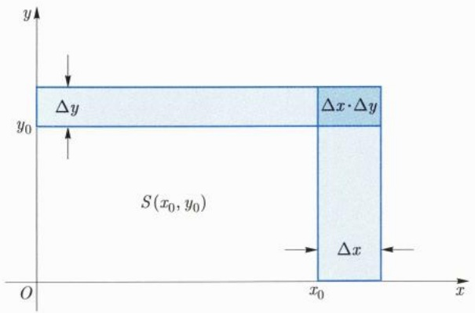
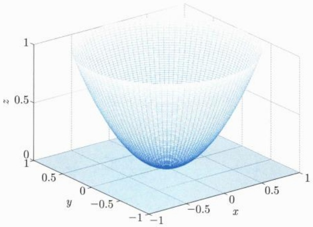
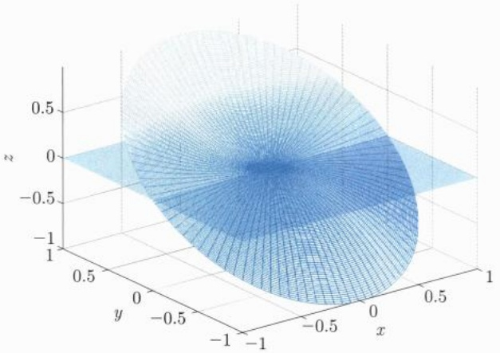
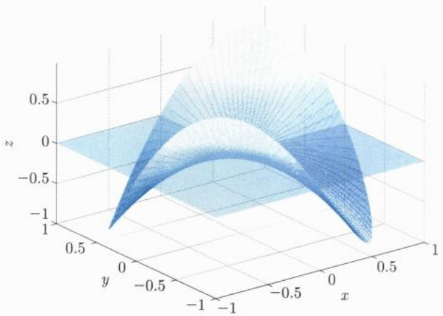
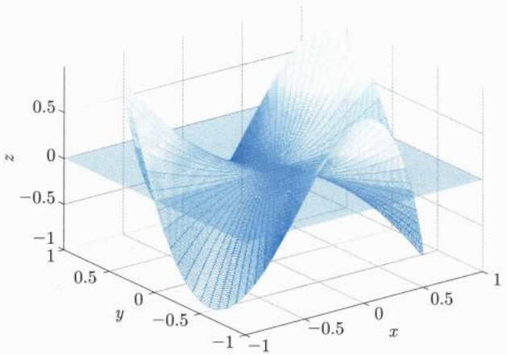
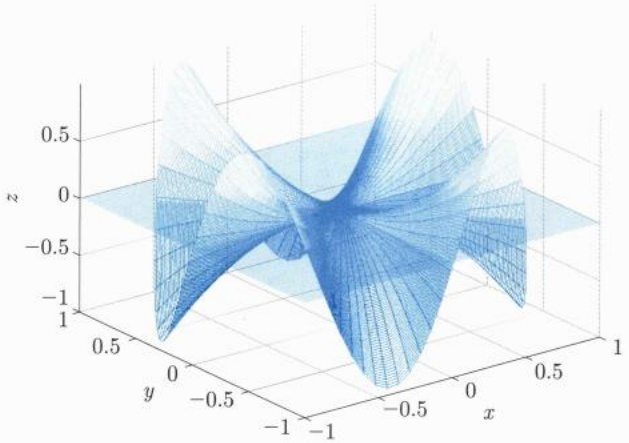
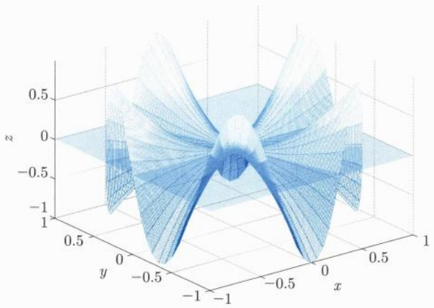

在上一章, 我们讨论了如何把一元函数的极限、连续等基本概念和内容推广到多元函数或映射. 从本章起, 我们将陆续把一元函数的微分和积分等概念以及相应的理论体系、思想方法、计算和应用也推广到多元函数或映射. 本章我们主要讨论微分学及其应用, 后面的章节再转向积分学.

本章大部分的内容和一元函数相应的内容平行，在结构上两者也有很多相似之处。比如，在本章我们也将讨论多元函数求导的四则运算法则、复合函数求导、高阶偏导数、链式法则、有限增量公式、一阶微分形式不变性、Taylor公式、微分的应用等；但同时我们也将特别指出一元与多元结论上本质的区别，比如多元函数关于连续与偏导数之间的逻辑关系，尤其多元函数中的隐函数存在定理、逆映射定理等几个重要的理论结果。这些结论对于深刻理解和揭示一元函数与多元函数在这些方面的差异是非常重要的，这也为后续课学习无穷元分析提供一些基本素材和案例。

## 15.1 偏导数与方向导数

我们回忆一下一元函数导数的定义: 若 $f$ 是一个一元函数, $x_0$ 是定义域中的内点, 则 $f$ 在 $x_0$ 处的导数定义为当极限 $\lim_{h\to 0}\frac{f(x_0 + h) - f(x_0)}{h}$ 存在有限时该极限的值.

对于多元函数的情形, 我们可以通过一元函数导数的定义来引入多元函数的偏导数.

定义 15.1.1 (偏导数) 设  $D \subseteq R^{n}$  是一开集,  $u = f(\boldsymbol{x}) = f(x_{1}, x_{2}, \cdots, x_{n})$  是在 D 上有定义的函数,  $\boldsymbol{x}_{0} = (x_{1}^{0}, x_{2}^{0}, \cdots, x_{n}^{0}) \in D$ . 对  $1 \leqslant i \leqslant n$ , 若一元函数

$$
\tilde {f} (x _ {i}) = f (x _ {1} ^ {0}, \dots , x _ {i - 1} ^ {0}, x _ {i}, x _ {i + 1} ^ {0}, \dots , x _ {n} ^ {0})
$$

在 $x_{i}^{0}$ 的导数 $\tilde{f}'(x_i^0)$ 存在, 则称 $f(x)$ 在 $x_0$ 处关于 $x_{i}$ 可偏导, 并称 $\tilde{f}'(x_i^0)$ 为 $f(x)$ 在 $x_0$ 关于 $x_{i}$ 的偏导数, 记为

$$
\frac {\partial f (\boldsymbol {x} _ {0})}{\partial x _ {i}}, \quad f _ {x _ {i}} (\boldsymbol {x} _ {0}), \quad \left. \frac {\partial u}{\partial x _ {i}} \right| _ {\boldsymbol {x} _ {0}}.
$$

若 $f(x)$ 在 $D$ 中的每一点关于 $x_{i}$ 都可偏导, 则将其偏导数记为

$$
\frac {\partial f (\boldsymbol {x})}{\partial x _ {i}}, \qquad f _ {x _ {i}} (\boldsymbol {x}), \qquad \frac {\partial u}{\partial x _ {i}}.
$$

可以看出, 若 $n$ 元函数 $f(\pmb{x})$ 关于每个分量都可偏导, 则 $f(\pmb{x})$ 具有 $n$ 个偏导数. 另一方面, 对每个固定的分量 $x_{i}, \frac{\partial f(\pmb{x})}{\partial x_{i}}$ 仍然是 $D$ 内的一个 $n$ 元函数. 进一步, 如果 $f_{x_i}(\pmb{x}) = \frac{\partial f(\pmb{x})}{\partial x_i}$ 关于 $x_{j}$ 仍然可偏导, 那么我们就把这样的偏导数 $\frac{\partial}{\partial x_j} \left( \frac{\partial f(\pmb{x})}{\partial x_i} \right)$ 称为函数 $f(\pmb{x})$ 的二阶偏导数, 记为 $f_{x_i x_j}$ 或 $\frac{\partial^2 f(\pmb{x})}{\partial x_j \partial x_i}$. 需要注意的是, $i \neq j$ 时, $f_{x_j x_i}$ 和 $f_{x_i x_j}$ 统称为混合偏导数, 但它们是两个不同的二阶偏导数, 至于它们的值是否相等, 则是多元函数微分学中的基本问题之一, 我们在后面再加以讨论.

这样, 一个 $n$ 元函数共有 $n$ 个偏导数、$n^2$ 个二阶偏导数:

$$
\left\{\frac {\partial^ {2} f (\boldsymbol {x})}{\partial x _ {j} \partial x _ {i}} \right\} _ {1 \leqslant i, j \leqslant n},
$$

其中当 $i = j$ 时, 我们将采用记号:

$$
\frac {\partial}{\partial x _ {i}} \Big (\frac {\partial f}{\partial x _ {i}} \Big) = \frac {\partial^ {2} f}{\partial x _ {i} ^ {2}}.
$$

类似地可以定义更高阶偏导数.

定义15.1.2 给定 $n$ 元函数 $f(\pmb{x})$ ，其 $k$ 阶偏导数为

$$
f _ {x _ {i _ {1}} x _ {i _ {2}} \dots x _ {i _ {k}}} = \frac {\partial^ {k} f}{\partial x _ {i _ {k}} \partial x _ {i _ {k - 1}} \cdots \partial x _ {i _ {1}}} = \frac {\partial}{\partial x _ {i _ {k}}} \left(\frac {\partial^ {k - 1} f}{\partial x _ {i _ {k - 1}} \cdots \partial x _ {i _ {1}}}\right)
$$

必须注意, 高阶偏导数的值不但依赖于对哪些自变量求偏导, 还依赖于求偏导的次序. 以二元函数 $z = f(x, y)$ 为例, 它关于 $x$ 和 $y$ 均求二次偏导的四阶偏导数中, 就存在如下可能:

$$
f _ {x x y y}, f _ {x y x y}, f _ {y x x y}, f _ {y x y x}, f _ {y y x x}.
$$

在没有额外条件假设下,一般来说,它们可能彼此不等.后面我们还会返回到这个话题.

在具体问题讨论中, 我们常见的是二元函数和三元函数. 在不失一般性的条件下, 为了叙述和表达的简洁性, 我们经常以二元函数为主. 对于 $n = 2$, 设 $z = f(x, y)$ 在 $(x_0, y_0)$ 的某个邻域内有定义, 当 $y = y_0$ 固定不变, 而 $x$ 在 $x_0$ 处有增量 $\Delta x$ 时, 相应的函数增量为 $f(x_0 + \Delta x, y_0) - f(x_0, y_0)$. 函数 $z = f(x, y)$ 在点 $(x_0, y_0)$ 处对 $x$ 可偏导则是指极限

$$
\lim _ {\Delta x \to 0} \frac {f (x _ {0} + \Delta x , y _ {0}) - f (x _ {0} , y _ {0})}{\Delta x}
$$

存在有限, 记作 $\left.\frac{\partial z}{\partial x}\right|_{(x_0,y_0)}$, $\left.\frac{\partial f}{\partial x}\right|_{(x_0,y_0)}$, $z_x|_{(x_0,y_0)}$ 或 $f_x(x_0,y_0)$. 即

$$
f _ {x} \left(x _ {0}, y _ {0}\right) = \lim _ {\Delta x \to 0} \frac {f \left(x _ {0} + \Delta x , y _ {0}\right) - f \left(x _ {0} , y _ {0}\right)}{\Delta x}.
$$

类似地, 函数 $z = f(x, y)$ 在点 $(x_0, y_0)$ 处对 $y$ 可偏导则是指极限

$$
f _ {y} \left(x _ {0}, y _ {0}\right) = \lim _ {\Delta y \to 0} \frac {f \left(x _ {0} , y _ {0} + \Delta y\right) - f \left(x _ {0} , y _ {0}\right)}{\Delta y}
$$

存在有限.

根据偏导数的定义, 在对某个变量求导时, 可暂时将其余变量视为常数. 因此, 偏导数的计算可以利用一元函数求导的所有法则和方法.

例 15.1.1 求  $f(x,y)=xy$  的一阶和二阶偏导数.

解 $f_{x} = y,$ $f_{y} = x,$ $f_{yx} = 1,$ $f_{xy} = 1,$ $f_{xx} = f_{yy} = 0.$

例 15.1.2 设  $abc \neq 0$ ,

$$
f (x, y) = \left\{ \begin{array}{l l} {a x + b y,} & {x = 0 \text {或} y = 0,} \\ {c,} & {\text {其他点}.} \end{array} \right.
$$

可以直接验证, 两个偏导数 $f_{x}(0,0)$ 和 $f_{y}(0,0)$ 都存在, 这是因为

$$
f _ {x} (0, 0) = \lim _ {x \to 0} \frac {f (x , 0) - f (0 , 0)}{x - 0} = \lim _ {x \to 0} \frac {a x}{x} = a.
$$

同理有 $f_{y}(0,0) = b.$

注意, 虽然函数的两个偏导数都存在, 但显然 $f(x,y)$ 在 $(0,0)$ 不连续.

例 15.1.3 设  $D(y)$  是关于 y 的 Dirichlet 函数, 求  $f(x,y)=x+D(y)$  在  $(x_{0},y_{0})=(0,0)$  处的偏导数  $\frac{\partial f}{\partial x}$  和  $\frac{\partial}{\partial y}\left(\frac{\partial f}{\partial x}\right)$ .

解 直接的计算表明

$$
\frac {\partial f}{\partial x} (0, 0) = 1, \quad \frac {\partial}{\partial y} \left(\frac {\partial f}{\partial x}\right) (0, 0) = 0.
$$

此例告诉我们, 虽然函数 $f(x, y)$ 关于 $y$ 处处不连续, 但二元函数仍然有可能关于另一个变量可偏导, 甚至有高阶偏导数, 这是多元函数与一元函数不同之处.

当然, 多元函数在某点连续一般来说逻辑上也得不到在该点可偏导的结论, 这只要把具有这种特点的一元函数看成多元函数即可. 比如 $\forall y_0, f(x,y) = g(x) = |x|$ 在 $(0,y_0)$ 关于 $x$ 就不可偏导.

我们知道, 导数是函数的变化率. 对于一元函数来说, 如果导数恒为零, 则该函数变化率为零, 即函数为常值函数. 对于多元函数来说, 我们有

命题15.1.1 设函数 $f: \mathbb{R}^n \to \mathbb{R}$ 的偏导数恒为零, 则 $f$ 为常值函数.

证明 以二元函数为例. 设 $\frac{\partial f}{\partial x} = \frac{\partial f}{\partial y} = 0$. 我们有

$$
f (x, y) - f (0, 0) = (f (x, y) - f (0, y)) + (f (0, y) - f (0, 0)).
$$

对上式右边括号中的项分别关于变量 $x$ 和 $y$ 应用一元函数的微分中值定理, 可得

$$
f (x, y) - f (0, 0) = \frac {\partial f}{\partial x} (\xi , y) (x - 0) + \frac {\partial f}{\partial y} (0, \zeta) (y - 0) = 0,
$$

即 $f(x,y)\equiv f(0,0)$

□

事实上, 无论从证明过程中还是从一元函数的结论中, 我们看到了更一般的结论: 如果定义在凸域上的 $n$ 元函数 $f$ 关于某一个变量的偏导数恒为零, 那么 $f$ 本质上是一个 $n - 1$ 元函数.

由一元函数导数的几何意义, 可得多元函数偏导数的几何意义. 例如二元函数 $z = f(x,y), (x,y) \in D$, 给出了 $\mathbb{R}^3$ 中的一个曲面 $S$. 设 $z_0 = f(x_0,y_0)$, 点 $P_0(x_0,y_0,z_0)$ 为曲面 $S$ 上一点. 考察曲面 $S$ 与平面 $y = y_0$ 的交线 $\Gamma$. 偏导数 $f_x(x_0,y_0)$ 即表示交线 $\Gamma$ 在 $P_0$ 点的切线斜率, 交线在 $P_0$ 点的切向量为 $(1,0,f_x(x_0,y_0))$.

同理， $f_{y}(x_0,y_0)$ 表示曲面 $S$ 与平面 $x = x_0$ 的交线 $\Sigma$ 在 $P_0$ 点的切线斜率，交线 $\Sigma$ 在 $P_0$ 点的切向量为 $(0,1,f_y(x_0,y_0))$

我们看到, 偏导数 $f_{x_i}$ 描述的是函数 $f$ 沿着 $x_i$ 轴方向的变化率. 完全类似, 我们可以考虑函数沿着任一给定方向 $\pmb{u}$ 的变化率. 具体来说, 考虑定义在开集 $D \subseteq \mathbb{R}^n$ 上的 $n$ 元函数 $z = f(\pmb{x}), \pmb{x}_0 \in D$. 在以 $\pmb{x}_0$ 为始点, 以 $\pmb{u}$ 的正向为方向向量的射线 $\ell$ 上任取一点 $\pmb{x} \in D \cap \ell$, 则有 $\pmb{x} = \pmb{x}_0 + \pmb{x} - \pmb{x}_0 = \pmb{x}_0 + h\pmb{u}, h > 0$.

定义 15.1.3 设  $z = f(x)$  是定义在开集  $D \subseteq R^{n}$  上的 n 元函数.  $x_{0} \in D$ ,  $\boldsymbol{u} = (u_{1}, u_{2}, \cdots, u_{n})$  是一个 n 维单位向量, 即  $\|u\| = 1$ . 如果极限

$$
\frac {\partial f}{\partial \boldsymbol {u}} (\boldsymbol {x} _ {0}) := \lim _ {h \to 0 ^ {+}} \frac {f (\boldsymbol {x} _ {0} + h \boldsymbol {u}) - f (\boldsymbol {x} _ {0})}{h} \tag {15.1.1}
$$

存在有限, 则称函数 $f$ 在 $\pmb{x}_0$ 处沿着方向 $\pmb{u}$ 是方向可导的, 并称该极限为函数 $f$ 在 $\pmb{x}_0$ 处沿着方向 $\pmb{u}$ 的方向导数.

我们来解释一下上述定义中, 为何要取 $\pmb{u} = (u_{1}, u_{2}, \dots, u_{n})$ 为单位向量. 事实上, 我们知道, 当初引入方向导数的目的就是考察函数沿着一个给定方向 $\pmb{u}$ 的变化情况. 但众所周知, 对于一个给定方向 $\pmb{u}$ 和任意实数 $\lambda > 0$, 向量 $\pmb{v} := \lambda \pmb{u}$ 是一个与 $\pmb{u}$ 同向的向量, 因此我们一方面有理由根据定义 (15.1.1) 计算相应的极限 $\frac{\partial f}{\partial \pmb{v}} (\pmb{x}_{0})$, 另一方面, 还希望这两个极限值 $\frac{\partial f(\pmb{x}_{0})}{\partial \pmb{u}}$ 和 $\frac{\partial f(\pmb{x}_{0})}{\partial \pmb{v}}$ 相等, 因为这样更吻合方向导数中“方向”的直觉.

我们设想一下, 假如情况并非如此, 即在极限 (15.1.1) 中不要求 $\pmb{u}$ 为单位向量, 我们分别来计算一下函数 $f$ 沿方向 $\pmb{u}$ 与沿方向 $\pmb{v}$ 给出的极限 (15.1.1). 为此, 我们计算 $f$ 沿 $\pmb{v} = \lambda \pmb{u}$ 的变化率:

$$
\begin{array}{l} \frac {\partial f (\boldsymbol {x} _ {0})}{\partial \boldsymbol {v}} = \lim _ {h \to 0 ^ {+}} \frac {f (\boldsymbol {x} _ {0} + h \boldsymbol {v}) - f (\boldsymbol {x} _ {0})}{h} \\ = \lambda \cdot \lim _ {h \rightarrow 0 ^ {+}} \frac {f \left(\boldsymbol {x} _ {0} + h \lambda \boldsymbol {u}\right) - f \left(\boldsymbol {x} _ {0}\right)}{h \lambda} \tag {15.1.2} \\ = \lambda \frac {\partial f (\boldsymbol {x} _ {0})}{\partial \boldsymbol {u}}. \\ \end{array}
$$

这样一来, 我们看出在定义式 (15.1.1) 中如果没有单位向量的假设, 那么即使沿着同一方向的方向导数, 其结果也将因 $\lambda$ 的不同而导致计算结果的千差万别, 这在实际应用中会带来诸多不便. 这一场景犹如在考察一个二维山坡在某点处沿东北方向变化快慢时,不应该依赖于指向东北方向的手臂长短不同而不同.

还有一点值得注意, 如果 $\lambda < 0$, 比如 $\lambda = -1$, 在定义 15.1.3 中, 一般来说, $f$ 沿 $u$ 的方向导数并不等同于沿 $-u$ 的方向导数. 即, 如果令 $v = -u$, 则有

$$
\begin{array}{l} \frac {\partial f (\boldsymbol {x} _ {0})}{\partial \boldsymbol {v}} = \lim _ {h \to 0 ^ {+}} \frac {f (\boldsymbol {x} _ {0} + h \boldsymbol {v}) - f (\boldsymbol {x} _ {0})}{h} \\ = \lim _ {h \to 0 ^ {+}} \frac {f (\boldsymbol {x} _ {0} - h \boldsymbol {u}) - f (\boldsymbol {x} _ {0})}{h} \\ = - \lim _ {t \to 0 ^ {-}} \frac {f (\boldsymbol {x} _ {0} + t \boldsymbol {u}) - f (\boldsymbol {x} _ {0})}{t} \\ \neq - \frac {\partial f (\boldsymbol {x} _ {0})}{\partial \boldsymbol {u}}. \\ \end{array}
$$

所以, 沿 $\pmb{u}$ 的负方向 $-\pmb{u}$ 的方向导数 $\frac{\partial f(\pmb{x}_0)}{\partial(-\pmb{u})}$ 和沿 $\pmb{u}$ 的方向导数的负值 $-\frac{\partial f(\pmb{x}_0)}{\partial\pmb{u}}$, 一般来说, 是不相等的.

注 15.1.1 不同的教材或参考书中, 方向导数的定义可能有所不同. 两种常见的方式为: 在 (15.1.1) 式中, 一种是  $h \rightarrow 0^{+}$  的极限, 另一种是  $h \rightarrow 0$  的极限. 本书采用的是第一种形式下的定义.

在我们采用的定义下, 方向导数与偏导数之间有如下关系, 读者可自行验证.

命题 15.1.2 设 $z = f\left( x\right)$ 是定义在开集 $D \subseteq  {\mathbb{R}}^{n}$ 上的 $n$ 元函数. ${x}_{0} \in  D$ .

$$
\boldsymbol {u} = \boldsymbol {e} _ {i} = (0, \dots , 0, 1, 0, \dots , 0), \quad \boldsymbol {v} = - \boldsymbol {e} _ {i} = (0, \dots , 0, - 1, 0, \dots , 0),
$$

其中向量中为 $\pm 1$ 的分量位于第 $i$ 个位置. 则偏导数 $\frac{\partial f(x_0)}{\partial x_i}$ 存在的充要条件是 $\frac{\partial f(x_0)}{\partial u}$ 和 $\frac{\partial f(x_0)}{\partial v}$ 都存在有限, 且

$$
\frac {\partial f (\boldsymbol {x} _ {0})}{\partial x _ {i}} = \frac {\partial f (\boldsymbol {x} _ {0})}{\partial \boldsymbol {u}} = - \frac {\partial f (\boldsymbol {x} _ {0})}{\partial \boldsymbol {v}}.
$$

我们给出几个关于偏导数、方向导数以及它们之间关系的例子. 首先, 下面的例子说明, 即使函数在某点处所有方向的方向导数都存在, 也不一定可偏导.

例 15.1.4 证明: 二元函数  $z = f(x, y) = \sqrt{x^{2} + y^{2}}$  在  $(0, 0)$  点沿任意方向的方向导数都存在, 但偏导数不存在.

证明 任取单位向量 $\pmb{u} = (u_{1}, u_{2})$，可得

$$
\frac {\partial f}{\partial \boldsymbol {u}} (0, 0) = \lim _ {h \to 0 ^ {+}} \frac {f (h \boldsymbol {u})}{h} = \frac {f (h u _ {1} , h u _ {2})}{h} = \lim _ {h \to 0 ^ {+}} \frac {h}{h} = 1.
$$

所以函数沿任一方向的方向导数都存在且相等.

另一方面, 根据定义, 有

$$
\frac {\partial f}{\partial x} (0, 0) = \lim _ {x \to 0} \frac {f (x , 0) - f (0 , 0)}{x - 0} = \lim _ {x \to 0} \frac {| x |}{x},
$$

所以 $f_{x}(0,0)$ 不存在. 同理, $f_{y}(0,0)$ 也不存在.

如果应用命题 15.1.2, 也可以得到 f 的偏导数不存在.

当然, 反过来, 如果函数 $f$ 在 $\pmb{x}_0$ 处的偏导数存在, 除了能保证沿着平行于坐标轴方向的方向导数存在外, 并不能保证其他方向的方向导数存在. 为此, 读者可以自行验证下面的例子:

例15.1.5 证明:二元函数

$$
f (x, y) = \left\{ \begin{array}{l l} \frac {x y}{x ^ {2} + y ^ {2}}, & (x, y) \neq (0, 0), \\ 0, & (x, y) = (0, 0), \end{array} \right.
$$

在 $(0,0)$ 点偏导数存在,但沿任意非坐标轴方向的方向导数都不存在.

读者还可验证下面的结论:

例 15.1.6 一个在  $(0,0)$  点连续，但在该点沿任何方向的方向导数都不存在的例子:

$$
f (x, y) = x ^ {2 / 3} + y ^ {2 / 3}.
$$

例15.1.7 证明:二元函数

$$
f (x, y) = \left\{ \begin{array}{l l} {1,} & {y = x ^ {2}, x \neq 0,} \\ {0,} & {\text {其他点}} \end{array} \right.
$$

在 $(0,0)$ 处沿任意方向的方向导数都为0，但函数并非常值函数，事实上，该函数在原点并不连续.

和一元函数不同, 对于一个多元函数, 它在某点处的偏导数或方向导数存在, 只是反映了函数沿特定方向的变化性质, 所以偏导数和方向导数的存在都不能保证多元函数的连续性.

为了更好地研究多元函数的性质, 更系统地对比偏导、方向导数、连续、可微之间的关系, 我们引入下面的一个重要的基本概念: 微分.

定义 15.1.4(微分、导数) 设  $D \subseteq R^{n}$  为一开集,  $f: D \to R$  为多元函数,  $x_{0} \in D$ . 如果存在 n 维向量  $L_{x_{0}} = (A_{1}, A_{2}, \cdots, A_{n})$ , 使得在  $x_{0}$  附近成立

$$
f (\boldsymbol {x}) - f (\boldsymbol {x} _ {0}) = \langle \boldsymbol {L} _ {\boldsymbol {x} _ {0}}, \Delta \boldsymbol {x} \rangle + o (\| \Delta \boldsymbol {x} \|) \quad (\boldsymbol {x} \rightarrow \boldsymbol {x} _ {0}),
$$

则称 $f$ 在 $\pmb{x}_0$ 处可微, $\Delta \pmb{x} = \pmb{x} - \pmb{x}_0$ 称为自变量 $\pmb{x}$ 的全增量, 向量 $L_{\pmb{x}_0}$ 称为函数 $f$ 在 $\pmb{x}_0$ 处的导数, 也记为

$$
L _ {\boldsymbol {x} _ {0}} = f ^ {\prime} (\boldsymbol {x} _ {0}).
$$

向量 $L_{\pmb{x_0}}$ 与 $\Delta \pmb{x}$ 的内积 $\langle L_{\pmb{x_0}},\Delta \pmb{x}\rangle = \sum_{i = 1}^{n}A_i\Delta x_i$ 称为 $f$ 在 $\pmb{x}_0$ 处的全微分，或简称微分，并记作 $\mathrm{df}(\pmb{x}_0)$，即

$$
\mathrm{d} f (\boldsymbol {x} _ {0}) = \langle \boldsymbol {L} _ {\boldsymbol {x} _ {0}}, \Delta \boldsymbol {x} \rangle = \sum_ {i = 1} ^ {n} A _ {i} \Delta x _ {i}.
$$

如果 $\forall x\in D$ ， $f$ 在 $\pmb{x}$ 处都可微，则称 $f$ 在 $D$ 上可微.

由于当 $1 \leqslant i \leqslant n, x_{i}$ 是自变量时，可定义 $\mathrm{dx}_i = \Delta x_i$ ，因此 $f(\pmb{x})$ 在 $\pmb{x_0}$ 处的微分又更自然地记为

$$
\mathrm{d} f (\pmb {x} _ {0}) = \langle \pmb {L} _ {\pmb {x} _ {0}}, \mathrm{d} \pmb {x} \rangle = \sum_ {i = 1} ^ {n} A _ {i} \mathrm{d} x _ {i}.
$$

函数 $f$ 的全微分有明确的几何意义. 图15.1给出了长和宽分别为 $x$ 和 $y$ 的矩形面积 $S(x,y) = xy$ 的全微分的几何意义 (可对比一元函数微分章节中的图6.6). 考虑函数 $S$ 在 $(x_0,y_0)$ 处的增量 $\Delta S$

$$
\Delta S = y _ {0} \Delta x + x _ {0} \Delta y + \Delta x \cdot \Delta y = (y _ {0}, x _ {0}) \cdot (\Delta x, \Delta y) + \Delta x \cdot \Delta y,
$$

即  $\Delta S$  由三部分组成: 两个浅色矩形的面积  $x_{0}\Delta y$  和  $y_{0}\Delta x$ , 以及一个边长为  $\Delta x$  和  $\Delta y$  的深色矩形的面积  $\Delta x \cdot \Delta y$ , 后者是自变量增量  $(\Delta x, \Delta y)$  的高阶无穷小量.

text_image

y
Δy
Δx·Δy
y₀
S(x₀, y₀)
O
x₀
x

图15.1 微分的几何意义

微分也称为函数 $f$ 的线性化. 微分学的基本思想就是对各种研究对象做线性化 (以直代曲). 显然, 当 $f$ 在 $\pmb{x}_0$ 处可微时, $f$ 也在 $\pmb{x}_0$ 处连续, 具体来说, 我们有

命题 15.1.3 (可微必可导) 设 f 在  $x_{0}$  处可微, 其微分为  $\mathrm{d}f(x_{0})=\sum_{i=1}^{n}A_{i}\mathrm{d}x_{i}$ ,
则

(1) f 在  $x_{0}$  处连续.
(2) 对 $1 \leqslant i \leqslant n$, 有 $\frac{\partial f}{\partial x_i} (\pmb{x}_0) = A_i$.

证明 可以由偏导和可微的定义直接得到, 证明从略.

值得注意的是, 命题反方向的结论不成立. 即函数可偏导、可导都不能得出可微.

根据命题 15.1.3 可知, 当 f 在  $x_{0}$  处可微时, 导数  $f^{\prime}(x_{0})$ , 偏导数  $f_{x_{i}}(x_{0})$  都存在, 称向量  $(f_{x_{1}}(x_{0}),\cdots,f_{x_{n}}(x_{0}))$  为  $f(x)$  在  $x_{0}$  处的梯度, 记为  $\operatorname{grad} f(x_{0})$ , 也记为

$$
\nabla f \left(\boldsymbol {x} _ {0}\right) = \operatorname{grad} f \left(\boldsymbol {x} _ {0}\right) = f ^ {\prime} \left(\boldsymbol {x} _ {0}\right) = \left(f _ {x _ {1}} \left(\boldsymbol {x} _ {0}\right), \dots , f _ {x _ {n}} \left(\boldsymbol {x} _ {0}\right)\right). \tag {15.1.3}
$$

注意对多元函数而言, 大家最常见到的是偏导数这个概念, 而在定义 15.1.4 中我们采用了 “导数” 这个字眼, 很大程度上是借用一元函数 “导数” 的语境, 只需注意这是一个说法而已: 对于多元函数, “导数” 给出的是一个向量. 另外, 我们已经赋予 “导数” 多种称呼和记号: 比如线性映射、微分算子, 以及在场论中常见到的梯度, 等等.

在函数可微的条件下, 下面几种表示都是在说多元函数  $f(x)$  的同一件事:

$$
f ^ {\prime} (\boldsymbol {x}), \qquad \nabla f (\boldsymbol {x}), \qquad \operatorname{grad} f (\boldsymbol {x}), \qquad \boldsymbol {L} _ {\boldsymbol {x}} = \left(f _ {x _ {1}} (\boldsymbol {x}), \dots , f _ {x _ {n}} (\boldsymbol {x})\right),
$$

在后面的章节中, 我们经常在这些不同的表示中自由切换.

关于多元函数可微与方向导数之间的关系, 有下面的结论:

命题 15.1.4 (可微必方向可导) 设 f 在  $x_{0}$  处可微,  $u = \sum_{i=1}^{n} u_{i} e_{i}$  为任一 n 维单位向量, 则 f 在  $x_{0}$  处沿 u 的方向导数都存在, 并且有

$$
\frac {\partial f}{\partial \boldsymbol {u}} (\boldsymbol {x} _ {0}) = \mathrm{d} f (\boldsymbol {x} _ {0}) (\boldsymbol {u}) = \nabla f (\boldsymbol {x} _ {0}) \cdot \boldsymbol {u}. \tag {15.1.4}
$$

证明 设 u 为单位向量. 根据假设, 有

$$
f (\boldsymbol {x} _ {0} + t \boldsymbol {u}) - f (\boldsymbol {x} _ {0}) = L (t \boldsymbol {u}) + o (\| t \boldsymbol {u} \|) = t L (\boldsymbol {u}) + o (| t |) \quad (t \rightarrow 0).
$$

故

$$
\frac {\partial f}{\partial \boldsymbol {u}} (\boldsymbol {x} _ {0}) = \lim _ {t \to 0} \frac {f (\boldsymbol {x} _ {0} + t \boldsymbol {u}) - f (\boldsymbol {x} _ {0})}{t} = L (\boldsymbol {u}) = L \left(\sum_ {i = 1} ^ {n} u _ {i} \boldsymbol {e} _ {i}\right) = \nabla f (\boldsymbol {x} _ {0}) \cdot \boldsymbol {u}.
$$

即 (15.1.4) 式成立.

注 15.1.2 人们习惯于把方向导数中的单位向量 u 用方向余弦表示, 即

$$
\boldsymbol {u} = (\cos \alpha_ {1}, \cos \alpha_ {2}, \dots , \cos \alpha_ {n}), \quad \sum_ {i = 1} ^ {n} \cos^ {2} \alpha_ {i} = 1,
$$

其中  $\alpha_{i}(i=1,2,\cdots,n)$  表示向量 u 与坐标轴  $x_{i}$  正向的夹角，那么当 f 在  $x_{0}$  处可微时，f 的导数和沿方向 u 的方向导数之间有如下的关系:

$$
\frac {\partial f}{\partial \boldsymbol {u}} (\boldsymbol {x} _ {0}) = f ^ {\prime} (\boldsymbol {x} _ {0}) \cdot \boldsymbol {u} = \nabla f (\boldsymbol {x} _ {0}) \cdot \boldsymbol {u} = f _ {x _ {1}} \cos \alpha_ {1} + f _ {x _ {2}} \cos \alpha_ {2} + \dots + f _ {x _ {n}} \cos \alpha_ {n}.
$$

显然, 这一方向导数只有在向量 u 与梯度向量  $\nabla f(x_{0})$  同向时达到最大

值, 即, 当  $\nabla f(\boldsymbol{x}_{0}) = \lambda \boldsymbol{u} (\lambda > 0)$  时,

$$
\| \nabla f \| = \sqrt {f _ {x _ {1}} ^ {2} + f _ {x _ {2}} ^ {2} + \cdots + f _ {x _ {n}} ^ {2}}.
$$

因此, 梯度方向是与具体的坐标系选取无关的: 一个纯量函数 $f$ 的梯度 $\nabla f$ 是一个向量, 其大小和方向是 $f$ 等高线变化最快的方向.

定义 15.1.5 设 $D \subseteq \mathbb{R}^n$ 为一开集, 如果 $\forall x \in D$, 定义在 $D$ 上的 $n$ 元函数 $f$ 在 $x$ 附近偏导数都存在, 且偏导数在点 $x$ 处连续, 则称 $f$ 在 $D$ 上是 $C^1$ 的, 记为 $f \in C^1(D)$. 即, $C^1(D)$ 是指 $D$ 上所有偏导数都存在且连续的函数的全体.

下面的结果给出了多元函数可微的充分条件.

命题 15.1.5 若  $f \in C^{1}(D)$ ，则 f 在 D 上必可微.

证明 以二元函数为例, 记 $\pmb{x} = (x, y)$, $\pmb{x}_0 = (x_0, y_0)$. 当 $\pmb{x} \to \pmb{x}_0$ 时, 有

$$
\begin{array}{l} f (\boldsymbol {x}) - f (\boldsymbol {x} _ {0}) = (f (x, y) - f (x _ {0}, y)) + (f (x _ {0}, y) - f (x _ {0}, y _ {0})) \\ = \frac {\partial f}{\partial x} (\xi , y) \Delta x + \frac {\partial f}{\partial y} (x _ {0}, \zeta) \Delta y \\ = \left(\frac {\partial f}{\partial x} (\boldsymbol {x} _ {0}) + o (1)\right) \Delta x + \left(\frac {\partial f}{\partial y} (\boldsymbol {x} _ {0}) + o (1)\right) \Delta y \\ = \frac {\partial f}{\partial x} (\boldsymbol {x} _ {0}) \Delta x + \frac {\partial f}{\partial y} (\boldsymbol {x} _ {0}) \Delta y + o \big (\| \boldsymbol {x} - \boldsymbol {x} _ {0} \| \big), \\ \end{array}
$$

故 $f$ 在 $\pmb{x}_0 = (x_0, y_0)$ 处可微.

综合命题 15.1.3 与命题 15.1.5 以及前面的讨论, 我们得到下面的逻辑关系:

$f$ 在 $D$ 上方向导数存在

$$
f \in C ^ {1} (D) \Rightarrow \quad \begin{array}{c} \uparrow \\ f \text {在} D \text {上可微} \\ \Downarrow \end{array} \quad \Rightarrow f \text {在} D \text {上连续}.
$$

$f$ 在 $D$ 上偏导数存在

例15.1.8 例15.1.5中的函数

$$
f (x, y) = \left\{ \begin{array}{l l} \frac {x y}{x ^ {2} + y ^ {2}}, & (x, y) \neq (0, 0), \\ 0, & (x, y) = (0, 0) \end{array} \right.
$$

在 $(0,0)$ 点偏导数存在,但在 $(0,0)$ 点不连续(在该点非坐标轴方向上的方向导数也不存在),故在该点不可微.

例15.1.9 证明:函数

$$
f (x, y) = \left\{ \begin{array}{l l} \left(x ^ {2} + y ^ {2}\right) \sin \frac {1}{\sqrt {x ^ {2} + y ^ {2}}}, & (x, y) \neq (0, 0), \\ 0, & (x, y) = (0, 0) \end{array} \right.
$$

在 $(0,0)$ 处可微,但偏导数不连续.

证明 $f$ 的可微性易证, 下面我们只考虑 $f$ 偏导数的不连续性. 由于

$$
f _ {x} (x, y) = \left\{ \begin{array}{l l} 2 x \sin \frac {1}{\sqrt {x ^ {2} + y ^ {2}}} - \frac {x}{\sqrt {x ^ {2} + y ^ {2}}} \cos \frac {1}{\sqrt {x ^ {2} + y ^ {2}}}, & (x, y) \neq (0, 0), \\ 0, & (x, y) = (0, 0), \end{array} \right.
$$

令 $x_{k} = y_{k} = \frac{\sqrt{2}}{4k\pi}$ ，则有

$$
\lim _ {k \to + \infty} f _ {x} (x _ {k}, y _ {k}) = - \frac {\sqrt {2}}{2}.
$$

另一方面，由定义直接计算可得 $f_{x}(0,0) = 0$ ，故 $f_{x}$ 在 $(0,0)$ 点不连续.同理可证 $f_{y}$ 在 $(0,0)$ 点也不连续. □

## $C^{k}$  函数类, 混合偏导数的次序

上面我们看到一阶偏导数的连续性是一个较强的条件, 也就是说, 如果 $f$ 是 $C^1$ 的, 那么它将蕴涵着可微性、偏导数和方向导数的存在性等结论. 对于高阶偏导数, 也有类似的结论. 为此, 我们先把前面介绍过的 $C^1$ 概念一般化:

定义 15.1.6 $\left( {{C}^{k}\text{函数类}}\right)$ 设 $f : D \rightarrow  \mathbb{R}$ 为多元函数. 如果 $f$ 连续,且直到 $k$ 阶的各种偏导数都存在且连续,则称 $f$ 为 ${C}^{k}$ 函数,记为 $f \in  {C}^{k}\left( D\right)$ . 如果对任意 $k \geq  0,f$ 均为 ${C}^{k}$ 函数,则称 $f$ 为无限次可导函数或光滑函数,记为 $f \in  {C}^{\infty }\left( D\right)$ .

值得注意的是, 一元函数 $C^k$ 的定义 (见定义6.5.2) 只要求 $k$ 阶导数连续即可, 无须要求更低阶的导数存在且连续, 这是因为对于一元函数而言, 高阶可导必然有低阶可导成立. 这一断言对于多元函数来说, 应该明确如下: 如果定义域 $D$ 不是区域, 那么上述偏导和高阶偏导的定义有些复杂和麻烦, 高阶可偏导通常也不自动蕴涵低阶可偏导, 比如下面的例子. 因此为了避免这种极其复杂的定义域带来的技术上的繁文缛节, 我们的讨论限于 $D$ 是 $\mathbb{R}^n$ 中的区域, 在这种基本假设下, 多元函数的 $C^k(D)$ 类可以定义为区域 $D$ 上的所有 $k$ 阶偏导数均连续的函数的全体.

例15.1.10 函数

$$
f (x, y) = \left\{ \begin{array}{l l} \mathrm{e} ^ {- x ^ {2} / y ^ {2} - y ^ {2} / x ^ {2}}, & x y \neq 0, \\ 0, & x y = 0 \end{array} \right.
$$

在 $(0,0)$ 点不连续,但其各阶偏导数处处存在. $^{①}$

下面的定理表明, 对于  $C^{2}$  函数, 虽然它的任意两个混合偏导数  $f_{x_{i}x_{j}}$  和  $f_{x_{j}x_{i}}$  都是以二元函数陈述的, 但显然结论对于 n 元函数均成立.

定理 15.1.6（求导次序的可交换性） 设  $f: D \rightarrow R$  为二元函数,  $(x_{0}, y_{0}) \in D$ . 如果  $f \in C^{2}(D)$ ，则  $f_{yx}(x_{0}, y_{0}) = f_{xy}(x_{0}, y_{0})$ .

证明 对于充分小的 $k \neq 0, h \neq 0$, 考虑函数

$$
\varphi (y) = f (x _ {0} + h, y) - f (x _ {0}, y), \quad \psi (x) = f (x, y _ {0} + k) - f (x, y _ {0}).
$$

由微分中值定理, 存在  $\theta_{1}, \theta_{2} \in (0,1)$ , 使得

$$
\begin{array}{l} \varphi (y _ {0} + k) - \varphi (y _ {0}) = \varphi_ {y} (y _ {0} + \theta_ {1} k) k \\ = \left(f _ {y} (x _ {0} + h, y _ {0} + \theta_ {1} k) - f _ {y} (x _ {0}, y _ {0} + \theta_ {1} k)\right) k \\ = f _ {y x} (x _ {0} + \theta_ {2} h, y _ {0} + \theta_ {1} k) k h. \\ \end{array}
$$

同理, 存在  $\theta_{3}, \theta_{4} \in (0,1)$ , 使得

$$
\psi (x _ {0} + h) - \psi (x _ {0}) = f _ {x y} (x _ {0} + \theta_ {3} h, y _ {0} + \theta_ {4} k) h k.
$$

易见 $\varphi (y_0 + k) - \varphi (y_0) = \psi (x_0 + h) - \psi (x_0)$，这说明

$$
f _ {y x} (x _ {0} + \theta_ {2} h, y _ {0} + \theta_ {1} k) = f _ {x y} (x _ {0} + \theta_ {3} h, y _ {0} + \theta_ {4} k).
$$

令  $k, h \rightarrow 0$ ，由  $f_{yx}, f_{xy}$  在  $(x_{0}, y_{0})$  处连续即得欲证等式.

上述结果对于更一般的情况也成立, 读者可以自行证明: 对于多元函数 $f$, 如果 $f \in C^{k}(D)$, $k \geqslant 2$, 那么它的任意 $k$ 阶偏导数 $f_{x_{i_1}x_{i_2}\cdots x_{i_k}}$ 与求偏导次序无关.

下面的例子告诉我们, 如果函数不是  $C^{2}$  的, 那么二阶混合偏导数的值可能与求导次序有关.

例15.1.11 考虑函数

$$
f (x, y) = \left\{ \begin{array}{l l} x y \frac {x ^ {2} - y ^ {2}}{x ^ {2} + y ^ {2}}, & (x, y) \neq (0, 0), \\ 0, & (x, y) = (0, 0). \end{array} \right.
$$

试求函数在 $(0,0)$ 处的两个二阶混合偏导数 $f_{xy}(0,0)$ 和 $f_{yx}(0,0)$.

解 直接计算可得如下表示:

$$
f _ {x} (x, y) = \left\{ \begin{array}{l l} \frac {x ^ {4} y + 4 x ^ {2} y ^ {3} - y ^ {5}}{(x ^ {2} + y ^ {2}) ^ {2}}, & (x, y) \neq (0, 0), \\ 0, & (x, y) = (0, 0) \end{array} \right.
$$

<small>① N. Kimura, J. Burr. Discontinuous function with partial derivatives everywhere. Amer. Math. Monthly, 1960(8): 813-814.</small>

和

$$
f _ {y} (x, y) = \left\{ \begin{array}{l l} \frac {x ^ {5} - 4 x ^ {3} y ^ {2} - x y ^ {4}}{(x ^ {2} + y ^ {2}) ^ {2}}, & (x, y) \neq (0, 0), \\ 0, & (x, y) = (0, 0), \end{array} \right.
$$

从而可得

$$
f _ {x y} (0, 0) = 1, \quad f _ {y x} (0, 0) = - 1.
$$

作为不能随意交换求偏导次序的反例, 上面例中的函数构思巧妙, 为绝大多数教材或参考书所采用, 甚至都鲜见其他反例. 下面我们对这个函数的构造做一些进一步的讨论.

为了看清楚这个例子的来龙去脉以及它的几何意义, 我们将函数用极坐标表示, 代之以 $f(x, y)$, 我们考虑 $4f(x, y)$ 并且还把它记为 $f(x, y)$, 显然这丝毫不影响结论. 令

$$
x = r \cos \theta , \quad y = r \sin \theta , \quad r > 0, \quad \theta \in [ 0, 2 \pi).
$$

则有

$$
f (x, y) = r ^ {2} \sin 4 \theta .
$$

该函数图像见本节后面图15.6.

利用这个有趣的观察, 读者就不难发现下面诸多二阶混合偏导数各具特色的例子. 我们把这些结论的验证留给读者, 有兴趣的读者可以从这些素材中提炼出一般性结论.

例 15.1.12 下列结论成立:

(1) 函数 $f(x, y) = x^2 + y^2$ 是 $C^\infty(\mathbb{R}^2)$ 的, 特别地, 两个混合偏导数 $f_{xy}(0, 0)$ 和 $f_{yx}(0, 0)$ 存在且相等.
(2) 函数 $f(x, y) = 2xy$ 是 $C^\infty(\mathbb{R}^2)$ 的，特别地，两个混合偏导数 $f_{xy}(0, 0)$ 和 $f_{yx}(0, 0)$ 存在且相等.
(3) 重述例 15.1.11 中的函数

$$
f (x, y) = \left\{ \begin{array}{l l} 4 x y \frac {x ^ {2} - y ^ {2}}{x ^ {2} + y ^ {2}}, & (x, y) \neq (0, 0), \\ 0, & (x, y) = (0, 0). \end{array} \right.
$$

它在 $(0,0)$ 处的两个二阶混合偏导数 $f_{xy}(0,0)$ 和 $f_{yx}(0,0)$ 存在但不相等.

(4) 函数

$$
f (x, y) = \left\{ \begin{array}{l l} 2 x y \frac {(3 x ^ {2} - y ^ {2}) (x ^ {2} - 3 y ^ {2})}{(x ^ {2} + y ^ {2}) ^ {2}}, & (x, y) \neq (0, 0), \\ 0, & (x, y) = (0, 0) \end{array} \right.
$$

在 $(0,0)$ 处的两个二阶混合偏导数 $f_{xy}(0,0)$ 和 $f_{yx}(0,0)$ 存在且相等，均为0.

(5) 函数

$$
f (x, y) = y \sqrt {x ^ {2} + y ^ {2}} \tag {15.1.5}
$$

的两个混合偏导数  $f_{xy}(0,0)$  和  $f_{yx}(0,0)$ ，一个存在，一个不存在.

(6) 函数

$$
f (x, y) = \left\{ \begin{array}{l l} y \frac {3 x ^ {2} - y ^ {2}}{\sqrt {x ^ {2} + y ^ {2}}}, & (x, y) \neq (0, 0), \\ 0, & (x, y) = (0, 0) \end{array} \right.
$$

的两个混合偏导数  $f_{xy}(0,0)$  和  $f_{yx}(0,0)$ ，一个存在，一个不存在.

(7) 函数

$$
f (x, y) = \left\{ \begin{array}{l l} \frac {5 x ^ {4} y - 1 0 x ^ {2} y ^ {3} + y ^ {5}}{(\sqrt {x ^ {2} + y ^ {2}}) ^ {3}}, & (x, y) \neq (0, 0), \\ 0, & (x, y) = (0, 0) \end{array} \right.
$$

的两个混合偏导数 $f_{xy}(0,0)$ 和 $f_{yx}(0,0)$, 一个存在, 一个不存在.

初看起来, 这些函数要么结论过于平凡, 比如 (1) 和 (2), 要么感觉人为构造痕迹明显, 比如 (3)—(7), 甚至我们还能构造出形式更 “诡异” 且符合我们预期的函数. 其实, 如果把这些函数用极坐标系表达, 从 (1) 到 (7), 我们还是能看出它们的分析性质和几何特点的. 比如, 它们分别具有如下形式:

(1) $z = r^2$;
(2) $z = r^{2}\sin 2\theta$
(3) $z = r^{2}\sin 4\theta$
(4) $z = r^{2}\sin 6\theta$
(5) $z = r^{2}\sin \theta$
(6) $z = r^{2}\sin 3\theta$
(7) $z = r^{2}\sin 5\theta$

图 15.2—图 15.7 是相应函数的图像.

surface_3d

| x | y | \(\xi\) |
| --- | --- | --- |
| -1 | -1 | ~0 |
| -1 | 0 | ~0 |
| -1 | 1 | ~0 |
| 0 | -1 | ~0 |
| 0 | 0 | ~0 |
| 0 | 1 | ~0 |
| 1 | -1 | ~0 |
| 1 | 0 | ~0 |
| 1 | 1 | ~0 |

图15.2 $z = r^2$

surface_3d

| x | y | z |
| --- | --- | --- |
| -1~1 | -1~1 | -1~1 |

图15.3 $z = r^2\sin \theta$

surface_3d

| x | y | z |
| --- | --- | --- |
| -1~1 | -1~1 | -1~0.5 |

图15.4 $z = r^2\sin 2\theta$

surface_3d

| x | y | z |
| --- | --- | --- |
| -1~1 | -1~1 | ~-0.8 ~0.8 |

图15.5 $z = r^2\sin 3\theta$

surface_3d

| x | y | z |
| --- | --- | --- |
| -1~1 | -1~1 | -1~1 |

图15.6 $z = r^2\sin 4\theta$

surface_3d

| x | y | z |
| --- | --- | --- |
| -1~1 | -1~1 | -1~0.5 |

图15.7 $z = r^2\sin 5\theta$

当然, 经过适量的计算, 还可以继续考虑  $z = r^{2} \sin 8\theta$  的情况. 此时, 所对应的直角坐标下的函数  $f(x, y)$  具有形式

$$
f (x, y) = \left\{ \begin{array}{l l} x y \frac {(x ^ {2} - y ^ {2}) (x ^ {4} - 6 x ^ {2} y ^ {2} + y ^ {4})}{(x ^ {2} + y ^ {2}) ^ {3}}, & (x, y) \neq (0, 0), \\ 0, & (x, y) = (0, 0). \end{array} \right.
$$

有兴趣的读者可以证明 $f(x,y)$ 在 $(0,0)$ 点的两个混合偏导数 $f_{xy}(0,0)$ 和 $f_{yx}(0,0)$ 都存在但不相等.

显然, 读者可能很自然提出如下问题: 函数 $z = r^{2} \sin k\theta$ 在直角坐标表示下, 相应的函数的二阶混合偏导数 $f_{xy}$ 和 $f_{yx}$ 的存在性和相等性如何依赖于 $k$ 的取值? 读者可以通过讨论 $k \in \{4p + 2, 4p, 2p + 1\}, p > 0$ 来进行分类.

现在我们不妨再啰唆几句, 考虑下面的函数, 并返回去考虑一阶偏导数的存在性:

例15.1.13 证明:函数

$$
f (x, y) = \left\{ \begin{array}{l l} \frac {2 x y}{\sqrt {x ^ {2} + y ^ {2}}}, & (x, y) \neq (0, 0), \\ 0, & (x, y) = (0, 0) \end{array} \right.
$$

和函数

$$
g (x, y) = \left\{ \begin{array}{l l} \frac {3 x ^ {2} y - y ^ {3}}{x ^ {2} + y ^ {2}}, & (x, y) \neq (0, 0), \\ 0, & (x, y) = (0, 0) \end{array} \right.
$$

的两个偏导数 $f_{x}(0,0), f_{y}(0,0)$ 和 $g_{x}(0,0), g_{y}(0,0)$ 都存在. 沿任意方向的方向导数也存在. 但 $f_{x}$ 和 $f_{y}$ 在 $(0,0)$ 点都不连续, $f$ 在原点也不可微. 同理, $g_{x}$ 和 $g_{y}$ 在 $(0,0)$ 点也都不连续, $g$ 在原点也不可微.

例子结论的正确性可以通过计算直接得以验证, 从略. 下面我们也从极坐标的角度来分析这两个函数, 同时再回顾和对比一下例 15.1.4 中的函数 $z = f(x, y) = \sqrt{x^2 + y^2} = r$.

事实上, 这三个函数的表达式为

$$
(1) z = r; \quad (2) z = r \sin 2 \theta ; \quad (3) z = r \sin 3 \theta.
$$

结论是它们的方向导数都存在, 偏导数 (1) 不存在, (2) 和 (3) 存在, 但不连续. 所有的情况在 $(0,0)$ 点都不可微.

一个稍微一般性的问题是, 如果函数  $f(x,y)$  在极坐标下表达式为

$$
f (x, y) = \left\{ \begin{array}{l l} r \sin k \theta , & (x, y) \neq (0, 0), k \geqslant 2, \\ 0, & (x, y) = (0, 0). \end{array} \right.
$$

考虑函数 $f$ 在 $(0,0)$ 点处的方向导数、偏导数的存在性，以及可微性. 我们留给读者做进一步的思考.

如果不厌其烦的话, 还可以回顾和对比例 15.1.5 中的函数. 在极坐标表示下, 该函数具有表示 $z = \sin 2\theta$, 注意此函数在原点不连续.

把上面的内容综合起来, 我们可以提出一个更一般些的思考题: 函数

$$
f (x, y) = r ^ {m} \sin n \theta , \quad m \geqslant 0,   n \in \mathbb {N}
$$

的 $m$ 阶混合偏导数的存在性、混合偏导数次序的可交换性如何？

下面我们再回到定理 15.1.6 中的话题, 我们知道, 函数 $f \in C^{2}(D)$ 是保证两个二阶混合偏导数 $f_{xy} f_{yx}$ 相等的充分条件. 事实上, 关于两个混合偏导数何时相等的问题, Bernoulli, Euler, Lagrange, Cauchy, Schwarz, Young 等诸多数学家对此开展过讨论, 得到若干弱化条件下的结论. 下面我们介绍两个有代表性的结论, 其证明留作练习.