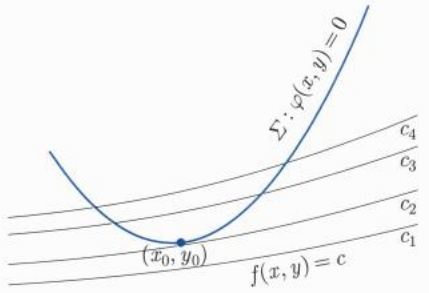

对于固定的  $\boldsymbol{x} \in B_{\delta}(\boldsymbol{x}_{0})$ ，由介值定理，并注意到  $F(\boldsymbol{x}, y)$  关于 y 在  $[y_{0} - \eta, y_{0} + \eta]$  上严格单增，我们知有唯一的  $\varphi(\boldsymbol{x}) \in (y_{0} - \eta, y_{0} + \eta)$  满足  $F(\boldsymbol{x}, \varphi(\boldsymbol{x})) = 0$ 。进一步，对于  $x_{1}, x_{2} \in B_{\delta}(\boldsymbol{x}_{0})$ ，由 (15.6.2) 式，我们有

$$
\begin{array}{l} \frac {\gamma}{2} | \varphi (\boldsymbol {x} _ {1}) - \varphi (\boldsymbol {x} _ {2}) | \leqslant \left| F (\boldsymbol {x} _ {1}, \varphi (\boldsymbol {x} _ {1})) - F (\boldsymbol {x} _ {1}, \varphi (\boldsymbol {x} _ {2})) \right| \\ = \big | F (\pmb {x} _ {2}, \varphi (\pmb {x} _ {2})) - F (\pmb {x} _ {1}, \varphi (\pmb {x} _ {2})) \big |. \tag {15.6.4} \\ \end{array}
$$

从而由 $F$ 的连续性即得 $\varphi$ 在 $\pmb{x} \in B_{\delta}(\pmb{x}_0)$ 内连续。另一方面，固定 $\pmb{x} \in B_{\delta}(\pmb{x}_0)$，当 $0 < |\Delta \pmb{x}| < \delta - |\pmb{x} - \pmb{x}_0|$ 时，由微分中值定理，存在 $\theta \equiv \theta_{\pmb{x}, \Delta \pmb{x}} \in (0,1)$ 使得

$$
\begin{array}{l} 0 = F (\boldsymbol {x} + \Delta \boldsymbol {x}, \varphi (\boldsymbol {x} + \Delta \boldsymbol {x})) - F (\boldsymbol {x}, \varphi (\boldsymbol {x})) \\ = F _ {\boldsymbol {x}} (\boldsymbol {x} + \theta \Delta \boldsymbol {x}, \varphi (\boldsymbol {x}) + \theta \Delta y) \Delta \boldsymbol {x} + F _ {y} (\boldsymbol {x} + \theta \Delta \boldsymbol {x}, \varphi (\boldsymbol {x}) + \theta \Delta y) \Delta y, \tag {15.6.5} \\ \end{array}
$$

其中  $\Delta y := \varphi(\boldsymbol{x} + \Delta\boldsymbol{x}) - \varphi(\boldsymbol{x})$ . 因此,

$$
\begin{array}{l} \varphi (\boldsymbol {x} + \Delta \boldsymbol {x}) - \varphi (\boldsymbol {x}) = - \frac {F _ {\boldsymbol {x}} (\boldsymbol {x} + \theta \Delta \boldsymbol {x} , \varphi (\boldsymbol {x}) + \theta \Delta y)}{F _ {y} (\boldsymbol {x} + \theta \Delta \boldsymbol {x} , \varphi (\boldsymbol {x}) + \theta \Delta y)} \Delta \boldsymbol {x} \\ = - \frac {F _ {\boldsymbol {x}} (\boldsymbol {x} , \varphi (\boldsymbol {x}))}{F _ {y} (\boldsymbol {x} , \varphi (\boldsymbol {x}))} \Delta \boldsymbol {x} + r (\boldsymbol {x}, \Delta \boldsymbol {x}), \tag {15.6.6} \\ \end{array}
$$

其中

$$
\lim _ {\Delta \boldsymbol {x} \to 0} \frac {| r (\boldsymbol {x} , \Delta \boldsymbol {x}) |}{| \Delta \boldsymbol {x} |} = \lim _ {\Delta \boldsymbol {x} \to 0} \frac {1}{| \Delta \boldsymbol {x} |} \left| \left(\frac {F _ {\boldsymbol {x}} (\boldsymbol {x} + \theta \Delta \boldsymbol {x} , \varphi (\boldsymbol {x}) + \theta \Delta y)}{F _ {y} (\boldsymbol {x} + \theta \Delta \boldsymbol {x} , \varphi (\boldsymbol {x}) + \theta \Delta y)} - \frac {F _ {\boldsymbol {x}} (\boldsymbol {x} , \varphi (\boldsymbol {x}))}{F _ {y} (\boldsymbol {x} , \varphi (\boldsymbol {x}))}\right) \Delta \boldsymbol {x} \right| = 0. \tag {15.6.7}
$$

故 $\varphi$ 在 $B_{\delta}(\pmb{x}_0)$ 内连续可微且(15.6.1)式成立.

注15.6.1 定理的结果表明方程 $F(\pmb{x},y) = 0$ 在 $(\pmb{x}_0,y_0)$ 附近确定（唯一的）一个隐函数 $y = \varphi (\pmb {x})$ .需要强调这里的唯一性是指 $\varphi (\pmb {x})$ 的取值是限制在 $y_{0}$ 的一个邻域内的.在更大的范围内，唯一性自然不一定成立.因此，我们不能说方程 $F(\pmb {x},y) = 0$ 在 $\pmb{x}_0$ 附近唯一地确定了一个隐函数.

例如, 对于方程 $F(x,y) \equiv x^{2} + y^{2} - 1 = 0$, 以及 $(x_0,y_0) = \left(\frac{\sqrt{2}}{2},\frac{\sqrt{2}}{2}\right)$, 可得 $F(x_0,y_0) = 0$ 以及 $F_y(x_0,y_0) \neq 0$. 该方程在 $(x_0,y_0)$ 附近, $x \in (x_0 - \delta, x_0 + \delta)$, 确定一个隐函数 $y(x) = \sqrt{1 - x^2}$. 而方程 $F = 0$ 本身对应于 $x \in (x_0 - \delta, x_0 + \delta)$ 的解并不唯一: $y(x) = \pm \sqrt{1 - x^2}$. 所以如果考虑 $(x_0,y_0)$ 附近的函数关系, 则把 $y(x) = -\sqrt{1 - x^2}$ 排除在外了.

注 15.6.2 当 F 的光滑性不同时, 定理有多种不同的版本. 粗略说来, 如果定理中 F 是  $C^{k}$  光滑函数  $(k=1,2,\cdots,\infty)$ , 那么定理中的  $\varphi(\boldsymbol{x})$  也将是  $C^{k}$  光滑的.

另外, 从定理的证明可以看出, 如果仅要求函数 $y = \varphi(\boldsymbol{x})$ 的 (局部) 存在性, 而不关心 $\varphi(\boldsymbol{x})$ 的导数的话, 那么在其他条件不变的情况下, 条件 $F: \Omega \times (a, b) \to \mathbb{R}$ 是 $C^1(\Omega \times (a, b))$ 函数, 可以不要求 $F_{\boldsymbol{x}}(\boldsymbol{x}, y)$ 连续, 甚至可以不存在.

进一步, 定理还可以有相应的 $C^0$ 版本. 即, 如果定理中 $F$ 是 $C^0$ 连续函数, 而且关于 $y$ 严格单调, 则 $\varphi(x)$ 存在且也是连续的. 这里关于 $y$ 严格单调的假设起到 $C^1$ 框架下 $F_y \neq 0$ 的作用.

定理中的条件 $F_{y}(\pmb{x}_{0},y_{0})\neq 0$ 是充分而非必要的.例如，考虑隐函数 $F(x,y) = y^{3} - x^{3} = 0$ 在点 $(x_0,y_0) = (0,0)$ 附近，我们一方面有 $F_{y}(0,0) = 0$ ，但另一方面，方程显然可以确定唯一的函数关系 $y = x$

例 15.6.1 设  $x = x(y, z)$ ,  $y = y(x, z)$ ,  $z = z(x, y)$  都是由  $F(x, y, z) = 0$  确定的隐函数, 假设它们具有连续的偏导数, 试证明:

$$
\frac {\partial x}{\partial y} \frac {\partial y}{\partial z} \frac {\partial z}{\partial x} = - 1, \quad \frac {\partial x}{\partial y} \frac {\partial x}{\partial z} \frac {\partial y}{\partial x} \frac {\partial y}{\partial z} \frac {\partial z}{\partial x} \frac {\partial z}{\partial y} = 1.
$$

证明 由隐函数存在定理, 得

$$
\frac {\partial x}{\partial y} = - \frac {F _ {y}}{F _ {x}}, \quad \frac {\partial y}{\partial z} = - \frac {F _ {z}}{F _ {y}}, \quad \frac {\partial z}{\partial x} = - \frac {F _ {x}}{F _ {z}},
$$

代入即可. 同理可证第二个关系式.

例15.6.2 考虑Kepler方程

$$
y - x - \varepsilon \sin y = 0, \quad 0 <   \varepsilon <   1,
$$

确定的隐函数  $y = f(x)$ ，求  $f'(x)$ .

解 把 $y$ 视为 $x$ 的函数 $y = f(x)$, 即 $f(x) - x - \varepsilon \sin f(x) \equiv 0$. 方程两端对 $x$ 求导数, 得

$$
f ^ {\prime} (x) (1 - \varepsilon \cos f (x)) - 1 = 0.
$$

即

$$
f ^ {\prime} (x) = \frac {1}{1 - \varepsilon \cos f (x)}.
$$

## 2. 方程组的情形

上面对单个方程的隐函数讨论可以推广到多个方程, 即方程组的情况, 或者说向量值函数 (即映射) 的情况. 为了更深刻理解更一般的情况, 我们以线性代数中的方程组为例来说明其基本思想.

考虑由两个方程组成的方程组的求解问题:

$$
\left\{ \begin{array}{l} F (x, u, v) = 0, \\ G (x, u, v) = 0. \end{array} \right.
$$

对比前面讨论的单个方程的情形, 如果我们希望由 $F(x,y) = 0$ 解出 $y$ 关于 $x$ 的函数, 则是通过假设 $F_{y}(x,y) \neq 0$ 来保证的. 现在在多个方程时, $F_{y}(x,y) \neq 0$ 的表现形式如何?

为此, 我们仍然返回到更简单的情况: 设

$$
\left\{ \begin{array}{l} F (x, u, v) = f _ {x} x + a _ {u} u + a _ {v} v, \\ G (x, u, v) = g _ {x} x + b _ {u} u + b _ {v} v, \end{array} \right.
$$

其中 $a_{u}, a_{v}, b_{u}, b_{v}, f_{x}, g_{x}$ 均为常数. 此时我们的问题无异于求解方程组

$$
\left\{ \begin{array}{l} a _ {u} u + a _ {v} v = - f _ {x} x, \\ b _ {u} u + b _ {v} v = - g _ {x} x. \end{array} \right.
$$

由线性代数的理论知, 这个方程组有唯一解的充要条件是其系数行列式

$$
\left| \begin{array}{c c} a _ {u} & a _ {v} \\ b _ {u} & b _ {v} \end{array} \right| = a _ {u} b _ {v} - a _ {v} b _ {u} \neq 0.
$$

注意到

$$
F _ {u} = a _ {u}, \quad F _ {v} = a _ {v}, \quad G _ {u} = b _ {u}, \quad G _ {v} = b _ {v}.
$$

因此我们猜测对于一般的 $F$ 和 $G$, 条件

$$
\left| \begin{array}{c c} F _ {u} & F _ {v} \\ G _ {u} & G _ {v} \end{array} \right| \neq 0
$$

可以保证隐函数方程组的可解性. 自然, 由于是非线性情况, 这里的可解很有可能是局部的. 另外, 我们也看出, 这里的 $x$ 是一元变量还是多元变量, 丝毫不影响 $u, v$ 的可解性. 换句话说, 这里的关键是上面行列式的非零性.

给定可微函数 $F(x,y),G(x,y)$ ，我们称行列式

$$
\left| \begin{array}{c c} F _ {u} & F _ {v} \\ G _ {u} & G _ {v} \end{array} \right|
$$

为 $F, G$ 的 Jacobi 行列式, 记作

$$
J = \frac {\partial (F , G)}{\partial (u , v)} = \left| \begin{array}{c c} F _ {u} & F _ {v} \\ G _ {u} & G _ {v} \end{array} \right|.
$$

更一般地, $n$ 个可微函数 $F_{i}(x_{1}, x_{2}, \cdots, x_{n}), i = 1, 2, \cdots, n$ 的 Jacobi 行列式是一个 $n \times n$ 矩阵给出的行列式, 定义为

$$
J = \frac {\partial (F _ {1} , F _ {2} , \cdots , F _ {n})}{\partial (x _ {1} , x _ {2} , \cdots , x _ {n})} = \det \left(\frac {\partial F _ {i}}{\partial x _ {j}}\right).
$$

我们有下面的定理:

定理 15.6.2（隐映射定理） 设  $W \subseteq R^{n} \times R^{m}$  为开集, W 中的点用  $(x, y)$  表示, 其中  $\boldsymbol{x} = (x_{1}, x_{2}, \cdots, x_{n})$ ,  $\boldsymbol{y} = (y_{1}, y_{2}, \cdots, y_{m})$ . 设

$$
\boldsymbol {F} (\boldsymbol {x}, \boldsymbol {y}) = (F _ {1} (\boldsymbol {x}, \boldsymbol {y}), F _ {2} (\boldsymbol {x}, \boldsymbol {y}), \dots , F _ {m} (\boldsymbol {x}, \boldsymbol {y}))
$$

是 $W$ 到 $\mathbb{R}^m$ 的 $C^1$ 映射， $(\pmb{x}_0,\pmb{y}_0)\in W$ ，满足

(i)  $\boldsymbol{F}(\boldsymbol{x}_{0}, \boldsymbol{y}_{0}) = \boldsymbol{0}.$
(ii)  $\det J_{\mathbf{y}}\mathbf{F}(\mathbf{x}_{0},\mathbf{y}_{0})\neq0,$  其中  $J_{\mathbf{y}}\mathbf{F}(\mathbf{x},\mathbf{y})=\left(\frac{\partial F_{i}}{\partial y_{j}}(\mathbf{x},\mathbf{y})\right)_{m\times m}.$

则存在  $x_{0}$  的开邻域  $V \subseteq R^{n}$  以及唯一的  $C^{1}$  映射  $\psi: V \to R^{m}$ ，使得

(1) $\boldsymbol{y}_{0}=\psi(\boldsymbol{x}_{0}),\boldsymbol{F}(\boldsymbol{x},\psi(\boldsymbol{x}))=\boldsymbol{F}(\boldsymbol{x}_{0},\boldsymbol{y}_{0}),\forall\boldsymbol{x}\in V.$
(2) $J\psi (\pmb {x}) = -\left(J_{\pmb{y}}\pmb {F}(\pmb {x},\psi (\pmb {x}))\right)^{-1}J_{\pmb{x}}\pmb {F}(\pmb {x},\psi (\pmb {x}))$ ，其中 $J_{\pmb{x}}\pmb {F}(\pmb {x},\pmb {y}) = \left(\frac{\partial F_i}{\partial x_j} (\pmb {x},\pmb {y})\right)_{m\times n}$

类似于隐函数存在定理, 隐映射定理同样也有  $C^{k}$  版本,  $k = 1, 2, \cdots, \infty$ . 即, 如果  $\boldsymbol{F}(\boldsymbol{x}, \boldsymbol{y}) \in C^{k}$ , 则定理中的映射  $\psi: V \to R^{m}$  也是  $C^{k}$  的.

隐映射定理的证明有多种方法, 常见的有: 对空间维数 $m$ 用数学归纳法, 讨论函数 $\| \boldsymbol{F} \|$ 的极值法、不动点法, 以及先证明逆映射定理然后应用逆映射定理的方法. 我们采用数学归纳法证明, 其特点是相对而言较为初等和直接.

证明 我们对 $m$ 作归纳证明. 事实上, 整个证明的核心思想将在 $m = 2$ 时充分体现, 所以 $m = 2$ 的证明是最本质的. 至于 $m \geqslant 3$ 的证明则仅仅是形式上的复杂和重复. 因此我们只给出 $m = 2$ 的证明.

注意 $m = 2$ 时, 有 $\pmb{y} = (y_{1}, y_{2})$. 记 $\pmb{y}_{0} = (y_{1}^{0}, y_{2}^{0})$. 由于

$$
\frac {\partial (F _ {1} , F _ {2})}{\partial (y _ {1} , y _ {2})} \bigg | _ {(\boldsymbol {x} _ {0}, \boldsymbol {y} _ {0})} \neq 0.
$$

不妨假设 $\frac{\partial F_2}{\partial y_2} (\pmb{x}_0,\pmb{y}_0)\neq 0.$ 由单个方程的隐函数存在定理知， $\exists \delta_1 > 0$ ，方程

$$
F _ {2} (\boldsymbol {x}, y _ {1}, y _ {2}) = 0
$$

在 $B_{\delta_1}(\pmb{x}_0)\times (y_1^0 -\delta_1,y_1^0 +\delta_1)$ 内唯一确定一个函数

$$
y _ {2} = g (\boldsymbol {x}, y _ {1}),
$$

使得满足

$$
\boldsymbol {F} (\boldsymbol {x}, y _ {1}, g (\boldsymbol {x}, y _ {1})) = 0, \quad y _ {2} ^ {0} = g (\boldsymbol {x} _ {0}, y _ {1} ^ {0})
$$

且 $g(\pmb {x},y_1)$ 在该邻域内具有连续偏导数.将 $y_{2} = g(\pmb {x},y_{1})$ 代入

$$
F _ {1} (\boldsymbol {x}, y _ {1}, y _ {2}) = 0,
$$

得到一个关于 $(\pmb{x},y_{1})$ 的方程

$$
H (\boldsymbol {x}, y _ {1}) = F _ {1} (\boldsymbol {x}, y _ {1}, g (\boldsymbol {x}, y _ {1})) = 0.
$$

由于

$$
\begin{array}{l} \frac {\partial H}{\partial y _ {1}} = \frac {\partial F _ {1}}{\partial y _ {1}} + \frac {\partial F _ {1}}{\partial y _ {2}} \cdot \frac {\partial g (\boldsymbol {x} , y _ {1})}{\partial y _ {1}} = \frac {\partial F _ {1}}{\partial y _ {1}} + \frac {\partial F _ {1}}{\partial y _ {2}} \cdot \left(- \frac {\partial F _ {2}}{\partial y _ {1}} / \frac {\partial F _ {2}}{\partial y _ {2}}\right) \\ = \frac {\partial (F _ {1} , F _ {2})}{\partial (y _ {1} , y _ {2})} \cdot \left(\frac {\partial F _ {2}}{\partial y _ {2}}\right) ^ {- 1}. \\ \end{array}
$$

故有

$$
\frac {\partial H (\boldsymbol {x} _ {0} , y _ {1} ^ {0})}{\partial y _ {1}} = \frac {\partial (F _ {1} , F _ {2})}{\partial (y _ {1} , y _ {2})} \cdot \left(\frac {\partial F _ {2}}{\partial y _ {2}}\right) ^ {- 1} \Bigg | _ {(\boldsymbol {x} _ {0}, \boldsymbol {y} _ {0})} \neq 0.
$$

因此 $\exists \delta_0, 0 < \delta_0 < \delta_1$，使得 $H(\pmb{x}, y_1) = 0$ 在 $B_{\delta_0}(\pmb{x}_0)$ 内唯一确定一个函数 $y_1 = f_1(\pmb{x})$ 满足 $y_1^0 = f_1(\pmb{x}_0)$ 且

$$
F _ {1} \big (\boldsymbol {x}, f _ {1} (\boldsymbol {x}), g \big (\boldsymbol {x}, f _ {1} (\boldsymbol {x}) \big) \big) = 0.
$$

记

$$
y _ {1} = f _ {1} (\boldsymbol {x}), \quad y _ {2} = f _ {2} (\boldsymbol {x}) = g (\boldsymbol {x}, f _ {1} (\boldsymbol {x})),
$$

则在 $B_{\delta_0}(\pmb{x}_0)$ 内，成立

$$
\left\{ \begin{array}{l} F _ {1} \big (\boldsymbol {x}, f _ {1} (\boldsymbol {x}), f _ {2} (\boldsymbol {x}) \big) = 0, \\ F _ {2} \big (\boldsymbol {x}, f _ {1} (\boldsymbol {x}), f _ {2} (\boldsymbol {x}) \big) = 0, \end{array} \right.
$$

且  $\boldsymbol{y}_{0}=(f_{1}(\boldsymbol{x}_{0}),f_{2}(\boldsymbol{x}_{0}))$ . 再由  $\boldsymbol{F}(\boldsymbol{x},\boldsymbol{y})$  具有连续的偏导数, 可得  $f_{1}(\boldsymbol{x}), f_{2}(\boldsymbol{x})$  在  $B_{\delta_{0}}(\boldsymbol{x}_{0})$  内具有连续的偏导数.

利用复合函数求导法则, 可得

$$
\left\{ \begin{array}{l} \frac {\partial F _ {1}}{\partial x _ {i}} + \frac {\partial F _ {1}}{\partial y _ {1}} \frac {\partial f _ {1}}{\partial x _ {i}} + \frac {\partial F _ {1}}{\partial y _ {2}} \frac {\partial f _ {2}}{\partial x _ {i}} = 0, \\ \frac {\partial F _ {2}}{\partial x _ {i}} + \frac {\partial F _ {2}}{\partial y _ {1}} \frac {\partial f _ {1}}{\partial x _ {i}} + \frac {\partial F _ {2}}{\partial y _ {2}} \frac {\partial f _ {2}}{\partial x _ {i}} = 0, \end{array} \right.
$$

写成向量形式, 有

$$
\left. \left( \begin{array}{c c c c} \frac {\partial f _ {1}}{\partial x _ {1}} & \frac {\partial f _ {1}}{\partial x _ {2}} & \dots & \frac {\partial f _ {1}}{\partial x _ {n}} \\ \frac {\partial f _ {2}}{\partial x _ {1}} & \frac {\partial f _ {2}}{\partial x _ {2}} & \dots & \frac {\partial f _ {2}}{\partial x _ {n}} \end{array} \right) \right| _ {\boldsymbol {x}} = - \left. \left( \begin{array}{c c} \frac {\partial F _ {1}}{\partial y _ {1}} & \frac {\partial F _ {1}}{\partial y _ {2}} \\ \frac {\partial F _ {2}}{\partial y _ {1}} & \frac {\partial F _ {2}}{\partial y _ {2}} \end{array} \right) ^ {- 1} \right| _ {(\boldsymbol {x}, \boldsymbol {y})} \left. \left( \begin{array}{c c c c} \frac {\partial F _ {1}}{\partial x _ {1}} & \frac {\partial F _ {1}}{\partial x _ {2}} & \dots & \frac {\partial F _ {1}}{\partial x _ {n}} \\ \frac {\partial F _ {2}}{\partial x _ {1}} & \frac {\partial F _ {2}}{\partial x _ {2}} & \dots & \frac {\partial F _ {2}}{\partial x _ {n}} \end{array} \right) \right| _ {\boldsymbol {x}}
$$

下面证明隐函数解的唯一性. 假设不然, 由 $F(x, y) = 0$ 在 $B_{\delta_0}(x_0)$ 内还有另外一组方程

$$
y _ {1} = \tilde {f} _ {1} (\boldsymbol {x}), \quad y _ {2} = \tilde {f} _ {2} (\boldsymbol {x})
$$

也满足定理要求和结论, 则有 $f_{i}$ 和 $\tilde{f}_{i} (i = 1,2)$ 有相同的偏导数. 从而它们的差 $f_{i} - \tilde{f}_{i}$ 必为常数, 易知此常数必为零. 因此可得 $f_{i} = \tilde{f}_{i}$. □

例 15.6.3 设  $x^{2} + 2y^{2} + 3z^{2} + xy - z - 9 = 0$ ，求 x = 1, y = -2, z = 1 时  $\frac{\partial z}{\partial x}$ ,  $\frac{\partial z}{\partial y}$ ,  $\frac{\partial^{2}z}{\partial y\partial x}$  的值.

解 令 $F(x,y,z) = x^{2} + 2y^{2} + 3z^{2} + xy - z - 9,$ 则

$$
F (1, - 2, 1) = 0, \quad F _ {z} (1, - 2, 1) = (6 z - 1) | _ {z = 1} = 5 \neq 0,
$$

故 $z$ 可局部地表示为 $x, y$ 的函数, 记为 $z = z(x, y)$. 由隐映射定理, 在 $(1, -2, 1)$ 处, 有

$$
\begin{array}{l} (z _ {x}, z _ {y}) = - F _ {z} ^ {- 1} \cdot (F _ {x}, F _ {y}) \\ = - \left. \frac {1}{5} (2 x + y, 4 y + x) \right| _ {(x, y, z) = (1, - 2, 1)} = \left(0, \frac {7}{5}\right). \\ \end{array}
$$

又因为

$$
z _ {y} = - F _ {z} ^ {- 1} \cdot F _ {y} = - \frac {1}{6 z - 1} (4 y + x),
$$

所以

$$
\frac {\partial^ {2} z}{\partial y \partial x} = \frac {6}{(6 z - 1) ^ {2}} \cdot z _ {x} (4 y + x) - \frac {1}{6 z - 1},
$$

从而 $\frac{\partial^2z}{\partial y\partial x} (1, - 2,1) = -\frac{1}{5}.$

## 3. 逆映射定理

回忆一下:对于一元函数，如果它可微且导数处处非零，则该函数可逆且其逆仍可微。下面我们考虑多元向量值函数类似的问题。

例 15.6.4 设 A 为 n 阶方阵, 如果  $\|A\| < 1$ , 则  $I_{n} - A$  可逆.

事实上, 设  $u \in R^{n}$ , 如果  $(I_{n} - A)u = 0$ , 则  $\|u\| = \|Au\| \leqslant \|A\|\cdot\|u\|$ , 由  $\|A\| < 1$  可知 u = 0. 根据线性代数可知  $I_{n} - A$  可逆.

我们也可从分析学观点来看. 给定  $v \in R^{n}$ ，我们解方程

$$
(I _ {n} - A) \pmb {x} = \pmb {v}, \text {即} \pmb {x} = A \pmb {x} + \pmb {v}.
$$

考虑映射 $\varphi (\pmb {x}) = \pmb {A}\pmb {x} + \pmb{v}$ ，当 $x,y\in \mathbb{R}^n$ 时

$$
\| \varphi (\boldsymbol {x}) - \varphi (\boldsymbol {y}) \| = \| \boldsymbol {A} (\boldsymbol {x} - \boldsymbol {y}) \| \leqslant \| \boldsymbol {A} \| \cdot \| \boldsymbol {x} - \boldsymbol {y} \|,
$$

这说明 $\varphi$ 是 $\mathbb{R}^n$ 到自身的压缩映射. 根据压缩映射原理, $\varphi$ 有唯一的不动点, 即 $I_{n} - A$ 可逆.

这个例子意味着, 恒同映射这样一个可逆映射作一个小的扰动以后仍然为可逆映射. 一般地, 任何可逆线性映射在微扰下仍为可逆映射. 对于向量值函数来说, 要知道它在某一点附近是否可逆, 只要在这一点将它线性化, 看看其微分是否可逆. 这里我们需要对函数加一定的可微性条件. 回顾一下, 一个向量值函数称为 $C^k$ 的是指它的每一个分量都是 $C^k$ 函数. 下面的重要结果也称为向量值函数的反函数定理.

定理 15.6.3 (逆映射定理) 设 $D \subseteq \mathbb{R}^n$ 为开集, $f: D \to \mathbb{R}^n$ 为 $C^k (k \geqslant 1)$ 映射, $x_0 \in D$. 如果 $\det J f(x_0) \neq 0$, 则存在 $x_0$ 的开邻域 $U \subseteq D$ 以及 $y_0 = f(x_0)$ 的开邻域 $V \subseteq \mathbb{R}^n$, 使得 $f|_{U}: U \to V$ 是可逆映射, 且其逆映射 $h: V \to U$, $h(y) = x$ 也是 $C^k$ 的, 并且满足

$$
J \boldsymbol {h} (\boldsymbol {y}) = \left(J \boldsymbol {f} (\boldsymbol {h} (\boldsymbol {y}))\right) ^ {- 1}, \forall \boldsymbol {y} \in V.
$$

证明 不失一般性, 可设 $x_0 = 0, y_0 = 0$. 以 $L$ 记 $\pmb{f}$ 在 $x_0 = 0$ 处的微分, 则 $L$ 可逆, 且 $L^{-1} \circ \pmb{f}$ 在 $x_0$ 处的微分为恒同映射. 如果欲证结论对 $L^{-1} \circ \pmb{f}$ 成立, 则对 $\pmb{f}$ 也成立. 因此, 不妨从一开始就假设 $J\pmb{f}(\pmb{x}_0) = \pmb{I}_n$.

在 $x_0 = 0$ 附近, $\pmb{f}$ 是恒同映射的小扰动:

$$
\boldsymbol {f} (\boldsymbol {x}) = \boldsymbol {x} + \boldsymbol {g} (\boldsymbol {x}), \quad J \boldsymbol {g} (\boldsymbol {0}) = \boldsymbol {0}.
$$

扰动项 $g(x) = f(x) - x$ 为 $C^k$ 映射. 因此, 存在 $\delta > 0$ 使得

$$
\| J \boldsymbol {g} (\boldsymbol {x}) \| \leqslant \frac {1}{2}, \forall \boldsymbol {x} \in \overline {{B _ {\delta} (\boldsymbol {0})}} \subseteq D.
$$

由拟微分中值定理可知

$$
\| \boldsymbol {g} (\boldsymbol {x} _ {1}) - \boldsymbol {g} (\boldsymbol {x} _ {2}) \| \leqslant \frac {1}{2} \| \boldsymbol {x} _ {1} - \boldsymbol {x} _ {2} \|, \forall \boldsymbol {x} _ {1}, \boldsymbol {x} _ {2} \in \overline {{B _ {\delta} (\mathbf {0})}}.
$$

给定 $\pmb{y} \in B_{\delta / 2}(\mathbf{0})$ ，我们在 $B_{\delta}(\mathbf{0})$ 中解方程

$$
\pmb {f} (\pmb {x}) = \pmb {y}, \text {即} \pmb {x} = \pmb {y} - \pmb {g} (\pmb {x}). \tag {15.6.8}
$$

记 $\varphi (\pmb {x}) = \pmb {y} - \pmb {g}(\pmb {x})$ .当 $\pmb {x}\in \overline{B_{\delta}(\mathbf{0})}$ 时

$$
\| \varphi (\boldsymbol {x}) \| \leqslant \| \boldsymbol {y} \| + \| \boldsymbol {g} (\boldsymbol {x}) \| <   \frac {\delta}{2} + \frac {1}{2} \| \boldsymbol {x} \| \leqslant \delta . \tag {15.6.9}
$$

这说明 $\varphi (\overline{B_{\delta}(\mathbf{0})})\subset B_{\delta}(\mathbf{0})$ .当 $x_{1},x_{2}\in \overline{B_{\delta}(\mathbf{0})}$ 时

$$
\| \varphi (\boldsymbol {x} _ {1}) - \varphi (\boldsymbol {x} _ {2}) \| = \| \boldsymbol {g} (\boldsymbol {x} _ {2}) - \boldsymbol {g} (\boldsymbol {x} _ {1}) \| \leqslant \frac {1}{2} \| \boldsymbol {x} _ {1} - \boldsymbol {x} _ {2} \|\cdot
$$

根据压缩映射原理, 方程 (15.6.8) 在 $\overline{B_{\delta}(\mathbf{0})}$ 中有唯一解, 记为 $x_{y}$. 由 (15.6.9) 式可知 $x_{y} \in B_{\delta}(\mathbf{0})$. 令

$$
U = \boldsymbol {f} ^ {- 1} \big (B _ {\delta / 2} (\boldsymbol {0}) \big) \cap B _ {\delta} (\boldsymbol {0}), V = B _ {\delta / 2} (\boldsymbol {0}),
$$

则我们已经证明了  $f|_{U}: U \rightarrow V$  是一一映射, 其逆映射  $h(y) = x_{y}$  满足

$$
\boldsymbol {y} - \boldsymbol {g} (\boldsymbol {h} (\boldsymbol {y})) = \boldsymbol {h} (\boldsymbol {y}). \tag {15.6.10}
$$

(1) $h:V\to U$ 是连续映射: 当 $y_{1},y_{2}\in V$ 时

$$
\begin{array}{l} \| \boldsymbol {h} (\boldsymbol {y} _ {1}) - \boldsymbol {h} (\boldsymbol {y} _ {2}) \| \leqslant \| \boldsymbol {y} _ {1} - \boldsymbol {y} _ {2} \| + \| \boldsymbol {g} (\boldsymbol {h} (\boldsymbol {y} _ {1})) - \boldsymbol {g} (\boldsymbol {h} (\boldsymbol {y} _ {2})) \| \\ \leqslant \| \boldsymbol {y} _ {1} - \boldsymbol {y} _ {2} \| + \frac {1}{2} \| \boldsymbol {h} (\boldsymbol {y} _ {1}) - \boldsymbol {h} (\boldsymbol {y} _ {2}) \|, \\ \end{array}
$$

这说明 $\| \pmb {h}(\pmb{y}_1) - \pmb {h}(\pmb{y}_2)\| \leqslant 2\| \pmb {y}_1 - \pmb {y}_2\|$, $\forall \pmb{y}_1, \pmb{y}_2 \in V$.

(2) $h:V\to U$ 是可微映射: 设 $y_{0}\in V$, 则对 $y\in V$, 有

$$
\begin{array}{l} \boldsymbol {h} (\boldsymbol {y}) - \boldsymbol {h} \left(\boldsymbol {y} _ {0}\right) = \left(\boldsymbol {y} - \boldsymbol {y} _ {0}\right) - \left(\boldsymbol {g} \left(\boldsymbol {h} (\boldsymbol {y})\right) - \boldsymbol {g} \left(\boldsymbol {h} \left(\boldsymbol {y} _ {0}\right)\right)\right) \\ = (\boldsymbol {y} - \boldsymbol {y} _ {0}) - J \boldsymbol {g} (\boldsymbol {h} (\boldsymbol {y} _ {0})) \cdot (\boldsymbol {h} (\boldsymbol {y}) - \boldsymbol {h} (\boldsymbol {y} _ {0})) + o \left(\| \boldsymbol {h} (\boldsymbol {y}) - \boldsymbol {h} (\boldsymbol {y} _ {0}) \|\right). \\ \end{array}
$$

利用 $Jf = I_n + Jg$ 和(1)，上式可改写为

$$
J \boldsymbol {f} (\boldsymbol {h} (\boldsymbol {y} _ {0})) \cdot (\boldsymbol {h} (\boldsymbol {y}) - \boldsymbol {h} (\boldsymbol {y} _ {0})) = (\boldsymbol {y} - \boldsymbol {y} _ {0}) + o \big (\| \boldsymbol {y} - \boldsymbol {y} _ {0} \| \big),
$$

因而

$$
\boldsymbol {h} (\boldsymbol {y}) - \boldsymbol {h} (\boldsymbol {y} _ {0}) = \left[ J \boldsymbol {f} (\boldsymbol {h} (\boldsymbol {y} _ {0})) \right] ^ {- 1} \cdot (\boldsymbol {y} - \boldsymbol {y} _ {0}) + o \big (\| \boldsymbol {y} - \boldsymbol {y} _ {0} \| \big).
$$

这说明 h 在  $y_{0}$  处可微.

(3) $h:V\to U$ 为 $C^{k}$ 映射:由(2)可知

$$
J \boldsymbol {h} (\boldsymbol {y}) = \left(J \boldsymbol {f} (\boldsymbol {h} (\boldsymbol {y}))\right) ^ {- 1}, \forall \boldsymbol {y} \in V. \tag {15.6.11}
$$

由  $f \in C^{k}$  知  $Jf \in C^{k-1}$ . 由 (2) 及 (15.6.11) 式可推出 Jh 连续, 即  $h \in C^{1}$ . 再由  $Jf \in C^{k-1}, h \in C^{1}$  及 (15.6.11) 式可推出  $Jh \in C^{1}$  即  $h \in C^{2}$ . 以此类推, 最后我们就得到  $h \in C^{k}$ . □

需要特别强调的是逆映射定理一般来说仅有局部性, 也就是说, 只是在点 $f(x_0)$ 附近才存在逆映射. 换句话说, 即使 $\det J f$ 在 $D$ 上处处非零, 我们也只能断言在 $f(D)$ 中的每一个点的一个局部范围内存在逆映射, 一般不能保证在大范围内成为 $f$ 在 $f(D)$ 上的逆映射, 这与一元函数不同.

例 15.6.5 研究  $f: R^{2} \rightarrow R^{2}$ ,  $f(x, y) = (\mathrm{e}^{x} \cos y, \mathrm{e}^{x} \sin y)$  的逆映射.

解 注意到

$$
\det J \boldsymbol {f} (x, y) = \left| \begin{array}{c c} \mathrm{e} ^ {x} \cos y & - \mathrm{e} ^ {x} \sin y \\ \mathrm{e} ^ {x} \sin y & \mathrm{e} ^ {x} \cos y \end{array} \right| = \mathrm{e} ^ {2 x} \neq 0,
$$

这说明 f 局部可逆. 但 f 不是单射, 因此整体不可逆.

另一方面, 当映射的 Jacobi 矩阵退化时, 映射本身也可能可逆.

例 15.6.6 研究  $f: R^{2} \rightarrow R^{2}$ ,  $f(x, y) = (x^{3}, y^{3})$  的逆映射.

解 显然, $f$ 为光滑映射, 它也是可逆映射. 注意到 $f$ 的逆映射在 $(0,0)$ 处不可微, 这是由 $Jf$ 在 $(0,0)$ 处的退化性所造成的. □

例 15.6.7 设  $f: R^{2} \rightarrow R$  为  $C^{k}(k \geqslant 1)$  函数,  $\frac{\partial f}{\partial y}(x_{0}, y_{0}) \neq 0$ , 在  $(x_{0}, y_{0})$  附近解方程  $f(x, y) = f(x_{0}, y_{0})$ .

解 显然, $(x_0, y_0)$ 是方程的解. 利用逆映射定理, 我们可以在 $(x_0, y_0)$ 附近找到别的解. 为此, 令

$$
\boldsymbol {F}: \mathbb {R} ^ {2} \to \mathbb {R} ^ {2}, \quad \boldsymbol {F} (x, y) = (x, f (x, y)).
$$

在 $(x_{0},y_{0})$ 处,有

$$
\det J \boldsymbol {F} (x _ {0}, y _ {0}) = \left| \begin{array}{c c} 1 & 0 \\ \frac {\partial f}{\partial x} & \frac {\partial f}{\partial y} \end{array} \right| _ {(x _ {0}, y _ {0})} = \frac {\partial f}{\partial y} (x _ {0}, y _ {0}) \neq 0.
$$

由逆映射定理, 在  $(x_{0}, y_{0})$  附近 F 为可逆映射. 于是当 x 在  $x_{0}$  附近时, 记

$$
\boldsymbol {F} ^ {- 1} \big (x, f (x _ {0}, y _ {0}) \big) = \big (\varphi (x), \psi (x) \big),
$$

$\varphi (x),\psi (x)$ 均为 $C^k$ 函数.根据 $\pmb{F}$ 的定义可得

$$
\big (\varphi (x), f (\varphi (x), \psi (x)) \big) = \big (x, f (x _ {0}, y _ {0}) \big),
$$

这说明 $\varphi (x) = x, f(x,\psi (x)) = f(x_0,y_0)$. 对 $x$ 求导还可得到

$$
\frac {\partial f}{\partial x} (x, \psi (x)) + \frac {\partial f}{\partial y} (x, \psi (x)) \cdot \psi^ {\prime} (x) = 0,
$$

从而有

$$
\psi^ {\prime} (x) = - \left(\frac {\partial f}{\partial y} (x, \psi (x))\right) ^ {- 1} \frac {\partial f}{\partial x} (x, \psi (x)).
$$

$y = \psi (x)$ 是由 $f(x,y) = f(x_0,y_0)$ 所决定的隐函数.

关于大范围内逆映射的存在性问题, 我们简单介绍以下一个全局结论. 首先我们给出正则映射的定义.

定义 15.6.1 设开集 $D \subseteq \mathbb{R}^n$, 如果映射 $f: D \to \mathbb{R}^n$ 满足

(1) $f \in C^{1}(D).$
(2) f 是 D 上的单射.
(3)  $\forall x \in D, \det Jf(x) \neq 0,$

则称 f 是 D 上的一个正则映射.

下面的定理表明,正则映射的逆映射也是正则映射.

定理 15.6.4 设开集 $D \subseteq \mathbb{R}^n$, 如果映射 $f: D \to \mathbb{R}^n$ 是 $D$ 上的一个正则映射, 则 $\Omega = f(D)$ 是一开集, 且存在由 $\Omega$ 到 $D$ 上的映射 $f^{-1}$ 满足: 对一切 $y \in \Omega$, 有

$$
\boldsymbol {f} \circ \boldsymbol {f} ^ {- 1} (\boldsymbol {y}) = \boldsymbol {y},
$$

并且  $f^{-1} \in C^{1}(\Omega)$ ,

$$
J \boldsymbol {f} ^ {- 1} (\boldsymbol {y}) = \left(J \boldsymbol {f} (\boldsymbol {x})\right) ^ {- 1}, \tag {15.6.12}
$$

其中  $\boldsymbol{x}=\boldsymbol{f}^{-1}(\boldsymbol{y})$ .

证明 由于 f 是单射, 故逆映射  $f^{-1}$  存在, 即下式成立:

$$
\boldsymbol {f} \circ \boldsymbol {f} ^ {- 1} (\boldsymbol {y}) = \boldsymbol {y}.
$$

因为逆映射定理保证了局部逆映射的存在唯一性, 而整体逆映射必然是局部逆映射, 所以 $\pmb{f}^{-1} \in C^{1}(\Omega)$ 和 (15.6.12) 式也都必然成立. 为了证明 $\pmb{f}(D)$ 是开集, 任取 $\pmb{y} \in \Omega$, 存在 $\pmb{x} \in D$ 使得 $\pmb{y} = \pmb{f}(\pmb{x})$, 由定理 15.6.3, 存在 $\pmb{x}$ 的邻域 $U$ 和 $\pmb{y}$ 的邻域 $V$ 满足 $V = \pmb{f}(U)$, 因此 $V = \pmb{f}(U) \subseteq \pmb{f}(D) = \Omega$, 因此 $\pmb{y}$ 是 $\Omega$ 的内点. 由 $\pmb{y}$ 的任意性, 知 $\Omega$ 是开的.

把关系式 (15.6.12) 写成熟悉的矩阵形式, 则有

$$
\left( \begin{array}{c c c} \frac {\partial x _ {1}}{\partial y _ {1}} & \dots & \frac {\partial x _ {1}}{\partial y _ {n}} \\ \vdots & & \vdots \\ \frac {\partial x _ {n}}{\partial y _ {1}} & \dots & \frac {\partial x _ {n}}{\partial y _ {n}} \end{array} \right) = \left( \begin{array}{c c c} \frac {\partial y _ {1}}{\partial x _ {1}} & \dots & \frac {\partial y _ {1}}{\partial x _ {n}} \\ \vdots & & \vdots \\ \frac {\partial y _ {n}}{\partial x _ {1}} & \dots & \frac {\partial y _ {n}}{\partial x _ {n}} \end{array} \right) ^ {- 1}. \tag {15.6.13}
$$

回忆一下前面关于 Jacobi 行列式的记号:

$$
\frac {\partial (y _ {1} , \cdots , y _ {n})}{\partial (x _ {1} , \cdots , x _ {n})} = \det \left( \begin{array}{c c c} \frac {\partial y _ {1}}{\partial x _ {1}} & \dots & \frac {\partial y _ {1}}{\partial x _ {n}} \\ \vdots & & \vdots \\ \frac {\partial y _ {n}}{\partial x _ {1}} & \dots & \frac {\partial y _ {n}}{\partial x _ {n}} \end{array} \right),
$$

我们在 (15.6.13) 式两端取行列式, 可得

$$
\frac {\partial (y _ {1} , \cdots , y _ {n})}{\partial (x _ {1} , \cdots , x _ {n})} = \left(\frac {\partial (x _ {1} , \cdots , x _ {n})}{\partial (y _ {1} , \cdots , y _ {n})}\right) ^ {- 1}. \tag {15.6.14}
$$

例 15.6.8 设  $u=\frac{y^{2}}{x}$ ,  $v=\frac{x^{2}}{y}$ . 试计算  $\frac{\partial(x,y)}{\partial(u,v)}$ .

解 由方程组可以直接计算得到 $\frac{\partial(u,v)}{\partial(x,y)} = \left| \begin{array}{cc}u_x & u_y\\ v_x & v_y \end{array} \right| = -3.$ 根据公式(15.6.14) 可得 $\frac{\partial(x,y)}{\partial(u,v)} = -\frac{1}{3}.$ □

当然, 这是一道可以直接计算的题目, 读者可以通过直接计算和利用公式两种做法来对比一下结果. 进一步, 读者可从上面的讨论中体会一下逆映射的内容与反函数相应内容之间的一般与特殊的关系.

逆映射定理在分析学和其他专业方向上有着深刻的影响和广泛的应用. 我们仅举一些变量替换方面的例子来体会一下它在简化偏微分方程方面的威力.

例15.6.9 设函数 $u = u(t,x)\in C^2$ ，试作变量替换

$$
\xi = x - a t, \quad \eta = x + a t.
$$

将波动方程 $u_{tt} = a^2 u_{xx}$ $(a\neq 0)$ 转化成 $u$ 关于 $\xi ,\eta$ 所满足的方程.

解 直接计算得

$$
\frac {\partial (\xi , \eta)}{\partial (t , x)} = \det \left( \begin{array}{c c} - a & 1 \\ a & 1 \end{array} \right) = - 2 a \neq 0.
$$

从而变量替换是可逆的 (逆映射存在). 易知

$$
\left\{ \begin{array}{l} u _ {x} = u _ {\xi} \xi_ {x} + u _ {\eta} \eta_ {x} = u _ {\xi} + u _ {\eta}, \\ u _ {t} = u _ {\xi} \xi_ {t} + u _ {\eta} \eta_ {t} = a (u _ {\eta} - u _ {\xi}), \end{array} \right.
$$

以及

$$
\left\{ \begin{array}{l} u _ {x x} = u _ {\xi \xi} + u _ {\eta \eta} + 2 u _ {\xi \eta}, \\ u _ {t t} = a ^ {2} (u _ {\xi \xi} + u _ {\eta \eta}) - 2 a ^ {2} u _ {\xi \eta}. \end{array} \right.
$$

因此由 $u_{tt} = a^2 u_{xx}$ 得到 $u_{\xi \eta} = 0$ .后者很容易求得通解:

$$
u (\xi , \eta) = \varphi (\xi) + \psi (\eta),
$$

其中 $\varphi, \psi \in C^2$. 故波动方程 $u_{tt} = a^2 u_{xx}, u \in C^2$, 的通解为

$$
u (t, x) = \varphi (x - a t) + \eta (x + a t).
$$

例15.6.10 假设二元函数 $z = z(x,y)\in C^2$ 且满足二阶偏微分方程

$$
z _ {x x} + 2 z _ {x y} + z _ {y y} = 0.
$$

试通过变量替换

$$
u = x + y, \quad v = x - y,
$$

来计算 w := xy - z 关于 u, v 所满足的微分方程.

解 直接计算可得

$$
\frac {\partial (u , v)}{\partial (x , y)} = \det \left( \begin{array}{c c} 1 & 1 \\ 1 & - 1 \end{array} \right) = - 2.
$$

从而变量替换是可逆的, 根据

$$
\left\{ \begin{array}{l} z _ {x} = y - w _ {x} = y - (w _ {u} + w _ {v}), \\ z _ {y} = x - w _ {y} = x - (w _ {u} - w _ {v}) \end{array} \right.
$$

和

$$
\left\{ \begin{array}{l} z _ {x x} = - (w _ {u u} + 2 w _ {u v} + w _ {v v}), \\ z _ {x y} = 1 - (w _ {u u} - w _ {v v}), \\ z _ {y y} = - (w _ {u u} - 2 w _ {u v} + w _ {v v}), \end{array} \right.
$$

可得 $w_{uu} = \frac{1}{2}$

## 习题 15.6

1. 研究下列函数在指定点的邻域内是否可以将 $y$ 解为 $x$ 的函数:

(1) $f(x,y) = x^{2} - y^{2},\quad (x,y) = (0,0).$
(2)  $f(x,y) = \sin(\pi(x+y)) - 1, \quad (x,y) = (1/4,1/4).$
(3) $f(x,y) = xy + \ln (xy) - 1, \quad (x,y) = (1,1)$.
(4) $f(x,y) = x^{5} + y^{5} + xy - 3, (x,y) = (1,1)$.

2. 计算指定点处的偏导数:

(1) $y^{z} - xz^{3} - 1 = 0, \quad \frac{\partial z}{\partial y}(1,2,1).$
(2) $x^{2} + 2y^{2} + 3z^{2} + xy - z = 9,\quad \frac{\partial^{2}z}{\partial x^{2}} (1, - 2,1).$

3. 方程组

$$
x v - 4 y + 2 \mathrm{e} ^ {u} + 3 = 0, \quad 2 x - z - 6 u + v \cos u = 0
$$

在点 $x = -1, y = 1, z = -1, u = 0, v = 1$ 处确定了隐函数 $u = u(x, y, z), v = v(x, y, z)$. 求 $u, v$ 在该点处的 Jacobi 矩阵.

4. 设 $U, V$ 为 $\mathbb{R}^n$ 中的开集, $\pmb{f}: U \to V$ 为可微映射, 且 $\det J\pmb{f}(\pmb{x}) \neq 0, \forall \pmb{x} \in U$. 如果 $\pmb{f}$ 的逆映射存在且连续, 证明: 其逆映射一定也是可微的.

5. 设 $f: \mathbb{R}^n \to \mathbb{R}^n$ 为连续可微的映射, 且

$$
\| \boldsymbol {f} (\boldsymbol {x}) - \boldsymbol {f} (\boldsymbol {y}) \| \geqslant \| \boldsymbol {x} - \boldsymbol {y} \|, \quad \forall \boldsymbol {x}, \boldsymbol {y} \in \mathbb {R} ^ {n}.
$$

证明: $f$ 可逆, 且其逆映射也是连续可微的.

6. 下列方程确定隐函数  $y(x)$ ，计算  $\frac{\mathrm{d}y}{\mathrm{d}x}$ :

(1) $x^{2} + 2xy - y^{2} = a^{2}$.
(2)  $xy - \ln y = 0,$  在点 (0,1) 处.

(3)  $y - \varepsilon \sin y = x,$  常数  $\varepsilon \in (0,1)$ .

7. 从下列方程中计算  $\frac{\partial z}{\partial x}$  和  $\frac{\partial z}{\partial y}$ :

(1) $\mathrm{e}^z - xyz = 0$.

(2) $\frac{x}{z} = \ln \frac{z}{y}$.

(3) $x + y + z = \mathrm{e}^{-(x + y + z)}$, 并对计算的结果作出解释.

(4) $z^{2}y - xz^{3} - 1 = 0$, 在点 (1,2,1) 处.

8. 设 $x = x(y, z)$, $y = y(x, z)$, $z = z(x, y)$ 都是由 $f(x, y, z) = 0$ 确定的隐函数, 并且都具有连续的偏导数. 求证:

$$
\frac {\partial x}{\partial y} \frac {\partial y}{\partial z} \frac {\partial z}{\partial x} = - 1.
$$

9. 将上题推广到 n 元函数, 探讨有没有相应的结论.

10. 设 $F(x - y, y - z, z - x) = 0$, 计算 $\frac{\partial z}{\partial x}$ 和 $\frac{\partial z}{\partial y}$.

11. 设 $F(x + y + z, x^2 + y^2 + z^2) = 0$, 计算 $\frac{\partial z}{\partial x}$ 和 $\frac{\partial z}{\partial y}$.

12. 二元函数 $F$ 在 $\mathbb{R}^2$ 上二次连续可微. 已知曲线 $F(x, y) = 0$ 是“8”字形. 问方程组

$$
\frac {\partial F}{\partial x} (x, y) = 0, \quad \frac {\partial F}{\partial y} (x, y) = 0
$$

在 $\mathbb{R}^2$ 中至少有几组解？

13. 设 $F(x, y) = 0$ 满足隐函数存在定理的条件，即 $F$ 有一阶连续偏导数，$F(x_0, y_0) = 0$，$F_y(x_0, y_0) \neq 0$. 设 $y = y(x)$ 是由此该方程确定的隐函数，满足 $y(x_0) = y_0$，证明:$x_0$ 是 $y(x)$ 的极值点的必要条件是 $F_x(x_0, y_0) = 0$; 如果 $F_{xx}(x_0, y_0) \neq 0$，则 $x_0$ 一定是 $y(x)$ 的极值点.

具体来说, 如果

$$
- \frac {F _ {x x} (x _ {0} , y _ {0})}{F _ {y} (x _ {0} , y _ {0})} > 0,
$$

则 $x_0$ 是隐函数 $y = y(x)$ 的极小值点；如果

$$
- \frac {F _ {x x} (x _ {0} , y _ {0})}{F _ {y} (x _ {0} , y _ {0})} <   0,
$$

则  $x_{0}$  是隐函数  $y = y(x)$  的极大值点.

## 15.7 Lagrange 乘数法 条件极值

下面我们讨论条件极值问题. 所谓条件极值, 通常是指在目标函数的自变量受到某些约束, 只能在定义域的某一范围内变化. 我们先通过简单的场景来推演一下一般情况的处理方法.

给定平面上的一条曲线 $\Sigma$，设其解析式为 $\varphi(x, y) = 0$，我们暂时假设它的条件足够好，使得讨论得以进行。我们的问题是求给定函数 $z = f(x, y)$ 的极值，其中 $(x, y)$ 不能任意选取，必须受限于 $\Sigma$ 上，即必须满足 $\varphi(x, y) = 0$。

一种自然的处理思路是这样的: 如果 $(x_0, y_0) \in \Sigma$ 且是函数 $z = f(x, y)$ 的极值点, 又假设在 $(x_0, y_0)$ 附近从条件 $\varphi(x, y) = 0$ 中能解出 $y = y(x)$ (或者 $x = x(y)$), 那么将 $y = y(x)$ 代入 $z = f(x, y) = f(x, y(x)) = \tilde{f}(x)$, 则 $x_0$ 应该是函数 $\tilde{f}(x)$ 在通常意义下的极值点, 因而满足极值点处的必要条件

$$
\tilde {f} ^ {\prime} (x _ {0}) = \frac {\partial f}{\partial x} + \frac {\partial f}{\partial y} y ^ {\prime} (x _ {0}) = 0. \tag {15.7.1}
$$

由前面的隐函数存在定理我们知道, 要使得能从隐函数 $\varphi(x,y)=0$ 中确定函数关系 $y=y(x)$ 或者 $x=x(y)$, 除了 $\varphi(x,y)$ 满足一定的光滑性外 (比如 $C^{1}$), 还要假设 $\varphi_{y}(x_{0},y_{0})\neq0$ 或者 $\varphi_{x}(x_{0},y_{0})\neq0$. 由于 $x,y$ 角色的完全对等性, 因此上面两者只要有一个成立即可, 而这等价于条件 $(\varphi_{x},\varphi_{y})\neq0$ 即可. 不妨假设 $\varphi_{y}(x_{0},y_{0})\neq0$. 根据隐函数存在定理, $\exists\delta>0$, 使得在 $(x_{0}-\delta,x_{0}+\delta)$ 内存在 $y=y(x)$, 满足 $y_{0}=y(x_{0})$, $\varphi(x,y(x))\equiv0$, 且 $y'(x_{0})=-\frac{\varphi_{x}(x_{0},y_{0})}{\varphi_{y}(x_{0},y_{0})}$.

我们继续上面的分析, 又由 (15.7.1) 式, 知 $y'(x_0) = -\frac{f_x(x_0, y_0)}{f_y(x_0, y_0)}$. 这样一来, 我们得到如下关系式:

$$
\frac {f _ {x} (x _ {0} , y _ {0})}{\varphi_ {x} (x _ {0} , y _ {0})} = \frac {f _ {y} (x _ {0} , y _ {0})}{\varphi_ {y} (x _ {0} , y _ {0})} \quad \Longleftrightarrow \quad \left| \begin{array}{c c} f _ {x} (x _ {0}, y _ {0}) & f _ {y} (x _ {0}, y _ {0}) \\ \varphi_ {x} (x _ {0}, y _ {0}) & \varphi_ {y} (x _ {0}, y _ {0}) \end{array} \right| = 0.
$$

故 $\operatorname{grad} f(x_0, y_0)$ 与 $\operatorname{grad} \varphi(x_0, y_0)$ 线性相关, 即存在 $-\lambda \in \mathbb{R}$, 使得

$$
\mathrm{grad} f (x _ {0}, y _ {0}) = - \lambda \mathrm{grad} \varphi (x _ {0}, y _ {0}).
$$

将其改写为

$$
\left\{ \begin{array}{l} f _ {x} (x _ {0}, y _ {0}) + \lambda \varphi_ {x} (x _ {0}, y _ {0}) = 0, \\ f _ {y} (x _ {0}, y _ {0}) + \lambda \varphi_ {y} (x _ {0}, y _ {0}) = 0. \end{array} \right. \tag {15.7.2}
$$

注意, $(x_{0},y_{0})$ 同时还需要满足 $\varphi(x_{0},y_{0})=0$ .

上述场景有明确的几何意义: 如图 15.9. 从几何上看, 就是在曲线 $\Sigma: \varphi(x, y) = 0$ 上求曲面 $z = f(x, y)$ 的最高点或者最低点. 考虑由曲面定义出的等高线族 $f(x, y) = c$ 与曲线 $\Sigma: \varphi(x, y) = 0$ 的交点, 我们需要寻找的就是使得 $c$ 成为最大或最小的那条等高线. 由于一般来说, 等高线的分布依单参数 $c$ 单调变化, 几何上看, 只有与曲线 $\Sigma$ 相切的那条等高线才有可能是最值曲线. 设切点为 $(x_0, y_0)$, 则切点才有可能是约束条件下函数 $f(x, y)$ 的最值点. 另一方面, 切点的寻求可以考虑两条曲线的法向量, 并令两者成比例得到:

$$
\begin{array}{l} \boldsymbol {n} _ {\varphi} = (\varphi_ {x} (x _ {0}, y _ {0}), \varphi_ {y} (x _ {0}, y _ {0})), \\ \boldsymbol {n} _ {f} = (f _ {x} (x _ {0}, y _ {0}), f _ {y} (x _ {0}, y _ {0})). \\ \end{array}
$$

即

$$
\frac {f _ {x} (x _ {0} , y _ {0})}{\varphi_ {x} (x _ {0} , y _ {0})} = \frac {f _ {y} (x _ {0} , y _ {0})}{\varphi_ {y} (x _ {0} , y _ {0})} = - \lambda .
$$

这就是前面的式子(15.7.2)几何上的解释.

text_image

Σ: φ(x,y) = 0
(c₀, y₀)
c₄
c₃
c₂
c₁
f(x,y) = c

图15.9 条件极值

我们将上述场景一般化, 可以考虑如下场景下的条件极值问题:

设 $U \subseteq \mathbb{R}^n$ 为开集, $f: U \to \mathbb{R}$ 为可微函数, $\Phi: U \to \mathbb{R}^m (n > m)$ 为 $C^k (k \geqslant 1)$ 映射. 记

$$
\Sigma = \boldsymbol {\Phi} ^ {- 1} (\mathbf {0}) = \{\boldsymbol {x} \in U   |   \boldsymbol {\Phi} (\boldsymbol {x}) = \mathbf {0} \}, \qquad \boldsymbol {\Phi} = (\varphi_ {1}, \dots , \varphi_ {m}).
$$

$f$ 在 $\Sigma$ 上的极值称为条件极值, 方程 $\Phi(x) = 0$ 称为约束条件.

如果对任意  $x \in \Sigma$ ，矩阵  $J\Phi(x)$  的秩均为 m，则称  $\Sigma$  上的点满足 m 个独立的约束条件。此时，利用隐函数存在定理可知  $\Sigma$  为  $R^{n}$  中 n - m 维曲面，且  $\Sigma$  在 x 处的法空间由  $\{\nabla\varphi_{1}(x), \cdots, \nabla\varphi_{m}(x)\}$  张成（必要时，可参考下节多元微分学在几何上的应用），其中  $\varphi_{i}$  是  $\Phi$  的第 i 个分量。如果  $x_{0} \in \Sigma$  为 f 的极值点，则  $\nabla f(x_{0})$  必为  $\Sigma$  在  $x_{0}$  处的法向量。事实上，设  $\gamma(t)$  是  $\Sigma$  上的可微参数曲线， $\gamma(0) = x_{0}$ 。则  $t = t_{0}$  是  $f \circ \gamma(t)$  的极值点，从而是驻点。由 Fermat 引理，成立

$$
\begin{array}{l} \left(f \circ \gamma\right) ^ {\prime} (t _ {0}) = \frac {\mathrm{d}}{\mathrm{d} t} f \Big (x _ {1} (t), \dots , x _ {n} (t) \Big) \Big | _ {t = t _ {0}} \\ = f _ {x _ {1}} (\boldsymbol {x} _ {0}) x _ {1} ^ {\prime} (t _ {0}) + \dots + f _ {x _ {n}} (\boldsymbol {x} _ {0}) x _ {n} ^ {\prime} (t _ {0}) = \nabla f (\boldsymbol {x} _ {0}) \cdot \boldsymbol {\gamma} ^ {\prime} (t _ {0}) = 0. \\ \end{array}
$$

注意到  $\gamma'(t_{0})$  为  $\Sigma$  在  $x_{0}$  处的切向量. 由  $\gamma$  的任意性即知  $\nabla f(x_{0})$  为  $\Sigma$  在  $x_{0}$  处的法向量. 因此, 存在  $\lambda_{1}, \cdots, \lambda_{m} \in R$ , 使得

$$
\nabla f (\boldsymbol {x} _ {0}) = \sum_ {i = 1} ^ {m} \lambda_ {i} \nabla \varphi_ {i} (\boldsymbol {x} _ {0}). \tag {15.7.3}
$$

称  $\boldsymbol{\lambda}=(\lambda_{1},\cdots,\lambda_{m})$  为 Lagrange 乘数.

定理 15.7.1 (Lagrange 乘数法) 设 $f, \Phi$ 如上, $x_0 \in \Sigma$ 为 $f$ 的条件极值点. 如果 $J\Phi(x_0)$ 的秩为 $m$, 则存在 $\lambda = (\lambda_1, \cdots, \lambda_m) \in \mathbb{R}^m$, 使得

$$
\nabla f (\boldsymbol {x} _ {0}) - \boldsymbol {\lambda} \cdot J \boldsymbol {\Phi} (\boldsymbol {x} _ {0}) = \boldsymbol {0}. \tag {15.7.4}
$$

用分量形式表示的话, 即为

$$
\nabla f (\boldsymbol {x} _ {0}) = \lambda_ {1} \nabla \varphi_ {1} (\boldsymbol {x} _ {0}) + \dots + \lambda_ {m} \nabla \varphi_ {m} (\boldsymbol {x} _ {0}). \tag {15.7.5}
$$

证明 不妨设

$$
\frac {\partial (\varphi_ {1} , \cdots , \varphi_ {m})}{\partial (x _ {1} , \cdots , x _ {m})} (\boldsymbol {x} _ {0}) \neq 0.
$$

由隐映射定理, 存在点  $\boldsymbol{z}_{0} = (x_{m+1}^{0}, \cdots, x_{n}^{0})$  的开邻域 V 以及  $C^{k}$  映射  $\psi : V \to R^{m}$  使得

$$
y _ {0} = \psi (z _ {0}), \quad \Phi (\psi (z), z) = 0, \quad \forall   z \in V.
$$

其中  $\boldsymbol{y}_{0}=(x_{1}^{0},\cdots,x_{m}^{0})$ ,  $\boldsymbol{y}=(x_{1},\cdots,x_{m})$ ,  $\boldsymbol{z}=(x_{m+1},\cdots,x_{n})$ ,  $\boldsymbol{x}=(\boldsymbol{y},\boldsymbol{z})\in U.$ 
在  $x_{0}=(y_{0},z_{0})$  处求导, 有

$$
J \psi (\boldsymbol {z} _ {0}) = - (J _ {\boldsymbol {y}} \boldsymbol {\Phi}) ^ {- 1} (\boldsymbol {x} _ {0}) \cdot J _ {\boldsymbol {z}} \boldsymbol {\Phi} (\boldsymbol {x} _ {0}). \tag {15.7.6}
$$

由于 $x_0$ 为 $f$ 的条件极值点, 故 $z_0$ 为 $f(\psi(z), z)$ 的极值点 (驻点), 在 $z_0$ 处求导, 得

$$
J _ {\boldsymbol {y}} f (\boldsymbol {x} _ {0}) \cdot J \psi (\boldsymbol {z} _ {0}) + J _ {\boldsymbol {z}} f (\boldsymbol {x} _ {0}) = \boldsymbol {0}. \tag {15.7.7}
$$

将 (15.7.6) 式代入上式, 得

$$
J _ {z} f (\boldsymbol {x} _ {0}) = J _ {\boldsymbol {y}} f (\boldsymbol {x} _ {0}) \cdot (J _ {\boldsymbol {y}} \boldsymbol {\Phi}) ^ {- 1} (\boldsymbol {x} _ {0}) \cdot J _ {z} \boldsymbol {\Phi} (\boldsymbol {x} _ {0}). \tag {15.7.8}
$$

记 $\lambda = J_{\pmb{y}}f(\pmb{x}_0)\cdot (J_{\pmb{y}}\pmb {\Phi})^{-1}(\pmb {x}_0)$ ，即

$$
J _ {\boldsymbol {y}} f (\boldsymbol {x} _ {0}) = \boldsymbol {\lambda} \cdot J _ {\boldsymbol {y}} \boldsymbol {\Phi} (\boldsymbol {x} _ {0}). \tag {15.7.9}
$$

(15.7.8) 式可用  $\lambda$  改写为

$$
J _ {z} f (\boldsymbol {x} _ {0}) = \boldsymbol {\lambda} \cdot J _ {z} \boldsymbol {\Phi} (\boldsymbol {x} _ {0}). \tag {15.7.10}
$$

(15.7.9) 式和 (15.7.10) 式结合起来就得到 (15.7.4) 式.

□