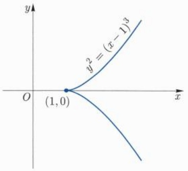

在实际应用中, (15.7.4) 式通常解释为: 如果  $x_{0}$  为条件极值点, 则  $(\boldsymbol{x}_{0}, \boldsymbol{\lambda})$  为如下辅助函数的驻点:

$$
F (\boldsymbol {x}, \boldsymbol {\lambda}) = f (\boldsymbol {x}) - \sum_ {i = 1} ^ {m} \lambda_ {i} \cdot \varphi_ {i} (\boldsymbol {x}).
$$

例15.7.1 求圆周 $(x - 1)^2 + y^2 = 1$ 上的点与固定点(0,1)的距离的最大值和最小值.

解 在约束条件 $(x - 1)^2 + y^2 - 1 = 0$ 下求距离函数 $d = \sqrt{x^2 + (y - 1)^2}$ 的最大值和最小值. 考虑辅助函数

$$
F (x, y, \lambda) = x ^ {2} + (y - 1) ^ {2} - \lambda ((x - 1) ^ {2} + y ^ {2} - 1),
$$

求其驻点:

$$
F _ {x} = F _ {y} = F _ {\lambda} = 0 \Longleftrightarrow \left\{ \begin{array}{l l} x - \lambda (x - 1) = 0, \\ y - 1 - \lambda y = 0, \\ (x - 1) ^ {2} + y ^ {2} - 1 = 0 \end{array} \right. \Longrightarrow \left\{ \begin{array}{l l} x = \frac {- \lambda}{1 - \lambda}, \\ y = \frac {1}{1 - \lambda}, \\ \lambda = 1 \pm \sqrt {2}. \end{array} \right.
$$

在驻点处 $d^2 = \lambda^2$ ，即 $d = |\lambda|$ .由于 $d$ 在圆周上达到最大值和最小值，故其最大值必为 $\sqrt{2} +1$ ，最小值必为 $\sqrt{2} -1$ □

例 15.7.2 设  $\alpha_{i}>0, x_{i}>0, i=1,\cdots,n.$  证明:

$$
x _ {1} ^ {\alpha_ {1}} \dots x _ {n} ^ {\alpha_ {n}} \leqslant \left(\frac {\alpha_ {1} x _ {1} + \cdots + \alpha_ {n} x _ {n}}{\alpha_ {1} + \cdots + \alpha_ {n}}\right) ^ {\alpha_ {1} + \dots + \alpha_ {n}},
$$

等号成立当且仅当  $x_{1}=x_{2}=\cdots=x_{n}$ .

证明 考虑函数 $f(x_{1},\dots ,x_{n}) = \ln (x_{1}^{\alpha_{1}}\dots x_{n}^{\alpha_{n}}) = \sum_{i = 1}^{n}\alpha_{i}\ln x_{i}$ 在约束条件 $\sum_{i = 1}^{n}\alpha_{i}x_{i} = c(c > 0)$ 下的条件极值.令

$$
F (x, \lambda) = \sum_ {i = 1} ^ {n} \alpha_ {i} \ln x _ {i} - \lambda \Big (\sum_ {i = 1} ^ {n} \alpha_ {i} x _ {i} - c \Big),
$$

求驻点:

$$
F _ {x _ {i}} = F _ {\lambda} = 0 \quad \Longrightarrow \quad \frac {\alpha_ {i}}{x _ {i}} = \lambda \alpha_ {i}, \quad \sum_ {i = 1} ^ {n} \alpha_ {i} x _ {i} - c = 0,
$$

即  $x_{i}=c\left(\sum_{i=1}^{n}\alpha_{i}\right)^{-1}, i=1,2,\cdots,n.$  因为在集合  $D: x_{i} \geqslant 0, \sum_{i=1}^{n} \alpha_{i} x_{i}=c$  的边界上，f 取值为  $-\infty,$  因此 f 在 D 的内部取到最大值，上述唯一驻点必为最大值点，从而

$$
\ln (x _ {1} ^ {\alpha_ {1}} \dots x _ {n} ^ {\alpha_ {n}}) \leqslant \sum_ {i = 1} ^ {n} \alpha_ {i} \ln c \Big (\sum_ {i = 1} ^ {n} \alpha_ {i} \Big) ^ {- 1},
$$

整理以后即得欲证不等式.

由于在Lagrange乘数法中，条件极值问题转化为

$$
F (\boldsymbol {x}) = f (\boldsymbol {x}) - \sum_ {j = 1} ^ {m} \lambda_ {j} \varphi_ {j} (\boldsymbol {x})
$$

的普通极值问题. 当  $x_{0}$  是驻点时,  $\lambda_{j}, j=1,2,\cdots,m$  是 m 个常数, 因此我们利用  $F(\boldsymbol{x})$  在  $x_{0}$  处的 Hesse 矩阵  $\boldsymbol{H}_{F}(\boldsymbol{x}_{0})$  来判定  $x_{0}$  是否为极值点: 可以证明, 当  $\boldsymbol{H}_{F}(\boldsymbol{x}_{0})$  正定时, 条件极值点为极小值点;  $\boldsymbol{H}_{F}(\boldsymbol{x}_{0})$  负定时, 条件极值为极大值点. 值得注意的是当  $\boldsymbol{H}_{F}(\boldsymbol{x}_{0})$  不定时, 对于无条件极值, 此时  $x_{0}$  的极值性不可得知, 但是, 对于条件极值仍可能取到.

例如, 设 $f(x,y) = x^{2} - y^{2}, \varphi(x,y) = y \equiv 0$, 则 $\varphi(x,y) = 0$ 确定直线方程 $y = 0$, 显然 $f(x,0) = x^{2}$ 在 $(0,0)$ 处取极小值 0. 容易算出 $F(x,y) = x^{2} - y^{2} - \lambda y$ 的 Hesse 矩阵在 $(0,0)$ 处为对角矩阵 $\mathrm{diag}(2,-2)$, 这是一个不定矩阵.

另外, 如果约束条件中有不可微点或者退化点, 那么在这些点上, 条件极值要单独考虑. 例如, 考虑函数 $f(x, y) = x^2 + y^2$ 在条件 $\varphi(x, y) = (x - 1)^3 - y^2 = 0$ 限制下的最小值.

记 $F(x,y,\lambda) = f(x,y) - \lambda \varphi (x,y)$ .直接计算可以发现，方程组

$$
F _ {x} (x, y) = 0, \quad F _ {y} (x, y) = 0, \quad \varphi (x, y) = 0
$$

没有解.但是注意到 $f(x,y)$ 本质上是原点到曲线 $\Sigma : \varphi (x,y) = 0$ 上点 $(x,y)$ 的距离（的平方），所以 $f(x,y)$ 显然在曲线 $\Sigma$ 上的尖点(1,0)处有最小值（注意(1,0)处$F_{x}(1,0)\neq 0)$ .见图15.10.

text_image

y
y² = (x - 1)³
O
(1,0)
x

图15.10 条件极值退化点的情况

## 习题 15.7

1. 求下列函数在指定约束条件下的极值  $(a, b, c > 0)$ :

(1) $f(x,y) = xy, \quad x + y = 1.$

(2)  $f(x,y)=x/a+y/b,\quad x^{2}+y^{2}=1.$
(3) $f(x,y)=x^{2}+y^{2},\quad x/a+y/b=1.$
(4) $f(x,y) = \cos \pi (x + y),\quad x^{2} + y^{2} = 1.$
(5) $f(x,y,z) = x - 2y + 2z, \quad x^2 + y^2 + z^2 = 1.$
(6) $f(x,y,z) = 3x^{2} + 3y^{2} + z^{2},\quad x + y + z = 1.$
(7) $f(x,y,z) = x^{a}y^{b}z^{c},\quad x,y,z\geqslant 0,\quad x + y + z = 1.$

2. 求周长为  $2\ell$  的平面三角形的最大面积.

3. 求圆内接三角形面积最大者.

4. 称一个三角形内接于正方形是指三角形的三个顶点均落在正方形的边界上. 给定一个单位正方形, 试在所有的内接等边三角形中, 求出边长最大和边长最小的等边三角形.

5. 求原点到直线  $2x + 2y + z + 9 = 0,\quad 2x - y - 2z - 18 = 0$  的距离.

6. 求椭圆  $x^{2} + 4y^{2} = 4$  到直线  $x + y = 4$  的距离.

7. 求抛物线  $y = x^{2}$  与直线 x - y - 2 = 0 之间的最短距离.

8. 设 $a > 0$, 求曲线

$$
\left\{ \begin{array}{l} x ^ {2} + y ^ {2} = 2 a x, \\ x ^ {2} + y ^ {2} + x y = a ^ {2} \end{array} \right.
$$

上的点到 xOy 平面的最小距离和最大距离.

9. 求包含在椭圆  $\frac{x^{2}}{a^{2}} + \frac{y^{2}}{b^{2}} = 1$  内各边与坐标轴平行的矩形的最大周长.

10. 求包含在椭球 $\frac{x^2}{a^2} + \frac{y^2}{b^2} + \frac{z^2}{c^2} = 1$ 内各面与坐标面平行的长方体的最大体积、所有这样的长方体的最大表面积, 以及所有这样的长方体的最大棱长.

思考与对比: 它们是同一个长方体吗?

又问: 如果去掉“各面与坐标面平行的长方体”这一假设限制, 上述问题的结论如何?

11. 设 a > 0, 试将 a 分解为 n 个正因子, 使得其倒数之和最小.
12. 给定一个凸四边形, 试在其内求一点 $P$, 使得 $P$ 到四个顶点的距离之平方和最小.

13. 设  $a_{1}, a_{2}, \cdots, a_{n} \geqslant 0$ ，求  $u = \sum_{i=1}^{n} a_{i} x_{i}$  在高维球面  $\sum_{i=1}^{n} x_{i}^{2} = r^{2}$  上的最大值和最小值.

14. 设 $D$ 是由两抛物线 $y = x^{2} - 1, y = -x^{2} + 1$ 所围成的闭域. 试在 $D$ 内求一形如 $\frac{x^2}{a^2} + \frac{y^2}{b^2} = 1$ 的椭圆, 使其面积最大.

15. 设  $a_{1}, a_{2}, \cdots, a_{n}$  均为正实数,  $a_{1} + \cdots + a_{n} = 2000$ . 试确定合适的 n 使得  $a_{1} \cdots a_{n}$  达到最大值. 又若要求所有的  $a_{i}$  均为自然数, 再考虑这个问题.

16. 设 $p > 1$, $\frac{1}{p} + \frac{1}{q} = 1$, 用求条件极值的办法证明 Hölder 不等式

$$
\sum_ {i = 1} ^ {n} u _ {i} v _ {i} \leqslant \left(\sum_ {i = 1} ^ {n} u _ {i} ^ {p}\right) ^ {\frac {1}{p}} \left(\sum_ {i = 1} ^ {n} v _ {i} ^ {q}\right) ^ {\frac {1}{q}}, \quad \forall u _ {i}, v _ {i} \geqslant 0, i = 1, \dots , n.
$$

17. 设  $\boldsymbol{A}=(a_{ij})_{n\times n}$  为 n 阶方阵,  $\boldsymbol{b}=(b_{1},b_{2},\cdots,b_{n})\in\mathbb{R}^{n}$ , 令

$$
f (\boldsymbol {x}) = \boldsymbol {x} \boldsymbol {A} \boldsymbol {x} ^ {\mathrm{T}} + \boldsymbol {b} \boldsymbol {x} = \sum_ {i, j = 1} ^ {n} a _ {i j} x _ {i} x _ {j} + \sum_ {i = 1} ^ {n} b _ {i} x _ {i}, \quad \boldsymbol {x} \in \mathbb {R} ^ {n}.
$$

(1) 分析 f 在  $R^{n}$  上的极值.
(2) 分析 $f$ 在约束条件 $\sum_{i=1}^{n} x_i^2 = 1$ 下的极值.

18. 求函数 $f(x, y) = \sin x + \cos y + \cos (x - y)$ 在正方形 $\left[0, \frac{\pi}{2}\right]^2$ 上的极值.

19. 设 $f(x, y) = 3x^4 - 4x^2y + y^2$. 证明: 限制在每一条过原点的直线上, 原点是 $f$ 的极小值点, 但是函数 $f$ 在原点处不取极小值. 在 $xOy$ 平面上, 画出点集

$$
P = \{(x, y) | f (x, y) > 0 \}, \quad Q = \{(x, y) | f (x, y) <   0 \}.
$$

20. 求由隐函数 $2x^{2} + y^{2} + z^{2} + 2xy - 2x - 2y - 4z + 4 = 0$ 所确定的函数 $z = z(x,y)$ 的极值.

21. (一般情况下的最小二乘法) 设  $(x_{i}, y_{i}) (i = 0, 1, 2, \cdots, n)$  为平面  $R^{2}$  上  $n + 1$  个互异点, 求一个 m (m < n) 次多项式  $Y = a_{0} + a_{1}x + \cdots + a_{m}x^{m}$ , 使得  $F(\boldsymbol{a}) = \sum_{i=0}^{n} (Y_{i} - y_{i})^{2}$  最小, 其中  $\boldsymbol{a} = (a_{0}, \cdots, a_{m}), Y_{i} = a_{0} + a_{1}x_{i} + \cdots + a_{m}x_{i}^{m} (i = 0, 1, \cdots, n)$ .

22. (1) 求把一个等边三角形面积二等分的所有直线段的最短长度.

(2) 求把一个等边三角形面积二等分的所有二折线段的最短长度.
(3) 求把一个等边三角形面积二等分的所有曲线的最短长度.

## 15.8 多元微分学在几何上的应用

在本章最后一节, 我们来讨论一下多元微分学在几何上的应用. 主要包括用解析的方法讨论空间曲线的切线和法平面, 以及曲面的切平面和法线.

## 空间曲线的切线和法平面

$\mathbb{R}^n$ 空间中的一条曲线 $\Gamma$ 是指 $[0,1] \to \mathbb{R}^n$ 的一个连续映射

$$
\Gamma : \gamma (t) = (x _ {1} (t), x _ {2} (t), \dots , x _ {n} (t)), \quad t \in [ 0, 1 ], \tag {15.8.1}
$$

$t$ 称为参数. 当 $n = 2,3$ 时, 即我们熟悉的平面曲线和三维空间曲线.

我们知道, 一般来说, 如果仅仅要求 $\gamma(t)$ 是一个连续映射, 则几何上我们称为连续曲线. 连续曲线有可能是非常复杂的, 比如, 它可以是不可求长的, 可以如 Peano 曲线那样充满平面或空间中某个区域. 不可求长曲线一定是其光滑性不够好, 比如 $\gamma(t)$ 不可能是逐段 $C^1[0,1]$ 的, Peano 曲线中的映射 $\gamma(t)$ 不可能是 $1 - 1$ 的.

由于我们的目的是探讨多元微分学在几何上的应用, 因此在下面的讨论中, 我们约定: 由连续映射 (15.8.1) 给出的曲线 $\Gamma$ 是简单的和可微的. $\Gamma$ 称为简单的是指, $\forall t_1 \in (0,1), t_2 \in [0,1]$, 当 $t_1 \neq t_2$ 时, 都有 $\gamma(t_1) \neq \gamma(t_2)$. 进一步, 若对 $t_1 \neq t_2$, 有 $\gamma(t_1) \neq \gamma(t_2)$, 同时还有 $\gamma(0) = \gamma(1)$, 则 $\Gamma$ 称为一条 Jordan 闭曲线; $\Gamma$ 称为可微的是指 $\gamma(t)$ 作为映射是可微的, 这等价于 $x_i(t) (i=1,2,\cdots,n)$ 是可微函数.

下面我们考虑如何寻求由(15.8.1)给出的曲线 $\Gamma$ 在点 $P_0 = \gamma (t_0)$ 处的切线.由于切线是通过割线的极限状态来定义的，因此，在曲线 $\Gamma$ 上任取一点 $P = \gamma (t)$ ，考虑由 $P$ 与 $P_{0}$ 两点确定的割线 $L_{P_0P}$

$$
\frac {x _ {1} - x _ {\mathrm{i}} (t _ {0})}{x _ {1} (t) - x _ {1} (t _ {0})} = \dots = \frac {x _ {n} - x _ {n} (t _ {0})}{x _ {n} (t) - x _ {n} (t _ {0})},
$$

其中  $(x_{1}, x_{2}, \cdots, x_{n})$  是  $L_{P_{0}P}$  上的动点坐标. 在上式中分母同除以  $t - t_{0}$  并取  $t \rightarrow t_{0}$  的极限, 根据  $\Gamma$  的可微性假设, 有下式成立:

$$
\frac {x _ {1} - x _ {1} (t _ {0})}{x _ {1} ^ {\prime} (t _ {0})} = \dots = \frac {x _ {n} - x _ {n} (t _ {0})}{x _ {n} ^ {\prime} (t _ {0})}.
$$

这就是曲线  $\Gamma$  在  $P_{0}$  处的切线方程.

可以看出

$$
\gamma^ {\prime} (t _ {0}) = (x _ {1} ^ {\prime} (t _ {0}), x _ {2} ^ {\prime} (t _ {0}), \dots , x _ {n} ^ {\prime} (t _ {0}))
$$

恰好为曲线 $\Gamma$ 在 $P_0$ 处的切向量.

我们同时也得到了曲线 $\Gamma$ 在 $P_0$ 处的法平面方程:即过 $P_0$ 点以切向量为法向的平面方程

$$
\gamma^ {\prime} (t _ {0}) \cdot (\boldsymbol {x} - \boldsymbol {x} (t _ {0})) = 0.
$$

例 15.8.1 一元函数图像的切线.设 f 为一元可微函数，令  $\gamma(t)=(t,f(t))$ ，则  $\gamma'(t_{0})=(1,f'(t_{0}))$ ， $\gamma(t)$  在  $t_{0}$  处切线方程为

$$
\frac {x - t _ {0}}{1} = \frac {y - f (t _ {0})}{f ^ {\prime} (t _ {0})},
$$

即 $y = f(t_0) + f'(t_0)(x - t_0)$，这也就是一元函数图像的切线。此时的法平面表现为法线，其表达式为

$$
x - t _ {0} + f ^ {\prime} (t _ {0}) (y - f (t _ {0})) = 0.
$$

例 15.8.2 设 a > 0, 求螺旋线  $\gamma(t) = (a \cos t, a \sin t, t)$  的切线和法平面方程.

解 在 $t = t_0$ 处, $\gamma'(t_0) = (-a\sin t_0, a\cos t_0, 1)$, 故切线方程为

$$
\frac {x - a \cos t _ {0}}{- a \sin t _ {0}} = \frac {y - a \sin t _ {0}}{a \cos t _ {0}} = \frac {z - t _ {0}}{1},
$$

法平面方程化简后为 $z = (a\sin t_0)x - (a\cos t_0)y + t_0.$

作为一种特殊情况, 下面我们讨论三维空间中由两个曲面交线形成的曲线的切线方程. 假设  $F_{1}$  与  $F_{2}$  均为区域  $D \subseteq R^{3}$  上的可微函数, 考虑由方程组

$$
F _ {1} (x, y, z) = 0, \quad F _ {2} (x, y, z) = 0, \quad (x, y, z) \in D
$$

定义的点集.

我们知道, 当

$$
\boldsymbol {F} ^ {\prime} (\boldsymbol {x} _ {0}) = \binom{F _ {1} ^ {\prime} (\boldsymbol {x} _ {0})}{F _ {2} ^ {\prime} (\boldsymbol {x} _ {0})} = \left( \begin{array}{c c c} \frac {\partial F _ {1}}{\partial x} & \frac {\partial F _ {1}}{\partial y} & \frac {\partial F _ {1}}{\partial z} \\ \frac {\partial F _ {2}}{\partial x} & \frac {\partial F _ {2}}{\partial y} & \frac {\partial F _ {2}}{\partial z} \end{array} \right) _ {\boldsymbol {x} _ {0}}
$$

的秩为2时，由隐函数组存在定理，在 $x_0 = (x_0, y_0, z_0)$ 附近，存在两个变量可确定为第三个变量的函数，从而该方程组能确定一条过 $x_0 = (x_0, y_0, z_0)$ 的曲线 $\Gamma$ ，且在 $x_0$ 附近 $\Gamma$ 可以表示为参数形式 $\gamma(t) = (x(t), y(t), z(t)), t \in (a, b)$，其中

$$
\boldsymbol {x} _ {0} = (x _ {0}, y _ {0}, z _ {0}) = \boldsymbol {\gamma} (t _ {0}) = (x (t _ {0}), y (t _ {0}), z (t _ {0})).
$$

一方面我们知道曲线 $\Gamma$ 在点 $x_0$ 处的切向量为 $\gamma'(t_0) = (x'(t_0), y'(t_0), z'(t_0))$, 另一方面, 曲线 $\Gamma$ 是由方程组

$$
F _ {1} (x (t), y (t), z (t)) = 0, \quad F _ {2} (x (t), y (t), z (t)) = 0
$$

确定, 所以, 对方程组关于 t 求导, 可得  $\nabla F_{1}(\boldsymbol{x}_{0}) \cdot \boldsymbol{\gamma}'(t_{0}) = 0$ , 即

$$
\left(\frac {\partial F _ {1} (\boldsymbol {x} _ {0})}{\partial x}, \frac {\partial F _ {1} (\boldsymbol {x} _ {0})}{\partial y}, \frac {\partial F _ {1} (\boldsymbol {x} _ {0})}{\partial z}\right) (x ^ {\prime} (t _ {0}), y ^ {\prime} (t _ {0}), z ^ {\prime} (t _ {0})) = 0.
$$

同理

$$
\left(\frac {\partial F _ {2} (\boldsymbol {x} _ {0})}{\partial x}, \frac {\partial F _ {2} (\boldsymbol {x} _ {0})}{\partial y}, \frac {\partial F _ {2} (\boldsymbol {x} _ {0})}{\partial z}\right) (x ^ {\prime} (t _ {0}), y ^ {\prime} (t _ {0}), z ^ {\prime} (t _ {0})) = 0.
$$

因此 $\Gamma$ 在点 $x_0$ 处的切向量 $\gamma'(t_0)$ 应该与向量 $F_{1}^{\prime}(x_{0})\times F_{2}^{\prime}(x_{0})$ 平行.直接计算可得

$$
F _ {1} ^ {\prime} (\boldsymbol {x} _ {0}) \times F _ {2} ^ {\prime} (\boldsymbol {x} _ {0}) = (A, B, C) = \left(\frac {\partial (F _ {1} , F _ {2})}{\partial (y , z)}, \frac {\partial (F _ {1} , F _ {2})}{\partial (z , x)}, \frac {\partial (F _ {1} , F _ {2})}{\partial (x , y)}\right) _ {\boldsymbol {x} _ {0}}.
$$

所以曲线 $\Gamma$ 在 $x_0$ 处的切线方程为

$$
\frac {x - x _ {0}}{A} = \frac {y - y _ {0}}{B} = \frac {z - z _ {0}}{C},
$$

而法平面方程为

$$
A (x - x _ {0}) + B (y - y _ {0}) + C (z - z _ {0}) = 0.
$$

## 曲面的切平面和法线

下面我们讨论一下三维空间中两种常见情形的曲面的切平面和法线.

## 1. 形如 $F(x, y, z) = 0$ 的曲面

设 $\mathbb{R}^3$ 中的曲面 $S$ 是由方程 $F(x,y,z) = 0$ 给出, 其中函数 $F(x,y,z)$ 是区域 $D \subseteq \mathbb{R}^3$ 上的连续可微函数. 设 $\pmb{x}_0 = (x_0, y_0, z_0) \in D$ 且在曲面 $S$ 上, 即 $F(x_0, y_0, z_0) = 0$. 我们来求过点 $\pmb{x}_0$ 的切平面方程和法线方程.

为此, 在 $S$ 上任取一条过 $\pmb{x}_0$ 的空间光滑曲线 $\Gamma: \gamma(t) = (x(t), y(t), z(t)), t \in (a, b)$. 设 $t_0 \in (a, b)$ 满足 $\gamma(t_0) = \pmb{x}_0$. 故有

$$
F (\gamma (t)) = F (x (t), y (t), z (t)) \equiv 0, \quad \forall t \in (a, b).
$$

将该方程在 $t_0$ 处求导, 可得

$$
\nabla F (\boldsymbol {x} _ {0}) \cdot \boldsymbol {\gamma} ^ {\prime} (t _ {0}) = 0.
$$

这说明满足上述条件的任何一条曲线 $\Gamma$ 在 $x_0$ 处的切向量都与固定向量 $\nabla F(x_0)$ 正交. 如果 $\nabla F(x_0)$ 是非零向量, 那么上式表明曲面 $S$ 过 $x_0$ 的任何光滑曲线的切向量与固定向量 $\nabla F(x_0)$ 正交. 因此, $S$ 上过 $x_0$ 点的任何光滑曲线在该点处的切线都在平面

$$
\pi : \quad \nabla F (\boldsymbol {x} _ {0}) \cdot (\boldsymbol {x} - \boldsymbol {x} _ {0}) = 0
$$

上. 平面 $\pi$ 很自然地被称为曲面 $S$ 在 $\pmb{x}_0$ 处的切平面, 而直线

$$
\ell : \quad \frac {x - x _ {0}}{F _ {x} (\boldsymbol {x} _ {0})} = \frac {y - y _ {0}}{F _ {y} (\boldsymbol {x} _ {0})} = \frac {z - z _ {0}}{F _ {z} (\boldsymbol {x} _ {0})}
$$

称为 S 在  $x_{0}$  处的法线.

## 2. 由参数方程给出的曲面

考虑 $\mathbb{R}^3$ 中由双参数 $(u,v)\in D\subseteq \mathbb{R}^2$ 给出的曲面 $S:\pmb {x} = \pmb {x}(u,v)$ ，其分量形式为

$$
S: \quad x = x (u, v), \quad y = y (u, v), \quad z = z (u, v),
$$

其中 $D$ 是 $\mathbb{R}^2$ 中的区域. 假设所有的分量函数 $x(u,v), y(u,v)$ 和 $z(u,v)$ 都是 $D$ 上的 $C^1(D)$ 函数, 我们来求曲面 $S$ 在点

$$
\boldsymbol {x} _ {0} = (x _ {0}, y _ {0}, z _ {0}) = (x (u _ {0}, v _ {0}), y (u _ {0}, v _ {0}), z (u _ {0}, v _ {0})), \quad (u _ {0}, v _ {0}) \in D
$$

处的切平面与法线方程. 为此, 在 S 上取两条特别的曲线:

$$
\Gamma_ {1}:   \pmb {x} = \pmb {x} (u, v _ {0}) \quad {\text {和}} \quad \Gamma_ {2}:   \pmb {x} = \pmb {x} (u _ {0}, v).
$$

它们在 $x_0$ 处的切向量分别为

$$
\pmb {x} _ {u} ^ {0} = (x _ {u} (u _ {0}, v _ {0}), y _ {u} (u _ {0}, v _ {0}), z _ {u} (u _ {0}, v _ {0})) \quad \text {和} \quad \pmb {x} _ {v} ^ {0} = (x _ {v} (u _ {0}, v _ {0}), y _ {v} (u _ {0}, v _ {0}), z _ {v} (u _ {0}, v _ {0})).
$$

如果它们不平行, 则它们对应的切线将确定 $S$ 在 $\pmb{x}_0$ 处的切平面 $\pi$ 和法向量 $\pmb{n}$.

$$
\boldsymbol {n} = \boldsymbol {x} _ {u} ^ {0} \times \boldsymbol {x} _ {v} ^ {0} = \left| \begin{array}{c c c} \boldsymbol {i} & \boldsymbol {j} & \boldsymbol {k} \\ x _ {u} & y _ {u} & z _ {u} \\ x _ {v} & y _ {v} & z _ {v} \end{array} \right| _ {(u _ {0}, v _ {0})}.
$$

故当

$$
\left( \begin{array}{c c c} x _ {u} & y _ {u} & z _ {u} \\ x _ {v} & y _ {v} & z _ {v} \end{array} \right) _ {(u _ {0}, v _ {0})}
$$

的秩为 2 时, 记

$$
A = \frac {\partial (y , z)}{\partial (u , v)} \Big | _ {(u _ {0}, v _ {0})}, \quad B = \frac {\partial (z , x)}{\partial (u , v)} \Big | _ {(u _ {0}, v _ {0})}, \quad C = \frac {\partial (x , y)}{\partial (u , v)} \Big | _ {(u _ {0}, v _ {0})},
$$

则曲面 $S$ 在 $\pmb{x}_0$ 处的切平面 $\pi$ 的方程与法线 $L$ 的方程分别为

$$
\pi : \quad (A, B, C) \cdot (\boldsymbol {x} - \boldsymbol {x} _ {0}) = A (x - x _ {0}) + B (y - y _ {0}) + C (z - z _ {0}) = 0
$$

和

$$
L: \quad \frac {x - x _ {0}}{A} = \frac {y - y _ {0}}{B} = \frac {z - z _ {0}}{C}.
$$

通常我们又把切平面 $\pi$ 的方程改写为下面行列式的表示形式:

$$
\left| \begin{array}{c c c} x - x _ {0} & y - y _ {0} & z - z _ {0} \\ x _ {u} & y _ {u} & z _ {u} \\ x _ {v} & y _ {v} & z _ {v} \end{array} \right| _ {(u _ {0}, v _ {0})} = 0.
$$

例15.8.3 考虑一种特殊的由显式方程给出的曲面 $S: z = f(x, y), (x, y) \in D \subseteq \mathbb{R}^2$，其中 $f(x, y) \in C^1(D)$. 将其写成参数形式

$$
x = x, \quad y = y, \quad z = f (x, y), \quad (x, y) \in D.
$$

则曲面 $S$ 过点 $P_{0}(x_{0},y_{0},z_{0})$ 的切平面方程可以写成

$$
\left| \begin{array}{c c c} x - x _ {0} & y - y _ {0} & z - z _ {0} \\ 1 & 0 & f _ {x} (x _ {0}, y _ {0}) \\ 0 & 1 & f _ {y} (x _ {0}, y _ {0}) \end{array} \right| = 0,
$$

即

$$
z = z _ {0} + f _ {x} (x _ {0}, y _ {0}) (x - x _ {0}) + f _ {y} (x _ {0}, y _ {0}) (y - y _ {0}).
$$

曲面 $S$ 过点 $P_{0}(x_{0},y_{0},z_{0})$ 的法线方程可以表示为

$$
\frac {x - x _ {0}}{- f _ {x} (x _ {0} , y _ {0})} = \frac {y - y _ {0}}{- f _ {y} (x _ {0} , y _ {0})} = \frac {z - z _ {0}}{1}.
$$

## 习题 15.8

1. 求下列曲线在指定点的切线和法平面方程:

(1) $\sigma(t) = (a\cos t\sin t, b\sin^2 t, c\cos t), \quad t = \frac{\pi}{4}$.
(2)  $\boldsymbol{\sigma}(t)=(t,t^{2},t^{3}),\quad t=t_{0}.$
(3)  $\boldsymbol{\sigma}(t)=(a\cos t,a\sin t),\quad t=t_{0}.$

2. 求下列曲面在指定点的切平面和法线方程:

(1)  $r(u, v) = (u, a \cos v, a \sin v), \quad (u, v) = (u_0, v_0).$
(2) $z = x^{2} + y^{2},\quad (x,y,z) = (1,2,5)$
(3)  $r(u,v) = (a \sin u \cos v, b \sin u \sin v, c \cos u), \quad (u,v) = (u_{0}, v_{0}).$

3. 求下列曲面在指定点的切平面:

(1) $x^{3} + 2xy^{2} - 7z^{3} + 3y + 1 = 0, (x,y,z) = (1,1,1)$.
(2) $(x^{2} + y^{2})^{2} + x^{2} - yz + 7xy + 3x + z^{4} - z = 14,\quad (x,y,z) = (1,1,1).$
(3) $\sin^2 x + \cos (y + z) = \frac{3}{4},\quad (x,y,z) = \left(\frac{\pi}{6},\frac{\pi}{3},0\right)$.
(4) $x^{2} + y^{2} = z^{2} + \sin z, (x,y,z) = (0,0,0)$.

4. 求下列曲线在指定点的切线:

(1) $x^{2} + y^{2} + z^{2} = 3x, \quad 2x - 3y + 5z = 4, \quad (x,y,z) = (1,1,1)$.
(2) $x^{2} + z^{2} = 10, \quad y^{2} + z^{2} = 10, \quad (x,y,z) = (1,1,3)$.
(3) $3x^{2} + 3y^{2} - z^{2} = 32, \quad x^{2} + y^{2} = z^{2}, \quad (x,y,z) = (\sqrt{7},3,4)$.

5. 求出下列曲面在指定点处的法向量和切平面方程:

(1) $x^{2} + y^{2} + z^{2} = 4, \quad P_{0}(1,1,\sqrt{2}).$
(2) $z = \arctan \frac{y}{x},\quad P_0\left(1,1,\frac{\pi}{4}\right).$
(3) $3x^{2}+2y^{2}-2z-1=0,\quad P_{0}(1,1,2).$
(4) $z = y + \ln \frac{x}{z},\quad P_0(1,1,1).$

6. 求出椭球面 $x^{2} + 2y^{2} + 3z^{2} = 21$ 上所有平行于平面 $x + 4y + 6z = 0$ 的切平面.

7. 证明: 曲面  $z = x e^{x/y}$  上所有切平面都通过原点.

8. 定出常数 $\lambda$, 使曲面 $xyz = \lambda$ 与椭球面

$$
\frac {x ^ {2}}{a ^ {2}} + \frac {y ^ {2}}{b ^ {2}} + \frac {z ^ {2}}{c ^ {2}} = 1
$$

在某一点相切, 即有共同的切平面.

9. 两相交曲面在交点处的法向量所夹的角称为这两曲面在该点的夹角. 求柱面 $x^{2} + y^{2} = a^{2}$ 与曲面 $bz = xy$ 的夹角.

10. 求椭球面

$$
\frac {x ^ {2}}{a ^ {2}} + \frac {y ^ {2}}{b ^ {2}} + \frac {z ^ {2}}{c ^ {2}} = 1
$$

上点的法向量与 x 轴和 z 轴夹成等角的点的全体.

11. 求曲面 $x^{2} + y^{2} + z^{2} = x$ 的切平面, 使其垂直于平面 $x - y - z = 2$ 和 $x - y - \frac{z}{2} = 2$.

12. 证明: 曲面 $\sqrt{x + \sqrt{y + \sqrt{z}}} = \sqrt{a} (a > 0)$ 的切平面在各坐标轴上割下的诸线段之和为常数.

13. 证明: 曲面 $F(x - ax, y - bz) = 0$ 的所有切平面与某一直线平行, 其中 $a, b$ 为常数.

14. 证明: 曲面

$$
F \left(\frac {x - a}{z - c}, \frac {y - b}{z - c}\right) = 0
$$

的切平面通过一定点, 其中 a, b, c 为常数.

15. 设  $R^{3}$  中的曲面在柱面坐标下的方程为  $F(r,\theta,z)=0$ ，其中 F 是可微函数。试求  $(r_{0},\theta_{0},z_{0})$  所对应曲面上的点处的切平面与法线方程。

16. 设曲面 $S$ 由 $F(x, y, z) = 0$ 给出, 其中 $F(x, y, z)$ 是区域 $D \subseteq \mathbb{R}^3$ 内的连续可微函数并且当 $(x_0, y_0, z_0) \in D$ 时, $F'(x_0, y_0, z_0) \neq \mathbf{0}$. 证明: 曲面 $S$ 在 $(x_0, y_0, z_0)$ 处的切平面上过 $(x_0, y_0, z_0)$ 的任何一条直线都是曲面上某光滑曲线的切线.

## 参考文献

[1] SAYEL A A. The mth ratio test: new convergence tests for series. The American Mathematical Monthly, 2008, 115(6): 514–524.
[2] 波利亚, 舍贵. 数学分析中的问题和定理: 第一卷. 张奠宙, 宋国栋, 等, 译. 上海: 上海科学技术出版社, 1981.
[3] 陈传章, 金福临, 朱学炎, 等. 数学分析: 上册. 2 版. 北京: 高等教育出版社, 1983.
[4] 陈传章, 金福临, 朱学炎, 等. 数学分析: 下册. 2 版. 北京: 高等教育出版社, 1983.
[5] 陈纪修, 於崇华, 金路. 数学分析: 上册. 3 版. 北京: 高等教育出版社, 2019.
[6] 陈纪修, 於崇华, 金路. 数学分析: 下册. 3 版. 北京: 高等教育出版社, 2019.
[7] 陈天权. 数学分析讲义: 第一册. 北京: 北京大学出版社, 2009.
[8] 陈天权. 数学分析讲义: 第二册. 北京: 北京大学出版社, 2010.
[9] 陈天权. 数学分析讲义: 第三册. 北京: 北京大学出版社, 2010.
[10] 程艺, 陈卿, 李平. 数学分析讲义: 第一册. 北京: 高等教育出版社, 2019.
[11] 程艺, 陈卿, 李平. 数学分析讲义: 第二册. 北京: 高等教育出版社, 2020.
[12] 程艺, 陈卿, 李平, 等. 数学分析讲义: 第三册. 北京: 高等教育出版社, 2020.
[13] 常庚哲, 史济怀. 数学分析教程: 上册. 3 版. 合肥: 中国科学技术大学出版社, 2012.
[14] 常庚哲, 史济怀. 数学分析教程: 下册. 3 版. 合肥: 中国科学技术大学出版社, 2013.
[15] 崔尚斌. 数学分析教程: 上册. 北京: 科学出版社, 2013.
[16] 崔尚斌. 数学分析教程: 中册. 北京: 科学出版社, 2013.
[17] 崔尚斌. 数学分析教程: 下册. 北京: 科学出版社, 2013.
[18] 布雷苏. 微积分溯源: 伟大思想的历程. 陈见柯, 林开亮, 叶卢庆, 译. 北京: 人民邮电出版社, 2022.
[19] 丁传松, 李秉彝, 布伦. 实分析导论. 北京: 科学出版社, 1998.
[20] DUNHAM W. 微积分的历程: 从牛顿到勒贝格. 李伯民, 汪军, 张怀勇, 译. 北京: 人民邮电出版社, 2010.
[21] 菲赫金哥尔茨. 微积分学教程 (第 8 版): 第一卷. 杨弢亮, 叶彦谦, 译. 北京: 高等教育出版社, 2006.
[22] 菲赫金哥尔茨. 微积分学教程 (第 8 版): 第二卷. 徐献瑜, 冷生明, 梁文骐, 译. 北京: 高等教育出版社, 2006.
[23] 菲赫金哥尔茨. 微积分学教程 (第 8 版): 第三卷. 路见可, 余家荣, 吴亲仁, 译. 北京: 高等教育出版社, 2006.
[24] 郝兆宽, 杨睿之, 杨跃. 数理逻辑证明及其限度. 上海: 复旦大学出版社, 2014.
[25] 华东师范大学数学系. 数学分析: 上册. 5 版. 北京: 高等教育出版社, 2019.
[26] 华东师范大学数学系. 数学分析: 下册. 5 版. 北京: 高等教育出版社, 2019.
[27] 郁中丹, 刘永平, 王昆扬. 简明数学分析. 2 版. 北京: 高等教育出版社, 2009.
[28] 黄玉民, 李成章. 数学分析. 2 版. 北京: 科学出版社, 2004.
[29] HUNT R A. On the convergence of Fourier series//Proceedings of the Conference on Orthogonal Expansions and Their Continuous Analogues. Carbondale: Southern Illinois University Press, 1968: 235–255.
[30] HUYNH E. A second Raabe's test and other series tests. The American Mathematical Monthly, 2022, 129(9): 865–875.
[31] 吉林大学数学系. 数学分析: 上册. 北京: 人民教育出版社, 1978.
[32] 吉林大学数学系. 数学分析: 中册. 北京: 人民教育出版社, 1978.
[33] 吉林大学数学系. 数学分析: 下册. 北京: 人民教育出版社, 1978.
[34] KOLMOGOROFF A N. Une série de Fourier-Lebesgue divergente presque partout. Fundamenta Mathematicae, 1923(4): 324–328.
[35] KOLMOGOROFF A N. Une série de Fourier-Lebesgue divergente partout. Comptes Rendus de l'Académie des Sciences Paris, 1926, 183: 1327–1328.
[36] KÖRNER T W. Uniqueness for trigonometric series. Annals of Mathematics, 1987, 126(1): 1–34.
[37] 李逸. 基本分析讲义:第一卷 上册. 北京:高等教育出版社，2025.
[38] 李逸. 基本分析讲义:第一卷 下册. 北京:高等教育出版社，2025.
[39] 刘玉琏, 傅沛仁, 林玎, 等. 数学分析讲义: 上册. 5 版. 北京: 高等教育出版社, 2008.
[40] 刘玉琏, 傅沛仁, 林玎, 等. 数学分析讲义: 下册. 5 版. 北京: 高等教育出版社, 2008.
[41] 楼红卫. 数学分析——要点·难点·拓展. 北京: 高等教育出版社, 2020.
[42] 楼红卫. 微积分进阶. 北京: 科学出版社, 2009.
[43] 楼红卫. 数学分析: 上册. 北京: 高等教育出版社, 2022.
[44] 楼红卫. 数学分析: 下册. 北京: 高等教育出版社, 2023.
[45] 楼红卫. 数学分析技巧选讲. 北京: 高等教育出版社, 2022.
[46] 梅加强. 数学分析. 2 版. 北京: 高等教育出版社, 2020.
[47] 欧阳光中, 朱学炎, 秦曾复. 数学分析: 上册. 上海: 上海科学技术出版社, 1983.
[48] 欧阳光中, 朱学炎, 秦曾复. 数学分析: 下册. 上海: 上海科学技术出版社, 1982.
[49] 裴礼文. 数学分析中的典型问题与方法. 3 版. 北京: 高等教育出版社, 2021.
[50] PRUS-WIŚNIOWSKI F. A refinement of Raabe's test. The American Mathematical Monthly, 2008, 115(3): 249–252.
[51] 齐民友. 重温微积分. 北京: 高等教育出版社, 2004.
[52] RUDIN W. 数学分析原理（原书第3版）. 赵慈庚, 蒋铎, 译. 北京: 机械工业出版社, 2004.
[53] SCHRAMM M, TROUTMAN J, WATERMAN D. Segmentally alternating series. The American Mathematical Monthly, 2014, 121(8): 717–722.
[54] 佘志坤. 全国大学生数学竞赛参赛指南. 北京: 科学出版社, 2022.
[55] 余志坤. 全国大学生数学竞赛解析教程（数学专业类）——数学分析:上册. 北京:科学出版社，2024.
[56] STUART C. An inequality involving  $\sin(n)$ . The American Mathematical Monthly, 2018, 125(2): 173–174.
[57] 陶哲轩. 陶哲轩实分析. 王昆扬, 译. 北京: 人民邮电出版社, 2008.
[58] TRENCH W F. Introduction to Real Analysis. Upper Saddle River: Prentice Hall, 2003.
[59] 王昆扬. 数学分析简明教材. 北京: 高等教育出版社, 2015.
[60] WATSON G N. A Treatise on the Theory of Bessel Functions. 2nd ed. Cambridge: Cambridge University Press, 1944.
[61] 伍胜健. 数学分析: 第一册. 北京: 北京大学出版社, 2009.
[62] 伍胜健. 数学分析: 第二册. 北京: 北京大学出版社, 2010.
[63] 伍胜健. 数学分析: 第三册. 北京: 北京大学出版社, 2010.
[64] 小平邦彦. 微积分入门 I: 一元微积分. 裴东河, 译. 北京: 人民邮电出版社, 2008.
[65] 小平邦彦. 微积分入门 II: 多元微积分. 裴东河, 译. 北京: 人民邮电出版社, 2008.
[66] 肖文灿. 集合论初步. 2 版. 北京: 商务印书馆, 1950.
[67] 谢惠民, 恽自求, 易法槐, 等. 数学分析习题课讲义: 上册. 2 版. 北京: 高等教育出版社, 2018.
[68] 谢惠民, 恽自求, 易法槐, 等. 数学分析习题课讲义: 下册. 2 版. 北京: 高等教育出版社, 2019.
[69] 辛钦. 数学分析八讲. 王会林, 齐民友, 译. 北京: 人民邮电出版社, 2010.
[70] 叶怀安. 连续函数列的极限函数的一个性质及其应用. 湖南数学年刊, 1985, 5(2): 87-88.
[71] 张福保, 薛星美. 数学分析 (全三册). 北京: 科学出版社, 2022.
[72] 张锦文. 公理集合论导引. 北京: 科学出版社, 1991.
[73] 张筑生. 数学分析新讲:第一册. 北京: 北京大学出版社, 1990.
[74] 张筑生. 数学分析新讲:第二册. 北京: 北京大学出版社, 1990.
[75] 张筑生. 数学分析新讲:第三册. 北京: 北京大学出版社, 1991.
[76] 周民强. 实变函数论. 3 版. 北京: 北京大学出版社, 2016.
[77] 周民强. 数学分析习题演练: 第一册. 北京: 科学出版社, 2006.
[78] 周民强. 数学分析习题演练: 第二册. 北京: 科学出版社, 2006.
[79] 卓里奇. 数学分析 (第 4 版): 第一卷. 蒋铎, 王昆扬, 周美珂, 等, 译. 北京: 高等教育出版社, 2006.
[80] 卓里奇. 数学分析 (第 4 版): 第二卷. 蒋铎, 钱佩玲, 周美珂, 等, 译. 北京: 高等教育出版社, 2006.
[81] ZYGMUND A. Trigonometric Series. 3rd ed. Cambridge: Cambridge University Press, 2002.

## 常用符号

| N | 自然数集 |
| --- | --- |
| $\mathbb{Z},\mathbb{Z}_{+}$ | 整数集,正整数集 |
| $\mathbb{Q},\mathbb{Q}_{+}$ | 有理数域,正有理数集 |
| $\mathbb{R},\mathbb{R}_{+}$ | 实数域,正实数集 |
| $\mathbb{R}^{n}$ | n维欧氏空间 |
| C | 复数域 |
| $\mathbb{C}^{n}$ | n维复空间 |
| $S^{n-1}$ | $\mathbb{R}^{n}$中单位球面,即$\{x\in\mathbb{R}^{n}\mid\\\|x\\\|=1\}$ |
| $\mathbb{S}^{n}$ | n阶实对称矩阵全体 |
| $B_{r}(x)$ | 半径为r,中心在$x\in\mathbb{R}^{n}$的开球 |
| $\overset{\circ}{B}_{r}(x)$ | 半径为r,中心在$x\in\mathbb{R}^{n}$的去心开球 |
| $I_{r}(x)$ | 边长为2r,中心在$x\in\mathbb{R}^{n}$且各边平行于坐标轴的闭方体 |
| $A^{\mathrm{T}},x^{\mathrm{T}}$ | 矩阵A,向量x的转置 |
| $x\cdot y$ | $\mathbb{R}^{n}$中向量x与y的内积,也常用$\langle x,y\rangle,x^{\mathrm{T}}y$表示 |
| $\langle x,y\rangle$ | 内积空间中两个元素x,y的内积 |
| $\\\|x\\\|_{p}$ | $\mathbb{R}^{n}$中向量$x=(x_{1},x_{2},\cdots,x_{n})^{\mathrm{T}}$的p-范数$\left(\sum_{k=1}^{n}\|x_{k}\|^{p}\right)^{\frac{1}{p}}$ |
| $\\\|A\\\|_{p}$ | 方阵$A\in\mathbb{R}^{n\times n}$的诱导范数$\\\|A\\\|_{p}:=\max_{\\\|x\\\|_{p}=1}\\\|Ax\\\|_{p}$ |
| $\\\|x\\\|$ | $\mathbb{R}^{n}$中向量x通常的范数,即$\\\|x\\\|_{2}$ |
| $\\\|A\\\|$ | 方阵$A\in\mathbb{R}^{n\times n}$通常的诱导范数$\\\|A\\\|_{2}$ |
| $\nu(E)$ | $\mathbb{R}^{n}$中Jordan可测集E的Jordan测度(容积)——长度、面积、体积 |
| $a^{+},a^{-}$ | 实数a的正部$(\|a\|+a)/2$与负部$(\|a\|-a)/2$ |
| $a\vee b,a\wedge b$ | 实数a,b的最大值和最小值 |
| Re z, Im z | 复数z=a+bi的实部a和虚部b,其中a,b为实数 |
| $\chi E$ | 集合E的特征函数,即在E上取值为1,在其余点上取值为0的函数 |
| ∃ | 存在 |
| ∀ | 对于所有 |
| ≫,≪ | 大大大于,大大小于 |
| a.e. | 几乎处处 |
| s.t. | 使得 |
| ∅ | 空集 |
| ∈,∃ | a∈E和E⇒a均表示a是E的元素 |
| ⊆,⊇ | E⊆F和F⊇E均表示集合E包含于集合F,即F包含E |
| ⊂,⊃ | E⊂F和F⊃E均表示集合E真包含于集合F,即F真包含E |
| ⊂⊂ | 集合的紧包含关系,E⊂⊂F当且仅当$\overline{E}$是F的紧子集 |
| E{φ∈F} | 表示集合{x∈E\|φ(x)∈F}.在E明确的情况下,简记为{φ∈F} |
| f(D) | 当f是映射,D是集合时,表示D的像集{f(x)\|x∈D} |
| ∩ | 集合的交,A∩B表示同时属于A和B的所有元素组成的集合 |
| ∪ | 集合的并,A∪B表示属于A或属于B的所有元素组成的集合 |
| \\ | 集合的差,A\\B表示属于A而不属于B的所有元素组成的集合 |
| C | 集合的补,C E表示在全集X明确的情况下,E的补集X\\E |
| E° | 集合E的内部,即E的内点的全体 |
| E' | 集合E的导集,即E的极限点(聚点)的全体 |
| $\overline{E}$ | 集合E的闭包 |
| ∂E | 集合E的边界 |
| αE+βF | 线性空间中集合的伸缩、代数和与代数差等,表示集合{αx+βy\|x∈E,y∈F} |
| ∑,Π | 连加号,连乘号 |
| [x],{x} | 实数x的整数部分(即不大于x的最大整数)与小数部分(即x-[x]) |
| $\overline{\lim},\underline{\lim}$ | 上极限,下极限 |
| ∫,∫ | 上积分符号,下积分符号 |
| R(I) | 区间I上的Riemann可积函数全体 |
| $\mathcal{R}^p(I)$ | 区间I上正部与负部均p次(广义)可积的函数全体 |
| $C_n^k$ | 在n个不同的元素中选取k个的组合数 |
| $C^\omega(I)$ | 区间I⊆R上的实解析函数全体 |
| $C^k(\Omega)$ | 在Ω上有k阶连续(偏)导数的函数全体 |
| $C_c^k(\Omega)$ | 在Ω上有紧支集且有k阶连续(偏)导数的函数全体 |
| $C^{k,\alpha}(\Omega)$ | 在Ω上k阶(偏)导数满足α次Hölder条件的函数全体 |