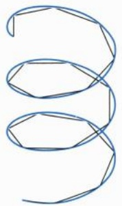

例 16.4.12 计算函数  $x^{2}$  在四维球体 B:  $x^{2} + y^{2} + z^{2} + w^{2} \leqslant 1$  上的积分.

解 根据对称性, 有

$$
\iiint_ {B} x ^ {2} \mathrm{d} x \mathrm{d} y \mathrm{d} z \mathrm{d} w = \frac {1}{4} \iiint_ {B} (x ^ {2} + y ^ {2} + z ^ {2} + w ^ {2}) \mathrm{d} x \mathrm{d} y \mathrm{d} z \mathrm{d} w,
$$

再利用四维的球面坐标以及(16.4.4)式, 得

$$
\iiint_ {B} x ^ {2} \mathrm{d} x \mathrm{d} y \mathrm{d} z \mathrm{d} w = \frac {1}{4} \int_ {0} ^ {1} r ^ {5} 4 \omega_ {4} \mathrm{d} r = \frac {1}{6} \omega_ {4} = \frac {1}{1 2} \pi^ {2}.
$$

□

## 习题 16.4

1. 设 $U$ 为 $\mathbb{R}^n$ 中的开集, $\varphi: U \to \mathbb{R}^n$ 为 $C^1$ 映射. 若 $A \subset U$ 为零测集, 证明: $\varphi(A)$ 为零测集.

2. 设 $A \subset \mathbb{R}^n$ 且为 Jordan 可测集, $\lambda \in \mathbb{R}$. 记

$$
\lambda A = \{\lambda \boldsymbol {x} \mid \boldsymbol {x} \in A \},
$$

验证  $\lambda A$  为 Jordan 可测集且  $\nu(\lambda A)=|\lambda|^{n}\nu(A)$ .

3. 设 $a_1b_2 - a_2b_1 \neq 0$, 求曲线

$$
(a _ {1} x + b _ {1} y + c _ {1}) ^ {2} + (a _ {2} x + b _ {2} y + c _ {2}) ^ {2} = 1
$$

在平面上所围区域的面积.

4. 在 $\mathbb{R}^n$ 中求椭球 $\sum_{i=1}^{n} \frac{x_i^2}{a_i^2} \leqslant 1$ 的容积, 其中 $a_i > 0$.

5. 在 $\mathbb{R}^n$ 中求由曲面 $\sum_{i=1}^{n}\left(\sum_{j=1}^{n}a_{ij}x_j\right)^2 = h^2$ 所围成的区域的容积, 其中 $\det(a_{ij}) \neq 0, h > 0$.

6. 在  $R^{n}$  中求由仿射超平面  $\sum_{j=1}^{n} a_{ij} x_{j} = \pm h_{i}, i = 1, 2, \cdots, n$  所围成的区域的容积，其中  $\det(a_{ij}) \neq 0, h_{i} > 0$ .

7. 设 $0 < p < q, 0 < a < b$, 求直线 $x + y = p, x + y = q$ 和 $y = ax, y = bx$ 所围区域的面积.

8. 计算积分  $\iint\cdots\int_{\Delta_{n}(a)}x_{1}x_{2}\cdots x_{n}\mathrm{d}x_{1}\mathrm{d}x_{2}\cdots\mathrm{d}x_{n}$ ，其中  $\Delta_{n}(a)$  为 n 维单形.

9. 计算下列区域的容积  $(a > 0)$ :

(1)  $\{|x| + |y| \leqslant a\}$ ; (2)  $\{|x| + |y| + |z| \leqslant a\}$ ; (3)  $\{|x_{1}| + |x_{2}| + \cdots + |x_{n}| \leqslant a\}$ .

10. 设 $0 < p < q, 0 < a < b$, 求抛物线 $y^{2} = px, y^{2} = qx$ 和 $x^{2} = ay, x^{2} = by$ 所围区域的面积.

11. 计算下列积分:

(1) $\iint_{A}(x - y)\mathrm{d}x\mathrm{d}y$ ， $A$ 由曲线 $y^{2} = 2x$ $x + y = 4,x + y = 12$ 围成；
(2) $\iint_{A}(x^{2} + y^{2})\mathrm{d}x\mathrm{d}y, A$ 由曲线 $x^{2} - y^{2} = 1, x^{2} - y^{2} = 2, xy = 1, xy = 2$ 围成;
(3) $\iint_{A}(x - y^2)\mathrm{d}x\mathrm{d}y, A$ 由曲线 $y = 2, y^2 - y - x = 0, y^2 + 2y - x = 0$ 围成.

12. 计算下列积分  $(a, b > 0)$ :

(1) $\iint_{A}(x^{2} + y^{2})\mathrm{d}x\mathrm{d}y, A = \{(x - a)^{2} + y^{2}\leqslant a^{2}\}$;
(2) $\iiint_{A}(x^{2} + y^{2})\mathrm{d}x\mathrm{d}y\mathrm{d}z, A$ 由 $x^{2} + y^{2} = 2z$ 与 $z = 2$ 围成;
(3) $\iint_{A} \sqrt{x^2 / a^2 + y^2 / b^2} \, \mathrm{d}x \, \mathrm{d}y, A = \left\{x^2 / a^2 + y^2 / b^2 \leqslant 1\right\}$;
(4) $\iint_{A}(x + y)\mathrm{d}x\mathrm{d}y, A = \{x^2 + y^2 \leqslant x + y\}$;

13. 求下列曲面所围区域的体积  $(a, b, c > 0)$ :

(1) $\left(x^{2} / a^{2} + y^{2} / b^{2} + z^{2} / c^{2}\right)^{2} = x^{2} / a^{2} + y^{2} / b^{2};$
(2) $(x^{2} + y^{2} + z^{2})^{2} = az;$
(3) $x^{2} / a^{2} + y^{2} / b^{2} + z / c = 1, z = 0;$
(4) $x^{2} + z^{2} = a^{2}, |x| + |y| = a.$

14. 计算下列积分  $(r, R, a, b, c > 0)$ :

(1) $\iiint_{A} \sqrt{x^2 + y^2 + z^2} \, \mathrm{d}x \, \mathrm{d}y \, \mathrm{d}z, A = \{x^2 + y^2 + z^2 \leqslant R^2\}$;
(2) $\iiint_{A}(x^{2} + y^{2})\mathrm{d}x\mathrm{d}y\mathrm{d}z, A = \{r^{2}\leqslant x^{2} + y^{2} + z^{2}\leqslant R^{2}, z\geqslant 0\}$;
(3) $\iiint_{A} \sqrt{1 - (x^2 / a^2 + y^2 / b^2 + z^2 / c^2)} \, \mathrm{d}x \, \mathrm{d}y \, \mathrm{d}z, A = \left\{x^2 / a^2 + y^2 / b^2 + z^2 / c^2 \leqslant 1\right\}$.

15. 设 $f$ 为一元连续函数, 证明:

$$
\iint_ {| x | + | y | \leqslant 1} f (x + y)   \mathrm{d} x   \mathrm{d} y = \int_ {- 1} ^ {1} f (u)   \mathrm{d} u.
$$

16. 设 $f$ 为一元连续函数, $a, b$ 为常数, 证明:

$$
\iint_ {x ^ {2} + y ^ {2} \leqslant 1} f (a x + b y) \mathrm{d} x \mathrm{d} y = 2 \int_ {- 1} ^ {1} \sqrt {1 - u ^ {2}} f (k u) \mathrm{d} u,
$$

其中 $k = \sqrt{a^2 + b^2}$

17. 设 $f$ 为一元连续函数, $a, b, c$ 为常数, 证明:

$$
\iiint_ {x ^ {2} + y ^ {2} + z ^ {2} \leqslant 1} f (a x + b y + c z) \mathrm{d} x \mathrm{d} y \mathrm{d} z = \pi \int_ {- 1} ^ {1} (1 - u ^ {2}) f (k u) \mathrm{d} u,
$$

其中 $k = \sqrt{a^2 + b^2 + c^2}$

18. 设方阵 A 的 n 个列向量  $\{v^{i}\}$  两两之间互相正交, 则  $|\det A| = \|v^{1}\|\|v^{2}\|\cdots\|v^{n}\|$ . 利用此等式计算  $R^{n}$  中球坐标变换的 Jacobi 行列式.

## 16.5 重积分的应用和推广

我们在前面几节所研究的 Riemann 积分 (重积分) 有两个局限: 一是被积区域必须是 Jordan 可测集, 而 Jordan 可测集是有界集合; 二是被积函数必须是有界函数. 为了克服这两个局限性, 需要对 Riemann 积分做适当的推广.

先考虑被积区域. 设 $A$ 为 $\mathbb{R}^n$ 的子集 (未必有界), 我们要求它的边界 $\partial A$ 为零测集. 这种集合称为容许集. 此时, 对每一个 $k \geqslant 1$, 交集 $A \cap [-k, k]^n$ 是 Jordan 可测集. 事实上, 只要说明其边界为零测集即可, 这可从下式看出:

$$
\partial \big (A \cap [ - k, k ] ^ {n} \big) \subseteq \partial A \cup \partial [ - k, k ] ^ {n}.
$$

定义 $\nu(A) = \lim_{k\to \infty}\nu (A\cap [-k,k]^n)$ ，如果 $\nu (A) <   \infty$ ，则称 $A$ 是广义Jordan可测集， $\nu (A)$ 称为其Jordan测度或容积.

例 16.5.1 研究平面集合  $A=\left\{(x,y)\mid|y|(1+x^{2})\leqslant1\right\}$  的容积.

解 显然, $A \cap [-k, k]^2$ 是 Jordan 可测集, 如图 16.14, 根据对称性, 其容积为

$$
\nu (A \cap [ - k, k ] ^ {2}) = 2 \int_ {- k} ^ {k} \frac {1}{1 + x ^ {2}} \mathrm{d} x = 4 \arctan k.
$$

这说明

$$
\nu (A) = \lim _ {k \to \infty} \nu (A \cap [ - k, k ] ^ {2}) = \lim _ {k \to \infty} 4 \arctan k = 2 \pi,
$$

即 A 的容积为  $2\pi$ .

text_image

y
1
A
O
x
-1

图16.14 无界区域的容积

一般地, 当 $A$ 为容许集时, $\nu (A\cap [-k,k]^n)$ 关于 $k$ 单调递增, 因此有

命题 16.5.1 设 A 为容许集, 则 A 为广义 Jordan 可测集当且仅当  $\nu(A\cap[-k,k]^{n})$  关于 k 有上界.

我们再注意到, 如果将上述矩形  $[-k, k]^{n}$  换成半径为 k 的球体  $B_{k}(0)$ , 则结论不变. 事实上,  $A \cap B_{k}(0)$  也都是 Jordan 可测集, 由

$$
A \cap \left[ - k / \sqrt {n}, k / \sqrt {n} \right] ^ {n} \subseteq A \cap B _ {k} (0) \subseteq A \cap [ - k, k ] ^ {n}
$$

以及数列极限的夹逼原理知

$$
\lim _ {k \to \infty} \nu (A \cap B _ {k} (0)) = \lim _ {k \to \infty} \nu (A \cap [ - k, k ] ^ {n}).
$$

我们可以将矩形或球体推广为更一般的 Jordan 可测集.

定义 16.5.1 (穷竭) 设 $\{D_i\}$ 为 $\mathbb{R}^n$ 中一列 Jordan 可测集, 满足条件

(1)  $\bar{D}_{i} \subset \operatorname{int} D_{i+1}, \quad \forall i \geqslant 1;$
(2) $\bigcup_{i\geqslant 1}D_i = \mathbb{R}^n,$

则称  $\{D_{i}\}$  为  $R^{n}$  的一个 Jordan 穷竭.

矩形 $\{[-k, k]^n\}$ 和开球体 $\{B_k(0)\}$ 都是 $\mathbb{R}^n$ 的 Jordan 穷竭. 在具体的积分计算中, 往往可以适当地选取 Jordan 穷竭以简化计算. 现在下面的命题就比较明显了.

命题16.5.2 设 $\{D_i\}$ 为 $\mathbb{R}^n$ 的Jordan穷竭, $A$ 为容许集, 则 $A$ 为广义Jordan可测集当且仅当 $\{\nu (A\cap D_i)\}$ 关于 $i$ 有上界, 且 $\nu (A) = \lim_{i\to \infty}\nu (A\cap D_i)$.

类似地, 我们可以把重积分的定义推广到容许集上. 设 $f: A \to \mathbb{R}$ 为定义在容许集 $A$ 上的非负函数. 如果对每一个 $k \geqslant 1$, $f$ 在 $A \cap [-k, k]^n$ 上均可积, 则定义

$$
\int_ {A} f = \lim _ {k \to \infty} \int_ {A \cap [ - k, k ] ^ {n}} f.
$$

当上述极限有限时, 称 $f$ 在 $A$ 上广义可积 (或广义积分收敛), 极限称为 $f$ 的广义积分. 如果极限为无穷, 则称 $f$ 在 $A$ 上的广义积分发散. 下面的命题也是可以立即得到的.

命题16.5.3 设 $A$ 为容许集, $f: A \to \mathbb{R}$ 为非负函数, 则

(1) $f$ 在 $A$ 上广义可积当且仅当积分 $\int_{A\cap [-k,k]^n}f$ 关于 $k$ 有上界;
(2) 设 $\{D_i\}$ 为 $\mathbb{R}^n$ 的 Jordan 穷竭, 则 $f$ 在 $A$ 上广义可积当且仅当 $f$ 在 $A \cap D_i$ 上的积分关于 $i$ 有上界, 此时

$$
\int_ {A} f = \lim _ {i \to \infty} \int_ {A \cap D _ {i}} f.
$$

一般地, 给定容许集上的函数 $f: A \to \mathbb{R}$, 则 $f = f^{+} - f^{-}$, 其中

$$
f ^ {+} = \max \{f, 0 \}, \quad f ^ {-} = \max \{- f, 0 \}.
$$

$f^{+}, f^{-}$ 都是非负函数, 当 $f^{+}$ 和 $f^{-}$ 都在 $A$ 上广义可积时, 我们称 $f$ 在 $A$ 上广义可积, 其广义积分定义为

$$
\int_ {A} f = \int_ {A} f ^ {+} - \int_ {A} f ^ {-}.
$$

注意到 $|f| = f^{+} + f^{-}$, 因此 $f$ 在 $A$ 上广义可积时, $|f|$ 在 $A$ 上也广义可积, 这和一元函数的广义积分不同! 之所以出现这种差别是因为高维欧氏空间中的被积区域可能会非常复杂, 因此对被积函数的要求较高.

和普通的重积分一样, 广义重积分也具有线性性, 关于被积区域的可加性、保序性以及积分中值定理等, 我们不重复叙述.

以下我们计算几个广义重积分的例子.

例 16.5.2 计算函数  $\mathrm{e}^{-(x^{2}+y^{2})}$  在  $R^{2}$  上的广义积分.

解 在圆 $B_{R} = \{x^{2} + y^{2}\leqslant R^{2}\}$ 上, 由前一节极坐标变换的例子, 我们已算出

$$
\iint_ {B _ {R}} \mathrm{e} ^ {- (x ^ {2} + y ^ {2})} \mathrm{d} x \mathrm{d} y = \pi \big (1 - \mathrm{e} ^ {- R ^ {2}} \big),
$$

因此

$$
\iint_ {\mathbb {R} ^ {2}} \mathrm{e} ^ {- (x ^ {2} + y ^ {2})} \mathrm{d} x \mathrm{d} y = \lim _ {R \to + \infty} \iint_ {B _ {R}} \mathrm{e} ^ {- (x ^ {2} + y ^ {2})} \mathrm{d} x \mathrm{d} y = \lim _ {R \to + \infty} \pi \big (1 - \mathrm{e} ^ {- R ^ {2}} \big) = \pi . \quad \square
$$

注 16.5.1 如果我们用矩形区域作穷竭, 则有

$$
\begin{array}{l} \pi = \iint_ {\mathbb {R} ^ {2}} \mathrm{e} ^ {- (x ^ {2} + y ^ {2})} \mathrm{d} x \mathrm{d} y = \lim _ {R \to + \infty} \iint_ {[ - R, R ] ^ {2}} \mathrm{e} ^ {- (x ^ {2} + y ^ {2})} \mathrm{d} x \mathrm{d} y \\ = \lim _ {R \to + \infty} \left[ \int_ {- R} ^ {R} \mathrm{e} ^ {- x ^ {2}} \mathrm{d} x \right] ^ {2}, \\ \end{array}
$$

这就重新得到了概率积分:

$$
\int_ {- \infty} ^ {+ \infty} \mathrm{e} ^ {- x ^ {2}}   \mathrm{d} x = \sqrt {\pi}    \text {或}    \int_ {0} ^ {+ \infty} \mathrm{e} ^ {- x ^ {2}}   \mathrm{d} x = \frac {\sqrt {\pi}}{2}.
$$

例 16.5.3 计算函数  $\mathrm{e}^{-(x_{1}^{2}+x_{2}^{2}+\cdots+x_{n}^{2})}$  在  $R^{n}$  上的广义积分.

解 利用矩形作穷竭以及重积分化为累次积分, 得

$$
\begin{array}{l} \iint \dots \int_ {\mathbb {R} ^ {n}} \mathrm{e} ^ {- (x _ {1} ^ {2} + x _ {2} ^ {2} + \dots + x _ {n} ^ {2})} \mathrm{d} x _ {1} \mathrm{d} x _ {2} \dots \mathrm{d} x _ {n} \\ = \lim _ {R \to + \infty} \iint \dots \int_ {[ - R, R ] ^ {n}} \mathrm{e} ^ {- (x _ {1} ^ {2} + x _ {2} ^ {2} + \dots + x _ {n} ^ {2})} \mathrm{d} x _ {1} \mathrm{d} x _ {2} \dots \mathrm{d} x _ {n} \\ = \lim _ {R \to + \infty} \left[ \int_ {- R} ^ {R} \mathrm{e} ^ {- x ^ {2}} \mathrm{d} x \right] ^ {n} = \pi^ {n / 2}. \\ \end{array}
$$

注 16.5.2 如果我们用球 ${B}_{R}\left( 0\right)$ 作穷竭,利用球面坐标以及前节 (16.4.4)

式可得

$$
\pi^ {n / 2} = \lim _ {R \to + \infty} \int_ {0} ^ {R} \mathrm{e} ^ {- r ^ {2}} r ^ {n - 1} (n \omega_ {n})   \mathrm{d} r.
$$

在上式中作变量替换 $r = \sqrt{t}$ ，并记

$$
\Gamma (x) = \int_ {0} ^ {+ \infty} t ^ {x - 1} \mathrm{e} ^ {- t} \mathrm{d} t (x > 0),
$$

则得到了 $n$ 维单位球体积 $\omega_{n}$ 的另一种表示

$$
\omega_ {n} = \frac {2 \pi^ {n / 2}}{n \Gamma (n / 2)} = \frac {\pi^ {n / 2}}{\Gamma (n / 2 + 1)}. \tag {16.5.1}
$$

广义积分的变量替换公式在一定条件下也是成立的, 我们仅举例说明.

例 16.5.4 设 P 为 n 阶正定对称方阵, 计算函数  $e^{-x^{T}Px}$  在  $R^{n}$  上的广义积分.

解 因为 P 为正定对称方阵, 故存在正交方阵 O, 使得

$$
\boldsymbol {P} = \boldsymbol {O} ^ {\mathrm{T}} \operatorname{diag} \left(\lambda_ {1}, \lambda_ {2}, \dots , \lambda_ {n}\right) \boldsymbol {O}, \text {其中} \lambda_ {i} > 0, i = 1, 2, \dots , n.
$$

利用正交变换 y = Ox, 积分可以化为

$$
\iint \dots \int_ {\mathbb {R} ^ {n}} \mathrm{e} ^ {- \boldsymbol {x} ^ {\mathrm{T}} \boldsymbol {P} \boldsymbol {x}} \mathrm{d} x _ {1} \mathrm{d} x _ {2} \dots \mathrm{d} x _ {n} = \iint \dots \int_ {\mathbb {R} ^ {n}} \mathrm{e} ^ {- (\lambda_ {1} y _ {1} ^ {2} + \lambda_ {2} y _ {2} ^ {2} + \dots + \lambda_ {n} y _ {n} ^ {2})} \mathrm{d} y _ {1} \mathrm{d} y _ {2} \dots \mathrm{d} y _ {n}.
$$

再利用伸缩变换 $t_i = \sqrt{\lambda_i} y_i$ 以及上例，积分为

$$
\begin{array}{l} \iint \dots \int_ {\mathbb {R} ^ {n}} \mathrm{e} ^ {- \boldsymbol {x} ^ {\mathrm{T}} \boldsymbol {P} \boldsymbol {x}} \mathrm{d} x _ {1} \mathrm{d} x _ {2} \dots \mathrm{d} x _ {n} \\ = \iint \dots \int_ {\mathbb {R} ^ {n}} \mathrm{e} ^ {- (t _ {1} ^ {2} + t _ {2} ^ {2} + \dots + t _ {n} ^ {2})} (\lambda_ {1} \lambda_ {2} \dots \lambda_ {n}) ^ {- \frac {1}{2}} \mathrm{d} t _ {1} \mathrm{d} t _ {2} \dots \mathrm{d} t _ {n} = \frac {\pi^ {n / 2}}{\sqrt {\det P}}. \\ \end{array}
$$

下面我们简单讨论如何判断广义积分是收敛还是发散的. 根据命题 16.5.3, 我们有如下比较判别法.

定理 16.5.4 设 g 为定义在容许集 A 上的非负广义可积函数, f 在每一个  $A \cap [-k, k]^{n}$  上均可积, 且当  $\|x\|$  充分大时,  $|f(x)| \leqslant g(x)$ , 则 f 在 A 上广义可积.

显然, 定理中的矩形  $[-k, k]^{n}$  可以换成球体  $B_{k}(0)$ . 记  $r = \|x\|$ , 考虑函数  $r^{-p}$  在区域  $\{r_{0} \leqslant r \leqslant R\} (r_{0} > 0)$  上的积分, 利用球面坐标以及前节 (16.4.4) 式可得

$$
\int_ {r _ {0} \leqslant r \leqslant R} r ^ {- p} = \int_ {r _ {0}} ^ {R} r ^ {n - 1 - p} (n \omega_ {n}) \mathrm{d} r = \frac {n \omega_ {n}}{n - p} \big (R ^ {n - p} - r _ {0} ^ {n - p} \big),
$$

因此当 $p > n$ 时, $r^{-p}$ 在 $\{r \geqslant r_0\}$ 上广义可积. 根据比较判别法, 可得

推论16.5.5 设 $f$ 在每一个 $A \cap B_k(0)$ 上均可积. 如果常数 $p > n$, 且当 $\| \pmb{x} \|$ 充分大时, 成立 $|f(\pmb{x})| \leqslant \| \pmb{x} \|^{-p}$, 则 $f$ 在 $A$ 上广义可积.

类似地可以得到判断广义积分发散的条件, 我们留给读者完成.

下面我们简单介绍无界函数的积分. 设 $A$ 为 $\mathbb{R}^n$ 中的 Jordan 可测集, $p \in A$. 给定非负函数 $f: A \setminus \{p\} \to \mathbb{R}$, 如果 $f$ 在 $p$ 附近无界, 则称 $p$ 为 $f$ 的瑕点. 如果任给 $\varepsilon > 0$, $f$ 在 $A \setminus B_{\varepsilon}(p)$ 中均可积, 则定义极限

$$
\int_ {A} f = \lim _ {\varepsilon \to 0 ^ {+}} \int_ {A \setminus B _ {\varepsilon} (p)} f,
$$

如果极限有限, 则称 $f$ 在 $A$ 上的瑕积分收敛, 否则就称瑕积分发散.

如果 $f$ 是一般的函数, 则考虑 $f^{+}$ 和 $f^{-}$, 当 $f^{+}$ 和 $f^{-}$ 在 $A$ 上的瑕积分都收敛时, 称 $f$ 在 $A$ 上的瑕积分收敛, 此时定义

$$
\int_ {A} f = \int_ {A} f ^ {+} - \int_ {A} f ^ {-}.
$$

如同广义积分的讨论那样, 瑕积分定义中的球体 $B_{\varepsilon}(p)$ 可以换成以 $p$ 为内点的且收缩到 $p$ 的一列 Jordan 可测集. 下面的结果当然也成立.

命题 16.5.6 设 $f: A \setminus \{p\} \to \mathbb{R}$ 为非负函数, 如果 $f$ 在 $A \setminus B_{\varepsilon}(p)$ 上均可积, 且积分 $\int_{A \setminus B_{\varepsilon}(p)} f$ 关于 $\varepsilon$ 有界, 则 $f$ 在 $A$ 上的瑕积分收敛; 反之亦然.

例 16.5.5 研究函数  $\frac{1}{\sqrt{x^{2}+y^{2}}}$  在单位圆  $B_{1}(0)$  上的瑕积分.

解 原点是函数的唯一瑕点, 当 $0 < \varepsilon < 1$ 时, 利用极坐标变换, 有

$$
\iint_ {B _ {1} (0) \setminus B _ {\varepsilon} (0)} \frac {\mathrm{d} x \mathrm{d} y}{\sqrt {x ^ {2} + y ^ {2}}} = \int_ {\varepsilon} ^ {1} \frac {r}{\sqrt {r ^ {2}}} \mathrm{d} r \int_ {0} ^ {2 \pi} \mathrm{d} \theta = 2 \pi (1 - \varepsilon),
$$

因此瑕积分存在且等于 $2\pi$

类似地, 研究函数 $\| \pmb{x} \|^{p}$ 在 $n$ 维球体 $B_{1}(0)$ 上的积分时, 利用球面坐标不难看到, 当 $p > -n$ 时, 瑕积分收敛, 当 $p \leqslant -n$ 时瑕积分发散. 由此可以得到瑕积分的比较判别法, 我们不详述了.

在瑕积分的定义中, 我们也可以考虑不止一个瑕点的情形, 甚至某个子集上的点都可能是 $f$ 的瑕点.

例如, 设 $A$ 为 Jordan 可测集, $S \subseteq A$, $f$ 是定义在 $A \setminus S$ 上的非负函数. 取一列包含 $S$ 的 Jordan 可测集 $\Delta_i$, 使得 $\nu(\Delta_i) \to 0$, 定义

$$
\int_ {A} f = \lim _ {i \to + \infty} \int_ {A \setminus \Delta_ {i}} f.
$$

如果极限有限, 则称 $f$ 在 $A$ 上的瑕积分收敛. 此定义不依赖于 ${\Delta }_{i}$ 的选取.

下面的例子中, 被积函数的瑕点不是孤立点, 但积分仍然有意义.

例 16.5.6 研究函数  $\frac{y}{\sqrt{x}}$  在  $[0,1] \times [0,1]$  上的瑕积分.

解 $\{0\} \times [0,1]$ 是函数 $\frac{y}{\sqrt{x}}$ 的瑕点集, 记 $D_{\varepsilon} = [\varepsilon, 1] \times [0,1]$, 则

$$
\iint_ {D _ {\varepsilon}} \frac {y}{\sqrt {x}} \mathrm{d} x \mathrm{d} y = \int_ {\varepsilon} ^ {1} \frac {\mathrm{d} x}{\sqrt {x}} \int_ {0} ^ {1} y \mathrm{d} y = 1 - \sqrt {\varepsilon},
$$

因此 $\frac{y}{\sqrt{x}}$ 在 $[0,1] \times [0,1]$ 上的瑕积分收敛于 1.

□

对于最一般的区域和最一般的函数, 我们可能会碰到被积区域无界, 且函数有很多瑕点的情形, 这时就要灵活运用以上知识了. 不过, Riemann 积分能够处理的情形仍然相当有限, 在 “实变函数” 课程中将由 Lebesgue 积分来部分地弥补这一不足.

最后我们举几个重积分在物理中应用的例子.

(1) 物体的质量. 设 $A$ 为空间物体, 其密度函数为 $\rho(x, y, z)$, 则它的质量 $m$ 为

$$
m = \iiint_ {A} \rho (x, y, z)   \mathrm{d} x   \mathrm{d} y   \mathrm{d} z.
$$

类似地, 对于密度函数为 $\rho(x, y)$ 的平面薄板, 其质量可以用二重积分来计算.

(2) 物体的质心. 仍设 $A$ 为空间物体, 其密度函数为 $\rho(x, y, z)$, 则它的质心 $(\bar{x}, \bar{y}, \bar{z})$ 的坐标为

$$
\begin{array}{l} \bar {x} = \frac {1}{m} \iiint_ {A} x \rho (x, y, z)   \mathrm{d} x   \mathrm{d} y   \mathrm{d} z, \bar {y} = \frac {1}{m} \iiint_ {A} y \rho (x, y, z)   \mathrm{d} x   \mathrm{d} y   \mathrm{d} z, \\ \bar {z} = \frac {1}{m} \iiint_ {A} z \rho (x, y, z)   \mathrm{d} x   \mathrm{d} y   \mathrm{d} z. \\ \end{array}
$$

(3)转动惯量.物体 $A$ 关于 $x$ 轴， $y$ 轴， $z$ 轴的转动惯量分别为

$$
\begin{array}{l} I _ {x} = \iiint_ {A} (y ^ {2} + z ^ {2}) \rho (x, y, z) \mathrm{d} x \mathrm{d} y \mathrm{d} z, \quad I _ {y} = \iiint_ {A} (x ^ {2} + z ^ {2}) \rho (x, y, z) \mathrm{d} x \mathrm{d} y \mathrm{d} z, \\ I _ {z} = \iiint_ {A} (x ^ {2} + y ^ {2}) \rho (x, y, z)   \mathrm{d} x   \mathrm{d} y   \mathrm{d} z. \\ \end{array}
$$

一般地, 如果 $\ell$ 为空间直线, $(x,y,z)$ 到 $\ell$ 的距离记为 $r(x,y,z)$, 则物体关于 $\ell$ 的转动惯量为

$$
I _ {\ell} = \iiint_ {A} r ^ {2} (x, y, z) \rho (x, y, z) \mathrm{d} x \mathrm{d} y \mathrm{d} z.
$$

(4) 万有引力. 设 $A$ 为如上空间物体, $B$ 为位于 $(x_0, y_0, z_0)$ 处质量为 $m_0$ 的质点, 则由 Newton 万有引力定律, $A$ 对 $B$ 所产生的引力为 $\boldsymbol{F} = (F_x, F_y, F_z)$, 其中

$$
\begin{array}{l} F _ {x} = G m _ {0} \iiint_ {A} \frac {\rho (x , y , z)}{r ^ {3}} (x - x _ {0}) \mathrm{d} x \mathrm{d} y \mathrm{d} z, \quad F _ {y} = G m _ {0} \iiint_ {A} \frac {\rho (x , y , z)}{r ^ {3}} (y - y _ {0}) \mathrm{d} x \mathrm{d} y \mathrm{d} z, \\ F _ {z} = G m _ {0} \iiint_ {A} \frac {\rho (x , y , z)}{r ^ {3}} (z - z _ {0}) \mathrm{d} x \mathrm{d} y \mathrm{d} z, \\ \end{array}
$$

其中， $G$ 为万有引力常量，

$$
r = \sqrt {(z - z _ {0}) ^ {2} + (y - y _ {0}) ^ {2} + (z - z _ {0}) ^ {2}}.
$$

例 16.5.7 有一半径为 R 的球体, 设其密度  $\rho$  为常数, 求其引力场.

解 所谓引力场就是在每一点 $p$ 处单位质量的质点所受的引力. 设 $p$ 点与球心距离为 $l$. 不妨设球心在原点, $p$ 点在 $z$ 轴上, 其坐标为 $(0,0,l)$. 于是 $p$ 处单位质量的质点所受引力为 $F(p)$, 利用对称性容易看出, $F(p)$ 的 $x, y$ 分量为零. 它的 $z$ 分量 $F(p)_z$ 用球面坐标计算如下:

$$
F (p) _ {z} = G \rho \int_ {0} ^ {R} \mathrm{d} r \int_ {0} ^ {\pi} \frac {r ^ {2} (r \cos \theta - l) \sin \theta}{(r ^ {2} + l ^ {2} - 2 r l \cos \theta) ^ {3 / 2}} \mathrm{d} \theta \int_ {0} ^ {2 \pi} \mathrm{d} \varphi = 2 \pi G \rho \int_ {0} ^ {R} r ^ {2} \varphi (r) \mathrm{d} r,
$$

其中

$$
\varphi (r) = \int_ {0} ^ {\pi} \frac {(r \cos \theta - l) \sin \theta}{(r ^ {2} + l ^ {2} - 2 r l \cos \theta) ^ {3 / 2}}   \mathrm{d} \theta .
$$

对上述积分作换元 $t = (r^2 + l^2 - 2rl\cos \theta)^{1/2}$, 得

$$
\varphi (r) = \frac {1}{2 l ^ {2} r} \int_ {| r - l |} ^ {r + l} \left(\frac {r ^ {2} - l ^ {2}}{t ^ {2}} - 1\right) \mathrm{d} t = \frac {1}{l ^ {2}} \left[ \frac {r - l}{| r - l |} - 1 \right].
$$

当 $r > l$ 时, $\varphi(r) = 0$; 当 $r \leqslant l$ 时, $\varphi(r) = -2l^{-2}$. 因此, 当 $l \geqslant R$ 时,

$$
F (p) _ {z} = 2 \pi G \rho \int_ {0} ^ {R} r ^ {2} (- 2 l ^ {- 2}) \mathrm{d} r = - \frac {4}{3} \pi G \rho R ^ {3} l ^ {- 2};
$$

当 $l \leqslant R$ 时，

$$
F (p) _ {z} = 2 \pi G \rho \int_ {0} ^ {l} r ^ {2} (- 2 l ^ {- 2})   \mathrm{d} r = - \frac {4}{3} \pi G \rho l.
$$

注意到半径为 $r$ 的球质量为 $\frac{4}{3}\pi \rho r^3$. 上述计算结果表明, 当质点位于球外时, 它所受的引力就如同球体的质量完全集中在球心时所受的引力那样; 当质点位于球内时, 位于质点以外的外层球壳对质点的引力抵消了.

## 习题16.5

1. 设 $A \subseteq \mathbb{R}^n$, 如果对每一个 $k \geqslant 1$, $A \cap [-k, k]^n$ 均为 Jordan 可测集, 则其边界 $\partial A$ 为零测集.

2. 设 $A$ 是 Jordan 可测集, $f: A \to \mathbb{R}$ 为有界函数. 如果任给 $\varepsilon > 0$, $f$ 均在 $A \setminus B_{\varepsilon}(\pmb{p})$ 上可积, 则 $f$ 在 $A$ 上可积, 且

$$
\int_ {A} f = \lim _ {\varepsilon \to 0 ^ {+}} \int_ {A \setminus B _ {\varepsilon} (\boldsymbol {p})} f.
$$

3. 设平面集合 $A$ 含有 (极坐标下的) 区域 $\{\alpha \leqslant \theta \leqslant \beta, r \geqslant r_0\}$, 如果函数 $f$ 在 $A$ 上满足不等式 $f(x, y) \geqslant cr^p$, 其中 $c$ 为正常数, $p \geqslant -2$, 则 $f$ 在 $A$ 上的广义积分发散.

4. 如果 $\mathbb{R}^n$ 上的函数 $f$ 在 $\{\| \pmb{x}\| \geqslant r_0\}$ 上满足不等式 $f(\pmb{x})\geqslant \| \pmb{x}\|^{p}$, 则当 $p\geqslant -n$ 时 $f$ 在 $\mathbb{R}^n$ 上的广义积分发散.

5. 如果 $\mathbb{R}^n$ 上的函数 $f$ 在 $\{\| \pmb{x}\| \leqslant r_0\}$ 上满足不等式 $f(\pmb{x})\geqslant \| \pmb{x}\|^{p}$, 则当 $p\leqslant -n$ 时 $f$ 在 $\mathbb{R}^n$ 上的瑕积分发散.

6. 讨论下列积分的敛散性:

(1) $\iint_{\mathbb{R}^2}\frac{\mathrm{d}x\mathrm{d}y}{(1 + |x|^p)(1 + |y|^q)};$
(2) $\iint_{A} \frac{\mathrm{d}x \, \mathrm{d}y}{|x|^p + |y|^q}, A = \{|x| + |y| \geqslant 1\}$;
(3) $\iiint_{A} \frac{\ln (x^2 + y^2 + z^2)}{(x^2 + y^2 + z^2)^p} \, \mathrm{d}x \, \mathrm{d}y \, \mathrm{d}z, A = \{x^2 + y^2 + z^2 \leqslant 1\}$;
(4) $\iint_{A} \frac{\mathrm{d}x \, \mathrm{d}y}{\sqrt{1 - x^2 - y^2}}, A = \{x^2 + y^2 \leqslant 1\}$;
(5) $\iint_{A} \frac{\mathrm{d}x \, \mathrm{d}y}{x^p y^q}, A = \{xy \geqslant 1, x \geqslant 1\}$.

7. 计算下列积分:

(1) $\iint_{x^2 + y^2 \leqslant 1} \ln (x^2 + y^2) \, \mathrm{d}x \, \mathrm{d}y;$

(2) $\iint_{x\geqslant 0,y\geqslant 0}\frac{\mathrm{d}x\mathrm{d}y}{(1 + x + y)^3};$

(3) $\iint_{x\geqslant y\geqslant 0}\mathrm{e}^{-(x + y)}\mathrm{d}x\mathrm{d}y.$

8. 设 A 为 n 阶正定对称方阵,  $b \in R^{n}$ , 计算积分  $\iint\limits_{R^{n}}\cdots\int\limits_{R^{n}}e^{-x^{T}Ax+b\cdot x}dx_{1}dx_{2}\cdots dx_{n}$ .
9. 求半球壳  $\{a^{2} \leqslant x^{2} + y^{2} + z^{2} \leqslant b^{2}, z \geqslant 0\}$  的质心坐标.
10. 设有半径为 $R$ 的球体, 球心位置为 $(0,0,R)$, 密度函数为 $\rho(\boldsymbol{x}) = k\|\boldsymbol{x}\|^{-2}$, 求其质心坐标.
11. 设一质量均匀的物体由抛物面  $z = x^{2} + y^{2}$  和平面 z = 1 围成, 求其质心坐标.
12. 求质量为 m 的均匀长方体  $[0, a] \times [0, b] \times [0, c]$  关于 z 轴的转动惯量.
13. 求质量均匀的球体  $\{x^{2}+y^{2}+z^{2}\leqslant1\}$  关于三个坐标轴的转动惯量.
14. 一圆锥与半球相接围成质量均匀的球锥, 设球的半径为 $R$, 锥的顶角为 $2\alpha$, 计算球锥对其顶点的引力.

## 第十七章

## 曲线积分与曲面积分

本章讨论欧氏空间  $R^{n}$  中曲线以及曲面上的积分理论，包括曲线的长度、曲面的面积，以及曲线曲面上函数和向量值函数的积分，这些积分往往有着明显的几何或物理背景.

## 17.1 第一型曲线积分

我们从曲线的长度开始. 在第九章中, 对于 $C^1$ 的平面曲线 $\sigma: [\alpha, \beta] \to \mathbb{R}^2$, 利用折线逼近曲线的办法, 我们定义了其长度为

$$
L (\sigma) = \int_ {\alpha} ^ {\beta} \sqrt {[ x ^ {\prime} (t) ] ^ {2} + [ y ^ {\prime} (t) ] ^ {2}}   \mathrm{d} t.
$$

现在考虑一般的情形. 考虑映射 $\sigma : [\alpha, \beta] \to \mathbb{R}^n$, 它称为 $\mathbb{R}^n$ 中的参数曲线. 我们仍然用折线逼近曲线的办法定义 $\sigma$ 的长度 (图 17.1). 为此, 任取 $[\alpha, \beta]$ 的分割

$$
\mathrm{P}: \alpha = t _ {0} <   t _ {1} <   t _ {2} <   \dots <   t _ {m} = \beta,
$$

natural_image

Abstract blue line drawing resembling a stylized spiral or helical shape (no text or symbols)

图 17.1 折线逼近

相继用直线段连接曲线上的分点 $\sigma (t_{i - 1})$ 与 $\sigma (t_i)(1\leqslant t\leqslant m)$ ，得到的折线的长度为

$$
L (\sigma ; \mathrm{P}) = \sum_ {i = 1} ^ {m} \| \sigma (t _ {i}) - \sigma (t _ {i - 1}) \|.
$$

如果这些折线的长度有上界, 即

$$
\sup _ {\mathrm{P}} \sum_ {i = 1} ^ {m} \| \sigma (t _ {i}) - \sigma (t _ {i - 1}) \| <   + \infty ,
$$

则称 $\sigma$ 是可求长曲线, 其长度定义为

$$
L (\sigma) = \sup _ {\mathrm{P}} \sum_ {i = 1} ^ {m} \| \sigma (t _ {i}) - \sigma (t _ {i - 1}) \|.
$$

从定义可以得到可求长曲线的下列性质:

\- 如果 $\sigma$ 为可求长曲线, 则当 $[\gamma, \delta] \subseteq [\alpha, \beta]$ 时, $\sigma|_{[\gamma, \delta]}$ 也是可求长曲线;

\- 如果 $\sigma$ 为可求长曲线, 则任给 $\gamma \in [\alpha, \beta]$, 均有

$$
L (\sigma) = L (\sigma | _ {[ \alpha , \gamma ]}) + L (\sigma | _ {[ \gamma , \beta ]}).
$$

这是曲线长度的可加性, 利用三角不等式不难加以证明.

如果 $\sigma(t)$ 的每一个分量均为 $C^1$ 函数, 则由 §9.7 节的推导方法可知 $\sigma$ 是可求长曲线, 且其长度可以表示为积分:

$$
L (\sigma) = \int_ {\alpha} ^ {\beta} \| \sigma^ {\prime} (t) \|   \mathrm{d} t.
$$

为了导出一般曲线可求长的充要条件, 我们引入有界变差函数的概念.

定义 17.1.1 (有界变差函数) 设 f 为定义在  $[\alpha, \beta]$  上的函数. 任给分割

$$
\mathrm{P}: \alpha = t _ {0} <   t _ {1} <   t _ {2} <   \dots <   t _ {m} = \beta ,
$$

记

$$
V (f; \mathrm{P}) = \sum_ {i = 1} ^ {m} | f (t _ {i}) - f (t _ {i - 1}) |,
$$

如果 $V(f; \mathrm{P})$ 有不依赖于 $\mathrm{P}$ 的上界, 则称 $f$ 为 $[\alpha, \beta]$ 上的有界变差函数, 它在 $[\alpha, \beta]$ 中的全变差记为

$$
\bigvee_ {\alpha} ^ {\beta} (f) = \sup _ {\mathrm{P}} V (f; \mathrm{P}).
$$

有界变差函数的例子有:

\- 单调函数. 如果 $f$ 为 $[\alpha, \beta]$ 上的单调函数, 例如单调递增, 则任给分割 $\mathrm{P}$, 有

$$
V (f; \mathrm{P}) = \sum_ {i = 1} ^ {m} | f (t _ {i}) - f (t _ {i - 1}) | = \sum_ {i = 1} ^ {m} [ f (t _ {i}) - f (t _ {i - 1}) ] = f (\beta) - f (\alpha),
$$

这说明

$$
\bigvee_ {\alpha} ^ {\beta} (f) = | f (\beta) - f (\alpha) |.
$$

\- Lipschitz 函数. 设 $|f(x) - f(y)| \leqslant L|x - y|$, 则

$$
V (f; \mathrm{P}) = \sum_ {i = 1} ^ {m} | f (t _ {i}) - f (t _ {i - 1}) | \leqslant \sum_ {i = 1} ^ {m} L (t _ {i} - t _ {i - 1}) = L (\beta - \alpha),
$$

因而 $f$ 是有界变差函数.

\- $C^1$ 函数. 根据微分中值定理可以知道, 闭区间上的 $C^1$ 函数都是 Lipschitz 函数, 因而是有界变差函数. 当 $g \in R[\alpha, \beta]$ 时, 记

$$
f (x) = \int_ {\alpha} ^ {x} g (t)   \mathrm{d} t, x \in [ \alpha , \beta ],
$$

则 f 是 Lipschitz 函数, 因此也是有界变差函数.

下面的结果刻画了可求长曲线.

定理 17.1.1 (Jordan 定理) 参数曲线  $\sigma$  为可求长曲线当且仅当其分量均为有界变差函数.

证明 记  $\sigma(t)=(x_{1}(t),x_{2}(t),\cdots,x_{n}(t))$ ,  $t\in[\alpha,\beta]$ . 若  $\sigma$  为可求长曲线, 则任给  $[\alpha,\beta]$  的分割 P, 有

$$
V (x _ {i}; \mathrm{P}) = \sum_ {j = 1} ^ {m} | x _ {i} (t _ {j}) - x _ {i} (t _ {j - 1}) | \leqslant \sum_ {j = 1} ^ {m} \| \sigma (t _ {j}) - \sigma (t _ {j - 1}) \| \leqslant L (\sigma),
$$

这说明  $x_{i}$  为有界变差函数.

反之, 如果每一个 $x_{i}$ 都是有界变差函数, 则

$$
\begin{array}{l} L (\sigma ; \mathrm{P}) = \sum_ {j = 1} ^ {m} \| \sigma (t _ {j}) - \sigma (t _ {j - 1}) \| \\ \leqslant \sum_ {j = 1} ^ {m} \big (| x _ {1} (t _ {j}) - x _ {1} (t _ {j - 1}) | + | x _ {2} (t _ {j}) - x _ {2} (t _ {j - 1}) | + \dots + | x _ {n} (t _ {j}) - x _ {n} (t _ {j - 1}) | \big) \\ = \sum_ {i = 1} ^ {n} V (x _ {i}; \mathrm{P}) \leqslant \sum_ {i = 1} ^ {n} \bigvee_ {\alpha} ^ {\beta} (x _ {i}). \\ \end{array}
$$

这说明  $\sigma$  是可求长曲线.

为了刻画有界变差函数, 我们先来说明

引理17.1.2 设 $\gamma \in (\alpha, \beta)$. 则 $f$ 为 $[\alpha, \beta]$ 上的有界变差函数当且仅当 $f$ 在 $[\alpha, \gamma]$ 和 $[\gamma, \beta]$ 上均为有界变差函数, 此时

$$
\bigvee_ {\alpha} ^ {\beta} (f) = \bigvee_ {\alpha} ^ {\gamma} (f) + \bigvee_ {\gamma} ^ {\beta} (f). \tag {17.1.1}
$$

证明 设 $f$ 为 $[\alpha, \beta]$ 上的有界变差函数, 任取 $[\alpha, \gamma]$ 的分割 $\mathrm{P}_1$ 和 $[\gamma, \beta]$ 的分割 $\mathrm{P}_2$, 有

$$
V \big (f \big | _ {[ a, c ]}; \mathrm{P} _ {1} \big) + V \big (f \big | _ {[ c, b ]}; \mathrm{P} _ {2} \big) = V (f; \mathrm{P} _ {1} \cup \mathrm{P} _ {2}) \leqslant \bigvee_ {\alpha} ^ {\beta} (f),
$$

这说明 $f$ 在 $[\alpha, \gamma]$ 和 $[\gamma, \beta]$ 上均为有界变差函数，且

$$
\bigvee_ {\alpha} ^ {\gamma} (f) + \bigvee_ {\gamma} ^ {\beta} (f) \leqslant \bigvee_ {\alpha} ^ {\beta} (f). \tag {17.1.2}
$$

反之, 如果 $f$ 在 $[\alpha, \gamma]$ 和 $[\gamma, \beta]$ 上均为有界变差函数, 则任取 $[\alpha, \beta]$ 的分割 $\mathrm{P}$, 如果 $\gamma$ 不是 $\mathrm{P}$ 的分点, 则添加 $\gamma$ 为分点, 此时

$$
V (f; \mathrm{P}) \leqslant \bigvee_ {\alpha} ^ {\gamma} (f) + \bigvee_ {\gamma} ^ {\beta} (f),
$$

这说明 $f$ 在 $[\alpha, \beta]$ 上也是有界变差函数，且

$$
\bigvee_ {\alpha} ^ {\beta} (f) \leqslant \bigvee_ {\alpha} ^ {\gamma} (f) + \bigvee_ {\gamma} ^ {\beta} (f). \tag {17.1.3}
$$

(17.1.2)式和(17.1.3)式结合起来就得到了(17.1.1)式.

下面的结果刻画了有界变差函数.

定理 17.1.3 f 为有界变差函数当且仅当它是两个单调递增函数之差.

证明 只要证明必要性就可以了. 设 $f$ 为 $[\alpha, \beta]$ 上的有界变差函数, 记

$$
g (x) = \bigvee_ {\alpha} ^ {x} (f), h (x) = g (x) - f (x), x \in [ \alpha , \beta ],
$$

则 $f = g - h$. 由上述引理可知 $g$ 为单调递增函数, 我们来说明 $h$ 也是单调递增的. 为此, 任取 $x, y \in [\alpha, \beta]$, 当 $x < y$ 时, 有

$$
\begin{array}{l} h (y) - h (x) = [ g (y) - g (x) ] - [ f (y) - f (x) ] \\ = \bigvee_ {x} ^ {y} (f) - [ f (y) - f (x) ] \geqslant | f (y) - f (x) | - [ f (y) - f (x) ] \geqslant 0, \\ \end{array}
$$

这说明 h 的确是单调递增函数.

需要注意的是, 可求长参数曲线未必连续. 例如, 定义 $\sigma: [0,1] \to \mathbb{R}^2$ 如下:

$$
\sigma (t) = (0, 0), \quad 0 \leqslant t <   \frac {1}{2}; \quad \sigma (t) = (1, 0), \quad \frac {1}{2} \leqslant t \leqslant 1,
$$

容易验证 $\sigma$ 是可求长参数曲线, 且 $L(\sigma) = 1$. 不过, $\sigma$ 在平面上的像由两个点构成, 这不符合人们对曲线的直观印象. 为了简单起见, 我们通常考虑连续的可求长参数曲线.

引理 17.1.4 设  $\sigma:[\alpha,\beta]\to R^{n}$  为连续的可求长参数曲线, 记

$$
s (t) = L (\sigma | _ {[ \alpha , t ]}), \quad t \in [ \alpha , \beta ],
$$

则 $s$ 是关于 $t$ 的连续函数.

证明 以右连续为例, 设 $\alpha \leqslant t < \beta$, 我们要说明 $s$ 在 $t$ 处右连续. 任给 $\varepsilon > 0$, 由一致连续性可知, 存在 $\eta > 0$, 使得当 $t', t'' \in [\alpha, \beta]$ 且 $|t' - t''| \leqslant \eta$ 时, $\|\sigma(t') - \sigma(t'')\| < \varepsilon$. 由参数曲线长度的定义可知, 存在 $[\alpha, \beta]$ 的分割

$$
\mathrm{P}: \alpha = t _ {0} <   t _ {1} <   t _ {2} <   \dots <   t _ {m} = \beta ,
$$

使得

$$
\sum_ {i = 1} ^ {m} \| \sigma (t _ {i}) - \sigma (t _ {i - 1}) \| > L (\sigma) - \varepsilon .
$$

由三角不等式可知, 添加分点时所得折线的长度不会变小, 因此不妨设  $\|P\|\leqslant\eta$  且  $t=t_{k-1}$ . 此时, 由

$$
L (\sigma) = \sum_ {i = 1} ^ {m} L \big (\sigma | _ {[ t _ {i - 1}, t _ {i} ]} \big) \geqslant \sum_ {j \neq k} \| \sigma (t _ {j}) - \sigma (t _ {j - 1}) \| + L \big (\sigma | _ {[ t _ {k - 1}, t _ {k} ]} \big)
$$

可知

$$
\| \sigma (t _ {k}) - \sigma (t _ {k - 1}) \| > L \big (\sigma \big | _ {[ t _ {k - 1}, t _ {k} ]} \big) - \varepsilon .
$$

记 $\delta = t_k - t_{k-1}$. 则当 $0 < t' - t_{k-1} \leqslant \delta$ 时, 有

$$
L \big (\sigma | _ {[ t _ {k - 1}, t ^ {\prime} ]} \big) \leqslant L \big (\sigma | _ {[ t _ {k - 1}, t _ {k} ]} \big) <   \| \sigma (t _ {k}) - \sigma (t _ {k - 1}) \| + \varepsilon <   2 \varepsilon ,
$$

即 $0 \leqslant s(t') - s(t) < 2\varepsilon$, 这说明 $s$ 在 $t$ 处的确右连续.

我们称 $s(t)$ 为 $\sigma$ 的弧长函数. 如果 $\sigma$ 不在任何子区间上取常值, 则 $s(t)$ 为严格单调递增函数. 当 $\sigma$ 为连续的可求长参数曲线且 $\sigma$ 不在任何子区间上取常值时, $s: [\alpha, \beta] \to [0, L(\sigma)]$ 是连续的严格单调递增函数, 从而可逆, 其反函数记为 $t = t(s)$. 这时, $\tilde{\sigma}(s) = \sigma(t(s))$ 可以看成以 $s$ 为参数的参数曲线, $\tilde{\sigma}$ 和 $\sigma$ 在 $\mathbb{R}^n$ 中具有相同的像, 在不引起混淆时往往不区分它们. 注意

$$
L (\tilde {\sigma} | _ {[ s _ {1}, s _ {2} ]}) = s _ {2} - s _ {1}, \forall 0 \leqslant s _ {1} <   s _ {2} \leqslant L (\sigma).
$$

s 常称为  $\sigma$  的弧长参数.

当 $\sigma$ 为 $C^1$ 参数曲线且 $\| \sigma'(t) \|$ 在任何子区间上均不恒为零（例如，处处非零）时，上一段的讨论对 $\sigma$ 完全适用，此时

$$
s ^ {\prime} (t) = \| \sigma^ {\prime} (t) \| \text {或} \mathrm{d} s = \| \sigma^ {\prime} (t) \| \mathrm{d} t.
$$

下面我们考虑一个物理问题: 已知某线状物质的密度函数为  $\rho$ , 求该物质的质量. 利用 “微元法” 可以将它转化为积分问题. 为此, 用可求长参数曲线  $\sigma : [\alpha, \beta] \to R^{3}$  表示该线状物体. 当  $t \in [\alpha, \beta]$ ,  $\delta t$  充分小时,  $\sigma$  在  $[t, t + \delta t]$  这一小段上的质量记为  $\delta m$ , 则  $\delta m \approx \rho(\sigma(t))\delta s$ , 其中  $\delta s = L(\sigma|_{[t, t + \delta t]})$ . 如果  $\sigma$  为  $C^{1}$  曲线, 则  $\delta s \approx \| \sigma'(t) \| \delta t$ , 因此

$$
\delta m \approx \rho (\sigma (t)) \delta s \approx \rho (\sigma (t)) \| \sigma^ {\prime} (t) \|   \delta t.
$$