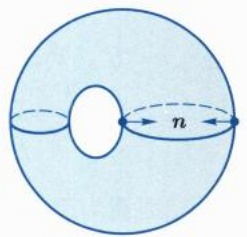
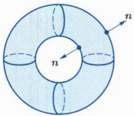
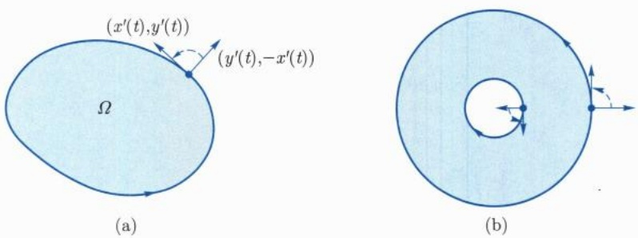
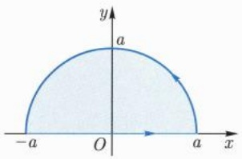
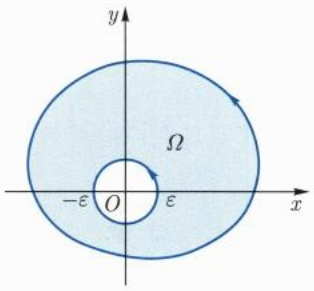
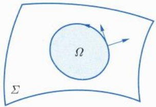

向; 反之, $n$ 所决定的方向称为参数曲面的下侧方向. 对于封闭的曲面, 指向曲面所围区域外部的单位法向量所决定的方向称为参数曲面的外侧方向, 指向曲面所围区域内部的单位法向量所决定的方向称为参数曲面的内侧方向 (图 17.11).

text_image

n

(a)

text_image

n
n

(b)

图 17.11 内法向和外法向

例 17.4.1 计算积分  $\int_{\Sigma} xyz \, dx \wedge dy$ ，其中  $\Sigma = \{x^{2} + y^{2} + z^{2} = 1, x \geqslant 0, y \geqslant 0\}$ ，方向为外侧.

解 将曲面分成两部分:

$$
\Sigma_ {1}: z = \sqrt {1 - x ^ {2} - y ^ {2}}, (x, y) \in D = \{x ^ {2} + y ^ {2} \leqslant 1, x \geqslant 0, y \geqslant 0 \},
$$

$$
\Sigma_ {2}: z = - \sqrt {1 - x ^ {2} - y ^ {2}}, (x, y) \in D = \{x ^ {2} + y ^ {2} \leqslant 1, x \geqslant 0, y \geqslant 0 \}.
$$

参数 $(x,y)$ 决定的法向量为 $(1,0,z_x)\times (0,1,z_y) = (-z_x, - z_y,1)$，因此，这个参数在 $\Sigma_{1}$ 上决定的方向就是外侧方向，在 $\Sigma_{2}$ 上决定的方向是内侧方向。于是

$$
\begin{array}{l} \int_ {\Sigma} x y z \mathrm{d} x \wedge \mathrm{d} y = \int_ {\Sigma_ {1}} x y z \mathrm{d} x \wedge \mathrm{d} y + \int_ {\Sigma_ {2}} x y z \mathrm{d} x \wedge \mathrm{d} y \\ = \iint_ {D} x y \sqrt {1 - x ^ {2} - y ^ {2}} \mathrm{d} x \mathrm{d} y - \iint_ {D} x y \left(- \sqrt {1 - x ^ {2} - y ^ {2}}\right) \mathrm{d} x \mathrm{d} y \\ = 2 \int_ {0} ^ {\frac {\pi}{2}} \mathrm{d} \theta \int_ {0} ^ {1} r ^ {3} \sin \theta \cos \theta \sqrt {1 - r ^ {2}} \mathrm{d} r = \frac {2}{1 5}. \\ \end{array}
$$

例17.4.2 计算积分 $\Phi = \int_{\Sigma} x^2 \, \mathrm{d}y \wedge \mathrm{d}z + y^2 \, \mathrm{d}z \wedge \mathrm{d}x + z^2 \, \mathrm{d}x \wedge \mathrm{d}y,$ 其中 $\Sigma$ 为球面 $(x - a)^2 + (y - b)^2 + (z - c)^2 = R^2,$ 方向为外侧.

解 球面的单位外法向量为 $R^{-1}(x - a, y - b, z - c)$, 于是

$$
\varPhi = \int_ {\Sigma} (x ^ {2}, y ^ {2}, z ^ {2}) \cdot R ^ {- 1} (x - a, y - b, z - c)   \mathrm{d} \sigma .
$$

记 $u = x - a, v = y - b, w = z - c, \Sigma' = \{u^2 + v^2 + w^2 = R^2\}$, 则

$$
\Phi = \frac {1}{R} \int_ {\Sigma^ {\prime}} \left(2 a u ^ {2} + 2 b v ^ {2} + 2 c w ^ {2} + \dots\right) \mathrm{d} \sigma ,
$$

其中省略掉的项是关于 u, v, w 的一次幂项和三次幂项，由球面的对称性可知这些项的积分为零。同理， $u^{2}$ ， $v^{2}$ ， $w^{2}$  项的积分都相等，于是

$$
\begin{array}{l} \Phi = \frac {2 a + 2 b + 2 c}{3 R} \int_ {\Sigma^ {\prime}} \left(u ^ {2} + v ^ {2} + w ^ {2}\right) \mathrm{d} \sigma \\ = \frac {2 a + 2 b + 2 c}{3 R} R ^ {2} \cdot \sigma \left(\Sigma^ {\prime}\right) = \frac {2 a + 2 b + 2 c}{3 R} R ^ {2} \cdot 4 \pi R ^ {2} \\ = \frac {8 \pi}{3} (a + b + c) R ^ {3}. \\ \end{array}
$$

第二型积分可以推广到 $\mathbb{R}^n$ 中的可定向曲面上. 以超曲面为例, 设 $\Sigma$ 为 $\mathbb{R}^n$ 中的超曲面, 如果 $\Sigma$ 上存在连续的单位法向量场, 则称 $\Sigma$ 可定向. 我们用一个连续的单位法向量场 $n$ 来表示它的定向. 当 $X$ 为 $\Sigma$ 上的连续向量场时, 它在 $\Sigma$ 上的第二型曲面积分定义为

$$
\Phi = \int_ {\Sigma} \boldsymbol {X} \cdot \boldsymbol {n}   \mathrm{d} \sigma.
$$

记  $\boldsymbol{X}=(f_{1},f_{2},\cdots,f_{n})$ . 设  $\varphi:D\to R^{n}$  为  $\Sigma$  的参数表示, 其中  $D\subset R^{n-1}$ ,

$$
\begin{array}{l} \varphi (u _ {1}, u _ {2}, \dots , u _ {n - 1}) = (x _ {1} (u _ {1}, u _ {2}, \dots , u _ {n - 1}), x _ {2} (u _ {1}, u _ {2}, \dots , u _ {n - 1}), \dots , \\ x _ {n} (u _ {1}, u _ {2}, \dots , u _ {n - 1})), \quad (u _ {1}, u _ {2}, \dots , u _ {n - 1}) \in D. \\ \end{array}
$$

如果法向量  $\varphi_{u_{1}} \times \varphi_{u_{2}} \times \cdots \times \varphi_{u_{n-1}}$  与 n 同向, 则

$$
\begin{array}{l} \Phi = \int_ {D} \boldsymbol {X} \cdot \varphi_ {u _ {1}} \times \varphi_ {u _ {2}} \times \dots \times \varphi_ {u _ {n - 1}} \mathrm{d} u _ {1} \mathrm{d} u _ {2} \dots \mathrm{d} u _ {n - 1} \\ = \int_ {D} \sum_ {i = 1} ^ {n} (- 1) ^ {i - 1} f _ {i} \circ \varphi \frac {\partial \left(x _ {1} , x _ {2} , \cdots , \hat {x} _ {i} , \cdots , x _ {n}\right)}{\partial \left(u _ {1} , u _ {2} , \cdots , u _ {n - 1}\right)} \mathrm{d} u _ {1} \mathrm{d} u _ {2} \dots \mathrm{d} u _ {n - 1}, \\ \end{array}
$$

其中  $\hat{x}_{i}$  表示不含  $x_{i}$  这一项.

## 习题 17.4

1. 计算积分

$$
\Phi = \int_ {\Sigma} x \mathrm{d} y \wedge \mathrm{d} z + y \mathrm{d} z \wedge \mathrm{d} x + z \mathrm{d} x \wedge \mathrm{d} y,
$$

其中 $\Sigma$ 为三角形 $x + y + z = 1, x, y, z \geqslant 0$, 单位法向量与 (1,1,1) 同向.

2. 设某流体的流速为 $V = (yz, zx, xy)$，求该流体流出圆柱体 $x^2 + y^2 \leqslant a^2$，$0 \leqslant z \leqslant h$ 的流量.

3. 设某流体的流速为  $\boldsymbol{V} = (f(x), g(y), h(z))$ ，求该流体流出矩形  $[0, a] \times [0, b] \times [0, c]$  的流量.

4. 计算积分

$$
\varPhi = \int_ {\Sigma} x \mathrm{d} y \wedge \mathrm{d} z + y \mathrm{d} z \wedge \mathrm{d} x + z \mathrm{d} x \wedge \mathrm{d} y,
$$

其中 $\Sigma$ 为球面 $(x - a)^2 + (y - b)^2 + (z - c)^2 = R^2$ ，方向为外侧.

5. 计算积分

$$
\varPhi = \int_ {\Sigma} x ^ {3}   \mathrm{d} y \wedge \mathrm{d} z,
$$

其中 $\Sigma$ 为上半椭球面 $\frac{x^2}{a^2} +\frac{y^2}{b^2} +\frac{z^2}{c^2} = 1 (z\geqslant 0)$ ，方向为上侧

6. 计算积分

$$
\Phi = \int_ {\Sigma} y z \mathrm{d} y \wedge \mathrm{d} z + z x \mathrm{d} z \wedge \mathrm{d} x + x y \mathrm{d} x \wedge \mathrm{d} y,
$$

其中  $\Sigma$  为四面体  $x + y + z \leqslant a, x \geqslant 0, y \geqslant 0, z \geqslant 0$  的外侧面.

7. 计算积分

$$
\varPhi = \int_ {\Sigma} x ^ {3} \mathrm{d} y \wedge \mathrm{d} z + y ^ {3} \mathrm{d} z \wedge \mathrm{d} x + z ^ {3} \mathrm{d} x \wedge \mathrm{d} y,
$$

其中  $\Sigma$  为球面  $x^{2}+y^{2}+z^{2}=a^{2}$ ，方向为内侧.

8. 计算积分

$$
\Phi = \int_ {\Sigma} x   \mathrm{d} y \wedge \mathrm{d} z \wedge \mathrm{d} w,
$$

其中  $\Sigma$  为球面  $x^{2}+y^{2}+z^{2}+w^{2}=a^{2}$ ，方向为外侧.

## 第十八章

## 微分形式简介

本章主要讨论曲线积分和曲面积分之间的联系, 得到重要的 Green $^{①}$  公式、Gauss $^{②}$  公式以及 Stokes $^{③}$  公式. 为了统一描述这些公式, 我们将引入微分形式这一新的研究对象, 它们是函数以及向量值函数的推广.

## 18.1 各类积分之间的联系

我们知道, 一元微积分中的 Newton-Leibniz 公式将微分和积分统一在一起, 从计算的角度来看, 它将被积区间上的函数导数的积分化成了区间边界上函数值的差 (代数和). 在多元微积分中也有类似的现象.

## 18.1.1 Gauss-Green 公式

设 $\Omega$ 是 $\mathbb{R}^n$ 中的有界开集, $X$ 是向量场 (向量值函数). 若 $X$ 在 $\bar{\Omega}$ 的某个开邻域上是 $C^1$ 的, 则记 $X \in C^1(\bar{\Omega})$. 类比于 Newton-Leibniz 公式, $X$ 沿 $\partial \Omega$ 的第二型积分应该可以化为 $X$ 的某种导数在 $\Omega$ 上的积分. 为此我们引进散度的概念.

任取 $p \in \Omega$, 当 $r > 0$ 且充分小时, $\overline{B_r(p)} \subset \Omega$. 在球面 $\partial B_r(p)$ 上取单位外法向量场 $n = \frac{1}{r} (x - p)$. 向量场 $X$ 沿该球面的第二型积分可以解释为流速为 $X$ 的流体流出球面的流量. 记

$$
\Phi (r) = \frac {1}{| B _ {r} (\boldsymbol {p}) |} \int_ {\partial B _ {r} (\boldsymbol {p})} \boldsymbol {X} \cdot \boldsymbol {n}   \mathrm{d} \sigma ,
$$

其中 $|B_r(\pmb {p})| = \omega_n r^n$ 是 $B_r(\pmb {p})$ 的容积. $\Phi (r)$ 称为平均流量(通量)密度.记 $\mathrm{div}(\mathbf{X}) =$ $\lim_{r\to 0^{+}}\varPhi (r)$ ，称为 $\pmb{X}$ 在 $\pmb{p}$ 处的流量(通量)密度或散度.我们有

引理 18.1.1 设  $X = (f_{1}, f_{2}, \cdots, f_{n})$  为  $C^{1}$  向量场，则

$$
\mathrm{div} (\boldsymbol {X}) (\boldsymbol {p}) = \mathrm{tr} J \boldsymbol {X} (\boldsymbol {p}) = \sum_ {i = 1} ^ {n} \frac {\partial f _ {i}}{\partial x _ {i}} (\boldsymbol {p}),
$$

其中 JX 是向量值函数 X 的 Jacobi 矩阵.

证明 不妨设 $p = 0$ . 由题设可知

$$
\boldsymbol {X} (\boldsymbol {x}) = \boldsymbol {X} (\boldsymbol {0}) + J \boldsymbol {X} (\boldsymbol {0}) \boldsymbol {x} + o (\| \boldsymbol {x} \|) \quad (\boldsymbol {x} \rightarrow \boldsymbol {0}).
$$

<small>① Green, George, 1793 年 6 月—1841 年 5 月 31 日, 英国数学家.</small>

<small>② Gauss, Carolus Fridericus, 1777 年 4 月 30 日—1855 年 2 月 23 日, 德国数学家、物理学家、天文学家.</small>

<small>③ Stokes, George Gabriel, 1819 年 8 月 13 日—1903 年 2 月 1 日, 英国数学家、力学家.</small>

当 $r\to 0^{+}$ 时，就有

$$
\begin{array}{l} \int_ {\partial B _ {r} (\boldsymbol {p})} \boldsymbol {X} \cdot \boldsymbol {n} \mathrm{d} \sigma = \frac {1}{r} \int_ {\partial B _ {r} (\boldsymbol {0})} \boldsymbol {X} (\boldsymbol {0}) \cdot \boldsymbol {x} \mathrm{d} \sigma + \frac {1}{r} \int_ {\partial B _ {r} (\boldsymbol {0})} \boldsymbol {x} \cdot J \boldsymbol {X} (\boldsymbol {0}) \boldsymbol {x} \mathrm{d} \sigma + o (r ^ {n}) \\ = \sum_ {i = 1} ^ {n} \frac {f _ {i} (\mathbf {0})}{r} \int_ {\partial B _ {r} (\mathbf {0})} x _ {i} \mathrm{d} \sigma + \sum_ {i, j = 1} ^ {n} \frac {\partial_ {j} f _ {i} (\mathbf {0})}{r} \int_ {\partial B _ {r} (\mathbf {0})} x _ {i} x _ {j} \mathrm{d} \sigma + o (r ^ {n}). \\ \end{array}
$$

由球的对称性可知

$$
\int_ {\partial B _ {r} (\mathbf {0})} x _ {i} \mathrm{d} \sigma = 0, \quad \int_ {\partial B _ {r} (\mathbf {0})} x _ {i} x _ {j} \mathrm{d} \sigma = 0 (j \neq i).
$$

同理有

$$
\int_ {\partial B _ {r} (\mathbf {0})} x _ {i} ^ {2} \mathrm{d} \sigma = \frac {1}{n} \int_ {\partial B _ {r} (\mathbf {0})} \| \boldsymbol {x} \| ^ {2} \mathrm{d} \sigma = \omega_ {n} r ^ {n + 1}.
$$

这说明

$$
\int_ {\partial B _ {r} (\boldsymbol {p})} \boldsymbol {X} \cdot \boldsymbol {n} \mathrm{d} \sigma = \omega_ {n} r ^ {n} \sum_ {i = 1} ^ {n} \frac {\partial f _ {i}}{\partial x _ {i}} (\boldsymbol {0}) + o (r ^ {n}) (r \rightarrow 0 ^ {+}).
$$

由此即得欲证结论.

将上述引理中以 p 为中心的球换成以 p 为中心的方体时类似的结论也成立. 我们还可以猜测当 D 是以 p 为内点的小区域时, 也应有

$$
\int_ {\partial D} \boldsymbol {X} \cdot \boldsymbol {n}   \mathrm{d} \sigma \approx \nu (D) \mathrm{div} (\boldsymbol {X}) (\boldsymbol {p}).
$$

一般地, 若能将 $\Omega$ 分割为若干充分小的区域 $\{\Omega_i\}$, 取 $p_i \in \Omega_i$, 则

$$
\int_ {\Omega} \mathrm{div} (\boldsymbol {X}) \mathrm{d} \boldsymbol {x} \approx \sum_ {i} \nu (\varOmega_ {i}) \mathrm{div} (\boldsymbol {X}) (\boldsymbol {p} _ {i}) \approx \sum_ {i} \int_ {\partial \varOmega_ {i}} \boldsymbol {X} \cdot \boldsymbol {n} _ {i} \mathrm{d} \sigma ,
$$

其中 $n_i$ 均为单位外法向量场. 在相邻区域的公共边界上, 由于单位外法向量方向相反, 相应的两个第二型积分会互相抵消, 最终只剩下 $\partial \Omega$ 上的第二型曲面积分. 也就是说, 我们期望得到如下公式:

$$
\int_ {\Omega} \mathrm{div} (\boldsymbol {X}) \mathrm{d} \boldsymbol {x} = \int_ {\partial \Omega} \boldsymbol {X} \cdot \boldsymbol {n} \mathrm{d} \sigma . \tag {18.1.1}
$$

为了验证上式成立, 我们需要对  $\Omega$  施加适当的限制条件.

定义 18.1.1 ( $C^{k}$  边界) 设  $n \geqslant 2, \Omega$  为  $R^{n}$  中的开集. 如果任给  $x_{0} \in \partial \Omega$ , 均存在  $x_{0}$  的开邻域 U, 正数 r, h,  $C^{k}$  函数  $\phi: [-r, r]^{n-1} \rightarrow (-h, h)$ , 以及仿射变换  $\varphi(x) = A(x - x_{0})$ , 其中 A 是行列式为 1 的正交矩阵, 使得

(1) $\phi (\mathbf{0}) = 0$, $\varphi (U) = (-r,r)^{n - 1}\times (-h,h)$;
(2) $\varphi (U\cap \Omega) = D = \{(\pmb {x}^{\prime},x_{n})\mid \pmb{x}^{\prime}\in (-r,r)^{n - 1},\phi (\pmb{x}^{\prime}) <   x_{n} <   h\}$
(3) $\varphi(U \cap \partial\Omega) = \mathrm{graph}(\phi) = \{(\boldsymbol{x}', \phi(\boldsymbol{x}')) \mid \boldsymbol{x}' \in (-r, r)^{n-1}\}$,

则称  $\Omega$  具有  $C^{k}$  边界.

设 $\Omega$ 为具有 $C^k (k\geqslant 1)$ 边界的开集, 我们先在边界 $\partial \Omega$ 上定义单位外法向量场 $\pmb{n}$. 设 $\pmb{x}_0\in \partial \Omega$ ，记 $\pmb {n}(\pmb {x}_0) = \pmb{A}^{-1}\pmb{\nu}$ ，其中

$$
\nu = \frac {1}{\sqrt {1 + | \nabla \phi (\mathbf {0}) | ^ {2}}} \big (\nabla \phi (\mathbf {0}), - 1 \big).
$$

断言: 存在 $\delta > 0$, 使得当 $0 < t \leqslant \delta$ 时, $t\nu \notin \bar{D}$; 当 $-\delta \leqslant t < 0$ 时 $t\nu \in D$. 事实上, 记 $t\nu = (x', x_n)$, 由 $\phi(0) = 0$ 可得

$$
\begin{array}{l} x _ {n} - \phi (\boldsymbol {x} ^ {\prime}) = x _ {n} - \nabla \phi (\boldsymbol {0}) \cdot \boldsymbol {x} ^ {\prime} + o (t) = (\boldsymbol {x} ^ {\prime}, x _ {n}) \cdot (- \nabla \phi (\boldsymbol {0}), 1) + o (t) \\ = - t \sqrt {1 + | \nabla \phi (\mathbf {0}) | ^ {2}} + o (t) (t \to 0), \\ \end{array}
$$

由此可见上述断言成立.这说明当 $0 < t \leqslant \delta$ 时，$x_0 + tn \notin \bar{\Omega}$；当 $-\delta \leqslant t < 0$ 时，$x_0 + tn \in \Omega$.正是因为如此我们才称法向量 $n$ 指向 $\Omega$ 的外侧方向.由此还可以看出 $n$ 不依赖于 $\varphi$ 的选取.

设 $\Omega$ 是具有 $C^1$ 边界的有界开集, $f \in C^1(\bar{\Omega})$, 为了验证 (18.1.1) 式成立, 我们再来说明 (18.1.1) 式在 $\mathbb{R}^n$ 的平移和旋转变换下具有形式不变性. 以旋转变换 $\psi(x) = Ax$ 为例, 设 $\psi(\Omega') = \Omega$, 由变量替换公式可得

$$
\int_ {\partial \Omega} \boldsymbol {X} \cdot \boldsymbol {n} \mathrm{d} \sigma = \int_ {\partial \Omega^ {\prime}} \boldsymbol {X} (\psi) \cdot \boldsymbol {n} (\psi) \mathrm{d} \sigma^ {\prime} = \int_ {\partial \Omega^ {\prime}} \boldsymbol {X} (\psi) \cdot \psi (\boldsymbol {n} ^ {\prime}) \mathrm{d} \sigma^ {\prime},
$$

其中 $n' = \psi^{-1}(n(\psi))$ 是 $\Omega'$ 在边界上的单位外法向量场. 由于旋转变换保持内积, 我们就有

$$
\int_ {\partial \Omega} \boldsymbol {X} \cdot \boldsymbol {n}   \mathrm{d} \sigma = \int_ {\partial \Omega^ {\prime}} \boldsymbol {X} ^ {\prime} \cdot \boldsymbol {n} ^ {\prime}   \mathrm{d} \sigma^ {\prime},
$$

其中 $X^{\prime} = \psi^{-1}\circ X\circ \psi$ .由链式法则可知

$$
\mathrm{div} (\boldsymbol {X} ^ {\prime}) = \mathrm{tr} J \boldsymbol {X} ^ {\prime} = \mathrm{tr} \left[ \psi^ {- 1} \circ (J \boldsymbol {X}) (\psi) \circ \psi \right] = \mathrm{tr} (J \boldsymbol {X}) (\psi) = \mathrm{div} (\boldsymbol {X}) (\psi).
$$

由变量替换公式可得

$$
\int_ {\Omega} \mathrm{div} (\boldsymbol {X}) \mathrm{d} \boldsymbol {x} = \int_ {\Omega^ {\prime}} \mathrm{div} (\boldsymbol {X} ^ {\prime}) \mathrm{d} \boldsymbol {x} ^ {\prime}.
$$

这说明 (18.1.1) 式对 $\Omega$ 成立当且仅当它对 $\Omega'$ 成立.

由定义 18.1.1 可知  $\partial\Omega$  在局部上为参数超曲面. 为了将局部上的积分整合成  $\Omega$  上的积分, 我们需要用到一个方便的工具, 叫做单位分解.

所谓单位分解, 就是将 1 分解为若干个具有紧支集的函数之和. 其中, 函数 $f$ 的支集 $\operatorname{supp} f$ 定义为

$$
\mathrm{supp} f = \overline {{\{x \mid f (x) \neq 0 \}}}
$$

我们在 $\mathbb{R}$ 上定义偶函数 $\phi(t)$ 如下:

$$
\phi (t) = 1, t \in [ 0, 0. 5 ]; \phi (t) = \frac {(1 - t) ^ {3}}{(t - 0 . 5) ^ {3} + (1 - t) ^ {3}}, 0. 5 <   t \leqslant 1; \phi (t) = 0, t \geqslant 1. \tag {18.1.2}
$$

当 $t < 0$ 时令 $\phi(t) = \phi(-t)$. 容易验证 $\phi$ 是 $C^2$ 函数, 称为 $\mathbb{R}$ 上的鼓包函数.

引理 18.1.2 (单位分解) 设 K 为  $R^{n}$  中的有界闭集,  $\{V_{\alpha}\}$  为 K 的有限开覆盖, 则存在  $R^{n}$  上的非负  $C^{2}$  函数  $\{\phi_{\alpha}\}$ , 使得

$$
0 \leqslant \sum_ {\alpha} \phi_ {\alpha} (\boldsymbol {x}) \leqslant 1, \forall \boldsymbol {x} \in \mathbb {R} ^ {n}; \sum_ {\alpha} \phi_ {\alpha} (\boldsymbol {x}) = 1, \forall \boldsymbol {x} \in K; \operatorname{supp} \phi_ {\alpha} \subset V _ {\alpha}.
$$

$\{\phi_{\alpha}\}$  称为从属于开覆盖  $\{V_{\alpha}\}$  的一个单位分解.

证明 由题设可知, 任给 $\pmb{x} \in K$, 存在 $\alpha$, 使得 $\pmb{x} \in V_{\alpha}$. 取 $\varepsilon_{\pmb{x}} > 0$, 使得 $B_{2\varepsilon_{\pmb{x}}}(\pmb{x}) \subset V_{\alpha}$. 根据有限覆盖定理, 存在有限个小球, 记为 $\{B_{\varepsilon_i / 2}(\pmb{x}^i)\}_{i=1}^k$, 使得它们覆盖了 $K$, 其中 $\pmb{x}^i \in K, \varepsilon_i = \varepsilon_{\pmb{x}^i}$. 记

$$
\phi_ {i} (\boldsymbol {x}) = \phi \big (\varepsilon_ {i} ^ {- 1} \| \boldsymbol {x} - \boldsymbol {x} ^ {i} \| \big), i = 1, 2, \dots , k,
$$

其中 $\phi$ 为上面的一元鼓包函数. 令

$$
\psi_ {1} = \phi_ {1}, \quad \psi_ {i} = (1 - \phi_ {1}) (1 - \phi_ {2}) \dots (1 - \phi_ {i - 1}) \phi_ {i}, \quad i = 2, 3, \dots , k.
$$

显然有

$$
\mathrm{supp}   \psi_ {i} \subset B _ {2 \varepsilon_ {i}} (\boldsymbol {x} ^ {i}), i = 1, 2, \dots , k.
$$

注意到

$$
\psi_ {1} + \psi_ {2} + \dots + \psi_ {k} = 1 - (1 - \phi_ {1}) (1 - \phi_ {2}) \dots (1 - \phi_ {k}).
$$

由 $\{B_{\varepsilon_i / 2}(\pmb{x}^i)\}_{i = 1}^k$ 为 $K$ 的覆盖可知，当 $\pmb {x}\in K$ 时，至少有一个 $\phi_i$ 满足 $\phi_i(\pmb {x}) = 1.$ 于是

$$
\psi_ {1} (\boldsymbol {x}) + \psi_ {2} (\boldsymbol {x}) + \dots + \psi_ {k} (\boldsymbol {x}) = 1, \forall \boldsymbol {x} \in K.
$$

将支集含于 $V_{\alpha}$ 的那些 $\psi_{i}$ 的和记为 $\phi_{\alpha}$ (不重复求和), 则 $\{\phi_{\alpha}\}$ 为满足定理要求的单位分解.

定理 18.1.3 (散度定理) 设  $\Omega$  是  $R^{n}$  中具有  $C^{1}$  边界的有界开集, X 是  $\bar{\Omega}$  上的  $C^{1}$  向量场, n 是  $\Omega$  在边界上的单位外法向量场, 则 (18.1.1) 式成立.

证明 由题设可知 $\partial \Omega$ 是有界闭集, 于是存在有限个满足定义18.1.1中要求的开集 $\{U_k\}_{k=1}^m$, 使得 $\{\Omega, U_k \mid 1 \leqslant k \leqslant m\}$ 为 $\bar{\Omega}$ 的开覆盖. 对此开覆盖应用单位分解引理可以将欲证结论约化为如下两种情形:

(1) $\operatorname{supp} X \subset \Omega$, 其中 $\operatorname{supp} X = \overline{\{x \mid X(x) \neq 0\}}$, 称为 $X$ 的支集. 在这种情形下, 取 $R > 0$, 使得 $\bar{\Omega} \subset [-R, R]^n$, 我们规定 $X$ 在 $[-R, R]^n \setminus \bar{\Omega}$ 上为零. 此时 $X \in C^1([-R, R]^n)$. 记 $X = (f_1, f_2, \cdots, f_n)$, 由重积分化累次积分可得

$$
\int_ {\Omega} \frac {\partial f _ {i}}{\partial x _ {i}} \mathrm{d} \boldsymbol {x} = \int_ {[ - R, R ] ^ {n}} \frac {\partial f _ {i}}{\partial x _ {i}} \mathrm{d} \boldsymbol {x} = \int_ {[ - R, R ] ^ {n - 1}} f _ {i} | _ {x _ {i} = - R} ^ {x _ {i} = R} \mathrm{d} x _ {1} \dots \widehat {\mathrm{d} x _ {i}} \dots \mathrm{d} x _ {n} = 0.
$$

由此可见 (18.1.1) 式左右两边都等于零.

(2) suppX 包含于某个  $U_{k}$ . 根据 (18.1.1) 式在  $R^{n}$  的平移和旋转变换下的形式不变性, 不妨设  $U_{k}=D$ , 其中 D 如定义 18.1.1 所述. 当  $x_{n}\geqslant h$  时我们规定  $\boldsymbol{X}(\boldsymbol{x})=\boldsymbol{0}$ , 其中  $\boldsymbol{x}=(\boldsymbol{x}^{\prime},x_{n}),\boldsymbol{x}^{\prime}=(x_{1},x_{2},\cdots,x_{n-1})$ .

当 $1 \leqslant i \leqslant n - 1$ 时, 由重积分化累次积分可得

$$
\begin{array}{l} \int_ {\Omega} \frac {\partial f _ {i}}{\partial x _ {i}} \mathrm{d} \boldsymbol {x} = \int_ {D} \frac {\partial f _ {i}}{\partial x _ {i}} \mathrm{d} \boldsymbol {x} = \int_ {[ - R, R ] ^ {n - 1}} \int_ {\phi (\boldsymbol {x} ^ {\prime})} ^ {h} \frac {\partial f _ {i}}{\partial x _ {i}} \mathrm{d} \boldsymbol {x} \\ = \int_ {[ - R, R ] ^ {n - 1}} \int_ {0} ^ {h - \phi (\boldsymbol {x} ^ {\prime})} \frac {\partial f _ {i}}{\partial x _ {i}} (\boldsymbol {x} ^ {\prime}, y + \phi (\boldsymbol {x} ^ {\prime})) \mathrm{d} \boldsymbol {x} ^ {\prime} \mathrm{d} y \\ = \int_ {[ - R, R ] ^ {n - 1}} \int_ {0} ^ {2 h} \frac {\partial f _ {i}}{\partial x _ {i}} (\boldsymbol {x} ^ {\prime}, y + \phi (\boldsymbol {x} ^ {\prime})) \mathrm{d} \boldsymbol {x} ^ {\prime} \mathrm{d} y \\ = \int_ {[ - R, R ] ^ {n - 1}} \int_ {0} ^ {2 h} [ f _ {i} (\boldsymbol {x} ^ {\prime}, y + \phi (\boldsymbol {x} ^ {\prime})) ] _ {x _ {i}} \mathrm{d} \boldsymbol {x} ^ {\prime} \mathrm{d} y - \\ \int_ {[ - R, R ] ^ {n - 1}} \int_ {0} ^ {2 h} [ f _ {i} (\boldsymbol {x} ^ {\prime}, y + \phi (\boldsymbol {x} ^ {\prime})) ] _ {y} \phi_ {x _ {i}} \mathrm{d} \boldsymbol {x} ^ {\prime} \mathrm{d} y \\ = \int_ {[ - R, R ] ^ {n - 2}} \int_ {0} ^ {2 h} [ f _ {i} (\boldsymbol {x} ^ {\prime}, y + \phi (\boldsymbol {x} ^ {\prime})) ] | _ {x _ {i} = - R} ^ {x _ {i} = R} \mathrm{d} x _ {1} \dots \widehat {\mathrm{d} x _ {i}} \dots \mathrm{d} x _ {n - 1} \mathrm{d} y - \\ \int_ {[ - R, R ] ^ {n - 1}} [ f _ {i} (\boldsymbol {x} ^ {\prime}, y + \phi (\boldsymbol {x} ^ {\prime})) ] \big | _ {y = 0} ^ {y = 2 h} \phi_ {x _ {i}} \mathrm{d} \boldsymbol {x} ^ {\prime} \\ = \int_ {[ - R, R ] ^ {n - 1}} f _ {i} (\boldsymbol {x} ^ {\prime}, \phi (\boldsymbol {x} ^ {\prime})) \phi_ {x _ {i}} \mathrm{d} \boldsymbol {x} ^ {\prime}. \\ \end{array}
$$

同理可得

$$
\int_ {\Omega} \frac {\partial f _ {n}}{\partial x _ {n}} \mathrm{d} x = - \int_ {[ - R, R ] ^ {n - 1}} f _ {n} (\boldsymbol {x} ^ {\prime}, \phi (\boldsymbol {x} ^ {\prime})) \mathrm{d} \boldsymbol {x} ^ {\prime}.
$$

由上述计算可得

$$
\begin{array}{l} \int_ {\Omega} \mathrm{div} (\boldsymbol {X}) \mathrm{d} \boldsymbol {x} = \int_ {[ - R, R ] ^ {n - 1}} \boldsymbol {X} (\boldsymbol {x} ^ {\prime}, \phi (\boldsymbol {x} ^ {\prime})) \cdot (\nabla \phi (\boldsymbol {x} ^ {\prime}), - 1) \mathrm{d} \boldsymbol {x} ^ {\prime} \\ = \int_ {[ - R, R ] ^ {n - 1}} \boldsymbol {X} (\boldsymbol {x} ^ {\prime}, \phi (\boldsymbol {x} ^ {\prime})) \cdot \boldsymbol {n} \sqrt {1 + | \nabla \phi (\boldsymbol {x} ^ {\prime}) | ^ {2}} \mathrm{d} \boldsymbol {x} ^ {\prime} \\ = \int_ {\mathrm{graph} (\phi)} \boldsymbol {X} \cdot \boldsymbol {n}   \mathrm{d} \sigma = \int_ {\partial \Omega} \boldsymbol {X} \cdot \boldsymbol {n}   \mathrm{d} \sigma , \\ \end{array}
$$

定理证毕.

散度定理在平面上可以改写为所谓的 Green 公式. 考虑平面  $R^{2}$  上具有  $C^{1}$  边界的有界开集  $\Omega$ .  $R^{2}$  上的标准定向限制在  $\Omega$  上就得到  $\Omega$  的定向.  $\Omega$  的边界  $\partial\Omega$  有所谓的诱导定向. 这个诱导定向定义如下: 设  $(x(t), y(t))$  为  $\partial\Omega$  的一段参数曲线, 则  $(x'(t), y'(t))$  为切向量,  $(y'(t), -x'(t))$  为法向量. 如果  $(y'(t), -x'(t))$  为相对于区域  $\Omega$  的外法向量, 则参数 t 决定的边界方向称为诱导定向, 也称为正向. 直观上看, 从外法向到切向的旋转方向是逆时针的, 这种确定边界定向的方法又称为 “右手法则” (图 18.1(a)).

图 18.1 诱导定向

例 18.1.1 环形区域边界上正向.

如图 18.1(b) 所示, 设 b > a > 0, 平面区域  $\{a^{2} \leqslant x^{2} + y^{2} \leqslant b^{2}\}$  是半径为 b 的大圆盘中挖去一个半径为 a 的小圆盘形成的环形区域. 它的边界由圆周  $\{x^{2} + y^{2} = b^{2}\}$  和  $\{x^{2} + y^{2} = a^{2}\}$  组成. 按照诱导定向的定义, 在大圆  $\{x^{2} + y^{2} = b^{2}\}$  上, 方向是逆时针的; 而在小圆  $\{x^{2} + y^{2} = a^{2}\}$  上, 方向应是顺时针的. □

下面的结果将二重积分和第二型曲线积分联系起来了, 它常称为 Green 公式.

定理 18.1.4 (Green 公式) 设  $\Omega$  为平面上具有  $C^{1}$  边界的有界开集, 边界的定向为诱导定向. 如果 P, Q 为  $\bar{\Omega}$  上的  $C^{1}$  函数, 则

$$
\int_ {\Omega} \left(\frac {\partial Q}{\partial x} - \frac {\partial P}{\partial y}\right) \mathrm{d} x \mathrm{d} y = \int_ {\partial \Omega} P \mathrm{d} x + Q \mathrm{d} y.
$$

证明 取  $\boldsymbol{X}=(Q,-P)$ ，则  $\mathrm{div}(\boldsymbol{X})=\frac{\partial Q}{\partial x}-\frac{\partial P}{\partial y}$ 。若在边界曲线上取弧长参数 s，则单位外法向量可以表示  $\boldsymbol{n}=(y'(s),-x'(s))$ ，此时

$$
P \mathrm{d} x + Q \mathrm{d} y = [ P x ^ {\prime} (s) + Q y ^ {\prime} (s) ] \mathrm{d} s = \boldsymbol {X} \cdot \boldsymbol {n} \mathrm{d} s,
$$

这样散度定理就可以改写成 Green 公式.

注 18.1.1 Green 公式对于那些类似于矩形区域的具有分段  $C^{1}$  边界的区域仍成立.

例 18.1.2 平面简单闭曲线所围区域的面积.

设 $\gamma(t) = (x(t), y(t))$ ($t \in [\alpha, \beta]$) 为 $\mathbb{R}^2$ 上分段 $C^1$ 的简单闭曲线, 它围成的区域记为 $\Omega$. 在 Green 公式中取 $P(x, y) = -y$, $Q(x, y) = x$, 可得如下面积公式:

$$
\begin{array}{l} \nu (\Omega) = \frac {1}{2} \int_ {\Omega} \left(\frac {\partial Q}{\partial x} - \frac {\partial P}{\partial y}\right) \mathrm{d} x \mathrm{d} y = \frac {1}{2} \int_ {\partial \Omega} P \mathrm{d} x + Q \mathrm{d} y \\ = \frac {1}{2} \int_ {\alpha} ^ {\beta} [ x (t) y ^ {\prime} (t) - x ^ {\prime} (t) y (t) ] \mathrm{d} t, \\ \end{array}
$$

其中, 参数 t 选取的方向是逆时针的.

作为例子, 考虑椭圆  $\frac{x^{2}}{a^{2}} + \frac{y^{2}}{b^{2}} = 1$  所围成的面积. 椭圆的参数方程为

$$
x (t) = a \cos t, y (t) = b \sin t, t \in [ 0, 2 \pi ],
$$

于是其面积为

$$
\nu = \frac {1}{2} \int_ {0} ^ {2 \pi} (a \cos t b \cos t + a \sin t b \sin t) \mathrm{d} t = \pi a b.
$$

例 18.1.3 计算积分  $I = \int_{C} x^{2} y \, dx - xy^{2} \, dy$ ，其中 C 是上半圆  $x^{2} + y^{2} = a^{2}$ ， $y \geqslant 0$ ，取逆时针方向 (图 18.2).

text_image

y
a
-a O a x

图18.2 上半圆

解 考虑上半圆的边界, 它由 $C$ 以及 $(x,0)$ ($x \in [-a,a]$) 组成, 在上半圆区域上用 Green 公式, 得

$$
I = \int_ {\{x ^ {2} + y ^ {2} \leqslant a ^ {2}, y \geqslant 0 \}} (- x ^ {2} - y ^ {2}) \mathrm{d} x \mathrm{d} y = - \int_ {0} ^ {\pi} \mathrm{d} \theta \int_ {0} ^ {a} r ^ {3} \mathrm{d} r = - \frac {\pi}{4} a ^ {4}.
$$

例 18.1.4 设  $\Omega$  为包含原点的平面有界区域, 其边界为  $C^{1}$  曲线, 取逆时针方向 (图 18.3). 计算积分

$$
I = \int_ {\partial \Omega} \frac {- y \mathrm{d} x}{x ^ {2} + y ^ {2}} + \frac {x \mathrm{d} y}{x ^ {2} + y ^ {2}}.
$$

解 取中心为原点的小圆 $x^{2} + y^{2} = \varepsilon^{2}$, 使得 $B_{\varepsilon}(\mathbf{0}) \subset \Omega$. 小圆上的定向规定为逆时针方向 (从而与诱导定向相反), 其参数表示为 $x = \varepsilon \cos \theta, y = \varepsilon \sin \theta$. 注意到

$$
\frac {\partial}{\partial x} \left(\frac {x}{x ^ {2} + y ^ {2}}\right) + \frac {\partial}{\partial y} \left(\frac {y}{x ^ {2} + y ^ {2}}\right) = 0.
$$

在区域 $\Omega \setminus B_{\varepsilon}(\mathbf{0})$ 中利用Green公式可得

$$
\begin{array}{l} 0 = \int_ {\Omega \backslash B _ {\varepsilon} (\mathbf {0})} \left[ \frac {\partial}{\partial x} \left(\frac {x}{x ^ {2} + y ^ {2}}\right) + \frac {\partial}{\partial y} \left(\frac {y}{x ^ {2} + y ^ {2}}\right) \right] \mathrm{d} x \mathrm{d} y \\ = I - \int_ {\left\{x ^ {2} + y ^ {2} = \varepsilon^ {2} \right\}} \left(\frac {- y \mathrm{d} x}{x ^ {2} + y ^ {2}} + \frac {x \mathrm{d} y}{x ^ {2} + y ^ {2}}\right) \\ = I - \int_ {0} ^ {2 \pi} \mathrm{d} \theta = I - 2 \pi . \\ \end{array}
$$

这说明  $I = 2\pi$ .

text_image

y
Ω
-ε O ε x

图18.3 有界区域

在三维空间中, 散度定理可以改写为所谓的 Gauss 公式. 设  $\Omega$  为  $R^{3}$  中具有  $C^{1}$  边界的有界开集, 边界的定向取为诱导定向, 即外侧方向. 如下 Gauss 公式将三重积分与第二型曲面积分联系起来了.

定理 18.1.5 (Gauss 公式) 设  $\Omega$  为  $R^{3}$  中具有  $C^{1}$  边界的有界开集, 其边界的定向取为诱导定向. 如果 P, Q, R 为  $\bar{\Omega}$  上的  $C^{1}$  函数, 则

$$
\int_ {\Omega} \left(\frac {\partial P}{\partial x} + \frac {\partial Q}{\partial y} + \frac {\partial R}{\partial z}\right) \mathrm{d} x \mathrm{d} y \mathrm{d} z = \int_ {\partial \Omega} P \mathrm{d} y \wedge \mathrm{d} z + Q \mathrm{d} z \wedge \mathrm{d} x + R \mathrm{d} x \wedge \mathrm{d} y.
$$

证明 在散度定理中取  $\boldsymbol{X}=(P,Q,R)$  即可.

例 18.1.5 曲面所围区域的体积.

设有界区域 $\Omega$ 具有 $C^1$ 边界, 在 Gauss 公式中取 $P = x, Q = y, R = z$ 就得到了如下体积公式

$$
\nu (\varOmega) = \frac {1}{3} \int_ {\partial \varOmega} x   \mathrm{d} y \wedge \mathrm{d} z + y   \mathrm{d} z \wedge \mathrm{d} x + z   \mathrm{d} x \wedge \mathrm{d} y.
$$

例18.1.6 在 $\mathbb{R}^3$ 上, 记 $r = \sqrt{x^2 + y^2 + z^2}$, 计算积分

$$
I = \int_ {\partial \Omega} \frac {x}{r ^ {3}} \mathrm{d} y \wedge \mathrm{d} z + \frac {y}{r ^ {3}} \mathrm{d} z \wedge \mathrm{d} x + \frac {z}{r ^ {3}} \mathrm{d} x \wedge \mathrm{d} y,
$$

其中  $\Omega$  是包含原点在内的有界区域, 其边界取外侧方向.

解 记 $P = x / r^3, Q = y / r^3, R = z / r^3$，则易验证

$$
\frac {\partial P}{\partial x} + \frac {\partial Q}{\partial y} + \frac {\partial R}{\partial z} = 0.
$$

取以原点为中心的且完全包含于 $\Omega$ 的小球 $B_{\varepsilon} = \{x^{2} + y^{2} + z^{2}\leqslant \varepsilon^{2}\}$ ，小球面的定向取相对于小球体的外侧方向.分别在 $\Omega \setminus B_{\varepsilon}$ 和 $B_{\varepsilon}$ 中应用Gauss公式可得

$$
\begin{array}{l} I = \int_ {\partial B _ {\varepsilon}} \frac {x}{r ^ {3}} \mathrm{d} y \wedge \mathrm{d} z + \frac {y}{r ^ {3}} \mathrm{d} z \wedge \mathrm{d} x + \frac {z}{r ^ {3}} \mathrm{d} x \wedge \mathrm{d} y \\ = \varepsilon^ {- 3} \int_ {\partial B _ {\epsilon}} x \mathrm{d} y \wedge \mathrm{d} z + y \mathrm{d} z \wedge \mathrm{d} x + z \mathrm{d} x \wedge \mathrm{d} y \\ = \varepsilon^ {- 3} 3 \nu (B _ {\varepsilon}) = 4 \pi . \\ \end{array}
$$

例 18.1.7 设  $\Omega$  是  $R^{3}$  上包含原点在内的有界区域, 其边界取外侧方向. 在原点处有电荷 q, 求它生成的电场通过  $\partial\Omega$  的电通量.

解 由库仑定律，电荷所生成的电场为 $F = \kappa \frac{q}{r^3} r$，其中 $r = (x, y, z)$，$r = \sqrt{x^2 + y^2 + z^2}$。计算表明，$\operatorname{div}(F)$ 在原点之外为零。于是，当 $\varepsilon > 0$ 且充分小时，在 $\Omega \setminus B_{\varepsilon}(0)$ 中应用散度定理可得

$$
0 = \int_ {\Omega \setminus B _ {\varepsilon} (\mathbf {0})} \mathrm{div} (\boldsymbol {F})   \mathrm{d} x   \mathrm{d} y   \mathrm{d} z = \int_ {\partial \Omega} \boldsymbol {F} \cdot \boldsymbol {n}   \mathrm{d} \sigma - \int_ {\partial B _ {\varepsilon} (\mathbf {0})} \boldsymbol {F} \cdot \boldsymbol {n}   \mathrm{d} \sigma ,
$$

注意到在球面上, $n=\frac{r}{r}$ ，于是电场F通过曲面 $\partial\Omega$ 的电通量为

$$
\int_ {\partial \Omega} \boldsymbol {F} \cdot \boldsymbol {n} \mathrm{d} \sigma = \int_ {\partial B _ {\varepsilon (\mathbf {0})}} \kappa \frac {q}{\varepsilon^ {2}} \mathrm{d} \sigma = 4 \kappa \pi q.
$$

## 18.1.2 Stokes 公式

设 $\Sigma$ 为 $\mathbb{R}^3$ 中的 $C^2$ 有向曲面, 其边界 $\partial \Sigma$ 由有限条分段 $C^1$ 的简单闭曲线所组成. 我们用“右手法则”在边界上定义诱导定向如下: 边界在曲面上的外法向量与边界的切向量的外积得到的曲面法向量与决定曲面方向的法向量同向. 即如果用右手从曲线外法向到切向作旋转, 则大拇指所指方向为曲面的正法向 (图18.4).

text_image

Ω
Σ

图18.4 曲面区域

下面的 Stokes 公式将第二型曲面积分与第二型曲线积分联系起来了, 它是平面区域上 Green 公式的推广.

定理 18.1.6 (Stokes 公式) 设  $\Sigma$  为定向曲面, 其边界取诱导定向. 如果 P, Q, R 为  $\bar{\Sigma}$  上的  $C^{1}$  函数, 则

$$
\begin{array}{l} \int_ {\Sigma} \left(\frac {\partial R}{\partial y} - \frac {\partial Q}{\partial z}\right) \mathrm{d} y \wedge \mathrm{d} z + \left(\frac {\partial P}{\partial z} - \frac {\partial R}{\partial x}\right) \mathrm{d} z \wedge \mathrm{d} x + \left(\frac {\partial Q}{\partial x} - \frac {\partial P}{\partial y}\right) \mathrm{d} x \wedge \mathrm{d} y \\ = \int_ {\partial \Sigma} P \mathrm{d} x + Q \mathrm{d} y + R \mathrm{d} z. \\ \end{array}
$$

我们只讨论一个特殊情形: 假定 $r(u, v)$ 是有向曲面 $\Sigma$ 的参数表示, 其中 $(u, v) \in D \subseteq \mathbb{R}^2$. 我们来讨论在参数表示下 Stokes 公式中的两个积分如何变化. 为了方便起见, Stokes 公式的左右两边分别记为 I, II.

记 $r(u,v) = (x(u,v),y(u,v),z(u,v))$ ，则

$$
\mathrm{II} = \int_ {\partial D} S \mathrm{d} u + T \mathrm{d} v,
$$

其中 $S = Px_{u} + Qy_{u} + Rz_{u}, T = Px_{v} + Qy_{v} + Rz_{v}$. 由 Green 公式可得

$$
\mathrm{II} = \iint_ {D} (T _ {u} - S _ {v})   \mathrm{d} u   \mathrm{d} v.
$$

计算表明

$$
T _ {u} - S _ {v} = (P _ {u} x _ {v} - P _ {v} x _ {u}) + (Q _ {u} y _ {v} - Q _ {v} y _ {u}) + (R _ {u} z _ {v} - R _ {v} z _ {u}).
$$

根据复合求导的链式法则, 有

$$
P _ {u} = P _ {x} x _ {u} + P _ {y} y _ {u} + P _ {z} z _ {u}, P _ {v} = P _ {x} x _ {v} + P _ {y} y _ {v} + P _ {z} z _ {v},
$$

关于 $Q, R$ 有完全类似的等式, 将它们代入前式可得

$$
\begin{array}{l} T _ {u} - S _ {v} = P _ {y} \left(y _ {u} x _ {v} - x _ {u} y _ {v}\right) + P _ {z} \left(z _ {u} x _ {v} - x _ {u} z _ {v}\right) + Q _ {x} \left(x _ {u} y _ {v} - y _ {u} x _ {v}\right) + \\ Q _ {z} (z _ {u} y _ {v} - y _ {u} z _ {v}) + R _ {x} (x _ {u} z _ {v} - z _ {u} x _ {v}) + R _ {y} (y _ {u} z _ {v} - z _ {u} y _ {v}), \\ \end{array}
$$

或改写为

$$
T _ {u} - S _ {v} = (R _ {y} - Q _ {z}) \frac {\partial (y , z)}{\partial (u , v)} + (P _ {z} - R _ {x}) \frac {\partial (z , x)}{\partial (u , v)} + (Q _ {x} - P _ {y}) \frac {\partial (x , y)}{\partial (u , v)}.
$$

根据第二型曲面积分的定义可得

$$
\mathrm{I} = \iint_ {D} (T _ {u} - S _ {v})   \mathrm{d} u   \mathrm{d} v.
$$

这说明 I = II, 即 Stokes 公式成立.

例18.1.8 计算积分 $I = \oint_{C}(x^{2} - y)\mathrm{d}x + (2x + y^{2})\mathrm{d}y + z^{2}\mathrm{d}z,$ 其中 $C = \{|x| + |y| = 1,z = \arctan (x + y)\}$，从 $z$ 轴正向往 $z$ 轴负向看，$C$ 的方向是逆时针的。

解 如果取 $C$ 的参数表示代入表达式进行计算可能会比较复杂. 这里使用一个小技巧: 把 $C$ 视为曲面 $\Sigma = \{z = \arctan (x + y) \mid (x, y) \in D\}$ 的边界, 其中 $D = \{(x, y) \mid |x| + |y| \leqslant 1\}$, 然后利用 Stokes 公式: 取 $P = x^2 - y$, $Q = 2x + y^2$, $R = z^2$, 计算表明

$$
R _ {y} - Q _ {z} = 0, P _ {z} - R _ {x} = 0, Q _ {x} - P _ {y} = 3.
$$

于是

$$
I = \iint_ {\Sigma} 3   \mathrm{d} x \wedge \mathrm{d} y = \iint_ {D} 3   \mathrm{d} x   \mathrm{d} y = 3 \nu (D) = 6.
$$

## 习题18.1

1. 验证由 (18.1.2) 式定义的鼓包函数的确是  $C^{2}$  函数.
2. 能否将  $C^{2}$  的鼓包函数改造成  $C^{3}$  的鼓包函数？请说明如何改造.
3. 设  $(a, b) \subset \mathbb{R}$ ，考虑如下一元函数:

$$
\rho (t) = \left\{ \begin{array}{l l} \mathrm{e} ^ {\frac {1}{(t - a) (b - t)}}, & t \in (a, b), \\ 0, & t \in (- \infty , a ] \cup [ b, + \infty), \end{array} \right.
$$

验证  $\rho\in C^{\infty}(\mathbb{R})$ .

4. 利用 Green 公式计算下列积分:

(1) $\int_{C} xy^{2} \, \mathrm{d}x - x^{2}y \, \mathrm{d}y, C$ 为圆周 $x^{2} + y^{2} = a^{2}$, 取逆时针方向;
(2) $\int_{C}(x + y)\mathrm{d}x - (x - y)\mathrm{d}y, C$ 为椭圆 $\frac{x^2}{a^2} +\frac{y^2}{b^2} = 1,$ 取逆时针方向；
(3) $\int_{C}(x^{2} + y)\mathrm{d}x - (x + y^{2})\mathrm{d}y, C$ 是从(1,1)经过(3,2)到(2,5)再回到(1,1)的三角形边界；
(4) $\int_{C} \mathrm{e}^{x} \sin y \, \mathrm{d}x + \mathrm{e}^{x} \cos y \, \mathrm{d}y$, $C$ 是上半圆周 $x^{2} + y^{2} = ax (y \geqslant 0)$, 取逆时针方向.

5. 利用 Green 公式计算下列曲线所围成的面积 $\left( {a > 0}\right)$ :

(1) 抛物线  $(x+y)^{2}=ax$  和 x 轴;
(2) 双纽线  $(x^{2}+y^{2})^{2}=a^{2}(x^{2}-y^{2})$ ;
(3) $x^{3} + y^{3} = 3axy$.

6. 设 $\Omega$ 为 $\mathbb{R}^n$ 中具有 $C^1$ 边界的有界开集, $\pmb{v}$ 为任意一个固定的向量, 证明:

$$
\int_ {\partial \Omega} \boldsymbol {v} \cdot \boldsymbol {n}   \mathrm{d} \sigma = 0,
$$

其中 n 为  $\partial\Omega$  的单位外法向量.

7. 设 $\Omega$ 为 $\mathbb{R}^n$ 中具有 $C^1$ 边界的有界开集, $u, v$ 为 $\bar{\Omega}$ 上的 $C^2$ 函数. 证明 Green 第一公式:

$$
\int_ {\Omega} v \Delta u \mathrm{d} x = \int_ {\partial \Omega} v \frac {\partial u}{\partial \boldsymbol {n}} \mathrm{d} \sigma - \int_ {\Omega} \nabla u \cdot \nabla v \mathrm{d} x,
$$

其中  $\Delta u = tr \nabla^{2}u, n$  为边界  $\partial\Omega$  上的单位外法向量.

8. 设 $\Omega$ 为 $\mathbb{R}^n$ 中具有 $C^1$ 边界的有界开集, $u, v$ 为 $\bar{\Omega}$ 上的 $C^2$ 函数. 证明 Green 第二公式:

$$
\int_ {\Omega} (v \Delta u - u \Delta v) \mathrm{d} x = \int_ {\partial \Omega} \left(v \frac {\partial u}{\partial \boldsymbol {n}} - u \frac {\partial v}{\partial \boldsymbol {n}}\right) \mathrm{d} \sigma ,
$$

其中 n 为边界  $\partial\Omega$  上的单位外法向量.

9. 设 $u$ 为闭圆盘 $D = \{x^{2} + y^{2} \leqslant 1\}$ 上的 $C^2$ 函数, 且 $\Delta u(x,y) = \mathrm{e}^{-(x^2 +y^2)}$, 证明:

$$
\iint_ {D} \left(x \frac {\partial u}{\partial x} + y \frac {\partial u}{\partial y}\right) \mathrm{d} x \mathrm{d} y = \frac {\pi}{2 \mathrm{e}}.
$$

10. 设 $\Omega$ 为 $\mathbb{R}^3$ 中具有 $C^1$ 边界的有界开集, $(x_0, y_0, z_0) \notin \partial \Omega$. 证明:

$$
\iiint_ {\Omega} \frac {\mathrm{d} x \mathrm{d} y \mathrm{d} z}{r} = \frac {1}{2} \iint_ {\partial \Omega} \frac {\boldsymbol {r} \cdot \mathrm{d} \vec {\sigma}}{r},
$$

其中  $\boldsymbol{r}=(x-x_{0},y-y_{0},z-z_{0}),\boldsymbol{r}=\sqrt{(x-x_{0})^{2}+(y-y_{0})^{2}+(z-z_{0})^{2}}$ ，对下列两种情况进行讨论:

(1) $(x_{0},y_{0},z_{0})\notin\Omega;$

(2) $(x_{0},y_{0},z_{0})\in\Omega$ ，此时令

$$
\iiint_ {\Omega} \frac {\mathrm{d} x \mathrm{d} y \mathrm{d} z}{r} = \lim _ {r \to 0 ^ {+}} \iiint_ {\Omega \setminus B _ {r}} \frac {\mathrm{d} x \mathrm{d} y \mathrm{d} z}{r},
$$

其中  $B_{r}$  是以  $(x_{0}, y_{0}, z_{0})$  为中心，以 r 为半径的球.

11. 利用 Gauss 公式计算下列积分:

(1) $\int_{\Sigma} x^{3} \mathrm{~d}y \wedge \mathrm{d}z + y^{3} \mathrm{~d}z \wedge \mathrm{d}x + z^{3} \mathrm{~d}x \wedge \mathrm{d}y, \Sigma$ 为球面 $x^{2} + y^{2} + z^{2} = a^{2}$, 方向为外侧;

(2) $\int_{\Sigma} x^{2} \mathrm{~d}y \wedge \mathrm{d}z + y^{2} \mathrm{~d}z \wedge \mathrm{d}x + z^{2} \mathrm{~d}x \wedge \mathrm{d}y, \Sigma$ 为矩形区域 $[0, a]^{3}$ 的边界, 方向为外侧;

(3) $\int_{\Sigma}(x - y)\mathrm{d}y\wedge \mathrm{d}z + (y - z)\mathrm{d}z\wedge \mathrm{d}x + (z - x)\mathrm{d}x\wedge \mathrm{d}y,\Sigma$ 为曲面 $z = x^{2} + y^{2}$ $(z\leqslant 1)$ ，方向向下.

12. 计算下列曲面积分:

(1) 设  $\Sigma$  为  $\frac{x^{2}}{a^{2}} + \frac{y^{2}}{b^{2}} + \frac{z^{2}}{c^{2}} = 1 (z \geqslant 0)$ ，方向为下侧，

$$
\iint_ {\Sigma} (x ^ {2} - y ^ {2}) \mathrm{d} y \wedge \mathrm{d} z + (y ^ {2} - z ^ {2}) \mathrm{d} z \wedge \mathrm{d} x + 2 z (y - x) \mathrm{d} x \wedge \mathrm{d} y;
$$