# 第一章 绪论

原始 PDF 第 16–53 页。

## 第一章

## 绪论

1.1 有机化学和有机化合物 …… 1
1.2 官能团 2
1.3 共价键:价键理论 4
1.4 共价键:分子轨道理论 …… 14
1.5 有机分子的结构 …… 17
1.6 电子离域:共振和共轭效应 …… 19
1.7 电子离域:超共轭效应 …… 26
1.8 共价键的极化和诱导效应 …… 28
1.9 酸性和碱性 30
1.10 分子间弱的作用力 34
习题 36

## 1.1 有机化学和有机化合物

所有生命体都堪称有机化学巨著，它们不仅通过神奇的反应创造出无数有机化合物，从而构成了美丽的自然界，而且为人类提供了取之不尽的食物、药物和材料等物质财富。绿色植物叶子中的叶绿素在阳光照射下通过复杂的催化过程把二氧化碳和水转变为糖类（称为光合作用），把光能转化为化学能，储存于有机化合物分子中，成为人类的重要食物来源。牛羊、鱼虾、鸡鸭、大豆等动植物提供了人体所需的各种蛋白质和氨基酸，水果、蔬菜中富含各种维生素，它们是维持人类正常生理过程必不可少的小分子有机化合物。

有机化学起步于人类对自然界的探索。18世纪中期之后，化学家逐渐从动植物中分离得到了一些有机化合物，它们多为低熔点的固体，且不易分离、纯化，这与当时从矿物中发现的高熔点无机化合物很不同。直到1806年，贝采里乌斯首次提出了“有机化学”（organic chemistry）一词。由于条件限制，当时有机化学研究的对象都是从天然动植物中提取的有机化合物，因而许多化学家认为，生物体内存在所谓的“生命力”（vital force），从而产生有机化合物，而在实验室里不能由无机物合成有机化合物。

1828 年，德国化学家维勒（F. Wöhler）无意中用加热的方法把氰酸铵转化为尿素。氰酸铵及其合成原料氰酸和氨都是无机化合物，而尿素是有机化合物。维勒的实验结果给予“生命力”学说一次反击。此后，乙酸等许多有机化合物不断地在实验室中被合成出来，其中绝大部分是在与生物体内迥然不同的条件下合成的。到了 19 世纪中期，越来越多的合成有机化合物问世，“生命力”学说渐渐被人们抛弃，但“有机化学”一词一直沿用至今。

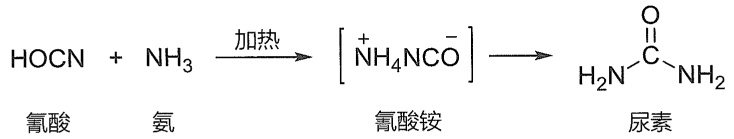

<details>
<summary>flowchart</summary>

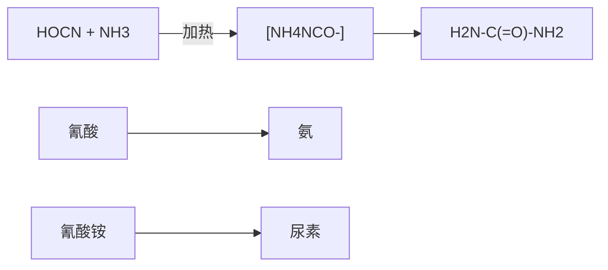
</details>

早期发现的有机化合物虽然来源不同，但它们有一个共同特点，就是都含有碳元素，于是，有机化学被称为“碳化合物的化学”。当代化学家将有机化学定义为:一门研究有机化合物的组成、结构、性质、制备方法与应用的科学。作为化学学科的一个重要分支，有机化学与物理化学、无机化学和分析化学一起构成现代化学科学的核心。此外，有机化学还是生

---

2

第一章 绪论

物学、药学、医学、农学等的重要基础。

200 多年来，人们不仅从动物、植物、微生物等生命体中分离得到了数量庞大的天然有机化合物，而且还通过实验室合成，创造出无数自然界中没有的新化合物。这些不同来源的有机化合物中很多已成为药物、染料、材料、农作物保护剂、日用化学品等的主要组分，为人类文明作出了巨大贡献。


<details>
<summary>chemical</summary>

Molecular structure of a steroid derivative with methyl and ester functional groups
</details>

青蒿素

抗疟药


<details>
<summary>chemical</summary>

Chemical structure of a heterocyclic compound with phenyl, carbonyl, amide, and thioether groups
</details>

青霉素G

抗生素


阿司匹林

解热镇痛药

元素周期表中有 118 种元素，但构成有机化合物的元素为数很少，除了碳和氢之外，常见的元素还有氮和氧，以及磷、硫、卤素等。虽然涉及的元素不多，但由这些元素组成的化合物的数目非常庞大。迄今为止，人类已知化合物的数量超过 1.5 亿，其中大部分是有机化合物，而且数量每天都在增加。

作为本书后续各章的知识铺垫，下面将以原子轨道理论和分子轨道理论为基础，从官能团、共价键本质、分子几何构型和电子离域等方面讨论有机化合物的结构，以及结构与性质的关系，尽可能使读者树立“结构决定性质”的科学观。

## 1.2 官能团

如上所述，有机化合物数目极其庞大，它们的反应和制备方法也特别多，因此对有机化合物进行合理分类是非常必要的。通常的分类方法有三种:第一种方法是按照组成分类，如只含碳和氢元素的烃类化合物，含氮、氧、硫的杂环化合物，含金属的金属有机化合物等；第二种方法是按照碳链骨架分类，如开链化合物、环状化合物等；第三种方法是按照官能团分类。在这三种方法中官能团分类法最常用，下面将重点介绍有机化合物中的官能团。

官能团（functional group）是指有机分子中具有特征性质的基团（如 C=C、OH 等）或原子（如卤原子），发生化学反应时，不同分子中的相同官能团一般具有相同或相似的反应性，而不同的官能团则不具备这种特征性质。由此可见，当我们学习有机化合物性质时，实际上是在学习官能团的性质，含有某种官能团的化合物就应该具备这种官能团的基本化学性质，因此，从认识官能团开始学习有机化学很有意义。

烷烃类化合物中只含有碳和氢两种元素，且所有的化学键都是单键，它们不含任何官能团，本书第三章将讨论这类化合物的结构与性质。含碳碳双键、碳碳叁键和苯环官能团的化合物依次称为烯烃（alkene）、炔烃（alkyne）和芳香烃（arene）。碳碳双键和碳碳叁键的化学性质特征是容易发生亲电加成反应，同样含有碳碳双键的芳香烃具有芳香性，它们不易发生亲电加成反应，而容易发生亲电取代反应，可见官能团与有机化合物的性质密切相关。

表1-1选列了有机化合物中一些常见官能团，以及含这些官能团的化合物类型。各类有机化合物的性质就是由相应的官能团决定的。本书大体上按照表1-1中列出的官能团顺序，讨论各类有机化合物的结构、性质和制备。


<details>
<summary>chemical</summary>

Three types of alkenes: ethylene, propylene, and benzene, labeled in Chinese.
</details>

---

1.2 官能团

3

表 1-1 有机化合物中一些常见官能团

<table><tr><td>化合物类型</td><td>官能团的结构和名称</td><td>示例</td></tr><tr><td>卤代烃</td><td>—X (X=F, Cl, Br, I) 卤原子</td><td> $CH_3Cl$  氯甲烷</td></tr><tr><td>烯烃</td><td> 烯基</td><td> $CH_2=CH_2$  乙烯</td></tr><tr><td>炔烃</td><td>—C≡C— 炔基</td><td>HC≡CH 乙炔</td></tr><tr><td>芳香烃</td><td> C— 苯基</td><td> $ -CH_3$  甲苯</td></tr><tr><td>醇和酚</td><td>—OH 羟基</td><td> $CH_3CH_2OH$  乙醇 $ -OH$  苯酚</td></tr><tr><td>醚</td><td>—OR 烃(烷)氧基</td><td> $CH_3CH_2OCH_2CH_3$  乙醚 $CH_3CH_2SH$  乙硫醇</td></tr><tr><td>硫醇和硫酚</td><td>—SH 疇基</td><td> $ -SH$  苯硫酚</td></tr><tr><td>硫醚</td><td>—SR 烃(烷)硫基</td><td> $CH_3SCH_3$  二甲硫醚</td></tr><tr><td>醛</td><td> 甲酰基, 醛基</td><td> $$  $\begin{array}{c} \text{ } \\ \text{ } \end{array}$  $\begin{array}{c} \text{ } \\ \text{ } \end{array}$  $\begin{array}{c} \text{ } \\ \text{ } \end{array}$ 乙醛</td></tr><tr><td>酮</td><td> 羰基</td><td> $$  $CH_3$  丙酮</td></tr><tr><td>羧酸</td><td> 羧基</td><td> $$  $\begin{array}{c} \text{ } \\ \text{ } \end{array}$  $\begin{array}{c} \text{ } \\ \text{ } \end{array}$  $\begin{array}{c} \text{ } \\ \text{ } \end{array}$ 乙酸</td></tr><tr><td>酸酐</td><td> 酸酐基</td><td> $$  $\begin{array}{c} \text{ } \\ \text{ } \end{array}$  $\begin{array}{c} \text{ } \\ \text{ } \end{array}$  $\begin{array}{c} \text{ } \\ \text{ } \end{array}$  $\begin{array}{c} \text{ } \\ \text{ } \end{array}$ 乙酸酐</td></tr><tr><td>酰卤</td><td> 卤甲酰基</td><td> $$  $\begin{array}{c} \text{ } \\ \text{ } \end{array}$  $\begin{array}{c} \text{ } \\ \text{ } \end{array}$  $\begin{array}{c} \text{ } \\ \text{ } \end{array}$ 乙酰氯</td></tr><tr><td>酯</td><td>[k5C2] 酯基, 烃(烷)氧羰基</td><td> $$  $\begin{array}{c} \text{ } \\ \text{ } \end{array}$  $\begin{array}{c} \text{ } \\ \text{ } \end{array}$  $\begin{array}{c} \text{ } \\ \text{ } \end{array}$  $\begin{array}{c} \text{ } \\ \text{ } \end{array}$  乙酸乙酯</td></tr><tr><td>酰胺</td><td> 氨甲酰基</td><td> $$  $N,N-$ 二甲基甲酰胺</td></tr><tr><td>腈</td><td>—C≡N 氰基</td><td> $CH_3CN$  乙腈</td></tr><tr><td>胺</td><td> 氨基</td><td> $CH_3CH_2NH_2$  乙胺 $(CH_3CH_2)_3N$  三乙胺</td></tr><tr><td>硝基化合物</td><td> $\begin{array}{c} \text{ } \\ \text{ } \\ \text{ } \end{array}$  $\begin{array}{c} \text{ } \\ \text{ } \\ \text{ } \end{array}$ 硝基</td><td> $CH_3CH_2NO_2$  硝基乙烷</td></tr></table>

需要指出的是，在2017版中国化学会《有机化合物命名原则》中使用了“特性基团”（characteristic group）术语代替“官能团”，二者之间是有区别的。首先，“特性基团”是指加在母体氢化物上的杂原子和基团，这些杂原子和基团等同于“官能团”，但母体氢化物是指无分叉的无环结构和环状结构，且仅连有氢原子的化合物，其中包括烯烃、炔烃和芳香烃，因此“特性基团”并不包括烯基、炔基和苯基等重要官能团。其次，“官能团”的应用场景是有机化合物的化学性质和波谱性质等，而“特性基团”的应用场景是有机化合物的系统命名。

---

4

第一章 绪论

## 1.3 共价键:价键理论

## 1.3.1 经典化学键理论（路易斯结构）

1858年，德国化学家凯库勒和英国化学家库珀等提出了“价键”概念，并首次用短线“-”来表示“键”。他们认为有机分子由原子通过键结合而成。由于当时所发现的化合物中一个氢原子只与一个其他原子结合，氢就选作“价”的单位。元素的价数就是能够与该元素的一个原子结合的氢原子个数。此外，分子中碳原子之间可以互相结合。从那时起，人们开始用短线来表示化学键，但并不清楚这个短线的物理意义，即化学键的本质。

## 1. 通过共用电子对实现八隅体稳定结构

20 世纪初，在物理学家发现了电子并阐明了原子结构的基础上，美国化学家路易斯（G. N. Lewis）等人于 1916 年提出了价键的电子理论。当时，人们已经认识到原子核外的电子是分层排列的，层数越小，电子越靠近原子核，能量越低。电子填入电子层时，电子成对更稳定。对于一些常见的原子，除第一周期元素外，外层有 8 个电子的结构最稳定。这些关于原子核外电子结构的半经验规律，很快被路易斯等人用来建立化学键理论。他们认为，原子外层电子的相互作用是原子能够结合在一起的原因。相互作用的外层电子从一个原子转移到另一个原子，形成离子键；两个原子如果共用外层电子，则形成共价键。通过电子的转移或共用，参与成键的原子的外层电子都能够拥有惰性气体的八电子稳定结构，从而达到成键饱和状态，这个以元素周期表为基础的规律称为“八隅体规则”（octet rule）。这样一来，以前用于表示价键的短线就代表了两个原子之间的共用电子对。

碳是构成所有有机化合物的主要元素之一，因此，我们必须对碳的电子结构有所了解。碳处于元素周期表中第二周期ⅣA族，其核外有6个电子，其中4个电子处于价电子层，常称为价电子（valence electron），在与其他元素成键时，它既不易失去电子，也不易得到电子，而是通过其价电子和其他元素的价电子形成共享电子对而成键的。因此，有机化合物分子中的化学键主要是共价键（covalent bond），以共价键结合是有机分子的基本特征，这和以离子键结合的离子型化合物（如NaCl）相比有显著差异。

## 2. 路易斯结构式

路易斯是如何用电子对来表示共价键和分子结构的？以双原子分子 $\mathrm{H}_{2}$ 和 $\mathrm{Cl}_2$ 的共价单键为例，路易斯用圆点“·”来表示电子，也称为电子点，氢原子核外只有一个电子，两个氢原子通过共用两个电子（即电子对）形成一个共价单键，从而达到成键饱和状态。第三周期的氯原子有7个价电子，其中有3对成对的电子，剩余一个单个电子，两个氯原子各提供一个电子组成电子对，从而通过共用这个电子对而获得八隅体结构，形成Cl-Cl单键。这种用电子点图表示分子中化学键的结构式称为路易斯结构式（Lewis structure）。

$$
\mathrm{H} \cdot + \cdot \mathrm{H} \longrightarrow \mathrm{H}: \mathrm{H} \quad : \ddot {\mathrm{Cl}} \cdot + \cdot \ddot {\mathrm{Cl}}: \longrightarrow : \ddot {\mathrm{Cl}}: \ddot {\mathrm{Cl}}:
$$

碳的价电子数为 4，因此它可与 4 个氢原子通过共用 4 个电子对而获得八隅体结构，形成甲烷分子。氧有 6 个价电子，只需得到 2 个共享电子，即可达到八隅体结构，因此在甲醇中氧分别与碳和氢共用一对电子，碳原子则分别与氧和 3 个氢共用一对电子，氧上还有两对未共用的电子，称为孤对电子（lone-pair electron）。

除了两电子的单键之外，原子间还可形成四电子键和六电子键，以获得八隅体结构。在

$$
\begin{array}{c} \text {H} \\ \text {H}: \stackrel {\cdot \cdot} {\mathrm{C}}: \text {H} \\ \text {H} \\ \text {甲烷} \\ \text {H}: \stackrel {\cdot \cdot} {\mathrm{C}}: \stackrel {\cdot \cdot} {\mathrm{O}}: \text {H} \\ \text {H} \\ \text {甲醇} \end{array}
$$

---

1.3 共价键:价键理论

5

乙烯和乙炔分子中就存在这样的多电子键，乙烯中两个碳原子共用了4个（两对）电子，构成双键，乙炔中两个碳原子共用了6个（三对）电子，构成了叁键。

经典的路易斯结构式全部采用电子点表示电子对，当分子较大时书写起来相当烦琐。现在常用简化方式书写，成键电子对用短线表示，一条短线表示单键，两条短线表示双键，三条短线表示叁键；孤对电子则仍需用电子点表示。例如:


甲醇


氯


氨


氯乙烯


乙腈

在路易斯结构式中，成键电子对可以来自同一个原子。在此情况下，结构式中将出现形式电荷（formal charge）。氧原子的价电子数为6，化合价为2，在臭氧分子路易斯结构式中三个氧原子都达到八隅体结构，但右端的氧原子是得到了2个电子才获得八隅体结构的，这2个电子全部来自中间的氧原子，可以理解为中间的氧原子“额外”给出了一个电子，故带有1个正电荷，而右端氧原子“额外”得到了一个电子，所以带有1个负电荷。叠氮酸分子的路易斯结构式中也存在这样的形式电荷。

形式电荷是可通过简单的计算来确定的，计算时共享的成键电子计半数，孤对电子计全数，如果这两个数字之和与非成键原子的价电子数有差别，则这个差别就是形式电荷数。计算公式如下:

$$
\text {形式电荷数} = \text {价电子数} - \text {孤对电子数} - \frac {\text {成键电子数}}{2}
$$

以上述臭氧分子为例，氧原子的价电子数为 6，中间氧原子的孤对电子数为 2，成键电子数为 6（来自 3 个共价键），因此其形式电荷数为

$$
\text {形式电荷数} = 6 - 2 - \frac {6}{2} = + 1
$$

右端氧原子的孤对电子数为 6，成键电子数为 2（来自 1 个共价键），因此其形式电荷数为

$$
\text {形式电荷数} = 6 - 6 - \frac {2}{2} = - 1
$$

## 3. 八隅体结构的例外

第二周期中硼元素的化合物硼烷的路易斯结构中只有6个电子，这不符合八隅体规则，很不稳定。如果它与氢负离子共享两个电子，形成硼氢负离子，则是稳定的。

第二周期后的元素中，往往会有超出8个电子的情况，常见于含硫、磷、氯、溴、碘的化合物中。例如，硫酸中硫原子的价电子数为12，而磷酸中磷原子的价电子数为10。这种现象被称为价层扩充（valence-shell expansion）。当然，我们也可以写出符合八隅体规则的路易斯结构式，但这个结构式是偶极结构，式中要有形式电荷。后来的原子轨道理论揭示了这一现象的本质，而且这两组结构可以看作两个极限结构，即共振结构（详见1.6.1小节）。


<details>
<summary>chemical</summary>

Chemical structure of ethylene (乙烯) and ethylene (乙炔) showing carbon chain with hydrogen atoms
</details>


<details>
<summary>chemical</summary>

Chemical reaction diagram showing protonation of hydrogen to form an argon and argon ion
</details>

---

6

第一章 绪论


## 1.3.2 原子轨道

路易斯的经典化学键理论虽然用共用电子对概念解释了化学键的物理意义，但这种基于经验规律的理论仍然没有回答化学键的本质问题。20世纪20年代，原子物理学家已经掌握了很多有关原子结构的信息，发现了核外电子绕核运动的一些基本规律，如波粒二象性和不确定性（如位置-动量不确定性、能量-时间不确定性等）。不确定性属于概率问题，具有量子特征。量子力学——一种关于电子绕核运动的理论建立之后，人们开始用波函数来描述电子在某个时刻的状态，称为波动方程，这种偏微分方程的解称为原子轨道（atomic orbital）。原子轨道理论是现代化学键理论的基础。

## 1. 原子轨道的层级

由量子力学推导出来的波动方程有一系列的解，称为波函数。原子轨道就是单原子的波函数，它包含了三个量子化参数，即主量子数（n）、角量子数（l）和磁量子数（m），它们分别决定了电子的能量、角动量和方位，三者统称为量子数。每个轨道都有一组不同的量子数，且最多可容纳两个电子。

主量子数（n）取值为1，2，3，4，…，用于描述原子中电子层（电子出现概率最大区域）离核的远近。n=1，代表第一层电子层，离核最近；n=2，代表第二层电子层，以此类推，n值越大，电子离核越远。

## 2. 原子轨道的类型与形状

角量子数用于描述同一电子层中的不同电子亚层（包括s、p、d轨道等），它们体现了原子轨道的三维图像，可简单地理解为电子以90%概率出现的空间区域，这些区域没有明显的边界，呈现混沌状，常用“电子云”（electron cloud）来形容。角量子数l=0、1、2的轨道依次称为s、p、d轨道，表现出的轨道形状轮廓如图1-1所示。s轨道呈球形，p轨道呈哑铃形，d轨道则呈四叶草形。图中的符号“+”和“-”代表波函数的相位（phase），通常用不同颜色或不同填充方式来表示这个符号。在后续章节中会发现这个符号很重要，一个化学键能否形成，一个反应能否发生，都与这个符号有关。需要指出的是，“+”和“-”不代表电子在该区域出现的概率，但在“+”和“-”交界处电子出现的概率（常称为电子密度）为零，此处称为节点或节面（node）。


图 1-1 s、p 和 d 轨道形状轮廓图

---

1.3 共价键:价键理论

7

1s 轨道最靠近原子核，没有节面，能级最低。2s 轨道的形状与 1s 轨道的形状相同，都是球形，但比 1s 轨道大且有一个球面状的节面，节面处波函数的符号改变（见图 1-2）。


图1-2 1s和2s轨道二维图

三个能量相同的（称为“简并的”）2p轨道能级紧随2s轨道，其轨道对称轴在x、y、z方向相互垂直，依次标记为 $2p_{x}$ 、 $2p_{y}$ 和 $2p_{z}$ 轨道（见图1-3）。每个轨道上符号相反的两瓣被垂直于轨道对称轴并通过原子核的节面所分隔。


图1-3 三个简并的 $\mathbf{p}$ 轨道形状三维图

## 3. 原子轨道的能级图与电子排布原则

图 1-4 是从 1s 到 3d 能级的原子轨道近似能级图, 这张图提供了关于有机化合物中常见原子（C、H、N 和 O）的电子构型、轨道相对能级和各能级最多容纳电子数的信息。不同原子的核外电子数不同, 它们按照一定的规则在轨道中分布。这些规则可概括为以下三个基本原则:

原则 1 在基态下，电子尽可能占据能量最低的原子轨道，使整个原子能量最低。只有当低能级轨道填满后，电子才填入高一级能级的轨道。这个原则称为能量最低原理。

原则 2 每个原子轨道最多容纳两个电子，且自旋（即自旋角动量）相反。这个原则称为泡利不相容原理（Pauli exclusion principle）。如图 1-4 所示，常用竖直向上和向下的一对箭头来表示由两个自旋方向相反电子组成的电子对（electron pair）。

原则 3 对于简并轨道（如 3 个 p 轨道和 5 个 d 轨道），每个轨道首先填充一个自旋相同的电子，填满后再填充自旋相反的电子。这个原则称为洪德定则（Hund's rule）。


<details>
<summary>text_image</summary>

能量
3d
4s
3p
3s
2p
2s
1s
最多容纳2个电子
3s、3p和3d轨道最多容纳18个电子
最多容纳
8个电子
</details>

图1-4 原子轨道近似能级图

---

8

第一章 绪论

按照上述规则和图 1-4，我们可以比较容易地写出原子的电子构型。一些常见元素原子的电子构型和化合价见表 1-2。

表 1-2 一些常见元素原子的电子构型和化合价

| 原子 | 核外电子数 | 电子构型 | 价电子数 | 化合价 |
| --- | --- | --- | --- | --- |
| H | 1 | $1s^1$ | 1 | 1 |
| He | 2 | $1s^2$ | 2 | 0 |
| C | 6 | $1s^22s^22p^2$ | 4 | 4 |
| N | 7 | $1s^22s^22p^3$ | 5 | 3 |
| O | 8 | $1s^22s^22p^4$ | 6 | 2 |
| F | 9 | $1s^22s^22p^5$ | 7 | 1 |
| Ne | 10 | $1s^22s^22p^6$ | 8 | 0 |
| Ar | 18 | $1s^22s^22p^63s^23p^6$ | 8 | 0 |
| P | 15 | $1s^22s^22p^63s^23p^3$ | 5 | 3、5 |
| S | 16 | $1s^22s^22p^63s^23p^4$ | 6 | 2、4、6 |

元素周期表中第一到第三周期的最后一个元素分别为氦、氖和氩，它们的所有原子轨道都被电子填满，达到了最多可容纳电子数的饱和状态，不需要通过得失电子（形成分子或离子）来稳定，因此是最稳状态。氖和氩的最外层轨道均有8个电子，这与曾经提出的“八隅体”经验规则非常符合。氢原子核外只有一个电子，分布在1s轨道，要达到像氦一样的饱和状态则需要得到一个电子，碳、氮、氧、氟要达到饱和状态则依次需要得到4、3、2、1个电子，这些数字显然与经典的化合价概念相符合（如表1-2所示）。

第三周期的磷和硫都有空的 3d 轨道，它们可以接受更多电子，超越八隅体结构。这就解释了硫酸和磷酸路易斯结构中的价层扩充现象（见 1.3.1 小节）。

需要指出的是，由于不同元素的电负性不同（见1.8.1小节），不同原子的核对核外电子的束缚力不同，它们的相同名称原子轨道（如2s或2p）的能级是不同的。图1-5给出了氢、碳、氮和氧四种原子价电子轨道的能级关系。从图中可以看出，碳、氮和氧原子的2p与2s轨道能级差依次增大（分别为 $8.8\mathrm{eV}$ 、 $12.4\mathrm{eV}$ 和 $16.5\mathrm{eV}$）。此外，随电负性的增大，氢、碳、氮和氧的s轨道能级依次降低，碳、氮和氧的p轨道能级也依次降低，且氧的2s与2p轨道能级同时低于氢的1s轨道能级。


<details>
<summary>bar</summary>

| Element | Energy Level (eV) |
| :--- | :--- |
| H | -13.6 |
| C | -10.6 |
| C | -19.4 |
| C | -25.6 |
| N | -13.2 |
| N | -25.6 |
| O | -15.8 |
| O | -32.3 |
</details>

图1-5 氢、碳、氮和氧四种原子价电子轨道的能级关系

---

1.3 共价键:价键理论

9

综上所述，原子轨道理论从本质上解释了为什么8电子（第二周期元素）和2电子（第一周期元素）结构是稳定的，为什么碳是四价的，氮是三价的，而氧是二价的等一系列科学问题。

## 1.3.3 价键理论

20 世纪 30 年代，著名化学家鲍林（L. Pauling）和物理学家斯莱特（J. C. Slater）将量子力学的原理与化学的直观经验相结合，创立了价键理论（valence bond theory），在经典化学键理论中引入了原子轨道理论、σ 键和 π 键、杂化轨道理论、共振论等一系列新概念。

## 1. 轨道重叠与电子配对形成共价键

价键理论认为，共价键的形成是成键原子的原子轨道（电子云）相互重叠和自旋反平行的两个电子配对的结果。自旋反平行的两个电子在轨道重叠区域内运动，为两个原子所共有，并与两个原子核相互吸引，体系能量降低。以双原子分子 $\mathrm{H}_{2}$ 为例，如图1-6所示，两个氢原子的1s轨道相互重叠，形成H-H共价键，组成氢分子。与两个氢原子相比，氢分子的能量降低了 $436\mathrm{kJ / mol}$，也就是说，形成一个H-H键可释放出 $436\mathrm{kJ / mol}$ 的能量。


<details>
<summary>chemical</summary>

Chemical reaction diagram showing hydrogen bonding between H atoms in 1s轨道 and σ键
</details>

图1-6 由氢原子组成 $\mathbb{H}_2$ 分子的轨道重叠示意图

价键理论的核心思想是原子间相互接近轨道重叠，原子间共用自旋相反的电子对使能量降低而成键。共价键具有两个特点，即饱和性和方向性。饱和性是指一个原子能够参与的化学键数目是有一定限制的。例如，氢原子核外只有一个电子，只能共享一对电子参与成键，因此氢只能形成一个共价键。方向性是指两个原子成键时必须沿着一定方向彼此接近，两个原子轨道相互重叠，重叠程度越大，形成的共价键越牢固。

## 2. 价层电子对互斥理论

对于多原子分子，价键理论也能够处理任意两个成键原子之间的化学键。然而，多原子分子存在键角和立体构型问题，例如，甲烷（$\mathrm{CH}_4$）分子中四个C-H键之间的夹角是多少？对于这个问题，价键理论最初是依赖价层电子对互斥（valence shell electron pair repulsion, VSEPR）理论来回答的。

价层电子对互斥理论认为，多原子分子中某一中心原子的空间构型取决于其价电子层中电子对的排斥作用，分子的构型总是采取电子对相互排斥力作用最小的结构，为了减少价电子对之间的排斥力，电子对间应尽量互相远离。

按照 VSEPR 理论，中心原子用 M 表示，与之结合的原子用 A 表示，其数目用 n 表示，孤对电子用 E 表示，其数目用 m 表示，则围绕中心原子的等价结构可表示为  $MA_{n}E_{m}$ ，等价电子对数等于  $(n+m)$ 。在计算电子对数目时，若两个原子之间存在双键或叁键，每个重键等价于一个电子对。

为尽可能减小等价电子对之间的排斥作用，它们应尽可能在以 M 为中心的球面彼此分开。这样一来，A 和 E 在中心原子周围的分布就会形成直线结构、平面结构或多面体结构。

---

10

第一章 绪论

若中心原子有孤对电子，中心原子往往作为分子或原子团几何结构的顶点，若中心原子没有孤对电子，则中心原子位于几何结构的中心。例如，甲烷（$\mathrm{CH}_4$）分子中，$n = 4$，$m = 0$，碳原子的等价电子对数等于4。按照VSEPR理论，甲烷分子应该具有正四面体结构，四个氢原子位于四面体的4个顶点，碳原子则位于四面体的中心，所有H-C-H键角都是 $109.5^{\circ}$。如图1-7(a)所示，甲烷中心碳原子的“电子对构型”与实际分子结构完全一致。


<details>
<summary>chemical</summary>

Molecular structure diagram showing a central carbon atom bonded to three hydrogen atoms, with bond angle labeled as 109.5°
</details>

(a)


(b)


(c)

图1-7 用VSEPR理论预测的甲烷(a)、乙烯(b)和乙炔(c)的分子结构

VSEPR 理论认为，当结合原子（A）包含不同的原子或基团时，径向半径较大的结合原子或基团占据较大的空间，这将导致多面体一定程度上变形。乙烯（ $CH_{2}=CH_{2}$ ）分子中的两个碳原子是等同的，对于任意一个碳原子，存在两种不同的结合原子，n=3（注意双键等价于一个电子对），m=0，碳原子的等价电子对数等于3。按照 VSEPR 理论，乙烯分子中任意一个碳原子的电子对构型应为稍微变形的平面三角形，C-C-H 和 H-C-H 键角都应接近  $120^{\circ}$ （实际键角分别为  $121.3^{\circ}$  和  $117.4^{\circ}$ ），整个分子的结构应为长方形，C=C 键处于长方形的中心，四个氢则处于四个顶点 [见图 1-7(b)]。同理，我们可以预测出乙炔具有线形结构 [见图 1-7(c)]，因为该分子中任意一个碳原子的等价电子对数为 2（注意叁键等价于一个电子对，故 n=2）。

根据VSEPR理论，结合原子（A）和孤对电子（E）占据的空间并不完全相等。孤对电子仅属于中心原子，在全等顶点中占据相对较大的空间，这会在一定程度压缩结合原子的空间，从而导致多面体构型出现一定变形。水分子和氨分子中心原子O和N均有孤对电子，水分子有两个H原子，O原子有两对孤对电子， $n = 2$ ， $m = 2$ ，而氨分子有3个H原子，N原子有一对孤对电子， $n = 3$ ， $m = 1$ ，这两个分子中心原子的等价电子数都是4，它们的“电子对构型”都应该接近正四面体，但水分子中两对孤对电子占据了两个顶点，并在一定程度上压缩了H-O-H键角，使其偏离 $109.5^{\circ}$ （实测值为 $104.5^{\circ}$ ），分子具有三角形结构，O原子占据了其中一个顶点[见图1-8(a)]。与水分子相似，氨分子中H-N-H键角也要稍微偏离 $109.5^{\circ}$ （实测值为 $107.5^{\circ}$ )，呈三角锥结构，N原子占据了其中一个顶点[见图1-8(b)]。


(a)


(b)

图 1-8 用 VSEPR 理论预测的水（a）和氨（b）的分子结构

## 1.3.4 杂化轨道理论

虽然上述 VSEPR 理论可以解释和预测很多分子的键角和空间构型，但它缺乏理论基础。

---

1.3 共价键:价键理论

11

甲烷分子具有四面体结构，中心碳原子的价电子构型为 $2\mathrm{s}^2 2\mathrm{p}^2$ ，其中两个已配对电子在2s轨道，另外两个电子在两个2p轨道上，这些轨道的能量和形状都不同，空间排布也不能满足四面体结构，这就难以用价键理论来解释为何可以形成四个共价键，而且是四个完全相同的C-H键。针对分子空间构型的问题，鲍林于1931年提出了杂化轨道（hybrid orbital）理论。该理论认为，原子核外的价电子在形成化学键的过程中会发生必要的杂化。由于原子各亚层轨道中电子能量相差不大，故波函数可以线性组合——杂化为新的轨道，称为杂化轨道。杂化轨道的能量与空间分布与原来的原子轨道颇为不同，但各杂化轨道是完全相同的，且它们一般呈现空间对称排布。杂化轨道理论用量子力学的数学模型解释了分子的空间构型问题，所得结论与VSEPR理论基本一致。

## 1. $\mathfrak{sp}^3$ 杂化轨道

根据杂化轨道理论，碳原子的2s轨道和三个2p轨道可杂化成四个相同的原子轨道，标记为 $sp^{3}$ 杂化轨道（符号p的上标“3”代表有三个p轨道参与了杂化）。如图1-9(a)所示，在成键之前，一个2s电子被激发到空的2p轨道上（这两个轨道能级差较小，激发所需能量可通过成键释放能量来补偿），半充满的2s轨道和三个半充满的2p轨道线性组合，形成四个等价的 $sp^{3}$ 杂化轨道，其中各有一个电子占据，且能量相同。每个 $sp^{3}$ 杂化轨道都包含1/4的2s轨道和3/4的2p轨道。鉴于2s轨道的对称性，当它与2p轨道叠加时，会同时使波函数的一个波瓣增大，另一个波瓣减小，故 $sp^{3}$ 杂化轨道形状如图1-9(b)所示。四个 $sp^{3}$ 杂化轨道的节面均通过碳原子核，在以原子核为中心的球形空间对称分布，即正四面体分布，四个杂化轨道伸向四面体的四个顶点，轨道对称轴之间的夹角均为 $109.5^{\circ}$ 。这种空间分布符合能量最低原则，成键后四个轨道中电子对之间的排斥作用最小。

如图1-10所示，在形成甲烷分子时，按照轨道最大重叠原则，每个 $\mathfrak{sp}^3$ 杂化轨道上大的一瓣与氢原子的1s球形轨道重叠，四个 $\mathfrak{sp}^3$ 杂化轨道上的电子和四个氢原子中1s轨道上的电子配对形成四个共价键，即形成甲烷分子的四个C-H键。这些C-H键绕键轴旋转任意角度，


图 1-9 碳原子的  $sp^{3}$  杂化轨道


<details>
<summary>chemical</summary>

Molecular structure and bond angle diagram of a carbon-carbon (C=C) complex with labeled bond lengths and angles
</details>

图1-10 由碳原子的4个 $\mathfrak{sp}^3$ 杂化轨道和4个氢原子的1s轨道形成甲烷分子

杂化轨道理论是一种基于理论模型和假设来解释分子电子结构的数学手段，它给出的物理图像直观易懂，在粗略探讨分子静态结构和化学键性质时很有效，也可对有机反应的细节进行适当定性分析，但它把共价键定域化在成键原子之间，强调电子配对概念，没有把分子的电子运动视为整体考虑，因而还不能反映电子运动的真实情况。

---

12

第一章 绪论

其轨道空间分布没有任何变化，具有这种轴对称性的共价键标记为  $\sigma$  键。通过杂化轨道所形成的甲烷分子符合正四面体结构，四个氢原子处于正四面体的四个顶点，碳原子则位于正四面体的中心，H-C-H 键角为  $109.5^{\circ}$ 。

在形成乙烷分子时，两个碳原子各用一个  $sp^{3}$  杂化轨道较大的一瓣沿键轴“头对头”同相位重叠(见图1-11)，这样的重叠方式符合最大重叠原则，由此形成的 C-C 键也具有与 C-H 键相同的轴对称性，故称为 C-C σ 键。其余六个  $sp^{3}$  轨道分别与六个氢原子的 1s 轨道重叠，形成六个 C-H σ 键。实测乙烷分子的 C-C-H 键角为 111.2°，稍微偏离正四面体的 109.5°。


<details>
<summary>chemical</summary>

Reaction mechanism diagram showing sp³ carbon conversion to ethane with σ bond and 111.2° bond angle
</details>

图 1-11 由两个  $sp^{3}$  杂化碳原子形成乙烷分子的碳碳  $\sigma$  键

## 2. $\mathbf{sp}^2$ 杂化轨道

乙烯分子具有平面结构，且存在碳碳双键。在这样的平面结构中，碳原子采用 $\mathfrak{sp}^2$ 杂化方式成键。如图1-12所示，碳原子的2s轨道和两个2p轨道杂化成三个能量相等且节面通过原子核的 $\mathfrak{sp}^2$ 杂化轨道，其形状与 $\mathfrak{sp}^3$ 杂化轨道相似。这三个 $\mathfrak{sp}^2$ 杂化轨道采取平面三角形的空间对称分布，较大的波瓣伸向三角形的三个顶点，轨道对称轴之间的夹角均为 $120^{\circ}$ 。如果参与杂化的两个p轨道为 $2\mathrm{p}_x$ 和 $2\mathrm{p}_y$ ，则未参与杂化的 $2\mathrm{p}_z$ 轨道垂直于三个 $\mathfrak{sp}^2$ 杂化轨道平面，其节面通过碳原子核。


<details>
<summary>chemical</summary>

Diagram illustrating the hybridization of sp² and p orbitals in a molecular system, showing electron density states and orbital angles.
</details>

图 1-12 碳原子的  $sp^{2}$  杂化轨道

在形成乙烯分子时，按照最大重叠原则，两个碳原子各用一个  $sp^{2}$  轨道沿键轴“头对头”同相位重叠（见图 1-13），形成 C-C σ 键。两个未参与杂化的 p 轨道则以“肩并肩”方式同相位重叠（图中用虚线表示），如此重叠形成的键其轨道空间分布呈镜像对称（面对称），标记为 π 键。剩下的四个  $sp^{2}$  轨道分别与四个氢原子的 1s 轨道重叠，形成四个 C-H σ 键。实测乙烯分子的 H-C-H 键角为 117.4°，C-C-H 键角为 121.3°，均稍微偏离正三角形的 120°。


<details>
<summary>chemical</summary>

Reaction mechanism diagram showing sp² carbon and σ bond formation on ethylene with bond angles and bond lengths
</details>

图1-13 由两个 $\mathfrak{sp}^2$ 杂化碳原子形成乙烯分子的碳碳 $\sigma$ 键和 $\pi$ 键

---

1.3 共价键:价键理论

13

从轨道重叠效率看，“头对头”重叠的程度要比“肩并肩”重叠的程度大，因此在  $\sigma$  键中，两个原子核之间的电子分布更多。对于同一个双键或叁键， $\sigma$  键的能量要低于  $\pi$  键的能量。换言之， $\sigma$  键比  $\pi$  键更稳定，更强。

## 3. sp 杂化轨道

乙炔具有线形结构，其碳碳叁键是由两个碳原子的 sp 杂化轨道重叠形成的。如图 1-14 所示，碳原子的 2s 轨道和一个 p 轨道杂化形成两个 sp 轨道，它们的节面均通过原子核，并采取对称的线形空间排布方式。两个未参与杂化的 p 轨道相互垂直，同时也与两个 sp 杂化轨道垂直。


<details>
<summary>flowchart</summary>

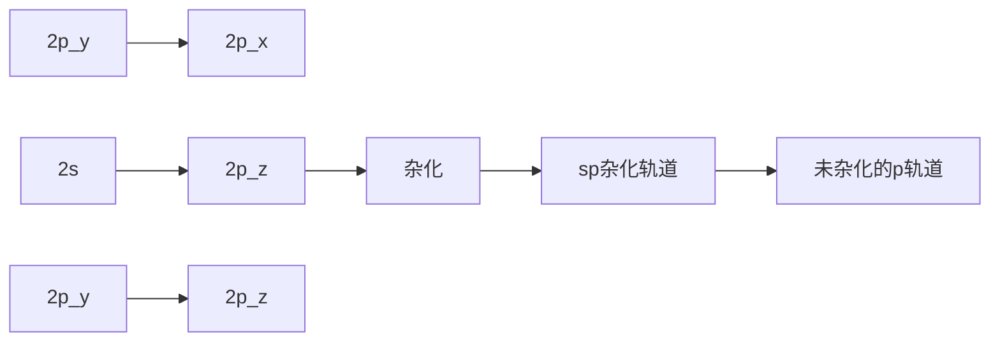
</details>

图1-14 碳原子的sp杂化轨道

与乙烯类似，在形成乙炔分子时，两个碳原子各用一个 sp 轨道沿轴线方向“头对头”重叠（见图 1-15），形成 C-C σ 键。两组相互垂直的未参与杂化的 p 轨道则通过“肩并肩”的方式重叠（图中用虚线表示），形成两个 π 键。剩下的两个 sp 轨道分别与两个氢原子的 1s 轨道重叠，形成两个 C-H σ 键。


<details>
<summary>chemical</summary>

Reaction mechanism diagram showing sp carbon and σ键 formation with π键, including bond angles and bond lengths
</details>

图1-15 由两个sp杂化碳原子形成乙炔分子的碳碳 $\sigma$ 键和 $\pi$ 键

## 4. 氮和氧原子的杂化轨道

含有氮、氧、硫等杂原子的化合物的路易斯结构式中存在孤对电子，它们的结构亦可用杂化轨道来描述。氮原子的电子构型为 $1\mathrm{s}^2 2\mathrm{s}^2 2\mathrm{p}^3$ ，可见它只需要得到3个电子形成3个共价键即可达到八隅体稳定结构。在氨分子中，氮原子以 $\mathfrak{sp}^3$ 杂化方式形成与碳原子类似的四面体结构，其中3个 $\mathfrak{sp}^3$ 杂化轨道中各有一个电子占据，它们分别与3个氢原子1s轨道重叠成键，剩余一个 $\mathfrak{sp}^3$ 杂化轨道则被孤对电子占据（见图1-16）。氨分子中H-N-H键角为 $107.3^{\circ}$ 非常接近四面体构型。


图 1-16 氨分子和水分子的结构

---

14

第一章 绪论

如图1-16所示，水分子的结构也可以用氧原子的 $\mathrm{sp}^3$ 杂化来解释。然而，与碳原子相比，氧原子的2s和2p轨道能量差别较大（见图1-5），杂化所需要的能量较大，而氧与氢成键的数目较少，成键所释放出的能量不足以弥补杂化所需要的能量，所以氧原子的 $\mathrm{sp}^3$ 杂化是不利的。实际上，水分子中氧原子可以用未杂化的原子轨道进行成键，即氧原子的两个单占2p轨道分别与能量相近的氢原子1s轨道重叠，形成两个O-H键，两对孤对电子分别占据一个2p轨道和2s轨道，$104.5^{\circ}$ 的H-O-H键角可用VSEPR理论来解释（注意:无论是否杂化，决定键角的因素都是库仑定律——电子互斥）。基于同样原因，用杂化轨道理论来处理卤原子的成键也是不合理的。

## 1.4 共价键:分子轨道理论

分子轨道理论（molecular orbital theory）是美国化学家马利肯（R. S. Mulliken）和德国物理学家洪德（F. Hund）在1932年提出的一种描述多原子分子中电子运动状态的方法，此后经不断完善和发展，已成为重要的现代化学键理论之一。与价键理论用原子轨道的重叠和电子配对成键来解释共价键的方法不同，分子轨道理论强调分子的整体性，认为分子中的电子围绕整个分子运动，电子不属于某个原子轨道，而是属于整个分子的分子轨道。因此，分子轨道理论能够更好地说明多原子分子的结构，解决许多价键理论不能回答的问题。

## 1.4.1 原子轨道线性组合法

分子轨道常用原子轨道线性组合法导出，因此它与原子轨道类似，也有大小、形状和能级。以最简单的双原子分子 $\mathrm{H}_{2}$ 为例，两个氢原子的1s轨道（相位可以是“+”，也可以是“-”）通过两种方式组合形成两种分子轨道:一种是两个原子轨道波函数同相位相加（同相组合），另一种则是反相位相加（反相组合）。如图1-17(a)所示，同相位相加得到的分子轨道波函数在两核之间大大增强（非重叠区域保持不变），呈椭圆形，且能量降低，称为成键轨道（bonding orbital）。反相位相加时，两个符号不同的1s轨道波函数在两核之间重叠区域相互抵消为零，从而形成节面，能量升高，这样形成的分子轨道称为反键轨道（anti-bonding orbital）。成键轨道绕键轴旋转任意角度，其空间分布无变化，故标记为 $\sigma$ 轨道；反键轨道也具有相同对称性，标记为 $\sigma^{*}$ 轨道（“\*”表示反键）。如图1-17(b)所示，电子在分子轨道中的填充须遵循能量最低原理、泡利不相容原理和洪德定则，氢分子的两个电子填充在能量低的成键轨道上，而反键轨道是空的。由于电子填充在 $\sigma$ 轨道，这样形成的键称为 $\sigma$ 键。此外，两个电子的总能量降低了，所以H-H键的形成是有利的。


<details>
<summary>chemical</summary>

Diagram showing electron pair generation in a membrane, with reverse and parallel combination reactions
</details>

(a)


<details>
<summary>text_image</summary>

能量
反键轨道(σ*轨道)
1s
成键轨道(σ轨道)
能量下降
</details>

(b)

图 1-17 氢分子轨道的形成（a）与能级（b）示意图

---

1.4 共价键:分子轨道理论

15

由原子轨道组合成分子轨道，不仅适合于1s轨道，也适合于其他原子轨道。如图1-18所示，如果两个2p轨道沿键轴“头对头”重叠，同相重叠形成成键轨道，反相重叠形成反键轨道。这两个分子轨道绕键轴旋转任意角度其空间分布都不改变（具有轴对称性），故分别标记为 $\sigma$ 轨道和 $\sigma^{*}$ 轨道。如果两个2p轨道相互平行叠加，即“肩并肩”重叠，也可形成成键轨道和反键轨道，成键轨道空间分布是对称的，标记为 $\pi$ 轨道，反键轨道标记为 $\pi^{*}$ 轨道。两个电子填充在能量低的 $\pi$ 轨道，故这样形成的共价键称为 $\pi$ 键。


<details>
<summary>flowchart</summary>

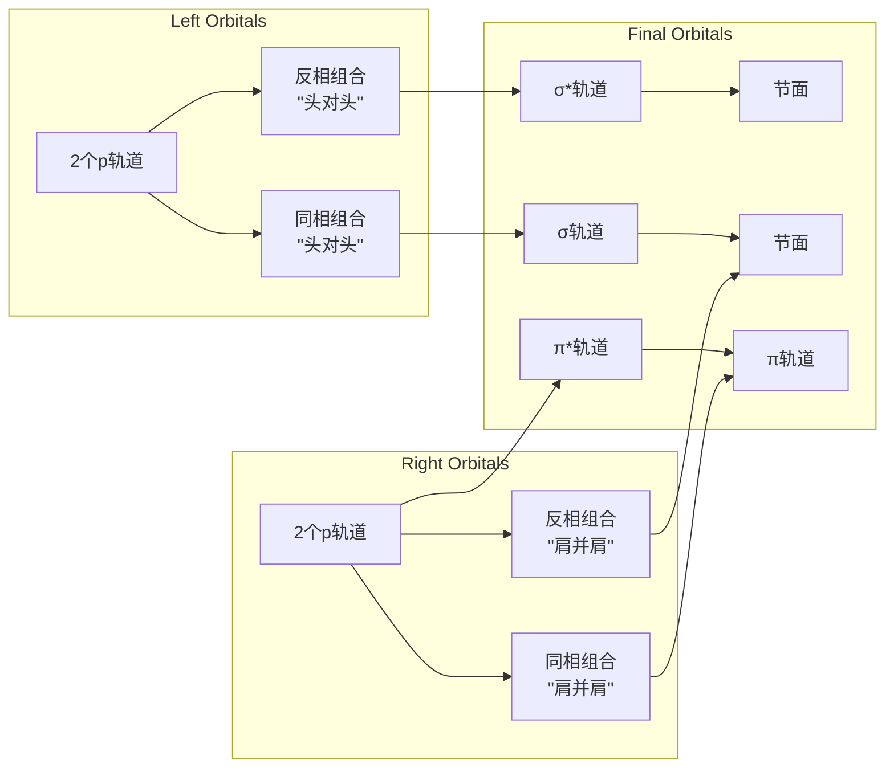
</details>

图1-18 $\sigma$ 键和 $\pi$ 键的分子轨道形成示意图

## 1.4.2 成键三原则

由原子轨道组合形成分子轨道时必须遵从“成键三原则”，即对称性匹配原则、能量近似原则、最大重叠原则。

原子轨道是有一定对称性的，只有对称性相同的原子轨道，才能组合成分子轨道，这一原则称为“对称性匹配原则”。那么什么样的原子轨道对称性是匹配呢？我们可将两个原子轨道的角度分布图进行两种对称性操作:一种是“旋转”，另一种是“反映”。“旋转”操作是绕键轴（设为 $x$ 轴）旋转 $180^{\circ}$，“反映”操作是用包含键轴的某一平面（$xy$ 或 $xz$）进行反映（照镜子）。如此操作后轨道的空间分布（包括形状及波瓣符号）没有发生改变的，称为旋转或者反映操作“对称”（symmetry）；若有所改变，则称作“反对称”（antisymmetry）。若两个原子轨道的旋转和反映两种对称性操作均为对称的或反对称的，这两个轨道的对称性就是“匹配”的。

s 轨道是球形的，对于旋转和反映两个操作均为对称的，所以两个 s 轨道能够组合成分子轨道，形成  $\sigma$  键。p 轨道的两个波瓣符号不同， $p_{x}$  轨道对于旋转和反映两个操作均为对称的， $p_{y}$  和  $p_{z}$  轨道对于旋转和反映两个操作均为反对称的，故 s 轨道与  $p_{x}$  轨道、 $p_{y}$  轨道与  $p_{z}$  轨道、两个  $p_{x}$  轨道、两个  $p_{y}$  轨道、两个  $p_{z}$  轨道都是对称性匹配的。

在对称性匹配的原子轨道中，只有能量相近的原子轨道才能组合成有效的分子轨道，而且能量越相近越好，这个原则称为“能量近似原则”。此外，对称性匹配的原子轨道重叠

---

16

第一章 绪论

由量子化学本征方程计算得到的本征波函数是离域分子轨道，又称正则分子轨道，轨道图形无法直接与特定化学键对应。由于有机化学更多关注的是特定共价键，人们从应用目的出发对分子轨道做了各种定域化处理，发展出定域分子轨道。定域分子轨道法允许将杂化轨道理论的成键解释转化为分子轨道的语言，将分子轨道与特定化学键直接关联起来。图1-20和图1-21所示乙烷和乙烯的C-C键分子轨道属于杂化轨道与分子轨道混合的定域分子轨道。定域分子轨道所缺失的对分子整体电子结构的认识，常用共振、共轭、超共轭等离域概念来补丁。

程度越大，组合出的分子轨道能量越低，形成的键越牢固，这就是“最大重叠原则”。

## 1.4.3 甲烷、乙烷和乙烯的分子轨道

按照分子轨道理论，C-C 键和 C-H 键都是离域的，即使是最简单的甲烷分子，四个等价 C-H 键实际上是四个成键分子轨道的统计平均结果。如图 1-19 所示，理论计算给出的甲烷成键轨道分为两组:能量最低的一组是由 4 个氢原子 1s 轨道和碳原子 2s 轨道组合的分子轨道  $\psi_{1}$ ，另一组是由氢原子 1s 轨道与三重简并的碳原子 2p 轨道组合的三重简并分子轨道  $\psi_{2}$ 、 $\psi_{3}$  和  $\psi_{4}$ 。 $\psi_{1}^{*}\sim\psi_{4}^{*}$  为相应的反键轨道。理论计算得到的两组成键分子轨道的能量差约为 10 eV，与光电子能谱实测值吻合，这个结果是用价键理论无法解释的。


图 1-19 甲烷的分子轨道能级（左）和相位示意图（右）

乙烷有 2 个碳原子和 6 个氢原子，它的分子轨道要复杂一些，除了 6 个碳氢键 σ 轨道和 σ\* 轨道之外，还有碳碳键的 σ 轨道和 σ\* 轨道，它们由两个 sp³ 杂化轨道组合而成。图 1-20 仅给出了乙烷分子中 C-C 键的分子轨道能级。


<details>
<summary>flowchart</summary>

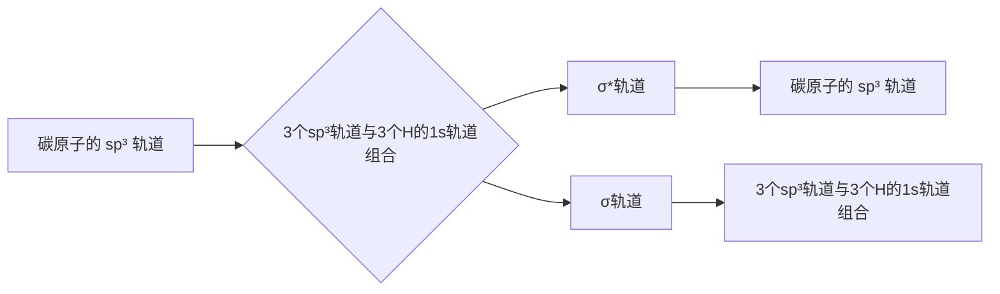
</details>

图1-20 乙烷分子中C-C键的分子轨道能级示意图


乙烷和乙烯的分子轨道图

乙烯的分子轨道要比乙烷的再复杂一些，除了4个碳氢键的成键轨道和反键轨道外，还有碳碳 $\sigma$ 键和 $\pi$ 键的成键轨道与反键轨道。如图1-21所示，两个碳原子各用一个 $\mathrm{sp}^2$ 杂化轨道以“头对头”重叠的方式组合成 $\sigma$ 轨道和 $\sigma^{*}$ 轨道，两个未参与杂化的2p轨道则通过“肩并


<details>
<summary>chemical</summary>

Energy level diagram showing electronic states and spin configurations for 2p orbitals with H atoms in 1s orbital
</details>

图1-21 乙烯分子中 $\mathbf{C} - \mathbf{C}\sigma$ 键和 $\pi$ 键的分子轨道能级示意图

---

1.5 有机分子的结构

17

肩”重叠方式组合成  $\pi$  轨道和  $\pi^{*}$  轨道，4 个电子填充在能量较低的  $\sigma$  轨道和  $\pi$  轨道，从而形成碳碳  $\sigma$  键和  $\pi$  键。

从乙烯的分子轨道能级图可以直观地看出，碳碳键  $\sigma$  轨道的能量要比  $\pi$  轨道的低。这意味着  $\sigma$  键要比  $\pi$  键强，打断  $\pi$  键需要的能量比打断  $\sigma$  键需要的少（前者约为 260 kJ/mol，后者约为 350 kJ/mol）。

## 1.4.4 休克尔分子轨道法

对于大多数有机化合物，它们的分子轨道要比乙烯分子的复杂得多，而且原子越多越复杂，因此上述轨道群方法的应用受到较大限制。1931年，休克尔（E. Hückel）提出了一种用简化的近似分子轨道模型处理共轭分子中 $\pi$ 电子的方法，称为休克尔分子轨道法（Hückel molecular orbital method）。

在烯烃、芳香烃等分子中，参与成键的碳原子都在同一平面上，碳原子间依赖 $\sigma$ 分子轨道连接在一起，形成分子的骨架，每个碳原子都有一个垂直于分子平面的 $p$ 轨道，它们以“肩并肩”的方式组合成 $\pi$ 分子轨道。休克尔认为，$\pi$ 轨道能级与 $\sigma$ 轨道能级相差较大（如图1-21所示），可以相互独立地简化处理，即 $\pi$ 电子在 $\sigma$ 键构成的分子骨架上运动，占据一系列的 $\pi$ 分子轨道。例如，我们可以把图1-21中乙烯分子的两个 $\sigma$ 键分子轨道去掉，而只保留由两个 $2p$ 轨道组合成的 $\pi$ 成键轨道和反键轨道，这就是乙烯的休克尔分子轨道（见图1-22）。

休克尔分子轨道法是一种简化的分子轨道处理方法，在有机化学中得到广泛应用。本书中有关共轭体系的分子轨道均采用休克尔分子轨道模型。


<details>
<summary>chemical</summary>

Energy level diagram of π orbital showing π* and π orbitals with energy levels labeled
</details>

图1-22 乙烯的休克尔分子轨道

## 1.5 有机分子的结构

## 1.5.1 分子结构的表示方式

## 1. Kekulé 式、结构简式和键线式

在用短线代替成键电子对的简化路易斯结构式中，同时省去孤对电子的结构式称为Kekulé式（Kekulé formula）。丙烷、异丙醇和苯的Kekulé式如侧栏所示。

通常将 Kekulé 式中的短线省去，使得分子结构式的表示进一步简化，多重键以及连接取代基与主链的键可以保留，也可以省去。这种表示方式称为结构简式或缩写式（condensed

定域分子轨道法吸收了价键理论的优点，结果直观明确，图形简单，容易与化学现象相联系。但不要忘记定域分子轨道不是本征波函数，不能描述分子整体行为，用于解释电子光谱、电离能等由单个电子运动所确定的分子性质是不合适的。


<details>
<summary>chemical</summary>

Three chemical structures of ethane: acrylonitrile, isobutyl acetate, and benzene
</details>

---

18

第一章 绪论

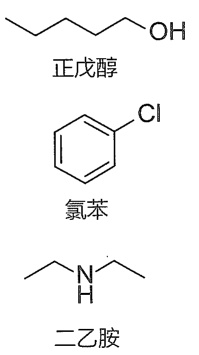

<details>
<summary>chemical</summary>

Three organic molecular structures: orthoethanol, benzene chloride, and 2-ethylamine
</details>

formula）。例如，异丁烷、乙烯、乙炔和甲醇可表示如下:

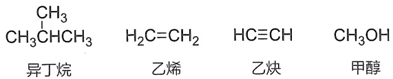

<details>
<summary>chemical</summary>

Chemical structures of ethylene and methanol with labeled substituents:异丁烷, 乙烯, 乙炔, 甲醇
</details>

键线式（line-bond formula）又称骨架结构（skeletal formula）。键线式中只保留共价键，而省去碳原子及与碳相连的氢原子，但杂原子及与杂原子相连的氢原子不能省去。在画长链分子的键线式时通常将骨架画成锯齿状。例如，正戊醇、氯苯和二乙胺的结构可用侧栏所示结构式表示。

## 2. 楔形式

上述 Kekulé 式、结构简式和键线式是不能体现分子立体结构的，对于具有四面体碳的有机分子，常用楔形式（wedge-dash notation）来表达它们的立体结构。在楔形结构式中，用传统的短线表示与纸共平面的键，用虚楔形线表示指向纸面下方的键，而用实楔形线表示指向纸面上方的键。例如，下图为 2-氯丁烷的楔形式，其中连接氯原子的键为虚楔形线（楔形线的大头指向氯原子），表示氯原子在纸面下方，链接氢原子的键为实楔形线（大头指向氢原子），表示氢原子在纸面上方。这种方法是目前最常用的分子结构表示方式之一。


<details>
<summary>chemical</summary>

Chemical structure of 2-chloro-1,2-dimethane with labeled cross-sections for dihedral and tetrahedral orientations
</details>

## 1.5.2 有机分子结构基本参数

所有分子都有一定的几何构型，我们可以用一组参数来定量描述分子的结构，主要包括键长（bond length）、键角（bond angle）和键能（bond energy）。键长和键角用以描述分子的几何构型，键能则体现键的强度（bond strength），这些参数是了解共价键性质、讨论分子结构与性质关系的重要依据。

键长是两个成键原子的平均核间距。以 $\mathrm{H}_{2}$ 为例，当两个氢原子相互作用时，能量将随核间距的变化而变化（如图1-23所示）。随着两个自由的氢原子逐渐靠近，能量下降到波谷，此时两个氢原子的核间距为 $74~\mathrm{pm}$ 。两个氢原子继续靠近，两个核之间相互排斥，使能量迅速上升。能量达到波谷时（能量最低状态）的核间距 $74~\mathrm{pm}$ 就是H-H键的平衡键长。

键长与成键原子的半径、电负性、杂化类型及键的数目等因素有关。原子半径越小，键长越小。例如，碳原子的半径要比氢原子的大得多，故乙烷分子中 C-C 键（154 pm）和 C-H 键（109 pm）的键长都要比 H-H 键键长（74 pm）大很多。键的数目越多，键长越小，如乙烷、

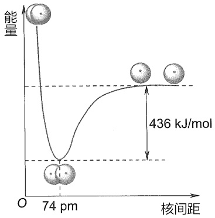

<details>
<summary>bubble</summary>

| Feature | Value |
| --- | --- |
| Minimum Energy (Energy) | 74 pm |
| Total Energy Difference | 436 kJ/mol |
</details>

图1-23 两个氢原子相互作用时能量和核间距之间的相互关系

---

1.6 电子离域:共振和共轭效应

19

乙烯和乙炔分子中 C-C 键（154 pm）、C=C 键（134 pm）和 C≡C 键（120 pm）依次变短。

键能是衡量化学键强弱的物理量。对于双原子分子，键能等于键的解离能（bond dissociation energy，BDE），即 $1\mathrm{mol}$ 气态分子解离成气态原子所吸收的能量。图1-23中核间距为 $74~\mathrm{pm}$ 时氢分子与两个自由氢原子的能量差 $436\mathrm{kJ / mol}$ 就是H-H键的键能。对于多原子分子，键能则为某一特定分子中所有特定类型化学键的键解离能的平均值。有机化合物中通常含有多个共价键，每一个共价键在分子中都不是孤立的，受其他键的影响，同一类型共价键的键长和键能在不同分子中可能稍有不同，通常取其平均值。

键能与键长以及分子本身的稳定性密切相关，键长越小，键越强，键能就越大。例如，乙烷、乙烯和乙炔分子中 C-C 键（347 kJ/mol）、C=C 键（611 kJ/mol）和 C≡C 键（837 kJ/mol）的键能随键长变短而依次增强。

大多数有机化合物中共价键的键能在 100\~900 kJ/mol 范围内。表 1-3 选列了一些常见共价键的平均键长和键能数据。

表 1-3 一些常见共价键的平均键长和键能

| 键型 | 键长/pm | 键能/(kJ·mol-1) | 键型 | 键长/pm | 键能/(kJ·mol-1) |
| --- | --- | --- | --- | --- | --- |
| C-H | 109 | 414 | C-I | 212 | 218 |
| C-C | 154 | 347 | C=C | 134 | 611 |
| C-N | 147 | 305 | C≡C | 120 | 837 |
| C-O | 143 | 360 | C=O | 123 | 695 |
| C-F | 142 | 485 | C=N | 127 | 615 |
| C-Cl | 177 | 339 | C≡N | 116 | 892 |
| C-Br | 191 | 285 | O-H | 96 | 463 |

键角是两个相邻共价键之间的夹角，它是反映分子空间结构的基本参数。分子中中心原子的电子对排布决定了分子的标准键角，但组成相似的分子不一定有相同的键角，绝大多数分子的键角偏离标准键角。如甲烷分子中任意一个 H-C-H 键角为  $109.5^{\circ}$ （见图 1-10），而乙烷分子中 H-C-H 键角为  $117.4^{\circ}$ （见图 1-11）。

影响分子键角偏离的因素很多，但主要因素是中心原子价层电子对的类型和成键原子的电负性。当中心原子价层电子对中存在孤对电子时，孤对电子对成键电子对有较大的排斥作用，这可导致键角变小。这是因为成键的共用电子对受两个原子核吸引，比较集中在键轴位置，而孤对电子没有被共享，只受中心原子核的吸引，电子云体积比较大，使它比成键电子对更强烈地排斥相邻电子对。在图1-16所示的氨分子结构中，虽然氮原子采取了 $sp^{3}$ 杂化，但由于孤对电子占据了一个 $sp^{3}$ 杂化轨道，它对成键电子对产生较大排斥，导致H-N-H键角被压缩到 $107.3^{\circ}$，从而偏离标准的 $109.5^{\circ}$ 。

## 1.6 电子离域:共振和共轭效应

多原子分子中的电子并非完全局限在两个成键原子核之间，而是在一定范围内分布于多个原子核之间。常用“定域”（localized）和“离域”（delocalized）来表示电子的这两种状态。电子离域是一种普遍现象，它能够改变分子（也包括离子和自由基）中电子、电荷的分布，

---

20

第一章 绪论

增加分子的稳定性, 从而影响分子的物理性质和化学性质。分子中由于轨道相互作用(重叠), $\pi$ 电子或非键电子在多个原子之间离域, 导致电子云分布更为均匀, 键长平均化, 结构更为稳定, 这种电子效应称为共轭 (conjugation)。电子的离域运动使得一个分子可能会在多种电子构型 (共振结构) 之间相互转换, 并达到平衡, 这种动态现象称为共振 (resonance)。常用共振结构来表示共轭, 下面首先介绍共振论。

## 1.6.1 共振结构

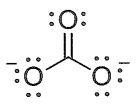

A

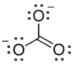

B

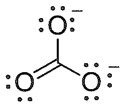

C

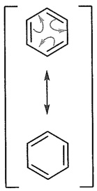

<details>
<summary>chemical</summary>

Chemical reaction diagram showing cyclohexane reacting with a benzene to form a substituted cyclohexane ring
</details>

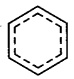

共振杂化体

在书写路易斯式时，对于同一个分子可能会画出多个符合规则的路易斯结构式。以碳酸根离子（$\mathrm{CO}_3^{2-}$）为例（见侧栏），A、B和C式都符合路易斯结构式的规则，它们的差别只是其中电子、负电荷和双键的位置不同，问题是哪一种能够代表碳酸根离子的真实结构？碳酸根离子的实际情况是，所有的碳氧键都具有双键性质，且键长都相同，所有的氧原子带有相同数量的负电荷，即2/3个负电荷，整个结构是完全对称的。所以A、B和C式中任何一种都不能代表碳酸根离子的真实结构。

苯和其他芳香烃类化合物也存在类似问题。通常把苯的结构画成单双键交替的六元环，然而，真实的苯环骨架并没有单双键之分，所有碳碳键的键长都是 139 pm。

为了解决这一困惑，1931年化学家鲍林（L. Pauling）提出了共振论（resonance theory）。共振论认为，当一个分子（也包括离子和自由基）的结构不能用一种路易斯式正确表示时，可以用多种路易斯式来表示，这些路易斯式称为共振式（resonance formula）或极限式，相应的结构称为共振结构（resonance structure）或极限结构。分子的真实电子结构是这些共振结构线性组合（杂化）的结果，称为共振杂化体（resonance hybrid），任何单一的共振式都不能代表分子的真实电子结构。

书写共振式时，在共振式之间用双箭头关联，以表示它们的共振关系，用弯箭头表示电子对离域（偏移）的方向，用鱼钩表示单个电子离域的方向，所有的共振式用方括号括起来，以表示它们之间是通过移动一个电子或电子对就可互换的特性。共振杂化体则采用虚实线表示离域的化学键。苯的共振式和共振杂化体如侧栏所示。

如果共振杂化体中原子带部分正电荷或部分负电荷，常用“$\delta+$”或“$\delta-$”来标记。如果正电荷或负电荷的数目是明确的，则用具体的数字加符号来表示，例如:

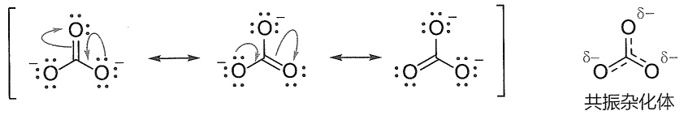

<details>
<summary>chemical</summary>

Chemical reaction diagram showing the formation of a monomeric complex with electron transfer and radical bond formation
</details>

从这个共振杂化体可以看出，碳酸根离子中三个碳氧键完全等价，两个负电荷平均分散在三个氧原子上。

共振论使用了“共振能”概念来体现共振所导致的能量变化。共振能是指共振杂化体与最稳定的共振结构之间的能量差，它可以通过量子化学方法进行计算，其经验值可通过热化学方法或从氢化热的测定中推导出，在此不作深入讨论。以下仅介绍与能量有关的一些经验规律:

（1）共振杂化体的能量总是低于任何一个单独共振结构的能量，而不同共振结构对共振杂化体的贡献不一定相同；共振结构越稳定，对共振杂化体的贡献就越大。
（2）参与共振的共振结构数目越多，共振杂化体越稳定。

---

1.6 电子离域:共振和共轭效应

21

（3）电荷分离将导致共振结构稳定性降低；电荷分离后所有原子都具有完整价电子层（第二周期原子符合八隅体规则）的共振结构式较稳定，负电荷在电负性较大原子上的共振结构也较稳定。例如，N,N-二甲基甲酰胺分子可写出如下3个合理的共振结构，其中第一个没有电荷分离，最稳定，对共振杂化体贡献最大；第二个和第三个都有电荷分离，且电子都离域到电负性较大的氧原子上，但第二个存在不符合八隅体规则的碳原子（只有6个价电子），故最不稳定；共振杂化体中氧原子带部分负电荷，氮原子则带部分正电荷。

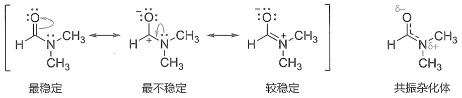

N,N-二甲基甲酰胺

（4）结构等同（或等价）的共振式能量相同，贡献相同；结构等同的共振式越多，杂化体越稳定。例如，乙酸根离子可写出以下三个共振结构，其中第一和第三个属于等同结构，共振杂化体中一个负电荷平均分配给两个氧原子，整个结构具有面对称性和轴对称性。

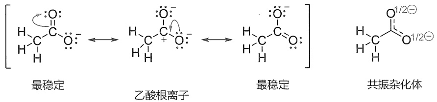

从上面的例子可以看出，有些不符合八隅体规则的结构也是合理的共振结构，只是它们的贡献较小而已。换言之，所有符合共振结构原则的（合理的）结构式都是真实结构的潜在贡献者。因此，在书写共振结构时一定要清楚哪些是主要贡献者。以下是正确书写共振结构的主要原则和规范:

（1）共振是同一分子不同共振结构之间的相互转换，从一个共振式转换为另一共振式时只允许 $\pi$ 电子和非键电子（如孤对电子和未成对电子）移动，而不允许原子核位置改变。
（2）遵守价键规则，第二周期元素价电子数不超过8，完全符合路易斯结构式规则的共振结构最重要。如上述乙酸根离子的三个共振式中，第一和第三个是等同的，它们的所有原子都符合八隅体规则，故最稳定；第二个共振式中碳原子上只有6个电子，最不稳定。
（3）所有的共振结构式必须具有相同数目的成对电子或未成对电子，净的电荷数也要保持相同。例如，戊二烯基正离子所有共振式都保持4个离域电子和一个正电荷，戊二烯基自由基所有共振式都保持5个离域电子，其中一个是未成对电子。请注意:在烯丙基自由基共振中，表示单个电子移动的符号是“鱼钩”，而不是弯箭头。

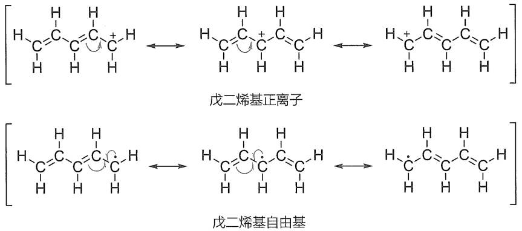

---

22

第一章 绪论

（4）对于双键和叁键，电荷分离时，正、负电荷优先分布在与电负性一致的原子上，即负电荷处于电负性较大的原子上。如甲醛的共振式中，从第一个向第二个共振时，电荷分离，电子移向电负性较大的氧原子上，故第二个共振式中氧原子带负电荷，碳原子带正电荷。如果电子反向偏移，则得到极不合理的“氧正离子”共振式。不遵守电负性原则的电荷分离贡献很小，一般忽略不计。

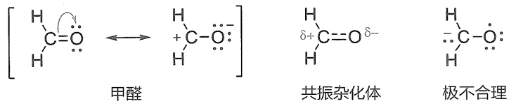

<details>
<summary>chemical</summary>

Chemical reaction equation showing oxidation of alkenes into a brominated alkene and its decomposition into monomers
</details>

## 1.6.2 $\pi -\pi$ 共轭

在前文中，我们讨论了乙烯分子中 $\pi$ 键，可知乙烯双键中两个 $\pi$ 电子是定域在两个碳原子之间的。如果分子中含有两个双键，且它们被一个单键隔开，其 $\pi$ 键和分子整体结构如何？以最简单的丁-1,3-二烯为例来讨论这个问题。如图1-24所示，与乙烯相似，丁-1,3-二烯分子中每个碳原子都为 $\mathrm{sp}^2$ 杂化，所有的碳原子处于同一平面，所有的p轨道都垂直于这个平面，且“肩并肩”形成一个大 $\pi$ 键（图中用虚线表示），其中有4个 $\pi$ 电子。在这个体系中，$\pi$ 电子不局限于某一个双键，而是离域在两个双键的四个碳原子之间。这种由单双键交替构成的、电子在多个原子间离域的平面结构称为共轭体系（conjugation system）。像丁-1,3-二烯这样由两个双键组成的共轭体系称为共轭二烯，以此类推，由多个双键组成的共轭体系称为共轭多烯。由于产生离域的电子全部来自 $\pi$ 轨道，通常把这种共轭作用称为 $\pi -\pi$ 共轭。

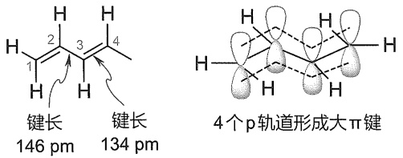

图1-24 丁-1,3-二烯的分子结构

与孤立双键体系相比，共轭体系中的双键和单键键长趋于平均化，分子的能量降低，稳定性增大，物理性质和化学性质大多与孤立双键体系不同。如上述丁-1,3-二烯分子中C2-C3键的键长为 $146\mathrm{pm}$，明显比乙烷的C-C键键长（$154\mathrm{pm}$）短，具有部分双键的性质。这种由电子离域而导致结构与性质改变的效应称为共轭效应（conjugated effect）。共轭效应是一种重要的电子效应，它能够影响分子（也包括离子、自由基等）的结构、稳定性和反应性。在以后的章节中，我们会经常用到共轭效应这一概念。

可以用共振结构来表示丁-1,3-二烯的共轭作用。如下是比较重要的5个共振式，其中最稳定的是无电荷分离的A式，其他都存在电荷分离，其中B式和D式等价，C式和E式等价，它们是相对比较重要的，对真实结构有一定贡献；C式和E式中C2-C3键是双键，这就解释了真实结构中C2-C3键具有部分双键特征的原因。

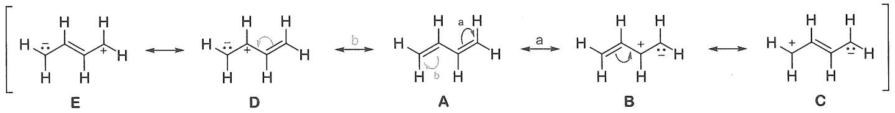

<details>
<summary>chemical</summary>

Reaction mechanism diagram showing hydrogen bonding and rearrangement steps between compounds E, D, A, B, and C
</details>

---

1.6 电子离域:共振和共轭效应

23

根据共振论，共振结构越多，共振杂化体越稳定，丁-1,3-二烯分子因共振而稳定。为了进一步了解共轭效应的本质，下面将用分子轨道理论来分析丁-1,3-二烯的  $\pi-\pi$  共轭作用。

根据休克尔分子轨道法,可以通过两个孤立  $\pi$  键分子轨道的线性组合来产生丁-1,3-二烯的分子轨道。如图 1-25 所示，两个孤立  $\pi$  键有两个  $\pi$  轨道和两个  $\pi^{*}$  轨道，两个能量相同且对称性匹配的  $\pi$  轨道组合成两个新的分子轨道（分别用波函数符号  $\psi_{1}$  和  $\psi_{2}$  标记），同样，两个能量相同且对称性匹配的  $\pi^{*}$  轨道也能够组合成两个新的分子轨道（分别用波函数符号  $\psi_{3}$  和  $\psi_{4}$  标记），这 4 个新分子轨道的能级从  $\psi_{1}$  到  $\psi_{4}$  均依次升高。4 个电子填充在能量低的  $\psi_{1}$  和  $\psi_{2}$  轨道，这两个轨道均是成键轨道， $\psi_{3}$  和  $\psi_{4}$  均为反键轨道。能量最高的成键轨道（ $\psi_{2}$ ）称为最高已占轨道（highest occupied molecular orbital, 简称 HOMO）；能量最低的反键轨道（ $\psi_{3}$ ）称为最低空轨道（lowest unoccupied molecular orbital, 简称 LUMO）。化学反应就发生在 HOMO 和 LUMO 轨道中，它们被称为前线分子轨道（frontier molecular orbital）。在以后的章节中，我们会应用这些概念。

需要指出的是，在形成分子轨道时，参与组合的各原子轨道对分子轨道的贡献是用比例来体现的，这个比例称为轨道系数（coefficients）。轨道系数的大小是通过量化计算获得的，常用原子轨道波瓣图形的大小来表示。如图1-25所示，$\psi_{1}$ 和 $\psi_{4}$ 中间的两个p轨道系数最大，而 $\psi_{2}$ 和 $\psi_{3}$ 两端的两个p轨道系数最大。考虑到成键三原则，轨道系数概念在预测和解释有机反应区域选择性方面有重要应用。

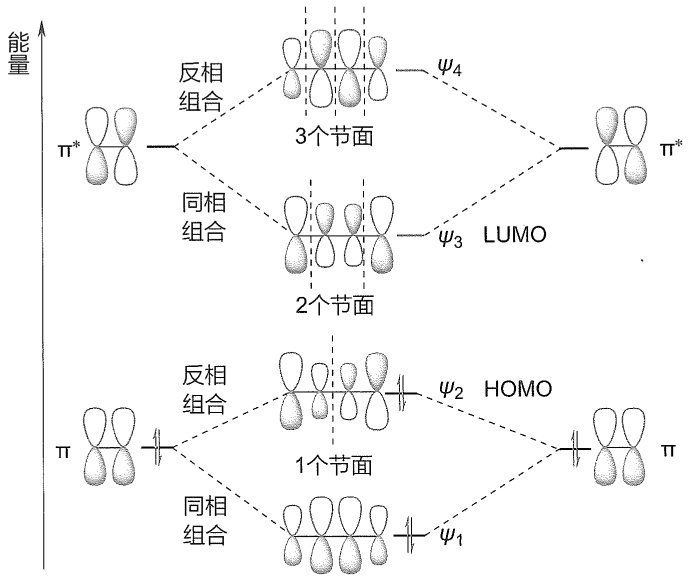

<details>
<summary>flowchart</summary>

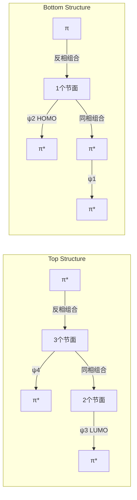
</details>

图1-25 丁-1,3-二烯的分子轨道示意图

从图1-25可以看出，能量最低的 $\psi_{1}$ 轨道没有节面。随着能量升高，从 $\psi_{2}$ 轨道到 $\psi_{3}$ 和 $\psi_{4}$ 轨道依次出现1、2和3个节面。没有节面意味着电子连续处在 $\psi_{1}$ 轨道中，并分布在四个碳原子之间，因而 $\psi_{1}$ 轨道中所有碳原子之间都有成键作用（bonding interaction），净的成键数为 $+3$ 。在 $\psi_{2}$ 轨道中，C1和C2之间以及C3和C4之间有成键作用，但在C2和C3之间有一个节面，存在反键作用（antibonding interaction），所以 $\psi_{2}$ 轨道净的成键数为 $2 - 1 = 1$ 。以此类推，空的 $\psi_{3}$ 轨道净的成键数为-1，而 $\psi_{4}$ 轨道中净的成键数为-3。

---

24

第一章 绪论

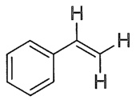

苯乙烯

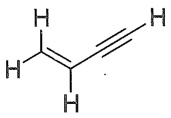

丁烯炔

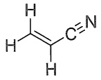

丙烯腈

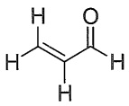

丙烯醛

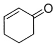

环己烯酮

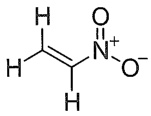

硝基乙烯

键长

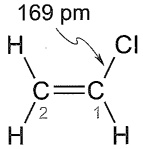

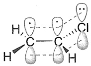

氯乙烯

在两个已占轨道（$\psi_{1}$ 和 $\psi_{2}$）中，C1和C2之间以及C3和C4之间都有成键作用，但在$\psi_{2}$中C2和C3之间有反键作用，这就抵消了一部分$\psi_{1}$中C2和C3之间的成键作用。之所以是部分抵消，而不是完全抵消，是因为$\psi_{2}$中C2和C3的轨道系数小于$\psi_{1}$中C2和C3的轨道系数。这就解释了丁-1,3-二烯中C2-C3键具有部分双键特征的原因。

除了共价键的成键之外，分子轨道能级图还能帮助我们理解有机化合物的稳定性和反应性。例如，丁-1,3-二烯分子的两个离域轨道 $\psi_{1}$ 和 $\psi_{2}$ 的总能量低于两个乙烯分子成键轨道（$\pi$ 轨道）的总能量，这个能量差称为离域能（delocalization energy，DE），这就意味着共轭的丁-1,3-二烯在热力学上要比孤立二烯体系稳定。丁-1,3-二烯的HOMO能级高于乙烯的HOMO能级，因此在与亲电试剂发生亲电加成反应时，丁二烯要比乙烯活泼。这些预测都与事实相符。

除了共轭双烯和共轭多烯之外，苯环、碳氧双键、碳碳叁键、碳氮叁键等含有 $\pi$ 键的官能团都可形成 $\pi-\pi$ 共轭体系，如苯乙烯、丁烯炔、丙烯腈、丙烯醛、环己烯酮和硝基乙烯分子中均存在单双键或叁键交替结构，均属于 $\pi-\pi$ 共轭体系。

许多共轭多烯是维护人体健康不可缺少的营养素， $\beta-$ 胡萝卜素就是其中之一，它也是人体内维生素A的重要来源之一。 $\beta-$ 胡萝卜素分子的共轭体系由11个双键和22个 $\pi$ 电子构成。

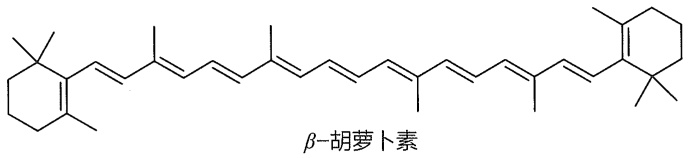

<details>
<summary>chemical</summary>

Chemical structure of β-lactam, labeled as β-lactamene
</details>

## 1.6.3 p-π共轭

如果与  $\pi$  键相连的某一原子具有一个与  $\pi$  轨道平行的 p 轨道，那么这个 p 轨道就可与  $\pi$  轨道共轭，形成 p- $\pi$  共轭体系。例如，氯乙烯分子中氯原子的 p 轨道与两个双键碳原子的 p 轨道平行，能够重叠形成 “三原子四电子” 的共轭大  $\pi$  键，这种共轭体系称为 p- $\pi$  共轭。

从氯乙烯的共振结构可以预测其 C-Cl 键具有部分双键特征，实测 C-Cl 键的键长为 169 pm，这与氯乙烷中 C-Cl 键键长（177 pm）相比，明显变短了。

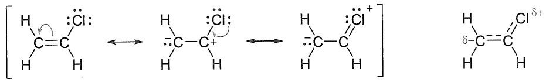

<details>
<summary>chemical</summary>

Chemical reaction diagram showing hydrogen bonding between a chlorinated alkene and a chloride ion
</details>

烯丙基正离子和烯丙基负离子也是典型的 $p-\pi$ 共轭体系，其中碳原子全部为 $sp^{2}$ 杂化，三个未杂化的 $p$ 轨道“肩并肩”形成 $\pi$ 键。从两个等同的共振结构可以看出，烯丙基正离子的 $\pi$ 轨道具有面对称性，正电荷平均分配给两端两个碳原子；烯丙基负离子的结构也与烯丙基正离子相似。

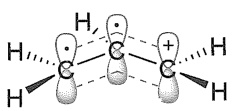

烯丙基正离子

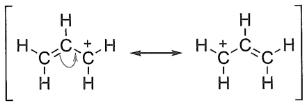

<details>
<summary>chemical</summary>

Chemical reaction diagram showing protonation of a carbocation with an alkene
</details>

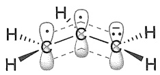

烯丙基负离子

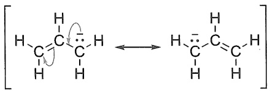

<details>
<summary>chemical</summary>

Chemical reaction diagram showing hydrogen bonding between a carbonyl compound and an alkene
</details>

---

1.6 电子离域:共振和共轭效应

25

烯丙基正离子的休克尔分子轨道是由三个碳原子的2p轨道组合成的。如图1-26所示，$\psi_{1}$ 轨道由三个2p轨道同相组合而成，净的成键数为 $+2$ ，能量最低。$\psi_{2}$ 轨道有一个节面，正好处在2位碳原子上，净的成键数为0，能量与2p轨道能量接近。$\psi_{3}$ 轨道由三个2p轨道反相组合而成，有两个节面，两个反键，净的成键数为-2，能量最高。两个电子填充到 $\psi_{1}$ 轨道，因此 $\psi_{1}$ 为HOMO，$\psi_{2}$ 为LUMO。与2p轨道相比，两个电子填充的 $\psi_{1}$ 轨道能量降低了，这个能量差就体现了共轭稳定化作用。

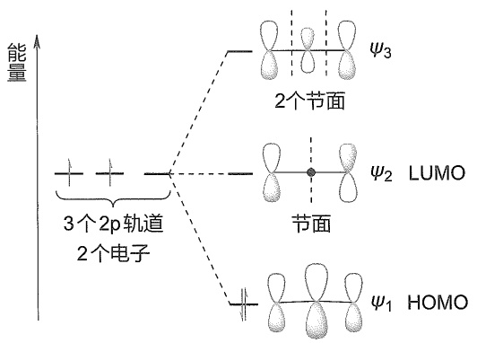

<details>
<summary>text_image</summary>

能量
3个2p轨道
2个电子
2个节面
ψ₃
ψ₂ LUMO
节面
ψ₁ HOMO
</details>

图 1-26 烯丙基正离子的分子轨道示意图

烯丙基负离子的分子轨道与烯丙基正离子的相似，只是有4个电子，其中两个填充到 $\psi_{1}$ 轨道，另外两个填充到 $\psi_{2}$ 轨道，因此 $\psi_{2}$ 为HOMO，$\psi_{3}$ 为LUMO（见图1-27）。与2p轨道相比，两个电子填充的 $\psi_{1}$ 轨道能量降低了，因此共轭作用也稳定了烯丙基负离子。

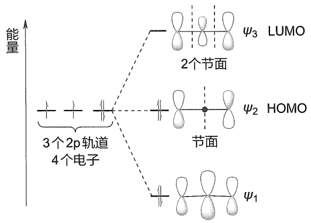

<details>
<summary>text_image</summary>

能量
3个2p轨道
4个电子
2个节面
ψ₃ LUMO
ψ₂ HOMO
节面
ψ₁
</details>

图1-27 烯丙基负离子的分子轨道示意图

## 1.6.4 常见基团的共轭效应

在上述氯乙烯 $\mathrm{p - }\pi$ 共轭体系的例子中，氯原子上的孤对电子离域到碳碳双键的 $\pi$ 轨道，导致2位碳原子带部分负电荷，电子密度增大，氯原子表现出给电子作用。在硝基乙烯的 $\pi -\pi$ 共轭体系中，从共振结构不难看出负电荷集中在硝基氧原子上，正电荷集中在2位碳原子，碳碳双键电子密度降低，硝基表现出吸电子作用。

不同的基团（或原子）在共轭体系中扮演的角色不同，有的给电子（如氯原子），有的吸电子（如硝基）。通常把给电子的效应称为正效应，给电子共轭效应用“+C”表示（C是conjugation的第一个字母），与之相反，吸电子的效应称为负效应，吸电子共轭效应用“-C”表示。

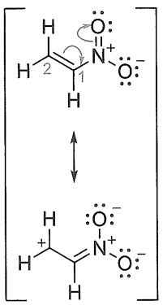

<details>
<summary>chemical</summary>

Molecular structure diagram showing a protonated nitrogen-containing heterocycle with oxygen and hydrogen atoms
</details>

硝基乙烯

---

26

第一章 绪论

```csv
常见+C基团:
O⁻, OH, OR
NH₂, NHR, NR₂
SH, SR
F, Cl, Br, I
常见-C基团:
NO₂, SO₃H
C=O, CO₂H, CO₂R
CN
```

共轭效应是一种重要的电子效应，区分 “+C” 和 “-C” 很有意义，它能够帮助我们更好地理解有机分子的电子密度和电荷分布情况、反应活性和区域选择性等。侧栏中列举了一些常见给电子和吸电子共轭效应的基团（或原子）。

## 1.7 电子离域:超共轭效应

上一节中我们讨论了因电子离域而产生的共轭效应，涉及 $\pi$ 轨道之间或者 $\pi$ 轨道与 $p$ 轨道之间相互作用。根据分子轨道理论，只要在空间上能够满足轨道重叠的条件，满占的 $\sigma$ 轨道也可与空的 $\pi^{*}$ 轨道、空的或单占的 $p$ 轨道相互作用，形成新的分子轨道，电子在新轨道能量有所降低，体系更加稳定。这种稳定化作用称为超共轭（hyperconjugation）。超共轭效应比上述共轭效应一般要弱得多，因为这些轨道之间重叠是不充分的，相互作用比较弱。从本质上看，这种稳定化作用是 $\sigma$ 电子离域的结果，因而有人把它归属为共轭效应的一种，称为 $\sigma-$ 共轭（$\sigma-$ conjugation）。与共轭效应类似，我们可根据参与超共轭作用的轨道类型，将超共轭效应分为 $\sigma-\sigma$ 超共轭、$\sigma-\pi$ 超共轭、$\sigma-p$ 超共轭、$n-\sigma$ 超共轭等。作为入门章节，本节仅简单介绍 $\sigma-\pi$ 和 $\sigma-p$ 超共轭。

## 1.7.1 $\sigma -\pi$ 超共轭

丙烯分子中存在 $\sigma -\pi$ 超共轭作用。如图1-28所示，当双键的 $\mathrm{sp}^2$ 杂化碳与 $\mathrm{sp}^3$ 杂化碳原子相连时，满占的C-H $\sigma$ 成键轨道可以与空的 $\mathrm{C = C}\pi$ 反键轨道（$\pi^{*}$ 轨道）重叠，组合出新的分子轨道，两个电子填充到新轨道，能量降低，分子的稳定性增加，这种作用称为 $\sigma -\pi$ 超共轭效应。另一种标记超共轭类型的方法则更加清晰，如上述 $\sigma -\pi$ 超共轭可表示为$\sigma (\mathrm{C - H})\rightarrow \pi^{*}(\mathrm{C - C})$ ，其中 $\sigma (\mathrm{C - H})$ 代表 $\mathrm{C - H}\sigma$ 轨道， $\pi^{*}(\mathrm{C - C})$ 代表 $\mathrm{C = C}\pi^{*}$ 轨道，箭头指明了电子离域的方向。图1-28中只显示了一个C-H键的超共轭，但C-C键是可自由旋转的，而甲基碳上有三个C-H键，故丙烯的超共轭作用可标记为 $3\times \sigma (\mathrm{C - H})\rightarrow \pi^{*}(\mathrm{C - C})$ 。

$\sigma (\mathrm{C - H})\rightarrow \pi^{*}(\mathrm{C - C})$ 超共轭效应弱化了烯丙基位C-H键，这与丙烯的烯丙基C-H键解离能（BDE）比乙烷C-H键解离能小的事实相符。

$$
\mathrm{H} _ {2} \mathrm{C} = \mathrm{CHCH} _ {2} - \mathrm{H}
$$

$$
\text{BDE} = 359 \text{ kJ/mol}
$$

$$
\mathrm{CH} _ {3} \mathrm{CH} _ {2} - \mathrm{H}
$$

$$
\mathrm{BDE} = 423 \mathrm{kJ/mol}
$$

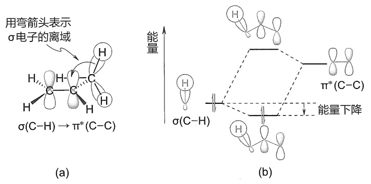

图1-28 丙烯的 $\sigma -\pi$ 超共轭效应（a）及分子轨道能级变化示意图（b）

需要指出的是，虽然超共轭效应稳定了 $\mathrm{C = C}$ 键，但它的电子密度增加了，HOMO的能级升高了（图1-28中没有画出 $\mathrm{C = C}$ 键的HOMO，即 $\pi$ 轨道）。据此可以预测，在与亲电试

---

1.7 电子离域:超共轭效应

27

剂发生反应时，丙烯的反应活性应该比乙烯的反应活性高，这与事实相符合（详见第五章）。类似的效应也见于甲苯的亲电取代反应（见第六章）。

## 1.7.2 σ-p 超共轭

$\sigma - p$ 超共轭常见于碳正离子和碳自由基体系。乙基碳正离子中的 $\sigma - p$ 超共轭效应和分子轨道能级变化见图1-29，中心碳原子为 $\mathrm{sp}^2$ 杂化的平面三角形结构（类似于乙烯碳原子），未杂化的 $p$ 轨道是空的，甲基的 $\mathrm{C - H}\sigma$ 轨道能够与中心碳原子空的 $p$ 轨道重叠，$\sigma$ 电子离域到空的 $p$ 轨道，形成的新轨道能量降低，从而产生稳定化作用。甲基的3个C-H键都可参与超共轭效应，所以，乙基碳正离子的超共轭作用可标记为 $3 \times \sigma (\mathrm{C - H}) \rightarrow \mathfrak{p}(\mathrm{C})$。

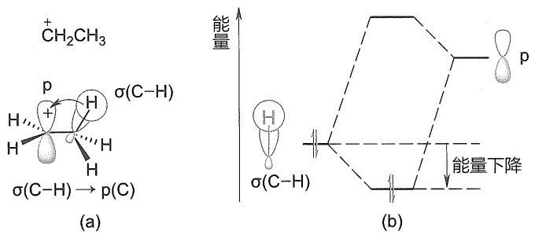

图1-29 乙基碳正离子的 $\sigma -\mathfrak{p}$ 超共轭效应（a）及分子轨道能级变化示意图（b）

由于存在 $3 \times \sigma(\mathrm{C}-\mathrm{H}) \rightarrow \mathrm{p}(\mathrm{C})$ 超共轭效应，乙基碳正离子要比无超共轭效应的甲基碳正离子（$^+\mathrm{CH}_3$）稳定得多，而有 $6 \times \sigma(\mathrm{C}-\mathrm{H}) \rightarrow \mathrm{p}(\mathrm{C})$ 和 $9 \times \sigma(\mathrm{C}-\mathrm{H}) \rightarrow \mathrm{p}(\mathrm{C})$ 超共轭效应的异丙基正离子和叔丁基正离子更稳定。实际上迄今还没直接证据证明甲基碳正离子的存在。碳正离子是许多重要有机反应的活性中间体，因此理解它们的稳定性至关重要，有关内容将在第四章和第五章中讨论。

## 1.7.3 超共轭效应的简单表示方式

虽然分子轨道能够帮助我们理解共轭和超共轭效应，特别是能量变化情况，但分子轨道图形比较复杂，初学者不易掌握。根据国际纯粹与应用化学联合会（IUPAC）的建议，超共轭效应可以采用“双键-无键”共振式（double bond-no bond resonance）来表示，也可用弯箭头表示 $\sigma$ 电子离域的方向。例如，乙基正离子的 $\sigma - p$ 超共轭可表示为

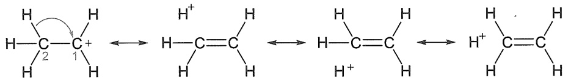

<details>
<summary>chemical</summary>

Chemical reaction diagram showing protonation and rearrangement of a carbocation intermediate with hydrogen bonding
</details>

双键-无键共振式不仅简单明了，而且能够体现超共轭的本质，与分子轨道理论分析所得主要结论一致，如能直观地给出哪些键被加强、哪些键被弱化的信息。从上式中，我们可以获悉乙基正离子的C1-C2键被加强了（有部分双键特征），而C2-H键被弱化了，这与第五章中将要讨论的E1消除反应（中间体为碳正离子）的事实相符合。

---

28

第一章 绪论

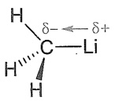

甲基锂

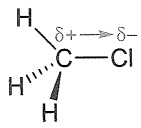

氯甲烷

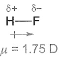

## 1.8 共价键的极化和诱导效应

## 1.8.1 共价键的极性

对于相同原子形成的共价键，其成键电子对处于两原子中间，正、负电荷中心重叠，这样的共价键称为非极性共价键。不同原子形成共价键时，由于各元素的电负性（electronegativity）不同，原子吸引电子的能力不同，电子偏向电负性较大的原子一端，从而导致键的极化（bond polarization），使电负性较大的原子带有部分负电荷，另一原子带部分正电荷，正、负电荷中心不重叠，这样的共价键称为极性共价键。常用  $\delta+/\delta-$  标记极性共价键电荷分布情况，用箭头表示电子对偏移的情况，箭头方向是从带部分正电荷原子指向带部分负电荷原子。例如，甲基锂中的 C-Li 键和氯甲烷中的 C-Cl 键的极性可表示如侧栏中结构式所示。

键的极性与成键原子的电负性差值有关，差值越大，极性越大。当两个原子的电负性差值大于等于2时，可以发生电子的完全转移，而不是共享，从而形成离子键。如钠的电负性为0.9，氯的电负性为3.0，钠失去一个电子成正离子，氯得到一个电子成负离子，最终形成离子型氯化钠。表1-4列出了一些常见元素的电负性数据。

表 1-4 一些常见元素的电负性

<table><tr><td colspan="7">H</td></tr><tr><td colspan="7">2.1</td></tr><tr><td>Li</td><td>Be</td><td>B</td><td>C</td><td>N</td><td>O</td><td>F</td></tr><tr><td>1.0</td><td>1.5</td><td>2.0</td><td>2.5</td><td>3.0</td><td>3.5</td><td>4.0</td></tr><tr><td>Na</td><td>Mg</td><td>Al</td><td>Si</td><td>P</td><td>S</td><td>Cl</td></tr><tr><td>0.9</td><td>1.2</td><td>1.5</td><td>1.8</td><td>2.1</td><td>2.5</td><td>3.0</td></tr><tr><td>K</td><td>Ca</td><td></td><td>Ge</td><td>As</td><td>Se</td><td>Br</td></tr><tr><td>0.8</td><td>1.0</td><td></td><td>1.8</td><td>2.0</td><td>2.4</td><td>2.8</td></tr><tr><td></td><td></td><td></td><td></td><td></td><td></td><td>I</td></tr><tr><td></td><td></td><td></td><td></td><td></td><td></td><td>2.5</td></tr></table>

常用键的偶极矩（dipole moment，简称键矩）来衡量共价键的极性大小，用符号  $\mu$  表示。 $\mu$  等于正负电荷中心之间的距离（d）与电荷（q）的乘积，单位是德拜（Debye，用 D 表示， $1\ D = 3.34 \times 10^{-30}\ C \cdot m = 0.208$  单位正、负电荷分开 0.1 nm）。

$$
\mu = q \times d
$$

键矩是矢量，有方向性，常用符号“↔”表示，箭头由正电荷中心指向负电荷中心。H-F键的键矩可表示如侧栏所示。

碳的电负性随着杂化轨道的类型不同而略有不同。碳的杂化轨道由2s和2p轨道组成，s轨道呈球形对称，能级较低，电子在球形轨道内运动，受核束缚较大，而p轨道有一通过核的节面，能级较高，电子在舒展的两个叶瓣内运动，受核束缚较小。因此，杂化轨道中s成分越多，核对电子的束缚越大。碳原子的sp、 $sp^{2}$ 和 $sp^{3}$ 杂化轨道中s成分依次为50%、33%和25%，它们的电负性大小顺序为 $C_{sp}>C_{sp^{2}}>C_{sp^{3}}$ 。

## 1.8.2 分子的偶极矩

分子的极性大小用偶极矩表示。对于双原子分子，其键矩就是分子的偶极矩。对于多原

---

1.8 共价键的极化和诱导效应

29

子分子，分子的偶极矩是各键矩的矢量和。氯甲烷中 C-Cl 键是极性共价键，键矩由 C 指向 Cl，分子偶极矩是三个 C-H 键键矩和一个 C-Cl 键键矩的矢量和（1.87 D），属于极性分子。四氯化碳为四面体对称分子，各键矩的矢量和为零，分子的偶极矩等于 0，是非极性分子。甲烷与四氯化碳类似，四个 C-H 键的键矩均由 H 指向 C，分子偶极矩是四个 C-H 键的键矩矢量和，这个值也等于 0，故甲烷属于非极性分子。由于碳和氢的电负性相差很小，绝大多数烷烃都为非极性分子，或者极性极弱。

下面列举了在气相条件下测得的卤代甲烷分子的偶极矩数据。从氯甲烷到溴甲烷和碘甲烷，随着卤原子电负性的减小，分子的偶极矩依次减小。为什么氟甲烷没有遵循这个顺序而成为例外？注意键矩的定义。虽然氟的电负性最大，但氟原子半径最小，C-F键的键长（142 pm）比C-Cl键的键长（177 pm）短得多，故C-F键的键矩比C-Cl键的小。碘甲烷中虽然C-I键最长，但碘的电负性小，所以C-I键的键矩小，整个分子的偶极矩最小。

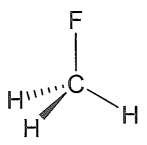

$\mu = 1.82 \mathrm{D}$

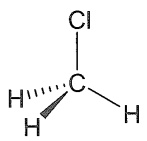

$\mu = 1.87 \mathrm{D}$

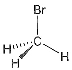

$\mu = 1.79 \mathrm{D}$

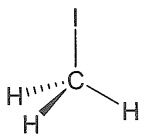

$\mu = 1.64 \mathrm{D}$

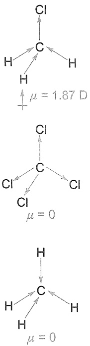

## 1.8.3 诱导效应

分子中不同原子（或基团）电负性的差异不仅使某个共价键极化，而且由此产生的极性共价键还能进一步诱导邻近的共价键，使其发生极化，这种电子效应称为诱导效应（inductive effect，用 I 表示）。诱导效应的本质是静电作用，是永久性的，其特征是电子偏移沿着  $\sigma$  键传递，而且随着碳链的增长而迅速减弱，直至消失。

第八章中我们将讨论核磁共振波谱，这种分析技术提供的重要信息之一是有机化合物分子中不同碳或氢原子的化学位移，而化学位移与核外电子密度直接相关，电子密度越大，化学位移值越小；反之亦然。下面以乙烷和氯乙烷的核磁共振碳谱化学位移为例，来讨论诱导效应是如何发生的。乙烷分子的两个碳原子是等价的，化学位移为6.5，我们以它为参照值。氯乙烷分子由于氯的电负性较大，C-C1键被极化，其中的 $\sigma$ 电子偏移到氯原子一边，导致C1核周围电子密度降低，因此C1的化学位移增大到40。因C1的电子密度降低而带部分正电荷时，静电作用使得C1-C2键也随之极化，电子向C1偏移，导致C2核周围电子密度降低，但降低幅度有所减少，所以C2的化学位移（19）小于氯乙烷C1的化学位移（40），但大于乙烷碳原子的化学位移（6.5）。这就是氯原子的吸电子诱导效应。

下面以丁酸及其氯代衍生物的酸性为例，进一步讨论诱导效应的特征。酸性强弱的定量指标是  $pK_{a}$ ， $pK_{a}$  值越小，酸性越强（相关理论将在下一节详细讨论）。以丁酸的酸性 ( $pK_{a}=4.82$ ) 为参照，当丁酸 2 位被氯取代，由于氯原子的吸电子诱导效应，C1-C2 键极化，并进一步传递到羟基的 O-H 键，使 O-H 极性共价键的极化度增大，电子更偏向氧原子，从而酸性增强 ( $pK_{a}=2.86$ )。当氯取代在 3 位时，传递链增开了一个  $\sigma$  键，氯的吸电子诱导效应减弱，3-氯丁酸的酸性 ( $pK_{a}=4.05$ ) 比 2-氯丁酸明显减弱。当氯取代在 4 位时，传递链再多一个  $\sigma$  键，诱导效应进一步减弱，4-氯丁酸的酸性 ( $pK_{a}=4.52$ ) 仅略微强于丁酸的酸性。


碳的化学位移:6.5


C1的化学位移:40

C2的化学位移:19

---

30

第一章 绪论

常见-/效应基团:
 $NH_{3}^{+}, NO_{2}$ 
 $SO_{3}H, CN$ 
CHO, COR
 $CO_{2}H, CONH_{2}$ 
 $CF_{3}, F, Cl, Br, I$ 
OH, OR,  $NR_{2}$ 
Ph, CH=CH₂
常见+/效应基团:
 $O^{-}, COO^{-}, R$


$\mathrm{p}K_{\mathrm{a}} = 4.82$


$pK_{a}=2.86$


$pK_{a}=4.05$


$pK_{a}=4.52$

诱导效应的强弱和方向与原子或基团及其电负性有关。在比较各种原子或基团的诱导效应时，以C-H键中氢原子为标准（规定氢原子 $I = 0$），如果原子或基团（Y）的吸电子能力比氢的强，C-Y键电子云偏向Y，则Y具有吸电子诱导效应，用-I表示；若Y的吸电子能力比氢的弱，则Y具有给电子诱导效应，用+I表示。

诱导效应能改变分子骨架电子密度分布，从而改变分子的物理性质和化学性质。例如，分子的共价键或官能团振动吸收频率、核磁共振化学位移、酸性和碱性、反应速率和选择性等，都会一定程度受到诱导效应的影响。在后续章节中，我们会经常用到诱导效应来讨论这些问题。

## 1.9 酸性和碱性

## 1.9.1 Brønsted-Lowry 酸碱理论

Brønsted 和 Lowry 在 1923 年提出的质子理论认为，凡是能够给出质子的物质都是酸（acid），凡是能够接受质子的物质都是碱（base）。酸（HA）给出质子后形成的负离子（A⁻）称为共轭碱（conjugated base），而碱（B⁻）获得质子后形成的物种（HB）称为共轭酸（conjugated acid）。酸是质子的给体，碱则是质子的受体。

$$
\begin{array}{c c c c}\mathrm{HA} \rightleftharpoons \mathrm{H} ^ {+} + \mathrm{A} ^ {-}&\mathrm{B} ^ {-} + \mathrm{H} ^ {+} \rightleftharpoons \mathrm{HB}\\\text {酸}&\text {共轭碱}&\text {碱}&\text {共轭酸}\end{array}
$$

酸与碱反应生成相应的共轭碱和共轭酸:

$$
\begin{array}{c c c c c}\mathrm{HA}&+&\mathrm{B} ^ {-} \rightleftharpoons \mathrm{A} ^ {-}&+&\mathrm{HB}\\\text {酸}&&\text {碱}&\text {共轭碱}&\text {共轭酸}\end{array}
$$

强酸解离为质子和共轭碱的过程是有利的，其逆反应是不利的。相反，弱酸解离为质子和共轭碱的过程是不利的，其逆反应则是有利的。在酸碱平衡反应中，强酸（如HCl）与弱碱（如甲醇）、强碱（如丁基锂）与弱酸（如甲醇）以及强酸与强碱的反应都是有利的，弱酸（如甲醇）与弱碱（如水）的反应则是不利的，而其逆反应是有利的。由强酸形成的共轭碱是弱碱，由强碱形成的共轭酸是弱酸；相反，由弱酸形成的共轭碱则是强碱，由弱碱形成的共轭酸则是强酸。

$$
\begin{array}{c c c c c c} \mathrm{HCl} & + & \mathrm{CH} _ {3} \mathrm{OH} & \longrightarrow & \mathrm{Cl} ^ {-} & + & \mathrm{CH} _ {3} ^ {+} \mathrm{OH} _ {2} \\ \text {强酸} & & \text {弱碱} & & \text {弱碱} & & \text {强酸} \\ \mathrm{C} _ {4} \mathrm{H} _ {9} \mathrm{Li} & + & \mathrm{CH} _ {3} \mathrm{OH} & \longrightarrow & \mathrm{C} _ {4} \mathrm{H} _ {1 0} & + & \mathrm{CH} _ {3} \mathrm{OLi} \\ \text {强碱} & & \text {弱酸} & & \text {弱酸} & & \text {强碱} \\ \mathrm{CH} _ {3} \mathrm{OH} & + & \mathrm{H} _ {2} \mathrm{O} & \longleftarrow & \mathrm{CH} _ {3} \mathrm{O} ^ {-} & + & \mathrm{H} _ {3} \mathrm{O} ^ {+} \\ \text {弱酸} & & \text {弱碱} & & \text {强碱} & & \text {强酸} \end{array}
$$

---

1.9 酸性和碱性

31

## 1.9.2 $K_{\mathrm{a}}$ 和 $\mathrm{p}K_{\mathrm{a}}$

酸性通常是在稀的水溶液中测量的。在此条件下，酸与水反应达到平衡，其平衡常数 $(K)$ 用下式表示:

$$
\begin{array}{c c c c c}\mathrm{HA} +&\mathrm{H} _ {2} \mathrm{O}&\stackrel {{K}} {{\rightleftharpoons}}&\mathrm{A} ^ {-}&+\\\text {酸}&\text {碱}&&\text {共轭碱}&\text {共轭酸}\end{array}\quad \mathrm{H} _ {3} \mathrm{O} ^ {+}
$$

$$
K = \frac {[ \mathrm{A} ^ {-} ] [ \mathrm{H} _ {3} \mathrm{O} ^ {+} ]}{[ \mathrm{HA} ] [ \mathrm{H} _ {2} \mathrm{O} ]}
$$

在稀的水溶液中，酸对 $\mathrm{[H_2O]}$ 的影响可以忽略， $[\mathrm{H}_2\mathrm{O}]$ 被认为是个常数，于是将酸的解离常数（dissociation constant） $K_{\mathrm{a}}$ 定义为

$$
K _ {\mathrm{a}} = K [ \mathrm{H} _ {2} \mathrm{O} ] = \frac {[ \mathrm{A} ^ {-} ] [ \mathrm{H} _ {3} \mathrm{O} ^ {+} ]}{[ \mathrm{HA} ]}
$$

酸性的强弱用  $pK_{a}$  来定量表示，它是  $K_{a}$  的负对数:

$$
\mathrm{p} K _ {\mathrm{a}} = - \lg K _ {\mathrm{a}}
$$

按照上式， $K_{\mathrm{a}}$ 值越大， $\mathrm{pK_a}$ 值越小，酸性越强；反之， $K_{\mathrm{a}}$ 值越小， $\mathrm{pK_a}$ 值越大，酸性越弱。通常将 $\mathrm{pK_a}$ 小于1的酸定义为强酸， $\mathrm{pK_a}$ 大于4的酸定义为弱酸。一些常见酸的 $\mathrm{pK_a}$ 值见表1-5。需要指出的是，从文献中查到的绝大多数 $\mathrm{pK_a}$ 值是通过实验测量得到的，少数无法通过实验获得的 $\mathrm{pK_a}$ 值是通过合理计算获得的。通常情况下， $\mathrm{pK_a}$ 值指的是在稀的水溶液中测得的，但文献中也有一些化合物的 $\mathrm{pK_a}$ 值是在有机溶剂（如DMSO）中测定的。由于溶剂效应差异较大，在不同溶剂中测得的 $\mathrm{pK_a}$ 值不可用于比较不同化合物的酸性。

表 1-5 一些常见酸的  $pK_{a}$  值

| 酸 | $pK_a$ | 酸 | $pK_a$ |
| --- | --- | --- | --- |
| HI | -5.2 | $CH_3CO_2H$ | 4.7 |
| $H_2SO_4$ | -5 | HCN | 9.2 |
| HBr | -4.7 | $NH_4^+$ | 9.3 |
| HCl | -2.2 | $CH_3SH$ | 10 |
| $H_3O^+$ | -1.7 | $H_2O$ | 14.0* |
| $HNO_3$ | -1.4 | $CH_3OH$ | 15.5 |
| $CH_3SO_3H$ | -1.2 | $NH_3$ | 35 |
| HF | 3.2 | $CH_4$ | 48 |

\*由于溶剂化物种与纯溶剂的标准态不同，水（纯溶剂）与其他酸（稀溶液）的 $\mathrm{pK_a}$ 值不应直接比较（J. Chem. Educ., 2017, 94, 690-695）。此外，目前使用的大多数有机化学教材中水的 $\mathrm{pK_a}$ 值为15.7，这是严格按照上述 $\mathrm{pK_a}$ 计算公式（以 $[\mathrm{H}_2\mathrm{O}] = 55.5\mathrm{mol / L}$ 计算）得到的数值。

$pK_{a}$ 值不仅能够定量描述酸的酸性，而且还能够体现其共轭碱的碱性。对于有机碱的碱性，常用其共轭酸的 $pK_{a}$ 数据。这样做是合理的，因为在水溶液中 $pK_{a}$ 与描述碱性的 $pK_{b}$ 之间存在如下关系（相关公式推导在此不作赘述）:

$$
\mathrm{p} K _ {\mathrm{a}} + \mathrm{p} K _ {\mathrm{b}} = 1 4
$$

由此可见，共轭酸的 $\mathrm{pK_a}$ 值越小，碱的碱性越弱；反之，共轭酸的 $\mathrm{pK_a}$ 值越大，碱的碱性越强。

---

32

第一章 绪论

## 1.9.3 影响有机化合物酸碱性的主要因素

在 1.8.3 小节中我们列举了诱导效应对有机酸酸性的影响。实际上影响化合物酸碱性的因素很多，有分子结构本身的内因，也有一些外在因素。一方面，按照上述酸碱平衡方程，酸分子（HA）中 A-H 键极化程度越大，质子越容易解离出去，酸性就越强；另一方面，共轭碱（A⁻）越稳定，平衡越有利于质子解离方向，酸性也就越强。基于这两方面原因，影响酸碱性的主要因素有元素的电负性、原子杂化轨道类型、电子效应、空间位阻等，这些都属于分子的内在因素。通常情况下，外在因素如溶剂化作用、温度等对酸碱性的影响也是不可忽视的。我们将在后续章节中深入讨论这些因素。

## 1. 电负性对酸碱性的影响

对于元素周期表中同一周期元素组成的酸，从左到右随元素电负性的增大，A-H键的可极化性增大，酸性增强。如甲烷、氨、水和HF的酸性依次增强，而其共轭碱（$\mathrm{CH}_3$、$\mathrm{NH}_2$、$\mathrm{HO}^-$ 和 $\mathrm{F}^-$）的碱性依次减弱。


<details>
<summary>flowchart</summary>


</details>

元素周期表同一族元素组成的氢卤酸的酸性从 HF 到 HCl、HBr 和 HI 依次增强，这看似与卤原子的电负性大小顺序相反，但不要忘记可极化性也与键长有关（请回顾键矩的计算公式），HF、HCl、HBr 和 HI 的氢卤键键长依次增大。


<details>
<summary>text_image</summary>

H-F H-Cl H-Br H-I
pKa = 3.2 -2.2 -4.7 -5.2
氢卤键键长增大，可极化性增大
卤原子电负性减小
</details>

尽管 C-H 键的极性很小，烃类化合物仍能表现出不同强度的酸性。烷烃的  $pK_{a}$  一般大于 50。随着碳原子的杂化轨道 s 成分增多，C-H 键可极化性增大，酸性增强。例如，乙烷、乙烯和乙炔随碳原子杂化轨道 s 成分的增多，C-H 键可极化性依次增大，相应共轭碱稳定性也依次增大，酸性依次增强，而相应的共轭碱的碱性则依次减弱。烷基负离子碱性最强，其等价试剂如丁基锂（ $C_{4}H_{9}Li$ ）是常用的强碱。


<details>
<summary>flowchart</summary>


</details>

---

1.9 酸性和碱性

33

## 2. 电子效应对酸碱性的影响

在 1.8.3 小节中给出过一个诱导效应对酸性影响的例子，下面仅介绍共轭效应对酸性的影响。在乙醇和乙酸中解离的键都是 O-H 键，但乙酸要比乙醇的酸性强得多。这是因为乙醇的共轭碱为乙氧基负离子，而乙酸的共轭碱是乙酸根负离子，其负电荷可因共轭效应而分散在两个氧原子上，因此这个共轭碱要比乙氧基负离子稳定。共轭碱越稳定，平衡应向质子解离方向偏移，故酸性增强。与酸性相反，乙氧基负离子是强碱，而乙酸根是弱碱。


<details>
<summary>chemical</summary>

Chemical reaction equation showing protonation of aldehyde with water under different conditions, including equilibrium and product formation
</details>

## 1.9.4 路易斯酸碱理论

路易斯酸碱理论（Lewis theory of acids and bases）是由美国物理化学家路易斯提出的一种广义酸碱理论。该理论认为，凡能接受电子对的物质（包括分子、离子或原子团）都称为酸，凡能给出电子对的物质（分子、离子或原子团）都称为碱。酸是电子对的受体，碱是电子对的给体，它们也称为路易斯酸和路易斯碱。酸碱反应的实质是碱提供电子对与酸形成配位键，反应产物称为酸碱配合物。可以看出，该理论的本质是电子对的得失，故又称酸碱电子理论。

有机化学中常用的路易斯酸主要涉及以下三种类型:

（1）未满足八电子结构的中性分子，如硼烷（主要以二聚体即乙硼烷形式存在）、三氟化硼、三氯化铝等，其中硼和铝的价层电子数为6。硼烷常用作亲电试剂，三氟化硼和三氯化铝常用作路易斯酸催化剂。
（2）正离子，如碳正离子、酰基正离子、硝酰正离子等，它们都是亲电取代反应的活性亲电物种。


<details>
<summary>chemical</summary>

Three chemical structures of acrylonitrile: acrylonitrile, ethyl acrylonitrile, and nitroacrylonitrile with their respective substituents labeled.
</details>

（3）金属离子，如钠离子、锂离子、汞离子等， $Hg^{2+}$ 是亲电试剂，也用作路易斯酸催化剂。

有机化学中常用作亲核试剂的路易斯碱范围非常大，主要包括:

（1）负离子，如卤离子（ $X^{-}$ ）、氢氧根（ $HO^{-}$ ）、烷氧基负离子（ $RO^{-}$ ）、碳负离子（ $R^{-}$ ）、氨基负离子（ $NH_{2}^{-}$ ）等。
(2) 带有孤对电子的中性分子, 包括氨、胺 (如三乙胺)、醇、醚、硫醇、硫醚、吡啶等。
（3）含有  $\pi$  键的中性分子，如烯烃和芳香烃及其衍生物等。

在路易斯酸和路易斯碱反应中，碱提供电子对，酸接受电子对，形成酸碱配合物。例如，硼烷不稳定，通常以乙硼烷形式存在，然而硼烷与二甲硫醚形成的配合物很稳定，它的四氢呋喃溶液可作为化学试剂储存、运输和使用。

硼烷
三氟化硼
Cl-Al
Cl
三氯化铝

---

34

第一章 绪论


<details>
<summary>chemical</summary>

Chemical reaction equation showing the formation of two diethylsulfonyl compounds from benzenesulfonic acid and ethylsulfonic acid
</details>

## 1.10 分子间弱的作用力

## 1.10.1 范德华力

分子之间存在非定向的、无饱和性的弱相互作用，称为范德华力（van der Waals' force）。范德华力是一种静电作用，比化学键或氢键弱得多，通常能量小于 5 kJ/mol。范德华力主要包括以下三种类型:

（1）非离子型的极性分子具有永久偶极矩，如图 1-30(a) 所示，两个永久偶极矩之间存在偶极-偶极相互作用（dipole-dipole interaction），同极相斥，异极相吸，因此两个分子发生相对转动，从而使相邻偶极子相互靠近，这就是“取向”作用，故称为取向力（orientation force）。
（2）极性分子对非极性分子有极化作用，使非极性分子的电子云变形，从而产生诱导偶极矩，永久偶极矩与诱导偶极矩之间的偶极-诱导偶极相互作用［如图1-30(b)所示］称为诱导力（induction force）。
（3）无论分子的永久偶极矩是否为零，其核外电子都处于不间断超高频运动过程中，而且快于原子核的运动，当正、负电荷中心瞬时不重合时，将产生瞬间偶极矩（transient dipole moment）。如图1-30(c)所示，分子瞬间偶极之间也会产生相互作用，称为色散力（dispersion force）或伦敦力（London force），它是非极性分子之间范德华力的主要来源，极性分子之间也存在色散力。


图1-30 取向力（a）、诱导力（b）和色散力（c）作用示意图

卤代甲烷的沸点

$CH_{3}F$
-78.4 °C
$CH_{3}Cl$
-24.2 °C
$CH_{3}Br$
3.6 °C
$CH_{3}I$
42.4 °C

色散力的强弱与分子的价电子云变形性（即分子极化率）成正比。一般情况下，同种化合物的相对分子质量越大，含电子层数较多的原子越多，电子云可变形性越大，色散力越大。例如，在卤代甲烷中，从氟甲烷到氯甲烷、溴甲烷和碘甲烷，随着相对分子质量的增大和卤原子核外电子层数的增多，色散力依次增大，从而沸点依次升高。当然，这些分子也存在偶极-偶极相互作用（卤甲烷分子具有永久偶极矩）。

范德华力的大小会影响有机化合物的熔点、沸点和密度等物理性质。分子间的作用力越大，分子相互缔合的程度就越大，分子由液态（缔合状态）转变为气态（自由分子）所需要克服的能量就越大，故沸点就越高。实际上直链烷烃的沸点大体上与分子链长（碳原子数）成正比（见第三章）。

---

1.10 分子间弱的作用力

35

## 1.10.2 氢键

在极性共价键 X-H 中，X 为电负性大、半径小的原子时，电子向 X 偏移，导致氢呈正电性（具有酸性，易解离为  $H^{+}$ ），当与另一电负性大的原子 Y 接近时，X 与 Y 之间形成 X-H…Y 结构的特殊作用力，称为氢键（hydrogen bond），其中含 Y 的分子（或基团）称为氢键受体，含 X-H 的分子（或基团）称为氢键给体。X 与 Y 一般为电负性较强的 F、O、N 原子。X 与 Y 可以是不同种原子，也可以是同一种原子。

氢键的本质也是静电作用力，但它不同于范德华力，它具有饱和性和方向性。氢键中氢原子特别小，且只有一个1s轨道，只能和一个Y原子作用形成氢键。理论上Y原子有几对孤对电子，就能够形成几个氢键。由于负电性的X和Y之间的偶极排斥作用，当 $\mathrm{X - H\dots Y}$ 键角为 $180^{\circ}$ 或接近 $180^{\circ}$ 时氢键能最大，形成的氢键最稳定；Y原子沿着孤对电子所处轨道对称轴方向和H原子接近时（轨道最大重叠），氢键能最大，故氢键的几何构型取决于Y原子的轨道分布。

水分子的氧原子是氢键受体，可以接受两个氢键，同时水分子也是氢键给体，有两个可以形成氢键的氢原子，因此虽然水的相对分子质量只有18，它的沸点却高达 $100^{\circ}\mathrm{C}$，而范德华作用比水强的硫化氢（相对分子质量为34）在常温常压下是气体。降低温度，有利于水分子通过氢键缔合，当温度降至 $0^{\circ}\mathrm{C}$ 时，全部水分子结成巨大的缔合物——冰，其中水分子形成网络结构。甲醇分子间也会形成氢键，因此甲醇的沸点（$65.0^{\circ}\mathrm{C}$）要比氯甲烷的（$-24.2^{\circ}\mathrm{C}$）高得多，后者分子间仅存在范德华力。甲醇在水溶液中通过氢键形成复杂的三维网状结构:


<details>
<summary>chemical</summary>

Molecular structure diagram showing two identical units with oxygen atoms bonded to hydrogen atoms, forming a cross-like arrangement.
</details>

冰中水分子的氢键


<details>
<summary>chemical</summary>

Chemical structure of a polymeric ester with multiple methoxy and methyl groups
</details>

甲醇水溶液中的氢键

氢键亦可在分子内形成，从而影响化合物的物理和化学性质。例如，具有分子内氢键的邻硝基苯酚的熔点比具有分子间氢键的间硝基苯酚和对硝基苯酚的低。邻硝基苯酚在 $25^{\circ}\mathrm{C}$ 水中的溶解度也要比间硝基苯酚和对硝基苯酚的小，这是因为间硝基苯酚和对硝基苯酚能够与溶剂（水）分子之间形成氢键，溶剂化作用增强，而邻硝基苯酚因形成了分子内氢键，则降低了它与水分子之间的氢键作用。


邻硝基苯酚

熔点:

$45^{\circ}\mathrm{C}$

水溶解度:

0.25 g/100 mL


间硝基苯酚

96 °C

1.35 g/100 mL


对硝基苯酚

114 °C

1.56 g/100 mL

---

36

第一章 绪论

氢键比共价键弱，但比范德华力强。氢键键能大多在 25\~40 kJ/mol。一般认为键能小于 25 kJ/mol 的氢键属于较弱氢键，键能在 25\~40 kJ/mol 的属于中等强度氢键，而键能大于 40 kJ/mol 的则属于较强氢键。 $HF_{2}^{-}$ 阴离子中的氢键键能非常大，为 161.5 kJ/mol。氢键中 X-H 键键长约为 110 pm，H…Y 键键长在 160\~200 pm。氢键越强，X-H 键越长，H…Y 键越短。

氢键对有机分子的红外吸收频率、核磁共振化学位移等都有较大影响。通常氢键的形成会弱化 X-H 键（即键长增大），从而导致 X-H 键红外伸缩频率红移（见 8.3.3 小节）。氢键的形成也会导致 X-H 中 H 的电子密度降低，屏蔽作用减弱，化学位移移向低场（见 8.4.2 小节）。

## 1.10.3 $\pi -\pi$ 堆积作用


平行错位堆积


T-型堆积


三明治型堆积

具有芳香性的有机化合物可以通过另外一种弱的相互作用形成特殊的空间排布，这种弱的作用力称为 $\pi-\pi$ 堆积作用（ $\pi-\pi$ stacking interactions），其能量为1\~50 kJ/mol。 $\pi-\pi$ 堆积的概念在DNA和RNA分子中的碱基堆积（见第十六章）、蛋白质分子的折叠、分子识别与组装、材料科学、药物设计等领域具有重要应用。

芳环的典型堆积方式有三种:一是错位面对面堆积（offset face-to-face），又称平行错位堆积，即两个芳环基本平行；二是边对面堆积（edge-to-face），即T型堆积，两个芳香体系互相垂直；三是完全相对的芳香体系的面对面堆积（face-to-face），即三明治型堆积。理论和实验研究表明，苯分子的平行错位堆积和T型堆积相对比较稳定，而三明治型堆积键能较低。T型堆积的主要作用力是C-H…π作用。据理论研究估算，苯分子的平行错位堆积、T型堆积和三明治型堆积的键能依次为11.7 kJ/mol、11.3 kJ/mol和7.5 kJ/mol。一般很少出现完全相对的芳香体系的堆积，因为这样会产生强烈排斥作用。在具有π-π堆积作用的芳香分子二聚体中，两个完全平行的芳环平面之间的垂直距离一般在0.35 nm左右，心与心之间距离在0.33\~0.40 nm。

共轭的芳香体系越大，堆积作用越强。对萘、菲和芘的高压晶体结构研究表明，萘的晶体中主要存在 T 型堆积，即 C-H…π 作用，而菲和芘晶体中均存在平行错位的 π-π 堆积作用。这可以解释为什么芘的熔点（mp）比菲的高，菲的熔点比萘的高。


萘

mp 78.2 °C


菲

mp 101 °C


芘

mp 145\~148 °C

## 习题

1. 辛伐他汀（Simvastatin）是一种降胆固醇药物，美法仑（Melphalan）是一种治疗多发性骨髓瘤药物。这些药物分子中存在哪些官能团？

---

习题

37


<details>
<summary>chemical</summary>

Complex organic molecule structure with multiple functional groups including hydroxyl, ketone, and methyl substituents
</details>

Simvastatin


<details>
<summary>chemical</summary>

Chemical structure of a chlorinated benzamide derivative with hydroxyl and amide functional groups
</details>

Melphalan

2. 为下列结构式加上形式电荷:

(1)  $\begin{array}{c} Cl \\ | \\ Cl-Al-N-CH_{3} \\ | \\ Cl \quad CH_{3} \end{array}$

(2) O-N≡C-CH₃

(3)  $H-O-N_{O}$

(4)  $H-B-O$

3. 硼烷（$\mathrm{BH}_3$）与 $\mathrm{NaH}$ 反应生成硼氢化钠（$\mathrm{NaBH}_4$），后者是常用的还原剂。

$$
\mathrm{BH} _ {3} + \mathrm{NaH} \longrightarrow \mathrm{NaBH} _ {4}
$$

（1）画出 $\mathrm{BH}_3$ 和 $[\mathrm{BH}_4]^{-}$ 的路易斯结构式，并用价层电子对互斥理论预测它们的构型。

（2）写出硼原子的电子构型，画出其原子轨道能级示意图，并按照能量最低原理、泡利不相容原理和洪德定则，在相应原子轨道中填入电子。

（3）指出  $BH_{3}$  和  $[BH_{4}]^{-}$ 中硼原子的杂化形式。

4. 画出二甲基亚砜和二甲基砜的路易斯结构式，并用价层电子对互斥理论预测它们的构型。

5. 将下面分子结构的 Kekulé 式转变为键线式。


6. 画出下列分子的主要共振式，并指出贡献最大的共振式。

(1)  $HN_{3}$

(2) CINO

(3)


(4)


7. 画出下面三种重氮化合物A、B和C的共振结构式，在此基础上比较这三种化合物的相对稳定性。


A


B


C

8. 二甲双胍是一种毒副作用较小的降血糖药物:

（1）指出这个分子中所有碳和氮原子的杂化形式。
（2）画出这个分子的主要共振式，并判断这些共振式的相对贡献大小。
（3）二甲双胍与盐酸反应时，哪个原子将接受质子？

9. 比较下面三个双烯分子的相对稳定性，并解释原因。


A


B


C


二甲基亚砜


二甲基砜


二甲双胍

10. 金刚烷（A）分子结构中所有 C-C-C 键角都是  $110^{\circ}$ ，所有的 C-C 键键长都是 153 pm，而金刚烷基碳正离子（B）中，C1-C2、C1-C8 和 C1-C9 键的键长都缩短为 143.1 pm，C2-C3、C5-C9 和 C7-C8 键键长都增长为 160.8 pm，C1-C2-C3、C1-C8-C7 和 C1-C9-C5 三个键角也都缩小到  $100.6^{\circ}$ 。指出碳正离子 B 中 C1 的杂化形式，并解释为什么与 A 相比，B 中有些键变长或变短，有些键角变小。

---

38

第一章 绪论


11. 比较下列各组化合物的酸性强弱（按酸性由大到小顺序排列）。

(1)  $H_{3}C-CH_{2}OH$

$FH_{2}C-CH_{2}OH$

$F_{2}HC-CH_{2}OH$

$F_{3}C-CH_{2}OH$

(2) $\equiv\text{C}(=\text{O})\text{OH}$


12. 比较下列各组化合物或负离子的碱性强弱（按碱性由大到小顺序排列）。

(1) $\ce{C6H5N=CH3}$

$H_{3}C-C\equiv N:$


(2)  $H_{3}C$ 
 $H_{3}C-C^{-}$ 
 $H_{3}C$


13. 下面 1,3-二羰基化合物中  $\alpha$  位的氢（ $\alpha-H$ ）酸性最强的是哪一个，最弱的是哪一个？请解释原因。


A


B


C

14. 解释下面三种硝基苯酚异构体的酸性大小顺序。


$pK_{a}=$  7.22


8.39


7.15

15. 下列分子或离子中哪些是路易斯酸，哪些是路易斯碱？


苯并[a]芘

mp 180 °C

$CH_{3}(CH_{2})_{16}CH_{3}$

十八烷

mp 28 °C

16. 比较下列各组化合物的沸点大小（按由大到小顺序排列）。

(1)  $CH_{3}CH_{2}F$

$CH_{3}CH_{2}Cl$

$CH_{3}CH_{2}Br$

$CH_{3}CH_{2}I$

(2)


17. 苯并[a]芘与十八烷的相对分子质量非常接近，但苯并[a]芘的熔点（180℃）远大于十八烷的熔点（28℃）。试解释其原因。

(本章编者 王彦广)


本章习题

参考答案
