# 第二章 立体化学

原始 PDF 第 54–81 页。

第二章

立体化学

2.1 构象与构象异构体 …… 39
2.2 旋光异构体 49

习题 64

立体化学是研究分子的立体结构和相关性能、反应的立体性及其相关规律和应用的科学。立体化学主要分为静态立体化学和动态立体化学。静态立体化学研究分子中各原子所处的空间位置和分子结构的立体构象，以及分子立体结构与其物理性质之间的关系等问题。动态立体化学主要研究分子的立体结构对化学反应的影响。本章主要学习静态立体化学的内容，动态立体化学将分散在各章的反应中讲述。

有机化合物中存在分子式相同但结构不同的现象，称为同分异构现象（isomerism），具有相同分子式的不同化合物互为异构体（isomer）。根据异构体的形成原因，同分异构现象可分为多种类型:由于原子连接次序不同而产生的异构现象称为构造异构（constitutional isomerism）；如果原子的连接次序相同，但在空间的排列方式不同，由此产生的异构现象称为立体异构（stereoisomerism）。立体异构包括构象异构、几何异构（又称顺反异构）和旋光异构等。本章重点介绍构象异构和旋光异构的相关内容，构造异构和几何异构的相关知识将分别在第三章和第五章中详细介绍。

## 2.1 构象与构象异构体

如果建立一个乙烷分子的模型，由于 C-C σ 键的自由旋转，两个甲基中 C-H 键的相对位置关系发生变化，这种由于单键自由旋转而导致分子中原子或基团在空间产生的不同排列称为构象（conformation）。由单键旋转而产生的异构体称为构象异构体（conformational isomer 或 conformer）或旋转异构体（rotamer）。

## 2.1.1 链烷烃的构象

## 1. 乙烷的构象

乙烷是烷烃中最简单的含碳碳单键的化合物。将乙烷分子中的一个甲基固定不动，使另一个甲基绕C-Cσ键键轴旋转，则两个甲基中的氢原子的相对空间位置将逐渐改变，由此而产生不同的构象。由于绕C-Cσ键键轴转动的角度可以无穷小，因此乙烷分子有无穷多个构象，其中存在两种典型的极限构象:重叠式（eclipsed）构象和交叉式（staggered）构象。当两个碳原子上的三个氢原子处于相互重叠的位置时，此时的构象称为重叠式构象；而当一个碳原子上的任一个氢原子正好处于另一个碳原子上两个氢原子的正中间位置时，此时的构象

---

40

第二章 立体化学

称为交叉式构象。除这两种极限构象以外的其他构象，称为扭曲式（skewed）构象。

构象的常用表示方法主要有三种:伞形式（umbrella formula）、锯架式（sawhorse）和纽曼投影式（Newman projection），如图 2-1 所示。

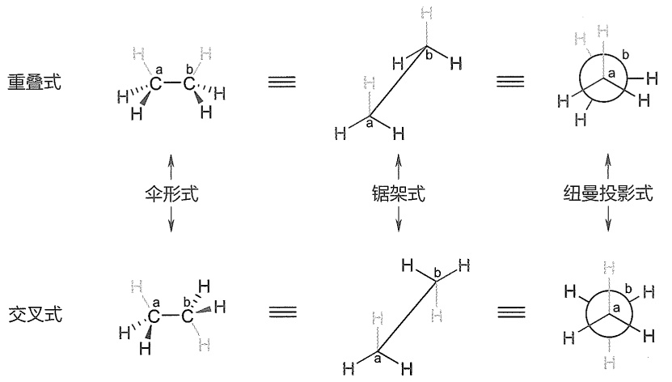

<details>
<summary>chemical</summary>

Structural formulas of acrylate (重叠式) and acrylate (交叉式) with labeled atoms and reaction mechanisms
</details>

图2-1 乙烷两种构象的伞形式、锯架式和纽曼投影式

伞形式也称楔形式，把C-C键键轴水平放置于纸面，实线表示键和所连原子在纸面上，虚楔形线表示键伸向纸面后方，实楔形线表示键伸向纸面前方。锯架式是从C-C键键轴斜 $45^{\circ}$ 方向看，每个碳原子上的其他三根键夹角均为 $120^{\circ}$ 。纽曼投影式是将伞形式拿出纸面外，并沿C-C键键轴方向看过去得到的投影式。在这种表示法中，前面的碳原子被画为三个键的交点，且其中一个键通常画为竖直向上，后面的碳原子被画成一个圆圈，与之相连的键则被投影在圆圈的边缘外。为了能看到重叠构象中处于后面的三个氢原子，在画的过程中前后重叠的氢原子会稍微旋转偏离一定角度。这三种构象的表示方法经常用到，要掌握各种表示法之间的互换。

我们也可以从二面角的变化来定义乙烷的不同构象。当乙烷分子绕 C-C σ 键键轴旋转时，两个相邻碳原子上的 C-H 键会交叉成一定的角度，这个角度称为二面角（dihedral angle），也叫扭转角（torsion angle）。当两个碳原子上相邻两个 C-H 键的二面角为 0° 时的构象称为重叠式构象；二面角为 60° 时的构象称为交叉式构象；二面角在 0°\~60° 的构象称为扭曲式构象。重叠式构象具有最高的能量，比交叉式构象高出 12.1 kJ/mol。这种由于键的旋转使构象从交叉式到重叠式所导致的能量变化称为扭转能（torsional energy）或旋转能（rotational energy），或者叫扭转张力（torsional strain）。乙烷分子由交叉式构象旋转为重叠式构象所需要的最低能量称为旋转能垒（rotational barrier）。

乙烷的各种构象中，交叉式构象所处的能量最低，最稳定。以前一般认为，稳定的原因是在重叠式构象中，两个碳上的C-H键彼此靠近，导致化学键的排斥力增大。在交叉式构象中，两个碳上的C-H键间的排斥力减小。重叠式相邻C-H键间的排斥力最大，交叉式最小，扭曲式的排斥力介于两者之间。2001年，Pophristic和Goodman的研究结果表明，导致乙烷交叉式构象最稳定的更重要的原因是相邻 $\sigma_{\mathrm{C - H}}$ 和 $\sigma_{\mathrm{C - H}}^{*}$ 轨道之间的超共轭作用。乙烷交叉式构象中，一个C-H键的 $\sigma$ 成键轨道可以与相邻C-H键的 $\sigma^{*}$ 反键轨道相互作用，生成的新的分子轨道中电子的势能下降（图2-2），C-C键长变短。

---

2.1 构象与构象异构体

41

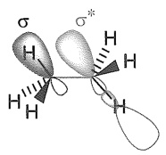

(a)

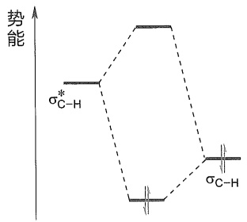

<details>
<summary>chemical</summary>

势能图示意图，标注σC-H和σ*C-H的两个势能级
</details>

(b)

图2-2 (a) $\sigma (\mathrm{C - H})\rightarrow \sigma^{*}(\mathrm{C - H})$ 超共轭作用；(b)超共轭作用使乙烷分子轨道势能降低

乙烷的不同构象异构体具有不同的势能。如果以单键的旋转角度为横坐标，乙烷各种构象的势能为纵坐标，将单键旋转 $360^{\circ}$，可以得到如图2-3所示的势能关系图。

如图 2-3 所示，交叉式构象最稳定，处于分子的最低能态；重叠式构象最不稳定，处于分子的最高能态，比交叉式构象高出 12.1 kJ/mol，此能量即为乙烷的旋转能垒。重叠式构象的存在时间非常短，小于  $10^{-12}$  s。因为旋转能垒不大，室温时分子间的碰撞就可产生 83.7 kJ/mol 的能量，足以使分子“自由”旋转，因此这些构象异构体不能被分离。在不低于 -250 °C 的低温下，交叉式构象仍是乙烷分子的优势构象。

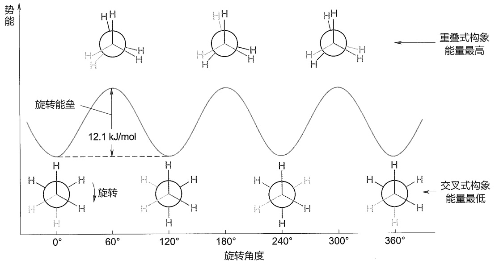

<details>
<summary>line</summary>

| 旋转角度 | 重叠式构象 (势能) | 交叉式构象 (势能) | 旋转 (势能) |
| --- | --- | --- | --- |
| \(0{}^{\circ}\) | ~中等 | ~低 | ~高 |
| \(60{}^{\circ}\) | ~高 | ~低 | ~低 |
| \(120{}^{\circ}\) | ~中 | ~中 | ~高 |
| \(180{}^{\circ}\) | ~低 | ~高 | ~中 |
| \(240{}^{\circ}\) | ~中 | ~高 | ~低 |
| \(300{}^{\circ}\) | ~高 | ~中 | ~高 |
| \(360{}^{\circ}\) | ~中 | ~低 | ~低 |
</details>

图2-3 乙烷转动过程中各种构象的势能关系图

## 2. 丙烷的构象

丙烷可以看作一个甲基取代的乙烷。与乙烷相类似，丙烷也只有两种极限构象:交叉式构象和重叠式构象，但两种构象之间的旋转能垒要比乙烷的稍高一点。丙烷分子从一个交叉式构象通过C-C键旋转转变到另一个交叉式构象的过程中，所要克服的旋转能垒为$13.4\mathrm{kJ / mol}$，比乙烷的稍高一些（图2-4）。造成该能量差异主要的原因是重叠式构象中甲基和重叠氢之间存在空间位阻。此外，甲基取代氢后不仅增加了重叠式构象的能量，而且在一定程度上也增加了交叉式构象的能量。由于交叉式构象比重叠式构象空间位阻小，能量增加也相对较少，所以丙烷的旋转能垒值与乙烷的相比只是稍微高一些。

---

42

第二章 立体化学

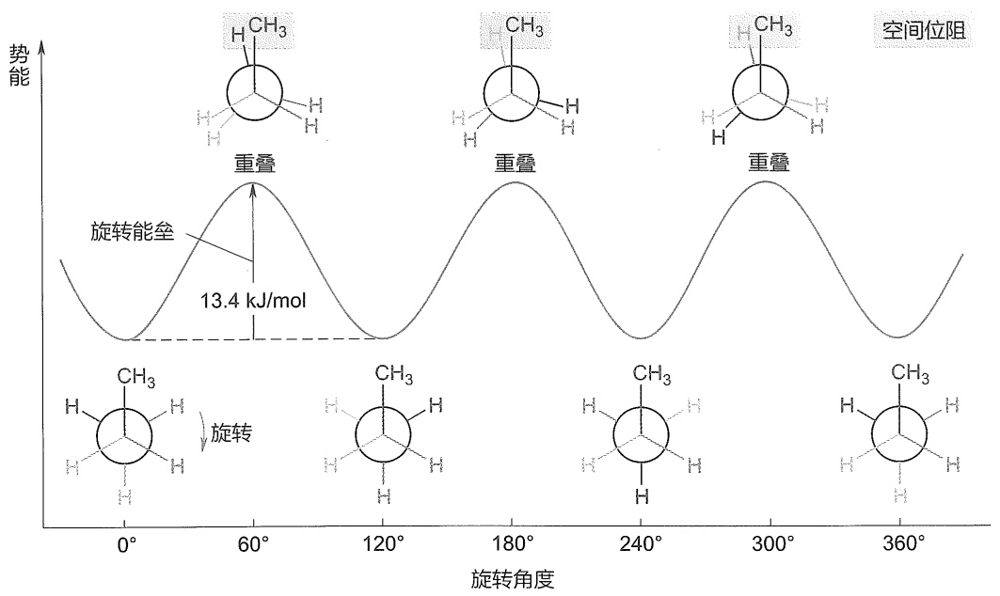

<details>
<summary>line</summary>

| 旋转角度 | 能势 (kJ/mol) |
| --- | --- |
| \(0{}^{\circ}\) | ~中等值 |
| \(60{}^{\circ}\) | 高 (重叠) |
| \(120{}^{\circ}\) | ~低 |
| \(180{}^{\circ}\) | 高 (重叠) |
| \(240{}^{\circ}\) | ~低 |
| \(300{}^{\circ}\) | 高 (重叠) |
| \(360{}^{\circ}\) | ~中等值 |
</details>

图2-4 丙烷C-C键转动过程中各种构象的势能关系图

## 3. 正丁烷的构象

正丁烷可以看作乙烷的两个碳原子上各有一个氢原子被一个甲基所取代的化合物。以正丁烷的 C1 和 C4 为取代基，沿 C2-C3 σ 键键轴旋转 360°，同样可以得到无数个构象异构体。图 2-5 给出了正丁烷 C2-C3 σ 键旋转一周中几种典型构象的纽曼投影式，包括四种极限构象:两种重叠式构象——全重叠式构象（eclipsed conformer）和部分重叠式构象（partially eclipsed conformer），两种交叉式构象——邻交叉式构象（gauche conformer）和对交叉式构象（anti conformer）。(I) 为对交叉式构象，此时两个大基团甲基处于相反的方向，距离最远。当 C3 碳原子顺时针旋转 60° 时，得到部分重叠式构象(Ⅱ)，此时甲基和氢之间存在较大空间排斥力。继续旋转到 120° 时，两个甲基处于邻交叉位置，(Ⅲ) 为邻交叉式构象。继续旋转到 180° 时，得到全重叠式构象(Ⅳ)，此时两个甲基前后重叠，距离最近，两个甲基之间的空间位阻很大。进一步旋转到 240° 时，可再次得到邻交叉式构象(V)。继续旋转到 300° 时，再次得到部分重叠式构象(VI)。继续旋转到 360° 时，则回到对交叉式构象(I)。

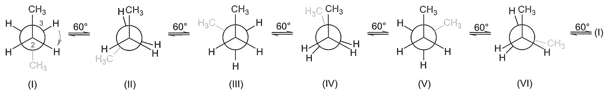

<details>
<summary>chemical</summary>

Reaction mechanism diagram showing six-step cycloaddition of a cyclic alkene with 60° rotation indicated
</details>

图2-5 正丁烷沿C2-C3σ键顺时针旋转一周的典型构象

如图 2-6 所示，对交叉式构象(I)最稳定，处于分子的最低能态。当 C3 碳原子顺时针旋转  $60^{\circ}$  时，得到部分重叠式构象(II)，旋转能垒为 15.1 kJ/mol。继续转动得到邻交叉式构象(III)，这个构象中两个甲基比在对交叉式构象(I)中离得更近，由于空间位阻的影响，邻交叉式构象(III)的能量比对交叉式构象(I)的能量高出 3.8 kJ/mol。继续转动得到能量最高的全重

---

2.1 构象与构象异构体

43

叠式构象(IV)，这个构象中两个甲基取代基重叠在一起，所以它的能量最高，比最稳定构象(I)高出20.5 kJ/mol。再转动得到另外一个邻交叉式构象(V)，邻交叉式构象间相互转化需要16.7 kJ/mol的能量。再转动得到另外一个部分重叠式构象(VI)，最后转动相同角度得到最稳定的对交叉式构象(I)。正丁烷在溶液中以最稳定的对交叉式构象(I)为主，25℃下大约占72%，较不稳定的邻交叉式构象(III)的比例大约为28%。

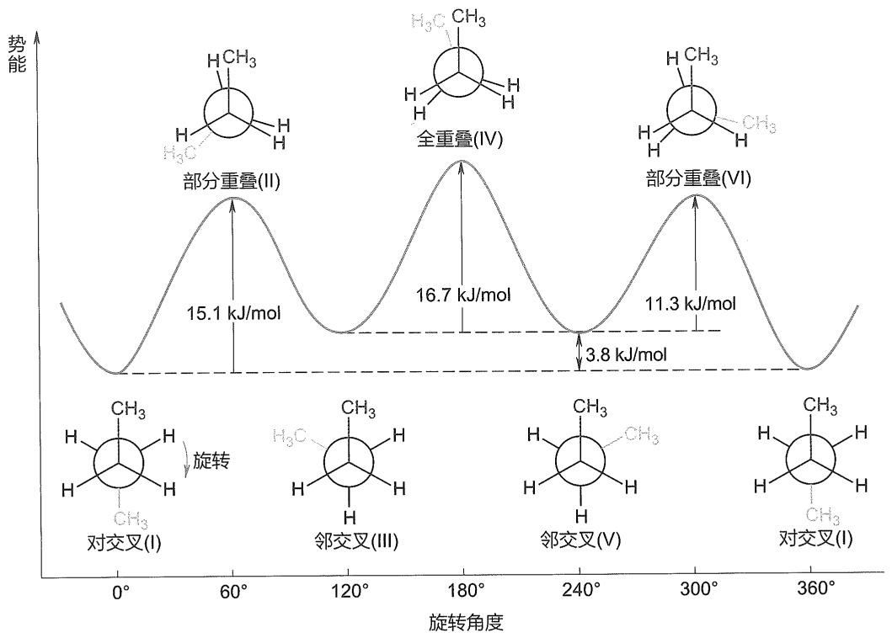

<details>
<summary>line</summary>

| Feature | Energy (kJ/mol) |
| --- | --- |
| Particenter (II) | 15.1 |
| Full Reset (IV) | 16.7 |
| Transition State (VI) | 3.8 |
| Partial Reset (VI) | 11.3 |
</details>

图2-6 正丁烷沿C2-C3σ键转动过程中各种构象的势能关系图

## 2.1.2 环烷烃的构象

环烷烃可大致分为四种:小环体系，包括环丙烷和环丁烷；普通环系，包括环戊烷、环己烷和环庚烷；中环体系，包括环辛烷到环十一烷之间的环烷烃；大环体系，包括环十二烷及以上的环烷烃。实验过程中发现，小环体系的稳定性较差，易开环生成链状化合物。为了解释这一现象，拜耳（A. Baeyer）于1885年提出了张力学说。该学说认为所有成环化合物都具有平面结构。由于烷烃中的碳原子采取 $sp^{3}$ 杂化，键角为 $109^{\circ}28'$，为了形成平面结构，环烷烃成环后键角会偏离 $109^{\circ}28'$，从而会产生向内或向外的扭曲力，称为角张力（angle strain）或拜耳张力（Baeyer strain）。偏离程度可以用公式“偏转角= $(109^{\circ}28'-正多边形的内角)/2"$ 来计算。按照张力学说，五元环比六元环稳定，与事实不符。实际上除了三元环，其他环的碳原子并不都在同一平面上。

在不改变  $sp^{3}C$  原子键角的情况下，形成环丙烷和环丁烷的环状结构是非常困难的，此环烷烃存在环张力（ring strain）。我们可以通过环烷烃的燃烧热来揭示环张力的存在。当对大量直链烷烃体系的燃烧热取平均值时， $CH_{2}$  的燃烧热数值接近 658.6 kJ/mol。按照这个数值，环烷烃  $(\mathrm{CH}_{2})_{n}$  的燃烧热为  $-(n\times658.6)\mathrm{kJ/mol}$ ，其中负号代表放热。对于环丙烷，n=3，计算所

---

44

第二章 立体化学

得的燃烧热为 -1975.7 kJ/mol，而实验测得的值为 -2091.1 kJ/mol，计算值与实验值之间的差异为 115.4 kJ/mol，该能量差异归因于环丙烷所具有的环张力。环丙烷共有三个亚甲基，则每个亚甲基的环张力为 38.5 kJ/mol。

## 1. 环丙烷的构象

环丙烷是最小的环烷烃，三个碳原子在同一平面上，形成正三角形结构，分子的∠CCC键角为60°，比正常的 $sp^{3}$ 杂化轨道的夹角109°28'小约50°，所以具有很大的角张力[图2-7(a)]。另外，正三角形结构还导致环丙烷上的所有亚甲基上的氢原子都是重叠式构象，使环丙烷具有大的扭转张力。环丙烷中的碳原子是如何成键的？如果环丙烷中的碳原子仍然是 $sp^{3}$ 杂化的，为了满足60°的内角，两个 $sp^{3}$ 杂化轨道不再以沿键轴方向的“头对头”方式重叠，而是都采用了部分重叠的弯曲构象，形成图2-7(b)所示的“香蕉键”。因此，环丙烷的C-C键键长比一般C-C单键的键长（154 pm）要短。将四面体碳原子扭曲到足够成环的程度所需要的能量称为键角张力（bond-angle strain）。环丙烷分子的环张力源于扭转张力和键角张力之和。

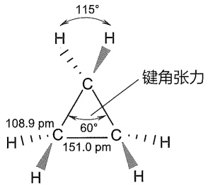

<details>
<summary>chemical</summary>

Molecular geometry diagram showing bond angles and bond lengths for a cyclopentane ring system
</details>

(a)

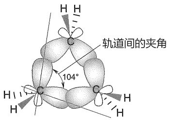

<details>
<summary>text_image</summary>

轨道间的夹角
104°
</details>

(b)

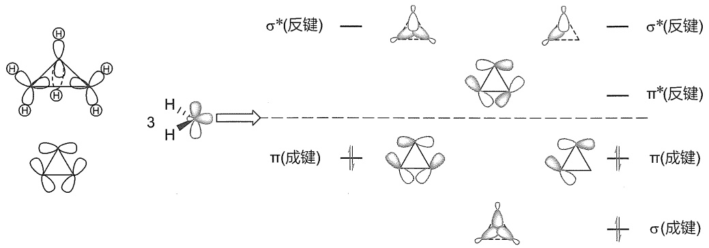

<details>
<summary>chemical</summary>

Molecular orbital diagram showing sigma and pi states with labeled bonds and electron density maps
</details>

(c)

(d)

图2-7 (a)环丙烷的分子结构；(b)环丙烷的“香蕉键”轨道结构；

(c)环丙烷的 $\mathbf{sp}^2$ 杂化轨道和 $\mathbf{p}$ 轨道；(d)环丙烷碳环骨架的分子轨道示意图

对于环丙烷的键角张力，另外一种解释是环丙烷的碳原子采取 $\mathfrak{sp}^2$ 杂化，其中两个 $\mathfrak{sp}^2$ 杂化轨道与氢原子的s轨道形成C-H键，另外一个轨道指向环中心，未杂化的p轨道位于环丙烷的平面内[图2-7(c)]。指向环中心的 $\mathfrak{sp}^2$ 杂化轨道和p轨道线性组合成六个分子轨道:一个 $\sigma$ 成键轨道和两个 $\sigma^{*}$ 反键轨道，两个 $\pi$ 成键轨道和一个 $\pi^{*}$ 反键轨道，六个电子填充到三个成键轨道上[图2-7(d)]。该解释目前得到了更多的认同。实际上，许多实验现象表明环丙烷碳原子的四个杂化轨道并不等价，这也说明环丙烷中的碳原子不是 $\mathfrak{sp}^3$ 杂化的。

---

2.1 构象与构象异构体

45

## 2. 环丁烷的构象

为了减小四个碳原子上八个重叠的氢原子间的扭转张力，环丁烷的四个碳原子并不在同一平面上，而是一个碳原子处于另外三个碳原子所在平面的外面，从而形成折叠型构象（图2-8）。室温下，两种折叠型构象快速转换，犹如蝴蝶的两翼上下飞舞，转换能垒约为6.3 kJ/mol。

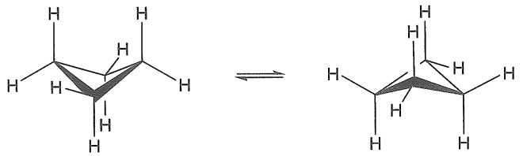

<details>
<summary>chemical</summary>

Chemical structure transformation showing a cyclic molecule with hydrogen atoms and double bond formation
</details>

图 2-8 环丁烷折叠型构象间的转换

## 3. 环戊烷的构象

环戊烷的五个碳原子也不处于同一平面，有信封式（envelope conformation）和半椅式（half-chair conformation）两种折叠构象。如图2-9所示，在信封式构象中，四个碳原子近似处于同一平面，另一个碳原子则伸向平面外，像一个开启的信封。该构象中，C1-C2键和C1-C5键处于交叉式，C2-C3键、C3-C4键和C4-C5键处于重叠式。在半椅式构象中，三个碳原子处于同一平面，剩余两个碳原子一个在平面上方，另一个在平面下方。

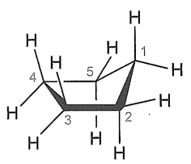

<details>
<summary>chemical</summary>

Molecular structure diagram of a cyclic compound with labeled carbon positions
</details>

信封式

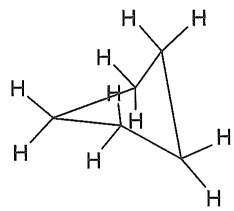

<details>
<summary>chemical</summary>

Molecular structure diagram showing hydrogen atoms in a cyclic arrangement
</details>

半椅式

图 2-9 环戊烷的信封式构象和半椅式构象

## 4. 环己烷的构象

环己烷是有机化学领域中最常见且最重要的结构之一，其存在于许多天然产物中。对环己烷构象的研究是有机化学领域的重要内容。

如图2-10所示，假设环己烷具有平面构象(a)，则有12个H-H重叠和六重的键角张力。如果将C1和C4以相反的方向移出平面，可得到构象(b)，该构象完全避免了H-H重叠，键角接近四面体结构，所得到的构象没有环张力，这种结构称为环己烷的椅式构象（chair conformation）。从椅式构象的纽曼投影式(c)可以看到，前后氢原子处于交叉式构象。椅式构象为环己烷的最稳定、能量最低的构象。把椅式构象中的C2转下来，C3转上去，使C1、C2、C3和C4在同一个平面上，将得到环己烷的半椅式构象（见边栏）。半椅式构象能量最高，最不稳定。如图2-11所示，如果将平面构象中的C1和C4以相同的方向移出平面，将得到船式构象。船式构象中C1和C4上两个内侧氢原子（旗杆氢）之间的距离只有 $183\mathrm{pm}$，存在空间位阻的排斥能，即跨环张力（transannular strain）。跨环张力是跨越环的两个基团的空间位阻导致的张力。环己烷的船式构象具有一定的柔韧性，将C2-C3键相对于C5-C6键扭转一定角度，将部分消除跨环张力，这时的构象称为扭船式构象（twist-boat conformation）（见边栏）。扭船式构象的能量比船式构象的能量要低。

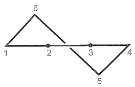

<details>
<summary>text_image</summary>

6
1 2 3 4
5
</details>

环己烷的半椅式构象

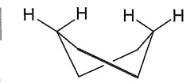

环己烷的扭船式构象

---

46

第二章 立体化学

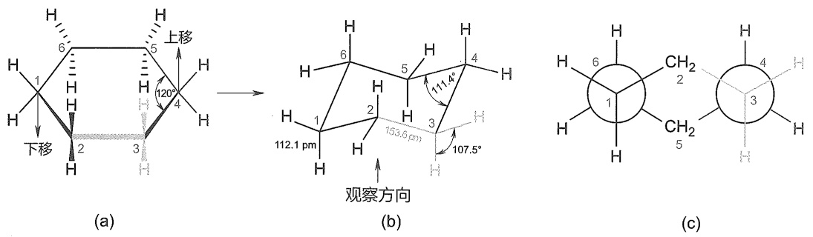

图2-10 (a)假设的平面环己烷；(b)环己烷的椅式构象；(c)椅式构象的纽曼投影式

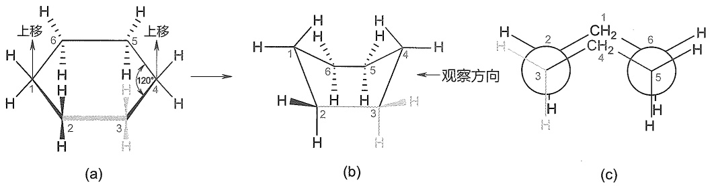

图2-11 (a)假设的平面环己烷；(b)环己烷的船式构象；(c)船式构象的纽曼投影式

从图 2-10 至图 2-12 中可以看出，环己烷的四种典型构象中，椅式构象中所有的 C-C 键都处于交叉式，没有扭曲力；六个碳原子均满足碳的四面体结构，没有角张力，所以椅式构象最稳定。船式构象中，船底相邻两个碳原子采取重叠式构象，具有一定的扭曲力；两个旗杆氢之间存在跨环张力，所以船式构象比椅式构象稳定性差一些，能量高出约 29.3 kJ/mol。扭船式构象中的每对碳原子既不是全重叠式，也不是全交叉式，能量要比船式构象的能量低 6.3 kJ/mol。从最稳定的椅式构象转化为扭船式构象，要经过一个势能最高的半椅式构象，能垒为 45.2 kJ/mol。

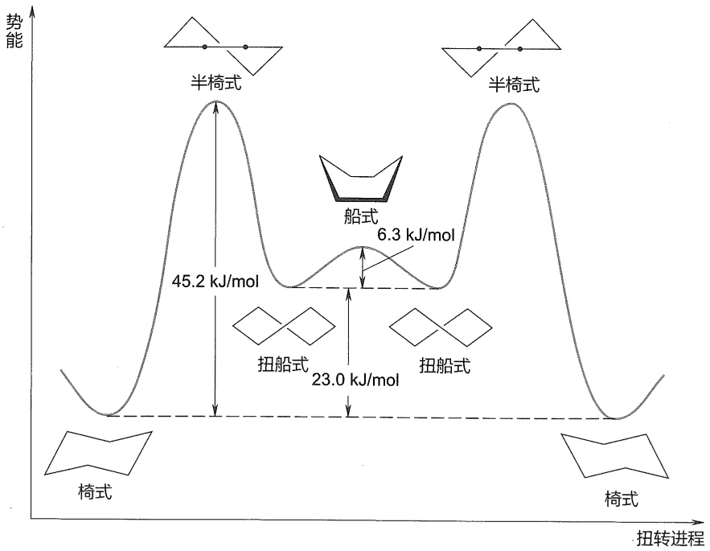

<details>
<summary>line</summary>

| 扭转进料方式 | 能量 (kJ/mol) |
| --- | --- |
| 半椅式 | 45.2 |
| 船式 | 6.3 |
| 扭船式 | 23.0 |
</details>

图 2-12 环己烷各种构象的势能关系图

---

2.1 构象与构象异构体

47

环己烷的椅式构象中含有两类氢原子:如图2-13(a)所示，六个C-H键几乎与分子主轴（图中虚线）平行，称为直立键（axial bond），简称 $a$ 键，其中三个 $a$ 键方向朝上，三个$a$ 键方向朝下；另外六个C-H键与分子主轴几乎垂直，与赤道平面接近，称为平伏键（equatorial），简称 $e$ 键，其中与三个朝上的 $a$ 键相连的三个 $e$ 键略往下伸，与三个朝下的 $a$ 键相连的三个 $e$ 键略往上伸。环己烷的椅式构象并不是固定不动的，提供一定的能量，一种椅式构象可以翻转为另一种椅式构象，这一对椅式构象互称为构象转换体。如图2-13(b)所示，翻转过程中，从左边的椅式构象开始，只需把C1向上翻转穿过平伏面就能得到船式构象。如果想让分子回到椅式构象，将C4向下翻转即可，同时原来的直立位置和平伏位置互换了。环己烷发生椅式-椅式构象互变时，一种椅式构象中向上的直立氢变成了另一种椅式构象中向上的平伏氢，向下的直立氢转为向下的平伏氢，而原来向上的平伏氢转为向上的直立氢，向下的平伏氢转为向下的直立氢。

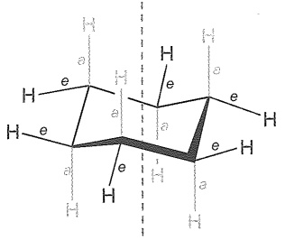

<details>
<summary>chemical</summary>

Molecular structure diagram of a cyclic compound with hydrogen atoms and bonds
</details>

(a)

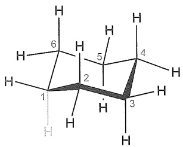

<details>
<summary>chemical</summary>

Molecular structure diagram of a cyclic compound with labeled hydrogen atoms and bonds
</details>

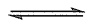

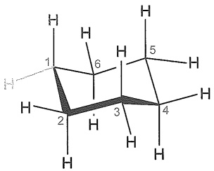

<details>
<summary>chemical</summary>

Molecular structure diagram of a cyclic compound with labeled hydrogen atoms
</details>

(b)

图 2-13 (a) 环己烷椅式构象中的直立键和平伏键；(b) 环己烷椅式构象的一对构象转换体

## 5. 取代环己烷的构象

单取代环己烷有两种椅式构象:取代基分别占据直立键和平伏键。当环己烷不含取代基时，a 键上的氢原子核间距离，与氢原子范德华半径之和相当，不存在排斥力。如图 2-14 所示，对于 1-甲基环己烷，当甲基处于 a 键时，甲基上的三个氢原子与 C3 和 C5 的 a 键上的氢原子距离很近，存在相互排斥力，这种作用称为 1,3-二直键的相互作用（1,3-diaxial interaction）。该作用也可以看作 a 键甲基与 C3、C5 有两个邻交叉式的相互作用。当式(Ⅰ)经翻转转换为式(Ⅱ)时，此时甲基处于 e 键，伸向外面，甲基上的三个氢原子与环上的氢原子不存在相互排斥力，e 键甲基与 C3、C5 均处于对交叉式。这两种椅式的甲基环己烷是处

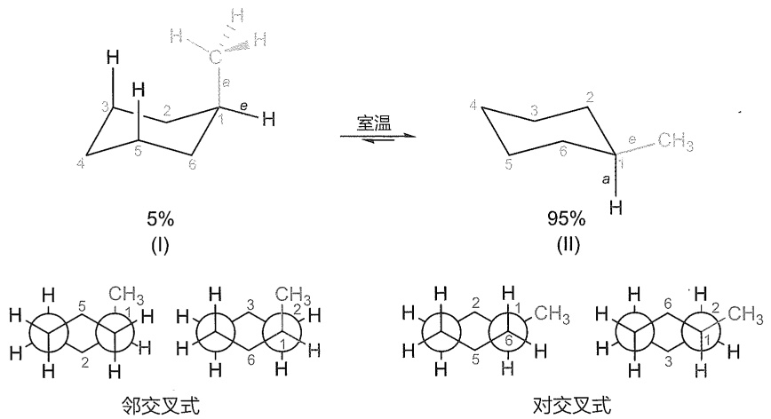

<details>
<summary>chemical</summary>

Chemical reaction scheme showing conversion of a cyclic ketone to a cyclohexane under room temperature, with side chains labeled as '邻交叉式' and '对交叉式'
</details>

图 2-14 1-甲基环己烷的两种椅式构象

---

48

第二章 立体化学

于平衡的。甲基位于 $e$ 键的构象比位于 $a$ 键的构象稳定（能量差 $7.1\mathrm{kJ / mol}$），在 $25^{\circ}\mathrm{C}$ 时两者的比例为 $95:5$。$25^{\circ}\mathrm{C}$ 下不同取代基处于 $e$ 键或 $a$ 键时，相应构象的能量差如下。一般取代基位于 $e$ 键更稳定。

<table><tr><td rowspan="2">取代基</td><td>能量差 $a$ 键 $\rightleftharpoons e$ 键</td><td rowspan="2">取代基</td><td>能量差 $a$ 键 $\rightleftharpoons e$ 键</td><td rowspan="2">取代基</td><td>能量差 $a$ 键 $\rightleftharpoons e$ 键</td></tr><tr><td> $\mathrm {kJ} \cdot \mathrm {mol}^{-1}$ </td><td> $\mathrm {kJ} \cdot \mathrm {mol}^{-1}$ </td><td> $\mathrm {kJ} \cdot \mathrm {mol}^{-1}$ </td></tr><tr><td> $-\mathrm {CH}_{3}$ </td><td>7.1</td><td>-F</td><td>0.8</td><td> $-\mathrm {OCH}_{3}$ </td><td>2.9</td></tr><tr><td> $-\mathrm {CH}_{2}\mathrm {CH}_{3}$ </td><td>7.5</td><td>-Cl</td><td>1.7</td><td>-CN</td><td>0.8</td></tr><tr><td> $-\mathrm {CH}(\mathrm {CH}_{3})_{2}$ </td><td>8.8</td><td>-Br</td><td>1.7</td><td>-COOH</td><td>5.0</td></tr><tr><td> $-\mathrm {C}(\mathrm {CH}_{3})_{3}$ </td><td>&gt;18.4</td><td>-I</td><td>1.7</td><td></td><td></td></tr><tr><td> $-\mathrm {C}_{6}\mathrm {H}_{5}$ </td><td>13.0</td><td></td><td></td><td></td><td></td></tr></table>

对于二取代及多取代环己烷，同样可以用以上构象分析的方法来分析其稳定性。e键取代基越多，构象越稳定；大基团在e键上比在a键上稳定。如二甲基取代的环己烷异构体中，1,1-二甲基环己烷总是有一个a键甲基和一个e键甲基，两个椅式构象是相同的，所以它们的能量相等（图2-15）。1,2-二甲基环己烷有顺式和反式两种异构体。在顺-1,2-二甲基环己烷中，一个甲基处于a键，另一个甲基处于e键，两种构象的能量相等，因此平衡体系中两种构象的含量也相等[图2-16(a)]。在反-1,2-二甲基环己烷中，两个甲基都处于a键或都处于e键，后者比前者稳定，为优势构象[图2-16(b)]。在反-1-甲基-4-异丙基环己烷中，甲基和异丙基都处于a键或都处于e键，后者比前者稳定，式(Ⅱ)为优势构象（图2-17）。

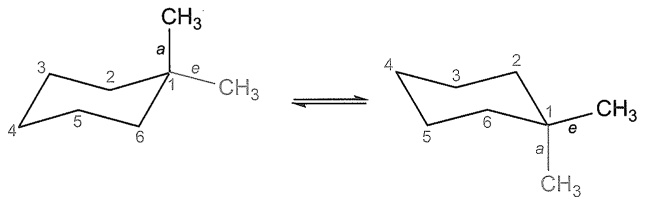

<details>
<summary>chemical</summary>

Chemical structure showing a cyclic alkene with labeled atoms and bonds, including a double bond arrow indicating transformation.
</details>

图2-15 1,1-二甲基环己烷的两种椅式构象

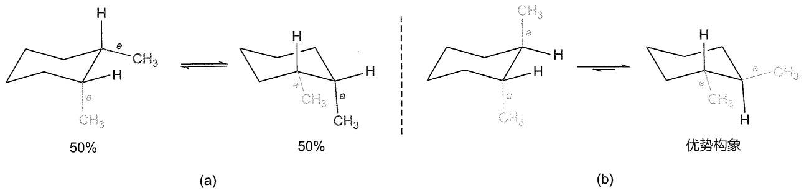

<details>
<summary>chemical</summary>

Chemical reaction scheme showing transformation of a cyclohexane derivative with 50% yield to a cyclohexane product under different conditions (a) and (b)
</details>

图2-16 (a) cis-1,2-二甲基环己烷的构象；(b) trans-1,2-二甲基环己烷的构象

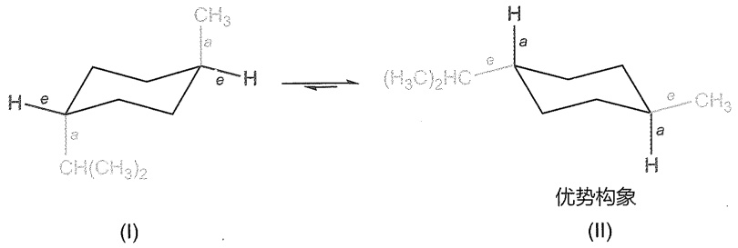

<details>
<summary>chemical</summary>

Chemical structure transformation showing structural change from (I) to (II) with labeled atoms and functional groups
</details>

图2-17 反-1-异丙基-4-甲基环己烷的两种椅式构象

---

2.2 旋光异构体

49

十氢化萘（decahydronaphthalene），系统名为二环[4.4.0]癸烷，是由两个环己烷构成的桥环化合物。按其名称也可将其看作萘的完全氢化产物。十氢化萘的两个环都是以椅式构象存在的，如图2-18所示，它们的连接方式有两种:一种是反式构型，两个桥头碳上的氢为反式，称为反十氢化萘；另一种是顺式构型，两个桥头碳上的氢为顺式，称为顺十氢化萘。在顺十氢化萘中，存在两根直立C-C键（C1-C10和C6-C5），而反十氢化萘中的桥头碳上的C-C键均是平伏键；此外，如果以C1和C6参照，顺十氢化萘是邻位交叉式构象，而反十氢化萘是对位交叉式构象。因此，反十氢化萘比顺十氢化萘更稳定。

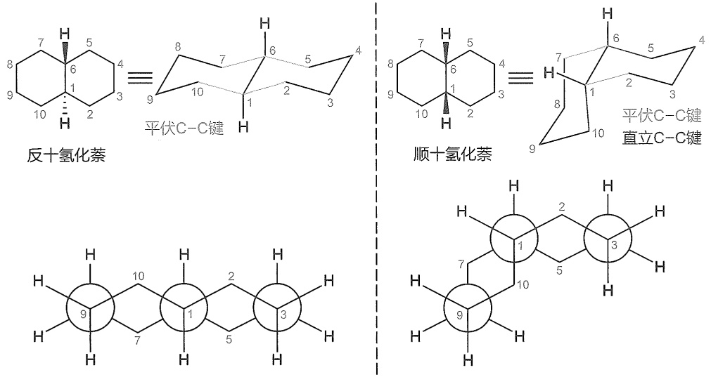

图2-18 反十氢化萘和顺十氢化萘的两种构象

## 6. 中环和大环化合物的构象

中环化合物是指从环辛烷到环十一烷之间的环烷烃。它与小环、普通环的一个主要区别是，当环增大时，除了要考虑角张力和扭转张力外，还要考虑跨环的空间位阻排斥作用。中环化合物不可能实现在一个单一的构象中减少所有产生张力的相互作用，而是让分子在几个能量相近的立体结构中建立平衡。由于多种张力同时存在，中环化合物的合成具有一定的挑战性，尤其是九元环到十一元环系的设计和合成。

大环化合物是指环十二烷及以上的环烷烃，其具有无张力的构象。如环十四烷中，碳链变得具有足够的柔性，碳链采取与直链烷烃类似的结构，氢原子交错排列，碳原子最大限度地以交叉式构象存在。尽管分子的各种构象稳定程度不一样，但由于能量差异很小，在室温时，分子间的碰撞足以提供能量使各种构象相互转化，所以这些构象不能分离。分子实际存在多种构象，但各种构象所占的比例不一样，越稳定的构象占的比例越高。

## 2.2 旋光异构体

## 2.2.1 手性与对映异构体

## 1. 手性与旋光性

德国哲学家康德曾经提出过这样一个问题:“假如我们生活在只有一只手的宇宙，那么这只手是左手还是右手？”左手和右手，既完全相同，又完全不同。如图2-19所示，人的左、

---

50

第二章 立体化学

右手互为实物与镜像的关系，但左手不能与右手重合。手的这类特征在其他物质中也广泛存在，人们把物体不能与其镜像重合的性质称为“手性”。

手性是自然界的本质属性之一，自然界中到处都能发现手性物质的踪迹。大到宇宙星云，小至DNA分子，都有手性的存在（图2-20）。例如蜗牛的壳大多呈右手螺旋，右手螺旋和左手螺旋的比例约为 $20000:1$；不同植物在支持物上的缠绕方向不同，左手螺旋缠绕茎有葎草、啤酒花等；右手螺旋缠绕茎有菜豆、牵牛花、茑萝、马兜铃等。

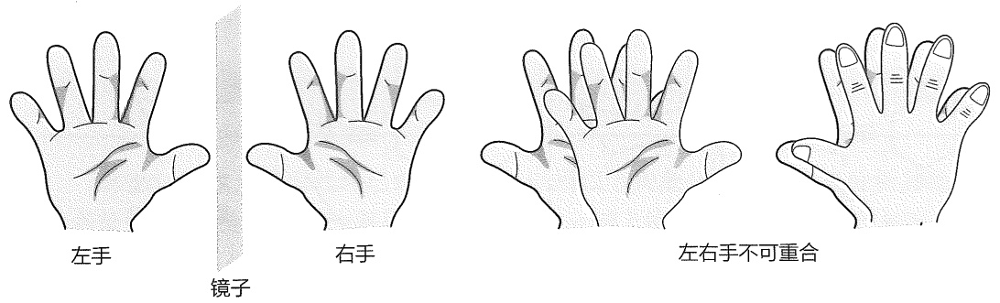

<details>
<summary>text_image</summary>

左手
镜子
右手
左右手不可重合
</details>

图 2-19 人的左右手不可重合

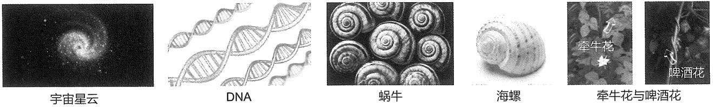

<details>
<summary>text_image</summary>

宇宙星云
DNA
蜗牛
海螺
牵牛花
啤酒花
</details>

图2-20 自然界的手性现象

手性在化学的微观世界也非常普遍，尤其是众多的有机化合物都具有这种特征。具有这种特征的分子被称为手性分子。

普通的光线在各个不同的平面上振动[图 2-21(a)]。假若使光线通过一个电气石制的棱镜（Nicol 棱镜），这种棱镜只能使和棱镜晶轴平行振动的射线通过[例如这个晶轴是直立的，则仅有在垂直平面上振动的射线才可通过，图 2-21(b)]，这种通过棱镜后产生的只能在一个平面振动的光叫作平面偏振光[图 2-21(c)]。

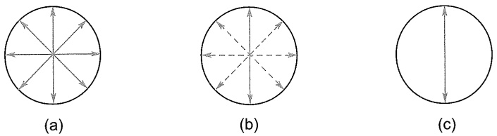

<details>
<summary>natural_image</summary>

Three circular diagrams labeled (a), (b), and (c) showing directional arrows radiating from a central point, with no text or symbols beyond labels.
</details>

图2-21 普通光与平面偏振光

早在 19 世纪初期，科学家发现存在着某些晶体物质，当平面偏振光通过时，会导致光的振动方向发生偏转，这种与光的相互作用称为光学活性，物质的这种性质被命名为“旋光性”。当时人们发现酒桶底部的残留晶体在酸化后（酒石酸）会发生旋光现象。1848 年，年轻的巴斯德用显微镜观察晶体结构时发现了一个奇特的现象:酒石酸铵钠盐的晶体结构都是不对称的。进而巴斯德推测，无旋光性的葡萄酸铵钠盐结晶应该是完全对称的。但是实验结果却出

---

2.2 旋光异构体

51

乎意料，因为葡萄酸铵钠盐的结晶居然也是不对称的。但是通过二者晶体仔细对比，他发现酒石酸铵钠盐晶体的半晶面都是向右的，而葡萄酸铵钠盐的半晶面有一半向右，另一半向左。巴斯德在显微镜下用镊子将两种不同的晶体一颗一颗分开，并分别配成溶液。结果发现，含有半晶面向右晶体的溶液呈现出右旋光性，而半晶面向左的晶体溶液则呈现出左旋光性。巴斯德的发现正式揭开了手性神秘的面纱，是对分子级别旋光异构现象最直观的证明，对后来的立体化学及手性化学产生了深远的影响。

旋光性可以用旋光仪测量。该设备包含一个光源、一个产生平面偏振光的偏振器、一个样品池和一个用于确定旋转量的分析仪（图2-22）。普通的旋光仪主要部分是一个两端装有电气石棱镜的长管，一端的棱镜轴是固定的，这个棱镜叫起偏器；另一端是一个可以旋转的棱镜，叫检偏器。检偏器和一个刻有 $180^{\circ}$ 刻度的圆盘相连。起偏器的外端放一个光源，长管中间可放入一根装满待测定旋光物质溶液的玻璃管。管中若装入水，光可以通过，这表示水对平面偏振光不起作用；若放入某旋光物质溶液，则会使通过起偏器的平面偏振光向左或向右旋转若干角度。为使光线顺利通过检偏器，需将检偏器旋转一定的角度，该角度就代表该旋光物质溶液的旋光度。

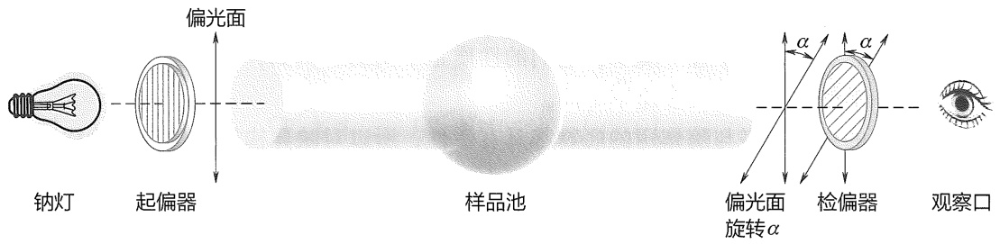

<details>
<summary>text_image</summary>

偏光面
钠灯 起偏器 样品池 偏光面旋转α 检偏器 观察口
</details>

图2-22 旋光仪示意图

当平面偏振光与手性分子相互作用时，光可以向左或向右旋转。这代表着该分子具有光学活性，测量出的旋转角度称为旋光度，用符号 $\alpha_{\lambda}^{t}$ 表示，其中 $t$ 为测定时的温度，$\lambda$ 为光的波长。旋光度的大小取决于手性分子的结构和浓度、样品池的长度、光的波长、使用的溶剂和温度。为了比较同一物质在不同测量条件下得到的 $\alpha$ 值，化学家们定义了一个物理参数 $[\alpha]_{\lambda}^{t}$，称为比旋光度。比旋光度是物质的物理常数，如同熔点、沸点、密度等，其定义公式如下:

$$
[ \alpha ] _ {\lambda} ^ {t} = \frac {\alpha}{l \cdot c}
$$

式中 $l$ 为样品池的长度，一般为 $1\mathrm{dm}(= 10\mathrm{cm})$；$c$ 为样品浓度，单位一般为 $\mathrm{g}\cdot \mathrm{cm}^{-3}$。由于比旋光度的单位较为复杂，现一般予以省略，计算中均采用标准单位。检测光源光线常使用波长为 $589.6~\mathrm{nm}$ 的钠灯黄光，即所谓的钠D线，因此 $\lambda$ 常写作D。在学术论文中，一般要求同时报道检测时的浓度和溶剂条件，因此较为规范的报道方式为:$(S)-(+)$-乳酸的比旋光度为 $[\alpha]_{\mathrm{D}}^{15}=+2.67(c2.51,\mathrm{H}_{2}\mathrm{O})$。

## 2. 对映异构体

互为实物与镜像的一对手性分子称为对映异构体。例如，乳酸是手性分子代表，它的结构简式为  $H_{3}C-\overset{OH}{\underset{H}{C}}-COOH$ 。

手性碳原子的定义:手性碳原子是指与四个各不相同原子或基团相连的碳原子，具体见2.2.3小节。

---

52

第二章 立体化学

若将与乳酸手性碳原子相连的四个不同基团的空间位置明确表示出来，可以画出两种不同的构型。它们的部分物理性质如下:

R, S 是手性化合物构型标记的一种方法，具体见 2.2.4 小节。

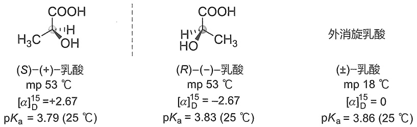

$pK_{a}$ 值有一些差异，这些差异由实验误差引起

对映异构体是一类特殊的异构体，它们具有相同的物理性质，如沸点、熔点和密度等。然而，它们可以利用平面偏振光来区分。当平面偏振光通过其中一个对映异构体的样品时，平面偏振光向左或向右旋转。当其对映体在相同条件下进行实验时，平面偏振光旋转等量，但方向相反。对映异构体属于旋光异构体。一对对映异构体的旋光能力相等，但旋光方向相反。

$(S)-(+)$-乳酸和 $(R)-(-)$-乳酸是一对对映异构体，它们在非手性环境中的物理性质和化学性质基本是相同的，如其熔点、沸点相同；在非手性溶剂中的溶解度及与非手性试剂反应的速率也都相同。然而，在手性环境中，它们的性质是不同的。例如，与手性试剂的反应或在手性催化剂、手性溶剂中的反应速率不同。

生物体内的酶和很多与酶作用的底物都具有手性，所以对映异构体的生理活性往往有很大的差异。例如，左旋尼古丁的毒性比右旋尼古丁的毒性大很多；左旋香芹酮具有薄荷味，而右旋香芹酮具有葛缕子味。1953年，瑞士诺华制药公司的前身Ciba药厂首次合成了一种名为“反应停”（沙利度胺，Thalidomide）的药物。随后，德国的格兰泰公司（Grunenthal）对反应停颇感兴趣，他们研究发现，反应停具有一定的镇静安眠的作用，而且对孕妇怀孕早期的妊娠呕吐疗效极佳。格兰泰公司于1957年将反应停正式推向了市场，在欧洲、亚洲、非洲、大洋洲和南美洲被大量用于治疗孕妇妊娠呕吐。到了1960年，欧洲的医生们开始发现，本地区畸形婴儿的出生率明显上升。这些婴儿有的是四肢畸形，有的是腭裂，有的是盲儿或聋儿，还有的是内脏畸形。此后，越来越多的临床病例证明了反应停的致畸作用。格兰泰公司不得不于1961年将反应停从德国市场上召回。科学家们对反应停进行了深入的研究，发现沙利度胺是含有一对对映异构体的混合物，它的 $R$ 构型异构体是强力的镇静剂，而 $S$ 构型异构体却是强烈的致畸剂，其结构如下:

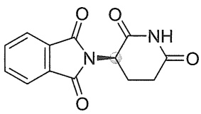

<details>
<summary>chemical</summary>

Chemical structure of a fused heterocyclic compound with benzene and amide functional groups
</details>

(R)-Thalidomide

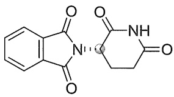

<details>
<summary>chemical</summary>

Chemical structure of a quinazoline derivative with two fused rings and a central amide group
</details>

(S)-Thalidomide

当一种对映异构体过量于另一种对映异构体时，平面偏振光将出现净旋转。人们通常用对映体过量（enantiomeric excess）来定量表示此类混合物的组成比例，具体计算公式为

$$
\% ee = \frac {[ R ] - [ S ]}{[ R ] + [ S ]} \times 100\%
$$

对映异构体混合物的组成比例也常用该混合物的比旋光度与某一纯对映异构体的比旋光

---

2.2 旋光异构体

53

度之比来表示，这个比值称为光学纯度，其计算公式为

$$
\text{光学纯度} (\%)\ = \frac{\text{测得样品的比旋光度}}{\text{纯对映异构体的比旋光度}}\times 100\%
$$

例如，一对对映异构体混合物中，一种对映异构体的含量为 $75\%$ ，另一种对映异构体的含量为 $25\%$ ，则其光学纯度为

$$
\% ee = \frac{75\% - 25\%}{75\% + 25\%}\times 100\% = 50\%
$$

该混合物 ee 值为 50%，也被称为 50% 光学纯度。

## 2.2.2 手性的判别

要判断一个分子是否具有手性，可以根据手性的定义，想象或构建分子及其镜像的分子模型，并判断它们是否能够重合。然而，这个方法一般比较麻烦，一种更简单的方法是去寻找所研究分子中的对称元素。

## 1. 对称面

能把分子切为实体和镜像两部分的平面称为分子的对称面，用希腊字母  $\sigma$  表示。反映是对称面的对称操作。有对称面的分子都是非手性分子。例如，下列分子均有对称面:

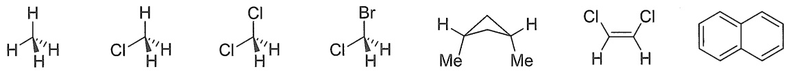

## 2. 对称中心

如果分子中有一点，所有通过这个点的直线都以等距离达到相同的基团，则该点称为对称中心，用 i 表示。倒反是对称中心的对称操作。一个分子只可能有一个对称中心。有对称中心的分子也是非手性分子。例如，反-1,3-二氯环丁烷具有对称中心，分子无手性。

## 3. 映轴

许多分子还有一种叫作对称轴的对称因素。这种轴是通过分子的一条直线，以这条线为旋转轴旋转一定角度，得到的分子与原分子重合。一般用 $C_n$ 代表对称轴，$n$ 表示轴的级，称 $n$ 重对称轴（意义是分子绕对称轴旋转 $360^\circ / n$ 时可以与原分子重合）。旋转是对称轴的对称操作。对称轴不能作为判别分子手性的依据。例如，氨分子有一个 $C_3$ 对称轴，是非手性分子；$(R)-1,1'$-联-2-萘酚分子有一个 $C_2$ 对称轴，但该分子为手性分子。

分子围绕一个轴旋转一定角度（360°/n）后，再用垂直此轴的平面作为镜面，进行一次反映，若所得镜像与原来的分子重合，则此轴称为映轴，用 $S_{n}$ 表示，n表示轴的级。旋转、反映是映轴的对称操作。具有映轴的分子没有手性。例如，将(Ⅰ)旋转180°后得到(Ⅱ)，再用垂直于旋转轴的镜面反射得到(Ⅲ)，(Ⅲ)和(Ⅰ)完全重合，(Ⅰ)没有手性。

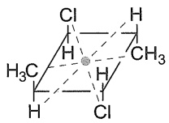

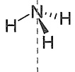

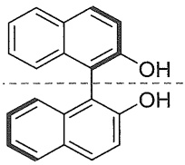

<details>
<summary>chemical</summary>

Chemical structure of a naphthalene derivative with two hydroxyl groups and a dashed reference line
</details>

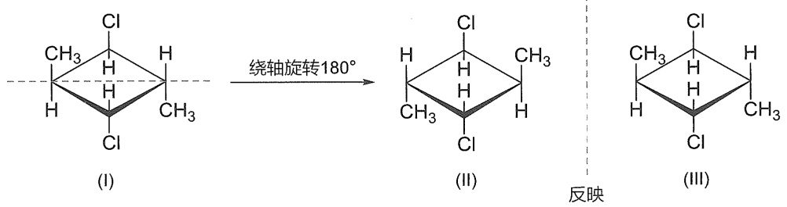

<details>
<summary>chemical</summary>

Chemical reaction diagram showing cycloaddition of a chlorinated alkane under 180° rotation, followed by reversible transformation to an unsaturated aldehyde.
</details>

---

54

第二章 立体化学

具有对称面、对称中心或映轴的分子肯定没有手性，而没有对称面、对称中心及映轴的分子均有手性。由于对称面等同于1阶映轴，即 $S_{1}=\sigma$ ，对称中心等同于2阶映轴，即 $S_{2}=i$ ，所以判断手性的唯一标准（或者说充分必要条件）是分子是否有“ $S_{n}$ ”对称元素。对于有机化合物，绝大多数情况下，通过对称面、对称中心或 $S_{4}$ 映轴就可以判定分子是否具有手性。然而，没有对称面的非手性分子非常少，所以一般用对称面判断手性就可以了。

## 4. 立体化学构象分析

一般认为链烷烃的手性判断比较简单，但如果考虑到链烷烃的构象，事情比我们想象的复杂得多。以正丁烷（$\mathrm{CH}_3\mathrm{CH}_2\mathrm{CH}_2\mathrm{CH}_3$）为例。我们知道正丁烷是非手性分子，然而，正丁烷具有无穷多个构象，它们称为构象异构体或旋转异构体，一些构象具有手性。图2-23所示的正丁烷的两个交叉式构象（灰色球表示 $\mathrm{CH}_3$，蓝色球表示H）是实物和镜像的关系，二者不能重合，称为构象对映体。根据手性化合物的定义，这两个构象异构体都具有手性，但根据前述构象分析可知，这两种邻位交叉式构象能量相等，因此在正丁烷的所有构象中的比例也相等，等量的构象对映体对偏振光的作用互相抵消。正丁烷的其他旋转异构体表现相同。因此，正丁烷并不具有光学活性，所以我们认为它是非手性分子。以上构象对映体也多称为构象转换体。此外，在室温下不可能分离出单个构象异构体，因为这些构象异构体能在 $10^{-9}\mathrm{s}$ 内通过C-C键的旋转达到平衡。由于检测时间远远长于C-C键旋转的时间，所观测到的结果是所有构象平均化的结果。

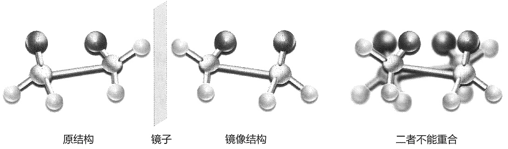

<details>
<summary>chemical</summary>

三种结构式对比：原结构、镜子、镜像结构，以及二者不能重合
</details>

图2-23 构象对映体

我们无须检查分子的每一种构象以确定它是否是非手性的，因为大多数简单分子的构象平衡是极快的，只要能找到一种非手性构象，分子就是非手性的，即使这种构象是不稳定构象。这是因为，一旦分子处于（或通过）非手性构象，形成任意一对构象对映体的概率都是相同的。由于正丁烷中存在如下对位交叉式及重叠式构象，而这两种构象是非手性的，因而正丁烷是非手性的。事实上，一般无须通过构象分析来判断一个分子是否为手性化合物。我们可以直接通过分析一个分子的平面式结构来判断这个分子是否为手性化合物。我们通过下例进一步说明。

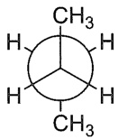

对位交叉式

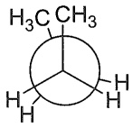

全重叠式

---

2.2 旋光异构体

55

## 5. 单环化合物的手性

与链烷烃一样，单环化合物往往具有多个构象，且这些构象可以快速互变。对于能够快速发生翻转的单环化合物，怎样判断它们是否具有旋光性呢？可以通过其平面式的对称性来判别。凡是其平面式有对称中心、对称面或 $S_{n}$ 映轴的单环化合物均无旋光性；反之则有旋光性。三元环本身是平面式的；从四元环开始，环状化合物是非平面的，判断它们的旋光性时，需要画出它们的平面式，例如:

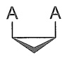

无旋光
(对称面)

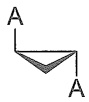

有旋光

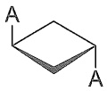

无旋光
(对称中心)

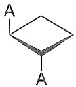

有旋光

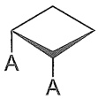

无旋光
(对称面)

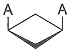

无旋光
(对称面)

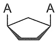

无旋光
(对称面)

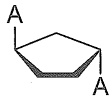

有旋光


无旋光
(对称面)


有旋光

为什么可以根据单环化合物的平面式结构来判断它们的旋光性呢？下面通过对1,2-二甲基环己烷旋光性的分析来阐明这个问题。


(1)


(l')


(l'')


(l'')

旋转120°


(1')

先看顺-1,2-二甲基环己烷。从它的平面式(I)看，分子有一个对称面，所以(I)是无旋光的化合物。从构象式（仅讨论稳定构象）考虑，该化合物有一对彼此不能重合的对映异构体( $I'$ )和( $I''$ )。( $I''$ )的构象转换体为( $I'''$ )，绕轴旋转120°后即得( $I'$ )。由此可知，( $I'$ )和( $I''$ )既是构象对映异构体，又是构象转换体，二者能量相等，故在构象分布中含量相等。因此，从构象分析考虑，顺-1,2-二甲基环己烷是消旋体，旋光度为零。

现在来分析 $(1R,2R)-1,2-$ 二甲基环己烷。从其平面式(Ⅱ)看，分子无对称面、对称中心和 $S_{4}$ 轴，所以(Ⅱ)有旋光性。从构象式（仅讨论稳定构象）考虑，分子有两个稳定构象，(Ⅱ)ee 和(Ⅱ)aa，其中(Ⅱ)ee 为优势构象。(Ⅱ)ee 和(Ⅱ)aa 均无对称面、对称中心和 $S_{4}$ 轴，均有旋光性，所以 $(1R,2R)-1,2-$ 二甲基环己烷有旋光性。


(II)


(II) ee


(II) aa

## 2.2.3 手性的分类

## 1. 中心手性

如果分子中的手性是由于原子和基团围绕某一点的非对称排列而产生的, 这个点就是手

---

56

第二章 立体化学

性中心。这种手性称为中心手性。

将甲烷中的四个氢原子换成四个不同的原子或基团，即可得到一种具有旋光性的物质，因此将与四个不同基团相连的碳原子称为不对称碳原子或手性碳原子，常用“\*”标记。许多手性分子含有一个或多个不对称碳原子，例如前面提到的乳酸分子。

除了碳原子外，其他原子（如 Si、N、P、S 等）也可能是不对称中心。如下列化合物都含有手性中心:

$$
\mathrm{Me} ^ {\cdot \cdot \mathrm{Si}} \mathrm{Ph} \quad \mathrm{Me} ^ {\cdot \cdot \mathrm{N}} \mathrm{Ph} \quad \mathrm{Me} ^ {\cdot \cdot \mathrm{P}} \mathrm{Ph} \quad \mathrm{Me} ^ {\cdot \cdot \mathrm{S}} \mathrm{Ph}
$$

对于 N 手性中心，情况有些特殊。如下图所示，该叔胺的 N 原子上带有三个不同的基团，另外有一对孤对电子，形成一个锥形体，是不对称的，应该有光学活性异构体存在。然而，由于 N 上的基团可以很快的速率（ $10^{2} \sim 10^{5}$  次/s）来回翻转，该叔胺不能表现出光学活性。当 N 与四个不同的基团相连时，相应的铵盐则变为稳定的光学活性化合物（详见 12.1.2 小节）。和胺不同，含磷、硫的化合物较为稳定，可以得到具有光学活性的化合物。

$$
\mathrm{R} ^ {3 -} \mathrm{N} _ {\mathrm{R} ^ {2}} ^ {\dots} \mathrm{R} ^ {1} \quad \Longleftrightarrow \left[ \mathrm{R} ^ {3 -} \mathrm{N} _ {\mathrm{R} ^ {2}} ^ {\dots} \mathrm{R} ^ {1} \right] \Longleftrightarrow \mathrm{R} ^ {3 -} \mathrm{N} _ {\mathrm{Me}} ^ {\dots} \mathrm{N} _ {\mathrm{Bn}} ^ {\dots} \mathrm{Ph} ^ {-} \mathrm{I} ^ {-}
$$

稳定的光学活性化合物

大部分具有手性中心的分子具有手性，且含有一个手性中心的分子总是具有手性的。然而，手性中心和分子的手性没有必然的联系，不是所有含有手性中心的分子都是手性分子，也不是所有手性分子都含有手性中心。例如2,3-二氯丁烷，尽管该分子具有两个碳手性中心，但由于存在对称面，所以它并不具有手性。对于戊-2,3-二烯，尽管该分子没有手性中心，它却是手性化合物。


有手性中心吗？

它是手性的吗？

有手性中心吗？

它是手性的吗？

## 2. 轴手性

有些分子虽然不含不对称原子，但在分子中存在一个轴，通过轴的两个平面在轴的两侧有不同的基团时，也会产生实体与镜像不能重合的对映体，这类手性称为轴手性。例如，丙二烯型分子及联萘型分子:


如图2-24所示，丙二烯型分子中，中心碳原子两个 $\pi$ 键平面是正交的，当a和b为不同的基团时，a和b基团所处的平面和它们相邻的 $\pi$ 键平面垂直，该分子的实物与镜像不能重合，因此它是手性分子。

---

2.2 旋光异构体

57


<details>
<summary>chemical</summary>

Chemical structure of a cyclic carbene compound with labeled atoms and bonds
</details>

图 2-24 丙二烯衍生物的结构

如果将丙二烯分子的双键替换为环，若环碳原子上带有不同的取代基，该分子就是手性分子。例如，2-(4-甲基环己亚基)乙酸成功地于1909年被拆分为两个旋光异构体。


<details>
<summary>chemical</summary>

Chemical structure of a diene derivative with aldehyde and alkene substituents, showing hydrogen bonding and formula [α]D = ±81.1
</details>

当分子的单键旋转受阻时，也可以产生旋光异构体，这样的异构体称为阻旋异构体，这种现象叫作阻旋异构现象。最具代表性的阻旋异构体是联苯型分子。如下图所示分子，由于邻位的四个取代基体积足够大，阻碍了苯环之间单键的自由旋转，两个苯环不能共平面，因此产生了两种构型不同的对映异构体，彼此不能重合，具有旋光性。


## 3. 面手性

面手性化合物所参照的不是一个手性中心或一个手性轴，而是一个平面。分子面手性是由平面外基团相对于平面（手性平面）的排列引起的立体异构。常见的面手性分子包括金属茂化合物、环蕃化合物及手柄化合物等:


## 4. 螺旋手性

有些分子内存在一个扭曲的面，从而使分子呈现一种螺旋状的结构。由于螺旋分为左手螺旋和右手螺旋，互为对映体，所以该类分子也表现出旋光性，这种手性称为螺旋手性。螺旋烃即是这样一类手性分子，其结构可以看作由苯环彼此以两个邻位并合的螺旋结构。这类化合物最简单的代表由六个苯环并合而成，因此叫六螺苯。六螺苯的末端两个苯环不在同一平面上，没有对称面、对称中心及 $S_{4}$ 轴，因而形成一对左手和右手螺旋的对映体。


---

58

第二章 立体化学

## 2.2.4 旋光异构体的表示方法和命名

## 1. Fischer 投影式

为了方便地表示分子中手性碳原子的构型，Fischer 最早提出用一种投影式来表示链形化合物的立体结构，称为 Fischer 投影式。Fischer 投影式是一种在二维空间描述四面体碳原子及其取代基的简化方法。使用这种方法时，分子被画成十字形，中心碳原子位于交叉点上，水平线表示伸向纸面前方的键，垂直线表示伸向纸面后方的键。此外，画投影式时，碳链要尽量放在垂直方向上，并且氧化态高的原子放在上面，氧化态低的原子放在下面。中心碳原子上的其他基团放在水平方向上。


<details>
<summary>chemical</summary>

Structural formulas of fatty acids (R)-aldehyde and (S)-aldehyde, showing morpholine and Fischer projection forms
</details>

值得注意的是，同一立体中心的 Fischer 投影式不止一种。下图所示的均为(R)-乳酸的 Fischer 投影式。此外，需要指出的是，Fischer 投影式不能在平面上旋转  $90^{\circ}$ ，也不能离开纸面翻转  $180^{\circ}$ ; Fischer 投影式中的基团两两交换的次数不能为奇数次，否则变为其对映异构体。


<details>
<summary>chemical</summary>

Structural formulas of fatty acids (R)-aldehyde and (R)-aldehyde under楔形式 and Fischer projection式 conditions
</details>

## 2. D/L 标记法

在有机化学发展早期，就知道有左旋和右旋两种甘油醛，但不知道这两种甘油醛分别对应于哪一个构型。于是，人们指定右旋甘油醛为 D 构型（拉丁文 Dexcro 的第一个字母），左旋甘油醛为 L 构型（拉丁文 Leavo 的第一个字母）。它们的 Fischer 投影式指定如下:


<details>
<summary>chemical</summary>

Chemical structures of D-(+)-甘油醛 and L-(-)-甘油醛 with labeled functional groups
</details>

其他化合物的构型是以甘油醛的构型为参照，通过化学反应关联性来确定的。若某化合物由D-甘油醛通过反应转化而来，并且在整个转化过程中手性碳原子的构型没有发生变化，则生成D构型的化合物。这种以甘油醛的构型为参照而确定的构型称为相对构型，以D/L标记法标记。例如，D-甘油醛选择性氧化后得到D-甘油酸，D-甘油酸经选择性还原后得到D-乳酸。


<details>
<summary>flowchart</summary>

```mermaid
graph LR
  A["H\nCHO\nCH2OH"] -->|[O]\n选择性氧化| B["H\nCOOH\nCH2OH"]
  B -->|[H]\n选择性还原| C["H\nCOOH\nCH3"]
  D["D-(+)-甘油醛"] --> E["D-(-)-甘油酸"]
  E --> F["D-(-)-乳酸"]
```
</details>

---

2.2 旋光异构体

59

## 3. $R / S$ 标记法

R/S 标记法是由 Cahn、Ingold、Prelog 三位化学家开发的一种能够明确命名对映异构体的体系，该命名方法得到的构型可以真实反映手性分子的立体结构，称为绝对构型。具体命名方法如下:

首先按照“次序规则”，将与手性碳原子相连的四个原子或基团（a, b, c, d）按优先级递减的顺序进行排序，即 $a > b > c > d$ 。接下来将最低优先级基团（d）放置于远离观察者的地方，沿着手性碳原子到最低优先级基团（d）的键轴对其他三个基团按 $a \rightarrow b \rightarrow c$ 顺序进行观察。如图2-25所示，如果从 $a \rightarrow b \rightarrow c$ 的方向是逆时针的，那么立体中心的构型就被命名为 $S$ 构型。相反，如果 $a \rightarrow b \rightarrow c$ 的方向是顺时针方向的，则立体中心的构型是 $R$ 构型。


<details>
<summary>chemical</summary>

Chemical reaction diagrams showing reversible and constant reaction pathways with labeled arrows and conditions S and R
</details>

图2-25 $\mathbb{R} / S$ 标记法

命名时，把 R 或 S 作为前缀添加到手性化合物名称的括号中，如  $(R)-2-$  溴丁烷、 $(S)-2,3-$  二羟基丙醛等。如果已知，也可以添加平面偏振光的旋转符号，例如  $(R)-(+)-2,3-$  二羟基丙醛。需要说明的是， $(R,S)$  和  $(+,-)$  之间没有相关性。

为了使用 R/S 标记法，必须首先学会次序规则。具体次序规则有以下三条:

规则一 首先看与立体中心直接相连的原子（图 2-26）。高原子序数的原子优先于低原子序数的原子。因此，优先级最低的取代基是氢。对于同位素，相对原子质量较高的原子具有更高的优先级。


<details>
<summary>chemical</summary>

Chemical reaction diagram showing AN=原子序数 formation of (R)-1-methoxy-1-methoxycarbonyl ether
</details>

图2-26 取代基优先级别的确定

规则二 如果使用规则一的两个原子具有相同的优先级, 则沿着这两个原子各自的取代基链按同样方式继续比较, 直到到达差异点。


<details>
<summary>chemical</summary>

Hydrogen bonding diagram showing hydrogen bonding between two molecules labeled 甲基 and 乙基
</details>

规则三 双键和叁键可被看作连续多次的单键，两端的原子可分别认为连有两个或三个相同的原子。


<details>
<summary>chemical</summary>

Chemical reaction sequence showing hydrogen bonding between a carbonyl group and a cyclic alkene
</details>

---

60

第二章 立体化学

$R / S$ 标记法，除了适用于以上中心手性分子外，同样适用于轴手性分子。典型的轴手性分子有“丙二烯型”“联苯型”“螺烷型”，它们的立体结构均可简化为相交的两个平面。从侧视图（图2-27）看，$\alpha$ 和 $\beta$ 的二面角为 $\theta$ ，呈十字交叉状，这与Fischer投影式结构十分相似。因此，针对这类轴手性的分子可以将其转化为Fischer投影式。如图2-27所示，沿手性轴方向观察，把离观察点近的键置于水平线上，离观察点远的键置于垂直线上。需要注意的是，取代基定次序时，离观察点近的基团（A,B）与离观察点远的基团（C,D）分开比较，并且前者优于后者[(A,B)>(C,D)]。根据上述规则，联苯类化合物（1）取代基的优先级由高到低分别为（A>B)>(C>D)，得出其为 $R$ 构型。同理，联烯化合物（2）取代基的优先级由高到低分别为（A>B)>(C>D)，得出其构型为 $R$ 构型。需要说明的是，命名时必须沿手性轴观察，但命名结果与观察点的位置没有关系。从分子的左侧或右侧观察时，得到同样的结果。


<details>
<summary>text_image</summary>

α
β
</details>

正视图


<details>
<summary>text_image</summary>

α
θ
β
C
B ———— A
D
</details>

侧视图

Fischer投影式


<details>
<summary>chemical</summary>

Chemical structure of a substituted benzene derivative with chloro, hydroxyl, and amino groups
</details>

(1) R


<details>
<summary>chemical</summary>

Chemical structure diagram showing a rhombus with labeled atoms Cl, C, A, B, HOOC, NH2, and H, including a curved arrow indicating rotation or rotation.
</details>


(2) R


<details>
<summary>chemical</summary>

Chemical structure diagram showing a cyclohexane ring with labeled atoms and a rotation arrow
</details>

图2-27 轴手性分子的 $R / S$ 标记法

## 4. P/M 标记法

手性轴的构型也可以运用螺旋规则来标记，这种标记法的符号为 P（即 plus）和 M（即 minus）。判断时，由手性轴轴向观察，近端的两个取代基的次序为 a > b，远端的为 c > d，只需直接判断 a 到 c 的方向，若为顺时针旋转，标记为 P 构型；若为逆时针，标记为 M 构型。


<details>
<summary>chemical</summary>

Chemical structures showing hydrogen bonding between a cyclohexane ring and a carbonyl group, labeled P and M
</details>

## 2.2.5 相关概念

## 1. 外消旋体

将一对对映异构体等量混合，可以得到一种旋光度为零的混合物，称为外消旋体。一种

---

2.2 旋光异构体

61

纯的光学活性物质，如果体系中一半物质发生构型转化，就变成了外消旋体，这种由纯的光学活性物质转变为外消旋体的过程称为外消旋化。外消旋体还可以进一步细分，即

（1）外消旋化合物。当左旋体分子和右旋体分子互相之间有较大亲和力时，两种分子将有可能在晶胞中配对，而形成计量学上的化合物晶体，称为外消旋化合物。它们的熔点多数高于纯旋光体，而溶解度低于纯旋光体。
（2）外消旋混合物。当纯旋光体分子本身之间的亲和力大于对映异构体之间的亲和力时，左旋体和右旋体将有可能分别形成晶体，这样的外消旋体称为外消旋混合物。它们的熔点常常低于纯旋光体，而溶解度则高于纯旋光体。
（3）外消旋固体溶液。当一个纯旋光体分子对其构型相同的分子和构型相反的分子的亲和力均比较接近时，两种构型分子的排列是混乱的，这样的外消旋体称为外消旋固体溶液。它们的熔点、溶解度和纯旋光体都比较接近。

## 2. 内消旋体

当一个分子中含有两个或两个以上具有相同取代基的不对称原子时，会有多少种立体异构体呢？以酒石酸为例，分子里含有两个相同的不对称碳原子，它们连有相同的基团。这样的分子有三种构型组合:第一种是两个不对称碳原子均为 $R$ 构型；第二种是两个不对称碳原子均为 $S$ 构型；第三种是一个不对称碳原子为 $R$ 构型，另一个不对称碳原子为 $S$ 构型。这三种结构中，第一种和第二种是一对对映异构体；第三种结构内的两个不对称碳原子的旋光性相反。该结构具有对称面，所以整个分子没有旋光性，这称为内消旋体。内消旋体是一种含有两个或两个以上手性中心且无光学活性的分子。在该类分子中，因分子整体具有对称面、对称中心等对称因素，是非手性化合物，所以无光学活性。


<details>
<summary>chemical</summary>

化学结构式图，展示(2R, 3R)-与(2S, 3S)-两种酒石酸的异构体及其相互作用
</details>

2,3,4-三羟基戊二酸含有奇数碳原子，分子中C3这个碳原子与两个相同取代的不对称碳原子C2和C4相连。当C2及C4具有相同构型时，如(I)和(II)，按定义C3不是手性碳；当C2及C4具有不同构型时，如(III)和(IV)，按定义C3是手性碳。但有趣的是，(I)和(II)是一对对映异构体，而(III)和(IV)均为含有对称面的内消旋体。(III)和(IV)中的C3这种碳原子被称为假不对称原子，构型可用 $r,s$ 表示，根据顺序规则中 $R$ 比 $S$ 优先的原则，(III)中C3为 $r$ 构型，(IV)中C3为 $s$ 构型。

---

62

第二章 立体化学


## 3. 非对映异构体

当手性分子含有两个不同的立体中心时，可能出现四种立体异构体:RR、RS、SR 和 SS。RR 和 SS 异构体是彼此的镜像，因此是对映异构体。RS 和 SR 异构体也是彼此的镜像，也是对映异构体。RR 和 RS 异构体不是彼此的镜像，SS 和 SR 异构体也不是彼此的镜像，这种分子具有两个或多个手性中心，并且分子间为非镜像的关系的立体异构体称为非对映异构体。非对映异构体是具有不同物理和化学性质的不同分子，它们具有不同的熔点、沸点和密度等，可以通过分馏、结晶或色谱法分离。

例如，2-溴-3-氯丁烷有四种立体异构体，分别对应于A、B、C、D四个分子，其中有2对对映异构体，4对非对映异构体。例如，$\mathrm{B}(2R,3R)$ 分子是 $\mathrm{A}(2S,3S)$ 分子的对映异构体，是 $\mathrm{C}(2S,3R)$ 和 $\mathrm{D}(2R,3S)$ 分子的非对映异构体。注意，只有当两个分子的所有的相对应的立体中心均具有相反的构型时，它们才是对映异构体。


<details>
<summary>chemical</summary>

Structural formulas of four different stereoisomers (A, B, C, D) with labeled groups and substituents
</details>

对于两个含多个不对称碳原子的异构体，如果只有一个不对称碳原子的构型不同，则这两个异构体称为差向异构体。如果差向异构体的构型不同的碳原子在链末端，则称为端基差向异构体。如下所示，(I)和(II)、(III)和(IV)、(V)和(VI)、(VII)和(VIII)是四对对映异构体。(I)和(III)、(II)和(IV)是端基差向异构体。(I)和(VII)、(II)和(VIII)是C3差向异构体。(I)和(VI)、(II)和(V)是C2差向异构体。


---

2.2 旋光异构体

63


(V)


(VI)


(VII)


(VIII)

## 2.2.6 光学活性化合物的获得

## 1. 外消旋体的拆分

将外消旋体拆分成纯左旋体或右旋体的过程称为外消旋体的拆分。常用的拆分方法有以下四种。

（1）化学法。由于在非手性条件下一对外消旋体的物理、化学性质相同，普通的分离方法无法将其分开，因此要设法将一对对映异构体转化为非对映异构体，然后利用二者物理、化学性质的差异进行分离，再分别将非对映异构体分解，得到两个纯的对映异构体。

常使用酸碱反应进行转化。例如，对于含有一对 D-酸和 L-酸的外消旋体，可使它们和等当量（equiv）的光学纯的 D-碱反应，转变为一对非对映异构体。利用二者物理性质的差异，经分级结晶分离得到纯化合物 D-酸-D-碱盐和 L-酸-D-碱盐。D-酸-D-碱盐和 L-酸-D-碱盐再用酸分解，从而得到纯的 D-酸和 L-酸。


<details>
<summary>flowchart</summary>

```mermaid
graph LR
  A["对映异构体\n50% {D-酸\nL-酸} + 1 equiv D-碱"] --> B["非对映异构体\n{D-酸-D-碱盐\nL-酸-D-碱盐}\n分离"]
  B --> C["&quot;D-酸-D-碱盐 \xrightarrow[HCl\n分解"]{}\ D-酸"]
  C --> D["&quot;L-酸-D-碱盐 \xrightarrow[HCl\n分解"]\{}\ L-酸"]
```
</details>

（2）酶解法。酶对反应底物有非常严格的立体选择性，利用酶和对映异构体反应速率的差别，可以达到拆分对映异构体的目的。例如，合成的消旋丙氨酸经乙酰化后，通过由猪肾内取得的一种酶，该酶水解L型乙酰丙氨酸的速率远远快于D型乙酰丙氨酸，从而可以得到 $\mathrm{L - (+) - }$ 丙氨酸和 $\mathrm{D - (-) - }$ 乙酰丙氨酸。二者在乙醇中的溶解度差别很大，可以很容易分开。


<details>
<summary>flowchart</summary>


</details>

（3）晶种结晶法。在热的外消旋体饱和溶液中，加入其中一种纯光学活性异构体的晶体，冷却到某一温度，因为其中一种异构体有晶种，会诱导这种异构体首先结晶出来；滤去晶体后，再将母液中的另外一种异构体结晶出来。这种拆分方法称为晶种结晶法。
（4）柱色谱法。利用具有光学活性的吸附剂，借助柱色谱法，由于对映异构体与光学活性吸附剂的吸附力不同，从而可以分别把它们洗脱出来，实现将一对对映异构体拆分的目的。

---

64

第二章 立体化学

前手性化合物的定义:前手性化合物是指在特定条件下能够转变为手性化合物的非手性分子。

## 2. 不对称合成法

手性化合物也可以通过化学合成的方法来获得。在反应过程中因受分子内或分子外手性因素的影响，结果得到不等量的立体异构体的混合物，具有旋光活性。具体可分为以下四种:

（1）手性底物的不对称反应。从比较有限的光学活性天然产物出发，通过一系列立体专一性的反应得到光学活性的化合物。
（2）手性助剂的不对称反应。将手性助剂（手性辅基）提前安装在底物上，引入不对称因素使之成为光学活性底物，继而发生后续的立体选择性的反应，生成光学活性的化合物。
（3）手性试剂的不对称反应。底物中没有不对称因素，通过手性试剂的使用将底物转化为光学活性的产物。
（4）不对称催化反应。一般指利用合理设计的手性催化剂作为手性模板控制底物的对映面，将大量前手性底物选择性地转化成特定构型的产物，实现手性放大和手性增殖，是唯一具有手性放大作用的不对称合成方法。

## 习题

1. 请画出下列化合物的分子结构。

（1）顺-1-乙基-2-甲基环丙烷 （2）反-1,2-二甲基环丙烷
2. 请画出下列化合物的椅式构象的一对构象转换体。
（1）乙基环己烷 （2）溴代环己烷 （3）环己醇
3. 请画出下列化合物的优势构象。

(1)


(2)


(3)


4. 请分别用伞形式、锯架式和纽曼投影式画出1,3-二氯丙烷的优势构象。
5. 请用纽曼投影式画出下列结构式中围绕指出键旋转所产生的典型构象，并指出优势构象。

(1)  $BrH_{2}C-CH_{2}Br$

(2) $(\mathrm{H}_3\mathrm{C})_2\mathrm{HC} - \mathrm{CH}(\mathrm{CH}_3)_2$

(3)  $H_{3}CH_{2}C-CH_{2}CH_{2}CH_{3}$

6. 请定性地画出2-甲基戊烷中沿C3-C4键旋转的势能图，并画出图上各极值点的构象对应的纽曼投影式。

7. 下列化合物有几个对称面？

(1)


(2)


(3)


(4)


(5)


(6)


(7)


(8)


---

习题

65

8. 下列化合物是否有旋光性?


<details>
<summary>chemical</summary>

Chemical structure of glucose showing a six-membered ring with hydroxyl and hydrogen substituents
</details>


<details>
<summary>chemical</summary>

Chemical structure of a bicyclic organic molecule with methyl and ethyl substituents
</details>


<details>
<summary>chemical</summary>

Chemical structure of a substituted benzene derivative with methoxy, hydroxy, and ethanol groups
</details>

9. 对于绘出的每对结构，请指出这两种物质属于同分异构体、对映异构体、非对映异构体，还是相同分子？


10. 写出下列四式的关系，并标明分子中不对称碳原子的构型。


(A)


(B)


(C)


(D)

11. 写出 $(2R,3S)-3-$ 溴-2-碘戊烷的 Fischer 投影式，并写出其优势构象的锯架式、伞形式及纽曼投影式。

12. 判断下列化合物中的立体中心，并指定其构型（R 或 S）。


(3)


(4)


(7)


(8)


---

66

第二章 立体化学

13. 下列哪些化合物不是内消旋化合物？


(A)


(B)


(C)


(D)


(E)

14. 吗啡是由德国化学家泽尔蒂纳 1806 年从鸦片中分离出来的生物碱。吗啡及其衍生物是临床解除剧烈疼痛的主要药物，是全世界使用量最大的强效镇痛剂。但其最大缺点是易成瘾。下图给出了吗啡的结构。请找出所有的立体中心并标注构型（R 或 S）。


本章习题
参考答案


<details>
<summary>chemical</summary>

Complex organic molecule structure with hydroxyl, methoxy, and amide functional groups
</details>

吗啡

(本章编者 张扬会、杨泽鹏、李燕)
