# 第六章 芳香烃

原始 PDF 第 191–249 页。

## 第六章

## 芳香烃

6.1 芳烃的分类、命名和结构 …… 176
6.2 芳香性和休克尔规则 …… 180
6.3 芳烃的亲电取代反应 191
6.4 芳香亲电取代反应的定位效应 … 208

6.5 芳香亲核取代反应 216
6.6 芳烃的氧化还原反应 …… 225
习题 230

芳香烃（aromatic hydrocarbon），又名芳烃（arene），是一类具有特殊稳定性且含有环状共轭体系的碳氢化合物，如苯分子。苯及其衍生物称为苯系芳烃（benzenoid），其最初是从树木和植物中提取的芳香树脂中分离出来的，因此这些化合物因其愉悦的气味而被描述为“芳香性”的（aromatic）。随着有机化学的发展，化学家发现许多苯的衍生物实际上是无味的，“芳香性”更多是指一类具有特殊稳定离域键的特性。芳烃具有的这种特殊稳定性称为芳香性（aromaticity）。最常见具有芳香性的化合物是含苯环的化合物，而不含苯环的芳烃称为非苯芳烃（non-benzenoid），共轭环内含有杂原子（氧、氮、硫）的芳烃称为芳香杂环化合物（aromatic heterocycle）。芳烃虽然含有单键、双键和碳环，但它们的化学性质与烷烃、烯烃、炔烃及脂环烃都有很大区别，如不易发生不饱和烃所特有的加成和氧化反应，而容易发生取代反应。本章主要讨论现代芳香性的定义与芳烃的典型取代反应。对非苯芳烃只做简单介绍，而芳香杂环化合物将在第十二章讨论。

## 6.1 芳烃的分类、命名和结构

## 6.1.1 芳烃的分类

根据所含苯环的数目和联结方式的不同，苯系芳烃可以分为单环芳烃和多环芳烃两大类。单环芳烃是指分子中只含有一个苯环的芳烃，如苯、甲苯、氯苯和硝基苯等。

多环芳烃（polycyclic aromatic hydrocarbon, PAH）指分子中含有两个或多个苯环的芳烃。根据苯环的连接方式不同，多环芳烃又可分为联苯、多苯脂肪烃和稠环芳烃三类。

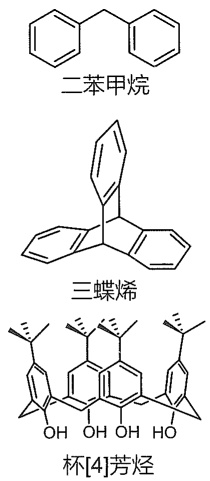

（1）联苯类化合物:多个苯环以单键直接相连的化合物，如联苯等。
（2）多苯脂肪烃类化合物:苯环之间相隔一个及一个以上  $sp^{3}$  杂化碳原子的化合物，如二苯甲烷、三蝶烯和杯芳烃等。
（3）稠环芳烃类化合物:两个或多个苯环共用两个相邻碳原子稠合而成的化合物，如萘、蒽、菲、苯并芘等。

含有苯环的物质在动物和植物中都很常见。植物可以从二氧化碳、水和无机材料中合成苯环。动物不能合成它，但依赖某些芳香族化合物来生存，因此必须从食物中获取。如苯丙

---

6.1 芳烃的分类、命名和结构

177

氨酸、酪氨酸、色氨酸等必需氨基酸，以及维生素 K、B2（核黄素）和 B9（叶酸）都含有苯环。许多重要的药物分子也含有苯环，见图 6-1。

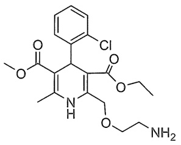

chemical

Complex organic molecule structure with benzene, chloro, and amino groups

氨氯地平
(治疗高血压及心脏病药物)

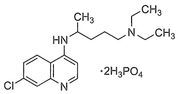

chemical

Chemical structure of a chlorinated pyridine derivative with 2H3PO4 counterion

磷酸氯喹
(抗疟疾药物)

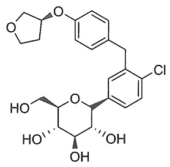

chemical

Chemical structure of a complex organic molecule with cyclohexanone, chloro, and hydroxyl groups

恩格列净
(治疗糖尿病药物)

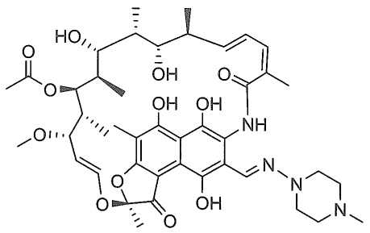

chemical

Complex organic molecule structure with multiple functional groups including carboxylic acid, hydroxyl, and amide linkages

利福平
(抗结核药物)

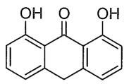

地蒽酚
(抗牛皮癣药物)

图 6-1 常见含苯环的药物分子

多环芳烃大多是致癌物，例如苯并[a]芘就是强致癌化合物之一，它存在于煤焦油中，也从香烟烟雾、汽车尾气和木炭烤牛排中分离出来。每千克体重只需要几毫克苯并[a]芘，就可以诱发实验动物癌症。

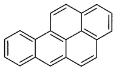

苯并[a]芘

## 6.1.2 苯系芳烃的命名

## 1. 常见母体氢化物

芳烃的命名一般以苯为母体氢化物，苯甲醛、苯胺、苯酚和苯甲酸等作为俗称，在命名时还常用作官能性母体氢化物，若有取代基则称为某苯甲醛、某苯胺、某苯酚、某苯甲酸等。此外，联苯、萘、蒽和菲等也可作为母体氢化物。其中萘和蒽的1,4,5,8位置相同，亦称为 $\alpha$ 位，2,3,6,7位置相同，称为 $\beta$ 位，而蒽和菲中的9,10位置相同，称为 $\gamma$ 位。

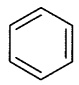

苯
benzene

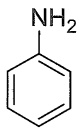

苯胺
aniline

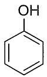

苯酚
phenol

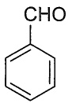

苯甲醛
benzaldehyde

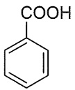

苯甲酸
benzoic ácid

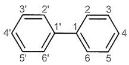

联苯
1,1'-biphenyl

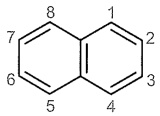

萘
naphthalene

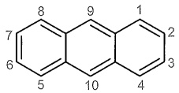

蒽
anthracene

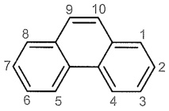

菲
phenanthrene

## 2. 无特性基团的芳烃命名

若芳烃苯环上没有特性基团，一般以芳烃为母体，读作某（基）苯（联苯、萘、蒽等），

---

178

第六章 芳香烃

例如硝基 $\left(-NO_{2}\right)$ 、亚硝基 $\left(-NO\right)$ 、卤素 $\left(-X\right)$ 、简单烃基等作取代基。

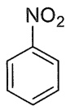

硝基苯
nitrobenzene

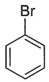

溴苯
bromobenzene

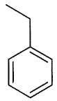

乙苯
ethylbenzene

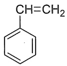

乙烯苯或苯乙烯(俗称)
styrene

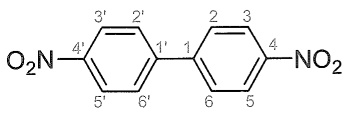

chemical

Chemical structure of a nitro-substituted benzene derivative with two benzene rings and numbered positions

4,4'-二硝基联苯
4,4'-dinitro-1,1'-biphenyl

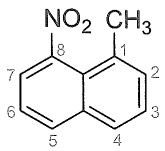

1-甲基-8-硝基萘
1-methyl-8-nitronaphthalene

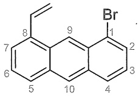

1-溴-8-乙烯基蒽
1-bromo-8-vinylanthracene

此处要注意，烃基取代苯的命名取决于烃基的大小。如果烃基小于苯环（烃基的碳原子数为6或更少），则烃基为取代基，如异丙苯。如果烃基大于苯环（烃基的碳原子数为7或更多），则苯基为取代基，如1-苯基庚烷、1-苯基萘。当苯环被认为是取代基时，苯基可缩写为Ph（希腊语phi），用于表示 $C_{6}H_{5}$ 单元。

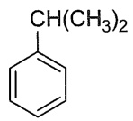

异丙苯
cumene

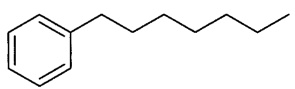

1-苯基庚烷
1-phenylheptane

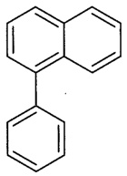

1-苯基萘
1-phenylnaphthalene

若芳烃苯环上没有特性基团，但支链含有特性基团，应以含特性基团的支链为母体氢化物，苯基为取代基，而不管支链碳原子数比芳香环碳原子数多还是少。

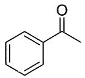

苯乙酮
acetophenone

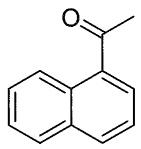

1-萘乙酮
1-(naphthalen-1-yl)ethan-1-one

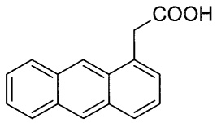

chemical

Chemical structure of a naphthalene derivative with a carboxylic acid substituent

2-(蒽-1-基)乙酸
2-(anthracen-1-yl)acetic acid

## 3. 有特性基团的芳烃命名

若芳烃苯环上有特性基团，且苯环上有多种取代基，应首先选择最优特性基团。特性基团的优先顺序如表6-1所示，排在前面的为特性基团，排在后面的为取代基。

单环芳烃编号时，把特性基团所在位作为1位，单环芳烃的母体氢化物依次用阿拉伯数字编号，或用邻（ortho-，简写为o-）、间（meta-，简写为m-）、对（para-，简写为p-）等字表示。

---

6.1 芳烃的分类、命名和结构

179

表 6-1 特性基团的优先顺序

| 优先次序 | 基团 | 官能团名 | 英文名 | 优先次序 | 基团 | 官能团名 | 英文名 |
| --- | --- | --- | --- | --- | --- | --- | --- |
| 1 | -COOH | 酸 | -oic acid | 8 | -CO- | 酮 | -one |
| 2 | -SO3H | 磺酸 | -sulfonic acid | 9 | -OH | 酚、醇 | -ol |
| 3 | -C(O)O(O)C- | 酸酐 | -anhydride | 10 | -NH2 | 胺 | -amine |
| 3 | -COOR | 酯 | -oate | 11 | -OR | 醚 | -ether |
| 4 | -COX | 酰卤 | -oyl chloride | 12 | -C≡C- | 炔 | -yne |
| 5 | -CONH2 | 酰胺 | -amide | 12 | -C=C- | 烯 | -ene |
| 6 | -CN | 腈 | -nitrile | 12 | -R | 烷 | -ane |
| 7 | -CHO | 醛 | -al |  |  |  |  |

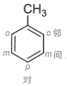

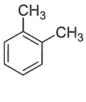

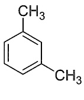

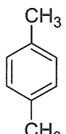

间二甲苯
(1,3-二甲苯)

对二甲苯
(1,4-二甲苯)

邻二甲苯
(1,2-二甲苯)

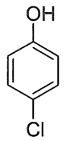

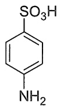

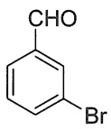

对氯苯酚
4-chlorophenol

对氨基苯磺酸
4-aminobenzenesulfonic acid

间溴苯甲醛
3-bromobenzaldehyde

其他多取代单环芳烃必须用阿拉伯数字编号，应尽量使其他取代基的编号较小。例如:

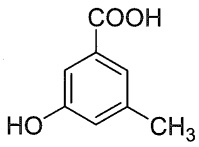

3-羟基-5-甲基苯甲酸
3-hydroxy-5-methylbenzoic acid

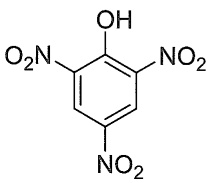

chemical

Chemical structure of 2-methoxybenzoic acid, showing nitro and hydroxyl groups on a benzene ring

2,4,6-三硝基苯酚
2,4,6-trinitrophenol

联苯类或稠环类化合物应在保证特性基团编号最小的情况下，依次考虑主体特性基团最多、取代基最多、最低次序规则和取代基英文字母顺序规则，选择其中的一个苯环优先编号。

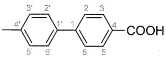

chemical

Chemical structure of a flavonoid compound with two benzene rings and a carboxylic acid group

4'-甲基-[1,1'-联苯]-4-甲酸
4'-methyl-[1,1'-biphenyl]-4-carboxylic acid

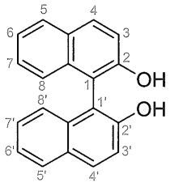

chemical

Chemical structure of a naphthalene derivative with hydroxyl groups and numbered carbon positions

[1,1'-联萘]-2,2'-二酚
[1,1'-binaphthalene]-2,2'-diol

---

180

第六章 芳香烃

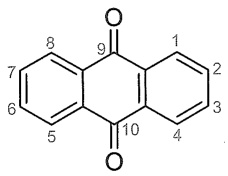

chemical

Chemical structure of a fused-ring compound with numbered carbon atoms and carbonyl group

蔥-9,10-二醌
anthracene-9,10-dione

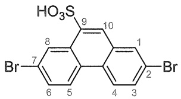

chemical

Chemical structure of a brominated benzene derivative with hydroxyl and numbered carbon positions

2,7-二溴菲-9-磺酸
2,7-dibromophenanthrene-9-sulfonic acid

下列化合物常用 “萘” 或 “蒽” 加 “氢化” 的方法来命名，加氢的位置编号和数目置于 “氢化” 之前，氢化的 “化” 字通常可省略，例如:

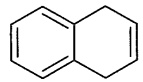

1,4-二氢萘
1,4-dihydronaphthalene

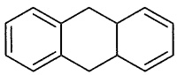

4a,9,9a,10-四氢蒽
4a,9,9a,10-tetrahydroanthracene

## 6.2 芳香性和休克尔规则

## 6.2.1 苯的结构和稳定性

## 1. 苯的凯库勒结构

苯是最简单的芳香烃。自从 Michael Faraday 在 1825 年从伦敦照明气管中剩余的油状残留物中分离出苯以来，它就被认定为一种高度不饱和的烃。但却不会像烯烃、炔烃和二烯烃等不饱和烃一样容易发生亲电加成反应和氧化反应。例如，溴可以亲电加成到乙烯上形成二溴化物，但在类似条件下苯却是惰性的。苯在镍催化下加氢还原时最终确实能形成具有六元环的环己烷，但是需要高温高压的反应条件。

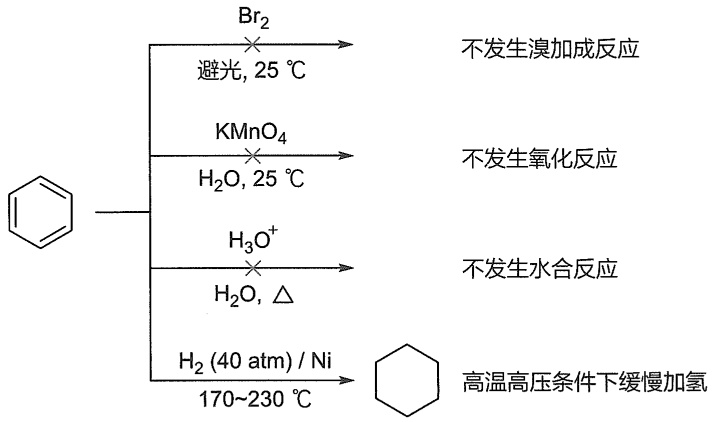

flowchart

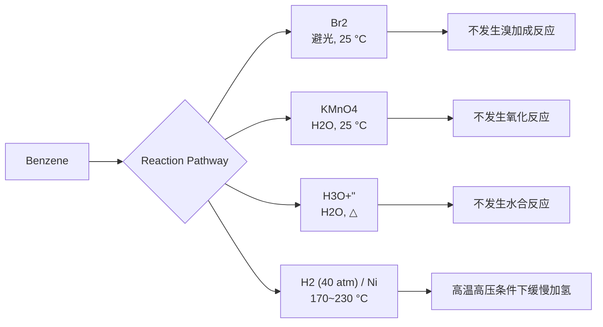

苯确实会与溴发生反应，但只有在路易斯酸催化剂（如三溴化铁）存在的情况下。而且，它不是通过亲电加成而是通过取代反应形成一元取代的溴苯。

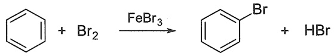

chemical

Chemical reaction equation showing bromination of benzene with bromide to form a brominated benzene and hydrogen bromide

苯的一元取代反应产物只有一种，说明六个碳原子和六个氢原子的地位是等同的。根据以上事实，1865年 August Kekulé 提出了苯的单、双键相间的环状结构式，其表现形式与环

---

6.2 芳香性和休克尔规则

181

己-1,3,5-三烯相同。但苯的凯库勒结构式不能说明溴苯进一步取代得到的邻溴二取代苯产物结构式只有一种，而且不能说明下面苯的氢化热小于环己-1,3,5-三烯的氢化热。

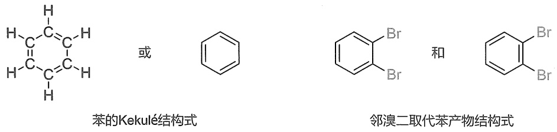

chemical

苯的Kekulé结构式与邻溴二取代苯产物结构式对比图

## 2. 苯的稳定性和氢化热

环己烯催化加氢反应的氢化热（$\Delta H$）为 $-120\mathrm{kJ / mol}$。苯在标准条件下通常对加氢反应稳定，但在苛刻条件（高压和高温）下，苯也会发生加氢反应，并与3当量的氢分子反应生成环己烷。因此，我们可能预期该反应的氢化热为 $-360\mathrm{kJ / mol}$。但实际上，苯的氢化热仅为 $-208\mathrm{kJ / mol}$。苯的氢化热与环己-1,3,5-三烯的氢化热相差 $152\mathrm{kJ / mol}$，如图6-2所示。苯实际释放的热量与基于凯库勒结构计算的热量之间的差值称为苯的离域能。由此，我们说苯具有相对稳定性，这一性质是芳香烃所特有的，是芳香性分子的重要特征。

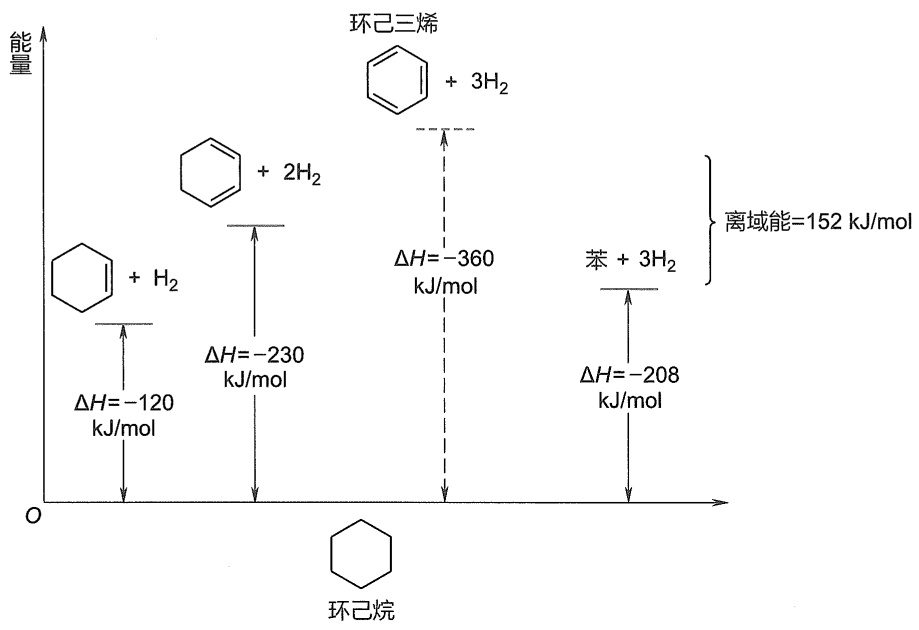

other

| Reaction | Enthalpy Change (kJ/mol) |
| --- | --- |
| Cyclohexene + H2 | -120 |
| Cyclohexene + 2H2 | -230 |
| Cyclohexene + 3H2 | -360 |
| Benzene + 3H2 | -208 |

图6-2 环己烯、环己-1,3-二烯、环己-1,3,5-三烯（假设）和苯的氢化热

## 3. 苯的共振结构

20世纪30年代，随着量子力学的应用和实验手段的进步，人们对苯的结构有了进一步的认识。苯的相对稳定性其实可以用共振论来解释。根据共振论，苯的真实结构其实是下面两种凯库勒结构I和Ⅱ的杂化体。共振式I和Ⅱ的碳碳键之间既没有纯单键也没有纯双键，而是介于单键和双键之间。由于苯环的共振降低了苯分子的能量，从而增加了它的稳定性。苯的共振结构可通过在六元环内画一个圆来表示，如结构式Ⅲ所示，这个圆被理解为代表6个π电子，它们离域在环上的6个碳周围。

---

182

第六章 芳香烃

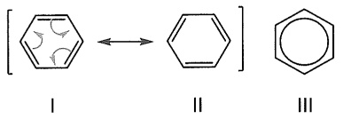

chemical

Chemical reaction diagram showing conversion of cyclohexane to cyclohexene via a cyclopentene ring

X 射线衍射及傅里叶变换光谱分析实验证据也证实了这一点。苯的分子是平面的，其所有的碳碳键键长都是 1.39 Å，介于碳碳单键键长（1.47 Å）和碳碳双键键长（1.34 Å）之间，键角都是 120°，如图 6-3 所示。

原子力显微镜给单个并五苯分子拍照,直观地看到了苯环平面正六边形的结构,如图 6-4 所示。

chemical

Molecular structure diagram showing bond lengths and 120° angles for a carbon-carbon hybridization compound

图 6-3 苯环平面结构图  
(只显示了  $\sigma$  键)

图6-4 原子力显微镜下的并五苯分子

根据杂化轨道理论，苯分子中所有碳原子和氢原子都在同一平面上且化学键键角都是 $120^{\circ}$，说明6个碳原子均采取 $\mathrm{sp}^2$ 杂化，互相重叠形成6个C-C σ键，每个碳原子各以一个$\mathrm{sp}^2$ 杂化轨道与氢原子的1s轨道重叠形成6个C-H σ键。每个碳原子还有一个垂直于σ键平面的p轨道，每个p轨道上有1个p电子，6个平行的p轨道彼此重叠，形成一个闭合的环状大π键，如图6-5(a)所示。环状π电子流［图6-5(b)]是芳香性的又一个重要特征，可通过第八章的核磁共振技术观测到。

chemical

Molecular orbital diagram showing hydrogen bonding and bond formation between H1s-Csp² and Csp²-Csp²

(a)

natural_image

Circular wireframe structure with six protruding pins, resembling a mechanical or optical component (no text or symbols)

(b)

图6-5 苯的离域大 $\pi$ 键

彩图 6-5(b)

## 4. 苯的分子轨道

根据分子轨道理论, 苯的 6 个 p 轨道线性组合成 6 个  $\pi$  分子轨道, 其中 3 个是成键轨道, 另 3 个是反键轨道。其中  $\pi_{2}$  和  $\pi_{3}$ 、 $\pi_{4}^{*}$  和  $\pi_{5}^{*}$  分别是简并轨道, 该能级称为简并能级。在基态时, 苯的 6 个 p 电子成对填入 3 个成键轨道, 所有能量低的成键轨道全部充满电子, 所以苯

---

6.2 芳香性和休克尔规则

183

分子是稳定的，体系能量较低，如图 6-6 所示。

text_image

原子轨道(6个p轨道)
反键分子轨道
成键分子轨道
势能
π₁
π₂
π₃
π₄*
π₅*
π₆*

图6-6 苯的分子轨道和能级示意图

苯分子的大 $\pi$ 键可以看作3个 $\pi$ 成键轨道叠加的结果，3个成键轨道的 $\pi$ 电子云分布在环平面的上下，所以6个碳原子中每相邻的2个碳原子之间的 $\pi$ 电子密度都相等，苯的C-C的键长完全平均化。

## 5. 芳香过渡态

环状六电子体系的相对稳定性可以解释我们前面学过的 Diels-Alder 反应、烯烃和四氧化锇的加成反应及臭氧化反应的第一步。这些反应都是通过三对电子的复杂协同运动而进行的。在这三个反应过程中，都出现了一个过渡态，其中六个电子在  $\pi$  轨道（或具有  $\pi$  特性的轨道）中环状重叠。这种电子排布与苯中的电子排布类似，并且比按顺序键断裂和键形成的电子排布在能量上更有利。这样的过渡态也被称为芳香过渡态。

chemical

三种化学反应示意图：Diels-Alder反应、烯烃和四氧化锇的加成反应以及臭氧化反应

## 6.2.2 芳香性、反芳香性和非芳香性

芳烃苯环上的6个p轨道形成了一个大 $\pi_{6}^{6}$ 键，6个 $\pi$ 电子均匀地分布其中。这种环状闭合共轭体系， $\pi$ 电子高度离域，如果要破坏这个共轭体系，需要提供较大的能量。因此，苯环上发生加成或氧化反应会破坏苯环的闭合共轭体系，能量上很不利，故很难发生，但容易发生取代反应。苯分子这种特殊的结构稳定性及化学反应性能，称为芳香性（aromaticity）。

是不是具有环状闭合共轭体系的分子都具有芳香性呢？例如，环丁二烯和环辛四烯:

chemical

Chemical reaction diagram showing bond length and electron movement between a 1.346 Å bond and a cyclohexane ring

实际上两者都不具备芳香稳定性。特别是具有矩形结构的环丁二烯，极其不稳定，它在$-238^{\circ}\mathrm{C}$ 通过自身Diels-Alder反应二聚，再在热解条件下生成环辛四烯，表现出反芳香性

---

184

第六章 芳香烃

(anti-aromaticity)。虽然经过多年多次失败的尝试，1965年得克萨斯大学的R.Peit和他的同事合成出稳定的环丁二烯的金属配合物——三羰基环丁二烯合铁，由于铁原子可提供2个电子，所以三羰基环丁二烯合铁具有芳香性。

chemical

Chemical reaction equation showing ferrocene formation using Fe(CO)3 catalyst under 238°C to form a benzene product

环辛四烯具有烯烃的典型化学性质。它很容易与卤素和氢卤酸发生亲电加成反应，以及与温和的氧化剂和还原剂发生氧化还原反应，表现出非芳香性（non-aromaticity）。环辛四烯$\pi$ 电子数为8，看起来具有反芳香性。但由于反芳香性意味着体系能量较高，稳定性较差，为避免反芳香性，环辛四烯采用了一种非平面的几何形状。

chemical

Chemical structure showing a cyclopentane ring and its corresponding molecular structure with two fused rings

我们接下来将面临一个问题:“芳香性的基本判断规则是什么？”换句话说，不饱和的环状共轭多烯具备什么结构特征，才会具有较大的离域能，不发生烯烃的典型加成反应，而是发生取代反应？

## 6.2.3 休克尔规则与Frost环规则

## 1. 休克尔规则

对比苯、环丁二烯和环辛四烯的结构特征，我们不难发现，环状闭合共轭体系的存在并不是芳香性的唯一要求，环中离域电子的数量也很重要。我们已经注意到，芳香性需要奇数的电子对。苯共有六个  $\pi$  电子，即三对电子。由于电子对数是奇数，苯具有芳香性。相比之下，环丁二烯和环辛四烯都有偶数个电子对（分别是两对和四对），并不具有芳香稳定性。

要求电子对数为奇数是芳香性判断标准——休克尔（Hückel）规则的基础。1931年，德国物理学家Erich Hückel根据分子轨道理论进行了一系列的数学计算。他的计算表明，“具有 $4n+2$ 个 $\pi$ 电子的单环共轭体系具有芳香性”，n为整数（0，1，2，3，4，…）。

休克尔规则的基本要素为:① 分子中具有单环体系；② 环上每个原子参与共轭；③ 分子是平面或几乎平面的，使环上所有 p 轨道有连续或几乎连续的轨道重叠；④ 共轭体系  $\pi$  电子数为  $4n + 2$ 。

接下来，我们将要思考以下问题:为什么芳香分子会有不同数量的离域 $\pi$ 电子？休克尔规则为何能准确预测芳香性？休克尔规则之所以有效，是因为只有含有 $4n + 2$ 个 $\pi$ 电子（并满足其他三个芳香性判断标准）的分子才会具有像苯那样的分子轨道排列。当只有最低分子轨道和在其上方的所有成键简并轨道被填满，而且没有非键轨道和反键轨道电子填充时，就会形成“闭壳层（closed shell）”的结构，该分子就具有芳香性而稳定，就像稀有气体因其填满了的电子壳层而稳定一样。但如果分子不是环状的，或没有 $\mathfrak{p}$ 轨道，或不是平面的，则 $\mathfrak{p}$ 轨道之间没有强烈重叠而具有非芳香性，如(Z)-己-1,3,5-三烯、环辛四烯和环庚-1,3,5-三烯。

---

6.2 芳香性和休克尔规则

185

chemical

Chemical structures of (Z)-己-1,3,5-三烯, 环辛四烯, and 环庚-1,3,5-三烯 with corresponding molecular formulas

如果分子中的  $\pi$  电子是 4n 个，则分子具有反芳香性，非常不稳定，如环丁二烯。

$$
\text {H} \equiv \text {C}_6\text{H}_4
$$

环丁二烯仅在极低温度下才能被观察到。其显著的反应活性可通过其快速参与 Diels-Alder 反应得以体现，它既可以作为双烯体（下图左），又可以作为亲双烯体（下图右）。

chemical

Organic reaction scheme showing cycloaddition of a ketone to form a fused bicyclic product under light and heat

## 2. 多边形规则与 Frost 圆环

休克尔规则的量化计算太复杂，我们可以用多边形规则来简便理解休克尔规则。多边形规则又叫Frost环规则，是美国西北大学A.A.Frost教授在1953年提出的。这是一种不需要通过量化计算来判断环状闭合共轭体系的分子轨道相对能量的方法。该方法将具有正多边形环状分子放入半径为 $2\beta$ 的圆，一个顶点向下，并确保正多边形所有顶点都与圆相交，与圆相交顶点标记为分子轨道的位置，如图6-7所示。在圆的中心画一条水平线，中心线是能量较高的非键轨道（若存在），位于中心线下方的为能级较低的成键分子轨道，而位于中心线上方的则是能量较高的反键分子轨道。总的分子轨道数等于多边形的顶点数。例如，苯环有六个顶点，共有六个分子轨道，六个 $\pi$ 电子完全填充于三个相对能量较低的成键轨道，非常稳定。

text_image

反键轨道(3个)
中心线
2β
成键轨道(3个)

图 6-7 苯的  $\pi$  分子轨道 Frost 圆环

利用 Frost 环规则的书写方法，我们很容易写出三至八元环环状闭合共轭体系的分子轨道多边形图，如图 6-8 所示。从图 6-8 所示  $\pi$  电子填充情况可以看出，成键分子轨道的数量始终为奇数（1、3 或 5）。而当分子中所有  $\pi$  电子在成键分子轨道中填充满形成闭壳层结构时，分子就具有芳香性。根据环的大小，成键分子轨道相应会容纳 2、6 或 10 个  $\pi$  电子。这

---

186

第六章 芳香烃

也解释了为什么芳香化合物具有  $4n + 2$  个  $\pi$  电子。

scatter

| n | Energy Level |
| --- | --- |
| 3 | \(\pi* (\)Reverse Orbit), \(\pi\) (Non-Reverse Orbit) |
| 4 | \(\pi* (\)Reverse Orbit), \(\pi\) (Non-Reverse Orbit) |
| 5 | \(\pi* (\)Reverse Orbit), \(\pi\) (Non-Reverse Orbit) |
| 6 | \(\pi* (\)Reverse Orbit), \(\pi\) (Non-Reverse Orbit) |
| 7 | \(\pi* (\)Reverse Orbit), \(\pi\) (Non-Reverse Orbit) |
| 8 | \(\pi* (\)Reverse Orbit), \(\pi\) (Non-Reverse Orbit) |

图6-8 三至八元环环状闭合共轭体系的分子轨道多边形图

## 6.2.4 芳香化合物的芳香性

## 1. 苯系芳烃

苯系芳烃如单环芳烃和多环芳烃都含有一个或多个苯环，由于苯环上有 $4n + 2$ 个 $\pi$ 电子，符合休克尔规则，而具有芳香性。

联二苯叉(基)
biphenylene

萘
naphthalene

蒽
anthracene

菲
phenanthrene

对三联苯
1,1':4',1"-terphenyl

芘
pyrene

苯并[a]芘
benzo[a]pyrene

chemical

Molecular structure of naphthalene, a polycyclic aromatic hydrocarbon

二苯并[a,l]芘
dibenzo[a,l]pyrene

由于休克尔规则只适用于单环共轭体系，格拉斯大学的ErichClar于1972年提出了 $\pi-$ 六隅体（$\pi-$ sextet）规则，将芳香性的判断由单环共轭体系扩展到多环芳烃。该规则认为芳香性是苯系芳烃六元环的局部属性，芳香性 $\pi-$ 六隅体是指具有芳香性的 $6\pi$ 电子的共轭环状体系。在一个稠环芳烃体系所有可能的共振式中，具有最大数目孤立的芳香性 $\pi-$ 六隅体最能代表整个体系的性质。换言之，决定稠环稳定性的是体系中最多不连续的具有单双键交替的苯

---

6.2 芳香性和休克尔规则

187

环个数。我们先用菲来举例子。图6-9中的两种共振式1和2，分别具有一个和两个 $\pi-$ 六隅体。2号结构即Clar结构，它能最好地反映菲的实际特性。Clar用带圆圈的正六边形表示一个 $\pi-$ 六隅体，而不属于 $\pi-$ 六隅体的双键则单独画出。

再如，芘有 16 个  $\pi$  电子，属于 4n 结构，按照休克尔规则具有反芳香性。但芘有两种共振式结构，其中 2 号结构是 Clar 结构，具有两个芳香性  $\pi-$  六隅体，其稳定性大于只有一个芳香性  $\pi-$  六隅体的 1 号结构的稳定性。

chemical

Chemical structures of two naphthalene derivatives showing their structural changes and conversions to Clar.

图 6-9 菲（左图）和芘（右图）的  $\pi$ -六隅体（Clar 结构）

## 2. 非苯芳烃

不像环丁二烯和环辛四烯，某些较大的环状共轭多烯是具有芳香性的。它们都有一个共同点:包含 $4n + 2$ 个 $\pi$ 电子，并且它们以共平面来离域。第一个环状共轭多烯是1956年由Sondheimer制备的，它是环十八碳-1,3,5,7,9,11,13,15,17-九烯，含有18个 $\pi$ 电子（$4n + 2$，其中 $n = 4$）。为了避免使用这样烦琐的名字，Sondheimer引入了一个更简单的命名体系来命名环状共轭多烯，[n]轮烯（[n]annulenes），其中 $n$ 表示 $\pi$ 电子的数目。但根据休克尔规则判断单环的轮烯芳香性也有一定局限性。例如，$4n + 2$ 规则仅适用于 $n < 5$ 的平面单环共轭烯烃，[26]轮烯就没有芳香性。[10]轮烯虽然符合 $4n + 2$ 的休克尔规则，但[10]轮烯1,6位两个氢原子由于空间位阻的影响，使得环上的10个碳原子无法共平面，碳原子的p轨道不能有效地重叠，分子是非芳香性的。德国化学家Vogel发现用一个桥接的亚甲基取代[10]轮烯内部的两个具有位阻的氢后，尽管桥头碳处的p轨道与相邻位置p轨道之间并不是最优的重叠，但由此得到的分子符合休克尔规则而具有芳香性。

chemical

五种不同化学结构式下，包括[10]至[26]轮烯及其对应的芳香性与非芳香性名称

---

188

第六章 芳香烃

反芳香性或非芳香性的轮烯或共轭烯烃也可以通过双电子氧化和还原转化为具有芳香性的离子。利用 Frost 环规则，我们很容易判断得出图 6-10 所示非苯芳烃离子具有芳香性。

chemical

Chemical reaction equation showing chlorination of a cyclohexane derivative with SbCl5 and H-SbCl6⁻

chemical

Chemical reaction equation showing hydrogen bonding between a benzene ring and an isopropyl group

$pK_{a}=16$

chemical

Chemical reaction equation showing bromination and reduction of a cyclohexene derivative to form a substituted cyclohexane with electron transfer arrows

图 6-10 具有芳香性的非苯芳烃离子

例如，环戊二烯负离子特别稳定，因为它具有芳香性。环戊二烯负离子具有6个 $\pi$ 电子，其中2个孤电子占据一个2p轨道，同时所有2p轨道连续共轭，这符合芳香性的休克尔规则判断标准。环戊二烯负离子的稳定性也解释了环戊二烯的显著酸性。二茂铁（ferrocene）是由两个环戊二烯负离子与 $\mathrm{Fe}^{2+}$ 形成的夹心面包型配合物。由于环戊二烯负离子具有芳香性，故二茂铁也具有芳香性，可以发生经典的芳香亲电取代反应，如6.3.5小节所示的Friedel-Crafts酰基化反应。

chemical

Chemical reaction equation showing iron-catalyzed transformation of a ferrocene derivative with (CH3CO)2O and -CH3COOH groups

非芳香性的环辛四烯用金属钾处理后，得到环辛四烯双负离子，其结构是平面的八角形结构，C-C键键长为1.40 Å，接近苯中的1.397 Å键长。环辛四烯本身有8个π电子，其双负离子一共有10个电子，符合 $4n+2$ 规则，也具有芳香性，所以容易制备。

chemical

Chemical reaction equation showing benzene reacting with K, THF under double electron addition to form a 2-oxo bridge and 2 K⁺ ion

美国芝加哥大学的 Platt 为拓展休克尔规则来预测多环芳烃的芳香性，于 1954 年提出了周边修正法。根据该方法，多环芳烃的路易斯结构中的双键尽量处在环周边上，忽略环中间的桥键，再计算剩下的  $\pi$  电子数，如果满足  $4n + 2$  规则，则具有芳香性，如图 6-11 所示。

chemical

Chemical structures of azulene, hydropyrene, and pentalene showing their respective芳香性和反芳香性 groups

图 6-11 Platt 周边修正法预测多环芳烃的芳香性

该方法可以预测多环非苯芳烃的芳香性，例如薁这个稠环化合物，若忽略中间桥单键只

---

6.2 芳香性和休克尔规则

189

有 10 个  $\pi$  电子，符合  $4n+2$  规则，具有芳香性。类似的还有二氢芘，而戊搭烯具有反芳香性。通过薁的共振式也可看出，五元环为具有芳香性的环戊二烯负离子，七元环为具有芳香性的环庚三烯正离子，两端非苯芳烃离子都具有芳香性，因此整个分子具有芳香性。类似如下图富瓦烯类化合物，该化合物具有以下共振式，两端离子都具有芳香性，因此整个分子具有芳香性。

需要注意的是，虽然 Platt 周边修正法能解释一些多环非苯芳烃的芳香性，但对一些由偶数个碳原子构成的多环非苯芳烃的芳香性预测性不强。1984 年，Glidewell 和 Lloyd 对 Clar 规则扩展到具有任意偶数个碳原子环的多环非苯芳烃。Glidewell-Lloyd 规则证实，多环共轭系统中  $\pi$  电子的总数量倾向于形成最小的  $4n + 2$ ，并避免形成最小的 4n 个  $\pi$  电子。

依据 Platt 周边修正法，图 6-12 中的联二苯(叉)基有 8 个或 12 个  $\pi$  电子，不具有芳香性。但实际上，联二苯(叉)基具有芳香性。根据 Glidewell-Lloyd 规则，图中蓝色共振结构（含有两个  $6\pi$  电子环状结构）比黑色共振结构（含有一个小的  $4\pi$  电子环状结构和两个大的  $4\pi$  电子环状结构）更合理。

图 6-12 多环共轭体系的不同共振结构，蓝色共振结构符合 Glidewell-Lloyd 规则

## 3. 芳香杂环化合物

含杂原子芳香体系（heteroaromatics）的研究始于呋喃、吡咯、吡啶等简单稳定的芳香化合物，其芳香性源自氧、氮原子提供 $\pi$ 电子数不唯一的特异性。休克尔规则也可用于芳香杂环化合物的芳香性判断。吡啶、吡咯、呋喃和噻吩都是 $6\pi$ 电子的闭环共平面的共轭体系，也具有芳香性。其中吡啶氮上只有一个电子参与共轭，吡咯、呋喃、噻吩都有两个孤电子参与共轭。这些芳香化合物均能够发生亲电取代反应，详细情况将在第十二章介绍。

吡啶
pyridine

吡咯
pyrrole

呋喃
furan

噻吩
thiophene

chemical

Molecular structure diagram showing a central nitrogen atom bonded to multiple oxygen atoms and one lone pair

chemical

Molecular structure diagram showing nitrogen (N) and hydrogen (H) atoms in a branched arrangement

## 4. Möbius 芳香化合物

休克尔型 $\pi$ 芳香族分子是平面的，具有 $4n + 2$ 个共轭 $\pi$ 电子（$n$ 为整数），而莫比乌斯（Möbius）芳香族分子具有一个扭曲 $\pi$ 体系，类似于 Möbius 环，如图 6-13(a) 所示。Möbius 芳香性存在于具有 Möbius 带的环状共轭化合物中。Heilbronner 和 Craig 分别从理论上描述

---

190

第六章 芳香烃

了环烯结构[图6-13(b)]的Möbius芳香性和有机金属体系[图6-13(c)]的Möbius芳香性。

text_image

(a) Möbius环
(b) Heilbronner-Möbius
(c) Craig-Möbius
d_yz
π-conjugation
Hückel MO

图 6-13 Möbius 芳香性

在单环 Möbius 芳香化合物中，闭壳芳香电子构型含 4n 个  $\pi$  电子。2003 年，Ajami 等人第一次合成出稳定的 Heilbronner-Möbius 芳香化合物，这是在此领域研究中里程碑式的发现。其思路是将两个苯环稠连在大环体系中，加强了  $\pi$  电子的离域效应，另外空间上的位阻效应进一步使 Möbius 结构稳定。具体制备过程如图 6-14 所示。

chemical

Chemical reaction pathway showing the formation of a fused bicyclic organic compound from an enone and a polycyclic aromatic hydrocarbon.

图 6-14 Möbius 体系化合物的合成

随后的 X 射线衍射分析也证实了产物的独特结构。图 6-15 所示为 Möbius 体系和正常休克尔体系的结构。

1982 年，Roper 等利用  $\mathrm{Os(CO)(CS)(PPh_{3})_{3}}$  和两个乙炔分子反应合成了第一种 Craig-Möbius 型金属苯——锇杂苯，如图 6-16 所示。苯中的 C、H 原子被 Os 原子取代。锇杂苯六元环具有较好的平面性及键的离域性，占据的锇  $d_{xz}$  轨道与碳环的  $3\pi$  空轨道之间的反馈  $\pi$  键相互作用，使得环上离域  $\pi$  电子数满足 Hückel 的  $4n+2$  规则，化合物具有芳香性，但与苯和吡啶相比，其芳香性较弱。

chemical

Molecular structures labeled (a) and (b), showing atom numbering, bond angles, and a phosphorus-containing heterocycle structure.

图6-15 Möbius体系的结构（a）及相应的休克尔体系的结构（b）

图 6-16 铢杂苯

夏海平等人在 2013 年报道了一类新型的 Craig-Möbius 芳香性金属杂戊搭炔（metallapentalyne），这种化合物的有机母体戊搭炔（pentalyne）是休克尔反芳香性的。然而，当桥头碳替换为金属锇时，化合物表现出很强的芳香性。

---

6.3 芳烃的亲电取代反应

191

chemical

Chemical reaction equation showing conversion of pentalyne to metallapentalyne using bridge carbon replacement and chlorination

需要指出的是，尽管距离 Faraday 首次分离出苯已近 200 年，但全新的芳香体系仍然不断涌现，“芳香性”的定义和内涵还在不断丰富。人们通过理论和实验研究总结了一些芳香性的规律，发展出 Hückel- $\pi$  芳香性、Möbius- $\pi$  芳香性、 $\sigma$  芳香性、 $\gamma$  芳香性和螺芳香性等，但众多理论学家、实验学家在“芳香性”相关主题上的争论却从未停止，这也正是芳香化学的魅力之所在。

## 6.3 芳烃的亲电取代反应

在烯烃和炔烃中，不饱和碳原子上的氢原子很难被其他原子或原子团所取代。但是，带有苯环的芳香族化合物由于具有芳香性而使芳环上的氢原子容易被其他原子或原子团取代。不过苯环上的氢原子取代反应同烷烃中氢原子的取代反应不同。在烷烃中，烷烃的氢原子氯代反应经过自由基中间体，而在芳环上的取代反应，通常是与缺电子的正离子或其他 Lewis 酸等亲电试剂（electrophilic reagent，简写为 E）的反应。因此，我们把芳香族化合物芳环上发生的氢原子取代反应叫芳香族亲电取代反应（electrophilic aromatic substitution，EAS）。

chemical

Chemical reaction equation showing formation of a substituted benzene derivative with HX group

典型的芳香族亲电取代反应如图 6-17 所示。

flowchart

图 6-17 典型的芳香族亲电取代反应

## 6.3.1 苯环上的亲电取代反应机理

在芳环上进行的亲电取代反应，一般经过两个步骤。首先是苯环的  $\pi$  电子和亲电试剂

---

192

第六章 芳香烃

$\mathrm{E}^{+}$ 相互作用形成 $\pi$ 络合物，然后 $\pi$ 络合物中亲电试剂 $\mathrm{E}^{+}$ 进一步从苯环的 $\pi$ 电子体系获得两个电子，$\mathrm{E}^{+}$ 与苯环上一个碳原子以 $\sigma$ 键连接形成具有碳正离子特征的中间体，称为 Wheland 中间体，这与烯烃的亲电加成反应的第一步质子化反应类似。该碳正离子中间体因具有三个共振式而共振稳定，也被称为 $\sigma$ 络合物，这是因为亲电试剂 $\mathrm{E}^{+}$ 通过一个新的 $\sigma$ 键与苯环相连。$\sigma$ 络合物已被 Ohla 等人在超强酸（如 $\mathrm{HF - SbF_5}$、$\mathrm{FSO_3H - SbF_5}$）条件下获得。在 $\sigma$ 络合物中，苯环上的一个碳原子由 $\mathrm{sp}^2$ 杂化转化为 $\mathrm{sp}^3$ 杂化，苯环的闭合共轭体系被破坏了，由于去芳构化而失去了芳香性，因此，此步反应是决速步骤。为了恢复芳香性，$\sigma$ 络合物中 $\mathrm{sp}^3$ 杂化的碳原子上失去一个质子，芳构化得到芳香性保持的苯环取代产物，如图 6-18 所示。由于这一步 C-H 键的断裂是一个非常快的步骤，因此芳香亲电取代反应通常很少或没有检测到动力学同位素效应（kinetic isotope effect, KIE）。

flowchart

图 6-18 芳香族亲电取代反应机理

为了简便起见，芳香族亲电取代反应历程通常省去形成  $\pi$  络合物的一步，其反应的能量曲线如图 6-19 所示。 $\sigma$  络合物生成这一步的反应活化能较高，反应速率比较慢，它是决定整个反应速率的一步。

line

| 反应进程 | 惯能 (势能) |
| --- | --- |
| 慢 | ~低值 |
| 快 | ~高值 |

图 6-19 苯亲电取代反应的能量曲线示意图

## 6.3.2 卤化反应

苯与溴的反应性不如烯烃，烯烃在室温下与溴反应迅速，得到加成产物。例如，环己烯反应生成反-1,2-二溴环己烷，该反应的放热量约为 121 kJ/mol。

chemical

Chemical reaction equation showing bromination of a cyclohexene derivative with bromine under heat change ΔH = -121 kJ/mol

---

6.3 芳烃的亲电取代反应

193

但溴与苯的加成反应是吸热的，因为它失去芳香性而不稳定，在正常情况下，不会得到加成产物。

chemical

Chemical reaction equation showing bromination of a substituted benzene derivative with Br₂ under heat

但苯与溴在铁或铁盐的催化下，苯环上的氢可被溴原子取代生成相应的溴代苯，该取代反应由于放热而容易发生。苯与 $\mathrm{Cl}_2$ 的取代反应也类似。

实际生产中用铁粉作催化剂，卤素与铁发生如下反应:

$$
2 \mathrm{Fe} + 3 \mathrm{Br} _ {2} \longrightarrow 2 \mathrm{FeBr} _ {3}
$$

然后铁盐作为 Lewis 酸使卤素分子极化而形成络合物，从而使卤素成为一个更强的亲电试剂。苯环向末端溴原子提供一对电子，形成 σ 络合物。σ 络合物再失去一个质子形成卤苯。例如，溴苯的生成机理如下所示:

苯在氯化铁存在下的氯化反应机理与溴化反应的机理类似。

由于氟与苯的反应性太强，直接氟化只能得到较低的单氟取代产物。1-氯甲基-4-氟-1,4-二氮杂双环[2.2.2]辛烷二(四氟硼酸)盐 $\mathrm{F - TEDA - BF_4}$ 是一种新型选择性氟化剂，其中一个氟原子与一个带正电荷的氮结合，可以提供形式上的氟正离子（$\mathrm{F}^{+}$）。在三氟甲磺酸（TfOH）存在下，甲苯可以发生单氟化反应。

chemical

Chemical reaction equation showing fluorination of a benzyl alcohol using BF4⁻ counterion to form a fluorinated aromatic compound with TFOH solvent

产物比3:1; 产率82%

---

194

第六章 芳香烃

目前在售的药品中有超过 20% 的药品含有氟，销售额前 100 种在售药物中更达 30%。例如，用于治疗 2 型糖尿病的西格列汀、抗抑郁药氟西汀（百忧解）和用于降低胆固醇的他汀类药物阿托伐他汀（立普妥）就是较为典型的例子。

chemical

Chemical structure of a fluorinated heterocyclic compound with trifluoromethyl and amine substituents

西格列汀

Sitagliptin

(Januvia)

chemical

Chemical structure of a substituted benzene derivative with F3 and NHCH3 groups

氟西汀

Fluoxetine

(Prozac)

与氟相反，碘与苯本身不反应，苯的碘化需要一种酸性氧化剂，如硝酸。硝酸在反应中被消耗掉，所以它是一种试剂（一种氧化剂），而不是一种催化剂。

chemical

Chemical reaction equation showing benzene reacting with 1/2 l₂ and HNO₃ to form a benzene derivative with 85% yield, then using NO₂ and H₂O

碘化反应可能涉及碘正离子（$\mathrm{I}^{+}$）作为亲电试剂。碘正离子是由硝酸氧化碘而产生的。

$$
\mathrm{H} ^ {+} \quad + \quad \mathrm{HNO} _ {3} \quad + \quad 1 / 2 \mathrm{I} _ {2} \quad \longrightarrow \quad [ \mathrm{I} ^ {+} ] \quad + \quad \mathrm{NO} _ {2} \quad + \quad \mathrm{H} _ {2} \mathrm{O}
$$

常见的酸性氧化剂还有过氧化氢（ $H_{2}O_{2}$ ）或铜盐（ $CuCl_{2}$ ），这些氧化剂通过将 $I_{2}$ 氧化为更强的亲电试剂来加速碘化反应，就像碘正离子一样。

$$
\mathrm{I} _ {2} + \mathrm{H} _ {2} \mathrm{O} _ {2} \longrightarrow 2 \mathrm{H} - \mathrm{O} - \mathrm{I} \quad \text {或} \quad \mathrm{I} _ {2} + \mathrm{CuCl} _ {2} \longrightarrow \mathrm{I} - \stackrel {+} {\mathrm{I}} - \stackrel {-} {\mathrm{Cu}} _ {\mathrm{Cl}} ^ {\mathrm{Cl}} = [ \mathrm{I} ^ {+} ]
$$

chemical

Organic reaction scheme showing copper-catalyzed cyclization of benzene to form a substituted benzene product, with 65% yield indicated

芳香亲电卤化反应在许多自然界分子的生物合成中经常见到，特别是海洋生物分子。一个例子发生在人类的甲状腺中，甲状腺素是一种参与调节生长和代谢的激素。在甲状腺素的生物合成过程中，酪氨酸首先被甲状腺过氧化物酶碘化，然后由两个碘化的酪氨酸分子偶联。亲电的碘化剂是一种能生成碘正离子的次碘酸，它是由碘离子与 $\mathrm{H}_2\mathrm{O}_2$ 氧化形成的。

芳香亲电卤化反应还用于工业上苯酚的生产。苯酚可用于合成阿司匹林、制造酚醛树脂（用于台球黏合剂和塑料），还可以生产染料和除臭剂。工业上生产苯酚的化学工艺是由德国化学家 Raschig 在 1891 年首次使用的 Raschig-Hooker 工艺。该工艺的主要步骤是先用苯、盐酸和氧气生产氯苯，随后将氯苯水解为苯酚。第一步使用氯化铜或氯化铁催化剂，并将苯和盐酸暴露在 200～250 °C 的空气中。在第二步中，将所得氯苯引入 450 °C 的蒸汽中，经过硅催化的水解反应，得到苯酚和氯化氢。

---

6.3 芳烃的亲电取代反应

195

chemical

Chemical reaction showing oxidation of a dihydroxybenzene derivative to form a cyclic product, with Chinese text indicating enzymatic oxidation by cysteine.

酪氨酸

3,5-二碘酪氨酸

chemical

Chemical structure showing a molecule with hydroxyl, methoxy, and amino groups connected via an ester linkage to a carboxylic acid group

甲状腺素

chemical

Chemical reaction equation showing chlorination of benzene with HCl and 1/2 O₂ under CuCl₂ at 523 K to form a chlorinated benzene derivative with H₂O and Si at 723 K.

然而，该反应需要非常高的温度和非常酸性的环境，并伴随氯化氢蒸气产生以及巨大的能量消耗，这使其被更为绿色的异丙苯工艺（Hock重排反应）所替代。

## 6.3.3 硝化反应

以浓硝酸和浓硫酸（或称混酸）与苯共热，苯环上的氢原子被硝基（ $-NO_{2}$ ）取代，生成硝基苯。该方法可用于在芳环上引入一个硝基。

chemical

Nitration reaction equation of benzene

硝化反应中的亲电试剂是硝酰正离子  $NO_{2}^{+}$ ，它是按下式产生的:

chemical

Chemical reaction mechanism showing sulfonation and dehydration steps between nitric acid and sulfuric acid

苯的硝化反应按如下历程进行:

chemical

Nitration reaction mechanism of benzene showing oxidation and elimination steps

硝基苯在上述条件下不容易进一步硝化。如果增加硝酸的浓度并提高反应温度，苯的硝化反应可得到间二硝基苯。

chemical

Nitration reaction equation of benzene under sulfuric acid catalyst in 100°C

---

196

第六章 芳香烃

芳香环的亲电硝化在自然界中不发生，但在工业中尤为重要。因为生成的硝基苯用金属（Fe或Zn）和盐酸处理后，还可以被还原为苯胺。但在这些酸性条件下，产生的氨基被质子化生成铵离子（$\mathrm{ArNH_3^+}$）。因此，反应必须用碱（如NaOH），以去除额外的质子并再生氨基。这一过程为我们提供了一种在苯环上引入氨基的一般方法。而苯胺是许多染料和药物工业合成的关键原料。我们将在第十二章中讨论胺类化合物的相关反应。

chemical

Chemical reaction equation showing nitration of nitrobenzene to form aniline under Fe/HCl and NaOH conditions

## 6.3.4 磺化反应

苯与浓硫酸共热得到苯磺酸，苯环上的氢原子被磺酸基取代了。芳香磺酸是强酸，其酸性强度与硫酸相当，常用作有机酸催化剂，如对甲苯磺酸（TsOH）。

chemical

Chemical reaction equation showing benzene reacting with sulfuric acid to form a sulfonate group, yielding 56% product

目前认为，磺化反应中一般是  $HSO_{3}^{+}$  或  $SO_{3}$  作为亲电试剂。虽然  $SO_{3}$  不是正离子，但它是一种缺电子试剂。 $SO_{3}$  中的 S 原子可以带部分正电荷。因此，反应历程如下:

与卤化反应和硝化反应不同的是，磺化反应是一个可逆反应。这一反应既可以正向进行，也可以逆向进行，具体取决于反应条件。在强酸环境中，磺化反应更易发生；而在热的稀酸水溶液中，脱磺化反应更占优势。

chemical

Chemical reaction equation showing condensation of benzene with sulfuric acid under 30–50°C to form sulfoxide and then to form benzene under 180°C with water.

磺化反应和脱磺化反应经历了相同的  $\sigma$  络合物，苯磺化反应及其逆反应的势能示意图见图 6-20。

磺化反应之所以可逆，是因为生成的 $\sigma$ 络合物脱去质子和脱去 $\mathrm{SO}_3$ 两步的活化能（$E_{\mathrm{a1}}$ 和 $E_{\mathrm{a2}}$）相差不大。而在硝化反应和卤化反应中，从相应的 $\sigma$ 络合物脱去 $\mathrm{NO}_2^+$ 或 $\mathbf{X}^+$ 的活化能大于脱去 $\mathrm{H^{+}}$ 的活化能，反应速率相差很大。因此，反应实际上是不可逆的。由于磺化反应可逆，有时会引入磺酸基作为保护基，暂时阻断其所在位置发生芳香亲电取代反应；

---

6.3 芳烃的亲电取代反应

197

或者将其作为导向基，影响与之相关的另一取代反应的位置。当不再需要磺酸基时，再将其脱磺化去除。该性质将被用于稍后多取代芳香化合物的合成。

line

| Reaction Stage | Activation Energy (Ea1) | Oxidation/Activation Energy (Ea2) |
| --- | --- | --- |
| Phenyl sulfonate + SO3 | High | Low |
| Phenyl sulfate + SO3H | Low | High |

图6-20 苯磺化反应及其逆反应的势量示意图

除了顺序相反外，脱磺酸基反应遵循与磺化反应相同的反应机理。脱磺化反应的亲电试剂是质子，质子加入苯环形成 $\sigma$ 络合物，然后 $\mathrm{SO}_3$ 离去得到芳香化苯环。过量的水可将生成的 $\mathrm{SO}_3$ 通过水合成硫酸，使其从平衡中去除。

$$
\text {C}_6\text{H}_5\text{SO}_3^-\text{CH} + \text{H}^+ \rightleftharpoons \left[ \text{C}_6\text{H}_4\text{S}(\text{O})_2\right]\rightleftharpoons \text{C}_6\text{H}_4\text{CH} + \text{SO}_3\quad (\text{SO}_3 + \text{H}_2\text{O} \rightleftharpoons \text{H}_2\text{SO}_4)
$$

与去磺酸基反应类似, 如果一个苯环进攻氘离子 $\left(\mathrm{D}^{+}\right)$ 而不是一个质子, 也可以生成 $\sigma$ 络合物, 并最终生成苯的氘代产物。

$$
\text {C}_6\text{H} \xrightarrow{\text{H}} \text{D-O-D} \quad \Longleftrightarrow \left[ \text{C}_6\text{H} \xrightarrow{\text{D}} \text{O-D} \right] \Longrightarrow \text{C}_6\text{H} + \text{H-O-H}
$$

该实验通过在重水  $D_{2}O$  中加入  $SO_{3}$  生成  $D_{2}SO_{4}$ ，很容易完成苯的氘代。该反应是可逆的，重水的量决定了达到反应平衡时产物中 D 与 H 的比例。大大过量的重水使苯的六个氢都被置换为氘，从而合成出一种常见的核磁共振溶剂氘代苯（ $C_{6}D_{6}$ ）。

chemical

Chemical reaction diagram showing oxidation of a diene to form a benzene derivative under D2SO4/D2O conditions

苯磺酸不容易进一步磺化，需要在更高的温度下才能继续磺化，产物为间苯二磺酸。

chemical

Chemical reaction equation showing benzene reacting under sulfuric acid (H₂SO₄) under 200–230°C to form a benzene derivative with water.

间苯二磺酸

---

198

第六章 芳香烃

磺化反应常用于洗涤剂的合成。长支链烷基苯被磺化成相应的磺酸，然后转化为它们的钠盐。由于这种洗涤剂不易生物降解，它们已被更多环境可接受的替代品所取代。

chemical

Chemical reaction equation showing sulfonation of benzene to form sulfonyl and sodium hydroxide

苯磺酸钠与五氯化磷或氯化亚砜反应可以制备苯磺酰氯。

chemical

Chemical reaction equation showing sulfonation of a benzene derivative with sodium counterion under PCl5 and POCl3 conditions

此外，苯与氯磺酸（ClSO\_{3}H）也可以发生氯磺化反应制备苯磺酰氯。

chemical

Chemical reaction equation showing phenol reacting with 2ClSO3H to form a sulfonamide salt, followed by acidification and sulfuric acid formation

苯磺酰氯非常活泼，与胺反应可以合成许多磺胺类药物，例如广谱抗菌药磺酰嘧啶。

chemical

Chemical structure of磺酰嘧啶 (Hypoxanthine) with labeled substituents

## 6.3.5 Friedel-Crafts 反应

在前面的章节中，我们已经看到各种亲电试剂（$\mathrm{Br}^{+}$、$\mathrm{Cl}^{+}$、$\mathrm{NO}_{2}^{+}$和$\mathrm{SO}_{3}$）可与苯发生芳香亲电取代反应。下面，我们将讨论含碳亲电试剂的芳香亲电取代反应。1877年，Friedel和Crafts在芳香溶剂中尝试通过戊基碘与$\mathrm{AlCl}_{3}$反应来合成戊基氯时，偶然发现苯可以与卤代烃和羰基化合物等发生亲电取代反应。Friedel-Crafts反应主要有两种类型:Friedel-Crafts烷基化反应和Friedel-Crafts酰基化反应。Friedel-Crafts反应也是有机化学中由C-H键转化成C-C键最重要的反应之一。

## 1. Friedel-Crafts 烷基化反应

由于苯不是一种强的亲核试剂，很难和卤代烃发生  $S_{N}2$  反应制备烷基苯。

chemical

Chemical reaction equation showing benzene reacting with R-Cl to form a substituted benzene ring

但在无水  $AlCl_{3}$  或其他路易斯酸（ $BF_{3}$ ）或 Brønsted 酸（ $H_{2}SO_{4}$ 、 $H_{3}PO_{4}$ ）催化剂作用下，苯可以和卤代烃、烯烃、醇反应生成烷基苯。这是一种在苯环上引入一个烷基的好方法。例如:

chemical

Chemical reaction equation showing benzene reacting with RCl under basic conditions to form a substituted benzene product

---

6.3 芳烃的亲电取代反应

199

chemical

Two-step organic synthesis reaction scheme showing benzene reacting with chloroalkyl chloride under water, followed by hydroxylation and subsequent fluorination to yield phenol and aldehyde.

Friedel-Crafts 烷基化反应的亲电试剂可以是  $1^{\circ}$ 、 $2^{\circ}$  和  $3^{\circ}$  卤代烃、烯丙基或苄基卤代烃。芳烃与  $2^{\circ}$  和  $3^{\circ}$  卤代烃发生 Friedel-Crafts 烷基化反应，其反应中间体是烷基正离子，它是在  $AlCl_{3}$  的作用下产生的。烷基正离子能够被苯进攻，生成一个具有共振稳定的  $\sigma$  络合物。中间体  $\sigma$  络合物发生去质子化反应，从而得到烷基取代苯。

chemical

Chemical reaction mechanism showing aluminum-catalyzed cyclization of benzene with alkyne and chloride ions

甲基卤代烃和  $1^{\circ}$  卤代烃的反应中间体是  $R-\overset{+}{X}-\bar{A}IX_{3}$

Step 1. 卤代烃活化

$$
\mathrm{RCH} _ {2} - \mathrm{X} + \mathrm{AIX} _ {3} \quad \Longleftrightarrow \quad \mathrm{RCH} _ {2} - \stackrel {\delta^ {+}} {\mathrm{X}} - \bar {\mathrm{AIX}} _ {3}
$$

Step 2. 亲电进攻

chemical

Chemical reaction equation showing benzene reacting with a hydrogenated alkene to form a substituted cyclohexane derivative with aldehyde and aluminum ion.

Step 3. 质子离去

chemical

Chemical reaction equation showing alkylation of a substituted benzene derivative with alkenes and alkyl groups

但 3 碳及以上 1°卤代烃容易发生碳正离子重排反应。

---

200

第六章 芳香烃

chemical

Organic reaction pathway showing bromination, reduction, and hydrogenation steps with yields for different alcohols

分子内的 Friedel-Crafts 烷基化反应可以在苯环周围增加一个新的环。

chemical

Chemical reaction equation showing chlorination of a benzene derivative using AlCl3 under CS2, CH3NO2 (s�剂) at 25°C for 72 hours to yield tetralin with 31% yield.

Friedel-Crafts 烷基化反应还存在以下局限性:

（1）在选择卤代烃时，卤代烃不能是卤苯或乙烯基卤，因为其生成的碳正离子稳定性差，不会发生 Friedel-Crafts 反应。

chemical

Chemical reaction diagram showing benzene ring reacting with chloroalkyl chloride to form aldehyde, with no reaction observed

（2）烷基化反应产物中芳环上增加了烷基，而烷基是给电子基团，使产物比反应物更容易发生烷基化反应。因此，烷基化反应产物往往是多取代产物。这个问题通常可以通过选择有利于单烷基化的反应条件来避免，例如在反应过程中加入过量的苯，则可主要得到一取代产物。

chemical

Chemical reaction equation showing benzene reacting with acetaldehyde under BF3 at 60°C to yield two substituted benzene products with yields of 24% and 14%.

为什么吸电子取代基会导致苯环不容易发生Friedel-Crafts反应？

（3）Friedel-Crafts 烷基化反应只对苯、带给电子取代基的苯衍生物和卤代苯有效。当芳环上连有强吸电子基或  $-NH_{2}$ 、-NHR、 $-NR_{2}$  时难发生 Friedel-Crafts 反应。例如，硝基苯、苯甲酸和苯基酮等都不会发生 Friedel-Crafts 反应。芳香胺也难发生 Friedel-Crafts 反应，因为它可以和  $AlCl_{3}$  生成具有强吸电子性的络合物。

---

6.3 芳烃的亲电取代反应

201

chemical

Chemical reaction scheme showing nitration and reduction reactions of benzene derivatives with AlCl3 catalyst

Friedel-Crafts 烷基化反应通过在芳烃分子上添加烷基, 成为生产各种工业产品重要反应之一, 如苯和乙烯进行酸催化反应生成乙苯。乙苯的生产规模巨大, 每年达数百万吨。它是苯乙烯的前体分子, 用于生成聚苯乙烯。异丙苯、二甲苯和甲苯均可通过 Friedel-Craft 烷基化反应生产。例如, 对二甲苯是用于生产涤纶聚对苯二甲酸乙二醇酯（PET）的重要的前体分子。

## 2. Friedel-Crafts 酰基化反应

在发现 Friedel-Crafts 烷基化反应后，Friedel 和 Crafts 又将卤代烃扩展至酰氯，发现增加  $AlCl_{3}$  的量，可以使苯环上增加一个酰基，这也是合成芳香酮的重要方法。Friedel-Crafts 酰基化反应除了酰卤，还有酸酐甚至羧酸。和 Friedel-Crafts 烷基化不一样， $AlCl_{3}$  作为路易斯酸不是催化剂量，一般要大于 1 当量。此外  $BF_{3}$  等路易斯酸和  $H_{2}SO_{4}$ 、 $H_{3}PO_{4}$  等质子酸也能参与反应。

chemical

Chemical reaction equations showing the synthesis of a ketone from benzene and aldehyde under different conditions

其中酰氯很容易用二氯亚砜（$\mathrm{SOCl}_2$）或五氯化磷（$\mathrm{PCl}_5$）与羧酸反应制备:

chemical

Two-step organic reaction scheme showing acid-catalyzed cyclization of acetaldehyde and benzyl alcohol under sulfuric acid, with yields indicated for each step.

Friedel-Crafts 酰基化反应中的亲电试剂是酰基正离子，它是在  $AlCl_{3}$  作用下产生的。首先酸酐与  $AlCl_{3}$  形成酰基正离子亲电试剂。与烷基氯化物不同，酸酐含有两种亲核位点，即

---

202

第六章 芳香烃

碳氧单键上氧原子和碳氧双键上氧原子。为什么不是碳氧单键上的氧原子进攻缺电子的铝原子？原来，碳氧单键上氧原子受两边羰基的吸电子共轭效应的影响，电子密度不及碳氧双键上氧原子的电子密度，因此碳氧双键上氧原子更容易亲核进攻缺电子的铝原子，然后脱去一个乙酰基与氯化铝络合物，得到乙酰正离子。乙酰正离子遵循芳烃亲电取代反应的一般机理，得到芳香酮产物。

和分子内的 Friedel-Crafts 烷基化反应类似，分子内的 Friedel-Crafts 酰基化反应也可以在苯环周围增加一个新的环。

chemical

Chemical reaction pathway showing aldehyde-catalyzed cyclization of a benzene derivative with dichloromethane under AlCl3 and HCl conditions

与 Friedel-Crafts 烷基化反应对比，Friedel-Crafts 酰基化反应有以下三个不同的反应特点:

（1）没有重排产物。与 Friedel-Crafts 烷基化的反应中间体碳正离子不同，Friedel-Crafts 酰基化的反应中间体是酰基正离子，不能发生重排，因此，Friedel-Crafts 酰基化反应没有重排产物。利用 Friedel-Crafts 酰基化反应这一特点，结合羰基的还原反应，我们可以由苯直接制备没有重排的烷基苯。

chemical

Organic synthesis reaction sequence showing alkylation of benzene with dichloroalkyl chloride, followed by reduction to pentaene using hydrogen and palladium catalysts.

此处的羰基还原反应，还可以采用第九章中 Clemmensen 还原或 Wolff-Kishner-黄鸣龙还原方法。

chemical

Chemical reaction equation showing conversion of a benzyl alcohol to two substituted benzene derivatives under different conditions

---

6.3 芳烃的亲电取代反应

203

（2）与 Friedel-Crafts 烷基化反应不同，Friedel-Crafts 酰基化反应没有多元取代产物。Friedel-Crafts 酰基化反应后的产物有酰基取代基，是强吸电子基，不能进一步酰基化，只保留在一取代。

chemical

Organic reaction pathway showing benzene reacting with aldehyde under different conditions to form a ketone, which is not detected by the reaction.

（3）催化剂 $\mathrm{AlCl}_3$ 通常要过量，这是因为氯化铝可以和产生的芳香酮形成络合物。因此在该反应中需要大于1当量的 $\mathrm{AlCl}_3$ 。在反应结束时，一般要加入水来破坏络合物，并产生游离的芳香酮。

需要注意的是，与 Friedel-Crafts 烷基化反应相同的是，当芳环上连有强吸电子基时也难发生 Friedel-Crafts 酰基化反应。例如，要以苯为原料合成间硝基正丁苯:

chemical

Multi-step organic synthesis reaction scheme involving benzene, chloroacetate, and nitrobenzene derivatives under various conditions

若先进行硝化反应，则后面 Friedel-Crafts 酰基化反应难进行。若先 Friedel-Crafts 酰基化，再进行硝化反应，最后进行 Clemmensen 还原反应，则主要产物为间硝基正丁苯。

chemical

Chemical reaction equation showing nitrobenzene reacting with chloroacetate under AlCl3 to form no reaction

当芳环连有 $-NH_{2}$ 、-NHR、 $-NR_{2}$ 时，由于氮原子具有较强碱性和亲核性，在酰基化反应中，苯胺不仅可以和 $AlCl_{3}$ 生成具有强吸电子性的络合物，而且还存在着氨基酰基化和芳环酰基化的竞争反应。若氮原子上没有氢原子，三级芳香胺可以直接进行Friedel-Crafts酰基化反应，而一级、二级芳香胺需要将氨基保护后再进行Friedel-Crafts酰基化反应。

chemical

Chemical reaction pathway showing nucleophilic addition of benzene and acetone to form a diamine, followed by acidification and hydrolysis to form an amino group.

## 6.3.6 Haworth 反应

Haworth 反应是芳烃和丁二酸酐发生 Friedel-Crafts 酰基化反应，然后羰基经 Clemmensen 还原和分子内的 Friedel-Crafts 酰基化反应制备四氢萘酮的反应。该反应将 Friedel-Crafts 酰基化反应用于在苯环上引入一个六元环。

---

204

第六章 芳香烃

flowchart

四氢萘酮可继续用 Clemmensen 还原羰基后，再用硒加热脱氢得到多环芳烃——萘，同样也可用该方法进一步合成蒽、菲等稠环化合物。

chemical

Chemical reaction pathway showing conversion of a fused-ring ketone to a fused-ring ketone using C6H6, AlCl3, H2SO4, Zn(Hg)/HCl, and Se/Δ reagents

## 6.3.7 Blanc 氯甲基化反应

在无水  $ZnCl_{2}$  催化下，芳烃与甲醛和 HCl 反应，得到氯甲基取代产物。氯甲基化反应很重要，因为苄基氯很活泼，芳环上的氯甲基容易转化为羟甲基( $-CH_{2}OH$ )、氰甲基( $-CH_{2}CN$ )、羧甲基( $-CH_{2}COOH$ )、氨甲基( $-CH_{2}NH_{2}$ )等。当芳环上有强吸电子基时，此类反应难发生。

chemical

Chemical reaction equation showing benzene reacting with HCHO and HCl under ZnCl₂ to form a substituted benzene ring

Blanc 氯甲基化反应在酸性环境下进行，以氯化锌作为催化剂。苯环亲核进攻质子化的甲醛，然后伴随芳香环的重新构建，生成苄醇。在反应条件下，苄醇很容易被转化为苄基氯。反应的机理如下:

chemical

Reaction mechanism showing hydrolysis of acetic acid to form a benzene derivative, followed by chlorination

在氯化锌存在下，苯和苄基氯容易进一步发生 Friedel-Crafts 烷基化反应生成二苯甲烷。苯酚、苯胺等非常活泼的芳烃容易进一步与产物苄基氯/苄醇发生 Friedel-Crafts 烷基化反应，因此也不适合用作这类反应的底物。

chemical

Chemical reaction equation showing chlorination of benzene with zinc chloride to form a substituted benzene derivative

## 6.3.8 Gattermann-Koch 反应

等量 CO 与 HCl 的混合气体，在无水  $AlCl_{3}$ 、CuCl 或  $TiCl_{4}$  等 Lewis 酸存在下与芳烃反应生成芳香醛，此反应称为 Gattermann-Koch 反应。这是一种在芳环上引入甲酰基的重要方法。

---

6.3 芳烃的亲电取代反应

205

chemical

Organic reaction equation showing benzene reacting with CO and HCl under AlCl3/CuCl catalyst to form a substituted benzene product with 46% yield.

其反应机理如下:

chemical

Chemical reaction equation showing alkylation of CO and HCl to form a malonate and aldehyde ion

chemical

Chemical reaction equation showing phenol reacting with H-C≡O to form a ketone and HCl

但此类反应仅适用于烷基苯的甲酰化，单取代的烷基苯在进行甲酰化时，几乎全部生成对位产物。苯胺的化学性质太活泼，易在该反应条件下与生成的芳醛缩合成三芳基甲烷衍生物。同时该反应也不适用于苯胺、苯酚和苯酚醚。

## 6.3.9 Reimer-Tiemann 反应

Reimer-Tiemann 反应是苯酚类化合物和氯仿在强碱 NaOH 水溶液中反应，在羟基的邻位或对应引入一个醛基（-CHO）的过程。该反应是 1876 年由 Reimer 和 Tiemann 发现的，但只有苯环上富电子的酚类（实际上是酚基负离子）才能发生此反应，例如烷基、烷氧基取代的苯酚、卤代苯酚、萘酚等可在上述反应条件下发生甲酰化。

chemical

Chemical reaction equation showing hydrolysis of phenol under CHCl3 and H3O+ conditions, yielding hydroxyl alcohol with 20%-35% yield and 8%-12% yield

这个反应是一个典型的芳香亲电取代反应，亲电试剂是二氯卡宾（$\mathrm{:CCl_2}$），它可由氯仿和 $\mathrm{NaOH}$ 反应原位生成。碱首先从氯仿中拔除一个氢原子，生成三氯碳负离子。该碳负离子通过 $\alpha-$ 消除反应失去一个氯离子形成二氯卡宾。然后苯酚上氢被碱拔除，使电子离域到环的邻位和对位，与二氯卡宾发生如下亲电取代反应:

---

206

第六章 芳香烃

请思考对甲酰基苯酚生成的反应机理。

由于二氯卡宾能与烯烃和胺反应，分别生成二氯环丙烷和异氰，因此，Reimer-Tiemann 反应不适合含有这些官能团的底物。邻甲酰基产物在 Reimer-Tiemann 反应中通常占主导地位，但当该位置已被取代时，会得到对甲酰基苯酚。芳香族化合物的直接甲酰化可以通过 Gattermann-Koch 反应完成。然而，就操作的易用性和安全性而言，Reimer-Tiemann 反应是最有利的路线。

## 6.3.10 Fries 重排反应

Fries 重排反应是指酚酯在 Lewis 酸（如  $AlCl_{3}$ 、 $ZnCl_{2}$ 、 $FeCl_{3}$ ）或 Brønsted 酸（如 HF、甲磺酸）催化下重排为邻位或对位酰基酚的反应。该反应由德国化学家 Fries 首先报道。重排可以在硝基苯、硝基甲烷等溶剂中进行，也可以不用溶剂直接加热进行。脂肪或芳香羧酸的酚酯都可以发生重排。因取代基影响反应，底物一般不含有位阻大的基团。和苯的 Friedel-Crafts 酰基化一样，当酚的芳环上有间位定位基存在时，重排一般不能发生。该反应是在酚的芳环上引入酰基的重要方法，酚酯的制备可以采用第九章中芳基酮的 Baeyer-Villiger 氧化反应。

chemical

Chemical reaction scheme showing esterification of benzaldehyde to form aldehyde and its hydroxylated product under different conditions

例如:

Fries 重排反应机理究竟是分子间反应还是分子内反应至今仍未完全清楚,一个接受较广的机理是涉及酰基正离子的机理。该机理中,首先是酚酯的羰基氧原子与路易斯酸性的铝原子进行配位,而不是酚上氧原子,因为这个氧原子比酚上氧原子更富电子。这也导致酚酯上 C-O 键极化,从而导致酚上氧原子重排到铝原子上,C-O 键断裂,产生酚基铝化物和酰基正离子。酰基正离子接下来在苯酚的邻位或对位发生类似芳香亲电取代反应,得到共振稳

---

6.3 芳烃的亲电取代反应

207

定的  $\sigma$  络合物，再经水解得到羟基芳酮产物，具体反应机理如下:

chemical

Chemical reaction mechanism showing step 1 and step 2 of aluminum-catalyzed cyclization with alkyne and phenyl groups

苯酚邻位酰基化:

chemical

Multi-step organic synthesis reaction scheme showing aluminum-catalyzed transformation of a benzyl alcohol with R-C≡O+ to form a substituted benzene derivative via step 3 and step 4, followed by step 5 using water.

苯酚对位酰基化:

chemical

Multi-step organic synthesis reaction scheme showing aluminum-catalyzed transformation of a chlorinated benzene derivative with R-C≡O+ and water to form an aldehyde intermediate

邻对位未取代的苯酚酯重排产物为邻、对位混合产物。通过改变反应条件，如温度，溶剂或催化剂可以使混合产物中某一异构体为主要产物。一般来说，低温有利于对位产物的生成，高温有利于邻位产物的生成。例如:

chemical

Chemical reaction scheme showing conversion of a benzyl alcohol to two substituted phenolic compounds under different AlCl3 conditions

在低温条件下，Fries 重排反应受动力学控制，生成对位产物在动力学上更有利。而在高温条件下，Fries 重排反应受热力学控制，因为邻位产物能与铝形成更稳定的双齿配合物。

Fries 重排也可以在没有催化剂的情况下进行，但需要有紫外光的存在。产物仍然是邻或对羟基芳酮。这种类型的 Fries 重排称为 “光 Fries 重排”。光 Fries 重排产率很低，很少用于合成。不过苯环上连有间位定位基时仍然可以进行光 Fries 重排。

---

208

第六章 芳香烃

chemical

Fluorination reaction mechanism of benzaldehyde under UV light, showing intermediate and product formation steps

研究显示，光Fries重排会导致天气炎热时塑料瓶的降解，由聚对苯二甲酸乙二酯（PET）制成的塑料瓶在 $40^{\circ}\mathrm{C}$ 左右和波长为 $310\mathrm{nm}$ 的紫外光照射下会发生光Fries重排而降解。

## 6.4 芳香亲电取代反应的定位效应

## 6.4.1 单取代芳烃亲电取代反应的定位效应

在单环芳烃的亲电取代反应中，当苯环上没有取代基时，新进入的取代基可以进入苯环的任一位置。1895年，Holleman等从大量实验事实中归纳发现，当单取代苯经历芳香亲电取代反应时，新进入基团的位置（定向）和反应速率（活性）由苯环上已有的取代基决定，这就是单取代芳烃亲电取代反应的定位效应（orientation effect）。

## 1. 定位基团

当已有一个取代基 G 的取代苯进行亲电取代反应时，第二个取代基进入苯环的位置和速率常常取决于苯环上原有取代基的性质。因此，把苯环上第一个取代基 G 称为定位基。第二个取代基进入苯环时，有三个不同的位置可供选择:进入定位基 G 的邻位、对位或间位。表 6-2 列出了一些单取代苯的硝化反应实验结果。

表 6-2 单取代苯的硝化反应实验结果

chemical

Chemical reaction equation showing benzene ring reacting with nitrobenzene under sulfuric acid and temperature to form a substituted benzene ring with nitro group

<table><tr><td rowspan="2">定位基G</td><td colspan="3">产物含量/%</td><td rowspan="2">定位基G</td><td colspan="3">产物含量/%</td></tr><tr><td> $o^-$ </td><td> $m^-$ </td><td> $p^-$ </td><td> $o^-$ </td><td> $m^-$ </td><td> $p^-$ </td></tr><tr><td colspan="4">致活邻对位定位基</td><td colspan="4">致钝间位定位基</td></tr><tr><td> $-CH_3$ </td><td>63</td><td>3</td><td>34</td><td> $-\overset{+}{N}(CH_3)_3$ </td><td>2</td><td>87</td><td>11</td></tr><tr><td>-OH</td><td>50</td><td>0</td><td>50</td><td> $-NO_2$ </td><td>7</td><td>91</td><td>2</td></tr><tr><td> $-NHCOCH_3$ </td><td>19</td><td>2</td><td>79</td><td> $-CO_2H$ </td><td>22</td><td>76</td><td>2</td></tr><tr><td colspan="4">致钝邻对位定位基</td><td>-CN</td><td>17</td><td>81</td><td>2</td></tr><tr><td>-F</td><td>13</td><td>1</td><td>86</td><td> $-CO_2CH_3$ </td><td>28</td><td>66</td><td>6</td></tr><tr><td>-Cl</td><td>35</td><td>1</td><td>64</td><td> $-COCH_3$ </td><td>26</td><td>72</td><td>2</td></tr><tr><td>-Br</td><td>43</td><td>1</td><td>56</td><td>-CHO</td><td>19</td><td>72</td><td>9</td></tr><tr><td>-I</td><td>45</td><td>1</td><td>54</td><td></td><td></td><td></td><td></td></tr></table>

从表 6-2 不难发现，对不同的单取代苯进行同一亲电取代反应时，就反应产物比例进行

---

6.4 芳香亲电取代反应的定位效应

209

分析，有两大类定位基:

一类是邻对位定位基（o,p-director），又称第一类定位基，包括与苯单键相连，且含有孤电子或负离子的原子，如-OH、卤素等；还包括含有 $\pi$ 电子的基团，如烯基、苯基等；具有给电子效应的烷基也属于邻对位定位基。

另一类是间位定位基（m-director），又称第二类定位基，包括与苯环相连的原子有极性双键或叁键的取代基，如  $-NO_{2}$ 、-COR、-CN 等；与苯环相连的是带正电荷的原子或强的吸电子基，如  $-CF_{3}$ 、 $-\overset{+}{N}(CH_{3})_{3}$  等。

## 2. 反应活性

苯环上取代基除了可以影响亲电取代反应的定位外，还可以影响亲电取代反应的速率。表 6-3 给出了单取代苯硝化反应的相对反应速率。

表 6-3 单取代苯硝化反应的相对反应速率

<table><tr><td>取代苯</td><td>相对反应速率</td></tr><tr><td></td><td>24.5</td></tr><tr><td></td><td>1.0</td></tr><tr><td></td><td>0.033</td></tr><tr><td></td><td> $6 \times 10^{-8}$ </td></tr></table>

我们可以看出，苯环上连有给电子的取代基可以加速亲电取代反应，而吸电子取代基可以降低反应速率。加速亲电取代反应的取代基，称为致活基团（activating group），降低亲电取代反应速率的取代基，称为致钝基团（deactivating group）。氨基、羟基、烷氧基和烷基等取代基是典型的邻对位取代基，因为具有给电子共轭效应和超共轭效应，会使得苯环上电子密度增大，导致亲电取代反应速率加快，是致活邻对位取代基。卤素也是典型的邻对位取代基，具有吸电子诱导效应和给电子共轭效应，由于反应活性主要受吸电子诱导效应的影响，会使苯环上电子密度减小，导致亲电取代反应速率降低，是致钝邻对位定位基。硝基、磺酸基、氰基和羰基等取代基是典型的间位定位基，具有吸电子诱导效应和共轭效应，会使苯环上电子密度减小，导致亲电取代反应速率降低，是致钝间位定位基。因此，取代芳烃的定位基又可细分为以上三类。根据表6-3，亲电取代反应速率顺序如下:

致活邻对位定位基芳烃 $>$ 苯 $>$ 致钝邻对位定位基芳烃 $>$ 间位定位基芳烃

同一类定位基的定位能力大小也不同，三类定位基的反应活性顺序如下:

flowchart

This diagram illustrates the chemical reaction pathways of a benzene derivative, showing how different functional groups (NO2, SO3H, COOH, CH, Cl, F) are converted into various intermediates and products.

---

210

第六章 芳香烃

在此要注意，芳烃亲电取代反应活性顺序:氟苯 > 碘苯 > 氯苯  $\approx$  溴苯。从诱导效应看，我们知道氟 > 氯 > 溴 > 碘，其吸电子能力也是这个顺序。按道理氟苯电子密度更小，活性更低，碘苯电子密度更大，活性更高。为什么氟苯和碘苯的反应活性刚好相反呢？

虽然从诱导效应来看，吸电子能力顺序是氟 $>$ 氯 $>$ 溴 $>$ 碘，芳烃亲电取代反应活性顺序是氟苯 $<$ 氯苯 $<$ 溴苯 $<$ 碘苯。但从共轭效应来看，由于不同卤原子参与苯环共轭的轨道能级不同，导致轨道重叠效果不一样 $\left[\mathrm{F}(2\mathrm{p}) > \mathrm{Cl}(3\mathrm{p}) > \mathrm{Br}(4\mathrm{p}) > \mathrm{I}(5\mathrm{p})\right]$，使得给电子能力有差异，顺序是氟 $>$ 氯 $>$ 溴 $>$ 碘，芳烃亲电取代反应活性顺序是氟苯 $>$ 碘苯 $>$ 氯苯 $\approx$ 溴苯。综合诱导效应和共轭效应，反应活性顺序是氟苯 $>$ 碘苯 $>$ 氯苯 $\approx$ 溴苯。

chemical

Chemical reaction mechanism showing诱导效应 and共轭效应 of a benzene derivative with electron transfer

还需注意的是，与卤苯相比，具有强致活能力邻对位定位基的苯胺和苯酚的卤化反应，在没有催化剂的情况下就可发生，而且反应不易停留在单取代，反应只生成邻位和对位取代产物。这说明苯胺和苯酚的反应活性比卤苯的反应活性高，因为相比于氮和氧的吸电子诱导效应，苯环上氨基和羟基的给电子共轭效应影响更大。

chemical

Chemical reaction pathway showing bromination and hydrolysis steps of a brominated aromatic compound

以对位取代为例，其反应机理如下:

chemical

Chemical reaction mechanism showing bromination and oxidation steps of a brominated cyclohexene derivative

为了让亲电取代停留在单取代，可以修饰氨基和羟基。如乙酰苯胺和苯甲醚，就可以更好地控制苯环的单取代。

chemical

Nitration reaction equation of benzene

---

6.4 芳香亲电取代反应的定位效应

211

## 6.4.2 定位效应的理论解释

## 1. 电子效应对苯环上电子密度分布的影响

那么，如何理解这些定位效应呢？为什么硝基取代就是间位产物，氨基取代就是邻对位产物呢？首先从电子效应看取代基对苯环上电子密度分布的影响。与苯环上碳相比，氨基作为致活邻对位定位基有给电子共轭效应和吸电子诱导效应，而且共轭效应大于吸电子诱导效应，所以会使苯环上的电子密度增大，但邻对位电子密度增加更大。硝基是典型的致钝间位定位基，具有吸电子诱导效应和共轭效应，因此使苯环上的电子密度减小，但间位电子密度减小得较少。氯原子是典型致钝邻对位定位基，具有吸电子诱导效应和给电子共轭效应，但在此，诱导效应大于共轭效应，表现出吸电子作用，因此使苯环上的电子密度减小，但间位电子密度减小得更多。这主要是因为氯原子给电子共轭效应倾向于对抗吸电子的诱导效应，使得苯环邻对位的电子密度降低程度相对要小些。

chemical

Molecular structures of benzene derivatives with labeled charge states and bond angles

## 2. 共振论对反应中间体稳定性的解释

从亲电反应中间体的稳定性也可解释不同取代基的定位效应。

例如，致活的邻对位定位基如氨基取代的苯环发生亲电取代反应，第一步得到的碳正离子有如下几种共振式。若是邻对位取代，这些共振杂化体中存在相对最稳定的共振式，而间位取代不存在相对最稳定共振式，因此致活的邻对位定位基对苯环上发生邻对位亲电取代反应有利。

邻位进攻

chemical

Reaction mechanism diagram showing formation of a fused ring system with ammonia and hydrogen atoms, labeled as '最稳定共振式'

间位进攻

chemical

Chemical reaction mechanism showing protonation and rearrangement of a substituted benzene derivative

对位进攻

chemical

Reaction mechanism diagram showing formation of a substituted benzene derivative with ammonia and ethylene groups

最稳定共振式

---

212

第六章 芳香烃

再如，甲基取代的苯环发生亲电取代反应，第一步得到的碳正离子有如下三种共振式。在邻对位取代时，这些共振杂化体中存在相对最稳定的共振式，因此致活的邻对位定位基对苯环上发生邻对位亲电取代反应有利。

flowchart

致钝的间位定位基如硝基取代的苯环发生亲电取代反应，第一步得到的碳正离子有如下三种共振式。在邻对位取代时，这些共振杂化体中存在最不稳定的共振式，因此致钝的间位定位基对苯环上发生间位亲电取代反应有利。

flowchart

致钝的邻对位定位基如氯取代的苯环发生亲电取代反应，第一步得到的碳正离子有如下三种共振式。在邻对位取代时，这些共振杂化体中存在最稳定的两种碳正离子共振式，因此致钝的邻对位定位基对苯环上发生邻对位亲电取代反应有利。

---

6.4 芳香亲电取代反应的定位效应

213

flowchart

This flowchart illustrates the chemical reaction pathways for chlorination and stabilization of a benzene derivative, showing sequential transformations between reactants, intermediates, and products.

## 6.4.3 多取代芳烃亲电取代反应的定位效应

若苯环含有两个或两个以上取代基，则其定位效应应如何判断呢？可根据以下原则判断:

（1）取代基定位效应一致，第三个取代基进入它们共同确定的位置。

如对硝基甲苯，甲基是邻对位定位基，而硝基是间位定位基，所以箭头所示的位置刚好处于两者共同确定的位置，在此取代最有利。其他两种二取代苯也是类似的情况。

（2）取代基定位效应相矛盾，由基团致活能力顺序判断第三个基团取代的位置。

① 两个基团不同类，定位效应受邻对位取代基控制。例如，在下列两个取代苯中，定位效应受羟基和甲基的影响。

chemical

Two chemical structures showing nitrobenzene and its hydroxyl group with methyl and nitro groups

② 两个取代基为同一类，定位效应受致活能力较强的基团控制。例如，下列两个二取代苯的定位效应分别受羟基和乙酰胺基的影响。

chemical

Two substituted benzene rings with hydroxyl and methyl groups, each labeled (100%)

---

214

第六章 芳香烃

③两个取代基定位效应接近，难以预测主要产物，为混合物。

## 6.4.4 稠环芳烃亲电取代反应的定位效应

稠环芳烃的主要反应也是芳香亲电取代反应。单取代反应主要发生在能生成共振稳定碳正离子中间体的碳原子上。例如萘比苯更容易发生亲电取代反应，且萘的  $\alpha$  位比  $\beta$  位活泼。

在萘的芳香亲电取代反应中，碳正离子中间体的高度离域化性质解释了其区域选择性。若萘环的 C1 位进攻亲电试剂，会产生如下五种共振式。

chemical

Reaction mechanism diagram showing electron transfer and rearrangement of a benzene derivative with E⁺ counterion

若 C2 位进攻亲电试剂也产生碳正离子中间体，有如下五种共振式。

chemical

Reaction mechanism diagram showing electron transfer and rearrangement of a naphthalene derivative with E⁺ ion

那么，为什么萘的 C1 位容易进攻亲电试剂，而不是 C2 位呢？对这两种反应产生的碳离子中间体的共振式研究不难发现，萘的 C1 位进攻亲电试剂后得到的中间体有两个共振式保持完整的苯环，具有芳香稳定性。而萘的 C2 位进攻亲电试剂后，只有一个共振式保持完整的苯环，由此产生的碳正离子不太稳定，导致其过渡态在能量上也不太有利。由于芳香亲电取代的第一步是决速步骤，因此萘的 C1 位的亲电进攻比 C2 位快。

在工业上，$\alpha$-硝基萘主要用于制备 $\alpha$-萘胺。$\alpha$-萘胺是合成偶氮染料的中间体。

---

6.4 芳香亲电取代反应的定位效应

215

chemical

Chemical reaction showing nitration of a naphthalene derivative using Zn/HCl catalyst

萘的磺化反应同苯的磺化反应一样，也是可逆反应，其产物与反应条件有关。

chemical

Chemical reaction diagram showing the synthesis of sulfonate from naphthalene under sulfuric acid and water, with temperature-dependent reactions indicated.

当萘环上有取代基时，单取代苯环的定位效应仍然适用，第二个取代基进入的位置随着定位基的不同而不同。如果萘环上连的是邻对位定位基，由于其活化作用，第二个取代基进入已有取代基的同一环。

如果萘环上连的是间位定位基，由于其钝化作用，特别是钝化所在苯环部分，第二个取代基进入原有取代基的异环。

chemical

Nitration reaction equation of benzene

蒽的化学性质类似于萘。蒽的 9、10 位比其他位置更容易发生取代、加成、氧化及还原反应等。

为什么 1-硝基萘和 2-硝基萘环上发生亲电取代反应的位置不同？

为什么蒽、菲的 9、10 位容易发生亲电反应？

---

216

第六章 芳香烃

chemical

Chemical reaction pathway showing bromination and reduction steps of a naphthalene derivative

与蒽相似，菲的9、10位也比其他位置活泼。

chemical

Chemical reaction pathway showing bromination and oxidation steps of a polycyclic aromatic hydrocarbon

## 6.5 芳香亲核取代反应

强致钝的吸电子基团取代的芳烃一般难以再发生芳香亲电取代反应，如硝基苯的二硝化或三硝化、苯磺酸的二磺化或三磺化。但反过来说，吸电子基团取代的芳烃就容易发生亲核取代反应，特别是当苯环上含有卤素离去基团时，这类反应称为芳香亲核取代反应（nucleophilic aromatic substitution，NAS）。芳香亲核取代反应有两种重要的反应机理。当芳环上连有强吸电子基时，卤代芳烃亲核取代反应容易发生加成-消除反应机理（addition-elimination mechanism），即负离子中间体机理（$\mathrm{S_NAr}$）；当芳环上没有吸电子基时，在强碱条件下，卤代芳烃容易发生消除-加成反应机理（elimination-addition mechanism），即苯炔机理（benzyne mechanism）。涉及自由基中间体的 $\mathrm{S_{RN}1}$ 机理（radical-nucleophilic aromatic substitution）和通过芳基重氮盐的 $\mathrm{S_N1}$ 机理将在第十二章中讨论。涉及有机金属化合物的亲核取代反应机理将在第十四章中讨论。

---

6.5 芳香亲核取代反应

217

## 6.5.1 加成-消除反应机理（负离子机理）

## 1. 实验现象

脂肪族卤代烃（如苄基卤代烃、烯丙基卤代烃、烷基卤代烃）一般较容易发生 $S_{N}1$ 和 $S_{N}2$ 的亲核取代反应，但卤代芳烃由于卤原子与苯环形成稳定的 $p-\pi$ 共轭体系，故碳卤键较难断裂。并且芳环是富电子体系，不易被亲核试剂（nucleophilic reagent，简写为Nu）进攻，因此，难发生 $S_{N}1$ 和 $S_{N}2$ 反应。若要发生取代反应，需要更为苛刻的条件，如工业上由氯苯制备苯酚的Dow化学工艺:

chemical

Nitration reaction equation of benzene

然而，当芳环上有强吸电子基（如  $-NO_{2}$ ）存在时，氯苯却容易发生芳香亲核取代反应。例如:

从上面三个反应还可以看出，随着硝基的增加，氯苯的亲核取代反应的反应条件更温和了，说明反应更容易了。但有意思的是，氯作为离去基团必须与强吸电子基处于邻位或对位，如果离去基团与硝基处于间位，则没有观察到芳香亲核取代反应。

chemical

Chemical reaction equation showing chlorination of a benzene derivative with HO⁻ and HCl under 70°C conditions

什么原因导致这样的反应现象呢？该反应是不是与脂肪族卤代烃的 $\mathrm{S_N1}$ 或 $\mathrm{S_N2}$ 反应机理一样呢？从动力学实验来看，卤代芳烃虽然与脂肪族卤代烃同样是双分子反应机理，但是它不可能经历 $\mathrm{S_N1}$ 或 $\mathrm{S_N2}$ 反应机理。

$$
\text {速率} = k [ \text {卤代芳烃} ] [ \text {亲核试剂} ]
$$

因为离去基团卤原子上存在一对孤电子，容易与苯环的  $\pi$  电子共轭而离域，环上的碳原子与卤原子之间存在部分双键特性。因此，卤原子与苯环紧密结合，不易被取代。此外，苯环平面上电子云的存在也阻碍了亲核试剂从背面进攻的可能性，苯环的几何结构也排除了构型翻转的可能。因此，卤代芳烃难以发生  $S_{N}2$  反应。

---

218

第六章 芳香烃

卤代芳烃也难以发生  $S_{N}1$  反应，因为苯基正离子中间体极不稳定，苯基正离子的稳定性甚至不如一级碳正离子，因此，卤素先离去在能量上是不利的。

chemical

Chemical reaction equation showing chlorination of benzene with chloride ion and sp² radical

卤代芳烃不可能发生  $S_{N}1$  或  $S_{N}2$  反应还有一个实验事实，即在卤代芳烃的芳香亲核取代反应中，不同卤素对卤苯亲核取代反应速率影响顺序与对脂肪卤代烃  $S_{N}1$  或  $S_{N}2$  反应速率影响顺序相反。如在卤苯与甲醇钠的反应中，氟苯是芳香亲核取代反应速率最快的，而碘苯是反应速率最慢的，前者比后者快了 780 倍，而氯苯、溴苯和碘苯的反应速率相差不到 3 倍。

chemical

Four substituted benzene rings with their respective relative reaction rates and molar weights (50°C)

氟具有强的离去能力还表现在蛋白质结构测定的 Sanger 反应中，2,4-二硝基氟苯（Sanger 试剂）与氨基酸在室温下就很容易发生芳香亲核取代反应。该反应通过在蛋白质中氨基酸的氨基末端附加一个“标签”，从而鉴定蛋白质的 N-末端氨基酸。这种不寻常的卤素离去基团的离去顺序说明，该机理中的速率决定步骤不可能是碳卤键断裂。

chemical

Nitration reaction equation of benzene

## 2. 负离子机理

芳香亲核取代反应可以用负离子机理来解释。负离子机理包括两个步骤:首先亲核试剂亲核进攻与离去基团直接相连的碳原子，相邻  $\pi$  键同时打开，得到碳负离子中间体；随后离去基团离去，碳负离子中间体重新芳构化得到取代产物。

chemical

Nitration reaction equation of benzene

第一步碳负离子中间体的生成需要去芳构化破坏苯环的芳香性，需要较高的活化能，通常是整个芳香亲核取代反应（$\mathrm{S_NAr}$）的决速步骤。与芳香亲电取代反应中具有碳正离子特征的 $\sigma$ 络合物不同，这个碳负离子中间体有以下四个共振式，构成具有负离子特征的 $\sigma$ 络合物，我们称之为Meisenheimer络合物。硝基在不同位置取代的 $\mathrm{S_NAr}$ 反应中Meisenheimer络合物如下所示。

---

6.5 芳香亲核取代反应

219

硝基对位取代的  $S_{N}Ar$  反应机理:

chemical

Reaction mechanism diagram showing nucleophilic attack on a pyridine derivative with labeled intermediates and reversible steps

Meisenheimer 络合物

硝基邻位取代的  $S_{N}Ar$  反应机理:

chemical

Chemical reaction mechanism showing nucleophilic attack on a benzene ring with quaternary ammonium ion

最稳定共振式

Meisenheimer络合物

硝基间位取代的  $S_{N}Ar$  反应机理:

chemical

Chemical reaction mechanism showing nucleophilic substitution of a nitrobenzene derivative with X substituent

Meisenheimer 络合物

从以上反应机理不难看出，邻对位取代的强吸电子基如  $-NO_{2}$  可以通过共振稳定 Meisenheimer 络合物，这也是芳香亲核取代必须要有强吸电子取代基的原因。与亲电取代反应不同，此处硝基是一个致活基团而不是致钝基团，因此硝基越多越容易发生芳香亲核取代反应。但强吸电子取代基若在卤素的间位，硝基不能通过共振来稳定 Meisenheimer 络合物，因此不反应。

与其他 C-X 键（X = Cl、Br、I）不同，C-F 键的强极性使得与氟相连的碳电正性更强，容易受亲核试剂的进攻而生成 Meisenheimer 络合物。并且 Meisenheimer 络合物的生成是决速步骤，而不是卤素的离去。因此，-Cl、-Br 和-I 的离去能力相差不大。由于氟的吸电子诱导效应比其他三种卤素的都大，其对 Meisenheimer 络合物辅助稳定的作用更大，这就解释了氟苯表现出比氯苯、溴苯和碘苯更好的反应活性。

除 $\mathrm{HO}^{-}$ 外，其他亲核试剂也会与活化的卤代芳烃发生反应。典型的例子是2,4-二硝基氯苯与亲核试剂肼的反应，可以制备2,4-二硝基苯肼，该试剂可用于第九章羰基化合物的表征。

chemical

Chemical reaction showing chloroaniline reacting with N2H4 under -HCl to form a substituted benzamide derivative

---

220

第六章 芳香烃

除卤素以外，其他离去基团也容易在 $\mathrm{S_NAr}$ 反应中被取代，例如-OR，该取代基与苯环形成稳定的 $p - \pi$ 共轭体系，而不易被亲核试剂取代，在碱性条件下表现出一定的稳定性。但在邻位或对位引入吸电子取代基后，苯甲醚则变得容易发生芳香亲核取代反应。

chemical

Chemical reaction mechanism showing oxidation of nitrobenzene to form a substituted benzene derivative with hydroxyl and methoxy groups

强吸电子基  $-NO_{2}$  在有其他硝基活化的苯环上也可以被取代。

chemical

Chemical reaction scheme showing nitration of nitrobenzene under different conditions to form nitrobenzene and nitrobenzene derivatives

## 6.5.2 消除-加成反应机理（苯炔机理）

## 1. 实验现象

若苯环上未连有强吸电子基，如前面提到氯苯，由于存在  $p-\pi$  共轭，很难发生亲核取代反应。实际上，在苛刻的工业条件下，邻氯甲苯才可以发生亲核取代得到 2-甲基苯酚和 3-甲基苯酚的混合物。

chemical

Chemical reaction equation showing chlorination of a chlorophenone under NaOH and HCl/H2O conditions

若用碱性足够强的碱如  $NaNH_{2}$  取代 NaOH，则可以在低温条件下发生亲核取代反应，例如:

chemical

Chemical reaction equation showing chlorination of a substituted benzene derivative using sodium ammonia and ammonia

该反应亲核试剂取代的位置有两个，得到两种产物。显然这不可能通过加成-消除反应的负离子机理生成。而且氯苯的邻位和对位都被取代，则亲核取代反应不发生。

chemical

Chemical reaction equation showing brominated to methyl-substituted benzene under KNH2 and NH3 conditions at -30°C

直到美国化学家 Roberts 对该反应进行  ${}^{14}C$  同位素标记实验，才提供了实验依据。他们发现当使用 C1 位置被放射性  ${}^{14}C$  标记的溴苯反应时，取代产物在 C1 和 C2 上都有等量的标记，这意味着存在一个对称的反应中间体，其中 C1 和 C2 是等价的。

---

6.5 芳香亲核取代反应

221

chemical

Chemical reaction equation showing chlorination of a benzene derivative using KNH2 in liquid and KCl to form a mixture of 50% and 50% products.

进一步的机理证据来自捕捉实验。当溴苯与呋喃等共轭二烯烃用  $KNH_{2}$  处理时，会发生 Diels-Alder 反应，这意味着反应中间体是苯炔。苯炔的反应性太强，不能作为纯化合物分离出来，但在水的存在下，会加成产生苯酚。

chemical

Chemical reaction pathway showing chlorination and methylation steps of a benzene derivative

据此，他提出反应存在苯炔（benzyne）中间体。苯炔中间体中的碳碳叁键有一个 p-p 轨道重叠的  $\pi$  键是参与苯环的离域大  $\pi$  体系的。但另外一个相邻的  $sp^{2}$  杂化轨道垂直于苯环大  $\pi$  体系，不参与苯环的共轭，如图 6-21 所示。不过苯炔的碳碳叁键键长约为 1.26 Å，比乙炔的碳碳叁键键长（1.20 Å）长，相邻的 C-C 键键长约为 1.38 Å，比苯中的 C-C 键键长（1.39 Å）略短，说明相邻  $sp^{2}$  杂化轨道重叠程度不如正常  $\pi$  键，更接近双自由基而不是叁键。红外光谱也表明，苯炔并不是一个正式的碳碳叁键，因为它有两种典型共振式（A 和 B），A 共振式的贡献大于 B 共振式的贡献。

chemical

Molecular orbital diagram showing proton and sp² orbitals in a molecule, alongside a reaction pathway converting compound A to B

图6-21 苯炔的结构图

## 2. 苯炔机理

芳香亲核取代反应的苯炔机理如图6-22所示。卤代苯在强碱氨基钠的作用下，通过E1cb机理或E2机理消除一分子卤化氢得到苯炔中间体。该反应步骤是整个反应的决速步骤，因此当离去基团相邻的两个位置没有氢时不会发生反应。然后氨基负离子在碳碳叁键的任一侧亲核进攻苯炔得到两种芳基负离子。这也解释了为什么未取代的卤代芳烃亲核取代产物是等量的。在最后一步中，芳基负离子从氨中拔除一个质子来生成苯胺。

chemical

Chemical reaction mechanism showing chlorination and amine formation steps with E1cb reagents

图 6-22 芳香亲核取代反应的苯炔机理

---

222

第六章 芳香烃

如果反应介质中不存在亲核试剂，苯炔会二聚化生成联二苯叉（基）。

联二苯叉(基)

## 3. 苯炔的制备

除了卤代芳烃在强碱如 $\mathrm{NaNH_2}$ 和 $\mathrm{NaH}$ 作用下得到苯炔中间体以外，还有几种方法能生成苯炔中间体。

邻二卤代芳烃与 $\mathrm{Mg}$ 反应，通过格氏试剂得到苯炔。例如，邻溴氟苯用镁金属处理后形成的格氏试剂具有碳负离子的特性，促使C-F键的断裂，产生苯炔:

chemical

Chemical reaction showing brominated fluorine reacting with magnesium to form a brominated fluorine derivative, then rearranged to yield a benzene product.

另一条路径是通过光分解芳香化合物得到苯炔。例如，紫外光会导致邻苯二甲酰过氧化物弱的 O-O 键均裂解离，生成两个不可逆的离去基团（ $CO_{2}$  分子），从而生成苯炔。

chemical

Chemical reaction mechanism showing light irradiation and reduction of a ketone to form a benzene derivative under -2CO₂ atmosphere

如何合成邻氨基苯甲酸？

再如，邻氨基苯甲酸与  $NaNO_{2}$  和 HCl 发生重氮化反应生成重氮盐，涉及的重氮化反应机理将在第十二章中讨论。重氮盐加热后会导致  $CO_{2}$  和  $N_{2}$  的离去而生成苯炔，邻氨基苯甲酸重氮化是得到苯炔的常用方法。

chemical

Nitration reaction equation of benzene

## 4. 苯炔的反应

据估计，苯炔的环张力为 209.2 kJ/mol，比环丙烷的环张力（117.2 kJ/mol）大，仅比环丙烯的（225.9 kJ/mol）略小，所以苯炔有很高的化学活性。苯炔能发生亲电加成反应、亲核加成反应及环加成反应等。苯炔很活泼，所以苯炔一产生，就能直接参加后续反应。

chemical

Chemical reaction scheme showing iodination of benzene to form substituted benzenes and alkenes

---

6.5 芳香亲核取代反应

223

## 6.5.3 影响芳香亲核取代反应的因素

与脂肪卤代烃的亲核取代反应类似，底物结构、离去基团和亲核试剂等都会影响卤代芳烃的亲核取代反应的反应活性和区域选择性。

## 1. 底物结构

（1）与芳香亲电取代反应的情况一样，取代基也影响卤代芳烃  $S_{N}Ar$  反应的反应活性和定位效应。吸电子取代基可降低苯环的电子密度，有利于亲核试剂的进攻和 Meisenheimer 络合物的稳定，是致活基团。常见的吸电子致活基团包括  $-NR_{3}^{+}$ 、 $-NO_{2}$ 、 $-CF_{3}$ 、-CN、 $-SO_{3}H$ 、羰基化合物和卤素等。而给电子取代基增加苯环的电子密度，不利于亲核试剂的进攻和 Meisenheimer 络合物的稳定，是致钝基团。 $S_{N}Ar$  反应的速率会随邻位和对位取代基吸电子能力的增强而增加，随着取代基给电子能力的增强而减弱，这与芳香亲电取代反应的反应活性正好相反。

不同致活基团的反应活性顺序如下:

$$
\begin{array}{r l} & - \mathrm{NR} _ {3} ^ {+} > - \mathrm{NO} _ {2} > - \mathrm{CF} _ {3} > - \mathrm{CN} > - \mathrm{SO} _ {3} \mathrm{H} > - \mathrm{CHO} > - \mathrm{C} = \mathrm{O} > - \mathrm{COOH} > - \mathrm{COOR} > - \mathrm{CONH} _ {2} > \\ & - \mathrm{F} > - \mathrm{Cl} > - \mathrm{Br} > - \mathrm{I} \end{array}
$$

例如，$-\mathrm{NO}_2$ 就是典型的活化基团，而 2,4-二硝基苯基卤化物和 2,4,6-三硝基苯基卤化物被认为是较常见的底物。

吸电子致活基团的个数和取代位置也会影响取代反应的反应活性。一般吸电子致活基团越多，且处于离去基团的邻对位更容易发生  $S_{N}Ar$  反应。例如，在甲醇中硝基取代的氟苯与甲醇钠的亲核取代反应速率顺序为:氟苯 <2- 或 4- 硝基氟苯，3,5-二硝基氟苯 <2,4- 或 2,6-二硝基氟苯 <2,4,6-三硝基氟苯，其中两个间位硝基提供的活化作用与一个邻位或对位硝基提供的活化作用相当。

（2）基于苯炔机理的芳香亲核取代反应，苯炔的形成是决速步骤。对于具有相同离去基团的卤代芳烃，苯环上酸性更强的  $\alpha-$  氢容易被强碱拔除。若卤素位于取代基的邻位或对位，只有与卤素相邻的氢容易拔除，故只有一种形成苯炔的途径。

chemical

Chemical reaction sequence showing transformation of a benzene derivative to a substituted benzene via two different pathways

然而，如果卤素位于取代基的间位，亲核取代可能通过两种不同途径发生。吸引电子的取代基 Z 有利于去除酸性强的邻位氢，而供电子的 Z 取代基有利于去除酸性强的对位氢。

chemical

Chemical reaction showing conversion of a benzene derivative to a substituted benzene under condition X, followed by the formation of a product or compound.

一旦苯炔形成，苯炔有两个被亲核进攻的位置，能形成更稳定的苯基负离子中间体的亲核进攻更有利。例如，1-溴-2-甲氧基苯与氨基钠的亲核取代反应。与溴苯的反应不一样，1-溴-2-甲氧基苯与氨基钠反应主要得到 $m-$ 甲氧基苯胺产物。这主要是由于苯基负离子的 $\mathrm{sp}^2$ 杂化轨道不能与芳环上大 $\pi$ 体系共轭，因为它垂直于芳香 $\pi$ 体系。因此，苯基负离子

---

224

第六章 芳香烃

处于吸电子的甲氧基和氨基之间比远离甲氧基更稳定，且氨基负离子在邻位进攻的空间位阻也大。

chemical

Chemical reaction pathway showing bromination, stability, and hydrogenation steps of a brominated benzene derivative

## 2. 离去基团

（1）与脂肪族卤代烃的亲核取代反应不一样，$\mathrm{S_NAr}$ 反应的C-X键的断裂不是决速步骤，因此除-F以外的卤素离去基团的离去能力相差不大。吸电子能力强的卤素如-F可以活化苯环，有利于决速步骤Meisenheimer络合物的形成，因而较其他卤素容易离去。除卤素外，-OTs、$-\mathrm{SO}_2\mathrm{R}$ 、-OAr、-OR、$-\mathrm{NO}_2$ 、$-\mathrm{NH}_2$ 和-SR等取代基也可以作为 $\mathrm{S_NAr}$ 反应的离去基团。与脂肪卤代烃的亲核取代反应不同，-OAr、-OR、$-\mathrm{NO}_2$ 、$-\mathrm{NH}_2$ 、$-\mathrm{SO}_2\mathrm{R}$ 和-SR等取代基在亲核取代反应中，由于亲核性强而难离去，不能直接作为离去基团。但在芳香亲核取代反应中，由于这些取代基具有较强吸电子能力，可以稳定Meisenheimer络合物，通常可作为离去基团。离去基团对 $\mathrm{S_NAr}$ 反应的反应速率影响如下所示:

$$
- \mathrm{F} > - \mathrm{NO} _ {2} > - \mathrm{OTs} > - \mathrm{Cl} > - \mathrm{Br} > - \mathrm{I} > - \mathrm{SO} _ {2} \mathrm{R} > - \mathrm{OAr}, - \mathrm{OR}, - \mathrm{SR}, - \mathrm{NH} _ {2}
$$

从上面的芳香亲核取代速率顺序可以明显看出，除 -F 外， $-NO_{2}$  在芳香亲核取代中也能增加  $S_{N}Ar$  反应的反应速率，是比较好的离去基团。需要注意的是，好的离去基团并不总是优先发生亲核取代，因为进攻的亲核试剂的性质也决定了最终的亲核取代结果。例如，-Cl 是比 -OR 更好的离去基团，但  $NH_{2}^{-}$  对  $C_{6}Cl_{5}OCH_{3}$  的亲核进攻总是产生  $C_{6}Cl_{5}NH_{2}$ ，这与预期相反。

chemical

Chemical reaction showing reduction of a chlorinated benzene derivative under NaNH2 and -NaOMe conditions

（2）在  $KNH_{2}$ /液氨中进行的基于苯炔的芳香亲核取代反应中，形成苯炔的质子拔除或随后的卤素离去都可能成为决速步骤。当离去基团是容易离去的 -Br 或 -I 时，氨基负离子拔除酸性强的质子是决速步骤，这一步的反应速率顺序是  $-F > -Cl > -Br > -I$ 。当难离去的 -Cl 或 -F 是离去基团时，C-X 键的断裂是决速步骤，这一步的反应速率顺序是  $-I > -Br > -Cl > -F$ 。综合考虑卤代苯的电子效应和卤素的离去能力，卤代芳烃的反应活性顺序是  $-Br > -I > -Cl > -F$ 。

## 3. 亲核试剂

除了底物结构和离去基团会影响芳香亲核取代反应的反应活性外，不同的亲核试剂也会影响最终  $S_{N}Ar$  反应结果。与脂肪族卤代烃的亲核取代反应一样，亲核性通常取决于碱性，相同亲核原子和同周期元素，亲核性与碱性大小一致。同一主族的亲核原子，从上到下由于原子极化能力增强而亲核性增强。在大多数情况下，氨基负离子和碳负离子由于碱性强，一般不在基于碳负离子机理的芳香亲核取代反应中作为亲核试剂，而是常用于基于苯炔机理的

---

6.5 芳香亲核取代反应

225

芳香亲核取代反应。不同亲核试剂对芳香亲核取代反应活性大致顺序如下:

$$
\begin{array}{r l} & \mathrm {NH_ {2} ^ {-} > Ph_ {3} C^ {-} > PhNH^ {-} (苯炔机理) > ArS^ {-} > RO^ {-} > R_ {2} NH > ArO^ {-} > HO^ {-} > ArNH_ {2} > NH_ {3} > I^ {-} >} \\ & \mathrm {Br^ {-} > Cl^ {-} > H_ {2} O > ROH} \end{array}
$$

## 6.5.4 Smiles 重排反应

Smiles 重排反应（Smiles rearrangement）是一种芳香烃分子内的亲核取代反应，该反应于 1930 年由英国化学家 Smiles 发现。其反应通式如下:

chemical

Meisenheimer络合物的化学反应路径图，展示强碱与H⁺生成羟基的转化过程

其中 X 为 O、S、SO、 $SO_{2}O$ 、 $CO_{2}$ ，这些基团可以从芳烃断裂且对负电荷具有稳定作用；YH 为 -OH、-SH、 $-NH_{2}$  和 -NHR 等强亲核试剂。芳香环上 Z 为邻位或对位修饰的  $-NO_{2}$ 、 $-SO_{2}R$  等致活的吸电子基团。例如:

chemical

Chemical reaction scheme showing nitrobenzene coupling with t-BuOK under DMSO, followed by hydrolysis and subsequent amine formation at 100°C

需要注意的是，芳环间位有吸电子基并不能有效促进 Smiles 重排反应发生。

## 6.6 芳烃的氧化还原反应

## 6.6.1 芳烃的氧化反应

## 1. 芳烃侧链的氧化反应

芳环对氧化剂比较稳定。一般情况下只发生环上取代基的氧化反应，只有在特殊的反应条件下才能发生开环氧化。苯和烷烃都很难被  $KMnO_{4}$  或  $Na_{2}CrO_{4}$  氧化，但苯环上的烷基容易被  $KMnO_{4}$  或  $Na_{2}CrO_{4}$  氧化为羧酸。苄基碳原子上只要有一个氢原子，无论碳链多长，烷基被  $KMnO_{4}$  或  $Na_{2}CrO_{4}$  氧化为羧基。

chemical

Chemical reaction equation showing phenol reacting with sodium chromium catalyst under sulfuric acid and water conditions to form a carboxylic acid derivative

但是，当苄基碳原子上没有氢原子时，一般不能被氧化，例如:

---

226

第六章 芳香烃

chemical

Chemical reaction showing conversion of a substituted benzene derivative to a carboxylic acid using KMnO4 catalyst

工业上对苯二甲酸可用于生产聚酯纤维（涤纶），全球每年约有1.18亿吨的对苯二甲酸是通过Co(Ⅲ)盐催化对二甲苯的空气氧化来生产的。

chemical

Chemical reaction showing oxidation of a benzene derivative to a hydroxybenzoic acid using O₂ in Co(III)

如果控制反应条件，可以氧化烷基苯制备醛、酮、酚等。例如，异丙苯空气氧化制备苯酚和丙酮是很有用的工业生产过程。

chemical

Organic reaction pathway showing oxidation of a benzene derivative under O₂ and H₂SO₄ conditions

其中异丙苯可在气相条件下由苯和丙烯通过 Friedel-Crafts 烷基化反应形成,苯和丙烯在磷酸催化下被压缩到 30 atm，温度为 250 °C 可以生成异丙苯。异丙苯工艺由 Hock 和 Lang 于 1944 年发现。异丙苯工艺生产的苯酚浓度接近 99.99%（质量分数），总杂质含量仅为 60 ppm（0.006%）。

其反应过程为

chemical

Reaction pathway of benzene derivatives showing oxidation, hydrolysis, and reagent formation steps

异丙苯在空气中被氧化为过氧化氢异丙苯（CHP），过氧化氢异丙苯在酸性介质中质子化，然后发生Hock重排反应，苯基迁移到相邻氧的氧原子上，同时离去一分子水，产生了共振稳定的符合八隅律的碳正离子中间体。该步骤的协同机理类似于Baeyer-Villiger氧化反应的机理，以及硼氢化-氧化过程的氧化步骤。生成的碳正离子随后被水亲核进攻，形成类似第九章醛酮水合反应中的半缩醛结构。水合质子向醚的氧原子上转移一个质子后，离子分解为苯酚和丙酮。

## 2. 芳环上的氧化反应

目前，工业上超过 90% 的苯酚采用异丙苯工艺生产，但是该工艺存在收率低、能耗高及丙酮副产物等问题。且异丙苯需以苯为原料通过 Friedel-Crafts 烷基化后才能制备。有没有直

---

6.6 芳烃的氧化还原反应

227

接从苯制备苯酚的方法呢？生命体内有一种细胞色素 P450 酶，可以直接将苯环羟基化为苯酚，它是一类含铁原卟啉Ⅸ活性中心和半胱氨酸残基轴向配体的血红素蛋白（图 6-23）。

chemical

Chemical reaction scheme showing phenyl ether reacting with P450BM3 and PFCs under NADPH/O2 conditions to form a fluorinated aromatic compound.

图6-23 细胞色素P450酶的完整结构（左）和活性位点的化学结构（右）

（左:蓝带部分为蛋白质部分，中心球棍模型为活性位点的血红素）

芳环在特殊条件下也能发生氧化开环反应。例如，在高温及  $V_{2}O_{5}$  催化下，苯被空气氧化为顺丁烯二酸酐（俗称马来酸酐），此法已用于工业生产。

chemical

Chemical reaction equation showing benzene reacting with oxygen to form a cyclic ketone under V2O5 and 400-450°C conditions

萘被氧化破裂一个环，得到邻苯二甲酸酐，已实现工业化。邻苯二甲酸酐是合成树脂、增塑剂、染料等的重要原料。

chemical

Chemical reaction equation showing benzene reacting with O₂ under V₂O₅ at 400–450 °C to form a fused bicyclic ketone product

稠环芳烃在一定的条件下，可被氧化成醌。

chemical

Two organic reaction equations showing conversion of naphthalene to coumarin derivatives using CrO3/HOAc and K2Cr2O7/H2SO4 under specified conditions

## 6.6.2 催化氢化

环己烷片段广泛存在于药物、农药和天然产物中。由于芳环的官能化比环己烷的官能化

---

228

第六章 芳香烃

容易得多，有很多取代环己烷是通过对应芳烃的还原反应得到的。由于存在共振稳定化，苯环的催化氢化比烯烃的催化氢化要困难得多，使用商业可得的雷尼镍、Pd/C、Rh/C等催化剂催化氢化苯环时通常需要高温和/或高压条件。

chemical

Chemical reaction equation showing benzene reacting with hydrogen to form a cyclohexane under platinum catalysis at 175°C

北京大学余志祥等人发现，只需要将商业可得的钯碳和铑催化剂（如 $Rh(nbd)Cl_{2}$ 等）联合使用，无需额外的催化剂制备步骤，即可在常温、1 atm  $H_{2}$ 的条件下将多种官能团化的芳香化合物氢化为对应的环己烷衍生物。

chemical

Rhodium-catalyzed cyclization reaction of benzaldehyde with H2 under palladium catalyst and 25°C conditions

蒽和萘在一定条件下，也能发生部分催化加氢和完全催化加氢。

chemical

Nitration reaction pathway of naphthalene to 9,10-2-hydroxybenzene using nickel catalyst and acrylonitrile reagent

芳烃的催化氢化也是去芳构化反应中的一种。去芳构化，顾名思义，就是设法将官能团直接与芳香骨架发生反应，破坏原有的芳香性，从而将一个平面的分子转换为具有立体结构的分子。芳烃还有一个典型的去芳构化反应，即 Birch 还原。

## 6.6.3 Birch 还原

在第五章中，我们知道快可以通过溶解金属部分还原来制备烯烃。芳烃也可以被碱金属/液氨部分还原为环己-1,4-二烯衍生物，被称为 Birch 还原。例如，苯被还原成环己-1,4-二烯:

Birch 还原是一种溶解性金属还原，其机理类似于在第五章中研究的炔烃还原机理。通过碱金属的电子转移和醇的质子转移，形成环己-1,4-二烯。环己-1,4-二烯的形成优于更稳定的共轭环己-1,3-二烯，这主要是由于自由基阴离子中间体中的电子-电子排斥将优先使非键电子尽可能彼此远离，形成环己-1,4-二烯。

---

6.6 芳烃的氧化还原反应

229

flowchart

当芳环上有给电子取代基时，与给电子取代基相连的碳原子不被还原，而且主要是1-取代环己-1,4-二烯还原产物。这主要是由于给电子取代基是供电子的，会使自由基阴离子中间体不稳定。

例如，苯甲醚的Birch还原可生成1-甲氧基环己-1,4-二烯，这是一种可以被稀酸水解为环己-2-烯酮的化合物。该方法提供了一种合成环己-2-烯酮的有效方法。

chemical

Chemical reaction equation showing methylation of benzyl alcohol with Li under ammonia and ethanol conditions to form a ketone

但当苯环上有吸电子取代基时，与吸电子取代基相连的碳原子被还原，而且主要产物为3-取代环己-1,4-二烯。这主要是由于吸电子效应容易稳定自由基阴离子中间体。

chemical

Chemical reaction equation showing conversion of a benzene derivative to a cyclohexanone under Na, CH3OH and NH3 conditions

萘也可以在碱金属/液氨条件下还原为 1,4-二氢萘。

chemical

Chemical reaction equation showing the synthesis of 1,2-二氢萘 from naphthalene under Na/C₂H₅OH/NH₃ conditions

其反应机理与苯的 Birch 还原机理类似:

chemical

Chemical reaction pathway showing electron transfer and ethanol addition steps leading to a fused ring system

芳烃不仅在工业上有广泛的应用，如作为合成聚酯纤维、药物、香料和染料的原料，在科学研究中也是重要的研究对象。芳烃的亲电取代反应、亲核取代反应和氧化还原反应等都是有机化学中的经典反应类型。随着科学技术的不断进步，芳烃的合成和应用领域还在不断拓

---

230

第六章 芳香烃

展，如去芳构化反应、金属催化的交叉偶联和芳烃 C-H 官能团化反应等。此外，芳烃在材料科学、药物化学、生物化学等领域的应用也在不断深化，展现出广阔的发展前景。总之，芳烃作为一类重要的有机化合物，其化学性质和反应机理的研究具有重要的理论意义和应用价值。

## 习题

1. 用系统命名法命名下列化合物。

chemical

Five organic molecular structures labeled (1) through (5), including chlorinated benzene, hydroxyl, carboxylic acid, methyl, sulfonate, and hydroxymethylbenzene.

2. 写出下列化合物与溴单质发生亲电取代反应的产物。

3. 请完成下列反应。

4. 以下列初始原料合成目标化合物。

chemical

Two-step organic reaction sequence showing bromination and oxidation steps

---

习题

231

chemical

Two-step organic reaction sequence showing bromination of a benzene derivative to form a brominated benzene product

5. 推测下列反应的机理。

---

232

第六章 芳香烃

chemical

Chemical reaction scheme showing LDA-mediated cyclization of compound (10) to form (11) with reagents and conditions

6. 萜和甾体类化合物是一类广泛存在的天然产物，其中不少表现出优秀的生物活性。它们的共同点是都具有包含连续多手性中心的复杂多环骨架结构。在自然界中，这类复杂骨架通过质子化酶催化的碳正离子引发多烯环化反应来构建。请为下列多烯环化反应提供合理的反应机理并预测原料3在相同反应条件下的主要产物。

chemical

Chemical reaction showing conversion of compound 1 to compounds 2 and 3 under acidic conditions

7. Birch 还原可以将芳香化合物转化为环状烯烃类化合物，具有广泛的用途，然而其需要使用活泼的金属锂，同时反应会有氢气作为副产物，这些因素限制了反应的规模化运用。为此，Baran 课题组发展了电化学促进的 Birch 还原反应（Science, 2019, 363: 838-845），根据所学的知识，推测下列化合物在 Birch 还原下的产物。

chemical

Four organic substituted phenolic compounds: 1,3-dimethylbenzene, 4-methoxybenzene, and 5-trifluorobenzene

8. 2019 年，Ritter 教授发展了将芳烃碳氢键直接转化为噻蒽鎓盐的方法:

chemical

Chemical reaction equation showing the synthesis of a fluorinated sulfonamide from benzene and a sulfonamide under TFAA/HBF4·OEt2 conditions

与常规的卤化过程相比，芳基噻蒽鎓盐的区域选择性大大提高，并在后期官能团化中显现出强大的反应活性，可以进行大量的转化反应。噻蒽鎓盐的引入过程与芳基的亲电取代反应较为类似，请指出下列化合物引入噻蒽鎓盐的反应位点。

chemical

Four chemical structures of substituted benzene derivatives: 1, 2, 3, and 4

9. 如下 Friedel-Crafts 酰基化反应，除了少量目标产物 A 之外，还往往伴有副产物 B 和 C，并且 C 为主要产物。请解释 A、B 和 C 的产生机制，并推测 C 中苯环上两个官能团的引入顺序。

---

习题

233

$\mathrm{AlCl}_3$ 苯

A

B

C

10. 结合芳香性的定义，为以下实验现象提供合理的解释。

（1）化合物 A 的酸性（ $pK_{a}$  14）明显强于化合物 B 的酸性（ $pK_{a}$  22）

A

B

（2）该化合物中 C=C 双键的旋转能垒只有 14 kcal/mol。

11. 预测下列结构哪些具有芳香性，哪些是非芳香性，哪些具有反芳香性。

(1)

(2)

(3)

(4)

(5)

(6)

(7)

(8)

(9)

12. 葵子麝香是一种人造麝香，其香味与天然麝香近似，是天然麝香的代用品，化学名称叫 1-(叔丁基)-2-甲氧基-4-甲基-3,5-硝基苯，结构式为

若以间甲基苯甲醚为原料则有两种可能的合成路线:①先叔丁基化，然后硝化；②先硝化，然后进行叔丁基化。你认为应选择哪一条合成路线？为什么？

13. Thomson 等报道了一类木脂素类化合物的立体选择性全合成，其中关键步骤如下:

chemical

Chemical reaction scheme showing synthesis of a fused bicyclic compound from aniline derivative under PhI(OTf)2/TFA conditions, yielding a product via PROVIDE A MODEL.

A

---

234

第六章 芳香烃

chemical

Chemical structure of a substituted benzene derivative with methoxy and methyl groups

B

+

chemical

Complex organic molecule structure with methoxy and methyl substituents

8:1 d.r.

C

请提供合理的模型来解释中间体A到Friedel-Crafts烷基化产物的立体化学选择性。

14. Norrby 等基于大量实验数据的机器学习开发出了一类芳香亲电取代反应位点预测工具。该模型预测出以下两种取代苯环进行芳香亲电取代反应的位点可能性，如下图所示，请评价该工具预测的合理性。

chemical

Chemical structure of a substituted cyclohexene with 43% and 2% yield labels

15. 氮杂环卡宾（NHCs, N-heterocyclic Carbenes）是一类非常独特的有机小分子催化剂，可以“诱降”醛类等化合物，使其“变节”，生成 Breslow 中间体，由亲电性转变为亲核性，从而实现羰基官能团的极性反转，如下所示:

chemical

Chemical reaction showing radical reactivity of a carbonyl compound to form a Breslow intermediate

亲电活性

亲核活性

在 Suzuki 等报道的 Termicalcicolanone A 的全合成中，包含了这样一步 NHC 催化的芳香亲核酰基化反应，请根据上述 NHC 的催化模式，推测该反应发生的机理:

chemical

Chemical reaction equation showing fluorinated aromatic compound reacting with methoxy-substituted benzene derivative under iodide and formaldehyde conditions

16. Pictet-Spengler 反应是  $\beta$ -芳基乙胺与醛或酮在酸催化下发生的环化缩合反应，广泛应用于四氢异喹啉的构建。

chemical

Acid-catalyzed reaction of a substituted benzene derivative with amine and alkene to form a fused bicyclic product

Padwa 等在 Erythrina 类生物碱的合成中，应用 Pictet-Spengler 反应构建了环 C，请解释该反应的区域选择性，并推测该反应的发生机制。

本章习题
参考答案

chemical

Chemical reaction showing PPA (polypropylene) reacting with CO2Me to form a fused bicyclic compound with labeled atoms A, B, C, D.

（本章编者 赵万祥、刘强、汪兆丰、陶忠林、李滔）
