# 第七章 醇、酚和醚

原始 PDF 第 250–291 页。

## 第七章

## 醇、酚和醚

7.1 醇的结构和物理性质 …… 235
7.2 醇的化学性质及反应 …… 237
7.3 碳正离子及其重排反应 …… 245
7.4 醇的制备 250
7.5 醚的制备 253
7.6 醚的反应……257
7.7 醚的应用……262
7.8 酚 264
习题 271

醇类在生产和生活中有着广泛的应用，涉及基础化工、医药、农业等领域。常见的醇类包括甲醇、乙醇、乙二醇、丙三醇等。甲醇是一种基本有机原料，可作为生产甲醛、甲酸甲酯、醋酸、甲胺等化学品的原材料；甲醇也是一种重要的能源，可用作燃料或替代燃料，如甲醇汽油和柴油。乙醇俗称酒精，在医疗领域被用作消毒剂，是透明可燃的液体，工业上常用作溶剂、反应原料及汽车燃料。乙二醇俗称甘醇，可用作汽车的防冻液，也是合成涤纶的主要原料。丙三醇俗称甘油，具有很强的吸水性，可用作日用化妆品的原料，也可以用于合成三硝酸甘油酯（一种主要的炸药成分）。

醇存在于很多天然药物中，醇的氢键作用利于药物结合蛋白质的特定位点，水溶性利于药物对细胞膜的穿透。例如紫杉醇（paclitaxel），分子式为  $C_{47}H_{51}NO_{14}$ ，作为一种高效、低毒、广谱的天然抗癌药物，在临床上已经广泛用于乳腺癌、卵巢癌和部分头颈癌和肺癌的治疗。紫杉醇作为一种具有抗癌活性的二萜生物碱类化合物，其新颖复杂的化学结构、广泛而显著的生物活性、全新独特的作用机制、奇缺的自然资源使其受到了植物学家、化学家、药理学家、分子生物学家的极大青睐，成为20世纪下半叶举世瞩目的抗癌明星和研究重点。

## 7.1 醇的结构和物理性质

## 7.1.1 醇的结构和分类

脂肪烃分子中的氢原子或芳香烃侧链上的氢原子被羟基取代后的化合物称为醇。羟基（hydroxyl group）是醇（alcohol）的官能团。

根据醇分子中所含羟基的数目，可将醇分为一元醇、二元醇、多元醇。含两个以上羟基的醇统称为多元醇。根据羟基所连碳原子级数不同，可将醇分为伯醇、仲醇或叔醇。醇的系统命名应选择含有羟基的最长碳链为主链，编号时使羟基的位次最小，多元醇选择含有多羟基的最长碳链作主链。

---

236

第七章 醇、酚和醚

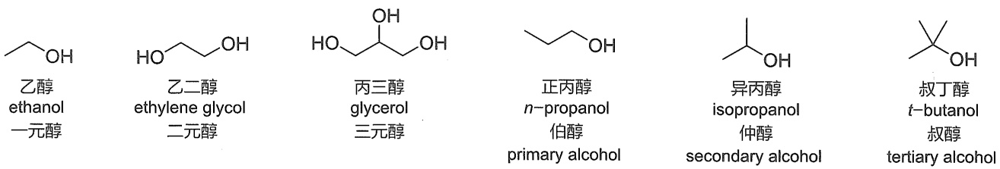

chemical

五种不同化学物质的结构式，包括乙醇、乙二醇、丙三醇、正丙醇、异丙醇和叔丁醇

醇羟基中的氧原子采取  $sp^{3}$  杂化，其中一个  $sp^{3}$  杂化轨道与氢原子的 1s 轨道形成  $\sigma$  键，一个与相邻碳原子的  $sp^{3}$  杂化轨道形成  $\sigma$  键，剩余两个  $sp^{3}$  杂化轨道由氧原子的两对孤对电子分别占据。由于氧原子采取了相同的杂化形式，醇与水的结构相似，醇亦可以看作水中的一个氢原子被烷基取代的化合物。以甲醇为例，C-O-H 键角为  $108.9^{\circ}$ ，近似于水分子的 H-O-H 键角  $104.5^{\circ}$ ；甲醇的偶极矩也与水类似，表现出较大的极性，常用作极性质子型溶剂（图 7-1）。

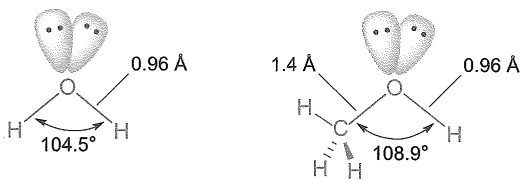

chemical

Molecular orbital diagrams showing bond angles and distances between oxygen and carbon atoms

图 7-1 水分子和甲醇分子的结构对比

## 7.1.2 醇的物理性质

羟基极大地影响了醇的物理性质。由于羟基可作为氢键供体或受体，醇分子之间可形成氢键，醇比相同骨架的烷烃有着更高的熔点和沸点。醇的同系物的沸点随着分子中碳原子数目的增多而升高，对于直链饱和一元醇，每增加一个  $CH_{2}$ ，沸点升高 18\~20℃。低级一元饱和醇在常温常压下为无色液体，含 4\~11 个碳原子的醇为油状液体，高级醇为无色固体。与烷烃类似，具有更多支链的醇的异构体具有更低的熔点和沸点。

除此之外，多元醇中羟基越多，其与周围分子可以形成的氢键也越多，熔点和沸点也更高。

羟基也可与水分子形成氢键，这影响了醇在水中的溶解度。甲醇、乙醇等低级一元饱和醇与乙二醇、丙三醇等多元醇均可与水任意比例互溶。随着碳链增长，醇在水中的溶解度不断降低。高级醇在室温下几乎不溶于水。

醇在强酸中溶解度较大，因为醇能与酸形成锌盐（oxonium salt），增加了溶解度。

氧的电负性大于碳和氢的电负性，C-O 键和 O-H 键都是极性键，因此醇是极性分子，偶极矩在 2 D 左右，甲醇的偶极矩为 1.7 D。

常见醇的物理性质见表 7-1。

表 7-1 常见醇的物理性质

| 醇 | 化学式 | IUPAC名称 | 熔点/°C | 沸点/°C | 相对密度 |
| --- | --- | --- | --- | --- | --- |
| 甲醇 | $CH_3OH$ | methanol | -97 | 64.7 | 0.792 |
| 乙醇 | $CH_3CH_2OH$ | ethanol | -115 | 78.4 | 0.789 |
| 乙二醇 | $HOCH_2CH_2OH$ | 1,2-ethanediol | -16 | 197 | 1.113 |
| 正丙醇 | $CH_3(CH_2)_2OH$ | 1-propanol | -126 | 97.2 | 0.804 |

---

7.2 醇的化学性质及反应

237

续表

| 醇 | 化学式 | IUPAC名称 | 熔点/°C | 沸点/°C | 相对密度 |
| --- | --- | --- | --- | --- | --- |
| 异丙醇 | $(CH_3)_2CHOH$ | 2-propanol | -88.5 | 82.3 | 0.786 |
| 烯丙醇 | $H_2C=CHCH_2OH$ | 2-propen-1-ol | -129 | 97 | 0.855 |
| 丙二醇 | $HOCH_2CH_2CH_2OH$ | 1,3-propanediol |  | 215 | 1.06 |
| 丙三醇 | $HOCH_2CH(OH)CH_2OH$ | 1,2,3-propanetriol | 18 | 290 | 1.261 |
| 正丁醇 | $CH_3(CH_2)_3OH$ | 1-butanol | -90 | 117.8 | 0.81 |
| 异丁醇 | $(CH_3)_2CHCH_2OH$ | 2-methyl-1-propanol | -108 | 107.9 | 0.802 |
| 二级丁醇 | $CH_3CH_2CH(CH_3)OH$ | 2-butanol | -114 | 99.5 | 0.808 |
| 叔丁醇 | $(CH_3)_3COH$ | 2-methyl-2-propanol | 26 | 82.5 | 0.789 |
| 正戊醇 | $CH_3(CH_2)_4OH$ | 1-pentanol | -79 | 138 | 0.817 |
| 环戊醇 | 环-$C_5H_9OH$ | cyclopentanol |  | 140 | 0.949 |
| 正己醇 | $CH_3(CH_2)_5OH$ | 1-hexanol | -52 | 155.8 | 0.82 |
| 环己醇 | 环-$C_6H_{11}OH$ | cyclohexanol | 24 | 161.5 | 0.962 |
| 苯甲醇 | $PhCH_2OH$ | phenylmethanol | -15 | 205 | 1.046 |
| 二苯甲醇 | $Ph_2CHOH$ | diphenylmethanol | 69 | 298 |  |
| 三苯甲醇 | $Ph_3COH$ | triphenylmethanol | 162.5 |  |  |

## 7.2 醇的化学性质及反应

醇羟基氧原子的电负性较大，O-H键容易异裂释放一个质子，体现其酸性；氧原子周围电子密度较大，可结合质子表现出碱性，也可与亲电试剂发生反应体现亲核性；氧原子的吸电子诱导效应使 $\alpha-C$ 具有正电性，可接受亲核试剂进攻；氧原子的吸电子诱导效应导致 $\alpha-H$ 具有一定酸性，可被氧化。

## 7.2.1 醇羟基的酸性

醇羟基中氧的电负性大于氢的电负性，共用的电子对偏向氧，因此O-H键可以异裂给出质子。醇的酸性与和氧相连的烷基的电子效应以及空间位阻相关。相连烷基的位阻越大，醇的酸性越弱。在溶液中，醇的酸性强弱顺序为甲醇 $>$ 伯醇 $>$ 仲醇 $>$ 叔醇。若醇的烷基上有吸电子基团，则醇的酸性增强。因为吸电子基团的诱导效应分散了醇负离子的负电荷，使醇的共轭碱更稳定，解离平衡更利于给出质子。例如，乙醇的 $\mathrm{pK_a}$ 为16，三氟乙醇（TFE）的$\mathrm{pK_a}$ 为12.5，六氟异丙醇（HFIP）的 $\mathrm{pK_a}$ 为9.3。当羟基直接连接芳香体系时，氧上的负电荷可以通过共轭效应离域，因此酚类化合物酸性通常强于脂肪醇的酸性（苯酚 $\mathrm{pK_a = 9.95}$）。

醇的酸性可以在与碱金属的反应中体现，金属钠可以与醇中的氢原子发生置换反应得到醇钠。反应的产物醇盐一般具有强碱性。醇盐也常用作亲核试剂:醇钠与卤代烃反应生成醚的反应称为Williamson醚合成法。因为醇的解离程度低于水，钠在醇中反应的剧烈程度也要比在水中更低。在实验室中，重蒸干燥溶剂过程中剩余的钠丝通常用冷的异丙醇猝灭，因为其酸性适中，反应可控。常见的强碱（如NaH、LDA、格氏试剂）能和醇羟基反应得到醇盐。

---

238

第七章 醇、酚和醚

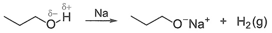

chemical

Chemical reaction equation showing hydrogenation of a cyclic ether with sodium salt to form an oxygenated alkene and water.

醇盐

## 7.2.2 醇的亲核性

醇的亲核性来源于羟基氧原子上的孤对电子，因此醇在酸性和碱性（醇盐形式）条件下均能表现出亲核性。醇可作为亲核试剂与含氧无机酸、酸酐和酰氯发生酯化反应，与酯发生酯交换反应，对极性不饱和键（醛、酮、 $\alpha,\beta-$ 不饱和羰基化合物、异氰酸酯等）进行亲核加成反应，与含易离去基的分子（卤代烃、磺酸酯等）发生亲核取代反应。伯醇与羧酸通过加成-消除机理或酰基阳离子机理发生的酯化反应也可体现醇的亲核性。例如，硫酸、磷酸等多元酸与乙醇1:1反应可以得到硫酸氢乙酯、磷酸单乙酯，而在醇过量的反应中，酸结构中其余羟基可以被全部酯化，生成硫酸二乙酯、磷酸三乙酯。

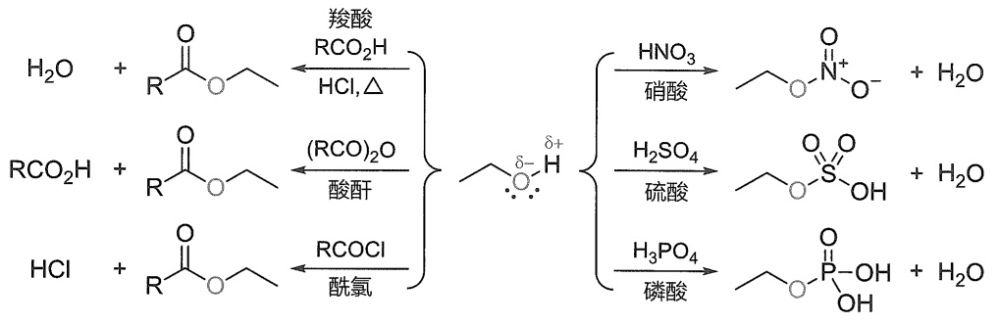

flowchart

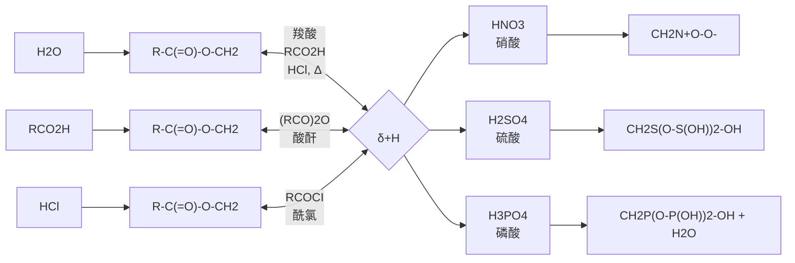

## 7.2.3 醇羟基的取代

与卤代烃不同，醇类化合物不能在碱性条件下直接被亲核试剂取代，原因有两方面:

（1）醇羟基在碱性条件下首先体现酸性，会直接与亲核试剂发生酸碱中和，产生的醇负离子更难被亲核取代。
（2）亲核取代的难易程度受离去基团的离去性能影响，而离去性能与离去基团的碱性负相关，碱性越强，离去能力越弱，亲核取代反应越难发生。直接取代醇羟基须离去强碱性的氢氧根负离子（$\mathrm{pK_a = 15.7}$），因此直接对醇羟基发生亲核取代相对困难，需要将其转化为更好的离去基团。

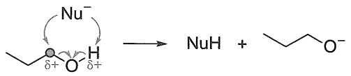

chemical

Chemical reaction mechanism showing nucleophilic substitution with sodium and oxygen groups

对醇羟基进行取代，一种简单可行的思路是酸性条件下的亲核取代:以氢卤酸为例，醇的氧原子具有 Lewis 碱性，可以结合酸提供的质子将氢氧根离去基团转化成中性的水分子（共轭酸  $H_{3}O^{+}$  酸性强， $pK_{a} = -1.7$ ），更容易离去，促进卤素离子的亲核取代。相比之下溴代烃取代产生的溴离子碱性很弱（共轭酸 HBr 酸性强， $pK_{a} = -9$ ）。

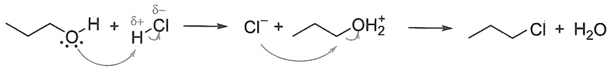

chemical

Chemical reaction equation showing hydrogenation of a chlorinated alkene to form an aldehyde and water

---

7.2 醇的化学性质及反应

239

在氢卤酸和醇制备卤代烃的反应中，醇的活性因结构而异:烯丙醇、苯甲醇、叔醇 > 仲醇 > 伯醇；酸的强度对反应速率也有影响:HI > HBr > HCl >> HF。

然而实际生产中用醇制备卤代烃不常采用强酸条件，其原因有两方面:

（1）伯醇以  $S_{N}2$  机理为主，反应速率慢，需要外加剧烈条件，限制了底物适用性。
(2) 仲醇、叔醇以 $S_{N}1$ 机理为主, 反应速率快, 但伴随副反应, 如消除和碳正离子重排。

尽管如此，醇在强酸性条件下的反应特性可以用于鉴别伯、仲、叔醇。其中最为著名的是于1930年发明的Lucas试剂。该试剂为浓盐酸和无水氯化锌的混合物。将三种醇分别加入上述试剂中，叔醇立即反应放热，生成氯代烷导致溶液分层；仲醇在几分钟内反应分层，但放热不明显；伯醇需加热才能反应。

伯醇、仲醇用  $SOCl_{2}$  氯化，用  $PBr_{3}$  溴化，用红磷和碘单质原位生成  $PI_{3}$  进行碘化。醇的卤化反应能将羟基转化为更好的离去基团，应用于亲核取代反应。

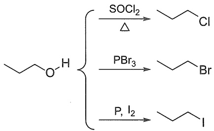

chemical

Chemical reaction scheme showing dehydration of a diol to chloroalkyl chloride, bromoalkyl bromide, and iodide using SOCl₂ and PBr₃

醇和亚硫酰氯  $SOCl_{2}$  的反应伴随着两种气体的生成，不仅有利于平衡向氯代烃移动，提高反应产率，而且反应体系中最终不存在其他副产物，便于纯化。实际操作通常使用过量  $SOCl_{2}$ （bp = 79 °C）并保持微沸。

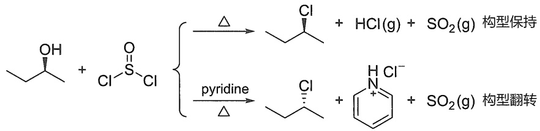

chemical

Chemical reaction equation showing chlorination of an aldehyde with sulfonate and pyridine under acidic conditions

该反应中醇对亚硫酰氯亲核进攻，脱掉一分子氯化氢得到氯代亚硫酸酯中间体。通过这一反应，醇羟基被转化为更易离去的氯代亚硫酸酯，并解离成紧密离子对。与  $S_{N}1$  机理不同的是，紧密离子对分解出  $SO_{2}$  的同时，氯离子结合碳正离子，生成构型保持的产物。实验证明，低温下可以从反应体系分离得到氯代亚硫酸酯中间体，并且对中间体再次加热可以得到构型保持的氯代烃，从而为上述机理提供了实验证据。该结果如同在氯代亚硫酸酯分子内发生了亲核取代，因此称为  $S_{N}i$  (i = intramolecular) 机理。

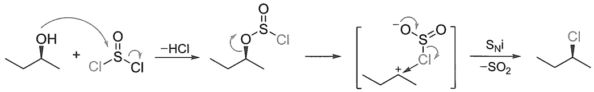

chemical

Chemical reaction mechanism showing sulfonation and deprotonation steps with reagents like HCl, SO2, and SNIi

紧密离子对

在反应中加入弱亲核试剂吡啶（或三级胺）可以得到构型翻转的产物。这一结果是吡啶对氯代亚硫酸酯发生取代反应产生的氯离子，与活性中间体发生  $S_{N}2$  反应导致的。

---

240

第七章 醇、酚和醚

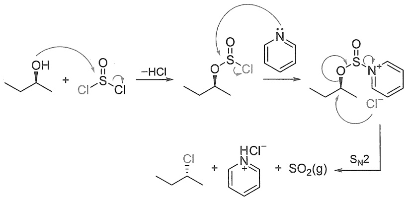

chemical

Reaction mechanism showing sulfonation and deprotonation steps with reagents like HCl, N-methylbenzene, and SO2(g)

$\mathrm{SOBr}_2$ 不稳定，所以溴代试剂常用 $\mathrm{PBr}_3$ ，其反应机理也是通过醇羟基对杂原子的亲核取代，将其转化为良好的离去基团- $\mathrm{OPBr}_2$ 。产物 $\mathrm{HOPBr}_2$ 的两个溴原子还可以继续和醇反应，因此反应中醇和 $\mathrm{PBr}_3$ 的化学计量比是 $3:1$ 。

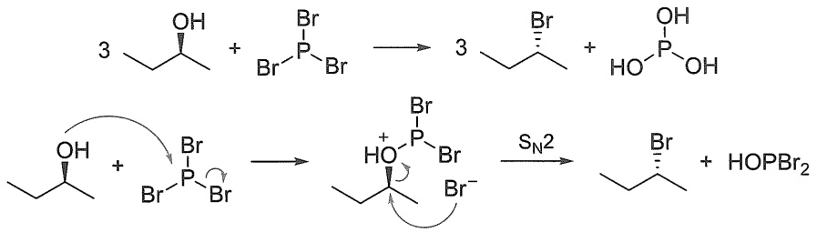

chemical

Reaction mechanism diagram showing phosphorus-catalyzed cyclization of a phosphonium compound with hydroxyl and bromoalkyl groups

对于碘化反应，$\mathrm{PI}_3$ 不能长时间稳定存在，所以通常用红磷和碘单质原位生成。磷的化合物也可用于氯化反应，但 $\mathrm{PCl}_5$ 和醇 $1:1$ 反应产生的 $\mathrm{POCl}_3$ 不能继续发生氯化反应，原子经济性不如 $\mathrm{SOCl}_2$ 。实际操作中，易重排的伯、仲醇用 $\mathrm{PX}_3$ 卤化的温度须低于 $0^{\circ}\mathrm{C}$ 以避免副反应。

$$
\mathrm{CH} _ {\mathrm{O}} ^ {-} \mathrm{H} \xrightarrow {\mathrm{PCl} _ {5}} \mathrm{CH} _ {\mathrm{Cl}} + \mathrm{HCl} + \mathrm{POCl} _ {3}
$$

以上方法仅能将醇转化为卤代烃，实际应用中如需对醇进行多样的官能团转化（diversification），通常用醇和磺酰氯（或磺酸酐）制备较稳定的磺酸酯（sulfonate），从而将羟基转化为好的离去基团（虚线框所示）磺酸根 $\mathrm{RSO}_3^-$ （共轭酸 $\mathrm{MeSO}_3\mathrm{H}\mathrm{pK_a} = -2.6$），并能和多种亲核试剂发生取代反应。磺酸酯的结构多样，可以通过改变硫原子上的取代基调节反应活性。常用的磺酸酯包括甲磺酸酯（R-OMs）和对甲苯磺酸酯（R-OTs）。

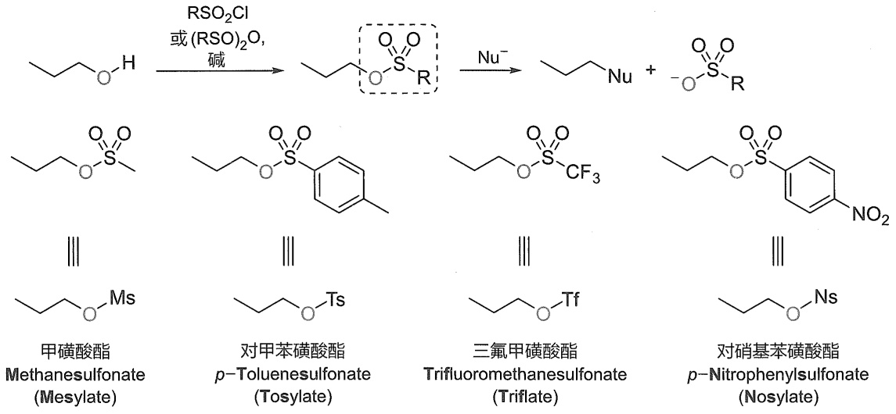

flowchart

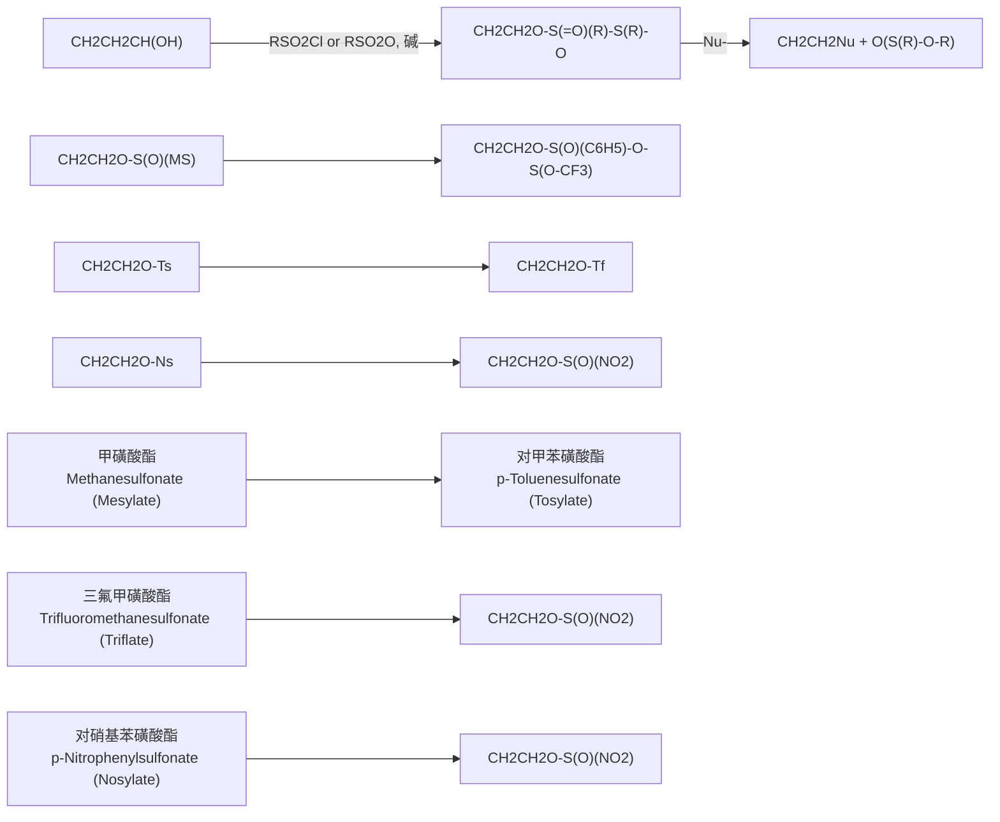

---

7.2 醇的化学性质及反应

241

硫原子上连接吸电子基团使磺酸根离子更稳定，从而增强离去性能，如 $\mathrm{TfO}^{-}$（$\mathrm{CF_3SO_3^-}$，三氟甲烷磺酸根，共轭酸 $\mathrm{TfOHpK_a = -14}$），因此三氟甲磺酸酯（R-OTf）、对硝基苯磺酸酯（R-OpNs）可以作为更活泼的中间体发生亲核取代。但磺酸酯作为高活性的亲电试剂，可以对遗传物质中的含氮碱基（亲核试剂）进行烷基化，因此具有强致癌性（碘甲烷亦然），实际操作须注意防护。

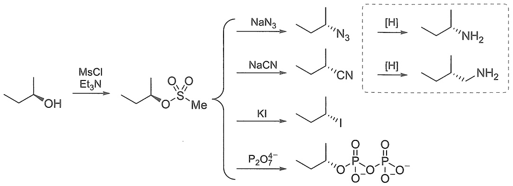

chemical

Chemical reaction pathway showing sulfonation of an enol to form a sulfonamide, followed by subsequent enzymatic reactions with reagents and conditions.

醇转化为磺酸酯再进行亲核取代虽需两步反应，但优势在于由同一中间体发散合成多种取代产物。例如用叠氮化钠进行取代，得到的叠氮化合物可进一步还原成胺；用氰化钠取代得到腈，可进一步还原为增长一个碳的脂肪胺；用碘化钠取代可以得到碘代烃；用弱亲核试剂如焦磷酸盐也能得到取代产物。转化过程中，伯、仲醇底物通常经历 $\mathrm{S_N2}$ 途径，得到立体专一的构型翻转产物，常用于手性分子合成。磺酸酯用 $\mathrm{LiAlH_4}$ 还原可以得到烷烃；在强碱存在下（如醇钠），则消除得到烯烃。磺酸酯的转化丰富了醇在有机合成中的应用。

## 7.2.4 醇的消除反应

醇可以发生分子内消除，脱一分子水得到烯烃。在酸性条件下对醇进行质子化脱水，然而该条件下通常发生碳正离子重排，因为碳正离子的  $\alpha-$  去质子化相对较慢。酸性条件下脱水由易到难的顺序为叔醇 > 仲醇 > 伯醇，且区域选择性符合 Saytzeff 规则，生成连有较多取代基的反式烯烃或共轭烯烃，主要得到稳定的热力学产物。

为防止发生重排，应选用无碳正离子生成的途径。前文提到，醇由酯化反应得到的磺酸酯是良好的离去基团，在碱性条件下通过E2机理进行消除，可得到未重排的烯烃。除磺酸酯外，更常用的体系是三氯氧磷 $\mathrm{POCl}_3$ -吡啶，在温和条件下，对大位阻的仲、叔醇脱水。该反应的机理如下:醇的氧原子进攻 $\mathrm{POCl}_3$ ，亲核取代生成二氯磷酸酯（dichlorophosphate），二氯磷酸根离去性能良好，能在弱碱吡啶存在下发生E2反应。

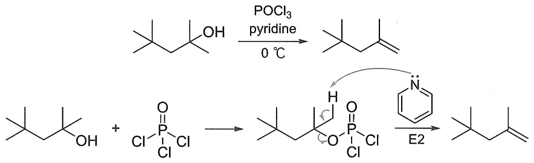

chemical

Chemical reaction scheme showing phosphorus-catalyzed cyclization of a diol to form a chlorinated ester, with pyridine and E2 reagents indicated

二氯磷酸酯

---

242

第七章 醇、酚和醚

该反应受去质子化步骤的位阻控制，主要生成取代较少的烯烃，因此不符合 Saytzeff 规则。该体系不适用于位阻较小的伯醇，因为氯离子  $S_{N}2$  反应与 E2 反应存在竞争。

## 7.2.5 醇的氧化反应

醇羟基的取代反应可以用于合成多种化合物，但局限于氧化态相同的官能团。表7-2总结了常见官能团的氧化态，表中从左到右的化合物转化通常经历了脱氢或加氧，碳原子的氧化态升高，发生了氧化反应。例如，乙烷-乙烯-乙炔的转化、甲醇-甲醛-甲酸-二氧化碳的转化、甲烷-氯甲烷-二氯甲烷-氯仿-四氯化碳的转化、乙胺-乙醛亚胺-乙腈的转化，每步都经历了氧化反应。不同结构的醇可以被选择性地氧化为醛、酮或羧酸。

表 7-2 常见有机化合物的碳原子氧化态

<table><tr><td rowspan="2">化合物</td><td colspan="9">C氧化态</td></tr><tr><td>-4</td><td>-3</td><td>-2</td><td>-1</td><td>0</td><td>+1</td><td>+2</td><td>+3</td><td>+4</td></tr><tr><td>烃类</td><td> $CH_4$ </td><td> $CH_3CH_3$ </td><td> $H_2C=CH_2$ </td><td>RHC=CHRHC≡CH</td><td> $R_2C=CR_2RC≡CR$ </td><td></td><td></td><td></td><td></td></tr><tr><td>卤代烃</td><td></td><td></td><td> $CH_3X$ </td><td> $CH_3CH_2X$ </td><td> $CH_2X_2$ </td><td> $CH_3CHX_2$ </td><td> $CHX_3$ </td><td> $CH_3CX_3$ </td><td> $CX_4$ </td></tr><tr><td>含氧化合物</td><td></td><td></td><td> $CH_3-OH$ </td><td> $CH_3CH_2-OH$ </td><td> $(CH_3)_2CH-OH$  $H_2C=O$ </td><td> $CH_3CH=O$ </td><td> $(CH_3)_2C=O$  $HCO_2H$ </td><td> $CH_3CO_2H$ </td><td>O=C=O</td></tr><tr><td>含氮化合物</td><td></td><td></td><td> $CH_3-NH_2$ </td><td> $CH_3CH_2-NH_2$ </td><td> $CH_2=NH$ </td><td> $CH_3CH=NH$ </td><td> $HC≡N$ </td><td> $CH_3C≡N$ </td><td>RN=C=NR</td></tr></table>

常见氧化剂包括高价金属氧化物，如铬酸（$\mathrm{Cr}^{\mathrm{VI}}$）、铬酐（$\mathrm{CrO_3}$）-吡啶络合物（$\mathrm{Cr}^{\mathrm{VI}}$）、高锰酸钾（$\mathrm{Mn}^{\mathrm{VII}}$）、二氧化锰（$\mathrm{Mn}^{\mathrm{IV}}$）、四乙酸铅（$\mathrm{Pb}^{\mathrm{IV}}$）；也包括高氧化态的主族化合物，例如次氯酸钠（$\mathrm{Cl}^{\mathrm{I}}$）、高碘酸盐（$\mathrm{I}^{\mathrm{VII}}$）、Dess-Martin 试剂（DMP）（$\mathrm{I}^{\mathrm{V}}$）、二甲亚砜（$\mathrm{S}^{\mathrm{IV}}$）。

仲醇在酸性条件下能被重铬酸盐氧化成酮，形式上可以理解为醇的氧原子上一对电子转移到  $Cr^{VI}$  上（蓝色所示），且碳原子和氧原子上各失去一个质子。反应机理如下:醇和原位生成的铬酸发生配体交换得到铬酸酯，脱一分子水，不涉及氧化还原；亚铬酸根是好的离去基团，带走醇的氧原子上一对电子被还原，同时对醇  $\alpha-$  去质子化，发生 1,2-消除生成酮。

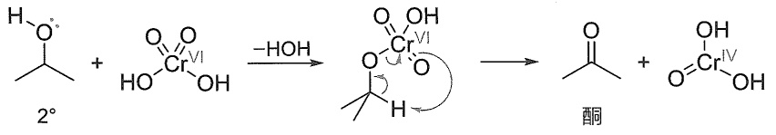

chemical

Reaction mechanism showing oxidation of a chromium complex to form a ketone and an aldehyde

伯醇在酸性条件下能被重铬酸盐氧化得到羧酸，氧化过程中先生成醛，然后进一步氧化成酸；仲醇氧化得到酮，在此条件下比较稳定；叔醇没有 $\alpha$-H不能被氧化。因此可以用清澈的铬酸水溶液鉴定醇:伯、仲醇可以被氧化并产生 $\mathrm{Cr}^{\mathrm{III}}$ ，体系变为不透明的蓝绿色；叔醇及烯烃、炔烃不反应，溶液保持橙黄色。但剧烈条件下，过量铬酸会断裂双键成酮或酸。

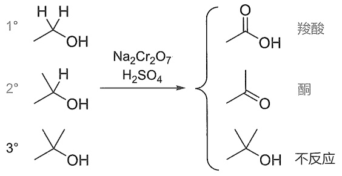

chemical

Reaction equation showing oxidation of aldehyde to form acetic acid and ketone under Na2Cr2O7/H2SO4 conditions

---

7.2 醇的化学性质及反应

243

铬酸水溶液对醇的氧化反应在合成中的应用有限，因其氧化能力较强，对官能团的选择性差，多数有机分子也难溶于水。而且该条件下无法得到醛，因此后续发展了多种温和的高价铬试剂，用于伯醇氧化成醛，仲醇氧化成酮。其中最常用的 PCC(pyridinium chlorochromate) 试剂研制于 1975 年，又称 Corey-Suggs 试剂。该试剂具有酸性，不吸潮，易溶于有机溶剂，可在温和条件下（通常为室温）氧化伯醇成醛、仲醇成酮，且双键、叁键不受影响。实际操作中需加入硅藻土（celite）吸附反应产生的铬盐，后处理通常只需过滤后蒸干溶剂。

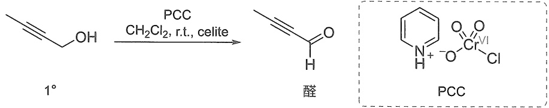

与铬的氧化物类似，强氧化剂  $KMnO_{4}$  的水溶液在碱性条件下能氧化伯醇成羧酸盐；仲醇能在该条件下被氧化成酮，但容易进一步氧化断裂碳碳键，因此合成中应用有限。而高锰酸钾与硫酸锰新制的  $MnO_{2}$ ，能在室温下选择性氧化烯丙醇，生成共轭烯醛/烯酮。

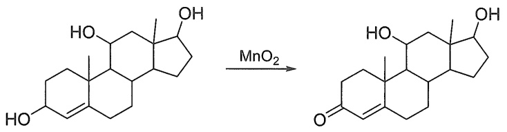

chemical

Chemical reaction showing oxidation of a steroid derivative with MnO2 to form a fused ring system

高价金属氧化物用于醇氧化反应的主要缺点在于大量产生剧毒的重金属盐，不利于环保。近年来相对清洁廉价的主族元素氧化剂得到了广泛应用。家用漂白剂（bleach）作为一种廉价易得的化工原料，也是常用的氧化剂，其主要成分为次氯酸钠水溶液，可以在中性条件下氧化伯醇成醛、仲醇成酮。相比于PCC试剂，NaOCl更适用于氧化对酸敏感的底物，且反应副产物为氯化钠水溶液，属于对环境友好的绿色化学方法。卤族元素中，碘的高氧化态化合物作为氧化剂也得到了充分发展，其中最常用于醇氧化的是研制于1983年的五价碘试剂Dess-Martin Periodinane（DMP），能氧化伯醇成醛、仲醇成酮。

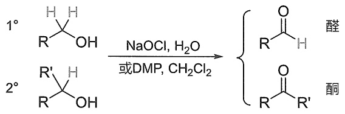

chemical

Chemical reaction equation showing oxidation of aldehyde to ketone under NaOCl and DMP conditions

DMP 氧化反应机理与铬酸氧化类似:伯醇和五价碘发生配体交换，五价碘离去并带走伯醇氧原子上的一对电子，被还原为三价碘（蓝色所示），同时乙酸根从碘中心离去，并结合伯醇的  $\alpha-H$ ，醇的 C-O 键上发生 1,2-消除得到醛。DMP 氧化反应的副产物包括两分子乙酸，因此对酸敏感的底物需要在反应体系中额外加入缚酸剂。DMP 氧化对底物具有优越的选择性，伯醇和仲醇同时存在的情况下先氧化伯醇，原因在于五配位的碘中心较为拥挤，其配体交换受位阻影响较大。DMP 氧化的优势在于条件温和、操作简易、反应迅速，而且对水不敏感，体系里额外加入一当量水能促进氧化反应。

---

244

第七章 醇、酚和醚

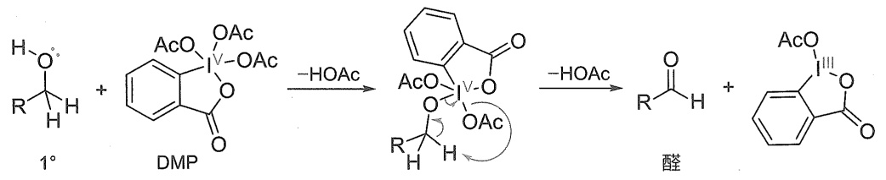

chemical

Reaction mechanism showing DMP-mediated oxidation of a ketone to form a醛 intermediate

氧化反应在20世纪70年代发展迅速，其中包括多种用二甲亚砜作氧化剂的策略。二甲亚砜（dimethyl sulfoxide，DMSO）作为一种廉价、低毒、沸点较高的极性非质子溶剂，对大部分极性有机物有良好的溶解性，在化工行业中广泛用作反应介质。DMSO因为分子中的四价硫而具有氧化性，而且DMSO存在电荷分离的极性共振式，其氧原子具有亲核性。Swern氧化报道于1978年，通过加入DMSO、草酰氯和三级胺，可以在低温下氧化伯醇成醛、仲醇成酮，因其原料易得、反应温和而沿用至今，常作为替代PCC的较环保氧化方法。

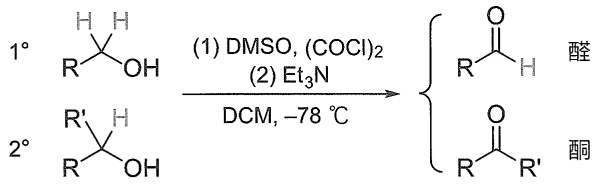

chemical

Chemical reaction equation showing conversion of aldehyde to ketone under DMSO and Et3N conditions at 78°C

Swern 氧化的机理如下:DMSO 对草酰氯进行亲核加成-消除，释放的氯离子和硫亲电中心发生  $S_{N}2$  反应，生成氯代硫镝离子（chlorosulfonium ion）；醇对氯代硫镝离子亲核取代生成烷氧基硫镝离子（alkoxysulfonium ion），该中间体被三级胺去质子化，生成硫叶立德（sulfurylide）；硫叶立德通过五元环过渡态分子内消除二甲硫醚（DMS）得到羰基。实验中反应体系须严格控温，以减少副反应。DMS 气味难闻，后处理时须在通风橱内操作。

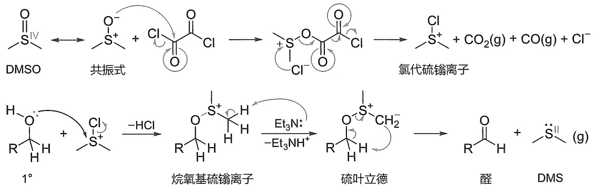

如需氧化对酸敏感的仲醇，可以采用反应条件为碱性的 Oppenauer 氧化:仲醇在催化量的异丙醇铝存在下，可以被羰基化合物（如丙酮、二苯甲酮等）氧化成酮，反应机理如下:仲醇对异丙醇铝发生配体交换，随后络合一分子酮经历环状过渡态的负氢转移。因为各步基元反应均可逆，通常需要通过加入过量酮实现平衡向仲醇氧化的方向移动。伯醇在该条件下可以被氧化成醛，但存在羟醛缩合副反应，应用较少。

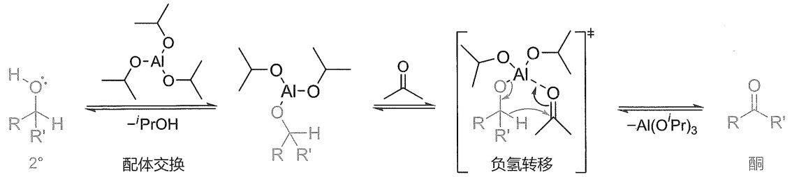

chemical

Chemical reaction mechanism showing aluminum-aluminum complex formation and dehydration steps with reagents labeled

---

7.3 碳正离子及其重排反应

245

多元醇具有醇的共性，还能发生独特的氧化反应，例如邻二醇与高碘酸水溶液反应，可以氧化裂解成醛、酮。反应机理为邻二醇与高碘酸形成五元环状酯中间体，并分解成醛、酮和碘酸根。邻二醇和高碘酸反应的化学计量比为 $1:1$ 。相邻羟基的三元醇经过一分子高碘酸氧化裂解得到相应的 $\alpha-$ 羟基醛或酮后，还能继续反应，与另一分子高碘酸形成五元环状酯中间体，最终得到一分子酸和两分子醛、酮。多元醇的反应以此类推，反应消耗的高碘酸当量等于多元醇分子断裂的C-C键数量。这一规律可用于推断未知多元醇的结构。类似结构的 $\alpha-$ 羟基酸、 $\alpha-$ 氨基醇、 $\alpha-$ 氨基酮、 $\alpha-$ 二酮都可以发生该反应。四乙酸铅的醋酸溶液可以通过形成环状酯中间体发生类似的氧化反应，可与高碘酸作为互补，用于多元醇的结构分析。

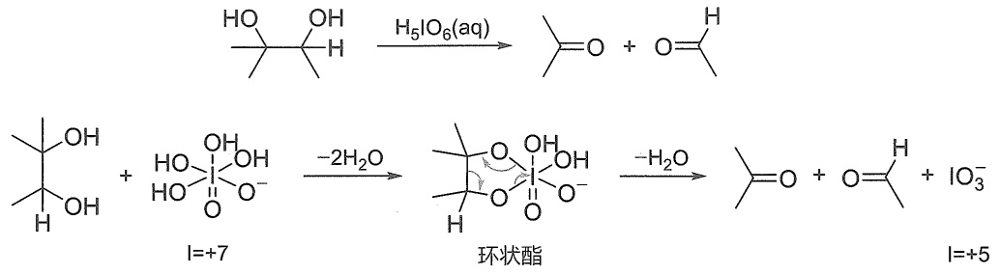

chemical

Chemical reaction equation showing the synthesis of a cyclic ester from poly(1,2-dimethyl)ol and its isocyanate under acidic conditions

## 7.2.6 醇羟基的保护

在合成中为了防止醇羟基发生各种副反应，可采取不同的策略对其进行保护，考虑到易于脱除的特性，主要用到的保护基有如下四类:醚类、硅醚类、缩醛类、酯类。多元醇可以考虑与苯甲酮或丙酮形成缩酮实现保护。其中硅基保护的策略最为常见。在弱碱存在下，醇可以对三甲基氯硅烷（chlorotrimethylsilane，TMSC1）进行硅原子上的 $\mathrm{S_N2}$ 反应，得到相对惰性的三甲基硅基醚，掩蔽了醇羟基的酸性和亲核性。TMS保护基在较强的酸性水溶液中或氟离子存在下可以发生脱保护，释放出自由羟基的醇。

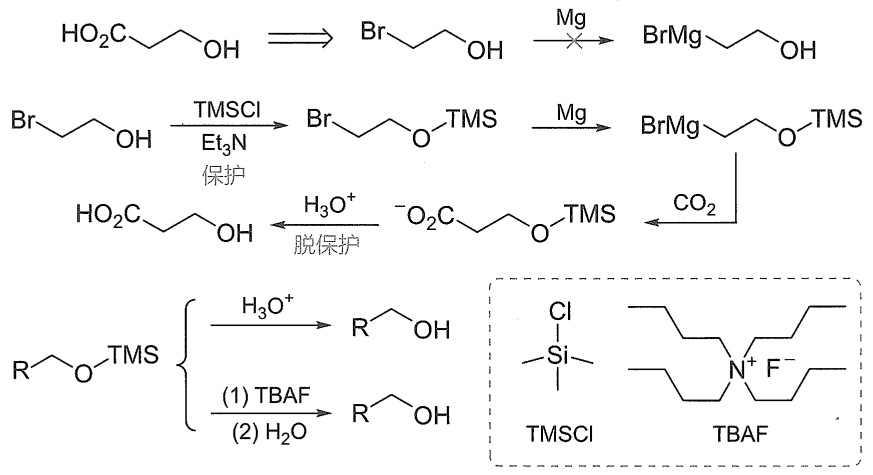

flowchart

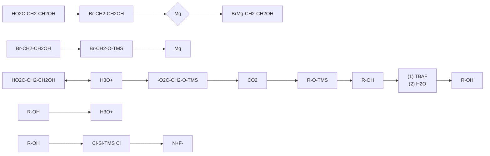

## 7.3 碳正离子及其重排反应

## 7.3.1 碳正离子的结构特性和产生方式

19 世纪中期化学家对有机反应的理解局限于简单反应,例如 Auguste Laurent 提出了“最小结构变化”原则来解释取代反应中亲核试剂占有了原先离去基的位置、消除反应中碳骨架

---

246

第七章 醇、酚和醚

保持不变等现象。然而 19 世纪末发现的两类碳正离子的重排反应改变了原有的观点:Fittig 于 1860 年发现的频哪醇（pinacol）重排，以及 1899 年发现的 Wagner-Meerwein 重排。

碳正离子（carbocation）是带正电荷的三价碳原子的原子团，其中带正电荷的碳原子采取  $sp^{2}$  杂化，3 个  $\sigma$  键构成平面三角形。中心碳原子上还有一个空的 p 轨道垂直于该平面。碳正离子是缺电子的亲电试剂，可以被亲核试剂进攻，大多不能稳定存在，因此在反应中通常作为高能量的中间体。

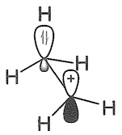

$\sigma - p$ 超共轭

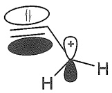

p-π共轭

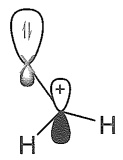

n-p相互作用

相邻基团的电子云能以三种形式与碳正离子的空轨道交叠，分散正电荷稳定碳正离子:

（1）烷基碳正离子的 C-H 键能与空的 p 轨道产生 σ-p 超共轭效应，所连烷基取代越多，超共轭效应越强，碳正离子越稳定: $R_{3}C^{+}>R_{2}CH^{+}>RCH_{2}^{+}>CH_{3}^{+}$ 。
（2）与共轭体系相连的碳正离子可以通过 $p-\pi$ 共轭使电子离域，增强稳定性，因此烯丙基碳正离子和苄基碳正离子比烷基碳正离子稳定。而环丙甲基正离子比苄基正离子稳定，因为环丙基的弯曲轨道类似 $\pi$ 键，与碳正离子的p轨道充分交叠。中心碳原子所连共轭体系或环丙基越多，碳正离子越稳定。共轭体系连有给电子基团时，碳正离子更稳定: $p-CH_{3}PhCH_{2}^{+}>PhCH_{2}^{+}$ 。
(3) 直接与杂原子相连的碳正离子与杂原子上的孤对电子发生 n-p 相互作用, 提高稳定性。

碳正离子的空 p 轨道能量较高，而轨道能量越相近，相互作用越强，因此三种相邻基团与空的 p 轨道作用强弱为  $n > \pi > \sigma$ ，与 n 非键轨道  $>\pi$  成键轨道  $>\sigma$  成键轨道的能量顺序一致。

产生碳正离子的方式通常有三种:① 化学键异裂直接离子化，如溴代烃中溴离子离去产生碳正离子。② 带正电荷的亲电试剂对不饱和键的加成，如质子与烯烃反应得到碳正离子。③ 通过其他正离子转化，如伯胺氧化成重氮盐，分解释放  $N_{2}$  得到碳正离子。

酸性条件下醇的E1反应通常经历碳正离子中间体:醇羟基被质子化，转变为好的离去基团 $\mathrm{H}_2\mathrm{O}$，并通过C-O键异裂得到碳正离子中间体，$\beta -\mathrm{C}$ 去质子化并给出一对电子，生成烯烃。酸性条件下脱水的反应速率顺序为叔醇 $>$ 仲醇 $>$ 伯醇，与生成的碳正离子稳定性相关。

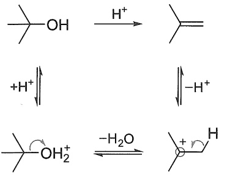

chemical

Hydrolysis reaction mechanism of ethanol to form aldehyde and water, with H+ and -H+ conditions

$3^{\circ}$ 碳正离子

消除产物烯烃存在顺反异构体的情况下，主产物为 E 型。在碳正离子  $\alpha-$  去质子化的过渡态中，C-H 键必须和碳正离子空的 p 轨道重叠才能给出一对电子生成 C=C 双键，对过渡态的构象分析可知，生成 Z-烯烃的过渡态有额外的烷基排斥作用，能量更高，因此生成 E-烯烃的过渡态更有利。

---

7.3 碳正离子及其重排反应

247

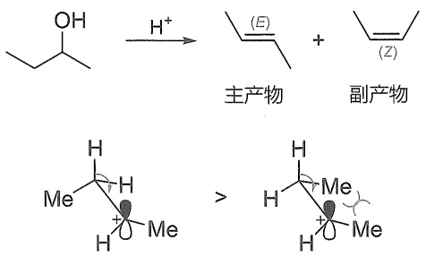

chemical

Chemical reaction equation showing oxidation of an aldehyde to form a methyl group and its subsequent formation from a substituted alkene

## 7.3.2 碳正离子的重排反应

在酸性条件下，3,3-二甲基丁-2-醇转化为2,3-二甲基丁-2-烯的现象无法用常规的E1机理解释，为此Wagner和Meerwein提出了碳正离子重排机理:不稳定的碳正离子会发生重排，得到一个更稳定的碳正离子。3,3-二甲基丁-2-醇脱水生成 $2^{\circ}$ 碳正离子，在邻位为季碳时，$\alpha-$ 甲基发生[1,2]-烷基迁移，生成更稳定的 $3^{\circ}$ 碳正离子，随后去质子化生成四取代的烯烃产物。反应体系酸性越强，越容易得到重排产物，因为碳正离子的 $\alpha-$ 去质子化更慢，碳正离子的寿命更长，有充分时间发生重排。

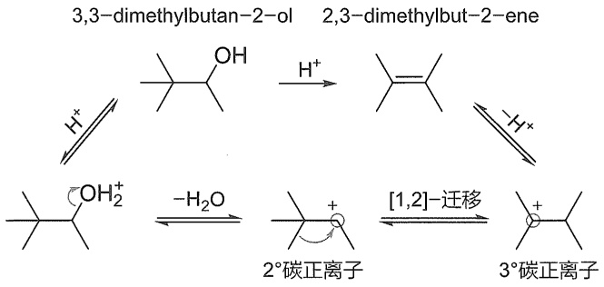

chemical

Reaction mechanism diagram showing hydrogenation and rearrangement steps of 3,3-dimethylbutan-2-ol and 2,3-dimethylbut-2-ene to form 2° and 3° carbon monomers with water and electron transfer.

[1,2]-迁移属于周环反应，遵循 Woodward-Hoffmann 规则:[1,2]-迁移反应经过的过渡态为拐角-质子化的环丙烷，为 2 电子的环状过渡态，由迁移基团的 σ 成键轨道和碳正离子空的 p 轨道发生重叠形成，具有休克尔芳香性，因此发生同面（suprafacial）迁移。若迁移基团有手性，则迁移过程中构型保持。

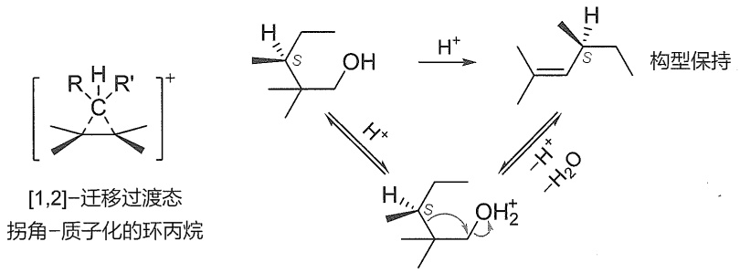

chemical

Chemical reaction mechanism showing [1,2]-迁移过渡态，拐角-质子化的环丙烷

频哪醇重排是邻二醇特有的反应，在酸性条件下脱水重排得到醛或酮。反应机理与Wagner-Meerwein重排类似，经历羟基质子化离去生成碳正离子，但重排的驱动力不再是生成更稳定的碳正离子:频哪醇重排的碳正离子发生[1,2]-迁移时，正电中心从6电子的碳转移到 $\alpha-$ 羟基，变为8电子的氧，生成比碳正离子更稳定的锌盐离子，经去质子化得到产物醛或酮。

---

248

第七章 醇、酚和醚

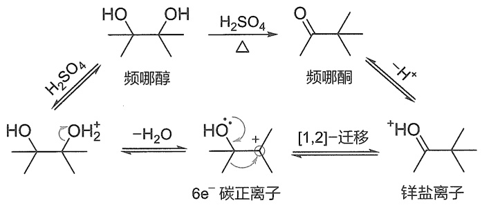

chemical

Chemical reaction pathway showing the conversion of cyclohexanol to phenol via sulfuric acid and sodium chloride, involving intermediates like 6e⁻ and [1,2]-

若底物为不对称取代的邻二醇，不同羟基离去可能得到两种产物，反应对二者的选择性与羟基离去生成的碳正离子稳定性正相关。例如，1,1-二苯基乙二醇在酸性条件下可以重排得到醛或酮的产物，连有苯基取代的叔醇脱水得到 $3^{\circ}$ 碳正离子，稳定性大于伯醇脱水生成的 $1^{\circ}$ 碳正离子，因此主要产物为 $3^{\circ}$ 碳正离子经过[1,2]-H迁移得到的醛。

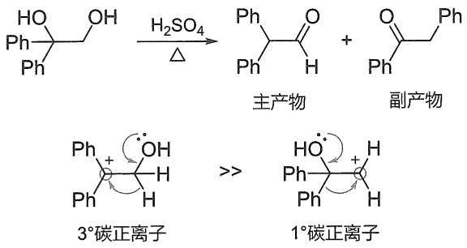

chemical

Chemical reaction equation showing conversion of 3° and 1° carbon monomers to form a mixture of main and secondary products

若生成的碳正离子的 $\alpha$-取代基不同，迁移基团的优先级取决于基团给电子的能力:

$$
\mathrm{H} > \text {苯基} > \text {叔烷基} > \text {仲烷基} > \text {伯烷基} > \text {甲基}
$$

若  $\alpha-$  取代基为不同取代的芳基，迁移速率与芳香体系的富电子程度正相关:

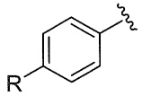

| R | MeO | Me | Ph | H | Cl |
| --- | --- | --- | --- | --- | --- |
| 相对迁移速率 | 500 | 16 | 12 | 1 | 0.7 |

实际合成中，为避免受不同羟基离去的区域选择性影响产率，可采用Tiffeneau-Demjanov重排，用亚硝酸氧化 $\alpha-$ 氨基醇得到重氮盐（diazonium），将氨基转化为好的离去基团 $N_{2}$ ，从而在特定位点产生碳正离子。该反应常用于氨甲基取代的4\~8元环脂肪醇，经扩环重排得到多一个碳的环酮产物。若底物不对称，则产物分布受基团迁移顺序控制。

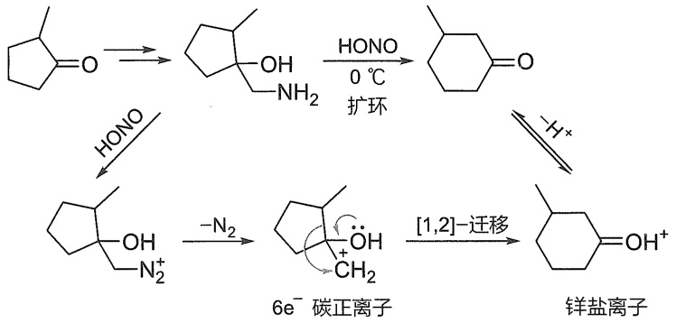

flowchart

若氨基位于环内，可以通过重排得到缩环产物。但环状结构的构象不能发生自由旋转，而[1,2]-迁移反应可以与基团离去的步骤协同发生，因此仅当迁移基团和离去基团处于反式

---

7.3 碳正离子及其重排反应

249

共平面（antiperiplanar）时，重排速率最快，此情境下的产物分布受底物空间构型控制。

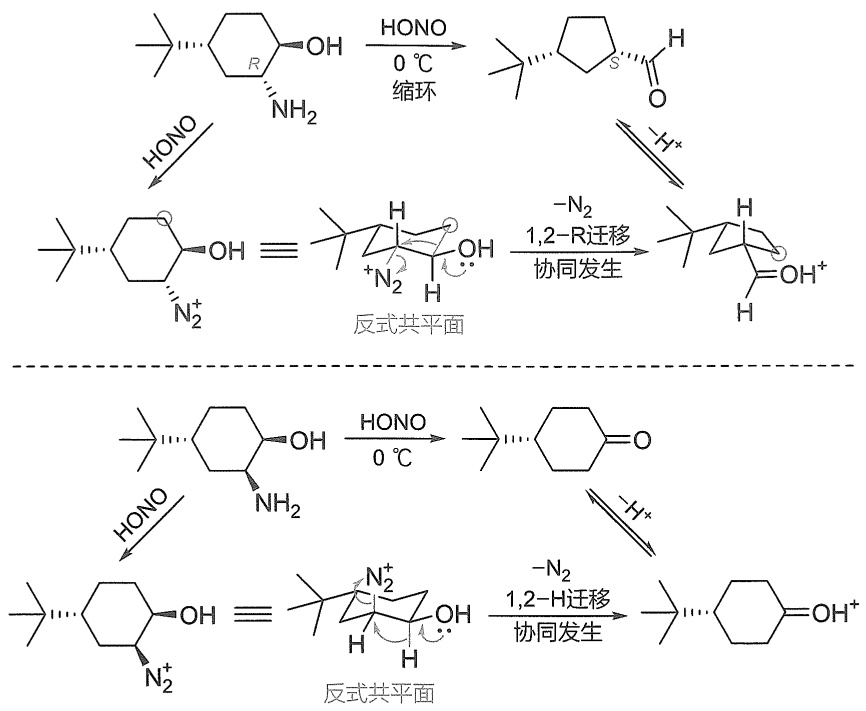

报道于 1963 年的 Meinwald 重排通过类似机理发生: 酸性条件下环氧化合物开环得到  $\alpha-$  羟基-碳正离子，并重排成锌盐，去质子化后得到醛或酮产物。T-D 重排与 Meinwald 重排虽不属于邻二醇的反应，但因机理相似，称为类频哪醇重排（pinacol-type rearrangement）。

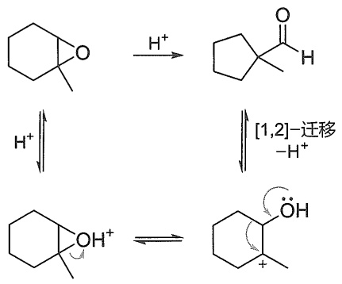

chemical

Chemical reaction mechanism showing protonation and deprotonation steps of a cyclohexanone derivative

一般情况下，碳正离子为平面结构，亲核试剂能从其任意一面进攻，因此手性碳原子经 $S_{N}1$ 反应，会发生外消旋化（racemization）并得到两种互为对映异构体的产物。若底物带有两个及两个以上手性中心，且其中一个手性碳原子经 $S_{N}1$ 反应，会得到一对非对映体的混合物，这种转化称为差向异构化（epimerization）。

然而对于邻基参与的碳正离子反应，手性构型有时得以保留。例如，手性的反式邻碘环己醇分子，在酸性条件下生成环状碘镝离子（iodonium）并发生构型翻转，该中间体与亲核试剂发生 $S_{N}2$ 反应构型再次翻转，最终得到构型保持的取代产物。其他有孤对电子的基团如Br、N、S、碳碳双键等，若空间构型适合，也能产生类似的邻基效应。

---

250

第七章 醇、酚和醚

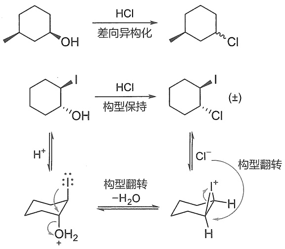

chemical

Chemical reaction pathway showing chlorination and structural rearrangement steps of a cyclohexane derivative

## 7.4 醇的制备

## 7.4.1 还原反应

氢化铝锂、硼氢化钠、硼烷、活泼金属等还原剂可以将醛、酮、羧酸衍生物还原成醇。其中氢化铝锂可以直接还原酯到伯醇，也可还原醛、酮。而硼氢化钠相对温和，不与酯反应，可用于选择性还原醛到伯醇、还原酮到仲醇。

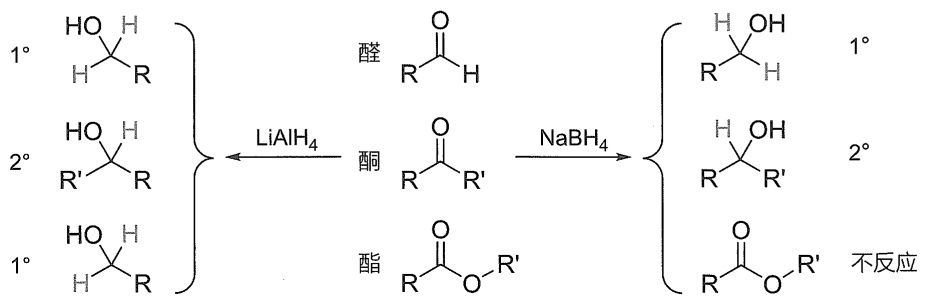

chemical

Reaction mechanism diagram showing alkene and aldehyde converting to carbonyl compounds under LiAlH4 and NaBH4 conditions

## 7.4.2 亲核试剂对含氧亲电试剂加成

常见的金属有机化合物如格氏试剂和有机锂试剂能通过极性的  $\sigma$  键电子与亲电试剂反应，其中的正电荷集中于金属，负电荷集中于碳原子，可等效于碳负离子作亲核试剂。此类亲核试剂能对亲电的羰基化合物发生加成反应，得到的烷氧基卤化镁或烷氧基锂中间体可经酸化后处理得到相应的醇。

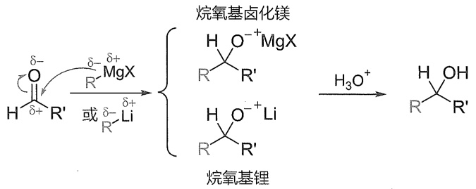

chemical

Reaction mechanism showing hydrogenation of a ketone to form lithium using MgX and Li, with H3O+ as intermediate

格氏试剂和有机锂试剂都具有强碱性和还原性，因此在制备及使用过程中，反应体系应

---

7.4 醇的制备

251

处于严格的无水无氧条件，否则会猝灭试剂。若羰基化合物的酸性强于亲电性，加入格氏试剂或有机锂试剂只能发生去质子化而无法得到醇，如1,3-二羰基化合物。

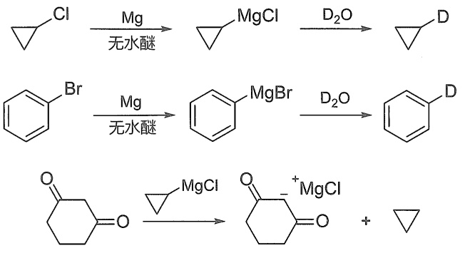

chemical

Organic synthesis reaction pathway showing chlorination, bromination, and deprotection steps with MgCl and D2O reagents

格氏试剂和有机锂试剂通过对醛酮的加成，可以得到结构多样的醇，比金属有机试剂原有的烃基增加一个碳原子。与甲醛反应得到增加一个碳原子的伯醇；与醛反应在增加一个碳原子的基础上得到仲醇；与酮反应得到叔醇。实际操作中，反应通常用盐酸猝灭，但叔醇产物容易脱水发生消除或取代，因此金属有机试剂与酮的反应用氯化铵溶液猝灭。

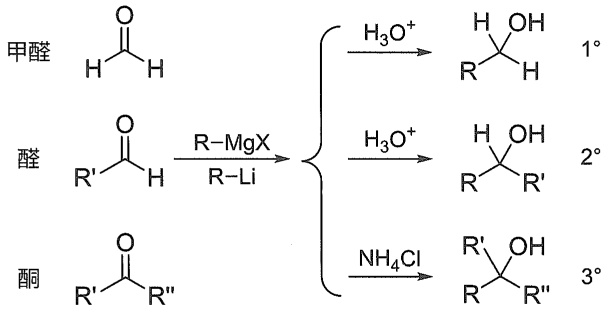

flowchart

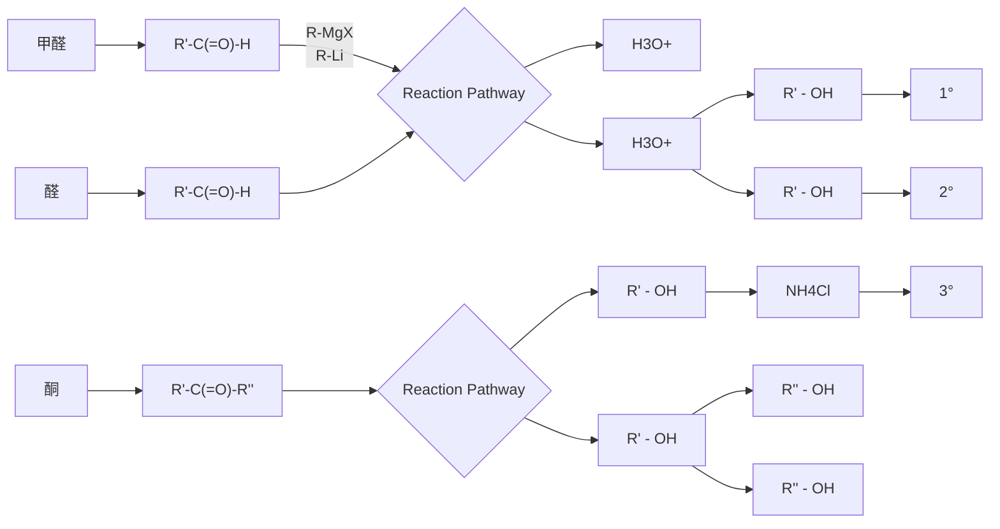

金属有机试剂也能与羧酸衍生物反应。格氏试剂与酯 1:1 加成，消除烷氧基负离子得到中间产物酮，但酮比酯活泼，再和另一分子格氏试剂反应，猝灭后最终产物为叔醇。产物中季碳上的两个取代基完全相同，都来自格氏试剂。实验中若按格氏试剂与酯 1:1 投料，则原料剩余一半不反应，最终得到酯和叔醇的混合物，因此和酯的反应通常加入两当量格氏试剂。

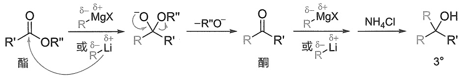

chemical

Reaction mechanism diagram showing esterification and deprotection steps with reagents and conditions

格氏试剂和有机锂试剂能对环氧化合物进行开环加成，与环氧乙烷反应得到增加两个碳原子的伯醇。不对称取代的环氧乙烷反应存在区域选择性，先进攻位阻小的一侧，得到仲、叔醇。

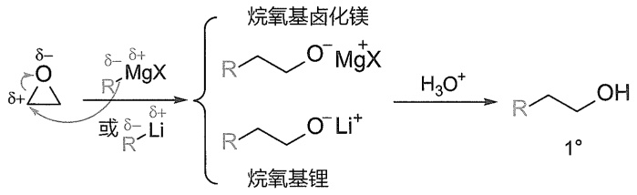

chemical

Chemical reaction equation showing oxidation of a cyclic oxime to form a hydroxylated alkene using MgX and Li ions

---

252

第七章 醇、酚和醚

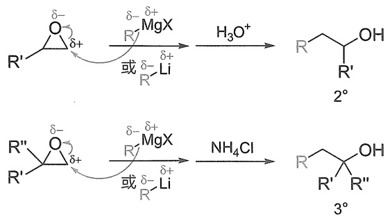

逆合成分析是设计合成路线的常用思维方式。对于特定结构的醇，通过金属有机化合物对含氧亲电试剂的加成规律，可以逆向分析由何种原料进行制备。伯醇若设计为烃基结构上增加一个碳原子的醇，可以切断成来自金属有机试剂的烃基和来自甲醛的羟甲基；若能视为增加两个碳原子的醇，可以切断成来自金属有机试剂的烃基和来自环氧乙烷的羟乙基。仲醇通常切断衍生化羟甲基一侧的取代基，来自金属有机试剂，衍生化的羟甲基来自醛。叔醇若含重复取代基，可在衍生化羟甲基上切断两个重复取代基，来自金属有机试剂，衍生化羟甲基来自酯。不对称取代的叔醇一般切断为酮和金属有机试剂的组合。

逆合成分析需要考虑反应的可行性,例如对  $\beta-$  羟基酯逆合成分析所得的原料是 1,3-二羰基化合物和格氏试剂的组合，实际情况二者发生酸碱中和反应，得不到亲核加成产物；采取硼氢化钠选择性还原更活泼的酮羰基更为合理（蓝色箭头所示）。

chemical

Chemical reaction equations showing oxidation of a ketone to form methyl and sodium borohydrate under Me-MgI and NaBH4 conditions

## 7.4.3 烯烃水合

酸性条件下烯烃水合可以得到醇，但经历碳正离子中间体常有重排产物，立体选择性较

---

7.5 醚的制备

253

差。不对称烯烃原料通常用硼氢化-氧化转化为反马氏规则的醇产物，或用羟汞化-还原转化为符合马氏规则的支链化产物。

flowchart

## 7.5 醚的制备

## 7.5.1 醚的基本知识

醇的羟基上的氢原子被烃基取代的化合物称为醚，醚类化合物都含有醚键（C-O-C）。根据醚分子中烃基是否相同，可以分为对称醚（简单醚、单醚）和非对称醚（混合醚、混醚）。

| $CH_3CH_2\text{O}CH_2CH_3$ | $CH_3\text{O}CH_2CH_3$ |
| --- | --- |
| 乙醚对称醚 | 乙基甲基醚非对称醚 |

根据两个烃基结构的不同，醚又可以分为脂肪醚和芳香醚，脂肪醚又可以分为饱和脂肪醚和不饱和脂肪醚。

<table><tr><td>CH3CH2CH2OCHCH3</td><td>CH3OCH=CH2</td><td rowspan="2">苯(基)甲(基)醚(茴香醚)芳香醚</td></tr><tr><td>异丙基丙基醚饱和脂肪醚</td><td>甲基乙烯基醚不饱和脂肪醚</td></tr></table>

含有多个氧的环醚因形如皇冠，被称为冠醚。

对于简单烷基的醚，在命名时常采用普通命名法，即在醚字的前面写出烃基的名称。对称醚通常在相同的烃基前写上“二”字，然后再写醚字，有时“二”也可省略不写；非对称醚的命名则按两个烃基英文名字母顺序依次列出；芳香混合醚的命名把芳环写在前面（先芳后脂）；不饱和醚先写出饱和烃基，再写出不饱和烃基。

---

254

第七章 醇、酚和醚

$CH_{3}\bigcirc CH_{3}$

(二)甲(基)醚

二苯(基)醚

苯(基)乙(基)醚

$C_{2}H_{5}\bigcirc CH=CH_{2}$

乙基乙烯基醚

在常温下，除甲醚和乙甲醚为气体外，其余的大多数醚是无色有特殊气味的液体，相对密度小于1，易燃。醚的沸点比相应的异构体醇的沸点低得多，与相对分子质量相近的烷烃相近，易挥发，原因是醚分子中没有羟基，不能形成分子间氢键。

醚可通过它的氧原子与水分子的氢原子形成氢键，因此醚在水中有一定的溶解度，与同碳数醇的溶解度相近，比烷烃的溶解度大。而四氢呋喃和1,4-二氧六环等环醚因氧原子裸露在外面，可以和水形成氢键，故能与水混溶。乙醚只能微溶于水，而多数有机物易溶于乙醚，故常用乙醚从水溶液中萃取易溶于乙醚的物质。例如，屠呦呦利用乙醚的低沸点和溶解性，从黄花蒿中提取了青蒿素，这项工作于2015年10月获得诺贝尔生理学或医学奖。

## 7.5.2 威廉森合成法

用醇钠和卤代烷在无水条件下生成醚的反应称为威廉森（Williamson）合成法。

$$
\mathrm{RONa} + \mathrm{R} ^ {\prime} \mathrm{X} \longrightarrow \mathrm{ROR} ^ {\prime} + \mathrm{NaX}
$$

除了用卤代烷以外，醇钠与硫酸酯和磺酸酯反应也可以用于合成醚。

$$
\mathrm{RONa} + \mathrm {R^{\prime} OSO_ {2} Ph} \longrightarrow \mathrm {ROR^{\prime}} + \mathrm {NaOSO_ {2} Ph}
$$

芳香醚可以用苯酚与卤代烷、硫酸酯或磺酸酯在氢氧化钠的水溶液中制备。

chemical

Chemical reaction equation showing phenol reacting with ROSO2Ph under NaOH/H2O conditions to form phenol and NaOSO2Ph

使用 Williamson 合成法既可以合成对称醚，也可以合成不对称醚。在合成不对称醚时，反应物可以有两种搭配，要选择有利于生成醚的搭配。例如，制备叔丁基甲基醚时，可以选择叔丁醇钠和碘甲烷反应，可以顺利得到叔丁基甲基醚，反应式如下:

$$
(\mathrm{CH} _ {3}) _ {3} \mathrm{CO} ^ {-} \mathrm{Na} ^ {+} + \mathrm{CH} _ {3} \mathrm{I} \xrightarrow {\mathrm{S} _ {\mathrm{N}} 2} (\mathrm{CH} _ {3}) _ {3} \mathrm{COCH} _ {3} + \mathrm{NaI}
$$

如果选用甲醇钠和叔丁基溴反应，由于叔丁基溴的空间位阻很大，不利于 $S_{N}$ 反应，有利于发生E2反应，因此主要产物是烯烃，反应式如下:

$$
(\mathrm{CH} _ {3}) _ {3} \mathrm{CBr} + \mathrm{CH} _ {3} \mathrm{ONa} \xrightarrow {\mathrm{E2}} (\mathrm{CH} _ {3}) _ {2} \mathrm{C} = \mathrm{CH} _ {2} + \mathrm{CH} _ {3} \mathrm{OH} + \mathrm{NaBr}
$$

若一个分子内同时存在卤原子和羟基，可以在强碱性条件下发生分子内  $S_{N}$  反应，生成环醚。例如:

chemical

Chemical reaction equation showing hydroxylation of a chloroalkane to form a cyclohexyl ether, with RONa and S_N2 molecules

如果卤原子和羟基在相邻的两个碳上，同时又处于反式位置，即符合分子内 $S_{N}2$ 反应的

---

7.5 醚的制备

255

立体化学要求，可以通过 Williamson 合成法生成环氧乙烷的衍生物。由于氧负离子必须从背面进攻，因此下图的第一式得到反式产物，第二式得到顺式产物。

chemical

Chemical reaction mechanism showing bromination of a carboxylic acid derivative with hydrogen bonding

反-2,3-环氧丁烷

chemical

Chemical reaction mechanism showing bromination of a carbonyl compound to form a cyclic alkene with water and hydrogen atoms

顺-2,3-环氧丁烷

又如，环己烯和次氯酸加成，产物中的 -Cl 和 -OH 处于反式，在碱的作用下，生成的  $O^{-}$  可以从 C-Cl 键的背面进攻碳原子，得到取代的环氧乙烷。

chemical

Organic reaction pathway showing chlorination and deprotection steps with HOCl, NaOH, and S_N2⁻ counterion

若 -Cl 和 -OH 处于顺式，在碱的作用下，不能发生  $S_{N}2$  反应，只能发生 E2 反应得到烯醇，再经过互变异构，得到羰基化合物。例如:

chemical

Chemical reaction mechanism showing chloroacetate reacting with ethyl ether to form a cyclohexene derivative

冠醚的一个常用的制备方法，也是通过 Williamson 合成法。例如，二缩三乙二醇和 1,2-二(2-氯乙氧基)乙烷可以在 KOH 的作用下合成 18-冠-6。

chemical

Chemical reaction equation showing the synthesis of 18-6-crown ether from 2-benzobenzoyl alcohol and 1,2-(2-methyl-oxymethyl)ethane

## 7.5.3 醇分子间失水

在浓硫酸的作用下，两个相同的醇分子通过分子间失水可以制得对称醚:

$$
2 \mathrm{ROH} \xrightarrow {\text {浓} \mathrm{H} _ {2} \mathrm{SO} _ {4}} \mathrm{ROR} + \mathrm{H} _ {2} \mathrm{O}
$$

---

256

第七章 醇、酚和醚

一级醇的分子间失水是通过  $S_{N}2$  反应机理进行的:在浓硫酸的作用下，醇分子的羟基质子化，形成质子化的乙醇锌盐:接着另一分子乙醇的氧原子亲核进攻锌盐的  $\alpha-$  碳原子，水分子离去，得到二乙基锌盐:最后再失去质子得到醚。

chemical

Enzymatic reaction mechanism showing protonation and dehydration steps with reagents and conditions

在实际应用中，伯醇制醚产率高，仲醇制醚产率低，叔醇的反应无法分离得到醚，如果蒸馏，最后得到烯烃。 $2^{\circ}\mathrm{ROH}$ 和 $3^{\circ}\mathrm{ROH}$ 的反应通常按 $\mathrm{S_N1}$ 反应机理进行。

chemical

Chemical reaction equations showing acid-catalyzed hydrolysis of (CH3)3COH and (CH3)3COH2 to form (CH3)2C=CH2, with叔丁基醚 (no separation)

蒸馏可以制得烯烃

利用叔醇容易生成碳正离子的性质，使用叔醇和伯醇的混合物，在酸催化作用下，可以脱水生成叔烷基伯烷基混醚。例如，甲醇和叔丁醇的混合物在硫酸的作用下可以生成叔丁基甲基醚。

$$
(\mathrm{CH} _ {3}) _ {3} \mathrm{COH} + \mathrm{CH} _ {3} \mathrm{OH} \xrightarrow {15 \% \mathrm{H} _ {2} \mathrm{SO} _ {4}} (\mathrm{CH} _ {3}) _ {3} \mathrm{COCH} _ {3}
$$

该反应也可以用于二醇分子内脱水，生成五元环醚或六元环醚。

chemical

Organic reaction pathway showing hydroxylation of aldehyde to form a cyclic alcohol with sulfuric acid and hydrogen peroxide, followed by oxidation to yield 90% product.

## 7.5.4 烯烃的烷氧汞化-去汞法

这是一个相当于烯烃加醇的制醚反应。

flowchart

该反应遵循马氏规则，氢加在含氢较多的碳上，烷氧基加在含氢较少的碳上，但是中间要经过加汞盐再还原去汞的步骤。此方法不会发生消除，比Williamson合成法的限制小；但是空间位阻太大时不易络合，所以，不能用于制备叔丁醚。

## 7.5.5 Ullmann 反应

二芳醚的合成通常采用Ullmann反应。该反应需要铜粉或亚铜盐作为催化剂，酚钠和卤

---

7.6 醚的反应

257

代芳烃反应得到二芳基醚，这是一种形成 C-O 键的偶联反应，反应一般在非质子强极性溶剂中进行，以提高氧负离子的亲核性。

chemical

Chemical reaction equation showing bromination of phenol with ethyl bromide under copper catalysis

## 7.6 醚的反应

脂肪醚分子中的氧原子杂化方式为  $sp^{3}$  杂化，C-O-C 间有一定角度，因此醚不是线形分子，有极性。氧原子的两对孤对电子分别占据一个  $sp^{3}$  杂化轨道，另外两个  $sp^{3}$  杂化轨道分别与两个烃基碳的  $sp^{3}$  杂化轨道形成 σ 键。醚的化学性质相对稳定，在碱性介质中尤为稳定，在常温下，不与一般的氧化剂、还原剂、碱和活泼金属等发生反应。但在酸性条件下，醚可发生反应。

## 7.6.1 醚的自动氧化

化学物质和空气中的氧在常温下温和地进行氧化，而不发生燃烧和爆炸，这种反应称为自动氧化。乙醚及其他醚与空气长时间接触，或经光照后， $\alpha-$ 碳上的 H 会慢慢被氧化，生成不易挥发的过氧化物。

chemical

Chemical reaction equation showing acetylation of a ketone with oxygen under air

多数自动氧化是通过自由基机理进行的。

链引发: $R\cdot + O_{2} \longrightarrow ROO\cdot$

$$
\mathrm{ROO} \cdot + \left(\mathrm{CH} _ {3}\right) _ {2} \mathrm{CHOCH} _ {3} \longrightarrow \mathrm{ROOH} + \left(\mathrm{CH} _ {3}\right) _ {2} \dot {\mathrm{COCH}} _ {3}
$$

链增长: $(\mathrm{CH}_{3})_{2}\dot{\mathrm{CO}}\mathrm{CH}_{3} + \mathrm{O}_{2} \longrightarrow (\mathrm{CH}_{3})_{2}\underset{\mathrm{OO}^{\cdot}}{\mathrm{CO}}\mathrm{CH}_{3}$

$$
\begin{array}{c} \left(\mathrm{CH} _ {3}\right) _ {2} \mathrm{COCH} _ {3} + \left(\mathrm{CH} _ {3}\right) _ {2} \mathrm{CHOCH} _ {3} \\ \text {OO} ^ {\cdot} \end{array} \longrightarrow \begin{array}{c} \left(\mathrm{CH} _ {3}\right) _ {2} \mathrm{COCH} _ {3} + \left(\mathrm{CH} _ {3}\right) _ {2} \dot {\mathrm{CO}} \mathrm{CH} _ {3} \\ \text {OOH} \end{array}
$$

过氧化物不稳定，也不易蒸发，加热时可能发生爆炸。因此，醚的存放应尽量避免暴露在空气中，应在深色玻璃瓶中避光、密封保存于阴凉处。在蒸馏醚之前，一定要检查是否含有过氧化物。有两种常用的检验过氧化物的方法:（1）用湿润的KI-淀粉试纸检验，如醚中有过氧化物存在，KI会被氧化为 $\mathrm{I}_2$ ，使淀粉试纸变蓝。（2）加入 $\mathrm{FeSO_4}$ 和KSCN溶液与醚一起振摇，如醚中有过氧化物存在，$\mathrm{Fe}^{2+}$ 会被氧化为 $\mathrm{Fe}^{3+}$，而与 $\mathrm{SCN^-}$ 作用生成血红色络合物。除去醚中的过氧化物的方法是加入适量的亚硫酸钠（$\mathrm{Na_2SO_3}$）或新配制的硫酸亚铁（$\mathrm{FeSO_4}$）溶液，振摇，使过氧化物分解。为了防止过氧化物的形成，市售的无水乙

---

258

第七章 醇、酚和醚

醚中加有  $0.05\mu g\cdot g^{-1}$  二乙氨基二硫代甲酸钠作抗氧剂。

## 7.6.2 形成锌盐

由于醚分子中的氧原子上带有孤对电子, 可看作 Brønsted 碱, 能接受质子, 生成二级锌盐。但醚接受质子的能力很弱, 必须在强酸的作用下才能生成锌盐。

$$
\mathrm{CH} _ {3} \mathrm{CH} _ {2} - \ddot {\mathrm{O}} - \mathrm{CH} _ {2} \mathrm{CH} _ {3} + \mathrm{H} _ {2} \mathrm{SO} _ {4} \quad \Longleftrightarrow \quad \mathrm{CH} _ {3} \mathrm{CH} _ {2} - \ddot {\mathrm{O}} - \mathrm{CH} _ {2} \mathrm{CH} _ {3} + \mathrm{HSO} _ {4} ^ {-}
$$

醚的锌盐很不稳定，只能存在于冷的强酸中，遇水很快分解为原来的醚。乙醚也能吸收当量的氯化氢，生成锌盐。如果把形成的锌盐与胺的乙醚溶液放在一起，可析出胺的盐酸盐，这是制备铵盐的一种方法。

$$
\mathrm{CH} _ {3} \mathrm{CH} _ {2} \mathrm{OCH} _ {2} \mathrm{CH} _ {3} \xrightarrow {\mathrm{HCl(g)}} \mathrm{CH} _ {3} \mathrm{CH} _ {2} \stackrel {+} {\mathrm{O}} \mathrm{CH} _ {2} \mathrm{CH} _ {3} \mathrm{Cl} ^ {-} \xrightarrow {\mathrm{RNH} _ {2}} \mathrm{RNH} _ {3} \stackrel {+} {\mathrm{Cl}} \Bigg \downarrow + \mathrm{CH} _ {3} \mathrm{CH} _ {2} \mathrm{OCH} _ {2} \mathrm{CH} _ {3}
$$

醚上的氧原子还可作为 Lewis 碱，与 Lewis 酸如  $BF_{3}$  和  $AlCl_{3}$  等作用，形成锌盐（配合物），如三氟化硼或三氯化铝乙醚配合物。三氟化硼是气体，它是一种常用的催化剂。市售三氟化硼是三氟化硼-乙醚配合物的溶液，在使用和运输时较为方便。

$$
\begin{array}{l} \mathrm{CH} _ {3} \mathrm{CH} _ {2} - \ddot {\mathrm{O}} - \mathrm{CH} _ {2} \mathrm{CH} _ {3} + \mathrm{BF} _ {3} \longrightarrow \mathrm{C} _ {2} \mathrm{H} _ {5} - \stackrel {\bullet} {\mathrm{O}} \rightarrow \mathrm{BF} _ {3} \equiv (\mathrm{C} _ {2} \mathrm{H} _ {5}) _ {2} \mathrm{O} \rightarrow \mathrm{BF} _ {3} \\ \mathrm{CH} _ {3} \mathrm{CH} _ {2} - \ddot {\mathrm{O}} - \mathrm{CH} _ {2} \mathrm{CH} _ {3} + \mathrm{AlCl} _ {3} \longrightarrow \mathrm{C} _ {2} \mathrm{H} _ {5} - \stackrel {{\ddot {\mathrm{O}}}} {{\underset {\mathrm{C} _ {2} \mathrm{H} _ {5}} {\longrightarrow}}} \mathrm{AlCl} _ {3} \equiv (\mathrm{C} _ {2} \mathrm{H} _ {5}) _ {2} \mathrm{O} \rightarrow \mathrm{AlCl} _ {3} \\ \end{array}
$$

若将乙醚与三氟化硼形成的二级锌盐和氟代烷反应，还可以形成三级锌盐:

$$
\mathrm{R} _ {2} \mathrm{O} \rightarrow \mathrm{BF} _ {3} + \mathrm{R} ^ {\prime} \mathrm{F} \longrightarrow \left[\begin{array}{c}\mathrm{R}\\\mathrm{O} ^ {+} - \mathrm{R} ^ {\prime}\\\mathrm{R} ^ {\prime}\end{array}\right] \mathrm{BF} _ {4} ^ {-}
$$

三级锌盐极易分解出烷基正离子，并与亲核试剂反应，所以是一种很有用的烷基化试剂。例如:

$$
\mathrm{ROH} + \left(\mathrm{CH} _ {3} \mathrm{CH} _ {2}\right) _ {3} ^ {+} \mathrm{O} \bar {\mathrm{BF}} _ {4} \longrightarrow \mathrm{ROCH} _ {2} \mathrm{CH} _ {3} + \mathrm{CH} _ {3} \mathrm{CH} _ {2} \mathrm{OCH} _ {2} \mathrm{CH} _ {3} + \mathrm{HBF} _ {4}
$$

## 7.6.3 醚的碳氧键断裂反应

醚与氢碘酸一起加热时，酸与醚先形成锌盐，然后发生  $S_{N}1$  或  $S_{N}2$  反应，接着醚键会发生断裂，生成醇和碘代烷。在过量酸存在下，所产生的醇也转化成碘代烷。例如:

$$
\begin{array}{l} \mathrm{CH} _ {3} \mathrm{OCH} _ {3} + \mathrm{HI} (1 \mathrm{mol}) \longrightarrow \mathrm{I} ^ {-} + \mathrm{H} _ {3} \mathrm{C} - \stackrel {\text {+}} {\mathrm{O}} - \mathrm{CH} _ {3} \quad \xrightarrow {\mathrm{S} _ {\mathrm{N}} 2} \mathrm{CH} _ {3} \mathrm{I} + \mathrm{CH} _ {3} \mathrm{OH} \\ \quad \quad \quad \quad \quad \quad \quad \quad \quad \quad \quad \quad \quad \quad \quad \quad \quad \quad \quad \quad \quad \quad \quad \quad \quad \quad \quad \quad \quad \quad \quad \quad \quad \quad \quad \quad \quad \quad \text {过量HI} \\ (\mathrm{CH} _ {3}) _ {3} \mathrm{COCH} _ {3} + \mathrm{HI} (1 \mathrm{mol}) \xrightarrow {- \mathrm{I} ^ {-}} (\mathrm{CH} _ {3}) _ {3} \mathrm{C} - \stackrel {\text {+}} {\mathrm{OCH}} _ {3} \quad \xrightarrow {\mathrm{S} _ {\mathrm{N}} 1} (\mathrm{CH} _ {3}) _ {3} \mathrm{C} ^ {+} + \mathrm{CH} _ {3} \mathrm{OH} \\ \quad \quad \quad \quad \quad \quad \quad \quad \quad \quad \quad \quad \quad \quad \quad \quad \quad \quad \quad \quad \quad \quad \quad \quad \quad \quad \quad \text {过量HI} \\ (\mathrm{CH} _ {3}) _ {3} \mathrm{Cl} + \mathrm{H} _ {2} \mathrm{O} \end{array}
$$

---

7.6 醚的反应

259

其他氢卤酸也可以发生类似的反应。HX 的反应活性顺序:HI > HBr > HCl。HI 常用于断裂醚键，或用  $KI/H_{3}PO_{4}$  代替 HI；HBr 需要较高浓度和反应温度；HCl 断裂醚键的效果较差。

混合醚 C-O 键断裂的顺序为:三级烷基 > 二级烷基 > 一级烷基 > 甲基 > 芳基。

$$
\mathrm{CH} _ {3} \mathrm{OCH} _ {2} \mathrm{CH} _ {3} + \mathrm{HI} (1 \mathrm{mol}) \xrightarrow {\mathrm{S} _ {\mathrm{N}} 2} \mathrm{CH} _ {3} \mathrm{I} + \mathrm{CH} _ {3} \mathrm{CH} _ {2} \mathrm{OH}
$$

对于单芳基醚，由于芳基与氧原子形成  $p-\pi$  共轭效应，Ar-O 键具有部分双键的性质，比较牢固，不易断裂，醚键总是优先在脂肪烃基的一侧断裂，生成苯酚和卤代烃。二芳醚 Ar-O-Ar 的醚键较稳定，不能被酸断裂。

$$
\mathrm{C} _ {6} \mathrm{H} _ {5} - \mathrm{O} - \mathrm{CH} _ {2} \mathrm{CH} _ {3} + \mathrm{HI} \longrightarrow \mathrm{C} _ {6} \mathrm{H} _ {5} - \mathrm{OH} + \mathrm{CH} _ {3} \mathrm{CH} _ {2} \mathrm{I}
$$

酚的烷基化和芳基醚断裂反应相结合使用，可以在反应中保护酚羟基。例如:

chemical

Chemical reaction equation showing the synthesis of a ketone from benzaldehyde and aldehyde under AlCl3 and HBr conditions

环醚与氢卤酸作用，醚键断裂生成卤代醇，可进一步卤化生成二卤代烃。例如:

chemical

Chemical reaction sequence showing bromination and hydrolysis steps of a cyclohexane derivative

不对称的环醚开环，生成两种产物的混合物。

chemical

Chemical reaction equation showing bromination of a cyclohexanone under HBr to form an alcohol and bromoalkene

苄基醚在钯催化下氢化，可以发生脱苄基反应（不需要强酸）。

chemical

Chemical reaction equation showing reduction of a benzene derivative to form a pentafluorohydrin derivative and alcohol

## 7.6.4 1,2-环氧化合物的开环反应

一般情况下，环醚具有和链状醚类似的性质。常见的环醚如四氢呋喃、1,4-二氧六环等，因其惰性，被广泛用作有机反应中的溶剂，但它们仍然具有醚类化合物的反应特点，例如，在强酸性条件下会发生碳氧键的断裂。

具有三元环的环醚被称作环氧化合物（epoxide 或 oxirane），这是一类十分特殊的环醚类化合物，受三元环的环张力影响，具有十分丰富的反应活性。

环氧乙烷是最简单的环氧化合物，又被叫作氧化环乙烯，这一命名来自其英文名称ethylene oxide。这一命名方式（对应烯烃的氧化物）也普遍适用于环氧化合物的命名，如氧化丙烯（propylene oxide）、氧化环己烯（cyclohexene oxide）等。环氧乙烷被用于合成大宗工业原料乙二醇，后者被广泛应用于汽车抗冻剂、飞机发动机制冷剂及生产各种聚酯。工业

---

260

第七章 醇、酚和醚

上，环氧乙烷可以由乙烯与空气或氧气通过氧化银催化剂在高温下制得，但该方法不适用于合成其他环氧化合物。

$$
\begin{array}{c c c} \mathrm{H} _ {2} \mathrm{C} = \mathrm{CH} _ {2} & \xrightarrow [ \mathrm{Ag} _ {2} \mathrm{O} ]{\mathrm{O} _ {2}} & \mathrm{H} _ {2} \mathrm{C} - \mathrm{CH} _ {2} \\ \text {乙烯} & 3 0 0 ^ {\circ} \mathrm{C} & \text {环氧乙烷} \end{array}
$$

在烯烃章节中已经讲过，环氧化合物可以由烯烃与过氧酸（peroxyacid）反应得到。其中，最常用的过氧酸是间氯过氧苯甲酸（m-chloroperoxybenzoic acid，m-CPBA）。基于类似的氧化策略，通过发展四氧化锇和手性配体作为催化剂，Sharpless教授发展了高效的不对称环氧化反应及双羟化反应，并因此荣获了2001年诺贝尔化学奖。除此之外，烯烃与次卤酸发生亲电加成反应得到反式卤代醇，再进一步在碱性条件下发生分子内亲核取代反应，也可以得到环氧化合物。

与一般的醚不同，环氧乙烷与环丙烷相似，存在着有张力的三元环，性质非常活泼，而且环中有氧原子，具有极性键，反应活性更高。

## 1. 酸性条件下的环氧开环

由于氧原子电负性大，且受三元环环张力的影响，环氧化合物易于在酸性条件下发生碳氧键断裂而开环，相比普通醚类化合物碳氧键断裂所需的强酸性条件，常温条件下采用稀酸即可实现环氧的开环，例如环氧与稀酸水溶液反应得到邻二醇类产物，与氢卤酸反应得到对应的反式邻卤取代醇。

chemical

Chemical reaction pathway showing oxidation of ethyl ether to trans-2-hexyl isocyanate using H3O+ and HX under conditions X = F, Cl, Br, I

酸性条件下环氧开环的机理遵循如下历程:氧原子首先发生质子化，变成了一个较易离去的基团，然后体系内的亲核物种如  $HO^{-}$ 、 $X^{-}$ 等从相邻碳的反面进攻（类似于烯烃与液溴反应中的环状溴镝离子被进攻的历程），从而得到反式的邻二取代产物。从该历程可以判断酸性条件下环氧开环的区域选择性。氧原子被质子化后可加剧碳氧键的极化，从而导致相邻碳上带有部分正电荷，具备了碳正离子的特征，因此，能够生成更稳定碳正离子的碳更易被亲核进攻。

flowchart

---

7.6 醚的反应

261

在酸催化下，1,2-环氧丙烷能与多种亲核试剂反应，导致环氧打开得到开环产物，开环时主要在C-O键发生选择性断裂。

chemical

Chemical reaction pathway showing oxidation of a ketone to form a carboxylic acid derivative via intermediates like phenyl, hydroxyl, and acrylate

1,2-环氧丙烷也可以和乙硼烷反应，生成对应的醇。由于硼烷中硼的性质和质子酸类似，因此，硼烷中的负氢转移到取代基较多的环碳原子上。

chemical

Chemical reaction mechanism showing boron-containing compound reacting with B2H6 to form a boron-containing intermediate, then rearranging to form an aldehyde and then to produce (CH3CH2CH2O)3B.

特殊的 1,2-环氧化合物也可以发生 C-C 键的断裂。近年来，我国科学家发现二羰基化合物衍生的环氧化合物实现了 Lewis 酸催化的选择性 C-C 或 C-O 键断裂开环。

chemical

Chemical reaction pathway showing C-O and C-C cleavage steps with RCHO reagents

## 2. 碱性条件下的环氧开环

环氧在碱性条件下也可发生开环。在该类反应中，亲核试剂直接进攻与氧原子相邻的碳原子，氧原子充当一个离去基团，促使碳氧键断裂。例如，在较高温度下，羟基负离子可直接进攻环氧化合物，促使碳氧键断裂，通过进一步质子化，得到邻二醇类产物。其他常见的

---

262

第七章 醇、酚和醚

亲核试剂，如 $\mathrm{NaCN}$ 、 $\mathrm{NaN_3}$ 、 $\mathrm{NaOEt / EtOH}$，以及金属试剂，如格氏试剂、烷基锂试剂等，均可以与环氧发生碱性条件下的开环反应。碱性条件下的环氧开环反应是一个典型的 $\mathrm{S_N2}$ 反应，因此，亲核试剂倾向于进攻位阻小的相邻碳原子。

chemical

Chemical reaction pathway showing hydrolysis of a ketone to form various alcohols and products including phenyl, RMgX, and amine groups

1,2-环氧丙烷也可以在  $LiAlH_{4}$  作用下还原，生成对应的醇，产物和硼烷的反应正好有不同的区域选择性。

chemical

Chemical reaction pathway showing aluminum complex formation from aldehyde and lithium iodide, followed by reduction to alkali metal

## 7.7 醚的应用

## 7.7.1 工业用途

醚是一种常用的优良有机溶剂，但由于低级醚的高度挥发性，使用时须注意防火。

相对分子质量较低的醚具有麻醉作用，可作为外科手术的麻醉剂，如乙醚。安氟醚和异氟醚等含氟吸入麻醉药具有很多独特的优点，没有致癌、致畸、致突变等不良作用，对生物降解有抗力，因而是一类理想的吸入麻醉药。

安氟醚

异氟醚

环氧乙烷是生产乙二醇的主要原料。一般在加压或酸性条件下，将环氧乙烷和水一起加热即可制得乙二醇。

---

7.7 醚的应用

263

$$
\begin{array}{c} \bigtriangledown \\ \mathrm{O} \end{array} + \mathrm{H} _ {2} \mathrm{O} \xrightarrow {\mathrm{H} ^ {+}} \begin{array}{c} \mathrm{OH} \\ \mathrm{CH} _ {3} \mathrm{OH} \end{array}
$$

环氧乙烷在催化剂如四氯化锡及少量水存在下聚合成聚乙二醇，水溶性良好，是生产聚氨酯的原料。聚氨酯可制备人造革、泡沫塑料、医用高分子材料等。

$$
n \bigtriangledown_ {\mathrm{O}} \xrightarrow {\mathrm{SnCl} _ {4}} \xrightarrow {\mathrm{H} _ {2} \mathrm{O}} \mathrm{HO} (\mathrm{CH} _ {2} \mathrm{CH} _ {2} \mathrm{O}) _ {n} \mathrm{H}
$$

聚乙二醇

用油溶的酚引发环氧乙烷的开环聚合，可得到非离子性的表面活性剂，可用作洗涤剂、乳化剂、分散剂等。

chemical

Chemical reaction equation showing the formation of a cyclic amide from an enolate and n-oxide intermediate

## 7.7.2 冠醚

冠醚是20世纪60年代合成得到的含有多氧大环的醚类化合物，其结构是由重复的乙二醚结构（$-\mathrm{OCH}_2\mathrm{CH}_2-$）单元形成的环。因其形状类似皇冠，所以称为冠醚（crown ether）。冠醚的命名的通式记为X-冠-Y，X表示冠醚环的总原子数目，Y则表示冠醚环中氧原子数。冠醚的发现被认为是超分子化学的开端。常见冠醚及其结构见图7-2。

chemical

Chemical structure of a cyclic organic molecule with numbered atoms and substituents

二苯并-18-冠-6

chemical

Circular molecular structure with numbered atoms and bonds, likely representing a cyclic or ring system

18-冠-6

natural_image

Abstract geometric line drawing with interconnected shapes and dashed lines (no text or symbols)

18-冠-6的立体结构

图 7-2 常见冠醚及其结构

1967 年，Pederson 第一次发现了冠醚，这一发现开创了超分子化学的新领域，并为后续的研究提供了重要的基础。随后 Cram 和 Lehn 也开始了对超分子化学的研究。从此之后，超分子化学作为一门新兴的交叉学科快速发展起来。1987 年，Pedersen、Lehn、Cram 三位化学家被授予诺贝尔化学奖，以表彰他们在超分子化学理论方面的开创性工作。

natural_image

Portrait of an elderly man wearing glasses and a suit (no visible text or symbols)

C. J. Pederson

natural_image

Portrait of an elderly man in formal attire with a bow tie (no visible text or symbols)

D. J. Cram

natural_image

Portrait of a man wearing glasses and a turtleneck (no text or symbols visible)

J. M. Lehn

---

264

第七章 醇、酚和醚

冠醚最大的特点是分子具有特殊的大环孔状结构，在冠醚中的氧原子具有孤对电子，因此这些氧原子可以与金属离子结合形成配合物。冠醚环的大小不同，中间的空腔大小不同，因此对不同半径的金属离子具有较高的络合选择性，就可以结合不同的金属离子。如12-冠-4可以结合锂离子，15-冠-5可以结合钠离子，而18-冠-6可以结合钾离子（图7-3），形成稳定的络合物，冠醚这种性质可用于金属离子混合物的分离。

chemical

Molecular structures of lithium, sodium, potassium, and nickel complexes with atomic labels and bonding patterns

图 7-3 冠醚与碱金属离子络合

冠醚环上具有亲油性的亚甲基排列在环外侧，因此冠醚能溶于有机溶剂。所以，冠醚的另一个用途是在有机合成中作为相转移催化剂（phase transfer catalyst），使非均相反应得以顺利进行，提高收率。许多无机盐易溶于水，不溶或难溶于有机溶剂；相反大多数有机物可溶于有机溶剂而难溶于水。因此，如果有一种催化剂能穿过两相之间的界面，并能把反应试剂（例如 $\mathrm{CN}^{-}$）从水相转移到有机相中，使其与底物迅速反应，并将生成的另一种负离子带回到水相中，那么反应的速率能显著提高。催化剂在反应过程中没有消耗，只起到了重复转送负离子的作用，这种催化剂就被称作相转移催化剂，这样的过程被称为相转移催化（phase transfer catalysis, PTC）。采用PTC最经典的反应就是固体盐或其水溶液和溶于非极性溶剂中的有机物的反应，例如:

chemical

Reaction equation showing synthesis of nC8H17CN under different conditions: organic phase, water phase, and reaction with catalyst

除了亲核取代反应以外，在氧化反应中也可以使用冠醚作为相转移催化剂。例如，用 $\mathrm{KMnO_4}$ 氧化甲苯时，由于 $\mathrm{KMnO_4}$ 不溶于有机溶剂，所以反应困难。当加入18-冠-6后，通过冠醚络合 $\mathrm{K}^+$，将 $\mathrm{MnO_4^-}$ 带入有机溶剂中，使反应在同一相中进行，能加速反应的进行。

chemical

Chemical reaction equation showing potassium ion reduction to carboxylic acid using PTC (18-crown-6)

但冠醚价格昂贵，且毒性较大，使用后难回收，因此其应用受到一定程度的限制。除此之外，常用的相转移催化剂还包括四级铵盐、四级磷盐、硫盐等。这些催化剂相对来说比较容易合成，近年来得到了极大的发展，人们还开发出一系列手性的相转移催化剂，实现了很多反应的不对称催化。我国科学家在这方面也作出了巨大的贡献。

## 7.8 酚

酚是羟基连接在芳香环上的化合物,一元酚的通式为 ArOH。最简单的酚是苯酚(phenol),

---

7.8 酚

265

熔点  $41^{\circ}C$ ，沸点  $182^{\circ}C$ ，因为它首先是从煤焦油里得到的，因此又称为石炭酸。酚分子中酚羟基与苯环上  $sp^{2}$  杂化的碳原子相连，氧原子也主要采取  $sp^{2}$  杂化，氧上两对孤对电子，一对占据  $sp^{2}$  杂化轨道，另一对占据未参与杂化的 p 轨道，p 轨道电子正好能与苯的大  $\pi$  键体系发生重叠（图 7-4），在此  $p-\pi$  共轭体系中，氧原子的 p 轨道电子云向苯环偏移，p 轨道电子云的偏移导致了氢氧之间的  $\sigma$  键电子云进一步向氧原子偏移，从而使氢离子较易离去。因此，此  $p-\pi$  共轭体系既增加了苯环上的电子密度，又增强了羟基上氢原子的解离能力，使得酚类化合物具有一定的酸性。

chemical

Molecular structure diagram showing carbon and oxygen atoms with hydrogen bonding, likely representing a coordination compound or molecular framework.

图 7-4 苯酚分子中的  $p-\pi$  共轭示意图

酚类分子中由于羟基和芳环两者直接相连，相互影响，使酚羟基在性质上与醇羟基有显著差异，表现出更强的酸性。此外，酚的芳环受羟基的影响，也比相应的芳烃更易发生亲电取代反应。

## 7.8.1 酚羟基的反应

## 1. 酸性

酚的酸性较醇强，它能溶于氢氧化钠、氢氧化钾溶液生成相应的钠盐或钾盐，而醇不能。大多数酚的 $\mathrm{pK_a}$ 都在10左右，但比碳酸（$\mathrm{pK_a = 6.38}$）弱。将 $\mathrm{CO_2}$ 通入酚钠盐的水溶液中，可以使酚重新游离出来。由于酚能溶解于碱，又能用酸将其游离出来，因此可用此法分离酚类化合物。

chemical

Two-step chemical reaction equations showing hydrolysis of phenol and sodium hydroxide to form sodium hydroxide and water, respectively.

苯环上连有不同取代基时，酚的酸性不同。若苯环上连有吸电子基团，酚的酸性增强。如对硝基苯酚的酸性比苯酚的酸性强600倍，这是因为硝基具有吸电子诱导效应和吸电子共轭效应，可使酚羟基负离子的负电荷离域到硝基的氧原子上，从而使硝基苯酚负离子更加稳定。

chemical

Reaction mechanism diagram showing oxidation and reduction steps of a benzene derivative with nitro groups

---

266

第七章 醇、酚和醚

当硝基位于酚羟基的邻位，负电荷也可以离域到硝基的氧原子上，使酸性增强。但是，当硝基位于酚羟基的间位时，不能通过共轭效应使负电荷离域到硝基的氧原子上，只有硝基的吸电子诱导效应产生影响。因此，间硝基苯酚的酸性虽也比苯酚的强（强40倍），但远不如硝基在酚邻位或对位的大。

chemical

Reaction mechanism diagram showing the formation of a benzene derivative from aniline and its subsequent amine intermediate

苯环上硝基越多，吸电子作用越强，酚的酸性越强。二硝基苯酚的酸强度与羧酸差不多，2,4,6-三硝基苯酚（苦味酸）为强酸，酸强度与一些无机酸的酸性相近。

chemical

Six nitrobenzene molecular structures with pKa values labeled below each, showing variations in hydroxyl and methoxy groups.

与之相反，当苯环上有给电子基团时，此类酚化合物的酸性比苯酚的酸性弱。这主要是由于给电子基团增加了苯环上的电子密度，负电荷较难离域到苯环上，使得酚负离子不稳定，即酚羟基不易解离释放质子，所以酸性比苯酚的弱。除电子效应外，取代基的空阻效应也会影响酚的酸性。例如，2,4,6-三新戊基苯酚的酸性极弱，可能是因为两个邻位的大基团阻碍了溶剂对酚羟基解离所起的溶剂化作用。此外，若酚羟基邻位的取代基能与其形成分子内的氢键作用，也会使得酚羟基的酸性减弱，如邻硝基苯酚的酸性要比对硝基苯酚的弱。

## 2. 醚化反应和 Claisen 重排

酚和醇相似，能够烷基化成醚，但酚不能像醇那样在酸性条件下分子间脱水成醚，主要原因是苯正离子不稳定，不易生成。因此，酚醚一般是由酚在碱性溶液中与卤代烃作用或烷基磺酸酯作用生成的，即Williamson醚合成法。在碱性溶液中，酚以酚负离子形式存在，作为亲核试剂向卤代烃或烷基磺酸酯进攻，经 $\mathrm{S_N2}$ 反应合成芳香醚。

chemical

Chemical reaction pathway showing hydroxyl radical conversion to ester and subsequent ring-opening under basic conditions

芳基烃基醚和脂肪醚相似，对碱稳定，且不易被氧化，但可被氢碘酸或三溴化硼分解，烷氧键断裂，生成相应的酚。芳基醚由于氧与芳环的碳原子发生 $p-\pi$ 共轭，C-O具有部分双键的性质，一般难断裂。将酚的烃基化反应和芳基烃基醚被氢碘酸或三溴化硼分解的反应结合使用，可以在反应中保护酚羟基。

chemical

Chemical reaction pathway showing bromination and hydrolysis steps of a benzene derivative

1912 年，克莱森（Claisen）发现了以他的名字命名的 Claisen 重排反应。当年他同时报

---

7.8 酚

267

道了烯丙基芳基醚在  $200\;^{\circ}C$  下可以重排为烯丙基苯酚，以及 3-烯丙氧基丁-2-烯酸乙酯在  $NH_{4}Cl$  下蒸馏，可以生成 2-乙酰基戊-4-烯酸乙酯。此后，烯丙基乙烯基醚类衍生物在加热条件下重排成相应的  $\gamma,\delta-$  不饱和羰基化合物的反应称为 Claisen 重排。

chemical

Organic reaction pathway showing conversion of a benzene derivative to a cyclohexane derivative via methanol and ester intermediates, followed by a ketone formation.

交叉反应实验及同位素标记研究证明，Claisen重排是分子内重排，反应是经过环状过渡态进行的。当两个邻位都被占据时，烯丙基迁移至对位，这个反应经历了两次[3,3]C迁移。

chemical

Organic reaction pathway showing transformation of a benzene derivative to a substituted cyclohexane derivative via methylene and hydroxyl groups, with C=14C as reference.

Claisen 重排具有普遍性，在醚类化合物中，如果存在烯丙氧基与碳碳双键相连的结构，就有可能发生 Claisen 重排，即脂肪族的 Claisen 重排。

## 3. 酯化反应和 Fries 重排

酚与醇不同，醇与羧酸可以很容易地在酸催化下直接发生酯化作用，而酚由于氧上孤对电子参与了 $p-\pi$ 共轭，导致其亲核能力降低，因此须在碱（碳酸钾、吡啶、三乙胺）或质子酸（硫酸、磷酸）的催化作用下，与酰氯或酸酐反应才能形成酯。酚可以与无机酰氯反应得到相应的酯，如苯酚和三氯氧磷反应可以得到磷酸三苯酚酯（一种增塑剂）。酚也可以与有机酰氯或酸酐反应得到酯，如阿司匹林就是用水杨酸和乙酸酐反应来合成的。

chemical

Chemical reaction equation showing the synthesis of aryl halocyanate from phenol and acetic acid under sulfuric acid catalysis

20 世纪初，Fries 发现了以他的名字命名的 Fries 重排反应。他将乙酸苯酚酯和氯乙酸在  $AlCl_{3}$  作用下加热，分离得到了邻、对位乙酰化产物和氯乙酸苯酚酯。此后，将酚酯与 Lewis 酸或 Brønsted 酸一起加热，发生酰基重排生成邻羟基或对羟基芳酮的混合物的反应统称为 Fries 重排，它是由酚制备邻位或对位酰基酚的一种实用方法。

---

268

第七章 醇、酚和醚

chemical

Chemical reaction equation showing aldehyde reacting with benzaldehyde under aluminum chloride to form a mixture of two phenolic compounds

## 4. 与三氯化铁的显色反应

大多数酚与三氯化铁溶液发生颜色反应。不同的酚所产生的颜色也不同，常见的有紫、蓝、绿、棕等颜色（表7-3），这个特性常用于酚的鉴定。例如:

$$
\begin{array}{r l} 6 \mathrm{C} _ {6} \mathrm{H} _ {5} \mathrm{OH} & + \quad \mathrm{FeCl} _ {3} \longrightarrow \mathrm{H} _ {3} [ \mathrm{Fe} (\mathrm{OC} _ {6} \mathrm{H} _ {5}) _ {6} ] + 3 \mathrm{HCl} \\ & \text {紫色} \end{array}
$$

表 7-3 各类酚与三氯化铁反应所显颜色

| 酚 | 与$FeCl_{3}$显色 |
| --- | --- |
| 对甲苯酚 | 蓝色 |
| 间甲苯酚 | 蓝紫色 |
| 对苯二酚 | 暗绿色 |
| 邻苯二酚 | 深绿色 |
| 间苯二酚 | 蓝紫色 |
| 连苯三酚 | 淡棕红色 |
| $\alpha$-萘酚 | 紫红色 |
| $\beta$-萘酚 | 绿色 |

## 7.8.2 酚芳环上的亲电取代反应

酚羟基上 p 电子与苯环的  $\pi$  体系共轭作用使羟基邻、对位的电子密度增大，所以酚羟基的邻、对位亲核能力很强，使得酚类化合物很容易在邻、对位发生亲电取代反应，在多数情况下反应可以不用 Lewis 酸催化。

## 1. 卤化反应

由于酚羟基是强的邻对位活化基团，苯酚在室温下与溴水反应立即生成2,4,6-三溴苯酚白色沉淀，而苯的卤化反应必须在Lewis酸的催化下才能进行。若溴水过量，则生成2,4,4,6-四溴环己二烯酮黄色沉淀。

chemical

Chemical reaction equation showing bromination of benzene with 3Br₂, producing white and yellow brominated products

此反应很灵敏，溶液中含有  $10 \mu g/g$  的苯酚都可以检测出来。因此，此反应可用作苯酚的鉴别和定量测定。

---

7.8 酚

269

## 2. 硝化及亚硝化反应

由于酚羟基对苯环的活化作用，在室温时，用稀硝酸即可使苯酚硝化，生成邻硝基苯酚和对硝基苯酚的混合物。因苯酚易被氧化，产率不高。邻硝基苯酚因形成分子内氢键，使得其分子间及与水形成氢键的能力降低，因此其沸点相对较低，在水中的溶解度也较小，所以可用水蒸气蒸馏法蒸出，从而使它与对硝基苯酚分离。

chemical

Nitration reaction equation of benzene under HNO3 catalysis to form nitrobenzene and nitrophenol, with corresponding molecular structures for邻硝基苯酚 and 对硝基苯酚.

## 3. 磺化反应

苯酚与浓硫酸在较低的温度（15～25℃）下很容易发生磺化反应。但苯酚的磺化反应发生在对位或邻位主要受反应温度的影响。随着反应温度升高，苯酚的磺化反应主要发生在对位，因为4-羟基苯磺酸比2-羟基苯磺酸稳定。即高温有利于生成热力学稳定的产物。继续加热磺化，可得到4-羟基苯-1,3-二磺酸。

chemical

Two-step organic synthesis reaction scheme showing benzene hydrolysis under concentrated sulfuric acid and temperature variations

## 4. Friedel-Crafts 反应

由于酚羟基的活化作用酚很容易发生 Friedel-Crafts 反应，在较弱的催化剂作用下就可以进行。例如:

chemical

Chemical reaction equation showing hydrolysis of a benzene derivative with (CH3)CCl under HF to form a substituted benzene alcohol

苯酚在浓硫酸或无水氯化锌的作用下与邻苯二甲酸酐发生 Friedel-Crafts 反应生成酚酞，酚酞为无色固体，是常用的重要指示剂，其溶液 pH<8.5 时为无色液体，当 pH>9 时生成电子离域范围更大的粉红色的共轭双负离子。

---

270

第七章 醇、酚和醚

flowchart

This image displays a multi-step organic synthesis pathway for the synthesis of polyphenol derivatives under various conditions, including sequential reactions with different pH levels and solvent environments.

7.8.3 酚的制备

## 1. 异丙苯法

工业上合成苯酚的最主要方法是:苯与丙烯通过 Friedel-Crafts 反应得到异丙苯，异丙苯经空气氧化生成氢过氧化异丙苯，后者在强酸或强酸性离子交换树脂作用下分解生成苯酚和丙酮。这个反应是工业上生产苯酚和丙酮的重要方法。

$$
\mathrm{Ph} - \mathrm{H} + \mathrm{H} _ {2} \mathrm{C} = \mathrm{CH} - \mathrm{CH} _ {3} \xrightarrow {\mathrm{AlCl} _ {3}} \mathrm{Ph} - \underset {\mathrm{H}} {\overset {\mathrm{CH} _ {3}} {\mathrm{C}}} - \mathrm{CH} _ {3} \xrightarrow {\mathrm{O} _ {2}} \mathrm{Ph} - \underset {\mathrm{OOH}} {\overset {\mathrm{CH} _ {3}} {\mathrm{C}}} - \mathrm{CH} _ {3} \xrightarrow [ \mathrm{H} ^ {+} ]{\mathrm{H} _ {2} \mathrm{O}} \mathrm{Ph} - \mathrm{OH} + \underset {\mathrm{H} _ {3} \mathrm{C}} {\overset {\mathrm{O}} {\mathrm{C}}} - \mathrm{CH} _ {3}
$$

## 2. 卤代芳烃水解

卤代芳烃很难发生水解反应，一般需要高温、高压和催化剂的作用下才能反应。但是，当卤原子的邻位或对位连有很强的吸电子基团时，可以发生水解反应（芳香亲核取代反应），工业上常用此方法制备吸电子基取代的苯酚。

chemical

Nitration reaction equation of benzene

## 3. 碱熔法

芳基磺酸盐和无水氢氧化钠（钾）在高温下作用，磺酸基被羟基取代的反应即为碱熔反应。在此反应中，芳环上-X、-NO₂、-COOH等基团将受影响。

---

习题

271

chemical

Chemical reaction sequence showing sulfonation of benzene to form sodium and then hydrolysis under HCl

## 4. 重氮盐水解

重氮盐水解可生成酚，这是一个普遍的制备苯酚的方法。

chemical

Chemical reaction pathway showing bromination of aniline under sodium nitric oxide and sulfuric acid conditions, followed by hydrolysis to yield brominated benzene derivative

习题

1. 在 $4\beta$-Acetoxyprobotyane- $9\beta, 15\alpha$-diol 的首次不对称全合成中，涉及多步基于醇的官能团转化，请画出产物和中间体的结构。

2. Kopsinitarine E 的全合成中涉及基于醇的官能团转化步骤，请写出产物和中间体结构。

---

272

第七章 醇、酚和醚

chemical

Chemical reaction scheme showing DMP/NaHCO3 in DCM at 0°C producing compound B from OTES and Boc protecting groups

3. (+)-Ineleganolide 的全合成中涉及基于醇的官能团转化步骤，请写出产物和中间体结构。

chemical

Chemical reaction scheme showing SmC-protected aldehyde to form a ketone, followed by TESCI-imidazole and NaH/THF reagents

4. Calophyline A 的全合成中涉及基于醇的官能团转化步骤, 请写出产物和中间体结构, 以及 $\mathbf{A} \rightarrow \mathbf{B}$ 的机理。

chemical

Multi-step organic synthesis reaction scheme showing transformation of compound A and B to products C and DMP via intermediate C, with reagents and conditions labeled.

5. 后期官能团化（late-stage functionalization）是近年来用于全合成的重要方法。去氧胆酸的醇衍生物经过以下转化可以得到产物 A，请根据分子式推测 A 的结构。

---

习题

273

chemical

Chemical reaction scheme showing deoxycholic alcohol reacting with a sulfonamide derivative under CsF/TMABr conditions to form a final product A and C25H41F3O3

6. Bryostatin 1 的全合成中涉及以下转化，请推测产物 A 的结构。

chemical

Chemical reaction scheme showing conversion of a diol to a ketone under specified conditions

7. Guignardones 的全合成中涉及下列转化，请写出产物 B 和 C 的结构，并推测中间体 A、D 及反应机理，根据空间构型对反应的立体选择性给出解释。

flowchart

8. Longiborneol 的全合成中涉及下列转化，已知桥头碳的碳正离子非常不稳定，且 PIDA 是一种高价碘氧化剂，请写出产物和中间体的结构及反应机理，并根据原料的空间构型对反应的立体选择性给出解释。

chemical

Chemical reaction scheme showing conversion of a cyclohexane derivative to a ketone using TsOH and TEMPO under specified conditions

9. 完成反应:

chemical

Chemical reaction equation showing hydroxybenzene reacting with methoxybenzene to form a bromo-phenyl ester under NaH in dry DMF conditions

10. 完成反应:

---

274

第七章 醇、酚和醚

chemical

Chemical reaction scheme showing conversion of a benzene derivative to a dimer using BF3·O(C2H5)2 and CH2ClCH2Cl under room temperature for 3 hours, yielding DMpillar[5]arene at 22% yield.

11. 完成反应:

chemical

Chemical reaction equation showing cyclopropyl ether reacting with benzene under heat of ignition to form a substituted cyclohexane derivative

HOTf: 三氟甲磺酸(一种强酸); HFIP: 六氟异丙醇

12. 请画出如下反应的主要产物。

13. (-)-cardiopetaline 全合成中的关键一步涉及骨架重排，请写出反应机理，并对反应的立体选择性给出解释。

chemical

Chemical reaction showing microwave effect on a steroid derivative with methoxy and dimethylamino substituents

14. Weisaconitine D 的全合成中涉及骨架重排，请写出两步反应的机理，并对反应的立体选择性给出解释。

---

习题

275

chemical

Chemical reaction scheme showing synthesis of a fused-ring compound from a ketone and amide under Tf2O/pyridine and DBU conditions

15. Mitsunobu 反应（1）是合成化学中的经典，常用于手性醇的立体专一性转化，但反应使用了当量的 PPh3 和 DEAD，原子经济性较差。2019 年，Denton 等报道了一种能催化 Mistunobu 反应的 phosphine oxide 催化剂，该反应（2）无须额外添加氧化还原剂，请写出该催化反应的机理，并解释反应中 2,4-dinitrobenzoic acid 的作用。

16. 环 N-砜基酮亚胺酯是合成手性  $\alpha$ -单取代  $\alpha$ -氨基酸衍生物的重要中间体，其合成路线如下，试简要说明每步合成反应机理。

chemical

Chemical reaction scheme showing the synthesis of a sulfonamide from benzaldehyde and dichloromethoxybenzoic acid under TiCl4/DCM at -15–-5°C, followed by DMA-mediated cyclization.

17. 酚类化合物与硫酰氟反应可以制备芳基氟磺酸酯，其可以作为醇的脱氧氟化试剂，用来合成氟代烷烃，试写出脱氧氟化反应机理。

chemical

Chemical reaction equation showing fluorination of aldehyde with sulfonate under Et3N/DCM conditions to form a fluorinated product (Me2N=NfBu BTMG)

18. 已知三氟甲磺酸（HOTf）是一种强酸，六氟异丙醇（HFIP）是一种常用的溶剂，请写出下列反应的机理，并说明反应的选择性。

chemical

Chemical reaction equation showing methylation of a ketone to form a substituted benzene derivative under specific conditions

19. 从起始原料和必要的试剂完成下列合成。

---

276

第七章 醇、酚和醚

本章习题
参考答案

chemical

Five-step organic reaction pathway showing hydrolysis of benzene to form various alcohols and products

(本章编者 徐政虎、刘路)
