# 第八章 有机化合物结构鉴定

原始 PDF 第 292–351 页。

## 第八章

## 有机化合物结构鉴定

8.1 质谱 277 8.4 核磁共振 308
8.2 紫外-可见光谱 291 习题 328
8.3 红外光谱 299

有机化合物结构的鉴定主要借助现代波谱技术，包括紫外-可见光谱（ultraviolet and visible spectroscopy, UV-Vis）、红外光谱（Infrared Spectroscopy, IR）、核磁共振谱（nuclear magnetic resonance Spectroscopy, NMR）和质谱（mass spectrometry, MS），简称“四大谱”，其中UV-Vis、IR和NMR属于吸收光谱，而MS原理与光谱不同，它是将分子形成的离子根据质荷比不同依次排列而成的，这与光谱中将吸收峰按照波长（或频率）次序排列相似，并且MS是化合物结构鉴定中的重要方法，因此，把MS也归于波谱法中。这四大谱检测速度快，样品用量少，除质谱消耗微克数量级样品外，样品能回收，是现代有机化合物结构鉴定及生物分子结构分析的重要手段，同时，也被应用于化学反应的跟踪、反应动力学研究及反应机理的探究等。

## 8.1 质谱

质谱法已有百余年的发展历史。早期的质谱主要用于元素的发现和同位素测定，随着相关理论、技术及制造业的发展完善，质谱的应用范围不断扩展，成为一类重要的分析方法，广泛应用于无机物、有机物、高分子化合物、生物分子等的定性、定量分析；复杂物质的组成、结构分析；同位素的测定及固体物质表面的结构和组成测定等。在有机化合物结构鉴定方面，质谱作为有机四大谱之一，发挥着巨大作用。

## 8.1.1 质谱的基本原理

质谱法是将待测分子电离形成带电荷的离子，按照离子相对质量 m 和电荷 z 的比值（质荷比，m/z）进行分离和分析的方法。实现质谱测定、处理和分析的仪器称为质谱仪。

质谱仪种类繁多，但其结构一般都由电气系统、真空系统、分析系统及数据处理系统四大部分组成，其中分析系统中的离子源和质量分析器是仪器的核心。样品通过进样系统送入离子源，在离子源中实现电离。质量分析器将产生的各种离子按 $m / z$ 的大小分离排序，通过检测器测量各离子流的 $m / z$ 和强度，扫描即可得到质谱图。样品也可以通过接口由色谱进样，色谱和质谱的联用（即色质联用）同时兼备了色谱的分离能力和质谱的分析鉴定能力，能够

---

278

第八章 有机化合物结构鉴定

将混合物的组分分离和鉴定同时进行，大大扩展了质谱的应用领域，尤其在微量有机混合物的分析方面具有突出的优势。下面以电子轰击单聚焦质谱为例简单介绍质谱仪主要部件离子源和质量分析器的功能及原理。

## 1. 离子源

使样品分子变成离子的方法有很多种，最早的方法是采用电子轰击电离（EI源）。有机分子的离子化电压（解离位能）在 $9\sim 15\mathrm{eV}$ （电子伏特）之间，但一般电离所用轰击电子流的能量为 $70~\mathrm{eV}$ 。分子（M）在气态下与高能电子束碰撞，失去一个电子成为带一个正电荷的分子离子 $(\mathbf{M}^{+*})$ 。分子离子所具有的内能差异较大，能量低的分子离子不会进一步裂解，而能量高的分子离子可能裂解脱除小分子（m）或自由基（R°）生成碎片离子（$\mathbb{F}^{+\circ}$，$\mathbb{F}^{+}$）（图8-1）。同样，碎片离子也可能再形成更小的碎片离子。所有的正电荷离子在质量分析器中，按 $m / z$ 的大小分离并被仪器记录下来就获得了质谱图。至今，此法依然被广泛使用。

不同种类分子理化性质不同，有的分子可能由于难汽化、不稳定或分子量太大等不适合此电离方法。为此，质谱已发展出了许多“软电离”方法解决了上述问题。

$$
\mathrm{M} \xrightarrow [ {- \mathrm{e} ^ {-}} ]{\text {电子轰击}} \mathrm{M} ^ {+ \circ}
$$

$$
\mathrm{M} ^ {+ \circ} \longrightarrow \mathrm{F} ^ {+ \circ} + \mathrm{m}
$$

$$
\mathrm{M} ^ {+ \circ} \longrightarrow \mathrm{F} ^ {+} + \mathrm{R} ^ {\circ}
$$

M:样品分子； $M^{+^{\circ}}$ :分子离子；m:小分子

$F^{+*}$ :奇电子碎片； $F^{+}$ :偶电子碎片； $R^{*}$ :自由基

图 8-1 电子轰击源质谱分子电离裂解示意图

## 2. 质量分析器

质量分析器的功能是将离子源产生的离子按 m/z 顺序分开。质量分析器先后发展出了单聚焦质量分析器、双聚焦质量分析器、四极杆质量分析器、离子阱质量分析器、飞行时间质量分析器等各种与不同电离源、不同分析样品及不同测定目的等相匹配的质量分析器。下面以单聚焦质量分析器为例介绍其原理。

单聚焦质量分析器实际上是一个处在扇形磁场中的真空管状容器。样品在离子源中形成离子，假定离子的初始动能为0，在加速电压 $V$ 的作用下，离子所具有的动能为

$$
\frac {1}{2} m v ^ {2} = z V \tag {8-1}
$$

式中 $m$ 为离子的质量；$v$ 为离子的速度；$z$ 为离子的电荷量；$V$ 为离子的加速电压。

加速后的离子进入质量分析器。在分析器中，离子受磁场力的作用，改做圆周运动，圆周运动的离心力等于在磁场中受到的洛伦兹力，即

$$
z v B = \frac {m v ^ {2}}{r _ {\mathrm{m}}} \tag {8-2}
$$

式中 B 为磁场强度； $r_{m}$  为离子偏转半径。由式（8-1）和式（8-2）可得

$$
\frac {m}{z} = \frac {B ^ {2} r _ {\mathrm{m}} ^ {2}}{2 V} \tag {8-3}
$$

$$
r _ {\mathrm{m}} = \frac {1 . 4 1}{B} \sqrt {\frac {m V}{z}} \tag {8-4}
$$

---

8.1 质谱

279

式中 $m$ 的单位为 $\mathrm{u}$ （原子质量单位）；$B$ 的单位为 $\mathrm{G}$；$V$ 的单位为 $\mathrm{V}$；$r_{\mathrm{m}}$ 的单位为 $\mathrm{cm}$。$z$ 为离子所带电荷单位，对于单电荷离子 $z = 1$。

式（8-3）和式（8-4）为磁分析器质谱仪基本方程。从式中可以看出，离子在磁场中运动的偏转半径 $r_{\mathrm{m}}$ 是由 $V$ 、 $B$ 和 $m / z$ 三者确定的。在质谱仪中， $r_{\mathrm{m}}$ 值是固定的。当加速电压 $V$ 和磁场强度 $B$ 某一个是固定值时，只有一定质荷比的离子可以满足式（8-4），能够通过狭缝到达接收器。为了使所有离子按质荷比大小顺序依次到达接收器，采取电压扫描或磁场扫描即可。

## 8.1.2 质谱图的一般特征

用裂解碎片的相对强度对 m/z 作图即可得到质谱图。质谱图都用 “条图” 或 “棒图” 表示。通常以 m/z 为横坐标，如果 z 为 1，m/z 就是离子的相对质量；谱峰的高度与形成的离子的多少成正比，峰越高表示离子越多。选取最高的峰为 “基峰”。其高度设定为 100%，其他峰的高度为该峰的相对百分比，称为相对强度或相对丰度（relative intensity，RI），以此为纵坐标构成质谱图。质谱图同时包含着样品的定性和定量信息。

图8-2是3-甲基己烷的质谱图。谱图中出现的 $m / z$ 100的峰，其数值与3-甲基己烷的相对分子质量100相符，是分子离子峰。丰度最大的峰是 $m / z$ 43的峰，为基峰。除此之外，还有其他的碎片峰。这些谱峰所代表的离子都是带有正电荷的离子。

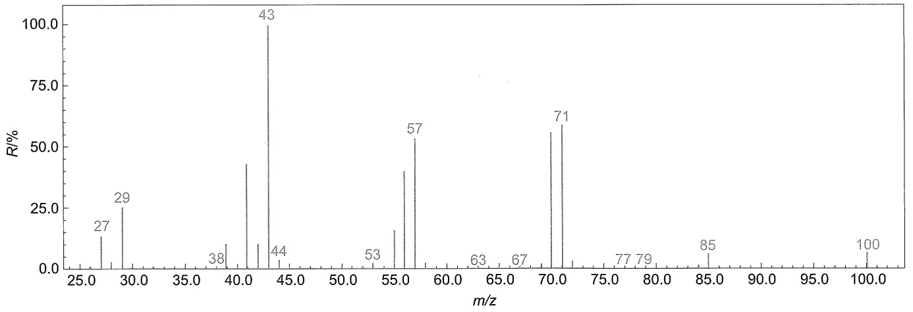

spectrogram

| m/z | R/% |
| --- | --- |
| 27 | ~15 |
| 29 | ~25 |
| 38 | ~5 |
| 43 | 100 |
| 44 | ~5 |
| 53 | ~5 |
| 57 | ~55 |
| 63 | ~5 |
| 67 | ~5 |
| 71 | ~60 |
| 77 | ~5 |
| 79 | ~5 |
| 85 | ~5 |
| 100 | ~5 |

图8-2 3-甲基己烷的质谱图

## 8.1.3 质谱中的离子

由分子形成离子有很多种方法，方法不同，产生的离子类型就可能不同。以下内容以电子轰击电离（EI）为主进行介绍。

在电子轰击下，样品分子可以产生分子离子，分子离子进一步发生化学键的断裂或重排将产生各种碎片。而分子离子和碎片还有可能与其他分子、离子、自由基结合形成络合离子等。当然，由于各种元素天然同位素的存在，各峰同时也会伴随有同位素峰。下面分类介绍。

## 1. 分子离子

分子经电离失去一个电子所得的离子为分子离子，用  $M^{+}$  表示。其 m/z (z=1) 是该化合

---

280

第八章 有机化合物结构鉴定

物的相对分子质量。利用质谱法测定相对分子质量是目前最准确和用样量最少的分析方法。

由分子离子形成的峰即分子离子峰，一般位于质荷比最高位置的那一端，但不一定是质荷比最大的离子峰。有机化合物分子稳定性不同，造成质谱图中分子离子峰丰度不同，甚至某些情况下分子离子峰不出现。有机化合物中，大部分化合物所产生的分子离子相当稳定。有机化合物分子离子的稳定性顺序大致如下:

$$
\text {芳香化合物} > \text {共轭链烯} > \text {烯烃} > \text {脂环化合物} > \text {直链烷烃} >
$$

$$
\text {酮} > \text {胺} > \text {酯} > \text {醚} > \text {酸} > \text {支链烷烃} > \text {醇}
$$

## 2. 同位素离子

自然界中，大多数元素都伴有两种或两种以上的同位素，并按固定比例存在。在质谱图中，同位素离子峰相对于最丰同位素峰的强度取决于分子所含的元素种类、数目和同位素的天然丰度。分子离子峰的同位素峰在分子式的推断中有重要用途。

## 3. 碎片离子

分子离子进一步裂解或重排形成的各种碎片即碎片离子，裂解和重排由化合物分子结构决定。碎片离子包括简单裂解离子和重排离子，简单裂解离子是由分子离子或其他碎片离子经过一个共价键的简单开裂，失去一个自由基或一个中性分子后形成的离子；重排离子是分子离子或碎片离子经重排反应产生的离子，其结构并非原来分子中的结构单元。质谱中，碎片离子相应的谱峰即碎片离子峰，其 m/z 小于分子离子。

## 4. 亚稳离子

质谱中有时会出现个别极弱但很宽的峰（可能跨2～5个质量单位），这种峰叫亚稳离子峰。亚稳离子峰的产生是有些离子离开离子源之后，进入质量分析器之前，裂解失去一个中性碎片所致。利用亚稳离子可以推断某一母离子和其子离子之间的关系。例如，某亚稳离子 $m^{*}/z$ 是由 $m_{1}/z$ 失去中性碎片生成 $m_{2}/z$ 而产生的。则表观质量 $m^{*}$ 与 $m_{1}$ 和 $m_{2}$ 的关系如下:

$$
m ^ {*} = \frac {m _ {2} ^ {2}}{m _ {1}} \tag {8-5}
$$

因而，亚稳离子峰可以帮助确证 $m_{1} \rightarrow m_{2}$ 的裂解过程。

## 5. 多电荷离子

在离子源尤其是软电离源中电离的分子或碎片可能连续失去两个或多个电子，由此形成的离子称为多电荷离子，其质荷比 $m / z$ 中 $z = n (n \geqslant 2)$，$n$ 是失去的电子数。因此，质谱图中多电荷离子峰可能出现在非整数位置上。对于高分子或生物分子等大分子量的样品电离时失去多个电子，将使 $m / z$ 数值成倍减小而利于质谱的测定。

## 6. 络合离子

在离子源中，离子与其他带电碎片、中性分子或自由基互相碰撞发生二级反应形成的新离子即络合离子。络合离子可能是分子离子夺取中性分子中一个氢原子形成的 $(\mathrm{M} + \mathrm{H})^{+}$ 峰，也可能是分子与碎片离子形成的 $(\mathbf{M} + \mathbf{F})^{+}$ 峰（$\mathbb{F}$:碎片）。其 $m/z$ 可能大于相对分子量而出现在质荷比最高位置的那一端。因此，要注意不要将络合离子峰误判为分子离子峰。

---

8.1 质谱

281

## 8.1.4 常见有机化合物的质谱裂解类型

有机化合物外层电子有 n、 $\pi$  和  $\sigma$  三种。在电子轰击电离中，分子失去外层电子的先后顺序为  $n > \pi > \sigma$ 。分子电离后产生的电荷或自由基优先定域于杂原子或  $\pi$  键共轭体系。

有机分子具有偶数个电子，自由基具有奇数个电子。有机分子失去一个电子后形成的分子离子带有奇数个电子。质谱裂解过程中，脱除小分子，离子裂解前后电子数奇偶性不会发生变化；而脱除自由基，离子裂解前后电子数奇偶性就会相反。带有奇或偶数个电子的离子分别称为奇电子（odd electron，OE）离子和偶电子（even electron，EE）离子。通常情况下，奇电子碎片离子可以脱除自由基（R）或小分子（Nee），分别形成偶电子碎片离子和奇电子碎片离子；而偶电子碎片离子更倾向于脱除小分子，形成偶电子碎片离子，很少发生脱除自由基的裂解，这就是质谱偶电子规则，通式表示如下:

$$
\begin{array}{l} \mathrm{OE} \rightarrow \mathrm{EE} + \mathrm{R} \\ \mathrm{OE} \rightarrow \mathrm{OE} + \text {Nee} \\ \mathrm{EE} \rightarrow \mathrm{EE} + \text {Nee} \\ \mathrm{EE} \rightarrow \mathrm{OE} + \mathrm{R} (\text {很少发生}) \\ \end{array}
$$

裂解前后碎片离子电子数的奇偶性变化有助于分析质谱裂解过程。质谱图中只能看到谱峰的 m/z 和丰度值，电子数的奇偶性需要根据碎片离子的组成和质量数奇偶性进行推断。

通常组成有机化合物的元素有碳、氢、氧和氮四种元素。这四种元素中，碳和氧（最丰同位素  ${}^{12}C$  和  ${}^{16}O$ ）原子的质量及化合价均为偶数，氢（最丰同位素  ${}^{1}H$ ）原子的质量及化合价均为奇数，仅有氮（最丰同位素  ${}^{14}N$ ）原子的质量为偶数，化合价为奇数。因此，质量数的奇偶性可以由氮数确定。当分子不含氮或含有偶数个氮原子时，其氢原子总数必为偶数，故其相对分子质量一定是偶数。而分子含奇数个氮原子时，其氢原子总数必为奇数，所以相对分子质量也一定是奇数。据此，判断碎片离子含偶数个电子还是奇数个电子就有了如下规则，即氮规则:

（1）由碳、氢、氧和氮组成的离子，其中氮原子数为偶数（包括零）时，如果离子的质量数为偶数，则必含奇数个电子；如果离子的质量数为奇数，则必含偶数个电子。即氮原子数为偶数（包括零）时，碎片质量数与电子数奇偶性相反。
（2）由碳、氢、氧和氮组成的离子，其中氮原子数为奇数时，如果离子的质量数为偶数，则必含偶数个电子；如果离子的质量数为奇数，则必含奇数个电子。即氮原子数为奇数时，碎片质量数与电子数奇偶性相同。

含奇数电子的离子用 “+•” 表示，含偶数电子的离子用 “+” 表示，正电荷和单电子位置应尽可能明确地表示出来。当其位置不是很明确时，可用方括号将结构式括起来，在括号外右上角标出；或结构式右上角画直角标出。下列碎片离子电子奇偶性可以很容易应用 “氮规则” 进行判断而正确地标出:

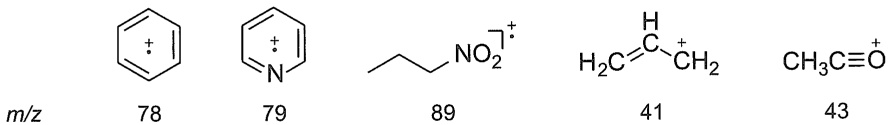

chemical

Chemical structures of naphthalene, nitrobenzene, and nitroalkane with corresponding m/z values

质谱裂解过程中，化学键的断裂或重排脱除相应的中性部分可能涉及一个电子或一对电子的转移。在质谱裂解式中，通常用箭头来表示电子的转移。其中，半箭头（$\bigwedge$）表示一个

---

282

第八章 有机化合物结构鉴定

电子的转移；全箭头（）表示一对电子的转移。

有机化合物共价键的断裂方式有均裂、异裂和半异裂三种方式，具体表示如下:

（1）均裂:共价键两电子各去一侧，此键断裂，正电荷保留于原侧。

$$
X ^ {- \stackrel {+ \circ} {Y}} \quad \longrightarrow \quad \stackrel {\circ} {X} \quad + \quad \stackrel {+} {Y}
$$

（2）异裂:共价键两电子去电荷所在的一侧，此键断裂，正电荷转移至另一侧。

$$
X ^ {- \stackrel {\rightharpoonup} {Y} ^ {+}} \quad \longrightarrow \quad \stackrel {{+}} {{X}} \quad + \quad Y
$$

（3）半异裂:共价键失去一个价电子后，离子再裂解，剩下的单电子转移到一侧，导致此键断裂。

$$
X - Y \quad \xrightarrow {- e ^ {-}} \quad X ^ {\circ} + Y \quad \longrightarrow \quad \dot {X} \quad + \quad \dot {Y} ^ {+}
$$

分子电离失去一个电子后形成的分子离子是其后质谱中裂解碎片的起始离子，分子离子和碎片离子的裂解都是由结构中正电荷中心或游离基中心引发的。分子离子或碎片离子仅断开一个化学键的开裂称作简单裂解，质谱中 $90\%$ 以上的裂解都是由简单裂解产生的。分子离子或碎片离子在裂解过程中还可能涉及一个以上化学键的断裂，同时有新的化学键的生成，导致后续离子的原子排列不同于原分子相应部分的结构，这种裂解称为重排裂解。下面分类介绍常见有机化合物的质谱裂解类型。

## 1. 简单裂解

一个电子或一对电子转移都可能导致一个化学键断裂。由自由基强烈的配对倾向导致一个电子转移重新组成新键，在  $\alpha-$  位发生断裂脱除自由基的裂解称为  $\alpha-$  裂解。由正电荷引发的诱导效应（i-效应）导致一对电子转移，同时正电荷中心位置转移的裂解称为 i-裂解。奇电子离子中正电荷和自由基中心同时存在，引发的  $\alpha-$  裂解和 i-裂解二者间存在着竞争。

α-裂解:自由基配对引起的裂解倾向与自由基所在部位原子的给电子能力有关，其顺序为 N > S、O、烯键 > Cl > Br > H。

例如，烯烃、烷基苯类的  $\alpha$ -裂解:

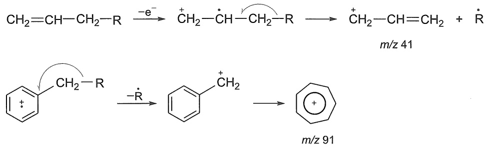

醇类的  $\alpha$ -裂解:

$$
\mathrm{R} - \mathrm{CH} _ {2} - \mathrm{OH} \xrightarrow {- \mathrm{e} ^ {-}} \mathrm{R} - \mathrm{CH} _ {2} - \stackrel {+ \bullet} {\mathrm{OH}} \longrightarrow \stackrel {\cdot} {\mathrm{R}} + \mathrm{CH} _ {2} = \stackrel {+} {\mathrm{OH}} \quad m / z 3 1
$$

分子中同时存在杂原子氮和氧时，由于氮原子的给电子能力远大于氧原子的给电子能

---

8.1 质谱

283

力，使氮原子中心引发的  $\alpha-$  裂解与氧原子中心引发的  $\alpha-$  裂解相比成为优势裂解。例如，2-氨基乙醇的质谱基峰是 m/z 30，而 m/z 31 峰丰度仅为 4.1%。

由氮原子中心引发的  $\alpha-$  裂解:

$$
\mathrm{H} _ {2} \mathrm{N} - \mathrm{CH} _ {2} - \mathrm{CH} _ {2} - \mathrm{OH} \xrightarrow {- \mathrm{e} ^ {-}} \mathrm{H} _ {2} \stackrel {+ \cdot} {\mathrm{N}} - \mathrm{CH} _ {2} - \mathrm{CH} _ {2} - \mathrm{OH} \longrightarrow \mathrm{H} _ {2} \stackrel {+} {\mathrm{N}} = \mathrm{CH} _ {2} + \dot {\mathrm{CH}} _ {2} - \mathrm{OH} \quad m / z 3 0
$$

由氧原子中心引发的  $\alpha-$  裂解:

$$
\mathrm{H} _ {2} \mathrm{N} - \mathrm{CH} _ {2} - \mathrm{CH} _ {2} - \mathrm{OH} \xrightarrow {- \mathrm{e} ^ {-}} \mathrm{H} _ {2} \mathrm{N} - \mathrm{CH} _ {2} - \mathrm{CH} _ {2} - \stackrel {+ +} {\mathrm{OH}} \longrightarrow \mathrm{H} _ {2} \mathrm{N} - \stackrel {\cdot} {\mathrm{CH}} _ {2} + \mathrm{CH} _ {2} = \stackrel {+} {\mathrm{OH}} \quad m / z 3 1
$$

i-裂解:奇电子离子和偶电子离子中的正电荷都可以引发诱导效应，转移一对电子，使化学键断裂。奇电子离子由于有两个引发中心，相互间存在着竞争。一般正电荷自由基位于杂原子上时，诱导效应导致的 i-裂解使电荷发生转移的倾向是卤素>O、S >> N、C。例如，2-氯丙烷的质谱图（图 8-3）中 m/z 43 的基峰就是由分子离子的 i-裂解产生的，由氯原子自由基中心引发的 α-裂解会导致甲基自由基的离去产生 m/z 63。

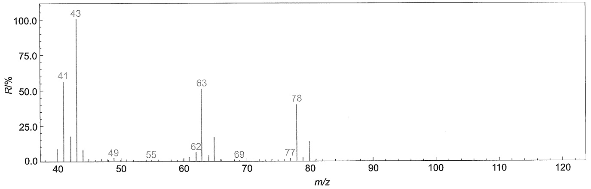

spectrogram

| m/z | R/% |
| --- | --- |
| 41 | ~58 |
| 43 | 100 |
| 49 | ~5 |
| 55 | ~3 |
| 62 | ~8 |
| 63 | ~52 |
| 69 | ~3 |
| 77 | ~5 |
| 78 | ~42 |

图 8-3 2-氯丙烷的质谱图

对比 m/z 43 和 m/z 63 两峰，i-裂解占据绝对优势。

$$
\begin{array}{c} \mathrm{Cl} ^ {+} \\ \mathrm{CH} _ {3} \end{array} \longrightarrow \begin{array}{c} \mathrm{Cl} ^ {+} \\ \mathrm{m/z43} \end{array} + \dot {\mathrm{Cl}} \quad \begin{array}{c} \mathrm{Cl} ^ {+} \\ \mathrm{CH} _ {3} \end{array} \longrightarrow \begin{array}{c} \mathrm{Cl} ^ {+} \\ \mathrm{m/z63} \end{array} + \dot {\mathrm{CH}} _ {3}
$$

对于分子离子裂解产生的偶电子离子的简单裂解，只可能发生 $i-$ 裂解，如苯乙酮分子离子 $\alpha-$ 裂解脱除甲基后产生的苯甲酰离子的裂解产生 $m/z$ 77 峰。

$$
\text {C}_6\text{H}_5\text{COCH}_3 \xrightarrow{-\dot{\text{CH}}_3} \text {C}_6\text{H}_5\text{COO} \xrightarrow{\text{m/z 105}} \text {C}_6\text{H}_5^+ + \text{CO}
$$

---

284

第八章 有机化合物结构鉴定

一般来说，简单开裂中自由基引发的裂解重要性大于诱导效应引发的裂解。

σ-裂解:烷烃类化合物由于只有 σ 键，电离形成正离子自由基后只能发生 C-C 之间的 σ 键的断裂产生碎片离子。这种 σ 键断裂形成正电荷和自由基的裂解称为 σ-裂解。

$$
\mathrm{R} - \mathrm{R} ^ {\prime} \xrightarrow {- \mathrm{e} ^ {-}} \mathrm{R} ^ {+} \cdot \mathrm{R} ^ {\prime} \longrightarrow \mathrm{R} ^ {+} + \cdot \mathrm{R} ^ {\prime}
$$

裂解中很容易生成 $m / z$ 29、$m / z$ 43、$m / z$ 57等系列峰，如正戊烷的 $\sigma$-裂解如下:

$$
\begin{array}{c} \text {CH}_3\text {CH}_2\text {CH}_2^+ + \dot{\text {CH}}_3 \\ \text {m/z 57} \\ \text {CH}_3\text {CH}_2\text {CH}_2^+ + \dot{\text {CH}}_2\text {CH}_3 \\ \text {m/z 43} \\ \text {CH}_3\text {CH}_2^+ + \dot{\text {CH}}_2\text {CH}_2\text {CH}_3 \\ \text {m/z 29} \end{array}
$$

随着碳链的增长，分子离子峰和脱甲基峰强度都会减弱；饱和环烃容易在环与侧链处碎裂；支链烷烃容易在碳链分支部位裂解，烷基取代基越多，该部位越容易断裂。图8-2所示的3-甲基己烷的质谱图中， $m / z$ 85、 $m / z$ 71和 $m / z$ 57是支链处丢失甲基、乙基和丙基形成的。

在简单裂解过程，分子离子或奇电子碎片离子脱离一个游离基，那么裂解生成的碎片离子一定含偶数个电子；偶电子离子，脱除小分子后，依然是偶电子离子。

## 2. 重排裂解

质谱中，重排裂解在共价键断裂的同时，发生氢原子或小基团的迁移生成新键，产生了结构不同于原分子结构单元的稳定的重排离子。裂解碎片某些特殊位置和特定种类原子或基团排列变化，对有机化合物结构的理解、分析和鉴定很有帮助。

重排裂解类型较多，机理复杂，有多种分类方法。按引发机制分类有自由基中心引发的重排和正电荷中心引发的重排；按氢或基团迁移经过的环状过渡态大小也可分为四元环、六元环过渡态重排等；按重排迁移的基团可以分为氢迁移，甲基、乙基、氨基迁移等。另外，还有比较特殊的如环的裂解、双重重排等。下面仅介绍典型而重要的麦氏重排、逆D-A重排和氢原子重排到饱和杂原子并脱除小分子的重排。

麦氏重排（McLafferty rearrangement）:1956年美国质谱学家F.W.Mclafferty提出了一种自由基引发的氢原子经过六元环过渡态的重排。当有机化合物含有不饱和基团，并且与不饱和基团相连的 $\gamma -\mathrm{C}$ 上有可移动的氢时，质谱裂解过程会发生 $\gamma -\mathrm{H}$ 通过六元环过渡态转移到不饱和基团上，并伴随发生 $C^\alpha -C^\beta$ 键断裂，如图8-4所示。

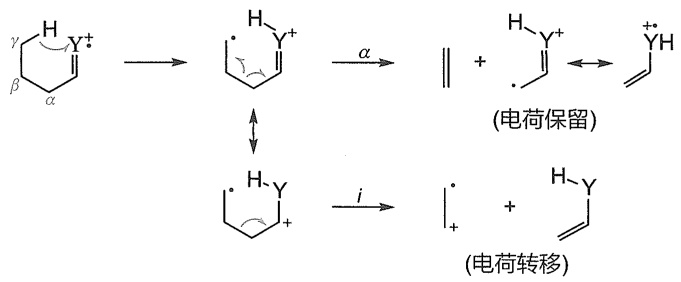

chemical

Reaction mechanism diagram showing electron transfer and ion movement of a radical intermediate

图8-4 麦氏重排机理

---

8.1 质谱

285

具有  $\gamma-H$  的烷基取代苯和烯烃等化合物都可以发生麦氏重排。如正丙基苯的质谱，峰 m/z 92 就是麦氏重排产生的碎片峰，其裂解机理如下:

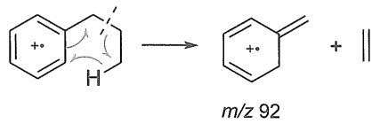

chemical

Chemical reaction showing hydrogen bonding forming a benzene derivative with m/z 92 and double bond

碎片离子如果符合重排条件，也可以发生麦氏重排。如4-庚酮连续发生了两次麦氏重排，产生 $m / z$ 86和 $m / z$ 58峰:

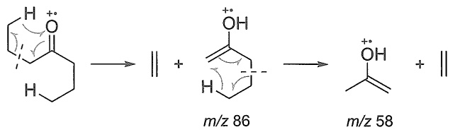

chemical

Chemical reaction mechanism showing oxidation of a ketone to form m/z 86 and m/z 58, with electron transfer indicated

逆 D-A 重排（retro Diels-Alder rearrangement，RDA）:逆 D-A 重排是指按 Diels-Alder 反应的逆向过程进行，发生环己烯结构的破裂产生共轭二烯体和单烯体的重排，通常正电荷优先保留在具有较低电离电势的碎片上。在没有特殊基团影响时，共轭二烯体电离电势比单烯体低，因此一般会形成一个共轭二烯奇电子离子及一个烯烃分子（图 8-5）。

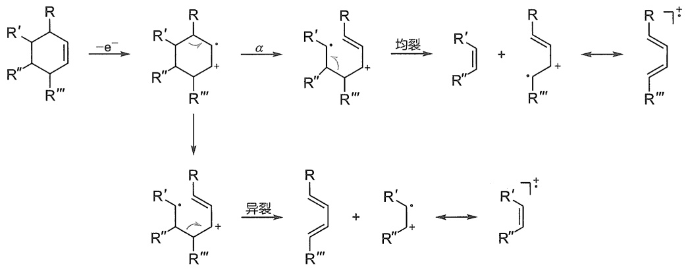

flowchart

图8-5 逆D-A重排机理

取代基对逆D-A重排影响很大，某些情况下，正电荷也可能保留在含一个烯键的碎片上，生成单烯奇电子离子。如环己烯、4-甲基环己烯和4-苯基环己烯比较，相应单烯体和共轭二烯体重排裂解离子谱峰丰度有显著不同。

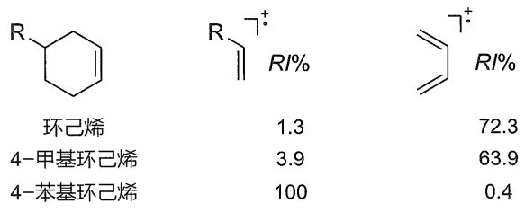

chemical

Three substituted cyclohexane derivatives with associated RI% values

氢原子重排到饱和杂原子并脱除小分子的重排:分子离子饱和杂原子上的正电荷游离基的未成对电子与邻近处于适当构型的氢原子形成一个新键，即一个氢原子转移到杂原子上，随后脱去一个小分子，如醇的脱水和卤代烃脱氢卤等。

---

286

第八章 有机化合物结构鉴定

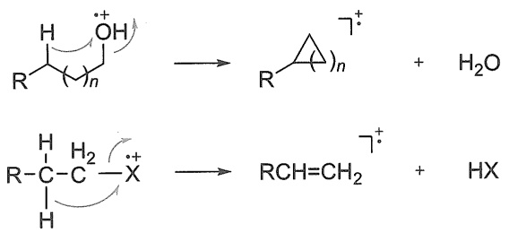

chemical

Chemical reaction mechanism showing protonation and deprotonation steps of a cyclic alcohol derivative

在己-1-醇的质谱图（图8-6）中，分子离子峰并未出现，质量高端出现了脱水 $m / z$ 84峰。

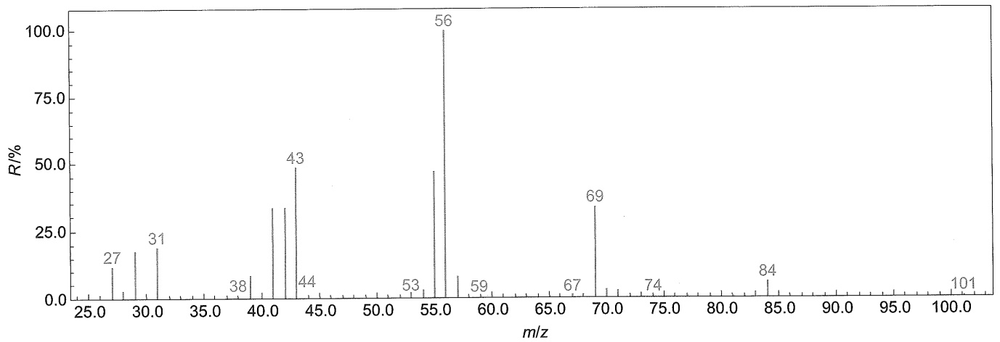

spectrogram

| m/z | R/% |
| --- | --- |
| 27 | ~12 |
| 31 | ~18 |
| 38 | ~5 |
| 43 | ~50 |
| 44 | ~5 |
| 53 | ~5 |
| 56 | 100 |
| 59 | ~5 |
| 67 | ~5 |
| 69 | ~35 |
| 74 | ~5 |
| 84 | ~8 |
| 101 | ~5 |

图 8-6 己-1-醇的质谱图

## 8.1.5 影响离子形成的因素

质谱裂解产生的碎片离子 m/z 数值是确定的，但是谱峰的强度却有高有低；即使化合物同类型质谱裂解，相关的谱峰也会有很大强度差异，这都说明质谱的裂解受到了很多因素的影响。分子电离产生分子离子后，分子离子能否断裂形成碎片离子或碎片离子能否进一步地裂解，除离子源的因素外，还主要受离子中化学键相对强度、裂解产物的稳定性及分子的空间排布等诸多因素的影响。

首先，键的相对强度。一般来说，分子裂解时最先从分子中强度最弱也就是键能最小处断裂。当分子中含单键、双键、叁键时，断裂的优先顺序肯定是单键 $\gg$ 双键 $>$ 叁键。

其次，裂解产物的稳定性。包括裂解离子、自由基和中性分子的稳定性。稳定的裂解离子丰度通常比较大，如果能方便地脱除小分子形成的碎片离子丰度也会比较强。在反应中心能发生一个以上相同的裂解时，具有较低电离电势的碎片丰度比较大。

最后，原子或基团相对的空间排布影响比较复杂，不但会影响裂解过程，也会影响产物的稳定性。

另外，还有最大烷基优先丢失原则。在反应中心有超过一个烷基取代基时，失去最大烷基游离基形成的碎片谱峰的丰度最大。

## 8.1.6 分子式的确定

确定分子式是质谱主要的用途之一。质谱是通过分子离子峰及其同位素峰确定分子式的。其中谱峰质荷比和同位素峰丰度的精确测定起到了关键作用。当然，也可以用同样的方

---

8.1 质谱

287

法确定碎片离子组成式。

分子离子峰的确定，需要注意以下几点:

(1) 分子离子  $M^{+}$  都是奇电子离子, 质量数必须符合氮规则。即分子离子质量数是偶数, 则不含氮, 或含有偶数氮; 其质量数为奇数, 则含有奇数氮。
(2) 分子离子由最丰同位素组成, 相对分子质量确定采用最丰同位素原子的质量数相加得到。
（3）分子离子峰必须是谱图中最高质量端的离子，并需要区别:①其同位素峰及某些质量数较大的络离子。如多氯、溴代化合物同位素峰丰度会超过分子离子峰丰度；某些化合物电离时，容易结合质子形成 $\mathrm{M} + \mathrm{H}$ 峰或与中性分子相撞生成络合离子。②分子离子如果不稳定，离子峰就会很弱甚至不出现。如有些化合物容易失氢形成 $\mathrm{M} - \mathrm{H}$ 峰或更小的碎片峰。
（4）分子离子能够通过丢失合理的碎片，产生谱图中高质量区的重要离子，因此与相邻峰之间的质量差必须是合理的。

质谱中，分子式的确定一般有高分辨质谱法和同位素丰度法两种方法。分子离子是失去一个电子所形成的，由于电子的质量很小，所以分子离子的质荷比（z=1）在数值上与分子相对质量相等。在质谱分析中，依据分子离子峰的质荷比数据即可准确快速地确定化合物的相对分子质量。目前，质谱测定精确度越来越高，质量方面可以精确测定到小数点后6～7位数值，丰度方面也可以精确测定到小数点后3～4位数值，为分子式的确定提供了可靠保证。

## 1. 高分辨质谱法

原子的相对质量以  ${}^{12}C = 12.000000$  为基准，如表 8-1 所见，各元素的相对原子质量与之相比并不是整数。质谱分辨率越高，测定越准确，误差越小。例如，整数相对分子质量是 28 的氮气和一氧化碳分子，其相对分子质量精确到小数点后 4 位分别为 28.0061 和 27.9949，小数部分存在很大差异。

表 8-1 重要元素的相对原子质量和同位素相对天然丰度表

| 同位素 | 相对原子质量 | 相对天然丰度 | 同位素 | 相对原子质量 | 相对天然丰度 |
| --- | --- | --- | --- | --- | --- |
| $^1\text{H}$ | 1.007825 | 100.000 | $^{28}\text{Si}$ | 27.976927 | 100.000 |
| $^2\text{H}$ | 2.014102 | 0.012 | $^{29}\text{Si}$ | 28.976495 | 5.078 |
| $^3\text{H}$ | 3.016049 | 痕量 | $^{30}\text{Si}$ | 29.973770 | 3.347 |
| $^{12}\text{C}$ | 12.000000 | 100.000 | $^{32}\text{S}$ | 31.972071 | 100.000 |
| $^{13}\text{C}$ | 13.003355 | 1.082 | $^{33}\text{S}$ | 32.971458 | 0.801 |
| $^{14}\text{N}$ | 14.003074 | 100.000 | $^{34}\text{S}$ | 33.967867 | 4.519 |
| $^{15}\text{N}$ | 15.000109 | 0.369 | $^{35}\text{Cl}$ | 34.968853 | 100.000 |
| $^{16}\text{O}$ | 15.994915 | 100.000 | $^{37}\text{Cl}$ | 36.965903 | 31.961 |
| $^{17}\text{O}$ | 16.999132 | 0.038 | $^{79}\text{Br}$ | 78.918338 | 100.000 |
| $^{18}\text{O}$ | 17.999160 | 0.205 | $^{81}\text{Br}$ | 80.916291 | 97.278 |

一般测定有机化合物分子离子质量数的误差在  $\pm0.005$  范围内，可能的分子式数目就很少了，结合其他信息，即可确定最合理的分子式。分辨率越高，可能的分子式数目就越少，甚至给出唯一结果。高分辨质谱结合小程序计算即能方便快捷地给出化合物的分子式。高分辨质谱法是当前确定分子式最常用的方法。

---

288

第八章 有机化合物结构鉴定

»例 8-1 某质谱峰对应化学式是 $\mathrm{C_9H_{11}N_2O}$，能否通过质谱区分用 1 个 $^{13}\mathrm{C}$ 或 $^{15}\mathrm{N}$ 分别取代后的谱峰。

» 解 1 个 $^{13}\text{C}$ 取代得到 $^{13}\text{CC}_8\text{H}_{11}\text{N}_2\text{O}$，相对质量计算值 164.09049；1 个 $^{15}\text{N}$ 取代得到 $\text{C}_9\text{H}_{11}^{15}\text{NNO}$，相对质量计算值 164.08417。质谱测定准确到小数点后 3 位即可区分。

通过例题可以发现，即使分别在碳或氮原子上只增加一个中子，质谱也是完全可以发现的。

## 2. 同位素峰丰度法

组成有机化合物的主要元素有 C、H、O、N、S、Cl、Br 等，各元素的同位素丰度一般是固定的。有机化合物中常见重要元素的天然丰度见表 8-1。重同位素一般比轻同位素大 1 到 2 个相对原子质量。质谱中，分子离子峰的重同位素峰所对应的谱峰即 M+1、M+2 峰等，其相对丰度与同位素丰度相当。利用同位素峰的相对丰度可以确定分子式及碎片离子的化学组成。

针对分子组成元素的不同，可以采用三种计算同位素峰丰度的方法来获取分子式。

（1）只由 C、H、O、N 元素组成的化合物 这种类型的化合物中对 M+1 峰丰度作出贡献的是  ${}^{13}C$  和  ${}^{15}N$ ， ${}^{2}H$  和  ${}^{17}O$  由于丰度太低可忽略。对于 M+2 峰丰度作出贡献的是  ${}^{13}C$  和  ${}^{18}O$ 。这是由于碳原子在有机化合物分子中个数较多，同时有 2 个  ${}^{13}C$  存在的概率增大， ${}^{13}C$  对 M+2 峰的贡献值约为  $(1.1\times\text{碳数})^{2}/200$ ； ${}^{18}O$  对 M+2 峰也有贡献，由于计算中容易出现误差，一般最后确定氧的个数。设化合物的分子式是  $C_{x}H_{y}O_{z}N_{w}$ ，x、y、z 及 w 分别代表 C、H、O 及 N 的个数，其同位素离子峰强度（I）计算通式如下:

$$
I_{\mathrm{M} + 1}\% = 1.1x + 0.37w
$$

$$
I_{\mathrm{M} + 2}\% = (1.1x)^2 / 200 + 0.20z
$$

质谱法测得分子离子峰及其同位素 M+1、M+2 峰的相对强度后，将数据以 M 为准归一化，计算  $(M+1)/M$  及  $(M+2)/M$  相对强度比值，即相对同位素丰度值，再与标准值对照，即可确定可能的分子式。

»例 8-2 计算化合物 $\mathrm{C_4H_7NO}$ 的 $\mathrm{M} + 1$ 和 $\mathrm{M} + 2$ 峰相对于分子离子峰的强度。

>> 解 $I_{\mathrm{M} + 1}\% = 1.1x + 0.37w = 1.1\times 4 + 0.37\times 1 = 4.77$

$$
I_{\mathrm{M} + 2}\% = (1.1x)^2 /200 + 0.20z = (1.1\times 4)^2 /200 + 0.20\times 1 = 0.30
$$

如果样品测定值与计算值相等或非常接近， $C_{4}H_{7}NO$  就可能是样品分子式。

对于相对分子质量较小的化合物，也可采用估算法。

»例 8-3 某碳、氢和氧元素组成的化合物的相对分子质量为 72，分子离子峰 m/z 72（100%），m/z 73（3.5%），m/z 74（0.48%），推测化合物可能的分子式。

》解 由 M+1 峰相对丰度估算碳原子数目: $3.5 \div 1.1 \approx 3$

由 M+2 峰相对丰度估算氧原子数目: $0.48 \div 0.20 \approx 2$

由相对分子质量扣除碳和氧所占相对质量数后，计算氢原子数目: $72-3\times12-2\times16=4$ 所以，化合物分子式为 $C_{3}H_{4}O_{2}$ 。

（2）含 Cl 和 Br 元素组成的化合物 这两种元素同位素丰度相当大，主导了同位素峰的峰形，据此可确定化合物中 Cl 和 Br 元素的组成。去除 Cl 和 Br 的贡献后，再计算其他元素组成，得到分子式。

---

8.1 质谱

289

只有一种元素的同位素离子峰丰度比可按照 $(a + b)^{m}$ 二项展开式计算，式中 $a$ 和 $b$ 分别代表轻、重同位素丰度比值，$m$ 为其原子数目。两种及两种以上不同元素的同位素离子峰丰度比，通过相应种数的二项式相乘即可得出。例如，两种元素的同位素离子峰丰度比可按照 $(a + b)^{m}(c + d)^{n}$ 展开式计算。式中 $c$ 和 $d$ 分别代表另一种元素的轻、重同位素丰度比值，$n$ 为其原子数目。对于Cl和Br元素，轻和重两种同位素丰度比接近3:1和1:1，可以简化计算。

## »例 8-4 计算 $\mathrm{CH}_2\mathrm{Cl}_2$ 分子离子与其同位素离子峰相对丰度比。

》解 由于 Cl 原子同位素丰度相当大（ $^{35}Cl:^{37}Cl\approx3:1$ ）， $CH_{2}Cl_{2}$  分子离子（M）主要同位素离子峰为 M+2 和 M+4 峰，它们 Cl 的组成为 M（ $^{35}Cl_{2}$ ）、M+2（ $^{35}Cl^{37}Cl$ ）和 M+4（ $^{37}Cl_{2}$ ）。根据:

$$
(a + b) ^ {m} = (3 + 1) ^ {2} = 3 ^ {2} + 2 \times 3 \times 1 + 1 ^ {2} = 9 + 6 + 1
$$

所以 $\mathrm{M}:\left[\mathrm{M} + 2\right]:\left[\mathrm{M} + 4\right]\approx 9:6:1$

反之，如果质谱中 $\mathrm{M}$ 、 $\mathrm{M} + 2$ 、 $\mathrm{M} + 4$ 的相对强度符合 $9:6:1$ ，可以确定分子中有两个氯。

（3）含 S 和 Si 元素组成的化合物 质谱法测得的分子离子峰及其同位素 M+1、M+2 峰相对丰度，以 M 为准归一化后，检查 M+2 峰。根据丰度比值，首先排除 Cl 和 Br。之后，若其丰度 >3%，则需要考虑 S 和 Si 元素。用 s 和  $s_{i}$  分别代表 S 和 Si 原子的数目，即可将由 C、H、O、N、S 和 Si 元素组成的化合物相对同位素丰度值计算公式扩展为

$$
I_{\mathrm{M} + 1}\% = 1.1x + 0.37w + 0.80s + 5.08s_i
$$

$$
I_{\mathrm{M} + 2}\% = (1.1x)^2 /200 + 0.20z + 4.52s + 3.35s_i
$$

采用上述类似方法即可进行分子式的推导。

## 8.1.7 结构式的确定

质谱分析,不仅可提供化合物分子的相对质量和分子式,而且可以推测化合物的结构式。对于已知化合物,可以将样品的质谱图与在相同条件下测定的纯物质谱图或数据库中标准图进行比较来确定样品的分子结构式。未知样品的测定,可依据特征碎片离子及谱峰之间的差值特征来推测化合物中可能含有的官能团或结构单元,通过有机化合物的断裂规律分析各碎片之间的关系,合理连接成分子结构式。当然,很多情况下仅凭质谱不可能推导出未知样品的分子结构式,还需要再参照其他信息,综合分析才能推导出确切的结构式。

## »例 8-5 某液体化合物，沸点为 $136.2^{\circ}\mathrm{C}$，质谱图见图8-7，推导其分子式。

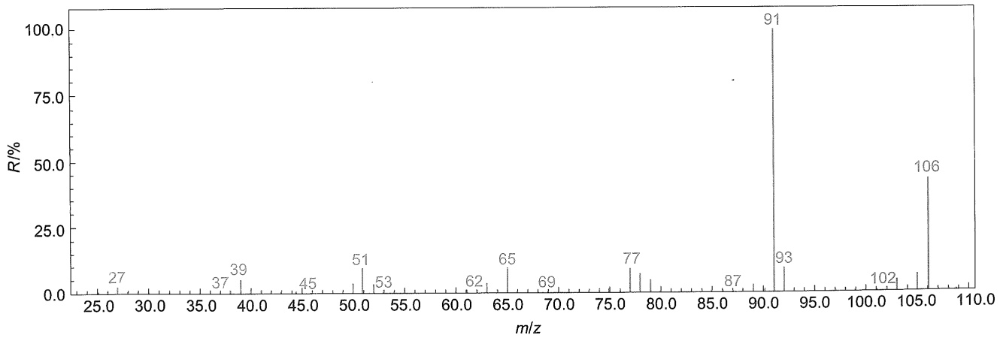

spectrogram

| m/z | R/% |
| --- | --- |
| 27 | ~5 |
| 37 | ~5 |
| 39 | ~8 |
| 45 | ~5 |
| 51 | ~10 |
| 53 | ~5 |
| 62 | ~5 |
| 65 | ~10 |
| 69 | ~5 |
| 77 | ~10 |
| 87 | ~5 |
| 91 | 100 |
| 93 | ~10 |
| 102 | ~5 |
| 106 | ~45 |

图8-7 某液体化合物的质谱图

---

290

第八章 有机化合物结构鉴定

》解 谱图中质荷比最大的峰 $m/z$ 106与基峰 $m/z$ 91相差15，脱除了一个甲基，丢失合理，确定 $m/z$ 106峰为分子离子峰。$m/z$ 91峰是烷基取代苯 $\alpha$-裂解产生的特征峰，而 $m/z$ 77、65、51和39是苯环特征系列峰，苯基质量数77，与106相差29，是一个乙基。因此，推断此化合物是乙苯。其裂解机理如下:

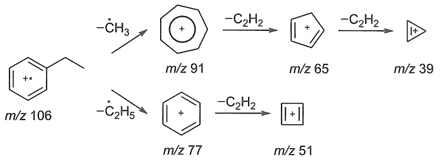

chemical

Reaction pathway showing conversion of benzene derivative to substituted cyclohexane and then to a pyridine derivative via intermediates m/z 91, 65, 39, 77, and 51

对比乙苯的沸点与已知沸点相同，确定化合物是乙苯。

»例 8-6 戊酸的质谱图见图 8-8，请给出主要谱峰的裂解机理。

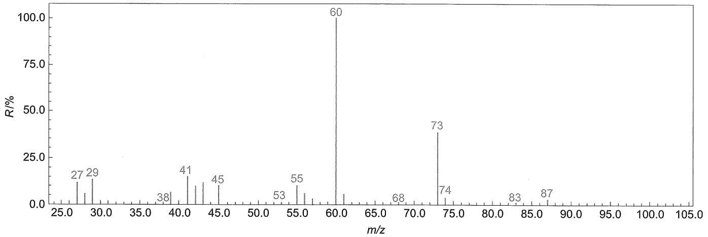

spectrogram

| m/z | R/% |
| --- | --- |
| 27 | ~12 |
| 29 | ~15 |
| 38 | ~3 |
| 41 | ~15 |
| 45 | ~12 |
| 53 | ~3 |
| 55 | ~10 |
| 60 | 100 |
| 68 | ~3 |
| 73 | ~38 |
| 74 | ~5 |
| 83 | ~3 |
| 87 | ~3 |

图8-8 戊酸的质谱图

》解 戊酸主要质谱裂解机理如下:

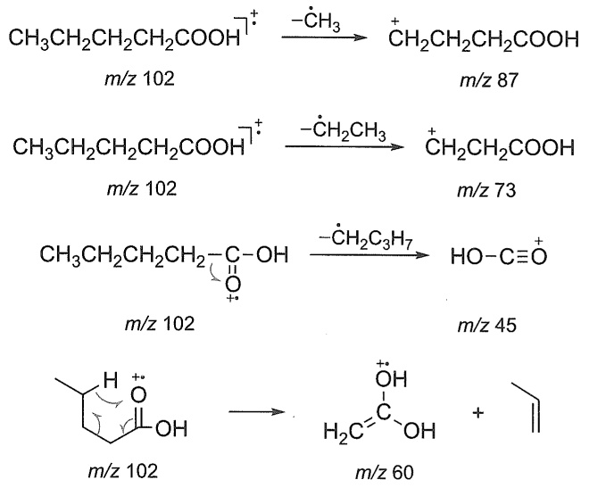

---

8.2 紫外-可见光谱

291

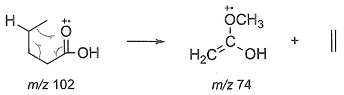

chemical

Chemical reaction converting compound m/z 102 to m/z 74 with oxidation state H₂C=C-OH and CH₃ group

## 8.2 紫外-可见光谱

紫外-可见光谱是最早应用于有机结构鉴定的物理方法之一，也是一种常用的快速、简便的分析方法。在确定有机化合物的共轭体系、生色基和芳香性等方面独具优势。目前，紫外-可见光谱已被广泛应用于化学、化工、生物、食品、环境等众多学科领域。

紫外-可见光谱是分子吸收紫外-可见光区（200～800 nm）的电磁波而产生的吸收光谱，又称为电子吸收光谱。

紫外-可见光可分为3个区域:远紫外区（10～200 nm）、紫外区（200～400 nm）、可见区（400～800 nm）。其中远紫外区又称真空紫外区，由于氧气、氮气、水、二氧化碳等对这个区域的紫外光有强烈的吸收，因此，对该区域的光谱研究较少。一般的紫外光谱仪都包括紫外光区和可见光区两部分，测试范围在200～800 nm，有的加宽至190～1000 nm，也有的与近红外或红外光谱联用。

## 8.2.1 紫外-可见光谱图

在紫外-可见光谱图中，纵坐标为吸光度 $A$ （仪器直接测得）、摩尔吸光系数 $\varepsilon$ 或 $\lg \varepsilon$ （由计算所得），横坐标为波长 $\lambda (\mathrm{nm})$ ，峰最高处的波长记为 $\lambda_{\mathrm{max}}$ ， $\lambda_{\mathrm{max}}$ 处对应的摩尔吸光系数 $\varepsilon$ 值是该样品的 $\varepsilon_{\mathrm{max}}$ ，如图8-9所示。吸收强度次于 $\lambda_{\mathrm{max}}$ 的波峰称为次峰；在吸收峰旁有时会有肩峰，用 $\lambda_{\mathrm{sh}}$ 表示；相邻两峰之间的最低点称为波谷，用 $\lambda_{\mathrm{min}}$ 表示；在吸收曲线短波处呈现吸收趋势但并未成峰的部分称为末端吸收。在紫外光谱图中， $\lambda_{\mathrm{max}}$ 取决于跃迁时的能级差，能级差越大，吸收光波的能量也越大， $\lambda_{\mathrm{max}}$ 就越小。$\varepsilon$ 值对应于跃迁的概率，跃迁概率越大，$\varepsilon$ 也越大。

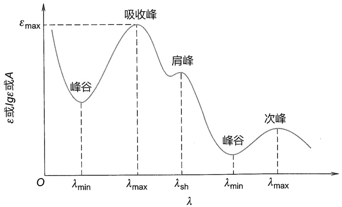

line

| Feature | Description |
| --- | --- |
| Y-axis | \(\epsilon\) or lgε or A |
| X-axis | \(\lambda\) |
| Peak 1 | 峰谷 |
| Peak 2 | 吸收峰 |
| Shoulder Peak | 肩峰 |
| Peak 3 | 峰谷 |
| Secondary Peak | 次峰 |

图 8-9 紫外-可见光谱图

---

292

第八章 有机化合物结构鉴定

## 8.2.2 紫外-可见光谱的基本原理

## 1. 基本原理

紫外-可见光谱是外层价电子吸收相应能量的电磁波发生跃迁而产生的。以A-B双原子组成的分子为例，分子轨道可以看作由对应的原子轨道线性组合而成。以双原子分子A-B的 $\sigma$ 键来说，一个分子轨道能量低，为成键分子轨道，称为 $\sigma$ 分子轨道；另一个分子轨道能量高，为空的反键分子轨道，称为 $\sigma^{*}$ 分子轨道。A-B分子处于基态时，成键电子分布在能量低的 $\sigma$ 分子轨道，对应能量为 $E_0$ 。当分子受紫外光照射时，吸收一定能量的紫外光，若此能量恰好等于基态 $E_0$ 与高能态 $E_{1}$ 的差值，电子从 $E_0$ 跃迁至 $E_{1}$，产生紫外光谱，如图8-10所示。

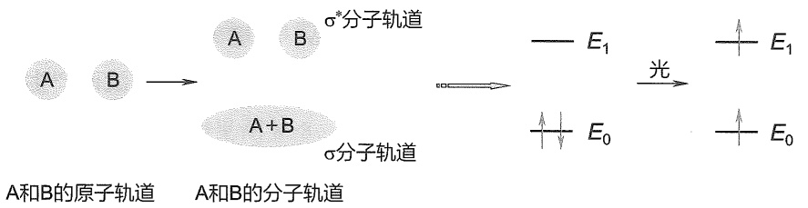

flowchart

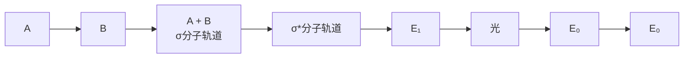

图 8-10 价电子跃迁示意图

## 2. 电子跃迁类型

有机化合物的外层电子主要有三种:形成单键的 $\sigma$ 电子、形成不饱和键的 $\pi$ 电子及杂原子上未成键的 n 电子。当吸收紫外-可见光后，电子从基态的 $\sigma$、$\pi$ 或 n 轨道跃迁到反键轨道 $\sigma^{*}$ 或 $\pi^{*}$，可能发生 $\sigma \rightarrow \sigma^{*}$、$\sigma \rightarrow \pi^{*}$、$\pi \rightarrow \sigma^{*}$、$n \rightarrow \sigma^{*}$、$\pi \rightarrow \pi^{*}$、$n \rightarrow \pi^{*}$ 等跃迁，其中，$\pi \rightarrow \sigma^{*}$ 和 $\sigma \rightarrow \pi^{*}$ 跃迁是禁阻的，不易发生。因此，有机化合物有以下四种电子跃迁:$\sigma \rightarrow \sigma^{*}$、$n \rightarrow \sigma^{*}$、$\pi \rightarrow \pi^{*}$、$n \rightarrow \pi^{*}$，跃迁所需能量按照以上次序依次递减，吸收波长依次增大，如图 8-11 所示。

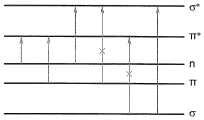

text_image

σ*
π*
n
π
σ

图 8-11 电子跃迁能级示意图

## 3. 紫外-可见光谱常用术语

（1）生色团（chromophore） 分子中某一基团或体系，在紫外-可见光区产生吸收而出现谱带，这一基团或体系即为生色团。有机化合物中，典型的生色团有烯键、羰基、羧基、酯基、硝基、偶氮基及芳香体系等。生色团的结构特征是含有  $\pi$  电子，少数情况是含有原子半径较大的杂原子。
（2）助色团（auxochrome） 分子中某一基团或体系在紫外-可见光区内不一定有吸收，但与生色团相连时可以使生色团的吸收带向长波方向移动，且吸收强度也相应增加，这一基团或体系称为助色团。助色团常含有 n 电子，常见助色团有 -OH、-Cl、-NH₂、-NO₂、-SH 等。

---

8.2 紫外-可见光谱

293

（3）红移（red shift）与蓝移（blue shift） 吸收峰向长波方向移动的现象称为红移；吸收峰向短波方向移动的现象称为蓝移。
（4）增色效应（hyperchromic effect）与减色效应（hypochromic effect）使吸收带强度增加的作用称为增色效应，使吸收带强度减弱的作用称为减色效应。

## 4. 紫外-可见光谱吸收带

（1）R 带（Radikalartin 德文，基团型的） R 带为  $n \rightarrow \pi^{*}$  跃迁引起的吸收带，产生该吸收带的化合物一般含有  $p-\pi$  共轭体系等生色团，如  $-NO_{2}$ 、-C=O、-CHO 等。R 带的特征是强度弱  $\varepsilon < 100 (\lg \varepsilon < 2)$ ， $\lambda_{max}$  一般在 270 nm 以上。下面是两种化合物的 R 带:

$$
\begin{array}{l l l l} \mathrm{CH} _ {3} \mathrm{CHO} & \lambda_ {\max} ^ {\text {heptane}} & 2 9 1 \mathrm{nm} & \varepsilon 1 1 \\ \mathrm{CH} _ {2} = \mathrm{CH-CHO} & \lambda_ {\max} ^ {\text {EtOH}} & 3 1 5 \mathrm{nm} & \varepsilon 1 4 \end{array}
$$

（2）K 带（Konjugierte 德文，共轭的） K 带为  $\pi\rightarrow\pi^{*}$  跃迁引起的吸收带。K 带的特点是吸收峰强度大， $\varepsilon\geqslant10000(\lg\varepsilon\geqslant4)$ 。孤立不饱和键的  $\pi\rightarrow\pi^{*}$  吸收带一般在真空紫外区，难以看到，但随着共轭双键增加，吸收谱带发生红移，且强度增强。
（3）芳香化合物的吸收带 芳香化合物有三个  $\pi\rightarrow\pi^{*}$  跃迁的吸收峰，即一个 B 带（benzene band，苯型谱带）和两个 E 带（ethylene band，乙烯型谱带），如图 8-12 所示。

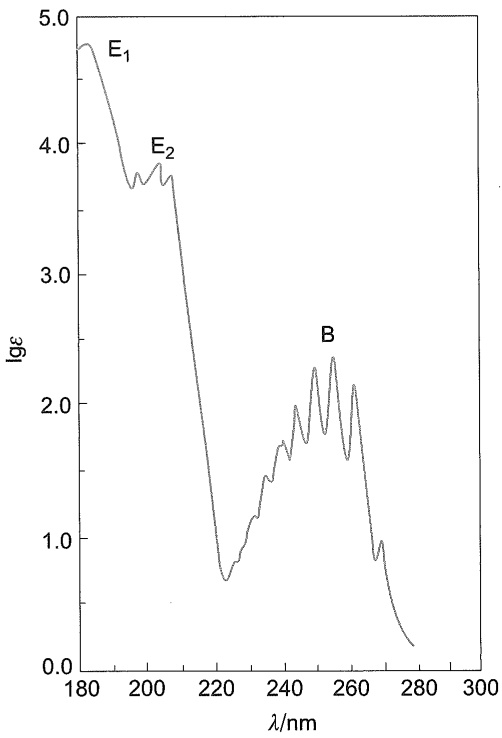

line

| \(\lambda/\)nm | \(lg\epsilon\) |
| --- | --- |
| 180 | ~4.8 |
| 200 | ~3.7 |
| 210 | ~3.8 |
| 220 | ~0.7 |
| 230 | ~1.2 |
| 240 | ~1.6 |
| 250 | ~2.3 |
| 260 | ~2.1 |
| 270 | ~1.0 |
| 280 | ~0.2 |

图 8-12 苯的紫外吸收光谱图

B 带由苯的  $\pi\rightarrow\pi^{*}$  跃迁和振动效应的重叠所引起，为一宽峰并出现若干小峰，在 230～270 nm，中心在 254 nm 处， $\varepsilon\approx250$ 。苯环被取代后，精细结构消失或部分消失。因此，B 带常用来识别芳香化合物。
E 带分为  $E_{1}$  和  $E_{2}$  带。 $E_{1}$  带为苯环的特征谱带，该谱带处于真空紫外区， $\lambda_{max} \approx 184 \, nm$ ， $\varepsilon > 10^{4}$ 。当苯环上有助色团时， $E_{1}$  带向长波方向移至  $200 \sim 220 \, nm$ 。 $E_{2}$  带是由苯环中共轭二

---

294

第八章 有机化合物结构鉴定

烯的  $\pi\rightarrow\pi^{*}$  跃迁所产生的，有精细结构，与  $E_{1}$  带相重叠， $\lambda_{max}\approx203\ nm,\quad\varepsilon=7400$ 。当苯环引入生色团与苯环共轭时， $E_{2}$  带将红移至  $220\sim250\ nm,\quad\varepsilon>10^{4}$ ，此时亦称为 K 带。

## 8.2.3 紫外-可见光谱的影响因素

影响紫外-可见光谱的主要因素有共轭效应、超共轭效应、空间效应及外部影响因素等。

## 1. 共轭效应

随着  $\pi-\pi$  共轭体系增加，HOMO 能级升高，LUMO 能级降低， $\pi\rightarrow\pi^{*}$  跃迁所需能量减小，最大吸收波长红移。

$p-\pi$ 共轭对紫外-可见吸收光谱的影响与 $\pi-\pi$ 共轭不同。以羰基 $n\rightarrow\pi^{*}$ 跃迁为例:酸、酯等化合物中羰基与杂原子氧上的未成对电子发生 $p-\pi$ 共轭，使得n轨道能量降低， $\pi^{*}$ 轨道能量升高， $n\rightarrow\pi^{*}$ 跃迁所需能量升高，其谱带发生蓝移；并且将RCOOH转变为 $RCOO^{-}$ 时，由于氧负离子与羰基发生 $p-\pi$ 共轭，所以蓝移更多。

## 2. 超共轭效应

超共轭效应对  $\pi\rightarrow\pi^{*}$  跃迁与  $n\rightarrow\pi^{*}$  跃迁的影响不同。

对于  $\pi\rightarrow\pi^{*}$  跃迁，当连接在双键碳原子上的氢被含  $\alpha-$  氢的烷基取代时，由于  $\sigma-\pi$  超共轭效应， $\pi\rightarrow\pi^{*}$  跃迁吸收峰向长波方向移动。

例如:

$$
\begin{array}{l} \mathrm{CH} _ {2} = \mathrm{CHCOCH} _ {3} \quad 2 1 9 \mathrm{nm} (\pi \rightarrow \pi^ {*}) \\ \mathrm{CH} _ {3} \mathrm{CH} = \mathrm{CHCOCH} _ {3} \quad 2 2 4 \mathrm{nm} (\pi \rightarrow \pi^ {*}) \\ (\mathrm{CH} _ {3}) _ {2} \mathrm{C} = \mathrm{CHCOCH} _ {3} \quad 2 3 5 \mathrm{nm} (\pi \rightarrow \pi^ {*}) \\ \end{array}
$$

对于  $n \rightarrow \pi^{*}$  跃迁，由于超共轭效应，使  $\pi$  轨道能级降低，相应的  $\pi^{*}$  轨道能级升高，致使  $n \rightarrow \pi^{*}$  跃迁需要较高的能量，吸收波长发生蓝移。例如，化合物甲醛、乙醛和丙酮相比，最大吸收波长依次减小。

$$
\begin{array}{l} \mathrm{HCHO} \quad 3 0 4 \mathrm{nm} (\mathrm{n} \rightarrow \pi^ {*}) \\ \mathrm{CH} _ {3} \mathrm{CHO} \quad 2 8 9 \mathrm{nm} (\mathrm{n} \rightarrow \pi^ {*}) \\ \mathrm{CH} _ {3} \mathrm{COCH} _ {3} \quad 2 8 0 \mathrm{nm} (\mathrm{n} \rightarrow \pi^ {*}) \\ \end{array}
$$

## 3. 空间效应

影响紫外-可见光谱的空间效应主要包括位阻效应、邻位效应、跨环效应及顺反异构效应等。

例如，反式苯丙烯酸，最大吸收波长为 273 nm，而顺式苯丙烯酸的最大吸收波长为 264 nm。因此，顺反异构对紫外吸收波长有一定的影响。一般情况下，反式异构体的最大吸收波长大于顺式异构体的最大吸收波长。

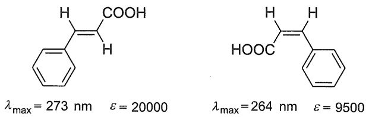

联苯分子中，随着邻位取代基增多，空间拥挤造成连接两个苯环的单键扭转而使两个苯环不在同一平面，不能发生有效共轭，所以最大吸收波长蓝移。

---

8.2 紫外-可见光谱

295

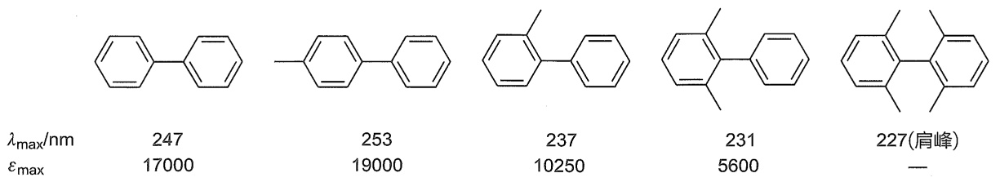

chemical

Five aromatic compounds with corresponding λmax/nm and εmax values, including a labeled peak at 227 nm

## 4. 外部影响因素

溶剂效应:溶剂对紫外光谱的影响很复杂，极性不同的溶剂可以引起谱带形状的改变。在非极性溶剂中，紫外光谱图有一些精细的结构，而在极性溶剂中，由于溶剂和溶质的分子间作用力增强，精细结构便会消失，变为平滑的吸收谱带。

溶剂对吸收谱带的另一重要影响是改变 $\lambda_{\mathrm{max}}$ ，这种影响对 $\mathrm{n}\rightarrow \sigma^{*}$ 、 $\mathrm{n}\rightarrow \pi^{*}$ 和 $\pi \rightarrow \pi^{*}$ 跃迁是不同的。通常随着溶剂极性的增加， $\mathrm{n}\rightarrow \sigma^{*}$ 和 $\mathrm{n}\rightarrow \pi^{*}$ 跃迁谱带向短波方向移动，而 $\pi \rightarrow \pi^{*}$ 跃迁谱带向长波方向移动。发生 $\mathrm{n}\rightarrow \sigma^{*}$ 和 $\mathrm{n}\rightarrow \pi^{*}$ 跃迁的分子都含有非键 $\mathbf{n}$ 电子，基态极性比激发态大，因此基态能够与溶剂之间产生较强的作用，能量下降较大；而激发态能量下降较小，所以跃迁能量增加，吸收波长向短波方向移动，即发生蓝移。而发生 $\pi \rightarrow \pi^{*}$ 跃迁的分子，其激发态的极性比基态强，溶剂使激发态的能级降低得比基态多，使 $\pi \rightarrow \pi^{*}$ 跃迁所需能量变小，吸收峰发生红移，如图8-13所示。

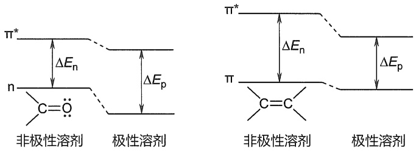

chemical

Energy level diagrams of perovskite solvents showing n-type and c-type electronic states with energy differences ΔEn and ΔEp

图8-13 $\mathbf{n}\rightarrow \pi^{*}$ 跃迁和 $\pi \rightarrow \pi^{*}$ 跃迁的溶剂效应

$\mathrm{pH}$ 的影响:有些有机化合物（如羧酸、酚和胺）在不同 $\mathrm{pH}$ 介质中结构不同，吸收峰的位置及强度也相应不同。如与苯比较，在苯胺或苯酚分子中，由于 $\mathrm{p - \pi}$ 共轭效应，导致苯胺或苯酚的 $\mathrm{E}_2$ 带发生红移，且强度增加。当苯胺在酸性溶液中转变为铵正离子时，由于氨基的 $\mathbf{n}$ 电子与质子结合，不再与苯环共轭，吸收带蓝移至与苯相同的位置。苯酚转化成酚氧负离子时，增加了一对可以发生 $\mathrm{p - \pi}$ 共轭的电子对，结果酚的吸收波长红移，强度增加。再加入盐酸，吸收峰又回到原处。

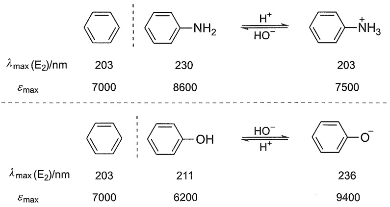

chemical

Chemical reaction equations showing the formation of substituted benzene derivatives under different λmax (E2) values

---

296

第八章 有机化合物结构鉴定

## 8.2.4 各类化合物的紫外吸收光谱

## 1. 饱和烃及其含杂原子的简单化合物

饱和烃的原子间都以 $\sigma$ 键相连，$\sigma \rightarrow \sigma^{*}$ 跃迁需要吸收较大的能量，因此，光谱一般出现在远紫外区。当含有O、S、N、X等杂原子时，可以产生较低能量的 $n \rightarrow \sigma^{*}$ 跃迁和 $\sigma \rightarrow \sigma^{*}$ 跃迁（表8-2）。

表 8-2 含杂原子饱和烃衍生物的吸收光谱

| 化合物 | $\lambda_{\text{max}} (\sigma \to \sigma^{*})/\text{nm}$ | $\lambda_{\text{max}} (\text{n} \to \sigma^{*})/\text{nm}$ |
| --- | --- | --- |
| $CH_3Cl$ | 154~164 | 174 |
| $CH_3OH$ | 150 | 183 |
| $CH_3NH_2$ | 173 | 213 |
| $CH_3I$ | 150~210 | 258 |
| $N(CH_2CH_3)_3$ | — | 227 |

## 2. 烯类化合物

单烯烃类化合物除了 $\sigma$ 键外还有 $\pi$ 键，$\pi$ 能级比 $\sigma$ 能级高，而 $\pi^{*}$ 能级比 $\sigma^{*}$ 能级低，因此 $\pi \rightarrow \pi^{*}$ 跃迁所需能量比 $\sigma \rightarrow \sigma^{*}$ 跃迁所需能量低，波长较长，但其仍在远紫外区，一般仪器观察不到。但随着共轭体系的延伸，吸收光谱会红移至紫外可见区，且吸收强度也逐渐增强。

烯类化合物的紫外吸收光谱有以下特点:

（1）当连接在双键碳原子上的氢被含  $\alpha-$  氢的烷基取代时，由于  $\sigma-\pi$  超共轭效应，吸收峰向长波方向移动。
（2）顺反异构体中反式吸收比顺式吸收波长长。
（3）分子含多个孤立双键的吸收为各独立双键吸收谱带的加和。
（4）共轭双键使谱带发生红移（图 8-14）。
（5）环状烯烃中，吸收光谱与双键所处的位置有关，当双键处于环外时，吸收峰明显向长波移动（表8-3）。

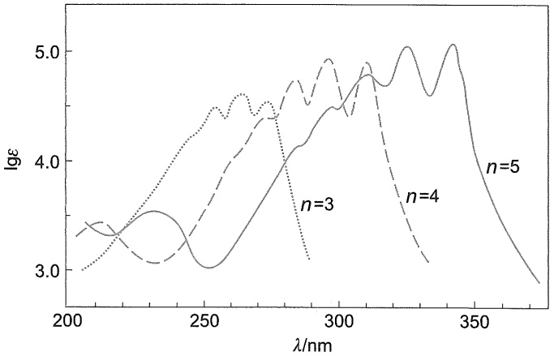

line

| \(\lambda/\)nm | \(lg\epsilon (n=3)\) | \(lg\epsilon (n=4)\) | \(lg\epsilon (n=5)\) |
| --- | --- | --- | --- |
| 200 | ~3.0 | ~3.3 | ~3.3 |
| 210 | ~3.2 | ~3.4 | ~3.4 |
| 220 | ~3.4 | ~3.1 | ~3.5 |
| 230 | ~3.7 | ~3.1 | ~3.6 |
| 240 | ~4.1 | ~3.4 | ~3.2 |
| 250 | ~4.4 | ~3.8 | ~3.0 |
| 260 | ~4.5 | ~4.2 | ~3.2 |
| 270 | ~4.6 | ~4.4 | ~3.6 |
| 280 | ~4.4 | ~4.7 | ~4.0 |
| 290 | ~3.1 | ~4.9 | ~4.2 |
| 300 | — | ~4.5 | ~4.5 |
| 310 | — | ~4.9 | ~4.8 |
| 320 | — | ~4.2 | ~4.7 |
| 330 | — | ~3.5 | ~5.0 |
| 340 | — | — | ~5.1 |
| 350 | — | — | ~4.2 |
| 360 | — | — | ~3.5 |
| 370 | — | — | ~2.9 |

图8-14 共轭多烯体系的紫外光谱

---

8.2 紫外-可见光谱

297

表 8-3 环状烯烃 $\pi \rightarrow \pi^{*}$ 跃迁的紫外吸收

<table><tr><td colspan="2">化合物骨架</td><td> $\lambda_{\text{max}}/\text{nm}$ </td><td> $\varepsilon$ </td></tr><tr><td rowspan="3">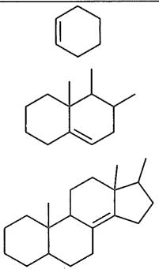</td><td rowspan="3"></td><td>183</td><td>6800</td></tr><tr><td>191</td><td>10200</td></tr><tr><td>206</td><td>11200</td></tr></table>

## 3. 羰基化合物

对于羰基类化合物，有 $\sigma$ 电子、$\pi$ 电子和 n 电子，存在着四种跃迁:$\sigma \rightarrow \sigma^{*}$、$\pi \rightarrow \pi^{*}$、$n \rightarrow \sigma^{*}$、$n \rightarrow \pi^{*}$。非共轭羰基化合物的三种跃迁（$\sigma \rightarrow \sigma^{*}$、$n \rightarrow \sigma^{*}$、$\pi \rightarrow \pi^{*}$）一般 $\lambda_{\max}$ 小于 $200 \mathrm{~nm}$，在真空紫外区，观察不到；而 $n \rightarrow \pi^{*}$ 跃迁，其吸收谱带在 $270 \sim 300 \mathrm{~nm}$ 附近，呈现低强度（$\varepsilon = 10 \sim 20$）吸收的宽谱带。

## 4. 芳香化合物

芳香化合物有三个吸收带: $E_{1}$ 、 $E_{2}$  和 B 带，在仪器上能看到的是  $E_{2}$  的末端吸收和强度小的 B 带。

当苯环上连有助色团时，由于助色团 -OH、 $-NH_{2}$ 、-X 等的 n 电子与苯环发生  $p-\pi$  共轭，使  $E_{2}$  带和 B 带均发生红移，B 带的强度增大，失去精细结构。当苯环上带有生色团取代基时，除 B 带明显地发生红移且吸收强度增加外，体系中还增加了  $\pi$  和  $\pi^{*}$  分子轨道，因而产生新的 K 带，这种 K 带通常与  $E_{2}$  带合并。

对于多核芳香类化合物（如萘、蒽等），随着共轭体系增大，谱带逐渐红移，并且吸收强度增强。

## 5. 不饱和含氮化合物

亚氨基化合物、偶氮化合物和硝基、亚硝基化合物具有与羰基相似的电子结构。当它们不与其他基团共轭时，$\pi \rightarrow \pi^{*}$ 跃迁的 $\lambda_{\max}$ 小于 $200\mathrm{nm}$，$\mathrm{n} \rightarrow \pi^{*}$ 跃迁的 $\lambda_{\max}$ 大于 $200\mathrm{nm}$。如亚胺类化合物的 $\lambda_{\max} \approx 244\mathrm{nm}$，偶氮化合物的 $\lambda_{\max} \approx 360\mathrm{nm}$，硝基衍生物的 $\lambda_{\max} \approx 275\mathrm{nm}$。

## 8.2.5 紫外-可见光谱法的应用

紫外-可见光谱常用于物质纯度的检查、定量分析和结构鉴定，特别适用于不饱和有机化合物的鉴定，以此推断未知物共轭体系、芳香性和生色基等，近年来紫外-可见光谱在很多方面的研究与应用十分活跃，在实际工作中取得了较好的结果。

## 1. 骨架的推定

未知化合物与已知化合物的紫外吸收光谱（峰的个数、形状、 $\lambda_{max}$  和  $\varepsilon$ ）一致时，可以认为两者具有同样或类似的生色团，根据这个原理可以推测未知化合物的骨架。

»例 8-7 维生素 $\mathrm{K}_{1}(\mathrm{A})$ 有如下吸收带:$\lambda_{\max} = 249 \mathrm{~nm} (\lg \varepsilon = 4.28)$，$260 \mathrm{~nm} (\lg \varepsilon = 4.26)$，

$325\mathrm{nm}\left(\lg \varepsilon = 3.38\right)$ 。这与1,4-萘醌的吸收带 $\lambda_{\max} = 250\mathrm{nm}\left(\lg \varepsilon = 4.6\right), 330\mathrm{nm}\left(\lg \varepsilon = 3.8\right)$ 相似，

---

298

第八章 有机化合物结构鉴定

因此，把 A 与几种已知的 1,4-萘醌化合物的光谱进行比较，结果发现 A 与 2,3-二烷基-1,4-萘醌 B 的吸收带很接近，A 的骨架就是这样阐明的。

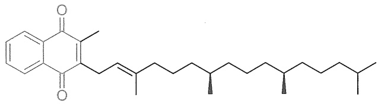

chemical

Chemical structure of a substituted benzene derivative with a long alkyl chain and multiple methyl groups

A

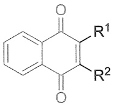

B

## 2. 测定相对分子质量

在特定条件下，也可用紫外-可见光谱来测定相对分子质量。例如，当无紫外吸收或在某一波长处吸收很小的未知化合物与某一试剂加成形成衍生物，而在某一波长处试剂本身的摩尔吸光系数与这一衍生物近似相等，可以用下式求出未知化合物的相对分子质量 M:

$$
\varepsilon = \alpha_{1\mathrm{cm}}^{1\%}\times (M + M^{\prime}) / 10
$$

$$
M = (10 \times \varepsilon / \alpha_ {\mathrm{1cm}} ^ {1 \%}) - M'
$$

式中  $\varepsilon$  为摩尔吸光系数； $\alpha_{1cm}^{1\%}$  为百分吸光系数； $M'$  为试剂的相对分子质量。

尽管这种方法有一定误差，有时偏差也比较大，但如果在没有其他方法时，也不失为一种好的测定相对分子质量的方法。

## 3. 定性分析

紫外-可见光谱吸收峰少，虽不能单独鉴别未知化合物，但可用比较参比光谱与被测物光谱的方法来推测某种物质存在的可能性，或确定某种共轭体系。如两种化合物紫外光谱中峰的个数、形状相同，且峰的  $\lambda_{max}$  、  $\varepsilon$  相同，表示两种化合物可能一样，或有相同的共轭体系。

## 4. 定量分析

在紫外-可见光区（200～800 nm）有吸收的物质才可以用紫外-可见光谱做定量分析， $\varepsilon$ 值越大越有利于紫外定量分析。

利用紫外-可见光谱进行定量分析的方法很多，如在进行单组分的定量测定时，可选用绝对法、标准对照法、吸光系数法、标准曲线法等。进行多组分混合物的测定而不经预先分离，可采用等吸收点作图法、y参比法、解联立方程法、多波长作图法等。可根据具体测定的对象和目的来选择合适的方法。

在波谱分析中，由于使用方便，准确度比其他波谱分析高，在定量分析中紫外-可见光谱用途最广泛。但需要指出的是，常规紫外-可见分光光度法对多组分同时测定是比较困难的。

紫外-可见光谱定量分析的依据是 Lambert（朗伯）-Beer（比尔）定律。常用的标准曲线法步骤如下:

（1）将待测样品组分的标准样配成一定梯度浓度的溶液，作紫外光谱图（A- $\lambda$  或  $\varepsilon-\lambda$ ），找出  $\lambda_{max}$ 。
（2）将波长固定在  $\lambda_{max}$  处（注意:若测定波长  $\lambda_{max}$  受样品中其他杂质干扰，要设法避开，重新找测定波长），测定一系列不同浓度待测样品组分的标准样溶液的吸光值。以溶液浓度 c 为横坐标，吸光值 A 为纵坐标，绘制标准工作曲线。
（3）未知样品用相同溶剂配成合适浓度的溶液，在  $\lambda_{max}$  处测定其吸光值  $A_{未}$ 。
（4）在标准工作曲线上找出对应 $A_{未}$ 的浓度，再计算未知样品中待测组分的含量。

---

8.3 红外光谱

299

## 8.3 红外光谱

红外光谱是研究分子振动和转动跃迁的光谱分析方法。几乎所有含共价键的化合物都会有红外吸收。当一束具有连续波长的红外光通过化合物时，化合物分子中某个基团的振（转）动频率与红外光的频率相同时，分子就会吸收能量由原来的基态振（转）动能级跃迁到能量较高的振（转）动能级，从而产生红外吸收（分子振动和转动能级示意图见图8-15）。红外光谱法就是根据分子的红外吸收信息来推测分子中某种官能团的存在与否以及官能团的邻近基团，进而推测物质分子结构和鉴别化合物的分析方法。由于转动能级的激发只需要很低的能量 $[\Delta E$ （振动跃迁） $\gg \Delta E$ （转动跃迁)]，所以分子中基团在发生转动能级跃迁时必然发生转动能级跃迁，最终导致红外光谱是由很多距离很近的线组成的吸收谱带，而不是一条条尖锐的谱线。

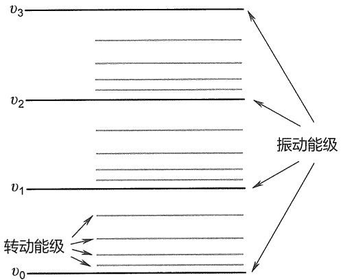

text_image

v₃
v₂
v₁
转动能级
v₀
振动能级

图 8-15 分子振动能级和转动能级示意图

## 8.3.1 红外光谱图

红外区可分为近红外、中红外和远红外三个区域。近红外区的波长范围为 $0.75\sim 2.5\mu \mathrm{m}$ 对应的波数范围在 $13333\sim 4000~\mathrm{cm}^{-1}$；中红外区的波长范围为 $2.5\sim 25\mu \mathrm{m}$，对应的波数范围在 $4000\sim 400~\mathrm{cm}^{-1}$；远红外区的波长范围为 $25\sim 100\mu \mathrm{m}$，对应的波数范围在 $400\sim 100~\mathrm{cm}^{-1}$。其中在近红外和远红外区只有很少化合物会产生吸收，因此红外光谱主要研究的是化合物在中红外区吸收产生的谱图。中红外区又分成两部分，即官能团区:$3700\sim 1333~\mathrm{cm}^{-1}$，用于确认官能团的存在与否；指纹区:$1333\sim 650~\mathrm{cm}^{-1}$，用于确认分子的精细结构，如几何异构、同分异构及取代类型等。

红外光谱图的纵坐标是透光率 T，用百分数表示， $T = I/I_{0} \times 100\%$ ，其中 I 和  $I_{0}$  分别是辐射光的透过强度和入射强度。红外光谱图的横坐标常用波长或波数表示。波长（ $\lambda$  表示）的单位是  $\mu m$ ；波数（ $\tilde{\nu}$  或  $\sigma$  表示），单位是  $cm^{-1}$ 。波长和波数可以按下式互换:

$$
\tilde {\nu} (\mathrm{cm} ^ {- 1}) = 1 / \lambda (\mathrm{cm}) = 1 0 ^ {4} / \lambda (\mu \mathrm{m})
$$

## 8.3.2 红外光谱的基本原理

## 1. 分子的振动和吸收频率

分子中基团吸收红外光发生振动能级的跃迁产生红外光谱。分子的振动分为伸缩振动和变形振动两类。伸缩振动是键长变化而键角不变的振动，用字母 v 来表示。可分为对称伸缩

---

300

第八章 有机化合物结构鉴定

振动  $v^{s}$  和不对称伸缩振动  $v^{as}$  。变形振动是键长不变而键角改变的振动方式，可分为面内变形振动和面外变形振动。面内变形振动又可分为面内摇摆振动  $\rho$  和剪式振动  $\delta$  。面外变形振动又可分为面外摇摆振动  $\tau$  和扭曲振动  $\omega$  。下图以亚甲基（ $-CH_{2}-$ ）为例说明可能的振动方式（图中 “+” “-” 表示两个相反的振动方向）。

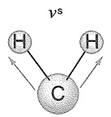

对称伸缩振动

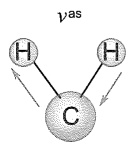

不对称伸缩振动

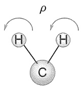

面内摇摆振动

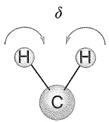

剪式振动

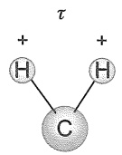

面外摇摆振动

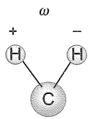

扭曲振动

双原子分子的伸缩振动可以看作两个原子在键轴方向的简谐振动。根据经典力学，简谐振动符合胡克（Hooke）定律。振动频率、原子质量和键力常数之间的关系为

$$
v = \frac {1}{2 \pi} \sqrt {\frac {K}{\mu^ {\prime}}} \tag {8-6}
$$

用波数表示上述关系式为

$$
\tilde {\nu} = \frac {1}{2 \pi c} \sqrt {\frac {K}{\mu^ {\prime}}} \tag {8-7}
$$

式中 c 为光速；K 为键力常数； $\mu'$  为折合原子质量， $\mu' = \frac{m_{1} m_{2}}{m_{1} + m_{2}}$ 。

用相对原子质量（M）代替原子质量（m，单位 g） $(m=M/N_{\mathrm{A}})$ ，再将常数  $\pi$ 、 $c(3\times10^{10}\mathrm{~cm/s})$  和  $N_{A}$ （阿伏伽德罗常数  $6.02\times10^{23}$ ）的数值代入式（8-7），同时将键力常数 K 中的  $10^{5}$  代入。 $\sqrt{10^{5}N_{A}}/2\pi c\approx1307$ ，得到简化公式:

$$
\tilde {\nu} \approx 1 3 0 7 \sqrt {\frac {K}{\mu}} (\mathrm{cm} ^ {- 1}) \tag {8-8}
$$

式中 $\mu$ 为折合相对原子质量，$\mu = \frac{M_1M_2}{M_1 + M_2}$；$K$ 取键力常数表中去掉 $10^5$ 剩下的系数部分。

可以看出，基团的伸缩振动吸收谱带的位置由 K 和  $\mu$  决定。原子质量越小，振动越快，频率越高。K 值与键长和键能有关，它基本反映了原子相连键的强度，键长越短，键能越大，K 值越大。需要指出的是，由于周围的化学环境和测试条件不同，基团的伸缩振动吸收谱带的频率会有所位移，而不是固定在某个位置出峰。也就是说，基团的吸收不是固定在某一个频率，而是在一个范围内波动。表 8-4 列出了部分常见化学键的力常数。

表 8-4 部分常见化学键的力常数

| 化学键 | $K/(10^{5}dyn·cm^{-1})$ | 化学键 | $K/(10^{5}dyn·cm^{-1})$ |
| --- | --- | --- | --- |
| H-C- | 4.7~5.0 | C-O | 5.0~5.8 |
| H-C= | 5.1 | C=O | 12~13 |
| H-C≡ | 5.9 | H-O | 7.8 |
| C-C | 4.5~5.6 | H-N | 6.5 |
| C=C | 9.5~9.9 | C≡N | 16~18 |
| C≡C | 15~17 |  |  |

---

8.3 红外光谱

301

## 2. 分子的振动自由度

一个分子中每个原子在空间的位置要由三个坐标来确定，由 $N$ 个原子组成的分子就需要$3N$ 个坐标，也就是有 $3N$ 个运动自由度。由于分子是一个整体，分子本身作为一个整体有三个平动自由度和三个转动自由度（线形分子有两个转动自由度），因而分子振动自由度的数目等于 $3N - 6$ 个（线性分子的振动自由度为 $3N - 5$ 个）。理论上，每个振动自由度都对应一个红外吸收峰，但红外的吸收峰数目往往少于振动自由度，这是因为:①并非每一个振动都可以产生红外吸收谱带，只有那些可以产生瞬间偶极矩变化的振动才能产生红外吸收。瞬间偶极矩变化越大，吸收峰越强。②光谱图上能量相同的峰发生简并，使谱带重合。③仪器分辨率的限制，使能量接近的振动峰区分不开。能量太小的振动仪器检测不出来。

## 3. 红外光谱的常见术语

基频:分子吸收一定波长的红外光，从基态（ $v_{0}$ ）跃迁到第一激发态 $v_{1}$ 产生的吸收带。一般来说，基频（ $v_{0}\rightarrow v_{1}$ ）跃迁概率大，所以吸收较强。

倍频:分子吸收比基频能量大一倍或两倍的光子，从基态跃迁到第二激发态甚至第三激发态的吸收带。这种跃迁概率很小，因此吸收强度很弱，仅有基频峰强度的十分之一或百分之一。

组合频:分子吸收光子同时激发了两种频率的振动，在两个基频峰波数之和 $(v_{1}+v_{2})$ 或倍频与基频之和 $(2v_{1}+v_{2}$ 等）处产生的吸收称为合频吸收；已处于一个激发态的分子又吸收光子跃迁到另一激发态产生差频吸收 $(v_{1}-v_{2})$ 。合频吸收和差频吸收统称组合频吸收，组合频吸收也很弱。

耦合频:两个振动基频相差不大的基团相邻时，会发生振动的耦合引起吸收频率偏离基频，一个移向高频方向，另一个移向低频方向。

费米共振:当倍频或组合频与某一个强的基频有相近的频率时，这两个振动会相互作用发生耦合，在比基频高一点和低一点的地方出现两个谱带。两谱带中均含有基频和倍频的成分，这种现象叫费米共振。

## 4. 红外光谱仪及测定方法

红外光谱的测试在红外分光光度计上进行。红外分光光度计可分为色散型和干涉型两大类。色散型红外光谱仪以棱镜和光栅为分光器件，而干涉型红外光谱仪由迈克耳孙干涉仪（Michelson interferometer）和数据处理系统组成，没有分光器和狭缝。目前的主导仪器是第三代傅里叶变换（Fourier transform）（干涉型）红外分光光度计，它是利用迈克耳孙干涉仪获得入射光的干涉图，然后通过数学运算（傅里叶变换）把干涉图转换成红外光谱图。

气体、液体和固体化合物均可以测定红外光谱。一般气体样品装入气体池进行测定。液体样品用溶液法和液膜法测定。溶液法是将液体样品配成溶液，注入液体池进行测试。液膜法是在两个窗片之间，滴上1～2滴液体样品，使之形成一层薄的液膜进行测定。固体化合物测定方法多样。最常用的方法是溴化钾压片法。

## 8.3.3 影响基团吸收频率的因素

影响基团红外吸收频率的因素可分为内部因素和外部因素两种。

外部因素:物质所处物态、制备样品的方法、溶剂的性质、氢键、结晶条件、吸收池厚度、色散条件及测试温度等。外部因素对基团吸收谱带位置的影响是随条件的改变而变化的，在使用标准谱图作对照时，应注意制样方法、分光器类型和重结晶溶剂等条件，应尽可能使

---

302

第八章 有机化合物结构鉴定

测试条件与标准图上的条件一致。

内部因素:指分子结构等分子固有的因素对基团吸收谱带的影响。

## 1. 质量和力常数的影响

以 X-H 为例，同一周期，从左到右，元素 X 的电负性增大， $K_{X-H}$  增大， $v_{X-H}$  增大；而同一主族，自上而下， $K_{X-H}$  减小， $\mu$  增加明显， $v_{X-H}$  减小。

|  | B-H | C-H | N-H | O-H | F-H | Cl-H | Br-H | I-H |
| --- | --- | --- | --- | --- | --- | --- | --- | --- |
| $v_{X-H}/cm^{-1}$ | 2400 | 2900 | 3400 | 3600 | 4000 | 2890 | 2650 | 2310 |

## 2. 成键原子的杂化方式

有机化合物中碳元素的杂化方式有  $sp、sp^{2}$  和  $sp^{3}$ ，其对应的化学键是单键、双键和叁键。化学键的原子轨道 s 成分越多，化学键力常数 K 越大，吸收频率越大。如饱和 C-H 键的  $v_{C-H}$  的吸收范围是  $2970 \sim 2845 cm^{-1}$ ；烯和苯环的 C-H 键的  $v_{C-H}$  的吸收范围是  $3100 \sim 3000 cm^{-1}$ ；炔的 C-H 键的  $v_{C-H}$  的吸收范围是  $3340 \sim 3260 cm^{-1}$ 。

## 3. 诱导效应（I效应）

分子内某个基团邻近带有不同电负性的取代基时，会产生诱导效应。吸电子诱导（-I效应）作用会使基团的吸收峰向高频区移动。吸电子作用越强，向高频区移动的越多。给电子诱导（+I效应）作用则使吸收峰向低频区移动。给电子作用越强，向低频区移动的越多。

|  | $CH_3-CO-CH_3$ | $CH_2Cl-CO-CH_3$ | $Cl-CO-CH_3$ | $Cl-CO-Cl$ | $F-CO-F$ |
| --- | --- | --- | --- | --- | --- |
| $v_{C=O}/cm^{-1}$ | 1715 | 1724 | 1806 | 1828 | 1928 |

## 4. 共轭效应（C 效应）

共轭效应使体系形成了大  $\pi$  键， $\pi$  电子的离域使共轭体系的电子密度平均化，K 减小，吸收峰向低波数方向移动，吸收强度增加。共轭体系容易传递静电效应，所以常常显著地影响某些基团的吸收位置及强度。羰基的伸缩振动频率受苯环或烯键两种给电子共轭基团的影响而下降。

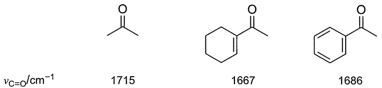

chemical

Three organic compounds with varying CO bond lengths (1715, 1667, 1686 cm⁻¹) and a C=O group indicated

当一个邻近基团同时存在诱导和共轭效应时，若作用一致，则两个效应互相加强；若作用不一致，则总的影响取决于作用强的。在羧酸衍生物中，同时存在吸电子诱导和给电子共轭效应，两种效应相反。

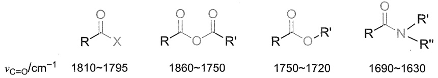

chemical

Four organic molecular structures with vibrational order (νC=O/cm⁻¹) for different carbon chain lengths

---

8.3 红外光谱

303

## 5. 空间效应

空间效应是指空间因素对基团振动频率的影响。主要包括位阻效应、偶极场效应和环张力效应等。

（1）位阻效应 分子结构中存在空间阻碍导致共轭体系的共平面偏离或破坏时，吸收频率增大，强度降低。

$$
\nu_ {\mathrm{C=O}} / \mathrm{cm} ^ {- 1}
$$

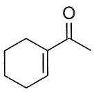

1667

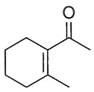

1686

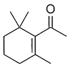

1693

（2）偶极场效应 偶极场效应是互相靠近（非化学键）的基团之间通过空间起作用的。最常见的偶极场效应是羰基的 $\alpha$-位上卤素相对于羰基的位置（空间构型）不同而引起的 $v_{\mathrm{C=O}}$ 位移作用，该作用也称作“$\alpha$-卤代酮”规律。如 $\alpha$-溴代环己酮及 $\alpha$-氯代乙酰苯由于卤素空间位置的不同引起羰基吸收峰位置的变化。

$$
v_{\mathrm{C = O}} / \mathrm{cm}^{-1}
$$

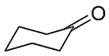

1712

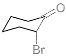

1716

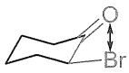

1728

$$
v_{\mathrm{C = O}} / \mathrm{cm}^{-1}
$$

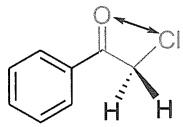

1715

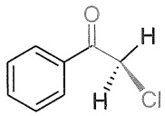

1695

（3）环张力效应 分子成环时，环大小不同，引起环张力不同，导致化学键的力常数不同，振动频率就不同。与环直接连接的环外双键（烯键、羰基）的伸缩振动频率，随着环的减小，环的张力变大，烯烃的双键特性增强，频率增加。环内双键，张力越大，伸缩振动频率越低，环丙烯例外。

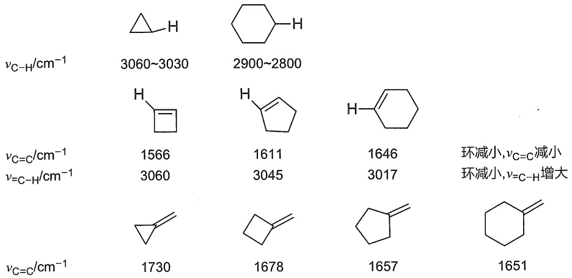

text_image

νC-H/cm⁻¹
3060~3030
2900~2800
νC=C/cm⁻¹
1566
1611
1646
环减小,νC=C减小
ν=C-H/cm⁻¹
3060
3045
3017
环减小,ν=C-H增大
νC=C/cm⁻¹
1730
1678
1657
1651

## 6. 氢键效应

氢键的形成，往往使基团的伸缩振动频率移向低波数，且吸收强度增强，峰变宽；变形

---

304

第八章 有机化合物结构鉴定

振动移向高波数，但变化不如伸缩振动明显。特别是形成分子内氢键时影响更显著。形成分子内氢键的化合物图谱不随测试条件变化，而分子间氢键的化合物图谱随测试条件变化大。

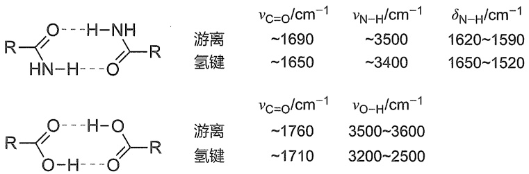

chemical

Chemical reaction equations showing hydrogenation and hydrolysis reactions with associated v-values

## 7. 振动耦合效应

分子内有近似相同频率且位于相邻部位的振动基团彼此相互作用，产生两种或两种以上基团参加的混合振动叫振动耦合。振动耦合常引起基团的吸收频率偏离基频，一个向高频移动，另一个向低频移动。红外光谱中常见的振动耦合效应有以下几种情况。

（1）一个碳上含有两个或三个甲基，则在  $1385 \sim 1350 \, cm^{-1}$  出现两个吸收峰。
（2）酸酐上两个羰基接在同一个氧原子上，互相耦合产生两个吸收带。
（3）二元酸的两个羧基之间只有 1～2 个碳原子时，会出现两个  $v_{C=0}$ ，相隔三个碳原子则没有这种耦合。

$$
\begin{array}{c c c c} & \mathrm{HO} _ {2} \mathrm{CCH} _ {2} \mathrm{CO} _ {2} \mathrm{H} & \mathrm{HO} _ {2} \mathrm{C} (\mathrm{CH} _ {2}) _ {2} \mathrm{CO} _ {2} \mathrm{H} & \mathrm{HO} _ {2} \mathrm{C} (\mathrm{CH} _ {2}) _ {4} \mathrm{CO} _ {2} \mathrm{H} \\ v _ {\mathrm{C=O/cm} ^ {- 1}} & 1 7 4 0, 1 7 1 0 & 1 7 8 0, 1 7 0 0 & 1 6 8 9 \end{array}
$$

（4）具有  $RNH_{2}$  和  $RCONH_{2}$  结构的化合物，有两个  $v_{N-H}$ ，也是由于耦合作用产生的。
（5）酰胺中由于  $\delta_{NH}$  与  $\nu_{C-N}$  耦合产生酰胺 II 和 III 带。
（6）费米共振:当一个倍频或组合频靠近另一个基频时，会发生耦合产生两个吸收带。一般情况下一个频率比基频高，而另一个则要比基频低，这叫费米共振。如醛基在 $2850\mathrm{cm}^{-1}$ 和 $2750\mathrm{cm}^{-1}$ 产生两个特征吸收峰，是由 $\nu_{\mathrm{C - H}}(2800\mathrm{cm}^{-1})$ 与 $\delta_{\mathrm{C - H}}(1390\mathrm{cm}^{-1})$ 的倍频峰 $(2780\mathrm{cm}^{-1})$ 的费米共振产生的。

## 8. 互变异构

有互变异构存在时，在红外光谱上能够看到各种异构体的吸收带。各种吸收的相对强度不仅与基团种类有关，而且与异构体的百分含量有关。如戊-2,4-二酮有酮式和烯醇式结构，两者的吸收皆能在红外谱图上找到。

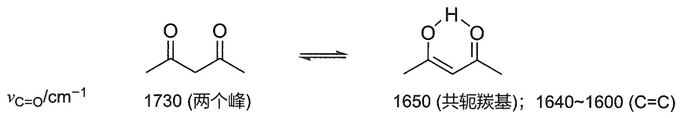

chemical

Chemical reaction equation showing conversion of aldehyde 1730 to aldehyde 1650 using a two-peak catalyst and carbon-carbon base

## 8.3.4 有机化合物基团的特征吸收

有机化合物的红外光谱是组成化合物的各基团红外光谱特征吸收的加合。各种基团在红外光谱的特征吸收带位置大致固定。但受化学结构和外部条件的影响，吸收带会在一定范围发生位移。一般可以综合吸收峰的位置、强度、形状及相关峰的存在，判断某个基团的存在与否。表 8-5 列出了常见基团的特征吸收。

---

8.3 红外光谱

305

表 8-5 常见基团的特征吸收

<table><tr><td rowspan="2">化合物分类</td><td colspan="2">特征吸收带</td><td rowspan="2">备注</td></tr><tr><td>位置/cm-1</td><td>振动类型</td></tr><tr><td rowspan="3">烷烃</td><td>2970~2845</td><td> $\nu_{\text{C-H}}$ </td><td></td></tr><tr><td>~1460</td><td> $\delta_{\text{C-H}}^{\text{as}}$ </td><td></td></tr><tr><td>~1380</td><td> $\delta_{\text{C-H}}^{\text{s}}$ </td><td>-CH(CH3)2结构中裂成两个强度大体相等的峰,一个在1385 cm-1附近,另一个在1375 cm-1附近;-C(CH3)3结构中分裂成两个强度不等的峰,一个在1395 cm-1(m)附近,另一个在1365 cm-1(s)附近</td></tr><tr><td rowspan="4">烯烃</td><td>810~720</td><td> $\rho_{\text{CH}_n}$ </td><td>-(CH2)n-结构中n值越大,吸收峰越接近720 cm-1</td></tr><tr><td>3100~3000</td><td> $\nu_{\text{=CH}}$ </td><td></td></tr><tr><td>1680~1620</td><td> $\nu_{\text{C=C}}$ </td><td>四取代烯烃或对称取代烯烃很弱或不出现</td></tr><tr><td>1000~650</td><td> $\alpha_{\text{=CH}}$ </td><td>判断烯碳的取代类型及顺反异构。RCH=CH2结构在915~905 cm-1和995~985 cm-1;R1R2C=CH2结构在895~885 cm-1;R1R2C=CHR3结构在830~810 cm-1;R1CH=CHR2顺式结构在730~665 cm-1,反式结构在980~960 cm-1。四取代的烯烃,无此吸收</td></tr><tr><td rowspan="3">炔烃</td><td>3340~3260 (s)</td><td> $\nu_{\text{=CH}}$ </td><td></td></tr><tr><td>2260~2100 (m~w)</td><td> $\nu_{\text{C=C}}$ </td><td>分子中心对称时,看不到;分子与其他基团共轭时,强度大大增强</td></tr><tr><td>700~610 (s、b)</td><td> $\delta_{\text{=CH}}$ </td><td></td></tr><tr><td rowspan="3">芳香烃</td><td>3100~3000</td><td> $\nu_{\text{=CH}}$ </td><td>一般有1~2个吸收带,强度较弱</td></tr><tr><td>2000~1650</td><td>comb.  $\delta_{\text{Ar-H}}$ </td><td>一系列的弱峰</td></tr><tr><td>1625~1450</td><td> $\nu_{\text{C=C}}$ </td><td>以~1600 cm-1和~1500 cm-1吸收峰为主。当苯环与其他基团共轭时,在~1580 cm-1出现新的吸收。</td></tr><tr><td rowspan="5">卤代烃</td><td>900~650</td><td> $\delta_{\text{Ar-H}}$ </td><td>根据此区间吸收峰的位置、个数及强度可以判断苯环上取代基个数及取代模式</td></tr><tr><td>1400~1000 (s)</td><td> $\nu_{\text{C-F}}$ </td><td></td></tr><tr><td>800~600 (s)</td><td> $\nu_{\text{C-Cl}}$ </td><td></td></tr><tr><td>600~500 (s)</td><td> $\nu_{\text{C-Br}}$ </td><td></td></tr><tr><td>~500 (s)</td><td> $\nu_{\text{C-I}}$ </td><td></td></tr><tr><td rowspan="3">醇酚</td><td>3670~3230</td><td> $\nu_{\text{O-H}}$ </td><td>游离羟基大于3600 cm-1出尖峰;缔合羟基移向低波数,宽峰</td></tr><tr><td>1420~1260</td><td> $\delta_{\text{O-H}}$ </td><td></td></tr><tr><td>1250~1000</td><td> $\nu_{\text{C-O}}$ </td><td>伯醇:1070~1000 cm-1;仲醇:1120~1030 cm-1;叔醇:1170~1100 cm-1;酚:1230~1140 cm-1</td></tr><tr><td rowspan="2">醚</td><td>1310~1020 (s)</td><td> $\nu_{\text{C-O-C}}^{\text{as}}$ </td><td>只用IR来判别醚是困难的</td></tr><tr><td>1075~1020 (w)</td><td> $\nu_{\text{C-O-C}}^{\text{s}}$ </td><td></td></tr><tr><td>酮</td><td>1725~1705 (s)</td><td> $\nu_{\text{C=O}}$ </td><td>α-C上有吸电子基团时,升高;α-C上有给电子基团时,降低。α-二酮有一个强的 $\nu_{\text{C=O}}$ 吸收。β-二酮酮式结构有两个强的 $\nu_{\text{C=O}}$ 吸收,还出现一个烯醇式的宽而强的 $\nu_{\text{C=O}}$ 吸收</td></tr><tr><td rowspan="2">醛</td><td>1740~1715</td><td> $\nu_{\text{C=O}}$ </td><td>比相应结构的酮高出约15 cm-1</td></tr><tr><td>2880~2650</td><td> $\nu_{\text{C-H}}$ </td><td>两个强度相近的中强吸收峰,是区别醛和酮的特征谱带</td></tr><tr><td rowspan="3">羧酸</td><td>1760~1685</td><td> $\nu_{\text{C=O}}$ </td><td>单体 $\nu_{\text{C=O}}$ 在1760~1740 cm-1,二聚后降低</td></tr><tr><td>3550~2500</td><td> $\nu_{\text{O-H}}$ </td><td>单体羧酸的 $\nu_{\text{O-H}}$ 在3550 cm-1。二聚体的 $\nu_{\text{O-H}}$ 在3200~2500 cm-1有一个宽而散的峰</td></tr><tr><td>955~915 (b)</td><td> $\delta_{\text{OH-O=}}$ </td><td></td></tr><tr><td rowspan="2">羧酸酯</td><td>1750~1720</td><td> $\nu_{\text{C=O}}$ </td><td></td></tr><tr><td>1330~1150</td><td> $\nu_{\text{C-O-C}}$ </td><td>高波数的 $\nu_{\text{C-O-C}}^{\text{as}}$ 峰宽且强度大,在酯的红外光谱中常为第一强峰</td></tr><tr><td rowspan="2">酰卤</td><td>1810~1795</td><td> $\nu_{\text{C=O}}$ </td><td>酰卤非常活泼,测试过程要特别注意</td></tr><tr><td>965~850</td><td> $\nu_{\text{C-O-C}}$ </td><td>脂肪酰卤:965~920 cm-1;芳香酰卤:890~850 cm-1</td></tr><tr><td rowspan="3">酸酐</td><td>1860~1750</td><td> $\nu_{\text{C=O}}$ </td><td>两个 $\nu_{\text{C=O}}$ 强吸收。开链酸酐高波数的强,环状酸酐低波数的强</td></tr><tr><td>1180~1045 (脂肪)</td><td></td><td></td></tr><tr><td>1300~1200 (环状)</td><td> $\nu_{\text{C-O-C}}$ </td><td></td></tr><tr><td rowspan="4">酰胺</td><td>3540~3180</td><td> $\nu_{\text{N-H}}$ </td><td>伯酰胺:两个尖的吸收带;仲酰胺:一个尖的吸收带;叔酰胺无此吸收带</td></tr><tr><td>1690~1630</td><td> $\nu_{\text{C=O}}$ </td><td></td></tr><tr><td>1655~1590</td><td> $\delta_{\text{N-H}}$ </td><td>仅伯酰胺有此吸收</td></tr><tr><td>1420~1400 (s)</td><td> $\nu_{\text{C-N}}$ </td><td></td></tr></table>

---

306

第八章 有机化合物结构鉴定

续表

<table><tr><td rowspan="2">化合物分类</td><td colspan="2">特征吸收带</td><td rowspan="2">备注</td></tr><tr><td>位置/cm-1</td><td>振动类型</td></tr><tr><td rowspan="4">胺</td><td>3500~3250</td><td> $\nu_{\text{N-H}}$ </td><td>伯胺:两个中等强度的吸收带,有时因缔合形成多个吸收带;仲胺:一个中等强度的吸收带;叔胺无此吸收带</td></tr><tr><td>1650~1515</td><td> $\delta_{\text{N-H}}$ </td><td></td></tr><tr><td>1250~1020 (脂肪)</td><td></td><td></td></tr><tr><td>1360~1250 (芳香)</td><td> $\nu_{\text{C-N}}$ </td><td></td></tr></table>

注:v:伸缩振动； $\delta$ :变形振动； $\rho$ :面内摇摆振动；s:强峰；m:中强峰；w:弱峰；b:宽峰；comb.:组合频。

## 8.3.5 红外光谱图的解析

红外光谱图的解析就是结合红外光谱图上谱带的位置、强度和形状，确定分子中所含的基团，从而进行定性鉴定和推测化合物的结构式。注意，一般情况下只靠红外光谱难以确定复杂化合物的结构。新化合物结构的确认要综合质谱、核磁共振、紫外光谱、元素分析等解析方法进行结构分析。

»例 8-8 下面两张图谱，请判断哪一张是苯乙酮（$\mathrm{C_6H_5COCH_3}$）的红外光谱图，哪一张是苯乙醛（$\mathrm{C_6H_5CH_2CHO}$）的红外光谱图。请简单阐明理由。

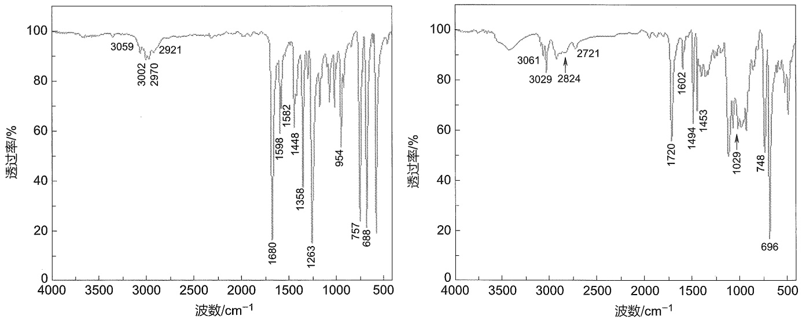

》解 （1）苯乙酮和苯乙醛在结构上最大的差别是苯乙醛中有醛基存在。醛与酮在 IR 谱图中最大的区别是，醛在 2880～2650 cm $^{-1}$ 出现两个强度相近的中强吸收峰。由此可推测图中右图为苯乙醛的 IR 谱图。那么左图就是苯乙酮的 IR 谱图。
（2）苯乙醛的 IR 谱图中  $3061 \, cm^{-1}$ 、 $3029 \, cm^{-1}$  的吸收是苯环上 C-H 键的伸缩振动吸收； $2824 \, cm^{-1}$ 、 $2721 \, cm^{-1}$  的吸收是醛基 C-H 键的伸缩振动吸收； $1720 \, cm^{-1}$  的吸收是 C=O 键的伸缩振动吸收； $1602 \, cm^{-1}$ 、 $1494 \, cm^{-1}$  的吸收是苯环的骨架振动； $748 \, cm^{-1}$  和  $696 \, cm^{-1}$  的吸收证实单取代苯。
（3）苯乙酮的 IR 谱图中  $3059 \, cm^{-1}$ 、 $3002 \, cm^{-1}$  的吸收是苯环上 C-H 键的伸缩振动吸收； $1680 \, cm^{-1}$  的吸收是 C=O 键的伸缩振动吸收（与苯环共轭后移向低波数）； $1598 \, cm^{-1}$ 、 $1582 \, cm^{-1}$  的吸收是苯环的骨架振动， $1582 \, cm^{-1}$  吸收的出现证实苯环与羰基共轭； $757 \, cm^{-1}$  和  $688 \, cm^{-1}$  的吸收证实该化合物是单取代苯。

---

8.3 红外光谱

307

»例 8-9 某分子式为 $\mathrm{C_4H_{10}O}$ 的化合物的红外光谱图如下，试推测化合物的可能结构。

spectrogram

| Wavenumber \((cm^{-1})\) | Transmittance (%) |
| --- | --- |
| 3355 | ~78 |
| 2971 | ~55 |
| 1472 | ~80 |
| 1379 | ~65 |
| 1363 | ~50 |

》解 （1）不饱和度 $\Omega = 0$ ，分子中含一个氧原子，推测该化合物为脂肪醇或醚类化合物。

(2) $3355 \mathrm{~cm}^{-1}$ 宽而强的吸收, 可以肯定羟基的存在, 即该化合物是醇类化合物。

（3）除-OH 外，根据  $2971 \, cm^{-1}$ 、 $1472 \, cm^{-1}$  及  $1380 \, cm^{-1}$  峰的裂分（ $1379 \, cm^{-1}$  和  $1363 \, cm^{-1}$ ）推测分子式  $-C_{4}H_{9}$  的烷基链为叔丁基。

综上，该谱图对应的化合物为叔丁醇，结构式为 $(\mathrm{CH}_{3})_{3}\mathrm{COH}$ 。

»例 8-10 某分子式为 $\mathrm{C_8H_8O_2}$ 的化合物的红外光谱图如下，试推测化合物的可能结构。

spectrogram

| Wavenumber \((cm^{-1})\) | Transmittance (%) |
| --- | --- |
| 3066 | ~95 |
| 3044 | ~95 |
| 1760 | ~25 |
| 1593 | ~85 |
| 1492 | ~85 |
| 1369 | ~85 |
| 1212 | ~25 |
| 1183 | ~5 |
| 747 | ~85 |
| 690 | ~85 |

》解 （1）不饱和度  $\Omega = 5 > 4$ ，推测分子结构中可能有苯环。

（2）根据谱图中  $3066 \, cm^{-1}$ 、 $3044 \, cm^{-1}$ 、 $1593 \, cm^{-1}$ 、 $1492 \, cm^{-1}$  的吸收，可以肯定分子结构中苯环的存在。由指纹区  $747 \, cm^{-1}$ 、 $690 \, cm^{-1}$  的吸收，推测该化合物是单取代苯类化合物。苯环  $\sim 1600 \, cm^{-1}$  的吸收没有裂分，推测苯环没有和其他双键共轭。
（3） $1760\mathrm{cm}^{-1}$ 、 $1212\mathrm{cm}^{-1}$ 、 $1183\mathrm{cm}^{-1}$ 的强吸收，推测分子结构中含有酯基，且酯基中的-O-应与苯环直接相连。

---

308

第八章 有机化合物结构鉴定

（4）综上，该谱图对应的化合物可能为乙酸苯酯，结构式为  $CH_{3}COOC_{6}H_{5}$

## 8.4 核磁共振

核磁共振技术应用十分广泛，它不仅可以鉴定有机分子的化学结构，而且能够应用于人体器官的成像，即磁共振成像技术（magnetic resonance imaging，MRI）。核磁共振波谱法主要研究对象为  ${}^{1}H$ 、 ${}^{13}C$ 、 ${}^{15}N$ 、 ${}^{19}F$ 、 ${}^{29}Si$ 、 ${}^{31}P$  等原子核，本章主要介绍  ${}^{1}H$  和  ${}^{13}C$  核磁共振波谱，简称氢谱和碳谱。

许多物理学家、化学家为核磁共振波谱的发展作出了重要的贡献。Rabi采用共振的方法测量了原子核的磁性，获得了1944年的诺贝尔物理学奖。Purcell和Bloch发展了精密测量核磁共振信号的新方法，共同获得了1952年的诺贝尔物理学奖。1961年，Varian Associates推出了A-60核磁共振波谱仪，核磁共振波谱逐渐得到普及。自此之后，几乎所有与有机化学相关的论文均将NMR数据作为重要的结构证据。20世纪70年代，Ernst创立了脉冲傅里叶变换核磁共振（FT-NMR），傅里叶变换技术使核磁共振波谱仪可以在短时间内同时发出不同频率的射频场，对少量样品进行重复扫描，从而提高灵敏度和信噪比。此后，Ernst还发展了二维核磁共振技术，因这两项杰出贡献独享了1991年诺贝尔化学奖。此外，Wüthrich利用多维NMR技术测定溶液中蛋白质的三维结构，获得了2002年诺贝尔化学奖。Lauterber和Mansfield实现了核磁共振成像技术的医学应用，获得了2003年诺贝尔生理学或医学奖。

核磁共振技术能够在不破坏样品的条件下，提供多种结构信息，如化学位移  $\delta$  、耦合常数 J 和各种核的信号强度比等。通过分析这些信息，可以了解分子中特定原子（如 H、C 等）的数量、化学环境、邻接基团，以及分子的空间构型等。随着核磁共振仪的普及，核磁共振的新方法、新技术不断涌现，如二维核磁共振技术、差谱技术、极化转移技术、变温核磁共振及固体核磁共振等。这些技术使核磁共振的应用范围日趋扩大，样品用量减少，灵敏度显著提高。核磁共振技术已经从只能测量溶液样品发展到可以测试固体样品，即使是灵敏度很低  ${}^{15}N$  等核的核磁共振测试也可以顺利完成。

总之，核磁共振技术在化学、生物学、医学和材料科学等领域都有广泛的应用，已经成为现代结构分析的重要手段。它不仅能够提供分子结构的详细信息，还能够帮助科学家们在药物设计、疾病机理研究、新材料开发等方面取得突破。

## 8.4.1 NMR的基本原理

## 1. 原子核的自旋

自旋（spin）是微观粒子所具有的基本性质，是由粒子内禀角动量引起的一种内禀运动。在了解自旋这个概念时，我们常常将其与宏观球体的自转进行类比，但需要注意的是，自旋并不是指微观粒子在空间中的真实旋转。原子核的自旋可以被想象为原子核围绕其核心轴线的旋转，它具有一定的自旋角动量，用 $P$ 表示。由于原子核是带电荷的粒子，自旋时将产生磁矩 $\mu$ 。角动量和磁矩都是矢量，其方向平行。

原子核自旋在量子力学上用自旋量子数 I 表示，可以分为三种情况。

（1）自旋量子数 $I = 0$ ，这种情况对应的是质量数和电荷数均为偶数的原子核，如 ${}^{12}\mathrm{C}$ 、

---

8.4 核磁共振

309

$^{16}$ O、 $^{32}$ S 等。这类核可以看作非自旋的球体，这类核自旋没有磁矩， $\mu=0$ ，不能用 NMR 测定。

（2）自旋量子数  $I = n/2 \left( n = 1, 3, 5, \cdots, \text{为奇数} \right)$ ，这种情况对应的是质量数为奇数，电荷数为奇数或偶数的原子核。其中，I = 1/2 的核，如  ${}^{1}H$ 、 ${}^{13}C$ 、 ${}^{15}N$ 、 ${}^{19}F$ 、 ${}^{29}Si$ 、 ${}^{31}P$  等。这类核可以看作电荷均匀分布的旋转球体，其自旋有磁矩，即  $\mu \neq 0$ ，可以发生核磁共振，是 NMR 测试的主要对象。
（3）自旋量子数  $I=1,2,3,\cdots$  （I 为整数），这种情况对应的是质量数为偶数、电荷数为奇数的原子核，如  ${}^{2}H$ 、 ${}^{10}B$ 、 ${}^{14}N$  等。这类核和上面  $I=n/2\quad(n=3,5,\cdots,$  为奇数）的核可以看作电荷分布不均匀的自旋椭圆体，这类核自旋也有磁矩， $\mu\neq0$ ，也可以发生核磁共振。

核的原子序数、质量数及自旋量子数之间的关系如表 8-6 所示。

表 8-6 原子核的自旋量子数与核磁共振

| 分类 | 质量数 | 原子序数 | 自旋量子数 | NMR 信号 | 原子核 |
| --- | --- | --- | --- | --- | --- |
| (1) | 偶 | 偶 | 0 | 无 | $^{12}C, ^{16}O, ^{28}Si, ^{32}S$ |
| (2) | 奇 | 奇或偶 | 1/2, 3/2, 5/2, ... | 有 | $^{1}H, ^{11}B, ^{13}C, ^{15}N, ^{17}O, ^{19}F, ^{29}Si, ^{31}P, ^{33}S, ^{35}Cl, ^{37}Cl, ...$ |
| (3) | 偶 | 奇 | 1, 2, 3, ... | 有 | $^{2}H, ^{10}B, ^{14}N$ |

从原子核内质子数和中子数可以看出，拥有奇数个质子或/和奇数个中子的原子核能用NMR波谱仪进行检测。

## 2. 核磁共振

下面以  ${}^{1}$ H（质量数为 1 的氢的同位素）为例介绍一下核磁共振原理。质子自旋时将产生一个具有磁矩  $\mu$  的磁场，该磁场与条形磁铁类似（图 8-16）。

图 8-16 自旋的质子与条形磁铁

氢原子核（${}^{1}\mathrm{H}$）自旋量子数 $I = 1/2$，共有 $2I + 1 = 2$ 个自旋取向。每个自旋取向用磁量子数 $m$ 表示，则 $m$ 有两个值 $m = +1/2$ 和 $m = -1/2$。也就是说，${}^{1}\mathrm{H}$ 处于外加磁场 $B_{0}$ 中，其核有两个自旋取向，即与外加磁场一致或相反（图8-17）。与外加磁场方向一致的 ${}^{1}\mathrm{H}(m = +1/2)$ 处于低能态，称为 $\alpha$ 自旋态。而与外加磁场方向相反的 ${}^{1}\mathrm{H}(m = -1/2)$ 处于高能态，称为 $\beta$ 自旋态。

text_image

(a) 无外磁场
(b) 在外磁场中

图8-17 质子磁矩的取向

---

310

第八章 有机化合物结构鉴定

处于两种自旋态的质子具有不相同的能量，它们之间的能量差（$\Delta E$）是量子化的。对处于外加磁场中的质子进行电磁辐射，当辐射的能量恰好与两种自旋态之间的能量差相等时，处于低能态的质子将吸收电磁辐射跃迁到高能态（图8-18）。这种现象称为核磁共振。两种自旋态的能量差 $\Delta E$ 与外磁场感应强度（$B_0$）成正比，其关系式为

$$
\Delta E = \frac {\gamma}{2 \pi} h B _ {0} = h \nu \quad \nu = \frac {\gamma}{2 \pi} B _ {0}
$$

式中  $\gamma$  称为磁旋比，是原子核的特征常数，对于  ${}^{1}H$  核，该值为  $2.675 \times 10^{8} T^{-1} \cdot s^{-1}$ ；h 为普朗克常数；v 为无线电波的频率。

text_image

E
β
ΔE
α
O
B₀
β
ΔE
α

图8-18 两种质子自旋态的能量差与外磁场感应强度的关系

由此可见，共振频率与磁场强度成正比。增加磁场强度将会使  $\alpha\rightarrow\beta$  自旋“翻转”更加困难，共振频率  $\nu$  也增大。在相同的磁场强度下，不同的核  $\gamma$  不同，共振频率也不同。例如， $B_{0}=2.3\ T\ (1\ T=10^{4}\ G)$  时， $^{1}H$  共振频率为 100 MHz， $^{13}C$  为 25 MHz， $^{31}P$  为 40.5 MHz。所以在观察一种核的核磁共振时，不会同时观察到另一种核的核磁共振。

## 3. 饱和与弛豫

在外磁场的作用下，处于低能量的  $\alpha$  自旋态的  ${}^{1}H$  核与处于高能量的  $\beta$  自旋态  ${}^{1}H$  核两者之间能量差很小。例如，外加磁场强度为 14092 G，温度为 27 °C，则低能态与高能态  ${}^{1}H$  核数目之比为

$$
\mathrm{e}^{\Delta E / kT} = \mathrm{e}^{\gamma Hh / 2\pi kT} = 1.0000099
$$

式中 k 为玻尔兹曼常数；T 为绝对温度。

也就是说，每一百万个核中，低能态的  ${}^{1}H$  仅比高能态的  ${}^{1}H$  多 10 个左右。对每个核来说，由低能态向高能态或由高能态向低能态的跃迁概率是相同的。然而，由于低能态核的数量较多，总体上导致了净吸收现象的发生，从而产生了 NMR 信号。由于两种核的总数相差很小，若高能态的核没有其他途径回到低能态，也就是说没有过剩的低能态核可以跃迁，就不会有净的吸收，那么 NMR 信号将会消失，这个现象称为饱和。

实际上， $^{1}$ H 核可以通过非辐射的方式从高能态回到低能态，这个过程称为弛豫。正是弛豫的存在，使得在正常测试情况下不会出现饱和现象。弛豫有如下两种方式:

（1）自旋晶格弛豫，又称纵向弛豫。纵向弛豫反映了核（自旋体系）与环境（又称为晶格）进行能量交换，高能态的核把能量以热运动的形式传递给周围，如固体的晶格、液体中同类分子或溶剂分子等，由高能态返回低能态。这个弛豫过程需要一定的时间，其半衰期用

---

8.4 核磁共振

311

$T_{1}$ 表示。 $T_{1}$ 与核的种类、样品的状态、温度等因素有关。液体样品的 $T_{1}$ 一般为 $10^{-4} \sim 10^{2} \mathrm{~s}$；固体样品的 $T_{1}$ 较长，可达几小时甚至更长。液体样品的 $T_{1}$ 明显较固体样品的小很多。 $T_{1}$ 越小表示弛豫过程的效率越高。

（2）自旋-自旋弛豫，又称横向弛豫。自旋-自旋弛豫反映了核磁矩之间的相互作用，高能态核把能量传递给同类低能态核。在此弛豫过程前后，各种能态核的总数不变，总能量不变。其半衰期用 $T_{2}$ 表示。液体样品的 $T_{2}$ 约为1 s，固体或者高分子样品的 $T_{2}$ 较小，约为 $10^{-3}$ s。

对每一种核来说，它在某一较高能态平均的停留时间只取决于 $T_{1}$ 及 $T_{2}$ 之较小者。根据不确定原理，谱线宽度与弛豫时间成反比（由 $T_{1}$ 或 $T_{2}$ 之较小者决定）。固体样品的 $T_{2}$ 很小，所以谱线很宽。因此，在化合物结构分析的NMR测试中，对于可找到合适溶剂的固体样品，一般都配成溶液后测定。此外，如果溶液中有顺磁性物质，如铁、氧气等，$T_{1}$ 会缩短，谱线加宽，所以样品中不可含铁磁性和其他顺磁性物质。

## 8.4.2 氢谱

一张  ${}^{1}$ H NMR 谱图通常可以给出三种重要的结构信息:① 信号峰的位置，即化学位移  $\delta$ ，与该信号峰对应质子的电子环境相关。② 信号峰的形状，耦合常数 J，通常与相邻质子数目有关。③ 信号峰的积分面积，即积分曲线，与该信号峰对应的质子数目相关。若要测定弛豫时间，则需另外进行实验。

如图 8-19 所示，溴乙烷的氢谱中，在 1.67 处有一组三重峰，3.42 处有一组四重峰，它们的耦合常数相同，峰面积积分比为 3:2。溴乙烷中的氢为何在不同位置出现两组信号？它们的出峰位置和峰形受到哪些因素的影响？下面将介绍这三个光谱参数的来源及其与分子结构的关系。

spectrogram

| Chemical Shift \((\delta)\) | Intensity |
| --- | --- |
| 7.260 | — |
| 3.450 | — |
| 3.432 | — |
| 3.414 | — |
| 3.395 | — |
| 1.685 | — |
| 1.667 | — |
| 1.649 | — |
| 3.450 | High |
| 3.432 | High |
| 3.414 | High |
| 3.395 | High |
| 1.685 | Very High |
| 1.667 | Very High |
| 1.649 | Very High |
| 1.558 | Very High |
| -0.010 | Low |

图 8-19 溴乙烷的  ${}^{1}$ H NMR (400 MHz, CDCl $_{3}$ ) 谱图

## 1. 化学位移

## (A) 化学位移的起源

化学位移用来表示核磁共振信号的吸收位置。

---

312

第八章 有机化合物结构鉴定

同一种核的磁旋比相同，固定了射频频率，是否所有  ${}^{1}H$  核都在同一个磁场强度下发生共振呢？实际情况并非如此。质子的共振磁场强度实际上与其所处的化学环境密切相关。不同位置的质子在分子中所处的化学环境不同，其周围的电子密度也不同，因此在不同的共振磁感应强度下产生吸收峰。

化学位移出现差异的原因在于各种氢核所处的化学环境不同，所受到的屏蔽作用不同。所谓化学环境，主要指的是氢原子核外的电子及邻近的其他原子对其的影响。当氢核处在外加磁场中时，其外部电子在垂直于外加磁场的平面上绕核旋转，同时产生一个与外加磁场方向相反的感应磁场（图8-20）。这个感应磁场削弱了外加磁场对核的作用。这种核外电子减弱外加磁场对核的影响的作用称为屏蔽。若以 $\sigma$ 表示屏蔽常数，外加磁场为 $B_{0}$，这个屏蔽作用的大小为 $\sigma B_{0}$，核的实受磁场 $B = B_{0} - \sigma B_{0}$。所以，核磁共振的条件应表达为

$$
v = \frac {\gamma}{2 \pi} B = \frac {\gamma}{2 \pi} B _ {0} (1 - \sigma)
$$

式中  $\sigma$  为核的化学环境的函数。因为各种氢核所处的化学环境不同， $\sigma$  值也不同，故各种核在不同磁场强度下共振，产生了不同的共振频率。

text_image

¹H
电子环流
σB₀感应磁场
B₀外加磁场

图 8-20 屏蔽效应示意图

各种氢核产生的共振频率差异实际上非常小，通常在百万分之几。要精确测量其绝对值较困难。此外，核外电子产生的感应磁场强度与外加磁场强度成正比，这意味着感应磁场的屏蔽作用导致的共振频率变化也与外加磁场成正比。不同磁场强度的仪器（或不同的射频频率）会导致产生的共振频率差异数值不同。

为了使不同磁场强度的仪器检测到的信号有一个统一的比较标准，并克服绝对磁场强度难以精确测量的问题，引入了化学位移的概念。化学位移是通过使用标准物质的共振频率作为基准，将其他质子的共振频率与标准物质的共振频率之差，再除以标准物质的共振频率来计算的。用  $\delta$  表示，这样得到的化合物质子的化学位移与所用仪器无关，是一个无量纲的参数。

$$
\delta = \frac {\Delta \nu}{\nu_ {0}} \times 1 0 ^ {6} = \frac {\nu_ {\text {样}} - \nu_ {\text {标}}}{\nu_ {0}} \times 1 0 ^ {6}
$$

$$
\delta = \frac {\Delta B}{B _ {0}} \times 1 0 ^ {6} = \frac {B _ {\text {样}} - B _ {\text {标}}}{B _ {0}} \times 1 0 ^ {6}
$$

式中 $\Delta v$ 为待测峰与标准物共振频率之差（Hz）； $\Delta B$ 为待测峰与标准物共振磁场之差（Hz）； $v_{样}$ （ $v_{标}$ ）为样品（标准物）的共振频率； $v_{0}$ 为仪器的频率； $B_{样}$ （ $B_{标}$ ）为样品（标准物）的

---

8.4 核磁共振

313

共振磁场； $B_{0}$  为仪器的磁场。

因为 $\Delta v/v_{标}$ 和 $\Delta B/B_{标}$ 的值仅为百万分之几，为了使 $\delta$ 值易读易写，所以乘以一百万 $(10^{6})$ ，用ppm $(10^{-6})$ 作为 $\delta$ 的量级（即百万分之一），但ppm通常是省略的。

最常用的标准物是四甲基硅烷 $\left[\mathrm{Si}\left(\mathrm{CH}_{3}\right)_{4}\right.$ ，简称TMS]。它具有较好的稳定性，可以与许多有机溶剂互溶。TMS的四个甲基对称分布，所有氢都处在相同的化学环境中，只有一个锐利的吸收峰。另外，甲基的氢核和碳核的核外电子屏蔽作用比一般化合物的都要强，出峰在高场处。将其 $\delta$ 值定为0，大部分有机化合物出峰在其左边0\~12处， $\delta$ 为正值，只有少数氢会出峰在0的右边，则 $\delta$ 为负。

例如，用 300 MHz 的核磁共振波谱仪测试苯时，苯中氢吸收的射频辐射频率比 TMS 的大 2181 Hz。用公式计算苯的  ${}^{1}$ H 化学位移:

$$
\delta = \frac {\Delta \nu}{\nu_ {0}} \times 1 0 ^ {6} = \frac {2 1 8 1 \mathrm{Hz}}{3 0 0 \times 1 0 ^ {6} \mathrm{Hz}} \times 1 0 ^ {6} = 7. 2 7
$$

如使用 500 MHz 的核磁共振波谱仪测试苯时，苯中氢吸收的射频辐射频率比 TMS 的大 3635 Hz。用公式计算苯的  ${}^{1}$ H 化学位移:

$$
\delta = \frac {\Delta \nu}{\nu_ {0}} \times 1 0 ^ {6} = \frac {3 6 3 5 \mathrm{Hz}}{5 0 0 \times 1 0 ^ {6} \mathrm{Hz}} \times 1 0 ^ {6} = 7. 2 7
$$

NMR 一般用氘代溶剂、不含质子的溶剂溶解样品，如  $CCl_{4}$ 、 $CDCl_{3}$ 、 $D_{2}O$ 、 $CF_{3}CO_{2}D$ 、 $CD_{3}COCD_{3}$  等。由于这些氘代溶剂会存在少量未被氘代的分子而在某一位置出现残留的质子峰，因此在解谱时要注意识别。例如， $CDCl_{3}$  在  $\delta7.27$  处出现吸收，是残留的  $CHCl_{3}$  质子吸收。常用氘代溶剂的残留质子出峰位置见边栏二维码。

除了残存质子峰，溶剂中通常含有微量的  $H_{2}O$ ，会有一个  $H_{2}O$  质子峰出现。且这个峰的位置会因溶剂的不同而变化。如  $CDCl_{3}$  中微量  $H_{2}O$  质子峰出现 1.5， $CD_{3}COCD_{3}$  中在 2.8， $CD_{3}SOCD_{3}$  中在 3.3，解谱时也要注意辨别。

## （B）影响化学位移的因素

在  ${}^{1}$ H NMR 谱中，质子的化学位移主要取决于其周围核外电子的密度。影响化学位移的因素主要包括诱导效应、共轭效应、磁各向异性效应、范德华效应、氢键效应及溶剂效应等。当某些因素导致质子周围的电子密度减小，或者核外电子产生的感应磁场与外加磁场方向一致时，屏蔽效应会减弱，而去屏蔽效应增强，导致化学位移增大，即向低场方向移动（在谱图上向左移）。相反，如果某些因素导致质子周围的电子密度增加，或者核外电子感应磁场的方向与外加磁场方向相反，屏蔽效应会增强，化学位移减小，即向高场方向移动（在谱图上向右移）。

（1）诱导效应 当  ${}^{1}$ H 核附近存在吸电子的原子或基团时，这些基团的吸电子诱导效应会导致质子周围的电子密度减小，从而减弱了屏蔽效应。这种变化导致所需的共振磁场强度降低，进而使得化学位移增大。相连的原子或基团的电负性越强，这种效应越明显，化学位移也就越大。相反，当  ${}^{1}$ H 核附近存在给电子的原子或基团时，它们的给电子诱导效应会增加质子周围的电子密度，增强屏蔽效应，使所需的共振磁场强度增加，化学位移相应减小。

表 8-7 展示了取代甲烷的化学位移。从表中数据可以看出，随着取代基 X 电负性的减小，甲基上 H 的化学位移会向高场方向移动。

氘代溶剂的残留质子出峰位置

---

314

第八章 有机化合物结构鉴定

表 8-7 取代甲烷的化学位移

| $CH_3X$ | X电负性 | δ |
| --- | --- | --- |
| $CH_3F$ | 4.0 | 4.26 |
| $CH_3OH$ | 3.5 | 3.40 |
| $CH_3Cl$ | 3.1 | 3.05 |
| $CH_3Br$ | 2.9 | 2.68 |
| $CH_3I$ | 2.6 | 2.16 |
| $CH_3CH_3$ | 2.5 | 0.88 |
| $CH_3Si(CH_3)_3$ | 1.8 | 0 |

诱导效应具有加和性，吸电子基团越多，化学位移越向低场位移。如  $CH_{2}Cl_{2}$  和  $CHCl_{3}$  中氢的化学位移分别在 5.33 和 7.27。此外，取代基的诱导效应随着与质子距离的增加而迅速减弱，对于距离  $\gamma$  位更远的碳上的氢，其化学位移几乎不受影响。如 1-氯丙烷中 1 到 3 位碳上氢的化学位移分别为 3.3、1.6 和 0.9。

（2）共轭效应 极性基团可以通过 $\pi -\pi$ 共轭和 $\mathrm{p} - \pi$ 共轭作用影响较远的碳上的质子。如果这些作用导致质子周围的电子密度减小，那么屏蔽效应会减弱，使得质子的共振吸收向低场方向移动，从而化学位移增大。例如，以乙烯作为参照，乙烯中的质子化学位移 $\delta$ 为5.25。在甲基乙烯基醚中，由于氧原子的孤对电子与双键的 $\mathrm{p} - \pi$ 共轭作用，导致 $\beta-$ 碳上的氢表现出更强的屏蔽效应，因此其 $\delta$ 值低于5.25。而在甲基乙烯基酮中，由于羰基的吸电子 $\pi -\pi$ 共轭作用，$\beta-$ 碳上的氢表现出去屏蔽效应，其 $\delta$ 值高于5.25。

chemical

Three organic molecular structures with labeled bond lengths: 5.25, 3.57, and 3.99 for C=CH, and 5.87 and 5.50 for a carbonyl group.

（3）各向异性效应当分子中某些基团的电子云排布不呈现球形对称时，它们会对邻近的氢核产生具有方向性的磁场。这种磁场的作用强度及其影响的正负取决于距离和角度，这种现象被称为各向异性效应。在某些区域，如果局部磁场方向与外加磁场方向一致，就会增强外加磁场的效果，导致受影响的 $^{1}$ H核的共振向低场方向移动，化学位移 $\delta$ 值增大，这被称为去屏蔽效应，通常用“-”来表示。相反，在另一些区域，如果局部磁场方向与外加磁场方向相反，就会削弱外加磁场，使得受影响的氢核的共振向高场方向移动， $\delta$ 值减小，这被称为屏蔽效应，通常用“+”来表示。以下将通过一些例子来具体说明这一效应。

① 双键的各向异性 双键（例如碳碳双键和碳氧双键）化合物的  $\pi$  电子主要分布在成键平面的上下方。在外加磁场的作用下， $\pi$  电子的环流会产生一个与外加磁场方向相反的感应磁场。在双键平面的正上方和正下方，形成了两个锥形区域，这些区域是屏蔽区；而在双键所在的平面上，则是去屏蔽区（图 8-21）。

chemical

Molecular orbital diagram showing electron density distribution around a central carbon atom with magnetic field B₀

图8-21 双键的各向异性

---

8.4 核磁共振

315

例如，醛基氢的  $\delta$  值为 9～10.5，其原因除了羰基碳带部分正电荷外，还有醛基氢正好处在羰基平面上，受到了强的去屏蔽效应。

② 叁键的各向异性 叁键中的碳原子采用 sp 杂化，与  $sp^{3}$  和  $sp^{2}$  杂化相比，其 s 成分更高，使得成键电子更接近碳原子。这导致末端炔氢表现出一定的酸性，反映出其外围电子密度相对较小。在这种情况下，我们预期叁键上的氢的化学位移会较大。然而实际上，叁键上的氢信号一般出现在 2～3 的区域。这种差异是由于叁键的  $\pi$  电子围绕键轴旋转，形成了桶形环电流，其产生的感应磁场在叁键的键轴上发挥作用（图 8-22）。因此，炔氢实际上受到了叁键的屏蔽作用，导致其化学位移相对较小。
③ 芳环的各向异性 芳香化合物的大共轭平面体系中，$\pi$ 电子在体系的上下形成环流。在外加磁场 $B_{0}$ 的作用下，当 $B_{0}$ 的方向垂直于苯环平面时，$\pi$ 电子环流会产生一个感应磁场。这个感应磁场在苯环平面的内部及其上下方与外加磁场方向相反，而在苯环平面的外侧则与外加磁场方向相同。因此，苯环平面的上下区域为屏蔽区，而苯环平面的外侧为去屏蔽区。由于苯环上的氢处于去屏蔽区，它们受到去屏蔽效应的影响，所以其 $\delta$ 值较大，在7左右（图8-23）。

图8-22 叁键的各向异性

chemical

Diagram of a magnetic field B₀ acting on a charged particle in an electric field, showing positive and negative charges.

natural_image

Diagram of magnetic field lines around a hexagonal coil, showing rotational motion (no text or symbols)

text_image

B₀
+ - +

图8-23 苯的各向异性

一些大环共轭环烯化合物与苯环相似，环内及其环平面的上下方为屏蔽区，环平面外侧为去屏蔽区。环平面外的质子化学位移值较大，而环内氢的化学位移值甚至可为负值。例如，环十八烯的外围氢的化学位移为9.28，中间氢的化学位移为-2.99；卟啉的外围氢的化学位移可达11.22，而中间氢的化学位移为-4.4。

chemical

Molecular structure diagram of a fused heterocyclic compound with hydrogen atoms and bond length labeled

chemical

Molecular structure diagram with labeled bond lengths and angles

（4）范德华效应 当取代基与共振核之间的距离小于范德华半径时，两者带有负电荷的电子云就会发生互相排斥，这种排斥作用导致共振核原子周围的电子密度减小，从而减弱了屏蔽效应，使得化学位移  $\delta$  值增大。例如，在以下化合物 A、B 中，化合物 A 中的  $H_{a}$  化学位移比 B 中  $H_{a}$  的大，而两种化合物中  $H_{b}$  的  $\delta$  值都比  $H_{c}$  的  $\delta$  值大。这些差异主要是邻近基团的范德华效应所引起的。

---

316

第八章 有机化合物结构鉴定

chemical

Molecular structure diagram with labeled bond lengths and atom labels (Hc, Hb, Ha, OH)

A

chemical

Molecular structure diagram with labeled bond lengths and atom labels

B

（5）氢键效应 质子形成氢键后，氢键的缔合作用会使质子周围的电子密度减小，导致其化学位移向低场方向移动。例如，醇羟基氢的化学位移通常在0.5～5，而羧基氢的化学位移则在10～14。当分子结构允许形成分子内氢键时，化学位移会进一步向更低场方向移动。由于氢键的形成受到溶液浓度、温度、溶剂等多种因素的影响，因此，O、N、S等原子上氢的化学位移会随着测试条件的变化而在较大的范围内变动。
(6)溶剂效应 共振核在不同溶剂中进行测试时,其化学位移乃至峰形都可能发生变化。这种因溶剂不同而导致谱图变化的现象称为溶剂效应。这种影响通过溶剂的磁化率、极性、氢键及屏蔽效应而发生作用。不同的溶剂对同一种化合物的影响各不相同,同一种溶剂对不同化合物的不同基团的影响也不尽相同,有时可以利用溶剂效应使重叠的峰组分开。例如,使用氘代氯仿作为溶剂时,加入少量的氘代苯或氘代吡啶,利用苯或吡啶的磁各向异性,可使原来互相重叠的信号峰分开,从而提高谱图的解析度。这种方法在复杂样品的核磁共振分析中特别有用。

## (C) 各类质子的化学位移

碳原子上质子的化学位移主要取决于这些质子所处的化学环境。因此，通过质子的化学位移，我们可以逆向推断出质子的化学环境及分子的结构。不同类别质子的化学位移大致有一个特定的范围。各类质子的粗略化学位移如表8-8所示。熟悉这些结构对应的化学位移十分有用，因为这些数值可以帮助解析 $^{1}$ H NMR谱图。

表 8-8 各类质子的化学位移

<table><tr><td>氢的类型</td><td>化学位移</td><td>氢的类型</td><td>化学位移</td><td>氢的类型</td><td>化学位移</td></tr><tr><td> $\begin{array}{c}CH_3\\H_3C-Si-CH_3\\CH_3\end{array}$ </td><td>0</td><td> $Ph-CH_3$ </td><td>2.3</td><td></td><td>7.3</td></tr><tr><td></td><td>0.2</td><td> $R-\equiv CH$ </td><td>2.4</td><td></td><td>9~10</td></tr><tr><td> $R-CH_3$ </td><td>0.9</td><td> $Br-CH_3$ </td><td>2.7</td><td> $R-NH_2$ </td><td>1.5~4</td></tr><tr><td></td><td>1.3</td><td> $Cl-CH_3$ </td><td>3.1</td><td> $R-OH$ </td><td>2~5</td></tr><tr><td></td><td>1.4</td><td> $RO-CH_3$ </td><td>3.3~4</td><td> $Ar-OH$ </td><td>4~7</td></tr><tr><td></td><td>1.7</td><td> $F-CH_3$ </td><td>4.1</td><td> $R-CO_2H$ </td><td>10~12</td></tr></table>

---

8.4 核磁共振

317

续表

<table><tr><td>氢的类型</td><td>化学位移</td><td>氢的类型</td><td>化学位移</td><td>氢的类型</td><td>化学位移</td></tr><tr><td></td><td>2.1</td><td></td><td>4.5~5.9</td><td>R-CONHR</td><td>5~10</td></tr><tr><td> $H_3C-NCH_3$ </td><td>2.2</td><td> $R=C$  $R$ </td><td>5.3</td><td></td><td></td></tr></table>

## 2. 自旋耦合与自旋裂分

在溴乙烷的 ${}^{1}\mathrm{H}$ NMR谱图中（图8-19），甲基和亚甲基的共振吸收峰都不是单峰，而分别表现为三重峰和四重峰。这种现象是甲基和亚甲基上氢核自旋产生微弱的感应磁场所引起的。两种自旋核之间引起能级分裂的相互干扰称为自旋耦合。由自旋耦合所引起的谱线增多的现象称为自旋裂分。要判断有机分子中氢的裂分情况，需要引入化学等价和磁等价的概念。

## (A) 化学等价和磁等价

分子中某一组核处于相同的化学环境时，其化学位移彼此相同，则这组核称为化学等价核。例如，在溴乙烷分子中，甲基上的三个氢是化学等价的，亚甲基上的两个氢也是如此。如果分子中化学等价的核对其他任一核都有相同的耦合作用，则这些化学位移等价的核称为磁等价核。只有磁不等价的核之间的耦合才会导致谱线分裂。

化学不等价的两个基团在化学反应中表现出不同的反应速率，在光谱、波谱测量中有不同的特征。因此，判别分子中的质子是否化学等价对于谱图解析十分重要。对于分子中的质子，如果它们可以通过对称操作或快速的构象转换、旋转等机制互换，那么这些质子就是化学等价的。

例如，下图四种化合物中的  $H_{a}$  和  $H_{b}$  均是化学等价的。化合物 A 中的  $H_{a}$  和  $H_{b}$  可以通过对称轴旋转而互换。化合物 B 中的  $H_{a}$  和  $H_{b}$  可以通过镜面对映操作互换。同样的，化合物 C 和 D 中的  $H_{a}$  和  $H_{b}$  也是化学等价的。如果将化合物中质子的标识去掉，则分不清是否进行了对称操作。

A

B

C

D

E

而化合物 $\mathbf{D}$ 中两个H虽然化学位移相同，但对F的耦合情况不同，即 $\mathrm{H_a}$ 与 $\mathrm{F_a}$ 的耦合不同于 $\mathrm{H_b}$ 与 $\mathrm{F_a}$ 的耦合，所以为磁不等价。显然，化学等价的核不一定是磁等价的，而磁等价的核一定是化学等价的。化合物E中的 $\mathrm{H_a}$ 和 $\mathrm{H_b}$ 不能通过对称操作互换，因此不是化学等价的。

在评估原子核的等价性时，必须考虑分子的内部动态，包括键的旋转、环的翻转及分子内部活泼氢原子之间的快速交换等过程。如果这些内部运动的速率相对于核磁共振测量的时间尺度来说足够快，那么在分子中原本不等价的原子核在 NMR 谱中会表现为等价；反之，如果这些运动过程较慢，那么原子核的不等价性就会在谱图中显现出来。这种动态平衡对于理解分子结构和核磁谱图的解析具有重要意义。

例如，溴乙烷分子有无数种构象，其中稳定构象用纽曼投影式表示如下:

---

318

第八章 有机化合物结构鉴定

由投影式看到 $\mathrm{H}_{1}$ 、 $\mathrm{H}_{2}$ 应是磁不等价的， $\mathrm{H}_{3}$ 、 $\mathrm{H}_{4}$ 、 $\mathrm{H}_{5}$ 也应是磁不等价的。然而在室温下，分子绕C-C键高速旋转，各个质子都处于一个平均环境中，因此 $\mathrm{CH}_3$ 中三个质子为磁等价的， $\mathrm{CH}_2$ 中两个质子为磁等价的。

环己烷在室温下由于其环的快速翻转，处于平伏键和直立键的氢也处于快速转换中，这使得十二个氢的化学环境相同，所以只观察到一个单峰（$\delta 1.36$）。如果降低温度到 $-100^{\circ}\mathrm{C}$，则可以观察到6个直立键的氢在 $\delta 1.14$ 处，而6个平伏键的氢在 $\delta 1.62$ 处。此时，化学等价的氢变成了化学不等价的氢。

通常，分子在平衡态下的存在寿命需要在秒级别才能被核磁共振波谱仪分辨。如果存在寿命短于这个时间，得到的将是平均化的谱图。

## (B) 耦合裂分的规律

前面已经讲过，氢核在外加磁场中有两种自旋取向，分别以 $\alpha$ 、 $\beta$ 表示。对于溴乙烷分子中亚甲基上的两个质子，每个质子的核都可以有 $\alpha$ 、 $\beta$ 两种自旋状态，因此两个氢核可以形成四种不同的自旋组合: $\alpha\alpha$ 、 $\alpha\beta$ 、 $\beta\alpha$ 、 $\beta\beta$ ，而 $\alpha\beta$ 、 $\beta\alpha$ 是等同的，实际上只有三种自旋组合，其概率比为1∶2∶1。这三种自旋组合产生了三种不同的局部小磁场，在 $-CH_{2}-CH_{3}$ 结构中影响着甲基，使甲基的共振峰裂分为三重峰。甲基的裂分小峰面积比与亚甲基核自旋组合的概率比相等，即1∶2∶1。同理，甲基上的三个质子可以形成四种自旋组合，概率比为1∶3∶3∶1，使得亚甲基的共振峰裂分为四重峰。

在核磁共振的一级谱中， $^{1}$ H核的自旋裂分通常遵循 $n+1$ 规律。若邻近碳上有n个相同的氢，则产生 $n+1$ 个裂分峰。这意味着，如果一个氢核邻近的碳上有n个相同的氢原子，那么它将产生 $n+1$ 个裂分峰。例如，如果一个氢原子旁边有一个碳原子，该碳原子上有三个相同的氢原子，那么这个氢原子的信号将会裂分成4个峰（3+1）。

谱峰裂分的峰形和峰强度比也有规律可循。根据 $n + 1$ 规律得到的裂分峰强度比可以通过二项式 $(a + b)^n$ 的展开式的各项系数来表示（表8-9）。例如，如果一个氢原子旁边有一个碳原子，该碳原子上有两个相同的氢原子，那么这个氢原子的信号将会裂分成三重峰，其峰强度比为 $1:2:1$ 。

表 8-9 二项式 $(a+b)^{n}$ 的展开式的各项系数

<table><tr><td>n</td><td colspan="7">展开式的各项系数</td><td>峰形</td></tr><tr><td>0</td><td colspan="7">1</td><td>单峰</td></tr><tr><td>1</td><td colspan="7">1 1</td><td>二重峰</td></tr><tr><td>2</td><td colspan="7">1 2 1</td><td>三重峰</td></tr><tr><td>3</td><td colspan="7">1 3 3 1</td><td>四重峰</td></tr><tr><td>4</td><td colspan="7">1 4 6 4 1</td><td>五重峰</td></tr><tr><td>5</td><td colspan="7">1 5 10 10 5 1</td><td>六重峰</td></tr><tr><td>6</td><td colspan="7">1 6 15 20 15 6 1</td><td>七重峰</td></tr><tr><td>7</td><td colspan="7">1 7 21 35 35 21 7 1</td><td>八重峰</td></tr></table>

若邻近还有 $n'$ 个另一种氢原子与其耦合，则将产生 $(n + 1)\times (n' + 1)$ 个峰，各峰强度比仍有规

---

8.4 核磁共振

319

律可寻，但不符合表8-9。在NMR术语中，单峰、二重峰、三重峰、四重峰、五重峰、七重峰及多重峰分别用s(singlet)、d(doublet)、t(triplet)、q(quartet)、p(pentet)、h(heptet)、m(multiplet)来表示。

需要注意的是，在二级谱中， $n+1$ 规律可能不适用。此外，理论上预测的裂分数与实际在谱图上观察到的裂分数可能会有所不同。这主要是某些耦合常数较小，导致在谱图上难以区分是否有裂分，或者是耦合常数小于仪器的分辨率所致。因此，在解析 NMR 谱图时，需要考虑这些因素。

例如，在溴乙烷的  ${}^{1}$ H NMR 谱中，有两组氢，即  $CH_{3}$  和  $CH_{2}$ ，它们互相耦合。甲基受亚甲基上两个氢的耦合，裂分成三重峰，峰强度比为 1:2:1。亚甲基受甲基上三个氢的耦合，裂分成四重峰，峰强度比为 1:3:3:1。同时，甲基氢三个峰的总面积和亚甲基四个峰的总面积之比等于质子数之比，即 2:3。

理论上，核磁共振谱图中各组峰的峰形应该是对称的，但在实际观察中，这种对称性往往并不完美。在两组互相耦合的峰中，两个理论上强度相等的裂分峰通常会表现出内侧峰高、外侧峰低的特点，这种现象使得两个耦合质子的各自两个峰顶点连线形成一个“人”字形（如边栏图所示）。这种特征有助于我们判断两组峰是否发生了耦合。如果峰顶点连线形成一个“V”字形或两条平行线，那么这两组氢很可能没有发生耦合。

除了氢核之间的耦合外，还需要注意其他元素，如磷（P）和氟（F），它们也能与同一碳或邻近碳上的氢原子发生耦合，导致这些氢原子的信号发生裂分。

## （C）耦合常数与分子结构的关系

发生耦合裂分时，信号峰内各个峰值之间的距离称为耦合常数 J，单位为 Hz。耦合常数反映了磁核间的干扰作用，其大小不受外界磁场及条件的影响。在一级谱中耦合常数可由谱图直接计算得到。对于两种质子 A 和 B 之间的耦合，耦合常数 J 只有一个，J 等于 A 或 B 类质子多重峰中相邻两个峰化学位移的差乘以仪器的射频频率（MHz），即  $J(\mathrm{Hz}) = \Delta\delta \times$  仪器射频频率（MHz）。只要 A 与 B 是耦合的，无论用 A 或 B 质子多重峰的任意两个峰来计算，结果都相等。

耦合常数是质子自旋裂分时的两个核磁共振能之差，大小与两个作用核之间的相对位置有关。一般只考虑相隔两个或三个键的两个核之间的耦合。所以耦合常数可用于判断有机化合物分子的结构。

（1）同碳耦合 $\left(^{2}J\right)$ 同一个碳原子上的两个氢通过两个键耦合，称为同碳耦合。其耦合常数用 $^{2}J$ 或 $J_{同}$ 表示。一般受杂化成分、电负性、环系等影响，如 $sp^{3}$ 杂化轨道上的氢 $^{2}J$ 为10～15 Hz， $sp^{2}$ 杂化的 $C=CH_{2}$ 型氢的 $^{2}J$ 约为2 Hz。环己烷中 $^{2}J$ 约为12 Hz，环丁烷中 $^{2}J$ 为10～14 Hz，环丙烷类 $^{2}J$ 为3～9 Hz。
（2）邻碳耦合（ $^{3}J$ ）在两个相邻碳上氢原子通过三个键耦合 H-C-C-H，表示为  ${}^{3}J$ 。饱和型邻位耦合中，当 C-C 键可以自由旋转时， ${}^{3}J$  在 6～8 Hz，构象固定时， ${}^{3}J$  在 0\~18 Hz。在烯烃化合物中（H-C=C-H）中  ${}^{3}J$  与构型有关，顺式氢  ${}^{3}J$  为 6～14 Hz，反式氢  ${}^{3}J$  为 11～18 Hz。环状化合物中  ${}^{3}J$  顺反差距不大，在 2～13 Hz。苯环中  ${}^{3}J$  为 6～9.4 Hz。
（3）远程耦合 两个核通过四个或四个以上的键进行耦合，称为远程耦合。远程耦合需要满足一定的结构特征。远程耦合常数一般较小，在 $0\sim 3\mathrm{Hz}$，经常不易看出。如苯环的间位耦合 $^4 J$ 为 $0.8\sim 3.1\mathrm{Hz}$，对位耦合 $^5 J$ 为 $0.2\sim 1.5\mathrm{Hz}$。炔和联烯类化合物传递耦合作用的能力较强，甚至有的通过9个键耦合常数仍不为零。联烯两端氢的耦合常数较大。例如:

line

| Peak Value | X-axis Position |
| --- | --- |
| 7.867 | ~7.83 |
| 7.847 | ~7.82 |
| 7.266 | ~7.25 |
| 7.246 | ~7.24 |

---

320

第八章 有机化合物结构鉴定

$$
\begin{array}{l} \mathrm{H} _ {3} \mathrm{C} - \mathrm{C} \equiv \mathrm{C} - \mathrm{C} \equiv \mathrm{C} - \mathrm{C} \equiv \mathrm{C} - \mathrm{CH} _ {2} - \mathrm{OH} \quad^ {9} J = 0. 4 \mathrm{Hz} \\ \mathrm{H-C} \equiv \mathrm{C-CH} _ {3} \\ \mathrm{H_3C-CH_b=C=CH_aCl} \\ ^ 4 J = 2. 9 3 \mathrm{Hz} \\ { } ^ { 4 } J _ { \mathrm{ab} } = 5 . 8 \mathrm{~Hz} \\ \end{array}
$$

## (D) 其他核与  ${}^{1}H$  的耦合

在  ${}^{1}$ H NMR 中， ${}^{1}$ H 峰的数目不仅与邻近质子个数及耦合情况有关，还与邻近的其他可发生核磁共振核有关，包括  ${}^{13}$ C、 ${}^{19}$ F 和  ${}^{31}$ P 等。 ${}^{13}$ C、 ${}^{19}$ F 和  ${}^{31}$ P 的核磁共振信号不会出现在  ${}^{1}$ H NMR 谱中，但  ${}^{13}$ C、 ${}^{19}$ F 和  ${}^{31}$ P 可以与邻近  ${}^{1}$ H 耦合裂分。 ${}^{13}$ C 天然丰度很低，对  ${}^{1}$ H 的耦合一般观察不到。 ${}^{19}$ F、 ${}^{31}$ P 的天然丰度都是 100%，因此，在含 F 和 P 的化合物中可以清楚地看到  ${}^{19}$ F、 ${}^{31}$ P 与  ${}^{1}$ H 的耦合及由此造成的裂分。 ${}^{19}$ F、 ${}^{31}$ P 与  ${}^{1}$ H 的耦合都符合 n+1 规律。

$^{19}$ F 对  ${}^{1}$ H 的耦合，耦合常数较大， ${}^{2}J_{H-C-F}$  为 45～90 Hz， ${}^{3}J_{H-C-C-F}$  为 0～45 Hz， ${}^{4}J_{H-C-C-C-F}$  为 0～9 Hz。在苯的氟代衍生物中，与邻位氢 J 为 6～10 Hz，与间位氢 J 为 4～8 Hz，与对位氢 J 为 0～3 Hz。
$^{31}$ P 对  ${}^{1}$ H 的耦合，耦合常数变化极大。如 RPH $_{2}$  中  ${}^{1}J_{H-P}$  为 180～200 Hz, (CH $_{3}$ ) $_{3}$ P 中  ${}^{2}J_{H-C-P}$  为 2.1 Hz, (CH $_{3}$ ) $_{3}$ P=O 中  ${}^{2}J_{H-C-P}$  为 13.4 Hz。

## 3. 信号峰的积分面积

前面学习了 NMR 中吸收峰的位置（化学位移）和峰形（自旋耦合、裂分），本节学习 NMR 另一个有用的特征，核磁共振信号的相对积分强度，即信号峰的积分面积。积分面积与引起该吸收的核的相对数目成正比。分子中某种氢数目越多，核磁共振吸收越强。通过计量峰的面积，并将其与其他信号峰面积相比较，就能得到各种氢数目的比例。这些数值由计算机完成测算，并以积分的形式标出。积分曲线的总高度与分子中总氢数目成正比，各个峰向上的垂直距离正比于峰面积。各峰的相对积分值也可以在谱图中直接标出。如果将含有一个氢的峰面积定为 1，则谱图中的积分数字与实际氢数目相符。

当分子中含有多种类型的氢原子，且谱峰数目较多时，积分的相对比值对于谱图的解析尤其有帮助。如果测试的样品不纯，或者谱图比较复杂，实际的积分比例可能与理论比值不完全相同。这种情况下，积分比例也可以作为判断样品纯度的一个依据。因此，积分强度是NMR分析中一个非常有用的工具，它不仅有助于确定分子结构，还可用于评估样品的纯度。

## 4.  $^{1}$ H NMR 谱图解析

至此，我们已经全面了解了一维  ${}^{1}$ H NMR 的关键概念，包括化学位移、自旋耦合、裂分及积分面积。接下来，我们将通过一些有机分子的氢谱实例，展示如何应用这些知识点来解析谱图，并据此合理推断分子的结构。

»例 8-11 在 1,1,2-三氯乙烷的 $^{1}$H NMR 谱图中（图 8-24），可以观察到两组磁不等价的质子，它们分别对应于两个不同的吸收峰。根据电子效应对化学位移的影响，我们可以推断出 H$_{a}$ 和 H$_{b}$ 这两个质子都受到了吸电子基团氯（Cl）的诱导效应，导致它们在低场区域出现信号。由于 H$_{a}$ 比 H$_{b}$ 更接近氯原子，它受到的影响更大，因此其信号出现在 5.76 的位置，而 H$_{b}$ 的信号则出现在 3.96 的位置。

根据自旋耦合裂分判断（$n+1$ 规律），可以进一步确认这些质子的身份。$\mathrm{H_a}$ 由于受到两个 $\mathrm{H_b}$ 的影响，其信号应该裂分成三重峰（$2+1$），而 $\mathrm{H_b}$ 则因为只受到一个 $\mathrm{H_a}$ 的影响，其信号应该裂分成双重峰（$1+1$）。此外，两组峰的积分面积之比为 $1:2$，这也验证了我们的指认

---

8.4 核磁共振

321

spectrogram

| Chemical Shift \((\delta)\) | Integration |
| --- | --- |
| 7.260 | — |
| 5.779 | 1.00 |
| 5.764 | — |
| 5.749 | — |
| 3.969 | 2.08 |
| 3.954 | — |
| 0.003 | — |

图 8-24 1,1,2-三氯乙烷的  ${}^{1}$ H NMR (400 MHz, CDCl $_{3}$ ) 谱图

是正确的。计算耦合常数得 $J_{\mathrm{ab}} = J_{\mathrm{ba}} = 6.0 \mathrm{~Hz}$ 。这个数值进一步证实了 $\mathrm{H_a}$ 和 $\mathrm{H_b}$ 之间的自旋耦合关系。

»例 8-12 在 1,1,2-三氯丙烷的 $^{1}$H NMR 谱图中（图 8-25），共有三组磁不等价质子，出现三组吸收峰。由于 H$_{a}$ 和 H$_{b}$ 受吸电子基团 Cl 的诱导效应，影响出峰在低场位置，H$_{c}$ 由于距离较远受到的影响较小而出现在高场位置。结合谱图可以看出，H$_{a}$ 受影响更大，出峰在 5.86 处（靠近两个去屏蔽的氯原子），H$_{b}$ 出峰在 4.35 处，H$_{c}$ 出峰在 1.69 处。

spectrogram

| Chemical Shift \((\delta)\) | Coupling Constant (Jab) |
| --- | --- |
| 7.260 | 3.6 Hz |
| 5.864 | — |
| 5.855 | — |
| 4.381 | — |
| 4.372 | — |
| 4.364 | — |
| 4.355 | — |
| 4.348 | — |
| 4.339 | — |
| 4.331 | — |
| 4.323 | — |
| 1.698 | 6.4 Hz |
| 1.682 | 6.4 Hz |
| -0.004 | 6.4 Hz |

图 8-25 1,1,2-三氯丙烷的  ${}^{1}$ H NMR (400 MHz, CDCl $_{3}$ ) 谱图

根据 $n + 1$ 规律判断，$\mathrm{H_a}$ 和 $\mathrm{H_c}$ 均受 $\mathrm{H_b}$ 影响，它们的信号应该裂分成双重峰。可以看出确实出现了两组双重峰。然而，$\mathrm{H_b}$ 却出现了看似“八重峰”的裂分图形，且相对强度也与普通的裂分不同。出现这种情况的原因是什么呢？

---

322

第八章 有机化合物结构鉴定

实际上， $n + 1$ 规律只适用于邻位磁等价氢。而1,1,2-三氯丙烷中， $\mathrm{H_b}$ 的邻位有两组磁不等价氢，它们与 $\mathrm{H_b}$ 的耦合常数也将不相同。分步运用 $n + 1$ 规律（保证每次耦合的氢是磁等价的）可以解释这种现象。即甲基上3个磁等价的氢首先将 $\mathrm{H_b}$ 裂分为 $3 + 1 = 4$ 重峰，接着$\mathrm{H_a}$ 四组峰中的每一个峰裂分为 $1 + 1 = 2$ 组峰。结果就得到了如图所示的四重峰的双重峰（用qd表示）。其中中间的四个峰与两边四个峰的峰面积之比为 $3:1$ ，这是由第一次裂分成四组峰时的峰面积之比 $1:3:3:1$ 决定的。

进一步计算耦合常数可以得到  $J_{ab} = 3.6 \, Hz, J_{bc} = 6.4 \, Hz$ 。qd 峰  $H_{b}$  的耦合常数计算可以用（1 号峰的化学位移-2 号峰的化学位移）× 400 MHz 得到，同样的 3 号和 4 号，5 号和 6 号，7 号和 8 号的化学位移差值均相等。另外还可以看出:1 和 3，2 和 4，…，6 和 8 之间的化学位移差也相等，计算出来的耦合常数均是  $J_{bc}$ 。

»例 8-13 在对甲基苯乙酮的 $^{1}$H NMR 谱图中（图 8-26），共有四组吸收峰。$H_{d}$ 受苯环的去屏蔽作用出峰在 2.41，$H_{a}$ 受羰基和苯环的共同去屏蔽作用出峰在较低场位置（2.58）。$H_{d}$ 信号峰较矮略宽是受到了芳环上邻位（间位）氢的耦合裂分所致（耦合常数较小，通常小于 1 Hz）。由于分子含有对称面，因此 $H_{b}$ 和 $H_{c}$ 的吸收峰分别包含两个氢。$H_{b}$ 和 $H_{c}$ 受甲基和羰基的共同作用而出峰在不同的位置，$H_{b}$ 受羰基的吸电子共轭效应影响更大所以出峰在更低场的位置（7.86）。

最后  $H_{b}$  和  $H_{c}$  互相耦合裂分均为双峰 ( $J_{bc} = 8.0 \, Hz$ )。

spectrogram

| Chemical Shift \((\delta)\) | Integration Value |
| --- | --- |
| 7.867 | 2.00 |
| 7.847 | 2.00 |
| 7.266 | 2.07 |
| 7.246 | 2.07 |
| 2.575 | 3.13 |
| 2.410 | 3.13 |

图8-26 对甲基苯乙酮的 ${}^{1}\mathrm{H}$ NMR (400 MHz, $\mathrm{CDCl}_3$ )谱图

»例 8-14 在醋酸乙烯酯的 $^{1}$H NMR 谱图中（图 8-27），共有四组吸收峰。其中甲基在最高场比较容易指认，双键上的三个氢各出一组，如何指认它们呢？首先 H$_{a}$ 受氧的吸电子诱导效应及处于双键和羰基的去屏蔽区出峰在最低场 7.27 处。而 H$_{b}$ 和 H$_{c}$ 不容易直接区分，但通过分析它们的化学环境和耦合裂分情况，可以进行识别。H$_{b}$ 距离羰基较近也处于羰基的去屏蔽区，因此出峰在较低场位置（4.88）。

---

8.4 核磁共振

323

spectrogram

| Chemical Shift \((\delta)\) | Coupling Constant (Hz) |
| --- | --- |
| 7.296 | 14.0 |
| 7.280 | 14.0 |
| 7.261 | 14.0 |
| 7.245 | 14.0 |
| 4.901 | 14.0 |
| 4.897 | 14.0 |
| 4.866 | 14.0 |
| 4.862 | 14.0 |
| 4.578 | 14.0 |
| 4.574 | 14.0 |
| 4.562 | 14.0 |
| 4.559 | 14.0 |
| 2.137 | 6.4 |
| — | 1.6 |
| — | 1.6 |

图 8-27 醋酸乙烯酯的  ${}^{1}$ H NMR (400 MHz, CDCl $_{3}$ ) 谱图

接着可以通过耦合裂分情况进一步确认:根据 $n + 1$ 规律，$\mathrm{H_a}$ 受相邻碳上的 $\mathrm{H_b}$ 和 $\mathrm{H_c}$ 影响为 dd 峰，其耦合常数为 $14.0\mathrm{Hz}$ （与 $\mathrm{H_b}$ 反式，耦合常数大）和 $6.4\mathrm{Hz}$ （与 $\mathrm{H_c}$ 顺式，耦合常数小）。这里 $\mathrm{H_b}$ 和 $\mathrm{H_c}$ 尽管连在同一个碳原子上，也均出现了四重峰，因为它们是磁不等价的。$\mathrm{H_b}$ 的两个耦合常数为 $14.0\mathrm{Hz}$ （与 $\mathrm{H_a}$ 反式，耦合常数大）和 $1.6\mathrm{Hz}$ （与 $\mathrm{H_c}$ 同碳耦合，$^2J$ 小）。$\mathrm{H_c}$ 的两个耦合常数分别为 $6.4\mathrm{Hz}$ （与 $\mathrm{H_a}$ 顺式耦合）和 $1.6\mathrm{Hz}$ （与 $\mathrm{H_b}$ 同碳耦合）。根据耦合常数的不同很容易指认出 $\mathrm{H_b}$ 和 $\mathrm{H_c}$。

»例 8-15 一种未知液体化合物沸点为 $218^{\circ}\mathrm{C}$, 分子式为 $\mathrm{C_8H_{14}O_4}$, 其 IR 谱图显示有 $\nu_{\mathrm{C=O}}$ 吸收。$^1\mathrm{H}$ NMR 谱图如图 8-28 所示, 试谁断化合物的结构。

spectrogram

| Peak | Chemical Shift \((\delta)\) | Integration Value |
| --- | --- | --- |
| C | 4.141 | 2.00 |
| C | 4.123 | 2.00 |
| C | 4.105 | 2.00 |
| C | 4.088 | 2.00 |
| B | 2.581 | 2.04 |
| A | 1.242 | 3.03 |
| A | 1.224 | 3.03 |
| A | 1.206 | 3.03 |

图 8-28 未知化合物的  ${}^{1}$ H NMR (400 MHz, CDCl $_{3}$ ) 谱图

》解 首先计算该化合物的不饱和度  $\Omega=2$ ，IR 谱图显示有  $v_{C=0}$ ，说明其中至少有一个羰基。图中可以看出共有三种不同的质子，每组氢原子个数为

---

324

第八章 有机化合物结构鉴定

A 组: $14 \times \frac{3}{3 + 2 + 2} = 14 \times \frac{3}{7} = 6$

B 组: $14 \times \frac{2}{7} = 4$

C 组: $14 \times \frac{2}{7} = 4$

其中，A组有6个氢，由 $\delta$ 值可知为甲基氢，所以有两个 $\mathrm{CH}_3$ 。A组氢裂分为三重峰，其邻近应有两个质子与其耦合。C组有4个氢，可能为两个 $\mathrm{CH}_2$ ，裂分为四重峰，其邻近应有3个质子即 $\mathrm{CH}_3$ 与其耦合，所以应有两个 $\mathrm{CH}_3\mathrm{CH}_2$ 。B组为4个氢，且为单峰，可能是化学环境一样的两个 $\mathrm{CH}_2$ 。由其化学位移及分子内含有羰基的情况，初步推定有$-\mathrm{CO - CH_2CH_2 - CO - }$ ，这两个 $\mathrm{CH}_2$ 的4个氢为磁全同质子。C组的4个氢化学位移较大，应是与氧相连，所以有两组- $\mathrm{O - CH_2CH_3}$

综合上述分析，该化合物为  $CH_{3}CH_{2}O-CO-CH_{2}CH_{2}-CO-O-CH_{2}CH_{3}$ 。

常用  ${}^{1}$ H NMR 实验技术见边栏二维码。

## 8.4.3 碳谱

碳谱指  ${}^{13}C$  核的核磁共振谱。有机化合物的骨架多数由碳原子组成，碳谱是研究有机分子结构十分有用的手段。1957 年，Lauterbur 第一次观察到天然有机物的  ${}^{13}C$  NMR。但由于  ${}^{13}C$  的天然丰度只占 1.1%，所以含碳化合物的  ${}^{13}C$  NMR 信号很弱，致使  ${}^{13}C$  NMR 最初的应用受到了极大的限制。20 世纪 60 年代后期，脉冲傅里叶变换谱仪的出现使  ${}^{13}C$  NMR 成为可实际应用的测试手段。

## 1.  $^{13}$ C NMR 的去耦技术

$^{13}$ C 的核磁共振原理与  ${}^{1}$ H 的核磁共振原理相同。由于  ${}^{13}$ C 的天然丰度很低，所以  ${}^{13}$ C 核的测定灵敏度很低。为了提高信号强度，常采用提高仪器灵敏度、增大样品浓度、多次扫描累加等方法。

在  ${}^{1}$ H NMR 学习中，我们了解到核磁共振的原子核之间可以发生耦合裂分。同样，在  ${}^{13}$ C NMR 谱中，碳原子的谱峰也会发生分裂。然而，由于自然界中  ${}^{13}$ C 同位素的丰度很低（约 1.1%），化合物中两个相邻的  ${}^{13}$ C 原子的概率非常小，大约是万分之一。因此，在大多数情况下， ${}^{13}$ C 核邻近的都是不能发生核磁共振的  ${}^{12}$ C 原子，这就使得我们通常无法观测到  ${}^{13}$ C- ${}^{13}$ C 之间的裂分。尽管如此，与  ${}^{13}$ C 核相连的质子可以与其发生耦合裂分，且这种耦合常数通常很大， ${}^{1}$ J $_{C-H}$  在 100～200 Hz，此外， ${}^{2}$ J $_{CCH}$  和  ${}^{3}$ J $_{CCCH}$  也有一定程度的耦合，致使信号峰重叠形成难以解析的谱图。

为了解决这个问题，通常采用宽带去耦技术来抑制所有  ${}^{13}C-{}^{1}H$  之间的裂分。例如，质子宽带去耦技术，它使用两个射频进行照射:一个用于观察，另一个用于干扰。在采样时，同时使用一个强的去耦射频在可以使全部质子共振的频率区间进行照射，从而消除  ${}^{1}H$  对  ${}^{13}C$  的耦合影响。

如图 8-29 所示，去耦前后的对照谱图可以明显看出，去耦处理后，所有  ${}^{13}C$  的信号峰都表现为单峰，这大大简化了谱图的解析工作，使得我们能够更清晰地观察到每个  ${}^{13}C$  的信号，从而更准确地分析和推断分子的结构。

---

8.4 核磁共振

325

$^{19}$ F、 $^{31}$ P、D 对碳的耦合简介见边栏二维码。

spectrogram

| \(\delta\) | 未去耦 (Intensity) | 去耦后 (Intensity) |
| --- | --- | --- |
| 136.5 | ~0.2 | — |
| 135.5 | ~0.8 | — |
| 134.5 | ~0.1 | — |
| 133.5 | ~0.3 | — |
| 132.5 | ~0.2 | ~0.1 |
| 131.5 | ~0.1 | ~0.1 |
| 130.5 | ~0.9 | ~0.1 |
| 129.5 | ~0.1 | ~0.1 |
| 128.5 | ~0.1 | ~0.1 |
| 127.5 | ~0.8 | ~0.1 |
| 126.5 | ~0.2 | ~0.1 |
| 125.5 | — | ~0.1 |
| 124.5 | — | ~0.1 |
| 123.5 | — | ~0.1 |
| 122.5 | — | ~0.1 |
| 121.5 | — | ~0.1 |
| 120.5 | — | ~0.1 |
| 119.5 | — | ~0.1 |
| 118.5 | — | ~0.1 |
| 117.5 | — | ~0.1 |
| 116.5 | — | ~0.1 |
| 115.5 | — | ~0.1 |
| 114.5 | — | ~0.1 |
| 113.5 | — | ~0.1 |
| 112.5 | — | ~0.1 |
| 111.5 | — | ~0.1 |
| 110.5 | — | ~0.1 |
| 109.5 | — | ~0.1 |
| 108.5 | — | ~0.1 |
| 107.5 | — | ~0.1 |
| 106.5 | — | ~0.1 |
| 105.5 | — | ~0.1 |
| 104.5 | — | ~0.1 |
| 103.5 | — | ~0.1 |
| 102.5 | — | ~0.1 |
| 101.5 | — | ~0.1 |
| 100.5 | — | ~0.1 |
| 99.5 | — | ~0.1 |
| 98.5 | — | ~0.1 |
| 97.5 | — | ~0.1 |
| 96.5 | — | ~0.1 |
| 95.5 | — | ~0.1 |
| 94.5 | — | ~0.1 |
| 93.5 | — | ~0.1 |
| 92.5 | — | ~0.1 |
| 91.5 | — | ~0.1 |
| 90.5 | — | ~0.1 |
| 89.5 | — | ~0.1 |
| 88.5 | — | ~0.1 |
| 87.5 | — | ~0.1 |
| 86.5 | — | ~0.1 |
| 85.5 | — | ~0.1 |
| 84.5 | — | ~0.1 |
| 83.5 | — | ~0.1 |
| 82.5 | — | ~0.1 |
| 81.5 | — | ~0.1 |
| 80.5 | — | ~0.1 |
| 79.5 | — | ~0.1 |
| 78.5 | — | ~0.1 |
| 77.5 | — | ~0.1 |
| 76.5 | — | ~0.1 |
| 75.5 | — | ~0.1 |
| 74.5 | — | ~0.1 |
| 73.5 | — | ~0.1 |
| 72.5 | — | ~0.1 |
| 71.5 | — | ~0.1 |
| 70.5 | — | ~0.1 |
| 69.5 | — | ~0.1 |
| 68.5 | — | ~0.1 |
| 67.5 | — | ~0.1 |
| 66.5 | — | ~0.1 |
| 65.5 | — | ~0.1 |
| 64.5 | — | ~0.1 |
| 63.5 | — | ~0.1 |
| 62.5 | — | ~0.1 |
| 61.5 | — | ~0.1 |
| 60.5 | — | ~0.1 |
| 59.5 | — | ~0.1 |
| 58.5 | — | ~0.1 |
| 57.5 | — | ~0.1 |
| 56.5 | — | ~0.1 |
| 55.5 | — | ~0.1 |
| 54.5 | — | ~0.1 |
| 53.5 | — | ~0.1 |
| 52.5 | — | ~0.1 |
| 51.5 | — | ~0.1 |
| 50.5 | — | ~0.1 |
| 49.5 | — | ~0.1 |
| 48.5 | — | ~0.1 |
| 47.5 | — | ~0.1 |
| 46.5 | — | ~0.1 |
| 45.5 | — | ~0.1 |
| 44.5 | — | ~0.1 |
| 43.5 | — | ~0.1 |
| 42.5 | — | ~0.1 |
| 41.5 | — | ~0.1 |
| 40.5 | — | ~0.1 |
| 39.5 | — | ~0.1 |
| 38.5 | — | ~0.1 |
| 37.5 | — | ~0.1 |
| 36.5 | — | ~0.1 |
| 35.5 | — | ~0.1 |
| 34.5 | — | ~0.1 |
| 33.5 | — | ~0.1 |
| 32.5 | — | ~0.1 |
| 31.5 | — | ~0.1 |
| 30.5 | — | ~0.1 |
| 29.5 | — | ~0.1 |
| 28.5 | — | ~0.1 |
| 27.5 | — | ~0.1 |
| 26.5 | — | ~0.1 |
| 25.5 | — | ~0.1 |
| 24.5 | — | ~0.1 |
| 23.5 | — | ~0.1 |
| 22.5 | — | ~0.1 |
| 21.5 | — | ~0.1 |
| 20 .5 (labeled as 'C=O-CH=CH-CH=CH-CH=CH-CH=CH-CH=CH-CH=CH-CH=CH-CH=CH-CH=CH-CH=CH-CH=CH-CH=CH-CH=CH-CH=CH-CH=CH-CH=CH-CH=CH-CH=CH-CH=CH-CH=CH-CH=CH-CH=CH-CH=CH-CH=CH-CH=CH-CH=<ecel><nl>

图 8-29 异丁酰苯的  ${}^{13}$ C NMR (100 MHz, CDCl $_{3}$ ) 谱图

$^{19}\mathrm{F}$ 、 ${}^{31}\mathrm{P}$ 、D对碳的耦合简介

## 2.  $^{13}$ C NMR 谱图中的化学位移

$^{13}$ C NMR 与  ${}^{1}$ H NMR 类似，主要有化学位移  $\delta$ 、耦合常数和谱线强度 3 个参数。在  ${}^{13}$ C NMR 谱图中最重要的是化学位移与峰的个数。碳谱化学位移通常在 0～220 之间。一般情况下，对于宽带去耦的常规谱，化合物每个不同的种类的碳几乎不重叠。 $^{13}$ C NMR 谱图中信号峰的数目表示不同电子环境中的碳原子数目。通过对称操作（旋转、反映）可以互换的碳原子将只出一个信号峰。

与  ${}^{1}$ H NMR 谱图类似， ${}^{13}$ C NMR 谱图中也常用四甲基硅烷作内标。将四甲基硅烷的  ${}^{13}$ C 信号的化学位移定为零，把出现在 TMS 左侧信号的  $\delta_{C}$  值规定为正值，在 TMS 右侧即高场的  ${}^{13}$ C 信号的  $\delta_{C}$  值规定为负值。

## 3. 影响  ${}^{13}C$  化学位移的因素

与影响氢核化学位移类似，对碳核周围的电子密度有影响的任何因素都会影响其化学位移。 $\delta_{C}$  与  $\delta_{H}$  不同的一点是， $\delta_{C}$  受分子间影响较小。因为 H 处在分子的外部，邻近分子对它影响较大，如氢键缔合等因素的影响。而碳处在分子骨架上，所以分子间效应对碳影响较小，分子内部相互作用显得重要。碳的杂化方式、诱导效应和共轭效应、重原子效应、分子内氢键及测定时的溶剂等都将影响  ${}^{13}C$  的化学位移。

一般分子内  $\delta_{C}$  大小的次序与该碳上氢的  $\delta_{H}$  次序基本上一致。某个碳的  $\delta_{C}$  较大，其直接连接的氢的  $\delta_{H}$  也较大；反之，某个碳的  $\delta_{H}$  较小，其连接的氢的  $\delta_{H}$  也较小。饱和烃的  $sp^{3}-C$  的  $\delta_{C}$  为 0～50；sp-C 的  $\delta_{C}$  为 60～90；烯和芳烃  $sp^{2}-C$  的  $\delta_{C}$  为 100～165，羰基碳的  $\delta_{C}$  在 160～220。在有强取代效应时位移范围可扩大。各类碳的化学位移如图 8-30 所示。

DEPT  ${}^{13}$ C NMR 见边栏二维码。

DEPT  ${}^{13}$ C NMR

---

326

第八章 有机化合物结构鉴定

图 8-30 各类碳的化学位移

»例 8-16 戊-2,4-二酮（俗名为乙酰丙酮）的 $^{1}$H NMR 和 $^{13}$C NMR 分析数据（图 8-31）证明，乙酰丙酮存在互变异构。

spectrogram

| Chemical Shift \((\delta)\) | Intensity |
| --- | --- |
| 15.364 | — |
| 7.260 | — |
| 5.405 | — |
| 3.494 | — |
| 2.118 | — |
| 1.925 | — |
| 1.00 | — |
| 0.88 | — |
| 0.44 | — |
| 1.33 | — |
| 6.24 | — |

(a) 氢谱

---

8.4 核磁共振

327

spectrogram

| Peak Label | Chemical Shift \((\delta)\) |
| --- | --- |
| f | 201.89 |
| g | 190.94 |
| d | 100.15 |
| b | 77.32 |
| b | 77.00 |
| b | 76.68 |
| b | 58.14 |
| a | 30.51 |
| c | 24.46 |

(b) 碳谱

图8-31 乙酰丙酮的 ${}^{1}\mathrm{H}$ NMR (400 MHz, $\mathrm{CDCl}_3$ )和 ${}^{13}\mathrm{C}$ NMR (100 MHz, $\mathrm{CDCl}_3$ )谱图

》解 乙酰丙酮的结构为 $\mathrm{CH}_3 - \mathrm{CO} - \mathrm{CH}_2 - \mathrm{CO} - \mathrm{CH}_3$ 。其 ${}^{1}\mathrm{H}$ NMR谱图中应出现一个 $\mathrm{CH}_3$ 单峰和一个 $\mathrm{CH}_2$ 单峰，峰强度比应该为 $6:2$ 。但实际上谱图中有多组峰，证明有不同异构体存在。从 ${}^{13}\mathrm{C}$ NMR谱图看，除了两种 $\mathrm{C = O}$ 外，在100附近有还一个峰，为烯碳。因此，可以推断存在互变异构体。由化学常识可知，应有酮式和烯醇式的互变异构。

在氢谱中各个峰对应的质子标注如下:

chemical

Chemical reaction diagram showing two diastereomeric structures with labeled atoms and electron transitions

在碳谱中每个峰对应的碳原子标注如下:

chemical

Chemical reaction diagram showing two isomers undergoing double bond formation, with double bond and fast conversion indicated

由于烯醇式可以由任意一个羰基形成，加上酮式和烯醇式的快速互变转换，因此烯醇式中的两个甲基没有区别，两个羰基也没有区别。

»例 8-17 咪唑在常温下其宽带去耦 $^{13}\mathrm{C}$ NMR 谱图由两条谱带组成，试解释原因。

》解 这是  ${}^{13}$ C NMR 谱图用于动力学研究的例子。在该化合物中 C1、C3 和 C4 看起来是不一样的，本应有三个峰。但是由于该化合物在常温下快速互变，而且两种互变异构体稳定性、热力学能相等，使 C3 和 C4 谱带合二为一，所以实际观察到的只有两个峰。

chemical

Chemical structure showing a cyclic compound with labeled atoms and bonds, including double bond notation

---

328

第八章 有机化合物结构鉴定

波谱分析是有机化合物结构解析最有效的手段之一。各种波谱法原理不同，其特征和应用侧重也不同。质谱主要用于确定化合物的相对分子量、分子式和化合物的部分结构片段。紫外-可见光谱主要给出芳香环、共轭体系和羰基的结构信息。红外光谱通过官能团区判断官能团是否存在，通过指纹区判断化合物结构中更加细微的信息，如芳香环的取代情况和烯键的取代及顺反异构情况等。核磁共振谱主要用于确定有机化合物中碳和氢的相关信息，其在有机合成中最为常用。在化合物结构的分析和确定中，常运用各种波谱数据相互印证、补充，进行综合解析。对于已知化合物，经常利用测定其物理常数结合波谱数据，与文献报道的数据相比对来确定结构。对于未知化合物，需要运用多种波谱数据进行分析，并辅以元素分析、化学分析和物化性质数据等综合解析。

1. 在电子轰击电离质谱中,有机化合物会产生哪些主要类型的离子?相应的谱峰在其结构解析中各有什么用途?
2. 质谱中有哪些有机化合物共价键断裂方式和引发机制？
3. 如何区分组成式为  $C_{6}H_{11}Cl$ 、 $C_{6}H_{14}O_{2}$  和  $C_{5}H_{14}N_{2}O$  的质谱谱峰？
4. 2-甲基戊烷和3-甲基戊烷的质谱图如下，试推测谱图对应的结构。

---

习题

329

5. 一常温液体化合物熔点为 $-4^{\circ}\mathrm{C}$，沸点为 $198^{\circ}\mathrm{C}$，其质谱图如下，推断此化合物的结构式。

spectrogram

| m/z | R/% |
| --- | --- |
| 21 | ~5 |
| 25 | ~3 |
| 39 | ~4 |
| 51 | ~5 |
| 65 | ~15 |
| 75 | ~3 |
| 86 | ~5 |
| 91 | 100 |
| 105 | ~3 |
| 117 | ~3 |
| 129 | ~4 |
| 143 | ~3 |
| 152 | ~4 |
| 167 | ~5 |
| 170 | ~40 |

6. 下列化合物的紫外吸收光谱可能出现什么吸收带？

chemical

Four organic molecular structures: isobutane, benzene, phenyl, and nitrobenzaldehyde

7. 乙酰乙酸乙酯在极性溶剂中测定时，出现一个弱峰，$\lambda_{\max} = 272 \mathrm{~nm} (\varepsilon = 16)$，在非极性溶剂中测定时，出现一个强峰，$\lambda_{\max} = 243 \mathrm{~nm} (\varepsilon = 16000)$，为什么？
8. 如何选择紫外光谱的溶剂？
9. 如何用红外光谱区分醛、酮、羧酸及羧酸酯类化合物？
10 简述 $\mathrm{RCH} = \mathrm{CH}_2$ 、 $\mathrm{R}^{1}\mathrm{R}^{2}\mathrm{C} = \mathrm{CH}_{2}$ 和 $\mathrm{R}^{1}\mathrm{CH} = \mathrm{CHR}^{2}$ （顺式、反式）基团在指纹区吸收的特点。
11. 下列三种物质的红外光谱有哪些区别？

12. 请解释乙酰乙酸乙酯的红外光谱中 $1737 \mathrm{~cm}^{-1}$、$1713 \mathrm{~cm}^{-1}$ 和 $1650 \mathrm{~cm}^{-1}$ 处的吸收。
13. 下图是分子式为 $\mathrm{C_9H_8O}$ 的化合物的红外光谱，试根据其特征吸收峰推断该化合物的可能结构。

spectrogram

| Wavenumber \((cm^{-1})\) | Transmittance (%) |
| --- | --- |
| 3056 | ~85 |
| 3027 | ~85 |
| 2812 | ~85 |
| 2741 | ~85 |
| 1670 | ~15 |
| 1624 | ~25 |
| 1601 | ~45 |
| 1574 | ~50 |
| 1495 | ~65 |
| 1449 | ~60 |
| 970 | ~35 |
| 745 | ~25 |
| 686 | ~25 |

14. 下列化合物的  ${}^{1}$ H NMR 只有一个信号峰，试推断其结构。

(1)  $C_{5}H_{10}$

(2)  $C_{5}H_{8}O_{2}$

(3)  $C_{12}H_{18}$

(4)  $C_{8}H_{18}$

(5)  $C_{17}H_{36}$

---

330

第八章 有机化合物结构鉴定

15. 指出下列化合物中 $\mathrm{H_a}$ 和 $\mathrm{H_b}$ 的 ${}^{1}\mathrm{HNMR}$ 信号是否相同。

(1)

(2)

(3)

(4)

(5)

(6)

(7)

(8)

16. 下列化合物中 $\mathrm{H_a}$ 和 $\mathrm{H_b}$ 的化学位移哪个大？为什么？

(1)

(2)

(3)

(4)

17. 推测下列化合物各类质子间有无耦合，指出各种质子裂分峰的数目及裂分小峰的面积比。画出这些化合物的 ${}^{1}\mathrm{H}$ NMR谱图的可能图形。

(1)  $CH_{2}Cl-CH_{2}Cl$

(2)  $CH_{3}-CCl_{2}-CH_{2}Cl$

(3)  $CH_{3}-O-CH_{2}-CH_{3}$

(4)  $CH_{3}CO_{2}CH_{2}CH_{3}$

18. 有一化合物分子式为 $\mathrm{C_3H_6O}$，其 ${}^{1}\mathrm{H}$ NMR 数据如下，$\delta: 2.72 (\mathrm{p}, J = 6.8 \mathrm{~Hz}, 2\mathrm{H})$，$4.73 (\mathrm{t}, J = 6.8 \mathrm{~Hz}, 4\mathrm{H})$，请推测其结构式。
19. 异香草醛（Ⅰ）与 NBS 在二氯甲烷中溴化得（Ⅱ），（Ⅱ）的羟基被甲基化后得到主要产物（Ⅲ）。（Ⅲ）的  ${}^{1}$ H NMR (400 MHz, CDCl $_{3}$ ) 分析数据如下，δ: 10.25 (s, 1H), 7.74 (d, J = 8.8 Hz, 1H), 6.96 (d, J = 8.8 Hz, 1H), 3.96 (s, 3H), 3.88 (s, 3H)，推测化合物（Ⅲ）的结构。

(Ⅰ)

(II)

(III)

20. 下列化合物的分子式和  ${}^{1}$ H NMR (400 MHz, CDCl $_{3}$ ) 分析数据如下，试推测它们的结构。

(1)  $C_{5}H_{12}O_{2}\delta:3.08(s,6H),1.22(s,6H)$ 。
(2)  $C_{6}H_{12}O_{2}\delta:1.84(s,3H),1.33(s,9H)$ 。
(3) $\mathrm{C_{10}H_{14}}$ $\delta: 7.10 (\mathrm{s}, 4\mathrm{H}), 2.61 (\mathrm{q}, J = 7.6 \mathrm{~Hz}, 4\mathrm{H}), 1.22 (\mathrm{t}, J = 7.6 \mathrm{~Hz}, 6\mathrm{H})$。

21. 分子式为  $C_{3}H_{6}Cl_{2}$  的四种同分异构体的  ${}^{1}H$  NMR（400 MHz,  $CDCl_{3}$ ）分析数据如下，试确定其结构。

(1) 2.20 (s, 6H)
(2) 1.16 (t, J = 7.0 Hz, 3H), 2.10 \~ 2.25 (m, 2H), 5.71 (t, J = 6.0 Hz, 1H)
(3) 1.51 (d, J = 5.6 Hz, 3H), 3.50\~3.80 (m, 2H), 4.11\~4.26 (m, 1H)
(4) 2.15\~2.36 (m, 2H), 3.72 (t, J = 6.0 Hz, 4H)

22. 化合物 A 中的  $H_{a}$  和  $H_{b}$ ，化合物 B 与 C 中甲基氢的化学位移哪个较大，哪个较小？为什么？

A

B

C

---

习题

331

23. 在常温下，下列有“\*”号标记的氢在 $^{1}\mathrm{H}$ NMR谱图中出现几重峰（$\mathrm{CDCl}_3$ 溶剂）？

(1)

(2)

(3)

(4)

24. 化合物 A 和 B 的分子式均为  $C_{6}H_{13}NO_{2}$ ， $^{1}H$  NMR (400 MHz,  $CDCl_{3}$ ) 谱图数据如下，化合物 A:  $\delta$  4.15 (q, J = 7.2 Hz, 2H), 3.11 (s, 2H), 2.03 (s, 6H), 1.23 (t, J = 7.2 Hz, 3H); 化合物 B:  $\delta$  4.14 (t, J = 5.6 Hz, 2H), 2.54 (t, J = 5.6 Hz, 2H), 2.26 (s, 6H), 2.06 (s, 3H); IR 谱图中没有发现硝基，但有羰基。试推测它们的结构。
25. 在分子式分别为  $C_{10}H_{12}O_{2}$  和  $C_{10}H_{14}O_{2}$  的化合物中，有三种化合物 A, B 和 C，其  ${}^{1}H$  NMR (400 MHz,  $CDCl_{3}$ ) 谱图数据如下，化合物 A: δ 6.82 (s, 4H), 3.98 (q, J = 7.2 Hz, 4H), 1.39 (t, J = 7.2 Hz, 6H); 化合物 B: δ 7.92 (dd, J = 6.8, 2.0 Hz, 2H), 6.91 (dd, J = 6.8, 2.0 Hz, 2H), 4.09 (q, J = 6.8 Hz, 2H), 2.55 (s, 3H), 1.44 (t, J = 6.8 Hz, 3H); 化合物 C: δ 7.32\~7.29 (m, 2H), 7.28\~7.20 (m, 3H), 4.28 (t, J = 7.2 Hz, 2H), 2.93 (t, J = 7.2 Hz, 2H), 2.03 (s, 3H)。试推测它们的结构式。
26. 分子式为  $C_{10}H_{14}$  的 3 种同分异构化合物的  ${}^{1}H$  NMR (400 MHz,  $CDCl_{3}$ ) 分析数据如下，化合物 A: δ 7.39 (d, J = 8.4 Hz, 2H), 7.29 (dd, J = 8.4, 7.6 Hz, 2H), 7.16 (t, J = 7.6 Hz, 1H), 1.32 (s, 9H); 化合物 B: δ 7.26\~7.22 (m, 2H), 7.16\~7.10 (m, 3H), 2.45 (d, J = 8.4 Hz, 2H), 1.90\~1.80 (m, 1H), 0.89 (d, J = 6.8 Hz, 6H); 化合物 C: δ 7.29\~7.25 (m, 2H), 7.25\~7.16 (m, 3H), 2.61 (t, J = 8.0 Hz, 2H), 1.60 (p, J = 7.6 Hz, 2H), 1.35 (sext, J = 7.6 Hz, 2H), 0.92 (t, J = 7.6 Hz, 3H)。试推测它们的结构式。
27. 从下列每组分子中选出与所给  ${}^{13}$ C NMR 数据最相符的化合物，并解释原因。

(1) $\delta_{\mathrm{C}}$ 19.5, 33.9; (a) $(\mathrm{CH}_3)_3\mathrm{CCH}_2\mathrm{CH}_3$, (b) $(\mathrm{CH}_3)_2\mathrm{CHCH}(\mathrm{CH}_3)_2$, (c) $\mathrm{CH}_3(\mathrm{CH}_2)_3\mathrm{CH}_3$
(2) $\delta_{\mathrm{C}}$ 13.2, 20.0, 34.6, 44.6; (a) 1-氯丁烷, (b) 1-氯戊烷, (c) 3-氯戊烷
(3)  $\delta_{C}$  24.0, 30.0, 43.5, 214.9; (a) 环戊酮, (b) 环庚酮, (c) 环壬酮
(4)  $\delta_{C}$  45.1, 118.3, 133.8; (a) 烯丙基氯, (b) 炔丙基氯, (c) 1,2,2-三氯丙烷

28. 根据下列化合物的分子式和  ${}^{13}$ C NMR 数据，推测它们的结构。

(1) 分子式为  $C_{4}H_{8}O_{2}$ ， $\delta_{C}$  67.12
(2) 分子式为  $C_{5}H_{10}O$ ,  $\delta_{C}$  7.1, 34.6, 210.5
（3）分子式为  $C_{6}H_{10}O$ ， $\delta_{C}$  70.8, 115.2, 134.8
（4）分子式为  $C_{4}H_{10}O$ ， $\delta_{C}$  10.0, 22.8, 32.1, 69.3, DEPT-135 中 32.1 为负峰，其余为正峰（DEPT 相关知识见正文二维码）。

29. 某化合物分子式为  $C_{10}H_{12}O$ ，DEPT-135 和  ${}^{13}C$  NMR (100 MHz,  $CDCl_{3}$ ) 谱图数据如下: $\delta$  200.3, 137.0, 132.7, 128.4, 127.9, 40.4, 17.6, 13.8；其中 200.3 和 137.0 信号在 DEPT-135 中消失，40.4 和 17.6 为倒峰，其余为正峰。试推测其结构式。
30. 某化合物分子式为  $C_{4}H_{7}NO$ ，其核磁共振分析数据如下: $^{1}H$  NMR (400 MHz,  $CDCl_{3}$ ), δ 7.81 (b, 1H), 3.43\~3.38 (m, 2H), 2.32\~2.27 (m, 2H), 2.16\~2.07 (m, 2H);  $^{13}C$  NMR (100 MHz,  $CDCl_{3}$ ), δ 179.0, 41.8, 29.7, 20.1; DEPT-135 中，179.0 没有信号，其余均为倒峰。试推测其结构式。
31. 某化合物分子式为  $C_{5}H_{8}O_{2}$ ，其核磁数据如下: $^{1}$ H NMR (400 MHz, CDCl $_{3}$ ), δ 5.84\~5.74 (m, 1H), 5.19 (d, J = 17.2 Hz, 1H), 5.10 (d, J = 10.4 Hz, 1H), 4.44 (d, J = 6.0 Hz, 2H), 1.95 (s, 3H);  $^{13}$ C NMR (100 MHz, CDCl $_{3}$ ), δ 170.3, 132.0, 117.7, 64.8, 20.5; DEPT-135 中，170.3 没有信号，132.0 和 20.5 为倒峰，其余为正峰。试推测其结构式。
32. 如何用 DEPT 谱确定  $CH_{3}$ 、 $CH_{2}$ 、CH 和季碳？

---

332

第八章 有机化合物结构鉴定

33. 使用氢谱还是碳谱可以区分下面三种化合物的结构？说明理由。

A

B

C

本章习题
参考答案

34. 分子式为  $C_{10}H_{14}$  的芳烃有多种同分异构体，其  ${}^{13}C$  NMR (100 MHz, CDCl $_{3}$ ) 谱图数据如下，化合物 A: δ 151.0, 128.0, 125.4, 125.2, 34.6, 31.4; 化合物 B: δ 141.6, 129.1, 128.1, 125.6, 45.5, 30.3, 22.4; 化合物 C: δ 142.9, 128.4, 128.2, 125.5, 35.7, 33.7, 22.4, 14.0; 化合物 D: δ 141.4, 127.8, 28.4, 15.7; 化合物 E: δ 133.6, 131.0, 19.1; 化合物 F: δ 136.1, 134.4, 131.7, 128.3, 20.7, 20.4, 14.8。试推测这些化合物的结构。

（本章编者 王永强、周岭、白银娟、张世平、白璐、王云侠）

---

## 郑重声明

高等教育出版社依法对本书享有专有出版权。任何未经许可的复制、销售行为均违反《中华人民共和国著作权法》，其行为人将承担相应的民事责任和行政责任；构成犯罪的，将被依法追究刑事责任。为了维护市场秩序，保护读者的合法权益，避免读者误用盗版书造成不良后果，我社将配合行政执法部门和司法机关对违法犯罪的单位和个人进行严厉打击。社会各界人士如发现上述侵权行为，希望及时举报，我社将奖励举报有功人员。

反盗版举报电话 （010）58581999 58582371

反盗版举报邮箱 dd@hep.com.cn

通信地址 北京市西城区德外大街4号 高等教育出版社知识产权与法律事务部

邮政编码 100120

## 读者意见反馈

为收集对教材的意见建议，进一步完善教材编写并做好服务工作，读者可将对本教材的意见建议通过如下渠道反馈至我社。

咨询电话 400-810-0598

反馈邮箱 hepsci@pub.hep.cn

通信地址 北京市朝阳区惠新东街4号富盛大厦1座 高等教育出版社理科事业部

邮政编码 100029

## 防伪查询说明

用户购书后刮开封底防伪涂层，使用手机微信等软件扫描二维码，会跳转至防伪查询网页，获得所购图书详细信息。

防伪客服电话 （010）58582300

---

---

# 化学“101计划”核心教材目录

<table><tr><td>1.《普通化学》</td><td>杨娟</td><td></td><td></td><td></td><td></td></tr><tr><td>2.《无机化学(上册)》</td><td>朱亚先</td><td>匡勤</td><td>蔡苹</td><td>邱晓航</td><td></td></tr><tr><td>3.《无机化学(下册)》</td><td>朱亚先</td><td>王颖霞</td><td>胡涛</td><td>匡勤</td><td></td></tr><tr><td>4.《有机化学(上册)》</td><td>张丹维</td><td>王彦广</td><td>裴坚</td><td></td><td></td></tr><tr><td>5.《有机化学(下册)》</td><td>张丹维</td><td>王彦广</td><td>裴坚</td><td></td><td></td></tr><tr><td>6.《分析化学》</td><td>蒋健晖</td><td>宦双燕</td><td>李攻科</td><td>李娜</td><td>谭蔚泓</td></tr><tr><td>7.《物理化学教程》</td><td>彭笑刚</td><td></td><td></td><td></td><td></td></tr><tr><td rowspan="2">8.《物理化学:一种分子途径》</td><td colspan="2">Donald A. McQuarrie</td><td colspan="3">John D. Simon 著</td></tr><tr><td>侯文华</td><td>李伟</td><td>吴强</td><td>彭路明</td><td>黎书华 译</td></tr><tr><td>9.《结构化学》</td><td>庄林</td><td></td><td></td><td></td><td></td></tr><tr><td>10.《高分子化学与物理》</td><td>张希</td><td>刘世勇</td><td></td><td></td><td></td></tr><tr><td>11.《化学生物学(上册)》</td><td>刘磊</td><td>陈鹏</td><td></td><td></td><td></td></tr><tr><td>12.《化学生物学(中册)》</td><td>刘磊</td><td>陈鹏</td><td></td><td></td><td></td></tr><tr><td>13.《化学生物学(下册)》</td><td>刘磊</td><td>陈鹏</td><td></td><td></td><td></td></tr><tr><td rowspan="2">14.《基础化学实验》</td><td>张剑荣</td><td>章文伟</td><td>邓顺柳</td><td>李维红</td><td>任艳平</td></tr><tr><td>李一峻</td><td>李厚金</td><td>淳远</td><td>马荔</td><td></td></tr><tr><td rowspan="2">15.《化学实验基本操作规范建议》</td><td>张剑荣</td><td>李厚金</td><td>淳远</td><td>任艳平</td><td>李一峻</td></tr><tr><td>张树永</td><td></td><td></td><td></td><td></td></tr><tr><td>16.《合成化学实验(上册)》</td><td>苏成勇</td><td>陈洪燕</td><td>郭玉鹏</td><td>惠新平</td><td></td></tr><tr><td>17.《合成化学实验(下册)》</td><td>苏成勇</td><td>陈洪燕</td><td>陈思翀</td><td></td><td></td></tr><tr><td>18.《化学测量学实验(上册)》</td><td>任斌</td><td></td><td></td><td></td><td></td></tr><tr><td>19.《化学测量学实验(中册)》</td><td>任斌</td><td></td><td></td><td></td><td></td></tr><tr><td>20.《化学测量学实验(下册)》</td><td>任斌</td><td></td><td></td><td></td><td></td></tr><tr><td>21.《化学生物学实验》</td><td>王初</td><td>贾桂芳</td><td>邹鹏</td><td></td><td></td></tr></table>

[QR CODE]

详细信息

---

## Organic Chemistry

AI赋能

通过智能问答、智慧阅读、知识图谱和资源中心等功能和模块提供学习服务。通过访问 https://ai-101.hep.com.cn/chemistry/yjhx，或扫描下方二维码访问平台。如平台部分功能无法在移动端显示，可通过计算机访问使用。

text_image

扫一扫
获取增值服务
斑真伪

text_image

ISBN 978-7-04-064878-2
定价 66.00 元

